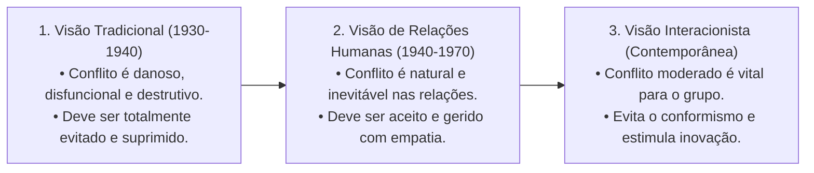
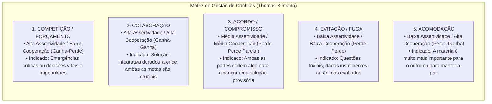
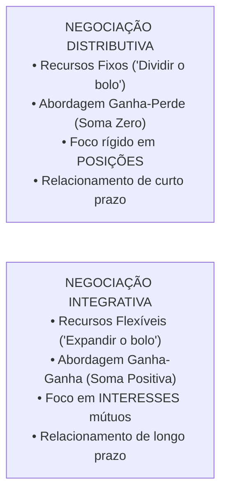
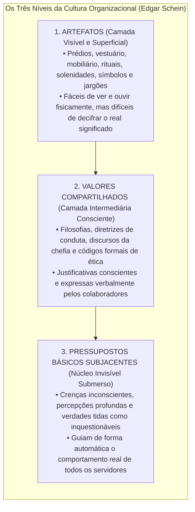
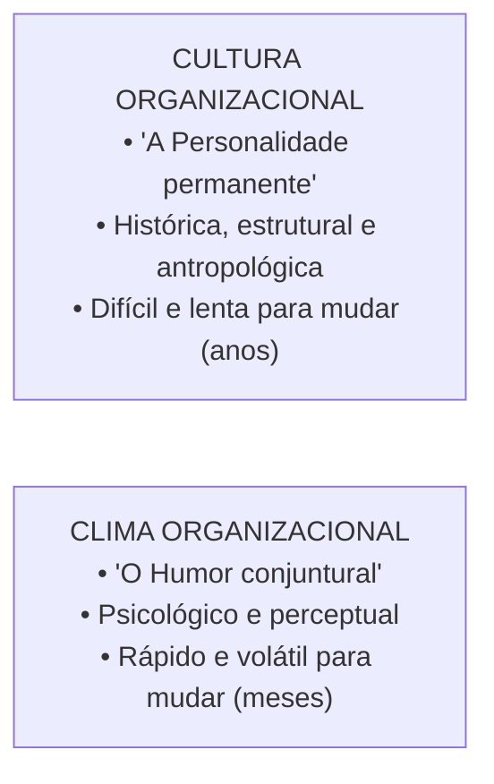
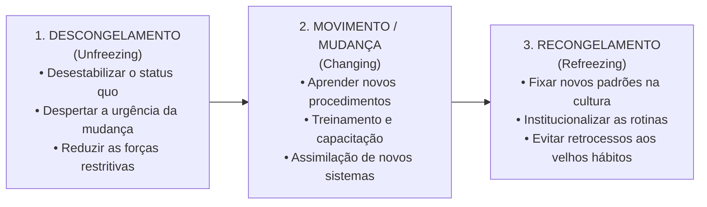

# 03 - Conflito, Negociação, Cultura, Clima e Desenvolvimento Organizacional

> **Matéria:** Comportamento Organizacional  
> **Cargo:** A01 – Técnico de Controle Externo – Especialidade: Técnico Administrativo  
> **Arquivo:** `03_conflito_negociacao_cultura_clima_e_desenvolvimento_organizacional.md`  

---

## 📌 Ementa / Itens do Edital
- Conflito Organizacional:
    - Evolução das correntes teóricas sobre o conflito: Visão Tradicional (disfuncional e prejudicial), Visão de Relações Humanas (natural e inevitável) e Visão Interacionista (positivo e indispensável para evitar acomodação);
    - Conflito Funcional (construtivo, fomenta inovação e debate sadio) versus Conflito Disfuncional (destrutivo, desagrega equipes e bloqueia metas);
    - Tipos de conflito por conteúdo: Conflito de Tarefa, Conflito de Processo e Conflito de Relacionamento (quase sempre disfuncional);
    - Estilos de gestão de conflitos no modelo bidimensional de Kenneth Thomas e Ralph Kilmann (Competição/Forçamento, Colaboração, Acordo/Compromisso, Evitação/Fuga e Acomodação);
- Técnicas de Negociação Organizacional:
    - Negociação Distributiva (modelo "ganha-perde", soma zero, foco em posições antagônicas e partilha de recursos fixos);
    - Negociação Integrativa (modelo "ganha-ganha", expansão do valor global, foco nos interesses mútuos subjacentes e relacionamentos duradouros);
    - Zona de Possível Acordo (ZOPA) e Melhor Alternativa para um Acordo Negociado (MAPAN / BATNA - *Best Alternative to a Negotiated Agreement*);
- Cultura Organizacional:
    - Conceito, funções, transmissão cultural (histórias, rituais, símbolos materiais e linguagem);
    - Os três níveis da cultura organizacional de Edgar Schein: Artefatos (superficiais e visíveis), Valores Compartilhados (justificativas conscientes) e Pressupostos Básicos Subjacentes (núcleo invisível e inquestionável);
    - Culturas organizacionais fortes versus culturas fracas;
- Clima Organizacional:
    - Definição: atmosfera psicológica e percepções compartilhadas dos membros sobre o ambiente funcional;
    - Diferenças fundamentais entre Cultura (permanente, antropológica e duradoura) e Clima (mutável, conjuntural e reflexo do momento);
- Desenvolvimento Organizacional (DO) e Gestão da Mudança:
    - O modelo de mudança planejada em três fases de Kurt Lewin: Descongelamento (*Unfreezing*), Mudança/Movimento (*Moving*) e Recongelamento (*Refreezing*);
    - Análise do Campo de Forças de Lewin: forças propulsoras/impulsoras versus forças restritivas;
    - Fontes de resistência à mudança individuais e organizacionais.

---

## 🧭 Sumário

1. [Evolução Teórica do Conflito e Tipologias por Conteúdo](#1-evolucao-teorica-do-conflito-e-tipologias-por-conteudo)
    1. [Teste 420](#Teste-420)
    2. [Teste 421](#Teste-421)
2. [Estilos de Administração de Conflitos (Thomas-Kilmann)](#2-estilos-de-administracao-de-conflitos-thomas-kilmann)
    1. [Teste 422](#Teste-422)
3. [Técnicas de Negociação: Distributiva vs. Integrativa (Modelo Harvard)](#3-tecnicas-de-negociacao-distributiva-vs-integrativa-modelo-harvard)
    1. [Teste 423](#Teste-423)
    2. [Teste 424](#Teste-424)
4. [Cultura Organizacional e os Três Níveis de Edgar Schein](#4-cultura-organizacional-e-os-tres-niveis-de-edgar-schein)
    1. [Teste 425](#Teste-425)
5. [Cultura Organizacional versus Clima Organizacional](#5-cultura-organizacional-versus-clima-organizacional)
    1. [Teste 426](#Teste-426)
6. [Desenvolvimento Organizacional e Gestão da Mudança (Kurt Lewin)](#6-desenvolvimento-organizacional-e-gestao-da-mudanca-kurt-lewin)
    1. [Teste 427](#Teste-427)
    2. [Teste 428](#Teste-428)
    3. [Teste 429](#Teste-429)
7. [Fontes Oficiais e Referências Bibliográficas](#7-fontes-oficiais-e-referencias-bibliograficas)

---

## 1. Evolução Teórica do Conflito e Tipologias por Conteúdo

O conflito é um processo que se inicia quando uma das partes percebe que a outra afetou ou está prestes a afetar negativamente algo que lhe é importante. A compreensão do conflito evoluiu em três correntes históricas fundamentais:

* **Conflito Funcional (Construtivo):** Apoia as metas organizacionais, desafia o conformismo, promove a revisão crítica de rotinas ultrapassadas e aperfeiçoa as decisões da equipe.
* **Conflito Disfuncional (Destrutivo):** Atrapalha o desempenho da instituição, alimenta hostilidades pessoais, reduz a comunicação interna, destrói a coesão e paralisa as entregas de valor público.

#### Classificação dos Conflitos por Conteúdo:
1. **Conflito de Tarefa:** Envolve divergências quanto ao conteúdo, às metas e aos resultados almejados no trabalho. Em níveis moderados, costuma ser **funcional e positivo** para o surgimento de novas ideias.
2. **Conflito de Processo:** Refere-se a divergências sobre *como* o trabalho deve ser executado e quem deve assumir cada responsabilidade operacional. Costuma ser produtivo apenas em níveis muito baixos.
3. **Conflito de Relacionamento:** Focado em incompatibilidades interpessoais, antipatias afetivas e atritos emocionais entre servidores. É **quase invariavelmente DISFUNCIONAL**, desestabilizando o ambiente e destruindo a cooperação mútua.

> 🛑 **ATENÇÃO (O CONFLITO DE RELACIONAMENTO É DISFUNCIONAL):**  
> A visão interacionista afirma que o conflito de tarefas pode ser funcional, mas alerta categoricamente que o **conflito de relacionamento (interpessoal/afetivo) é quase sempre DISFUNCIONAL**, pois desgasta a convivência, destrói a confiança mútua e paralisa as entregas públicas!

---

### Teste 420
**(FGV – TCE-PA – Auditor de Controle Externo Administrativa Contabilidade – 2024)**
Quando em uma combinação, uma das partes envolvidas obtiver o controle de uma ou mais operações, deve-se classificar a combinação como aquisição, exceto se a operação tiver essência econômica de fusão. Para que a operação tenha essência econômica de fusão, deve-se considerar os indicadores relacionados à contraprestação e ao processo de tomada de decisão. Entre esses indicadores estão os seguintes, à exceção de um. Assinale-o.

* **A)** Ocorre a combinação de entidades sob controle comum.
* **B)** A combinação está sujeita à aprovação dos cidadãos de cada uma das partes por meio de consultas à sociedade.
* **C)** A combinação é imposta por terceiro sem que qualquer das partes da combinação seja envolvida no processo de tomada de decisão.
* **D)** A contraprestação é paga àquele que detêm o direito aos ativos líquidos da operação transferida, que é identificado e contactado.
* **E)** A contraprestação é paga por outras razões que não a de compensar aqueles que detêm direito aos ativos líquidos da operação transferida em razão da renúncia a esse direito.

---

> **Comentário Detalhado:**
>
> - **A)** **Incorreta.** A opção apresenta proposição em desacordo com os fundamentos teóricos e técnicos do tópico ao afirmar que "Ocorre a combinação de entidades sob controle comum". De acordo com a teoria estudada em *Classificação dos Conflitos por Conteúdo:*, conflito de Processo: Refere-se a divergências sobre *como* o trabalho deve ser executado e quem deve assumir cada responsabilidade operacional. Costuma ser produtivo apenas em níveis muito baixos.
> - **B)** **Incorreta.** A opção apresenta proposição em desacordo com os fundamentos teóricos e técnicos do tópico ao afirmar que "A combinação está sujeita à aprovação dos cidadãos de cada uma das partes por meio de consultas à sociedade". De acordo com a teoria estudada em *1. Evolução Teórica do Conflito e Tipologias por Conteúdo*, o conflito é um processo que se inicia quando uma das partes percebe que a outra afetou ou está prestes a afetar negativamente algo que lhe é importante. A compreensão do conflito evoluiu em três correntes históricas fundamentais.
> - **C)** **Incorreta.** A opção promove generalização excessiva que desconsidera as condições técnicas e normativas ao afirmar que "A combinação é imposta por terceiro sem que qualquer das partes da combinação seja envolvida no processo de tomada...". De acordo com a teoria estudada em *Fundamentos do Projeto de Negociação de Harvard:*, focar nos Interesses, não nas Posições: As posições correspondem àquilo que as partes declaram verbalmente que querem; os interesses expressam as necessidades reais, motivações e anseios subjacentes que motivam tais posições.
> - **D)** **Correta.** Conforme fundamentado na seção *3. Técnicas de Negociação: Distributiva vs. Integrativa (Modelo Harvard)* deste guia, a negociação é um processo dialógico de tomada de decisão conjunta em que duas ou mais partes interdependentes procuram formular um acordo. Dessa forma, está plenamente correta a assertiva da banca (FGV – TCE-PA/2024) ao estabelecer que "A contraprestação é paga àquele que detêm o direito aos ativos líquidos da operação transferida, que é...".
> - **E)** **Incorreta.** A opção apresenta proposição em desacordo com os fundamentos teóricos e técnicos do tópico ao afirmar que "A contraprestação é paga por outras razões que não a de compensar aqueles que detêm direito aos ativos líquidos da...". De acordo com a teoria estudada em *4. Cultura Organizacional e os Três Níveis de Edgar Schein*, a cultura organizacional é o sistema de significados compartilhados, valores, crenças e normas que diferenciam uma instituição de todas as outras. Edgar Schein concebeu a cultura como uma estrutura em camadas, assemelhada a um *iceberg*.
>
> **Gabarito: D**

---

### Teste 421
**(CEBRASPE – TRT-8 – Analista Judiciario Area Apoio Especializado Tecnologia da Informacao – 2022)**
No Plano Estratégico da Justiça do Trabalho estabelecido pela Resolução 290/CSJT de 20/5/2021, existe um elemento que é identificado como sendo o que a organização pretende ser no futuro ao considerar as oportunidades futuras, as aspirações e o reconhecimento dos públicos interno e externo. Trata-se do elemento

* **A)** objetivos.
* **B)** visão.
* **C)** valor.
* **D)** missão.
* **E)** cesta de indicadores estratégicos.

---

> **Comentário Detalhado:**
>
> - **A)** **Incorreta.** A opção apresenta proposição em desacordo com os fundamentos teóricos e técnicos do tópico ao afirmar que "objetivos". De acordo com a teoria estudada em *Classificação dos Conflitos por Conteúdo:*, conflito de Tarefa: Envolve divergências quanto ao conteúdo, às metas e aos resultados almejados no trabalho. Em níveis moderados, costuma ser funcional e positivo para o surgimento de novas ideias.
> - **B)** **Correta.** Conforme fundamentado na seção *Classificação dos Conflitos por Conteúdo:* deste guia, a visão interacionista afirma que o conflito de tarefas pode ser funcional, mas alerta categoricamente que o conflito de relacionamento (interpessoal/afetivo) é quase sempre DISFUNCIONAL, pois desgasta a convivência, destrói a confiança mútua e paralisa as entregas públicas!. Dessa forma, está plenamente correta a assertiva da banca (CEBRASPE – TRT-8/2022) ao estabelecer que "visão".
> - **C)** **Incorreta.** A opção apresenta proposição em desacordo com os fundamentos teóricos e técnicos do tópico ao afirmar que "valor". De acordo com a teoria estudada em *1. Evolução Teórica do Conflito e Tipologias por Conteúdo*, conflito Disfuncional (Destrutivo): Atrapalha o desempenho da instituição, alimenta hostilidades pessoais, reduz a comunicação interna, destrói a coesão e paralisa as entregas de valor público.
> - **D)** **Incorreta.** A opção apresenta proposição em desacordo com os fundamentos teóricos e técnicos do tópico ao afirmar que "missão". De acordo com a teoria estudada em *Classificação dos Conflitos por Conteúdo:*, conflito de Processo: Refere-se a divergências sobre *como* o trabalho deve ser executado e quem deve assumir cada responsabilidade operacional. Costuma ser produtivo apenas em níveis muito baixos.
> - **E)** **Incorreta.** A opção apresenta proposição em desacordo com os fundamentos teóricos e técnicos do tópico ao afirmar que "cesta de indicadores estratégicos". De acordo com a teoria estudada em *2. Estilos de Administração de Conflitos (Thomas-Kilmann)*, kenneth Thomas e Ralph Kilmann estruturaram a resolução de conflitos sobre dois eixos comportamentais fundamentais: Assertividade (grau em que o sujeito busca fazer valer seus próprios interesses) e Cooperatividade (grau em que busca atender às necessidades da contraparte).
>
> **Gabarito: B**

---

## 2. Estilos de Administração de Conflitos (Thomas-Kilmann)

Kenneth Thomas e Ralph Kilmann estruturaram a resolução de conflitos sobre dois eixos comportamentais fundamentais: **Assertividade** (grau em que o sujeito busca fazer valer seus próprios interesses) e **Cooperatividade** (grau em que busca atender às necessidades da contraparte):

---

### Teste 422
**(FGV – TRT-24 – Tecnico Judiciario Area Administrativa Sem Especialidade – 2025)**
A gestão pública e a gestão privada convergem na busca por eficiência, inovação e entrega de valor aos stakeholders. Assinale a opção que apresenta, corretamente, uma convergência entre a gestão pública e a gestão privada.

* **A)** Ambas operam sob os mesmos princípios de rentabilidade e competição de mercado.
* **B)** O principal objetivo da gestão pública é maximizar os lucros para os contribuintes, assim como a gestão privada faz para os acionistas.
* **C)** A burocracia estatal impede qualquer tipo de inovação e eficiência na administração pública.
* **D)** A administração pública pode adotar práticas gerenciais da iniciativa privada, mas sua finalidade principal é atender ao interesse público.
* **E)** A transparência e a responsabilidade social são exclusivas da administração pública, não sendo relevantes para a gestão privada.

---

> **Comentário Detalhado:**
>
> - **A)** **Incorreta.** A opção apresenta proposição em desacordo com os fundamentos teóricos e técnicos do tópico ao afirmar que "Ambas operam sob os mesmos princípios de rentabilidade e competição de mercado". De acordo com a teoria estudada em *6. Desenvolvimento Organizacional e Gestão da Mudança (Kurt Lewin)*, análise do Campo de Forças (Lewin): Toda mudança organizacional decorre do equilíbrio dinâmico entre Forças Propulsoras/Impulsoras (que estimulam a transformação) e Forças Restritivas (que resistem à inovação e buscam manter a inércia).
> - **B)** **Correta.** Conforme fundamentado na seção *6. Desenvolvimento Organizacional e Gestão da Mudança (Kurt Lewin)* deste guia, sem a terceira etapa de Recongelamento, a organização sofre regressão natural aos velhos hábitos assim que a pressão inicial da chefia diminui. Recongelar significa institucionalizar as novas rotinas e premiar a conformidade com o novo padrão. Dessa forma, está plenamente correta a assertiva da banca (FGV – TRT-24/2025) ao estabelecer que "O principal objetivo da gestão pública é maximizar os lucros para os contribuintes, assim como a gestão privada...".
> - **C)** **Incorreta.** A opção promove generalização excessiva que desconsidera as condições técnicas e normativas ao afirmar que "A burocracia estatal impede qualquer tipo de inovação e eficiência na administração pública". De acordo com a teoria estudada em *2. Estilos de Administração de Conflitos (Thomas-Kilmann)*, kenneth Thomas e Ralph Kilmann estruturaram a resolução de conflitos sobre dois eixos comportamentais fundamentais: Assertividade (grau em que o sujeito busca fazer valer seus próprios interesses) e Cooperatividade (grau em que busca atender às necessidades da contraparte).
> - **D)** **Incorreta.** A opção apresenta proposição em desacordo com os fundamentos teóricos e técnicos do tópico ao afirmar que "A administração pública pode adotar práticas gerenciais da iniciativa privada, mas sua finalidade principal é...". De acordo com a teoria estudada em *6. Desenvolvimento Organizacional e Gestão da Mudança (Kurt Lewin)*, movimento / Mudança (*Changing*): Fase de transição e implementação prática; os servidores recebem capacitação, assimilam novos softwares e passam a adotar novos processos de trabalho.
> - **E)** **Incorreta.** A opção apresenta proposição em desacordo com os fundamentos teóricos e técnicos do tópico ao afirmar que "A transparência e a responsabilidade social são exclusivas da administração pública, não sendo relevantes para a...". De acordo com a teoria estudada em *Classificação dos Conflitos por Conteúdo:*, conflito de Processo: Refere-se a divergências sobre *como* o trabalho deve ser executado e quem deve assumir cada responsabilidade operacional. Costuma ser produtivo apenas em níveis muito baixos.
>
> **Gabarito: B**

---

## 3. Técnicas de Negociação: Distributiva vs. Integrativa (Modelo Harvard)

A negociação é um processo dialógico de tomada de decisão conjunta em que duas ou mais partes interdependentes procuram formular um acordo:

#### Fundamentos do Projeto de Negociação de Harvard:
1. **Separar as Pessoas do Problema:** Ser firme e assertivo com o conteúdo da divergência, porém empático, cordial e respeitoso com o interlocutor.
2. **Focar nos Interesses, não nas Posições:** As **posições** correspondem àquilo que as partes declaram verbalmente que querem; os **interesses** expressam as necessidades reais, motivações e anseios subjacentes que motivam tais posições.
3. **Criar Opções de Ganho Mútuo:** Exercício de criatividade conjunta antes de bater o martelo para encontrar soluções que agreguem valor para ambos os lados.
4. **ZOPA (Zona de Possível Acordo):** Faixa de intersecção compreendida entre os valores de reserva (pontos de recuo) dos negociadores. Havendo sobreposição favorável, a ZOPA é positiva e existe viabilidade negocial concreta.
5. **BATNA / MAPAN (*Best Alternative to a Negotiated Agreement* / Melhor Alternativa para um Acordo Negociado):** A melhor opção de contingência que o negociador possui fora da mesa se as tratativas terminarem sem consenso. Quanto mais forte e atrativo for o BATNA, maior será o poder de barganha do negociador.

---

### Teste 423
**(FGV – TCE-SC – Auditor Fiscal de Controle Externo Administracao – 2026)**
Um Tribunal de Contas estadual enfrenta conflitos recorrentes entre a Diretoria de Fiscalização e Controle (DFC) e a Diretoria de Relações Institucionais (DRI), motivados por disputas por recursos humanos compartilhados, divergências sobre prazos e percepções assimétricas de relevância institucional. A Presidência decidiu adotar uma estratégia de negociação ganha-ganha estruturada no modelo PRAM para mediar o conflito, construir acordos viáveis e preservar o relacionamento institucional no longo prazo. Assinale a opção que descreve corretamente a aplicação das quatro etapas do modelo PRAM ao referido conflito.

* **A)** Na etapa de planejamento, mapeia-se apenas os conflitos já ocorridos; no relacionamento, a confiança é construída durante a negociação substantiva; no acordo, as soluções são propostas pelo mediador; e na manutenção, o acompanhamento é dispensável quando o acordo é formalizado por escrito.
* **B)** Na etapa de planejamento, impõe-se um acordo preliminar antes do diálogo; no relacionamento, substituem-se os líderes das diretorias para eliminar assimetrias; no acordo, adotam-se critérios exclusivamente técnicos; e na manutenção, monitora-se apenas o cumprimento de prazos.
* **C)** Na etapa de planejamento, antecipam-se cenários apenas para a DFC, por ter maior volume de entregas; no relacionamento, prioriza-se a formalização do acordo antes da construção da confiança; no acordo, adota-se lógica distributiva para garantir equilíbrio de concessões; e na manutenção, realizam-se reuniões apenas quando surgirem novos conflitos.
* **D)** Na etapa de planejamento, identificam-se os interesses de cada diretoria sem buscar convergências; no relacionamento, impõem-se regras de interação via ato normativo; no acordo, a alocação de recursos é definida unilateralmente pela Presidência; e na manutenção, encerra-se o acompanhamento após a assinatura do acordo.
* **E)** Na etapa de planejamento, mapeiam-se objetivos, interesses

---

> **Comentário Detalhado:**
>
> - **A)** **Correta.** Conforme fundamentado na seção *Classificação dos Conflitos por Conteúdo:* deste guia, a visão interacionista afirma que o conflito de tarefas pode ser funcional, mas alerta categoricamente que o conflito de relacionamento (interpessoal/afetivo) é quase sempre DISFUNCIONAL, pois desgasta a convivência, destrói a confiança mútua e paralisa as entregas públicas!. Dessa forma, está plenamente correta a assertiva da banca (FGV – TCE-SC/2026) ao estabelecer que "Na etapa de planejamento, mapeia-se apenas os conflitos já ocorridos; no relacionamento, a confiança é construída...".
> - **B)** **Incorreta.** A opção incorre em restrição indevida ao limitar o escopo conceitual ao afirmar que "Na etapa de planejamento, impõe-se um acordo preliminar antes do diálogo; no relacionamento, substituem-se os...". De acordo com a teoria estudada em *Fundamentos do Projeto de Negociação de Harvard:*, criar Opções de Ganho Mútuo: Exercício de criatividade conjunta antes de bater o martelo para encontrar soluções que agreguem valor para ambos os lados.
> - **C)** **Incorreta.** A opção incorre em restrição indevida ao limitar o escopo conceitual ao afirmar que "Na etapa de planejamento, antecipam-se cenários apenas para a DFC, por ter maior volume de entregas; no...". De acordo com a teoria estudada em *Classificação dos Conflitos por Conteúdo:*, conflito de Relacionamento: Focado em incompatibilidades interpessoais, antipatias afetivas e atritos emocionais entre servidores. É quase invariavelmente DISFUNCIONAL, desestabilizando o ambiente e destruindo a cooperação mútua.
> - **D)** **Incorreta.** A opção apresenta proposição em desacordo com os fundamentos teóricos e técnicos do tópico ao afirmar que "Na etapa de planejamento, identificam-se os interesses de cada diretoria sem buscar convergências; no...". De acordo com a teoria estudada em *Fundamentos do Projeto de Negociação de Harvard:*, focar nos Interesses, não nas Posições: As posições correspondem àquilo que as partes declaram verbalmente que querem; os interesses expressam as necessidades reais, motivações e anseios subjacentes que motivam tais posições.
> - **E)** **Incorreta.** A opção apresenta proposição em desacordo com os fundamentos teóricos e técnicos do tópico ao afirmar que "Na etapa de planejamento, mapeiam-se objetivos, interesses". De acordo com a teoria estudada em *2. Estilos de Administração de Conflitos (Thomas-Kilmann)*, kenneth Thomas e Ralph Kilmann estruturaram a resolução de conflitos sobre dois eixos comportamentais fundamentais: Assertividade (grau em que o sujeito busca fazer valer seus próprios interesses) e Cooperatividade (grau em que busca atender às necessidades da contraparte).
>
> **Gabarito: A**

---

### Teste 424
**(CEBRASPE – TJ-RJ – Analista Judiciario Grupo Tecnologia da Informacao Analista de Gestao de Tic – 2021)**
Constitui modo de inclusão, no trabalho, da pessoa com impedimento de longo prazo de natureza física, em igualdade de oportunidades com as demais pessoas, a colocação

* **A)** participativa.
* **B)** inclusiva.
* **C)** integrativa.
* **D)** competitiva.
* **E)** protetiva.

---

> **Comentário Detalhado:**
>
> - **A)** **Incorreta.** A opção apresenta proposição em desacordo com os fundamentos teóricos e técnicos do tópico ao afirmar que "participativa". De acordo com a teoria estudada em *Fundamentos do Projeto de Negociação de Harvard:*, separar as Pessoas do Problema: Ser firme e assertivo com o conteúdo da divergência, porém empático, cordial e respeitoso com o interlocutor.
> - **B)** **Incorreta.** A opção apresenta proposição em desacordo com os fundamentos teóricos e técnicos do tópico ao afirmar que "inclusiva". De acordo com a teoria estudada em *4. Cultura Organizacional e os Três Níveis de Edgar Schein*, fALSO! Códigos formais e murais são Artefatos ou Valores Compartilhados expressos. Os Pressupostos Básicos Subjacentes são inconscientes, tácitos e invisíveis, operando de modo automático e natural na mente dos membros!.
> - **C)** **Incorreta.** A opção apresenta proposição em desacordo com os fundamentos teóricos e técnicos do tópico ao afirmar que "integrativa". De acordo com a teoria estudada em *3. Técnicas de Negociação: Distributiva vs. Integrativa (Modelo Harvard)*, a negociação é um processo dialógico de tomada de decisão conjunta em que duas ou mais partes interdependentes procuram formular um acordo.
> - **D)** **Correta.** Conforme fundamentado na seção *6. Desenvolvimento Organizacional e Gestão da Mudança (Kurt Lewin)* deste guia, o Desenvolvimento Organizacional (DO) é uma abordagem planejada de longo prazo voltada para transformar as atitudes, valores, processos e estruturas da organização, assegurando sua adaptabilidade contínua. Dessa forma, está plenamente correta a assertiva da banca (CEBRASPE – TJ-RJ/2021) ao estabelecer que "competitiva".
> - **E)** **Incorreta.** A opção apresenta proposição em desacordo com os fundamentos teóricos e técnicos do tópico ao afirmar que "protetiva". De acordo com a teoria estudada em *Tabela Comparativa Analítica:*, origem e Natureza: Histórica, antropológica e estrutural da organização. — Psicológica, conjuntural e perceptual dos servidores.
>
> **Gabarito: D**

---

## 4. Cultura Organizacional e os Três Níveis de Edgar Schein

A cultura organizacional é o sistema de significados compartilhados, valores, crenças e normas que diferenciam uma instituição de todas as outras. Edgar Schein concebeu a cultura como uma estrutura em camadas, assemelhada a um *iceberg*:

1. **Artefatos:** Manifestações físicas, visuais e auditivas observáveis (o modelo de mesas no TCE-GO, o uniforme, a forma de tratamento entre os servidores, a tecnologia em uso). São fáceis de constatar, mas a interpretação de seu significado profundo exige cautela analítica.
2. **Valores Compartilhados:** Valores conscientemente explicitados, regras de convivência social e discursos oficiais adotados pelos líderes para justificar suas decisões.
3. **Pressupostos Básicos Subjacentes:** O núcleo central e mais profundo da cultura. São verdades tão enraizadas e óbvias para o grupo que já se tornaram automáticas, inconscientes e inquestionáveis, ditando como os membros percebem a realidade e agem no cotidiano.

> 🚨 **ALERTA DE PROVA / PEGADINHA FCC (PRESSUPOSTOS BÁSICOS DE SCHEIN):**  
> Questão predileta da FCC: afirmar que "os pressupostos básicos da cultura organizacional são formalmente redigidos no código de ética e afixados nos murais da entidade". **FALSO!** Códigos formais e murais são **Artefatos** ou **Valores Compartilhados** expressos. Os **Pressupostos Básicos Subjacentes** são **inconscientes, tácitos e invisíveis**, operando de modo automático e natural na mente dos membros!

---

### Teste 425
**(FGV – TCE-PA – Auditor de Controle Externo Administrativa Administracao – 2024)**
Cultura organizacional é o conjunto de valores, crenças, comportamentos e práticas que caracterizam uma organização, moldado ao longo do tempo e influenciando as interações internas e externas. Assinale a opção que apresenta a sensação transmitida em um grupo pelo layout físico e o modo como os membros da organização interagem entre si, com clientes ou outros públicos externos.

* **A)** Rituais.
* **B)** Clima.
* **C)** Símbolos de integração.
* **D)** Celebrações formais.
* **E)** Regras do jogo.

---

> **Comentário Detalhado:**
>
> - **A)** **Incorreta.** A opção apresenta proposição em desacordo com os fundamentos teóricos e técnicos do tópico ao afirmar que "Rituais". De acordo com a teoria estudada em *Tabela Comparativa Analítica:*, se relatar tradições institucionais de décadas, rituais históricos consolidados, crenças profundas e valores compartilhados: trata-se de CULTURA.
> - **B)** **Correta.** Conforme fundamentado na seção *4. Cultura Organizacional e os Três Níveis de Edgar Schein* deste guia, fALSO! Códigos formais e murais são Artefatos ou Valores Compartilhados expressos. Os Pressupostos Básicos Subjacentes são inconscientes, tácitos e invisíveis, operando de modo automático e natural na mente dos membros!. Dessa forma, está plenamente correta a assertiva da banca (FGV – TCE-PA/2024) ao estabelecer que "Clima".
> - **C)** **Incorreta.** A opção apresenta proposição em desacordo com os fundamentos teóricos e técnicos do tópico ao afirmar que "Símbolos de integração". De acordo com a teoria estudada em *Tabela Comparativa Analítica:*, dimensão: Cultura Organizacional — Clima Organizacional.
> - **D)** **Incorreta.** A opção apresenta proposição em desacordo com os fundamentos teóricos e técnicos do tópico ao afirmar que "Celebrações formais". De acordo com a teoria estudada em *4. Cultura Organizacional e os Três Níveis de Edgar Schein*, pressupostos Básicos Subjacentes: O núcleo central e mais profundo da cultura. São verdades tão enraizadas e óbvias para o grupo que já se tornaram automáticas, inconscientes e inquestionáveis, ditando como os membros percebem a realidade e agem no cotidiano.
> - **E)** **Incorreta.** A opção apresenta proposição em desacordo com os fundamentos teóricos e técnicos do tópico ao afirmar que "Regras do jogo". De acordo com a teoria estudada em *4. Cultura Organizacional e os Três Níveis de Edgar Schein*, valores Compartilhados: Valores conscientemente explicitados, regras de convivência social e discursos oficiais adotados pelos líderes para justificar suas decisões.
>
> **Gabarito: B**

---

## 5. Cultura Organizacional versus Clima Organizacional

#### Tabela Comparativa Analítica:

| Dimensão | Cultura Organizacional | Clima Organizacional |
| :--- | :--- | :--- |
| **Origem e Natureza** | Histórica, antropológica e estrutural da organização. | Psicológica, conjuntural e perceptual dos servidores. |
| **Estabilidade no Tempo** | **Perene e altamente estável:** Demora décadas para se enraizar e anos para se transformar. | **Transitório e volátil:** Pode mudar rapidamente com a troca de um diretor, reformas prediais ou novo plano salarial. |
| **Objeto de Análise** | Valores morais, crenças, mitos, rituais e pressupostos básicos inconscientes. | Sentimentos, motivação momentânea e percepções compartilhadas sobre o ambiente de trabalho. |
| **Metáfora Clássica** | É o **DNA e a Personalidade** duradoura da instituição. | É o **Estado de Espírito e o Humor** momentâneo da equipe. |

> ⭐ **IMPORTANTE (CULTURA VS. CLIMA ORGANIZACIONAL):**  
>
> - Se o enunciado relatar o moral da equipe, a atmosfera vivenciada após uma nomeação ou o nível momentâneo de entusiasmo com um bônus: trata-se de **CLIMA**.  
> - Se relatar tradições institucionais de décadas, rituais históricos consolidados, crenças profundas e valores compartilhados: trata-se de **CULTURA**.

---

### Teste 426
**(FGV – TCE-SC – Auditor Fiscal de Controle Externo Administracao – 2026)**
Leia o texto a seguir. Funções de confiança, cargos comissionados e vínculos temporários – A ANTC propõe que cargos e funções de chefia, direção e assessoramento em atividades exclusivas de Estado – como a Auditoria de Controle Externo – sejam exercidos exclusivamente por servidores concursados da respectiva carreira. Essa medida reforça a imparcialidade, a continuidade institucional e a proteção da função pública contra interferências indevidas. A entidade também defende que, no mínimo, 50% dos cargos em comissão de qualquer órgão sejam ocupados por servidores efetivos. Um texto pode expressar-se por distintas estruturas; entre as opções a seguir, assinale aquela que mostra uma substituição adequada da forma original por outra equivalente.

* **A)** “Funções de confiança” = funções confiantes.
* **B)** “vínculos temporários” = vínculos de longo tempo.
* **C)** “sejam exercidos” = se exerçam.
* **D)** “exclusivamente” = sem exclusividade.
* **E)** “de qualquer órgão” = de um órgão qualquer.

---

> **Comentário Detalhado:**
>
> - **A)** **Incorreta.** A opção apresenta proposição em desacordo com os fundamentos teóricos e técnicos do tópico ao afirmar que "“Funções de confiança” = funções confiantes". De acordo com a teoria estudada em *Classificação dos Conflitos por Conteúdo:*, a visão interacionista afirma que o conflito de tarefas pode ser funcional, mas alerta categoricamente que o conflito de relacionamento (interpessoal/afetivo) é quase sempre DISFUNCIONAL, pois desgasta a convivência, destrói a confiança mútua e paralisa as entregas públicas!.
> - **B)** **Correta.** Conforme fundamentado na seção *Tabela Comparativa Analítica:* deste guia, estabilidade no Tempo: Perene e altamente estável: Demora décadas para se enraizar e anos para se transformar. — Transitório e volátil: Pode mudar rapidamente com a troca de um diretor, reformas prediais ou novo plano salarial. Dessa forma, está plenamente correta a assertiva da banca (FGV – TCE-SC/2026) ao estabelecer que "“vínculos temporários” = vínculos de longo tempo".
> - **C)** **Incorreta.** A opção apresenta proposição em desacordo com os fundamentos teóricos e técnicos do tópico ao afirmar que "“sejam exercidos” = se exerçam". De acordo com a teoria estudada em *6. Desenvolvimento Organizacional e Gestão da Mudança (Kurt Lewin)*, o Desenvolvimento Organizacional (DO) é uma abordagem planejada de longo prazo voltada para transformar as atitudes, valores, processos e estruturas da organização, assegurando sua adaptabilidade contínua.
> - **D)** **Incorreta.** A opção incorre em restrição indevida ao limitar o escopo conceitual ao afirmar que "“exclusivamente” = sem exclusividade". De acordo com a teoria estudada em *4. Cultura Organizacional e os Três Níveis de Edgar Schein*, artefatos: Manifestações físicas, visuais e auditivas observáveis (o modelo de mesas no TCE-GO, o uniforme, a forma de tratamento entre os servidores, a tecnologia em uso).
> - **E)** **Incorreta.** A opção promove generalização excessiva que desconsidera as condições técnicas e normativas ao afirmar que "“de qualquer órgão” = de um órgão qualquer". De acordo com a teoria estudada em *6. Desenvolvimento Organizacional e Gestão da Mudança (Kurt Lewin)*, recongelamento (*Refreezing*): Estabilização e institucionalização das novas práticas no cotidiano e na cultura do órgão, assegurando que o novo padrão se torne permanente e evitando a regressão aos velhos hábitos.
>
> **Gabarito: B**

---

## 6. Desenvolvimento Organizacional e Gestão da Mudança (Kurt Lewin)

O Desenvolvimento Organizacional (DO) é uma abordagem planejada de longo prazo voltada para transformar as atitudes, valores, processos e estruturas da organização, assegurando sua adaptabilidade contínua.

Kurt Lewin formulou o clássico **Modelo de Mudança Planejada em Três Fases**:

1. **Descongelamento (*Unfreezing*):** A liderança quebra a inércia e desafia o *status quo* vigente, conscientizando os servidores de que as rotinas antigas estão superadas, criando a prontidão psicológica indispensável para a mudança.
2. **Movimento / Mudança (*Changing*):** Fase de transição e implementação prática; os servidores recebem capacitação, assimilam novos softwares e passam a adotar novos processos de trabalho.
3. **Recongelamento (*Refreezing*):** Estabilização e institucionalização das novas práticas no cotidiano e na cultura do órgão, assegurando que o novo padrão se torne permanente e evitando a regressão aos velhos hábitos.

* **Análise do Campo de Forças (Lewin):** Toda mudança organizacional decorre do equilíbrio dinâmico entre **Forças Propulsoras/Impulsoras** (que estimulam a transformação) e **Forças Restritivas** (que resistem à inovação e buscam manter a inércia). Gestores eficientes concentram esforços em **atenuar e reduzir as forças restritivas**, mitigando o medo do desconhecido e o estresse da equipe.

> 📌 **NOTA EXPLICATIVA (O PAPEL DO RECONGELAMENTO DE LEWIN):**  
> Sem a terceira etapa de **Recongelamento**, a organização sofre regressão natural aos velhos hábitos assim que a pressão inicial da chefia diminui. Recongelar significa institucionalizar as novas rotinas e premiar a conformidade com o novo padrão.

---

### Teste 427
**(FGV – TJ-RR – Analista Judiciario Gestao e Governanca de Tecnologia da Informacao – 2024)**
Segundo a Resolução nº 400 de 16/06/2021 do Conselho Nacional de Justiça, os órgãos do Poder Judiciário devem adotar modelos de gestão organizacional com processos estruturados que promovam a sustentabilidade, com base em ações ambientalmente corretas, economicamente viáveis e socialmente justas e inclusivas, culturalmente diversas e pautadas na integridade, em busca de um desenvolvimento nacional sustentável. De acordo com a referida norma é correto afirmar que

* **A)** contratações compartilhadas são práticas institucionais que tenham como objetivo a promoção de comportamentos éticos e que contribuam para o desenvolvimento ambiental, social, cultural e econômico, melhorando, simultaneamente, o meio ambiente e a qualidade de vida do quadro de pessoal e auxiliar do Poder Judiciário.
* **B)** as ações socialmente justas e inclusivas têm como objetivo respeitar a variedade e a convivência entre ideias, características, gêneros e regionalismos no ambiente de trabalho.
* **C)** as ações ambientalmente corretas devem ter como objetivo a redução do impacto no meio ambiente, tendo como premissas o aumento do consumo, com o reaproveitamento e reciclagem de materiais e a observância aos modelos de padrão de consumo.
* **D)** as ações economicamente viáveis devem buscar critérios de eficiência contínua dos gastos, levando em consideração a real necessidade da compra/contratação dentre as propostas mais vantajosas (análise custo-benefício) para sustentação da instituição, tendo em vista as inovações nos processos de trabalho.
* **E)** as ações culturalmente diversas devem fomentar na instituição e em ações externas a adoção de comportamentos que promovam o equilíbrio e o bem-estar no ambiente de trabalho, por meio de atividades voltadas ao cuidado preventivo com a saúde, acessibilidade e inclusão social dos quadros de pessoal e auxiliar.

---

> **Comentário Detalhado:**
>
> - **A)** **Incorreta.** A opção apresenta proposição em desacordo com os fundamentos teóricos e técnicos do tópico ao afirmar que "contratações compartilhadas são práticas institucionais que tenham como objetivo a promoção de comportamentos...". De acordo com a teoria estudada em *Tabela Comparativa Analítica:*, objeto de Análise: Valores morais, crenças, mitos, rituais e pressupostos básicos inconscientes. — Sentimentos, motivação momentânea e percepções compartilhadas sobre o ambiente de trabalho.
> - **B)** **Incorreta.** A opção apresenta proposição em desacordo com os fundamentos teóricos e técnicos do tópico ao afirmar que "as ações socialmente justas e inclusivas têm como objetivo respeitar a variedade e a convivência entre ideias...". De acordo com a teoria estudada em *6. Desenvolvimento Organizacional e Gestão da Mudança (Kurt Lewin)*, o Desenvolvimento Organizacional (DO) é uma abordagem planejada de longo prazo voltada para transformar as atitudes, valores, processos e estruturas da organização, assegurando sua adaptabilidade contínua.
> - **C)** **Incorreta.** A opção apresenta proposição em desacordo com os fundamentos teóricos e técnicos do tópico ao afirmar que "as ações ambientalmente corretas devem ter como objetivo a redução do impacto no meio ambiente, tendo como...". De acordo com a teoria estudada em *6. Desenvolvimento Organizacional e Gestão da Mudança (Kurt Lewin)*, recongelamento (*Refreezing*): Estabilização e institucionalização das novas práticas no cotidiano e na cultura do órgão, assegurando que o novo padrão se torne permanente e evitando a regressão aos velhos hábitos.
> - **D)** **Correta.** Conforme fundamentado na seção *6. Desenvolvimento Organizacional e Gestão da Mudança (Kurt Lewin)* deste guia, movimento / Mudança (*Changing*): Fase de transição e implementação prática; os servidores recebem capacitação, assimilam novos softwares e passam a adotar novos processos de trabalho. Dessa forma, está plenamente correta a assertiva da banca (FGV – TJ-RR/2024) ao estabelecer que "as ações economicamente viáveis devem buscar critérios de eficiência contínua dos gastos, levando em consideração...".
> - **E)** **Incorreta.** A opção apresenta proposição em desacordo com os fundamentos teóricos e técnicos do tópico ao afirmar que "as ações culturalmente diversas devem fomentar na instituição e em ações externas a adoção de comportamentos que...". De acordo com a teoria estudada em *6. Desenvolvimento Organizacional e Gestão da Mudança (Kurt Lewin)*, análise do Campo de Forças (Lewin): Toda mudança organizacional decorre do equilíbrio dinâmico entre Forças Propulsoras/Impulsoras (que estimulam a transformação) e Forças Restritivas (que resistem à inovação e buscam manter a inércia).
>
> **Gabarito: D**

---

### Teste 428
**(IBFC – TJ-MG – Analista Judiciario Classe C Analista de Tecnologia da Informacao – 2022)**
Para implementar um SGSI - Sistema de Gestão de Segurança da Informação, com base na norma NBR ISO 27001, aplica-se aos processos do SGSI o modelo: "______ estabelecer o SGSI - ______ implementar e operar o SGSI - ______ monitorar e analisar criticamente o SGSI - ______ manter e melhorar o SGSI". Assinale a alternativa que preencha correta e respectivamente as lacunas.

* **A)** Do (fazer) / Check (checar) / Act (agir) / Plan (planejar)
* **B)** Plan (planejar) / Do (fazer) / Check (checar) / Act (agir)
* **C)** Check (checar) / Do (fazer) / Plan (planejar) / Act (agir)
* **D)** Plan (planejar) / Check (checar) / Act (agir) / Do (fazer)
* **E)** Act (agir) / Do (fazer) / Check (checar) / Plan (planejar)

---

> **Comentário Detalhado:**
>
> - **A)** **Incorreta.** A opção apresenta proposição em desacordo com os fundamentos teóricos e técnicos do tópico ao afirmar que "Do (fazer) / Check (checar) / Act (agir) / Plan (planejar)". De acordo com a teoria estudada em *6. Desenvolvimento Organizacional e Gestão da Mudança (Kurt Lewin)*, análise do Campo de Forças (Lewin): Toda mudança organizacional decorre do equilíbrio dinâmico entre Forças Propulsoras/Impulsoras (que estimulam a transformação) e Forças Restritivas (que resistem à inovação e buscam manter a inércia).
> - **B)** **Correta.** Conforme fundamentado na seção *2. Estilos de Administração de Conflitos (Thomas-Kilmann)* deste guia, kenneth Thomas e Ralph Kilmann estruturaram a resolução de conflitos sobre dois eixos comportamentais fundamentais: Assertividade (grau em que o sujeito busca fazer valer seus próprios interesses) e Cooperatividade (grau em que busca atender às necessidades da contraparte). Dessa forma, está plenamente correta a assertiva da banca (IBFC – TJ-MG/2022) ao estabelecer que "Plan (planejar) / Do (fazer) / Check (checar) / Act (agir)".
> - **C)** **Incorreta.** A opção apresenta proposição em desacordo com os fundamentos teóricos e técnicos do tópico ao afirmar que "Check (checar) / Do (fazer) / Plan (planejar) / Act (agir)". De acordo com a teoria estudada em *6. Desenvolvimento Organizacional e Gestão da Mudança (Kurt Lewin)*, o Desenvolvimento Organizacional (DO) é uma abordagem planejada de longo prazo voltada para transformar as atitudes, valores, processos e estruturas da organização, assegurando sua adaptabilidade contínua.
> - **D)** **Incorreta.** A opção apresenta proposição em desacordo com os fundamentos teóricos e técnicos do tópico ao afirmar que "Plan (planejar) / Check (checar) / Act (agir) / Do (fazer)". De acordo com a teoria estudada em *6. Desenvolvimento Organizacional e Gestão da Mudança (Kurt Lewin)*, movimento / Mudança (*Changing*): Fase de transição e implementação prática; os servidores recebem capacitação, assimilam novos softwares e passam a adotar novos processos de trabalho.
> - **E)** **Incorreta.** A opção apresenta proposição em desacordo com os fundamentos teóricos e técnicos do tópico ao afirmar que "Act (agir) / Do (fazer) / Check (checar) / Plan (planejar)". De acordo com a teoria estudada em *6. Desenvolvimento Organizacional e Gestão da Mudança (Kurt Lewin)*, kurt Lewin formulou o clássico Modelo de Mudança Planejada em Três Fases.
>
> **Gabarito: B**

---

### Teste 429
**(FCC – TCE-GO – Analista de Controle Externo Gestao de Conhecimento – 2009)**
Em geral, a dinâmica do processo de referência (o atendimento ao usuário propriamente dito) inclui duas fases: uma relacionada à natureza do problema do usuário e outra, às decisões e caminhos percorridos pelo bibliotecário. A primeira fase relacionada à natureza do problema envolve quatro etapas. São elas:

* **A)** a negociação da questão, o processo de busca, a resposta e a solução do problema.
* **B)** a pergunta, a negociação, a busca da informação e a renegociação.
* **C)** a formulação da questão, a entrevista, a estratégia de busca e a busca.
* **D)** o processo de comunicação, a questão, a pesquisa e as fontes de informação.
* **E)** o problema, a necessidade de informação, a questão inicial e a questão negociada.

---

> **Comentário Detalhado:**
>
> - **A)** **Incorreta.** A opção apresenta proposição em desacordo com os fundamentos teóricos e técnicos do tópico ao afirmar que "a negociação da questão, o processo de busca, a resposta e a solução do problema". De acordo com a teoria estudada em *3. Técnicas de Negociação: Distributiva vs. Integrativa (Modelo Harvard)*, a negociação é um processo dialógico de tomada de decisão conjunta em que duas ou mais partes interdependentes procuram formular um acordo.
> - **B)** **Incorreta.** A opção apresenta proposição em desacordo com os fundamentos teóricos e técnicos do tópico ao afirmar que "a pergunta, a negociação, a busca da informação e a renegociação". De acordo com a teoria estudada em *6. Desenvolvimento Organizacional e Gestão da Mudança (Kurt Lewin)*, sem a terceira etapa de Recongelamento, a organização sofre regressão natural aos velhos hábitos assim que a pressão inicial da chefia diminui. Recongelar significa institucionalizar as novas rotinas e premiar a conformidade com o novo padrão.
> - **C)** **Incorreta.** A opção apresenta proposição em desacordo com os fundamentos teóricos e técnicos do tópico ao afirmar que "a formulação da questão, a entrevista, a estratégia de busca e a busca". De acordo com a teoria estudada em *2. Estilos de Administração de Conflitos (Thomas-Kilmann)*, kenneth Thomas e Ralph Kilmann estruturaram a resolução de conflitos sobre dois eixos comportamentais fundamentais: Assertividade (grau em que o sujeito busca fazer valer seus próprios interesses) e Cooperatividade (grau em que busca atender às necessidades da contraparte).
> - **D)** **Incorreta.** A opção apresenta proposição em desacordo com os fundamentos teóricos e técnicos do tópico ao afirmar que "o processo de comunicação, a questão, a pesquisa e as fontes de informação". De acordo com a teoria estudada em *1. Evolução Teórica do Conflito e Tipologias por Conteúdo*, o conflito é um processo que se inicia quando uma das partes percebe que a outra afetou ou está prestes a afetar negativamente algo que lhe é importante. A compreensão do conflito evoluiu em três correntes históricas fundamentais.
> - **E)** **Correta.** Conforme fundamentado na seção *Fundamentos do Projeto de Negociação de Harvard:* deste guia, separar as Pessoas do Problema: Ser firme e assertivo com o conteúdo da divergência, porém empático, cordial e respeitoso com o interlocutor. Dessa forma, está plenamente correta a assertiva da banca (FCC – TCE-GO/2009) ao estabelecer que "o problema, a necessidade de informação, a questão inicial e a questão negociada".
>
> **Gabarito: E**

---

## 7. Fontes Oficiais e Referências Bibliográficas

* [Lei nº 13.140/2015 (Lei de Mediação e Autocomposição de Conflitos)](https://www.planalto.gov.br/ccivil_03/_ato2015-2018/2015/lei/l13140.htm) - Disciplina a autocomposição e negociação consensual de conflitos no âmbito da administração pública.
* [Decreto Federal nº 1.171/1994 (Conduta Ética e Clima Organizacional)](https://www.planalto.gov.br/ccivil_03/decreto/d1171.htm) - Prevenção de assédio, preservação do clima de trabalho harmonioso e zelo funcional.
* [TCE-GO - Código de Ética e Ouvidoria Institucional](https://portal.tce.go.gov.br/documents/20181/574123/C%C3%B3digo+de+%C3%89tica/056863be-6768-4c35-a6e8-ccdd40421211) - Canais de denúncia, ouvidoria e mecanismos de mediação interna no TCE-GO.
* [TCU - Governança Institucional e Gestão do Clima Ético](https://portal.tcu.gov.br/governanca/governanca-no-tcu/) - Referencial para mitigação de conflitos e fomento à cultura de integridade pública.
* [Lei Estadual nº 20.756/2020 (Comissões Disciplinares e Soluções Consensuais)](https://legisla.casacivil.go.gov.br/pesquisa_legislacao/100979/lei-20756) - Termos de ajustamento de conduta funcional (TAC) e resolução de pendências disciplinares em Goiás.
* ROBBINS, Stephen P.; JUDGE, Timothy A.; SOBRAL, Filipe. **Comportamento Organizacional: Teoria e Prática no Contexto Brasileiro**. 14. ed. São Paulo: Pearson Prentice Hall, 2010. (Cap. 14 - Conflito e Negociação; Cap. 16 - Cultura Organizacional; Cap. 18 - Mudança Organizacional).
* SCHEIN, Edgar H. **Cultura Organizacional e Liderança**. São Paulo: Atlas, 2009. (Cap. 1 e 2 - Os Níveis da Cultura Organizacional: Artefatos, Crenças e Pressupostos Básicos).
* FISHER, Roger; URY, William; PATTON, Bruce. **Como Chegar ao Sim: A Negociação de Acordos sem Concessões**. 3. ed. Rio de Janeiro: Imago, 2005. (Cap. 1 a 3 - Negociação Baseada em Princípios).
