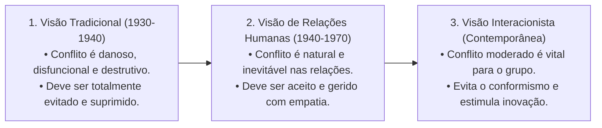
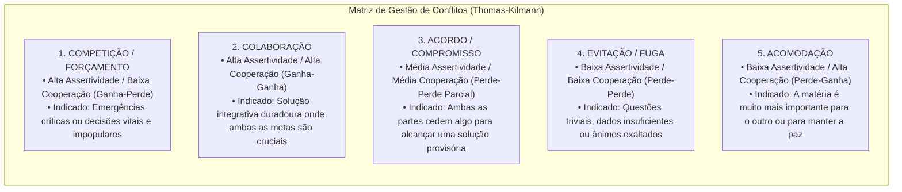
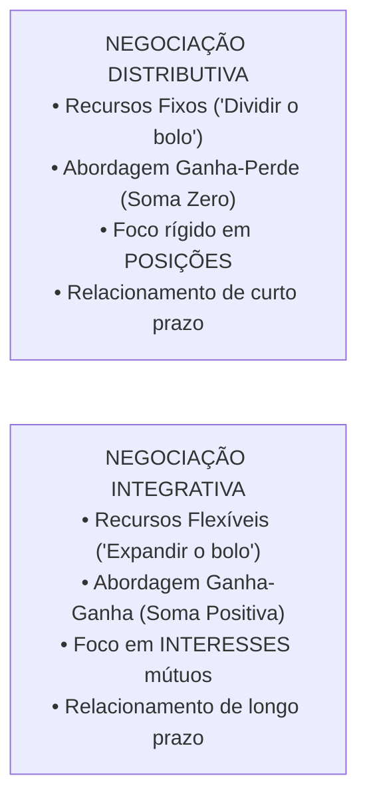
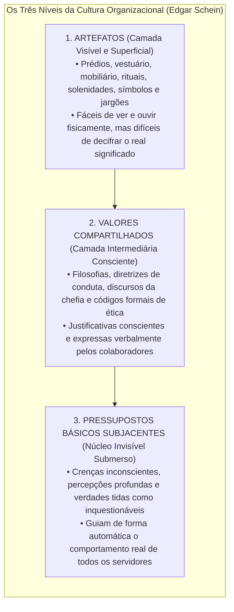
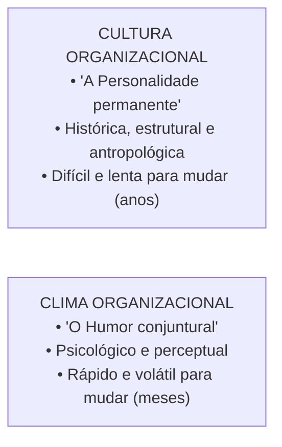
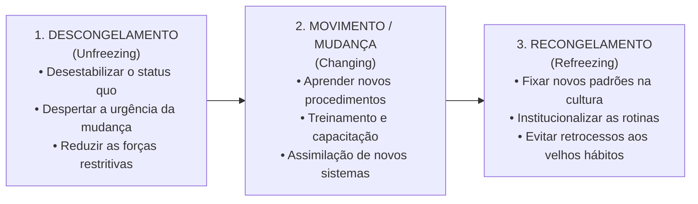

# 03 - Conflito, Negociação, Cultura, Clima e Desenvolvimento Organizacional

> **Matéria:** Comportamento Organizacional  
> **Cargo:** A01 – Técnico de Controle Externo – Especialidade: Técnico Administrativo  
> **Arquivo:** `03_conflito_negociacao_cultura_clima_e_desenvolvimento_organizacional.md`  

---

## 📌 Ementa / Itens do Edital
- Conflito Organizacional:
    - Evolução das correntes teóricas sobre o conflito: Visão Tradicional (disfuncional e prejudicial), Visão de Relações Humanas (natural e inevitável) e Visão Interacionista (positivo e indispensável para evitar acomodação);
    - Conflito Funcional (construtivo, fomenta inovação e debate sadio) versus Conflito Disfuncional (destrutivo, desagrega equipes e bloqueia metas);
    - Tipos de conflito por conteúdo: Conflito de Tarefa, Conflito de Processo e Conflito de Relacionamento (quase sempre disfuncional);
    - Estilos de gestão de conflitos no modelo bidimensional de Kenneth Thomas e Ralph Kilmann (Competição/Forçamento, Colaboração, Acordo/Compromisso, Evitação/Fuga e Acomodação);
- Técnicas de Negociação Organizacional:
    - Negociação Distributiva (modelo "ganha-perde", soma zero, foco em posições antagônicas e partilha de recursos fixos);
    - Negociação Integrativa (modelo "ganha-ganha", expansão do valor global, foco nos interesses mútuos subjacentes e relacionamentos duradouros);
    - Zona de Possível Acordo (ZOPA) e Melhor Alternativa para um Acordo Negociado (MAPAN / BATNA - *Best Alternative to a Negotiated Agreement*);
- Cultura Organizacional:
    - Conceito, funções, transmissão cultural (histórias, rituais, símbolos materiais e linguagem);
    - Os três níveis da cultura organizacional de Edgar Schein: Artefatos (superficiais e visíveis), Valores Compartilhados (justificativas conscientes) e Pressupostos Básicos Subjacentes (núcleo invisível e inquestionável);
    - Culturas organizacionais fortes versus culturas fracas;
- Clima Organizacional:
    - Definição: atmosfera psicológica e percepções compartilhadas dos membros sobre o ambiente funcional;
    - Diferenças fundamentais entre Cultura (permanente, antropológica e duradoura) e Clima (mutável, conjuntural e reflexo do momento);
- Desenvolvimento Organizacional (DO) e Gestão da Mudança:
    - O modelo de mudança planejada em três fases de Kurt Lewin: Descongelamento (*Unfreezing*), Mudança/Movimento (*Moving*) e Recongelamento (*Refreezing*);
    - Análise do Campo de Forças de Lewin: forças propulsoras/impulsoras versus forças restritivas;
    - Fontes de resistência à mudança individuais e organizacionais.

---

## 🧭 Sumário

1. [Evolução Teórica do Conflito e Tipologias por Conteúdo](#1-evolucao-teorica-do-conflito-e-tipologias-por-conteudo)
    1. [Teste 420](#Teste-420)
    2. [Teste 421](#Teste-421)
2. [Estilos de Administração de Conflitos (Thomas-Kilmann)](#2-estilos-de-administracao-de-conflitos-thomas-kilmann)
    1. [Teste 422](#Teste-422)
3. [Técnicas de Negociação: Distributiva vs. Integrativa (Modelo Harvard)](#3-tecnicas-de-negociacao-distributiva-vs-integrativa-modelo-harvard)
    1. [Teste 423](#Teste-423)
    2. [Teste 424](#Teste-424)
4. [Cultura Organizacional e os Três Níveis de Edgar Schein](#4-cultura-organizacional-e-os-tres-niveis-de-edgar-schein)
    1. [Teste 425](#Teste-425)
5. [Cultura Organizacional versus Clima Organizacional](#5-cultura-organizacional-versus-clima-organizacional)
    1. [Teste 426](#Teste-426)
6. [Desenvolvimento Organizacional e Gestão da Mudança (Kurt Lewin)](#6-desenvolvimento-organizacional-e-gestao-da-mudanca-kurt-lewin)
    1. [Teste 427](#Teste-427)
    2. [Teste 428](#Teste-428)
    3. [Teste 429](#Teste-429)
7. [Fontes Oficiais e Referências Bibliográficas](#7-fontes-oficiais-e-referencias-bibliograficas)

---

## 1. Evolução Teórica do Conflito e Tipologias por Conteúdo

O conflito é um processo que se inicia quando uma das partes percebe que a outra afetou ou está prestes a afetar negativamente algo que lhe é importante. A compreensão do conflito evoluiu em três correntes históricas fundamentais:

* **Conflito Funcional (Construtivo):** Apoia as metas organizacionais, desafia o conformismo, promove a revisão crítica de rotinas ultrapassadas e aperfeiçoa as decisões da equipe.
* **Conflito Disfuncional (Destrutivo):** Atrapalha o desempenho da instituição, alimenta hostilidades pessoais, reduz a comunicação interna, destrói a coesão e paralisa as entregas de valor público.

#### Classificação dos Conflitos por Conteúdo:
1. **Conflito de Tarefa:** Envolve divergências quanto ao conteúdo, às metas e aos resultados almejados no trabalho. Em níveis moderados, costuma ser **funcional e positivo** para o surgimento de novas ideias.
2. **Conflito de Processo:** Refere-se a divergências sobre *como* o trabalho deve ser executado e quem deve assumir cada responsabilidade operacional. Costuma ser produtivo apenas em níveis muito baixos.
3. **Conflito de Relacionamento:** Focado em incompatibilidades interpessoais, antipatias afetivas e atritos emocionais entre servidores. É **quase invariavelmente DISFUNCIONAL**, desestabilizando o ambiente e destruindo a cooperação mútua.

> 🛑 **ATENÇÃO (O CONFLITO DE RELACIONAMENTO É DISFUNCIONAL):**  
> A visão interacionista afirma que o conflito de tarefas pode ser funcional, mas alerta categoricamente que o **conflito de relacionamento (interpessoal/afetivo) é quase sempre DISFUNCIONAL**, pois desgasta a convivência, destrói a confiança mútua e paralisa as entregas públicas!

---

### Teste 420
**(CEBRASPE – STF – 2008 – Analista Judiciario Suporte Em Tecnologia Da Informacao)**
A expressão “Esse conflito” ((cid:53).15) tem a função textual de

* **C)** Certo
* **E)** Errado

---

> **Comentário Detalhado:**
>
> - **C)** **Incorreta.** A marcação como **Certo** não procede, pois o enunciado apresenta proposição em desacordo com os fundamentos teóricos e técnicos do tópico ao afirmar que "A expressão “Esse conflito” ((cid:53).15) tem a função textual de". De acordo com a teoria estudada em *1. Evolução Teórica do Conflito e Tipologias por Conteúdo*, conflito Funcional (Construtivo): Apoia as metas organizacionais, desafia o conformismo, promove a revisão crítica de rotinas ultrapassadas e aperfeiçoa as decisões da equipe.
> - **E)** **Correta.** O item está **Errado** (gabarito oficial: **E**). Conforme fundamentado na seção *1. Evolução Teórica do Conflito e Tipologias por Conteúdo* deste guia, o conflito é um processo que se inicia quando uma das partes percebe que a outra afetou ou está prestes a afetar negativamente algo que lhe é importante. A compreensão do conflito evoluiu em três correntes históricas fundamentais. Portanto, a assertiva examinada pela banca (CEBRASPE – STF/2008) viola os preceitos técnicos do tópico.
>
> **Gabarito: E**

---

### Teste 421
**(FGV – TCE/PA – 2024 – Auditor de Controle Externo - Administrativa - Gestão Governamental)**
Observe o pequeno texto narrativo a seguir: Passeava despreocupadamente pelas ruas do meu bairro e passei diante de uma loja da loteria esportiva e me lembrei de que havia um alto prêmio acumulado. Fiquei tentado em jogar, mas não podia gastar aquele dinheiro no momento e desisti. Um pouco mais adiante, porém, arrependi-me e voltei para a loja. Sobre a estruturação desse texto narrativo, assinale a afirmação inadequada.

* **A)** Há uma situação inicial que mostra o passeio despreocupado do narrador.
* **B)** Ocorre um fato motivador de uma modificação na situação inicial, que é o fato de passar pela loja de loteria e lembrar-se do prêmio acumulado.
* **C)** Há uma discussão interior do personagem que corresponde à trama narrativa e a um problema a ser resolvido.
* **D)** Desistir de jogar corresponde a uma solução temporária do conflito interior do narrador.
* **E)** Arrepender-se equivale ao final da narrativa, em que o conflito do texto é resolvido.

---

> **Comentário Detalhado:**
>
> - **A)** **Incorreta.** A opção apresenta proposição em desacordo com os fundamentos teóricos e técnicos do tópico ao afirmar que "Há uma situação inicial que mostra o passeio despreocupado do narrador". De acordo com a teoria estudada em *6. Desenvolvimento Organizacional e Gestão da Mudança (Kurt Lewin)*, sem a terceira etapa de Recongelamento, a organização sofre regressão natural aos velhos hábitos assim que a pressão inicial da chefia diminui. Recongelar significa institucionalizar as novas rotinas e premiar a conformidade com o novo padrão.
> - **B)** **Incorreta.** A opção apresenta proposição em desacordo com os fundamentos teóricos e técnicos do tópico ao afirmar que "Ocorre um fato motivador de uma modificação na situação inicial, que é o fato de passar pela loja de loteria e...". De acordo com a teoria estudada em *1. Evolução Teórica do Conflito e Tipologias por Conteúdo*, conflito Funcional (Construtivo): Apoia as metas organizacionais, desafia o conformismo, promove a revisão crítica de rotinas ultrapassadas e aperfeiçoa as decisões da equipe.
> - **C)** **Incorreta.** A opção apresenta proposição em desacordo com os fundamentos teóricos e técnicos do tópico ao afirmar que "Há uma discussão interior do personagem que corresponde à trama narrativa e a um problema a ser resolvido". De acordo com a teoria estudada em *Fundamentos do Projeto de Negociação de Harvard:*, separar as Pessoas do Problema: Ser firme e assertivo com o conteúdo da divergência, porém empático, cordial e respeitoso com o interlocutor.
> - **D)** **Incorreta.** A opção apresenta proposição em desacordo com os fundamentos teóricos e técnicos do tópico ao afirmar que "Desistir de jogar corresponde a uma solução temporária do conflito interior do narrador". De acordo com a teoria estudada em *1. Evolução Teórica do Conflito e Tipologias por Conteúdo*, conflito Disfuncional (Destrutivo): Atrapalha o desempenho da instituição, alimenta hostilidades pessoais, reduz a comunicação interna, destrói a coesão e paralisa as entregas de valor público.
> - **E)** **Correta.** Conforme fundamentado na seção *1. Evolução Teórica do Conflito e Tipologias por Conteúdo* deste guia, o conflito é um processo que se inicia quando uma das partes percebe que a outra afetou ou está prestes a afetar negativamente algo que lhe é importante. A compreensão do conflito evoluiu em três correntes históricas fundamentais. Dessa forma, está plenamente correta a assertiva da banca (FGV – TCE/PA/2024) ao estabelecer que "Arrepender-se equivale ao final da narrativa, em que o conflito do texto é resolvido".
>
> **Gabarito: E**

---

## 2. Estilos de Administração de Conflitos (Thomas-Kilmann)

Kenneth Thomas e Ralph Kilmann estruturaram a resolução de conflitos sobre dois eixos comportamentais fundamentais: **Assertividade** (grau em que o sujeito busca fazer valer seus próprios interesses) e **Cooperatividade** (grau em que busca atender às necessidades da contraparte):

---

### Teste 422
**(FGV – TRT/DA – 2025 – Tecnico Judiciario Area Administrativa Sem Especialidade)**
A gestão pública e a gestão privada convergem na busca por eficiência, inovação e entrega de valor aos stakeholders. Assinale a opção que apresenta, corretamente, uma convergência entre a gestão pública e a gestão privada.

* **A)** Ambas operam sob os mesmos princípios de rentabilidade e competição de mercado.
* **B)** O principal objetivo da gestão pública é maximizar os lucros para os contribuintes, assim como a gestão privada faz para os acionistas.
* **C)** A burocracia estatal impede qualquer tipo de inovação e eficiência na administração pública.
* **D)** A administração pública pode adotar práticas gerenciais da iniciativa privada, mas sua finalidade principal é atender ao interesse público.
* **E)** A transparência e a responsabilidade social são exclusivas da administração pública, não sendo relevantes para a gestão privada.

---

> **Comentário Detalhado:**
>
> - **A)** **Incorreta.** A opção apresenta proposição em desacordo com os fundamentos teóricos e técnicos do tópico ao afirmar que "Ambas operam sob os mesmos princípios de rentabilidade e competição de mercado". De acordo com a teoria estudada em *6. Desenvolvimento Organizacional e Gestão da Mudança (Kurt Lewin)*, movimento / Mudança (*Changing*): Fase de transição e implementação prática; os servidores recebem capacitação, assimilam novos softwares e passam a adotar novos processos de trabalho.
> - **B)** **Incorreta.** A opção apresenta proposição em desacordo com os fundamentos teóricos e técnicos do tópico ao afirmar que "O principal objetivo da gestão pública é maximizar os lucros para os contribuintes, assim como a gestão privada...". De acordo com a teoria estudada em *6. Desenvolvimento Organizacional e Gestão da Mudança (Kurt Lewin)*, recongelamento (*Refreezing*): Estabilização e institucionalização das novas práticas no cotidiano e na cultura do órgão, assegurando que o novo padrão se torne permanente e evitando a regressão aos velhos hábitos.
> - **C)** **Incorreta.** A opção promove generalização excessiva que desconsidera as condições técnicas e normativas ao afirmar que "A burocracia estatal impede qualquer tipo de inovação e eficiência na administração pública". De acordo com a teoria estudada em *6. Desenvolvimento Organizacional e Gestão da Mudança (Kurt Lewin)*, análise do Campo de Forças (Lewin): Toda mudança organizacional decorre do equilíbrio dinâmico entre Forças Propulsoras/Impulsoras (que estimulam a transformação) e Forças Restritivas (que resistem à inovação e buscam manter a inércia).
> - **D)** **Correta.** Conforme fundamentado na seção *2. Estilos de Administração de Conflitos (Thomas-Kilmann)* deste guia, kenneth Thomas e Ralph Kilmann estruturaram a resolução de conflitos sobre dois eixos comportamentais fundamentais: Assertividade (grau em que o sujeito busca fazer valer seus próprios interesses) e Cooperatividade (grau em que busca atender às necessidades da contraparte). Dessa forma, está plenamente correta a assertiva da banca (FGV – TRT/DA/2025) ao estabelecer que "A administração pública pode adotar práticas gerenciais da iniciativa privada, mas sua finalidade principal é...".
> - **E)** **Incorreta.** A opção apresenta proposição em desacordo com os fundamentos teóricos e técnicos do tópico ao afirmar que "A transparência e a responsabilidade social são exclusivas da administração pública, não sendo relevantes para a...". De acordo com a teoria estudada em *Classificação dos Conflitos por Conteúdo:*, conflito de Processo: Refere-se a divergências sobre *como* o trabalho deve ser executado e quem deve assumir cada responsabilidade operacional. Costuma ser produtivo apenas em níveis muito baixos.
>
> **Gabarito: D**

---

## 3. Técnicas de Negociação: Distributiva vs. Integrativa (Modelo Harvard)

A negociação é um processo dialógico de tomada de decisão conjunta em que duas ou mais partes interdependentes procuram formular um acordo:

#### Fundamentos do Projeto de Negociação de Harvard:
1. **Separar as Pessoas do Problema:** Ser firme e assertivo com o conteúdo da divergência, porém empático, cordial e respeitoso com o interlocutor.
2. **Focar nos Interesses, não nas Posições:** As **posições** correspondem àquilo que as partes declaram verbalmente que querem; os **interesses** expressam as necessidades reais, motivações e anseios subjacentes que motivam tais posições.
3. **Criar Opções de Ganho Mútuo:** Exercício de criatividade conjunta antes de bater o martelo para encontrar soluções que agreguem valor para ambos os lados.
4. **ZOPA (Zona de Possível Acordo):** Faixa de intersecção compreendida entre os valores de reserva (pontos de recuo) dos negociadores. Havendo sobreposição favorável, a ZOPA é positiva e existe viabilidade negocial concreta.
5. **BATNA / MAPAN (*Best Alternative to a Negotiated Agreement* / Melhor Alternativa para um Acordo Negociado):** A melhor opção de contingência que o negociador possui fora da mesa se as tratativas terminarem sem consenso. Quanto mais forte e atrativo for o BATNA, maior será o poder de barganha do negociador.

---

### Teste 423
**(FGV – TRT/DA – 2025 – Tecnico Judiciario Area Administrativa Sem Especialidade)**
O planejamento estratégico é um processo organizacional de adaptação por meio da aprovação, da tomada de decisão e da avaliação. Assinale a opção que apresenta, corretamente, o conceito de planejamento estratégico.

* **A)** O planejamento estratégico é voltado exclusivamente para a solução dos problemas atuais, desconsiderando as necessidades futuras da organização.
* **B)** O planejamento estratégico não envolve a organização como um todo, focando apenas nas áreas de maior prioridade para a empresa, sem considerar os recursos e capacidades de outros setores.
* **C)** O planejamento estratégico é o processo que busca estabelecer um consenso entre os envolvidos, atendendo às necessidades de todos os stakeholders de forma equilibrada.
* **D)** O planejamento estratégico não se adapta às mudanças ambientais, sendo rígido e inflexível em sua execução ao longo do tempo.
* **E)** O planejamento estratégico se limita a um processo de definição de metas de curto prazo, sem considerar as tendências e demandas futuras do mercado.

---

> **Comentário Detalhado:**
>
> - **A)** **Incorreta.** A opção incorre em restrição indevida ao limitar o escopo conceitual ao afirmar que "O planejamento estratégico é voltado exclusivamente para a solução dos problemas atuais, desconsiderando as...". De acordo com a teoria estudada em *2. Estilos de Administração de Conflitos (Thomas-Kilmann)*, kenneth Thomas e Ralph Kilmann estruturaram a resolução de conflitos sobre dois eixos comportamentais fundamentais: Assertividade (grau em que o sujeito busca fazer valer seus próprios interesses) e Cooperatividade (grau em que busca atender às necessidades da contraparte).
> - **B)** **Incorreta.** A opção incorre em restrição indevida ao limitar o escopo conceitual ao afirmar que "O planejamento estratégico não envolve a organização como um todo, focando apenas nas áreas de maior prioridade...". De acordo com a teoria estudada em *Fundamentos do Projeto de Negociação de Harvard:*, bATNA / MAPAN (*Best Alternative to a Negotiated Agreement* / Melhor Alternativa para um Acordo Negociado): A melhor opção de contingência que o negociador possui fora da mesa se as tratativas terminarem sem consenso.
> - **C)** **Correta.** Conforme fundamentado na seção *3. Técnicas de Negociação: Distributiva vs. Integrativa (Modelo Harvard)* deste guia, a negociação é um processo dialógico de tomada de decisão conjunta em que duas ou mais partes interdependentes procuram formular um acordo. Dessa forma, está plenamente correta a assertiva da banca (FGV – TRT/DA/2025) ao estabelecer que "O planejamento estratégico é o processo que busca estabelecer um consenso entre os envolvidos, atendendo às...".
> - **D)** **Incorreta.** A opção apresenta proposição em desacordo com os fundamentos teóricos e técnicos do tópico ao afirmar que "O planejamento estratégico não se adapta às mudanças ambientais, sendo rígido e inflexível em sua execução ao...". De acordo com a teoria estudada em *4. Cultura Organizacional e os Três Níveis de Edgar Schein*, artefatos: Manifestações físicas, visuais e auditivas observáveis (o modelo de mesas no TCE-GO, o uniforme, a forma de tratamento entre os servidores, a tecnologia em uso).
> - **E)** **Incorreta.** A opção apresenta proposição em desacordo com os fundamentos teóricos e técnicos do tópico ao afirmar que "O planejamento estratégico se limita a um processo de definição de metas de curto prazo, sem considerar as...". De acordo com a teoria estudada em *6. Desenvolvimento Organizacional e Gestão da Mudança (Kurt Lewin)*, o Desenvolvimento Organizacional (DO) é uma abordagem planejada de longo prazo voltada para transformar as atitudes, valores, processos e estruturas da organização, assegurando sua adaptabilidade contínua.
>
> **Gabarito: C**

---

### Teste 424
**(FCC – TRT 6ª – 2012 – Analista Judiciário - Apoio Especializado/Tecnologia da Informação)**
O estilo tradicional de direção (Teoria X) está apoiado numa concepção da natureza humana que enfatiza

* **A)** o caráter egocêntrico dos homens e a oposição entre os objetivos pessoais e os objetivos da organização.
* **B)** o caráter naturalmente empreendedor e ativo dos homens quando motivados por objetivos organizacionais ambiciosos.
* **C)** a natureza independente, a predisposição ao autocontrole e facilidade ao comportamento disciplinado.
* **D)** a capacidade de imaginação e de criatividade na solução de problemas como atributo comum à maioria dos homens.
* **E)** a responsabilidade da administração em proporcionar condições para que as pessoas reconheçam e desenvolvam suas potencialidades.

---

> **Comentário Detalhado:**
>
> - **A)** **Correta.** Conforme fundamentado na seção *Tabela Comparativa Analítica:* deste guia, origem e Natureza: Histórica, antropológica e estrutural da organização. — Psicológica, conjuntural e perceptual dos servidores. Dessa forma, está plenamente correta a assertiva da banca (FCC – TRT 6ª/2012) ao estabelecer que "o caráter egocêntrico dos homens e a oposição entre os objetivos pessoais e os objetivos da organização".
> - **B)** **Incorreta.** A opção apresenta proposição em desacordo com os fundamentos teóricos e técnicos do tópico ao afirmar que "o caráter naturalmente empreendedor e ativo dos homens quando motivados por objetivos organizacionais ambiciosos". De acordo com a teoria estudada em *1. Evolução Teórica do Conflito e Tipologias por Conteúdo*, conflito Funcional (Construtivo): Apoia as metas organizacionais, desafia o conformismo, promove a revisão crítica de rotinas ultrapassadas e aperfeiçoa as decisões da equipe.
> - **C)** **Incorreta.** A opção apresenta proposição em desacordo com os fundamentos teóricos e técnicos do tópico ao afirmar que "a natureza independente, a predisposição ao autocontrole e facilidade ao comportamento disciplinado". De acordo com a teoria estudada em *1. Evolução Teórica do Conflito e Tipologias por Conteúdo*, conflito Disfuncional (Destrutivo): Atrapalha o desempenho da instituição, alimenta hostilidades pessoais, reduz a comunicação interna, destrói a coesão e paralisa as entregas de valor público.
> - **D)** **Incorreta.** A opção apresenta proposição em desacordo com os fundamentos teóricos e técnicos do tópico ao afirmar que "a capacidade de imaginação e de criatividade na solução de problemas como atributo comum à maioria dos homens". De acordo com a teoria estudada em *Fundamentos do Projeto de Negociação de Harvard:*, criar Opções de Ganho Mútuo: Exercício de criatividade conjunta antes de bater o martelo para encontrar soluções que agreguem valor para ambos os lados.
> - **E)** **Incorreta.** A opção apresenta proposição em desacordo com os fundamentos teóricos e técnicos do tópico ao afirmar que "a responsabilidade da administração em proporcionar condições para que as pessoas reconheçam e desenvolvam suas...". De acordo com a teoria estudada em *Fundamentos do Projeto de Negociação de Harvard:*, separar as Pessoas do Problema: Ser firme e assertivo com o conteúdo da divergência, porém empático, cordial e respeitoso com o interlocutor.
>
> **Gabarito: A**

---

## 4. Cultura Organizacional e os Três Níveis de Edgar Schein

A cultura organizacional é o sistema de significados compartilhados, valores, crenças e normas que diferenciam uma instituição de todas as outras. Edgar Schein concebeu a cultura como uma estrutura em camadas, assemelhada a um *iceberg*:

1. **Artefatos:** Manifestações físicas, visuais e auditivas observáveis (o modelo de mesas no TCE-GO, o uniforme, a forma de tratamento entre os servidores, a tecnologia em uso). São fáceis de constatar, mas a interpretação de seu significado profundo exige cautela analítica.
2. **Valores Compartilhados:** Valores conscientemente explicitados, regras de convivência social e discursos oficiais adotados pelos líderes para justificar suas decisões.
3. **Pressupostos Básicos Subjacentes:** O núcleo central e mais profundo da cultura. São verdades tão enraizadas e óbvias para o grupo que já se tornaram automáticas, inconscientes e inquestionáveis, ditando como os membros percebem a realidade e agem no cotidiano.

> 🚨 **ALERTA DE PROVA / PEGADINHA FCC (PRESSUPOSTOS BÁSICOS DE SCHEIN):**  
> Questão predileta da FCC: afirmar que "os pressupostos básicos da cultura organizacional são formalmente redigidos no código de ética e afixados nos murais da entidade". **FALSO!** Códigos formais e murais são **Artefatos** ou **Valores Compartilhados** expressos. Os **Pressupostos Básicos Subjacentes** são **inconscientes, tácitos e invisíveis**, operando de modo automático e natural na mente dos membros!

---

### Teste 425
**(FGV – TCE/PA – 2024 – Auditor de Controle Externo - Administrativa - Administração)**
Cultura organizacional é o conjunto de valores, crenças, comportamentos e práticas que caracterizam uma organização, moldado ao longo do tempo e influenciando as interações internas e externas. Assinale a opção que apresenta a sensação transmitida em um grupo pelo layout físico e o modo como os membros da organização interagem entre si, com clientes ou outros públicos externos.

* **A)** Rituais.
* **B)** Clima.
* **C)** Símbolos de integração.
* **D)** Celebrações formais.
* **E)** Regras do jogo.

---

> **Comentário Detalhado:**
>
> - **A)** **Incorreta.** A opção apresenta proposição em desacordo com os fundamentos teóricos e técnicos do tópico ao afirmar que "Rituais". De acordo com a teoria estudada em *Tabela Comparativa Analítica:*, se relatar tradições institucionais de décadas, rituais históricos consolidados, crenças profundas e valores compartilhados: trata-se de CULTURA.
> - **B)** **Correta.** Conforme fundamentado na seção *4. Cultura Organizacional e os Três Níveis de Edgar Schein* deste guia, fALSO! Códigos formais e murais são Artefatos ou Valores Compartilhados expressos. Os Pressupostos Básicos Subjacentes são inconscientes, tácitos e invisíveis, operando de modo automático e natural na mente dos membros!. Dessa forma, está plenamente correta a assertiva da banca (FGV – TCE/PA/2024) ao estabelecer que "Clima".
> - **C)** **Incorreta.** A opção apresenta proposição em desacordo com os fundamentos teóricos e técnicos do tópico ao afirmar que "Símbolos de integração". De acordo com a teoria estudada em *Tabela Comparativa Analítica:*, dimensão: Cultura Organizacional — Clima Organizacional.
> - **D)** **Incorreta.** A opção apresenta proposição em desacordo com os fundamentos teóricos e técnicos do tópico ao afirmar que "Celebrações formais". De acordo com a teoria estudada em *4. Cultura Organizacional e os Três Níveis de Edgar Schein*, pressupostos Básicos Subjacentes: O núcleo central e mais profundo da cultura. São verdades tão enraizadas e óbvias para o grupo que já se tornaram automáticas, inconscientes e inquestionáveis, ditando como os membros percebem a realidade e agem no cotidiano.
> - **E)** **Incorreta.** A opção apresenta proposição em desacordo com os fundamentos teóricos e técnicos do tópico ao afirmar que "Regras do jogo". De acordo com a teoria estudada em *4. Cultura Organizacional e os Três Níveis de Edgar Schein*, valores Compartilhados: Valores conscientemente explicitados, regras de convivência social e discursos oficiais adotados pelos líderes para justificar suas decisões.
>
> **Gabarito: B**

---

## 5. Cultura Organizacional versus Clima Organizacional

#### Tabela Comparativa Analítica:

| Dimensão | Cultura Organizacional | Clima Organizacional |
| :--- | :--- | :--- |
| **Origem e Natureza** | Histórica, antropológica e estrutural da organização. | Psicológica, conjuntural e perceptual dos servidores. |
| **Estabilidade no Tempo** | **Perene e altamente estável:** Demora décadas para se enraizar e anos para se transformar. | **Transitório e volátil:** Pode mudar rapidamente com a troca de um diretor, reformas prediais ou novo plano salarial. |
| **Objeto de Análise** | Valores morais, crenças, mitos, rituais e pressupostos básicos inconscientes. | Sentimentos, motivação momentânea e percepções compartilhadas sobre o ambiente de trabalho. |
| **Metáfora Clássica** | É o **DNA e a Personalidade** duradoura da instituição. | É o **Estado de Espírito e o Humor** momentâneo da equipe. |

> ⭐ **IMPORTANTE (CULTURA VS. CLIMA ORGANIZACIONAL):**  
>
> - Se o enunciado relatar o moral da equipe, a atmosfera vivenciada após uma nomeação ou o nível momentâneo de entusiasmo com um bônus: trata-se de **CLIMA**.  
> - Se relatar tradições institucionais de décadas, rituais históricos consolidados, crenças profundas e valores compartilhados: trata-se de **CULTURA**.

---

### Teste 426
**(FGV – TJ/SC – 2026 – Analista Administrativo)**
A empresa ABC encomendou uma análise de sua cultura organizacional, comparando-a aos modelos identificados por William G. Ouchi. O diagnóstico revelou os seguintes traços: emprego de longo prazo; avaliação lenta e qualitativa; trajetória de carreira moderadamente abrangente; controle implícito e informal; tomada de decisão em grupo e consensual; responsabilidade individual; e preocupação holística com as pessoas. Considerando os sete pontos de comparação desenvolvidos por Ouchi, o diagnóstico apresentado caracteriza a empresa ABC como empresa

* **A)** norte-americana típica.
* **B)** norte-americana Tipo Z.
* **C)** japonesa típica.
* **D)** norte-americana Tipo J.
* **E)** híbrida transacional. Administração de Materiais e Logística

---

> **Comentário Detalhado:**
>
> - **A)** **Incorreta.** A opção apresenta proposição em desacordo com os fundamentos teóricos e técnicos do tópico ao afirmar que "norte-americana típica". De acordo com a teoria estudada em *3. Técnicas de Negociação: Distributiva vs. Integrativa (Modelo Harvard)*, a negociação é um processo dialógico de tomada de decisão conjunta em que duas ou mais partes interdependentes procuram formular um acordo.
> - **B)** **Correta.** Conforme fundamentado na seção *6. Desenvolvimento Organizacional e Gestão da Mudança (Kurt Lewin)* deste guia, o Desenvolvimento Organizacional (DO) é uma abordagem planejada de longo prazo voltada para transformar as atitudes, valores, processos e estruturas da organização, assegurando sua adaptabilidade contínua. Dessa forma, está plenamente correta a assertiva da banca (FGV – TJ/SC/2026) ao estabelecer que "norte-americana Tipo Z".
> - **C)** **Incorreta.** A opção apresenta proposição em desacordo com os fundamentos teóricos e técnicos do tópico ao afirmar que "japonesa típica". De acordo com a teoria estudada em *4. Cultura Organizacional e os Três Níveis de Edgar Schein*, pressupostos Básicos Subjacentes: O núcleo central e mais profundo da cultura. São verdades tão enraizadas e óbvias para o grupo que já se tornaram automáticas, inconscientes e inquestionáveis, ditando como os membros percebem a realidade e agem no cotidiano.
> - **D)** **Incorreta.** A opção apresenta proposição em desacordo com os fundamentos teóricos e técnicos do tópico ao afirmar que "norte-americana Tipo J". De acordo com a teoria estudada em *Tabela Comparativa Analítica:*, objeto de Análise: Valores morais, crenças, mitos, rituais e pressupostos básicos inconscientes. — Sentimentos, motivação momentânea e percepções compartilhadas sobre o ambiente de trabalho.
> - **E)** **Incorreta.** A opção apresenta proposição em desacordo com os fundamentos teóricos e técnicos do tópico ao afirmar que "híbrida transacional. Administração de Materiais e Logística". De acordo com a teoria estudada em *2. Estilos de Administração de Conflitos (Thomas-Kilmann)*, kenneth Thomas e Ralph Kilmann estruturaram a resolução de conflitos sobre dois eixos comportamentais fundamentais: Assertividade (grau em que o sujeito busca fazer valer seus próprios interesses) e Cooperatividade (grau em que busca atender às necessidades da contraparte).
>
> **Gabarito: B**

---

## 6. Desenvolvimento Organizacional e Gestão da Mudança (Kurt Lewin)

O Desenvolvimento Organizacional (DO) é uma abordagem planejada de longo prazo voltada para transformar as atitudes, valores, processos e estruturas da organização, assegurando sua adaptabilidade contínua.

Kurt Lewin formulou o clássico **Modelo de Mudança Planejada em Três Fases**:

1. **Descongelamento (*Unfreezing*):** A liderança quebra a inércia e desafia o *status quo* vigente, conscientizando os servidores de que as rotinas antigas estão superadas, criando a prontidão psicológica indispensável para a mudança.
2. **Movimento / Mudança (*Changing*):** Fase de transição e implementação prática; os servidores recebem capacitação, assimilam novos softwares e passam a adotar novos processos de trabalho.
3. **Recongelamento (*Refreezing*):** Estabilização e institucionalização das novas práticas no cotidiano e na cultura do órgão, assegurando que o novo padrão se torne permanente e evitando a regressão aos velhos hábitos.

* **Análise do Campo de Forças (Lewin):** Toda mudança organizacional decorre do equilíbrio dinâmico entre **Forças Propulsoras/Impulsoras** (que estimulam a transformação) e **Forças Restritivas** (que resistem à inovação e buscam manter a inércia). Gestores eficientes concentram esforços em **atenuar e reduzir as forças restritivas**, mitigando o medo do desconhecido e o estresse da equipe.

> 📌 **NOTA EXPLICATIVA (O PAPEL DO RECONGELAMENTO DE LEWIN):**  
> Sem a terceira etapa de **Recongelamento**, a organização sofre regressão natural aos velhos hábitos assim que a pressão inicial da chefia diminui. Recongelar significa institucionalizar as novas rotinas e premiar a conformidade com o novo padrão.

---

### Teste 427
**(CEBRASPE – STJ – 2024 – Analista Judiciário - Apoio Especializado - Suporte em Tecnologia da Informação)**
Entre os objetivos da PDPJ-Br está o de implantar o conceito de desenvolvimento centralizado, devendo todos os tribunais contribuir com as melhores soluções tecnológicas para aproveitamento comum.

* **C)** Certo
* **E)** Errado

---

> **Comentário Detalhado:**
>
> - **C)** **Incorreta.** A marcação como **Certo** não procede, pois o enunciado apresenta proposição em desacordo com os fundamentos teóricos e técnicos do tópico ao afirmar que "Entre os objetivos da PDPJ-Br está o de implantar o conceito de desenvolvimento centralizado, devendo todos...". De acordo com a teoria estudada em *6. Desenvolvimento Organizacional e Gestão da Mudança (Kurt Lewin)*, o Desenvolvimento Organizacional (DO) é uma abordagem planejada de longo prazo voltada para transformar as atitudes, valores, processos e estruturas da organização, assegurando sua adaptabilidade contínua.
> - **E)** **Correta.** O item está **Errado** (gabarito oficial: **E**). Conforme fundamentado na seção *Fundamentos do Projeto de Negociação de Harvard:* deste guia, criar Opções de Ganho Mútuo: Exercício de criatividade conjunta antes de bater o martelo para encontrar soluções que agreguem valor para ambos os lados. Portanto, a assertiva examinada pela banca (CEBRASPE – STJ/2024) viola os preceitos técnicos do tópico.
>
> **Gabarito: E**

---

### Teste 428
**(CEBRASPE – TJ/DFT – 2015 – Analista Judiciario Suporte Em Tecnologia Da Informacao)**
A forma verbal “defende” (R.12) está flexionada na terceira 28 social, com base no desenvolvimento do ser humano e na pessoa do singular por concordar com seu sujeito, cujo preservação da vida. referente é “a justiça” (R.11).

* **C)** Certo
* **E)** Errado

---

> **Comentário Detalhado:**
>
> - **C)** **Correta.** O item está **Certo**. Conforme fundamentado na seção *6. Desenvolvimento Organizacional e Gestão da Mudança (Kurt Lewin)* deste guia, sem a terceira etapa de Recongelamento, a organização sofre regressão natural aos velhos hábitos assim que a pressão inicial da chefia diminui. Recongelar significa institucionalizar as novas rotinas e premiar a conformidade com o novo padrão. Dessa forma, está plenamente correta a proposição da banca (CEBRASPE – TJ/DFT/2015) ao afirmar que "A forma verbal “defende” (R.12) está flexionada na terceira 28 social, com base no desenvolvimento do ser...".
> - **E)** **Incorreta.** A marcação como **Errado** não procede, visto que a assertiva guarda integral conformidade com a teoria estudada em *2. Estilos de Administração de Conflitos (Thomas-Kilmann)*, segundo a qual kenneth Thomas e Ralph Kilmann estruturaram a resolução de conflitos sobre dois eixos comportamentais fundamentais: Assertividade (grau em que o sujeito busca fazer valer seus próprios interesses) e Cooperatividade (grau em que busca atender às necessidades da contraparte).
>
> **Gabarito: C**

---

### Teste 429
**(CEBRASPE – STJ – 2024 – Analista Judiciário - Apoio Especializado - Suporte em Tecnologia da Informação)**
Caso um projeto possua um escopo sujeito a mudanças durante a sua execução, é recomendável, segundo o PMBOK, que se utilize uma abordagem de desenvolvimento do tipo preditiva.

* **C)** Certo
* **E)** Errado

---

> **Comentário Detalhado:**
>
> - **C)** **Incorreta.** A marcação como **Certo** não procede, pois o enunciado apresenta proposição em desacordo com os fundamentos teóricos e técnicos do tópico ao afirmar que "Caso um projeto possua um escopo sujeito a mudanças durante a sua execução, é recomendável, segundo o PMBOK...". De acordo com a teoria estudada em *2. Estilos de Administração de Conflitos (Thomas-Kilmann)*, kenneth Thomas e Ralph Kilmann estruturaram a resolução de conflitos sobre dois eixos comportamentais fundamentais: Assertividade (grau em que o sujeito busca fazer valer seus próprios interesses) e Cooperatividade (grau em que busca atender às necessidades da contraparte).
> - **E)** **Correta.** O item está **Errado** (gabarito oficial: **E**). Conforme fundamentado na seção *6. Desenvolvimento Organizacional e Gestão da Mudança (Kurt Lewin)* deste guia, o Desenvolvimento Organizacional (DO) é uma abordagem planejada de longo prazo voltada para transformar as atitudes, valores, processos e estruturas da organização, assegurando sua adaptabilidade contínua. Portanto, a assertiva examinada pela banca (CEBRASPE – STJ/2024) viola os preceitos técnicos do tópico.
>
> **Gabarito: E**

---

## 7. Fontes Oficiais e Referências Bibliográficas

* [Lei nº 13.140/2015 (Lei de Mediação e Autocomposição de Conflitos)](https://www.planalto.gov.br/ccivil_03/_ato2015-2018/2015/lei/l13140.htm) - Disciplina a autocomposição e negociação consensual de conflitos no âmbito da administração pública.
* [Decreto Federal nº 1.171/1994 (Conduta Ética e Clima Organizacional)](https://www.planalto.gov.br/ccivil_03/decreto/d1171.htm) - Prevenção de assédio, preservação do clima de trabalho harmonioso e zelo funcional.
* [TCE-GO - Código de Ética e Ouvidoria Institucional](https://portal.tce.go.gov.br/documents/20181/574123/C%C3%B3digo+de+%C3%89tica/056863be-6768-4c35-a6e8-ccdd40421211) - Canais de denúncia, ouvidoria e mecanismos de mediação interna no TCE-GO.
* [TCU - Governança Institucional e Gestão do Clima Ético](https://portal.tcu.gov.br/governanca/governanca-no-tcu/) - Referencial para mitigação de conflitos e fomento à cultura de integridade pública.
* [Lei Estadual nº 20.756/2020 (Comissões Disciplinares e Soluções Consensuais)](https://legisla.casacivil.go.gov.br/pesquisa_legislacao/100979/lei-20756) - Termos de ajustamento de conduta funcional (TAC) e resolução de pendências disciplinares em Goiás.
* ROBBINS, Stephen P.; JUDGE, Timothy A.; SOBRAL, Filipe. **Comportamento Organizacional: Teoria e Prática no Contexto Brasileiro**. 14. ed. São Paulo: Pearson Prentice Hall, 2010. (Cap. 14 - Conflito e Negociação; Cap. 16 - Cultura Organizacional; Cap. 18 - Mudança Organizacional).
* SCHEIN, Edgar H. **Cultura Organizacional e Liderança**. São Paulo: Atlas, 2009. (Cap. 1 e 2 - Os Níveis da Cultura Organizacional: Artefatos, Crenças e Pressupostos Básicos).
* FISHER, Roger; URY, William; PATTON, Bruce. **Como Chegar ao Sim: A Negociação de Acordos sem Concessões**. 3. ed. Rio de Janeiro: Imago, 2005. (Cap. 1 a 3 - Negociação Baseada em Princípios).
