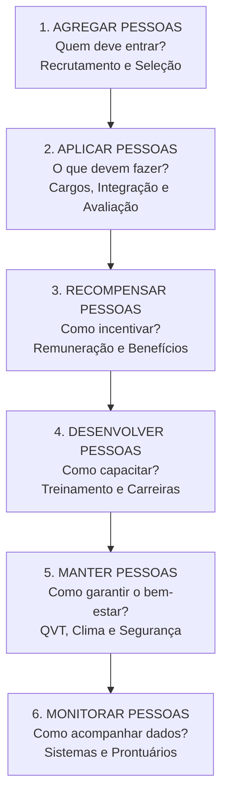
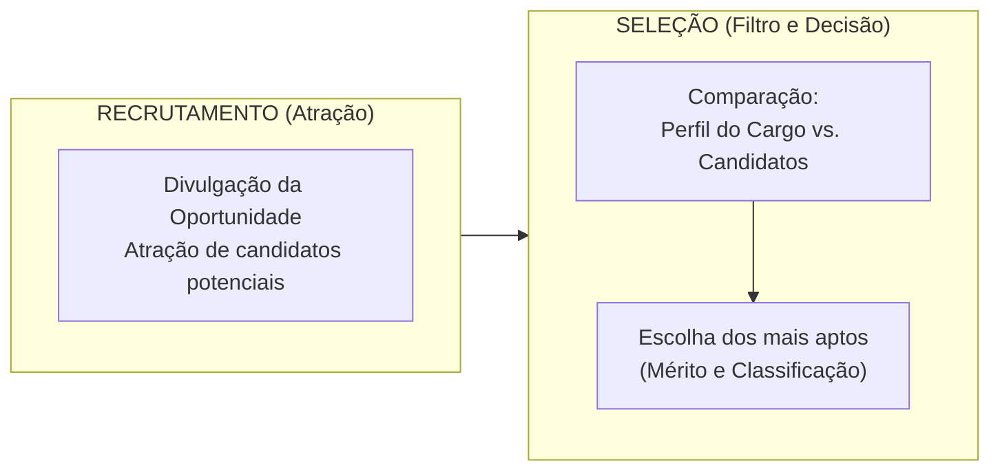
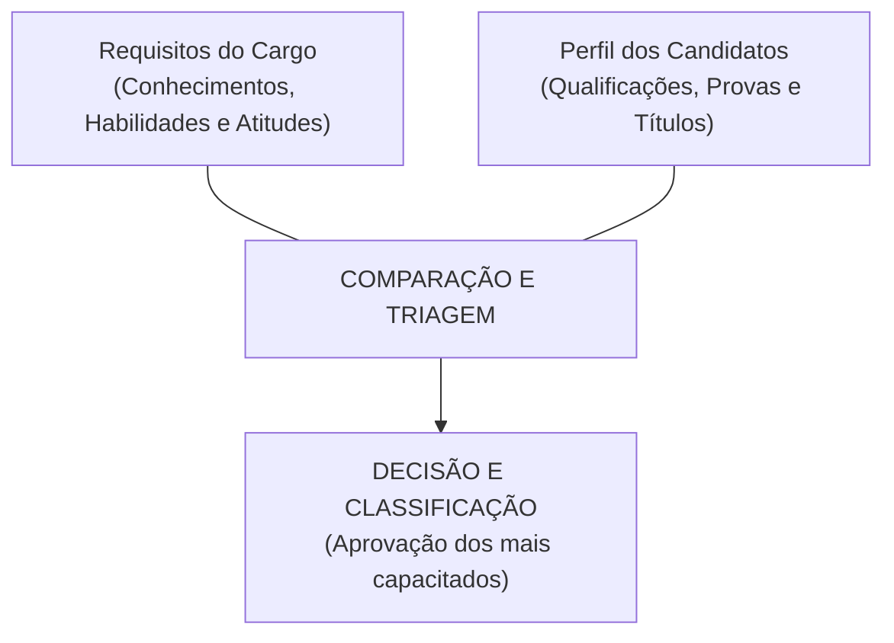
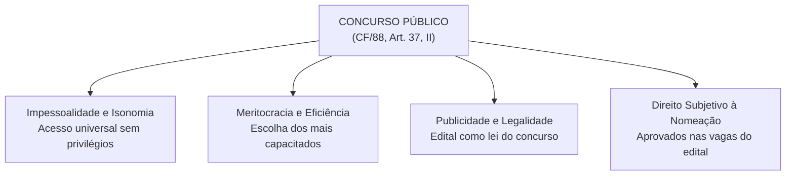
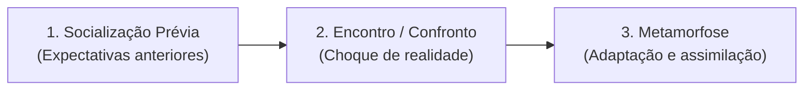

# 01 - Processos de Gestão de Pessoas, Recrutamento, Seleção e Integração

> **Matéria:** Gestão de Pessoas  
> **Cargo:** A01 – Técnico de Controle Externo – Especialidade: Técnico Administrativo (TCE-GO)  
> **Conteúdo Oficial:** Processos de Gestão de Pessoas (modelo de Chiavenato); Recrutamento e Seleção de Pessoas; Rotinas de Departamento Pessoal; O Concurso Público como Instrumento Republicano; Socialização e Integração Organizacional (*Onboarding*).

---

## 📌 Ementa & Delimitação do Conteúdo

1. **Evolução Histórica dos Paradigmas de Pessoas:**
    - Fase Contábil / Departamento Pessoal: foco estritamente legal, registro de ponto, apuração de folha de pagamento e custos operacionais; pessoas tratadas como engrenagens mecânicas e mão de obra passiva.
    - Fase Legal / Relações Industriais: impacto da legislação trabalhista e relações sindicais; conciliação de conflitos corporativos.
    - Fase Clássica / Administração de Recursos Humanos (ARH): pessoas vistas como insumos e recursos produtivos homogêneos sujeitos a comando e controle.
    - Fase Estratégica / Gestão Estratégica de Pessoas (GEP): pessoas como parceiras ativas do negócio, sujeitos dotados de competências, inteligência, iniciativa e capital intelectual indispensável para a entrega de valor público.

2. **Os Seis Processos da Gestão de Pessoas (Modelo de Idalberto Chiavenato):**
    - **Agregar Pessoas:** quem deve trabalhar na organização (recrutamento, seleção e planejamento de RH).
    - **Aplicar Pessoas:** o que as pessoas farão na organização (desenho de cargos, análise funcional, orientação/socialização organizacional e avaliação de desempenho).
    - **Recompensar Pessoas:** como incentivar e motivar os colaboradores (vencimento, remuneração, benefícios e incentivos).
    - **Desenvolver Pessoas:** como capacitar e aprimorar competências (treinamento, desenvolvimento funcional, aprendizagem organizacional e planos de carreira).
    - **Manter Pessoas:** como criar condições ambientais e psicológicas de permanência (clima organizacional, cultura, higiene, segurança e qualidade de vida no trabalho - QVT).
    - **Monitorar Pessoas:** como acompanhar e controlar as atividades e informações de pessoal (banco de dados, sistemas de informação gerencial de RH e auditoria de pessoal).

3. **Rotinas Administrativas do Departamento de Pessoal no Setor Público:**
    - Admissão, posse e exercício funcional; controle de assiduidade e pontualidade; processamento de folha de pagamento (vencimento básico, adicionais, gratificações e limites do teto constitucional); escala e concessão de férias; assentamentos individuais e prontuário funcional.

4. **O Processo de Agregar Pessoas — Recrutamento e Seleção:**
    - Recrutamento: mercado de trabalho vs. mercado de recursos humanos; técnicas de atração.
    - Recrutamento Interno vs. Recrutamento Externo vs. Recrutamento Misto: conceitos, vantagens e desvantagens de cada modalidade (destaque para a *endogamia cultural* no interno e os custos/tempo no externo).
    - Seleção de Pessoas como processo de comparação e decisão: requisitos do cargo (perfil de competências) vs. qualificações do candidato.
    - Técnicas e instrumentos de seleção: provas de conhecimentos e habilidades, entrevistas estruturadas e comportamentais por competências (técnica STAR), testes de aptidão e personalidade, dinâmicas de grupo e avaliação de títulos.
    - O Concurso Público (CF/88, art. 37, II): regime constitucional, princípios da impessoalidade, publicidade, isonomia e meritocracia; validade, prorrogação e direito subjetivo à nomeação dos aprovados no número de vagas.

5. **Processo de Socialização e Integração Organizacional (*Onboarding*):**
    - Conceito, relevância para a administração pública e aceleração do período de estágio probatório.
    - As três fases da socialização organizacional (Socialização Antecipatória, Encontro/Confronto e Metamorfose/Adaptação).
    - Práticas de integração: manuais do servidor, programas de boas-vindas, tutoria/mentoria institucional e cursos de formação da Escola de Contas.

---

## 🧭 Sumário

1. [Evolução Histórica dos Paradigmas de Gestão de Pessoas](#1-evolucao-historica-dos-paradigmas-de-gestao-de-pessoas)
2. [Os Seis Processos da Gestão de Pessoas (Chiavenato)](#2-os-seis-processos-da-gestao-de-pessoas-chiavenato)
    1. [Teste 430](#Teste-430)
    2. [Teste 431](#Teste-431)
3. [Rotinas Administrativas do Departamento de Pessoal no Setor Público](#3-rotinas-administrativas-do-departamento-de-pessoal-no-setor-publico)
4. [O Processo de Agregar Pessoas: Recrutamento e Seleção](#4-o-processo-de-agregar-pessoas-recrutamento-e-selecao)
    1. [Teste 432](#Teste-432)
    2. [Teste 433](#Teste-433)
    3. [Teste 434](#Teste-434)
5. [O Concurso Público como Instrumento Republicano (CF/88, art. 37)](#5-o-concurso-publico-como-instrumento-republicano-cf88-art-37)
    1. [Teste 435](#Teste-435)
    2. [Teste 436](#Teste-436)
6. [Processo de Socialização e Integração Organizacional (*Onboarding*)](#6-processo-de-socializacao-e-integracao-organizacional-onboarding)
    1. [Teste 437](#Teste-437)
    2. [Teste 438](#Teste-438)
    3. [Teste 439](#Teste-439)
7. [Fontes Oficiais e Referências Bibliográficas](#7-fontes-oficiais-e-referencias-bibliograficas)

---

## 1. Evolução Histórica dos Paradigmas de Gestão de Pessoas

A administração do trabalho humano passou por profundas transformações ao longo dos séculos XX e XXI, transitando de uma visão puramente mecanicista e punitiva para uma abordagem estratégica voltada ao desenvolvimento de competências.

#### Comparativo Histórico: As Quatro Eras

| Característica | Departamento Pessoal (Fase Contábil) | Relações Industriais (Fase Legal) | Recursos Humanos (Fase Clássica) | Gestão Estratégica de Pessoas (Atual) |
| :--- | :--- | :--- | :--- | :--- |
| **Período Predominante** | Início do século XX (Teoria Clássica / Taylorismo). | Décadas de 1930 a 1950 (Pós-Revolução de 30 / CLT). | Décadas de 1960 a 1980 (Abordagem Sistêmica / Contingencial). | Década de 1990 em diante (Era do Conhecimento). |
| **Concepção das Pessoas** | Engrenagens mecânicas, mão de obra braçal e geradoras de custo estrito. | Funcionários tutelados por normas estatais e sindicais. | Recursos produtivos padronizados a serem geridos e alocados. | **Parceiras estratégicas**, fontes de inteligência, competência e diferenciação. |
| **Foco de Atuação** | Registro mecânico de ponto, livros de registro e apuração de folha. | Cumprimento de leis trabalhistas, contratos coletivos e litígios. | Técnicas operacionais especializadas (cargos, salários, testes). | **Alinhamento com a estratégia**, geração de valor público e gestão do conhecimento. |
| **Papel da Liderança** | Fiscalização, vigilância e aplicação de punições regimentais. | Intermediação de acordos e gestão do cumprimento legal. | Supervisão hierárquica e controle burocrático de procedimentos. | Liderança coach, facilitação do desenvolvimento e delegação de autoridade (*empowerment*). |

#### Pessoas como Recursos vs. Pessoas como Parceiras (Idalberto Chiavenato)

* **Pessoas como Recursos:**
    * Tratadas como elementos passivos e estáticos de produção;
    * Devem ser rigidamente controladas, padronizadas e subordinadas à hierarquia;
    * Consideradas exclusivamente como centro de custos que consome verbas orçamentárias;
    * Foco na execução mecânica de tarefas predefinidas, sem incentivo à iniciativa própria.
* **Pessoas como Parceiras (Capital Intelectual):**
    * Tratadas como agentes proativos, autônomos e dotados de inteligência emocional e técnica;
    * Consideradas o ativo mais valioso e geradoras diretas de valor institucional;
    * Investimento prioritário da organização para a melhoria dos serviços públicos;
    * Estimuladas a inovar, assumir responsabilidade pelos resultados e compartilhar conhecimento.

---

---

## 2. Os Seis Processos da Gestão de Pessoas (Chiavenato)

Idalberto Chiavenato estrutura a gestão de pessoas como um sistema integrado composto por seis grandes macroprocessos dinâmicos e interdependentes:

| Macroprocesso | Questão Central | Ações, Ferramentas e Subsistemas Compreendidos |
| :--- | :--- | :--- |
| **1. Agregar Pessoas** | *Quem deve ingressar na organização?* | Planejamento de recursos humanos, recrutamento (interno/externo), seleção de pessoas e concurso público. |
| **2. Aplicar Pessoas** | *O que as pessoas farão na organização?* | Desenho organizacional de cargos, descrição e análise de funções, **socialização organizacional (integração)** e **avaliação de desempenho funcional**. |
| **3. Recompensar Pessoas** | *Como remunerar e incentivar o trabalho?* | Remuneração direta (vencimento básico), remuneração indireta, gratificações, adicionais pecuniários e benefícios sociais. |
| **4. Desenvolver Pessoas** | *Como capacitar e expandir o potencial?* | Diagnóstico de necessidades de treinamento (LNT), programas de capacitação, desenvolvimento gerencial, gestão do conhecimento e planos de carreira. |
| **5. Manter Pessoas** | *Como reter os servidores e assegurar bem-estar?* | Clima e cultura organizacional, programas de Qualidade de Vida no Trabalho (QVT), higiene, ergonomia, medicina do trabalho e relações sindicais. |
| **6. Monitorar Pessoas** | *Como registrar e acompanhar as informações?* | Bancos de dados funcionais, prontuários do servidor, sistemas integrados de gestão de RH (SIRH) e auditoria de pessoal. |

> 🚨 **ALERTA DE PROVA / PEGADINHA FCC (MACROPROCESSOS DE CHIAVENATO):**  
> A Fundação Carlos Chagas cobra com frequência pegadinhas sobre a alocação de subsistemas nesse modelo:  
>
> 1. A **Avaliação de Desempenho** pertence ao macroprocesso de **APLICAR PESSOAS** (e NÃO a "Monitorar pessoas" nem a "Desenvolver pessoas"). Aplicar significa verificar o que as pessoas fazem e como estão desempenhando suas atribuições.  
> 2. A **Integração / Socialização Organizacional** também integra os processos de **APLICAR PESSOAS**, pois orienta o servidor sobre como exercer seu cargo e agir dentro da instituição.  
> 3. O macroprocesso de **Monitorar Pessoas** restringe-se a cadastros, bancos de dados, relatórios gerenciais e auditoria de regularidade funcional.

---

### Teste 430
**(FGV – TCE-PA – Auditor de Controle Externo Administrativa Administracao – 2024)**
A qualidade de vida no trabalho (QVT) refere-se ao bem-estar geral dos colaboradores no ambiente organizacional. Isso inclui fatores como condições físicas de trabalho, equilíbrio entre vida pessoal e profissional, reconhecimento, oportunidades de desenvolvimento, e um ambiente de trabalho seguro e saudável. Com relação à QVT, avalie as afirmativas a seguir. I. Concilia duas posições opostas: as demandas dos colaboradores por bem-estar e satisfação e o interesse das organizações nos efeitos positivos sobre a produtividade e a qualidade. II. Representa um intenso movimento em direção ao profundo respeito pelo bem-estar das pessoas do ponto de vista biológico, psicológico e social. III. Almeja uma visão fragmentada do ser humano em seu relacionamento com as organizações. Está correto o que se afirma em

* **A)** I, apenas.
* **B)** I e II, apenas.
* **C)** I e III, apenas.
* **D)** II e III, apenas.
* **E)** I, II e III.

---

> **Comentário Detalhado:**
>
> - **A)** **Incorreta.** A opção incorre em restrição indevida ao limitar o escopo conceitual ao afirmar que "I, apenas". De acordo com a teoria estudada em *1. Evolução Histórica dos Paradigmas de Gestão de Pessoas*, a administração do trabalho humano passou por profundas transformações ao longo dos séculos XX e XXI, transitando de uma visão puramente mecanicista e punitiva para uma abordagem estratégica voltada ao desenvolvimento de competências.
> - **B)** **Correta.** Conforme fundamentado na seção *2. Os Seis Processos da Gestão de Pessoas (Chiavenato)* deste guia, 5. Manter Pessoas: *Como reter os servidores e assegurar bem-estar?* — Clima e cultura organizacional, programas de Qualidade de Vida no Trabalho (QVT), higiene, ergonomia, medicina do trabalho e relações sindicais. Dessa forma, está plenamente correta a assertiva da banca (FGV – TCE-PA/2024) ao estabelecer que "I e II, apenas".
> - **C)** **Incorreta.** A opção incorre em restrição indevida ao limitar o escopo conceitual ao afirmar que "I e III, apenas". De acordo com a teoria estudada em *5. O Concurso Público como Instrumento Republicano (CF/88, art. 37)*, prazo de Validade (Art. 37, III): Até dois anos, prorrogável uma vez por igual período (critério de discricionariedade da administração, dentro do período inicial).
> - **D)** **Incorreta.** A opção incorre em restrição indevida ao limitar o escopo conceitual ao afirmar que "II e III, apenas". De acordo com a teoria estudada em *5. O Concurso Público como Instrumento Republicano (CF/88, art. 37)*, além disso, o art. 37, III da CF/88 estabelece que o concurso terá validade de até 2 anos, prorrogável uma vez por igual período.
> - **E)** **Incorreta.** A opção apresenta proposição em desacordo com os fundamentos teóricos e técnicos do tópico ao afirmar que "I, II e III". De acordo com a teoria estudada em *4. O Processo de Agregar Pessoas: Recrutamento e Seleção*, o processo de agregar pessoas inicia-se com o diagnóstico de necessidades de pessoal e desdobra-se em duas etapas interdependentes: o recrutamento (atração) e a seleção (escolha).
>
> **Gabarito: B**

---

### Teste 431
**(FGV – TCE-PA – Auditor de Controle Externo Administrativa Administracao – 2024)**
A gestão estratégica de pessoas é um enfoque que alinha as práticas de gestão de recursos humanos aos objetivos organizacionais. Essa abordagem integra planejamento de carreira, treinamento e desenvolvimento, avaliação de desempenho e recompensas, promovendo um ambiente de trabalho motivador e produtivo. Com relação à gestão estratégica de pessoas, avalie as afirmativas a seguir. I. A gestão estratégica de pessoas integra-se à estratégia organizacional, atendendo a objetivos estratégicos, táticos e operacionais, todos devidamente interconectados. II. Não é necessário ter uma clara ideia do impacto do mercado e do ambiente externo em que a empresa está envolvida; a organização pode focar apenas em seus processos internos sem considerar essas variáveis para a gestão estratégica de pessoas. III. A avaliação do desempenho e dos resultados é a etapa de feedback constante e ágil para medição do que foi planejado e realizado. Está correto o que se afirma em

* **A)** I, apenas.
* **B)** I e II, apenas.
* **C)** I e III, apenas.
* **D)** II e III, apenas.
* **E)** I, II e III.

---

> **Comentário Detalhado:**
>
> - **A)** **Incorreta.** A opção incorre em restrição indevida ao limitar o escopo conceitual ao afirmar que "I, apenas". De acordo com a teoria estudada em *2. Os Seis Processos da Gestão de Pessoas (Chiavenato)*, 2. Aplicar Pessoas: *O que as pessoas farão na organização?* — Desenho organizacional de cargos, descrição e análise de funções, socialização organizacional (integração) e avaliação de desempenho funcional.
> - **B)** **Incorreta.** A opção incorre em restrição indevida ao limitar o escopo conceitual ao afirmar que "I e II, apenas". De acordo com a teoria estudada em *2. Os Seis Processos da Gestão de Pessoas (Chiavenato)*, 4. Desenvolver Pessoas: *Como capacitar e expandir o potencial?* — Diagnóstico de necessidades de treinamento (LNT), programas de capacitação, desenvolvimento gerencial, gestão do conhecimento e planos de carreira.
> - **C)** **Correta.** Conforme fundamentado na seção *2. Os Seis Processos da Gestão de Pessoas (Chiavenato)* deste guia, 1. Agregar Pessoas: *Quem deve ingressar na organização?* — Planejamento de recursos humanos, recrutamento (interno/externo), seleção de pessoas e concurso público. Dessa forma, está plenamente correta a assertiva da banca (FGV – TCE-PA/2024) ao estabelecer que "I e III, apenas".
> - **D)** **Incorreta.** A opção incorre em restrição indevida ao limitar o escopo conceitual ao afirmar que "II e III, apenas". De acordo com a teoria estudada em *1. Evolução Histórica dos Paradigmas de Gestão de Pessoas*, a administração do trabalho humano passou por profundas transformações ao longo dos séculos XX e XXI, transitando de uma visão puramente mecanicista e punitiva para uma abordagem estratégica voltada ao desenvolvimento de competências.
> - **E)** **Incorreta.** A opção apresenta proposição em desacordo com os fundamentos teóricos e técnicos do tópico ao afirmar que "I, II e III". De acordo com a teoria estudada em *Recrutamento Interno vs. Recrutamento Externo vs. Recrutamento Misto*, impacto na Motivação: Eleva a motivação interna e valoriza a carreira funcional. — Pode desmotivar servidores internos que almejavam a oportunidade. — Equilibra estímulo interno e ampliação de horizontes.
>
> **Gabarito: C**

---

## 3. Rotinas Administrativas do Departamento de Pessoal no Setor Público

Mesmo sob uma ótica estratégica, as rotinas operacionais de pessoal são indispensáveis para garantir a estrita legalidade e conformidade dos atos de gestão pública:

1. **Admissão e Investidura:**
    - Conferência de documentos pessoais e habilitação legal;
    - Realização de perícia médica oficial e aferição de aptidão física/mental;
    - Lavratura do termo de posse pela autoridade competente e registro do início do efetivo exercício.

2. **Controle de Frequência e Assiduidade:**
    - Acompanhamento do registro biométrico ou eletrônico de ponto;
    - Gestão de escalas de trabalho, compensações e banco de horas autorizadas;
    - Processamento de justificativas legais, faltas abonadas e desconto em folha decorrente de ausências não justificadas.

3. **Elaboração e Processamento da Folha de Pagamento:**
    - Apuração do vencimento básico atribuído ao cargo e padrão da carreira;
    - Lançamento de vantagens funcionais (quinquênios, gratificações de desempenho, adicionais de titulação, auxílio-alimentação e transporte);
    - Cálculo e retenção de descontos obrigatórios (Previdência Própria / Regime Geral e Imposto de Renda Retido na Fonte - IRRF);
    - Gestão de consignações facultativas em folha (empréstimos consignados, planos de saúde, mensalidades sindicais);
    - Aplicação e corte de remunerações que excedam o **teto remuneratório constitucional** (CF/88, art. 37, XI).

4. **Escala e Concessão de Férias:**
    - Controle do período aquisitivo (12 meses de efetivo exercício) e período concessivo;
    - Elaboração da escala anual de férias para evitar descontinuidade do serviço público;
    - Pagamento obrigatório do terço constitucional de férias.

5. **Assentamentos Individuais e Prontuário Funcional:**
    - Registro histórico de toda a vida funcional do servidor (designações, licenças, afastamentos, progressões, penalidades e elogios);
    - Averbação de tempo de contribuição prévio para fins de aposentadoria e disponibilidade.

---

---

## 4. O Processo de Agregar Pessoas: Recrutamento e Seleção

O processo de agregar pessoas inicia-se com o diagnóstico de necessidades de pessoal e desdobra-se em duas etapas interdependentes: o recrutamento (atração) e a seleção (escolha).

#### Recrutamento Interno vs. Recrutamento Externo vs. Recrutamento Misto

| Critério de Análise | Recrutamento Interno | Recrutamento Externo | Recrutamento Misto |
| :--- | :--- | :--- | :--- |
| **Origem dos Candidatos** | Colaboradores que já integram a instituição (promoções, relotações). | Candidatos externos disponíveis no mercado ou em outros órgãos. | Combina candidatos internos e externos na mesma disputa. |
| **Custo Financeiro** | **Muito baixo:** dispensa editais complexos e publicidade massiva. | **Elevado:** publicação de editais, contratação de bancas examinadoras. | Custo intermediário ou alto. |
| **Tempo de Execução** | **Rápido:** os colaboradores já são conhecidos e estão cadastrados. | **Lento e moroso:** prazos de inscrição, recursos e homologação. | Médio a longo. |
| **Impacto na Motivação** | Eleva a motivação interna e valoriza a carreira funcional. | Pode desmotivar servidores internos que almejavam a oportunidade. | Equilibra estímulo interno e ampliação de horizontes. |
| **Inovação Cultural** | **Risco de Endogamia Cultural (*Inbreeding*):** cristaliza velhos hábitos e rotinas. | **Renovação (*Sangue Novo*):** agrega novos saberes e rompe paradigmas. | Permite conciliar estabilidade institucional e inovação. |
| **Aplicação no Setor Público** | Restrito a funções de confiança e cargos em comissão privativos de efetivos. | **Regra Geral Constitucional:** Concurso Público de Provas ou Provas e Títulos. | Seleções internas prévias seguidas de concurso se deserto o quadro. |

> ⭐ **IMPORTANTE — CONCEITO DE ENDOGAMIA CULTURAL:**  
> A FCC adora cobrar o fenômeno da **endogamia organizacional** (ou cultural). Trata-se da tendência de um órgão ou empresa, ao recrutar exclusivamente membros de seus próprios quadros internos, de perpetuar os mesmos padrões de pensamento, cristalizar defeitos e inibir o surgimento de ideias inovadoras. O recrutamento externo atua justamente como antídoto à endogamia.

---

### Teste 432
**(FGV – TJ-SC – Analista Administrativo – 2026)**
A Gestão da Qualidade, ao analisar percepções equivocadas ou parciais sobre o tema observadas no cotidiano organizacional, costuma reconvertê-las em ações estratégicas, transformando cada limitação em ponto de partida para uma intervenção orientada à produção da qualidade. Relacione as posições consagradas sobre qualidade às respectivas ações estratégicas que a Gestão da Qualidade pode desenvolver a partir delas. Posição sobre Ação estratégica qualidade 1. A qualidade é um aspecto subjetivo. ( ) Priorizar processos produtivos mais confiáveis. 2. A qualidade identifica-se com capacidade de fabricação. ( ) Ampliar o número de clientes, cujas preferências passariam a ser atendidas por essas novas alternativas de produtos ou de itens que os compõem. 3. A qualidade envolve a diversidade de opções que um produto ou serviço pode oferecer a seus clientes. ( ) Investir em melhorias do processo produtivo que evitem o aparecimento de quaisquer defeitos e falhas. 4. A qualidade é considerada como a falta de defeitos no produto ou no serviço prestado. ( ) Desenvolver processos em que o cliente interfira na produção de bens ou serviços da empresa, tornando-os mais adequados às suas necessidades, preferências ou conveniências. Assinale a opção que indica a relação correta, na ordem apresentada.

* **A)** 1 – 3 – 4 – 2.
* **B)** 2 – 3 – 4 – 1.
* **C)** 2 – 4 – 3 – 1.
* **D)** 4 – 1 – 2 – 3.
* **E)** 3 – 2 – 1 – 4.

---

> **Comentário Detalhado:**
>
> - **A)** **Incorreta.** A opção apresenta proposição em desacordo com os fundamentos teóricos e técnicos do tópico ao afirmar que "1 – 3 – 4 – 2". De acordo com a teoria estudada em *2. Os Seis Processos da Gestão de Pessoas (Chiavenato)*, 4. Desenvolver Pessoas: *Como capacitar e expandir o potencial?* — Diagnóstico de necessidades de treinamento (LNT), programas de capacitação, desenvolvimento gerencial, gestão do conhecimento e planos de carreira.
> - **B)** **Incorreta.** A opção apresenta proposição em desacordo com os fundamentos teóricos e técnicos do tópico ao afirmar que "2 – 3 – 4 – 1". De acordo com a teoria estudada em *Recrutamento Interno vs. Recrutamento Externo vs. Recrutamento Misto*, trata-se da tendência de um órgão ou empresa, ao recrutar exclusivamente membros de seus próprios quadros internos, de perpetuar os mesmos padrões de pensamento, cristalizar defeitos e inibir o surgimento de ideias inovadoras.
> - **C)** **Correta.** Conforme fundamentado na seção *5. O Concurso Público como Instrumento Republicano (CF/88, art. 37)* deste guia, direito Subjetivo à Nomeação (Jurisprudência Vinculante do STF - Tema 161 / RE 598.099): O candidato aprovado dentro do número de vagas previsto originariamente no edital do concurso público possui direito público subjetivo à nomeação durante o prazo de validade do certame. Dessa forma, está plenamente correta a assertiva da banca (FGV – TJ-SC/2026) ao estabelecer que "2 – 4 – 3 – 1".
> - **D)** **Incorreta.** A opção apresenta proposição em desacordo com os fundamentos teóricos e técnicos do tópico ao afirmar que "4 – 1 – 2 – 3". De acordo com a teoria estudada em *2. Os Seis Processos da Gestão de Pessoas (Chiavenato)*, 5. Manter Pessoas: *Como reter os servidores e assegurar bem-estar?* — Clima e cultura organizacional, programas de Qualidade de Vida no Trabalho (QVT), higiene, ergonomia, medicina do trabalho e relações sindicais.
> - **E)** **Incorreta.** A opção apresenta proposição em desacordo com os fundamentos teóricos e técnicos do tópico ao afirmar que "3 – 2 – 1 – 4". De acordo com a teoria estudada em *Comparativo Histórico: As Quatro Eras*, concepção das Pessoas: Engrenagens mecânicas, mão de obra braçal e geradoras de custo estrito. — Funcionários tutelados por normas estatais e sindicais. — Recursos produtivos padronizados a serem geridos e alocados. — Parceiras estratégicas, fontes de inteligência, competência e diferenciação.
>
> **Gabarito: C**

---

#### Seleção de Pessoas: O Modelo de Comparação e Decisão

Enquanto o recrutamento visa atrair o maior número possível de candidatos qualificados (processo positivo), a **seleção de pessoas é um processo de triagem, restrição e escolha (processo negativo ou de afunilamento)**.

* **A Seleção como Comparação:** confronta os requisitos exigidos pelo cargo (*Job Description* / perfil de competências) com o perfil de competências oferecido pelos candidatos (*Job Profile*).
* **A Seleção como Decisão:** escolha técnica fundamentada em critérios objetivos para preenchimento da vaga.

#### Técnicas de Seleção de Pessoas

1. **Provas de Conhecimentos ou de Capacidade:**
    - Avaliam o nível de conhecimento teórico e prático exigido para a função;
    - Podem ser objetivas (múltipla escolha, verdadeiro/falso) ou discursivas (estudo de caso, redação técnica);
    - Constituem o núcleo central do concurso público brasileiro.

2. **Entrevistas de Seleção:**
    - **Não estruturadas:** livres, sem roteiro prévio (baixa confiabilidade);
    - **Estruturadas / Padronizadas:** roteiro rígido de perguntas iguais para todos os candidatos (alta comparabilidade);
    - **Entrevista Comportamental com Foco em Competências (Técnica STAR):** busca evidências de comportamentos passados para prever desempenhos futuros:
    - **S** (*Situação*): contexto fático enfrentado pelo candidato;
    - **T** (*Tarefa*): responsabilidade ou desafio que cabia a ele resolver;
    - **A** (*Ação*): atitudes e procedimentos concretos adotados pelo profissional;
    - **R** (*Resultado*): impactos qualitativos e quantitativos alcançados.

3. **Testes Psicológicos e de Aptidão:**
    - **Testes Psicométricos:** mensuram aptidões intelectuais, raciocínio lógico, atenção concentrada e memória;
    - **Testes de Personalidade:** avaliam traços de caráter, temperamento, equilíbrio emocional e maturidade (ex.: testes projetivos e expressivos, devidamente validados pelo Conselho Federal de Psicologia).

4. **Técnicas Vivenciais / Dinâmicas de Grupo:**
    - Simulação de situações reais de trabalho, dramatizações (*role-playing*) e jogos de negócios para observar liderança, trabalho em equipe e comunicação interpessoal.

5. **Avaliação de Títulos:**
    - Pontuação objetiva de títulos acadêmicos (especialização, mestrado, doutorado) e experiência profissional prévia. *No setor público, a avaliação de títulos tem caráter estritamente classificatório, nunca eliminatório (CF/88, art. 37, II).*

---

### Teste 433
**(FGV – TCE-PA – Auditor de Controle Externo Administrativa Contabilidade – 2024)**
Com relação à gestão de custos no setor público, avalie se as afirmativas a seguir são verdadeiras (V) ou falsas (F). ( ) A gestão de custos no setor público é voltada à administração dos insumos, com ênfase na melhoria da alocação dos recursos e à identificação e mensuração das entregas, com ênfase na avaliação de desempenho. ( ) A informação de custos deve ser útil para subsidiar a avaliação das políticas públicas, apresentando os resultados alcançados, consubstanciados em relatórios contendo seus indicadores de desempenho. ( ) Os gestores operacionais são os responsáveis por prover efetivo apoio à geração da informação de custos, além de responsabilizar os funcionários do departamento de custos pela qualidade dos dados e pelo uso das informações nos processos decisórios. De acordo com a NBC TSP 34 – Custos no Setor Público, as afirmativas são, respectivamente,

* **A)** V – V – F.
* **B)** V – F – V.
* **C)** F – V – V.
* **D)** V – F – F.
* **E)** F – V – F.

---

> **Comentário Detalhado:**
>
> - **A)** **Correta.** Conforme fundamentado na seção *2. Os Seis Processos da Gestão de Pessoas (Chiavenato)* deste guia, 6. Monitorar Pessoas: *Como registrar e acompanhar as informações?* — Bancos de dados funcionais, prontuários do servidor, sistemas integrados de gestão de RH (SIRH) e auditoria de pessoal. Dessa forma, está plenamente correta a assertiva da banca (FGV – TCE-PA/2024) ao estabelecer que "V – V – F".
> - **B)** **Incorreta.** A opção apresenta proposição em desacordo com os fundamentos teóricos e técnicos do tópico ao afirmar que "V – F – V". De acordo com a teoria estudada em *2. Os Seis Processos da Gestão de Pessoas (Chiavenato)*, o macroprocesso de Monitorar Pessoas restringe-se a cadastros, bancos de dados, relatórios gerenciais e auditoria de regularidade funcional.
> - **C)** **Incorreta.** A opção apresenta proposição em desacordo com os fundamentos teóricos e técnicos do tópico ao afirmar que "F – V – V". De acordo com a teoria estudada em *2. Os Seis Processos da Gestão de Pessoas (Chiavenato)*, 2. Aplicar Pessoas: *O que as pessoas farão na organização?* — Desenho organizacional de cargos, descrição e análise de funções, socialização organizacional (integração) e avaliação de desempenho funcional.
> - **D)** **Incorreta.** A opção apresenta proposição em desacordo com os fundamentos teóricos e técnicos do tópico ao afirmar que "V – F – F". De acordo com a teoria estudada em *2. Os Seis Processos da Gestão de Pessoas (Chiavenato)*, a Avaliação de Desempenho pertence ao macroprocesso de APLICAR PESSOAS (e NÃO a "Monitorar pessoas" nem a "Desenvolver pessoas"). Aplicar significa verificar o que as pessoas fazem e como estão desempenhando suas atribuições.
> - **E)** **Incorreta.** A opção apresenta proposição em desacordo com os fundamentos teóricos e técnicos do tópico ao afirmar que "F – V – F". De acordo com a teoria estudada em *2. Os Seis Processos da Gestão de Pessoas (Chiavenato)*, 1. Agregar Pessoas: *Quem deve ingressar na organização?* — Planejamento de recursos humanos, recrutamento (interno/externo), seleção de pessoas e concurso público.
>
> **Gabarito: A**

---

### Teste 434
**(FCC – TCE-GO – Analista de Controle Externo Gestao de Conhecimento – 2009)**
A avaliação do custo-benefício de um título permutado com outra instituição ou biblioteca deve considerar, entre outras coisas, o equilíbrio de conteúdo das publicações, os custos reais da publicação da própria entidade, os custos de todos os serviços para abrigar o título recebido e

* **A)** o processamento do material comparado com o mesmo processamento se fosse adquirido por compra.
* **B)** o tempo necessário para recebimento do material comparado com o mesmo tempo se fosse adquirido por compra.
* **C)** o tempo necessário para realização dos contatos visando o estabelecimento da permuta.
* **D)** o aumento da carga de trabalho devido à ampliação do número de títulos permutados.
* **E)** a cultura da organização.

---

> **Comentário Detalhado:**
>
> - **A)** **Incorreta.** A opção apresenta proposição em desacordo com os fundamentos teóricos e técnicos do tópico ao afirmar que "o processamento do material comparado com o mesmo processamento se fosse adquirido por compra". De acordo com a teoria estudada em *3. Rotinas Administrativas do Departamento de Pessoal no Setor Público*, processamento de justificativas legais, faltas abonadas e desconto em folha decorrente de ausências não justificadas.
> - **B)** **Correta.** Conforme fundamentado na seção *Recrutamento Interno vs. Recrutamento Externo vs. Recrutamento Misto* deste guia, tempo de Execução: Rápido: os colaboradores já são conhecidos e estão cadastrados. — Lento e moroso: prazos de inscrição, recursos e homologação. — Médio a longo. Dessa forma, está plenamente correta a assertiva da banca (FCC – TCE-GO/2009) ao estabelecer que "o tempo necessário para recebimento do material comparado com o mesmo tempo se fosse adquirido por compra".
> - **C)** **Incorreta.** A opção apresenta proposição em desacordo com os fundamentos teóricos e técnicos do tópico ao afirmar que "o tempo necessário para realização dos contatos visando o estabelecimento da permuta". De acordo com a teoria estudada em *3. Rotinas Administrativas do Departamento de Pessoal no Setor Público*, realização de perícia médica oficial e aferição de aptidão física/mental.
> - **D)** **Incorreta.** A opção apresenta proposição em desacordo com os fundamentos teóricos e técnicos do tópico ao afirmar que "o aumento da carga de trabalho devido à ampliação do número de títulos permutados". De acordo com a teoria estudada em *Recrutamento Interno vs. Recrutamento Externo vs. Recrutamento Misto*, impacto na Motivação: Eleva a motivação interna e valoriza a carreira funcional. — Pode desmotivar servidores internos que almejavam a oportunidade. — Equilibra estímulo interno e ampliação de horizontes.
> - **E)** **Incorreta.** A opção apresenta proposição em desacordo com os fundamentos teóricos e técnicos do tópico ao afirmar que "a cultura da organização". De acordo com a teoria estudada em *Pessoas como Recursos vs. Pessoas como Parceiras (Idalberto Chiavenato)*, investimento prioritário da organização para a melhoria dos serviços públicos.
>
> **Gabarito: B**

---

## 5. O Concurso Público como Instrumento Republicano (CF/88, art. 37)

No Estado Democrático de Direito, o concurso público é a ferramenta primordial para democratizar o acesso aos cargos públicos e garantir um corpo funcional competente e impessoal.

* **Exigência Constitucional (Art. 37, II):** A investidura em cargo ou emprego público depende de aprovação prévia em concurso público de provas ou de provas e títulos, de acordo com a natureza e a complexidade do cargo ou emprego, na forma prevista em lei.
* **Exceções Constitucionais Expressas:**
    1. *Cargos em comissão declarados em lei de livre nomeação e exoneração* (destinados exclusivamente às atribuições de direção, chefia e assessoramento — art. 37, II e V);
    2. *Contratação por tempo determinado* para atender a necessidade temporária de excepcional interesse público (Processo Seletivo Simplificado - PSS, art. 37, IX);
    3. *Agentes Comunitários de Saúde e de Combate às Endemias* (processo seletivo público específico, art. 198, § 4º).

* **Prazo de Validade (Art. 37, III):** Até dois anos, prorrogável uma vez por igual período (critério de discricionariedade da administração, dentro do período inicial).
* **Direito Subjetivo à Nomeação (Jurisprudência Vinculante do STF - Tema 161 / RE 598.099):** O candidato aprovado dentro do número de vagas previsto originariamente no edital do concurso público possui **direito público subjetivo à nomeação** durante o prazo de validade do certame. A recusa da administração só é admitida em hipóteses excepcionalíssimas (superveniência, imprevisibilidade, gravidade extrema e necessidade inafastável).

> 🚨 **ALERTA DE PROVA / PEGADINHA FCC (PROVA DE TÍTULOS E VALIDADE):**  
> A banca adora questionar os **critérios de validade da prova de títulos**. Memorize: no concurso público, a fase de avaliação de títulos possui caráter **estritamente classificatório**, sendo terminantemente inconstitucional conferir-lhe caráter eliminatório!  
> Além disso, o art. 37, III da CF/88 estabelece que o concurso terá validade de **até 2 anos**, prorrogável uma vez por igual período. A prorrogação deve ser pelo **mesmo prazo** fixado no edital original (se o edital fixou 1 ano, prorroga-se por mais 1 ano; se fixou 6 meses, prorroga-se por 6 meses).

> ⭐ **IMPORTANTE — CONCURSO PÚBLICO E CARGOS COMISSIONADOS:**  
> A investidura mediante concurso é a regra para **cargos de provimento efetivo** e empregos públicos. Funções de confiança e cargos comissionados dispensam concurso público formal, mas as funções de confiança são reservadas **exclusivamente a servidores ocupantes de cargo efetivo**, enquanto os cargos em comissão possuem um percentual mínimo legal reservado a servidores de carreira (CF/88, art. 37, V).

---

### Teste 435
**(FGV – TCE-PI – Auditor de Controle Externo Controle Externo Especifica de Area Comum – 2025)**
Nos últimos anos, a administração pública brasileira tem dado cada vez mais atenção à gestão da integridade. Programas de integridade, que abrangem ações preventivas e corretivas contra fraudes e corrupção, são fundamentais para promover a confiança pública e criar um ambiente favorável ao desenvolvimento econômico. Assinale a opção que descreve a função suporte da alta administração nos programas de integridade.

* **A)** Desenvolver mecanismos de controle para gerenciar os riscos internos e externos da organização.
* **B)** Promover a adesão dos colaboradores a um código de conduta específico para prevenir fraudes e corrupção.
* **C)** Realizar auditorias independentes para detectar violações e garantir a conformidade com as políticas da organização.
* **D)** Dar aval explícito e apoio incondicional como exemplo a ser seguido, reforçando o compromisso de transformar a cultura da organização.
* **E)** Monitorar continuamente as operações da organização, garantindo a adaptação dos instrumentos e estruturas às novas demandas. Legislação Aplicável ao Tribunal de Contas do Estado do Piauí

---

> **Comentário Detalhado:**
>
> - **A)** **Correta.** Conforme fundamentado na seção *Recrutamento Interno vs. Recrutamento Externo vs. Recrutamento Misto* deste guia, origem dos Candidatos: Colaboradores que já integram a instituição (promoções, relotações). — Candidatos externos disponíveis no mercado ou em outros órgãos. — Combina candidatos internos e externos na mesma disputa. Dessa forma, está plenamente correta a assertiva da banca (FGV – TCE-PI/2025) ao estabelecer que "Desenvolver mecanismos de controle para gerenciar os riscos internos e externos da organização".
> - **B)** **Incorreta.** A opção apresenta proposição em desacordo com os fundamentos teóricos e técnicos do tópico ao afirmar que "Promover a adesão dos colaboradores a um código de conduta específico para prevenir fraudes e corrupção". De acordo com a teoria estudada em *2. Os Seis Processos da Gestão de Pessoas (Chiavenato)*, 4. Desenvolver Pessoas: *Como capacitar e expandir o potencial?* — Diagnóstico de necessidades de treinamento (LNT), programas de capacitação, desenvolvimento gerencial, gestão do conhecimento e planos de carreira.
> - **C)** **Incorreta.** A opção apresenta proposição em desacordo com os fundamentos teóricos e técnicos do tópico ao afirmar que "Realizar auditorias independentes para detectar violações e garantir a conformidade com as políticas da organização". De acordo com a teoria estudada em *3. Rotinas Administrativas do Departamento de Pessoal no Setor Público*, mesmo sob uma ótica estratégica, as rotinas operacionais de pessoal são indispensáveis para garantir a estrita legalidade e conformidade dos atos de gestão pública.
> - **D)** **Incorreta.** A opção apresenta proposição em desacordo com os fundamentos teóricos e técnicos do tópico ao afirmar que "Dar aval explícito e apoio incondicional como exemplo a ser seguido, reforçando o compromisso de transformar a...". De acordo com a teoria estudada em *2. Os Seis Processos da Gestão de Pessoas (Chiavenato)*, 5. Manter Pessoas: *Como reter os servidores e assegurar bem-estar?* — Clima e cultura organizacional, programas de Qualidade de Vida no Trabalho (QVT), higiene, ergonomia, medicina do trabalho e relações sindicais.
> - **E)** **Incorreta.** A opção apresenta proposição em desacordo com os fundamentos teóricos e técnicos do tópico ao afirmar que "Monitorar continuamente as operações da organização, garantindo a adaptação dos instrumentos e estruturas às novas...". De acordo com a teoria estudada em *2. Os Seis Processos da Gestão de Pessoas (Chiavenato)*, a Avaliação de Desempenho pertence ao macroprocesso de APLICAR PESSOAS (e NÃO a "Monitorar pessoas" nem a "Desenvolver pessoas"). Aplicar significa verificar o que as pessoas fazem e como estão desempenhando suas atribuições.
>
> **Gabarito: A**

---

### Teste 436
**(FGV – TJ-RR – Analista Judiciario Gestao e Governanca de Tecnologia da Informacao – 2024)**
Os princípios da gestão de qualidade incluem os seguintes, à exceção de um. Assinale-o.

* **A)** Liderança.
* **B)** Foco no cliente.
* **C)** Envolvimento das pessoas.
* **D)** Abordagem de processo.
* **E)** Inovação estratégica.

---

> **Comentário Detalhado:**
>
> - **A)** **Incorreta.** A opção apresenta proposição em desacordo com os fundamentos teóricos e técnicos do tópico ao afirmar que "Liderança". De acordo com a teoria estudada em *Comparativo Histórico: As Quatro Eras*, papel da Liderança: Fiscalização, vigilância e aplicação de punições regimentais. — Intermediação de acordos e gestão do cumprimento legal. — Supervisão hierárquica e controle burocrático de procedimentos. — Liderança coach, facilitação do desenvolvimento e delegação de autoridade (*empowerment*).
> - **B)** **Incorreta.** A opção apresenta proposição em desacordo com os fundamentos teóricos e técnicos do tópico ao afirmar que "Foco no cliente". De acordo com a teoria estudada em *3. Rotinas Administrativas do Departamento de Pessoal no Setor Público*, mesmo sob uma ótica estratégica, as rotinas operacionais de pessoal são indispensáveis para garantir a estrita legalidade e conformidade dos atos de gestão pública.
> - **C)** **Incorreta.** A opção apresenta proposição em desacordo com os fundamentos teóricos e técnicos do tópico ao afirmar que "Envolvimento das pessoas". De acordo com a teoria estudada em *Recrutamento Interno vs. Recrutamento Externo vs. Recrutamento Misto*, inovação Cultural: Risco de Endogamia Cultural (*Inbreeding*): cristaliza velhos hábitos e rotinas. — Renovação (*Sangue Novo*): agrega novos saberes e rompe paradigmas. — Permite conciliar estabilidade institucional e inovação.
> - **D)** **Incorreta.** A opção apresenta proposição em desacordo com os fundamentos teóricos e técnicos do tópico ao afirmar que "Abordagem de processo". De acordo com a teoria estudada em *Comparativo Histórico: As Quatro Eras*, período Predominante: Início do século XX (Teoria Clássica / Taylorismo). — Décadas de 1930 a 1950 (Pós-Revolução de 30 / CLT). — Décadas de 1960 a 1980 (Abordagem Sistêmica / Contingencial). — Década de 1990 em diante (Era do Conhecimento).
> - **E)** **Correta.** Conforme fundamentado na seção *1. Evolução Histórica dos Paradigmas de Gestão de Pessoas* deste guia, a administração do trabalho humano passou por profundas transformações ao longo dos séculos XX e XXI, transitando de uma visão puramente mecanicista e punitiva para uma abordagem estratégica voltada ao desenvolvimento de competências. Dessa forma, está plenamente correta a assertiva da banca (FGV – TJ-RR/2024) ao estabelecer que "Inovação estratégica".
>
> **Gabarito: E**

---

## 6. Processo de Socialização e Integração Organizacional (*Onboarding*)

A socialização organizacional é o processo formativo e cultural por meio do qual o novo servidor aprende os valores essenciais, regras informais, jargões, posturas e competências exigidas pelo órgão.

#### As Três Etapas da Socialização Organizacional (Stephen Robbins)

1. **Fase 1: Socialização Prévia (ou Antecipatória):**
    - Ocorre antes do ingresso formal do servidor na repartição;
    - O indivíduo traz consigo valores acadêmicos, crenças sociais e expectativas idealizadas a respeito da carreira e do órgão público.

2. **Fase 2: Encontro (ou Confronto):**
    - Ocorre no momento em que o servidor toma posse e entra em efetivo exercício;
    - Há um inevitável confronto entre suas expectativas prévias e a realidade concreta da repartição (rotinas burocráticas, sistemas informatizados, hierarquias);
    - Programas formais de acolhimento reduzem o risco de choque cultural traumático.

3. **Fase 3: Metamorfose (ou Adaptação Permanente):**
    - O novo servidor internaliza as normas, compreende a linguagem corporativa e ajusta seu comportamento aos padrões institucionais;
    - Desenvolve sensação de pertencimento, segurança psicológica e alinhamento com a missão do Tribunal de Contas.

---

### Teste 437
**(FGV – TJ-SC – Analista Administrativo – 2026)**
Na empresa ABC, a área tradicionalmente denominada "Recursos Humanos" passa por ampla reformulação, refletindo o novo contexto organizacional marcado por mudanças vertiginosas, dinâmicas exponenciais e pela confluência de fatores econômicos, tecnológicos, sociais, culturais, legais, políticos, demográficos e ecológicos. A Diretoria avalia a substituição da nomenclatura por termos que melhor expressem os novos espaços, configurações e propósitos assumidos pela área. Considerando as transformações contemporâneas que afetam a Gestão de Pessoas, assinale a opção que apresenta uma terminologia compatível com essa reformulação.

* **A)** Gestão do Capital Intelectual.
* **B)** Gestão de Suprimentos.
* **C)** Gestão Patrimonial.
* **D)** Gestão de Compliance.
* **E)** Gestão Tributária.

---

> **Comentário Detalhado:**
>
> - **A)** **Incorreta.** A opção apresenta proposição em desacordo com os fundamentos teóricos e técnicos do tópico ao afirmar que "Gestão do Capital Intelectual". De acordo com a teoria estudada em *Pessoas como Recursos vs. Pessoas como Parceiras (Idalberto Chiavenato)*, pessoas como Parceiras (Capital Intelectual).
> - **B)** **Correta.** Conforme fundamentado na seção *2. Os Seis Processos da Gestão de Pessoas (Chiavenato)* deste guia, 1. Agregar Pessoas: *Quem deve ingressar na organização?* — Planejamento de recursos humanos, recrutamento (interno/externo), seleção de pessoas e concurso público. Dessa forma, está plenamente correta a assertiva da banca (FGV – TJ-SC/2026) ao estabelecer que "Gestão de Suprimentos".
> - **C)** **Incorreta.** A opção apresenta proposição em desacordo com os fundamentos teóricos e técnicos do tópico ao afirmar que "Gestão Patrimonial". De acordo com a teoria estudada em *Práticas Institucionais de Socialização no Setor Público*, programa de Boas-Vindas e Ambientação: Acolhida institucional pelos gestores e pela área de Gestão de Pessoas no primeiro dia de trabalho.
> - **D)** **Incorreta.** A opção apresenta proposição em desacordo com os fundamentos teóricos e técnicos do tópico ao afirmar que "Gestão de Compliance". De acordo com a teoria estudada em *1. Evolução Histórica dos Paradigmas de Gestão de Pessoas*, a administração do trabalho humano passou por profundas transformações ao longo dos séculos XX e XXI, transitando de uma visão puramente mecanicista e punitiva para uma abordagem estratégica voltada ao desenvolvimento de competências.
> - **E)** **Incorreta.** A opção apresenta proposição em desacordo com os fundamentos teóricos e técnicos do tópico ao afirmar que "Gestão Tributária". De acordo com a teoria estudada em *2. Os Seis Processos da Gestão de Pessoas (Chiavenato)*, 3. Recompensar Pessoas: *Como remunerar e incentivar o trabalho?* — Remuneração direta (vencimento básico), remuneração indireta, gratificações, adicionais pecuniários e benefícios sociais.
>
> **Gabarito: B**

---

#### Práticas Institucionais de Socialização no Setor Público

* **Programa de Boas-Vindas e Ambientação:** Acolhida institucional pelos gestores e pela área de Gestão de Pessoas no primeiro dia de trabalho.
* **Manual de Integração do Servidor:** Guia contendo missão institucional, direitos e deveres, canais de ouvidoria, regras de conduta ética e estrutura organizacional.
* **Tutoria e Mentoria (*Buddy Program*):** Designação de um servidor experiente para acompanhar o novato nas rotinas diárias e sanar dúvidas operacionais.
* **Cursos de Formação Inicial:** Aulas e oficinas práticas promovidas pela Escola de Contas/Governo para instrumentalizar o servidor nos sistemas corporativos e procedimentos processuais de controle externo.

---

### Teste 438
**(FGV – TRT-24 – Analista Judiciario Area Administrativa Sem Especialidade – 2025)**
A Qualidade de Vida no Trabalho (QVT) no setor público visa promover um ambiente organizacional saudável, equilibrado e motivador, que valorize o servidor, melhore o desempenho institucional e fortaleça o compromisso com o serviço à sociedade. Assinale a opção que apresenta corretamente um fator-chave da QVT no setor público, relacionado à satisfação de clientes internos e externos.

* **A)** Compensação: associada à inovação, variedade e ritmo de trabalho.
* **B)** Moral: envolve bonificações, benefícios sociais e participação nos lucros.
* **C)** Organização do trabalho: relaciona-se à saúde ocupacional e à educação preventiva.
* **D)** Participação: refere-se à criatividade, à expressão pessoal e aos programas de capacitação.
* **E)** Comunicação: está ligada ao apoio psicossocial, à orientação técnica e ao gerenciamento pelo exemplo.

---

> **Comentário Detalhado:**
>
> - **A)** **Incorreta.** A opção apresenta proposição em desacordo com os fundamentos teóricos e técnicos do tópico ao afirmar que "Compensação: associada à inovação, variedade e ritmo de trabalho". De acordo com a teoria estudada em *2. Os Seis Processos da Gestão de Pessoas (Chiavenato)*, 4. Desenvolver Pessoas: *Como capacitar e expandir o potencial?* — Diagnóstico de necessidades de treinamento (LNT), programas de capacitação, desenvolvimento gerencial, gestão do conhecimento e planos de carreira.
> - **B)** **Incorreta.** A opção apresenta proposição em desacordo com os fundamentos teóricos e técnicos do tópico ao afirmar que "Moral: envolve bonificações, benefícios sociais e participação nos lucros". De acordo com a teoria estudada em *2. Os Seis Processos da Gestão de Pessoas (Chiavenato)*, 3. Recompensar Pessoas: *Como remunerar e incentivar o trabalho?* — Remuneração direta (vencimento básico), remuneração indireta, gratificações, adicionais pecuniários e benefícios sociais.
> - **C)** **Incorreta.** A opção apresenta proposição em desacordo com os fundamentos teóricos e técnicos do tópico ao afirmar que "Organização do trabalho: relaciona-se à saúde ocupacional e à educação preventiva". De acordo com a teoria estudada em *Práticas Institucionais de Socialização no Setor Público*, programa de Boas-Vindas e Ambientação: Acolhida institucional pelos gestores e pela área de Gestão de Pessoas no primeiro dia de trabalho.
> - **D)** **Correta.** Conforme fundamentado na seção *2. Os Seis Processos da Gestão de Pessoas (Chiavenato)* deste guia, 5. Manter Pessoas: *Como reter os servidores e assegurar bem-estar?* — Clima e cultura organizacional, programas de Qualidade de Vida no Trabalho (QVT), higiene, ergonomia, medicina do trabalho e relações sindicais. Dessa forma, está plenamente correta a assertiva da banca (FGV – TRT-24/2025) ao estabelecer que "Participação: refere-se à criatividade, à expressão pessoal e aos programas de capacitação".
> - **E)** **Incorreta.** A opção apresenta proposição em desacordo com os fundamentos teóricos e técnicos do tópico ao afirmar que "Comunicação: está ligada ao apoio psicossocial, à orientação técnica e ao gerenciamento pelo exemplo". De acordo com a teoria estudada em *Técnicas de Seleção de Pessoas*, simulação de situações reais de trabalho, dramatizações (*role-playing*) e jogos de negócios para observar liderança, trabalho em equipe e comunicação interpessoal.
>
> **Gabarito: D**

---

### Teste 439
**(FCC – TCE-GO – Analista de Controle Externo Gestao de Conhecimento – 2009)**
Nas atividades culturais realizadas no âmbito da biblioteca são utilizadas várias técnicas e instrumentos combinados. Na perspectiva da ação cultural, como proposta por José Teixeira Coelho Neto, essas atividades devem

* **A)** alavancar a produção cultural, em que os participantes são sujeitos do processo.
* **B)** ter princípio, meio e fim predeterminados, visando a realização de um produto.
* **C)** partir de um projeto da instituição e envolver os usuários como seus receptores.
* **D)** divertir o público e promover formas de lazer que incluam programas de leitura e de arte.
* **E)** facilitar o uso de instalações e meios ao desenvolvimento de eventos culturais.

---

> **Comentário Detalhado:**
>
> - **A)** **Correta.** Conforme fundamentado na seção *6. Processo de Socialização e Integração Organizacional (Onboarding)* deste guia, a socialização organizacional é o processo formativo e cultural por meio do qual o novo servidor aprende os valores essenciais, regras informais, jargões, posturas e competências exigidas pelo órgão. Dessa forma, está plenamente correta a assertiva da banca (FCC – TCE-GO/2009) ao estabelecer que "alavancar a produção cultural, em que os participantes são sujeitos do processo".
> - **B)** **Incorreta.** A opção apresenta proposição em desacordo com os fundamentos teóricos e técnicos do tópico ao afirmar que "ter princípio, meio e fim predeterminados, visando a realização de um produto". De acordo com a teoria estudada em *As Três Etapas da Socialização Organizacional (Stephen Robbins)*, programas formais de acolhimento reduzem o risco de choque cultural traumático.
> - **C)** **Incorreta.** A opção apresenta proposição em desacordo com os fundamentos teóricos e técnicos do tópico ao afirmar que "partir de um projeto da instituição e envolver os usuários como seus receptores". De acordo com a teoria estudada em *Pessoas como Recursos vs. Pessoas como Parceiras (Idalberto Chiavenato)*, tratadas como elementos passivos e estáticos de produção.
> - **D)** **Incorreta.** A opção apresenta proposição em desacordo com os fundamentos teóricos e técnicos do tópico ao afirmar que "divertir o público e promover formas de lazer que incluam programas de leitura e de arte". De acordo com a teoria estudada em *Recrutamento Interno vs. Recrutamento Externo vs. Recrutamento Misto*, inovação Cultural: Risco de Endogamia Cultural (*Inbreeding*): cristaliza velhos hábitos e rotinas. — Renovação (*Sangue Novo*): agrega novos saberes e rompe paradigmas. — Permite conciliar estabilidade institucional e inovação.
> - **E)** **Incorreta.** A opção apresenta proposição em desacordo com os fundamentos teóricos e técnicos do tópico ao afirmar que "facilitar o uso de instalações e meios ao desenvolvimento de eventos culturais". De acordo com a teoria estudada em *Recrutamento Interno vs. Recrutamento Externo vs. Recrutamento Misto*, a FCC adora cobrar o fenômeno da endogamia organizacional (ou cultural).
>
> **Gabarito: A**

---

## 7. Fontes Oficiais e Referências Bibliográficas

* [Constituição Federal de 1988 - Art. 37, II e IX (Concurso Público e Contratação)](https://www.planalto.gov.br/ccivil_03/constituicao/constituicao.htm#art37) - Requisito obrigatório de prévia aprovação em concurso público de provas ou de provas e títulos.
* [Lei Estadual nº 20.756/2020 - Título II (Do Provimento, Concurso e Posse)](https://legisla.casacivil.go.gov.br/pesquisa_legislacao/100979/lei-20756) - Regras estaduais sobre edital de concurso, prazos de validade, nomeação, posse e exercício dos servidores goianos.
* [Lei Estadual nº 15.122/2005 (Plano de Cargos e Carreira dos Servidores do TCE-GO)](https://legisla.casacivil.go.gov.br/pesquisa_legislacao/80023/lei-15122) - Atribuições, requisitos de ingresso e especialidades dos cargos efetivos do tribunal.
* [STF Súmula Vinculante 13 (Vedação ao Nepotismo no Provimento)](https://portal.stf.jus.br/jurisprudencia/sumarios/sumulavinculante.asp?seq=13) - Proíbe nomeação de cônjuge, companheiro ou parente até o terceiro grau para cargo em comissão ou função gratificada.
* [Decreto Federal nº 9.991/2019 (Política de Ingresso e Dimensionamento da Força de Trabalho)](https://www.planalto.gov.br/ccivil_03/_ato2019-2022/2019/decreto/d9991.htm) - Metodologia de planejamento da força de trabalho e competências necessárias no setor público.
* CHIAVENATO, Idalberto. **Gestão de Pessoas: O Novo Papel dos Recursos Humanos nas Organizações**. 5. ed. São Paulo: Atlas, 2020. (Cap. 4 - Recrutamento de Pessoas; Cap. 5 - Seleção de Pessoas; Cap. 6 - Socialização Organizacional).
* MARRAS, Jean Pierre. **Administração de Recursos Humanos: Do Operacional ao Estratégico**. 15. ed. São Paulo: Saraiva, 2016. (Cap. 3 - Recrutamento e Seleção de Pessoal).
* MEIRELLES, Hely Lopes. **Direito Administrativo Brasileiro**. 44. ed. São Paulo: Malheiros, 2020. (Cap. 8 - Servidores Públicos e Concurso Público).
