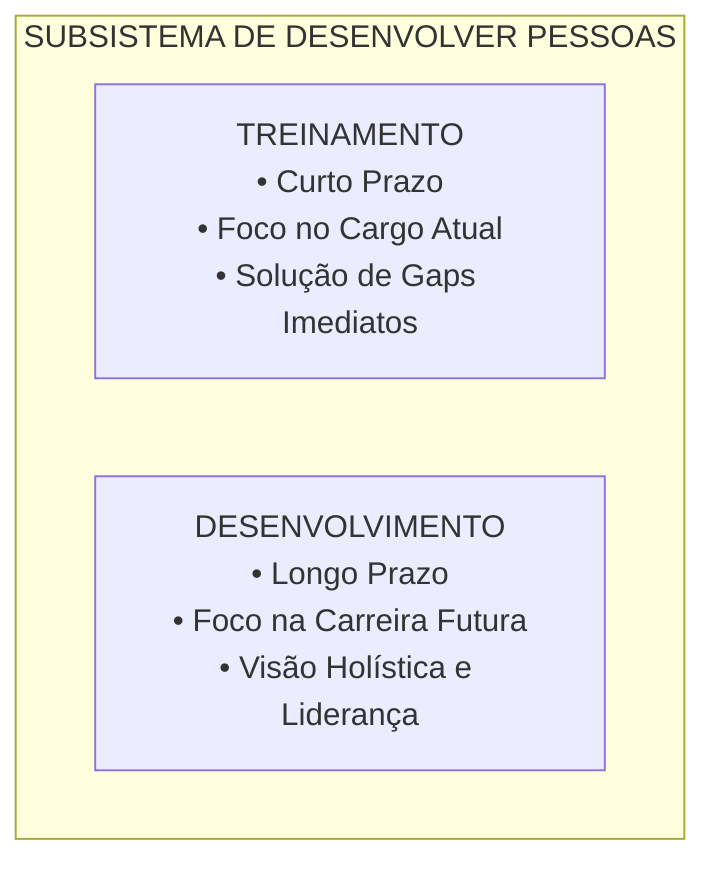
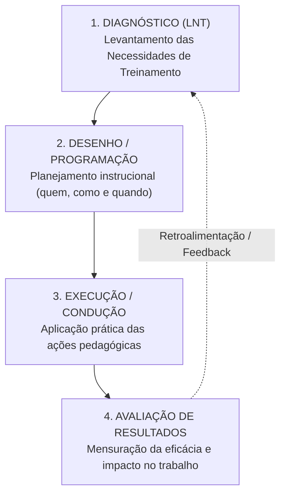
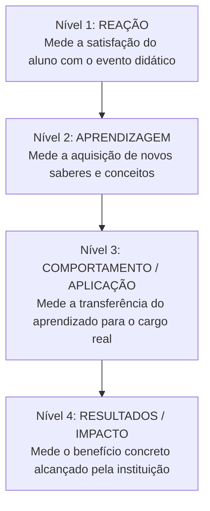
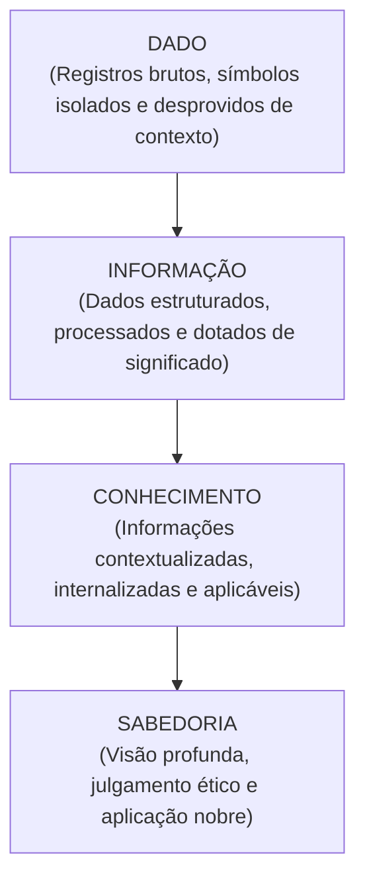
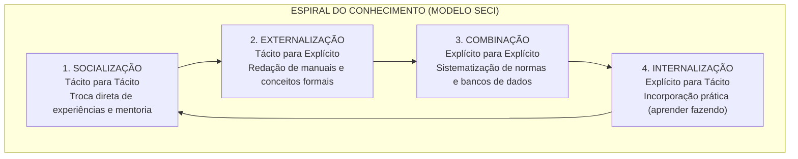
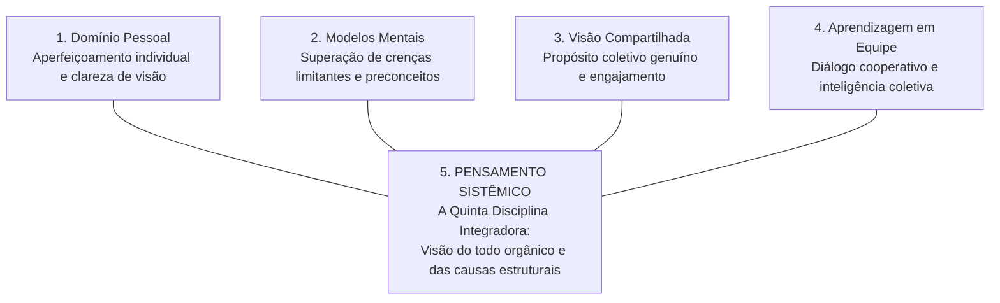

# 02 - Treinamento, Desenvolvimento, Gestão do Conhecimento e Aprendizagem Organizacional

> **Matéria:** Gestão de Pessoas  
> **Cargo:** A01 – Técnico de Controle Externo – Especialidade: Técnico Administrativo (TCE-GO)  
> **Conteúdo Oficial:** Treinamento vs. Desenvolvimento de Pessoas; As Quatro Etapas do Ciclo de Treinamento (LNT, Desenho, Execução e Avaliação de Resultados); Modelo dos 4 Níveis de Kirkpatrick; Gestão do Conhecimento (Tácito vs. Explícito e Modelo SECI de Nonaka e Takeuchi); Aprendizagem Organizacional e as Cinco Disciplinas de Peter Senge; Educação Corporativa e Escolas de Governo.

---

## 📌 Ementa & Delimitação do Conteúdo

1. **Diferenciação Teórica: Treinamento vs. Desenvolvimento de Pessoas:**
    - Critérios de temporalidade (curto prazo vs. longo prazo);
    - Foco do treinamento: cargo atual, suprimento de carências imediatas de desempenho operacional;
    - Foco do desenvolvimento: carreira, ampliação do potencial intelectual e cargos/desafios futuros;
    - Papel de T&D no macroprocesso de **Desenvolver Pessoas** de Idalberto Chiavenato.

2. **O Ciclo Estratégico de Treinamento (4 Etapas Integradas):**
    - **Etapa 1: Diagnóstico / Levantamento de Necessidades de Treinamento (LNT):** análise organizacional, análise da força de trabalho/competências e análise funcional/individual (instrumentos: avaliação de desempenho, observação direta, entrevistas com lideranças e incidentes críticos).
    - **Etapa 2: Desenho e Programação do Treinamento:** os 6 parâmetros do projeto instrucional (*quem deve ser treinado, quem vai treinar, em que treinar, onde treinar, como treinar e quando treinar*).
    - **Etapa 3: Execução e Condução:** metodologias ativas, simulações, oficinas práticas, cursos presenciais e Ensino a Distância (EaD/microlearning).
    - **Etapa 4: Avaliação dos Resultados (Modelo de Donald Kirkpatrick):**
    - Nível 1: Reação e Satisfação;
    - Nível 2: Aprendizado e Retenção Cognitiva;
    - Nível 3: Comportamento no Cargo / Aplicabilidade / Transferência do Aprendizado;
    - Nível 4: Resultados Organizacionais e Impacto Institucional (ampliação de eficiência no controle externo);
    - O Modelo de Jack Phillips: o 5º Nível (*Return on Investment* - ROI financeiro).

3. **Gestão do Conhecimento Organizacional:**
    - A pirâmide cognitiva: Dado $\rightarrow$ Informação $\rightarrow$ Conhecimento $\rightarrow$ Sabedoria (Modelo DIKW);
    - Conhecimento Tácito (subjetivo, pessoal, empírico, interiorizado e difícil de formalizar) vs. Conhecimento Explícito (estruturado, codificado, documentado em manuais, leis e sistemas);
    - O Modelo SECI e a Espiral do Conhecimento (Ikujiro Nonaka e Hirotaka Takeuchi):
    - **Socialização:** Tácito $\rightarrow$ Tácito (compartilhamento de experiências diretas e tutoria);
    - **Externalização:** Tácito $\rightarrow$ Explícito (articulação do saber prático em manuais e conceitos);
    - **Combinação:** Explícito $\rightarrow$ Explícito (cruzamento e sistematização de bases documentais);
    - **Internalização:** Explícito $\rightarrow$ Tácito (incorporação do conteúdo na prática diária - *learning by doing*);
    - O conceito japonês de *Ba* (contexto e espaço compartilhado para geração de conhecimento).

4. **Aprendizagem Organizacional e a Organização que Aprende:**
    - Aprendizagem em Circuito Simples (*Single-Loop Learning*) vs. Aprendizagem em Circuito Duplo (*Double-Loop Learning*) segundo Chris Argyris e Donald Schön;
    - As Cinco Disciplinas de Peter Senge (*A Quinta Disciplina*): Domínio Pessoal, Modelos Mentais, Visão Compartilhada, Aprendizagem em Equipe e Pensamento Sistêmico;
    - Educação Corporativa no Setor Público: Escolas de Governo e a atuação da Escola Superior de Controle do TCE-GO (Instituto Leopoldo de Bulhões - ILB).

---

## 🧭 Sumário

1. [Treinamento vs. Desenvolvimento de Pessoas](#1-treinamento-vs-desenvolvimento-de-pessoas)
    1. [Teste 440](#Teste-440)
    2. [Teste 441](#Teste-441)
2. [O Ciclo de Treinamento em Quatro Etapas e a Avaliação de Kirkpatrick](#2-o-ciclo-de-treinamento-em-quatro-etapas-e-a-avaliacao-de-kirkpatrick)
    1. [Teste 442](#Teste-442)
    2. [Teste 443](#Teste-443)
3. [Gestão do Conhecimento Organizacional e o Modelo SECI](#3-gestao-do-conhecimento-organizacional-e-o-modelo-seci)
    1. [Teste 444](#Teste-444)
    2. [Teste 445](#Teste-445)
4. [Aprendizagem Organizacional e as Cinco Disciplinas de Peter Senge](#4-aprendizagem-organizacional-e-as-cinco-disciplinas-de-peter-senge)
    1. [Teste 446](#Teste-446)
    2. [Teste 447](#Teste-447)
5. [Educação Corporativa e Escolas de Governo (ILB/TCE-GO)](#5-educacao-corporativa-e-escolas-de-governo-ilbtce-go)
    1. [Teste 448](#Teste-448)
    2. [Teste 449](#Teste-449)
6. [Fontes Oficiais e Referências Bibliográficas](#6-fontes-oficiais-e-referencias-bibliograficas)

---

## 1. Treinamento vs. Desenvolvimento de Pessoas

Na moderna gestão de pessoas, capacitação não é evento esporádico, mas processo permanente de agregação de valor. A literatura estabelece uma divisão nítida entre Treinamento e Desenvolvimento:

#### Tabela Comparativa: Treinamento vs. Desenvolvimento

| Critério de Comparação | Treinamento | Desenvolvimento de Pessoas |
| :--- | :--- | :--- |
| **Dimensão Temporal** | **Curto prazo** (ação pontual e imediata). | **Médio e longo prazo** (processo contínuo). |
| **Foco de Atuação** | **Cargo atual:** prepara o servidor para as atribuições que exerce hoje. | **Carreira e organização:** prepara o servidor para cargos futuros e novas atribuições. |
| **Objetivo Primário** | Repassar conhecimentos específicos e sanar deficiências técnicas operacionais. | Expandir capacidades conceituais, competências comportamentais e potencial de liderança. |
| **Escopo do Conteúdo** | Estrito, técnico, procedural e centrado na tarefa (ex.: operar o sistema de protocolo eletrônico). | Amplo, abrangente, reflexivo e estratégico (ex.: programa de governança e ética pública). |
| **Avaliação do Sucesso** | Rápida execução sem erros na rotina diária do posto de trabalho. | Capacidade de inovação, liderança adaptativa e visão sistêmica institucional. |

> 🛑 **ATENÇÃO (TREINAMENTO VS. DESENVOLVIMENTO):**  
> Treinamento refere-se ao **presente** e ao cargo **atual** (objetivo imediato e operacional). Desenvolvimento refere-se ao **futuro** e à **carreira** como um todo (objetivo mediato, estratégico e de liderança).

---

### Teste 440
**(FGV – TJ-SC – Analista Administrativo – 2026)**
A empresa ABC encomendou uma análise de sua cultura organizacional, comparando-a aos modelos identificados por William G. Ouchi. O diagnóstico revelou os seguintes traços: emprego de longo prazo; avaliação lenta e qualitativa; trajetória de carreira moderadamente abrangente; controle implícito e informal; tomada de decisão em grupo e consensual; responsabilidade individual; e preocupação holística com as pessoas. Considerando os sete pontos de comparação desenvolvidos por Ouchi, o diagnóstico apresentado caracteriza a empresa ABC como empresa

* **A)** norte-americana típica.
* **B)** norte-americana Tipo Z.
* **C)** japonesa típica.
* **D)** norte-americana Tipo J.
* **E)** híbrida transacional.

---

> **Comentário Detalhado:**
>
> - **A)** **Correta.** Conforme fundamentado na seção *D) Etapa 4: Avaliação dos Resultados (Modelo de Donald Kirkpatrick)* deste guia, nível 4: Resultados / Impacto Organizacional: Avalia os impactos macroinstitucionais obtidos pelo órgão (redução de custos, agilidade processual). — Longo prazo (semestral ou anual). — Indicadores de desempenho, relatórios gerenciais e metas institucionais atingidas. Dessa forma, está plenamente correta a assertiva da banca (FGV – TJ-SC/2026) ao estabelecer que "norte-americana típica".
> - **B)** **Incorreta.** A opção apresenta proposição em desacordo com os fundamentos teóricos e técnicos do tópico ao afirmar que "norte-americana Tipo Z". De acordo com a teoria estudada em *4. Aprendizagem Organizacional e as Cinco Disciplinas de Peter Senge*, a aprendizagem organizacional ocorre quando o aprendizado individual e coletivo é incorporado aos processos, valores, estruturas e cultura permanente da organização.
> - **C)** **Incorreta.** A opção apresenta proposição em desacordo com os fundamentos teóricos e técnicos do tópico ao afirmar que "japonesa típica". De acordo com a teoria estudada em *A) Etapa 1: Diagnóstico / Levantamento das Necessidades de Treinamento (LNT)*, análise Organizacional: examina a missão, a visão de futuro, os planos estratégicos e as metas globais do órgão para identificar quais competências coletivas são essenciais.
> - **D)** **Incorreta.** A opção apresenta proposição em desacordo com os fundamentos teóricos e técnicos do tópico ao afirmar que "norte-americana Tipo J". De acordo com a teoria estudada em *A) A Pirâmide DIKW (Hierarquia do Saber)*, conhecimento: Informação processada pela mente humana, combinada com experiência, valores e intuição, capacitando o indivíduo para a tomada de decisão (ex.: "Auditor identifica irregularidade na dispensa com base no histórico do fornecedor e na Lei 14.133/2021").
> - **E)** **Incorreta.** A opção apresenta proposição em desacordo com os fundamentos teóricos e técnicos do tópico ao afirmar que "híbrida transacional". De acordo com a teoria estudada em *Tabela Comparativa: Treinamento vs. Desenvolvimento*, dimensão Temporal: Curto prazo (ação pontual e imediata). — Médio e longo prazo (processo contínuo).
>
> **Gabarito: A**

---

### Teste 441
**(FGV – TCE-PA – Auditor de Controle Externo Administrativa Administracao – 2024)**
A gestão de carreiras é o processo pelo qual organizações e colaboradores planejam e desenvolvem o percurso profissional dentro da organização. A gestão de carreira muitas vezes enfrenta o dilema entre priorizar o desempenho atual dos colaboradores ou focar no potencial de desenvolvimento do talento. Enquanto o desempenho atual garante resultados imediatos e contribui para a eficácia operacional, investir no potencial de desenvolvimento pode promover inovação e sustentabilidade a longo prazo. As organizações precisam equilibrar essas duas abordagens, reconhecendo e recompensando o desempenho, enquanto criam oportunidades para o crescimento e desenvolvimento futuro. Essa estratégia híbrida não apenas maximiza o engajamento dos funcionários, mas também assegura que a empresa esteja preparada para enfrentar desafios futuros com uma equipe qualificada e motivada. Assinale a opção que apresenta a avaliação de elevado potencial e alto desempenho ideal para a sucessão em cargos sêniores.

* **A)** Enigma.
* **B)** Dilema.
* **C)** Colaborador do centro.
* **D)** Futuro líder.
* **E)** Profissional confiável.

---

> **Comentário Detalhado:**
>
> - **A)** **Incorreta.** A opção apresenta proposição em desacordo com os fundamentos teóricos e técnicos do tópico ao afirmar que "Enigma". De acordo com a teoria estudada em *Tabela Comparativa: Treinamento vs. Desenvolvimento*, foco de Atuação: Cargo atual: prepara o servidor para as atribuições que exerce hoje. — Carreira e organização: prepara o servidor para cargos futuros e novas atribuições.
> - **B)** **Incorreta.** A opção apresenta proposição em desacordo com os fundamentos teóricos e técnicos do tópico ao afirmar que "Dilema". De acordo com a teoria estudada em *D) Etapa 4: Avaliação dos Resultados (Modelo de Donald Kirkpatrick)*, nível 4: Resultados / Impacto Organizacional: Avalia os impactos macroinstitucionais obtidos pelo órgão (redução de custos, agilidade processual). — Longo prazo (semestral ou anual). — Indicadores de desempenho, relatórios gerenciais e metas institucionais atingidas.
> - **C)** **Incorreta.** A opção apresenta proposição em desacordo com os fundamentos teóricos e técnicos do tópico ao afirmar que "Colaborador do centro". De acordo com a teoria estudada em *Tabela Comparativa: Treinamento vs. Desenvolvimento*, dimensão Temporal: Curto prazo (ação pontual e imediata). — Médio e longo prazo (processo contínuo).
> - **D)** **Correta.** Conforme fundamentado na seção *Tabela Comparativa: Treinamento vs. Desenvolvimento* deste guia, treinamento refere-se ao presente e ao cargo atual (objetivo imediato e operacional). Desenvolvimento refere-se ao futuro e à carreira como um todo (objetivo mediato, estratégico e de liderança). Dessa forma, está plenamente correta a assertiva da banca (FGV – TCE-PA/2024) ao estabelecer que "Futuro líder".
> - **E)** **Incorreta.** A opção apresenta proposição em desacordo com os fundamentos teóricos e técnicos do tópico ao afirmar que "Profissional confiável". De acordo com a teoria estudada em *A) Etapa 1: Diagnóstico / Levantamento das Necessidades de Treinamento (LNT)*, análise Organizacional: examina a missão, a visão de futuro, os planos estratégicos e as metas globais do órgão para identificar quais competências coletivas são essenciais.
>
> **Gabarito: D**

---

## 2. O Ciclo de Treinamento em Quatro Etapas e a Avaliação de Kirkpatrick

Segundo Idalberto Chiavenato, o treinamento funciona como um ciclo contínuo composto por quatro fases lógicas e sequenciais:

#### A) Etapa 1: Diagnóstico / Levantamento das Necessidades de Treinamento (LNT)
O LNT é o diagnóstico das carências de competências que prejudicam o alcance das metas organizacionais. O diagnóstico ocorre em três níveis de análise:

1. **Análise Organizacional:** examina a missão, a visão de futuro, os planos estratégicos e as metas globais do órgão para identificar quais competências coletivas são essenciais.
2. **Análise dos Recursos Humanos (Competências):** mapeia as competências atuais dos servidores frente às competências exigidas pelo órgão, detectando as lacunas (*skills gaps*).
3. **Análise das Operações e Tarefas (Cargos):** avalia a descrição de cada cargo, os requisitos técnicos e o padrão de excelência esperado para cada função pública.

#### B) Etapa 2: Desenho e Programação do Treinamento
Consiste no planejamento instrucional estruturado, respondendo a seis questões cruciais:

* **Quem deve ser treinado?** (público-alvo / participantes selecionados);
* **Quem vai treinar?** (instrutores internos da Escola de Contas ou consultores externos contratados);
* **Em que treinar?** (conteúdo programático, competências técnicas e comportamentais);
* **Onde treinar?** (salas de aula presenciais, laboratórios ou ambiente virtual EaD);
* **Como treinar?** (métodos pedagógicos: estudos de caso, oficinas, simulações ou palestras expositivas);
* **Quando treinar?** (cronograma, carga horária e período de realização).

#### C) Etapa 3: Execução e Condução do Treinamento
Aplicação prática do plano pedagógico. Exige ambiente físico e tecnológico adequado, motivação dos educandos e domínio didático por parte dos instrutores.

#### D) Etapa 4: Avaliação dos Resultados (Modelo de Donald Kirkpatrick)
Donald Kirkpatrick propôs a metodologia mais consagrada e cobrada em concursos públicos para mensurar a eficácia de programas de capacitação, dividida em quatro níveis sucessivos de complexidade:

| Nível de Kirkpatrick | Objeto de Avaliação | Momento da Avaliação | Instrumento Típico de Medição |
| :--- | :--- | :--- | :--- |
| **Nível 1: Reação** | Avalia o grau de satisfação dos participantes com o curso, material, didática e infraestrutura. | Aplicado imediatamente no encerramento da aula. | Questionário de pesquisa de satisfação (escala Likert). |
| **Nível 2: Aprendizagem** | Avalia a aquisição e fixação de novos conhecimentos, habilidades e atitudes. | Durante ou logo após o término do curso. | Testes teóricos, provas de conhecimento e exames práticos (pré-teste e pós-teste). |
| **Nível 3: Comportamento no Cargo (Transferência)** | Avalia se o participante modificou sua conduta no posto de trabalho e aplica o que aprendeu. | Aplicado semanas ou meses após o retorno à rotina (30 a 90 dias). | Observação em serviço, relatórios de produtividade e avaliação da chefia imediata. |
| **Nível 4: Resultados / Impacto Organizacional** | Avalia os impactos macroinstitucionais obtidos pelo órgão (redução de custos, agilidade processual). | Longo prazo (semestral ou anual). | Indicadores de desempenho, relatórios gerenciais e metas institucionais atingidas. |
| **Nível 5: ROI (Jack Phillips)** | Avalia a relação financeira entre o custo do treinamento e os benefícios monetários gerados. | Pós-implementação. | Fórmula do ROI: $\text{ROI (\%)} = \frac{\text{Benefícios Líquidos}}{\text{Custos do Treinamento}} \times 100$. |

> 🚨 **ALERTA DE PROVA / PEGADINHA FCC (NÍVEIS DE KIRKPATRICK):**  
> A banca frequentemente afirma que *"uma avaliação de reação altamente positiva comprova que os servidores assimilaram o conteúdo e melhorarão a produtividade da instituição"*. **ERRADO!** O Nível 1 mede apenas se os participantes gostaram da aula e das instalações. Uma reação excelente pode conviver com zero aprendizagem (Nível 2) ou zero aplicação no trabalho (Nível 3).  
> Além disso, lembre-se: provas de conhecimentos teóricos ao final do curso medem **Aprendizagem (Nível 2)** e NÃO comportamento no trabalho (Nível 3).

---

### Teste 442
**(FGV – TCE-PA – Auditor de Controle Externo Administrativa Gestao Governamental – 2024)**
Na avaliação de políticas públicas espera-se um estudo de relação causal entre o objetivo e o resultado proposto pelo programa, ou mesmo entre a proposta defendida e o impacto social esperado. (...) Na classificação dos estudos da avaliação de políticas públicas, “o primeiro consiste no levantamento das necessidades e estudos de factibilidade que irão orientar a formulação e o desenvolvimento do programa. Inclui a definição de seus objetivos, âmbito de aplicação, caracterização de beneficiários e de suas necessidades. (CHRISPINO, Álvaro. Introdução ao estudo das políticas públicas. Ed. FGV, 2016, p. 134-136). O texto se refere à classificação dos estudos da avaliação de políticas públicas denominada

* **A)** Ex ante.
* **B)** Processual.
* **C)** Instrumental.
* **D)** Somativa.
* **E)** Corretiva.

---

> **Comentário Detalhado:**
>
> - **A)** **Correta.** Conforme fundamentado na seção *A) Etapa 1: Diagnóstico / Levantamento das Necessidades de Treinamento (LNT)* deste guia, análise das Operações e Tarefas (Cargos): avalia a descrição de cada cargo, os requisitos técnicos e o padrão de excelência esperado para cada função pública. Dessa forma, está plenamente correta a assertiva da banca (FGV – TCE-PA/2024) ao estabelecer que "Ex ante".
> - **B)** **Incorreta.** A opção apresenta proposição em desacordo com os fundamentos teóricos e técnicos do tópico ao afirmar que "Processual". De acordo com a teoria estudada em *D) Etapa 4: Avaliação dos Resultados (Modelo de Donald Kirkpatrick)*, nível 4: Resultados / Impacto Organizacional: Avalia os impactos macroinstitucionais obtidos pelo órgão (redução de custos, agilidade processual). — Longo prazo (semestral ou anual). — Indicadores de desempenho, relatórios gerenciais e metas institucionais atingidas.
> - **C)** **Incorreta.** A opção apresenta proposição em desacordo com os fundamentos teóricos e técnicos do tópico ao afirmar que "Instrumental". De acordo com a teoria estudada em *Tabela Comparativa: Treinamento vs. Desenvolvimento*, treinamento refere-se ao presente e ao cargo atual (objetivo imediato e operacional). Desenvolvimento refere-se ao futuro e à carreira como um todo (objetivo mediato, estratégico e de liderança).
> - **D)** **Incorreta.** A opção apresenta proposição em desacordo com os fundamentos teóricos e técnicos do tópico ao afirmar que "Somativa". De acordo com a teoria estudada em *D) Etapa 4: Avaliação dos Resultados (Modelo de Donald Kirkpatrick)*, nível 5: ROI (Jack Phillips): Avalia a relação financeira entre o custo do treinamento e os benefícios monetários gerados. — Pós-implementação. — Fórmula do ROI: \$\text{ROI (\%)} = \frac{\text{Benefícios Líquidos}}{\text{Custos do Treinamento}} \times 100\$.
> - **E)** **Incorreta.** A opção apresenta proposição em desacordo com os fundamentos teóricos e técnicos do tópico ao afirmar que "Corretiva". De acordo com a teoria estudada em *A) Etapa 1: Diagnóstico / Levantamento das Necessidades de Treinamento (LNT)*, o LNT é o diagnóstico das carências de competências que prejudicam o alcance das metas organizacionais. O diagnóstico ocorre em três níveis de análise.
>
> **Gabarito: A**

---

### Teste 443
**(FGV – TJ-SC – Analista Administrativo – 2026)**
A área de Gestão de Pessoas da empresa ABC tem revisado sua estratégia de treinamento à luz das tendências contemporâneas. Após diagnóstico interno, optou por implementar uma abordagem em que o conteúdo é entregue em pequenas doses, facilitando a assimilação rápida e eficaz das informações, permitindo que os colaboradores aprendam de forma flexível e acessem o conteúdo em momentos compatíveis com sua rotina, o que favorece a retenção do conhecimento. A tendência contemporânea de treinamento descrita corresponde ao

* **A)** microlearning.
* **B)** aprendizado experiencial.
* **C)** mentoring digital.
* **D)** treinamento baseado em dados.
* **E)** role-playing.

---

> **Comentário Detalhado:**
>
> - **A)** **Incorreta.** A opção apresenta proposição em desacordo com os fundamentos teóricos e técnicos do tópico ao afirmar que "microlearning". De acordo com a teoria estudada em *Tabela Comparativa: Treinamento vs. Desenvolvimento*, avaliação do Sucesso: Rápida execução sem erros na rotina diária do posto de trabalho. — Capacidade de inovação, liderança adaptativa e visão sistêmica institucional.
> - **B)** **Incorreta.** A opção apresenta proposição em desacordo com os fundamentos teóricos e técnicos do tópico ao afirmar que "aprendizado experiencial". De acordo com a teoria estudada em *B) Conhecimento Tácito vs. Conhecimento Explícito*, forma de Aprendizado: Aprendizado prático por convivência, mentoria, tutoria e imitação. — Leitura de documentos, estudo de normas e consulta a bancos de dados.
> - **C)** **Incorreta.** A opção apresenta proposição em desacordo com os fundamentos teóricos e técnicos do tópico ao afirmar que "mentoring digital". De acordo com a teoria estudada em *1. Treinamento vs. Desenvolvimento de Pessoas*, na moderna gestão de pessoas, capacitação não é evento esporádico, mas processo permanente de agregação de valor. A literatura estabelece uma divisão nítida entre Treinamento e Desenvolvimento.
> - **D)** **Incorreta.** A opção apresenta proposição em desacordo com os fundamentos teóricos e técnicos do tópico ao afirmar que "treinamento baseado em dados". De acordo com a teoria estudada em *A) A Pirâmide DIKW (Hierarquia do Saber)*, informação: Dados organizados em determinado contexto, dotados de sentido e propósito (ex.: "Contrato de TI no valor de R\$ 1.500.000,00 celebrado com dispensa indevida de licitação").
> - **E)** **Correta.** Conforme fundamentado na seção *D) Etapa 4: Avaliação dos Resultados (Modelo de Donald Kirkpatrick)* deste guia, nível 3: Comportamento no Cargo (Transferência): Avalia se o participante modificou sua conduta no posto de trabalho e aplica o que aprendeu. — Aplicado semanas ou meses após o retorno à rotina (30 a 90 dias). — Observação em serviço, relatórios de produtividade e avaliação da chefia imediata. Dessa forma, está plenamente correta a assertiva da banca (FGV – TJ-SC/2026) ao estabelecer que "role-playing".
>
> **Gabarito: E**

---

## 3. Gestão do Conhecimento Organizacional e o Modelo SECI

A gestão do conhecimento é o conjunto integrado de processos que criam, organizam, disseminam e aplicam saberes para alavancar a eficiência organizacional.

#### A) A Pirâmide DIKW (Hierarquia do Saber)

* **Dado:** Registro numérico ou textual isolado, sem interpretação (ex.: "R\$ 1.500.000,00").
* **Informação:** Dados organizados em determinado contexto, dotados de sentido e propósito (ex.: "Contrato de TI no valor de R\$ 1.500.000,00 celebrado com dispensa indevida de licitação").
* **Conhecimento:** Informação processada pela mente humana, combinada com experiência, valores e intuição, capacitando o indivíduo para a tomada de decisão (ex.: "Auditor identifica irregularidade na dispensa com base no histórico do fornecedor e na Lei 14.133/2021").
* **Sabedoria:** Capacidade superior de aplicar o conhecimento com prudência, discernimento ético e visão de longo prazo em prol da sociedade.

#### B) Conhecimento Tácito vs. Conhecimento Explícito

| Dimensão | Conhecimento Tácito | Conhecimento Explícito |
| :--- | :--- | :--- |
| **Origem e Natureza** | Subjetivo, pessoal, intuitivo e empírico. | Objetivo, racional, formal e lógico. |
| **Localização** | Armazenado na mente e na experiência dos indivíduos (*know-how*). | Registrado em suportes físicos ou digitais (manuais, livros, leis, normas e sistemas). |
| **Facilidade de Transmissão** | Difícil de verbalizar, codificar e formalizar por escrito. | Fácil de estruturar, armazenar, duplicar e compartilhar em rede. |
| **Forma de Aprendizado** | Aprendizado prático por convivência, mentoria, tutoria e imitação. | Leitura de documentos, estudo de normas e consulta a bancos de dados. |

#### C) O Modelo SECI e a Espiral do Conhecimento (Ikujiro Nonaka & Hirotaka Takeuchi)
Segundo Nonaka e Takeuchi, o conhecimento institucional é criado a partir da interação dinâmica e ininterrupta entre o conhecimento tácito e o explícito, percorrendo quatro modos de conversão:

1. **Socialização (Tácito $\rightarrow$ Tácito):** Compartilhamento de experiências diretas entre pessoas, sem uso necessário da linguagem escrita (ex.: tutoria de um técnico novato por um auditor sênior, conversas informais e observação em campo no *Ba Originário*).
2. **Externalização (Tácito $\rightarrow$ Explícito):** Articulação e tradução do conhecimento tácito em conceitos compreensíveis, modelos visuais, metáforas, manuais operacionais e fluxogramas acessíveis a todos (no *Ba Interativo*).
3. **Combinação (Explícito $\rightarrow$ Explícito):** Agrupamento, classificação, análise e cruzamento de diferentes fontes de conhecimentos já codificados (ex.: compilar acórdãos e pareceres para redigir uma Instrução Normativa consolidada do TCE-GO no *Ba Cibernético*).
4. **Internalização (Explícito $\rightarrow$ Tácito):** Incorporação do conhecimento explícito recém-produzido na mente e nos hábitos de trabalho do servidor por meio do "aprender fazendo" (*learning by doing* no *Ba Exercitante*).

> ⭐ **IMPORTANTE (HISTORINHAS PRÁTICAS DO MODELO SECI):**  
> A FCC adora cobrar o Modelo SECI por meio de situações hipotéticas de trabalho:  
>
> - Se o auditor experiente passa dicas práticas e intuições para um estagiário durante uma fiscalização em campo: **SOCIALIZAÇÃO (Tácito para Tácito)**.  
> - Se esse auditor redige uma apostila ou manual de auditoria com seus métodos: **EXTERNALIZAÇÃO (Tácito para Explícito)**.  
> - Se o setor reúne manuais de diversos tribunais e publica um guia analítico unificado: **COMBINAÇÃO (Explícito para Explícito)**.  
> - Se os novos servidores leem o guia e passam a aplicá-lo automaticamente na rotina: **INTERNALIZAÇÃO (Explícito para Tácito)**.

---

### Teste 444
**(CEBRASPE – TRT-8 – Analista Judiciario Area Apoio Especializado Tecnologia da Informacao – 2022)**
Em cada uma das opções a seguir, é apresentada uma proposta de reescrita do seguinte trecho do texto CG1A1 “As Big Techs — seguidas por outras firmas, laboratórios e governos — usam tecnologias da informação e comunicação (TIC) para expropriar a experiência humana, que se torna matéria-prima processada e mercantilizada como dados comportamentais.” (segundo período do primeiro parágrafo). Assinale a opção cuja proposta de reescrita, além de estar gramaticalmente correta, preserva os sentidos originais do texto.

* **A)** As Big Techs, seguidas de outras firmas, laboratórios e governos, usam tecnologias da informação e comunicação (TIC) para expropriar a experiência humana, que se torna matéria-prima processada e mercantilizada na forma de dados de comportamento.
* **B)** As Big Techs, seguidas por outras firmas, laboratórios e governos — usam tecnologias da informação e comunicação (TIC) para reaproveitar a experiência humana, que se torna eventos processados e vendidos como dados comportamentais.
* **C)** As Big Techs — acompanhadas por outras firmas, laboratórios e governos — usam tecnologias da informação e comunicação (TIC) para expropriar a experiência humana, que se tornam insumos processados e mercantilizados como dados comportamentais.
* **D)** As Big Techs — seguidas por outras firmas, laboratórios e governos — usam tecnologias da informação e comunicação (TIC) para expropriar a experiência humana, que se tornam elementos processados e mercantilizados como dados comportamentais.
* **E)** As Big Techs, bem como outras firmas, laboratórios e governos — aproveitam tecnologias da informação e comunicação (TIC) para recriar a experiência humana, que se torna matéria-prima processada e mercantilizada como dados comportamentais.

---

> **Comentário Detalhado:**
>
> - **A)** **Correta.** Conforme fundamentado na seção *A) A Pirâmide DIKW (Hierarquia do Saber)* deste guia, conhecimento: Informação processada pela mente humana, combinada com experiência, valores e intuição, capacitando o indivíduo para a tomada de decisão (ex.: "Auditor identifica irregularidade na dispensa com base no histórico do fornecedor e na Lei 14.133/2021"). Dessa forma, está plenamente correta a assertiva da banca (CEBRASPE – TRT-8/2022) ao estabelecer que "As Big Techs, seguidas de outras firmas, laboratórios e governos, usam tecnologias da informação e comunicação...".
> - **B)** **Incorreta.** A opção apresenta proposição em desacordo com os fundamentos teóricos e técnicos do tópico ao afirmar que "As Big Techs, seguidas por outras firmas, laboratórios e governos — usam tecnologias da informação e comunicação...". De acordo com a teoria estudada em *A) A Pirâmide DIKW (Hierarquia do Saber)*, informação: Dados organizados em determinado contexto, dotados de sentido e propósito (ex.: "Contrato de TI no valor de R\$ 1.500.000,00 celebrado com dispensa indevida de licitação").
> - **C)** **Incorreta.** A opção apresenta proposição em desacordo com os fundamentos teóricos e técnicos do tópico ao afirmar que "As Big Techs — acompanhadas por outras firmas, laboratórios e governos — usam tecnologias da informação e...". De acordo com a teoria estudada em *B) Conhecimento Tácito vs. Conhecimento Explícito*, forma de Aprendizado: Aprendizado prático por convivência, mentoria, tutoria e imitação. — Leitura de documentos, estudo de normas e consulta a bancos de dados.
> - **D)** **Incorreta.** A opção apresenta proposição em desacordo com os fundamentos teóricos e técnicos do tópico ao afirmar que "As Big Techs — seguidas por outras firmas, laboratórios e governos — usam tecnologias da informação e comunicação...". De acordo com a teoria estudada em *B) Etapa 2: Desenho e Programação do Treinamento*, onde treinar? (salas de aula presenciais, laboratórios ou ambiente virtual EaD).
> - **E)** **Incorreta.** A opção apresenta proposição em desacordo com os fundamentos teóricos e técnicos do tópico ao afirmar que "As Big Techs, bem como outras firmas, laboratórios e governos — aproveitam tecnologias da informação e comunicação...". De acordo com a teoria estudada em *B) As Cinco Disciplinas de Peter Senge (A Quinta Disciplina)*, pensamento Sistêmico (A 5ª Disciplina): É a disciplina integradora que conecta as outras quatro.
>
> **Gabarito: A**

---

### Teste 445
**(CEBRASPE – TRT-8 – Analista Judiciario Area Apoio Especializado Tecnologia da Informacao – 2022)**
Considere, ainda, o texto a seguir: O direito do trabalho e a justiça social são os pilares de uma organização de trabalho mais justa e igualitária, e, por essa razão, o currículo do ensino médio inclui disciplinas sobre cidadania, direitos humanos e empreendedorismo consciente. Tendo em vista essas informações, o texto precedente pode ser expresso corretamente pela proposição lógica

* **A)** P.
* **B)** P˄Q.
* **C)** P ⇒ Q.
* **D)** (P˄Q) ⇒ (R˄S˄T).
* **E)** (P˄Q) ⇒ R.

---

> **Comentário Detalhado:**
>
> - **A)** **Incorreta.** A opção apresenta proposição em desacordo com os fundamentos teóricos e técnicos do tópico ao afirmar que "P". De acordo com a teoria estudada em *4. Aprendizagem Organizacional e as Cinco Disciplinas de Peter Senge*, a aprendizagem organizacional ocorre quando o aprendizado individual e coletivo é incorporado aos processos, valores, estruturas e cultura permanente da organização.
> - **B)** **Incorreta.** A opção apresenta proposição em desacordo com os fundamentos teóricos e técnicos do tópico ao afirmar que "P˄Q". De acordo com a teoria estudada em *B) As Cinco Disciplinas de Peter Senge (A Quinta Disciplina)*, para Peter Senge, uma Organização que Aprende (*Learning Organization*) baseia-se na prática contínua de cinco disciplinas essenciais.
> - **C)** **Correta.** Conforme fundamentado na seção *D) Etapa 4: Avaliação dos Resultados (Modelo de Donald Kirkpatrick)* deste guia, eRRADO! O Nível 1 mede apenas se os participantes gostaram da aula e das instalações. Uma reação excelente pode conviver com zero aprendizagem (Nível 2) ou zero aplicação no trabalho (Nível 3). Dessa forma, está plenamente correta a assertiva da banca (CEBRASPE – TRT-8/2022) ao estabelecer que "P ⇒ Q".
> - **D)** **Incorreta.** A opção apresenta proposição em desacordo com os fundamentos teóricos e técnicos do tópico ao afirmar que "(P˄Q) ⇒ (R˄S˄T)". De acordo com a teoria estudada em *B) As Cinco Disciplinas de Peter Senge (A Quinta Disciplina)*, permite enxergar a organização não como partes fragmentadas, mas como uma rede viva de inter-relações e interdependências mútuas, focando nas causas estruturais dos problemas em vez de remediar sintomas superficiais.
> - **E)** **Incorreta.** A opção apresenta proposição em desacordo com os fundamentos teóricos e técnicos do tópico ao afirmar que "(P˄Q) ⇒ R". De acordo com a teoria estudada em *C) O Modelo SECI e a Espiral do Conhecimento (Ikujiro Nonaka & Hirotaka Takeuchi)*, internalização (Explícito \$\rightarrow\$ Tácito): Incorporação do conhecimento explícito recém-produzido na mente e nos hábitos de trabalho do servidor por meio do "aprender fazendo" (*learning by doing* no *Ba Exercitante*).
>
> **Gabarito: C**

---

## 4. Aprendizagem Organizacional e as Cinco Disciplinas de Peter Senge

A aprendizagem organizacional ocorre quando o aprendizado individual e coletivo é incorporado aos processos, valores, estruturas e cultura permanente da organização.

#### A) Circuito Simples vs. Circuito Duplo (Chris Argyris e Donald Schön)
* **Aprendizagem em Circuito Simples (*Single-Loop Learning*):** A organização detecta um erro e corrige os procedimentos imediatos, **sem questionar as premissas, normas ou políticas básicas** que originaram a falha (comportamento de mero "termostato").
* **Aprendizagem em Circuito Duplo (*Double-Loop Learning*):** A organização detecta o erro e **reexamina criticamente as regras subjacentes, objetivos fundamentais e premissas culturais**, promovendo mudanças estruturais profundas e inovação transformadora.

> 📌 **NOTA EXPLICATIVA — CIRCUITO DUPLO DE ARGYRIS:**  
> A diferença fundamental reside no questionamento das premissas:  
>
> - Circuito simples: corrige a rota sem questionar o destino (mantém os valores vigentes);  
> - Circuito duplo: questiona se o destino e as normas prévias ainda fazem sentido no contexto atual.

---

### Teste 446
**(FGV – TCE-PA – Auditor de Controle Externo Administrativa Administracao – 2024)**
Com a crescente permeabilidade das organizações e um conceito mais amplo de Administração, a organização do futuro deve oferecer produtos de alta qualidade e competitividade, atendendo aos consumidores sem prejudicar o planeta ou a qualidade de vida. Diante desses desafios, o gestor precisa ressignificar sua mentalidade e desenvolver novas competências gerenciais. Assinale a opção que destaca uma competência gerencial que reconhece um ambiente em constante evolução e a incerteza sobre o futuro.

* **A)** Estrela do norte ao longo da organização.
* **B)** Ciclos rápidos e decisão e aprendizado.
* **C)** Rede de equipes capacitadas e empoderadas.
* **D)** Modelo dinâmico de pessoas que desperta a paixão.
* **E)** Tecnologia habilitada para a próxima geração.

---

> **Comentário Detalhado:**
>
> - **A)** **Incorreta.** A opção apresenta proposição em desacordo com os fundamentos teóricos e técnicos do tópico ao afirmar que "Estrela do norte ao longo da organização". De acordo com a teoria estudada em *Tabela Comparativa: Treinamento vs. Desenvolvimento*, foco de Atuação: Cargo atual: prepara o servidor para as atribuições que exerce hoje. — Carreira e organização: prepara o servidor para cargos futuros e novas atribuições.
> - **B)** **Correta.** Conforme fundamentado na seção *4. Aprendizagem Organizacional e as Cinco Disciplinas de Peter Senge* deste guia, a aprendizagem organizacional ocorre quando o aprendizado individual e coletivo é incorporado aos processos, valores, estruturas e cultura permanente da organização. Dessa forma, está plenamente correta a assertiva da banca (FGV – TCE-PA/2024) ao estabelecer que "Ciclos rápidos e decisão e aprendizado".
> - **C)** **Incorreta.** A opção apresenta proposição em desacordo com os fundamentos teóricos e técnicos do tópico ao afirmar que "Rede de equipes capacitadas e empoderadas". De acordo com a teoria estudada em *B) As Cinco Disciplinas de Peter Senge (A Quinta Disciplina)*, permite enxergar a organização não como partes fragmentadas, mas como uma rede viva de inter-relações e interdependências mútuas, focando nas causas estruturais dos problemas em vez de remediar sintomas superficiais.
> - **D)** **Incorreta.** A opção apresenta proposição em desacordo com os fundamentos teóricos e técnicos do tópico ao afirmar que "Modelo dinâmico de pessoas que desperta a paixão". De acordo com a teoria estudada em *C) O Modelo SECI e a Espiral do Conhecimento (Ikujiro Nonaka & Hirotaka Takeuchi)*, socialização (Tácito \$\rightarrow\$ Tácito): Compartilhamento de experiências diretas entre pessoas, sem uso necessário da linguagem escrita (ex.: tutoria de um técnico novato por um auditor sênior, conversas informais e observação em campo no *Ba Originário*).
> - **E)** **Incorreta.** A opção apresenta proposição em desacordo com os fundamentos teóricos e técnicos do tópico ao afirmar que "Tecnologia habilitada para a próxima geração". De acordo com a teoria estudada em *A) A Pirâmide DIKW (Hierarquia do Saber)*, conhecimento: Informação processada pela mente humana, combinada com experiência, valores e intuição, capacitando o indivíduo para a tomada de decisão (ex.: "Auditor identifica irregularidade na dispensa com base no histórico do fornecedor e na Lei 14.133/2021").
>
> **Gabarito: B**

---

#### B) As Cinco Disciplinas de Peter Senge (*A Quinta Disciplina*)
Para Peter Senge, uma **Organização que Aprende** (*Learning Organization*) baseia-se na prática contínua de cinco disciplinas essenciais:

1. **Domínio Pessoal:** Busca contínua pelo aprimoramento e autodesenvolvimento, com clareza dos objetivos de vida e visão realista das próprias forças e fragilidades.
2. **Modelos Mentais:** Capacidade de identificar, questionar e transformar as imagens e preconceitos internos enraizados que condicionam nossa percepção do mundo organizacional.
3. **Visão Compartilhada:** Construção de um senso coletivo de propósito e destino comum, substituindo o mero cumprimento de ordens pelo compromisso entusiasmado com a missão pública.
4. **Aprendizagem em Equipe:** Prática do diálogo autêntico entre os membros do grupo, superando disputas de vaidade e gerando soluções muito superiores à inteligência individual isolada.
5. **Pensamento Sistêmico (A 5ª Disciplina):** É a disciplina integradora que conecta as outras quatro. Permite enxergar a organização não como partes fragmentadas, mas como uma rede viva de inter-relações e interdependências mútuas, focando nas causas estruturais dos problemas em vez de remediar sintomas superficiais.

---

### Teste 447
**(FCC – TRT-14 – Analista Judiciario Apoio Especializado Tecnologia da Informacao – 2016)**
Uma organização atingiu o nível 1 de capacidade de processo do COBIT 5. Isso significa dizer que

* **A)** o atributo de desempenho do processo foi amplamente atingido; o processo está sendo realizado com sucesso e os resultados esperados estão sendo obtidos pela organização.
* **B)** não há uma diferença significativa entre a capacidade de processo nível 1 e os níveis de capacidade mais altos.
* **C)** houve um engano, pois o COBIT 5 trabalha com níveis de maturidade e não com níveis de capacidade.
* **D)** todos os cinco atributos de desempenho dos dois processos foram amplamente atingidos; a organização progride com sucesso e os resultados esperados estão sendo obtidos.
* **E)** a organização atingiu o nível de capacidade Processo Gerenciado e seus produtos de trabalho estão adequadamente estabelecidos, controlados e mantidos.

---

> **Comentário Detalhado:**
>
> - **A)** **Correta.** Conforme fundamentado na seção *D) Etapa 4: Avaliação dos Resultados (Modelo de Donald Kirkpatrick)* deste guia, nível 4: Resultados / Impacto Organizacional: Avalia os impactos macroinstitucionais obtidos pelo órgão (redução de custos, agilidade processual). — Longo prazo (semestral ou anual). — Indicadores de desempenho, relatórios gerenciais e metas institucionais atingidas. Dessa forma, está plenamente correta a assertiva da banca (FCC – TRT-14/2016) ao estabelecer que "o atributo de desempenho do processo foi amplamente atingido; o processo está sendo realizado com sucesso e os...".
> - **B)** **Incorreta.** A opção apresenta proposição em desacordo com os fundamentos teóricos e técnicos do tópico ao afirmar que "não há uma diferença significativa entre a capacidade de processo nível 1 e os níveis de capacidade mais altos". De acordo com a teoria estudada em *D) Etapa 4: Avaliação dos Resultados (Modelo de Donald Kirkpatrick)*, donald Kirkpatrick propôs a metodologia mais consagrada e cobrada em concursos públicos para mensurar a eficácia de programas de capacitação, dividida em quatro níveis sucessivos de complexidade.
> - **C)** **Incorreta.** A opção apresenta proposição em desacordo com os fundamentos teóricos e técnicos do tópico ao afirmar que "houve um engano, pois o COBIT 5 trabalha com níveis de maturidade e não com níveis de capacidade". De acordo com a teoria estudada em *Tabela Comparativa: Treinamento vs. Desenvolvimento*, avaliação do Sucesso: Rápida execução sem erros na rotina diária do posto de trabalho. — Capacidade de inovação, liderança adaptativa e visão sistêmica institucional.
> - **D)** **Incorreta.** A opção apresenta proposição em desacordo com os fundamentos teóricos e técnicos do tópico ao afirmar que "todos os cinco atributos de desempenho dos dois processos foram amplamente atingidos; a organização progride com...". De acordo com a teoria estudada em *4. Aprendizagem Organizacional e as Cinco Disciplinas de Peter Senge*, a aprendizagem organizacional ocorre quando o aprendizado individual e coletivo é incorporado aos processos, valores, estruturas e cultura permanente da organização.
> - **E)** **Incorreta.** A opção apresenta proposição em desacordo com os fundamentos teóricos e técnicos do tópico ao afirmar que "a organização atingiu o nível de capacidade Processo Gerenciado e seus produtos de trabalho estão adequadamente...". De acordo com a teoria estudada em *D) Etapa 4: Avaliação dos Resultados (Modelo de Donald Kirkpatrick)*, nível 3: Comportamento no Cargo (Transferência): Avalia se o participante modificou sua conduta no posto de trabalho e aplica o que aprendeu. — Aplicado semanas ou meses após o retorno à rotina (30 a 90 dias). — Observação em serviço, relatórios de produtividade e avaliação da chefia imediata.
>
> **Gabarito: A**

---

## 5. Educação Corporativa e Escolas de Governo (ILB/TCE-GO)

No setor público moderno, a visão fragmentada de "cursos isolados" foi substituída pelo modelo de **Educação Corporativa**:

* **Universidade Corporativa / Escolas de Governo:** Unidades educacionais estratégicas vinculadas diretamente aos órgãos públicos com a missão de desenvolver competências institucionais essenciais alinhadas aos objetivos estratégicos de Estado.
* **Escola Superior de Controle do TCE-GO (Instituto Leopoldo de Bulhões - ILB):** Unidade de formação e capacitação que promove o contínuo aperfeiçoamento dos servidores do Tribunal de Contas do Estado de Goiás e a orientação pedagógica dos gestores municipais e estaduais jurisdicionados, funcionando como vetor de controle preventivo e pedagógico.

---

### Teste 448
**(CEBRASPE – TJ-RJ – Analista Judiciario Grupo Tecnologia da Informacao Analista de Gestao de Tic – 2021)**
A Resolução n.º 192/2014 do CNJ descreve a Política Nacional de Formação e Aperfeiçoamento dos Servidores do Poder Judiciário. Segundo essa resolução,

* **A)** as horas da ação de formação e aperfeiçoamento que excederem a jornada diária deverão ser compensadas como horas extraordinárias e pagas em pecúnia ou inseridas em bancos de horas.
* **B)** as ações de formação e aperfeiçoamento deverão ser oferecidas, preferencialmente, fora da jornada de trabalho do servidor, de modo a não atrapalhar o andamento do setor ou área no qual ele esteja lotado.
* **C)** ainda que a ação de formação e aperfeiçoamento tenha carga horária inferior à jornada diária, o servidor não necessita cumprir as horas faltantes.
* **D)** a frequência em eventos presenciais de capacitação oferecidos pelo órgão será computada como hora trabalhada, exceto as horas de estudo realizadas pelo servidor fora das dependências do Poder Judiciário, na metodologia à distância.
* **E)** os servidores inscritos em ações de educação a distância oferecidas pelo órgão podem dedicar até duas horas diárias de trabalho para participação nas atividades, desde que seja de interesse da administração.

---

> **Comentário Detalhado:**
>
> - **A)** **Incorreta.** A opção apresenta proposição em desacordo com os fundamentos teóricos e técnicos do tópico ao afirmar que "as horas da ação de formação e aperfeiçoamento que excederem a jornada diária deverão ser compensadas como horas...". De acordo com a teoria estudada em *B) Conhecimento Tácito vs. Conhecimento Explícito*, forma de Aprendizado: Aprendizado prático por convivência, mentoria, tutoria e imitação. — Leitura de documentos, estudo de normas e consulta a bancos de dados.
> - **B)** **Incorreta.** A opção apresenta proposição em desacordo com os fundamentos teóricos e técnicos do tópico ao afirmar que "as ações de formação e aperfeiçoamento deverão ser oferecidas, preferencialmente, fora da jornada de trabalho do...". De acordo com a teoria estudada em *D) Etapa 4: Avaliação dos Resultados (Modelo de Donald Kirkpatrick)*, donald Kirkpatrick propôs a metodologia mais consagrada e cobrada em concursos públicos para mensurar a eficácia de programas de capacitação, dividida em quatro níveis sucessivos de complexidade.
> - **C)** **Incorreta.** A opção apresenta proposição em desacordo com os fundamentos teóricos e técnicos do tópico ao afirmar que "ainda que a ação de formação e aperfeiçoamento tenha carga horária inferior à jornada diária, o servidor não...". De acordo com a teoria estudada em *B) Etapa 2: Desenho e Programação do Treinamento*, quando treinar? (cronograma, carga horária e período de realização).
> - **D)** **Correta.** Conforme fundamentado na seção *5. Educação Corporativa e Escolas de Governo (ILB/TCE-GO)* deste guia, escola Superior de Controle do TCE-GO (Instituto Leopoldo de Bulhões - ILB): Unidade de formação e capacitação que promove o contínuo aperfeiçoamento dos servidores do Tribunal de Contas do Estado de Goiás e a orientação pedagógica dos gestores municipais e estaduais jurisdicionados, funcionando como vetor de controle preventivo e pedagógico. Dessa forma, está plenamente correta a assertiva da banca (CEBRASPE – TJ-RJ/2021) ao estabelecer que "a frequência em eventos presenciais de capacitação oferecidos pelo órgão será computada como hora trabalhada...".
> - **E)** **Incorreta.** A opção apresenta proposição em desacordo com os fundamentos teóricos e técnicos do tópico ao afirmar que "os servidores inscritos em ações de educação a distância oferecidas pelo órgão podem dedicar até duas horas...". De acordo com a teoria estudada em *A) Etapa 1: Diagnóstico / Levantamento das Necessidades de Treinamento (LNT)*, análise dos Recursos Humanos (Competências): mapeia as competências atuais dos servidores frente às competências exigidas pelo órgão, detectando as lacunas (*skills gaps*).
>
> **Gabarito: D**

---

### Teste 449
**(FGV – TRT-24 – Tecnico Judiciario Area Administrativa Sem Especialidade – 2025)**
O processo cíclico da gestão do desempenho pode ser entendido como um ecossistema integrado composto por oito etapas. Assinale a opção que apresenta, corretamente, a etapa na qual se pergunta “para que fazer?”.

* **A)** Planejamento do desempenho.
* **B)** Definição de objetivos de desempenho.
* **C)** Modelagem do trabalho.
* **D)** Definição do local de trabalho.
* **E)** Revisão do desempenho.

---

> **Comentário Detalhado:**
>
> - **A)** **Correta.** Conforme fundamentado na seção *D) Etapa 4: Avaliação dos Resultados (Modelo de Donald Kirkpatrick)* deste guia, nível 4: Resultados / Impacto Organizacional: Avalia os impactos macroinstitucionais obtidos pelo órgão (redução de custos, agilidade processual). — Longo prazo (semestral ou anual). — Indicadores de desempenho, relatórios gerenciais e metas institucionais atingidas. Dessa forma, está plenamente correta a assertiva da banca (FGV – TRT-24/2025) ao estabelecer que "Planejamento do desempenho".
> - **B)** **Incorreta.** A opção apresenta proposição em desacordo com os fundamentos teóricos e técnicos do tópico ao afirmar que "Definição de objetivos de desempenho". De acordo com a teoria estudada em *B) Etapa 2: Desenho e Programação do Treinamento*, consiste no planejamento instrucional estruturado, respondendo a seis questões cruciais.
> - **C)** **Incorreta.** A opção apresenta proposição em desacordo com os fundamentos teóricos e técnicos do tópico ao afirmar que "Modelagem do trabalho". De acordo com a teoria estudada em *D) Etapa 4: Avaliação dos Resultados (Modelo de Donald Kirkpatrick)*, eRRADO! O Nível 1 mede apenas se os participantes gostaram da aula e das instalações. Uma reação excelente pode conviver com zero aprendizagem (Nível 2) ou zero aplicação no trabalho (Nível 3).
> - **D)** **Incorreta.** A opção apresenta proposição em desacordo com os fundamentos teóricos e técnicos do tópico ao afirmar que "Definição do local de trabalho". De acordo com a teoria estudada em *D) Etapa 4: Avaliação dos Resultados (Modelo de Donald Kirkpatrick)*, nível 3: Comportamento no Cargo (Transferência): Avalia se o participante modificou sua conduta no posto de trabalho e aplica o que aprendeu. — Aplicado semanas ou meses após o retorno à rotina (30 a 90 dias). — Observação em serviço, relatórios de produtividade e avaliação da chefia imediata.
> - **E)** **Incorreta.** A opção apresenta proposição em desacordo com os fundamentos teóricos e técnicos do tópico ao afirmar que "Revisão do desempenho". De acordo com a teoria estudada em *2. O Ciclo de Treinamento em Quatro Etapas e a Avaliação de Kirkpatrick*, segundo Idalberto Chiavenato, o treinamento funciona como um ciclo contínuo composto por quatro fases lógicas e sequenciais.
>
> **Gabarito: A**

---

## 6. Fontes Oficiais e Referências Bibliográficas

* [Decreto Federal nº 9.991/2019 (Política Nacional de Desenvolvimento de Pessoas - PNDP)](https://www.planalto.gov.br/ccivil_03/_ato2019-2022/2019/decreto/d9991.htm) - Diretrizes, instrumentos e regras para ações de desenvolvimento e capacitação contínua de servidores.
* [Lei Estadual nº 20.756/2020 - Do Aperfeiçoamento e Capacitação dos Servidores](https://legisla.casacivil.go.gov.br/pesquisa_legislacao/100979/lei-20756) - Disposições sobre afastamento para estudo, cursos de capacitação e incentivos de qualificação no Estado de Goiás.
* [TCE-GO - Instituto Leopoldo de Bulhões (Escola Superior de Controle Externo)](https://portal.tce.go.gov.br/institucional/instituto-leopoldo-de-bulhoes) - Escola de contas do TCE-GO responsável pelas ações de capacitação, pós-graduação e gestão do conhecimento institucional.
* [TCU - Governança da Educação Corporativa e Gestão do Conhecimento](https://portal.tcu.gov.br/governanca/governanca-no-tcu/) - Referencial técnico para gestão do capital intelectual e aprendizagem organizacional no setor público.
* [Constituição Federal de 1988 - Art. 39, § 2º (Escolas de Governo)](https://www.planalto.gov.br/ccivil_03/constituicao/constituicao.htm#art37) - Previsão da manutenção de escolas de governo para formação e aperfeiçoamento dos servidores públicos.
* CHIAVENATO, Idalberto. **Gestão de Pessoas: O Novo Papel dos Recursos Humanos nas Organizações**. 5. ed. São Paulo: Atlas, 2020. (Cap. 11 - Treinamento; Cap. 12 - Desenvolvimento de Pessoas e de Organizações).
* NONAKA, Ikujiro; TAKEUCHI, Hirotaka. **Criação de Conhecimento na Empresa: Como as Empresas Japonesas Geram a Dinâmica da Inovação**. 23. ed. Rio de Janeiro: Elsevier/Campus, 1997. (Cap. 3 - Teoria da Criação do Conhecimento Organizacional e Modelo SECI).
* SENGE, Peter M. **A Quinta Disciplina: A Arte e a Prática da Organização que Aprende**. 32. ed. Rio de Janeiro: Best Seller, 2018. (Cap. 1 a 4 - As Cinco Disciplinas da Aprendizagem Organizacional).
