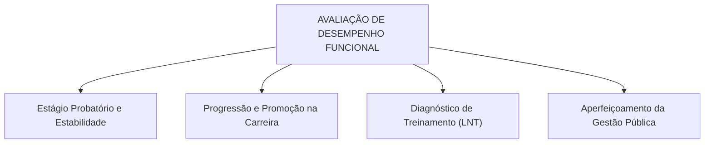
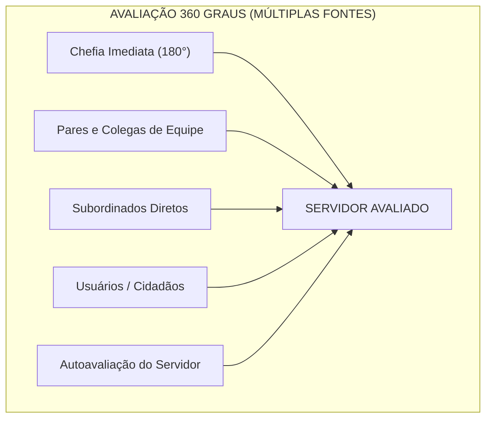
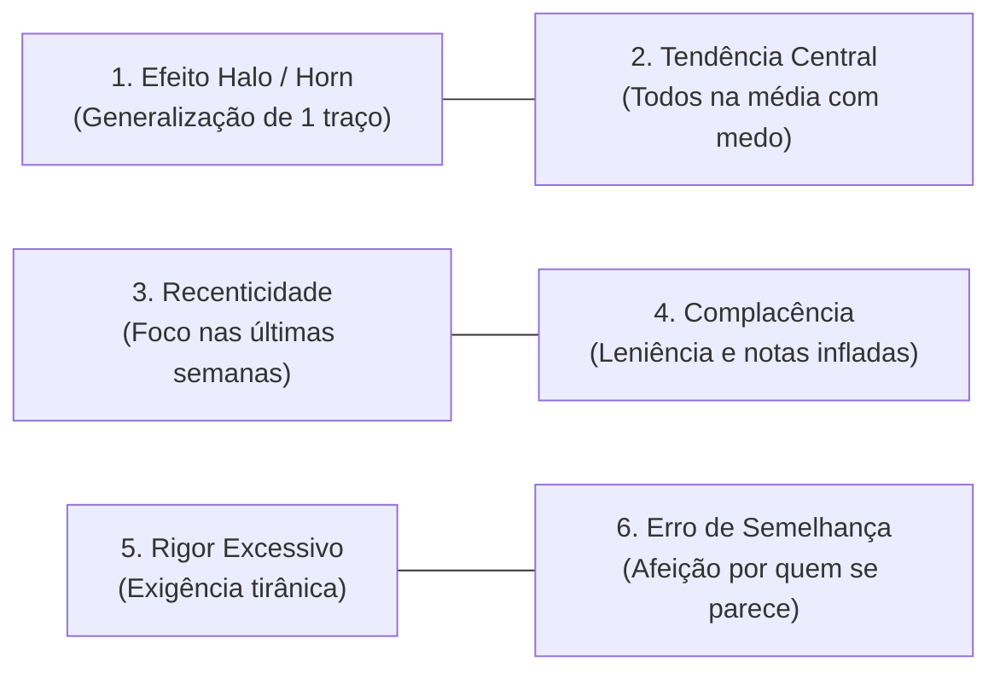
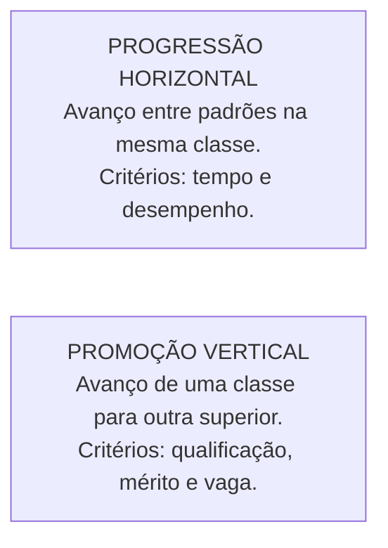
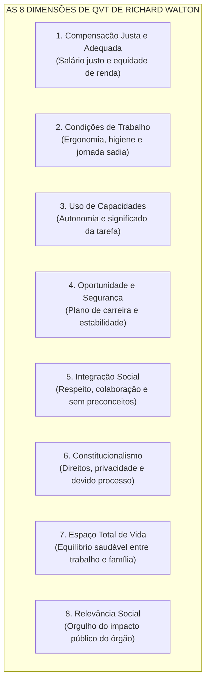

# 03 - Avaliação de Desempenho, Remuneração, Qualidade de Vida no Trabalho e Teletrabalho

> **Matéria:** Gestão de Pessoas  
> **Cargo:** A01 – Técnico de Controle Externo – Especialidade: Técnico Administrativo (TCE-GO)  
> **Conteúdo Oficial:** Gestão e Avaliação de Desempenho no Setor Público; Métodos Tradicionais e Modernos de Avaliação; Erros e Vieses Cognitivos do Avaliador; Estrutura Remuneratória e o Regime de Subsídio Constitucional; Qualidade de Vida no Trabalho (Modelo das 8 Dimensões de Richard Walton); Novas Modalidades de Trabalho (Teletrabalho, Gestão por Resultados e Direito à Desconexão).

---

## 📌 Ementa & Delimitação do Conteúdo

1. **Gestão e Avaliação de Desempenho Funcional:**
    - Conceito, objetivos e finalidades na administração pública: subsídio para o estágio probatório, concessão de progressões e promoções funcionais, diagnóstico de necessidades de treinamento e melhoria dos serviços aos cidadãos;
    - Alocação no macroprocesso de **Aplicar Pessoas** (modelo de Idalberto Chiavenato);
    - Os papéis na avaliação: autoavaliação, avaliação pelo gestor imediato, avaliação pela equipe e avaliação institucional.

2. **Métodos de Avaliação de Desempenho:**
    - **Métodos Tradicionais:**
    - *Escalas Gráficas:* tabela de dupla entrada, fatores de avaliação graduados; simplicidade operacional vs. alta subjetividade e superficialidade;
    - *Escolha Forçada:* blocos de frases alternativas (positivas e neutras) com escolha obrigatória; mitigação de complacência vs. impossibilidade de feedback construtivo;
    - *Incidentes Críticos:* anotação exclusiva de comportamentos extremos altamente positivos ou falhas graves; foco em dados reais vs. omissão da rotina habitual;
    - *Pesquisa de Campo:* condução por especialista de RH em conjunto com cada chefia direta; profundidade diagnóstica vs. elevado custo orçamentário e morosidade operacional;
    - *Listas de Verificação (Checklists).*
    - **Métodos Modernos e Participativos:**
    - *Avaliação por Objetivos / Metas (APO Participativa):* pactuação prévia e consensual de metas, acompanhamento contínuo e autoavaliação orientada ao futuro;
    - *Avaliação 360 Graus (Circular ou Múltiplas Fontes):* visão sistêmica envolvendo superior imediato, pares, subordinados, usuários do serviço e autoavaliação; riqueza de perspectivas vs. risco de complacência ou alianças espúrias.

3. **Erros, Vieses e Distorções Cognitivas do Avaliador:**
    - Efeito Halo (*halo effect*) e Efeito Horn: contaminação generalizada a partir de um traço positivo ou negativo isolado;
    - Tendência Central: receio de atribuir notas extremas, nivelando todos os servidores na nota mediana;
    - Erro de Recenticidade (Recência): supervalorização dos eventos das últimas semanas em detrimento do desempenho anual;
    - Complacência / Leniência: atribuição benevolente de notas máximas para evitar atritos com a equipe;
    - Rigor Excessivo / Severidade: exigência implacável e atribuição generalizada de notas rebaixadas;
    - Erro de Semelhança (*Similar-to-me*) e Erro de Contraste: comparação do servidor consigo mesmo ou com o colega avaliado anteriormente.

4. **Remuneração, Benefícios e Planos de Carreira:**
    - Componentes remuneratórios no setor público: vencimento básico vs. vantagens pecuniárias de caráter pessoal e funcional;
    - O regime jurídico do **Subsídio Constitucional** em parcela única (CF/88, art. 39, § 4º): vedações a acréscimos pecuniários e ressalva expressa às verbas indenizatórias;
    - O Teto Remuneratório Constitucional (CF/88, art. 37, XI) e o abate-teto;
    - Progressão funcional (horizontal, na mesma classe) vs. Promoção (vertical, entre classes da mesma carreira).

5. **Qualidade de Vida no Trabalho (QVT):**
    - As 8 dimensões conceituais do modelo clássico de Richard Walton: Compensação justa e adequada, Condições de segurança e saúde, Uso e desenvolvimento de capacidades, Oportunidade de crescimento e segurança, Integração social, Constitucionalismo organizacional, Espaço total de vida e Relevância social da instituição.

6. **Teletrabalho e Trabalho Híbrido no Setor Público:**
    - Deslocamento do controle tradicional de ponto biométrico para a **gestão por resultados, metas pactuadas e entregas concretas**;
    - Vantagens institucionais: racionalização de despesas prediais, flexibilidade, retenção de talentos e sustentabilidade ambiental;
    - Riscos e cuidados ergonômicos: isolamento social, segurança cibernética de autos processuais e garantia do **direito à desconexão** contra a Síndrome de *Burnout*.

---

## 🧭 Sumário

1. [Gestão e Métodos de Avaliação de Desempenho](#1-gestao-e-metodos-de-avaliacao-de-desempenho)
    1. [Teste 450](#Teste-450)
    2. [Teste 451](#Teste-451)
2. [Erros, Vieses e Distorções Cognitivas do Avaliador](#2-erros-vieses-e-distorcoes-cognitivas-do-avaliador)
    1. [Teste 452](#Teste-452)
    2. [Teste 453](#Teste-453)
3. [Remuneração e Planos de Carreira no Setor Público](#3-remuneracao-e-planos-de-carreira-no-setor-publico)
    1. [Teste 454](#Teste-454)
    2. [Teste 455](#Teste-455)
4. [Qualidade de Vida no Trabalho (QVT): Modelo de Richard Walton](#4-qualidade-de-vida-no-trabalho-qvt-modelo-de-richard-walton)
    1. [Teste 456](#Teste-456)
5. [Teletrabalho e Trabalho Híbrido no Setor Público](#5-teletrabalho-e-trabalho-hibrido-no-setor-publico)
    1. [Teste 457](#Teste-457)
    2. [Teste 458](#Teste-458)
    3. [Teste 459](#Teste-459)
6. [Fontes Oficiais e Referências Bibliográficas](#6-fontes-oficiais-e-referencias-bibliograficas)

---

## 1. Gestão e Métodos de Avaliação de Desempenho

A avaliação de desempenho é uma apreciação sistemática do comportamento e da entrega funcional do servidor no exercício de suas atribuições. Integra o macroprocesso de **Aplicar Pessoas** (Chiavenato).

#### Comparativo Completo dos Métodos de Avaliação de Desempenho

| Método de Avaliação | Como Funciona na Prática | Principais Vantagens | Principais Críticas / Desvantagens |
| :--- | :--- | :--- | :--- |
| **Escalas Gráficas** | Formulário em matriz: linhas com fatores predefinidos (ex.: produtividade, assiduidade) e colunas com notas em escala (ótimo, bom, regular, fraco). | Simples de elaborar, muito fácil de preencher e baixo custo financeiro. | Extremamente superficial; estimula a **tendência central** e o **efeito halo**; trata o avaliado de modo padronizado. |
| **Escolha Forçada** | Blocos de duas ou quatro frases descritivas (positivas/neutras). O gestor é obrigado a escolher a frase que mais descreve e a que menos descreve o servidor. | **Neutraliza a subjetividade**, o favoritismo pessoal e a complacência do gestor. | Método complexo de montar; gera desconfiança no gestor; **não permite fornecer feedback claro** (pesos estatísticos secretos). |
| **Incidentes Críticos** | O avaliador mantém um registro sistemático de comportamentos excepcionais extremos (sucessos notáveis ou falhas graves). | Baseado em fatos concretos reais comprovados, afastando opiniões genéricas. | Ignora a rotina mediana de desempenho; avaliador assume postura de "policial" fiscalizador de erros. |
| **Pesquisa de Campo** | Um analista técnico de Gestão de Pessoas vai até cada setor e entrevista o chefe imediato para avaliar conjuntamente cada colaborador. | Alta padronização, profundo rigor técnico, orienta a chefia sobre planos de melhoria. | Método de **altíssimo custo**, extrema lentidão e inviável para quadros muito volumosos. |
| **Avaliação por Objetivos (APO Participativa)** | Chefia e servidor sentam juntos, negociam metas quantitativas/qualitativas para o ciclo, acompanham periodicamente e realizam autoavaliação final. | Alto engajamento, estímulo à autonomia, foco em entregas futuras e resultados concretos. | Risco de conflito na fixação de metas; exige elevada maturidade gerencial; foco excessivo no quantitativo em detrimento de valores. |
| **Avaliação 360 Graus (Circular)** | O servidor é avaliado por múltiplos observadores: superior imediato, pares/colegas, subordinados diretos, usuários/cidadãos e sua própria autoavaliação. | Visão global, abrangente e democrática; atenua preconceitos de um único avaliador. | Muito trabalhosa de tabular; pode gerar pactos de conivência ("eu dou nota 10 para você e você para mim") ou vinganças internas. |

> 🚨 **ALERTA DE PROVA / PEGADINHA FCC (FEEDBACK NA ESCOLHA FORÇADA):**  
> A banca frequentemente afirma que o método da **Escolha Forçada** é o mais indicado quando o objetivo central do órgão é promover sessões ricas de *feedback* individual entre o chefe e o subordinado. **ERRADO!** Esse é um dos maiores "peguenhas" da FCC! A Escolha Forçada **NÃO serve para fornecer feedback**, pois o avaliador desconhece a pontuação estatística das frases preenchidas, o que impossibilita justificar detalhadamente a avaliação para o servidor.

---

### Teste 001
**(FCC – TRT 23ª – 2016 – Analista Judiciário - Apoio Especializado - Tecnologia da Informação)**
Um Analista do TRT23 deve estabelecer o sistema de gestão de segurança do Tribunal baseado na norma ABNT NBR ISO/IEC 27001:2013. Na fase de planejamento, os objetivos de segurança devem ser

* **A)** independentes da política de segurança da informação.
* **B)** mantidos em segredo pela alta direção da organização.
* **C)** fixos e imutáveis para possibilitar a avaliação de desempenho.
* **D)** distintos ao plano de negócio da organização.
* **E)** elaborados considerando os tratamentos de riscos.

---

> **Comentário Detalhado:**
>
> - **A)** **Correta.** Conforme fundamentado na seção *5. Teletrabalho e Trabalho Híbrido no Setor Público* deste guia, segurança da Informação e Sigilo de Processos: Necessidade de criptografia avançada, redes privadas virtuais (VPN) e certificação digital. Dessa forma, está plenamente correta a assertiva da banca (FCC – TRT 23ª/2016) ao estabelecer que "independentes da política de segurança da informação".
> - **B)** **Incorreta.** A opção apresenta proposição em desacordo com os fundamentos teóricos e técnicos do tópico ao afirmar que "mantidos em segredo pela alta direção da organização". De acordo com a teoria estudada em *Comparativo Completo dos Métodos de Avaliação de Desempenho*, pesquisa de Campo: Um analista técnico de Gestão de Pessoas vai até cada setor e entrevista o chefe imediato para avaliar conjuntamente cada colaborador. — Alta padronização, profundo rigor técnico, orienta a chefia sobre planos de melhoria. — Método de altíssimo custo, extrema lentidão e inviável para quadros muito volumosos.
> - **C)** **Incorreta.** A opção apresenta proposição em desacordo com os fundamentos teóricos e técnicos do tópico ao afirmar que "fixos e imutáveis para possibilitar a avaliação de desempenho". De acordo com a teoria estudada em *5. Teletrabalho e Trabalho Híbrido no Setor Público*, redução expressiva dos custos fixos de manutenção predial (energia elétrica, água, insumos de escritório, mobiliário).
> - **D)** **Incorreta.** A opção apresenta proposição em desacordo com os fundamentos teóricos e técnicos do tópico ao afirmar que "distintos ao plano de negócio da organização". De acordo com a teoria estudada em *4. Qualidade de Vida no Trabalho (QVT): Modelo de Richard Walton*, d4["4. Oportunidade e Segurança<br/ (Plano de carreira e estabilidade)"].
> - **E)** **Incorreta.** A opção apresenta proposição em desacordo com os fundamentos teóricos e técnicos do tópico ao afirmar que "elaborados considerando os tratamentos de riscos". De acordo com a teoria estudada em *4. Qualidade de Vida no Trabalho (QVT): Modelo de Richard Walton*, condições de Segurança e Saúde no Trabalho: Instalações físicas saudáveis, equipamentos ergonômicos, prevenção de acidentes, ausência de insalubridade e limites saudáveis de jornada laboral.
>
> **Gabarito: A**

---

### Teste 002
**(FGV – TRT 1ª – 2024 – Analista Judiciário - Área Administrativa)**
A figura abaixo mostra uma matriz do tipo “Nine Box” com parte das saídas de uma avaliação de desempenho com foco em competências realizada em certa organização. O gráfico mostra as entregas confrontadas com as capacidades (conhecimento/habilidades) de cinco profissionais (A, B, C, D e E), com a seguinte escala: 1 (não atende); 2 (em desenvolvimento); 3 a 5 (atende) e 6 (supera). A diretora de RH da organização está analisando esses resultados para propor possíveis ações de gestão de pessoas. Em relação aos profissionais, os dados da matriz indicam as seguintes situações e possibilidades de ação adequadas:

* **A)** A é um profissional pouco experiente: indicar para treinamento comportamental;
* **B)** B supera as exigências de capacitação, mas tem entregas insatisfatórias: reavaliar a área ou posição de atuação;
* **C)** C é um profissional com capacitação e entrega adequadas: requer orientação imediata do líder em relação às expectativas de entrega e deve priorizar a complementação técnica;
* **D)** D e E mostram excelente entrega: indicar para promoção;
* **E)** A e B atendem parcialmente aos requisitos: atribuir mais desafios com vistas a assumir atribuições mais complexas.

---

> **Comentário Detalhado:**
>
> - **A)** **Incorreta.** A opção apresenta proposição em desacordo com os fundamentos teóricos e técnicos do tópico ao afirmar que "A é um profissional pouco experiente: indicar para treinamento comportamental". De acordo com a teoria estudada em *6. Fontes Oficiais e Referências Bibliográficas*, decreto Federal nº 11.072/2022 (Programa de Gestão e Desempenho PGD e Teletrabalho) Disciplina o teletrabalho, planos de trabalho individuais, metas de produtividade e qualidade das entregas.
> - **B)** **Correta.** Conforme fundamentado na seção *Comparativo Completo dos Métodos de Avaliação de Desempenho* deste guia, avaliação por Objetivos (APO Participativa): Chefia e servidor sentam juntos, negociam metas quantitativas/qualitativas para o ciclo, acompanham periodicamente e realizam autoavaliação final. — Alto engajamento, estímulo à autonomia, foco em entregas futuras e resultados concretos. — Risco de conflito na fixação de metas; exige elevada maturidade gerencial; foco excessivo no quantitativo em detrimento de valores. Dessa forma, está plenamente correta a assertiva da banca (FGV – TRT 1ª/2024) ao estabelecer que "B supera as exigências de capacitação, mas tem entregas insatisfatórias: reavaliar a área ou posição de atuação".
> - **C)** **Incorreta.** A opção apresenta proposição em desacordo com os fundamentos teóricos e técnicos do tópico ao afirmar que "C é um profissional com capacitação e entrega adequadas: requer orientação imediata do líder em relação às...". De acordo com a teoria estudada em *5. Teletrabalho e Trabalho Híbrido no Setor Público*, deve entregar metas previamente pactuadas com a chefia imediata (frequentemente estipuladas com produtividade superior à exigida no trabalho presencial).
> - **D)** **Incorreta.** A opção apresenta proposição em desacordo com os fundamentos teóricos e técnicos do tópico ao afirmar que "D e E mostram excelente entrega: indicar para promoção". De acordo com a teoria estudada em *Dinâmica dos Planos de Cargos e Carreiras*, promoção: Elevação do servidor de uma classe para a classe imediatamente superior dentro da mesma carreira, dependendo de merecimento, capacitação continuada e vacância. Não se confunde com ascensão ou transposição (formas de provimento derivado banidas pela CF/88).
> - **E)** **Incorreta.** A opção apresenta proposição em desacordo com os fundamentos teóricos e técnicos do tópico ao afirmar que "A e B atendem parcialmente aos requisitos: atribuir mais desafios com vistas a assumir atribuições mais complexas". De acordo com a teoria estudada em *1. Gestão e Métodos de Avaliação de Desempenho*, a avaliação de desempenho é uma apreciação sistemática do comportamento e da entrega funcional do servidor no exercício de suas atribuições. Integra o macroprocesso de Aplicar Pessoas (Chiavenato).
>
> **Gabarito: B**

---

### Teste 003
**(CEBRASPE – TRT/10 – 2013 – Analista Judiciario Tecnologia Da Informacao)**
As medidas objetivas, tais como índices de produtividade, questionários de percepção e indicadores referentes a resultados quantitativos, constituem as principais métricas de avaliação de desempenho nas organizações, pois eliminam a subjetividade.

* **C)** Certo
* **E)** Errado

---

> **Comentário Detalhado:**
>
> - **C)** **Incorreta.** A proposição apresenta proposição em desacordo com os fundamentos teóricos e técnicos do tópico ao afirmar que "As medidas objetivas, tais como índices de produtividade, questionários de percepção e indicadores referentes...". De acordo com a teoria em *Comparativo Completo dos Métodos de Avaliação de Desempenho*, método de Avaliação: Como Funciona na Prática — Principais Vantagens — Principais Críticas / Desvantagens.
> - **E)** **Correta.** O item está **Errado** (gabarito oficial: **E**), pois contraria a disciplina teórica aplicável.
>
> **Gabarito: E**

---

### Teste 004
**(FCC – TRT 15ª – 2015 – Analista Judiciário - Tecnologia da Informação)**
O denominado Ciclo PDCA, também conhecido como Ciclo da Melhoria Contínua,

* **A)** analisa os processos com vistas a realizá-los de maneira otimizada, envolvendo as etapas de planejamento, execução, controle e avaliação.
* **B)** é um instrumento de gerenciamento de projetos, que contempla planejamento, desenvolvimento, controle e atualização.
* **C)** consiste em uma metodologia de avaliação de desempenho individual, vinculada a um projeto de constante desenvolvimento e aprimoramento.
* **D)** corresponde a método de gestão corporativa com dinâmicas de capacitação e aprendizagem.
* **E)** é um programa de excelência em gestão pública introduzido no âmbito da reforma voltada à implantação do modelo gerencial.

---

> **Comentário Detalhado:**
>
> - **A)** **Incorreta.** A opção apresenta proposição em desacordo com os fundamentos teóricos e técnicos do tópico ao afirmar que "analisa os processos com vistas a realizá los de maneira otimizada, envolvendo as etapas de planejamento...". De acordo com a teoria estudada em *5. Teletrabalho e Trabalho Híbrido no Setor Público*, aumento comprovado de produtividade na análise minuciosa de processos licitatórios e relatórios de auditoria que demandam concentração prolongada.
> - **B)** **Correta.** Conforme fundamentado na seção *4. Qualidade de Vida no Trabalho (QVT): Modelo de Richard Walton* deste guia, utilização e Desenvolvimento de Capacidades: Oportunidade dada ao colaborador de exercer autonomia intelectual, aplicar habilidades cognitivas, planejar seu trabalho e obter feedback claro. Dessa forma, está plenamente correta a assertiva da banca (FCC – TRT 15ª/2015) ao estabelecer que "é um instrumento de gerenciamento de projetos, que contempla planejamento, desenvolvimento, controle e atualização".
> - **C)** **Incorreta.** A opção apresenta proposição em desacordo com os fundamentos teóricos e técnicos do tópico ao afirmar que "consiste em uma metodologia de avaliação de desempenho individual, vinculada a um projeto de constante...". De acordo com a teoria estudada em *Comparativo Completo dos Métodos de Avaliação de Desempenho*, a banca frequentemente afirma que o método da Escolha Forçada é o mais indicado quando o objetivo central do órgão é promover sessões ricas de feedback individual entre o chefe e o subordinado. ERRADO! Esse é um dos maiores "peguenhas" da FCC! A Escolha Forçada NÃO serve para fornecer feedback, pois o avaliador desconhece a pontuação estatística das frases preenchidas, o que impossibilita justificar detalhadamente a avaliação para o servidor.
> - **D)** **Incorreta.** A opção apresenta proposição em desacordo com os fundamentos teóricos e técnicos do tópico ao afirmar que "corresponde a método de gestão corporativa com dinâmicas de capacitação e aprendizagem". De acordo com a teoria estudada em *Comparativo Completo dos Métodos de Avaliação de Desempenho*, pesquisa de Campo: Um analista técnico de Gestão de Pessoas vai até cada setor e entrevista o chefe imediato para avaliar conjuntamente cada colaborador. — Alta padronização, profundo rigor técnico, orienta a chefia sobre planos de melhoria. — Método de altíssimo custo, extrema lentidão e inviável para quadros muito volumosos.
> - **E)** **Incorreta.** A opção apresenta proposição em desacordo com os fundamentos teóricos e técnicos do tópico ao afirmar que "é um programa de excelência em gestão pública introduzido no âmbito da reforma voltada à implantação do modelo...". De acordo com a teoria estudada em *6. Fontes Oficiais e Referências Bibliográficas*, decreto Federal nº 11.072/2022 (Programa de Gestão e Desempenho PGD e Teletrabalho) Disciplina o teletrabalho, planos de trabalho individuais, metas de produtividade e qualidade das entregas.
>
> **Gabarito: B**

---

### Teste 005
**(FGV – TCE/PA – 2024 – Auditor de Controle Externo - Administrativa - Administração)**
A gestão estratégica de pessoas é um enfoque que alinha as práticas de gestão de recursos humanos aos objetivos organizacionais. Essa abordagem integra planejamento de carreira, treinamento e desenvolvimento, avaliação de desempenho e recompensas, promovendo um ambiente de trabalho motivador e produtivo. Com relação à gestão estratégica de pessoas, avalie as afirmativas a seguir. I. A gestão estratégica de pessoas integra-se à estratégia organizacional, atendendo a objetivos estratégicos, táticos e operacionais, todos devidamente interconectados. II. Não é necessário ter uma clara ideia do impacto do mercado e do ambiente externo em que a empresa está envolvida; a organização pode focar apenas em seus processos internos sem considerar essas variáveis para a gestão estratégica de pessoas. III. A avaliação do desempenho e dos resultados é a etapa de feedback constante e ágil para medição do que foi planejado e realizado. Está correto o que se afirma em

* **A)** I, apenas.
* **B)** I e II, apenas.
* **C)** I e III, apenas.
* **D)** II e III, apenas.
* **E)** I, II e III.

---

> **Comentário Detalhado:**
>
> - **A)** **Incorreta.** A opção incorre em restrição indevida ao limitar o escopo conceitual ao afirmar que "I, apenas". De acordo com a teoria estudada em *6. Fontes Oficiais e Referências Bibliográficas*, cHIAVENATO, Idalberto. Gestão de Pessoas: O Novo Papel dos Recursos Humanos nas Organizações. 5. ed. São Paulo: Atlas, 2020. (Cap. 8 Avaliação do Desempenho Humano; Cap. 9 Remuneração; Cap. 13 Qualidade de Vida no Trabalho).
> - **B)** **Incorreta.** A opção incorre em restrição indevida ao limitar o escopo conceitual ao afirmar que "I e II, apenas". De acordo com a teoria estudada em *1. Gestão e Métodos de Avaliação de Desempenho*, a avaliação de desempenho é uma apreciação sistemática do comportamento e da entrega funcional do servidor no exercício de suas atribuições. Integra o macroprocesso de Aplicar Pessoas (Chiavenato).
> - **C)** **Correta.** Conforme fundamentado na seção *6. Fontes Oficiais e Referências Bibliográficas* deste guia, constituição Federal de 1988 Art. 41, § 1º, III (Avaliação Periódica de Desempenho) Condição constitucional para perda de cargo do servidor estável mediante procedimento de avaliação periódica de desempenho. Dessa forma, está plenamente correta a assertiva da banca (FGV – TCE/PA/2024) ao estabelecer que "I e III, apenas".
> - **D)** **Incorreta.** A opção incorre em restrição indevida ao limitar o escopo conceitual ao afirmar que "II e III, apenas". De acordo com a teoria estudada em *6. Fontes Oficiais e Referências Bibliográficas*, tCU Governança da Gestão de Pessoas e Teletrabalho Referencial de boas práticas para acompanhamento do desempenho individual e institucional.
> - **E)** **Incorreta.** A opção apresenta proposição em desacordo com os fundamentos teóricos e técnicos do tópico ao afirmar que "I, II e III". De acordo com a teoria estudada em *6. Fontes Oficiais e Referências Bibliográficas*, mARRAS, Jean Pierre. Administração de Recursos Humanos: Do Operacional ao Estratégico. 15. ed. São Paulo: Saraiva, 2016. (Cap. 7 Avaliação de Desempenho; Cap. 8 Remuneração e Benefícios).
>
> **Gabarito: C**

---

### Teste 006
**(FGV – TCE/PA – 2024 – Auditor de Controle Externo - Administrativa - Ciência de Dados)**
Para assegurar que o SGSI esteja em conformidade com a norma ABNT NBR ISO/IEC 27001:2022, a organização deve

* **A)** focar na tecnologia, sem considerar o contexto da organização.
* **B)** envolver a alta administração e definir políticas claras de segurança da informação.
* **C)** implementar controles de segurança sem a necessidade de avaliação de riscos.
* **D)** evitar o monitoramento contínuo e a avaliação de desempenho do SGSI.
* **E)** ignorar a necessidade de melhorias contínuas após a implementação inicial.

---

> **Comentário Detalhado:**
>
> - **A)** **Incorreta.** A opção apresenta proposição em desacordo com os fundamentos teóricos e técnicos do tópico ao afirmar que "focar na tecnologia, sem considerar o contexto da organização". De acordo com a teoria estudada em *5. Teletrabalho e Trabalho Híbrido no Setor Público*, segurança da Informação e Sigilo de Processos: Necessidade de criptografia avançada, redes privadas virtuais (VPN) e certificação digital.
> - **B)** **Correta.** Conforme fundamentado na seção *5. Teletrabalho e Trabalho Híbrido no Setor Público* deste guia, direito à Desconexão e Síndrome de Burnout : Risco de o servidor trabalhar ininterruptamente no espaço doméstico. A administração pública deve estabelecer políticas rígidas de respeito aos períodos de repouso e desconexão digital fora do expediente pactuado. Dessa forma, está plenamente correta a assertiva da banca (FGV – TCE/PA/2024) ao estabelecer que "envolver a alta administração e definir políticas claras de segurança da informação".
> - **C)** **Incorreta.** A opção apresenta proposição em desacordo com os fundamentos teóricos e técnicos do tópico ao afirmar que "implementar controles de segurança sem a necessidade de avaliação de riscos". De acordo com a teoria estudada em *Comparativo Completo dos Métodos de Avaliação de Desempenho*, pesquisa de Campo: Um analista técnico de Gestão de Pessoas vai até cada setor e entrevista o chefe imediato para avaliar conjuntamente cada colaborador. — Alta padronização, profundo rigor técnico, orienta a chefia sobre planos de melhoria. — Método de altíssimo custo, extrema lentidão e inviável para quadros muito volumosos.
> - **D)** **Incorreta.** A opção apresenta proposição em desacordo com os fundamentos teóricos e técnicos do tópico ao afirmar que "evitar o monitoramento contínuo e a avaliação de desempenho do SGSI". De acordo com a teoria estudada em *4. Qualidade de Vida no Trabalho (QVT): Modelo de Richard Walton*, oportunidade de Crescimento Contínuo e Segurança: Perspectiva concreta de progressão na carreira, investimento institucional em capacitação e garantia de estabilidade funcional no emprego.
> - **E)** **Incorreta.** A opção apresenta proposição em desacordo com os fundamentos teóricos e técnicos do tópico ao afirmar que "ignorar a necessidade de melhorias contínuas após a implementação inicial". De acordo com a teoria estudada em *5. Teletrabalho e Trabalho Híbrido no Setor Público*, vantagens para a Administração Pública.
>
> **Gabarito: B**

---

### Teste 007
**(FGV – TCE/SC – 2026 – Auditor Fiscal de Controle Externo - Administração)**
A avaliação de desempenho supera o papel de simples instrumento avaliativo e passa a funcionar como mecanismo de retroação voltado ao autodesenvolvimento do servidor. Nessa concepção ampliada, a retroação não se restringe a uma única dimensão de análise, mas abrange um conjunto integrado de competências necessárias ao exercício profissional. Essa abordagem caracteriza-se por

* **A)** atuar como instrumento multidimensional de retroação, articulando quatro categorias de competências — pessoais, tecnológicas, metodológicas e sociais — para que o servidor identifique lacunas e direcione seu próprio crescimento profissional.
* **B)** restringir-se à aferição de metas quantitativas, por serem os únicos indicadores objetivos capazes de fornecer retroação precisa sobre o desempenho individual.
* **C)** focalizar as competências técnicas exigidas pelo cargo, consideradas a principal referência para ajustes de desempenho no curto prazo.
* **D)** limitar a retroação aos comportamentos observáveis e previamente descritos em padrões de conduta, excluindo dimensões não mensuráveis do desenvolvimento profissional.
* **E)** valorizar prioritariamente as competências adquiridas em programas formais de capacitação, por serem aquelas passíveis de mensuração objetiva e comparação entre servidores.

---

> **Comentário Detalhado:**
>
> - **A)** **Correta.** Conforme fundamentado na seção *Comparativo Completo dos Métodos de Avaliação de Desempenho* deste guia, escolha Forçada: Blocos de duas ou quatro frases descritivas (positivas/neutras). O gestor é obrigado a escolher a frase que mais descreve e a que menos descreve o servidor. — Neutraliza a subjetividade, o favoritismo pessoal e a complacência do gestor. — Método complexo de montar; gera desconfiança no gestor; não permite fornecer feedback claro (pesos estatísticos secretos). Dessa forma, está plenamente correta a assertiva da banca (FGV – TCE/SC/2026) ao estabelecer que "atuar como instrumento multidimensional de retroação, articulando quatro categorias de competências — pessoais...".
> - **B)** **Incorreta.** A opção apresenta proposição em desacordo com os fundamentos teóricos e técnicos do tópico ao afirmar que "restringir se à aferição de metas quantitativas, por serem os únicos indicadores objetivos capazes de fornecer...". De acordo com a teoria estudada em *Comparativo Completo dos Métodos de Avaliação de Desempenho*, avaliação por Objetivos (APO Participativa): Chefia e servidor sentam juntos, negociam metas quantitativas/qualitativas para o ciclo, acompanham periodicamente e realizam autoavaliação final. — Alto engajamento, estímulo à autonomia, foco em entregas futuras e resultados concretos. — Risco de conflito na fixação de metas; exige elevada maturidade gerencial; foco excessivo no quantitativo em detrimento de valores.
> - **C)** **Incorreta.** A opção apresenta proposição em desacordo com os fundamentos teóricos e técnicos do tópico ao afirmar que "focalizar as competências técnicas exigidas pelo cargo, consideradas a principal referência para ajustes de...". De acordo com a teoria estudada em *4. Qualidade de Vida no Trabalho (QVT): Modelo de Richard Walton*, o modelo formulado por Richard Walton (1973) é a principal referência doutrinária exigida em provas sobre o bem estar no ambiente corporativo e público. Walton estruturou a QVT em oito dimensões conceituais.
> - **D)** **Incorreta.** A opção apresenta proposição em desacordo com os fundamentos teóricos e técnicos do tópico ao afirmar que "limitar a retroação aos comportamentos observáveis e previamente descritos em padrões de conduta, excluindo...". De acordo com a teoria estudada em *2. Erros, Vieses e Distorções Cognitivas do Avaliador*, erro de Contraste: O avaliador julga o servidor comparando o diretamente com o indivíduo avaliado logo antes, e não confrontando seu desempenho com os padrões objetivos do cargo.
> - **E)** **Incorreta.** A opção apresenta proposição em desacordo com os fundamentos teóricos e técnicos do tópico ao afirmar que "valorizar prioritariamente as competências adquiridas em programas formais de capacitação, por serem aquelas...". De acordo com a teoria estudada em *4. Qualidade de Vida no Trabalho (QVT): Modelo de Richard Walton*, oportunidade de Crescimento Contínuo e Segurança: Perspectiva concreta de progressão na carreira, investimento institucional em capacitação e garantia de estabilidade funcional no emprego.
>
> **Gabarito: A**

---

## 2. Erros, Vieses e Distorções Cognitivas do Avaliador

A subjetividade humana constitui o maior obstáculo à precisão da avaliação de desempenho:

1. **Efeito Halo (*Halo Effect*) e Efeito Horn:**
    - *Halo:* O avaliador projeta uma característica altamente positiva (ex.: o servidor é pontual ou simpático) sobre todo o desempenho, atribuindo notas excelentes em fatores técnicos que sequer avaliou.
    - *Horn:* Uma falha isolada contamina negativamente todos os demais quesitos, rotulando o servidor como inteiramente inapto.

2. **Tendência Central:** O avaliador tem receio de prejudicar os maus colaboradores ou gerar atritos ao destacar os melhores; por comodismo ou insegurança, atribui notas medianas ("bom" ou "regular") a todos.
3. **Erro de Recenticidade (Recência):** O avaliador deixa-se influenciar desproporcionalmente por fatos ocorridos nos últimos 15 ou 30 dias que antecedem a avaliação, ignorando os comportamentos dos 11 meses anteriores.
4. **Complacência / Leniência:** Tendência sistemática de conceder notas infladas a todos os subordinados para evitar descontentamento, atritos pessoais ou conversas difíceis de feedback.
5. **Rigor Excessivo / Severidade:** O avaliador estabelece padrões de exigência inalcançáveis, atribuindo notas baixas de forma generalizada por considerar que "ninguém faz mais do que a obrigação".
6. **Erro de Semelhança (*Similar-to-me*):** Tendência de avaliar mais favoravelmente indivíduos que compartilham dos mesmos valores, formação acadêmica, estilo pessoal ou interesses do próprio avaliador.
7. **Erro de Contraste:** O avaliador julga o servidor comparando-o diretamente com o indivíduo avaliado logo antes, e não confrontando seu desempenho com os padrões objetivos do cargo.

> 🛑 **ATENÇÃO — EFEITO HALO VS. RECÊNCIA:**  
>
> - **Efeito Halo:** distorção decorrente de uma **única característica ou traço marcante** que cega o avaliador sobre os demais quesitos;  
> - **Erro de Recência:** distorção de ordem **temporal**, em que o avaliador recorda apenas dos acontecimentos dos **últimos dias ou semanas** do ciclo avaliativo.

---

## 3. Remuneração e Planos de Carreira no Setor Público

A remuneração no serviço público subordina-se a rígidos parâmetros constitucionais de legalidade e moralidade:

* **Vencimento Básico:** Retribuição pecuniária fixada em lei devida ao servidor pelo efetivo exercício de cargo público.
* **Remuneração:** O vencimento do cargo efetivo acrescido das vantagens pecuniárias permanentes estabelecidas em lei (adicionais por tempo de serviço, gratificações de titulação, etc.).
* **Regime de Subsídio Constitucional (CF/88, art. 39, § 4º):**
    - Fixado em **parcela única**, sendo expressamente **vedado o acréscimo de qualquer gratificação, adicional, abono, prêmio, verba de representação** ou outra espécie remuneratória;
    - Obrigatório para membros de Poder, detentores de mandato eletivo, Ministros/Secretários e membros da Magistratura, Ministério Público, Defensoria Pública e carreiras policiais;
    - **Exceção Constitucional:** O subsídio não impede o pagamento de parcelas de natureza **estritamente indenizatória** previstas em lei (como diárias, ajuda de custo para mudança de sede e indenização de transporte).
* **Teto Remuneratório Constitucional (CF/88, art. 37, XI):** Limite máximo de retribuição no serviço público, correspondente ao subsídio mensal dos Ministros do Supremo Tribunal Federal (STF). Qualquer valor excedente deve ser retido pela aplicação do instituto do **abate-teto**.

#### Dinâmica dos Planos de Cargos e Carreiras

* **Progressão:** Passagem do servidor de um padrão remuneratório para o seguinte, dentro da mesma classe de seu cargo efetivo (foco na senioridade e avaliações periódicas).
* **Promoção:** Elevação do servidor de uma classe para a classe imediatamente superior dentro da mesma carreira, dependendo de merecimento, capacitação continuada e vacância. *Não se confunde com ascensão ou transposição (formas de provimento derivado banidas pela CF/88).*

> 📌 **NOTA EXPLICATIVA — SUBSÍDIO CONSTITUCIONAL:**  
> O subsídio em parcela única (art. 39, § 4º da CF/88) **proíbe gratificações e adicionais de natureza remuneratória**, mas **NÃO impede verbas estritamente indenizatórias** (como diárias de viagem a serviço e ajuda de custo para transporte), visto que verbas indenizatórias apenas ressarcem despesas extraordinárias do agente e não integram a base remuneratória.

---

## 4. Qualidade de Vida no Trabalho (QVT): Modelo de Richard Walton

O modelo formulado por Richard Walton (1973) é a principal referência doutrinária exigida em provas sobre o bem-estar no ambiente corporativo e público. Walton estruturou a QVT em **oito dimensões conceituais**:

1. **Compensação Justa e Adequada:** Remuneração que garanta uma vida digna ao trabalhador e que observe a equidade interna (mesmo valor para atribuições equivalentes) e externa (mercado).
2. **Condições de Segurança e Saúde no Trabalho:** Instalações físicas saudáveis, equipamentos ergonômicos, prevenção de acidentes, ausência de insalubridade e limites saudáveis de jornada laboral.
3. **Utilização e Desenvolvimento de Capacidades:** Oportunidade dada ao colaborador de exercer autonomia intelectual, aplicar habilidades cognitivas, planejar seu trabalho e obter feedback claro.
4. **Oportunidade de Crescimento Contínuo e Segurança:** Perspectiva concreta de progressão na carreira, investimento institucional em capacitação e garantia de estabilidade funcional no emprego.
5. **Integração Social na Organização:** Clima colaborativo e acolhedor, ausência de discriminações de raça, gênero ou orientação sexual, respeito interpessoal e senso de pertencimento grupal.
6. **Constitucionalismo na Organização:** Vigência das garantias do Estado de Direito dentro da instituição: respeito à intimidade e privacidade do servidor, liberdade de expressão e direito à ampla defesa e contraditório contra atos punitivos internos.
7. **Espaço Total de Vida:** Equilíbrio sadio entre a dedicação às atividades profissionais e o tempo reservado ao convívio familiar, lazer, descanso e vida pessoal (prevenção ao esgotamento).
8. **Relevância Social do Trabalho:** Percepção e orgulho do servidor de que o trabalho de sua instituição gera valor real, protege o interesse público e contribui para o bem comum da sociedade.

> ⭐ **IMPORTANTE — CONSTITUCIONALISMO DE RICHARD WALTON:**  
> Em provas de tribunais e controladorias, a dimensão do **Constitucionalismo** desponta com enorme frequência. Ela significa assegurar os **direitos civis do trabalhador** dentro dos muros da repartição (privacidade de dados, liberdade de discordância respeitosa, equidade e devido processo em sindicâncias).

---

## 5. Teletrabalho e Trabalho Híbrido no Setor Público

A consolidação do regime de teletrabalho transformou a dinâmica das instituições de controle externo (como os Tribunais de Contas):

* **Superação do Paradigma Cartorial:** Substituição definitiva da mera fiscalização da presença física e batimento de ponto pelo modelo contemporâneo de **Pacto de Resultados e Metas Mensuráveis**:
    - O servidor em teletrabalho não se subordina ao controle tradicional de frequência horária;
    - Deve entregar metas previamente pactuadas com a chefia imediata (frequentemente estipuladas com produtividade superior à exigida no trabalho presencial).
* **Vantagens para a Administração Pública:**
    1. Redução expressiva dos custos fixos de manutenção predial (energia elétrica, água, insumos de escritório, mobiliário);
    2. Aumento comprovado de produtividade na análise minuciosa de processos licitatórios e relatórios de auditoria que demandam concentração prolongada;
    3. Atração e fixação de quadros técnicos qualificados;
    4. Redução da pegada de carbono e melhoria na mobilidade urbana das cidades.

* **Desafios e Riscos Gerenciais:**
    - **Sensação de Isolamento Social e Afastamento Cultural:** Risco de o servidor perder o senso de identidade e comunhão com a missão do órgão;
    - **Segurança da Informação e Sigilo de Processos:** Necessidade de criptografia avançada, redes privadas virtuais (VPN) e certificação digital;
    - **Direito à Desconexão e Síndrome de *Burnout*:** Risco de o servidor trabalhar ininterruptamente no espaço doméstico. A administração pública deve estabelecer políticas rígidas de respeito aos períodos de repouso e desconexão digital fora do expediente pactuado.

---

## 6. Fontes Oficiais e Referências Bibliográficas

* [Decreto Federal nº 11.072/2022 (Programa de Gestão e Desempenho - PGD e Teletrabalho)](https://www.planalto.gov.br/ccivil_03/_ato2019-2022/2022/decreto/d11072.htm) - Disciplina o teletrabalho, planos de trabalho individuais, metas de produtividade e qualidade das entregas.
* [Constituição Federal de 1988 - Art. 41, § 1º, III (Avaliação Periódica de Desempenho)](https://www.planalto.gov.br/ccivil_03/constituicao/constituicao.htm#art37) - Condição constitucional para perda de cargo do servidor estável mediante procedimento de avaliação periódica de desempenho.
* [Lei Estadual nº 20.756/2020 - Da Avaliação Especial e Periódica de Desempenho](https://legisla.casacivil.go.gov.br/pesquisa_legislacao/100979/lei-20756) - Critérios de estágio probatório, avaliação periódica e teletrabalho para servidores públicos de Goiás.
* [Lei Estadual nº 15.122/2005 (Estrutura Remuneratória e Progressão no TCE-GO)](https://legisla.casacivil.go.gov.br/pesquisa_legislacao/80023/lei-15122) - Vencimentos, progressões, promoções por mérito e gratificações dos servidores do TCE-GO.
* [TCU - Governança da Gestão de Pessoas e Teletrabalho](https://portal.tcu.gov.br/governanca/governanca-no-tcu/) - Referencial de boas práticas para acompanhamento do desempenho individual e institucional.
* CHIAVENATO, Idalberto. **Gestão de Pessoas: O Novo Papel dos Recursos Humanos nas Organizações**. 5. ed. São Paulo: Atlas, 2020. (Cap. 8 - Avaliação do Desempenho Humano; Cap. 9 - Remuneração; Cap. 13 - Qualidade de Vida no Trabalho).
* MARRAS, Jean Pierre. **Administração de Recursos Humanos: Do Operacional ao Estratégico**. 15. ed. São Paulo: Saraiva, 2016. (Cap. 7 - Avaliação de Desempenho; Cap. 8 - Remuneração e Benefícios).
* LIMONGI-FRANÇA, Ana Cristina. **Qualidade de Vida no Trabalho - QVT: Conceitos e Práticas nas Empresas da Sociedade Pós-Industrial**. 2. ed. São Paulo: Atlas, 2012. (Cap. 2 - Modelos de QVT: Walton e Nadler-Lawler).
