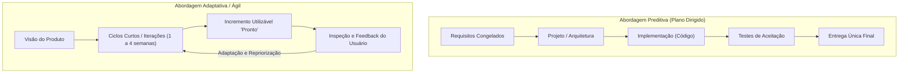
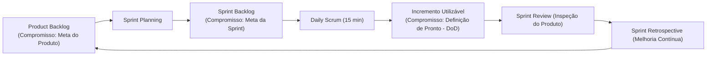

# 01 - Ciclo de Vida e Metodologias Ágeis

> **Matéria:** Engenharia de Software  
> **Cargo:** B02 – Técnico de Controle Externo – Especialidade: Tecnologia da Informação  
> **Arquivo:** `01_ciclo_de_vida_e_metodologias_ageis.md`  

---

## 📌 Ementa / Itens do Edital
- Fundamentos da engenharia de software
- Ciclo de vida de software
- Abordagens de ciclo de vida preditiva, iterativa, incremental e adaptativa/ágil (e abordagens híbridas)
- Abordagens, métodos e frameworks ágeis: Scrum, Kanban, Lean Software Development e Extreme Programming (XP)

---

## 🧭 Sumário

1. [Fundamentos de Engenharia de Software e Processos](#1-fundamentos-de-engenharia-de-software-e-processos)
    1. [Escopo da Engenharia de Software e a Crise do Software](#11-escopo-da-engenharia-de-software-e-a-crise-do-software)
    2. [Atividades Genéricas de Processo de Software](#12-atividades-genericas-de-processo-de-software)
    3. [Modelos de Maturidade de Processo (CMMI e MPS.BR)](#13-modelos-de-maturidade-de-processo-cmmi-e-mpsbr)
    4. [Teste 001](#Teste-001)
2. [Modelos de Ciclo de Vida de Software](#2-modelos-de-ciclo-de-vida-de-software)
    1. [Abordagem Preditiva: Modelo Cascata (Waterfall) e Modelo V](#21-abordagem-preditiva-modelo-cascata-waterfall-e-modelo-v)
    2. [Abordagem Iterativa e Incremental: Modelo Espiral e RUP](#22-abordagem-iterativa-e-incremental-modelo-espiral-e-rup)
    3. [Abordagem Adaptativa / Ágil: O Manifesto Ágil de 2001](#23-abordagem-adaptativa-agil-o-manifesto-agil-de-2001)
    4. [Abordagens Híbridas de Desenvolvimento](#24-abordagens-hibridas-de-desenvolvimento)
    5. [Teste 002](#Teste-002)
    6. [Teste 003](#Teste-003)
    7. [Teste 004](#Teste-004)
3. [O Framework Scrum (Guia Scrum 2020)](#3-o-framework-scrum-guia-scrum-2020)
    1. [Pilares do Empirismo e Valores Fundamentais](#31-pilares-do-empirismo-e-valores-fundamentais)
    2. [Estrutura do Scrum Team e Responsabilidades](#32-estrutura-do-scrum-team-e-responsabilidades)
    3. [Eventos Formais do Scrum e Regras de Time-box](#33-eventos-formais-do-scrum-e-regras-de-time-box)
    4. [Artefatos Oficiais e seus Três Compromissos Formais](#34-artefatos-oficiais-e-seus-tres-compromissos-formais)
    5. [Métricas e Gráficos de Acompanhamento (Burndown e Burnup)](#35-metricas-e-graficos-de-acompanhamento-burndown-e-burnup)
    6. [Teste 005](#Teste-005)
    7. [Teste 006](#Teste-006)
    8. [Teste 007](#Teste-007)
    9. [Teste 008](#Teste-008)
4. [Método Kanban e Gestão do Fluxo de Valor](#4-metodo-kanban-e-gestao-do-fluxo-de-valor)
    1. [Princípios e Práticas Gerais do Kanban](#41-principios-e-praticas-gerais-do-kanban)
    2. [Limites de Trabalho em Progresso (WIP) e Gargalos](#42-limites-de-trabalho-em-progresso-wip-e-gargalos)
    3. [Métricas de Fluxo: Lead Time, Cycle Time, Throughput e CFD](#43-metricas-de-fluxo-lead-time-cycle-time-throughput-e-cfd)
    4. [Teste 009](#Teste-009)
    5. [Teste 010](#Teste-010)
5. [Extreme Programming (XP) e Lean Software Development](#5-extreme-programming-xp-e-lean-software-development)
    1. [Extreme Programming: Valores e Práticas de Engenharia](#51-extreme-programming-valores-e-praticas-de-engenharia)
    2. [Lean Software Development e Eliminação dos 7 Desperdícios](#52-lean-software-development-e-eliminacao-dos-7-desperdicios)
    3. [Teste 011](#Teste-011)
6. [Fontes Oficiais e Referências Bibliográficas](#6-fontes-oficiais-e-referencias-bibliograficas)

---

## 1. Fundamentos de Engenharia de Software e Processos

### 1.1 Escopo da Engenharia de Software e a Crise do Software
A Engenharia de Software é a disciplina de engenharia dedicada ao estabelecimento e uso de sólidos princípios e métodos sistemáticos, disciplinados e quantificáveis para o desenvolvimento, operação e manutenção de software de alta qualidade dentro de custos e prazos previsíveis.

- **A Crise do Software:** O termo emergiu formalmente na Conferência da OTAN (NATO Conference) em 1968, em Garmisch, motivado pela incapacidade sistemática da indústria de entregar sistemas confiáveis dentro do orçamento e cronograma. Os projetos sofriam rotineiramente com estouros orçamentários astronômicos, atrasos severos, código repleto de defeitos e sistemas que não atendiam às necessidades reais dos usuários.
- **Fatores da Complexidade do Software (Frederick Brooks - *No Silver Bullet*):** Brooks dividiu a complexidade em duas dimensões:
    - *Complexidade Essencial:* Intrínseca à natureza do software (conformidade legal mutável, invisibilidade, complexidade inerente ao domínio do negócio);
    - *Complexidade Acidental:* Relacionada às limitações transitórias da tecnologia utilizada (compiladores rudimentares, falta de ferramentas de integração ou linguagens de baixo nível). Não há "bala de prata" tecnológica capaz de quadruplicar a produtividade por si só.

### 1.2 Atividades Genéricas de Processo de Software
Independentemente do ciclo de vida adotado (preditivo, iterativo ou ágil), a literatura clássica de engenharia de software (Pressman e Sommerville) mapeia cinco atividades genéricas de processo:

1. **Comunicação:** Cooperação contínua e levantamento de requisitos junto a clientes e partes interessadas (*stakeholders*);
2. **Planejamento:** Estimativas de esforço, alocação de recursos, definição de entregáveis, cronograma e análise de riscos;
3. **Modelagem:** Elaboração de arquitetura de software, diagramação de modelos conceituais, fluxos de dados e especificações detalhadas de design;
4. **Construção:** Atividades conjugadas de codificação (programação) e testes automatizados/manuais de software;
5. **Implantação (Deployment):** Disponibilização do software em ambiente operacional, homologação pelo usuário final, suporte técnico e coleta de feedback.

### 1.3 Modelos de Maturidade de Processo (CMMI e MPS.BR)
- **CMMI (Capability Maturity Model Integration):** Desenvolvido pelo SEI (Software Engineering Institute), estrutura a capacidade e maturidade de organizações em 5 níveis escalonados:
    - *Nível 1 (Inicial):* Processos imprevisíveis, reativos e caóticos; o sucesso depende do esforço heróico individual;
    - *Nível 2 (Gerenciado):* Projetos planejados, medidos e controlados em nível de projeto;
    - *Nível 3 (Definido):* Processos corporativos padronizados e integrados em toda a organização;
    - *Nível 4 (Quantitativamente Gerenciado):* Processos controlados estatisticamente mediante métricas rigorosas de desempenho;
    - *Nível 5 (Em Otimização):* Foco na melhoria contínua e inovação sistemática de processos.
- **MPS.BR (Melhoria de Processo do Software Brasileiro):** Modelo nacional alinhado às normas ISO/IEC 12207 e 15504, subdividido em 7 níveis de maturidade decrescentes em letras (do nível G - Parcialmente Gerenciado até o nível A - Em Otimização).

---

### Teste 001
**(FCC – TRT-16 – Analista Judiciario Tecnologia da Informacao – 2014)**
Uma das metas do programa MPS.BR é definir e aprimorar um modelo de melhoria e avaliação de processo de software e serviços. O Modelo de Referência MPS para Software (MR-MPS-SW) define níveis de maturidade que são uma combinação entre processos e sua capacidade. Neste modelo,

* **A)** a definição dos processos segue os requisitos para um modelo de referência de processo apresentados na ISO/IEC 20968, declarando o propósito e os resultados esperados de sua execução.
* **B)** a capacidade do processo é a caracterização da sua habilidade para alcançar os objetivos atuais de negócio. Está relacionada com o atendimento aos requisitos associados aos processos de um determinado nível de capacidade.
* **C)** a escala de maturidade se inicia no nível A e progride até o nível G. Para cada um destes 7 níveis de maturidade é atribuído um perfil de processos que indicam onde a organização deve colocar o esforço de melhoria.
* **D)** o progresso e o alcance de um determinado nível de maturidade são obtidos quando são atendidos os propósitos e todos os resultados esperados dos respectivos processos e os resultados esperados dos atributos de processos estabelecidos para aquele nível.
* **E)** os processos são descritos em termos de propósito e resultados. O propósito estabelece os resultados a serem obtidos com a efetiva implementação do processo. Os resultados descrevem o objetivo geral a ser atingido durante a execução do processo.

---

> **Comentário Detalhado:**
>
> - **A)** **Incorreta.** A opção apresenta proposição em desacordo com os fundamentos teóricos e técnicos do tópico ao afirmar que "a definição dos processos segue os requisitos para um modelo de referência de processo apresentados na ISO/IEC...". De acordo com a teoria estudada em *1.3 Modelos de Maturidade de Processo (CMMI e MPS.BR)*, mPS.BR (Melhoria de Processo do Software Brasileiro): Modelo nacional alinhado às normas ISO/IEC 12207 e 15504, subdividido em 7 níveis de maturidade decrescentes em letras (do nível G - Parcialmente Gerenciado até o nível A - Em Otimização).
> - **B)** **Incorreta.** A opção apresenta proposição em desacordo com os fundamentos teóricos e técnicos do tópico ao afirmar que "a capacidade do processo é a caracterização da sua habilidade para alcançar os objetivos atuais de negócio. Está...". De acordo com a teoria estudada em *1.3 Modelos de Maturidade de Processo (CMMI e MPS.BR)*, cMMI (Capability Maturity Model Integration): Desenvolvido pelo SEI (Software Engineering Institute), estrutura a capacidade e maturidade de organizações em 5 níveis escalonados.
> - **C)** **Incorreta.** A opção apresenta proposição em desacordo com os fundamentos teóricos e técnicos do tópico ao afirmar que "a escala de maturidade se inicia no nível A e progride até o nível G. Para cada um destes 7 níveis de maturidade é...". De acordo com a teoria estudada em *1.3 Modelos de Maturidade de Processo (CMMI e MPS.BR)*, *Nível 3 (Definido):* Processos corporativos padronizados e integrados em toda a organização.
> - **D)** **Correta.** Conforme fundamentado na seção *1.3 Modelos de Maturidade de Processo (CMMI e MPS.BR)* deste guia, *Nível 5 (Em Otimização):* Foco na melhoria contínua e inovação sistemática de processos. Dessa forma, está plenamente correta a assertiva da banca (FCC – TRT-16/2014) ao estabelecer que "o progresso e o alcance de um determinado nível de maturidade são obtidos quando são atendidos os propósitos e...".
> - **E)** **Incorreta.** A opção apresenta proposição em desacordo com os fundamentos teóricos e técnicos do tópico ao afirmar que "os processos são descritos em termos de propósito e resultados. O propósito estabelece os resultados a serem...". De acordo com a teoria estudada em *1.3 Modelos de Maturidade de Processo (CMMI e MPS.BR)*, *Nível 1 (Inicial):* Processos imprevisíveis, reativos e caóticos; o sucesso depende do esforço heróico individual.
>
> **Gabarito: D**

---

## 2. Modelos de Ciclo de Vida de Software

### 2.1 Abordagem Preditiva: Modelo Cascata (Waterfall) e Modelo V
- **Modelo Cascata (Royce, 1970):** Caracteriza-se por uma progressão linear, estritamente sequencial entre as fases do ciclo de vida. Uma fase subsequente somente é iniciada quando todos os artefatos da fase anterior estiverem totalmente concluídos, documentados e formalmente aprovados (*gates* de transição).
    - *Vantagens:* Estrutura rígida de fácil controle gerencial para projetos com requisitos absolutamente estáveis, bem compreendidos e sem previsão de mudanças tecnológicas.
    - *Desvantagens:* Inflexibilidade severa para absorver mudanças; o software só ganha forma executável nas fases finais do projeto, postergando a percepção de valor e a identificação de defeitos críticos para o encerramento do cronograma.
- **Modelo V (Verificação e Validação):** Variação direta do modelo cascata que explicita o pareamento simétrico entre cada fase de especificação/desenvolvimento e a sua correspondente fase de testes:
    - Requisitos de Negócio $\longleftrightarrow$ Testes de Aceitação;
    - Requisitos de Sistema $\longleftrightarrow$ Testes de Sistema;
    - Design Arquitetural $\longleftrightarrow$ Testes de Integração;
    - Design Detalhado de Módulos $\longleftrightarrow$ Testes Unitários.

### 2.2 Abordagem Iterativa e Incremental: Modelo Espiral e RUP
- **Conceito de Iteração vs. Incremento:**
    - *Iterativo:* O software é desenvolvido por meio de repetições sucessivas de ciclos de desenvolvimento, refinando progressivamente a solução.
    - *Incremental:* A cada ciclo concluído, uma porção utilizável e funcional do software é acrescida à versão anterior.
- **Modelo Espiral (Barry Boehm, 1988):** Modelo orientado a riscos (*risk-driven*), no qual o desenvolvimento progride em ciclos espirais contínuos compostos por quatro quadrantes obrigatórios:
    1. *Determinação de objetivos, alternativas e restrições;*
    2. *Identificação e resolução de riscos* (análise de risco, prototipação e simulações);
    3. *Desenvolvimento e validação do produto do nível atual;*
    4. *Planejamento da próxima fase.*

- **Processo Unificado (RUP - Rational Unified Process):** Metodologia iterativa e incremental orientada por Casos de Uso e centrada na Arquitetura de Software. Estrutura-se em quatro fases temporais sequenciais:
    1. *Iniciação (Inception):* Estabelecimento do escopo de negócio e viabilidade;
    2. *Elaboração (Elaboration):* Mapeamento profundo dos requisitos, mitigação de riscos maiores e estabilização da arquitetura executável básica;
    3. *Construção (Construction):* Desenvolvimento em larga escala e codificação de todos os componentes;
    4. *Transição (Transition):* Implantação, homologação, treinamento dos usuários e passagem para operação.

> 🚨 **ALERTA DE PROVA / PEGADINHA FCC:** A característica mais cobrada pela FCC a respeito do Modelo Espiral de Boehm é a **gestão explícita e sistemática de riscos** (*risk analysis*) em cada espira. Se a questão mencionar "modelo direcionado pela mitigação contínua de riscos através de prototipação em cada volta do ciclo", marque com segurança o **Modelo Espiral**.

### 2.3 Abordagem Adaptativa / Ágil: O Manifesto Ágil de 2001
Em fevereiro de 2001, em Snowbird (Utah), dezessete líderes de desenvolvimento de software redigiram o **Manifesto para o Desenvolvimento Ágil de Software**, fundamentado em 4 Valores e 12 Princípios:

| Nós valorizamos mais: | Do que: |
| :--- | :--- |
| **Indivíduos e interações** | Processos e ferramentas |
| **Software em funcionamento** | Documentação abrangente |
| **Colaboração com o cliente** | Negociação de contratos |
| **Responder a mudanças** | Seguir um plano pré-estabelecido |

*A premissa não é eliminar processos, documentação, contratos ou planos, mas reconhecer que os itens à esquerda entregam valor direto superior e adaptabilidade num ambiente de incerteza.*

### 2.4 Abordagens Híbridas de Desenvolvimento
Reconhecem que o mundo corporativo raramente opera em extremos absolutos. Um projeto híbrido pode adotar:

- Abordagem preditiva no planejamento macro de escopo, contratação pública e cronograma de alto nível (governança tradicional);
- Abordagem adaptativa/ágil na execução das iterações técnicas pelas equipes de desenvolvimento (com Sprints Scrum, gestão visual Kanban e testes contínuos).

---

### Teste 002
**(FCC – TRT-13 – Analista Judiciario Tecnologia da Informacao – 2014)**
O desenvolvimento evolucionário baseia-se na ideia de desenvolvimento de uma implementação inicial, expondo o resultado aos comentários do usuário e refinando-o em novas versões até que seja desenvolvido um sistema adequado. As atividades de especificação, desenvolvimento e validação são intercaladas ao invés de separadas, com rápido feedback entre elas. Sommerville define dois tipos fundamentais de desenvolvimento evolucionário. Considere: I. Descrever todos os requisitos não funcionais antes de fazer o protótipo. Descrever os requisitos funcionais e técnicos. Implementar todos requisitos e desenvolver novo protótipo. II. Trabalhar com o cliente para explorar os requisitos e entregar um sistema final. O desenvolvimento começa com as partes do sistema compreendidas. O sistema evolui por meio da adição de novas características propostas pelo cliente. III. Incorporar e implementar todas as mudanças do software no primeiro estágio do desenvolvimento, definindo todos os requisitos técnicos. Formar um protótipo a partir daí. O sistema evolui por meio da adição de novas características propostas pelo cliente. IV. Compreender os requisitos do cliente e, a partir disso, desenvolver melhor definição de requisitos para o sistema. O protótipo se concentra na experimentação dos requisitos mal compreendidos do cliente. De acordo com Sommerville

* **A)** I é Prototipação throwaway; III é Prototipação incremental.
* **B)** I é Prototipação incremental; IV é Desenvolvimento exploratório.
* **C)** II é Desenvolvimento exploratório; IV é Prototipação throwaway.
* **D)** III é Desenvolvimento exploratório; IV é Prototipação revisional.
* **E)** II é Prototipação exploratória; III é Prototipação throwaway.

---

> **Comentário Detalhado:**
>
> - **A)** **Incorreta.** A opção apresenta proposição em desacordo com os fundamentos teóricos e técnicos do tópico ao afirmar que "I é Prototipação throwaway; III é Prototipação incremental". De acordo com a teoria estudada em *1.2 Atividades Genéricas de Processo de Software*, implantação (Deployment): Disponibilização do software em ambiente operacional, homologação pelo usuário final, suporte técnico e coleta de feedback.
> - **B)** **Incorreta.** A opção apresenta proposição em desacordo com os fundamentos teóricos e técnicos do tópico ao afirmar que "I é Prototipação incremental; IV é Desenvolvimento exploratório". De acordo com a teoria estudada em *5.2 Lean Software Development e Eliminação dos 7 Desperdícios*, adaptado do Sistema Toyota de Produção por Mary e Tom Poppendieck, o desenvolvimento Lean foca na entrega rápida de valor mediante a eliminação sistemática de desperdícios (*Muda*).
> - **C)** **Correta.** Conforme fundamentado na seção *2.1 Abordagem Preditiva: Modelo Cascata (Waterfall) e Modelo V* deste guia, modelo V (Verificação e Validação): Variação direta do modelo cascata que explicita o pareamento simétrico entre cada fase de especificação/desenvolvimento e a sua correspondente fase de testes. Dessa forma, está plenamente correta a assertiva da banca (FCC – TRT-13/2014) ao estabelecer que "II é Desenvolvimento exploratório; IV é Prototipação throwaway".
> - **D)** **Incorreta.** A opção apresenta proposição em desacordo com os fundamentos teóricos e técnicos do tópico ao afirmar que "III é Desenvolvimento exploratório; IV é Prototipação revisional". De acordo com a teoria estudada em *5.2 Lean Software Development e Eliminação dos 7 Desperdícios*, 2. Recursos Extras (Gold Plating): Funcionalidades desenvolvidas que nunca serão utilizadas pelo usuário final (excesso de especificação).
> - **E)** **Incorreta.** A opção apresenta proposição em desacordo com os fundamentos teóricos e técnicos do tópico ao afirmar que "II é Prototipação exploratória; III é Prototipação throwaway". De acordo com a teoria estudada em *2.1 Abordagem Preditiva: Modelo Cascata (Waterfall) e Modelo V*, *Vantagens:* Estrutura rígida de fácil controle gerencial para projetos com requisitos absolutamente estáveis, bem compreendidos e sem previsão de mudanças tecnológicas.
>
> **Gabarito: C**

---

### Teste 003
**(FCC – TRT-13 – Analista Judiciario Tecnologia da Informacao – 2014)**
Analise o modelo em espiral do processo de software de Boehm representado abaixo: Determinar objetivos, alternativas e restrições Avaliar alternativas, identificar, resolver riscos Análise de risco Revisão Análise de risco Análise de risco Análise de risco Protótipo de operação Protótipo 3 Protótipo 2 Protótipo 1 Simulação, modelos, benchmarks Plano de requisitos Plano de ciclo de vida Conceito de Plano de desenvolvimento Integração e plano de teste operação I II III Validação de requisitos Código Teste de unidade V&V do projeto Teste de integração Teste de aceitação Planejar próxima fase Operação Modelo em espiral do processo de software de Boehm ( /EEE,1988). c Desenvolver, verificar produto de próximo nível Os itens I, II e III correspondem, respectivamente, a

* **A)** Requisitos de SW - Projeto do produto - Projeto detalhado
* **B)** Projeto de HW - Codificação de alto nível - Implementação
* **C)** Requisitos funcionais e não funcionais - Protótipo final - Fluxograma de programa
* **D)** Levantamento de dados - Fluxograma do sistema - Modelo funcional
* **E)** Modelo Funcional - Modelo de dados - Codificação de alto nível

---

> **Comentário Detalhado:**
>
> - **A)** **Correta.** Conforme fundamentado na seção *1.3 Modelos de Maturidade de Processo (CMMI e MPS.BR)* deste guia, *Nível 2 (Gerenciado):* Projetos planejados, medidos e controlados em nível de projeto. Dessa forma, está plenamente correta a assertiva da banca (FCC – TRT-13/2014) ao estabelecer que "Requisitos de SW - Projeto do produto - Projeto detalhado".
> - **B)** **Incorreta.** A opção apresenta proposição em desacordo com os fundamentos teóricos e técnicos do tópico ao afirmar que "Projeto de HW - Codificação de alto nível - Implementação". De acordo com a teoria estudada em *2.4 Abordagens Híbridas de Desenvolvimento*, abordagem preditiva no planejamento macro de escopo, contratação pública e cronograma de alto nível (governança tradicional).
> - **C)** **Incorreta.** A opção apresenta proposição em desacordo com os fundamentos teóricos e técnicos do tópico ao afirmar que "Requisitos funcionais e não funcionais - Protótipo final - Fluxograma de programa". De acordo com a teoria estudada em *2.1 Abordagem Preditiva: Modelo Cascata (Waterfall) e Modelo V*, requisitos de Negócio \$\longleftrightarrow\$ Testes de Aceitação.
> - **D)** **Incorreta.** A opção apresenta proposição em desacordo com os fundamentos teóricos e técnicos do tópico ao afirmar que "Levantamento de dados - Fluxograma do sistema - Modelo funcional". De acordo com a teoria estudada em *2.1 Abordagem Preditiva: Modelo Cascata (Waterfall) e Modelo V*, requisitos de Sistema \$\longleftrightarrow\$ Testes de Sistema.
> - **E)** **Incorreta.** A opção apresenta proposição em desacordo com os fundamentos teóricos e técnicos do tópico ao afirmar que "Modelo Funcional - Modelo de dados - Codificação de alto nível". De acordo com a teoria estudada em *2.1 Abordagem Preditiva: Modelo Cascata (Waterfall) e Modelo V*, *Desvantagens:* Inflexibilidade severa para absorver mudanças; o software só ganha forma executável nas fases finais do projeto, postergando a percepção de valor e a identificação de defeitos críticos para o encerramento do cronograma.
>
> **Gabarito: A**

---

### Teste 004
**(FGV – TJ-BA – Analista Judiciario Tecnologia da Informacao – 2015)**
O Processo Unificado (Unified Process) é um processo de desenvolvimento de software que compreende um conjunto de atividades para construção de sistemas orientados a objetos e organiza suas iterações em quatro fases principais: Concepção, Elaboração, Construção e Transição. Com relação a essas fases do Processo Unificado, analise as afirmativas a seguir: I. Na fase de Elaboração o projeto de software é detalhado o suficiente para permitir um planejamento acurado para sua construção. II. A maioria dos requisitos são identificados e estimativas mais realistas são elaboradas na fase de Concepção. III. Em fase de Construção, os componentes de software são implementados e colocados à disposição dos usuários para realizaçãos dos testes beta, enquanto na fase de Transição acontece a implantação. Está correto o que se afirma em:

* **A)** somente I;
* **B)** somente II;
* **C)** somente III;
* **D)** somente I e II;
* **E)** I, II e III.

---

> **Comentário Detalhado:**
>
> - **A)** **Correta.** Conforme fundamentado na seção *1.2 Atividades Genéricas de Processo de Software* deste guia, planejamento: Estimativas de esforço, alocação de recursos, definição de entregáveis, cronograma e análise de riscos. Dessa forma, está plenamente correta a assertiva da banca (FGV – TJ-BA/2015) ao estabelecer que "somente I".
> - **B)** **Incorreta.** A opção incorre em restrição indevida ao limitar o escopo conceitual ao afirmar que "somente II". De acordo com a teoria estudada em *1.2 Atividades Genéricas de Processo de Software*, construção: Atividades conjugadas de codificação (programação) e testes automatizados/manuais de software.
> - **C)** **Incorreta.** A opção incorre em restrição indevida ao limitar o escopo conceitual ao afirmar que "somente III". De acordo com a teoria estudada em *1.2 Atividades Genéricas de Processo de Software*, modelagem: Elaboração de arquitetura de software, diagramação de modelos conceituais, fluxos de dados e especificações detalhadas de design.
> - **D)** **Incorreta.** A opção incorre em restrição indevida ao limitar o escopo conceitual ao afirmar que "somente I e II". De acordo com a teoria estudada em *1.2 Atividades Genéricas de Processo de Software*, implantação (Deployment): Disponibilização do software em ambiente operacional, homologação pelo usuário final, suporte técnico e coleta de feedback.
> - **E)** **Incorreta.** A opção apresenta proposição em desacordo com os fundamentos teóricos e técnicos do tópico ao afirmar que "I, II e III". De acordo com a teoria estudada em *2.4 Abordagens Híbridas de Desenvolvimento*, abordagem adaptativa/ágil na execução das iterações técnicas pelas equipes de desenvolvimento (com Sprints Scrum, gestão visual Kanban e testes contínuos).
>
> **Gabarito: A**

---

## 3. O Framework Scrum (Guia Scrum 2020)

### 3.1 Pilares do Empirismo e Valores Fundamentais
O Scrum é um framework leve que ajuda pessoas, times e organizações a gerar valor por meio de soluções adaptativas para problemas complexos. Alicerça-se no **Empirismo** e no pensamento **Lean**:

- **Três Pilares Empíricos:**
    1. *Transparência:* Processos e artefatos devem ser visíveis para todos os responsáveis pelos resultados;
    2. *Inspeção:* O progresso rumo aos objetivos deve ser examinado com frequência diligente para identificar anomalias;
    3. *Adaptação:* Havendo desvios inaceitáveis, os ajustes operacionais devem ser implementados no menor tempo viável.

- **Cinco Valores do Scrum:** Compromisso (*Commitment*), Foco (*Focus*), Abertura (*Openness*), Respeito (*Respect*) e Coragem (*Courage*).

### 3.2 Estrutura do Scrum Team e Responsabilidades
No Guia Scrum oficial de 2020, o **Scrum Team** é a unidade fundamental de trabalho, caracterizado por ser **multifuncional** (possui todas as habilidades necessárias para entregar o incremento) e **autogerenciado** (*self-managing* - a equipe decide internamente *quem*, *o que* e *como* fazer). O time compõe-se de três papéis/responsabilidades:

1. **Product Owner (PO):**
    - Responsável por **maximizar o valor do produto** resultante do trabalho do time;
    - Única pessoa responsável pela gestão eficaz do **Product Backlog** (criação, ordenação, clareza e comunicação dos itens de backlog);
    - Representa os interesses dos stakeholders; suas decisões devem ser respeitadas por toda a organização.

2. **Scrum Master (SM):**
    - Responsável por promover e apoiar o Scrum conforme definido no Guia;
    - Atua como um **líder que serve** (*true leader who serves*);
    - Remove impedimentos externos que bloqueiam o avanço dos Desenvolvedores;
    - Facilita os eventos do Scrum e garante a eficácia e a melhoria dos processos do time.

3. **Desenvolvedores (Developers):**
    - Pessoas do Scrum Team comprometidas em criar qualquer aspecto de um **Incremento utilizável a cada Sprint**;
    - Criam o plano para a Sprint (Sprint Backlog);
    - Adaptam o plano diariamente na Daily Scrum e responsabilizam-se pela qualidade aplicando a Definição de Pronto (*DoD*).

> 🚨 **ALERTA DE PROVA / PEGADINHA FCC:**  
>
> 1. No Guia 2020 **NÃO existe mais o papel "Time de Desenvolvimento" (Development Team)**. Existe apenas o *Scrum Team*, formado por PO, Scrum Master e Desenvolvedores. Não há subtimes nem hierarquias internas!  
> 2. O Scrum Master **NÃO é um gerente funcional**, não distribui tarefas individualmente e não cobra relatórios de horas.

### 3.3 Eventos Formais do Scrum e Regras de Time-box
Todos os eventos no Scrum possuem duração máxima pré-fixada (**time-box**):

| Evento Scrum | Finalidade Central e Participantes | Duração Máxima (Sprint de 1 mês) |
| :--- | :--- | :--- |
| **A Sprint** | Contêiner maior para todos os demais eventos. É o ciclo no qual o trabalho é executado para criar o incremento. | Até **um (1) mês** de duração fixa. |
| **Sprint Planning** | Define o plano de trabalho da Sprint abordando: 1) *Por que a Sprint é valiosa?* 2) *O que pode ser feito?* 3) *Como o trabalho será realizado?* | Máximo de **8 horas**. |
| **Daily Scrum** | Evento de alinhamento diário exclusivo dos **Desenvolvedores** para inspecionar o progresso rumo à Meta da Sprint e adaptar o plano para as próximas 24h. | Exatamente **15 minutos** (fixo, independentemente do tamanho da Sprint). |
| **Sprint Review** | Inspeção do Incremento produzido com os *stakeholders* para adaptar o Product Backlog com base no feedback real. | Máximo de **4 horas**. |
| **Sprint Retrospective** | Planejamento de melhorias na eficácia do time (pessoas, processos, ferramentas e Definição de Pronto). | Máximo de **3 horas**. |

> ⭐ **IMPORTANTE / REGRAS DA SPRINT:** Uma Sprint **nunca é prorrogada**. Se os itens planejados não forem concluídos dentro do time-box, a Sprint encerra-se normalmente; os itens não finalizados voltam para o Product Backlog. Uma Sprint só pode ser **cancelada prematuramente pelo Product Owner**, caso a Meta da Sprint (*Sprint Goal*) se torne obsoleta!

### 3.4 Artefatos Oficiais e seus Três Compromissos Formais
Cada um dos três artefatos do Scrum contém um **compromisso formal** associado (introduzido formalmente no Guia 2020) para fornecer transparência e foco:

1. **Product Backlog** $\longrightarrow$ Compromisso: **Meta do Produto (*Product Goal*)**  
    - O Product Backlog é a lista ordenada e emergente de tudo o que é necessário para melhorar o produto. A Meta do Produto descreve o estado futuro que serve como alvo de longo prazo para o Scrum Team.

2. **Sprint Backlog** $\longrightarrow$ Compromisso: **Meta da Sprint (*Sprint Goal*)**  
    - O Sprint Backlog é composto pela Meta da Sprint (o porquê), o conjunto de itens selecionados do Product Backlog (o quê) e o plano de ação detalhado (o como). A Meta da Sprint é o objetivo único acordado para a iteração, que não muda durante a sua execução.

3. **Incremento** $\longrightarrow$ Compromisso: **Definição de Pronto (*Definition of Done - DoD*)**  
    - O Incremento é um degrau concreto rumo à Meta do Produto. No momento em que um item do Product Backlog atende à Definição de Pronto, um novo Incremento nasce. A DoD é a descrição formal dos critérios de qualidade exigidos para que o item seja considerado pronto para uso.

### 3.5 Métricas e Gráficos de Acompanhamento (Burndown e Burnup)
- **Sprint Burndown Chart:** Gráfico que exibe a quantidade de **trabalho restante** (geralmente em pontos de história ou horas) em relação ao tempo da Sprint. A inclinação da linha decrescente indica se a equipe concluirá as tarefas no prazo;
- **Burnup Chart:** Gráfico com duas linhas: uma demonstrando o crescimento do escopo total ao longo do tempo e outra demonstrando o trabalho efetivamente concluído (*done*). Excelente para detectar expansão de escopo (*scope creep*).

---

### Teste 005
**(FGV – TRT-13 – Analista Judiciario Tecnologia da Informacao – 2022)**
Relacione os tipos de Sprint do SCRUM com as definições dos seus objetivos. 1. Inspecionar o progresso em direção ao Sprint Goal e adaptar o Sprint Backlog conforme necessário, ajustando o próximo trabalho planejado, é um evento de até 15 minutos para os desenvolvedores. 2. Estabelecer o trabalho a ser executado no Sprint. O plano resultante é criado pelo trabalho colaborativo de todo o time. 3. Planejar maneiras de aumentar a qualidade e a eficácia. 4. Inspecionar o resultado do Sprint e determinar futuras adaptações. O time apresenta os resultados do seu trabalho para as principais partes interessadas, sendo discutido o progresso em direção ao Produto. ( ) Sprint de Planejamento ( ) Sprint de Retrospectiva ( ) Reunião Diária ( ) Sprint de Revisão Assinale a opção que indica a relação correta, na ordem apresentada.

* **A)** 1 – 2 – 4 – 3.
* **B)** 1 – 3 – 2 – 1.
* **C)** 2 – 3 – 1 – 4.
* **D)** 3 – 4 – 1 – 2.
* **E)** 4 – 1 – 3 – 2.

---

> **Comentário Detalhado:**
>
> - **A)** **Incorreta.** A opção apresenta proposição em desacordo com os fundamentos teóricos e técnicos do tópico ao afirmar que "1 – 2 – 4 – 3". De acordo com a teoria estudada em *3.3 Eventos Formais do Scrum e Regras de Time-box*, sprint Planning: Define o plano de trabalho da Sprint abordando: 1) *Por que a Sprint é valiosa?* 2) *O que pode ser feito?* 3) *Como o trabalho será realizado?* — Máximo de 8 horas.
> - **B)** **Incorreta.** A opção apresenta proposição em desacordo com os fundamentos teóricos e técnicos do tópico ao afirmar que "1 – 3 – 2 – 1". De acordo com a teoria estudada em *3.5 Métricas e Gráficos de Acompanhamento (Burndown e Burnup)*, sprint Burndown Chart: Gráfico que exibe a quantidade de trabalho restante (geralmente em pontos de história ou horas) em relação ao tempo da Sprint. A inclinação da linha decrescente indica se a equipe concluirá as tarefas no prazo.
> - **C)** **Incorreta.** A opção apresenta proposição em desacordo com os fundamentos teóricos e técnicos do tópico ao afirmar que "2 – 3 – 1 – 4". De acordo com a teoria estudada em *3.2 Estrutura do Scrum Team e Responsabilidades*, responsável por maximizar o valor do produto resultante do trabalho do time.
> - **D)** **Correta.** Conforme fundamentado na seção *3.3 Eventos Formais do Scrum e Regras de Time-box* deste guia, daily Scrum: Evento de alinhamento diário exclusivo dos Desenvolvedores para inspecionar o progresso rumo à Meta da Sprint e adaptar o plano para as próximas 24h. — Exatamente 15 minutos (fixo, independentemente do tamanho da Sprint). Dessa forma, está plenamente correta a assertiva da banca (FGV – TRT-13/2022) ao estabelecer que "3 – 4 – 1 – 2".
> - **E)** **Incorreta.** A opção apresenta proposição em desacordo com os fundamentos teóricos e técnicos do tópico ao afirmar que "4 – 1 – 3 – 2". De acordo com a teoria estudada em *3.3 Eventos Formais do Scrum e Regras de Time-box*, sprint Retrospective: Planejamento de melhorias na eficácia do time (pessoas, processos, ferramentas e Definição de Pronto). — Máximo de 3 horas.
>
> **Gabarito: D**

---

### Teste 006
**(FGV – TJ-RR – Analista Judiciario Gestao e Governanca de Tecnologia da Informacao – 2024)**
Em relação às características do time Scrum, analise as afirmativas a seguir. I. O time Scrum é um pequeno grupo de pessoas em que o dono do produto é o superior hierárquico do Scrum Master e dos desenvolvedores. II. O Scrum Master é o responsável pela efetividade do time Scrum, permitindo que o time melhore suas práticas dentro do framework Scrum. III. Os desenvolvedores são as pessoas comprometidas a criar qualquer aspecto de um incremento utilizável em cada Sprint. Está correto o que se afirma em

* **A)** I, apenas.
* **B)** II, apenas.
* **C)** III, apenas.
* **D)** I e II, apenas.
* **E)** II e III, apenas.

---

> **Comentário Detalhado:**
>
> - **A)** **Incorreta.** A opção incorre em restrição indevida ao limitar o escopo conceitual ao afirmar que "I, apenas". De acordo com a teoria estudada em *3.3 Eventos Formais do Scrum e Regras de Time-box*, a Sprint: Contêiner maior para todos os demais eventos. É o ciclo no qual o trabalho é executado para criar o incremento. — Até um (1) mês de duração fixa.
> - **B)** **Incorreta.** A opção incorre em restrição indevida ao limitar o escopo conceitual ao afirmar que "II, apenas". De acordo com a teoria estudada em *3.2 Estrutura do Scrum Team e Responsabilidades*, no Guia 2020 NÃO existe mais o papel "Time de Desenvolvimento" (Development Team). Existe apenas o *Scrum Team*, formado por PO, Scrum Master e Desenvolvedores. Não há subtimes nem hierarquias internas!.
> - **C)** **Incorreta.** A opção incorre em restrição indevida ao limitar o escopo conceitual ao afirmar que "III, apenas". De acordo com a teoria estudada em *3.2 Estrutura do Scrum Team e Responsabilidades*, responsável por maximizar o valor do produto resultante do trabalho do time.
> - **D)** **Incorreta.** A opção incorre em restrição indevida ao limitar o escopo conceitual ao afirmar que "I e II, apenas". De acordo com a teoria estudada em *3.1 Pilares do Empirismo e Valores Fundamentais*, o Scrum é um framework leve que ajuda pessoas, times e organizações a gerar valor por meio de soluções adaptativas para problemas complexos. Alicerça-se no Empirismo e no pensamento Lean.
> - **E)** **Correta.** Conforme fundamentado na seção *3.2 Estrutura do Scrum Team e Responsabilidades* deste guia, pessoas do Scrum Team comprometidas em criar qualquer aspecto de um Incremento utilizável a cada Sprint. Dessa forma, está plenamente correta a assertiva da banca (FGV – TJ-RR/2024) ao estabelecer que "II e III, apenas".
>
> **Gabarito: E**

---

### Teste 007
**(FGV – TCE-SC – Auditor Fiscal de Controle Externo Ciencias da Computacao Sistemas de Informacao – 2026)**
Uma equipe de desenvolvimento do Tribunal utiliza Scrum e está no meio de uma Sprint de duas semanas. O Diretor de TI solicita a inclusão imediata de uma funcionalidade crítica que não foi planejada. De acordo com o Guia Scrum, a conduta do Scrum Master deve ser

* **A)** adicionar a tarefa à Sprint Backlog imediatamente para atender à diretoria.
* **B)** interromper a Sprint atual e iniciar uma nova fase de planejamento.
* **C)** orientar o Diretor a conversar com o Product Owner para priorizar o item no Product Backlog.
* **D)** solicitar que os desenvolvedores façam horas extras para entregar o novo item.
* **E)** cancelar a Daily Scrum para focar na nova funcionalidade.

---

> **Comentário Detalhado:**
>
> - **A)** **Incorreta.** A opção apresenta proposição em desacordo com os fundamentos teóricos e técnicos do tópico ao afirmar que "adicionar a tarefa à Sprint Backlog imediatamente para atender à diretoria". De acordo com a teoria estudada em *3.3 Eventos Formais do Scrum e Regras de Time-box*, sprint Review: Inspeção do Incremento produzido com os *stakeholders* para adaptar o Product Backlog com base no feedback real. — Máximo de 4 horas.
> - **B)** **Incorreta.** A opção apresenta proposição em desacordo com os fundamentos teóricos e técnicos do tópico ao afirmar que "interromper a Sprint atual e iniciar uma nova fase de planejamento". De acordo com a teoria estudada em *3.3 Eventos Formais do Scrum e Regras de Time-box*, uma Sprint nunca é prorrogada. Se os itens planejados não forem concluídos dentro do time-box, a Sprint encerra-se normalmente; os itens não finalizados voltam para o Product Backlog.
> - **C)** **Correta.** Conforme fundamentado na seção *3.3 Eventos Formais do Scrum e Regras de Time-box* deste guia, uma Sprint só pode ser cancelada prematuramente pelo Product Owner, caso a Meta da Sprint (*Sprint Goal*) se torne obsoleta!. Dessa forma, está plenamente correta a assertiva da banca (FGV – TCE-SC/2026) ao estabelecer que "orientar o Diretor a conversar com o Product Owner para priorizar o item no Product Backlog".
> - **D)** **Incorreta.** A opção apresenta proposição em desacordo com os fundamentos teóricos e técnicos do tópico ao afirmar que "solicitar que os desenvolvedores façam horas extras para entregar o novo item". De acordo com a teoria estudada em *3.4 Artefatos Oficiais e seus Três Compromissos Formais*, o Incremento é um degrau concreto rumo à Meta do Produto. No momento em que um item do Product Backlog atende à Definição de Pronto, um novo Incremento nasce.
> - **E)** **Incorreta.** A opção apresenta proposição em desacordo com os fundamentos teóricos e técnicos do tópico ao afirmar que "cancelar a Daily Scrum para focar na nova funcionalidade". De acordo com a teoria estudada em *3.2 Estrutura do Scrum Team e Responsabilidades*, única pessoa responsável pela gestão eficaz do Product Backlog (criação, ordenação, clareza e comunicação dos itens de backlog).
>
> **Gabarito: C**

---

### Teste 008
**(FGV – TJ-AP – Analista Judiciario Apoio Especializado Tecnologia da Informacao Seguranca da Informacao – 2023)**
A metodologia Scrum é um framework que apoia o desenvolvimento de soluções adaptativas para problemas complexos utilizando diversos artefatos. O artefato do Scrum composto pela Meta da Sprint (por que), o conjunto de itens do Product Backlog selecionados para a Sprint (o que), bem como um plano de ação para entregar o Incremento (como) é o:

* **A)** kanban;
* **B)** incremento;
* **C)** sprint backlog;
* **D)** product owner;
* **E)** meta do produto.

---

> **Comentário Detalhado:**
>
> - **A)** **Incorreta.** A opção apresenta proposição em desacordo com os fundamentos teóricos e técnicos do tópico ao afirmar que "kanban". De acordo com a teoria estudada em *3.3 Eventos Formais do Scrum e Regras de Time-box*, sprint Review: Inspeção do Incremento produzido com os *stakeholders* para adaptar o Product Backlog com base no feedback real. — Máximo de 4 horas.
> - **B)** **Incorreta.** A opção apresenta proposição em desacordo com os fundamentos teóricos e técnicos do tópico ao afirmar que "incremento". De acordo com a teoria estudada em *3.4 Artefatos Oficiais e seus Três Compromissos Formais*, o Incremento é um degrau concreto rumo à Meta do Produto. No momento em que um item do Product Backlog atende à Definição de Pronto, um novo Incremento nasce.
> - **C)** **Correta.** Conforme fundamentado na seção *3.4 Artefatos Oficiais e seus Três Compromissos Formais* deste guia, o Sprint Backlog é composto pela Meta da Sprint (o porquê), o conjunto de itens selecionados do Product Backlog (o quê) e o plano de ação detalhado (o como). A Meta da Sprint é o objetivo único acordado para a iteração, que não muda durante a sua execução. Dessa forma, está plenamente correta a assertiva da banca (FGV – TJ-AP/2023) ao estabelecer que "sprint backlog".
> - **D)** **Incorreta.** A opção apresenta proposição em desacordo com os fundamentos teóricos e técnicos do tópico ao afirmar que "product owner". De acordo com a teoria estudada em *3.3 Eventos Formais do Scrum e Regras de Time-box*, uma Sprint só pode ser cancelada prematuramente pelo Product Owner, caso a Meta da Sprint (*Sprint Goal*) se torne obsoleta!.
> - **E)** **Incorreta.** A opção apresenta proposição em desacordo com os fundamentos teóricos e técnicos do tópico ao afirmar que "meta do produto". De acordo com a teoria estudada em *3.4 Artefatos Oficiais e seus Três Compromissos Formais*, o Product Backlog é a lista ordenada e emergente de tudo o que é necessário para melhorar o produto. A Meta do Produto descreve o estado futuro que serve como alvo de longo prazo para o Scrum Team.
>
> **Gabarito: C**

---

## 4. Método Kanban e Gestão do Fluxo de Valor

### 4.1 Princípios e Práticas Gerais do Kanban
Concebido por David J. Anderson com base no Sistema Toyota de Produção, o método Kanban é uma abordagem evolucionária e não prescritiva para gestão de fluxos de trabalho do conhecimento.

- **Princípios de Gestão de Mudança:** Comece com o que você faz hoje; busque mudança evolucionária e incremental; respeite os papéis, responsabilidades e títulos atuais; incentive liderança em todos os níveis.
- **Práticas Gerais do Kanban:**
    1. *Visualizar o fluxo de trabalho* (quadro Kanban com colunas de status);
    2. *Limitar o Trabalho em Progresso (WIP)*;
    3. *Gerenciar o fluxo*;
    4. *Tornar as políticas de processo explícitas*;
    5. *Implementar ciclos de feedback (cadências)*;
    6. *Melhorar colaborativamente e evoluir experimentalmente*.

### 4.2 Limites de Trabalho em Progresso (WIP) e Gargalos
O Kanban opera como um **sistema puxado (*pull system*)**:

- **Limite de WIP (Work In Progress):** Cada coluna do quadro possui um teto máximo de itens permitidos simultaneamente (ex.: a coluna "Testes" com WIP = 3).
- **Efeito Prático:** Impede a sobrecarga da equipe, reduz o desperdício de troca de contexto (*context switching*) e torna imediatamente visíveis os **gargalos** de produção. Se uma coluna atingir o limite de WIP, a etapa anterior é impedida de empurrar novos itens, forçando os membros da equipe a colaborar para destravar o gargalo (*"Pare de começar e comece a terminar!"*).

### 4.3 Métricas de Fluxo: Lead Time, Cycle Time, Throughput e CFD
- **Lead Time:** É o tempo total decorrido entre a solicitação inicial da demanda pelo cliente (registro no backlog) até a sua efetiva entrega em ambiente de produção;
- **Cycle Time:** É o tempo em que a equipe técnica esteve ativamente trabalhando no desenvolvimento do item (desde que o cartão foi puxado para a primeira coluna de execução até a conclusão da tarefa);
- **Throughput (Vazão):** Quantidade de itens entregues e concluídos por unidade de tempo (ex.: 12 tarefas por semana);
- **Diagrama de Fluxo Cumulativo (CFD - Cumulative Flow Diagram):** Gráfico de áreas empilhadas que ilustra o número cumulativo de itens em cada fase do processo ao longo do tempo:
    - *Distância Vertical:* Mostra a quantidade de Trabalho em Progresso (WIP) em um dado instante;
    - *Distância Horizontal:* Revela o Lead Time aproximado dos itens. Bandas com inclinação constante indicam fluxo estável e previsível.

---

### Teste 009
**(FGV – TJ-RR – Analista Judiciario Gestao e Governanca de Tecnologia da Informacao – 2024)**
Considerando a aplicação de metodologias ágeis a projetos de desenvolvimento de software, analise as seguintes afirmativas: I. Mais do que software em funcionamento, documentação abrangente é um dos valores propostos pelo manifesto ágil. II. A limitação do número de tarefas em execução, conhecida como WIP (Work In Progress), favorece um ritmo sustentável para a equipe de desenvolvimento sem impedir o fluxo de trabalho. III. O tempo transcorrido desde o momento em que uma tarefa entra em um quadro Kanban até ser finalizada é conhecido como lead time. Está correto o que se afirma em

* **A)** I, apenas.
* **B)** II, apenas.
* **C)** III, apenas.
* **D)** I e II, apenas.
* **E)** II e III, apenas.

---

> **Comentário Detalhado:**
>
> - **A)** **Incorreta.** A opção incorre em restrição indevida ao limitar o escopo conceitual ao afirmar que "I, apenas". De acordo com a teoria estudada em *4.2 Limites de Trabalho em Progresso (WIP) e Gargalos*, limite de WIP (Work In Progress): Cada coluna do quadro possui um teto máximo de itens permitidos simultaneamente (ex.: a coluna "Testes" com WIP = 3).
> - **B)** **Incorreta.** A opção incorre em restrição indevida ao limitar o escopo conceitual ao afirmar que "II, apenas". De acordo com a teoria estudada em *2.3 Abordagem Adaptativa / Ágil: O Manifesto Ágil de 2001*, software em funcionamento: Documentação abrangente.
> - **C)** **Incorreta.** A opção incorre em restrição indevida ao limitar o escopo conceitual ao afirmar que "III, apenas". De acordo com a teoria estudada em *4.3 Métricas de Fluxo: Lead Time, Cycle Time, Throughput e CFD*, diagrama de Fluxo Cumulativo (CFD - Cumulative Flow Diagram): Gráfico de áreas empilhadas que ilustra o número cumulativo de itens em cada fase do processo ao longo do tempo.
> - **D)** **Incorreta.** A opção incorre em restrição indevida ao limitar o escopo conceitual ao afirmar que "I e II, apenas". De acordo com a teoria estudada em *4.3 Métricas de Fluxo: Lead Time, Cycle Time, Throughput e CFD*, throughput (Vazão): Quantidade de itens entregues e concluídos por unidade de tempo (ex.: 12 tarefas por semana).
> - **E)** **Correta.** Conforme fundamentado na seção *4.3 Métricas de Fluxo: Lead Time, Cycle Time, Throughput e CFD* deste guia, cycle Time: É o tempo em que a equipe técnica esteve ativamente trabalhando no desenvolvimento do item (desde que o cartão foi puxado para a primeira coluna de execução até a conclusão da tarefa). Dessa forma, está plenamente correta a assertiva da banca (FGV – TJ-RR/2024) ao estabelecer que "II e III, apenas".
>
> **Gabarito: E**

---

### Teste 010
**(FGV – TJ-MT – Analista Judiciario Tecnologia da Informacao – 2024)**
No método Kanban, uma das práticas centrais ajuda a identificar gargalos e promover a eficiência ao limitar a quantidade de trabalho em progresso. O texto acima se refere à seguinte prática do Kanban:

* **A)** dividir o trabalho em iterações fixas.
* **B)** estabelecer metas rígidas de entrega.
* **C)** realizar reuniões diárias de acompanhamento.
* **D)** aumentar o número de colunas no quadro Kanban.
* **E)** limitar o WIP (Work in Progress).

---

> **Comentário Detalhado:**
>
> - **A)** **Incorreta.** A opção apresenta proposição em desacordo com os fundamentos teóricos e técnicos do tópico ao afirmar que "dividir o trabalho em iterações fixas". De acordo com a teoria estudada em *3.5 Métricas e Gráficos de Acompanhamento (Burndown e Burnup)*, burnup Chart: Gráfico com duas linhas: uma demonstrando o crescimento do escopo total ao longo do tempo e outra demonstrando o trabalho efetivamente concluído (*done*). Excelente para detectar expansão de escopo (*scope creep*).
> - **B)** **Incorreta.** A opção apresenta proposição em desacordo com os fundamentos teóricos e técnicos do tópico ao afirmar que "estabelecer metas rígidas de entrega". De acordo com a teoria estudada em *4.3 Métricas de Fluxo: Lead Time, Cycle Time, Throughput e CFD*, lead Time: É o tempo total decorrido entre a solicitação inicial da demanda pelo cliente (registro no backlog) até a sua efetiva entrega em ambiente de produção.
> - **C)** **Correta.** Conforme fundamentado na seção *3.5 Métricas e Gráficos de Acompanhamento (Burndown e Burnup)* deste guia, sprint Burndown Chart: Gráfico que exibe a quantidade de trabalho restante (geralmente em pontos de história ou horas) em relação ao tempo da Sprint. A inclinação da linha decrescente indica se a equipe concluirá as tarefas no prazo. Dessa forma, está plenamente correta a assertiva da banca (FGV – TJ-MT/2024) ao estabelecer que "realizar reuniões diárias de acompanhamento".
> - **D)** **Incorreta.** A opção apresenta proposição em desacordo com os fundamentos teóricos e técnicos do tópico ao afirmar que "aumentar o número de colunas no quadro Kanban". De acordo com a teoria estudada em *4.1 Princípios e Práticas Gerais do Kanban*, *Visualizar o fluxo de trabalho* (quadro Kanban com colunas de status).
> - **E)** **Incorreta.** A opção apresenta proposição em desacordo com os fundamentos teóricos e técnicos do tópico ao afirmar que "limitar o WIP (Work in Progress)". De acordo com a teoria estudada em *4.2 Limites de Trabalho em Progresso (WIP) e Gargalos*, limite de WIP (Work In Progress): Cada coluna do quadro possui um teto máximo de itens permitidos simultaneamente (ex.: a coluna "Testes" com WIP = 3).
>
> **Gabarito: C**

---

## 5. Extreme Programming (XP) e Lean Software Development

### 5.1 Extreme Programming: Valores e Práticas de Engenharia
Criado por Kent Beck, o Extreme Programming (XP) é uma metodologia ágil voltada à excelência técnica e engenharia de software para times pequenos e médios submetidos a requisitos vagos e altamente dinâmicos.

- **Cinco Valores do XP:** Comunicação, Simplicidade, Feedback, Coragem e Respeito.
- **Práticas de Engenharia Centrais (Cobrança Constante em Concursos):**
    1. **Programação em Par (*Pair Programming*):** Dois desenvolvedores trabalham simultaneamente em uma única estação de trabalho. O **Driver (Piloto)** assume o teclado e digita o código com foco no detalhe imediato; o **Navigator (Copiloto)** analisa estrategicamente a solução, checa erros de sintaxe, avalia impactos arquiteturais e elabora casos de teste adicionais;
    2. **Test-Driven Development (TDD):** Desenvolvimento guiado por testes mediante o ciclo contínuo **Red-Green-Refactor**:
        - *Red:* Escrever um teste automatizado que falha (pois a funcionalidade ainda não existe);
        - *Green:* Escrever o código mínimo de produção suficiente para fazer o teste passar;
        - *Refactor:* Limpar e aprimorar o código-fonte (eliminando duplicações), garantindo que todos os testes continuem passando;

    3. **Refatoração Contínua (*Refactoring*):** Melhoria da estrutura interna do código sem alterar seu comportamento observável externo;
    4. **Propriedade Coletiva do Código (*Collective Ownership*):** Qualquer desenvolvedor do time tem liberdade e responsabilidade para alterar qualquer módulo do sistema para corrigir defeitos ou implementar melhorias;
    5. **Integração Contínua (*Continuous Integration*):** Código integrado e testado no repositório compartilhado várias vezes ao dia;
    6. **Design Simples:** O código atende a todos os testes, expressa com clareza a intenção, não possui duplicações (DRY - *Don't Repeat Yourself*) e contém o menor número possível de classes e métodos (YAGNI - *You Aren't Gonna Need It*).

### 5.2 Lean Software Development e Eliminação dos 7 Desperdícios
Adaptado do Sistema Toyota de Produção por Mary e Tom Poppendieck, o desenvolvimento Lean foca na entrega rápida de valor mediante a **eliminação sistemática de desperdícios (*Muda*)**:

| Desperdício no Lean Software | Manifestação Prática no Desenvolvimento de Sistemas |
| :--- | :--- |
| **1. Trabalho Parcialmente Feito** | Código desenvolvido que permanece semanas em branch aguardando testes ou aprovação de deploy. |
| **2. Recursos Extras (Gold Plating)** | Funcionalidades desenvolvidas que nunca serão utilizadas pelo usuário final (excesso de especificação). |
| **3. Reaprendizado** | Redescoberta de soluções por falta de testes automatizados ou ausência de documentação de código limpo. |
| **4. Passagem de Tarefas (Hand-offs)** | Perda de conhecimento e ruídos de comunicação na transição entre silos (analista $\rightarrow$ arquiteto $\rightarrow$ dev $\rightarrow$ tester). |
| **5. Atrasos / Esperas (Delays)** | Desenvolvedores ociosos aguardando liberação de ambiente, homologação de acessos ou aprovação de comitês. |
| **6. Troca de Contexto (Task Switching)** | Alocar profissionais em múltiplos projetos paralelos, gerando perda massiva de produtividade cognitiva. |
| **7. Defeitos e Bugs** | Falhas que chegam a produção e demandam esforço emergencial de correção e retrabalho. |

- **Princípios Fundamentais do Lean:** Eliminar desperdícios; Amplificar o aprendizado; Decidir o mais tarde possível (manter opções em aberto); Entregar o mais rápido possível; Empoderar o time; Construir integridade intrínseca; e Enxergar o todo (*See the whole*).

---

### Teste 011
**(FCC – TRT-13 – Analista Judiciario Tecnologia da Informacao – 2014)**
Flávio pretende desenvolver um software seguindo os estágios do modelo em cascata proposto por Sommerville, em razão de ponderações que faz em relação a outros modelos quanto à solução de um problema que se apresenta. Desta forma ele definiu em seu cronograma, na ordem apresentada pelo autor, as seguintes etapas do ciclo de vida de software:

* **A)** Projeto de sistema e software; Definição de requisitos; Implementação e teste de unidade; Integração e teste de sistema; Operação e manutenção.
* **B)** Projeto de sistema e software; Engenharia de software; Integração e teste de sistema; Análise de requisitos funcionais e técnicos; Operação e manutenção; Implementação e teste de unidade.
* **C)** Projeto de sistema e software; Análise de requisitos; Engenharia de requisitos; Implantação; Testes de sistemas; Operação e manutenção.
* **D)** Definição de requisitos; Engenharia de requisitos; Integração e teste de sistema; Projeto de sistema e software; Implementação e teste de unidade; Operação e manutenção; Integração e teste de sistema.
* **E)** Definição de requisitos; Projeto de sistema e software; Implementação e teste de unidade; Integração e teste de sistema; Operação e manutenção.

---

> **Comentário Detalhado:**
>
> - **A)** **Incorreta.** A opção apresenta proposição em desacordo com os fundamentos teóricos e técnicos do tópico ao afirmar que "Projeto de sistema e software; Definição de requisitos; Implementação e teste de unidade; Integração e teste de...". De acordo com a teoria estudada em *2.1 Abordagem Preditiva: Modelo Cascata (Waterfall) e Modelo V*, *Desvantagens:* Inflexibilidade severa para absorver mudanças; o software só ganha forma executável nas fases finais do projeto, postergando a percepção de valor e a identificação de defeitos críticos para o encerramento do cronograma.
> - **B)** **Incorreta.** A opção apresenta proposição em desacordo com os fundamentos teóricos e técnicos do tópico ao afirmar que "Projeto de sistema e software; Engenharia de software; Integração e teste de sistema; Análise de requisitos...". De acordo com a teoria estudada em *1.2 Atividades Genéricas de Processo de Software*, planejamento: Estimativas de esforço, alocação de recursos, definição de entregáveis, cronograma e análise de riscos.
> - **C)** **Incorreta.** A opção apresenta proposição em desacordo com os fundamentos teóricos e técnicos do tópico ao afirmar que "Projeto de sistema e software; Análise de requisitos; Engenharia de requisitos; Implantação; Testes de sistemas...". De acordo com a teoria estudada em *2.1 Abordagem Preditiva: Modelo Cascata (Waterfall) e Modelo V*, requisitos de Sistema \$\longleftrightarrow\$ Testes de Sistema.
> - **D)** **Incorreta.** A opção apresenta proposição em desacordo com os fundamentos teóricos e técnicos do tópico ao afirmar que "Definição de requisitos; Engenharia de requisitos; Integração e teste de sistema; Projeto de sistema e software...". De acordo com a teoria estudada em *1.2 Atividades Genéricas de Processo de Software*, independentemente do ciclo de vida adotado (preditivo, iterativo ou ágil), a literatura clássica de engenharia de software (Pressman e Sommerville) mapeia cinco atividades genéricas de processo.
> - **E)** **Correta.** Conforme fundamentado na seção *1.1 Escopo da Engenharia de Software e a Crise do Software* deste guia, a Engenharia de Software é a disciplina de engenharia dedicada ao estabelecimento e uso de sólidos princípios e métodos sistemáticos, disciplinados e quantificáveis para o desenvolvimento, operação e manutenção de software de alta qualidade dentro de custos e prazos previsíveis. Dessa forma, está plenamente correta a assertiva da banca (FCC – TRT-13/2014) ao estabelecer que "Definição de requisitos; Projeto de sistema e software; Implementação e teste de unidade; Integração e teste de...".
>
> **Gabarito: E**

---

## 6. Fontes Oficiais e Referências Bibliográficas

* [Guia do Scrum Oficial 2020 — Edição Online (Ken Schwaber & Jeff Sutherland)](https://scrumguides.org/scrum-guide.html) - Definição normativa do framework Scrum, pilares empíricos, Scrum Team, eventos e artefatos com seus compromissos.
* [Guia do Scrum 2020 — Documento Oficial em Português do Brasil (PDF)](https://scrumguides.org/docs/scrumguide/v2020/2020-Scrum-Guide-PortugueseBR-3.0.pdf) - Tradução oficial completa da versão 2020 do Guia do Scrum.
* [Manifesto para o Desenvolvimento Ágil de Software (2001)](https://agilemanifesto.org/iso/ptbr/manifesto.html) - Declaração oficial dos quatro valores centrais do desenvolvimento ágil de software.
* [Os 12 Princípios do Software Ágil — Agile Manifesto Oficial](https://agilemanifesto.org/iso/ptbr/principles.html) - Diretrizes fundamentais de entregas contínuas, adaptação a mudanças e excelência técnica.
* [O Guia Oficial do Kanban (Kanban Guides — Português do Brasil)](https://scrumguides.org/docs/scrumguide/v2020/2020-Scrum-Guide-PortugueseBR-3.0.pdf) - Definição formal do método Kanban, práticas de limitação de WIP e métricas de fluxo (Lead Time, Cycle Time e Throughput).
* [Continuous Integration (Martin Fowler — Práticas de Engenharia Ágil e XP)](https://martinfowler.com/articles/continuousIntegration.html) - Fundamentos de integração contínua, automação de builds e práticas técnicas do Extreme Programming (XP).
* SOMMERVILLE, Ian. **Engenharia de Software**. 10. ed. São Paulo: Pearson Education do Brasil, 2019. (Cap. 2 - Processos de Software; Cap. 3 - Desenvolvimento Ágil de Software).
* PRESSMAN, Roger S.; MAXIM, Bruce R. **Engenharia de Software: Uma Abordagem Profissional**. 9. ed. Porto Alegre: AMGH, 2021. (Cap. 2 - Modelos de Processo; Cap. 3 - Agilidade e Processo).
* BECK, Kent; ANDRES, Cynthia. **Extreme Programming Explained: Embrace Change**. 2. ed. Boston: Addison-Wesley Professional, 2004. (Sec. 1 - Values, Principles, and Practices).
