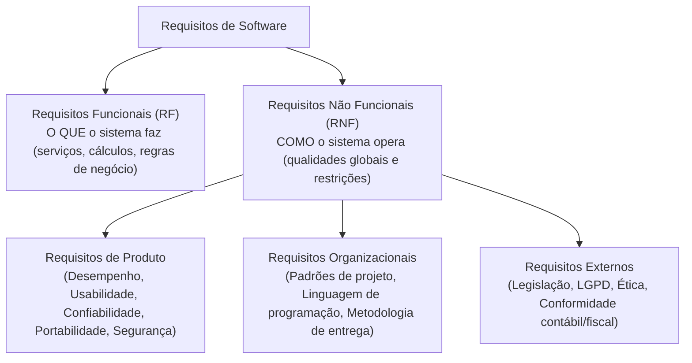
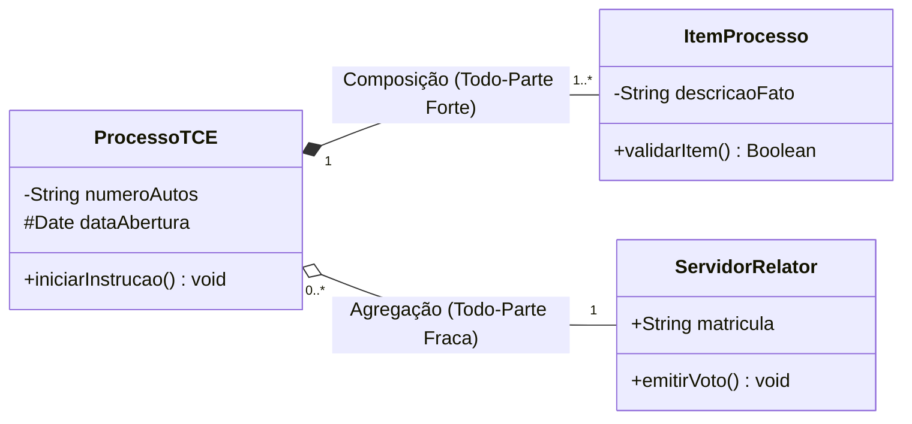
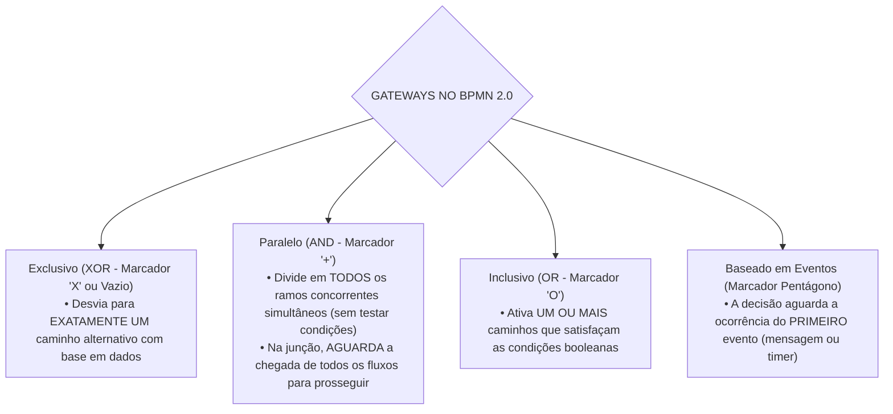

# 02 - Requisitos, Histórias de Usuário, UML e BPMN

> **Matéria:** Engenharia de Software  
> **Cargo:** B02 – Técnico de Controle Externo – Especialidade: Tecnologia da Informação  
> **Arquivo:** `02_requisitos_historias_de_usuario_uml_e_bpmn.md`  

---

## 📌 Ementa / Itens do Edital
- Levantamento, especificação, análise, validação e gerenciamento de requisitos funcionais e não funcionais
- Histórias de usuário, casos de uso e critérios de aceite
- Modelagem de sistemas com UML (Unified Modeling Language)
- Modelagem de processos de negócio com BPMN (Business Process Model and Notation)

---

## 🧭 Sumário

1. [Engenharia de Requisitos de Software](#1-engenharia-de-requisitos-de-software)
    1. [Ciclo de Vida da Engenharia de Requisitos](#11-ciclo-de-vida-da-engenharia-de-requisitos)
    2. [Técnicas de Elicitação de Requisitos](#12-tecnicas-de-elicitacao-de-requisitos)
    3. [Requisitos Funcionais vs. Requisitos Não Funcionais (Taxonomia de Sommerville)](#13-requisitos-funcionais-vs-requisitos-nao-funcionais-taxonomia-de-sommerville)
    4. [Gerenciamento, Rastreabilidade e Mudança de Requisitos](#14-gerenciamento-rastreabilidade-e-mudanca-de-requisitos)
    5. [Teste 012](#Teste-012)
    6. [Teste 013](#Teste-013)
2. [Modelagem por Casos de Uso e Histórias de Usuário](#2-modelagem-por-casos-de-uso-e-historias-de-usuario)
    1. [Modelagem de Casos de Uso: Elementos e Relacionamentos («include» vs. «extend»)](#21-modelagem-de-casos-de-uso-elementos-e-relacionamentos-include-vs-extend)
    2. [Histórias de Usuário (User Stories) e os 3 Cs de Ron Jeffries](#22-historias-de-usuario-user-stories-e-os-3-cs-de-ron-jeffries)
    3. [Critérios de Aceite e o Padrão INVEST](#23-criterios-de-aceite-e-o-padrao-invest)
    4. [Teste 014](#Teste-014)
    5. [Teste 015](#Teste-015)
    6. [Teste 016](#Teste-016)
3. [Modelagem de Sistemas com UML (versão 2.5)](#3-modelagem-de-sistemas-com-uml-versao-25)
    1. [Taxonomia dos Diagramas UML: Estruturais vs. Comportamentais](#31-taxonomia-dos-diagramas-uml-estruturais-vs-comportamentais)
    2. [Diagrama de Classes: Visibilidade, Multiplicidade, Agregação e Composição](#32-diagrama-de-classes-visibilidade-multiplicidade-agregacao-e-composicao)
    3. [Diagramas de Sequência, Atividades e Máquina de Estados](#33-diagramas-de-sequencia-atividades-e-maquina-de-estados)
    4. [Teste 017](#Teste-017)
    5. [Teste 018](#Teste-018)
    6. [Teste 019](#Teste-019)
4. [Modelagem de Processos de Negócio com BPMN 2.0](#4-modelagem-de-processos-de-negocio-com-bpmn-20)
    1. [Elementos de Fluxo: Eventos, Atividades e Tipos de Tarefas](#41-elementos-de-fluxo-eventos-atividades-e-tipos-de-tarefas)
    2. [Gateways Decisórios no BPMN 2.0 (XOR, AND, OR e Event-based)](#42-gateways-decisorios-no-bpmn-20-xor-and-or-e-event-based)
    3. [Estruturas de Separação (Pools e Lanes) e Conectores de Sequência vs. Mensagem](#43-estruturas-de-separacao-pools-e-lanes-e-conectores-de-sequencia-vs-mensagem)
    4. [Teste 020](#Teste-020)
    5. [Teste 021](#Teste-021)
    6. [Teste 022](#Teste-022)
5. [Fontes Oficiais e Referências Bibliográficas](#5-fontes-oficiais-e-referencias-bibliograficas)

---

## 1. Engenharia de Requisitos de Software

### 1.1 Ciclo de Vida da Engenharia de Requisitos
A Engenharia de Requisitos é o processo disciplinado de descobrir, analisar, documentar e verificar os serviços fornecidos pelo sistema e suas restrições operacionais (Ian Sommerville). Divide-se em etapas interligadas:

1. **Concepção / Estudo de Viabilidade:** Avalia se o sistema contribui para os objetivos da organização e se é técnica e economicamente viável;
2. **Elicitação (Levantamento):** Identificação e descoberta dos requisitos junto aos clientes, usuários e demais partes interessadas (*stakeholders*);
3. **Análise e Negociação:** Detecção de conflitos entre requisitos de diferentes fontes, análise de completude, consistência e priorização de demandas;
4. **Especificação:** Documentação formal dos requisitos levantados por meio de documentos formais (Documento de Requisitos de Software - DRS), Casos de Uso ou Histórias de Usuário;
5. **Validação:** Verificação se os requisitos especificados refletem fielmente as reais necessidades do cliente (revisões técnicas, testes de protótipos e geração de casos de teste);
6. **Gerenciamento de Requisitos:** Processo contínuo de controle de versões, rastreabilidade e acomodação de mudanças ao longo do ciclo de vida.

### 1.2 Técnicas de Elicitação de Requisitos
A escolha das técnicas de elicitação depende da maturidade do domínio de negócio e do perfil dos usuários:

- **Entrevistas:** Técnicas estruturadas (fechadas) ou abertas. Excelentes para explorar detalhes e obter uma visão aprofundada dos processos de negócio;
- **Questionários e Pesquisas:** Eficientes para coletar impressões de uma base ampla de usuários geograficamente dispersa, com baixo custo, embora sujeita a respostas superficiais;
- **Workshops / JAD (Joint Application Design):** Sessões estruturadas e colaborativas que reúnem desenvolvedores, gerentes e clientes no mesmo espaço físico para alinhar requisitos divergentes e acelerar consensos;
- **Etnografia e Observação Direta:** O analista acompanha presencialmente a rotina operacional do usuário em seu ambiente real de trabalho. Revela requisitos implícitos e regras tácitas que os usuários costumam esquecer de relatar nas entrevistas;
- **Prototipação Rápida:** Construção de maquetes visuais ou versões interativas preliminares do sistema para permitir a validação antecipada de fluxos de navegação e layouts.

### 1.3 Requisitos Funcionais vs. Requisitos Não Funcionais (Taxonomia de Sommerville)
A distinção entre o que o sistema realiza e como ele realiza constitui o pilar conceitual da engenharia de requisitos:

1. **Requisitos Funcionais (RF):** Descrevem as funções e comportamentos que o software deve executar. Especificam o que o sistema deve fazer em resposta a determinadas entradas, como reagir a situações específicas e quais cálculos realizar (ex.: *"O sistema deve calcular a alíquota previdenciária com base na remuneração bruta"*).
2. **Requisitos Não Funcionais (RNF):** Estabelecem propriedades de qualidade e restrições impostas aos serviços oferecidos pelo sistema. A taxonomia de Sommerville classifica os RNFs em:
    - *Requisitos de Produto:* Especificam o comportamento do produto em tempo de execução (desempenho, tempo de resposta, taxa de ocupação de memória, confiabilidade e disponibilidade mínima de 99,9%);
    - *Requisitos Organizacionais:* Decorrem das políticas e procedimentos da empresa cliente ou desenvolvedora (ex.: uso obrigatório de Java 21, versionamento no Git corporativo ou adoção da metodologia Scrum);
    - *Requisitos Externos:* Derivam de fatores externos ao sistema e à organização (ex.: aderência à Lei Geral de Proteção de Dados - LGPD, normas de interoperabilidade e regulamentações do Banco Central).

### 1.4 Gerenciamento, Rastreabilidade e Mudança de Requisitos
- **Rastreabilidade de Requisitos:** Capacidade de acompanhar o ciclo de vida de um requisito em ambas as direções:
    - *Rastreabilidade para trás (Backward traceability):* Liga o requisito à sua fonte originária (norma legal, entrevista ou necessidade de negócio);
    - *Rastreabilidade para frente (Forward traceability):* Liga o requisito aos módulos arquiteturais, classes, componentes e casos de teste que o implementam e validam;
- **Matriz de Rastreabilidade:** Tabela que mapeia a correlação bidirecional entre requisitos de usuário, requisitos de sistema, diagramas de arquitetura e casos de testes unitários.

---

### Teste 001
**(FCC – TCE/GO – 2009 – Analista de Controle Externo - Gestão de Conhecimento)**
Nas atividades culturais realizadas no âmbito da biblioteca _________________________________________________________ são utilizadas várias técnicas e instrumentos combinados. 69. Considere as afirmativas abaixo sobre catalogação. Na perspectiva da ação cultural, como proposta por José I. Enquanto o AACR-2 é usado para descrever Teixeira Coelho Neto, essas atividades devem fisicamente um documento e definir a forma das suas entradas, o padrão MARC organiza esses

* **A)** alavancar a produção cultural, em que os parti- mesmos dados para que possam ser processados cipantes são sujeitos do processo. por linguagens de marcação.
* **B)** ter princípio, meio e fim predeterminados, visando a II. Os Requisitos Funcionais para Registros Bibliográfi- realização de um produto. cos podem ser entendidos como um modelo con- ceitual que reestrutura os registros bibliográficos
* **C)** partir de um projeto da instituição e envolver os baseado na necessidade dos usuários. usuários como seus receptores. III. De acordo com o AACR-2, quando uma obra tem
* **D)** divertir o público e promover formas de lazer que mais de três autores, a entrada principal é pelo incluam programas de leitura e de arte. primeiro autor, seguido da expressão “et al”.
* **E)** facilitar o uso de instalações e meios ao desenvol- IV. O AACR-2 especifica três níveis para a descrição vimento de eventos culturais. catalográfica, o que dá às bibliotecas certa flexibili- _________________________________________________________ dade para determinar a sua política de catalogação.

---

> **Comentário Detalhado:**
>
> - **A)** **Incorreta.** A opção apresenta proposição em desacordo com os fundamentos teóricos e técnicos do tópico ao afirmar que "alavancar a produção cultural, em que os parti mesmos dados para que possam ser processados cipantes são sujeitos...". De acordo com a teoria estudada em *2.3 Critérios de Aceite e o Padrão INVEST*, i: Independent (Independente) — As histórias devem ser desacopladas entre si, permitindo que sejam priorizadas, desenvolvidas e implantadas em qualquer ordem.
> - **B)** **Incorreta.** A opção apresenta proposição em desacordo com os fundamentos teóricos e técnicos do tópico ao afirmar que "ter princípio, meio e fim predeterminados, visando a II. Os Requisitos Funcionais para Registros Bibliográfi...". De acordo com a teoria estudada em *4.1 Elementos de Fluxo: Eventos, Atividades e Tipos de Tarefas*, subprocessos: Atividades compostas que podem ser visualizadas de forma colapsada (com marcador de cruz "+") ou expandida.
> - **C)** **Correta.** Conforme fundamentado na seção *1.3 Requisitos Funcionais vs. Requisitos Não Funcionais (Taxonomia de Sommerville)* deste guia, rNF RNF ORG["Requisitos Organizacionais<br/ (Padrões de projeto, Linguagem de programação, Metodologia de entrega)"]. Dessa forma, está plenamente correta a assertiva da banca (FCC – TCE/GO/2009) ao estabelecer que "partir de um projeto da instituição e envolver os baseado na necessidade dos usuários. usuários como seus...".
> - **D)** **Incorreta.** A opção apresenta proposição em desacordo com os fundamentos teóricos e técnicos do tópico ao afirmar que "divertir o público e promover formas de lazer que mais de três autores, a entrada principal é pelo incluam...". De acordo com a teoria estudada em *4.2 Gateways Decisórios no BPMN 2.0 (XOR, AND, OR e Event-based)*, gW EVENT["Baseado em Eventos (Marcador Pentágono)<br/ • A decisão aguarda a ocorrência do PRIMEIRO evento (mensagem ou timer)"].
> - **E)** **Incorreta.** A opção apresenta proposição em desacordo com os fundamentos teóricos e técnicos do tópico ao afirmar que "facilitar o uso de instalações e meios ao desenvol IV. O AACR 2 especifica três níveis para a descrição vimento de...". De acordo com a teoria estudada em *4.2 Gateways Decisórios no BPMN 2.0 (XOR, AND, OR e Event-based)*, gateway Baseado em Eventos (Pentágono): O desvio de fluxo depende de qual evento externo intermediário (recebimento de mensagem ou expiração de temporizador) ocorrer primeiro no tempo.
>
> **Gabarito: C**

---

### Teste 002
**(FCC – TRT 9ª – 2015 – Analista Judiciário - Apoio Especializado - Tecnologia da Informação)**
A visão estática do RUP, uma variação do UP (Unified Process), prioriza as atividades que ocorrem durante o processo de desenvolvimento. Na descrição do RUP, estas atividades são chamadas de workflows. No workflow

* **A)** Gerenciamento de Configuração e Mudança os atores que interagem com o sistema são identificados e os casos de uso são desenvolvidos para modelar os requisitos do sistema.
* **B)** Meio Ambiente os processos de negócio são modelados por meio de casos de uso de negócios.
* **C)** Análise e Projeto um modelo de projeto é criado e documentado com modelos de arquitetura, modelos de componentes, modelos de objetos e modelos de sequência.
* **D)** Gerenciamento de Projeto, um dos principais do RUP, os componentes do sistema são implementados e estruturados em subsistemas de implementação.
* **E)** Modelagem de Negócios são disponibilizadas as ferramentas apropriadas para a equipe de desenvolvimento implementar o modelo de projeto do software.

---

> **Comentário Detalhado:**
>
> - **A)** **Incorreta.** A opção apresenta proposição em desacordo com os fundamentos teóricos e técnicos do tópico ao afirmar que "Gerenciamento de Configuração e Mudança os atores que interagem com o sistema são identificados e os casos de uso...". De acordo com a teoria estudada em *1.4 Gerenciamento, Rastreabilidade e Mudança de Requisitos*, matriz de Rastreabilidade: Tabela que mapeia a correlação bidirecional entre requisitos de usuário, requisitos de sistema, diagramas de arquitetura e casos de testes unitários.
> - **B)** **Incorreta.** A opção apresenta proposição em desacordo com os fundamentos teóricos e técnicos do tópico ao afirmar que "Meio Ambiente os processos de negócio são modelados por meio de casos de uso de negócios". De acordo com a teoria estudada em *4.1 Elementos de Fluxo: Eventos, Atividades e Tipos de Tarefas*, a notação BPMN 2.0 ( Business Process Model and Notation ), mantida pelo consórcio OMG, é o padrão global para desenho de processos de negócio.
> - **C)** **Correta.** Conforme fundamentado na seção *3.3 Diagramas de Sequência, Atividades e Máquina de Estados* deste guia, diagrama de Sequência: Representa como os objetos colaboram em uma sequência temporal ordenada. Elementos chave. Dessa forma, está plenamente correta a assertiva da banca (FCC – TRT 9ª/2015) ao estabelecer que "Análise e Projeto um modelo de projeto é criado e documentado com modelos de arquitetura, modelos de componentes...".
> - **D)** **Incorreta.** A opção apresenta proposição em desacordo com os fundamentos teóricos e técnicos do tópico ao afirmar que "Gerenciamento de Projeto, um dos principais do RUP, os componentes do sistema são implementados e estruturados em...". De acordo com a teoria estudada em *1.4 Gerenciamento, Rastreabilidade e Mudança de Requisitos*, rastreabilidade para frente (Forward traceability): Liga o requisito aos módulos arquiteturais, classes, componentes e casos de teste que o implementam e validam.
> - **E)** **Incorreta.** A opção apresenta proposição em desacordo com os fundamentos teóricos e técnicos do tópico ao afirmar que "Modelagem de Negócios são disponibilizadas as ferramentas apropriadas para a equipe de desenvolvimento implementar...". De acordo com a teoria estudada em *2.3 Critérios de Aceite e o Padrão INVEST*, e: Estimable (Estimável) — A equipe deve compreender a complexidade técnica para estimar seu esforço de desenvolvimento em Story Points ou horas.
>
> **Gabarito: C**

---

### Teste 003
**(FGV – TRT/DA – 2025 – Analista Judiciario Area Apoio Especializado Tecnologia Da Informacao)**
Paula e Maria estão avaliando as potencialidades dos usos de JSON e XML no desenvolvimento de aplicações Web para uma grande companhia estatal. As analistas sabem que JSON e XML são duas escolhas muito comuns quando se trata de formatos de dados na Web. A esse respeito, assinale a afirmativa correta.

* **A)** Com relação à legibilidade, Paula informa que ambos são legíveis por humanos, mas os documentos XML são mais detalhados.
* **B)** Com relação ao volume de dados, Maria informa que o JSON é maior e menos compacto que o XML devido aos elementos extra de marcação.
* **C)** Com relação as análises, Paula informa que as análises dos documentos JSON são mais complexas que os XML.
* **D)** Com relação ao apoio à gestão de dados, Maria informa que ambos possuem limitado suporte ao idioma português e que o XML está em desuso.
* **E)** Com relação aos casos de uso, Paula informa que o JSON é geralmente preterido para aplicações web devido ao seu código binário ser maior o que XML.

---

> **Comentário Detalhado:**
>
> - **A)** **Correta.** Conforme fundamentado na seção *4.2 Gateways Decisórios no BPMN 2.0 (XOR, AND, OR e Event-based)* deste guia, gW OR["Inclusivo (OR Marcador 'O')<br/ • Ativa UM OU MAIS caminhos que satisfaçam as condições booleanas"]. Dessa forma, está plenamente correta a assertiva da banca (FGV – TRT/DA/2025) ao estabelecer que "Com relação à legibilidade, Paula informa que ambos são legíveis por humanos, mas os documentos XML são mais...".
> - **B)** **Incorreta.** A opção apresenta proposição em desacordo com os fundamentos teóricos e técnicos do tópico ao afirmar que "Com relação ao volume de dados, Maria informa que o JSON é maior e menos compacto que o XML devido aos elementos...". De acordo com a teoria estudada em *2.1 Modelagem de Casos de Uso: Elementos e Relacionamentos («include» vs. «extend»)*, atores: Papéis desempenhados por entidades externas em relação ao sistema. Podem ser Atores Primários (iniciam o caso de uso para atingir um objetivo) ou Atores Secundários (fornecem serviços de apoio ao sistema, como um serviço externo de pagamento).
> - **C)** **Incorreta.** A opção apresenta proposição em desacordo com os fundamentos teóricos e técnicos do tópico ao afirmar que "Com relação as análises, Paula informa que as análises dos documentos JSON são mais complexas que os XML". De acordo com a teoria estudada em *1.1 Ciclo de Vida da Engenharia de Requisitos*, especificação: Documentação formal dos requisitos levantados por meio de documentos formais (Documento de Requisitos de Software DRS), Casos de Uso ou Histórias de Usuário.
> - **D)** **Incorreta.** A opção apresenta proposição em desacordo com os fundamentos teóricos e técnicos do tópico ao afirmar que "Com relação ao apoio à gestão de dados, Maria informa que ambos possuem limitado suporte ao idioma português e que...". De acordo com a teoria estudada em *1.3 Requisitos Funcionais vs. Requisitos Não Funcionais (Taxonomia de Sommerville)*, requisitos Externos: Derivam de fatores externos ao sistema e à organização (ex.: aderência à Lei Geral de Proteção de Dados LGPD, normas de interoperabilidade e regulamentações do Banco Central).
> - **E)** **Incorreta.** A opção apresenta proposição em desacordo com os fundamentos teóricos e técnicos do tópico ao afirmar que "Com relação aos casos de uso, Paula informa que o JSON é geralmente preterido para aplicações web devido ao seu...". De acordo com a teoria estudada em *2.1 Modelagem de Casos de Uso: Elementos e Relacionamentos («include» vs. «extend»)*, generalização / Especialização: Relação de herança representada por uma seta com triângulo vazado na ponta. Pode ocorrer entre casos de uso ou entre atores (ex.: Auditor de TI especializa Auditor Geral ).
>
> **Gabarito: A**

---

### Teste 004
**(FGV – TJ/RR – 2024 – Analista Judiciario Gestao E Governanca De Tecnologia Da Informacao)**
Um bom diagrama pode ajudar a comunicar ideias sobre um sistema, principalmente quando deseja-se evitar muitos detalhes. Na UML, uma ferramenta recomendada para esse fim é o Caso de Uso. Acerca dos diagramas de casos de uso, avalie as afirmativas a seguir e assinale (V) para a verdadeira e (F) para a falsa. ( ) Casos de uso são uma técnica para capturar os requisitos não funcionais de um software. ( ) Casos de uso representam uma visão externa do sistema, logo não deve haver correlação com as classes internas do sistema. ( ) Raias, atores e transições são elementos comuns em casos de uso. As afirmativas são, respectivamente,

* **A)** F – V – F.
* **B)** V – V – F.
* **C)** F – V – V.
* **D)** F – F – V.
* **E)** V – F – F.

---

> **Comentário Detalhado:**
>
> - **A)** **Correta.** Conforme fundamentado na seção *2.1 Modelagem de Casos de Uso: Elementos e Relacionamentos («include» vs. «extend»)* deste guia, atores: Papéis desempenhados por entidades externas em relação ao sistema. Podem ser Atores Primários (iniciam o caso de uso para atingir um objetivo) ou Atores Secundários (fornecem serviços de apoio ao sistema, como um serviço externo de pagamento). Dessa forma, está plenamente correta a assertiva da banca (FGV – TJ/RR/2024) ao estabelecer que "F – V – F".
> - **B)** **Incorreta.** A opção apresenta proposição em desacordo com os fundamentos teóricos e técnicos do tópico ao afirmar que "V – V – F". De acordo com a teoria estudada em *2.1 Modelagem de Casos de Uso: Elementos e Relacionamentos («include» vs. «extend»)*, generalização / Especialização: Relação de herança representada por uma seta com triângulo vazado na ponta. Pode ocorrer entre casos de uso ou entre atores (ex.: Auditor de TI especializa Auditor Geral ).
> - **C)** **Incorreta.** A opção apresenta proposição em desacordo com os fundamentos teóricos e técnicos do tópico ao afirmar que "F – V – V". De acordo com a teoria estudada em *3.1 Taxonomia dos Diagramas UML: Estruturais vs. Comportamentais*, diagrama de Casos de Uso (interações de atores com funcionalidades).
> - **D)** **Incorreta.** A opção apresenta proposição em desacordo com os fundamentos teóricos e técnicos do tópico ao afirmar que "F – F – V". De acordo com a teoria estudada em *2.1 Modelagem de Casos de Uso: Elementos e Relacionamentos («include» vs. «extend»)*, um Caso de Uso descreve uma sequência de interações entre um ator externo (humano ou outro sistema) e o software para atingir um objetivo específico que entregue valor mensurável.
> - **E)** **Incorreta.** A opção apresenta proposição em desacordo com os fundamentos teóricos e técnicos do tópico ao afirmar que "V – F – F". De acordo com a teoria estudada em *1.3 Requisitos Funcionais vs. Requisitos Não Funcionais (Taxonomia de Sommerville)*, requisitos Funcionais (RF): Descrevem as funções e comportamentos que o software deve executar. Especificam o que o sistema deve fazer em resposta a determinadas entradas, como reagir a situações específicas e quais cálculos realizar (ex.: "O sistema deve calcular a alíquota previdenciária com base na remuneração bruta" ).
>
> **Gabarito: A**

---

### Teste 005
**(FGV – TJ/RR – 2024 – Analista Judiciario Gestao E Governanca De Tecnologia Da Informacao)**
O Modelo de Requisitos para Sistemas Informatizados de Gestão de Processos e Documentos do Poder Judiciário (MoReq-Jus), em sua 2ª edição, foi elaborado com o objetivo de especificar requisitos funcionais e não funcionais aos quais devem aderir os sistemas informatizados de gestão de processos e documentos utilizados em atividades judiciais e administrativas dos órgãos integrantes do Poder Judiciário. Um exemplo de requisito não funcional especificado pelo MoReq- Jus é

* **A)** classificar todos os documentos de acordo com o Plano de Classificação.
* **B)** interoperar com outros sistemas, permitindo a importação e exportação de documentos.
* **C)** permitir avaliação periódica dos direitos de acesso dos usuários do sistema.
* **D)** registrar a tramitação de todos os documentos no processo.
* **E)** impedir a eliminação de documentos definidos como de guarda permanente pela política de gestão documental.

---

> **Comentário Detalhado:**
>
> - **A)** **Incorreta.** A opção apresenta proposição em desacordo com os fundamentos teóricos e técnicos do tópico ao afirmar que "classificar todos os documentos de acordo com o Plano de Classificação". De acordo com a teoria estudada em *2.3 Critérios de Aceite e o Padrão INVEST*, i: Independent (Independente) — As histórias devem ser desacopladas entre si, permitindo que sejam priorizadas, desenvolvidas e implantadas em qualquer ordem.
> - **B)** **Correta.** Conforme fundamentado na seção *2.2 Histórias de Usuário (User Stories) e os 3 Cs de Ron Jeffries* deste guia, conversation (Conversa): O detalhamento do requisito não é fixado em documentos estáticos, mas refinado por meio de diálogo contínuo entre desenvolvedores, Product Owner e usuários. Dessa forma, está plenamente correta a assertiva da banca (FGV – TJ/RR/2024) ao estabelecer que "interoperar com outros sistemas, permitindo a importação e exportação de documentos".
> - **C)** **Incorreta.** A opção apresenta proposição em desacordo com os fundamentos teóricos e técnicos do tópico ao afirmar que "permitir avaliação periódica dos direitos de acesso dos usuários do sistema". De acordo com a teoria estudada em *1.2 Técnicas de Elicitação de Requisitos*, prototipação Rápida: Construção de maquetes visuais ou versões interativas preliminares do sistema para permitir a validação antecipada de fluxos de navegação e layouts.
> - **D)** **Incorreta.** A opção apresenta proposição em desacordo com os fundamentos teóricos e técnicos do tópico ao afirmar que "registrar a tramitação de todos os documentos no processo". De acordo com a teoria estudada em *1.1 Ciclo de Vida da Engenharia de Requisitos*, especificação: Documentação formal dos requisitos levantados por meio de documentos formais (Documento de Requisitos de Software DRS), Casos de Uso ou Histórias de Usuário.
> - **E)** **Incorreta.** A opção apresenta proposição em desacordo com os fundamentos teóricos e técnicos do tópico ao afirmar que "impedir a eliminação de documentos definidos como de guarda permanente pela política de gestão documental". De acordo com a teoria estudada em *5. Fontes Oficiais e Referências Bibliográficas*, bounded Context — Modelagem de Domínio e Requisitos (Martin Fowler) Delimitação de contextos e linguagem ubíqua na análise e modelagem de sistemas.
>
> **Gabarito: B**

---

### Teste 006
**(FGV – TJ/BA – 2015 – Analista Judiciario Tecnologia Da Informacao)**
A UML é usada para facilitar o entendimento de aspectos complexos inerentes a sistemas computacionais e oferece uma família de notações gráficas e diagramas que ajudam na descrição e captura de diferentes visões de um software. Para modelar comportamentos dinâmicos de um sistema de software, é recomendado o diagrama:

* **A)** de objetos;
* **B)** de componentes;
* **C)** de casos de uso;
* **D)** de implantação;
* **E)** de classes.

---

> **Comentário Detalhado:**
>
> - **A)** **Incorreta.** A opção apresenta proposição em desacordo com os fundamentos teóricos e técnicos do tópico ao afirmar que "de objetos". De acordo com a teoria estudada em *2.1 Modelagem de Casos de Uso: Elementos e Relacionamentos («include» vs. «extend»)*, um Caso de Uso descreve uma sequência de interações entre um ator externo (humano ou outro sistema) e o software para atingir um objetivo específico que entregue valor mensurável.
> - **B)** **Incorreta.** A opção apresenta proposição em desacordo com os fundamentos teóricos e técnicos do tópico ao afirmar que "de componentes". De acordo com a teoria estudada em *3.1 Taxonomia dos Diagramas UML: Estruturais vs. Comportamentais*, diagrama de Componentes (módulos executáveis e interfaces de software).
> - **C)** **Correta.** Conforme fundamentado na seção *3.1 Taxonomia dos Diagramas UML: Estruturais vs. Comportamentais* deste guia, diagrama de Casos de Uso (interações de atores com funcionalidades). Dessa forma, está plenamente correta a assertiva da banca (FGV – TJ/BA/2015) ao estabelecer que "de casos de uso".
> - **D)** **Incorreta.** A opção apresenta proposição em desacordo com os fundamentos teóricos e técnicos do tópico ao afirmar que "de implantação". De acordo com a teoria estudada em *3.1 Taxonomia dos Diagramas UML: Estruturais vs. Comportamentais*, diagrama de Implantação ( Deployment ) (arquitetura de hardware, nós de rede e distribuição de artefatos).
> - **E)** **Incorreta.** A opção apresenta proposição em desacordo com os fundamentos teóricos e técnicos do tópico ao afirmar que "de classes". De acordo com a teoria estudada em *2.1 Modelagem de Casos de Uso: Elementos e Relacionamentos («include» vs. «extend»)*, evita duplicação de comportamentos comuns compartilhados por múltiplos casos de uso (ex.: Emitir Relatório inclui compulsoriamente Autenticar Usuário ).
>
> **Gabarito: C**

---

### Teste 007
**(CEBRASPE – TRT/10 – 2013 – Analista Judiciario Tecnologia Da Informacao)**
Requisitos funcionais estão relacionados ao uso de um sistema sob os pontos de vista de desempenho, usabilidade e confiabilidade, entre outros.

* **C)** Certo
* **E)** Errado

---

> **Comentário Detalhado:**
>
> - **C)** **Incorreta.** A proposição apresenta proposição em desacordo com os fundamentos teóricos e técnicos do tópico ao afirmar que "Requisitos funcionais estão relacionados ao uso de um sistema sob os pontos de vista de desempenho...". De acordo com a teoria em *1.3 Requisitos Funcionais vs. Requisitos Não Funcionais (Taxonomia de Sommerville)*, rNF RNF PROD["Requisitos de Produto<br/ (Desempenho, Usabilidade, Confiabilidade, Portabilidade, Segurança)"].
> - **E)** **Correta.** O item está **Errado** (gabarito oficial: **E**), pois contraria a disciplina teórica aplicável.
>
> **Gabarito: E**

---

### Teste 008
**(CEBRASPE – TRT/10 – 2013 – Analista Judiciario Tecnologia Da Informacao)**
São consideradas técnicas de elicitação de requisitos as Com relação às características de orientação a objetos, julgue os itens que se seguem.

* **C)** Certo
* **E)** Errado

---

> **Comentário Detalhado:**
>
> - **C)** **Correta.** O item está **Certo**. Conforme fundamentado na seção *1.2 Técnicas de Elicitação de Requisitos*, a escolha das técnicas de elicitação depende da maturidade do domínio de negócio e do perfil dos usuários. Dessa forma, está plenamente correta a assertiva da banca (CEBRASPE – TRT/10/2013) ao afirmar que "São consideradas técnicas de elicitação de requisitos as Com relação às características de orientação a...".
> - **E)** **Incorreta.** A assertiva não incorre em erro conceitual, guardando conformidade com a teoria estudada.
>
> **Gabarito: C**

---

### Teste 009
**(FCC – TRT 13ª – 2014 – Analista Judiciário - Tecnologia da Informação)**
Flávio pretende desenvolver um software seguindo os estágios do modelo em cascata proposto por Sommerville, em razão de ponderações que faz em relação a outros modelos quanto à solução de um problema que se apresenta. Desta forma ele definiu em seu cronograma, na ordem apresentada pelo autor, as seguintes etapas do ciclo de vida de software:

* **A)** Projeto de sistema e software; Definição de requisitos; Implementação e teste de unidade; Integração e teste de sistema; Operação e manutenção.
* **B)** Projeto de sistema e software; Engenharia de software; Integração e teste de sistema; Análise de requisitos funcionais e técnicos; Operação e manutenção; Implementação e teste de unidade.
* **C)** Projeto de sistema e software; Análise de requisitos; Engenharia de requisitos; Implantação; Testes de sistemas; Operação e manutenção.
* **D)** Definição de requisitos; Engenharia de requisitos; Integração e teste de sistema; Projeto de sistema e software; Implementação e teste de unidade; Operação e manutenção; Integração e teste de sistema.
* **E)** Definição de requisitos; Projeto de sistema e software; Implementação e teste de unidade; Integração e teste de sistema; Operação e manutenção.

---

> **Comentário Detalhado:**
>
> - **A)** **Incorreta.** A opção apresenta proposição em desacordo com os fundamentos teóricos e técnicos do tópico ao afirmar que "Projeto de sistema e software; Definição de requisitos; Implementação e teste de unidade; Integração e teste de...". De acordo com a teoria estudada em *1.3 Requisitos Funcionais vs. Requisitos Não Funcionais (Taxonomia de Sommerville)*, requisitos Funcionais (RF): Descrevem as funções e comportamentos que o software deve executar. Especificam o que o sistema deve fazer em resposta a determinadas entradas, como reagir a situações específicas e quais cálculos realizar (ex.: "O sistema deve calcular a alíquota previdenciária com base na remuneração bruta" ).
> - **B)** **Incorreta.** A opção apresenta proposição em desacordo com os fundamentos teóricos e técnicos do tópico ao afirmar que "Projeto de sistema e software; Engenharia de software; Integração e teste de sistema; Análise de requisitos...". De acordo com a teoria estudada em *1.1 Ciclo de Vida da Engenharia de Requisitos*, a Engenharia de Requisitos é o processo disciplinado de descobrir, analisar, documentar e verificar os serviços fornecidos pelo sistema e suas restrições operacionais (Ian Sommerville). Divide se em etapas interligadas.
> - **C)** **Incorreta.** A opção apresenta proposição em desacordo com os fundamentos teóricos e técnicos do tópico ao afirmar que "Projeto de sistema e software; Análise de requisitos; Engenharia de requisitos; Implantação; Testes de sistemas...". De acordo com a teoria estudada em *1.1 Ciclo de Vida da Engenharia de Requisitos*, validação: Verificação se os requisitos especificados refletem fielmente as reais necessidades do cliente (revisões técnicas, testes de protótipos e geração de casos de teste).
> - **D)** **Incorreta.** A opção apresenta proposição em desacordo com os fundamentos teóricos e técnicos do tópico ao afirmar que "Definição de requisitos; Engenharia de requisitos; Integração e teste de sistema; Projeto de sistema e software...". De acordo com a teoria estudada em *1.1 Ciclo de Vida da Engenharia de Requisitos*, especificação: Documentação formal dos requisitos levantados por meio de documentos formais (Documento de Requisitos de Software DRS), Casos de Uso ou Histórias de Usuário.
> - **E)** **Correta.** Conforme fundamentado na seção *1.3 Requisitos Funcionais vs. Requisitos Não Funcionais (Taxonomia de Sommerville)* deste guia, rEQ["Requisitos de Software"] RF["Requisitos Funcionais (RF)<br/ O QUE o sistema faz (serviços, cálculos, regras de negócio)"]. Dessa forma, está plenamente correta a assertiva da banca (FCC – TRT 13ª/2014) ao estabelecer que "Definição de requisitos; Projeto de sistema e software; Implementação e teste de unidade; Integração e teste de...".
>
> **Gabarito: E**

---

### Teste 010
**(FCC – TRT 13ª – 2014 – Analista Judiciário - Tecnologia da Informação)**
Revisão de risco Protótipo 1 Simulação, modelos, benchmarks Plano de requisitos Plano de ciclo de vida Conceito de operação I II III Validação de P la n o d e requisitos dese n v o lv i m ento Código Teste de V&V do I n t e g r a ç ã o e projeto unidade p l a n o d e te s te Teste de integração Teste de aceitação Operação Planejar próxima fase Desenvolver, verificar produto de próximo nível Modelo em espiral do processo de software de Boehm (c /EEE,1988). Os itens I, II e III correspondem, respectivamente, a

* **A)** Requisitos de SW - Projeto do produto - Projeto detalhado
* **B)** Projeto de HW - Codificação de alto nível - Implementação
* **C)** Requisitos funcionais e não funcionais - Protótipo final - Fluxograma de programa
* **D)** Levantamento de dados - Fluxograma do sistema - Modelo funcional
* **E)** Modelo Funcional - Modelo de dados - Codificação de alto nível

---

> **Comentário Detalhado:**
>
> - **A)** **Incorreta.** A opção apresenta proposição em desacordo com os fundamentos teóricos e técnicos do tópico ao afirmar que "Requisitos de SW Projeto do produto Projeto detalhado". De acordo com a teoria estudada em *1.3 Requisitos Funcionais vs. Requisitos Não Funcionais (Taxonomia de Sommerville)*, rNF RNF ORG["Requisitos Organizacionais<br/ (Padrões de projeto, Linguagem de programação, Metodologia de entrega)"].
> - **B)** **Incorreta.** A opção apresenta proposição em desacordo com os fundamentos teóricos e técnicos do tópico ao afirmar que "Projeto de HW Codificação de alto nível Implementação". De acordo com a teoria estudada em *1.1 Ciclo de Vida da Engenharia de Requisitos*, validação: Verificação se os requisitos especificados refletem fielmente as reais necessidades do cliente (revisões técnicas, testes de protótipos e geração de casos de teste).
> - **C)** **Incorreta.** A opção apresenta proposição em desacordo com os fundamentos teóricos e técnicos do tópico ao afirmar que "Requisitos funcionais e não funcionais Protótipo final Fluxograma de programa". De acordo com a teoria estudada em *1.3 Requisitos Funcionais vs. Requisitos Não Funcionais (Taxonomia de Sommerville)*, requisitos Externos: Derivam de fatores externos ao sistema e à organização (ex.: aderência à Lei Geral de Proteção de Dados LGPD, normas de interoperabilidade e regulamentações do Banco Central).
> - **D)** **Incorreta.** A opção apresenta proposição em desacordo com os fundamentos teóricos e técnicos do tópico ao afirmar que "Levantamento de dados Fluxograma do sistema Modelo funcional". De acordo com a teoria estudada em *1.1 Ciclo de Vida da Engenharia de Requisitos*, elicitação (Levantamento): Identificação e descoberta dos requisitos junto aos clientes, usuários e demais partes interessadas ( stakeholders ).
> - **E)** **Correta.** Conforme fundamentado na seção *1.1 Ciclo de Vida da Engenharia de Requisitos* deste guia, a Engenharia de Requisitos é o processo disciplinado de descobrir, analisar, documentar e verificar os serviços fornecidos pelo sistema e suas restrições operacionais (Ian Sommerville). Divide se em etapas interligadas. Dessa forma, está plenamente correta a assertiva da banca (FCC – TRT 13ª/2014) ao estabelecer que "Modelo Funcional Modelo de dados Codificação de alto nível".
>
> **Gabarito: E**

---

### Teste 011
**(FCC – TRT 15ª – 2015 – Analista Judiciário - Tecnologia da Informação)**
A documentação de um caso de uso costuma descrever, por meio de uma linguagem simples, informações sobre ele. Na UML 2.0, essa documentação

* **A)** não possui um formato específico definido.
* **B)** deve ser feita por meio de fluxogramas.
* **C)** não pode ser feita por meio de outros diagramas.
* **D)** costuma descrever apenas, em linhas gerais, a função do caso de uso.
* **E)** não costuma deixar claro quais atores interagem com os casos de uso.

---

> **Comentário Detalhado:**
>
> - **A)** **Incorreta.** A opção apresenta proposição em desacordo com os fundamentos teóricos e técnicos do tópico ao afirmar que "não possui um formato específico definido". De acordo com a teoria estudada em *2.3 Critérios de Aceite e o Padrão INVEST*, s: Small (Pequena) — A história deve ser dimensionada adequadamente para ser concluída com folga dentro de uma única iteração/sprint.
> - **B)** **Correta.** Conforme fundamentado na seção *1.1 Ciclo de Vida da Engenharia de Requisitos* deste guia, especificação: Documentação formal dos requisitos levantados por meio de documentos formais (Documento de Requisitos de Software DRS), Casos de Uso ou Histórias de Usuário. Dessa forma, está plenamente correta a assertiva da banca (FCC – TRT 15ª/2015) ao estabelecer que "deve ser feita por meio de fluxogramas".
> - **C)** **Incorreta.** A opção apresenta proposição em desacordo com os fundamentos teóricos e técnicos do tópico ao afirmar que "não pode ser feita por meio de outros diagramas". De acordo com a teoria estudada em *2.2 Histórias de Usuário (User Stories) e os 3 Cs de Ron Jeffries*, conversation (Conversa): O detalhamento do requisito não é fixado em documentos estáticos, mas refinado por meio de diálogo contínuo entre desenvolvedores, Product Owner e usuários.
> - **D)** **Incorreta.** A opção incorre em restrição indevida ao limitar o escopo conceitual ao afirmar que "costuma descrever apenas, em linhas gerais, a função do caso de uso". De acordo com a teoria estudada em *2.1 Modelagem de Casos de Uso: Elementos e Relacionamentos («include» vs. «extend»)*, atores: Papéis desempenhados por entidades externas em relação ao sistema. Podem ser Atores Primários (iniciam o caso de uso para atingir um objetivo) ou Atores Secundários (fornecem serviços de apoio ao sistema, como um serviço externo de pagamento).
> - **E)** **Incorreta.** A opção apresenta proposição em desacordo com os fundamentos teóricos e técnicos do tópico ao afirmar que "não costuma deixar claro quais atores interagem com os casos de uso". De acordo com a teoria estudada em *3.1 Taxonomia dos Diagramas UML: Estruturais vs. Comportamentais*, diagrama de Casos de Uso (interações de atores com funcionalidades).
>
> **Gabarito: B**

---

### Teste 012
**(FCC – TRT 4ª – 2015 – Analista Judiciário - Tecnologia Da Informação)**
Um Tribunal está modelando: I. os processos de negócio para a construção de um novo sistema orientado a objetos; II. a interação entre os usuários e os requisitos funcionais, na fase de levantamento de requisitos. Nesse contexto, considerando que a linguagem UML foi escolhida como única linguagem de modelagem, os diagramas que devem ser utilizados em I e II são, respectivamente,

* **A)** de Sequência e de Casos de Uso.
* **B)** Business Process Model and Notation e Diagrama de Comunicação.
* **C)** de Atividades e de Casos de Uso.
* **D)** Fluxogramas e Diagramas de Contexto.
* **E)** de Atividades e de Comunicação.

---

> **Comentário Detalhado:**
>
> - **A)** **Incorreta.** A opção apresenta proposição em desacordo com os fundamentos teóricos e técnicos do tópico ao afirmar que "de Sequência e de Casos de Uso". De acordo com a teoria estudada em *2.1 Modelagem de Casos de Uso: Elementos e Relacionamentos («include» vs. «extend»)*, um Caso de Uso descreve uma sequência de interações entre um ator externo (humano ou outro sistema) e o software para atingir um objetivo específico que entregue valor mensurável.
> - **B)** **Incorreta.** A opção apresenta proposição em desacordo com os fundamentos teóricos e técnicos do tópico ao afirmar que "Business Process Model and Notation e Diagrama de Comunicação". De acordo com a teoria estudada em *4.1 Elementos de Fluxo: Eventos, Atividades e Tipos de Tarefas*, a notação BPMN 2.0 ( Business Process Model and Notation ), mantida pelo consórcio OMG, é o padrão global para desenho de processos de negócio.
> - **C)** **Correta.** Conforme fundamentado na seção *2.1 Modelagem de Casos de Uso: Elementos e Relacionamentos («include» vs. «extend»)* deste guia, atores: Papéis desempenhados por entidades externas em relação ao sistema. Podem ser Atores Primários (iniciam o caso de uso para atingir um objetivo) ou Atores Secundários (fornecem serviços de apoio ao sistema, como um serviço externo de pagamento). Dessa forma, está plenamente correta a assertiva da banca (FCC – TRT 4ª/2015) ao estabelecer que "de Atividades e de Casos de Uso".
> - **D)** **Incorreta.** A opção apresenta proposição em desacordo com os fundamentos teóricos e técnicos do tópico ao afirmar que "Fluxogramas e Diagramas de Contexto". De acordo com a teoria estudada em *3.1 Taxonomia dos Diagramas UML: Estruturais vs. Comportamentais*, diagrama de Casos de Uso (interações de atores com funcionalidades).
> - **E)** **Incorreta.** A opção apresenta proposição em desacordo com os fundamentos teóricos e técnicos do tópico ao afirmar que "de Atividades e de Comunicação". De acordo com a teoria estudada em *2.1 Modelagem de Casos de Uso: Elementos e Relacionamentos («include» vs. «extend»)*, associação: Linha contínua que conecta um ator a um caso de uso, denotando comunicação direta.
>
> **Gabarito: C**

---

### Teste 013
**(FGV – TCE/SC – 2026 – Auditor Fiscal de Controle Externo - Ciências da Computação, Sistemas de Informação...)**
O Tribunal adotou o Test-Driven Development (TDD) para garantir a qualidade do código nos sistemas de cálculo de pensões. Um auditor está revisando o processo de desenvolvimento e quer validar se a equipe segue o ciclo padrão do TDD. A sequência correta de passos no ciclo Red-Green-Refactor do TDD é:

* **A)** escrever o código, testar se funciona e depois documentar.
* **B)** escrever um teste que falha, escrever o código mínimo para o teste passar e melhorar o código.
* **C)** refatorar o código antigo, escrever novos testes e apagar os testes que falham.
* **D)** desenvolver a interface, integrar a base de dados, escrever o teste e realizar testes de carga.
* **E)** documentar os requisitos, codificar em par e realizar o deploy em produção.

---

> **Comentário Detalhado:**
>
> - **A)** **Incorreta.** A opção apresenta proposição em desacordo com os fundamentos teóricos e técnicos do tópico ao afirmar que "escrever o código, testar se funciona e depois documentar". De acordo com a teoria estudada em *1.1 Ciclo de Vida da Engenharia de Requisitos*, a Engenharia de Requisitos é o processo disciplinado de descobrir, analisar, documentar e verificar os serviços fornecidos pelo sistema e suas restrições operacionais (Ian Sommerville). Divide se em etapas interligadas.
> - **B)** **Correta.** Conforme fundamentado na seção *1.1 Ciclo de Vida da Engenharia de Requisitos* deste guia, validação: Verificação se os requisitos especificados refletem fielmente as reais necessidades do cliente (revisões técnicas, testes de protótipos e geração de casos de teste). Dessa forma, está plenamente correta a assertiva da banca (FGV – TCE/SC/2026) ao estabelecer que "escrever um teste que falha, escrever o código mínimo para o teste passar e melhorar o código".
> - **C)** **Incorreta.** A opção apresenta proposição em desacordo com os fundamentos teóricos e técnicos do tópico ao afirmar que "refatorar o código antigo, escrever novos testes e apagar os testes que falham". De acordo com a teoria estudada em *1.4 Gerenciamento, Rastreabilidade e Mudança de Requisitos*, rastreabilidade para frente (Forward traceability): Liga o requisito aos módulos arquiteturais, classes, componentes e casos de teste que o implementam e validam.
> - **D)** **Incorreta.** A opção apresenta proposição em desacordo com os fundamentos teóricos e técnicos do tópico ao afirmar que "desenvolver a interface, integrar a base de dados, escrever o teste e realizar testes de carga". De acordo com a teoria estudada em *1.3 Requisitos Funcionais vs. Requisitos Não Funcionais (Taxonomia de Sommerville)*, requisitos Funcionais (RF): Descrevem as funções e comportamentos que o software deve executar. Especificam o que o sistema deve fazer em resposta a determinadas entradas, como reagir a situações específicas e quais cálculos realizar (ex.: "O sistema deve calcular a alíquota previdenciária com base na remuneração bruta" ).
> - **E)** **Incorreta.** A opção apresenta proposição em desacordo com os fundamentos teóricos e técnicos do tópico ao afirmar que "documentar os requisitos, codificar em par e realizar o deploy em produção". De acordo com a teoria estudada em *2.3 Critérios de Aceite e o Padrão INVEST*, e: Estimable (Estimável) — A equipe deve compreender a complexidade técnica para estimar seu esforço de desenvolvimento em Story Points ou horas.
>
> **Gabarito: B**

---

### Teste 014
**(FGV – TCE/SC – 2026 – Auditor Fiscal de Controle Externo - Ciências da Computação, Sistemas de Informação...)**
Na fase de análise de um novo sistema de gestão de pessoal, o auditor precisa validar as interações entre os atores e o sistema, identificando os limites da aplicação. O diagrama da UML 2 mais indicado para representar as funcionalidades do sistema sob a perspectiva dos atores é o

* **A)** Diagrama de Classes.
* **B)** Diagrama de Sequência.
* **C)** Diagrama de Casos de Uso.
* **D)** Diagrama de Implementação.
* **E)** Diagrama de Estados.

---

> **Comentário Detalhado:**
>
> - **A)** **Incorreta.** A opção apresenta proposição em desacordo com os fundamentos teóricos e técnicos do tópico ao afirmar que "Diagrama de Classes". De acordo com a teoria estudada em *2.1 Modelagem de Casos de Uso: Elementos e Relacionamentos («include» vs. «extend»)*, relacionamentos no Diagrama de Casos de Uso (Cobrança Clássica da FCC).
> - **B)** **Incorreta.** A opção apresenta proposição em desacordo com os fundamentos teóricos e técnicos do tópico ao afirmar que "Diagrama de Sequência". De acordo com a teoria estudada em *2.1 Modelagem de Casos de Uso: Elementos e Relacionamentos («include» vs. «extend»)*, um Caso de Uso descreve uma sequência de interações entre um ator externo (humano ou outro sistema) e o software para atingir um objetivo específico que entregue valor mensurável.
> - **C)** **Correta.** Conforme fundamentado na seção *3.1 Taxonomia dos Diagramas UML: Estruturais vs. Comportamentais* deste guia, diagrama de Casos de Uso (interações de atores com funcionalidades). Dessa forma, está plenamente correta a assertiva da banca (FGV – TCE/SC/2026) ao estabelecer que "Diagrama de Casos de Uso".
> - **D)** **Incorreta.** A opção apresenta proposição em desacordo com os fundamentos teóricos e técnicos do tópico ao afirmar que "Diagrama de Implementação". De acordo com a teoria estudada em *2.1 Modelagem de Casos de Uso: Elementos e Relacionamentos («include» vs. «extend»)*, atores: Papéis desempenhados por entidades externas em relação ao sistema. Podem ser Atores Primários (iniciam o caso de uso para atingir um objetivo) ou Atores Secundários (fornecem serviços de apoio ao sistema, como um serviço externo de pagamento).
> - **E)** **Incorreta.** A opção apresenta proposição em desacordo com os fundamentos teóricos e técnicos do tópico ao afirmar que "Diagrama de Estados". De acordo com a teoria estudada em *3.1 Taxonomia dos Diagramas UML: Estruturais vs. Comportamentais*, diagrama de Máquina de Estados (estados e transições de ciclo de vida de objetos).
>
> **Gabarito: C**

---

## 2. Modelagem por Casos de Uso e Histórias de Usuário

### 2.1 Modelagem de Casos de Uso: Elementos e Relacionamentos («include» vs. «extend»)
Um Caso de Uso descreve uma sequência de interações entre um ator externo (humano ou outro sistema) e o software para atingir um objetivo específico que entregue valor mensurável:

- **Atores:** Papéis desempenhados por entidades externas em relação ao sistema. Podem ser *Atores Primários* (iniciam o caso de uso para atingir um objetivo) ou *Atores Secundários* (fornecem serviços de apoio ao sistema, como um serviço externo de pagamento);
- **Cenários:** Compõe-se de um *Cenário Principal* (fluxo básico ou "caminho feliz" onde tudo ocorre com sucesso) e *Cenários Alternativos/Exceção* (desvios de rota, validações de erro ou falhas).

**Relacionamentos no Diagrama de Casos de Uso (Cobrança Clássica da FCC):**

1. **Associação:** Linha contínua que conecta um ator a um caso de uso, denotando comunicação direta.
2. **Estereótipo `«include»` (Inclusão Obrigatória):**
    - O caso de uso base **depende obrigatoriamente** do caso de uso incluído para completar sua execução com sucesso;
    - Evita duplicação de comportamentos comuns compartilhados por múltiplos casos de uso (ex.: *Emitir Relatório* inclui compulsoriamente *Autenticar Usuário*);
    - **Direção da Seta:** Seta tracejada apontando **do Caso Base para o Caso Incluído** ($\text{Base} \xrightarrow{\ll\text{include}\gg} \text{Incluído}$).

3. **Estereótipo `«extend»` (Extensão Condicional / Opcional):**
    - Modela comportamento acessório, opcional ou excepcional que somente é acionado se determinada condição pré-definida for satisfeita em um **ponto de extensão (*extension point*)**;
    - O caso base executa e conclui com sucesso mesmo se a extensão jamais ocorrer (ex.: *Emitir Notificação Especial* estende o caso base *Processar Pedido* quando o valor for superior a cem mil reais);
    - **Direção da Seta:** Seta tracejada apontando **do Caso Extensor para o Caso Base** ($\text{Extensão} \xrightarrow{\ll\text{extend}\gg} \text{Base}$).

4. **Generalização / Especialização:** Relação de herança representada por uma seta com triângulo vazado na ponta. Pode ocorrer entre casos de uso ou entre atores (ex.: *Auditor de TI* especializa *Auditor Geral*).

> 🚨 **ALERTA DE PROVA / PEGADINHA FCC:**  
> A banca FCC frequentemente inverte a direção das setas e os conceitos:
>
> - No `<<include>>`: A seta aponta do caso base para o incluído ($\text{Base} \rightarrow \text{Incluído}$) e a execução é **obrigatória/incondicional**.
> - No `<<extend>>`: A seta aponta do caso que estende para o caso base ($\text{Extensor} \rightarrow \text{Base}$) e a execução é **opcional/condicional** vinculada a um ponto de extensão.

### 2.2 Histórias de Usuário (User Stories) e os 3 Cs de Ron Jeffries
Em ambientes ágeis, as necessidades de software são expressas através de **Histórias de Usuário**:
$$\text{"Como [papel de usuário], eu quero [funcionalidade/ação], para que [benefício de negócio percebido]"}$$

- **Os 3 Cs de Ron Jeffries:**
    1. **Card (Cartão):** A história é escrita de forma sucinta em um cartão físico ou digital, servindo como lembrete visual de uma funcionalidade a ser construída;
    2. **Conversation (Conversa):** O detalhamento do requisito não é fixado em documentos estáticos, mas refinado por meio de diálogo contínuo entre desenvolvedores, Product Owner e usuários;
    3. **Confirmation (Confirmação):** Critérios de aceite formais e testes que estabelecem a validação inequívoca de que a história foi concluída com sucesso.

### 2.3 Critérios de Aceite e o Padrão INVEST
- **Critérios de Aceite (Formato BDD / Gherkin):** Estruturam-se tipicamente no padrão:  
  *Dado que [contexto inicial], Quando [evento ou ação executada], Então [resultado esperado observável].*
- **Critérios INVEST de Qualidade de Histórias (Bill Wake e Mike Cohn):**

| Letra | Critério INVEST | Significado Técnico na Prática Ágil |
| :---: | :--- | :--- |
| **I** | **Independent** (Independente) | As histórias devem ser desacopladas entre si, permitindo que sejam priorizadas, desenvolvidas e implantadas em qualquer ordem. |
| **N** | **Negotiable** (Negociável) | A história não é um contrato pétreo. Seu escopo de detalhe deve permanecer aberto para negociações e ajustes durante a Sprint. |
| **V** | **Valuable** (Valiosa) | Deve entregar valor tangível e perceptível para o cliente ou usuário final (evitam-se histórias puramente técnicas desvinculadas de valor). |
| **E** | **Estimable** (Estimável) | A equipe deve compreender a complexidade técnica para estimar seu esforço de desenvolvimento em *Story Points* ou horas. |
| **S** | **Small** (Pequena) | A história deve ser dimensionada adequadamente para ser concluída com folga dentro de uma única iteração/sprint. |
| **T** | **Testable** (Testável) | A história deve possuir critérios de aceite objetivos e claros que permitam a validação automatizada ou manual de aprovação. |

---

## 3. Modelagem de Sistemas com UML (versão 2.5)

### 3.1 Taxonomia dos Diagramas UML: Estruturais vs. Comportamentais
A UML 2.5 divide seus diagramas em duas categorias fundamentais cobradas rigorosamente pela FCC:

1. **Diagramas Estruturais (Aspectos Estáticos do Sistema):**
    - **Diagrama de Classes** (estruturas de classes, atributos, operações e relações);
    - **Diagrama de Objetos** (instâncias de classes em um dado momento temporal);
    - **Diagrama de Componentes** (módulos executáveis e interfaces de software);
    - **Diagrama de Implantação (*Deployment*)** (arquitetura de hardware, nós de rede e distribuição de artefatos);
    - **Diagrama de Pacotes** (organização lógica de subsistemas);
    - **Diagrama de Estrutura Composta** e **Diagrama de Perfis**.

2. **Diagramas Comportamentais (Aspectos Dinâmicos e Fluxos de Controle):**
    - **Diagrama de Casos de Uso** (interações de atores com funcionalidades);
    - **Diagrama de Atividades** (fluxos de trabalho procedimentais e concorrência);
    - **Diagrama de Máquina de Estados** (estados e transições de ciclo de vida de objetos);
    - **Diagramas de Interação:**
        - **Diagrama de Sequência** (mensagens ordenadas cronologicamente ao longo do tempo);
        - **Diagrama de Comunicação** (interações enfatizando a estrutura dos objetos);
        - **Diagrama de Visão Geral de Interação** e **Diagrama de Tempo (*Timing*)**.

### 3.2 Diagrama de Classes: Visibilidade, Multiplicidade, Agregação e Composição
O Diagrama de Classes é o pilar estrutural da modelagem orientada a objetos:

- **Notação de Visibilidade dos Membros:**
    - `+` **Público (Public):** Acessível por qualquer classe do sistema;
    - `-` **Privado (Private):** Acessível estritamente dentro da própria classe definidora;
    - `#` **Protegido (Protected):** Acessível pela classe definidora e suas subclasses herdadas;
    - `~` **Pacote (Package):** Acessível por qualquer classe que pertença ao mesmo pacote.
- **Diferença Crucial: Agregação vs. Composição (Questão Garantida):**
    - **Agregação (Todo-Parte Fraca - Losango Branco/Vazio):** A existência da parte é independente do todo. O objeto todo agrega referências a objetos que podem existir isoladamente e pertencer a outros agregados (ex.: *Universidade e Professores*).
    - **Composição (Todo-Parte Forte - Losango Preto/Preenchido):** A existência da parte depende compulsoriamente do todo. A parte tem ciclo de vida estritamente atrelado ao todo: se o todo for destruído, todas as suas partes constitutivas são destruídas em cascata (ex.: *Processo e Peças dos Autos*; *Nota Fiscal e Itens da Nota*). A multiplicidade do lado do todo na composição é no máximo 1.

### 3.3 Diagramas de Sequência, Atividades e Máquina de Estados
- **Diagrama de Sequência:** Representa como os objetos colaboram em uma sequência temporal ordenada. Elementos chave:
    - *Linhas de Vida (*Lifelines*):* Linha vertical tracejada que representa a existência do objeto no tempo;
    - *Focos de Controle (*Activation bars*):* Retângulos estreitos que demonstram quando o objeto está executando operações ativas;
    - *Mensagens:* Síncronas (seta com ponta preenchida), Assíncronas (seta com ponta aberta), Retorno (linha tracejada com seta aberta);
    - *Fragmentos Combinados:* Blocos com operadores como `alt` (ramificações alternativas / *if-else*), `opt` (comportamento opcional / *if*) e `loop` (iterações / *for-while*).
- **Diagrama de Atividades:** Modela fluxos de controle e de dados entre atividades procedimentais:
    - Nós de bifurcação e junção (*Fork* e *Join*): barra preta horizontal ou vertical que modela **fluxos concorrentes/paralelos**;
    - Raias (*Swimlanes*): subdivisões verticais ou horizontais que delimitam os papéis organizacionais ou classes responsáveis pela execução de cada ação.
- **Diagrama de Máquina de Estados:** Modela os diferentes estados pelos quais um objeto singular transita durante sua vida útil em resposta a eventos (gatilhos), protegidos por guardas booleanas e disparando ações.

---

## 4. Modelagem de Processos de Negócio com BPMN 2.0

### 4.1 Elementos de Fluxo: Eventos, Atividades e Tipos de Tarefas
A notação **BPMN 2.0** (*Business Process Model and Notation*), mantida pelo consórcio OMG, é o padrão global para desenho de processos de negócio:

1. **Eventos (Círculos):** Representam algo que acontece no processo:
    - *Início (Start Event):* Linha de borda fina simples;
    - *Intermediário (Intermediate Event):* Linha de borda dupla;
    - *Fim (End Event):* Linha de borda grossa e preenchida.
    - *Gatilhos de Eventos:* Mensagem (ícone de envelope), Temporizador (ícone de relógio), Erro (ícone de raio) ou Condicional (ícone de documento).

2. **Atividades (Retângulos com Cantos Arredondados):** Trabalho realizado dentro do processo:
    - *Tarefas (Atômicas):* Tarefa de Usuário (*User Task* - mão humana), Tarefa de Serviço (*Service Task* - engrenagem, executada por software automatizado), Tarefa Manual (*Manual Task*) e Tarefa de Script (*Script Task*);
    - *Subprocessos:* Atividades compostas que podem ser visualizadas de forma colapsada (com marcador de cruz "+") ou expandida.

### 4.2 Gateways Decisórios no BPMN 2.0 (XOR, AND, OR e Event-based)
Os Gateways são representados por **Losangos** e controlam a convergência e divergência dos fluxos:

- **Gateway Exclusivo (XOR - "X"):** Seleciona exclusivamente uma única rota entre as disponíveis;
- **Gateway Paralelo (AND - "+"):** Executa todos os caminhos de saída concorrentemente e sincroniza todos os caminhos na junção;
- **Gateway Inclusivo (OR - "O"):** Ativa múltiplos ramos condicionalmente e sincroniza apenas os ramos ativados;
- **Gateway Baseado em Eventos (Pentágono):** O desvio de fluxo depende de qual evento externo intermediário (recebimento de mensagem ou expiração de temporizador) ocorrer primeiro no tempo.

### 4.3 Estruturas de Separação (Pools e Lanes) e Conectores de Sequência vs. Mensagem
- **Piscina (*Pool*):** Representa um participante independente do processo (um ente externo, fornecedor, organização ou empresa). Cada processo de negócio autocontido executa dentro de uma Pool;
- **Raia (*Lane*):** Subdivisão interna de uma Pool, utilizada para alocar tarefas e agrupar responsabilidades por departamentos, funções, setores ou sistemas daquela mesma organização.

**Regras Fundamentais dos Conectores de Fluxo (Muito Cobrado em Prova):**

- **Fluxo de Sequência (*Sequence Flow*):** Representado por **linha sólida contínua com seta preenchida**. Conecta a sequência de atividades dentro da mesma Pool.  
  > 🚨 **REGRA DE OURO DO BPMN:** Um Fluxo de Sequência **NUNCA PODE CRUZAR A BORDA DE UMA POOL PARA OUTRA POOL!** Ele só pode cruzar linhas de Lanes dentro da mesma Pool!
- **Fluxo de Mensagem (*Message Flow*):** Representado por **linha tracejada com um círculo vazado na origem e uma seta aberta no destino**. Utilizado estritamente para modelar comunicação e troca de mensagens **entre duas Pools distintas**.
- **Associação:** Linha pontilhada simples, utilizada para associar dados, artefatos ou anotações de texto a objetos de fluxo.

---

## 5. Fontes Oficiais e Referências Bibliográficas

* [OMG Unified Modeling Language (UML 2.5.1) — Especificação Oficial](https://www.omg.org/spec/UML/2.5.1/About-UML) - Especificação normativa da UML 2.5.1 mantida pelo Object Management Group (diagramas estruturais e comportamentais).
* [OMG Business Process Model and Notation (BPMN 2.0.2) — Especificação Oficial](https://www.omg.org/spec/BPMN/2.0.2/About-BPMN) - Especificação formal da notação BPMN 2.0 (eventos, atividades, gateways, pools, lanes e conectores).
* [User Stories and User Story Examples (Mike Cohn — Mountain Goat Software)](https://www.mountaingoatsoftware.com/agile/user-stories) - Guia de referência sobre escrita de Histórias de Usuário, padrão INVEST e os 3 Cs.
* [Bounded Context — Modelagem de Domínio e Requisitos (Martin Fowler)](https://martinfowler.com/bliki/BoundedContext.html) - Delimitação de contextos e linguagem ubíqua na análise e modelagem de sistemas.
* [Os 12 Princípios do Manifesto Ágil — Requisitos Evolutivos e Colaboração](https://agilemanifesto.org/iso/ptbr/principles.html) - Princípios ágeis aplicados ao gerenciamento adaptativo de requisitos e entregas de valor.
* SOMMERVILLE, Ian. **Engenharia de Software**. 10. ed. São Paulo: Pearson Education do Brasil, 2019. (Cap. 4 - Engenharia de Requisitos; Cap. 5 - Modelagem de Sistemas).
* PRESSMAN, Roger S.; MAXIM, Bruce R. **Engenharia de Software: Uma Abordagem Profissional**. 9. ed. Porto Alegre: AMGH, 2021. (Cap. 7 - Compreensão dos Requisitos; Cap. 8 - Modelagem de Requisitos).
* COHN, Mike. **User Stories Applied: For Agile Software Development**. Boston: Addison-Wesley Professional, 2004. (Cap. 2 - Writing Stories; Cap. 6 - Acceptance Testing).
