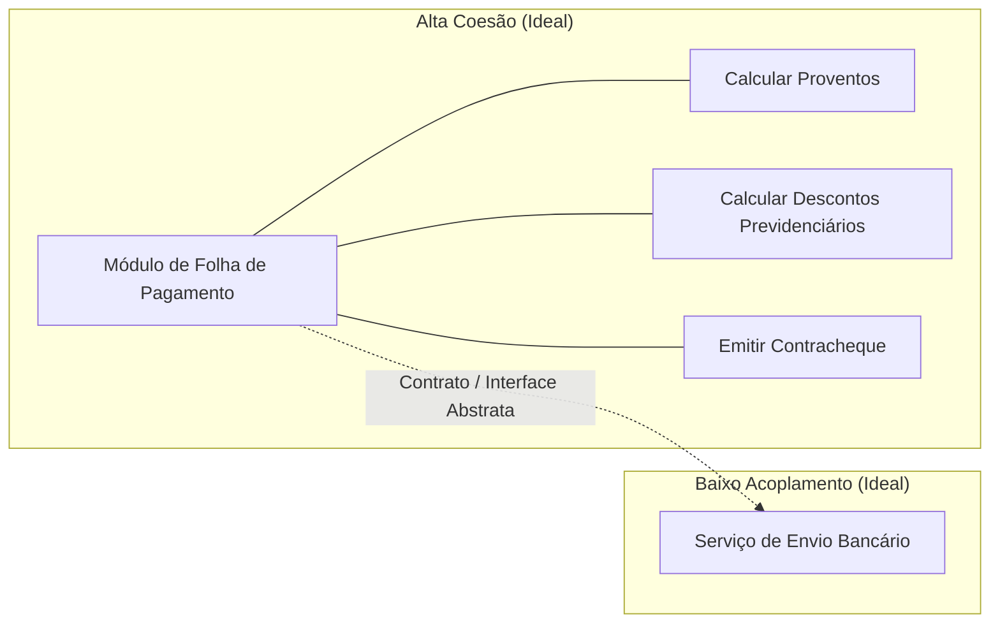
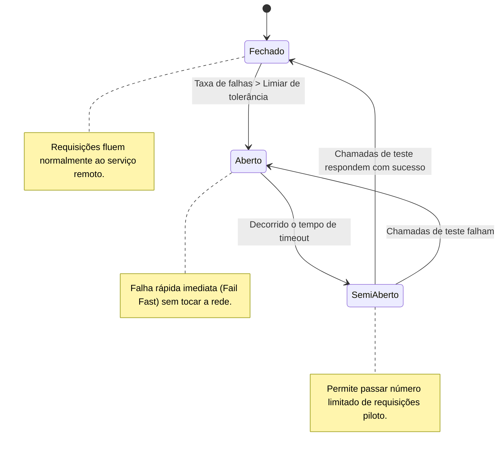
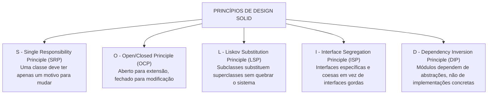

# 03 - Arquitetura de Software e Princípios de Design

> **Matéria:** Engenharia de Software  
> **Cargo:** B02 – Técnico de Controle Externo – Especialidade: Tecnologia da Informação  
> **Arquivo:** `03_arquitetura_de_software_e_principios_solid.md`  

---

## 📌 Ementa / Itens do Edital
- Arquitetura de software: padrões arquiteturais, arquitetura em camadas, orientada a serviços (SOA), microsserviços e orientada a eventos
- Princípios de design: SOLID, DRY, KISS e YAGNI
- Coesão e Acoplamento

---

## 🧭 Sumário

1. [Fundamentos de Arquitetura de Software](#1-fundamentos-de-arquitetura-de-software)
    1. [Estrutura, Componentes e Conectores Arquiteturais](#11-estrutura-componentes-e-conectores-arquiteturais)
    2. [O Modelo 4+1 Visões de Philippe Kruchten](#12-o-modelo-41-visoes-de-philippe-kruchten)
    3. [Coesão e Acoplamento: A Busca pela Alta Coesão e Baixo Acoplamento](#13-coesao-e-acoplamento-a-busca-pela-alta-coesao-e-baixo-acoplamento)
    4. [Teste 023](#Teste-023)
    5. [Teste 024](#Teste-024)
2. [Estilos e Padrões Arquiteturais](#2-estilos-e-padroes-arquiteturais)
    1. [Arquitetura em Camadas (Layered / N-Tier Architecture) e Variações Hexagonais](#21-arquitetura-em-camadas-layered-n-tier-architecture-e-variacoes-hexagonais)
    2. [Arquitetura Orientada a Serviços (SOA) e o Papel do Barramento Corporativo (ESB)](#22-arquitetura-orientada-a-servicos-soa-e-o-papel-do-barramento-corporativo-esb)
    3. [Arquitetura de Microsserviços e seus Padrões de Resiliência e Dados](#23-arquitetura-de-microsservicos-e-seus-padroes-de-resiliencia-e-dados)
    4. [Arquitetura Orientada a Eventos (EDA - Event-Driven Architecture)](#24-arquitetura-orientada-a-eventos-eda-event-driven-architecture)
    5. [Matriz Comparativa: Monólito vs. SOA vs. Microsserviços](#25-matriz-comparativa-monolito-vs-soa-vs-microsservicos)
    6. [Teste 025](#Teste-025)
    7. [Teste 026](#Teste-026)
    8. [Teste 027](#Teste-027)
    9. [Teste 028](#Teste-028)
    10. [Teste 029](#Teste-029)
3. [Princípios de Design e Código Limpo](#3-principios-de-design-e-codigo-limpo)
    1. [Os Princípios SOLID de Robert C. Martin](#31-os-principios-solid-de-robert-c-martin)
    2. [Princípios Práticos de Engenharia: DRY, KISS e YAGNI](#32-principios-praticos-de-engenharia-dry-kiss-e-yagni)
    3. [Teste 030](#Teste-030)
    4. [Teste 031](#Teste-031)
    5. [Teste 032](#Teste-032)
4. [Fontes Oficiais e Referências Bibliográficas](#4-fontes-oficiais-e-referencias-bibliograficas)

---

## 1. Fundamentos de Arquitetura de Software

### 1.1 Estrutura, Componentes e Conectores Arquiteturais
A Arquitetura de Software define a organização fundamental de um sistema corporativo, representada por seus componentes estruturais, pelos conectores e relacionamentos estabelecidos entre eles, pelo ambiente operacional em que executam e pelos princípios que norteiam seu design e evolução ao longo do tempo (IEEE 1471 / ISO/IEC 42010).

- **Componentes:** Unidades computacionais ou módulos de processamento e armazenamento de dados (ex.: microsserviços, controladores web, camadas de acesso a dados ou bancos relacionais);
- **Conectores:** Mecanismos que intermedeiam a comunicação, coordenação e transferência de dados entre os componentes (ex.: chamadas de procedimentos remotos RPC, requisições REST/HTTP, pipes, barramentos de mensageria ou filas Kafka/RabbitMQ);
- **Trade-offs Arquiteturais:** Nenhuma decisão arquitetural é neutra. Uma escolha que maximize desempenho ou escalabilidade horizontal quase invariavelmente introduz maior complexidade operacional e consistência eventual de dados (*Teorema CAP*).

### 1.2 O Modelo 4+1 Visões de Philippe Kruchten
Para descrever a arquitetura de software sob a ótica de múltiplos públicos (*stakeholders*), Philippe Kruchten introduziu o consagrado modelo **4+1 Visões**:

1. **Visão Lógica:** Foca na decomposição do sistema em classes, pacotes e subsistemas, atendendo aos requisitos funcionais do negócio (público: desenvolvedores e arquitetos);
2. **Visão de Processo:** Trata dos aspectos dinâmicos de concorrência, sincronização, desempenho, escalabilidade e threads de execução do sistema em tempo de execução;
3. **Visão de Desenvolvimento (Implementação):** Mostra a organização estática dos módulos de código-fonte, bibliotecas, frameworks, pacotes e ferramentas de compilação;
4. **Visão Física (Implantação):** Mapeia os artefatos de software sobre os nós de hardware físico, servidores de aplicação, redes, balanceadores de carga e contêineres na nuvem;
5. **Visão de Casos de Uso (+1):** Centraliza e integra as quatro visões anteriores a partir dos cenários essenciais que os usuários finais demandam do sistema.

### 1.3 Coesão e Acoplamento: A Busca pela Alta Coesão e Baixo Acoplamento
A métrica fundamental de qualidade de um design modular reside no equilíbrio entre coesão e acoplamento:

- **Coesão:** Mede a proximidade semântica e a harmonia das responsabilidades desempenhadas pelos elementos contidos no interior de um mesmo módulo.
    - *Alta Coesão (Desejável):* O módulo possui um propósito único, focado e bem delineado. Todos os seus métodos e atributos convergem para atender a uma finalidade coesa.
    - *Baixa Coesão (Indesejável / Antipadrão):* O módulo executa funções heterogêneas e desconexas (ex.: uma classe "Deus" ou "Manager" que conecta ao banco, valida regras fiscais e desenha janelas na tela).
- **Acoplamento:** Mede a intensidade da interdependência e a força das conexões entre módulos distintos.
    - *Baixo Acoplamento (Desejável):* Módulos comunicam-se exclusivamente através de contratos abstratos, interfaces ou mensagens padronizadas. Modificações internas em um módulo não propagam efeitos colaterais nos demais.
    - *Alto Acoplamento (Indesejável):* Módulos dependem de detalhes concretos de implementação interna uns dos outros, tornando qualquer manutenção arriscada e gerando falhas em cascata.

---

### Teste 023
**(FGV – TJ-MT – Analista Judiciario Tecnologia da Informacao – 2024)**
A arquitetura de sistemas é o design estruturado de um sistema de software que descreve como seus componentes principais se relacionam e interagem para formar um sistema coeso e eficiente. Ela orienta a construção, manutenção e evolução do software, sendo essencial para garantir que o sistema atenda aos requisitos de desempenho, escalabilidade, segurança e usabilidade. Na arquitetura de sistemas cliente-servidor, o cliente

* **A)** é responsável por fornecer serviços de autenticação e controle de acesso, garantindo a segurança do sistema.
* **B)** processa as requisições e responde diretamente às solicitações do usuário, sem necessidade de comunicação com o servidor.
* **C)** armazena e gerencia centralmente os dados do sistema, facilitando o acesso pelos dispositivos conectados.
* **D)** realiza requisições ao servidor, enviando dados e solicitando informações ou serviços específicos, e exibe os resultados ao usuário final.
* **E)** é responsável por hospedar os serviços principais do sistema, como banco de dados e processos de negócios complexos.

---

> **Comentário Detalhado:**
>
> - **A)** **Incorreta.** A opção apresenta proposição em desacordo com os fundamentos teóricos e técnicos do tópico ao afirmar que "é responsável por fornecer serviços de autenticação e controle de acesso, garantindo a segurança do sistema". De acordo com a teoria estudada em *Padrões Críticos de Microsserviços:*, aPI Gateway: Ponto único de entrada para todas as requisições de clientes externos. Responsável por roteamento dinâmico, autenticação, controle de taxa (*rate limiting*), monitoramento e agregação de respostas de múltiplos serviços.
> - **B)** **Incorreta.** A opção apresenta proposição em desacordo com os fundamentos teóricos e técnicos do tópico ao afirmar que "processa as requisições e responde diretamente às solicitações do usuário, sem necessidade de comunicação com o...". De acordo com a teoria estudada em *1.1 Estrutura, Componentes e Conectores Arquiteturais*, conectores: Mecanismos que intermedeiam a comunicação, coordenação e transferência de dados entre os componentes (ex.: chamadas de procedimentos remotos RPC, requisições REST/HTTP, pipes, barramentos de mensageria ou filas Kafka/RabbitMQ).
> - **C)** **Incorreta.** A opção apresenta proposição em desacordo com os fundamentos teóricos e técnicos do tópico ao afirmar que "armazena e gerencia centralmente os dados do sistema, facilitando o acesso pelos dispositivos conectados". De acordo com a teoria estudada em *2.3 Arquitetura de Microsserviços e seus Padrões de Resiliência e Dados*, banco de Dados por Serviço (*Database per Service*): Cada microsserviço gerencia sua própria base de dados (relacional ou NoSQL). É expressamente proibido o acesso direto ao banco de dados de um serviço por outro serviço!.
> - **D)** **Incorreta.** A opção apresenta proposição em desacordo com os fundamentos teóricos e técnicos do tópico ao afirmar que "realiza requisições ao servidor, enviando dados e solicitando informações ou serviços específicos, e exibe os...". De acordo com a teoria estudada em *1.1 Estrutura, Componentes e Conectores Arquiteturais*, a Arquitetura de Software define a organização fundamental de um sistema corporativo, representada por seus componentes estruturais, pelos conectores e relacionamentos estabelecidos entre eles, pelo ambiente operacional em que executam e pelos princípios que norteiam seu design e evolução ao longo do tempo (IEEE 1471 / ISO/IEC 42010).
> - **E)** **Correta.** Conforme fundamentado na seção *2.3 Arquitetura de Microsserviços e seus Padrões de Resiliência e Dados* deste guia, a arquitetura de microsserviços decompõe um sistema em um conjunto de serviços autônomos, de granularidade fina, modelados em torno de contextos de negócios delimitados (*Bounded Contexts* do Domain-Driven Design - DDD). Dessa forma, está plenamente correta a assertiva da banca (FGV – TJ-MT/2024) ao estabelecer que "é responsável por hospedar os serviços principais do sistema, como banco de dados e processos de negócios complexos".
>
> **Gabarito: E**

---

### Teste 024
**(FGV – TRT-13 – Analista Judiciario Tecnologia da Informacao – 2022)**
Quanto aos critérios e diretrizes técnicas para o processo de desenvolvimento de módulos e serviços na Plataforma Digital do Poder Judiciário Brasileiro – PDPJ-Br, assinale V para a afirmativa verdadeira e F para a falsa. I. Os módulos estruturantes do PDPJ-Br seguem o modelo arquitetural de microsserviços, que deverão ser obrigatoriamente modelados utilizando-se a metodologia Domain Driven Design (DDD). II. O controle de versionamento de microserviços poderá empregar como sistema de controle de versões: Git, SVN ou CVS. III. O CNJ desenvolveu o UIKit como conjunto de ferramentas de interface gráfica, de adoção opcional, como identidade visual dos módulos desenvolvidos dentro da PDPJ-Br As afirmativas são, respectivamente,

* **A)** F, F e F.
* **B)** F, F e V.
* **C)** V, V e F.
* **D)** V, V e V.
* **E)** F, V e F.

---

> **Comentário Detalhado:**
>
> - **A)** **Incorreta.** A opção apresenta proposição em desacordo com os fundamentos teóricos e técnicos do tópico ao afirmar que "F, F e F". De acordo com a teoria estudada em *1.2 O Modelo 4+1 Visões de Philippe Kruchten*, visão de Desenvolvimento (Implementação): Mostra a organização estática dos módulos de código-fonte, bibliotecas, frameworks, pacotes e ferramentas de compilação.
> - **B)** **Incorreta.** A opção apresenta proposição em desacordo com os fundamentos teóricos e técnicos do tópico ao afirmar que "F, F e V". De acordo com a teoria estudada em *1.2 O Modelo 4+1 Visões de Philippe Kruchten*, visão de Processo: Trata dos aspectos dinâmicos de concorrência, sincronização, desempenho, escalabilidade e threads de execução do sistema em tempo de execução.
> - **C)** **Incorreta.** A opção apresenta proposição em desacordo com os fundamentos teóricos e técnicos do tópico ao afirmar que "V, V e F". De acordo com a teoria estudada em *3.1 Os Princípios SOLID de Robert C. Martin*, *Definição:* Se \$S\$ é um subtipo de \$T\$, objetos do tipo \$T\$ devem poder ser substituídos por objetos do tipo \$S\$ sem alterar a corretude do programa.
> - **D)** **Correta.** Conforme fundamentado na seção *2.3 Arquitetura de Microsserviços e seus Padrões de Resiliência e Dados* deste guia, a arquitetura de microsserviços decompõe um sistema em um conjunto de serviços autônomos, de granularidade fina, modelados em torno de contextos de negócios delimitados (*Bounded Contexts* do Domain-Driven Design - DDD). Dessa forma, está plenamente correta a assertiva da banca (FGV – TRT-13/2022) ao estabelecer que "V, V e V".
> - **E)** **Incorreta.** A opção apresenta proposição em desacordo com os fundamentos teóricos e técnicos do tópico ao afirmar que "F, V e F". De acordo com a teoria estudada em *1.1 Estrutura, Componentes e Conectores Arquiteturais*, a Arquitetura de Software define a organização fundamental de um sistema corporativo, representada por seus componentes estruturais, pelos conectores e relacionamentos estabelecidos entre eles, pelo ambiente operacional em que executam e pelos princípios que norteiam seu design e evolução ao longo do tempo (IEEE 1471 / ISO/IEC 42010).
>
> **Gabarito: D**

---

## 2. Estilos e Padrões Arquiteturais

### 2.1 Arquitetura em Camadas (Layered / N-Tier Architecture) e Variações Hexagonais
- **Arquitetura em Camadas Clássica:** Divide o sistema em camadas horizontais empilhadas logicamente, onde cada camada oferece serviços especializados à camada imediatamente superior e consome serviços da camada imediatamente inferior:
    1. *Camada de Apresentação (UI / Interface com Usuário):* Captura requisições e renderiza respostas visuais;
    2. *Camada de Aplicação / Serviços:* Orquestra os fluxos de trabalho e casos de uso;
    3. *Camada de Domínio / Negócio:* Encapsula as regras de negócio puras e entidades corporativas;
    4. *Camada de Acesso a Dados / Persistência:* Isola operações de banco de dados (DAOs, Repositories).

- **Variações Modernas (Arquitetura Hexagonal e Clean Architecture):**
    - **Ports and Adapters (Alistair Cockburn):** O núcleo de domínio de negócio fica no centro, completamente isolado de frameworks e bancos. Comunica-se com o mundo externo através de **Portas** (interfaces abstratas) e **Adaptadores** (implementações concretas de controllers REST, drivers de banco ou filas).
    - **Clean Architecture (Robert Martin):** Estruturada em círculos concêntricos governados pela **Regra da Dependência**: as dependências de código-fonte devem apontar unicamente para dentro, em direção às entidades e casos de uso de alto nível.

### 2.2 Arquitetura Orientada a Serviços (SOA) e o Papel do Barramento Corporativo (ESB)
A Arquitetura Orientada a Serviços (SOA) é um estilo arquitetural corporativo que integra aplicações legadas heterogêneas através de serviços fracamente acoplados e reutilizáveis:

- **Princípios Fundamentais de SOA (Thomas Erl):** Contratos de serviço formais e padronizados, baixo acoplamento, abstração de tecnologia, reusabilidade corporativa, autonomia funcional, composabilidade e descoberta de serviços;
- **Barramento de Serviços Corporativo (ESB - Enterprise Service Bus):** Infraestrutura de middleware centralizada e pesada que assume a responsabilidade de conectar, mediar, rotear, transformar protocolos (ex.: converter JSON/HTTP para XML/SOAP) e orquestrar fluxos de trabalho entre sistemas legados distintos;
- **Padrões de Comunicação:** Serviços web baseados em SOAP (*Simple Object Access Protocol*), descritos formalmente em documentos WSDL (*Web Services Description Language*) e registrados em repositórios UDDI.

### 2.3 Arquitetura de Microsserviços e seus Padrões de Resiliência e Dados
A arquitetura de microsserviços decompõe um sistema em um conjunto de serviços autônomos, de granularidade fina, modelados em torno de contextos de negócios delimitados (*Bounded Contexts* do Domain-Driven Design - DDD):

- **Premissa Fundamental:** *Smart endpoints and dumb pipes* (a lógica de negócio reside nas pontas, dispensando barramentos pesados e usando comunicação direta leve como REST/JSON, gRPC ou filas Kafka/RabbitMQ);
- **Banco de Dados por Serviço (*Database per Service*):** Cada microsserviço gerencia sua própria base de dados (relacional ou NoSQL). É expressamente proibido o acesso direto ao banco de dados de um serviço por outro serviço!

#### Padrões Críticos de Microsserviços:
1. **Circuit Breaker (Disjuntor de Resiliência):** Previne que a indisponibilidade ou latência extrema de um microsserviço provoque falhas em cascata que esgotem os recursos do chamador. Opera em três estados:
    - *Fechado (Closed):* As requisições fluem normalmente. Falhas são contabilizadas;
    - *Aberto (Open):* Ao atingir um limiar de erros, o circuito abre. Todas as requisições falham imediatamente (*fail-fast*), sem tentar acessar a rede;
    - *Semi-Aberto (Half-Open):* Após um tempo de espera (*timeout*), o circuito permite a passagem de algumas requisições de teste. Se forem bem-sucedidas, o circuito fecha; se falharem, o circuito volta ao estado aberto.

2. **API Gateway:** Ponto único de entrada para todas as requisições de clientes externos. Responsável por roteamento dinâmico, autenticação, controle de taxa (*rate limiting*), monitoramento e agregação de respostas de múltiplos serviços;
3. **Saga Pattern (Transações Distribuídas):** Substitui o bloqueio rígido do *Two-Phase Commit (2PC)* em ambientes distribuídos, gerenciando a consistência final por meio de uma sequência de transações locais encadeadas:
    - *Coreografia:* Cada serviço executa sua transação local e emite um evento de domínio que aciona a transação no serviço seguinte;
    - *Orquestração:* Um serviço coordenador centralizado comanda explicitamente a execução de cada etapa;
    - *Ações Compensatórias:* Caso uma etapa falhe no meio do fluxo, a Saga executa transações de compensação (estorno) para desfazer os efeitos parciais anteriores;

4. **CQRS (Command Query Responsibility Segregation):** Segrega o modelo de escrita/atualização de dados (*Commands*) do modelo de leitura/consulta (*Queries*), permitindo otimizar e escalar separadamente os bancos de escrita (foco em normalização) e de leitura (foco em desnormalização rápida).

### 2.4 Arquitetura Orientada a Eventos (EDA - Event-Driven Architecture)
Estilo arquitetural fundamentado na produção, captura, processamento e reação a **eventos** (mudanças significativas de estado no negócio):

- **Componentes:** *Produtores de Eventos* (emitem notificações de que algo ocorreu), *Event Brokers* (canais de mensageria assíncrona como Apache Kafka ou RabbitMQ) e *Consumidores de Eventos* (reagem e processam os eventos);
- **Modelos:** *Publicação/Assinatura (Pub/Sub)* e *Event Streaming* (fluxo contínuo e persistido de eventos ordenados);
- **Event Sourcing:** Padrão arquitetural em que o estado atual de uma entidade não é armazenado em campos estáticos de uma tabela, mas reconstruído dinamicamente mediante a reprodução sequencial de uma trilha histórica imutável de eventos registrados (*append-only log*).

### 2.5 Matriz Comparativa: Monólito vs. SOA vs. Microsserviços

| Característica | Arquitetura Monolítica | SOA (Service-Oriented) | Microsserviços |
| :--- | :--- | :--- | :--- |
| **Composição da Aplicação** | Bloco único de implantação | Serviços corporativos reutilizáveis | Pequenos serviços focados em domínios (*Bounded Contexts*) |
| **Infraestrutura de Integração** | Chamadas diretas em memória | Barramento Corporativo Inteligente (**ESB**) centralizado | Mecanismos leves (*Smart endpoints, dumb pipes* via REST/gRPC/Kafka) |
| **Gerenciamento de Dados** | Banco de dados único e centralizado | Banco de dados compartilhado por múltiplos serviços | Banco de dados exclusivo por serviço (**Database per Service**) |
| **Independência de Deploy** | Nula (deploy tudo-ou-nada) | Moderada a baixa (deploys coordenados) | Totalmente independente para cada microsserviço |
| **Acoplamento Tecnológico** | Alto (pilha tecnológica única) | Médio (contratos padronizados WSDL) | Nulo (poliglotismo: cada serviço usa a linguagem ideal) |

---

### Teste 025
**(FCC – TRT-13 – Analista Judiciario Tecnologia da Informacao – 2014)**
Um web service deve ser visto como a convergência de um conjunto de tecnologias, dentre elas o UDDI, que é um padrão para publicação e localização de web services por meio de consultas (queries) baseadas em mensagens SOAP e documentos XML. O UDDI é responsável por armazenar informações sobre o responsável pelo web service, o que o web service faz, a localização do web service e sobre como acessar seus serviços. Estas informações são divididas e organizadas em grupos semânticos conhecidos como páginas (pages). As páginas que contêm informações técnicas que descrevem o comportamento e as operações suportadas pelo serviço hospedado (incluindo indicadores para a localização do serviço) são conhecidas como

* **A)** green pages.
* **B)** yellow pages.
* **C)** white pages.
* **D)** black pages.
* **E)** red pages.

---

> **Comentário Detalhado:**
>
> - **A)** **Correta.** Conforme fundamentado na seção *2.2 Arquitetura Orientada a Serviços (SOA) e o Papel do Barramento Corporativo (ESB)* deste guia, padrões de Comunicação: Serviços web baseados em SOAP (*Simple Object Access Protocol*), descritos formalmente em documentos WSDL (*Web Services Description Language*) e registrados em repositórios UDDI. Dessa forma, está plenamente correta a assertiva da banca (FCC – TRT-13/2014) ao estabelecer que "green pages".
> - **B)** **Incorreta.** A opção apresenta proposição em desacordo com os fundamentos teóricos e técnicos do tópico ao afirmar que "yellow pages". De acordo com a teoria estudada em *2.2 Arquitetura Orientada a Serviços (SOA) e o Papel do Barramento Corporativo (ESB)*, barramento de Serviços Corporativo (ESB - Enterprise Service Bus): Infraestrutura de middleware centralizada e pesada que assume a responsabilidade de conectar, mediar, rotear, transformar protocolos (ex.: converter JSON/HTTP para XML/SOAP) e orquestrar fluxos de trabalho entre sistemas legados distintos.
> - **C)** **Incorreta.** A opção apresenta proposição em desacordo com os fundamentos teóricos e técnicos do tópico ao afirmar que "white pages". De acordo com a teoria estudada em *2.5 Matriz Comparativa: Monólito vs. SOA vs. Microsserviços*, gerenciamento de Dados: Banco de dados único e centralizado — Banco de dados compartilhado por múltiplos serviços — Banco de dados exclusivo por serviço (Database per Service).
> - **D)** **Incorreta.** A opção apresenta proposição em desacordo com os fundamentos teóricos e técnicos do tópico ao afirmar que "black pages". De acordo com a teoria estudada em *2.3 Arquitetura de Microsserviços e seus Padrões de Resiliência e Dados*, a arquitetura de microsserviços decompõe um sistema em um conjunto de serviços autônomos, de granularidade fina, modelados em torno de contextos de negócios delimitados (*Bounded Contexts* do Domain-Driven Design - DDD).
> - **E)** **Incorreta.** A opção apresenta proposição em desacordo com os fundamentos teóricos e técnicos do tópico ao afirmar que "red pages". De acordo com a teoria estudada em *Padrões Críticos de Microsserviços:*, aPI Gateway: Ponto único de entrada para todas as requisições de clientes externos. Responsável por roteamento dinâmico, autenticação, controle de taxa (*rate limiting*), monitoramento e agregação de respostas de múltiplos serviços.
>
> **Gabarito: A**

---

### Teste 026
**(FGV – TRT-24 – Analista Judiciario Area Apoio Especializado Tecnologia da Informacao – 2025)**
O banco de dados H2 é uma ferramenta muito útil para desenvolvedores Java. Ele foi projetado para ser leve e pode ser incorporado diretamente em aplicativos Java. Com relação aos modos de conexão do H2, analise as afirmativas a seguir. I. No modo incorporado (embedded), um aplicativo abre um banco de dados dentro da mesma máquina virtual Java (JVM) usando JDBC. Este é o modo de conexão mais rápido e fácil. A desvantagem é que um banco de dados só pode ser aberto em uma máquina virtual por vez. Não há limite para o número de bancos de dados abertos simultaneamente ou para o número de conexões abertas. II. O modo misto (mixed) é uma combinação dos modos incorporado e servidor. O primeiro aplicativo que se conecta ao banco usando o modo incorporado, mas também inicia um servidor para que outros aplicativos (executados em diferentes processos ou JVM) possam acessar simultaneamente os mesmos dados. As conexões locais são tão rápidas quanto se o banco fosse usado apenas no modo incorporado, mas as conexões remotas são um pouco mais lentas. III. O modo em memória (in memory) é uma especialização do modo incorporado exclusivo para aplicações que usam o H2 em exclusivamente em memória. Todos os clientes que desejam se conectar (não importa se é uma conexão local ou remota) utilizam a mesmo URL do banco de dados. Além do desempenho a vantagem é o mecanismo de persistência de dados baseada em logs de transações. Está correto o que se afirma em

* **A)** I, apenas.
* **B)** I e II, apenas
* **C)** II e III, apenas
* **D)** I e III, apenas
* **E)** I, II e III.

---

> **Comentário Detalhado:**
>
> - **A)** **Incorreta.** A opção incorre em restrição indevida ao limitar o escopo conceitual ao afirmar que "I, apenas". De acordo com a teoria estudada em *2.3 Arquitetura de Microsserviços e seus Padrões de Resiliência e Dados*, premissa Fundamental: *Smart endpoints and dumb pipes* (a lógica de negócio reside nas pontas, dispensando barramentos pesados e usando comunicação direta leve como REST/JSON, gRPC ou filas Kafka/RabbitMQ).
> - **B)** **Correta.** Conforme fundamentado na seção *Padrões Críticos de Microsserviços:* deste guia, *Aberto (Open):* Ao atingir um limiar de erros, o circuito abre. Todas as requisições falham imediatamente (*fail-fast*), sem tentar acessar a rede. Dessa forma, está plenamente correta a assertiva da banca (FGV – TRT-24/2025) ao estabelecer que "I e II, apenas".
> - **C)** **Incorreta.** A opção incorre em restrição indevida ao limitar o escopo conceitual ao afirmar que "II e III, apenas". De acordo com a teoria estudada em *3.1 Os Princípios SOLID de Robert C. Martin*, *Aplicação:* Classes clientes não devem ser forçadas a depender de métodos que não utilizam. Decompõem-se interfaces amplas em interfaces menores e coesas.
> - **D)** **Incorreta.** A opção incorre em restrição indevida ao limitar o escopo conceitual ao afirmar que "I e III, apenas". De acordo com a teoria estudada em *2.5 Matriz Comparativa: Monólito vs. SOA vs. Microsserviços*, gerenciamento de Dados: Banco de dados único e centralizado — Banco de dados compartilhado por múltiplos serviços — Banco de dados exclusivo por serviço (Database per Service).
> - **E)** **Incorreta.** A opção apresenta proposição em desacordo com os fundamentos teóricos e técnicos do tópico ao afirmar que "I, II e III". De acordo com a teoria estudada em *2.1 Arquitetura em Camadas (Layered / N-Tier Architecture) e Variações Hexagonais*, *Camada de Acesso a Dados / Persistência:* Isola operações de banco de dados (DAOs, Repositories).
>
> **Gabarito: B**

---

### Teste 027
**(FGV – TJ-MT – Analista Judiciario Tecnologia da Informacao – 2024)**
Um dos estilos de arquitetura de software mais usados nos últimos anos, dadas as suas vantagens em relação aos demais existentes, é a arquitetura orientada a serviços (Service-Oriented Architecture - SOA). A arquitetura orientada a serviços (SOA)

* **A)** organiza a estrutura de um sistema como um conjunto de serviços independentes que se comunicam por meio de protocolos padrão, como HTTP e SOAP.
* **B)** utiliza uma abordagem na qual os serviços são acoplados de forma estreita para garantir maior controle e interdependência entre as partes do sistema.
* **C)** é uma arquitetura em que todos os serviços são integrados em um sistema monolítico, garantindo alta coesão entre os módulos.
* **D)** exige que todos os serviços sejam implementados na mesma linguagem de programação para garantir consistência no sistema.
* **E)** utiliza a comunicação síncrona entre serviços para manter a consistência e a segurança dos dados transmitidos no sistema.

---

> **Comentário Detalhado:**
>
> - **A)** **Incorreta.** A opção apresenta proposição em desacordo com os fundamentos teóricos e técnicos do tópico ao afirmar que "organiza a estrutura de um sistema como um conjunto de serviços independentes que se comunicam por meio de...". De acordo com a teoria estudada em *2.2 Arquitetura Orientada a Serviços (SOA) e o Papel do Barramento Corporativo (ESB)*, barramento de Serviços Corporativo (ESB - Enterprise Service Bus): Infraestrutura de middleware centralizada e pesada que assume a responsabilidade de conectar, mediar, rotear, transformar protocolos (ex.: converter JSON/HTTP para XML/SOAP) e orquestrar fluxos de trabalho entre sistemas legados distintos.
> - **B)** **Incorreta.** A opção apresenta proposição em desacordo com os fundamentos teóricos e técnicos do tópico ao afirmar que "utiliza uma abordagem na qual os serviços são acoplados de forma estreita para garantir maior controle e...". De acordo com a teoria estudada em *1.1 Estrutura, Componentes e Conectores Arquiteturais*, trade-offs Arquiteturais: Nenhuma decisão arquitetural é neutra. Uma escolha que maximize desempenho ou escalabilidade horizontal quase invariavelmente introduz maior complexidade operacional e consistência eventual de dados (*Teorema CAP*).
> - **C)** **Incorreta.** A opção apresenta proposição em desacordo com os fundamentos teóricos e técnicos do tópico ao afirmar que "é uma arquitetura em que todos os serviços são integrados em um sistema monolítico, garantindo alta coesão entre...". De acordo com a teoria estudada em *2.3 Arquitetura de Microsserviços e seus Padrões de Resiliência e Dados*, a arquitetura de microsserviços decompõe um sistema em um conjunto de serviços autônomos, de granularidade fina, modelados em torno de contextos de negócios delimitados (*Bounded Contexts* do Domain-Driven Design - DDD).
> - **D)** **Incorreta.** A opção apresenta proposição em desacordo com os fundamentos teóricos e técnicos do tópico ao afirmar que "exige que todos os serviços sejam implementados na mesma linguagem de programação para garantir consistência no...". De acordo com a teoria estudada em *2.5 Matriz Comparativa: Monólito vs. SOA vs. Microsserviços*, gerenciamento de Dados: Banco de dados único e centralizado — Banco de dados compartilhado por múltiplos serviços — Banco de dados exclusivo por serviço (Database per Service).
> - **E)** **Correta.** Conforme fundamentado na seção *2.2 Arquitetura Orientada a Serviços (SOA) e o Papel do Barramento Corporativo (ESB)* deste guia, padrões de Comunicação: Serviços web baseados em SOAP (*Simple Object Access Protocol*), descritos formalmente em documentos WSDL (*Web Services Description Language*) e registrados em repositórios UDDI. Dessa forma, está plenamente correta a assertiva da banca (FGV – TJ-MT/2024) ao estabelecer que "utiliza a comunicação síncrona entre serviços para manter a consistência e a segurança dos dados transmitidos no...".
>
> **Gabarito: E**

---

### Teste 028
**(FGV – TJ-BA – Analista Judiciario Tecnologia da Informacao – 2015)**
Serviço Web é uma tecnologia popularmente utilizada na implementação de uma arquitetura orientada a serviços. Para que aplicações acessem esses serviços disponibilizados através da rede, um documento WSDL (Web Services Description Language) pode ser utilizado para especificar as capacidades do serviço, sua localização na Web e instruções acerca de como acessá-los. Com relação à elaboração de um documento WSDL, relacione cada um dos seus elementos estruturais com as características apresentadas a seguir. 1. Service 2. PortType 3. Binding ( ) descreve de forma abstrata as operações disponíveis em um serviço web; ( ) define informações de mais baixo nível, tais como protocolo de transporte, protocolo de mensagem e codificação da mensagem para as operações disponíveis em um serviço web; ( ) define o endereço (endpoint) utilizado para acessar o serviço. A relação correta, de cima para baixo, é:

* **A)** 1, 2 e 3;
* **B)** 2, 3 e 1;
* **C)** 3, 1 e 2;
* **D)** 3, 2 e 1;
* **E)** 1, 3 e 2.

---

> **Comentário Detalhado:**
>
> - **A)** **Incorreta.** A opção apresenta proposição em desacordo com os fundamentos teóricos e técnicos do tópico ao afirmar que "1, 2 e 3". De acordo com a teoria estudada em *2.2 Arquitetura Orientada a Serviços (SOA) e o Papel do Barramento Corporativo (ESB)*, princípios Fundamentais de SOA (Thomas Erl): Contratos de serviço formais e padronizados, baixo acoplamento, abstração de tecnologia, reusabilidade corporativa, autonomia funcional, composabilidade e descoberta de serviços.
> - **B)** **Correta.** Conforme fundamentado na seção *2.2 Arquitetura Orientada a Serviços (SOA) e o Papel do Barramento Corporativo (ESB)* deste guia, padrões de Comunicação: Serviços web baseados em SOAP (*Simple Object Access Protocol*), descritos formalmente em documentos WSDL (*Web Services Description Language*) e registrados em repositórios UDDI. Dessa forma, está plenamente correta a assertiva da banca (FGV – TJ-BA/2015) ao estabelecer que "2, 3 e 1".
> - **C)** **Incorreta.** A opção apresenta proposição em desacordo com os fundamentos teóricos e técnicos do tópico ao afirmar que "3, 1 e 2". De acordo com a teoria estudada em *2.2 Arquitetura Orientada a Serviços (SOA) e o Papel do Barramento Corporativo (ESB)*, a Arquitetura Orientada a Serviços (SOA) é um estilo arquitetural corporativo que integra aplicações legadas heterogêneas através de serviços fracamente acoplados e reutilizáveis.
> - **D)** **Incorreta.** A opção apresenta proposição em desacordo com os fundamentos teóricos e técnicos do tópico ao afirmar que "3, 2 e 1". De acordo com a teoria estudada em *2.2 Arquitetura Orientada a Serviços (SOA) e o Papel do Barramento Corporativo (ESB)*, barramento de Serviços Corporativo (ESB - Enterprise Service Bus): Infraestrutura de middleware centralizada e pesada que assume a responsabilidade de conectar, mediar, rotear, transformar protocolos (ex.: converter JSON/HTTP para XML/SOAP) e orquestrar fluxos de trabalho entre sistemas legados distintos.
> - **E)** **Incorreta.** A opção apresenta proposição em desacordo com os fundamentos teóricos e técnicos do tópico ao afirmar que "1, 3 e 2". De acordo com a teoria estudada em *Padrões Críticos de Microsserviços:*, *Aberto (Open):* Ao atingir um limiar de erros, o circuito abre. Todas as requisições falham imediatamente (*fail-fast*), sem tentar acessar a rede.
>
> **Gabarito: B**

---

### Teste 029
**(FGV – TJ-BA – Analista Judiciario Tecnologia da Informacao – 2015)**
SOA (Service Oriented Architecture) é um estilo de arquitetura de software orientada a serviço normalmente utilizada para promover a interoperabilidade entre sistemas. Com relação ao SOA e suas características, analise as afirmativas a seguir: I. Novos serviços podem ser criados a partir da composição de serviços existentes. II. Os agentes consumidores podem acessar os serviços sem conhecer detalhes de sua implementação. III. É um estilo de arquitetura que estabelece uma forte relação de dependência entre os serviços disponíveis. IV. Os serviços tendem a oferecer um número grande de operações com complexidade relativamente pequena em cada uma delas. O número de afirmativas corretas é:

* **A)** 0;
* **B)** 1;
* **C)** 2;
* **D)** 3;
* **E)** 4. Redação

---

> **Comentário Detalhado:**
>
> - **A)** **Incorreta.** A opção apresenta proposição em desacordo com os fundamentos teóricos e técnicos do tópico ao afirmar que "0". De acordo com a teoria estudada em *2.2 Arquitetura Orientada a Serviços (SOA) e o Papel do Barramento Corporativo (ESB)*, a Arquitetura Orientada a Serviços (SOA) é um estilo arquitetural corporativo que integra aplicações legadas heterogêneas através de serviços fracamente acoplados e reutilizáveis.
> - **B)** **Incorreta.** A opção apresenta proposição em desacordo com os fundamentos teóricos e técnicos do tópico ao afirmar que "1". De acordo com a teoria estudada em *2.2 Arquitetura Orientada a Serviços (SOA) e o Papel do Barramento Corporativo (ESB)*, princípios Fundamentais de SOA (Thomas Erl): Contratos de serviço formais e padronizados, baixo acoplamento, abstração de tecnologia, reusabilidade corporativa, autonomia funcional, composabilidade e descoberta de serviços.
> - **C)** **Correta.** Conforme fundamentado na seção *2.2 Arquitetura Orientada a Serviços (SOA) e o Papel do Barramento Corporativo (ESB)* deste guia, barramento de Serviços Corporativo (ESB - Enterprise Service Bus): Infraestrutura de middleware centralizada e pesada que assume a responsabilidade de conectar, mediar, rotear, transformar protocolos (ex.: converter JSON/HTTP para XML/SOAP) e orquestrar fluxos de trabalho entre sistemas legados distintos. Dessa forma, está plenamente correta a assertiva da banca (FGV – TJ-BA/2015) ao estabelecer que "2".
> - **D)** **Incorreta.** A opção apresenta proposição em desacordo com os fundamentos teóricos e técnicos do tópico ao afirmar que "3". De acordo com a teoria estudada em *2.5 Matriz Comparativa: Monólito vs. SOA vs. Microsserviços*, gerenciamento de Dados: Banco de dados único e centralizado — Banco de dados compartilhado por múltiplos serviços — Banco de dados exclusivo por serviço (Database per Service).
> - **E)** **Incorreta.** A opção apresenta proposição em desacordo com os fundamentos teóricos e técnicos do tópico ao afirmar que "4. Redação". De acordo com a teoria estudada em *2.4 Arquitetura Orientada a Eventos (EDA - Event-Driven Architecture)*, componentes: *Produtores de Eventos* (emitem notificações de que algo ocorreu), *Event Brokers* (canais de mensageria assíncrona como Apache Kafka ou RabbitMQ) e *Consumidores de Eventos* (reagem e processam os eventos).
>
> **Gabarito: C**

---

## 3. Princípios de Design e Código Limpo

### 3.1 Os Princípios SOLID de Robert C. Martin
Os princípios SOLID formam a espinha dorsal do design orientado a objetos robusto, modular e sustentável:

1. **S - Single Responsibility Principle (SRP - Princípio da Responsabilidade Única):**
    - *Definição:* Uma classe deve possuir uma e apenas uma razão para mudar (deve atender a um único ator de negócio);
    - *Violação Clássica:* Criar classes monstruosas (*God Classes*) que acumulam regras de negócio, persistência de banco de dados e geração de relatórios gráficos no mesmo arquivo.

2. **O - Open/Closed Principle (OCP - Princípio Aberto/Fechado):**
    - *Definição:* Entidades de software (classes, módulos, funções) devem estar **abertas para extensão, mas fechadas para modificação**;
    - *Aplicação:* Novos comportamentos devem ser adicionados mediante criação de novas classes derivadas ou polimorfismo de interfaces, sem editar e arriscar quebrar o código-fonte original já em produção;
    - *Violação Clássica:* Estruturas extensas de `if-else-if` ou `switch-case` checando tipos de objetos para aplicar regras de cálculo distintas (ex.: cálculo de frete por transportadora).

3. **L - Liskov Substitution Principle (LSP - Princípio da Substituição de Liskov):**
    - *Definição:* Se $S$ é um subtipo de $T$, objetos do tipo $T$ devem poder ser substituídos por objetos do tipo $S$ sem alterar a corretude do programa;
    - *Violação Clássica:* Uma classe `Quadrado` que herda de `Retangulo`. Como o quadrado força largura e altura rigorosamente iguais, invocar `setLargura(5)` e `setAltura(10)` em uma referência polimórfica de `Retangulo` que aponte para um `Quadrado` viola as expectativas de comportamento da classe base. Outro sintoma claro é uma subclasse sobrescrever um método herdado lançando `UnsupportedOperationException`.

4. **I - Interface Segregation Principle (ISP - Princípio da Segregação de Interfaces):**
    - *Definição:* Muitas interfaces específicas são melhores do que uma interface única de propósito geral ("interface gorda");
    - *Aplicação:* Classes clientes não devem ser forçadas a depender de métodos que não utilizam. Decompõem-se interfaces amplas em interfaces menores e coesas.

5. **D - Dependency Inversion Principle (DIP - Princípio da Inversão de Dependência):**
    - *Definição:* Módulos de alto nível não devem depender de módulos de baixo nível; ambos devem depender de **abstrações** (interfaces). Abstrações não devem depender de detalhes; detalhes devem depender de abstrações;
    - *Aplicação:* As classes de serviço de negócio dependem de interfaces (`RepositorioAuditoria`), e as implementações concretas de acesso a banco (`PostgresRepositorioAuditoria`) implementam essa interface.

> 🚨 **ALERTA DE PROVA / PEGADINHA FCC:**  
> A FCC adora cobrar a distinção conceitual entre:
>
> - **Inversão de Dependência (DIP):** É o princípio conceitual abstrato de design (depender de interfaces).
> - **Inversão de Controle (IoC):** É a estratégia arquitetural genérica onde o fluxo de execução é delegado ao framework.
> - **Injeção de Dependência (DI):** É o padrão de projeto prático que implementa a IoC/DIP, fornecendo as instâncias concretas das dependências através de construtores ou métodos setter.

### 3.2 Princípios Práticos de Engenharia: DRY, KISS e YAGNI
- **DRY (Don't Repeat Yourself - Não se Repita):** Formulado por Andy Hunt e Dave Thomas no livro *The Pragmatic Programmer*. Estabelece que cada porção de conhecimento ou lógica de negócio em um sistema deve possuir uma representação única, não ambígua e autoritativa. Combate a duplicação de regras em múltiplos pontos do código;
- **KISS (Keep It Simple, Stupid - Mantenha as Coisas Simples):** Princípio de design que preconiza a simplicidade estrutural. A solução mais simples que resolve adequadamente o problema deve sempre prevalecer sobre soluções sofisticadas e excessivamente complexas;
- **YAGNI (You Aren't Gonna Need It - Você Não Vai Precisar Disso):** Princípio fundamental do Extreme Programming (XP). Determina que os desenvolvedores **não devem implementar funcionalidades antecipadamente com base em suposições futuras**, construindo apenas aquilo que é estritamente exigido pelos requisitos atuais. Evita o desperdício de *Gold Plating* e a sobre-engenharia (*overengineering*).

---

### Teste 030
**(FCC – TRT-4 – Analista Judiciario Tecnologia da Informacao – 2015)**
Uma aplicação que trabalha com Hibernate e EJB possui uma classe POJO − Plain Old Java Object utilizada no mapeamento objeto-relacional com uma tabela do banco de dados. Nessa classe, há um atributo calculado chamado valorTotalPedido que, para ser utilizado apenas em tempo de execução e descartado após finalizar o seu serviço temporário, deverá ser anotado com

* **A)** @Embedded
* **B)** @TemporaryAttribute
* **C)** @GeneratedValue
* **D)** @Transient
* **E)** @Basic

---

> **Comentário Detalhado:**
>
> - **A)** **Incorreta.** A opção apresenta proposição em desacordo com os fundamentos teóricos e técnicos do tópico ao afirmar que "@Embedded". De acordo com a teoria estudada em *3.1 Os Princípios SOLID de Robert C. Martin*, *Aplicação:* As classes de serviço de negócio dependem de interfaces (`RepositorioAuditoria`), e as implementações concretas de acesso a banco (`PostgresRepositorioAuditoria`) implementam essa interface.
> - **B)** **Incorreta.** A opção apresenta proposição em desacordo com os fundamentos teóricos e técnicos do tópico ao afirmar que "@TemporaryAttribute". De acordo com a teoria estudada em *3.1 Os Princípios SOLID de Robert C. Martin*, *Aplicação:* Novos comportamentos devem ser adicionados mediante criação de novas classes derivadas ou polimorfismo de interfaces, sem editar e arriscar quebrar o código-fonte original já em produção.
> - **C)** **Incorreta.** A opção apresenta proposição em desacordo com os fundamentos teóricos e técnicos do tópico ao afirmar que "@GeneratedValue". De acordo com a teoria estudada em *3.1 Os Princípios SOLID de Robert C. Martin*, *Aplicação:* Classes clientes não devem ser forçadas a depender de métodos que não utilizam. Decompõem-se interfaces amplas em interfaces menores e coesas.
> - **D)** **Correta.** Conforme fundamentado na seção *2.3 Arquitetura de Microsserviços e seus Padrões de Resiliência e Dados* deste guia, banco de Dados por Serviço (*Database per Service*): Cada microsserviço gerencia sua própria base de dados (relacional ou NoSQL). É expressamente proibido o acesso direto ao banco de dados de um serviço por outro serviço!. Dessa forma, está plenamente correta a assertiva da banca (FCC – TRT-4/2015) ao estabelecer que "@Transient".
> - **E)** **Incorreta.** A opção apresenta proposição em desacordo com os fundamentos teóricos e técnicos do tópico ao afirmar que "@Basic". De acordo com a teoria estudada em *Padrões Críticos de Microsserviços:*, *Semi-Aberto (Half-Open):* Após um tempo de espera (*timeout*), o circuito permite a passagem de algumas requisições de teste. Se forem bem-sucedidas, o circuito fecha; se falharem, o circuito volta ao estado aberto.
>
> **Gabarito: D**

---

### Teste 031
**(FGV – TRT-13 – Analista Judiciario Tecnologia da Informacao – 2022)**
A Portaria Nº 253 de 18/11/2020 institui técnicas para o processo de desenvolvimento de módulos e serviços na Plataforma Digital do Poder Judiciário Brasileiro – PDPJ-Br. Quanto aos critérios e diretrizes estabelecidos pela norma, assinale a afirmativa correta.

* **A)** Os desenvolvedores podem criar, manter e evoluir as aplicações que compõem a Plataforma PDPJ-Br por meio de modelos de dados e domínio, de eventos e mensagens empregando padrões de mercado proprietários de Application Programming Interface (API).
* **B)** Os microsserviços terão que prover documentação técnica referente à API disponibilizada, utilizando o padrão OpenAPI 2.0.
* **C)** Os módulos estruturantes já disporão de diversas APIs comuns ao relacionamento com o processo judicial, com vistas a não ser necessária a incorporação de diversas APIs nos sistemas monolíticos legados.
* **D)** No caso de necessidade de decomposição da aplicação monolítica existente que se assemelhe a módulo ou microsserviço existente nos sistemas processuais, deverá ser realizada a identificação do domínio a ser extraído e sua modelagem por meio de histórias, seguida da utilização de mecanismos nativos, por exemplo, JSF, Richfaces, componentes Seam.
* **E)** As soluções da Plataforma PDPJ-Br devem ser realizadas exclusivamente em ambiente contratado em serviço de nuvem computacional, atendendo aos princípios e diretrizes relacionados à Segurança da Informação para o tratamento da informação em ambiente de Computação em Nuvem dispostos na Portaria SGI nº 9/2018.

---

> **Comentário Detalhado:**
>
> - **A)** **Correta.** Conforme fundamentado na seção *2.4 Arquitetura Orientada a Eventos (EDA - Event-Driven Architecture)* deste guia, modelos: *Publicação/Assinatura (Pub/Sub)* e *Event Streaming* (fluxo contínuo e persistido de eventos ordenados). Dessa forma, está plenamente correta a assertiva da banca (FGV – TRT-13/2022) ao estabelecer que "Os desenvolvedores podem criar, manter e evoluir as aplicações que compõem a Plataforma PDPJ-Br por meio de...".
> - **B)** **Incorreta.** A opção apresenta proposição em desacordo com os fundamentos teóricos e técnicos do tópico ao afirmar que "Os microsserviços terão que prover documentação técnica referente à API disponibilizada, utilizando o padrão...". De acordo com a teoria estudada em *Padrões Críticos de Microsserviços:*, aPI Gateway: Ponto único de entrada para todas as requisições de clientes externos. Responsável por roteamento dinâmico, autenticação, controle de taxa (*rate limiting*), monitoramento e agregação de respostas de múltiplos serviços.
> - **C)** **Incorreta.** A opção apresenta proposição em desacordo com os fundamentos teóricos e técnicos do tópico ao afirmar que "Os módulos estruturantes já disporão de diversas APIs comuns ao relacionamento com o processo judicial, com vistas...". De acordo com a teoria estudada em *2.2 Arquitetura Orientada a Serviços (SOA) e o Papel do Barramento Corporativo (ESB)*, barramento de Serviços Corporativo (ESB - Enterprise Service Bus): Infraestrutura de middleware centralizada e pesada que assume a responsabilidade de conectar, mediar, rotear, transformar protocolos (ex.: converter JSON/HTTP para XML/SOAP) e orquestrar fluxos de trabalho entre sistemas legados distintos.
> - **D)** **Incorreta.** A opção apresenta proposição em desacordo com os fundamentos teóricos e técnicos do tópico ao afirmar que "No caso de necessidade de decomposição da aplicação monolítica existente que se assemelhe a módulo ou...". De acordo com a teoria estudada em *Padrões Críticos de Microsserviços:*, *Ações Compensatórias:* Caso uma etapa falhe no meio do fluxo, a Saga executa transações de compensação (estorno) para desfazer os efeitos parciais anteriores.
> - **E)** **Incorreta.** A opção incorre em restrição indevida ao limitar o escopo conceitual ao afirmar que "As soluções da Plataforma PDPJ-Br devem ser realizadas exclusivamente em ambiente contratado em serviço de nuvem...". De acordo com a teoria estudada em *1.3 Coesão e Acoplamento: A Busca pela Alta Coesão e Baixo Acoplamento*, *Baixo Acoplamento (Desejável):* Módulos comunicam-se exclusivamente através de contratos abstratos, interfaces ou mensagens padronizadas. Modificações internas em um módulo não propagam efeitos colaterais nos demais.
>
> **Gabarito: A**

---

### Teste 032
**(FGV – TJ-AP – Analista Judiciario Apoio Especializado Tecnologia da Informacao Banco de Dados – 2023)**
Um sistema de banco de dados envolve quatro componentes principais: dados, hardware, software e usuários. O sistema gerenciador de banco de dados é um software que:

* **A)** abstrai o modelo conceitual;
* **B)** limita a independência lógica de dados;
* **C)** isola os usuários do banco de dados dos detalhes do nível de hardware;
* **D)** deve ser parametrizado para atender ao sistema de processamento analítico online;
* **E)** elimina a redundância do sistema de processamento de transações online.

---

> **Comentário Detalhado:**
>
> - **A)** **Incorreta.** A opção apresenta proposição em desacordo com os fundamentos teóricos e técnicos do tópico ao afirmar que "abstrai o modelo conceitual". De acordo com a teoria estudada em *1.2 O Modelo 4+1 Visões de Philippe Kruchten*, visão de Casos de Uso (+1): Centraliza e integra as quatro visões anteriores a partir dos cenários essenciais que os usuários finais demandam do sistema.
> - **B)** **Incorreta.** A opção apresenta proposição em desacordo com os fundamentos teóricos e técnicos do tópico ao afirmar que "limita a independência lógica de dados". De acordo com a teoria estudada em *3.1 Os Princípios SOLID de Robert C. Martin*, *Definição:* Módulos de alto nível não devem depender de módulos de baixo nível; ambos devem depender de abstrações (interfaces). Abstrações não devem depender de detalhes; detalhes devem depender de abstrações.
> - **C)** **Correta.** Conforme fundamentado na seção *2.1 Arquitetura em Camadas (Layered / N-Tier Architecture) e Variações Hexagonais* deste guia, *Camada de Acesso a Dados / Persistência:* Isola operações de banco de dados (DAOs, Repositories). Dessa forma, está plenamente correta a assertiva da banca (FGV – TJ-AP/2023) ao estabelecer que "isola os usuários do banco de dados dos detalhes do nível de hardware".
> - **D)** **Incorreta.** A opção apresenta proposição em desacordo com os fundamentos teóricos e técnicos do tópico ao afirmar que "deve ser parametrizado para atender ao sistema de processamento analítico online". De acordo com a teoria estudada em *3.1 Os Princípios SOLID de Robert C. Martin*, *Definição:* Uma classe deve possuir uma e apenas uma razão para mudar (deve atender a um único ator de negócio).
> - **E)** **Incorreta.** A opção apresenta proposição em desacordo com os fundamentos teóricos e técnicos do tópico ao afirmar que "elimina a redundância do sistema de processamento de transações online". De acordo com a teoria estudada em *1.1 Estrutura, Componentes e Conectores Arquiteturais*, componentes: Unidades computacionais ou módulos de processamento e armazenamento de dados (ex.: microsserviços, controladores web, camadas de acesso a dados ou bancos relacionais).
>
> **Gabarito: C**

---

## 4. Fontes Oficiais e Referências Bibliográficas

* [Microservices: A Definition of This New Architectural Term (Martin Fowler & James Lewis)](https://martinfowler.com/articles/microservices.html) - Artigo seminal definindo a arquitetura de microsserviços, governança descentralizada, *smart endpoints and dumb pipes* e persistência poliglota.
* [What do you mean by "Event-Driven"? — Arquitetura Orientada a Eventos e Event Sourcing (Martin Fowler)](https://martinfowler.com/articles/201701-event-driven.html) - Distinção formal entre notificação de eventos, transferência de estado baseada em eventos, Event Sourcing e CQRS.
* [Strangler Fig Application — Modernização Gradual de Sistemas Legados (Martin Fowler)](https://martinfowler.com/bliki/StranglerFigApplication.html) - Padrão arquitetural para migração incremental de monólitos para arquiteturas distribuídas.
* [Bounded Context — Contextos Delimitados no Domain-Driven Design (Martin Fowler)](https://martinfowler.com/bliki/BoundedContext.html) - Fundamento de alta coesão e baixo acoplamento no particionamento de domínios e microsserviços.
* [The Twelve-Factor App (Os Doze Fatores para Aplicações Cloud-Native)](https://12factor.net/pt_br/) - Metodologia arquitetural para construção de softwares-como-serviço escaláveis, portáveis e resilientes.
* MARTIN, Robert C. **Arquitetura Limpa: O Guia do Artesão para Estrutura e Design de Software**. Rio de Janeiro: Alta Books, 2019. (Parte III - Princípios de Design SOLID; Parte V - Arquitetura).
* NEWMAN, Sam. **Building Microservices: Designing Fine-Grained Systems**. 2. ed. Sebastopol: O'Reilly Media, 2021. (Cap. 4 - Microservice Communication Styles; Cap. 6 - Workflow and Sagas; Cap. 11 - Resiliency).
* EVANS, Eric. **Domain-Driven Design: Atacando as Complexidades no Coração do Software**. Rio de Janeiro: Alta Books, 2016. (Parte IV - Design Estratégico).
