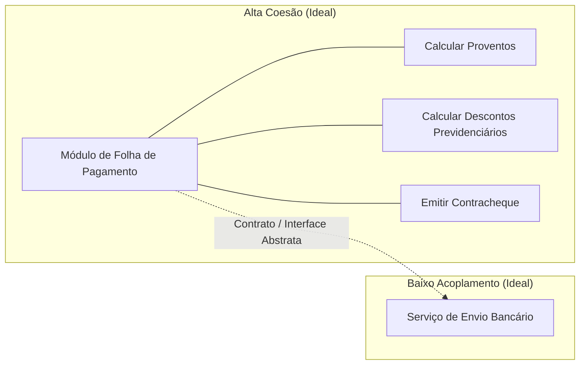
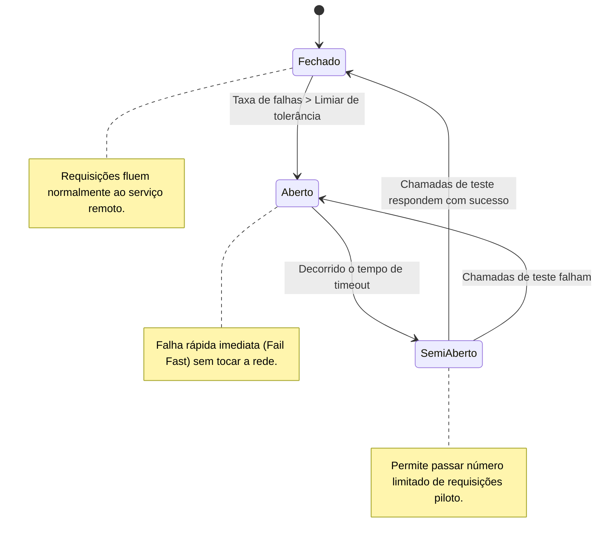
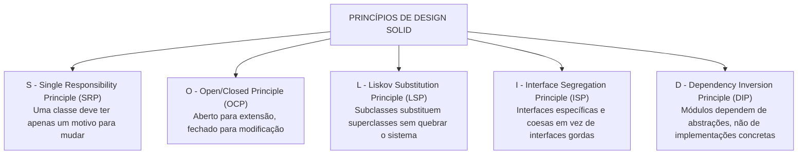

# 03 - Arquitetura de Software e Princípios de Design

> **Matéria:** Engenharia de Software  
> **Cargo:** B02 – Técnico de Controle Externo – Especialidade: Tecnologia da Informação  
> **Arquivo:** `03_arquitetura_de_software_e_principios_solid.md`  

---

## 📌 Ementa / Itens do Edital
- Arquitetura de software: padrões arquiteturais, arquitetura em camadas, orientada a serviços (SOA), microsserviços e orientada a eventos
- Princípios de design: SOLID, DRY, KISS e YAGNI
- Coesão e Acoplamento

---

## 🧭 Sumário

1. [Fundamentos de Arquitetura de Software](#1-fundamentos-de-arquitetura-de-software)
    1. [Estrutura, Componentes e Conectores Arquiteturais](#11-estrutura-componentes-e-conectores-arquiteturais)
    2. [O Modelo 4+1 Visões de Philippe Kruchten](#12-o-modelo-41-visoes-de-philippe-kruchten)
    3. [Coesão e Acoplamento: A Busca pela Alta Coesão e Baixo Acoplamento](#13-coesao-e-acoplamento-a-busca-pela-alta-coesao-e-baixo-acoplamento)
    4. [Teste 023](#Teste-023)
    5. [Teste 024](#Teste-024)
2. [Estilos e Padrões Arquiteturais](#2-estilos-e-padroes-arquiteturais)
    1. [Arquitetura em Camadas (Layered / N-Tier Architecture) e Variações Hexagonais](#21-arquitetura-em-camadas-layered-n-tier-architecture-e-variacoes-hexagonais)
    2. [Arquitetura Orientada a Serviços (SOA) e o Papel do Barramento Corporativo (ESB)](#22-arquitetura-orientada-a-servicos-soa-e-o-papel-do-barramento-corporativo-esb)
    3. [Arquitetura de Microsserviços e seus Padrões de Resiliência e Dados](#23-arquitetura-de-microsservicos-e-seus-padroes-de-resiliencia-e-dados)
    4. [Arquitetura Orientada a Eventos (EDA - Event-Driven Architecture)](#24-arquitetura-orientada-a-eventos-eda-event-driven-architecture)
    5. [Matriz Comparativa: Monólito vs. SOA vs. Microsserviços](#25-matriz-comparativa-monolito-vs-soa-vs-microsservicos)
    6. [Teste 025](#Teste-025)
    7. [Teste 026](#Teste-026)
    8. [Teste 027](#Teste-027)
    9. [Teste 028](#Teste-028)
    10. [Teste 029](#Teste-029)
3. [Princípios de Design e Código Limpo](#3-principios-de-design-e-codigo-limpo)
    1. [Os Princípios SOLID de Robert C. Martin](#31-os-principios-solid-de-robert-c-martin)
    2. [Princípios Práticos de Engenharia: DRY, KISS e YAGNI](#32-principios-praticos-de-engenharia-dry-kiss-e-yagni)
    3. [Teste 030](#Teste-030)
    4. [Teste 031](#Teste-031)
    5. [Teste 032](#Teste-032)
4. [Fontes Oficiais e Referências Bibliográficas](#4-fontes-oficiais-e-referencias-bibliograficas)

---

## 1. Fundamentos de Arquitetura de Software

### 1.1 Estrutura, Componentes e Conectores Arquiteturais
A Arquitetura de Software define a organização fundamental de um sistema corporativo, representada por seus componentes estruturais, pelos conectores e relacionamentos estabelecidos entre eles, pelo ambiente operacional em que executam e pelos princípios que norteiam seu design e evolução ao longo do tempo (IEEE 1471 / ISO/IEC 42010).

- **Componentes:** Unidades computacionais ou módulos de processamento e armazenamento de dados (ex.: microsserviços, controladores web, camadas de acesso a dados ou bancos relacionais);
- **Conectores:** Mecanismos que intermedeiam a comunicação, coordenação e transferência de dados entre os componentes (ex.: chamadas de procedimentos remotos RPC, requisições REST/HTTP, pipes, barramentos de mensageria ou filas Kafka/RabbitMQ);
- **Trade-offs Arquiteturais:** Nenhuma decisão arquitetural é neutra. Uma escolha que maximize desempenho ou escalabilidade horizontal quase invariavelmente introduz maior complexidade operacional e consistência eventual de dados (*Teorema CAP*).

### 1.2 O Modelo 4+1 Visões de Philippe Kruchten
Para descrever a arquitetura de software sob a ótica de múltiplos públicos (*stakeholders*), Philippe Kruchten introduziu o consagrado modelo **4+1 Visões**:

1. **Visão Lógica:** Foca na decomposição do sistema em classes, pacotes e subsistemas, atendendo aos requisitos funcionais do negócio (público: desenvolvedores e arquitetos);
2. **Visão de Processo:** Trata dos aspectos dinâmicos de concorrência, sincronização, desempenho, escalabilidade e threads de execução do sistema em tempo de execução;
3. **Visão de Desenvolvimento (Implementação):** Mostra a organização estática dos módulos de código-fonte, bibliotecas, frameworks, pacotes e ferramentas de compilação;
4. **Visão Física (Implantação):** Mapeia os artefatos de software sobre os nós de hardware físico, servidores de aplicação, redes, balanceadores de carga e contêineres na nuvem;
5. **Visão de Casos de Uso (+1):** Centraliza e integra as quatro visões anteriores a partir dos cenários essenciais que os usuários finais demandam do sistema.

### 1.3 Coesão e Acoplamento: A Busca pela Alta Coesão e Baixo Acoplamento
A métrica fundamental de qualidade de um design modular reside no equilíbrio entre coesão e acoplamento:

- **Coesão:** Mede a proximidade semântica e a harmonia das responsabilidades desempenhadas pelos elementos contidos no interior de um mesmo módulo.
    - *Alta Coesão (Desejável):* O módulo possui um propósito único, focado e bem delineado. Todos os seus métodos e atributos convergem para atender a uma finalidade coesa.
    - *Baixa Coesão (Indesejável / Antipadrão):* O módulo executa funções heterogêneas e desconexas (ex.: uma classe "Deus" ou "Manager" que conecta ao banco, valida regras fiscais e desenha janelas na tela).
- **Acoplamento:** Mede a intensidade da interdependência e a força das conexões entre módulos distintos.
    - *Baixo Acoplamento (Desejável):* Módulos comunicam-se exclusivamente através de contratos abstratos, interfaces ou mensagens padronizadas. Modificações internas em um módulo não propagam efeitos colaterais nos demais.
    - *Alto Acoplamento (Indesejável):* Módulos dependem de detalhes concretos de implementação interna uns dos outros, tornando qualquer manutenção arriscada e gerando falhas em cascata.

---

### Teste 001
**(FGV – TJ/SC – 2026 – Analista Administrativo)**
Na empresa ABC, antes de iniciar a expansão para um novo mercado, a Diretoria define antecipadamente os objetivos a serem alcançados, os recursos necessários, o cronograma de atividades e os indicadores de acompanhamento, situando a organização entre a posição em que se encontra atualmente e o estado almejado em horizonte de três anos. A função administrativa descrita corresponde

* **A)** à direção.
* **B)** ao controle.
* **C)** à coordenação.
* **D)** à organização.
* **E)** ao planejamento.

---

> **Comentário Detalhado:**
>
> - **A)** **Incorreta.** A opção apresenta proposição em desacordo com os fundamentos teóricos e técnicos do tópico ao afirmar que "à direção". De acordo com a teoria estudada em *2.1 Arquitetura em Camadas (Layered / N-Tier Architecture) e Variações Hexagonais*, clean Architecture (Robert Martin): Estruturada em círculos concêntricos governados pela Regra da Dependência: as dependências de código fonte devem apontar unicamente para dentro, em direção às entidades e casos de uso de alto nível.
> - **B)** **Incorreta.** A opção apresenta proposição em desacordo com os fundamentos teóricos e técnicos do tópico ao afirmar que "ao controle". De acordo com a teoria estudada em *Padrões Críticos de Microsserviços:*, circuit Breaker (Disjuntor de Resiliência): Previne que a indisponibilidade ou latência extrema de um microsserviço provoque falhas em cascata que esgotem os recursos do chamador. Opera em três estados.
> - **C)** **Incorreta.** A opção apresenta proposição em desacordo com os fundamentos teóricos e técnicos do tópico ao afirmar que "à coordenação". De acordo com a teoria estudada em *1.1 Estrutura, Componentes e Conectores Arquiteturais*, conectores: Mecanismos que intermedeiam a comunicação, coordenação e transferência de dados entre os componentes (ex.: chamadas de procedimentos remotos RPC, requisições REST/HTTP, pipes, barramentos de mensageria ou filas Kafka/RabbitMQ).
> - **D)** **Incorreta.** A opção apresenta proposição em desacordo com os fundamentos teóricos e técnicos do tópico ao afirmar que "à organização". De acordo com a teoria estudada em *1.2 O Modelo 4+1 Visões de Philippe Kruchten*, visão de Desenvolvimento (Implementação): Mostra a organização estática dos módulos de código fonte, bibliotecas, frameworks, pacotes e ferramentas de compilação.
> - **E)** **Correta.** Conforme fundamentado na seção *1.1 Estrutura, Componentes e Conectores Arquiteturais* deste guia, a Arquitetura de Software define a organização fundamental de um sistema corporativo, representada por seus componentes estruturais, pelos conectores e relacionamentos estabelecidos entre eles, pelo ambiente operacional em que executam e pelos princípios que norteiam seu design e evolução ao longo do tempo (IEEE 1471 / ISO/IEC 42010). Dessa forma, está plenamente correta a assertiva da banca (FGV – TJ/SC/2026) ao estabelecer que "ao planejamento".
>
> **Gabarito: E**

---

### Teste 002
**(FGV – TJ/SC – 2026 – Analista Administrativo)**
A área de Gestão de Pessoas da empresa ABC tem revisado sua estratégia de treinamento à luz das tendências contemporâneas. Após diagnóstico interno, optou por implementar uma abordagem em que o conteúdo é entregue em pequenas doses, facilitando a assimilação rápida e eficaz das informações, permitindo que os colaboradores aprendam de forma flexível e acessem o conteúdo em momentos compatíveis com sua rotina, o que favorece a retenção do conhecimento. A tendência contemporânea de treinamento descrita corresponde ao

* **A)** microlearning.
* **B)** aprendizado experiencial.
* **C)** mentoring digital.
* **D)** treinamento baseado em dados.
* **E)** role-playing.

---

> **Comentário Detalhado:**
>
> - **A)** **Correta.** Conforme fundamentado na seção *Padrões Críticos de Microsserviços:* deste guia, cQRS (Command Query Responsibility Segregation): Segrega o modelo de escrita/atualização de dados ( Commands ) do modelo de leitura/consulta ( Queries ), permitindo otimizar e escalar separadamente os bancos de escrita (foco em normalização) e de leitura (foco em desnormalização rápida). Dessa forma, está plenamente correta a assertiva da banca (FGV – TJ/SC/2026) ao estabelecer que "microlearning".
> - **B)** **Incorreta.** A opção apresenta proposição em desacordo com os fundamentos teóricos e técnicos do tópico ao afirmar que "aprendizado experiencial". De acordo com a teoria estudada em *Padrões Críticos de Microsserviços:*, semi Aberto (Half Open): Após um tempo de espera ( timeout ), o circuito permite a passagem de algumas requisições de teste. Se forem bem sucedidas, o circuito fecha; se falharem, o circuito volta ao estado aberto.
> - **C)** **Incorreta.** A opção apresenta proposição em desacordo com os fundamentos teóricos e técnicos do tópico ao afirmar que "mentoring digital". De acordo com a teoria estudada em *3.1 Os Princípios SOLID de Robert C. Martin*, inversão de Controle (IoC): É a estratégia arquitetural genérica onde o fluxo de execução é delegado ao framework.
> - **D)** **Incorreta.** A opção apresenta proposição em desacordo com os fundamentos teóricos e técnicos do tópico ao afirmar que "treinamento baseado em dados". De acordo com a teoria estudada em *2.3 Arquitetura de Microsserviços e seus Padrões de Resiliência e Dados*, note right of Aberto: Falha rápida imediata (Fail Fast) sem tocar a rede.
> - **E)** **Incorreta.** A opção apresenta proposição em desacordo com os fundamentos teóricos e técnicos do tópico ao afirmar que "role playing". De acordo com a teoria estudada em *3.2 Princípios Práticos de Engenharia: DRY, KISS e YAGNI*, dRY (Don't Repeat Yourself Não se Repita): Formulado por Andy Hunt e Dave Thomas no livro The Pragmatic Programmer . Estabelece que cada porção de conhecimento ou lógica de negócio em um sistema deve possuir uma representação única, não ambígua e autoritativa. Combate a duplicação de regras em múltiplos pontos do código.
>
> **Gabarito: A**

---

### Teste 003
**(FGV – TJ/SC – 2026 – Analista Administrativo)**
O Departamento de Produção da empresa X apresentava consumo anual de 9.000 materiais diferentes. Após a aplicação da técnica da curva ABC, obteve-se a seguinte distribuição: - 720 itens correspondiam a 70% do valor anual do consumo; - 1.800 itens correspondiam a 20% do valor anual do consumo; - 6.480 itens correspondiam a 10% do valor anual do consumo. Com base nas premissas da curva ABC, assinale a afirmativa correta.

* **A)** Os 6.480 itens compõem a classe A, pois, em razão de sua quantidade expressiva, demandam controles administrativos mais rigorosos.
* **B)** Os 1.800 itens compõem a classe C, por ocuparem posição intermediária na ordenação dos materiais por valor de consumo.
* **C)** Os 720 itens compõem a classe A e devem receber atenção especial da administração, por concentrarem a maior parcela do valor anual do consumo.
* **D)** Para controlar 90% do valor de consumo, é necessário estabelecer controles rigorosos sobre a totalidade dos 9.000 itens da curva.
* **E)** A classe C, por reunir o maior número de itens, justifica a aplicação das técnicas mais sofisticadas de gestão administrativa.

---

> **Comentário Detalhado:**
>
> - **A)** **Incorreta.** A opção apresenta proposição em desacordo com os fundamentos teóricos e técnicos do tópico ao afirmar que "Os 6.480 itens compõem a classe A, pois, em razão de sua quantidade expressiva, demandam controles administrativos...". De acordo com a teoria estudada em *3.1 Os Princípios SOLID de Robert C. Martin*, definição: Uma classe deve possuir uma e apenas uma razão para mudar (deve atender a um único ator de negócio).
> - **B)** **Incorreta.** A opção apresenta proposição em desacordo com os fundamentos teóricos e técnicos do tópico ao afirmar que "Os 1.800 itens compõem a classe C, por ocuparem posição intermediária na ordenação dos materiais por valor de...". De acordo com a teoria estudada em *1.1 Estrutura, Componentes e Conectores Arquiteturais*, trade offs Arquiteturais: Nenhuma decisão arquitetural é neutra. Uma escolha que maximize desempenho ou escalabilidade horizontal quase invariavelmente introduz maior complexidade operacional e consistência eventual de dados ( Teorema CAP ).
> - **C)** **Correta.** Conforme fundamentado na seção *3.1 Os Princípios SOLID de Robert C. Martin* deste guia, aplicação: Novos comportamentos devem ser adicionados mediante criação de novas classes derivadas ou polimorfismo de interfaces, sem editar e arriscar quebrar o código fonte original já em produção. Dessa forma, está plenamente correta a assertiva da banca (FGV – TJ/SC/2026) ao estabelecer que "Os 720 itens compõem a classe A e devem receber atenção especial da administração, por concentrarem a maior...".
> - **D)** **Incorreta.** A opção apresenta proposição em desacordo com os fundamentos teóricos e técnicos do tópico ao afirmar que "Para controlar 90% do valor de consumo, é necessário estabelecer controles rigorosos sobre a totalidade dos 9.000...". De acordo com a teoria estudada em *3.1 Os Princípios SOLID de Robert C. Martin*, violação Clássica: Uma classe Quadrado que herda de Retangulo . Como o quadrado força largura e altura rigorosamente iguais, invocar setLargura(5) e setAltura(10) em uma referência polimórfica de Retangulo que aponte para um Quadrado viola as expectativas de comportamento da classe base. Outro sintoma claro é uma subclasse sobrescrever um método herdado lançando UnsupportedOperationException.
> - **E)** **Incorreta.** A opção apresenta proposição em desacordo com os fundamentos teóricos e técnicos do tópico ao afirmar que "A classe C, por reunir o maior número de itens, justifica a aplicação das técnicas mais sofisticadas de gestão...". De acordo com a teoria estudada em *3.2 Princípios Práticos de Engenharia: DRY, KISS e YAGNI*, kISS (Keep It Simple, Stupid Mantenha as Coisas Simples): Princípio de design que preconiza a simplicidade estrutural. A solução mais simples que resolve adequadamente o problema deve sempre prevalecer sobre soluções sofisticadas e excessivamente complexas.
>
> **Gabarito: C**

---

### Teste 004
**(FGV – TJ/SC – 2026 – Analista Administrativo)**
O Tribunal de Justiça do Estado Alfa, embora dispusesse de sistema eletrônico plenamente operacional, manteve, sem justificativa técnica, a tramitação exclusivamente em papel de processos administrativos de baixa complexidade, o que resultou em atrasos reiterados, retrabalho, custos elevados e demora injustificada no atendimento aos cidadãos, sem qualquer ganho compensatório em termos de qualidade ou segurança jurídica. A conduta descrita afronta diretamente o princípio da Administração Pública, expresso no art. 37, caput, da Constituição Federal de 1988, denominado

* **A)** legalidade.
* **B)** impessoalidade.
* **C)** moralidade.
* **D)** publicidade.
* **E)** eficiência.

---

> **Comentário Detalhado:**
>
> - **A)** **Incorreta.** A opção apresenta proposição em desacordo com os fundamentos teóricos e técnicos do tópico ao afirmar que "legalidade". De acordo com a teoria estudada em *1.1 Estrutura, Componentes e Conectores Arquiteturais*, a Arquitetura de Software define a organização fundamental de um sistema corporativo, representada por seus componentes estruturais, pelos conectores e relacionamentos estabelecidos entre eles, pelo ambiente operacional em que executam e pelos princípios que norteiam seu design e evolução ao longo do tempo (IEEE 1471 / ISO/IEC 42010).
> - **B)** **Incorreta.** A opção apresenta proposição em desacordo com os fundamentos teóricos e técnicos do tópico ao afirmar que "impessoalidade". De acordo com a teoria estudada em *1.3 Coesão e Acoplamento: A Busca pela Alta Coesão e Baixo Acoplamento*, a métrica fundamental de qualidade de um design modular reside no equilíbrio entre coesão e acoplamento.
> - **C)** **Incorreta.** A opção apresenta proposição em desacordo com os fundamentos teóricos e técnicos do tópico ao afirmar que "moralidade". De acordo com a teoria estudada em *1.3 Coesão e Acoplamento: A Busca pela Alta Coesão e Baixo Acoplamento*, baixo Acoplamento (Desejável): Módulos comunicam se exclusivamente através de contratos abstratos, interfaces ou mensagens padronizadas. Modificações internas em um módulo não propagam efeitos colaterais nos demais.
> - **D)** **Incorreta.** A opção apresenta proposição em desacordo com os fundamentos teóricos e técnicos do tópico ao afirmar que "publicidade". De acordo com a teoria estudada em *1.3 Coesão e Acoplamento: A Busca pela Alta Coesão e Baixo Acoplamento*, alto Acoplamento (Indesejável): Módulos dependem de detalhes concretos de implementação interna uns dos outros, tornando qualquer manutenção arriscada e gerando falhas em cascata.
> - **E)** **Correta.** Conforme fundamentado na seção *1.1 Estrutura, Componentes e Conectores Arquiteturais* deste guia, trade offs Arquiteturais: Nenhuma decisão arquitetural é neutra. Uma escolha que maximize desempenho ou escalabilidade horizontal quase invariavelmente introduz maior complexidade operacional e consistência eventual de dados ( Teorema CAP ). Dessa forma, está plenamente correta a assertiva da banca (FGV – TJ/SC/2026) ao estabelecer que "eficiência".
>
> **Gabarito: E**

---

### Teste 005
**(FGV – TCE/GO – 2024 – Analista de Controle Externo - Ciências Contábeis)**
Em janeiro de 2023, uma empresa de consultoria prestou um serviço a um cliente por R$20.000. O valor deveria ser recebido em junho de 2023, de modo que a empresa contabilizou o montante como ativo circulante. Em agosto de 2023, o cliente comunicou à empresa que estava encerrando as suas operações e não pagaria o que era devido. Os administradores da empresa preferiram não entrar na justiça contra o cliente e não consideravam mais a expectativa de recebimento. No balanço patrimonial da empresa de consultoria, em agosto de 2023, o montante deve ser:

* **A)** baixado, tendo como contrapartida um débito no resultado.
* **B)** baixado, tendo como contrapartida um débito no passivo.
* **C)** mantido em ativo circulante.
* **D)** classificado como ativo intangível.
* **E)** classificado como ativo realizável a longo prazo.

---

> **Comentário Detalhado:**
>
> - **A)** **Correta.** Conforme fundamentado na seção *3.2 Princípios Práticos de Engenharia: DRY, KISS e YAGNI* deste guia, kISS (Keep It Simple, Stupid Mantenha as Coisas Simples): Princípio de design que preconiza a simplicidade estrutural. A solução mais simples que resolve adequadamente o problema deve sempre prevalecer sobre soluções sofisticadas e excessivamente complexas. Dessa forma, está plenamente correta a assertiva da banca (FGV – TCE/GO/2024) ao estabelecer que "baixado, tendo como contrapartida um débito no resultado".
> - **B)** **Incorreta.** A opção apresenta proposição em desacordo com os fundamentos teóricos e técnicos do tópico ao afirmar que "baixado, tendo como contrapartida um débito no passivo". De acordo com a teoria estudada em *2.1 Arquitetura em Camadas (Layered / N-Tier Architecture) e Variações Hexagonais*, camada de Acesso a Dados / Persistência: Isola operações de banco de dados (DAOs, Repositories).
> - **C)** **Incorreta.** A opção apresenta proposição em desacordo com os fundamentos teóricos e técnicos do tópico ao afirmar que "mantido em ativo circulante". De acordo com a teoria estudada em *1.3 Coesão e Acoplamento: A Busca pela Alta Coesão e Baixo Acoplamento*, m1 . |Contrato / Interface Abstrata| M2["Serviço de Envio Bancário"].
> - **D)** **Incorreta.** A opção apresenta proposição em desacordo com os fundamentos teóricos e técnicos do tópico ao afirmar que "classificado como ativo intangível". De acordo com a teoria estudada em *4. Fontes Oficiais e Referências Bibliográficas*, mARTIN, Robert C. Arquitetura Limpa: O Guia do Artesão para Estrutura e Design de Software. Rio de Janeiro: Alta Books, 2019. (Parte III Princípios de Design SOLID; Parte V Arquitetura).
> - **E)** **Incorreta.** A opção apresenta proposição em desacordo com os fundamentos teóricos e técnicos do tópico ao afirmar que "classificado como ativo realizável a longo prazo". De acordo com a teoria estudada em *1.1 Estrutura, Componentes e Conectores Arquiteturais*, a Arquitetura de Software define a organização fundamental de um sistema corporativo, representada por seus componentes estruturais, pelos conectores e relacionamentos estabelecidos entre eles, pelo ambiente operacional em que executam e pelos princípios que norteiam seu design e evolução ao longo do tempo (IEEE 1471 / ISO/IEC 42010).
>
> **Gabarito: A**

---

### Teste 006
**(FCC – TCE/GO – 2009 – Analista de Controle Externo - Gestão de Conhecimento)**
Quanto à redação da Nota, ao pé do texto, é correto

* **A)** sejas - ponhais
* **B)** seja - põe ser substituída, adequadamente, por muraram aon- de era o refúgio.
* **C)** sede - ponhais
* **D)** sejas - põe
* **E)** o tempo da forma verbal refugiara indica ação ante- rior à expressa pelo tempo da forma verbal ergue-

---

> **Comentário Detalhado:**
>
> - **A)** **Incorreta.** A opção apresenta proposição em desacordo com os fundamentos teóricos e técnicos do tópico ao afirmar que "sejas ponhais". De acordo com a teoria estudada em *1.2 O Modelo 4+1 Visões de Philippe Kruchten*, visão de Processo: Trata dos aspectos dinâmicos de concorrência, sincronização, desempenho, escalabilidade e threads de execução do sistema em tempo de execução.
> - **B)** **Incorreta.** A opção apresenta proposição em desacordo com os fundamentos teóricos e técnicos do tópico ao afirmar que "seja põe ser substituída, adequadamente, por muraram aon de era o refúgio". De acordo com a teoria estudada em *3.2 Princípios Práticos de Engenharia: DRY, KISS e YAGNI*, kISS (Keep It Simple, Stupid Mantenha as Coisas Simples): Princípio de design que preconiza a simplicidade estrutural. A solução mais simples que resolve adequadamente o problema deve sempre prevalecer sobre soluções sofisticadas e excessivamente complexas.
> - **C)** **Incorreta.** A opção apresenta proposição em desacordo com os fundamentos teóricos e técnicos do tópico ao afirmar que "sede ponhais". De acordo com a teoria estudada em *2.3 Arquitetura de Microsserviços e seus Padrões de Resiliência e Dados*, aberto SemiAberto: Decorrido o tempo de timeout.
> - **D)** **Incorreta.** A opção apresenta proposição em desacordo com os fundamentos teóricos e técnicos do tópico ao afirmar que "sejas põe". De acordo com a teoria estudada em *Padrões Críticos de Microsserviços:*, semi Aberto (Half Open): Após um tempo de espera ( timeout ), o circuito permite a passagem de algumas requisições de teste. Se forem bem sucedidas, o circuito fecha; se falharem, o circuito volta ao estado aberto.
> - **E)** **Correta.** Conforme fundamentado na seção *1.1 Estrutura, Componentes e Conectores Arquiteturais* deste guia, a Arquitetura de Software define a organização fundamental de um sistema corporativo, representada por seus componentes estruturais, pelos conectores e relacionamentos estabelecidos entre eles, pelo ambiente operacional em que executam e pelos princípios que norteiam seu design e evolução ao longo do tempo (IEEE 1471 / ISO/IEC 42010). Dessa forma, está plenamente correta a assertiva da banca (FCC – TCE/GO/2009) ao estabelecer que "o tempo da forma verbal refugiara indica ação ante rior à expressa pelo tempo da forma verbal ergue".
>
> **Gabarito: E**

---

### Teste 007
**(FCC – TCE/GO – 2009 – Analista de Controle Externo - Gestão de Conhecimento)**
Compete ao Congresso Nacional, com a sanção do Pre- sidente da República,

* **A)** dispor sobre fixação do subsídio dos Ministros do Supremo Tribunal Federal.
* **B)** apreciar os atos de concessão e renovação de con- cessão de emissoras de rádio e televisão.
* **C)** escolher dois terços dos membros do Tribunal de Contas da União.
* **D)** autorizar referendo e convocar plebiscito.
* **E)** autorizar, em terras indígenas, a exploração e o aproveitamento de recursos hídricos e a pesquisa e lavra de riquezas minerais. _________________________________________________________

---

> **Comentário Detalhado:**
>
> - **A)** **Correta.** Conforme fundamentado na seção *1.1 Estrutura, Componentes e Conectores Arquiteturais* deste guia, a Arquitetura de Software define a organização fundamental de um sistema corporativo, representada por seus componentes estruturais, pelos conectores e relacionamentos estabelecidos entre eles, pelo ambiente operacional em que executam e pelos princípios que norteiam seu design e evolução ao longo do tempo (IEEE 1471 / ISO/IEC 42010). Dessa forma, está plenamente correta a assertiva da banca (FCC – TCE/GO/2009) ao estabelecer que "dispor sobre fixação do subsídio dos Ministros do Supremo Tribunal Federal".
> - **B)** **Incorreta.** A opção apresenta proposição em desacordo com os fundamentos teóricos e técnicos do tópico ao afirmar que "apreciar os atos de concessão e renovação de con cessão de emissoras de rádio e televisão". De acordo com a teoria estudada em *1.1 Estrutura, Componentes e Conectores Arquiteturais*, componentes: Unidades computacionais ou módulos de processamento e armazenamento de dados (ex.: microsserviços, controladores web, camadas de acesso a dados ou bancos relacionais).
> - **C)** **Incorreta.** A opção apresenta proposição em desacordo com os fundamentos teóricos e técnicos do tópico ao afirmar que "escolher dois terços dos membros do Tribunal de Contas da União". De acordo com a teoria estudada em *1.1 Estrutura, Componentes e Conectores Arquiteturais*, conectores: Mecanismos que intermedeiam a comunicação, coordenação e transferência de dados entre os componentes (ex.: chamadas de procedimentos remotos RPC, requisições REST/HTTP, pipes, barramentos de mensageria ou filas Kafka/RabbitMQ).
> - **D)** **Incorreta.** A opção apresenta proposição em desacordo com os fundamentos teóricos e técnicos do tópico ao afirmar que "autorizar referendo e convocar plebiscito". De acordo com a teoria estudada em *1.1 Estrutura, Componentes e Conectores Arquiteturais*, trade offs Arquiteturais: Nenhuma decisão arquitetural é neutra. Uma escolha que maximize desempenho ou escalabilidade horizontal quase invariavelmente introduz maior complexidade operacional e consistência eventual de dados ( Teorema CAP ).
> - **E)** **Incorreta.** A opção apresenta proposição em desacordo com os fundamentos teóricos e técnicos do tópico ao afirmar que "autorizar, em terras indígenas, a exploração e o aproveitamento de recursos hídricos e a pesquisa e lavra de...". De acordo com a teoria estudada em *Padrões Críticos de Microsserviços:*, circuit Breaker (Disjuntor de Resiliência): Previne que a indisponibilidade ou latência extrema de um microsserviço provoque falhas em cascata que esgotem os recursos do chamador. Opera em três estados.
>
> **Gabarito: A**

---

### Teste 008
**(FCC – TCE/GO – 2009 – Analista de Controle Externo - Gestão de Conhecimento)**
Vagando os cargos de Presidente e Vice-Presidente da República,

* **A)** será chamado ao exercício da Presidência o Pre- sidente da Câmara dos Deputados, que deverá com- pletar o período de mandato de seus antecessores.
* **B)** será realizada eleição pelo Congresso Nacional, trin- ta dias depois da última vaga, caso a vacância ocorra nos últimos dois anos do período presiden- cial.
* **C)** deverá ser convocado plebiscito para decidir quanto à necessidade de realização de nova eleição.
* **D)** caberá ao Tribunal Superior Eleitoral dar posse aos candidatos segundos colocados no pleito em que eleitos os antecessores.
* **E)** não há solução prevista expressamente na Cons- tituição da República para a sucessão, cabendo ao Congresso Nacional dispor sobre a matéria. _________________________________________________________

---

> **Comentário Detalhado:**
>
> - **A)** **Incorreta.** A opção apresenta proposição em desacordo com os fundamentos teóricos e técnicos do tópico ao afirmar que "será chamado ao exercício da Presidência o Pre sidente da Câmara dos Deputados, que deverá com pletar o período de...". De acordo com a teoria estudada em *1.1 Estrutura, Componentes e Conectores Arquiteturais*, a Arquitetura de Software define a organização fundamental de um sistema corporativo, representada por seus componentes estruturais, pelos conectores e relacionamentos estabelecidos entre eles, pelo ambiente operacional em que executam e pelos princípios que norteiam seu design e evolução ao longo do tempo (IEEE 1471 / ISO/IEC 42010).
> - **B)** **Correta.** Conforme fundamentado na seção *Padrões Críticos de Microsserviços:* deste guia, ações Compensatórias: Caso uma etapa falhe no meio do fluxo, a Saga executa transações de compensação (estorno) para desfazer os efeitos parciais anteriores. Dessa forma, está plenamente correta a assertiva da banca (FCC – TCE/GO/2009) ao estabelecer que "será realizada eleição pelo Congresso Nacional, trin ta dias depois da última vaga, caso a vacância ocorra nos...".
> - **C)** **Incorreta.** A opção apresenta proposição em desacordo com os fundamentos teóricos e técnicos do tópico ao afirmar que "deverá ser convocado plebiscito para decidir quanto à necessidade de realização de nova eleição". De acordo com a teoria estudada em *3.1 Os Princípios SOLID de Robert C. Martin*, aplicação: Novos comportamentos devem ser adicionados mediante criação de novas classes derivadas ou polimorfismo de interfaces, sem editar e arriscar quebrar o código fonte original já em produção.
> - **D)** **Incorreta.** A opção apresenta proposição em desacordo com os fundamentos teóricos e técnicos do tópico ao afirmar que "caberá ao Tribunal Superior Eleitoral dar posse aos candidatos segundos colocados no pleito em que eleitos os...". De acordo com a teoria estudada em *2.1 Arquitetura em Camadas (Layered / N-Tier Architecture) e Variações Hexagonais*, arquitetura em Camadas Clássica: Divide o sistema em camadas horizontais empilhadas logicamente, onde cada camada oferece serviços especializados à camada imediatamente superior e consome serviços da camada imediatamente inferior.
> - **E)** **Incorreta.** A opção apresenta proposição em desacordo com os fundamentos teóricos e técnicos do tópico ao afirmar que "não há solução prevista expressamente na Cons tituição da República para a sucessão, cabendo ao Congresso Nacional...". De acordo com a teoria estudada em *2.3 Arquitetura de Microsserviços e seus Padrões de Resiliência e Dados*, banco de Dados por Serviço ( Database per Service ): Cada microsserviço gerencia sua própria base de dados (relacional ou NoSQL). É expressamente proibido o acesso direto ao banco de dados de um serviço por outro serviço!.
>
> **Gabarito: B**

---

### Teste 009
**(FCC – TCE/GO – 2009 – Analista de Controle Externo - Gestão de Conhecimento)**
Um usuário solicita à biblioteca informação de como fazer 75. Visando melhorar o atendimento do usuário e, ao mesmo a citação de um trabalho em fase de elaboração. Nesse tempo, promover o uso extensivo dos recursos da biblio- caso, ele deve ser informado que, segundo a norma da teca, o serviço de informação e referência deve concentrar ABNT, esforços

* **A)** no serviço de empréstimo domiciliar. nota de rodapé.
* **B)** a expressão “em fase de elaboração” deve vir logo
* **C)** não é necessário fazer qualquer referência a esse tipo de trabalho, uma vez que ele ainda não foi
* **D)** no treinamento do bibliotecário. em nota de rodapé, dos dados disponíveis.
* **E)** na comunicação visual do espaço. _________________________________________________________

---

> **Comentário Detalhado:**
>
> - **A)** **Incorreta.** A opção apresenta proposição em desacordo com os fundamentos teóricos e técnicos do tópico ao afirmar que "no serviço de empréstimo domiciliar. nota de rodapé". De acordo com a teoria estudada em *3.1 Os Princípios SOLID de Robert C. Martin*, definição: Uma classe deve possuir uma e apenas uma razão para mudar (deve atender a um único ator de negócio).
> - **B)** **Correta.** Conforme fundamentado na seção *3.1 Os Princípios SOLID de Robert C. Martin* deste guia, sOLID S["S Single Responsibility Principle (SRP)<br/ Uma classe deve ter apenas um motivo para mudar"]. Dessa forma, está plenamente correta a assertiva da banca (FCC – TCE/GO/2009) ao estabelecer que "a expressão “em fase de elaboração” deve vir logo".
> - **C)** **Incorreta.** A opção promove generalização excessiva que desconsidera as condições técnicas e normativas ao afirmar que "não é necessário fazer qualquer referência a esse tipo de trabalho, uma vez que ele ainda não foi". De acordo com a teoria estudada em *2.1 Arquitetura em Camadas (Layered / N-Tier Architecture) e Variações Hexagonais*, camada de Aplicação / Serviços: Orquestra os fluxos de trabalho e casos de uso.
> - **D)** **Incorreta.** A opção apresenta proposição em desacordo com os fundamentos teóricos e técnicos do tópico ao afirmar que "no treinamento do bibliotecário. em nota de rodapé, dos dados disponíveis". De acordo com a teoria estudada em *3.2 Princípios Práticos de Engenharia: DRY, KISS e YAGNI*, dRY (Don't Repeat Yourself Não se Repita): Formulado por Andy Hunt e Dave Thomas no livro The Pragmatic Programmer . Estabelece que cada porção de conhecimento ou lógica de negócio em um sistema deve possuir uma representação única, não ambígua e autoritativa. Combate a duplicação de regras em múltiplos pontos do código.
> - **E)** **Incorreta.** A opção apresenta proposição em desacordo com os fundamentos teóricos e técnicos do tópico ao afirmar que "na comunicação visual do espaço". De acordo com a teoria estudada em *3.2 Princípios Práticos de Engenharia: DRY, KISS e YAGNI*, kISS (Keep It Simple, Stupid Mantenha as Coisas Simples): Princípio de design que preconiza a simplicidade estrutural. A solução mais simples que resolve adequadamente o problema deve sempre prevalecer sobre soluções sofisticadas e excessivamente complexas.
>
> **Gabarito: B**

---

### Teste 010
**(FGV – TCE/GO – 2024 – Analista de Controle Externo - Tecnologia da Informação)**
Um edital especificou a necessidade de apresentação de certificações técnicas relevantes e amostras dos produtos ofertados. Ao avaliar as propostas de licitação, a comissão deve

* **A)** desconsiderar amostras cujas certificações técnicas não estejam de acordo com as normas internacionais vigentes, mesmo se as amostras atenderem às especificações do edital.
* **B)** priorizar propostas que incluam amostras e certificações mesmo que a documentação relevante da empresa esteja incompleta.
* **C)** aceitar propostas que apresentem certificações técnicas mesmo que as amostras não sejam entregues dentro do prazo estabelecido pelo edital.
* **D)** verificar a validade e a relevância das certificações técnicas apresentadas e a conformidade das amostras com as especificações técnicas requeridas no edital.
* **E)** ignorar a apresentação de amostras se as certificações técnicas demonstrarem superioridade tecnológica explícita em relação às outras propostas.

---

> **Comentário Detalhado:**
>
> - **A)** **Incorreta.** A opção apresenta proposição em desacordo com os fundamentos teóricos e técnicos do tópico ao afirmar que "desconsiderar amostras cujas certificações técnicas não estejam de acordo com as normas internacionais vigentes...". De acordo com a teoria estudada em *3.1 Os Princípios SOLID de Robert C. Martin*, sOLID S["S Single Responsibility Principle (SRP)<br/ Uma classe deve ter apenas um motivo para mudar"].
> - **B)** **Incorreta.** A opção apresenta proposição em desacordo com os fundamentos teóricos e técnicos do tópico ao afirmar que "priorizar propostas que incluam amostras e certificações mesmo que a documentação relevante da empresa esteja...". De acordo com a teoria estudada em *3.1 Os Princípios SOLID de Robert C. Martin*, definição: Uma classe deve possuir uma e apenas uma razão para mudar (deve atender a um único ator de negócio).
> - **C)** **Incorreta.** A opção apresenta proposição em desacordo com os fundamentos teóricos e técnicos do tópico ao afirmar que "aceitar propostas que apresentem certificações técnicas mesmo que as amostras não sejam entregues dentro do prazo...". De acordo com a teoria estudada em *2.1 Arquitetura em Camadas (Layered / N-Tier Architecture) e Variações Hexagonais*, clean Architecture (Robert Martin): Estruturada em círculos concêntricos governados pela Regra da Dependência: as dependências de código fonte devem apontar unicamente para dentro, em direção às entidades e casos de uso de alto nível.
> - **D)** **Correta.** Conforme fundamentado na seção *2.1 Arquitetura em Camadas (Layered / N-Tier Architecture) e Variações Hexagonais* deste guia, camada de Apresentação (UI / Interface com Usuário): Captura requisições e renderiza respostas visuais. Dessa forma, está plenamente correta a assertiva da banca (FGV – TCE/GO/2024) ao estabelecer que "verificar a validade e a relevância das certificações técnicas apresentadas e a conformidade das amostras com as...".
> - **E)** **Incorreta.** A opção apresenta proposição em desacordo com os fundamentos teóricos e técnicos do tópico ao afirmar que "ignorar a apresentação de amostras se as certificações técnicas demonstrarem superioridade tecnológica explícita...". De acordo com a teoria estudada em *2.5 Matriz Comparativa: Monólito vs. SOA vs. Microsserviços*, acoplamento Tecnológico: Alto (pilha tecnológica única) — Médio (contratos padronizados WSDL) — Nulo (poliglotismo: cada serviço usa a linguagem ideal).
>
> **Gabarito: D**

---

### Teste 011
**(FGV – TJ/AP – 2023 – Analista Judiciario Apoio Especializado Tecnologia Da Informacao Banco De Dados)**
A única frase de construção aceitável, é:

* **A)** A seção do equipamento de informática evolui numa velocidade incrível e, a cada ano, eles põem no mercado produtos cada vez mais desenvolvidos.
* **B)** A exposição apresenta ao público obras pouco conhecidas, pois eles as produziram no início de suas carreiras.
* **C)** A reunião dos operários ocorrerá depois do meio-dia, diante do hospital do bairro. De lá, eles irão bloquear a entrada da fábrica.
* **D)** Esta manhã, faltava entusiasmo aos alunos. Então, após a recreação, ele começou seu curso de história, propondo uma discussão interessante.
* **E)** Estes aviões servem para o treinamento básico. Devem ser efetuadas ao menos cem horas de voo antes de eles passarem à etapa seguinte.

---

> **Comentário Detalhado:**
>
> - **A)** **Incorreta.** A opção apresenta proposição em desacordo com os fundamentos teóricos e técnicos do tópico ao afirmar que "A seção do equipamento de informática evolui numa velocidade incrível e, a cada ano, eles põem no mercado produtos...". De acordo com a teoria estudada em *3.2 Princípios Práticos de Engenharia: DRY, KISS e YAGNI*, kISS (Keep It Simple, Stupid Mantenha as Coisas Simples): Princípio de design que preconiza a simplicidade estrutural. A solução mais simples que resolve adequadamente o problema deve sempre prevalecer sobre soluções sofisticadas e excessivamente complexas.
> - **B)** **Incorreta.** A opção apresenta proposição em desacordo com os fundamentos teóricos e técnicos do tópico ao afirmar que "A exposição apresenta ao público obras pouco conhecidas, pois eles as produziram no início de suas carreiras". De acordo com a teoria estudada em *Padrões Críticos de Microsserviços:*, saga Pattern (Transações Distribuídas): Substitui o bloqueio rígido do Two Phase Commit (2PC) em ambientes distribuídos, gerenciando a consistência final por meio de uma sequência de transações locais encadeadas.
> - **C)** **Correta.** Conforme fundamentado na seção *Padrões Críticos de Microsserviços:* deste guia, aPI Gateway: Ponto único de entrada para todas as requisições de clientes externos. Responsável por roteamento dinâmico, autenticação, controle de taxa ( rate limiting ), monitoramento e agregação de respostas de múltiplos serviços. Dessa forma, está plenamente correta a assertiva da banca (FGV – TJ/AP/2023) ao estabelecer que "A reunião dos operários ocorrerá depois do meio dia, diante do hospital do bairro. De lá, eles irão bloquear a...".
> - **D)** **Incorreta.** A opção apresenta proposição em desacordo com os fundamentos teóricos e técnicos do tópico ao afirmar que "Esta manhã, faltava entusiasmo aos alunos. Então, após a recreação, ele começou seu curso de história, propondo...". De acordo com a teoria estudada em *Padrões Críticos de Microsserviços:*, semi Aberto (Half Open): Após um tempo de espera ( timeout ), o circuito permite a passagem de algumas requisições de teste. Se forem bem sucedidas, o circuito fecha; se falharem, o circuito volta ao estado aberto.
> - **E)** **Incorreta.** A opção apresenta proposição em desacordo com os fundamentos teóricos e técnicos do tópico ao afirmar que "Estes aviões servem para o treinamento básico. Devem ser efetuadas ao menos cem horas de voo antes de eles...". De acordo com a teoria estudada em *Padrões Críticos de Microsserviços:*, ações Compensatórias: Caso uma etapa falhe no meio do fluxo, a Saga executa transações de compensação (estorno) para desfazer os efeitos parciais anteriores.
>
> **Gabarito: C**

---

### Teste 012
**(CEBRASPE – TRF/6 – 2025 – Analista Judiciario Apoio Especializado Tecnologia Da Informacao)**
No sistema operacional Windows, a ferramenta Regedit possibilita que os usuários editem o registro, abram e explorem as chaves e os itens de dados ou valores.

* **C)** Certo
* **E)** Errado

---

> **Comentário Detalhado:**
>
> - **C)** **Incorreta.** A proposição apresenta proposição em desacordo com os fundamentos teóricos e técnicos do tópico ao afirmar que "No sistema operacional Windows, a ferramenta Regedit possibilita que os usuários editem o registro, abram e...". De acordo com a teoria em *1.2 O Modelo 4+1 Visões de Philippe Kruchten*, visão de Casos de Uso (+1): Centraliza e integra as quatro visões anteriores a partir dos cenários essenciais que os usuários finais demandam do sistema.
> - **E)** **Correta.** O item está **Errado** (gabarito oficial: **E**), pois contraria a disciplina teórica aplicável.
>
> **Gabarito: E**

---

### Teste 013
**(CEBRASPE – TRF/6 – 2025 – Analista Judiciario Apoio Especializado Tecnologia Da Informacao)**
A Portaria CNJ n.º 162/2021, em razão da recente expansão do trabalho remoto, aprovou um manual específico sobre segurança cibernética para essa modalidade de trabalho.

* **C)** Certo
* **E)** Errado

---

> **Comentário Detalhado:**
>
> - **C)** **Correta.** O item está **Certo**. Conforme fundamentado na seção *2.3 Arquitetura de Microsserviços e seus Padrões de Resiliência e Dados*, note right of Fechado: Requisições fluem normalmente ao serviço remoto. Dessa forma, está plenamente correta a assertiva da banca (CEBRASPE – TRF/6/2025) ao afirmar que "A Portaria CNJ n.º 162/2021, em razão da recente expansão do trabalho remoto, aprovou um manual específico...".
> - **E)** **Incorreta.** A assertiva não incorre em erro conceitual, guardando conformidade com a teoria estudada.
>
> **Gabarito: C**

---

### Teste 014
**(FCC – TRT 14ª – 2016 – Analista Judiciário - Apoio Especializado - Tecnologia da Informação)**
Considere que uma organização tenha os seguintes objetivos de TI: I. Uso adequado de aplicativos, informações e soluções tecnológicas. II. Conhecimento, expertise e iniciativas para inovação dos negócios. III. Disponibilidade de informações úteis e confiáveis para a tomada de decisão. IV. Alinhamento da estratégia de negócios e de TI. Estes objetivos de TI são relacionados, correta e respectivamente, com as dimensões do BSC:

* **A)** Interna − Treinamento e Crescimento − Cliente − Financeira.
* **B)** Cliente − Financeira − Treinamento e Crescimento − Interna.
* **C)** Treinamento e Crescimento − Cliente − Financeira − Interna.
* **D)** Financeira − Interna − Treinamento e Crescimento − Cliente.
* **E)** Cliente − Treinamento e Crescimento − Interna − Financeira.

---

> **Comentário Detalhado:**
>
> - **A)** **Incorreta.** A opção apresenta proposição em desacordo com os fundamentos teóricos e técnicos do tópico ao afirmar que "Interna − Treinamento e Crescimento − Cliente − Financeira". De acordo com a teoria estudada em *1.1 Estrutura, Componentes e Conectores Arquiteturais*, trade offs Arquiteturais: Nenhuma decisão arquitetural é neutra. Uma escolha que maximize desempenho ou escalabilidade horizontal quase invariavelmente introduz maior complexidade operacional e consistência eventual de dados ( Teorema CAP ).
> - **B)** **Correta.** Conforme fundamentado na seção *1.3 Coesão e Acoplamento: A Busca pela Alta Coesão e Baixo Acoplamento* deste guia, alto Acoplamento (Indesejável): Módulos dependem de detalhes concretos de implementação interna uns dos outros, tornando qualquer manutenção arriscada e gerando falhas em cascata. Dessa forma, está plenamente correta a assertiva da banca (FCC – TRT 14ª/2016) ao estabelecer que "Cliente − Financeira − Treinamento e Crescimento − Interna".
> - **C)** **Incorreta.** A opção apresenta proposição em desacordo com os fundamentos teóricos e técnicos do tópico ao afirmar que "Treinamento e Crescimento − Cliente − Financeira − Interna". De acordo com a teoria estudada em *1.1 Estrutura, Componentes e Conectores Arquiteturais*, a Arquitetura de Software define a organização fundamental de um sistema corporativo, representada por seus componentes estruturais, pelos conectores e relacionamentos estabelecidos entre eles, pelo ambiente operacional em que executam e pelos princípios que norteiam seu design e evolução ao longo do tempo (IEEE 1471 / ISO/IEC 42010).
> - **D)** **Incorreta.** A opção apresenta proposição em desacordo com os fundamentos teóricos e técnicos do tópico ao afirmar que "Financeira − Interna − Treinamento e Crescimento − Cliente". De acordo com a teoria estudada em *1.2 O Modelo 4+1 Visões de Philippe Kruchten*, visão de Desenvolvimento (Implementação): Mostra a organização estática dos módulos de código fonte, bibliotecas, frameworks, pacotes e ferramentas de compilação.
> - **E)** **Incorreta.** A opção apresenta proposição em desacordo com os fundamentos teóricos e técnicos do tópico ao afirmar que "Cliente − Treinamento e Crescimento − Interna − Financeira". De acordo com a teoria estudada em *1.2 O Modelo 4+1 Visões de Philippe Kruchten*, visão de Casos de Uso (+1): Centraliza e integra as quatro visões anteriores a partir dos cenários essenciais que os usuários finais demandam do sistema.
>
> **Gabarito: B**

---

### Teste 015
**(FCC – TRT 14ª – 2016 – Analista Judiciário - Apoio Especializado - Tecnologia da Informação)**
A compilação é o processo de tradução de um programa escrito em uma linguagem fonte em um programa equivalente em linguagem de máquina. Nesse processo, o programa fonte normalmente passa pelas fases: I. Identificação de sequências de caracteres de entrada e produção de uma sequência de elementos de saída, os tokens. Nesta fase, verifica-se se cada caractere do programa fonte pertence ao alfabeto da linguagem, identificando os tokens e desprezando comentários e espaços em branco. Os tokens constituem classes de símbolos, tais como palavras reservadas, delimitadores, identificadores etc. II. Identificação de sequências de símbolos que constituem estruturas como expressões e comandos, através de uma varredura, ou parsing, da representação interna do programa fonte, produzindo uma estrutura em árvore, chamada árvore de derivação. III. Verificação das estruturas quanto ao sentido, ou seja, se o programa não possui erros de significado. Por exemplo, verifica se um identificador declarado como variável é utilizado como tal, se existe compatibilidade entre operandos e operadores em expressões etc. Os itens I, II e III referem-se, correta e respectivamente, às fases

* **A)** Análise Léxica − Análise Sintática − Análise Semântica.
* **B)** Interpretação − Análise Sintática − Montagem.
* **C)** Busca Binária − Montagem Léxica − Análise Semântica.
* **D)** Classificação − Análise Léxica − Montagem.
* **E)** Identificação Inicial − Análise Estrutural − Geração de Código.

---

> **Comentário Detalhado:**
>
> - **A)** **Incorreta.** A opção apresenta proposição em desacordo com os fundamentos teóricos e técnicos do tópico ao afirmar que "Análise Léxica − Análise Sintática − Análise Semântica". De acordo com a teoria estudada em *1.3 Coesão e Acoplamento: A Busca pela Alta Coesão e Baixo Acoplamento*, coesão: Mede a proximidade semântica e a harmonia das responsabilidades desempenhadas pelos elementos contidos no interior de um mesmo módulo.
> - **B)** **Correta.** Conforme fundamentado na seção *3.1 Os Princípios SOLID de Robert C. Martin* deste guia, aplicação: Novos comportamentos devem ser adicionados mediante criação de novas classes derivadas ou polimorfismo de interfaces, sem editar e arriscar quebrar o código fonte original já em produção. Dessa forma, está plenamente correta a assertiva da banca (FCC – TRT 14ª/2016) ao estabelecer que "Interpretação − Análise Sintática − Montagem".
> - **C)** **Incorreta.** A opção apresenta proposição em desacordo com os fundamentos teóricos e técnicos do tópico ao afirmar que "Busca Binária − Montagem Léxica − Análise Semântica". De acordo com a teoria estudada em *1.3 Coesão e Acoplamento: A Busca pela Alta Coesão e Baixo Acoplamento*, alta Coesão (Desejável): O módulo possui um propósito único, focado e bem delineado. Todos os seus métodos e atributos convergem para atender a uma finalidade coesa.
> - **D)** **Incorreta.** A opção apresenta proposição em desacordo com os fundamentos teóricos e técnicos do tópico ao afirmar que "Classificação − Análise Léxica − Montagem". De acordo com a teoria estudada em *1.2 O Modelo 4+1 Visões de Philippe Kruchten*, visão de Desenvolvimento (Implementação): Mostra a organização estática dos módulos de código fonte, bibliotecas, frameworks, pacotes e ferramentas de compilação.
> - **E)** **Incorreta.** A opção apresenta proposição em desacordo com os fundamentos teóricos e técnicos do tópico ao afirmar que "Identificação Inicial − Análise Estrutural − Geração de Código". De acordo com a teoria estudada em *3.1 Os Princípios SOLID de Robert C. Martin*, violação Clássica: Criar classes monstruosas ( God Classes ) que acumulam regras de negócio, persistência de banco de dados e geração de relatórios gráficos no mesmo arquivo.
>
> **Gabarito: B**

---

### Teste 016
**(FCC – TRT 23ª – 2016 – Analista Judiciário - Apoio Especializado - Tecnologia da Informação)**
É um princípio da Política Nacional de Resíduos Sólidos, cumulativamente ou não. expressamente previsto na Lei no 12.305/2010: De acordo com a Lei no 8.666/1993 está correto o que

* **A)** II.
* **B)** I e II. dos produtos.
* **C)** II e III.
* **D)** I e III. duos perigosos.
* **E)** A adoção, desenvolvimento e aprimoramento de _________________________________________________________ tecnologias limpas como forma de minimizar im- pactos ambientais. Regimento Interno do TRT da 23a Região _________________________________________________________

---

> **Comentário Detalhado:**
>
> - **A)** **Incorreta.** A opção apresenta proposição em desacordo com os fundamentos teóricos e técnicos do tópico ao afirmar que "II". De acordo com a teoria estudada em *2.3 Arquitetura de Microsserviços e seus Padrões de Resiliência e Dados*, banco de Dados por Serviço ( Database per Service ): Cada microsserviço gerencia sua própria base de dados (relacional ou NoSQL). É expressamente proibido o acesso direto ao banco de dados de um serviço por outro serviço!.
> - **B)** **Incorreta.** A opção apresenta proposição em desacordo com os fundamentos teóricos e técnicos do tópico ao afirmar que "I e II. dos produtos". De acordo com a teoria estudada em *3.1 Os Princípios SOLID de Robert C. Martin*, s Single Responsibility Principle (SRP Princípio da Responsabilidade Única).
> - **C)** **Correta.** Conforme fundamentado na seção *4. Fontes Oficiais e Referências Bibliográficas* deste guia, mARTIN, Robert C. Arquitetura Limpa: O Guia do Artesão para Estrutura e Design de Software. Rio de Janeiro: Alta Books, 2019. (Parte III Princípios de Design SOLID; Parte V Arquitetura). Dessa forma, está plenamente correta a assertiva da banca (FCC – TRT 23ª/2016) ao estabelecer que "II e III".
> - **D)** **Incorreta.** A opção apresenta proposição em desacordo com os fundamentos teóricos e técnicos do tópico ao afirmar que "I e III. duos perigosos". De acordo com a teoria estudada em *3.1 Os Princípios SOLID de Robert C. Martin*, o Open/Closed Principle (OCP Princípio Aberto/Fechado).
> - **E)** **Incorreta.** A opção apresenta proposição em desacordo com os fundamentos teóricos e técnicos do tópico ao afirmar que "A adoção, desenvolvimento e aprimoramento de tecnologias limpas como forma de minimizar im pactos ambientais...". De acordo com a teoria estudada em *1.2 O Modelo 4+1 Visões de Philippe Kruchten*, visão de Desenvolvimento (Implementação): Mostra a organização estática dos módulos de código fonte, bibliotecas, frameworks, pacotes e ferramentas de compilação.
>
> **Gabarito: C**

---

### Teste 017
**(FCC – TRT 23ª – 2016 – Analista Judiciário - Apoio Especializado - Tecnologia da Informação)**
Um Analista digitou as instruções abaixo em uma ferramenta de backup disponível para um determinado Sistema Gerenciador de Banco de Dados − SGBD. CONFIGURE CONTROLFILE AUTOBACKUP ON; CONFIGURE RETENTION POLICY TO RECOVERY WINDOW OF 2 DAYS; BACKUP INCREMENTAL LEVEL 0 DATABASE; DELETE NOPROMPT OBSOLETE; Trata-se da ferramenta

* **A)** SQL Backup Manager − SBM para PostgreSQL.
* **B)** Recovery Manager − RMAN para Oracle.
* **C)** Server Manager Backup − SMB para SQL Server.
* **D)** Export Logical Backup − ELB para Oracle.
* **E)** Data Pump Export − EXPDP para Oracle.

---

> **Comentário Detalhado:**
>
> - **A)** **Incorreta.** A opção apresenta proposição em desacordo com os fundamentos teóricos e técnicos do tópico ao afirmar que "SQL Backup Manager − SBM para PostgreSQL". De acordo com a teoria estudada em *1.3 Coesão e Acoplamento: A Busca pela Alta Coesão e Baixo Acoplamento*, baixa Coesão (Indesejável / Antipadrão): O módulo executa funções heterogêneas e desconexas (ex.: uma classe "Deus" ou "Manager" que conecta ao banco, valida regras fiscais e desenha janelas na tela).
> - **B)** **Incorreta.** A opção apresenta proposição em desacordo com os fundamentos teóricos e técnicos do tópico ao afirmar que "Recovery Manager − RMAN para Oracle". De acordo com a teoria estudada em *2.3 Arquitetura de Microsserviços e seus Padrões de Resiliência e Dados*, banco de Dados por Serviço ( Database per Service ): Cada microsserviço gerencia sua própria base de dados (relacional ou NoSQL). É expressamente proibido o acesso direto ao banco de dados de um serviço por outro serviço!.
> - **C)** **Incorreta.** A opção apresenta proposição em desacordo com os fundamentos teóricos e técnicos do tópico ao afirmar que "Server Manager Backup − SMB para SQL Server". De acordo com a teoria estudada em *2.5 Matriz Comparativa: Monólito vs. SOA vs. Microsserviços*, gerenciamento de Dados: Banco de dados único e centralizado — Banco de dados compartilhado por múltiplos serviços — Banco de dados exclusivo por serviço (Database per Service).
> - **D)** **Correta.** Conforme fundamentado na seção *1.2 O Modelo 4+1 Visões de Philippe Kruchten* deste guia, visão de Processo: Trata dos aspectos dinâmicos de concorrência, sincronização, desempenho, escalabilidade e threads de execução do sistema em tempo de execução. Dessa forma, está plenamente correta a assertiva da banca (FCC – TRT 23ª/2016) ao estabelecer que "Export Logical Backup − ELB para Oracle".
> - **E)** **Incorreta.** A opção apresenta proposição em desacordo com os fundamentos teóricos e técnicos do tópico ao afirmar que "Data Pump Export − EXPDP para Oracle". De acordo com a teoria estudada em *2.1 Arquitetura em Camadas (Layered / N-Tier Architecture) e Variações Hexagonais*, camada de Acesso a Dados / Persistência: Isola operações de banco de dados (DAOs, Repositories).
>
> **Gabarito: D**

---

### Teste 018
**(FCC – TRT 9ª – 2015 – Analista Judiciário - Apoio Especializado - Tecnologia da Informação)**
O artigo 37 do § 1o da CF expressamente proíbe que conste nome, símbolo ou imagens que caracterizem promoção pessoal de autoridades ou servidores públicos em publicidade de atos, programas, obras, serviços e campanhas dos órgãos públicos. A referida proibição decorre da aplicação do princípio da

* **A)** impessoalidade, que está expressamente previsto no art. 37 da CF e deve ser observado, como no exemplo, em relação à própria Administração e também em relação aos administrados.
* **B)** especialidade, que a despeito de não estar expressamente previsto no art. 37 da CF, deve ser observado, como no exemplo, tanto em relação à própria Administração como em relação aos administrados.
* **C)** impessoalidade, que está expressamente previsto no art. 37 da CF e deve ser observado, como no exemplo, em relação à própria Administração, mas não em relação aos administrados, que estão sujeitos ao princípio da supremacia do interesse público sobre o privado.
* **D)** especialidade, que decorre do princípio da legalidade e da indisponibilidade do interesse público sobre o privado e, por essa razão, aplica-se à atividade publicitária da Administração, tida por especial em relação às demais atividades públicas.
* **E)** publicidade, que está expressamente previsto no artigo 37 da CF e configura-se no princípio legitimador da função administrativa, informada pelo princípio democrático.

---

> **Comentário Detalhado:**
>
> - **A)** **Correta.** Conforme fundamentado na seção *2.3 Arquitetura de Microsserviços e seus Padrões de Resiliência e Dados* deste guia, banco de Dados por Serviço ( Database per Service ): Cada microsserviço gerencia sua própria base de dados (relacional ou NoSQL). É expressamente proibido o acesso direto ao banco de dados de um serviço por outro serviço!. Dessa forma, está plenamente correta a assertiva da banca (FCC – TRT 9ª/2015) ao estabelecer que "impessoalidade, que está expressamente previsto no art. 37 da CF e deve ser observado, como no exemplo, em relação...".
> - **B)** **Incorreta.** A opção apresenta proposição em desacordo com os fundamentos teóricos e técnicos do tópico ao afirmar que "especialidade, que a despeito de não estar expressamente previsto no art. 37 da CF, deve ser observado, como no...". De acordo com a teoria estudada em *3.1 Os Princípios SOLID de Robert C. Martin*, aplicação: Novos comportamentos devem ser adicionados mediante criação de novas classes derivadas ou polimorfismo de interfaces, sem editar e arriscar quebrar o código fonte original já em produção.
> - **C)** **Incorreta.** A opção apresenta proposição em desacordo com os fundamentos teóricos e técnicos do tópico ao afirmar que "impessoalidade, que está expressamente previsto no art. 37 da CF e deve ser observado, como no exemplo, em relação...". De acordo com a teoria estudada em *3.2 Princípios Práticos de Engenharia: DRY, KISS e YAGNI*, kISS (Keep It Simple, Stupid Mantenha as Coisas Simples): Princípio de design que preconiza a simplicidade estrutural. A solução mais simples que resolve adequadamente o problema deve sempre prevalecer sobre soluções sofisticadas e excessivamente complexas.
> - **D)** **Incorreta.** A opção apresenta proposição em desacordo com os fundamentos teóricos e técnicos do tópico ao afirmar que "especialidade, que decorre do princípio da legalidade e da indisponibilidade do interesse público sobre o privado...". De acordo com a teoria estudada em *3.1 Os Princípios SOLID de Robert C. Martin*, definição: Uma classe deve possuir uma e apenas uma razão para mudar (deve atender a um único ator de negócio).
> - **E)** **Incorreta.** A opção apresenta proposição em desacordo com os fundamentos teóricos e técnicos do tópico ao afirmar que "publicidade, que está expressamente previsto no artigo 37 da CF e configura se no princípio legitimador da função...". De acordo com a teoria estudada em *4. Fontes Oficiais e Referências Bibliográficas*, microservices: A Definition of This New Architectural Term (Martin Fowler & James Lewis) Artigo seminal definindo a arquitetura de microsserviços, governança descentralizada, smart endpoints and dumb pipes e persistência poliglota.
>
> **Gabarito: A**

---

### Teste 019
**(FGV – TRT da 24º Região – 2025 – Analista Judiciário - Área Administrativa - Contabilidade)**
De acordo com a NBC TG Estrutura Conceitual - Estrutura Conceitual para Relatório Financeiro, o objetivo do relatório financeiro para fins gerais é fornecer informações financeiras sobre a entidade que reporta que sejam úteis para os seus principais usuários na tomada de decisões. Entre estas decisões está

* **A)** reter ou distribuir o resultado obtido.
* **B)** expandir ou retrair os negócios perante uma crise.
* **C)** aumentar ou manter o preço de venda dos produtos e serviços.
* **D)** adotar estratégias agressivas ou conservadoras na gestão do capital circulante.
* **E)** comprar, vender ou manter instrumento de patrimônio e de dívida.

---

> **Comentário Detalhado:**
>
> - **A)** **Incorreta.** A opção apresenta proposição em desacordo com os fundamentos teóricos e técnicos do tópico ao afirmar que "reter ou distribuir o resultado obtido". De acordo com a teoria estudada em *1.1 Estrutura, Componentes e Conectores Arquiteturais*, a Arquitetura de Software define a organização fundamental de um sistema corporativo, representada por seus componentes estruturais, pelos conectores e relacionamentos estabelecidos entre eles, pelo ambiente operacional em que executam e pelos princípios que norteiam seu design e evolução ao longo do tempo (IEEE 1471 / ISO/IEC 42010).
> - **B)** **Incorreta.** A opção apresenta proposição em desacordo com os fundamentos teóricos e técnicos do tópico ao afirmar que "expandir ou retrair os negócios perante uma crise". De acordo com a teoria estudada em *2.3 Arquitetura de Microsserviços e seus Padrões de Resiliência e Dados*, a arquitetura de microsserviços decompõe um sistema em um conjunto de serviços autônomos, de granularidade fina, modelados em torno de contextos de negócios delimitados ( Bounded Contexts do Domain Driven Design DDD).
> - **C)** **Incorreta.** A opção apresenta proposição em desacordo com os fundamentos teóricos e técnicos do tópico ao afirmar que "aumentar ou manter o preço de venda dos produtos e serviços". De acordo com a teoria estudada em *2.1 Arquitetura em Camadas (Layered / N-Tier Architecture) e Variações Hexagonais*, arquitetura em Camadas Clássica: Divide o sistema em camadas horizontais empilhadas logicamente, onde cada camada oferece serviços especializados à camada imediatamente superior e consome serviços da camada imediatamente inferior.
> - **D)** **Incorreta.** A opção apresenta proposição em desacordo com os fundamentos teóricos e técnicos do tópico ao afirmar que "adotar estratégias agressivas ou conservadoras na gestão do capital circulante". De acordo com a teoria estudada em *1.1 Estrutura, Componentes e Conectores Arquiteturais*, componentes: Unidades computacionais ou módulos de processamento e armazenamento de dados (ex.: microsserviços, controladores web, camadas de acesso a dados ou bancos relacionais).
> - **E)** **Correta.** Conforme fundamentado na seção *1.2 O Modelo 4+1 Visões de Philippe Kruchten* deste guia, visão de Casos de Uso (+1): Centraliza e integra as quatro visões anteriores a partir dos cenários essenciais que os usuários finais demandam do sistema. Dessa forma, está plenamente correta a assertiva da banca (FGV – TRT da 24º Região/2025) ao estabelecer que "comprar, vender ou manter instrumento de patrimônio e de dívida".
>
> **Gabarito: E**

---

### Teste 020
**(FGV – TRT 1ª – 2024 – Analista Judiciário - Área Administrativa)**
A gestão adequada dos resíduos sólidos é um desafio cada vez mais urgente e essencial para a preservação do meio ambiente e a sustentabilidade do planeta. A inadequada gestão de resíduos compromete não apenas o meio ambiente, mas a qualidade de vida da população e o desenvolvimento sustentável. Nesse contexto, a implementação de Planos Municipais de Gestão Integrada de Resíduos Sólidos é imprescindível para a adequada gestão dos resíduos. Sobre esses planos, é correto afirmar que:

* **A)** devem prever expressamente a periodicidade de sua revisão, observado o período máximo de 30 anos;
* **B)** é facultada a previsão de sistema de cálculo dos custos da prestação dos serviços públicos de limpeza urbana e de manejo de resíduos sólidos, bem como a forma de cobrança desses serviços;
* **C)** devem contemplar ações específicas a serem desenvolvidas no âmbito dos órgãos da Administração Pública, com vistas à utilização racional dos recursos ambientais, ao combate a todas as formas de desperdício e à minimização da geração de resíduos;
* **D)** não é obrigatória sua elaboração para que os municípios tenham acesso a recursos financeiros e incentivos governamentais relacionados à limpeza urbana e ao manejo de resíduos sólidos, embora seja recomendada;
* **E)** devem prever as zonas favoráveis e desfavoráveis para a localização de unidades de tratamento de resíduos sólidos ou de disposição final de rejeitos.

---

> **Comentário Detalhado:**
>
> - **A)** **Incorreta.** A opção apresenta proposição em desacordo com os fundamentos teóricos e técnicos do tópico ao afirmar que "devem prever expressamente a periodicidade de sua revisão, observado o período máximo de 30 anos". De acordo com a teoria estudada em *Padrões Críticos de Microsserviços:*, ações Compensatórias: Caso uma etapa falhe no meio do fluxo, a Saga executa transações de compensação (estorno) para desfazer os efeitos parciais anteriores.
> - **B)** **Incorreta.** A opção apresenta proposição em desacordo com os fundamentos teóricos e técnicos do tópico ao afirmar que "é facultada a previsão de sistema de cálculo dos custos da prestação dos serviços públicos de limpeza urbana e de...". De acordo com a teoria estudada em *3.2 Princípios Práticos de Engenharia: DRY, KISS e YAGNI*, dRY (Don't Repeat Yourself Não se Repita): Formulado por Andy Hunt e Dave Thomas no livro The Pragmatic Programmer . Estabelece que cada porção de conhecimento ou lógica de negócio em um sistema deve possuir uma representação única, não ambígua e autoritativa. Combate a duplicação de regras em múltiplos pontos do código.
> - **C)** **Correta.** Conforme fundamentado na seção *3.2 Princípios Práticos de Engenharia: DRY, KISS e YAGNI* deste guia, yAGNI (You Aren't Gonna Need It Você Não Vai Precisar Disso): Princípio fundamental do Extreme Programming (XP). Determina que os desenvolvedores não devem implementar funcionalidades antecipadamente com base em suposições futuras, construindo apenas aquilo que é estritamente exigido pelos requisitos atuais. Evita o desperdício de Gold Plating e a sobre engenharia ( overengineering ). Dessa forma, está plenamente correta a assertiva da banca (FGV – TRT 1ª/2024) ao estabelecer que "devem contemplar ações específicas a serem desenvolvidas no âmbito dos órgãos da Administração Pública, com vistas...".
> - **D)** **Incorreta.** A opção apresenta proposição em desacordo com os fundamentos teóricos e técnicos do tópico ao afirmar que "não é obrigatória sua elaboração para que os municípios tenham acesso a recursos financeiros e incentivos...". De acordo com a teoria estudada em *Padrões Críticos de Microsserviços:*, circuit Breaker (Disjuntor de Resiliência): Previne que a indisponibilidade ou latência extrema de um microsserviço provoque falhas em cascata que esgotem os recursos do chamador. Opera em três estados.
> - **E)** **Incorreta.** A opção apresenta proposição em desacordo com os fundamentos teóricos e técnicos do tópico ao afirmar que "devem prever as zonas favoráveis e desfavoráveis para a localização de unidades de tratamento de resíduos sólidos...". De acordo com a teoria estudada em *Padrões Críticos de Microsserviços:*, saga Pattern (Transações Distribuídas): Substitui o bloqueio rígido do Two Phase Commit (2PC) em ambientes distribuídos, gerenciando a consistência final por meio de uma sequência de transações locais encadeadas.
>
> **Gabarito: C**

---

### Teste 021
**(FGV – TRT 1ª – 2024 – Analista Judiciário - Área Administrativa)**
Os objetivos de desenvolvimento sustentável, presentes na Agenda 2030 da Organização das Nações Unidas (ONU), são amplos e muito diversos. Eles tendem a trazer problemas e soluções comuns a diversos países. Um desses problemas é a criminalidade, e um objetivo, batizado como paz, justiça e instituições eficazes, aborda ideias consideradas relevantes. Quanto ao tema do enunciado, em especial com relação ao objetivo mencionado, é correto afirmar que:

* **A)** o tráfico internacional de drogas ganhou destaque expresso e foi considerado como primeiro assunto na listagem, ante o problema global que representa;
* **B)** as armas ilegais e a prática de crimes violentos, executados com o emprego delas, por terem sido compreendidos como um problema nacional de cada país, não mereceram atenção;
* **C)** a proteção às crianças foi enfatizada e, com relação a elas, foi expresso o ambicioso objetivo de acabar com o abuso, a exploração, o tráfico e todas as formas de violência e tortura;
* **D)** a existência de regimes autocráticos foi enfatizada como responsável pelo fomento à criminalidade transnacional, devido ao fato de a ausência de liberdade levar a uma maior ocorrência de ilícitos penais;
* **E)** a opção pela formatação de instituições que atuem à base da decretação de sigilo e sem responsividade foi compreendida como a mais eficaz no combate ao crime organizado internacional.

---

> **Comentário Detalhado:**
>
> - **A)** **Incorreta.** A opção apresenta proposição em desacordo com os fundamentos teóricos e técnicos do tópico ao afirmar que "o tráfico internacional de drogas ganhou destaque expresso e foi considerado como primeiro assunto na listagem...". De acordo com a teoria estudada em *3.2 Princípios Práticos de Engenharia: DRY, KISS e YAGNI*, kISS (Keep It Simple, Stupid Mantenha as Coisas Simples): Princípio de design que preconiza a simplicidade estrutural. A solução mais simples que resolve adequadamente o problema deve sempre prevalecer sobre soluções sofisticadas e excessivamente complexas.
> - **B)** **Incorreta.** A opção apresenta proposição em desacordo com os fundamentos teóricos e técnicos do tópico ao afirmar que "as armas ilegais e a prática de crimes violentos, executados com o emprego delas, por terem sido compreendidos...". De acordo com a teoria estudada em *Padrões Críticos de Microsserviços:*, aPI Gateway: Ponto único de entrada para todas as requisições de clientes externos. Responsável por roteamento dinâmico, autenticação, controle de taxa ( rate limiting ), monitoramento e agregação de respostas de múltiplos serviços.
> - **C)** **Correta.** Conforme fundamentado na seção *Padrões Críticos de Microsserviços:* deste guia, aberto (Open): Ao atingir um limiar de erros, o circuito abre. Todas as requisições falham imediatamente ( fail fast ), sem tentar acessar a rede. Dessa forma, está plenamente correta a assertiva da banca (FGV – TRT 1ª/2024) ao estabelecer que "a proteção às crianças foi enfatizada e, com relação a elas, foi expresso o ambicioso objetivo de acabar com o...".
> - **D)** **Incorreta.** A opção apresenta proposição em desacordo com os fundamentos teóricos e técnicos do tópico ao afirmar que "a existência de regimes autocráticos foi enfatizada como responsável pelo fomento à criminalidade transnacional...". De acordo com a teoria estudada em *1.1 Estrutura, Componentes e Conectores Arquiteturais*, trade offs Arquiteturais: Nenhuma decisão arquitetural é neutra. Uma escolha que maximize desempenho ou escalabilidade horizontal quase invariavelmente introduz maior complexidade operacional e consistência eventual de dados ( Teorema CAP ).
> - **E)** **Incorreta.** A opção apresenta proposição em desacordo com os fundamentos teóricos e técnicos do tópico ao afirmar que "a opção pela formatação de instituições que atuem à base da decretação de sigilo e sem responsividade foi...". De acordo com a teoria estudada em *3.2 Princípios Práticos de Engenharia: DRY, KISS e YAGNI*, dRY (Don't Repeat Yourself Não se Repita): Formulado por Andy Hunt e Dave Thomas no livro The Pragmatic Programmer . Estabelece que cada porção de conhecimento ou lógica de negócio em um sistema deve possuir uma representação única, não ambígua e autoritativa. Combate a duplicação de regras em múltiplos pontos do código.
>
> **Gabarito: C**

---

### Teste 022
**(FGV – TRT 1ª – 2024 – Analista Judiciário - Área Administrativa)**
No exercício de suas atribuições como analista do Tribunal Regional da 1ª Região, Clarice foi consultada acerca das hipóteses em que o ato administrativo é passível de revogação. Ela respondeu que são passíveis de revogação:

* **A)** os atos administrativos com prazos expirados;
* **B)** os atos administrativos preclusos no processo administrativo;
* **C)** os atos administrativos discricionários;
* **D)** os atos que geram direitos adquiridos;
* **E)** os chamados meros atos administrativos, tais como os atestados.

---

> **Comentário Detalhado:**
>
> - **A)** **Incorreta.** A opção apresenta proposição em desacordo com os fundamentos teóricos e técnicos do tópico ao afirmar que "os atos administrativos com prazos expirados". De acordo com a teoria estudada em *1.1 Estrutura, Componentes e Conectores Arquiteturais*, componentes: Unidades computacionais ou módulos de processamento e armazenamento de dados (ex.: microsserviços, controladores web, camadas de acesso a dados ou bancos relacionais).
> - **B)** **Incorreta.** A opção apresenta proposição em desacordo com os fundamentos teóricos e técnicos do tópico ao afirmar que "os atos administrativos preclusos no processo administrativo". De acordo com a teoria estudada em *1.2 O Modelo 4+1 Visões de Philippe Kruchten*, visão de Processo: Trata dos aspectos dinâmicos de concorrência, sincronização, desempenho, escalabilidade e threads de execução do sistema em tempo de execução.
> - **C)** **Correta.** Conforme fundamentado na seção *1.1 Estrutura, Componentes e Conectores Arquiteturais* deste guia, a Arquitetura de Software define a organização fundamental de um sistema corporativo, representada por seus componentes estruturais, pelos conectores e relacionamentos estabelecidos entre eles, pelo ambiente operacional em que executam e pelos princípios que norteiam seu design e evolução ao longo do tempo (IEEE 1471 / ISO/IEC 42010). Dessa forma, está plenamente correta a assertiva da banca (FGV – TRT 1ª/2024) ao estabelecer que "os atos administrativos discricionários".
> - **D)** **Incorreta.** A opção apresenta proposição em desacordo com os fundamentos teóricos e técnicos do tópico ao afirmar que "os atos que geram direitos adquiridos". De acordo com a teoria estudada em *1.1 Estrutura, Componentes e Conectores Arquiteturais*, conectores: Mecanismos que intermedeiam a comunicação, coordenação e transferência de dados entre os componentes (ex.: chamadas de procedimentos remotos RPC, requisições REST/HTTP, pipes, barramentos de mensageria ou filas Kafka/RabbitMQ).
> - **E)** **Incorreta.** A opção apresenta proposição em desacordo com os fundamentos teóricos e técnicos do tópico ao afirmar que "os chamados meros atos administrativos, tais como os atestados". De acordo com a teoria estudada em *1.1 Estrutura, Componentes e Conectores Arquiteturais*, trade offs Arquiteturais: Nenhuma decisão arquitetural é neutra. Uma escolha que maximize desempenho ou escalabilidade horizontal quase invariavelmente introduz maior complexidade operacional e consistência eventual de dados ( Teorema CAP ).
>
> **Gabarito: C**

---

### Teste 023
**(FGV – TRT 1ª – 2024 – Analista Judiciário - Área Administrativa)**
Dora é gestora de uma empresa de produtos de beleza que iniciou suas atividades há três anos e encontra-se em fase de expansão, conquistando espaço no mercado. Ela quer adotar o balanced scorecard e está especialmente atenta à perspectiva financeira, nos seguintes temas estratégicos: crescimento e mix de receita; e redução de custos/melhoria de produtividade. Tendo em vista a fase em que a empresa se encontra, são indicadores adequados para os temas estratégicos citados, respectivamente:

* **A)** taxa de vendas por segmento; receita por funcionário;
* **B)** lucratividade por cliente; taxa de utilização dos ativos;
* **C)** investimentos como percentual de vendas; custo unitário de produção;
* **D)** percentual da receita gerado por novos produtos; índices de capital de giro;
* **E)** lucratividade por linha de produto; retorno sobre o patrimônio líquido.

---

> **Comentário Detalhado:**
>
> - **A)** **Correta.** Conforme fundamentado na seção *2.3 Arquitetura de Microsserviços e seus Padrões de Resiliência e Dados* deste guia, fechado Aberto: Taxa de falhas Limiar de tolerância. Dessa forma, está plenamente correta a assertiva da banca (FGV – TRT 1ª/2024) ao estabelecer que "taxa de vendas por segmento; receita por funcionário".
> - **B)** **Incorreta.** A opção apresenta proposição em desacordo com os fundamentos teóricos e técnicos do tópico ao afirmar que "lucratividade por cliente; taxa de utilização dos ativos". De acordo com a teoria estudada em *Padrões Críticos de Microsserviços:*, aPI Gateway: Ponto único de entrada para todas as requisições de clientes externos. Responsável por roteamento dinâmico, autenticação, controle de taxa ( rate limiting ), monitoramento e agregação de respostas de múltiplos serviços.
> - **C)** **Incorreta.** A opção apresenta proposição em desacordo com os fundamentos teóricos e técnicos do tópico ao afirmar que "investimentos como percentual de vendas; custo unitário de produção". De acordo com a teoria estudada em *2.4 Arquitetura Orientada a Eventos (EDA - Event-Driven Architecture)*, estilo arquitetural fundamentado na produção, captura, processamento e reação a eventos (mudanças significativas de estado no negócio).
> - **D)** **Incorreta.** A opção apresenta proposição em desacordo com os fundamentos teóricos e técnicos do tópico ao afirmar que "percentual da receita gerado por novos produtos; índices de capital de giro". De acordo com a teoria estudada em *3.1 Os Princípios SOLID de Robert C. Martin*, aplicação: Novos comportamentos devem ser adicionados mediante criação de novas classes derivadas ou polimorfismo de interfaces, sem editar e arriscar quebrar o código fonte original já em produção.
> - **E)** **Incorreta.** A opção apresenta proposição em desacordo com os fundamentos teóricos e técnicos do tópico ao afirmar que "lucratividade por linha de produto; retorno sobre o patrimônio líquido". De acordo com a teoria estudada em *Padrões Críticos de Microsserviços:*, circuit Breaker (Disjuntor de Resiliência): Previne que a indisponibilidade ou latência extrema de um microsserviço provoque falhas em cascata que esgotem os recursos do chamador. Opera em três estados.
>
> **Gabarito: A**

---

### Teste 024
**(FGV – TRF/1 – 2024 – Analista Judiciario Area Apoio Especializado Especialidade Suporte Em Tecnologia Da Informacao)**
Diante do incremento de seu patrimônio e do receio de levantar suspeitas sobre a origem lícita dos valores acrescidos, que foram declarados em seu imposto de renda, Josefine se recusou, de forma expressa, a apresentar a respectiva declaração de bens atinente dentro do prazo determinado pela Administração. Considerando a específica previsão acerca do tema, constante da Lei nº 8.429/1992, com a redação conferida pela Lei nº 14.230/2021, a recusa de Josefine será apenada com a sanção de:

* **A)** advertência;
* **B)** demissão;
* **C)** repreensão;
* **D)** suspensão de 15 (quinze) dias, com prejuízo da remuneração;
* **E)** suspensão por até 30 (trinta) dias, sem prejuízo da remuneração.

---

> **Comentário Detalhado:**
>
> - **A)** **Incorreta.** A opção apresenta proposição em desacordo com os fundamentos teóricos e técnicos do tópico ao afirmar que "advertência". De acordo com a teoria estudada em *4. Fontes Oficiais e Referências Bibliográficas*, nEWMAN, Sam. Building Microservices: Designing Fine Grained Systems. 2. ed. Sebastopol: O'Reilly Media, 2021. (Cap. 4 Microservice Communication Styles; Cap. 6 Workflow and Sagas; Cap. 11 Resiliency).
> - **B)** **Correta.** Conforme fundamentado na seção *2.1 Arquitetura em Camadas (Layered / N-Tier Architecture) e Variações Hexagonais* deste guia, clean Architecture (Robert Martin): Estruturada em círculos concêntricos governados pela Regra da Dependência: as dependências de código fonte devem apontar unicamente para dentro, em direção às entidades e casos de uso de alto nível. Dessa forma, está plenamente correta a assertiva da banca (FGV – TRF/1/2024) ao estabelecer que "demissão".
> - **C)** **Incorreta.** A opção apresenta proposição em desacordo com os fundamentos teóricos e técnicos do tópico ao afirmar que "repreensão". De acordo com a teoria estudada em *1.1 Estrutura, Componentes e Conectores Arquiteturais*, a Arquitetura de Software define a organização fundamental de um sistema corporativo, representada por seus componentes estruturais, pelos conectores e relacionamentos estabelecidos entre eles, pelo ambiente operacional em que executam e pelos princípios que norteiam seu design e evolução ao longo do tempo (IEEE 1471 / ISO/IEC 42010).
> - **D)** **Incorreta.** A opção apresenta proposição em desacordo com os fundamentos teóricos e técnicos do tópico ao afirmar que "suspensão de 15 (quinze) dias, com prejuízo da remuneração". De acordo com a teoria estudada em *1.1 Estrutura, Componentes e Conectores Arquiteturais*, componentes: Unidades computacionais ou módulos de processamento e armazenamento de dados (ex.: microsserviços, controladores web, camadas de acesso a dados ou bancos relacionais).
> - **E)** **Incorreta.** A opção apresenta proposição em desacordo com os fundamentos teóricos e técnicos do tópico ao afirmar que "suspensão por até 30 (trinta) dias, sem prejuízo da remuneração". De acordo com a teoria estudada em *1.1 Estrutura, Componentes e Conectores Arquiteturais*, conectores: Mecanismos que intermedeiam a comunicação, coordenação e transferência de dados entre os componentes (ex.: chamadas de procedimentos remotos RPC, requisições REST/HTTP, pipes, barramentos de mensageria ou filas Kafka/RabbitMQ).
>
> **Gabarito: B**

---

### Teste 025
**(FGV – TRF/1 – 2024 – Analista Judiciario Area Apoio Especializado Especialidade Suporte Em Tecnologia Da Informacao)**
As chamadas cláusulas exorbitantes correspondem às prerrogativas reconhecidas para a Administração Pública no âmbito dos contratos administrativos. Acerca do aludido tema, com base na Lei nº 14.133/2021, é correto afirmar que:

* **A)** a fiscalização do contrato não está expressamente consagrada no rol das cláusulas exorbitantes previstas no aludido diploma legal;
* **B)** o fato do príncipe e o fato da Administração estão expressamente consagrados no rol das cláusulas exorbitantes previstas no aludido diploma legal;
* **C)** a alteração unilateral do contrato não está expressamente consagrada no rol das cláusulas exorbitantes previstas no aludido diploma legal;
* **D)** a manutenção do equilíbrio econômico-financeiro do contrato está expressamente consagrada no rol das cláusulas exorbitantes previstas no aludido diploma legal;
* **E)** a viabilidade de ocupar provisoriamente bens móveis e imóveis e utilizar pessoal e serviços vinculados ao objeto do contrato está expressamente consagrada no rol das cláusulas exorbitantes previstas no aludido diploma legal.

---

> **Comentário Detalhado:**
>
> - **A)** **Incorreta.** A opção apresenta proposição em desacordo com os fundamentos teóricos e técnicos do tópico ao afirmar que "a fiscalização do contrato não está expressamente consagrada no rol das cláusulas exorbitantes previstas no...". De acordo com a teoria estudada em *1.3 Coesão e Acoplamento: A Busca pela Alta Coesão e Baixo Acoplamento*, m1 . |Contrato / Interface Abstrata| M2["Serviço de Envio Bancário"].
> - **B)** **Incorreta.** A opção apresenta proposição em desacordo com os fundamentos teóricos e técnicos do tópico ao afirmar que "o fato do príncipe e o fato da Administração estão expressamente consagrados no rol das cláusulas exorbitantes...". De acordo com a teoria estudada em *2.2 Arquitetura Orientada a Serviços (SOA) e o Papel do Barramento Corporativo (ESB)*, princípios Fundamentais de SOA (Thomas Erl): Contratos de serviço formais e padronizados, baixo acoplamento, abstração de tecnologia, reusabilidade corporativa, autonomia funcional, composabilidade e descoberta de serviços.
> - **C)** **Incorreta.** A opção apresenta proposição em desacordo com os fundamentos teóricos e técnicos do tópico ao afirmar que "a alteração unilateral do contrato não está expressamente consagrada no rol das cláusulas exorbitantes previstas...". De acordo com a teoria estudada em *2.1 Arquitetura em Camadas (Layered / N-Tier Architecture) e Variações Hexagonais*, arquitetura em Camadas Clássica: Divide o sistema em camadas horizontais empilhadas logicamente, onde cada camada oferece serviços especializados à camada imediatamente superior e consome serviços da camada imediatamente inferior.
> - **D)** **Incorreta.** A opção apresenta proposição em desacordo com os fundamentos teóricos e técnicos do tópico ao afirmar que "a manutenção do equilíbrio econômico financeiro do contrato está expressamente consagrada no rol das cláusulas...". De acordo com a teoria estudada em *1.3 Coesão e Acoplamento: A Busca pela Alta Coesão e Baixo Acoplamento*, a métrica fundamental de qualidade de um design modular reside no equilíbrio entre coesão e acoplamento.
> - **E)** **Correta.** Conforme fundamentado na seção *2.3 Arquitetura de Microsserviços e seus Padrões de Resiliência e Dados* deste guia, banco de Dados por Serviço ( Database per Service ): Cada microsserviço gerencia sua própria base de dados (relacional ou NoSQL). É expressamente proibido o acesso direto ao banco de dados de um serviço por outro serviço!. Dessa forma, está plenamente correta a assertiva da banca (FGV – TRF/1/2024) ao estabelecer que "a viabilidade de ocupar provisoriamente bens móveis e imóveis e utilizar pessoal e serviços vinculados ao objeto...".
>
> **Gabarito: E**

---

### Teste 026
**(FGV – TRF/1 – 2024 – Analista Judiciario Area Apoio Especializado Especialidade Suporte Em Tecnologia Da Informacao)**
O gerente de recursos humanos está organizando uma atividade institucional que contará com a presença de familiares dos servidores do órgão. Para fins de controle de acesso e organização do evento, será necessário registrar o nome, idade e CPF de todos. Além disso, a atividade contará com o apoio da equipe de marketing, que divulgará, após o seu término, uma notícia com fotos do evento na página de Internet da instituição. O gerente de recursos humanos solicita ao encarregado pelo tratamento de dados pessoais que o oriente sobre como proceder para coletar dados pessoais de crianças que venham a participar do evento. O encarregado esclarece corretamente que, nos termos da Lei Geral de Proteção de Dados Pessoais, deverá ser solicitado o consentimento:

* **A)** expresso e em destaque, dado pelo responsável legal;
* **B)** expresso e em destaque, dado por ambos os pais ou responsável legal;
* **C)** específico e em destaque, dado pelo servidor que acompanhará a criança no evento;
* **D)** expresso e em destaque, dado por pelo menos um dos pais ou responsável legal;
* **E)** específico, em destaque, dado por pelo menos um dos pais ou responsável legal.

---

> **Comentário Detalhado:**
>
> - **A)** **Incorreta.** A opção apresenta proposição em desacordo com os fundamentos teóricos e técnicos do tópico ao afirmar que "expresso e em destaque, dado pelo responsável legal". De acordo com a teoria estudada em *1.1 Estrutura, Componentes e Conectores Arquiteturais*, componentes: Unidades computacionais ou módulos de processamento e armazenamento de dados (ex.: microsserviços, controladores web, camadas de acesso a dados ou bancos relacionais).
> - **B)** **Incorreta.** A opção apresenta proposição em desacordo com os fundamentos teóricos e técnicos do tópico ao afirmar que "expresso e em destaque, dado por ambos os pais ou responsável legal". De acordo com a teoria estudada em *3.1 Os Princípios SOLID de Robert C. Martin*, definição: Módulos de alto nível não devem depender de módulos de baixo nível; ambos devem depender de abstrações (interfaces). Abstrações não devem depender de detalhes; detalhes devem depender de abstrações.
> - **C)** **Incorreta.** A opção apresenta proposição em desacordo com os fundamentos teóricos e técnicos do tópico ao afirmar que "específico e em destaque, dado pelo servidor que acompanhará a criança no evento". De acordo com a teoria estudada em *Padrões Críticos de Microsserviços:*, coreografia: Cada serviço executa sua transação local e emite um evento de domínio que aciona a transação no serviço seguinte.
> - **D)** **Incorreta.** A opção apresenta proposição em desacordo com os fundamentos teóricos e técnicos do tópico ao afirmar que "expresso e em destaque, dado por pelo menos um dos pais ou responsável legal". De acordo com a teoria estudada em *1.2 O Modelo 4+1 Visões de Philippe Kruchten*, visão Física (Implantação): Mapeia os artefatos de software sobre os nós de hardware físico, servidores de aplicação, redes, balanceadores de carga e contêineres na nuvem.
> - **E)** **Correta.** Conforme fundamentado na seção *Padrões Críticos de Microsserviços:* deste guia, aPI Gateway: Ponto único de entrada para todas as requisições de clientes externos. Responsável por roteamento dinâmico, autenticação, controle de taxa ( rate limiting ), monitoramento e agregação de respostas de múltiplos serviços. Dessa forma, está plenamente correta a assertiva da banca (FGV – TRF/1/2024) ao estabelecer que "específico, em destaque, dado por pelo menos um dos pais ou responsável legal".
>
> **Gabarito: E**

---

### Teste 027
**(FGV – TJ/RR – 2024 – Analista Judiciario Gestao E Governanca De Tecnologia Da Informacao)**
A contracapa do Minidicionário da Língua Portuguesa, de autoria de Evanildo Bechara, traz o seguinte: Elaborado pelo prof. Evanildo Bechara, o único representante da ABL no novo Acordo Ortográfico. Muito fácil de consultar. Todas as palavras alteradas pela Reforma Ortográfica vêm assinaladas. Mais de 30 mil palavras e locuções. Regionalismos, estrangeirismos e siglas. Assinale a opção que não mostra uma vantagem que está explícita ou implicitamente aí indicada.

* **A)** Grande número de vocábulos incluídos na obra.
* **B)** Classificação gramatical dos vocábulos.
* **C)** Facilidade de acesso à obra.
* **D)** Informações de qualidade diferenciada.
* **E)** Informações atuais sobre palavras.

---

> **Comentário Detalhado:**
>
> - **A)** **Incorreta.** A opção apresenta proposição em desacordo com os fundamentos teóricos e técnicos do tópico ao afirmar que "Grande número de vocábulos incluídos na obra". De acordo com a teoria estudada em *2.3 Arquitetura de Microsserviços e seus Padrões de Resiliência e Dados*, note right of SemiAberto: Permite passar número limitado de requisições piloto.
> - **B)** **Correta.** Conforme fundamentado na seção *Padrões Críticos de Microsserviços:* deste guia, aPI Gateway: Ponto único de entrada para todas as requisições de clientes externos. Responsável por roteamento dinâmico, autenticação, controle de taxa ( rate limiting ), monitoramento e agregação de respostas de múltiplos serviços. Dessa forma, está plenamente correta a assertiva da banca (FGV – TJ/RR/2024) ao estabelecer que "Classificação gramatical dos vocábulos".
> - **C)** **Incorreta.** A opção apresenta proposição em desacordo com os fundamentos teóricos e técnicos do tópico ao afirmar que "Facilidade de acesso à obra". De acordo com a teoria estudada em *1.1 Estrutura, Componentes e Conectores Arquiteturais*, componentes: Unidades computacionais ou módulos de processamento e armazenamento de dados (ex.: microsserviços, controladores web, camadas de acesso a dados ou bancos relacionais).
> - **D)** **Incorreta.** A opção apresenta proposição em desacordo com os fundamentos teóricos e técnicos do tópico ao afirmar que "Informações de qualidade diferenciada". De acordo com a teoria estudada em *1.3 Coesão e Acoplamento: A Busca pela Alta Coesão e Baixo Acoplamento*, a métrica fundamental de qualidade de um design modular reside no equilíbrio entre coesão e acoplamento.
> - **E)** **Incorreta.** A opção apresenta proposição em desacordo com os fundamentos teóricos e técnicos do tópico ao afirmar que "Informações atuais sobre palavras". De acordo com a teoria estudada em *3.2 Princípios Práticos de Engenharia: DRY, KISS e YAGNI*, yAGNI (You Aren't Gonna Need It Você Não Vai Precisar Disso): Princípio fundamental do Extreme Programming (XP). Determina que os desenvolvedores não devem implementar funcionalidades antecipadamente com base em suposições futuras, construindo apenas aquilo que é estritamente exigido pelos requisitos atuais. Evita o desperdício de Gold Plating e a sobre engenharia ( overengineering ).
>
> **Gabarito: B**

---

### Teste 028
**(FGV – TJ/RR – 2024 – Analista Judiciario Gestao E Governanca De Tecnologia Da Informacao)**
A Constituição, em regra, veda a acumulação de cargos públicos, com algumas exceções. Diante do exposto, desde que haja compatibilidade de horários, é permitida a acumulação de

* **A)** um cargo de professor universitário com dois cargos de médicos.
* **B)** três cargos de médicos.
* **C)** dois cargos de professores.
* **D)** dois cargos de profissionais da área de educação.
* **E)** um cargo de médico com outro técnico ou científico.

---

> **Comentário Detalhado:**
>
> - **A)** **Incorreta.** A opção apresenta proposição em desacordo com os fundamentos teóricos e técnicos do tópico ao afirmar que "um cargo de professor universitário com dois cargos de médicos". De acordo com a teoria estudada em *2.1 Arquitetura em Camadas (Layered / N-Tier Architecture) e Variações Hexagonais*, clean Architecture (Robert Martin): Estruturada em círculos concêntricos governados pela Regra da Dependência: as dependências de código fonte devem apontar unicamente para dentro, em direção às entidades e casos de uso de alto nível.
> - **B)** **Incorreta.** A opção apresenta proposição em desacordo com os fundamentos teóricos e técnicos do tópico ao afirmar que "três cargos de médicos". De acordo com a teoria estudada em *Padrões Críticos de Microsserviços:*, circuit Breaker (Disjuntor de Resiliência): Previne que a indisponibilidade ou latência extrema de um microsserviço provoque falhas em cascata que esgotem os recursos do chamador. Opera em três estados.
> - **C)** **Correta.** Conforme fundamentado na seção *1.2 O Modelo 4+1 Visões de Philippe Kruchten* deste guia, para descrever a arquitetura de software sob a ótica de múltiplos públicos ( stakeholders ), Philippe Kruchten introduziu o consagrado modelo 4+1 Visões. Dessa forma, está plenamente correta a assertiva da banca (FGV – TJ/RR/2024) ao estabelecer que "dois cargos de professores".
> - **D)** **Incorreta.** A opção apresenta proposição em desacordo com os fundamentos teóricos e técnicos do tópico ao afirmar que "dois cargos de profissionais da área de educação". De acordo com a teoria estudada em *Padrões Críticos de Microsserviços:*, semi Aberto (Half Open): Após um tempo de espera ( timeout ), o circuito permite a passagem de algumas requisições de teste. Se forem bem sucedidas, o circuito fecha; se falharem, o circuito volta ao estado aberto.
> - **E)** **Incorreta.** A opção apresenta proposição em desacordo com os fundamentos teóricos e técnicos do tópico ao afirmar que "um cargo de médico com outro técnico ou científico". De acordo com a teoria estudada em *2.3 Arquitetura de Microsserviços e seus Padrões de Resiliência e Dados*, banco de Dados por Serviço ( Database per Service ): Cada microsserviço gerencia sua própria base de dados (relacional ou NoSQL). É expressamente proibido o acesso direto ao banco de dados de um serviço por outro serviço!.
>
> **Gabarito: C**

---

### Teste 029
**(CEBRASPE – STF – 2008 – Analista Judiciario Suporte Em Tecnologia Da Informacao)**
A expressão “Esse conflito” ((cid:53).15) tem a função textual de

* **C)** Certo
* **E)** Errado

---

> **Comentário Detalhado:**
>
> - **C)** **Incorreta.** A proposição apresenta proposição em desacordo com os fundamentos teóricos e técnicos do tópico ao afirmar que "A expressão “Esse conflito” ((cid:53).15) tem a função textual de". De acordo com a teoria em *1.1 Estrutura, Componentes e Conectores Arquiteturais*, a Arquitetura de Software define a organização fundamental de um sistema corporativo, representada por seus componentes estruturais, pelos conectores e relacionamentos estabelecidos entre eles, pelo ambiente operacional em que executam e pelos princípios que norteiam seu design e evolução ao longo do tempo (IEEE 1471 / ISO/IEC 42010).
> - **E)** **Correta.** O item está **Errado** (gabarito oficial: **E**), pois contraria a disciplina teórica aplicável.
>
> **Gabarito: E**

---

### Teste 030
**(CEBRASPE – STF – 2008 – Analista Judiciario Suporte Em Tecnologia Da Informacao)**
Em tempos de globalização, as disputas esportivas, sobretudo aquelas que envolvem as modalidades de maior apelo popular, também se subordinam aos mecanismos da economia de mercado, o que implica altos investimentos, grandes estruturas e possibilidades de lucros expressivos. A figura acima ilustra uma janela do Windows XP, denominada Atividades, que contém uma pasta e dois arquivos. Com relação a essa figura e ao Windows XP, julgue os itens a seguir.

* **C)** Certo
* **E)** Errado

---

> **Comentário Detalhado:**
>
> - **C)** **Correta.** O item está **Certo**. Conforme fundamentado na seção *1.1 Estrutura, Componentes e Conectores Arquiteturais*, trade offs Arquiteturais: Nenhuma decisão arquitetural é neutra. Uma escolha que maximize desempenho ou escalabilidade horizontal quase invariavelmente introduz maior complexidade operacional e consistência eventual de dados ( Teorema CAP ). Dessa forma, está plenamente correta a assertiva da banca (CEBRASPE – STF/2008) ao afirmar que "Em tempos de globalização, as disputas esportivas, sobretudo aquelas que envolvem as modalidades de maior...".
> - **E)** **Incorreta.** A assertiva não incorre em erro conceitual, guardando conformidade com a teoria estudada.
>
> **Gabarito: C**

---

### Teste 031
**(CEBRASPE – STJ – 2015 – Analista Judiciario Suporte Em Tecnologia Da Informacao)**
A exigência de prévia experiência em serviços de natureza similar como requisito para demonstração de qualificação técnica, na fase de habilitação em procedimento de licitação, vulnera a isonomia, a impessoalidade e o julgamento objetivo, elementos basilares do certame.

* **C)** Certo
* **E)** Errado

---

> **Comentário Detalhado:**
>
> - **C)** **Incorreta.** A proposição apresenta proposição em desacordo com os fundamentos teóricos e técnicos do tópico ao afirmar que "A exigência de prévia experiência em serviços de natureza similar como requisito para demonstração de...". De acordo com a teoria em *1.3 Coesão e Acoplamento: A Busca pela Alta Coesão e Baixo Acoplamento*, coesão: Mede a proximidade semântica e a harmonia das responsabilidades desempenhadas pelos elementos contidos no interior de um mesmo módulo.
> - **E)** **Correta.** O item está **Errado** (gabarito oficial: **E**), pois contraria a disciplina teórica aplicável.
>
> **Gabarito: E**

---

### Teste 032
**(CEBRASPE – TJ/DFT – 2015 – Analista Judiciario Suporte Em Tecnologia Da Informacao)**
O emprego do verbo “dever” e o uso das expressões “ser preciso” e “ser necessário” ao longo do texto servem para sinalizar ações consideradas importantes e programáticas no desenvolvimento de uma nova política de acesso à justiça.

* **C)** Certo
* **E)** Errado

---

> **Comentário Detalhado:**
>
> - **C)** **Correta.** O item está **Certo**. Conforme fundamentado na seção *1.1 Estrutura, Componentes e Conectores Arquiteturais*, a Arquitetura de Software define a organização fundamental de um sistema corporativo, representada por seus componentes estruturais, pelos conectores e relacionamentos estabelecidos entre eles, pelo ambiente operacional em que executam e pelos princípios que norteiam seu design e evolução ao longo do tempo (IEEE 1471 / ISO/IEC 42010). Dessa forma, está plenamente correta a assertiva da banca (CEBRASPE – TJ/DFT/2015) ao afirmar que "O emprego do verbo “dever” e o uso das expressões “ser preciso” e “ser necessário” ao longo do texto servem...".
> - **E)** **Incorreta.** A assertiva não incorre em erro conceitual, guardando conformidade com a teoria estudada.
>
> **Gabarito: C**

---

### Teste 033
**(CEBRASPE – TJ/DFT – 2015 – Analista Judiciario Suporte Em Tecnologia Da Informacao)**
O uso do modo subjuntivo em “que assegure direitos e promova a paz” (R. 22 e 23) indica que a ideia expressa nessas orações é uma possibilidade.

* **C)** Certo
* **E)** Errado

---

> **Comentário Detalhado:**
>
> - **C)** **Correta.** O item está **Certo**. Conforme fundamentado na seção *1.2 O Modelo 4+1 Visões de Philippe Kruchten*, visão de Casos de Uso (+1): Centraliza e integra as quatro visões anteriores a partir dos cenários essenciais que os usuários finais demandam do sistema. Dessa forma, está plenamente correta a assertiva da banca (CEBRASPE – TJ/DFT/2015) ao afirmar que "O uso do modo subjuntivo em “que assegure direitos e promova a paz” (R. 22 e 23) indica que a ideia expressa...".
> - **E)** **Incorreta.** A assertiva não incorre em erro conceitual, guardando conformidade com a teoria estudada.
>
> **Gabarito: C**

---

### Teste 034
**(FGV – TJ/BA – 2015 – Analista Judiciario Tecnologia Da Informacao)**
Em regra, dependem de preparo, consoante dispõe o egimento nterno do Tribunal de ustiça do stado da ahia:

* **A)** os reexames de sentença e os recursos interpostos pelo Ministério Público, pela efensoria Pública, pela azenda Pública e por entidades da administração indireta, assim como as aç es por eles intentadas;
* **B)** os processos e recursos previstos no statuto da riança e do Adolescente;
* **C)** os conflitos de compet ncia, as exceç es de impedimento, de suspeição e de incompet ncia;
* **D)** as aç es diretas de inconstitucionalidade, as reclamaç es e os pedidos de intervenção;
* **E)** os mandados de segurança, sendo que, quando indicados os litisconsortes, o preparo incluirá as cartas, inclusive as de ordem a serem expedidas.

---

> **Comentário Detalhado:**
>
> - **A)** **Incorreta.** A opção apresenta proposição em desacordo com os fundamentos teóricos e técnicos do tópico ao afirmar que "os reexames de sentença e os recursos interpostos pelo Ministério Público, pela efensoria Pública, pela azenda...". De acordo com a teoria estudada em *2.1 Arquitetura em Camadas (Layered / N-Tier Architecture) e Variações Hexagonais*, clean Architecture (Robert Martin): Estruturada em círculos concêntricos governados pela Regra da Dependência: as dependências de código fonte devem apontar unicamente para dentro, em direção às entidades e casos de uso de alto nível.
> - **B)** **Incorreta.** A opção apresenta proposição em desacordo com os fundamentos teóricos e técnicos do tópico ao afirmar que "os processos e recursos previstos no statuto da riança e do Adolescente". De acordo com a teoria estudada em *Padrões Críticos de Microsserviços:*, circuit Breaker (Disjuntor de Resiliência): Previne que a indisponibilidade ou latência extrema de um microsserviço provoque falhas em cascata que esgotem os recursos do chamador. Opera em três estados.
> - **C)** **Incorreta.** A opção apresenta proposição em desacordo com os fundamentos teóricos e técnicos do tópico ao afirmar que "os conflitos de compet ncia, as exceç es de impedimento, de suspeição e de incompet ncia". De acordo com a teoria estudada em *3.1 Os Princípios SOLID de Robert C. Martin*, sOLID D["D Dependency Inversion Principle (DIP)<br/ Módulos dependem de abstrações, não de implementações concretas"].
> - **D)** **Incorreta.** A opção apresenta proposição em desacordo com os fundamentos teóricos e técnicos do tópico ao afirmar que "as aç es diretas de inconstitucionalidade, as reclamaç es e os pedidos de intervenção". De acordo com a teoria estudada em *2.5 Matriz Comparativa: Monólito vs. SOA vs. Microsserviços*, infraestrutura de Integração: Chamadas diretas em memória — Barramento Corporativo Inteligente (ESB) centralizado — Mecanismos leves ( Smart endpoints, dumb pipes via REST/gRPC/Kafka).
> - **E)** **Correta.** Conforme fundamentado na seção *1.3 Coesão e Acoplamento: A Busca pela Alta Coesão e Baixo Acoplamento* deste guia, alto Acoplamento (Indesejável): Módulos dependem de detalhes concretos de implementação interna uns dos outros, tornando qualquer manutenção arriscada e gerando falhas em cascata. Dessa forma, está plenamente correta a assertiva da banca (FGV – TJ/BA/2015) ao estabelecer que "os mandados de segurança, sendo que, quando indicados os litisconsortes, o preparo incluirá as cartas, inclusive...".
>
> **Gabarito: E**

---

### Teste 035
**(FCC – TRT 1ª – 2014 – Analista Judiciário - Tecnologia da Informação)**
A Administração pública está sujeita a observância de nor- mas e princípios, alguns expressos, outros implícitos. A instauração, instrução e decisão dos processos adminis- trativos está sujeita a incidência de princípios, tendo a Lei no 9784/99 elencado, de forma expressa, mais princípios do que a Constituição Federal, no que concerne à ativida- de administrativa. Sobre a aplicação dos princípios men- cionados nesses Diplomas, tem-se que

* **A)** contratos administrativos, excluindo-se os contratos da Administração, tais como os de locação e como- dato.
* **B)** contratos celebrados pelos órgãos da Administra- ção direta, excluídos os entes que integram a Admi- nistração indireta, como autarquias e fundações.
* **C)** ajustes que possuam natureza contratual, excluídos os atos de outra natureza firmados entre a Ad- ministração e particulares.
* **D)** ajustes que estabeleçam, em variados graus e medi- das, obrigações e direitos entre as partes, ainda que não estejam revestidos de natureza contratual.
* **E)** contratos e atos celebrados entre a Administração pública em geral e particulares, desde que se sub- metam ao regime jurídico de direito público em sen- tido estrito.

---

> **Comentário Detalhado:**
>
> - **A)** **Incorreta.** A opção apresenta proposição em desacordo com os fundamentos teóricos e técnicos do tópico ao afirmar que "contratos administrativos, excluindo se os contratos da Administração, tais como os de locação e como dato". De acordo com a teoria estudada em *2.4 Arquitetura Orientada a Eventos (EDA - Event-Driven Architecture)*, modelos: Publicação/Assinatura (Pub/Sub) e Event Streaming (fluxo contínuo e persistido de eventos ordenados).
> - **B)** **Incorreta.** A opção apresenta proposição em desacordo com os fundamentos teóricos e técnicos do tópico ao afirmar que "contratos celebrados pelos órgãos da Administra ção direta, excluídos os entes que integram a Admi nistração...". De acordo com a teoria estudada em *2.3 Arquitetura de Microsserviços e seus Padrões de Resiliência e Dados*, premissa Fundamental: Smart endpoints and dumb pipes (a lógica de negócio reside nas pontas, dispensando barramentos pesados e usando comunicação direta leve como REST/JSON, gRPC ou filas Kafka/RabbitMQ).
> - **C)** **Incorreta.** A opção apresenta proposição em desacordo com os fundamentos teóricos e técnicos do tópico ao afirmar que "ajustes que possuam natureza contratual, excluídos os atos de outra natureza firmados entre a Ad ministração e...". De acordo com a teoria estudada em *1.3 Coesão e Acoplamento: A Busca pela Alta Coesão e Baixo Acoplamento*, baixo Acoplamento (Desejável): Módulos comunicam se exclusivamente através de contratos abstratos, interfaces ou mensagens padronizadas. Modificações internas em um módulo não propagam efeitos colaterais nos demais.
> - **D)** **Incorreta.** A opção apresenta proposição em desacordo com os fundamentos teóricos e técnicos do tópico ao afirmar que "ajustes que estabeleçam, em variados graus e medi das, obrigações e direitos entre as partes, ainda que não...". De acordo com a teoria estudada em *2.2 Arquitetura Orientada a Serviços (SOA) e o Papel do Barramento Corporativo (ESB)*, princípios Fundamentais de SOA (Thomas Erl): Contratos de serviço formais e padronizados, baixo acoplamento, abstração de tecnologia, reusabilidade corporativa, autonomia funcional, composabilidade e descoberta de serviços.
> - **E)** **Correta.** Conforme fundamentado na seção *3.1 Os Princípios SOLID de Robert C. Martin* deste guia, definição: Muitas interfaces específicas são melhores do que uma interface única de propósito geral ("interface gorda"). Dessa forma, está plenamente correta a assertiva da banca (FCC – TRT 1ª/2014) ao estabelecer que "contratos e atos celebrados entre a Administração pública em geral e particulares, desde que se sub metam ao...".
>
> **Gabarito: E**

---

### Teste 036
**(FCC – TRT 1ª – 2014 – Analista Judiciário - Tecnologia da Informação)**
Quando se diz que as relações da Administração pública estão sujeitas à hierarquia, se quer dizer que é possível estabelecer alguma relação de coordenação e de subor- dinação entre os órgãos que compõem a Administração. Essa competência expressa-se quando a Administração

* **A)** instaura processos administrativos para apuração de irregularidades e aplicação de sanções disciplinares e contratuais.
* **B)** celebra contratos com particulares para atendimento do interesse público.
* **C)** fiscaliza a atuação dos subordinados e dos particula- res, inclusive com a aplicação de penalidades.
* **D)** edita atos normativos de efeitos externos, obrigando seus subordinados e os particulares que com eles se relacionam.
* **E)** edita atos normativos para organizar a atuação dos órgãos que integram sua estrutura.

---

> **Comentário Detalhado:**
>
> - **A)** **Incorreta.** A opção apresenta proposição em desacordo com os fundamentos teóricos e técnicos do tópico ao afirmar que "instaura processos administrativos para apuração de irregularidades e aplicação de sanções disciplinares e...". De acordo com a teoria estudada em *1.1 Estrutura, Componentes e Conectores Arquiteturais*, a Arquitetura de Software define a organização fundamental de um sistema corporativo, representada por seus componentes estruturais, pelos conectores e relacionamentos estabelecidos entre eles, pelo ambiente operacional em que executam e pelos princípios que norteiam seu design e evolução ao longo do tempo (IEEE 1471 / ISO/IEC 42010).
> - **B)** **Incorreta.** A opção apresenta proposição em desacordo com os fundamentos teóricos e técnicos do tópico ao afirmar que "celebra contratos com particulares para atendimento do interesse público". De acordo com a teoria estudada em *1.3 Coesão e Acoplamento: A Busca pela Alta Coesão e Baixo Acoplamento*, baixo Acoplamento (Desejável): Módulos comunicam se exclusivamente através de contratos abstratos, interfaces ou mensagens padronizadas. Modificações internas em um módulo não propagam efeitos colaterais nos demais.
> - **C)** **Incorreta.** A opção apresenta proposição em desacordo com os fundamentos teóricos e técnicos do tópico ao afirmar que "fiscaliza a atuação dos subordinados e dos particula res, inclusive com a aplicação de penalidades". De acordo com a teoria estudada em *1.1 Estrutura, Componentes e Conectores Arquiteturais*, componentes: Unidades computacionais ou módulos de processamento e armazenamento de dados (ex.: microsserviços, controladores web, camadas de acesso a dados ou bancos relacionais).
> - **D)** **Incorreta.** A opção apresenta proposição em desacordo com os fundamentos teóricos e técnicos do tópico ao afirmar que "edita atos normativos de efeitos externos, obrigando seus subordinados e os particulares que com eles se relacionam". De acordo com a teoria estudada em *Padrões Críticos de Microsserviços:*, aPI Gateway: Ponto único de entrada para todas as requisições de clientes externos. Responsável por roteamento dinâmico, autenticação, controle de taxa ( rate limiting ), monitoramento e agregação de respostas de múltiplos serviços.
> - **E)** **Correta.** Conforme fundamentado na seção *1.1 Estrutura, Componentes e Conectores Arquiteturais* deste guia, conectores: Mecanismos que intermedeiam a comunicação, coordenação e transferência de dados entre os componentes (ex.: chamadas de procedimentos remotos RPC, requisições REST/HTTP, pipes, barramentos de mensageria ou filas Kafka/RabbitMQ). Dessa forma, está plenamente correta a assertiva da banca (FCC – TRT 1ª/2014) ao estabelecer que "edita atos normativos para organizar a atuação dos órgãos que integram sua estrutura".
>
> **Gabarito: E**

---

### Teste 037
**(CEBRASPE – TRT/10 – 2013 – Analista Judiciario Tecnologia Da Informacao)**
É vedada a contratação pela administração pública de soluções de TI que não tenham sido previstas explicitamente no PETI ou no PDTI.

* **C)** Certo
* **E)** Errado

---

> **Comentário Detalhado:**
>
> - **C)** **Incorreta.** A proposição apresenta proposição em desacordo com os fundamentos teóricos e técnicos do tópico ao afirmar que "É vedada a contratação pela administração pública de soluções de TI que não tenham sido previstas...". De acordo com a teoria em *Padrões Críticos de Microsserviços:*, orquestração: Um serviço coordenador centralizado comanda explicitamente a execução de cada etapa.
> - **E)** **Correta.** O item está **Errado** (gabarito oficial: **E**), pois contraria a disciplina teórica aplicável.
>
> **Gabarito: E**

---

### Teste 038
**(CEBRASPE – TRT/10 – 2013 – Analista Judiciario Tecnologia Da Informacao)**
Recomenda-se que o registro de impressões pessoais seja evitado na redação de correspondências oficiais, mas a decisão sobre seguir ou não essa recomendação cabe a quem expede o documento.

* **C)** Certo
* **E)** Errado

---

> **Comentário Detalhado:**
>
> - **C)** **Incorreta.** A proposição apresenta proposição em desacordo com os fundamentos teóricos e técnicos do tópico ao afirmar que "Recomenda se que o registro de impressões pessoais seja evitado na redação de correspondências oficiais, mas...". De acordo com a teoria em *1.1 Estrutura, Componentes e Conectores Arquiteturais*, trade offs Arquiteturais: Nenhuma decisão arquitetural é neutra. Uma escolha que maximize desempenho ou escalabilidade horizontal quase invariavelmente introduz maior complexidade operacional e consistência eventual de dados ( Teorema CAP ).
> - **E)** **Correta.** O item está **Errado** (gabarito oficial: **E**), pois contraria a disciplina teórica aplicável.
>
> **Gabarito: E**

---

### Teste 039
**(FCC – TRT 13ª – 2014 – Analista Judiciário - Tecnologia da Informação)**
Recovery Manager − RMAN é um utilitário de banco de dados que faz o backup, restauração e recuperação de bancos de dados Oracle 11g. Este utilitário

* **A)** permite definir, para cada cópia de segurança, os valores de status: iniciado, finalizado, em andamento, expirado e obsoleto.
* **B)** permite definir uma tag para identificar um backup como parte de um grupo de backups. Todos os seus backups são etiquetados com uma tag, exceto os incrementais.
* **C)** armazena os backups de bancos de dados como cópias de imagens (image copies), conjuntos de backup (backup sets) ou backups de arquivos de configuração (configuration file backup).
* **D)** mantém em um metadado o registro dos arquivos de banco de dados e backups para cada banco de dados em que executa operações.
* **E)** não suporta paralelismo, que é o uso de múltiplos canais e sessões de servidor para executar o trabalho de um backup ou a tarefa de recuperação.

---

> **Comentário Detalhado:**
>
> - **A)** **Incorreta.** A opção apresenta proposição em desacordo com os fundamentos teóricos e técnicos do tópico ao afirmar que "permite definir, para cada cópia de segurança, os valores de status: iniciado, finalizado, em andamento, expirado...". De acordo com a teoria estudada em *1.3 Coesão e Acoplamento: A Busca pela Alta Coesão e Baixo Acoplamento*, baixa Coesão (Indesejável / Antipadrão): O módulo executa funções heterogêneas e desconexas (ex.: uma classe "Deus" ou "Manager" que conecta ao banco, valida regras fiscais e desenha janelas na tela).
> - **B)** **Incorreta.** A opção apresenta proposição em desacordo com os fundamentos teóricos e técnicos do tópico ao afirmar que "permite definir uma tag para identificar um backup como parte de um grupo de backups. Todos os seus backups são...". De acordo com a teoria estudada em *2.3 Arquitetura de Microsserviços e seus Padrões de Resiliência e Dados*, note right of SemiAberto: Permite passar número limitado de requisições piloto.
> - **C)** **Incorreta.** A opção apresenta proposição em desacordo com os fundamentos teóricos e técnicos do tópico ao afirmar que "armazena os backups de bancos de dados como cópias de imagens (image copies), conjuntos de backup (backup sets) ou...". De acordo com a teoria estudada em *2.1 Arquitetura em Camadas (Layered / N-Tier Architecture) e Variações Hexagonais*, ports and Adapters (Alistair Cockburn): O núcleo de domínio de negócio fica no centro, completamente isolado de frameworks e bancos. Comunica se com o mundo externo através de Portas (interfaces abstratas) e Adaptadores (implementações concretas de controllers REST, drivers de banco ou filas).
> - **D)** **Correta.** Conforme fundamentado na seção *2.1 Arquitetura em Camadas (Layered / N-Tier Architecture) e Variações Hexagonais* deste guia, camada de Acesso a Dados / Persistência: Isola operações de banco de dados (DAOs, Repositories). Dessa forma, está plenamente correta a assertiva da banca (FCC – TRT 13ª/2014) ao estabelecer que "mantém em um metadado o registro dos arquivos de banco de dados e backups para cada banco de dados em que executa...".
> - **E)** **Incorreta.** A opção apresenta proposição em desacordo com os fundamentos teóricos e técnicos do tópico ao afirmar que "não suporta paralelismo, que é o uso de múltiplos canais e sessões de servidor para executar o trabalho de um...". De acordo com a teoria estudada em *2.5 Matriz Comparativa: Monólito vs. SOA vs. Microsserviços*, gerenciamento de Dados: Banco de dados único e centralizado — Banco de dados compartilhado por múltiplos serviços — Banco de dados exclusivo por serviço (Database per Service).
>
> **Gabarito: D**

---

### Teste 040
**(FCC – TRT 16ª – 2014 – Analista Judiciário - Tecnologia da Informação)**
Ao elaborar seus processos de planejamento, as organizações definem objetivos e deliberam estratégias com a finalidade de alcançá-los. Sobre as estratégias organizacionais é correto afirmar que há

* **A)** Estratégia Defensiva, utilizada por organizações que se encontram constantemente buscando oportunidades de mercado e regularmente estão experimentando responder tendências.
* **B)** Estratégia Reativa, utilizada por organizações que operam em dois tipos de domínio de produto/mercado: um relacionamento estável e outro instável.
* **C)** Estratégia Analítica, são aquelas cujos administradores percebem a ocorrência de mudanças e incertezas no ambiente, mas não possuem a habilidade necessária para responder eficazmente, carecendo de uma consistente relação estrutura- estratégia.
* **D)** Estratégia Exploradora, utilizada por organizações que possuem um estreito domínio de produto/mercado, não se preocupando com a busca de oportunidades fora do seu domínio atual.
* **E)** Estratégia Defensiva, utilizada por organizações que raramente necessitam fazer grandes ajustes em sua tecnologia, em sua estrutura ou nos seus métodos de operação. Elas dedicam a sua maior atenção na constante melhora da eficiência das CONHECIMENTOS ESPECÍFICOS

---

> **Comentário Detalhado:**
>
> - **A)** **Incorreta.** A opção apresenta proposição em desacordo com os fundamentos teóricos e técnicos do tópico ao afirmar que "Estratégia Defensiva, utilizada por organizações que se encontram constantemente buscando oportunidades de mercado...". De acordo com a teoria estudada em *1.3 Coesão e Acoplamento: A Busca pela Alta Coesão e Baixo Acoplamento*, alta Coesão (Desejável): O módulo possui um propósito único, focado e bem delineado. Todos os seus métodos e atributos convergem para atender a uma finalidade coesa.
> - **B)** **Incorreta.** A opção apresenta proposição em desacordo com os fundamentos teóricos e técnicos do tópico ao afirmar que "Estratégia Reativa, utilizada por organizações que operam em dois tipos de domínio de produto/mercado: um...". De acordo com a teoria estudada em *2.2 Arquitetura Orientada a Serviços (SOA) e o Papel do Barramento Corporativo (ESB)*, princípios Fundamentais de SOA (Thomas Erl): Contratos de serviço formais e padronizados, baixo acoplamento, abstração de tecnologia, reusabilidade corporativa, autonomia funcional, composabilidade e descoberta de serviços.
> - **C)** **Incorreta.** A opção apresenta proposição em desacordo com os fundamentos teóricos e técnicos do tópico ao afirmar que "Estratégia Analítica, são aquelas cujos administradores percebem a ocorrência de mudanças e incertezas no...". De acordo com a teoria estudada em *1.1 Estrutura, Componentes e Conectores Arquiteturais*, a Arquitetura de Software define a organização fundamental de um sistema corporativo, representada por seus componentes estruturais, pelos conectores e relacionamentos estabelecidos entre eles, pelo ambiente operacional em que executam e pelos princípios que norteiam seu design e evolução ao longo do tempo (IEEE 1471 / ISO/IEC 42010).
> - **D)** **Incorreta.** A opção apresenta proposição em desacordo com os fundamentos teóricos e técnicos do tópico ao afirmar que "Estratégia Exploradora, utilizada por organizações que possuem um estreito domínio de produto/mercado, não se...". De acordo com a teoria estudada em *2.4 Arquitetura Orientada a Eventos (EDA - Event-Driven Architecture)*, event Sourcing: Padrão arquitetural em que o estado atual de uma entidade não é armazenado em campos estáticos de uma tabela, mas reconstruído dinamicamente mediante a reprodução sequencial de uma trilha histórica imutável de eventos registrados ( append only log ).
> - **E)** **Correta.** Conforme fundamentado na seção *1.1 Estrutura, Componentes e Conectores Arquiteturais* deste guia, trade offs Arquiteturais: Nenhuma decisão arquitetural é neutra. Uma escolha que maximize desempenho ou escalabilidade horizontal quase invariavelmente introduz maior complexidade operacional e consistência eventual de dados ( Teorema CAP ). Dessa forma, está plenamente correta a assertiva da banca (FCC – TRT 16ª/2014) ao estabelecer que "Estratégia Defensiva, utilizada por organizações que raramente necessitam fazer grandes ajustes em sua tecnologia...".
>
> **Gabarito: E**

---

### Teste 041
**(FCC – TRT 2ª – 2014 – Analista Judiciário - Tecnologia da Informação)**
Atente para as seguintes afirmações: I. No 1o parágrafo, a menção a Beethoven e a fan- farra de colégio ilustra bem a disposição do autor em colocar lado a lado manifestações artísticas de valor equivalente. II. No 2o parágrafo, o termo despoticamente qualifica o modo pelo qual alguns interlocutores dispõem-se a desenvolver uma polêmica. III. No 3o parágrafo, a expressão servidão ao capricho realça a acomodação de quem não se dispõe a enfrentar a argumentação crítica. Em relação ao texto está correto o que se afirma APENAS em

* **A)** encerrar uma discussão e nenhuma polêmica.
* **B)** engolir em seco e impedido de argumentar.
* **C)** desafio de ponderar e estanca o discurso crítico.
* **D)** tudo é questão de gosto e tudo se relativiza.
* **E)** servidão ao capricho e fórmulas ditatoriais. _________________________________________________________

---

> **Comentário Detalhado:**
>
> - **A)** **Incorreta.** A opção apresenta proposição em desacordo com os fundamentos teóricos e técnicos do tópico ao afirmar que "encerrar uma discussão e nenhuma polêmica". De acordo com a teoria estudada em *1.1 Estrutura, Componentes e Conectores Arquiteturais*, trade offs Arquiteturais: Nenhuma decisão arquitetural é neutra. Uma escolha que maximize desempenho ou escalabilidade horizontal quase invariavelmente introduz maior complexidade operacional e consistência eventual de dados ( Teorema CAP ).
> - **B)** **Incorreta.** A opção apresenta proposição em desacordo com os fundamentos teóricos e técnicos do tópico ao afirmar que "engolir em seco e impedido de argumentar". De acordo com a teoria estudada em *4. Fontes Oficiais e Referências Bibliográficas*, mARTIN, Robert C. Arquitetura Limpa: O Guia do Artesão para Estrutura e Design de Software. Rio de Janeiro: Alta Books, 2019. (Parte III Princípios de Design SOLID; Parte V Arquitetura).
> - **C)** **Incorreta.** A opção apresenta proposição em desacordo com os fundamentos teóricos e técnicos do tópico ao afirmar que "desafio de ponderar e estanca o discurso crítico". De acordo com a teoria estudada em *Padrões Críticos de Microsserviços:*, semi Aberto (Half Open): Após um tempo de espera ( timeout ), o circuito permite a passagem de algumas requisições de teste. Se forem bem sucedidas, o circuito fecha; se falharem, o circuito volta ao estado aberto.
> - **D)** **Incorreta.** A opção apresenta proposição em desacordo com os fundamentos teóricos e técnicos do tópico ao afirmar que "tudo é questão de gosto e tudo se relativiza". De acordo com a teoria estudada em *1.1 Estrutura, Componentes e Conectores Arquiteturais*, a Arquitetura de Software define a organização fundamental de um sistema corporativo, representada por seus componentes estruturais, pelos conectores e relacionamentos estabelecidos entre eles, pelo ambiente operacional em que executam e pelos princípios que norteiam seu design e evolução ao longo do tempo (IEEE 1471 / ISO/IEC 42010).
> - **E)** **Correta.** Conforme fundamentado na seção *1.3 Coesão e Acoplamento: A Busca pela Alta Coesão e Baixo Acoplamento* deste guia, alta Coesão (Desejável): O módulo possui um propósito único, focado e bem delineado. Todos os seus métodos e atributos convergem para atender a uma finalidade coesa. Dessa forma, está plenamente correta a assertiva da banca (FCC – TRT 2ª/2014) ao estabelecer que "servidão ao capricho e fórmulas ditatoriais".
>
> **Gabarito: E**

---

### Teste 042
**(FCC – TRT 2ª – 2014 – Analista Judiciário - Tecnologia da Informação)**
Analise o seguinte trecho de código criado na linguagem PHP: <?php $classe = "Escola"; $objeto = "Aluno"; $node = "."; $valor = explode($node, $classe .= $objeto); echo $valor[0]; ?> Neste exemplo, a string resultante do comando echo será

* **A)** "Escola.Aluno"
* **B)** "EscolaAluno"
* **C)** "Escola"
* **D)** "Aluno"
* **E)** "false"

---

> **Comentário Detalhado:**
>
> - **A)** **Incorreta.** A opção apresenta proposição em desacordo com os fundamentos teóricos e técnicos do tópico ao afirmar que ""Escola.Aluno"". De acordo com a teoria estudada em *1.3 Coesão e Acoplamento: A Busca pela Alta Coesão e Baixo Acoplamento*, baixa Coesão (Indesejável / Antipadrão): O módulo executa funções heterogêneas e desconexas (ex.: uma classe "Deus" ou "Manager" que conecta ao banco, valida regras fiscais e desenha janelas na tela).
> - **B)** **Correta.** Conforme fundamentado na seção *1.2 O Modelo 4+1 Visões de Philippe Kruchten* deste guia, visão de Desenvolvimento (Implementação): Mostra a organização estática dos módulos de código fonte, bibliotecas, frameworks, pacotes e ferramentas de compilação. Dessa forma, está plenamente correta a assertiva da banca (FCC – TRT 2ª/2014) ao estabelecer que ""EscolaAluno"".
> - **C)** **Incorreta.** A opção apresenta proposição em desacordo com os fundamentos teóricos e técnicos do tópico ao afirmar que ""Escola"". De acordo com a teoria estudada em *2.5 Matriz Comparativa: Monólito vs. SOA vs. Microsserviços*, acoplamento Tecnológico: Alto (pilha tecnológica única) — Médio (contratos padronizados WSDL) — Nulo (poliglotismo: cada serviço usa a linguagem ideal).
> - **D)** **Incorreta.** A opção apresenta proposição em desacordo com os fundamentos teóricos e técnicos do tópico ao afirmar que ""Aluno"". De acordo com a teoria estudada em *2.1 Arquitetura em Camadas (Layered / N-Tier Architecture) e Variações Hexagonais*, clean Architecture (Robert Martin): Estruturada em círculos concêntricos governados pela Regra da Dependência: as dependências de código fonte devem apontar unicamente para dentro, em direção às entidades e casos de uso de alto nível.
> - **E)** **Incorreta.** A opção apresenta proposição em desacordo com os fundamentos teóricos e técnicos do tópico ao afirmar que ""false"". De acordo com a teoria estudada em *3.1 Os Princípios SOLID de Robert C. Martin*, sOLID S["S Single Responsibility Principle (SRP)<br/ Uma classe deve ter apenas um motivo para mudar"].
>
> **Gabarito: B**

---

### Teste 043
**(FCC – TRT 24ª – 2017 – Analista Judiciário - Tecnologia da Informação)**
Um Analista foi designado para participar como Integrante Técnico na Equipe de Planejamento da Contratação de uma Solução de Tecnologia da Informação e Comunicação. De acordo com a Resolução CNJ no 182/2013, a única atividade, dentre as lista- das abaixo, que NÃO está dentro de sua área de atuação é definir

* **A)** como será realizada a manutenção preventiva, corretiva, adaptativa e evolutiva da solução, aspectos que exigem a neces- sidade de serviços complementares.
* **B)** os critérios de formação acadêmica e experiência profissional da equipe que projetará, implantará e manterá a solução, bem como as respectivas formas de comprovação.
* **C)** o ambiente tecnológico dos treinamentos, os perfis dos instrutores e o conteúdo técnico envolvidos na solução.
* **D)** os padrões de interoperabilidade e de acessibilidade, bem como a linguagem de programação e as interfaces da solução.
* **E)** o projeto de implantação da solução, incluindo a sua disponibilização em ambiente de produção.

---

> **Comentário Detalhado:**
>
> - **A)** **Incorreta.** A opção apresenta proposição em desacordo com os fundamentos teóricos e técnicos do tópico ao afirmar que "como será realizada a manutenção preventiva, corretiva, adaptativa e evolutiva da solução, aspectos que exigem a...". De acordo com a teoria estudada em *1.2 O Modelo 4+1 Visões de Philippe Kruchten*, visão de Processo: Trata dos aspectos dinâmicos de concorrência, sincronização, desempenho, escalabilidade e threads de execução do sistema em tempo de execução.
> - **B)** **Correta.** Conforme fundamentado na seção *3.2 Princípios Práticos de Engenharia: DRY, KISS e YAGNI* deste guia, kISS (Keep It Simple, Stupid Mantenha as Coisas Simples): Princípio de design que preconiza a simplicidade estrutural. A solução mais simples que resolve adequadamente o problema deve sempre prevalecer sobre soluções sofisticadas e excessivamente complexas. Dessa forma, está plenamente correta a assertiva da banca (FCC – TRT 24ª/2017) ao estabelecer que "os critérios de formação acadêmica e experiência profissional da equipe que projetará, implantará e manterá a...".
> - **C)** **Incorreta.** A opção apresenta proposição em desacordo com os fundamentos teóricos e técnicos do tópico ao afirmar que "o ambiente tecnológico dos treinamentos, os perfis dos instrutores e o conteúdo técnico envolvidos na solução". De acordo com a teoria estudada em *2.5 Matriz Comparativa: Monólito vs. SOA vs. Microsserviços*, acoplamento Tecnológico: Alto (pilha tecnológica única) — Médio (contratos padronizados WSDL) — Nulo (poliglotismo: cada serviço usa a linguagem ideal).
> - **D)** **Incorreta.** A opção apresenta proposição em desacordo com os fundamentos teóricos e técnicos do tópico ao afirmar que "os padrões de interoperabilidade e de acessibilidade, bem como a linguagem de programação e as interfaces da...". De acordo com a teoria estudada em *Padrões Críticos de Microsserviços:*, semi Aberto (Half Open): Após um tempo de espera ( timeout ), o circuito permite a passagem de algumas requisições de teste. Se forem bem sucedidas, o circuito fecha; se falharem, o circuito volta ao estado aberto.
> - **E)** **Incorreta.** A opção apresenta proposição em desacordo com os fundamentos teóricos e técnicos do tópico ao afirmar que "o projeto de implantação da solução, incluindo a sua disponibilização em ambiente de produção". De acordo com a teoria estudada em *1.1 Estrutura, Componentes e Conectores Arquiteturais*, a Arquitetura de Software define a organização fundamental de um sistema corporativo, representada por seus componentes estruturais, pelos conectores e relacionamentos estabelecidos entre eles, pelo ambiente operacional em que executam e pelos princípios que norteiam seu design e evolução ao longo do tempo (IEEE 1471 / ISO/IEC 42010).
>
> **Gabarito: B**

---

### Teste 044
**(FCC – TRT 3ª – 2015 – Analista Judiciário - Tecnologia da Informação)**
Sobre o que se tem acima, afirma-se corretamente, levando em conta a norma-padrão:

* **A)** A forma tinha de ouvir situa a ação no mesmo tempo expresso pela forma verbal "ouvia", mas agrega a ideia de obrigatoriedade à ação praticada.
* **B)** A forma verbal chegara indica que a ação se dá em simultaneidade com a ação expressa por tinha de ouvir.
* **C)** Transpondo o discurso direto acima para o indireto, a formulação obtida deve ser "A vizinha disse que, então, sabia que Antônio rompeu o noivado".
* **D)** A palavra fofoca, de uso informal, deve ser evitada em textos escritos, mesmo que se trate de uma narrativa, como se tem nesse trecho.
* **E)** Se, em vez de A primeira, houvesse "Uma das primeiras", o verbo deveria obrigatoriamente ir para o plural − "anunciarem".

---

> **Comentário Detalhado:**
>
> - **A)** **Correta.** Conforme fundamentado na seção *1.1 Estrutura, Componentes e Conectores Arquiteturais* deste guia, a Arquitetura de Software define a organização fundamental de um sistema corporativo, representada por seus componentes estruturais, pelos conectores e relacionamentos estabelecidos entre eles, pelo ambiente operacional em que executam e pelos princípios que norteiam seu design e evolução ao longo do tempo (IEEE 1471 / ISO/IEC 42010). Dessa forma, está plenamente correta a assertiva da banca (FCC – TRT 3ª/2015) ao estabelecer que "A forma tinha de ouvir situa a ação no mesmo tempo expresso pela forma verbal "ouvia", mas agrega a ideia de...".
> - **B)** **Incorreta.** A opção apresenta proposição em desacordo com os fundamentos teóricos e técnicos do tópico ao afirmar que "A forma verbal chegara indica que a ação se dá em simultaneidade com a ação expressa por tinha de ouvir". De acordo com a teoria estudada em *1.2 O Modelo 4+1 Visões de Philippe Kruchten*, visão de Processo: Trata dos aspectos dinâmicos de concorrência, sincronização, desempenho, escalabilidade e threads de execução do sistema em tempo de execução.
> - **C)** **Incorreta.** A opção apresenta proposição em desacordo com os fundamentos teóricos e técnicos do tópico ao afirmar que "Transpondo o discurso direto acima para o indireto, a formulação obtida deve ser "A vizinha disse que, então...". De acordo com a teoria estudada em *2.3 Arquitetura de Microsserviços e seus Padrões de Resiliência e Dados*, banco de Dados por Serviço ( Database per Service ): Cada microsserviço gerencia sua própria base de dados (relacional ou NoSQL). É expressamente proibido o acesso direto ao banco de dados de um serviço por outro serviço!.
> - **D)** **Incorreta.** A opção apresenta proposição em desacordo com os fundamentos teóricos e técnicos do tópico ao afirmar que "A palavra fofoca, de uso informal, deve ser evitada em textos escritos, mesmo que se trate de uma narrativa, como...". De acordo com a teoria estudada em *1.2 O Modelo 4+1 Visões de Philippe Kruchten*, visão de Casos de Uso (+1): Centraliza e integra as quatro visões anteriores a partir dos cenários essenciais que os usuários finais demandam do sistema.
> - **E)** **Incorreta.** A opção apresenta proposição em desacordo com os fundamentos teóricos e técnicos do tópico ao afirmar que "Se, em vez de A primeira, houvesse "Uma das primeiras", o verbo deveria obrigatoriamente ir para o plural −...". De acordo com a teoria estudada em *2.3 Arquitetura de Microsserviços e seus Padrões de Resiliência e Dados*, aberto SemiAberto: Decorrido o tempo de timeout.
>
> **Gabarito: A**

---

### Teste 045
**(FCC – TRT 3ª – 2015 – Analista Judiciário - Tecnologia da Informação)**
Nos termos da Organização do Tribunal Regional do Trabalho da 3a Região, conforme disposição expressa, é cargo de direção do Tribunal o

* **A)** Ouvidor.
* **B)** 2o Vice-Presidente.
* **C)** Desembargador.
* **D)** Juiz do Trabalho.
* **E)** Presidente de Turma.

---

> **Comentário Detalhado:**
>
> - **A)** **Incorreta.** A opção apresenta proposição em desacordo com os fundamentos teóricos e técnicos do tópico ao afirmar que "Ouvidor". De acordo com a teoria estudada em *1.2 O Modelo 4+1 Visões de Philippe Kruchten*, visão de Desenvolvimento (Implementação): Mostra a organização estática dos módulos de código fonte, bibliotecas, frameworks, pacotes e ferramentas de compilação.
> - **B)** **Correta.** Conforme fundamentado na seção *1.1 Estrutura, Componentes e Conectores Arquiteturais* deste guia, a Arquitetura de Software define a organização fundamental de um sistema corporativo, representada por seus componentes estruturais, pelos conectores e relacionamentos estabelecidos entre eles, pelo ambiente operacional em que executam e pelos princípios que norteiam seu design e evolução ao longo do tempo (IEEE 1471 / ISO/IEC 42010). Dessa forma, está plenamente correta a assertiva da banca (FCC – TRT 3ª/2015) ao estabelecer que "2o Vice Presidente".
> - **C)** **Incorreta.** A opção apresenta proposição em desacordo com os fundamentos teóricos e técnicos do tópico ao afirmar que "Desembargador". De acordo com a teoria estudada em *2.1 Arquitetura em Camadas (Layered / N-Tier Architecture) e Variações Hexagonais*, clean Architecture (Robert Martin): Estruturada em círculos concêntricos governados pela Regra da Dependência: as dependências de código fonte devem apontar unicamente para dentro, em direção às entidades e casos de uso de alto nível.
> - **D)** **Incorreta.** A opção apresenta proposição em desacordo com os fundamentos teóricos e técnicos do tópico ao afirmar que "Juiz do Trabalho". De acordo com a teoria estudada em *2.1 Arquitetura em Camadas (Layered / N-Tier Architecture) e Variações Hexagonais*, camada de Aplicação / Serviços: Orquestra os fluxos de trabalho e casos de uso.
> - **E)** **Incorreta.** A opção apresenta proposição em desacordo com os fundamentos teóricos e técnicos do tópico ao afirmar que "Presidente de Turma". De acordo com a teoria estudada em *2.2 Arquitetura Orientada a Serviços (SOA) e o Papel do Barramento Corporativo (ESB)*, barramento de Serviços Corporativo (ESB Enterprise Service Bus): Infraestrutura de middleware centralizada e pesada que assume a responsabilidade de conectar, mediar, rotear, transformar protocolos (ex.: converter JSON/HTTP para XML/SOAP) e orquestrar fluxos de trabalho entre sistemas legados distintos.
>
> **Gabarito: B**

---

### Teste 046
**(FGV – TCE/PA – 2024 – Auditor de Controle Externo - Administrativa - Administração)**
Observe o texto a seguir: De fato, na língua falada, o homem vive a sua vida sobre a terra. Cada uma das medidas naturais de sua existência está inscrita em quatro palavras. As duas primeiras ‘Bom dia’. Ao dizê-las, ingressamos em um dia a mais, nos preparamos para consumir uma mais dessas unidades de tempo, feitas do céu, do sol e da luz. E, quando, já usado, nos corre por entre as mãos esse pedaço da nossa existência, nos despedimos com outras duas palavras: ‘Boa noite’ ou ‘Até amanhã’. Essas duas formas verbais nos contam o transcorrer de nossos passos sobre a terra. Esse segmento textual deve estar inserido no modo expositivo de organização discursiva. Uma marca que caracteriza esse modo de organização é a

* **A)** apresentação de uma série de fatos cronologicamente sucessivos que dão conta de um período de tempo.
* **B)** exposição de um tema de forma coerente, ordenada e clara, de modo que possa ser lido com fluidez e interpretado com facilidade.
* **C)** indicação de um conjunto de traços de uma realidade qualquer de forma que a possamos identificar.
* **D)** defesa de uma ideia diante de uma realidade que permite mais de um posicionamento ideológico.
* **E)** demonstração de uma ideia apoiada em diferentes meios de comprovação ou apoio para convencimento do leitor.

---

> **Comentário Detalhado:**
>
> - **A)** **Incorreta.** A opção apresenta proposição em desacordo com os fundamentos teóricos e técnicos do tópico ao afirmar que "apresentação de uma série de fatos cronologicamente sucessivos que dão conta de um período de tempo". De acordo com a teoria estudada em *1.1 Estrutura, Componentes e Conectores Arquiteturais*, a Arquitetura de Software define a organização fundamental de um sistema corporativo, representada por seus componentes estruturais, pelos conectores e relacionamentos estabelecidos entre eles, pelo ambiente operacional em que executam e pelos princípios que norteiam seu design e evolução ao longo do tempo (IEEE 1471 / ISO/IEC 42010).
> - **B)** **Correta.** Conforme fundamentado na seção *3.1 Os Princípios SOLID de Robert C. Martin* deste guia, aplicação: Novos comportamentos devem ser adicionados mediante criação de novas classes derivadas ou polimorfismo de interfaces, sem editar e arriscar quebrar o código fonte original já em produção. Dessa forma, está plenamente correta a assertiva da banca (FGV – TCE/PA/2024) ao estabelecer que "exposição de um tema de forma coerente, ordenada e clara, de modo que possa ser lido com fluidez e interpretado...".
> - **C)** **Incorreta.** A opção promove generalização excessiva que desconsidera as condições técnicas e normativas ao afirmar que "indicação de um conjunto de traços de uma realidade qualquer de forma que a possamos identificar". De acordo com a teoria estudada em *1.3 Coesão e Acoplamento: A Busca pela Alta Coesão e Baixo Acoplamento*, alto Acoplamento (Indesejável): Módulos dependem de detalhes concretos de implementação interna uns dos outros, tornando qualquer manutenção arriscada e gerando falhas em cascata.
> - **D)** **Incorreta.** A opção apresenta proposição em desacordo com os fundamentos teóricos e técnicos do tópico ao afirmar que "defesa de uma ideia diante de uma realidade que permite mais de um posicionamento ideológico". De acordo com a teoria estudada em *3.2 Princípios Práticos de Engenharia: DRY, KISS e YAGNI*, kISS (Keep It Simple, Stupid Mantenha as Coisas Simples): Princípio de design que preconiza a simplicidade estrutural. A solução mais simples que resolve adequadamente o problema deve sempre prevalecer sobre soluções sofisticadas e excessivamente complexas.
> - **E)** **Incorreta.** A opção apresenta proposição em desacordo com os fundamentos teóricos e técnicos do tópico ao afirmar que "demonstração de uma ideia apoiada em diferentes meios de comprovação ou apoio para convencimento do leitor". De acordo com a teoria estudada em *3.1 Os Princípios SOLID de Robert C. Martin*, definição: Se $S$ é um subtipo de $T$, objetos do tipo $T$ devem poder ser substituídos por objetos do tipo $S$ sem alterar a corretude do programa.
>
> **Gabarito: B**

---

### Teste 047
**(FGV – TCE/PA – 2024 – Auditor de Controle Externo - Administrativa - Administração)**
Uma pessoa jurídica devidamente identificada apresentou uma denúncia ao TCE-PA em que indicava graves irregularidades na execução de um contrato de obras públicas firmado entre um órgão jurisdicionado ao Tribunal e a empresa XPTO Ltda. No entanto, restaram algumas dúvidas quanto aos fatos apontados. O Relator também considerou a necessidade de apurar a legalidade dos fatos e do objeto da denúncia apresentada. Para a adoção dessas medidas, o RITCE-PA permite o uso do instrumento de fiscalização denominado

* **A)** Auditoria de Conformidade.
* **B)** Inspeção.
* **C)** Levantamento.
* **D)** Auditoria Operacional.
* **E)** Monitoramento.

---

> **Comentário Detalhado:**
>
> - **A)** **Incorreta.** A opção apresenta proposição em desacordo com os fundamentos teóricos e técnicos do tópico ao afirmar que "Auditoria de Conformidade". De acordo com a teoria estudada em *1.3 Coesão e Acoplamento: A Busca pela Alta Coesão e Baixo Acoplamento*, m1 . |Contrato / Interface Abstrata| M2["Serviço de Envio Bancário"].
> - **B)** **Correta.** Conforme fundamentado na seção *Padrões Críticos de Microsserviços:* deste guia, semi Aberto (Half Open): Após um tempo de espera ( timeout ), o circuito permite a passagem de algumas requisições de teste. Se forem bem sucedidas, o circuito fecha; se falharem, o circuito volta ao estado aberto. Dessa forma, está plenamente correta a assertiva da banca (FGV – TCE/PA/2024) ao estabelecer que "Inspeção".
> - **C)** **Incorreta.** A opção apresenta proposição em desacordo com os fundamentos teóricos e técnicos do tópico ao afirmar que "Levantamento". De acordo com a teoria estudada em *1.2 O Modelo 4+1 Visões de Philippe Kruchten*, visão de Processo: Trata dos aspectos dinâmicos de concorrência, sincronização, desempenho, escalabilidade e threads de execução do sistema em tempo de execução.
> - **D)** **Incorreta.** A opção apresenta proposição em desacordo com os fundamentos teóricos e técnicos do tópico ao afirmar que "Auditoria Operacional". De acordo com a teoria estudada em *1.1 Estrutura, Componentes e Conectores Arquiteturais*, a Arquitetura de Software define a organização fundamental de um sistema corporativo, representada por seus componentes estruturais, pelos conectores e relacionamentos estabelecidos entre eles, pelo ambiente operacional em que executam e pelos princípios que norteiam seu design e evolução ao longo do tempo (IEEE 1471 / ISO/IEC 42010).
> - **E)** **Incorreta.** A opção apresenta proposição em desacordo com os fundamentos teóricos e técnicos do tópico ao afirmar que "Monitoramento". De acordo com a teoria estudada em *Padrões Críticos de Microsserviços:*, aPI Gateway: Ponto único de entrada para todas as requisições de clientes externos. Responsável por roteamento dinâmico, autenticação, controle de taxa ( rate limiting ), monitoramento e agregação de respostas de múltiplos serviços.
>
> **Gabarito: B**

---

### Teste 048
**(FGV – TCE/PA – 2024 – Auditor de Controle Externo - Administrativa - Contabilidade)**
Na aquisição, a adquirente deve contabilizar cada aquisição aplicando o método de contabilização da aquisição. Avalie se a aplicação do método de contabilização da aquisição exige: I. identificação do adquirente e determinação da data da aquisição. II. reconhecimento e mensuração dos ativos adquiridos e dos passivos assumidos. III. reconhecimento e mensuração do ágio por expectativa de rentabilidade futura, o ganho ou a perda na aquisição. Está correto o que se apresenta em

* **A)** I, apenas.
* **B)** I e II, apenas.
* **C)** I e III, apenas.
* **D)** II e III, apenas.
* **E)** I, II e III.

---

> **Comentário Detalhado:**
>
> - **A)** **Incorreta.** A opção incorre em restrição indevida ao limitar o escopo conceitual ao afirmar que "I, apenas". De acordo com a teoria estudada em *1.2 O Modelo 4+1 Visões de Philippe Kruchten*, visão Física (Implantação): Mapeia os artefatos de software sobre os nós de hardware físico, servidores de aplicação, redes, balanceadores de carga e contêineres na nuvem.
> - **B)** **Incorreta.** A opção incorre em restrição indevida ao limitar o escopo conceitual ao afirmar que "I e II, apenas". De acordo com a teoria estudada em *3.1 Os Princípios SOLID de Robert C. Martin*, violação Clássica: Uma classe Quadrado que herda de Retangulo . Como o quadrado força largura e altura rigorosamente iguais, invocar setLargura(5) e setAltura(10) em uma referência polimórfica de Retangulo que aponte para um Quadrado viola as expectativas de comportamento da classe base. Outro sintoma claro é uma subclasse sobrescrever um método herdado lançando UnsupportedOperationException.
> - **C)** **Incorreta.** A opção incorre em restrição indevida ao limitar o escopo conceitual ao afirmar que "I e III, apenas". De acordo com a teoria estudada em *3.1 Os Princípios SOLID de Robert C. Martin*, sOLID S["S Single Responsibility Principle (SRP)<br/ Uma classe deve ter apenas um motivo para mudar"].
> - **D)** **Incorreta.** A opção incorre em restrição indevida ao limitar o escopo conceitual ao afirmar que "II e III, apenas". De acordo com a teoria estudada em *3.1 Os Princípios SOLID de Robert C. Martin*, definição: Uma classe deve possuir uma e apenas uma razão para mudar (deve atender a um único ator de negócio).
> - **E)** **Correta.** Conforme fundamentado na seção *4. Fontes Oficiais e Referências Bibliográficas* deste guia, mARTIN, Robert C. Arquitetura Limpa: O Guia do Artesão para Estrutura e Design de Software. Rio de Janeiro: Alta Books, 2019. (Parte III Princípios de Design SOLID; Parte V Arquitetura). Dessa forma, está plenamente correta a assertiva da banca (FGV – TCE/PA/2024) ao estabelecer que "I, II e III".
>
> **Gabarito: E**

---

### Teste 049
**(FGV – TCE/PA – 2024 – Auditor de Controle Externo - Administrativa - Direito)**
Após ampla mobilização da oposição, cento e setenta e cinco Deputados Federais subscreveram requerimento de instauração de Comissão Parlamentar de Inquérito (CPI) no âmbito da Câmara dos Deputados, com o objetivo de analisar a presença, ou não, de autorização para as operações externas de natureza financeira realizadas pelos Estados e pelo Distrito Federal. Com a instauração da CPI, foi deliberado que não seriam acolhidos requerimentos de interceptação telefônica, os quais não seriam abrangidos pelo potencial expansivo dessa comissão de natureza temporária. À luz da sistemática constitucional, é correto afirmar que a narrativa

* **A)** não apresenta nenhuma irregularidade.
* **B)** somente apresenta irregularidade em relação ao objeto da CPI.
* **C)** somente apresenta irregularidade em relação ao número de parlamentares que subscreveu o requerimento.
* **D)** somente apresenta irregularidade em relação à ausência de proporcionalidade na subscrição do requerimento.
* **E)** somente apresenta irregularidade em relação à vedação ao acolhimento de requerimentos de interceptação telefônica.

---

> **Comentário Detalhado:**
>
> - **A)** **Incorreta.** A opção apresenta proposição em desacordo com os fundamentos teóricos e técnicos do tópico ao afirmar que "não apresenta nenhuma irregularidade". De acordo com a teoria estudada em *1.1 Estrutura, Componentes e Conectores Arquiteturais*, trade offs Arquiteturais: Nenhuma decisão arquitetural é neutra. Uma escolha que maximize desempenho ou escalabilidade horizontal quase invariavelmente introduz maior complexidade operacional e consistência eventual de dados ( Teorema CAP ).
> - **B)** **Correta.** Conforme fundamentado na seção *2.1 Arquitetura em Camadas (Layered / N-Tier Architecture) e Variações Hexagonais* deste guia, camada de Acesso a Dados / Persistência: Isola operações de banco de dados (DAOs, Repositories). Dessa forma, está plenamente correta a assertiva da banca (FGV – TCE/PA/2024) ao estabelecer que "somente apresenta irregularidade em relação ao objeto da CPI".
> - **C)** **Incorreta.** A opção incorre em restrição indevida ao limitar o escopo conceitual ao afirmar que "somente apresenta irregularidade em relação ao número de parlamentares que subscreveu o requerimento". De acordo com a teoria estudada em *2.3 Arquitetura de Microsserviços e seus Padrões de Resiliência e Dados*, note right of SemiAberto: Permite passar número limitado de requisições piloto.
> - **D)** **Incorreta.** A opção incorre em restrição indevida ao limitar o escopo conceitual ao afirmar que "somente apresenta irregularidade em relação à ausência de proporcionalidade na subscrição do requerimento". De acordo com a teoria estudada em *Padrões Críticos de Microsserviços:*, circuit Breaker (Disjuntor de Resiliência): Previne que a indisponibilidade ou latência extrema de um microsserviço provoque falhas em cascata que esgotem os recursos do chamador. Opera em três estados.
> - **E)** **Incorreta.** A opção incorre em restrição indevida ao limitar o escopo conceitual ao afirmar que "somente apresenta irregularidade em relação à vedação ao acolhimento de requerimentos de interceptação telefônica". De acordo com a teoria estudada em *Padrões Críticos de Microsserviços:*, semi Aberto (Half Open): Após um tempo de espera ( timeout ), o circuito permite a passagem de algumas requisições de teste. Se forem bem sucedidas, o circuito fecha; se falharem, o circuito volta ao estado aberto.
>
> **Gabarito: B**

---

### Teste 050
**(FGV – TCE/PA – 2024 – Auditor de Controle Externo - Administrativa - Direito)**
Instado a se manifestar acerca de certa permissão de serviço público, na forma em que expressamente previsto na Lei nº 8.987/95, Adalberto indicou corretamente que

* **A)** a permissão de serviço público tem natureza de ato administrativo discricionário e precário.
* **B)** o prazo mínimo para formalização de uma permissão de serviço público é de 10 (dez) anos.
* **C)** é vedada a aplicação na permissão de serviço público dos ditames atinentes às concessões de serviços públicos.
* **D)** a norma prevê a precariedade e a revogabilidade no âmbito da permissão de serviço público.
* **E)** não é possível a realização de licitação na modalidade concorrência para a formalização de uma permissão de serviço público.

---

> **Comentário Detalhado:**
>
> - **A)** **Incorreta.** A opção apresenta proposição em desacordo com os fundamentos teóricos e técnicos do tópico ao afirmar que "a permissão de serviço público tem natureza de ato administrativo discricionário e precário". De acordo com a teoria estudada em *1.3 Coesão e Acoplamento: A Busca pela Alta Coesão e Baixo Acoplamento*, m1 . |Contrato / Interface Abstrata| M2["Serviço de Envio Bancário"].
> - **B)** **Incorreta.** A opção apresenta proposição em desacordo com os fundamentos teóricos e técnicos do tópico ao afirmar que "o prazo mínimo para formalização de uma permissão de serviço público é de 10 (dez) anos". De acordo com a teoria estudada em *2.2 Arquitetura Orientada a Serviços (SOA) e o Papel do Barramento Corporativo (ESB)*, princípios Fundamentais de SOA (Thomas Erl): Contratos de serviço formais e padronizados, baixo acoplamento, abstração de tecnologia, reusabilidade corporativa, autonomia funcional, composabilidade e descoberta de serviços.
> - **C)** **Incorreta.** A opção apresenta proposição em desacordo com os fundamentos teóricos e técnicos do tópico ao afirmar que "é vedada a aplicação na permissão de serviço público dos ditames atinentes às concessões de serviços públicos". De acordo com a teoria estudada em *3.1 Os Princípios SOLID de Robert C. Martin*, aplicação: As classes de serviço de negócio dependem de interfaces ( RepositorioAuditoria ), e as implementações concretas de acesso a banco ( PostgresRepositorioAuditoria ) implementam essa interface.
> - **D)** **Correta.** Conforme fundamentado na seção *2.3 Arquitetura de Microsserviços e seus Padrões de Resiliência e Dados* deste guia, banco de Dados por Serviço ( Database per Service ): Cada microsserviço gerencia sua própria base de dados (relacional ou NoSQL). É expressamente proibido o acesso direto ao banco de dados de um serviço por outro serviço!. Dessa forma, está plenamente correta a assertiva da banca (FGV – TCE/PA/2024) ao estabelecer que "a norma prevê a precariedade e a revogabilidade no âmbito da permissão de serviço público".
> - **E)** **Incorreta.** A opção apresenta proposição em desacordo com os fundamentos teóricos e técnicos do tópico ao afirmar que "não é possível a realização de licitação na modalidade concorrência para a formalização de uma permissão de...". De acordo com a teoria estudada em *1.2 O Modelo 4+1 Visões de Philippe Kruchten*, visão de Processo: Trata dos aspectos dinâmicos de concorrência, sincronização, desempenho, escalabilidade e threads de execução do sistema em tempo de execução.
>
> **Gabarito: D**

---

### Teste 051
**(FGV – TCE/PA – 2024 – Auditor de Controle Externo - Administrativa - Direito)**
A Reforma Tributária, estabelecida pela Emenda Constitucional nº 132, de 2023, em relação ao imposto sobre transmissão causa mortis e doação, de quaisquer bens ou direitos (ITCMD), tem expressa previsão de que o ITCMD

* **A)** não será progressivo.
* **B)** incidirá sobre as transmissões e as doações para as instituições sem fins lucrativos.
* **C)** somente está sujeito ao princípio da anterioridade nonagesimal, constituindo exceção ao princípio da anterioridade anual.
* **D)** relativamente a bens móveis, títulos e créditos, compete ao Estado onde era domiciliado o herdeiro, ou tiver domicílio o donatário.
* **E)** será devido ao Estado onde tiver domicílio o donatário, se o doador tiver domicílio ou residência no exterior, até que sobrevenha lei complementar sobre o tema.

---

> **Comentário Detalhado:**
>
> - **A)** **Incorreta.** A opção apresenta proposição em desacordo com os fundamentos teóricos e técnicos do tópico ao afirmar que "não será progressivo". De acordo com a teoria estudada em *3.1 Os Princípios SOLID de Robert C. Martin*, inversão de Controle (IoC): É a estratégia arquitetural genérica onde o fluxo de execução é delegado ao framework.
> - **B)** **Incorreta.** A opção apresenta proposição em desacordo com os fundamentos teóricos e técnicos do tópico ao afirmar que "incidirá sobre as transmissões e as doações para as instituições sem fins lucrativos". De acordo com a teoria estudada em *1.1 Estrutura, Componentes e Conectores Arquiteturais*, a Arquitetura de Software define a organização fundamental de um sistema corporativo, representada por seus componentes estruturais, pelos conectores e relacionamentos estabelecidos entre eles, pelo ambiente operacional em que executam e pelos princípios que norteiam seu design e evolução ao longo do tempo (IEEE 1471 / ISO/IEC 42010).
> - **C)** **Incorreta.** A opção incorre em restrição indevida ao limitar o escopo conceitual ao afirmar que "somente está sujeito ao princípio da anterioridade nonagesimal, constituindo exceção ao princípio da anterioridade...". De acordo com a teoria estudada em *3.1 Os Princípios SOLID de Robert C. Martin*, s Single Responsibility Principle (SRP Princípio da Responsabilidade Única).
> - **D)** **Incorreta.** A opção apresenta proposição em desacordo com os fundamentos teóricos e técnicos do tópico ao afirmar que "relativamente a bens móveis, títulos e créditos, compete ao Estado onde era domiciliado o herdeiro, ou tiver...". De acordo com a teoria estudada em *1.1 Estrutura, Componentes e Conectores Arquiteturais*, componentes: Unidades computacionais ou módulos de processamento e armazenamento de dados (ex.: microsserviços, controladores web, camadas de acesso a dados ou bancos relacionais).
> - **E)** **Correta.** Conforme fundamentado na seção *2.1 Arquitetura em Camadas (Layered / N-Tier Architecture) e Variações Hexagonais* deste guia, arquitetura em Camadas Clássica: Divide o sistema em camadas horizontais empilhadas logicamente, onde cada camada oferece serviços especializados à camada imediatamente superior e consome serviços da camada imediatamente inferior. Dessa forma, está plenamente correta a assertiva da banca (FGV – TCE/PA/2024) ao estabelecer que "será devido ao Estado onde tiver domicílio o donatário, se o doador tiver domicílio ou residência no exterior, até...".
>
> **Gabarito: E**

---

### Teste 052
**(FGV – TCE/PA – 2024 – Auditor de Controle Externo - Administrativa - Direito)**
Ana, Prefeita do Município Alfa, contava com residência oficial, que se situava em localidade central, próxima à sede do Partido Político Beta, ao qual estava filiada. No ano de realização da eleição em que concorreria à reeleição, Ana realizou reuniões de campanha de modo recorrente, em caráter reservado, na residência oficial, o que foi objeto de críticas dos demais candidatos ao pleito. No caso em tela, é correto afirmar que a conduta de Ana é

* **A)** lícita, já que as reuniões não tiveram caráter de ato público.
* **B)** ilícita, pois é vedado o uso de bens públicos em benefício de candidato.
* **C)** Ilícita, salvo se Ana foi expressamente autorizada a realizar as reuniões pela Câmara Municipal de Alfa.
* **D)** lícita, desde que as reuniões tenham sido realizadas em momento anterior à convenção partidária.
* **E)** lícita, desde que as reuniões tenham sido realizadas em momento anterior ao registro de candidatura.

---

> **Comentário Detalhado:**
>
> - **A)** **Correta.** Conforme fundamentado na seção *1.3 Coesão e Acoplamento: A Busca pela Alta Coesão e Baixo Acoplamento* deste guia, baixa Coesão (Indesejável / Antipadrão): O módulo executa funções heterogêneas e desconexas (ex.: uma classe "Deus" ou "Manager" que conecta ao banco, valida regras fiscais e desenha janelas na tela). Dessa forma, está plenamente correta a assertiva da banca (FGV – TCE/PA/2024) ao estabelecer que "lícita, já que as reuniões não tiveram caráter de ato público".
> - **B)** **Incorreta.** A opção apresenta proposição em desacordo com os fundamentos teóricos e técnicos do tópico ao afirmar que "ilícita, pois é vedado o uso de bens públicos em benefício de candidato". De acordo com a teoria estudada em *1.2 O Modelo 4+1 Visões de Philippe Kruchten*, para descrever a arquitetura de software sob a ótica de múltiplos públicos ( stakeholders ), Philippe Kruchten introduziu o consagrado modelo 4+1 Visões.
> - **C)** **Incorreta.** A opção apresenta proposição em desacordo com os fundamentos teóricos e técnicos do tópico ao afirmar que "Ilícita, salvo se Ana foi expressamente autorizada a realizar as reuniões pela Câmara Municipal de Alfa". De acordo com a teoria estudada em *2.3 Arquitetura de Microsserviços e seus Padrões de Resiliência e Dados*, banco de Dados por Serviço ( Database per Service ): Cada microsserviço gerencia sua própria base de dados (relacional ou NoSQL). É expressamente proibido o acesso direto ao banco de dados de um serviço por outro serviço!.
> - **D)** **Incorreta.** A opção apresenta proposição em desacordo com os fundamentos teóricos e técnicos do tópico ao afirmar que "lícita, desde que as reuniões tenham sido realizadas em momento anterior à convenção partidária". De acordo com a teoria estudada em *1.3 Coesão e Acoplamento: A Busca pela Alta Coesão e Baixo Acoplamento*, baixo Acoplamento (Desejável): Módulos comunicam se exclusivamente através de contratos abstratos, interfaces ou mensagens padronizadas. Modificações internas em um módulo não propagam efeitos colaterais nos demais.
> - **E)** **Incorreta.** A opção apresenta proposição em desacordo com os fundamentos teóricos e técnicos do tópico ao afirmar que "lícita, desde que as reuniões tenham sido realizadas em momento anterior ao registro de candidatura". De acordo com a teoria estudada em *Padrões Críticos de Microsserviços:*, ações Compensatórias: Caso uma etapa falhe no meio do fluxo, a Saga executa transações de compensação (estorno) para desfazer os efeitos parciais anteriores.
>
> **Gabarito: A**

---

### Teste 053
**(FGV – TCE/PA – 2024 – Auditor de Controle Externo - Administrativa - Direito)**
Uma escola do setor público apresentava saldo bancário negativo, tendo realizado um saque a descoberto. Em decorrência de uma crise financeira, não há expectativa de recomposição imediata do saldo, mas a previsão é de que isso irá ocorrer em cerca de oito meses. No balanço patrimonial da escola, o saldo bancário deve ser é apresentado em

* **A)** Patrimônio líquido.
* **B)** Ativo circulante.
* **C)** Ativo não circulante.
* **D)** Passivo circulante.
* **E)** Passivo não circulante.

---

> **Comentário Detalhado:**
>
> - **A)** **Incorreta.** A opção apresenta proposição em desacordo com os fundamentos teóricos e técnicos do tópico ao afirmar que "Patrimônio líquido". De acordo com a teoria estudada em *2.3 Arquitetura de Microsserviços e seus Padrões de Resiliência e Dados*, note right of Aberto: Falha rápida imediata (Fail Fast) sem tocar a rede.
> - **B)** **Incorreta.** A opção apresenta proposição em desacordo com os fundamentos teóricos e técnicos do tópico ao afirmar que "Ativo circulante". De acordo com a teoria estudada em *3.1 Os Princípios SOLID de Robert C. Martin*, aplicação: Novos comportamentos devem ser adicionados mediante criação de novas classes derivadas ou polimorfismo de interfaces, sem editar e arriscar quebrar o código fonte original já em produção.
> - **C)** **Incorreta.** A opção apresenta proposição em desacordo com os fundamentos teóricos e técnicos do tópico ao afirmar que "Ativo não circulante". De acordo com a teoria estudada em *3.1 Os Princípios SOLID de Robert C. Martin*, definição: Se $S$ é um subtipo de $T$, objetos do tipo $T$ devem poder ser substituídos por objetos do tipo $S$ sem alterar a corretude do programa.
> - **D)** **Correta.** Conforme fundamentado na seção *1.3 Coesão e Acoplamento: A Busca pela Alta Coesão e Baixo Acoplamento* deste guia, m1 . |Contrato / Interface Abstrata| M2["Serviço de Envio Bancário"]. Dessa forma, está plenamente correta a assertiva da banca (FGV – TCE/PA/2024) ao estabelecer que "Passivo circulante".
> - **E)** **Incorreta.** A opção apresenta proposição em desacordo com os fundamentos teóricos e técnicos do tópico ao afirmar que "Passivo não circulante". De acordo com a teoria estudada em *3.1 Os Princípios SOLID de Robert C. Martin*, aplicação: Classes clientes não devem ser forçadas a depender de métodos que não utilizam. Decompõem se interfaces amplas em interfaces menores e coesas.
>
> **Gabarito: D**

---

### Teste 054
**(FGV – TCE/PA – 2024 – Auditor de Controle Externo - Administrativa - Gestão Governamental)**
As frases abaixo mostram uma comparação. Assinale a opção em que a comparação não é explicada.

* **A)** Ideias são como crianças. As nossas são sempre maravilhosas.
* **B)** As bibliotecas são como as farmácias: muitos venenos e poucos remédios.
* **C)** A leitura, como a comida, não alimenta se não digerida.
* **D)** Os discursos são como as orações copiadas dos textos religiosos.
* **E)** Os talheres são como o papel higiênico: só ficam limpos se não forem usados.

---

> **Comentário Detalhado:**
>
> - **A)** **Incorreta.** A opção promove generalização excessiva que desconsidera as condições técnicas e normativas ao afirmar que "Ideias são como crianças. As nossas são sempre maravilhosas". De acordo com a teoria estudada em *3.2 Princípios Práticos de Engenharia: DRY, KISS e YAGNI*, kISS (Keep It Simple, Stupid Mantenha as Coisas Simples): Princípio de design que preconiza a simplicidade estrutural. A solução mais simples que resolve adequadamente o problema deve sempre prevalecer sobre soluções sofisticadas e excessivamente complexas.
> - **B)** **Incorreta.** A opção apresenta proposição em desacordo com os fundamentos teóricos e técnicos do tópico ao afirmar que "As bibliotecas são como as farmácias: muitos venenos e poucos remédios". De acordo com a teoria estudada em *1.2 O Modelo 4+1 Visões de Philippe Kruchten*, visão de Desenvolvimento (Implementação): Mostra a organização estática dos módulos de código fonte, bibliotecas, frameworks, pacotes e ferramentas de compilação.
> - **C)** **Incorreta.** A opção apresenta proposição em desacordo com os fundamentos teóricos e técnicos do tópico ao afirmar que "A leitura, como a comida, não alimenta se não digerida". De acordo com a teoria estudada em *Padrões Críticos de Microsserviços:*, cQRS (Command Query Responsibility Segregation): Segrega o modelo de escrita/atualização de dados ( Commands ) do modelo de leitura/consulta ( Queries ), permitindo otimizar e escalar separadamente os bancos de escrita (foco em normalização) e de leitura (foco em desnormalização rápida).
> - **D)** **Correta.** Conforme fundamentado na seção *1.1 Estrutura, Componentes e Conectores Arquiteturais* deste guia, a Arquitetura de Software define a organização fundamental de um sistema corporativo, representada por seus componentes estruturais, pelos conectores e relacionamentos estabelecidos entre eles, pelo ambiente operacional em que executam e pelos princípios que norteiam seu design e evolução ao longo do tempo (IEEE 1471 / ISO/IEC 42010). Dessa forma, está plenamente correta a assertiva da banca (FGV – TCE/PA/2024) ao estabelecer que "Os discursos são como as orações copiadas dos textos religiosos".
> - **E)** **Incorreta.** A opção apresenta proposição em desacordo com os fundamentos teóricos e técnicos do tópico ao afirmar que "Os talheres são como o papel higiênico: só ficam limpos se não forem usados". De acordo com a teoria estudada em *Padrões Críticos de Microsserviços:*, semi Aberto (Half Open): Após um tempo de espera ( timeout ), o circuito permite a passagem de algumas requisições de teste. Se forem bem sucedidas, o circuito fecha; se falharem, o circuito volta ao estado aberto.
>
> **Gabarito: D**

---

### Teste 055
**(FGV – TCE/PA – 2024 – Auditor de Controle Externo - Administrativa - Gestão Governamental)**
Monique Gume, servidora pública efetiva lotada na Secretaria de Educação do Estado do Pará, procura uma conceituada advogada paraense e relata que tomou posse no cargo, após o devido concurso, na vigência da Lei Complementar nº XYZ, de 2002. Ocorre que, em 2023, a citada norma jurídica foi extinta pela promulgação da Lei Complementar nº ABC, que extinguiu uma gratificação de cinquenta por cento sobre o vencimento a que ela tinha direito. Destaque-se que o artigo nono da Lei Complementar de 2023 prevê a revogação por inteiro da Lei Complementar de 2002. Monique explica, ainda, que só realizou o concurso devido à gratificação, pois do contrário o cargo não possuiria atrativo suficiente. Com base na situação hipotética, assinale a afirmativa correta.

* **A)** A jurisprudência brasileira consagra a existência de direito adquirido a regime jurídico.
* **B)** Salvo disposição em contrário, a lei revogada se restaura por ter a lei revogadora perdido a vigência.
* **C)** Na situação hipotética, com a promulgação da Lei Complementar nº ABC de 2023, a Lei Complementar nº XYZ de 2002 foi ab-rogada expressamente.
* **D)** O princípio da supremacia do interesse público permite a violação do direito adquirido pela promulgação de uma lei ordinária.
* **E)** A lei nova que estabeleça disposições gerais ou especiais a par das já existentes revoga a lei anterior.

---

> **Comentário Detalhado:**
>
> - **A)** **Incorreta.** A opção apresenta proposição em desacordo com os fundamentos teóricos e técnicos do tópico ao afirmar que "A jurisprudência brasileira consagra a existência de direito adquirido a regime jurídico". De acordo com a teoria estudada em *Padrões Críticos de Microsserviços:*, semi Aberto (Half Open): Após um tempo de espera ( timeout ), o circuito permite a passagem de algumas requisições de teste. Se forem bem sucedidas, o circuito fecha; se falharem, o circuito volta ao estado aberto.
> - **B)** **Incorreta.** A opção apresenta proposição em desacordo com os fundamentos teóricos e técnicos do tópico ao afirmar que "Salvo disposição em contrário, a lei revogada se restaura por ter a lei revogadora perdido a vigência". De acordo com a teoria estudada em *4. Fontes Oficiais e Referências Bibliográficas*, microservices: A Definition of This New Architectural Term (Martin Fowler & James Lewis) Artigo seminal definindo a arquitetura de microsserviços, governança descentralizada, smart endpoints and dumb pipes e persistência poliglota.
> - **C)** **Correta.** Conforme fundamentado na seção *2.3 Arquitetura de Microsserviços e seus Padrões de Resiliência e Dados* deste guia, banco de Dados por Serviço ( Database per Service ): Cada microsserviço gerencia sua própria base de dados (relacional ou NoSQL). É expressamente proibido o acesso direto ao banco de dados de um serviço por outro serviço!. Dessa forma, está plenamente correta a assertiva da banca (FGV – TCE/PA/2024) ao estabelecer que "Na situação hipotética, com a promulgação da Lei Complementar nº ABC de 2023, a Lei Complementar nº XYZ de 2002...".
> - **D)** **Incorreta.** A opção apresenta proposição em desacordo com os fundamentos teóricos e técnicos do tópico ao afirmar que "O princípio da supremacia do interesse público permite a violação do direito adquirido pela promulgação de uma lei...". De acordo com a teoria estudada em *3.1 Os Princípios SOLID de Robert C. Martin*, violação Clássica: Uma classe Quadrado que herda de Retangulo . Como o quadrado força largura e altura rigorosamente iguais, invocar setLargura(5) e setAltura(10) em uma referência polimórfica de Retangulo que aponte para um Quadrado viola as expectativas de comportamento da classe base. Outro sintoma claro é uma subclasse sobrescrever um método herdado lançando UnsupportedOperationException.
> - **E)** **Incorreta.** A opção apresenta proposição em desacordo com os fundamentos teóricos e técnicos do tópico ao afirmar que "A lei nova que estabeleça disposições gerais ou especiais a par das já existentes revoga a lei anterior". De acordo com a teoria estudada em *3.2 Princípios Práticos de Engenharia: DRY, KISS e YAGNI*, yAGNI (You Aren't Gonna Need It Você Não Vai Precisar Disso): Princípio fundamental do Extreme Programming (XP). Determina que os desenvolvedores não devem implementar funcionalidades antecipadamente com base em suposições futuras, construindo apenas aquilo que é estritamente exigido pelos requisitos atuais. Evita o desperdício de Gold Plating e a sobre engenharia ( overengineering ).
>
> **Gabarito: C**

---

### Teste 056
**(FGV – TCE/PA – 2024 – Auditor de Controle Externo - Administrativa - Gestão Governamental)**
Assinale a opção que contém, respectivamente, uma espécie de pena permitida e uma espécie de pena proibida, de forma expressa, pela Constituição Federal de 1988:

* **A)** Privação de liberdade e de trabalhos forçados.
* **B)** Multa e degredo.
* **C)** Reparação do dano e banimento.
* **D)** Trabalhos forçados e suspensão de direitos.
* **E)** Prestação de contas e de caráter perpétuo.

---

> **Comentário Detalhado:**
>
> - **A)** **Correta.** Conforme fundamentado na seção *1.1 Estrutura, Componentes e Conectores Arquiteturais* deste guia, a Arquitetura de Software define a organização fundamental de um sistema corporativo, representada por seus componentes estruturais, pelos conectores e relacionamentos estabelecidos entre eles, pelo ambiente operacional em que executam e pelos princípios que norteiam seu design e evolução ao longo do tempo (IEEE 1471 / ISO/IEC 42010). Dessa forma, está plenamente correta a assertiva da banca (FGV – TCE/PA/2024) ao estabelecer que "Privação de liberdade e de trabalhos forçados".
> - **B)** **Incorreta.** A opção apresenta proposição em desacordo com os fundamentos teóricos e técnicos do tópico ao afirmar que "Multa e degredo". De acordo com a teoria estudada em *1.1 Estrutura, Componentes e Conectores Arquiteturais*, componentes: Unidades computacionais ou módulos de processamento e armazenamento de dados (ex.: microsserviços, controladores web, camadas de acesso a dados ou bancos relacionais).
> - **C)** **Incorreta.** A opção apresenta proposição em desacordo com os fundamentos teóricos e técnicos do tópico ao afirmar que "Reparação do dano e banimento". De acordo com a teoria estudada em *1.1 Estrutura, Componentes e Conectores Arquiteturais*, conectores: Mecanismos que intermedeiam a comunicação, coordenação e transferência de dados entre os componentes (ex.: chamadas de procedimentos remotos RPC, requisições REST/HTTP, pipes, barramentos de mensageria ou filas Kafka/RabbitMQ).
> - **D)** **Incorreta.** A opção apresenta proposição em desacordo com os fundamentos teóricos e técnicos do tópico ao afirmar que "Trabalhos forçados e suspensão de direitos". De acordo com a teoria estudada em *1.1 Estrutura, Componentes e Conectores Arquiteturais*, trade offs Arquiteturais: Nenhuma decisão arquitetural é neutra. Uma escolha que maximize desempenho ou escalabilidade horizontal quase invariavelmente introduz maior complexidade operacional e consistência eventual de dados ( Teorema CAP ).
> - **E)** **Incorreta.** A opção apresenta proposição em desacordo com os fundamentos teóricos e técnicos do tópico ao afirmar que "Prestação de contas e de caráter perpétuo". De acordo com a teoria estudada em *1.2 O Modelo 4+1 Visões de Philippe Kruchten*, para descrever a arquitetura de software sob a ótica de múltiplos públicos ( stakeholders ), Philippe Kruchten introduziu o consagrado modelo 4+1 Visões.
>
> **Gabarito: A**

---

### Teste 057
**(FGV – TCE/PA – 2024 – Auditor de Controle Externo - Administrativa - Gestão Governamental)**
Uma Secretaria Municipal de Saúde levantou, durante a elaboração de seu planejamento estratégico, os seguintes fatores: I. Profissionais competentes e engajados. II. Dimensionamento inadequado das equipes. III. Equipe aderente à melhoria do processo. IV. Equipamentos modernos. V. Novas exigências pelo Ministério da Saúde como requisito para transferência de recursos de procedimentos não previstos. VI. Falta de estrutura física para expansão. VII. Dificuldade na integração entre sistemas de informação. VIII.Inovações tecnologias em saúde. IX. Contingenciamento orçamentário. X. Transferências da União por emenda parlamentar. Considerando a análise SWOT, assinale a afirmativa correta:

* **A)** Os fatores III, VIII e X são oportunidades.
* **B)** Os fatores II, V e IX são ameaças.
* **C)** Os fatores I, IV e VIII são forças.
* **D)** Os fatores II, VI e IX são fraquezas.
* **E)** Os fatores V, VI e X são ameaças.

---

> **Comentário Detalhado:**
>
> - **A)** **Correta.** Conforme fundamentado na seção *4. Fontes Oficiais e Referências Bibliográficas* deste guia, mARTIN, Robert C. Arquitetura Limpa: O Guia do Artesão para Estrutura e Design de Software. Rio de Janeiro: Alta Books, 2019. (Parte III Princípios de Design SOLID; Parte V Arquitetura). Dessa forma, está plenamente correta a assertiva da banca (FGV – TCE/PA/2024) ao estabelecer que "Os fatores III, VIII e X são oportunidades".
> - **B)** **Incorreta.** A opção apresenta proposição em desacordo com os fundamentos teóricos e técnicos do tópico ao afirmar que "Os fatores II, V e IX são ameaças". De acordo com a teoria estudada em *4. Fontes Oficiais e Referências Bibliográficas*, the Twelve Factor App (Os Doze Fatores para Aplicações Cloud Native) Metodologia arquitetural para construção de softwares como serviço escaláveis, portáveis e resilientes.
> - **C)** **Incorreta.** A opção apresenta proposição em desacordo com os fundamentos teóricos e técnicos do tópico ao afirmar que "Os fatores I, IV e VIII são forças". De acordo com a teoria estudada em *1.1 Estrutura, Componentes e Conectores Arquiteturais*, conectores: Mecanismos que intermedeiam a comunicação, coordenação e transferência de dados entre os componentes (ex.: chamadas de procedimentos remotos RPC, requisições REST/HTTP, pipes, barramentos de mensageria ou filas Kafka/RabbitMQ).
> - **D)** **Incorreta.** A opção apresenta proposição em desacordo com os fundamentos teóricos e técnicos do tópico ao afirmar que "Os fatores II, VI e IX são fraquezas". De acordo com a teoria estudada em *1.2 O Modelo 4+1 Visões de Philippe Kruchten*, visão de Processo: Trata dos aspectos dinâmicos de concorrência, sincronização, desempenho, escalabilidade e threads de execução do sistema em tempo de execução.
> - **E)** **Incorreta.** A opção apresenta proposição em desacordo com os fundamentos teóricos e técnicos do tópico ao afirmar que "Os fatores V, VI e X são ameaças". De acordo com a teoria estudada em *1.2 O Modelo 4+1 Visões de Philippe Kruchten*, visão Física (Implantação): Mapeia os artefatos de software sobre os nós de hardware físico, servidores de aplicação, redes, balanceadores de carga e contêineres na nuvem.
>
> **Gabarito: A**

---

### Teste 058
**(FGV – TCE/PA – 2024 – Auditor de Controle Externo - Administrativa - Gestão Governamental)**
Instado a se manifestar acerca de contratos atinentes a compras a serem realizadas por determinada unidade gestora da Administração, notadamente sobre o planejamento, possibilidade de fracionamento de despesa e viabilidade de contratação direta em razão do valor, o agente da contratação Lucrécio, à luz do disposto na Lei nº 14.133/2021, esclareceu corretamente que

* **A)** o planejamento de compras deve ser realizado mês a mês, independentemente da expectativa de consumo anual.
* **B)** é possível o fracionamento da despesa para fins de adequação à contratação direta para a realização de compras, por se tratar de hipótese de inexigibilidade de licitação.
* **C)** com relação às compras, é vedado o parcelamento do objeto, mesmo quando for tecnicamente viável e economicamente vantajoso para a Administração Pública.
* **D)** para fins de que a licitação seja dispensável em razão do valor nos contratos em questão, há de ser considerado o somatório do que for despendido no exercício financeiro pela respectiva unidade gestora.
* **E)** as compras a serem contratadas diretamente pela Administração Pública em razão do valor são analisadas individualmente, independente do todo da despesa realizada com objetos de mesma natureza.

---

> **Comentário Detalhado:**
>
> - **A)** **Incorreta.** A opção apresenta proposição em desacordo com os fundamentos teóricos e técnicos do tópico ao afirmar que "o planejamento de compras deve ser realizado mês a mês, independentemente da expectativa de consumo anual". De acordo com a teoria estudada em *1.3 Coesão e Acoplamento: A Busca pela Alta Coesão e Baixo Acoplamento*, baixo Acoplamento (Desejável): Módulos comunicam se exclusivamente através de contratos abstratos, interfaces ou mensagens padronizadas. Modificações internas em um módulo não propagam efeitos colaterais nos demais.
> - **B)** **Incorreta.** A opção apresenta proposição em desacordo com os fundamentos teóricos e técnicos do tópico ao afirmar que "é possível o fracionamento da despesa para fins de adequação à contratação direta para a realização de compras...". De acordo com a teoria estudada em *2.3 Arquitetura de Microsserviços e seus Padrões de Resiliência e Dados*, premissa Fundamental: Smart endpoints and dumb pipes (a lógica de negócio reside nas pontas, dispensando barramentos pesados e usando comunicação direta leve como REST/JSON, gRPC ou filas Kafka/RabbitMQ).
> - **C)** **Incorreta.** A opção apresenta proposição em desacordo com os fundamentos teóricos e técnicos do tópico ao afirmar que "com relação às compras, é vedado o parcelamento do objeto, mesmo quando for tecnicamente viável e economicamente...". De acordo com a teoria estudada em *2.2 Arquitetura Orientada a Serviços (SOA) e o Papel do Barramento Corporativo (ESB)*, princípios Fundamentais de SOA (Thomas Erl): Contratos de serviço formais e padronizados, baixo acoplamento, abstração de tecnologia, reusabilidade corporativa, autonomia funcional, composabilidade e descoberta de serviços.
> - **D)** **Correta.** Conforme fundamentado na seção *3.1 Os Princípios SOLID de Robert C. Martin* deste guia, definição: Uma classe deve possuir uma e apenas uma razão para mudar (deve atender a um único ator de negócio). Dessa forma, está plenamente correta a assertiva da banca (FGV – TCE/PA/2024) ao estabelecer que "para fins de que a licitação seja dispensável em razão do valor nos contratos em questão, há de ser considerado o...".
> - **E)** **Incorreta.** A opção apresenta proposição em desacordo com os fundamentos teóricos e técnicos do tópico ao afirmar que "as compras a serem contratadas diretamente pela Administração Pública em razão do valor são analisadas...". De acordo com a teoria estudada em *3.1 Os Princípios SOLID de Robert C. Martin*, definição: Se $S$ é um subtipo de $T$, objetos do tipo $T$ devem poder ser substituídos por objetos do tipo $S$ sem alterar a corretude do programa.
>
> **Gabarito: D**

---

### Teste 059
**(FGV – TCE/PI – 2025 – Auditor de Controle Externo - Controle Externo - Específica de Área Comum)**
Em dezembro de 2024, um hospital do setor público planejou realizar uma reestruturação, de modo a oferecer, em 2025, novos serviços de atendimento ao público. A reorganização dos setores tem efeito material na natureza e no foco das operações da entidade. O hospital tem um plano formal para a reestruturação e criou uma expectativa válida na população afetada, ao anunciar as suas principais características. Em dezembro foram gastos R$ 8.000 em marketing, R$ 12.000 em novo treinamento de funcionários, e R$ 15.000 em novos sistemas e redes de distribuição. Dos gastos, o seguinte montante deve ser incluído na provisão de reestruturação:

* **A)** zero.
* **B)** R$ 15.000.
* **C)** R$ 20.000.
* **D)** R$ 27.000.
* **E)** R$ 35.000.

---

> **Comentário Detalhado:**
>
> - **A)** **Correta.** Conforme fundamentado na seção *3.1 Os Princípios SOLID de Robert C. Martin* deste guia, aplicação: Novos comportamentos devem ser adicionados mediante criação de novas classes derivadas ou polimorfismo de interfaces, sem editar e arriscar quebrar o código fonte original já em produção. Dessa forma, está plenamente correta a assertiva da banca (FGV – TCE/PI/2025) ao estabelecer que "zero".
> - **B)** **Incorreta.** A opção apresenta proposição em desacordo com os fundamentos teóricos e técnicos do tópico ao afirmar que "R$ 15.000". De acordo com a teoria estudada em *2.2 Arquitetura Orientada a Serviços (SOA) e o Papel do Barramento Corporativo (ESB)*, barramento de Serviços Corporativo (ESB Enterprise Service Bus): Infraestrutura de middleware centralizada e pesada que assume a responsabilidade de conectar, mediar, rotear, transformar protocolos (ex.: converter JSON/HTTP para XML/SOAP) e orquestrar fluxos de trabalho entre sistemas legados distintos.
> - **C)** **Incorreta.** A opção apresenta proposição em desacordo com os fundamentos teóricos e técnicos do tópico ao afirmar que "R$ 20.000". De acordo com a teoria estudada em *1.2 O Modelo 4+1 Visões de Philippe Kruchten*, visão Física (Implantação): Mapeia os artefatos de software sobre os nós de hardware físico, servidores de aplicação, redes, balanceadores de carga e contêineres na nuvem.
> - **D)** **Incorreta.** A opção apresenta proposição em desacordo com os fundamentos teóricos e técnicos do tópico ao afirmar que "R$ 27.000". De acordo com a teoria estudada em *1.3 Coesão e Acoplamento: A Busca pela Alta Coesão e Baixo Acoplamento*, baixa Coesão (Indesejável / Antipadrão): O módulo executa funções heterogêneas e desconexas (ex.: uma classe "Deus" ou "Manager" que conecta ao banco, valida regras fiscais e desenha janelas na tela).
> - **E)** **Incorreta.** A opção apresenta proposição em desacordo com os fundamentos teóricos e técnicos do tópico ao afirmar que "R$ 35.000". De acordo com a teoria estudada em *2.1 Arquitetura em Camadas (Layered / N-Tier Architecture) e Variações Hexagonais*, camada de Acesso a Dados / Persistência: Isola operações de banco de dados (DAOs, Repositories).
>
> **Gabarito: A**

---

### Teste 060
**(FGV – TCE/PA – 2024 – Auditor de Controle Externo - Fiscalização - Contabilidade)**
De acordo com o Manual de Contabilidade Aplicada ao Setor Público (MCASP), a fim de facilitar a compreensão e a comparação das demonstrações contábeis aplicadas ao setor público com as de outras entidades, é sugerido que as notas explicativas sejam apresentadas em determinada ordem. Deste modo, devem ser apresentados em Informações Gerais

* **A)** os ajustes decorrentes de omissões e erros de registro.
* **B)** a natureza das operações e as principais atividades da entidade.
* **C)** as bases de mensuração utilizadas e as políticas contábeis alteradas.
* **D)** os passivos contingentes e compromissos contratuais não reconhecidos.
* **E)** os julgamentos pela aplicação das políticas contábeis e as normas utilizadas.

---

> **Comentário Detalhado:**
>
> - **A)** **Incorreta.** A opção apresenta proposição em desacordo com os fundamentos teóricos e técnicos do tópico ao afirmar que "os ajustes decorrentes de omissões e erros de registro". De acordo com a teoria estudada em *Padrões Críticos de Microsserviços:*, aberto (Open): Ao atingir um limiar de erros, o circuito abre. Todas as requisições falham imediatamente ( fail fast ), sem tentar acessar a rede.
> - **B)** **Correta.** Conforme fundamentado na seção *2.1 Arquitetura em Camadas (Layered / N-Tier Architecture) e Variações Hexagonais* deste guia, camada de Acesso a Dados / Persistência: Isola operações de banco de dados (DAOs, Repositories). Dessa forma, está plenamente correta a assertiva da banca (FGV – TCE/PA/2024) ao estabelecer que "a natureza das operações e as principais atividades da entidade".
> - **C)** **Incorreta.** A opção apresenta proposição em desacordo com os fundamentos teóricos e técnicos do tópico ao afirmar que "as bases de mensuração utilizadas e as políticas contábeis alteradas". De acordo com a teoria estudada em *2.4 Arquitetura Orientada a Eventos (EDA - Event-Driven Architecture)*, event Sourcing: Padrão arquitetural em que o estado atual de uma entidade não é armazenado em campos estáticos de uma tabela, mas reconstruído dinamicamente mediante a reprodução sequencial de uma trilha histórica imutável de eventos registrados ( append only log ).
> - **D)** **Incorreta.** A opção apresenta proposição em desacordo com os fundamentos teóricos e técnicos do tópico ao afirmar que "os passivos contingentes e compromissos contratuais não reconhecidos". De acordo com a teoria estudada em *2.1 Arquitetura em Camadas (Layered / N-Tier Architecture) e Variações Hexagonais*, clean Architecture (Robert Martin): Estruturada em círculos concêntricos governados pela Regra da Dependência: as dependências de código fonte devem apontar unicamente para dentro, em direção às entidades e casos de uso de alto nível.
> - **E)** **Incorreta.** A opção apresenta proposição em desacordo com os fundamentos teóricos e técnicos do tópico ao afirmar que "os julgamentos pela aplicação das políticas contábeis e as normas utilizadas". De acordo com a teoria estudada em *3.1 Os Princípios SOLID de Robert C. Martin*, aplicação: Novos comportamentos devem ser adicionados mediante criação de novas classes derivadas ou polimorfismo de interfaces, sem editar e arriscar quebrar o código fonte original já em produção.
>
> **Gabarito: B**

---

### Teste 061
**(FGV – TCE/SC – 2026 – Auditor Fiscal de Controle Externo - Administração)**
Um Auditor do TCE-SC precisa acessar dados sigilosos de uma prefeitura. Para garantir que esses dados não sejam acessados por pessoas não autorizadas, ele deve observar um dos pilares da segurança da informação. O princípio que garante que a informação esteja acessível somente por pessoas explicitamente autorizadas denomina-se

* **A)** integridade.
* **B)** disponibilidade.
* **C)** confidencialidade.
* **D)** não repúdio.
* **E)** autenticidade.

---

> **Comentário Detalhado:**
>
> - **A)** **Incorreta.** A opção apresenta proposição em desacordo com os fundamentos teóricos e técnicos do tópico ao afirmar que "integridade". De acordo com a teoria estudada em *Padrões Críticos de Microsserviços:*, aberto (Open): Ao atingir um limiar de erros, o circuito abre. Todas as requisições falham imediatamente ( fail fast ), sem tentar acessar a rede.
> - **B)** **Incorreta.** A opção apresenta proposição em desacordo com os fundamentos teóricos e técnicos do tópico ao afirmar que "disponibilidade". De acordo com a teoria estudada em *Padrões Críticos de Microsserviços:*, orquestração: Um serviço coordenador centralizado comanda explicitamente a execução de cada etapa.
> - **C)** **Correta.** Conforme fundamentado na seção *3.2 Princípios Práticos de Engenharia: DRY, KISS e YAGNI* deste guia, kISS (Keep It Simple, Stupid Mantenha as Coisas Simples): Princípio de design que preconiza a simplicidade estrutural. A solução mais simples que resolve adequadamente o problema deve sempre prevalecer sobre soluções sofisticadas e excessivamente complexas. Dessa forma, está plenamente correta a assertiva da banca (FGV – TCE/SC/2026) ao estabelecer que "confidencialidade".
> - **D)** **Incorreta.** A opção apresenta proposição em desacordo com os fundamentos teóricos e técnicos do tópico ao afirmar que "não repúdio". De acordo com a teoria estudada em *1.1 Estrutura, Componentes e Conectores Arquiteturais*, componentes: Unidades computacionais ou módulos de processamento e armazenamento de dados (ex.: microsserviços, controladores web, camadas de acesso a dados ou bancos relacionais).
> - **E)** **Incorreta.** A opção apresenta proposição em desacordo com os fundamentos teóricos e técnicos do tópico ao afirmar que "autenticidade". De acordo com a teoria estudada em *1.1 Estrutura, Componentes e Conectores Arquiteturais*, conectores: Mecanismos que intermedeiam a comunicação, coordenação e transferência de dados entre os componentes (ex.: chamadas de procedimentos remotos RPC, requisições REST/HTTP, pipes, barramentos de mensageria ou filas Kafka/RabbitMQ).
>
> **Gabarito: C**

---

### Teste 062
**(FGV – TCE/SC – 2026 – Auditor Fiscal de Controle Externo - Administração)**
A Lei de Acesso à Informação (LAI – Lei nº 12.527/2011) estabelece os procedimentos a serem observados pelos órgãos e entidades públicas, com a finalidade de garantir o acesso dos cidadãos às informações produzidas ou custodiadas pelo Estado. Um cidadão formulou pedido de acesso a documentos relacionados a contrato firmado por autarquia federal, sem apresentar qualquer justificativa para a solicitação. O órgão, por sua vez, indeferiu o pedido sob o argumento de que a ausência de motivação pelo requerente impediria a análise da pertinência do acesso. Com base na LAI, assinale a afirmativa correta.

* **A)** O indeferimento foi correto, pois a LAI exige que o requerente indique as razões do pedido de acesso à informação, permitindo ao órgão avaliar a pertinência e a finalidade da solicitação antes de conceder o acesso.
* **B)** O indeferimento foi correto apenas em relação a contratos que envolvam informações de caráter pessoal de terceiros, hipótese em que a LAI exige motivação expressa do requerente para fins de ponderação entre o direito de acesso e a proteção de dados.
* **C)** O indeferimento foi incorreto, pois a LAI veda expressamente a exigência de motivação como condição para o pedido de acesso à informação, sendo suficiente a identificação do requerente, e as informações contratuais de entidades públicas enquadram-se como informações de transparência ativa obrigatória.
* **D)** O indeferimento foi incorreto quanto à ausência de motivação, mas seria válido caso o contrato envolvesse valores acima do limite legal, hipótese em que a LAI autoriza a classificação das informações contratuais como sigilosas.
* **E)** O indeferimento foi incorreto, pois a LAI dispensa até mesmo a identificação do requerente para fins de pedido de acesso à informação, bastando a formalização da solicitação pelo canal oficial do órgão.

---

> **Comentário Detalhado:**
>
> - **A)** **Incorreta.** A opção apresenta proposição em desacordo com os fundamentos teóricos e técnicos do tópico ao afirmar que "O indeferimento foi correto, pois a LAI exige que o requerente indique as razões do pedido de acesso à informação...". De acordo com a teoria estudada em *1.3 Coesão e Acoplamento: A Busca pela Alta Coesão e Baixo Acoplamento*, alta Coesão (Desejável): O módulo possui um propósito único, focado e bem delineado. Todos os seus métodos e atributos convergem para atender a uma finalidade coesa.
> - **B)** **Incorreta.** A opção incorre em restrição indevida ao limitar o escopo conceitual ao afirmar que "O indeferimento foi correto apenas em relação a contratos que envolvam informações de caráter pessoal de...". De acordo com a teoria estudada em *1.1 Estrutura, Componentes e Conectores Arquiteturais*, componentes: Unidades computacionais ou módulos de processamento e armazenamento de dados (ex.: microsserviços, controladores web, camadas de acesso a dados ou bancos relacionais).
> - **C)** **Correta.** Conforme fundamentado na seção *2.3 Arquitetura de Microsserviços e seus Padrões de Resiliência e Dados* deste guia, banco de Dados por Serviço ( Database per Service ): Cada microsserviço gerencia sua própria base de dados (relacional ou NoSQL). É expressamente proibido o acesso direto ao banco de dados de um serviço por outro serviço!. Dessa forma, está plenamente correta a assertiva da banca (FGV – TCE/SC/2026) ao estabelecer que "O indeferimento foi incorreto, pois a LAI veda expressamente a exigência de motivação como condição para o pedido...".
> - **D)** **Incorreta.** A opção apresenta proposição em desacordo com os fundamentos teóricos e técnicos do tópico ao afirmar que "O indeferimento foi incorreto quanto à ausência de motivação, mas seria válido caso o contrato envolvesse valores...". De acordo com a teoria estudada em *1.3 Coesão e Acoplamento: A Busca pela Alta Coesão e Baixo Acoplamento*, m1 . |Contrato / Interface Abstrata| M2["Serviço de Envio Bancário"].
> - **E)** **Incorreta.** A opção afasta requisito ou relação estrutural exigida pela matéria ao afirmar que "O indeferimento foi incorreto, pois a LAI dispensa até mesmo a identificação do requerente para fins de pedido de...". De acordo com a teoria estudada em *2.1 Arquitetura em Camadas (Layered / N-Tier Architecture) e Variações Hexagonais*, camada de Domínio / Negócio: Encapsula as regras de negócio puras e entidades corporativas.
>
> **Gabarito: C**

---

### Teste 063
**(FGV – TCE/SC – 2026 – Auditor Fiscal de Controle Externo - Ciências Atuariais)**
Um atuário de um regime próprio analisa a evolução do passivo atuarial e do custo normal de um plano na modalidade Benefício Definido (BD), utilizando quatro métodos de custeio: Agregado, Crédito Unitário Projetado, Idade Normal de Entrada e Prêmio Nivelado Individual. Com base no comportamento esperado ao longo do tempo, assinale a afirmativa correta.

* **A)** O Método Agregado, por não gerar explicitamente um passivo atuarial inicial de serviço passado, dilui esses valores diretamente no custo normal, futuro, resultando em uma curva de contribuição tipicamente mais volátil e sensível a oscilações da massa de segurados.
* **B)** O Método Crédito Unitário Projetado apresenta o passivo atuarial mais elevado nas idades iniciais, pois financia o benefício de forma antecipada como um percentual do salário de contribuição.
* **C)** O Método Idade Normal de Entrada gera um custo normal que tende a ser crescente em relação à idade, assemelhando- se ao comportamento do método Crédito Unitário Projetado aplicado a populações maduras.
* **D)** O Método Prêmio Nivelado Individual resulta em um custo normal decrescente, conforme o participante se aproxima da idade de aposentadoria.
* **E)** Para o longo prazo, todos os métodos de custeio convergem para o mesmo valor de Passivo Atuarial, porém o método Idade Normal de Entrada é o único que permite o financiamento de benefícios sem a constituição de reservas prévias.

---

> **Comentário Detalhado:**
>
> - **A)** **Correta.** Conforme fundamentado na seção *3.1 Os Princípios SOLID de Robert C. Martin* deste guia, violação Clássica: Uma classe Quadrado que herda de Retangulo . Como o quadrado força largura e altura rigorosamente iguais, invocar setLargura(5) e setAltura(10) em uma referência polimórfica de Retangulo que aponte para um Quadrado viola as expectativas de comportamento da classe base. Outro sintoma claro é uma subclasse sobrescrever um método herdado lançando UnsupportedOperationException. Dessa forma, está plenamente correta a assertiva da banca (FGV – TCE/SC/2026) ao estabelecer que "O Método Agregado, por não gerar explicitamente um passivo atuarial inicial de serviço passado, dilui esses...".
> - **B)** **Incorreta.** A opção apresenta proposição em desacordo com os fundamentos teóricos e técnicos do tópico ao afirmar que "O Método Crédito Unitário Projetado apresenta o passivo atuarial mais elevado nas idades iniciais, pois financia o...". De acordo com a teoria estudada em *Padrões Críticos de Microsserviços:*, orquestração: Um serviço coordenador centralizado comanda explicitamente a execução de cada etapa.
> - **C)** **Incorreta.** A opção apresenta proposição em desacordo com os fundamentos teóricos e técnicos do tópico ao afirmar que "O Método Idade Normal de Entrada gera um custo normal que tende a ser crescente em relação à idade, assemelhando...". De acordo com a teoria estudada em *Padrões Críticos de Microsserviços:*, aPI Gateway: Ponto único de entrada para todas as requisições de clientes externos. Responsável por roteamento dinâmico, autenticação, controle de taxa ( rate limiting ), monitoramento e agregação de respostas de múltiplos serviços.
> - **D)** **Incorreta.** A opção apresenta proposição em desacordo com os fundamentos teóricos e técnicos do tópico ao afirmar que "O Método Prêmio Nivelado Individual resulta em um custo normal decrescente, conforme o participante se aproxima da...". De acordo com a teoria estudada em *1.1 Estrutura, Componentes e Conectores Arquiteturais*, a Arquitetura de Software define a organização fundamental de um sistema corporativo, representada por seus componentes estruturais, pelos conectores e relacionamentos estabelecidos entre eles, pelo ambiente operacional em que executam e pelos princípios que norteiam seu design e evolução ao longo do tempo (IEEE 1471 / ISO/IEC 42010).
> - **E)** **Incorreta.** A opção apresenta proposição em desacordo com os fundamentos teóricos e técnicos do tópico ao afirmar que "Para o longo prazo, todos os métodos de custeio convergem para o mesmo valor de Passivo Atuarial, porém o método...". De acordo com a teoria estudada em *1.3 Coesão e Acoplamento: A Busca pela Alta Coesão e Baixo Acoplamento*, alta Coesão (Desejável): O módulo possui um propósito único, focado e bem delineado. Todos os seus métodos e atributos convergem para atender a uma finalidade coesa.
>
> **Gabarito: A**

---

### Teste 064
**(FGV – TCE/SC – 2026 – Auditor Fiscal de Controle Externo - Ciências da Computação, Sistemas de Informação...)**
Um Auditor do TCE-SC está analisando uma base de dados de pagamentos governamentais para identificar possíveis duplicidades. Ele precisa criar uma consulta que retorne apenas os pagamentos cujo valor seja superior à média de pagamentos daquele mesmo órgão no mês correspondente. Para realizar essa análise de forma otimizada, legível, utilizando o SQL Server (T-SQL), o recurso de linguagem, entre os apresentados a seguir, mais indicado para isolar a lógica da média por órgão antes da consulta principal, é

* **A)** utilizar uma VIEW temporária indexada.
* **B)** utilizar uma Common Table Expression.
* **C)** aplicar um CROSS JOIN entre a tabela de pagamentos e a de órgãos.
* **D)** criar um CURSOR para iterar sobre cada linha da tabela.
* **E)** utilizar a função DATEDIFF dentro de um WHERE simples.

---

> **Comentário Detalhado:**
>
> - **A)** **Incorreta.** A opção apresenta proposição em desacordo com os fundamentos teóricos e técnicos do tópico ao afirmar que "utilizar uma VIEW temporária indexada". De acordo com a teoria estudada em *3.1 Os Princípios SOLID de Robert C. Martin*, violação Clássica: Criar classes monstruosas ( God Classes ) que acumulam regras de negócio, persistência de banco de dados e geração de relatórios gráficos no mesmo arquivo.
> - **B)** **Correta.** Conforme fundamentado na seção *Padrões Críticos de Microsserviços:* deste guia, cQRS (Command Query Responsibility Segregation): Segrega o modelo de escrita/atualização de dados ( Commands ) do modelo de leitura/consulta ( Queries ), permitindo otimizar e escalar separadamente os bancos de escrita (foco em normalização) e de leitura (foco em desnormalização rápida). Dessa forma, está plenamente correta a assertiva da banca (FGV – TCE/SC/2026) ao estabelecer que "utilizar uma Common Table Expression".
> - **C)** **Incorreta.** A opção apresenta proposição em desacordo com os fundamentos teóricos e técnicos do tópico ao afirmar que "aplicar um CROSS JOIN entre a tabela de pagamentos e a de órgãos". De acordo com a teoria estudada em *2.4 Arquitetura Orientada a Eventos (EDA - Event-Driven Architecture)*, event Sourcing: Padrão arquitetural em que o estado atual de uma entidade não é armazenado em campos estáticos de uma tabela, mas reconstruído dinamicamente mediante a reprodução sequencial de uma trilha histórica imutável de eventos registrados ( append only log ).
> - **D)** **Incorreta.** A opção apresenta proposição em desacordo com os fundamentos teóricos e técnicos do tópico ao afirmar que "criar um CURSOR para iterar sobre cada linha da tabela". De acordo com a teoria estudada em *2.3 Arquitetura de Microsserviços e seus Padrões de Resiliência e Dados*, premissa Fundamental: Smart endpoints and dumb pipes (a lógica de negócio reside nas pontas, dispensando barramentos pesados e usando comunicação direta leve como REST/JSON, gRPC ou filas Kafka/RabbitMQ).
> - **E)** **Incorreta.** A opção apresenta proposição em desacordo com os fundamentos teóricos e técnicos do tópico ao afirmar que "utilizar a função DATEDIFF dentro de um WHERE simples". De acordo com a teoria estudada em *3.2 Princípios Práticos de Engenharia: DRY, KISS e YAGNI*, kISS (Keep It Simple, Stupid Mantenha as Coisas Simples): Princípio de design que preconiza a simplicidade estrutural. A solução mais simples que resolve adequadamente o problema deve sempre prevalecer sobre soluções sofisticadas e excessivamente complexas.
>
> **Gabarito: B**

---

### Teste 065
**(FGV – TCE/SC – 2026 – Auditor Fiscal de Controle Externo - Direito)**
O Município Alfa celebrou contrato administrativo com a empresa Beta para exploração econômica de um imóvel urbano pertencente ao ente público, destinado à instalação de um centro cultural e comercial. O bem havia sido anteriormente usado como prédio administrativo, mas encontrava-se desativado há anos, sem destinação específica formalmente definida em lei. Durante a execução contratual, a empresa Beta ofereceu o imóvel em garantia hipotecária a uma instituição financeira e celebrou contratos de locação com terceiros. Posteriormente, o Município editou lei afetando formalmente o imóvel à prestação de serviço público cultural e os credores da empresa Beta tentaram penhorar o imóvel para satisfação de dívidas privadas. Diante da situação, à luz da disciplina dos bens públicos e sua circulação jurídica, assinale a afirmativa correta.

* **A)** O imóvel, por não estar afetado a finalidade pública no momento da contratação, era bem dominical e, portanto, plenamente alienável, penhorável e passível de hipoteca pela empresa concessionária.
* **B)** A ausência de afetação formal retira do bem sua natureza pública, permitindo sua livre circulação no comércio jurídico, inclusive por particulares.
* **C)** A posterior afetação do bem à finalidade pública não altera os atos jurídicos anteriormente praticados, tornando válida a hipoteca constituída pela empresa Beta.
* **D)** Ainda que dominical, o bem público permanece fora do comércio jurídico em sentido estrito, sendo insuscetível de penhora e de constituição de direitos reais por particulares sem autorização legal.
* **E)** A tentativa de penhora é válida, pois o bem estava sob posse da empresa privada, o que o equipara a bem particular para fins de responsabilidade patrimonial.

---

> **Comentário Detalhado:**
>
> - **A)** **Correta.** Conforme fundamentado na seção *1.3 Coesão e Acoplamento: A Busca pela Alta Coesão e Baixo Acoplamento* deste guia, alta Coesão (Desejável): O módulo possui um propósito único, focado e bem delineado. Todos os seus métodos e atributos convergem para atender a uma finalidade coesa. Dessa forma, está plenamente correta a assertiva da banca (FGV – TCE/SC/2026) ao estabelecer que "O imóvel, por não estar afetado a finalidade pública no momento da contratação, era bem dominical e, portanto...".
> - **B)** **Incorreta.** A opção apresenta proposição em desacordo com os fundamentos teóricos e técnicos do tópico ao afirmar que "A ausência de afetação formal retira do bem sua natureza pública, permitindo sua livre circulação no comércio...". De acordo com a teoria estudada em *Padrões Críticos de Microsserviços:*, semi Aberto (Half Open): Após um tempo de espera ( timeout ), o circuito permite a passagem de algumas requisições de teste. Se forem bem sucedidas, o circuito fecha; se falharem, o circuito volta ao estado aberto.
> - **C)** **Incorreta.** A opção apresenta proposição em desacordo com os fundamentos teóricos e técnicos do tópico ao afirmar que "A posterior afetação do bem à finalidade pública não altera os atos jurídicos anteriormente praticados, tornando...". De acordo com a teoria estudada em *1.3 Coesão e Acoplamento: A Busca pela Alta Coesão e Baixo Acoplamento*, baixa Coesão (Indesejável / Antipadrão): O módulo executa funções heterogêneas e desconexas (ex.: uma classe "Deus" ou "Manager" que conecta ao banco, valida regras fiscais e desenha janelas na tela).
> - **D)** **Incorreta.** A opção apresenta proposição em desacordo com os fundamentos teóricos e técnicos do tópico ao afirmar que "Ainda que dominical, o bem público permanece fora do comércio jurídico em sentido estrito, sendo insuscetível de...". De acordo com a teoria estudada em *3.1 Os Princípios SOLID de Robert C. Martin*, definição: Entidades de software (classes, módulos, funções) devem estar abertas para extensão, mas fechadas para modificação.
> - **E)** **Incorreta.** A opção apresenta proposição em desacordo com os fundamentos teóricos e técnicos do tópico ao afirmar que "A tentativa de penhora é válida, pois o bem estava sob posse da empresa privada, o que o equipara a bem particular...". De acordo com a teoria estudada em *1.2 O Modelo 4+1 Visões de Philippe Kruchten*, para descrever a arquitetura de software sob a ótica de múltiplos públicos ( stakeholders ), Philippe Kruchten introduziu o consagrado modelo 4+1 Visões.
>
> **Gabarito: A**

---

### Teste 066
**(FGV – TCE/SC – 2026 – Auditor Fiscal de Controle Externo - Economia)**
Em 1985, no início do governo Sarney, a economia brasileira saía da recessão do começo da década, mas convivia com inflação muito elevada, forte indexação de contratos e crescente incerteza sobre qual estratégia seria mais adequada para estabilizar os preços. Nesse contexto, ganhou força o debate entre interpretações ortodoxas e heterodoxas da inflação brasileira, que orientou diferentes tentativas de combate inflacionário ao longo da segunda metade dos anos 1980, como os planos Cruzado, Bresser e Verão. Considerando esse debate e as políticas então adotadas, assinale a afirmativa correta.

* **A)** A visão ortodoxa atribuía a inflação sobretudo à indexação e, por isso, defendia prioritariamente congelamento de preços e reforma monetária, enquanto a visão heterodoxa enfatizava o excesso de demanda e o ajuste fiscal recessivo.
* **B)** A heterodoxia enfatizava a inflação inercial e, por isso, defendia congelamento de preços e desindexação; já o Plano Bresser combinou esse diagnóstico com preocupação também com o excesso de demanda.
* **C)** O Plano Cruzado, embora heterodoxo, distinguiu-se por ter sido precedido de forte ajuste fiscal e monetário, o que explica seu sucesso duradouro no controle da inflação.
* **D)** O Plano Verão afastou-se tanto da ortodoxia quanto da heterodoxia, pois rejeitou simultaneamente o congelamento de preços, a desindexação e o controle da demanda agregada.
* **E)** Todos os planos de estabilização dos anos 1980 partiram exclusivamente do diagnóstico ortodoxo de que a inflação decorria do déficit público, razão pela qual abandonaram reformas monetárias e controles de preços.

---

> **Comentário Detalhado:**
>
> - **A)** **Correta.** Conforme fundamentado na seção *1.2 O Modelo 4+1 Visões de Philippe Kruchten* deste guia, visão Lógica: Foca na decomposição do sistema em classes, pacotes e subsistemas, atendendo aos requisitos funcionais do negócio (público: desenvolvedores e arquitetos). Dessa forma, está plenamente correta a assertiva da banca (FGV – TCE/SC/2026) ao estabelecer que "A visão ortodoxa atribuía a inflação sobretudo à indexação e, por isso, defendia prioritariamente congelamento de...".
> - **B)** **Incorreta.** A opção apresenta proposição em desacordo com os fundamentos teóricos e técnicos do tópico ao afirmar que "A heterodoxia enfatizava a inflação inercial e, por isso, defendia congelamento de preços e desindexação; já o...". De acordo com a teoria estudada em *1.2 O Modelo 4+1 Visões de Philippe Kruchten*, visão de Processo: Trata dos aspectos dinâmicos de concorrência, sincronização, desempenho, escalabilidade e threads de execução do sistema em tempo de execução.
> - **C)** **Incorreta.** A opção apresenta proposição em desacordo com os fundamentos teóricos e técnicos do tópico ao afirmar que "O Plano Cruzado, embora heterodoxo, distinguiu se por ter sido precedido de forte ajuste fiscal e monetário, o que...". De acordo com a teoria estudada em *2.3 Arquitetura de Microsserviços e seus Padrões de Resiliência e Dados*, semiAberto Fechado: Chamadas de teste respondem com sucesso.
> - **D)** **Incorreta.** A opção apresenta proposição em desacordo com os fundamentos teóricos e técnicos do tópico ao afirmar que "O Plano Verão afastou se tanto da ortodoxia quanto da heterodoxia, pois rejeitou simultaneamente o congelamento de...". De acordo com a teoria estudada em *1.2 O Modelo 4+1 Visões de Philippe Kruchten*, visão de Desenvolvimento (Implementação): Mostra a organização estática dos módulos de código fonte, bibliotecas, frameworks, pacotes e ferramentas de compilação.
> - **E)** **Incorreta.** A opção incorre em restrição indevida ao limitar o escopo conceitual ao afirmar que "Todos os planos de estabilização dos anos 1980 partiram exclusivamente do diagnóstico ortodoxo de que a inflação...". De acordo com a teoria estudada em *1.3 Coesão e Acoplamento: A Busca pela Alta Coesão e Baixo Acoplamento*, baixo Acoplamento (Desejável): Módulos comunicam se exclusivamente através de contratos abstratos, interfaces ou mensagens padronizadas. Modificações internas em um módulo não propagam efeitos colaterais nos demais.
>
> **Gabarito: A**

---

### Teste 067
**(FGV – TCE/SC – 2026 – Auditor Fiscal de Controle Externo - Economia)**
Sobre política fiscal, suas diferentes visões teóricas, seus objetivos, seus instrumentos e sua coordenação com a política monetária, assinale a afirmativa correta.

* **A)** Na tradição keynesiana, a política fiscal restringe-se a mudanças tributárias, não envolvendo gastos públicos, e seu objetivo central é apenas conter a inflação.
* **B)** Para os keynesianos, a política fiscal é anticíclica, opera via gastos e tributos e não sustenta o produto no longo prazo.
* **C)** Na teoria dos ciclos reais, a política fiscal é irrelevante, pois não afeta incentivos, preços relativos nem a oferta agregada.
* **D)** Sob câmbio fixo e perfeita mobilidade de capitais, a coordenação entre política fiscal e monetária exige esterilização monetária da expansão fiscal, tornando-a ineficaz sobre o produto.
* **E)** Em situação de armadilha da liquidez, a política fiscal perde eficácia, ao passo que a política monetária se torna plenamente eficaz para elevar o produto.

---

> **Comentário Detalhado:**
>
> - **A)** **Incorreta.** A opção incorre em restrição indevida ao limitar o escopo conceitual ao afirmar que "Na tradição keynesiana, a política fiscal restringe se a mudanças tributárias, não envolvendo gastos públicos, e...". De acordo com a teoria estudada em *1.2 O Modelo 4+1 Visões de Philippe Kruchten*, para descrever a arquitetura de software sob a ótica de múltiplos públicos ( stakeholders ), Philippe Kruchten introduziu o consagrado modelo 4+1 Visões.
> - **B)** **Incorreta.** A opção apresenta proposição em desacordo com os fundamentos teóricos e técnicos do tópico ao afirmar que "Para os keynesianos, a política fiscal é anticíclica, opera via gastos e tributos e não sustenta o produto no...". De acordo com a teoria estudada em *1.1 Estrutura, Componentes e Conectores Arquiteturais*, a Arquitetura de Software define a organização fundamental de um sistema corporativo, representada por seus componentes estruturais, pelos conectores e relacionamentos estabelecidos entre eles, pelo ambiente operacional em que executam e pelos princípios que norteiam seu design e evolução ao longo do tempo (IEEE 1471 / ISO/IEC 42010).
> - **C)** **Correta.** Conforme fundamentado na seção *1.1 Estrutura, Componentes e Conectores Arquiteturais* deste guia, conectores: Mecanismos que intermedeiam a comunicação, coordenação e transferência de dados entre os componentes (ex.: chamadas de procedimentos remotos RPC, requisições REST/HTTP, pipes, barramentos de mensageria ou filas Kafka/RabbitMQ). Dessa forma, está plenamente correta a assertiva da banca (FGV – TCE/SC/2026) ao estabelecer que "Na teoria dos ciclos reais, a política fiscal é irrelevante, pois não afeta incentivos, preços relativos nem a...".
> - **D)** **Incorreta.** A opção apresenta proposição em desacordo com os fundamentos teóricos e técnicos do tópico ao afirmar que "Sob câmbio fixo e perfeita mobilidade de capitais, a coordenação entre política fiscal e monetária exige...". De acordo com a teoria estudada em *1.3 Coesão e Acoplamento: A Busca pela Alta Coesão e Baixo Acoplamento*, alto Acoplamento (Indesejável): Módulos dependem de detalhes concretos de implementação interna uns dos outros, tornando qualquer manutenção arriscada e gerando falhas em cascata.
> - **E)** **Incorreta.** A opção apresenta proposição em desacordo com os fundamentos teóricos e técnicos do tópico ao afirmar que "Em situação de armadilha da liquidez, a política fiscal perde eficácia, ao passo que a política monetária se torna...". De acordo com a teoria estudada em *1.2 O Modelo 4+1 Visões de Philippe Kruchten*, visão Lógica: Foca na decomposição do sistema em classes, pacotes e subsistemas, atendendo aos requisitos funcionais do negócio (público: desenvolvedores e arquitetos).
>
> **Gabarito: C**

---

### Teste 068
**(FGV – TCE/SC – 2026 – Auditor Fiscal de Controle Externo - Economia)**
Uma pesquisadora deseja estimar o efeito da escolaridade sobre o salário mensal de trabalhadores formais por meio de uma regressão múltipla. No planejamento da pesquisa, ela discute quais variáveis incluir no modelo e como interpretar os coeficientes estimados. Do ponto de vista econométrico, a estratégia mais adequada para melhorar a identificação do efeito da escolaridade sobre o salário é

* **A)** incluir no modelo variáveis relevantes correlacionadas com salário e escolaridade, como experiência e região, para reduzir o risco de viés por variável omitida.
* **B)** estimar uma regressão simples entre salário e escolaridade, pois a inclusão de outras variáveis sempre reduz a precisão e introduz viés.
* **C)** excluir variáveis como experiência, setor e sexo, pois o objetivo da regressão múltipla é captar o efeito total da escolaridade sem controles.
* **D)** incluir o maior número possível de variáveis, ainda que irrelevantes, pois isso garante ausência de viés e causalidade.
* **E)** coletar dados apenas de trabalhadores com ensino superior completo, pois isso elimina heterogeneidade e permite estimar melhor o efeito da escolaridade.

---

> **Comentário Detalhado:**
>
> - **A)** **Incorreta.** A opção apresenta proposição em desacordo com os fundamentos teóricos e técnicos do tópico ao afirmar que "incluir no modelo variáveis relevantes correlacionadas com salário e escolaridade, como experiência e região, para...". De acordo com a teoria estudada em *1.2 O Modelo 4+1 Visões de Philippe Kruchten*, visão Lógica: Foca na decomposição do sistema em classes, pacotes e subsistemas, atendendo aos requisitos funcionais do negócio (público: desenvolvedores e arquitetos).
> - **B)** **Incorreta.** A opção promove generalização excessiva que desconsidera as condições técnicas e normativas ao afirmar que "estimar uma regressão simples entre salário e escolaridade, pois a inclusão de outras variáveis sempre reduz a...". De acordo com a teoria estudada em *3.2 Princípios Práticos de Engenharia: DRY, KISS e YAGNI*, kISS (Keep It Simple, Stupid Mantenha as Coisas Simples): Princípio de design que preconiza a simplicidade estrutural. A solução mais simples que resolve adequadamente o problema deve sempre prevalecer sobre soluções sofisticadas e excessivamente complexas.
> - **C)** **Correta.** Conforme fundamentado na seção *1.2 O Modelo 4+1 Visões de Philippe Kruchten* deste guia, para descrever a arquitetura de software sob a ótica de múltiplos públicos ( stakeholders ), Philippe Kruchten introduziu o consagrado modelo 4+1 Visões. Dessa forma, está plenamente correta a assertiva da banca (FGV – TCE/SC/2026) ao estabelecer que "excluir variáveis como experiência, setor e sexo, pois o objetivo da regressão múltipla é captar o efeito total da...".
> - **D)** **Incorreta.** A opção apresenta proposição em desacordo com os fundamentos teóricos e técnicos do tópico ao afirmar que "incluir o maior número possível de variáveis, ainda que irrelevantes, pois isso garante ausência de viés e...". De acordo com a teoria estudada em *1.1 Estrutura, Componentes e Conectores Arquiteturais*, trade offs Arquiteturais: Nenhuma decisão arquitetural é neutra. Uma escolha que maximize desempenho ou escalabilidade horizontal quase invariavelmente introduz maior complexidade operacional e consistência eventual de dados ( Teorema CAP ).
> - **E)** **Incorreta.** A opção incorre em restrição indevida ao limitar o escopo conceitual ao afirmar que "coletar dados apenas de trabalhadores com ensino superior completo, pois isso elimina heterogeneidade e permite...". De acordo com a teoria estudada em *2.3 Arquitetura de Microsserviços e seus Padrões de Resiliência e Dados*, note right of SemiAberto: Permite passar número limitado de requisições piloto.
>
> **Gabarito: C**

---

### Teste 069
**(FGV – TCE/SC – 2026 – Auditor Fiscal De Controle Externo Engenharia Sanitaria)**
O Art. 47 da Lei nº 12.305/2010 proíbe a disposição final de resíduos sólidos a céu aberto, porém faz exceção explícita a determinado tipo de resíduo, cuja gestão é disciplinada por normas específicas. Esses resíduos são os

* **A)** domiciliares.
* **B)** de mineração.
* **C)** de construção civil.
* **D)** de serviços de saúde.
* **E)** industriais perigosos.

---

> **Comentário Detalhado:**
>
> - **A)** **Incorreta.** A opção apresenta proposição em desacordo com os fundamentos teóricos e técnicos do tópico ao afirmar que "domiciliares". De acordo com a teoria estudada em *3.1 Os Princípios SOLID de Robert C. Martin*, definição: Se $S$ é um subtipo de $T$, objetos do tipo $T$ devem poder ser substituídos por objetos do tipo $S$ sem alterar a corretude do programa.
> - **B)** **Correta.** Conforme fundamentado na seção *Padrões Críticos de Microsserviços:* deste guia, saga Pattern (Transações Distribuídas): Substitui o bloqueio rígido do Two Phase Commit (2PC) em ambientes distribuídos, gerenciando a consistência final por meio de uma sequência de transações locais encadeadas. Dessa forma, está plenamente correta a assertiva da banca (FGV – TCE/SC/2026) ao estabelecer que "de mineração".
> - **C)** **Incorreta.** A opção apresenta proposição em desacordo com os fundamentos teóricos e técnicos do tópico ao afirmar que "de construção civil". De acordo com a teoria estudada em *4. Fontes Oficiais e Referências Bibliográficas*, the Twelve Factor App (Os Doze Fatores para Aplicações Cloud Native) Metodologia arquitetural para construção de softwares como serviço escaláveis, portáveis e resilientes.
> - **D)** **Incorreta.** A opção apresenta proposição em desacordo com os fundamentos teóricos e técnicos do tópico ao afirmar que "de serviços de saúde". De acordo com a teoria estudada em *2.1 Arquitetura em Camadas (Layered / N-Tier Architecture) e Variações Hexagonais*, arquitetura em Camadas Clássica: Divide o sistema em camadas horizontais empilhadas logicamente, onde cada camada oferece serviços especializados à camada imediatamente superior e consome serviços da camada imediatamente inferior.
> - **E)** **Incorreta.** A opção apresenta proposição em desacordo com os fundamentos teóricos e técnicos do tópico ao afirmar que "industriais perigosos". De acordo com a teoria estudada em *3.1 Os Princípios SOLID de Robert C. Martin*, sOLID I["I Interface Segregation Principle (ISP)<br/ Interfaces específicas e coesas em vez de interfaces gordas"].
>
> **Gabarito: B**

---

## 2. Estilos e Padrões Arquiteturais

### 2.1 Arquitetura em Camadas (Layered / N-Tier Architecture) e Variações Hexagonais
- **Arquitetura em Camadas Clássica:** Divide o sistema em camadas horizontais empilhadas logicamente, onde cada camada oferece serviços especializados à camada imediatamente superior e consome serviços da camada imediatamente inferior:
    1. *Camada de Apresentação (UI / Interface com Usuário):* Captura requisições e renderiza respostas visuais;
    2. *Camada de Aplicação / Serviços:* Orquestra os fluxos de trabalho e casos de uso;
    3. *Camada de Domínio / Negócio:* Encapsula as regras de negócio puras e entidades corporativas;
    4. *Camada de Acesso a Dados / Persistência:* Isola operações de banco de dados (DAOs, Repositories).

- **Variações Modernas (Arquitetura Hexagonal e Clean Architecture):**
    - **Ports and Adapters (Alistair Cockburn):** O núcleo de domínio de negócio fica no centro, completamente isolado de frameworks e bancos. Comunica-se com o mundo externo através de **Portas** (interfaces abstratas) e **Adaptadores** (implementações concretas de controllers REST, drivers de banco ou filas).
    - **Clean Architecture (Robert Martin):** Estruturada em círculos concêntricos governados pela **Regra da Dependência**: as dependências de código-fonte devem apontar unicamente para dentro, em direção às entidades e casos de uso de alto nível.

### 2.2 Arquitetura Orientada a Serviços (SOA) e o Papel do Barramento Corporativo (ESB)
A Arquitetura Orientada a Serviços (SOA) é um estilo arquitetural corporativo que integra aplicações legadas heterogêneas através de serviços fracamente acoplados e reutilizáveis:

- **Princípios Fundamentais de SOA (Thomas Erl):** Contratos de serviço formais e padronizados, baixo acoplamento, abstração de tecnologia, reusabilidade corporativa, autonomia funcional, composabilidade e descoberta de serviços;
- **Barramento de Serviços Corporativo (ESB - Enterprise Service Bus):** Infraestrutura de middleware centralizada e pesada que assume a responsabilidade de conectar, mediar, rotear, transformar protocolos (ex.: converter JSON/HTTP para XML/SOAP) e orquestrar fluxos de trabalho entre sistemas legados distintos;
- **Padrões de Comunicação:** Serviços web baseados em SOAP (*Simple Object Access Protocol*), descritos formalmente em documentos WSDL (*Web Services Description Language*) e registrados em repositórios UDDI.

### 2.3 Arquitetura de Microsserviços e seus Padrões de Resiliência e Dados
A arquitetura de microsserviços decompõe um sistema em um conjunto de serviços autônomos, de granularidade fina, modelados em torno de contextos de negócios delimitados (*Bounded Contexts* do Domain-Driven Design - DDD):

- **Premissa Fundamental:** *Smart endpoints and dumb pipes* (a lógica de negócio reside nas pontas, dispensando barramentos pesados e usando comunicação direta leve como REST/JSON, gRPC ou filas Kafka/RabbitMQ);
- **Banco de Dados por Serviço (*Database per Service*):** Cada microsserviço gerencia sua própria base de dados (relacional ou NoSQL). É expressamente proibido o acesso direto ao banco de dados de um serviço por outro serviço!

#### Padrões Críticos de Microsserviços:
1. **Circuit Breaker (Disjuntor de Resiliência):** Previne que a indisponibilidade ou latência extrema de um microsserviço provoque falhas em cascata que esgotem os recursos do chamador. Opera em três estados:
    - *Fechado (Closed):* As requisições fluem normalmente. Falhas são contabilizadas;
    - *Aberto (Open):* Ao atingir um limiar de erros, o circuito abre. Todas as requisições falham imediatamente (*fail-fast*), sem tentar acessar a rede;
    - *Semi-Aberto (Half-Open):* Após um tempo de espera (*timeout*), o circuito permite a passagem de algumas requisições de teste. Se forem bem-sucedidas, o circuito fecha; se falharem, o circuito volta ao estado aberto.

2. **API Gateway:** Ponto único de entrada para todas as requisições de clientes externos. Responsável por roteamento dinâmico, autenticação, controle de taxa (*rate limiting*), monitoramento e agregação de respostas de múltiplos serviços;
3. **Saga Pattern (Transações Distribuídas):** Substitui o bloqueio rígido do *Two-Phase Commit (2PC)* em ambientes distribuídos, gerenciando a consistência final por meio de uma sequência de transações locais encadeadas:
    - *Coreografia:* Cada serviço executa sua transação local e emite um evento de domínio que aciona a transação no serviço seguinte;
    - *Orquestração:* Um serviço coordenador centralizado comanda explicitamente a execução de cada etapa;
    - *Ações Compensatórias:* Caso uma etapa falhe no meio do fluxo, a Saga executa transações de compensação (estorno) para desfazer os efeitos parciais anteriores;

4. **CQRS (Command Query Responsibility Segregation):** Segrega o modelo de escrita/atualização de dados (*Commands*) do modelo de leitura/consulta (*Queries*), permitindo otimizar e escalar separadamente os bancos de escrita (foco em normalização) e de leitura (foco em desnormalização rápida).

### 2.4 Arquitetura Orientada a Eventos (EDA - Event-Driven Architecture)
Estilo arquitetural fundamentado na produção, captura, processamento e reação a **eventos** (mudanças significativas de estado no negócio):

- **Componentes:** *Produtores de Eventos* (emitem notificações de que algo ocorreu), *Event Brokers* (canais de mensageria assíncrona como Apache Kafka ou RabbitMQ) e *Consumidores de Eventos* (reagem e processam os eventos);
- **Modelos:** *Publicação/Assinatura (Pub/Sub)* e *Event Streaming* (fluxo contínuo e persistido de eventos ordenados);
- **Event Sourcing:** Padrão arquitetural em que o estado atual de uma entidade não é armazenado em campos estáticos de uma tabela, mas reconstruído dinamicamente mediante a reprodução sequencial de uma trilha histórica imutável de eventos registrados (*append-only log*).

### 2.5 Matriz Comparativa: Monólito vs. SOA vs. Microsserviços

| Característica | Arquitetura Monolítica | SOA (Service-Oriented) | Microsserviços |
| :--- | :--- | :--- | :--- |
| **Composição da Aplicação** | Bloco único de implantação | Serviços corporativos reutilizáveis | Pequenos serviços focados em domínios (*Bounded Contexts*) |
| **Infraestrutura de Integração** | Chamadas diretas em memória | Barramento Corporativo Inteligente (**ESB**) centralizado | Mecanismos leves (*Smart endpoints, dumb pipes* via REST/gRPC/Kafka) |
| **Gerenciamento de Dados** | Banco de dados único e centralizado | Banco de dados compartilhado por múltiplos serviços | Banco de dados exclusivo por serviço (**Database per Service**) |
| **Independência de Deploy** | Nula (deploy tudo-ou-nada) | Moderada a baixa (deploys coordenados) | Totalmente independente para cada microsserviço |
| **Acoplamento Tecnológico** | Alto (pilha tecnológica única) | Médio (contratos padronizados WSDL) | Nulo (poliglotismo: cada serviço usa a linguagem ideal) |

---

## 3. Princípios de Design e Código Limpo

### 3.1 Os Princípios SOLID de Robert C. Martin
Os princípios SOLID formam a espinha dorsal do design orientado a objetos robusto, modular e sustentável:

1. **S - Single Responsibility Principle (SRP - Princípio da Responsabilidade Única):**
    - *Definição:* Uma classe deve possuir uma e apenas uma razão para mudar (deve atender a um único ator de negócio);
    - *Violação Clássica:* Criar classes monstruosas (*God Classes*) que acumulam regras de negócio, persistência de banco de dados e geração de relatórios gráficos no mesmo arquivo.

2. **O - Open/Closed Principle (OCP - Princípio Aberto/Fechado):**
    - *Definição:* Entidades de software (classes, módulos, funções) devem estar **abertas para extensão, mas fechadas para modificação**;
    - *Aplicação:* Novos comportamentos devem ser adicionados mediante criação de novas classes derivadas ou polimorfismo de interfaces, sem editar e arriscar quebrar o código-fonte original já em produção;
    - *Violação Clássica:* Estruturas extensas de `if-else-if` ou `switch-case` checando tipos de objetos para aplicar regras de cálculo distintas (ex.: cálculo de frete por transportadora).

3. **L - Liskov Substitution Principle (LSP - Princípio da Substituição de Liskov):**
    - *Definição:* Se $S$ é um subtipo de $T$, objetos do tipo $T$ devem poder ser substituídos por objetos do tipo $S$ sem alterar a corretude do programa;
    - *Violação Clássica:* Uma classe `Quadrado` que herda de `Retangulo`. Como o quadrado força largura e altura rigorosamente iguais, invocar `setLargura(5)` e `setAltura(10)` em uma referência polimórfica de `Retangulo` que aponte para um `Quadrado` viola as expectativas de comportamento da classe base. Outro sintoma claro é uma subclasse sobrescrever um método herdado lançando `UnsupportedOperationException`.

4. **I - Interface Segregation Principle (ISP - Princípio da Segregação de Interfaces):**
    - *Definição:* Muitas interfaces específicas são melhores do que uma interface única de propósito geral ("interface gorda");
    - *Aplicação:* Classes clientes não devem ser forçadas a depender de métodos que não utilizam. Decompõem-se interfaces amplas em interfaces menores e coesas.

5. **D - Dependency Inversion Principle (DIP - Princípio da Inversão de Dependência):**
    - *Definição:* Módulos de alto nível não devem depender de módulos de baixo nível; ambos devem depender de **abstrações** (interfaces). Abstrações não devem depender de detalhes; detalhes devem depender de abstrações;
    - *Aplicação:* As classes de serviço de negócio dependem de interfaces (`RepositorioAuditoria`), e as implementações concretas de acesso a banco (`PostgresRepositorioAuditoria`) implementam essa interface.

> 🚨 **ALERTA DE PROVA / PEGADINHA FCC:**  
> A FCC adora cobrar a distinção conceitual entre:
>
> - **Inversão de Dependência (DIP):** É o princípio conceitual abstrato de design (depender de interfaces).
> - **Inversão de Controle (IoC):** É a estratégia arquitetural genérica onde o fluxo de execução é delegado ao framework.
> - **Injeção de Dependência (DI):** É o padrão de projeto prático que implementa a IoC/DIP, fornecendo as instâncias concretas das dependências através de construtores ou métodos setter.

### 3.2 Princípios Práticos de Engenharia: DRY, KISS e YAGNI
- **DRY (Don't Repeat Yourself - Não se Repita):** Formulado por Andy Hunt e Dave Thomas no livro *The Pragmatic Programmer*. Estabelece que cada porção de conhecimento ou lógica de negócio em um sistema deve possuir uma representação única, não ambígua e autoritativa. Combate a duplicação de regras em múltiplos pontos do código;
- **KISS (Keep It Simple, Stupid - Mantenha as Coisas Simples):** Princípio de design que preconiza a simplicidade estrutural. A solução mais simples que resolve adequadamente o problema deve sempre prevalecer sobre soluções sofisticadas e excessivamente complexas;
- **YAGNI (You Aren't Gonna Need It - Você Não Vai Precisar Disso):** Princípio fundamental do Extreme Programming (XP). Determina que os desenvolvedores **não devem implementar funcionalidades antecipadamente com base em suposições futuras**, construindo apenas aquilo que é estritamente exigido pelos requisitos atuais. Evita o desperdício de *Gold Plating* e a sobre-engenharia (*overengineering*).

---

## 4. Fontes Oficiais e Referências Bibliográficas

* [Microservices: A Definition of This New Architectural Term (Martin Fowler & James Lewis)](https://martinfowler.com/articles/microservices.html) - Artigo seminal definindo a arquitetura de microsserviços, governança descentralizada, *smart endpoints and dumb pipes* e persistência poliglota.
* [What do you mean by "Event-Driven"? — Arquitetura Orientada a Eventos e Event Sourcing (Martin Fowler)](https://martinfowler.com/articles/201701-event-driven.html) - Distinção formal entre notificação de eventos, transferência de estado baseada em eventos, Event Sourcing e CQRS.
* [Strangler Fig Application — Modernização Gradual de Sistemas Legados (Martin Fowler)](https://martinfowler.com/bliki/StranglerFigApplication.html) - Padrão arquitetural para migração incremental de monólitos para arquiteturas distribuídas.
* [Bounded Context — Contextos Delimitados no Domain-Driven Design (Martin Fowler)](https://martinfowler.com/bliki/BoundedContext.html) - Fundamento de alta coesão e baixo acoplamento no particionamento de domínios e microsserviços.
* [The Twelve-Factor App (Os Doze Fatores para Aplicações Cloud-Native)](https://12factor.net/pt_br/) - Metodologia arquitetural para construção de softwares-como-serviço escaláveis, portáveis e resilientes.
* MARTIN, Robert C. **Arquitetura Limpa: O Guia do Artesão para Estrutura e Design de Software**. Rio de Janeiro: Alta Books, 2019. (Parte III - Princípios de Design SOLID; Parte V - Arquitetura).
* NEWMAN, Sam. **Building Microservices: Designing Fine-Grained Systems**. 2. ed. Sebastopol: O'Reilly Media, 2021. (Cap. 4 - Microservice Communication Styles; Cap. 6 - Workflow and Sagas; Cap. 11 - Resiliency).
* EVANS, Eric. **Domain-Driven Design: Atacando as Complexidades no Coração do Software**. Rio de Janeiro: Alta Books, 2016. (Parte IV - Design Estratégico).
