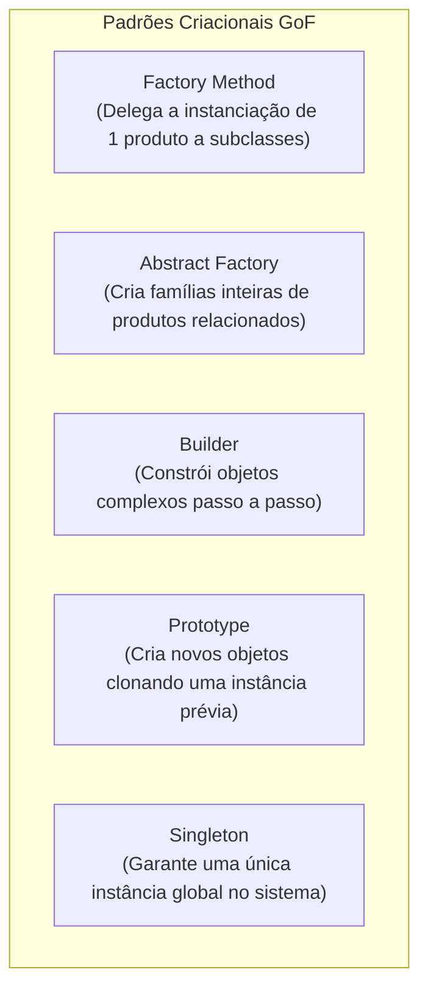

# 04 - Padrões de Projeto (Design Patterns - GoF)

> **Matéria:** Engenharia de Software  
> **Cargo:** B02 – Técnico de Controle Externo – Especialidade: Tecnologia da Informação  
> **Arquivo:** `04_padroes_de_projeto_design_patterns.md`  
> **Referência Fundamental:** Gang of Four (GoF - Erich Gamma, Richard Helm, Ralph Johnson e John Vlissides)

---

## 📌 Ementa / Itens do Edital
- Padrões de projeto de software (Design Patterns GoF)
- Padrões Criacionais (Creational Patterns)
- Padrões Estruturais (Structural Patterns)
- Padrões Comportamentais (Behavioral Patterns)

---

## 🧭 Sumário

1. [Fundamentos e Princípios dos Padrões de Projeto GoF](#1-fundamentos-e-principios-dos-padroes-de-projeto-gof)
    1. [Definição Canônica e Elementos Estruturantes](#11-definicao-canonica-e-elementos-estruturantes)
    2. [Os Dois Grandes Princípios de Design do GoF](#12-os-dois-grandes-principios-de-design-do-gof)
    3. [A Matriz Canônica dos 23 Padrões GoF (Propósito vs. Escopo)](#13-a-matriz-canonica-dos-23-padroes-gof-proposito-vs-escopo)
    4. [Teste 033](#Teste-033)
2. [Padrões de Criação (Creational Patterns)](#2-padroes-de-criacao-creational-patterns)
    1. [Factory Method vs. Abstract Factory](#21-factory-method-vs-abstract-factory)
    2. [Builder, Prototype e Singleton](#22-builder-prototype-e-singleton)
    3. [Teste 034](#Teste-034)
    4. [Teste 035](#Teste-035)
3. [Padrões Estruturais (Structural Patterns)](#3-padroes-estruturais-structural-patterns)
    1. [Adapter vs. Bridge vs. Facade](#31-adapter-vs-bridge-vs-facade)
    2. [Composite, Decorator, Flyweight e Proxy](#32-composite-decorator-flyweight-e-proxy)
    3. [Teste 036](#Teste-036)
    4. [Teste 037](#Teste-037)
    5. [Teste 038](#Teste-038)
4. [Padrões Comportamentais (Behavioral Patterns)](#4-padroes-comportamentais-behavioral-patterns)
    1. [Strategy vs. State vs. Template Method](#41-strategy-vs-state-vs-template-method)
    2. [Observer e Arquitetura de Publicação/Assinatura](#42-observer-e-arquitetura-de-publicacaoassinatura)
    3. [Command, Chain of Responsibility, Iterator, Mediator, Memento e Visitor](#43-command-chain-of-responsibility-iterator-mediator-memento-e-visitor)
    4. [Teste 039](#Teste-039)
    5. [Teste 040](#Teste-040)
    6. [Teste 041](#Teste-041)
    7. [Teste 042](#Teste-042)
5. [Fontes Oficiais e Referências Bibliográficas](#5-fontes-oficiais-e-referencias-bibliograficas)

---

## 1. Fundamentos e Princípios dos Padrões de Projeto GoF

### 1.1 Definição Canônica e Elementos Estruturantes
Publicado em 1994 por Erich Gamma, Richard Helm, Ralph Johnson e John Vlissides (*Gang of Four - GoF*), o catálogo clássico de Padrões de Projeto (*Design Patterns*) formalizou soluções reutilizáveis para problemas recorrentes no desenvolvimento de software orientado a objetos.
Um padrão de projeto não é código-fonte acabado nem uma biblioteca pronta, mas uma descrição e template arquitetural que orienta como estruturar classes e objetos para resolver determinado problema de design com flexibilidade e baixo acoplamento.

Conforme a definição GoF, cada padrão é formalmente caracterizado por quatro elementos essenciais:

1. **Nome do Padrão (*Pattern Name*):** Vocabulário de design conciso e compartilhado que eleva o nível de abstração das discussões técnicas;
2. **Problema (*Problem*):** Descreve quando aplicar o padrão, o contexto arquitetural e os requisitos ou sintomas de código que justificam sua adoção;
3. **Solução (*Solution*):** Descreve os elementos que compõem o design, seus relacionamentos, responsabilidades e colaborações (sem vincular a uma implementação específica em linguagem singular);
4. **Consequências (*Consequences*):** Os resultados, trade-offs, benefícios de flexibilidade e custos em termos de complexidade adicional ou consumo de memória advindos da aplicação do padrão.

### 1.2 Os Dois Grandes Princípios de Design do GoF
Toda a filosofia dos 23 padrões GoF alicerça-se sobre dois princípios basilares do design de software orientado a objetos:

1. **"Programe para uma interface, não para uma implementação":** Os clientes devem permanecer completamente alheios às classes concretas e aos tipos específicos dos objetos que utilizam, conhecendo unicamente a interface ou classe abstrata que define o contrato de operação. Isso viabiliza o polimorfismo puro e a substituição dinâmica de implementações em tempo de execução.
2. **"Favoreça a composição de objetos sobre a herança de classes":** Enquanto a herança de classes (*white-box reuse*) gera acoplamento estático em tempo de compilação e quebra de encapsulamento da superclasse, a composição de objetos (*black-box reuse*) estabelece associações dinâmicas em tempo de execução, preserva o encapsulamento interno dos objetos e permite alterar comportamentos dinamicamente sem afetar a hierarquia.

### 1.3 A Matriz Canônica dos 23 Padrões GoF (Propósito vs. Escopo)
Os 23 padrões são classificados de acordo com duas dimensões: o **Propósito** (o que o padrão faz: criar, estruturar ou definir comportamento) e o **Escopo** (se o padrão se aplica predominantemente a Classes via herança estática ou a Objetos via composição dinâmica):

| Propósito | Escopo de Classe (Herança Estática) | Escopo de Objeto (Composição Dinâmica) |
| :--- | :--- | :--- |
| **Criacional** (Criação de Objetos) | **Factory Method** | **Abstract Factory**, **Builder**, **Prototype**, **Singleton** |
| **Estrutural** (Composição de Classes/Objetos) | **Adapter (baseado em classe)** | **Adapter (baseado em objeto)**, **Bridge**, **Composite**, **Decorator**, **Facade**, **Flyweight**, **Proxy** |
| **Comportamental** (Comunicação e Algoritmos) | **Interpreter**, **Template Method** | **Chain of Responsibility**, **Command**, **Iterator**, **Mediator**, **Memento**, **Observer**, **State**, **Strategy**, **Visitor** |

> 🚨 **ALERTA DE PROVA / PEGADINHA FCC:**  
> A FCC adora cobrar a distinção entre padrões de **Escopo de Classe** e **Escopo de Objeto**. Memorize os quatro únicos padrões de Escopo de Classe do catálogo GoF:
>
> 1. *Factory Method* (Criacional);
> 2. *Adapter de Classe* (Estrutural com herança múltipla);
> 3. *Template Method* (Comportamental);
> 4. *Interpreter* (Comportamental).  
> **Todos os outros 19 padrões GoF operam sob Escopo de Objeto!**

---

### Teste 033
**(FGV – TJ/BA – 2015 – Analista Judiciario Tecnologia Da Informacao)**
Um padrão de projeto (do inglês design pattern) é uma solução reutilizável para problemas que ocorrem com frequência dentro de um determinado contexto de um projeto de sistema de software orientado a objetos, e que ganhou popularidade com o catálogo denominado Padrões GoF ('Gang of Four') que define e organiza essas soluções reutilizáveis em 3 famílias conforme o propósito de cada solução. Os padrões de projetos denominados Composite, Factory Method e Memento, que fazem parte desse catálogo, pertencem, respectivamente, às famílias:

* **A)** padrão de criação, padrão estrutural e padrão comportamental;
* **B)** padrão estrutural, padrão comportamental e padrão de criação;
* **C)** padrão comportamental, padrão estrutural e padrão de criação;
* **D)** padrão estrutural, padrão de criação e padrão comportamental;
* **E)** padrão de criação, padrão comportamental e padrão estrutural.

---

> **Comentário Detalhado:**
>
> - **A)** **Incorreta.** A opção apresenta proposição em desacordo com os fundamentos teóricos e técnicos do tópico ao afirmar que "padrão de criação, padrão estrutural e padrão comportamental". De acordo com a teoria estudada em *1.3 A Matriz Canônica dos 23 Padrões GoF (Propósito vs. Escopo)*, comportamental (Comunicação e Algoritmos): Interpreter, Template Method — Chain of Responsibility, Command, Iterator, Mediator, Memento, Observer, State, Strategy, Visitor.
> - **B)** **Incorreta.** A opção apresenta proposição em desacordo com os fundamentos teóricos e técnicos do tópico ao afirmar que "padrão estrutural, padrão comportamental e padrão de criação". De acordo com a teoria estudada em *1.3 A Matriz Canônica dos 23 Padrões GoF (Propósito vs. Escopo)*, criacional (Criação de Objetos): Factory Method — Abstract Factory, Builder, Prototype, Singleton.
> - **C)** **Incorreta.** A opção apresenta proposição em desacordo com os fundamentos teóricos e técnicos do tópico ao afirmar que "padrão comportamental, padrão estrutural e padrão de criação". De acordo com a teoria estudada em *1.1 Definição Canônica e Elementos Estruturantes*, um padrão de projeto não é código-fonte acabado nem uma biblioteca pronta, mas uma descrição e template arquitetural que orienta como estruturar classes e objetos para resolver determinado problema de design com flexibilidade e baixo acoplamento.
> - **D)** **Correta.** Conforme fundamentado na seção *1.1 Definição Canônica e Elementos Estruturantes* deste guia, publicado em 1994 por Erich Gamma, Richard Helm, Ralph Johnson e John Vlissides (*Gang of Four - GoF*), o catálogo clássico de Padrões de Projeto (*Design Patterns*) formalizou soluções reutilizáveis para problemas recorrentes no desenvolvimento de software orientado a objetos. Dessa forma, está plenamente correta a assertiva da banca (FGV – TJ/BA/2015) ao estabelecer que "padrão estrutural, padrão de criação e padrão comportamental".
> - **E)** **Incorreta.** A opção apresenta proposição em desacordo com os fundamentos teóricos e técnicos do tópico ao afirmar que "padrão de criação, padrão comportamental e padrão estrutural". De acordo com a teoria estudada em *1.3 A Matriz Canônica dos 23 Padrões GoF (Propósito vs. Escopo)*, estrutural (Composição de Classes/Objetos): Adapter (baseado em classe) — Adapter (baseado em objeto), Bridge, Composite, Decorator, Facade, Flyweight, Proxy.
>
> **Gabarito: D**

---

## 2. Padrões de Criação (Creational Patterns)

Os padrões criacionais abstraem o processo de instanciação, tornando o sistema independente de como seus objetos são criados, compostos e representados.

### 2.1 Factory Method vs. Abstract Factory
- **Factory Method (Método de Fábrica - Escopo de Classe):**
    - *Intenção:* Define uma interface para criar um objeto, mas deixa as subclasses decidirem qual classe concreta instanciar. Permite adiar a instanciação para as subclasses;
    - *Mecanismo:* Utiliza **herança**. A classe criadora base possui um método fábrica abstrato (`criarDocumento()`), e cada subclasse concreta sobrescreve esse método retornando o seu produto específico (`DocumentoPDF`, `DocumentoWord`).
- **Abstract Factory (Fábrica Abstrata - Escopo de Objeto):**
    - *Intenção:* Fornece uma interface para **criar famílias de objetos relacionados ou dependentes** sem especificar suas classes concretas;
    - *Mecanismo:* Utiliza **composição de objetos**. Uma fábrica abstrata declara múltiplos métodos de criação de produtos (`criarBotao()`, `criarJanela()`), e cada fábrica concreta produz uma família inteira harmonizada (ex.: `FabricaTemaEscuro` cria `BotaoEscuro` e `JanelaEscura`; `FabricaTemaClaro` cria `BotaoClaro` e `JanelaClara`).

### 2.2 Builder, Prototype e Singleton
- **Builder (Construtor):**
    - *Intenção:* Separa a construção de um objeto complexo da sua representação final, de modo que o mesmo processo de construção possa criar diferentes representações;
    - *Mecanismo:* Permite a construção passo a passo (*step-by-step*) do objeto com métodos encadeados (`setNome()`, `setCPF()`, `build()`). Envolve os papéis do **Director** (define a ordem dos passos) e do **Builder Concreto** (executa a montagem física);
- **Prototype (Protótipo):**
    - *Intenção:* Especifica os tipos de objetos a serem criados usando uma instância protótipo e cria novos objetos **clonando** esse protótipo existente;
    - *Mecanismo:* Evita o custo de instanciação pesada ou consultas lentas ao banco de dados chamando o método `clone()` da interface Prototype;
- **Singleton (Instância Única):**
    - *Intenção:* Garante que uma classe tenha **uma única instância** em toda a aplicação e fornece um ponto de acesso global a ela;
    - *Mecanismo:* Construtor privado (`private`), uma variável estática que armazena a instância única e um método público estático de recuperação (`getInstance()`).

> 📌 **NOTA EXPLICATIVA / SINGLETON E CONCORRÊNCIA:** Em ambientes multithread, a inicialização tardia simples (*lazy initialization*) do Singleton pode criar instâncias duplicadas se duas threads acessarem `getInstance()` simultaneamente. A solução em Java corporativo exige o padrão *Double-Checked Locking* com variável `volatile` ou a inicialização estática interna segura (*Bill Pugh Singleton*).

---

### Teste 034
**(FGV – TJ/AP – 2023 – Analista Judiciario Apoio Especializado Tecnologia Da Informacao Desenvolvimento De Sistemas)**
Padrões de projeto são representados por meio de diagramas da UML, sendo possível identificá-los através da análise de métodos e relacionamentos entre classes ou interfaces. Observe o diagrama de classes apresentado a seguir. No diagrama é representado o padrão de projeto:

* **A)** Singleton;
* **B)** Prototype;
* **C)** Data Access Object;
* **D)** Observer;
* **E)** Abstract Factory.

---

> **Comentário Detalhado:**
>
> - **A)** **Incorreta.** A opção apresenta proposição em desacordo com os fundamentos teóricos e técnicos do tópico ao afirmar que "Singleton". De acordo com a teoria estudada em *1.3 A Matriz Canônica dos 23 Padrões GoF (Propósito vs. Escopo)*, criacional (Criação de Objetos): Factory Method — Abstract Factory, Builder, Prototype, Singleton.
> - **B)** **Incorreta.** A opção apresenta proposição em desacordo com os fundamentos teóricos e técnicos do tópico ao afirmar que "Prototype". De acordo com a teoria estudada em *2.1 Factory Method vs. Abstract Factory*, *Intenção:* Fornece uma interface para criar famílias de objetos relacionados ou dependentes sem especificar suas classes concretas.
> - **C)** **Incorreta.** A opção apresenta proposição em desacordo com os fundamentos teóricos e técnicos do tópico ao afirmar que "Data Access Object". De acordo com a teoria estudada em *2.1 Factory Method vs. Abstract Factory*, factory Method (Método de Fábrica - Escopo de Classe).
> - **D)** **Incorreta.** A opção apresenta proposição em desacordo com os fundamentos teóricos e técnicos do tópico ao afirmar que "Observer". De acordo com a teoria estudada em *2.1 Factory Method vs. Abstract Factory*, *Intenção:* Define uma interface para criar um objeto, mas deixa as subclasses decidirem qual classe concreta instanciar. Permite adiar a instanciação para as subclasses.
> - **E)** **Correta.** Conforme fundamentado na seção *2.1 Factory Method vs. Abstract Factory* deste guia, uma fábrica abstrata declara múltiplos métodos de criação de produtos (`criarBotao()`, `criarJanela()`), e cada fábrica concreta produz uma família inteira harmonizada (ex.: `FabricaTemaEscuro` cria `BotaoEscuro` e `JanelaEscura`; `FabricaTemaClaro` cria `BotaoClaro` e `JanelaClara`). Dessa forma, está plenamente correta a assertiva da banca (FGV – TJ/AP/2023) ao estabelecer que "Abstract Factory".
>
> **Gabarito: E**

---

### Teste 035
**(FCC – TRT 15ª – 2015 – Analista Judiciário - Tecnologia da Informação)**
Os padrões de projeto tornam mais fácil reutilizar projetos e arquiteturas bem sucedidas. Atualmente existem diversos padrões de projetos conforme abaixo: I. Fornece uma interface para a criação de famílias de objetos relacionados ou dependentes sem especificar suas classes concretas. II. Converte a interface de uma classe em outra interface esperada pelos clientes permitindo que certas classes trabalhem em conjunto, pois de outra forma, seria impossível por causa de suas interfaces incompatíveis. III. Fornece uma maneira de acessar sequencialmente os elementos de uma agregação de objetos sem expor sua representação subjacente. Os padrões de projeto apresentados em I, II e III são, respectivamente,

* **A)** Façade, Builder e Mediator.
* **B)** Abstract Factory, Adapter e Iterator.
* **C)** Façade, Adapter e Interpreter.
* **D)** Singleton, Builder e Mediator.
* **E)** Abstract Factory, Prototype e Iterator.

---

> **Comentário Detalhado:**
>
> - **A)** **Incorreta.** A opção apresenta proposição em desacordo com os fundamentos teóricos e técnicos do tópico ao afirmar que "Façade, Builder e Mediator". De acordo com a teoria estudada em *3.1 Adapter vs. Bridge vs. Facade*, *Intenção:* Converte a interface de uma classe existente na interface esperada pelos clientes. Permite que classes com interfaces incompatíveis trabalhem juntas.
> - **B)** **Incorreta.** A opção apresenta proposição em desacordo com os fundamentos teóricos e técnicos do tópico ao afirmar que "Abstract Factory, Adapter e Iterator". De acordo com a teoria estudada em *2.1 Factory Method vs. Abstract Factory*, *Intenção:* Fornece uma interface para criar famílias de objetos relacionados ou dependentes sem especificar suas classes concretas.
> - **C)** **Incorreta.** A opção apresenta proposição em desacordo com os fundamentos teóricos e técnicos do tópico ao afirmar que "Façade, Adapter e Interpreter". De acordo com a teoria estudada em *3.1 Adapter vs. Bridge vs. Facade*, *Intenção:* Fornece uma interface unificada e simplificada para um conjunto complexo de interfaces em um subsistema.
> - **D)** **Correta.** Conforme fundamentado na seção *4.3 Command, Chain of Responsibility, Iterator, Mediator, Memento e Visitor* deste guia, iterator (Iterador): Fornece uma maneira de acessar sequencialmente os elementos de um objeto agregado (lista, árvore, grafo) sem expor sua representação estrutural subjacente. Dessa forma, está plenamente correta a assertiva da banca (FCC – TRT 15ª/2015) ao estabelecer que "Singleton, Builder e Mediator".
> - **E)** **Incorreta.** A opção apresenta proposição em desacordo com os fundamentos teóricos e técnicos do tópico ao afirmar que "Abstract Factory, Prototype e Iterator". De acordo com a teoria estudada em *1.3 A Matriz Canônica dos 23 Padrões GoF (Propósito vs. Escopo)*, criacional (Criação de Objetos): Factory Method — Abstract Factory, Builder, Prototype, Singleton.
>
> **Gabarito: D**

---

## 3. Padrões Estruturais (Structural Patterns)

Os padrões estruturais tratam de como classes e objetos são compostos para formar estruturas maiores e mais flexíveis.

### 3.1 Adapter vs. Bridge vs. Facade
- **Adapter (Adaptador / Wrapper):**
    - *Intenção:* Converte a interface de uma classe existente na interface esperada pelos clientes. Permite que classes com interfaces incompatíveis trabalhem juntas;
    - *Cenário:* Integração de sistemas legados ou bibliotecas de terceiros sem modificar seu código-fonte;
- **Bridge (Ponte):**
    - *Intenção:* Desacopla uma **abstração da sua implementação**, de modo que ambas possam variar independentemente;
    - *Cenário:* Evita a explosão combinatória de subclasses quando tanto a abstração de negócio (ex.: `Janela`, `JanelaDialogo`) quanto a implementação de plataforma subjacente (ex.: `JanelaWindows`, `JanelaLinux`) precisam evoluir separadamente;
- **Facade (Fachada):**
    - *Intenção:* Fornece uma **interface unificada e simplificada** para um conjunto complexo de interfaces em um subsistema;
    - *Cenário:* Cria uma camada de alto nível que oculta chamadas intrincadas de centenas de classes de um subsistema legado, tornando o uso elementar para novos clientes sem expor os detalhes internos.

### 3.2 Composite, Decorator, Flyweight e Proxy
- **Composite (Composição Hierárquica):**
    - *Intenção:* Compõe objetos em estruturas de **árvore** para representar hierarquias do tipo Todo-Parte. Permite aos clientes **tratar objetos individuais (*folhas*) e composições de objetos (*nós compostos*) de maneira uniforme** por meio de uma interface comum;
    - *Exemplo Clássico:* Sistema de arquivos (um `Arquivo` simples e um `Diretorio` composto contendo arquivos e outros subdiretórios implementam a mesma interface `ComponenteSistema`, respondendo identicamente a `obterTamanho()`).
- **Decorator (Decorador / Wrapper Dinâmico):**
    - *Intenção:* Agrega **responsabilidades adicionais a um objeto dinamicamente** em tempo de execução. Oferece uma alternativa mais flexível do que a herança de classes para estender funcionalidades;
    - *Exemplo Clássico:* Pacote `java.io` da biblioteca padrão Java:  
    `new BufferedReader(new InputStreamReader(new FileInputStream(file)));`
- **Flyweight (Peso-Mosca):**
    - *Intenção:* Usa compartilhamento para suportar eficientemente grandes quantidades de objetos de granulação fina, minimizando o consumo de memória RAM;
    - *Mecanismo:* Separa o estado em **Intrínseco** (imutável, compartilhado por todos os objetos, como o caractere 'A') e **Extrínseco** (mutável, dependente do contexto externo, como as coordenadas X e Y onde a letra é desenhada na página);
- **Proxy (Procurador / Substituto):**
    - *Intenção:* Fornece um objeto substituto ou intermediário que **controla o acesso** ao objeto real original;
    - *Tipos Comuns:* *Virtual Proxy* (carregamento tardio / *lazy loading* de imagens pesadas sob demanda), *Protection Proxy* (checagem de permissões de segurança antes de delegar a chamada) e *Remote Proxy* (representante local de um objeto que reside em outro servidor na rede).

> 🚨 **ALERTA DE PROVA / PEGADINHA FCC:**  
> A banca FCC costuma colocar em uma mesma questão **Adapter**, **Decorator**, **Facade** e **Proxy**, pois todos envolvem outros objetos. Memorize a diferença fulcral de intenção:
>
> - **Adapter:** Altera a interface para resolver **incompatibilidade**.
> - **Decorator:** Mantém a interface e **adiciona novas responsabilidades** dinamicamente.
> - **Facade:** Cria uma **nova interface simplificada** para um subsistema inteiro.
> - **Proxy:** Mantém a mesma interface e **controla o acesso** ao objeto real.

---

### Teste 036
**(FCC – TRT 2ª – 2014 – Analista Judiciário - Tecnologia da Informação)**
Considere os seguintes fatores sobre o sistema de arquivos EXT4 no Linux: I. O tamanho máximo deste sistema de arquivos é 1EB (exabyte), também suporta arquivos com 16TB (terabytes). II. Diretórios podem conter, no máximo, 128.000 subdiretórios, (contrastando com um máximo de 64.000 no ext3). III. Não é possível efetuar a montagem de um sistema de arquivos EXT3 existente como sendo um EXT4 sem efetuar seu upgrade. Isto se deve aos diferentes tipos de journaling. IV. Neste sistema de arquivos é possível desligar a funcionalidade journaling. Está correto o que consta APENAS em

* **A)** leitura para o proprietário do arquivo.
* **B)** execução para usuários que não pertençam ao grupo deste arquivo.
* **C)** escrita, tanto para o proprietário do arquivo, quanto para usuários que não pertençam ao grupo deste arquivo.
* **D)** escrita e execução para os usuários que pertençam ao grupo deste arquivo.
* **E)** leitura e execução para o proprietário do arquivo.

---

> **Comentário Detalhado:**
>
> - **A)** **Incorreta.** A opção apresenta proposição em desacordo com os fundamentos teóricos e técnicos do tópico ao afirmar que "leitura para o proprietário do arquivo". De acordo com a teoria estudada em *3.2 Composite, Decorator, Flyweight e Proxy*, *Intenção:* Agrega responsabilidades adicionais a um objeto dinamicamente em tempo de execução. Oferece uma alternativa mais flexível do que a herança de classes para estender funcionalidades.
> - **B)** **Incorreta.** A opção apresenta proposição em desacordo com os fundamentos teóricos e técnicos do tópico ao afirmar que "execução para usuários que não pertençam ao grupo deste arquivo". De acordo com a teoria estudada em *1.2 Os Dois Grandes Princípios de Design do GoF*, isso viabiliza o polimorfismo puro e a substituição dinâmica de implementações em tempo de execução.
> - **C)** **Incorreta.** A opção apresenta proposição em desacordo com os fundamentos teóricos e técnicos do tópico ao afirmar que "escrita, tanto para o proprietário do arquivo, quanto para usuários que não pertençam ao grupo deste arquivo". De acordo com a teoria estudada em *3.1 Adapter vs. Bridge vs. Facade*, *Cenário:* Evita a explosão combinatória de subclasses quando tanto a abstração de negócio (ex.: `Janela`, `JanelaDialogo`) quanto a implementação de plataforma subjacente (ex.: `JanelaWindows`, `JanelaLinux`) precisam evoluir separadamente.
> - **D)** **Incorreta.** A opção apresenta proposição em desacordo com os fundamentos teóricos e técnicos do tópico ao afirmar que "escrita e execução para os usuários que pertençam ao grupo deste arquivo". De acordo com a teoria estudada em *1.2 Os Dois Grandes Princípios de Design do GoF*, "Favoreça a composição de objetos sobre a herança de classes": Enquanto a herança de classes (*white-box reuse*) gera acoplamento estático em tempo de compilação e quebra de encapsulamento da superclasse, a composição de objetos (*black-box reuse*) estabelece associações dinâmicas em tempo de execução, preserva o encapsulamento interno dos objetos e permite alterar comportamentos dinamicamente sem afetar a hierarquia.
> - **E)** **Correta.** Conforme fundamentado na seção *3.2 Composite, Decorator, Flyweight e Proxy* deste guia, *Exemplo Clássico:* Sistema de arquivos (um `Arquivo` simples e um `Diretorio` composto contendo arquivos e outros subdiretórios implementam a mesma interface `ComponenteSistema`, respondendo identicamente a `obterTamanho()`). Dessa forma, está plenamente correta a assertiva da banca (FCC – TRT 2ª/2014) ao estabelecer que "leitura e execução para o proprietário do arquivo".
>
> **Gabarito: E**

---

### Teste 037
**(FCC – TRT 13ª – 2014 – Analista Judiciário - Tecnologia da Informação)**
A imagem a seguir mostra uma representação das etapas do processo de desenvolvimento de software e os tipos de testes aplicados em cada etapa. Tipo de teste I Tipo de teste II Tipo de teste III Levantamento Modelagem Prototipagem de Requisitos de Negócios Especificação Projeto e Codificação de Classes Arquitetura Manutenção Tipo de teste V Tipo de teste IV Tipo de teste VI O mais adequado para Tipo de Teste II é o teste

* **A)** de sistema.
* **B)** de regressão.
* **C)** de aceitação.
* **D)** funcional.
* **E)** de unidade.

---

> **Comentário Detalhado:**
>
> - **A)** **Incorreta.** A opção apresenta proposição em desacordo com os fundamentos teóricos e técnicos do tópico ao afirmar que "de sistema". De acordo com a teoria estudada em *2. Padrões de Criação (Creational Patterns)*, os padrões criacionais abstraem o processo de instanciação, tornando o sistema independente de como seus objetos são criados, compostos e representados.
> - **B)** **Incorreta.** A opção apresenta proposição em desacordo com os fundamentos teóricos e técnicos do tópico ao afirmar que "de regressão". De acordo com a teoria estudada em *2.2 Builder, Prototype e Singleton*, *Intenção:* Separa a construção de um objeto complexo da sua representação final, de modo que o mesmo processo de construção possa criar diferentes representações.
> - **C)** **Correta.** Conforme fundamentado na seção *1.1 Definição Canônica e Elementos Estruturantes* deste guia, publicado em 1994 por Erich Gamma, Richard Helm, Ralph Johnson e John Vlissides (*Gang of Four - GoF*), o catálogo clássico de Padrões de Projeto (*Design Patterns*) formalizou soluções reutilizáveis para problemas recorrentes no desenvolvimento de software orientado a objetos. Dessa forma, está plenamente correta a assertiva da banca (FCC – TRT 13ª/2014) ao estabelecer que "de aceitação".
> - **D)** **Incorreta.** A opção apresenta proposição em desacordo com os fundamentos teóricos e técnicos do tópico ao afirmar que "funcional". De acordo com a teoria estudada em *3. Padrões Estruturais (Structural Patterns)*, os padrões estruturais tratam de como classes e objetos são compostos para formar estruturas maiores e mais flexíveis.
> - **E)** **Incorreta.** A opção apresenta proposição em desacordo com os fundamentos teóricos e técnicos do tópico ao afirmar que "de unidade". De acordo com a teoria estudada em *3.2 Composite, Decorator, Flyweight e Proxy*, *Intenção:* Agrega responsabilidades adicionais a um objeto dinamicamente em tempo de execução. Oferece uma alternativa mais flexível do que a herança de classes para estender funcionalidades.
>
> **Gabarito: C**

---

### Teste 038
**(FCC – TRT 9ª – 2015 – Analista Judiciário - Apoio Especializado - Tecnologia da Informação)**
Quando se utiliza a UML para modelar software há dois tipos de modelos de projeto possíveis: os modelos estruturais e os modelos dinâmicos. São adequados para serem usados na criação do modelo dinâmico, os diagramas de

* **A)** Pacotes e de Classes.
* **B)** Sequência e de Máquina de estados.
* **C)** Componentes e de Deployment.
* **D)** Classes e de Objetos.
* **E)** Estrutura composta e de Objetos.

---

> **Comentário Detalhado:**
>
> - **A)** **Incorreta.** A opção apresenta proposição em desacordo com os fundamentos teóricos e técnicos do tópico ao afirmar que "Pacotes e de Classes". De acordo com a teoria estudada em *1.2 Os Dois Grandes Princípios de Design do GoF*, "Programe para uma interface, não para uma implementação": Os clientes devem permanecer completamente alheios às classes concretas e aos tipos específicos dos objetos que utilizam, conhecendo unicamente a interface ou classe abstrata que define o contrato de operação.
> - **B)** **Correta.** Conforme fundamentado na seção *2.2 Builder, Prototype e Singleton* deste guia, *Intenção:* Especifica os tipos de objetos a serem criados usando uma instância protótipo e cria novos objetos clonando esse protótipo existente. Dessa forma, está plenamente correta a assertiva da banca (FCC – TRT 9ª/2015) ao estabelecer que "Sequência e de Máquina de estados".
> - **C)** **Incorreta.** A opção apresenta proposição em desacordo com os fundamentos teóricos e técnicos do tópico ao afirmar que "Componentes e de Deployment". De acordo com a teoria estudada em *1.1 Definição Canônica e Elementos Estruturantes*, publicado em 1994 por Erich Gamma, Richard Helm, Ralph Johnson e John Vlissides (*Gang of Four - GoF*), o catálogo clássico de Padrões de Projeto (*Design Patterns*) formalizou soluções reutilizáveis para problemas recorrentes no desenvolvimento de software orientado a objetos.
> - **D)** **Incorreta.** A opção apresenta proposição em desacordo com os fundamentos teóricos e técnicos do tópico ao afirmar que "Classes e de Objetos". De acordo com a teoria estudada em *3. Padrões Estruturais (Structural Patterns)*, os padrões estruturais tratam de como classes e objetos são compostos para formar estruturas maiores e mais flexíveis.
> - **E)** **Incorreta.** A opção apresenta proposição em desacordo com os fundamentos teóricos e técnicos do tópico ao afirmar que "Estrutura composta e de Objetos". De acordo com a teoria estudada em *4.3 Command, Chain of Responsibility, Iterator, Mediator, Memento e Visitor*, visitor (Visitante): Representa uma nova operação a ser executada sobre os elementos de uma estrutura de objetos existente.
>
> **Gabarito: B**

---

## 4. Padrões Comportamentais (Behavioral Patterns)

Os padrões comportamentais concentram-se nos algoritmos, na distribuição de responsabilidades e na dinâmica de comunicação e colaboração entre objetos.

### 4.1 Strategy vs. State vs. Template Method
A diferenciação entre esses três padrões é uma das temáticas mais cobradas em provas de controle externo:

| Critério de Comparação | Strategy | State | Template Method |
| :--- | :--- | :--- | :--- |
| **Intenção Principal** | Encapsular uma família de algoritmos intercambiáveis para que o cliente selecione qual utilizar. | Permitir a um objeto alterar seu comportamento dinamicamente quando seu estado interno mudar. | Definir o esqueleto estrutural de um algoritmo fixo, delegando passos específicos para subclasses. |
| **Mecanismo de Reúso** | **Composição de Objetos** | **Composição de Objetos** | **Herança de Classes** (Escopo de Classe) |
| **Quem Altera o Comportamento?** | O **cliente** injeta explicitamente a estratégia desejada no contexto (ex.: cálculo de juros simples ou compostos). | O **próprio contexto transita de estado** autonomamente em resposta a eventos (ex.: processo *Protocolado* $\rightarrow$ *Em Instrução* $\rightarrow$ *Julgado*). | A **superclasse** executa o fluxo; as subclasses sobrescrevem apenas métodos gancho (*hooks*). |

### 4.2 Observer e Arquitetura de Publicação/Assinatura
- **Observer (Observador / Publicador-Assinante):**
    - *Intenção:* Define uma **dependência um-para-muitos** entre objetos, de modo que quando um objeto (o *Sujeito* / *Subject*) muda de estado, todos os seus dependentes registrados (*Observadores* / *Observers*) são **automaticamente notificados e atualizados**;
    - *Mecanismo:* O sujeito mantém uma lista de referências abstratas a instâncias da interface `Observador`. Ao alterar seu estado interno, invoca em loop o método `atualizar()` de cada observador registrado;
    - *Benefício:* Desacoplamento pleno entre o produtor do evento e os múltiplos consumidores ouvintes.

### 4.3 Command, Chain of Responsibility, Iterator, Mediator, Memento e Visitor
- **Command (Comando):** Encapsula uma requisição como um **objeto**, permitindo parametrizar clientes com diferentes operações, enfileirar ou registrar requisições em log e suportar **operações reversíveis de desfazer (*undo/redo*)**;
- **Chain of Responsibility (Cadeia de Responsabilidade):** Evita o acoplamento do remetente de uma requisição ao seu destinatário, dando a mais de um objeto a oportunidade de tratar a solicitação. Encadeia os objetos receptores e passa a requisição ao longo da cadeia até que um deles a processe (ex.: filtros de requisição HTTP em servlets);
- **Iterator (Iterador):** Fornece uma maneira de **acessar sequencialmente os elementos de um objeto agregado** (lista, árvore, grafo) sem expor sua representação estrutural subjacente;
- **Mediator (Mediador):** Define um objeto central que encapsula como um conjunto de objetos interage. Promove o baixo acoplamento ao evitar que os objetos se refiram uns aos outros explicitamente, centralizando a lógica de comunicação (ex.: controlador de diálogo de interface gráfica);
- **Memento (Lembrança):** Sem violar o encapsulamento, captura e **externaliza o estado interno de um objeto**, permitindo que o objeto seja restaurado para esse estado posteriormente (snapshot de recuperação);
- **Visitor (Visitante):** Representa uma nova operação a ser executada sobre os elementos de uma estrutura de objetos existente. Permite **definir uma nova operação sem mudar as classes** dos elementos sobre os quais ela opera (utiliza o mecanismo de despacho duplo / *double dispatch*).

---

### Teste 039
**(CEBRASPE – TRF 6ª – 2025 – Analista Judiciário - Apoio Especializado - Governança e Gestão de Tecnologia da Informação)**
O projeto é um esforço eventual, ou seja, empregado temporariamente para se criar um resultado único, um produto ou um serviço.

* **C)** Certo
* **E)** Errado

---

> **Comentário Detalhado:**
>
> - **C)** **Correta.** O item está **Certo**. Conforme fundamentado na seção *2.1 Factory Method vs. Abstract Factory* deste guia, *Mecanismo:* Utiliza herança. A classe criadora base possui um método fábrica abstrato (`criarDocumento()`), e cada subclasse concreta sobrescreve esse método retornando o seu produto específico (`DocumentoPDF`, `DocumentoWord`). Dessa forma, está plenamente correta a proposição da banca (CEBRASPE – TRF 6ª/2025) ao afirmar que "O projeto é um esforço eventual, ou seja, empregado temporariamente para se criar um resultado único, um...".
> - **E)** **Incorreta.** A marcação como **Errado** não procede, visto que a assertiva guarda integral conformidade com a teoria estudada em *1.1 Definição Canônica e Elementos Estruturantes*, segundo a qual publicado em 1994 por Erich Gamma, Richard Helm, Ralph Johnson e John Vlissides (*Gang of Four - GoF*), o catálogo clássico de Padrões de Projeto (*Design Patterns*) formalizou soluções reutilizáveis para problemas recorrentes no desenvolvimento de software orientado a objetos.
>
> **Gabarito: C**

---

### Teste 040
**(CEBRASPE – TRT/8 – 2016 – Analista Judiciario Apoio Especializado Tecnologia Da Informacao)**
Monitoring a data processing department’s efficiency and effectiveness is another ongoing task for data processing managers. Producing cost estimates for hardware and software 10 upgrades is another typical job duty for data processing managers. They may also oversee computer systems operations, working with staff to troubleshoot problems and 13 design solutions. Coordinating the installation of hardware, data communications systems and software may also fall under the data processing manager’s job description. A data 16 processing manager is often required to administer the implementation of new or revised systems, evaluate designs, or develop technical standards and procedures for system 19 maintenance and operation. Often, they lead the data processing department; in this capacity, they may recruit, hire, train and supervise staff. Other job duties for data processing 22 managers may include: preparing and administering departmental budgets; preparing and presenting reports related to data processing operations; acting as liaison between staff 25 and management; interfacing with external vendors; and negotiating proposals. Internet: <www.floridatechonline.com> (adapted). In relation to the ideas expressed in the text and to its grammatical aspects, choose the true option. A After getting the organizational needs from the staff the IT professionals fix the best way to get them. B Processing managers are in charge of providing data to contribute to the efficiency and effectiveness of the department. C In the text, the pronoun “them” (R.6) refers to “information technology (IT) professionals” (R.3). D The processing manager is supposed to perform just three activities. E The IT professionals get in touch with staff and senior management to find out the organizational needs. According to the text, the data processing manager is A the head of department and as such he can train and supervise staff. B often asked to evaluate designs. C asked to create the due budget. D required to submit reports to be approved by the staff members. E rarely called to administer the implementation of new or Assinale a opção correta a respeito dos princípios fundamentais na Constituição Federal de 1988 (CF). A A valorização social do trabalho e da livre-iniciativa não alcança, indiscriminadamente, quaisquer manifestações, mas apenas atividades econômicas capazes de impulsionar o desenvolvimento nacional. B O conceito atual de soberania exprime o autorreconhecimento do Estado como sujeito de direito internacional, mas não engloba os conceitos de abertura, cooperação e integração. C A cidadania envolve não só prerrogativas que viabilizem o poder do cidadão de influenciar as decisões políticas, mas também a obrigação de respeitar tais decisões, ainda que delas discorde. D A dignidade da pessoa humana é conceito eminentemente ético-filosófico, insuscetível de detalhada qualificação normativa, de modo que de sua previsão na Constituição não resulta grande eficácia jurídica, em razão de seu conteúdo abstrato. E O valor social do trabalho possui como traço caracterizador primordial e principal a liberdade de escolha profissional, correspondendo à opção pelo modelo capitalista de produção. Conforme o inciso VII do artigo 5.º da CF, “é assegurada, nos termos da lei, a prestação de assistência religiosa nas entidades civis e militares de internação coletiva”. Considerando-se a aplicabilidade das normas constitucionais e os critérios doutrinários de classificação, é correto afirmar que o referido dispositivo constitui norma A de aplicabilidade imediata. B de eficácia plena programática. C de eficácia plena. D de eficácia limitada de princípio institutivo. E de eficácia limitada programática. Assinale a opção correta acerca do que dispõe a CF sobre partidos políticos. A É inconstitucional, por ofensa ao pluripartidarismo e ao pluralismo político, a fixação de proporcionalidade entre a representatividade partidária e a distribuição do fundo partidário e do tempo na televisão e no rádio. B A exigência de caráter nacional dos partidos políticos visa resguardar o princípio federativo da unidade nacional. C A vedação à utilização de organização paramilitar não obsta que os partidos, em razão da autonomia que lhe é constitucionalmente assegurada, convencionem indumentária uniformizada ou que estabeleçam, em seu âmbito interno, relação de comando e obediência baseada em hierarquia rígida e fidelidade partidária. D Os partidos políticos possuem personalidade jurídica de direito público. E A previsão constitucional de que a lei regrará a função parlamentar autoriza o estabelecimento, pela legislação infraconstitucional, de padrões mínimos de desempenho eleitoral como condição para funcionamento do partido nas De acordo com a CF, compete A à União, aos estados, ao Distrito Federal e aos municípios legislar concorrentemente sobre direito agrário. B aos estados elaborar e executar planos regionais de ordenação do território e de desenvolvimento econômico e social. C aos municípios explorar diretamente serviços de radiodifusão. D à União legislar privativamente sobre desapropriação. E à União legislar privativamente sobre direito financeiro. À luz do disposto na CF, assinale a opção correta a respeito do concurso público. A A constitucionalidade da sujeição de candidato a exame psicotécnico em concurso público depende apenas de haver previsão editalícia nesse sentido. B As provas de títulos em concurso público devem possuir caráter eliminatório e classificatório. C É inconstitucional a disposição, em edital, que limite o número de participantes de cada fase de concurso público e que possa, por isso, eliminar eventuais candidatos que, embora aprovados, não alcancem a classificação mínima exigida. D Os serviços sociais autônomos, embora não integrem a administração pública, submetem-se à regra constitucional de exigência de concurso público para provimento de seus quadros. E É constitucional a limitação de idade para inscrição em concurso público quando essa limitação se justificar em razão das atribuições do cargo.

* **C)** Certo
* **E)** Errado

---

> **Comentário Detalhado:**
>
> - **C)** **Correta.** O item está **Certo**. Conforme fundamentado na seção *1.2 Os Dois Grandes Princípios de Design do GoF* deste guia, "Favoreça a composição de objetos sobre a herança de classes": Enquanto a herança de classes (*white-box reuse*) gera acoplamento estático em tempo de compilação e quebra de encapsulamento da superclasse, a composição de objetos (*black-box reuse*) estabelece associações dinâmicas em tempo de execução, preserva o encapsulamento interno dos objetos e permite alterar comportamentos dinamicamente sem afetar a hierarquia. Dessa forma, está plenamente correta a proposição da banca (CEBRASPE – TRT/8/2016) ao afirmar que "Monitoring a data processing department’s efficiency and effectiveness is another ongoing task for data...".
> - **E)** **Incorreta.** A marcação como **Errado** não procede, visto que a assertiva guarda integral conformidade com a teoria estudada em *1.1 Definição Canônica e Elementos Estruturantes*, segundo a qual publicado em 1994 por Erich Gamma, Richard Helm, Ralph Johnson e John Vlissides (*Gang of Four - GoF*), o catálogo clássico de Padrões de Projeto (*Design Patterns*) formalizou soluções reutilizáveis para problemas recorrentes no desenvolvimento de software orientado a objetos.
>
> **Gabarito: C**

---

### Teste 041
**(FCC – TRT 23ª – 2016 – Analista Judiciário - Apoio Especializado - Tecnologia da Informação)**
Um Analista de Sistemas necessita utilizar alguns padrões de projeto para solucionar determinados problemas. De acordo com as Categorias de Padrões do Gang of Four − GoF, ele vai utilizar um padrão de cada uma das três categorias, pela ordem, a saber: − Padrões de Criação − Padrões Estruturais − Padrões Comportamentais Em relação a essas três categorias, os padrões são, respectivamente,

* **A)** Concepção e Elaboração.
* **B)** Elaboração e Construção.
* **C)** Transição e Construção.
* **D)** Implementação e Transição.
* **E)** Implantação e Implementação.

---

> **Comentário Detalhado:**
>
> - **A)** **Incorreta.** A opção apresenta proposição em desacordo com os fundamentos teóricos e técnicos do tópico ao afirmar que "Concepção e Elaboração". De acordo com a teoria estudada em *1.2 Os Dois Grandes Princípios de Design do GoF*, "Programe para uma interface, não para uma implementação": Os clientes devem permanecer completamente alheios às classes concretas e aos tipos específicos dos objetos que utilizam, conhecendo unicamente a interface ou classe abstrata que define o contrato de operação.
> - **B)** **Incorreta.** A opção apresenta proposição em desacordo com os fundamentos teóricos e técnicos do tópico ao afirmar que "Elaboração e Construção". De acordo com a teoria estudada em *2.2 Builder, Prototype e Singleton*, *Mecanismo:* Permite a construção passo a passo (*step-by-step*) do objeto com métodos encadeados (`setNome()`, `setCPF()`, `build()`). Envolve os papéis do Director (define a ordem dos passos) e do Builder Concreto (executa a montagem física).
> - **C)** **Incorreta.** A opção apresenta proposição em desacordo com os fundamentos teóricos e técnicos do tópico ao afirmar que "Transição e Construção". De acordo com a teoria estudada em *2.2 Builder, Prototype e Singleton*, *Intenção:* Separa a construção de um objeto complexo da sua representação final, de modo que o mesmo processo de construção possa criar diferentes representações.
> - **D)** **Incorreta.** A opção apresenta proposição em desacordo com os fundamentos teóricos e técnicos do tópico ao afirmar que "Implementação e Transição". De acordo com a teoria estudada em *1.1 Definição Canônica e Elementos Estruturantes*, solução (*Solution*): Descreve os elementos que compõem o design, seus relacionamentos, responsabilidades e colaborações (sem vincular a uma implementação específica em linguagem singular).
> - **E)** **Correta.** Conforme fundamentado na seção *1.1 Definição Canônica e Elementos Estruturantes* deste guia, publicado em 1994 por Erich Gamma, Richard Helm, Ralph Johnson e John Vlissides (*Gang of Four - GoF*), o catálogo clássico de Padrões de Projeto (*Design Patterns*) formalizou soluções reutilizáveis para problemas recorrentes no desenvolvimento de software orientado a objetos. Dessa forma, está plenamente correta a assertiva da banca (FCC – TRT 23ª/2016) ao estabelecer que "Implantação e Implementação".
>
> **Gabarito: E**

---

### Teste 042
**(FCC – TRT 3ª – 2015 – Analista Judiciário - Tecnologia da Informação)**
O Java EE pode ser organizado em três conjuntos de padrões de projeto, de acordo com as camadas da arquitetura JEE: Padrões da Camada de Apresentação (Web Tier Patterns), Padrões da Camada de Negócio (Business Tier Patterns) e Padrões da Camada de Integração (EIS Tier Patterns). São padrões de projeto da Camada de Apresentação:

* **A)** os dados de todos de todos os funcionários cujos nomes possuam a letra a como segundo caractere, utiliza-se a instrução SELECT * FROM emp WHERE nome LIKE '_a%';
* **B)** os dados dos funcionários cujo nome seja 'Pedro' ou 'Ana' utiliza-se a instrução SELECT * FROM emp WHERE nome LIKE ('Pedro','Ana');
* **C)** os dados de todos os funcionários cujo conteúdo do campo salario esteja entre 1000 e 2000 utiliza-se a instrução SELECT * FROM emp WHERE salario BETWEEN (1000,2000);
* **D)** os dados dos funcionários cujo conteúdo do campo nome tenha nos primeiros 4 caracteres a palavra 'Mari' utiliza-se a instrução SELECT * FROM emp WHERE SUBSTRING(nome,FIRST)= 'Mari';
* **E)** o nome e o salário do funcionário somado à comissão, considerando que o conteúdo de alguns campos comissao estão nulos, utiliza-se a instrução SELECT nome, salario+NIL(comissao) FROM emp;

---

> **Comentário Detalhado:**
>
> - **A)** **Correta.** Conforme fundamentado na seção *3.2 Composite, Decorator, Flyweight e Proxy* deste guia, *Mecanismo:* Separa o estado em Intrínseco (imutável, compartilhado por todos os objetos, como o caractere 'A') e Extrínseco (mutável, dependente do contexto externo, como as coordenadas X e Y onde a letra é desenhada na página). Dessa forma, está plenamente correta a assertiva da banca (FCC – TRT 3ª/2015) ao estabelecer que "os dados de todos de todos os funcionários cujos nomes possuam a letra a como segundo caractere, utiliza-se a...".
> - **B)** **Incorreta.** A opção apresenta proposição em desacordo com os fundamentos teóricos e técnicos do tópico ao afirmar que "os dados dos funcionários cujo nome seja 'Pedro' ou 'Ana' utiliza-se a instrução SELECT * FROM emp WHERE nome LIKE...". De acordo com a teoria estudada em *4.1 Strategy vs. State vs. Template Method*, quem Altera o Comportamento?: O cliente injeta explicitamente a estratégia desejada no contexto (ex.: cálculo de juros simples ou compostos). — O próprio contexto transita de estado autonomamente em resposta a eventos (ex.: processo *Protocolado* $\rightarrow$ *Em Instrução* $\rightarrow$ *Julgado*). — A superclasse executa o fluxo; as subclasses sobrescrevem apenas métodos gancho (*hooks*).
> - **C)** **Incorreta.** A opção apresenta proposição em desacordo com os fundamentos teóricos e técnicos do tópico ao afirmar que "os dados de todos os funcionários cujo conteúdo do campo salario esteja entre 1000 e 2000 utiliza-se a instrução...". De acordo com a teoria estudada em *1.1 Definição Canônica e Elementos Estruturantes*, nome do Padrão (*Pattern Name*): Vocabulário de design conciso e compartilhado que eleva o nível de abstração das discussões técnicas.
> - **D)** **Incorreta.** A opção apresenta proposição em desacordo com os fundamentos teóricos e técnicos do tópico ao afirmar que "os dados dos funcionários cujo conteúdo do campo nome tenha nos primeiros 4 caracteres a palavra 'Mari' utiliza-se...". De acordo com a teoria estudada em *2.2 Builder, Prototype e Singleton*, *Mecanismo:* Evita o custo de instanciação pesada ou consultas lentas ao banco de dados chamando o método `clone()` da interface Prototype.
> - **E)** **Incorreta.** A opção apresenta proposição em desacordo com os fundamentos teóricos e técnicos do tópico ao afirmar que "o nome e o salário do funcionário somado à comissão, considerando que o conteúdo de alguns campos comissao estão...". De acordo com a teoria estudada em *4.3 Command, Chain of Responsibility, Iterator, Mediator, Memento e Visitor*, permite definir uma nova operação sem mudar as classes dos elementos sobre os quais ela opera (utiliza o mecanismo de despacho duplo / *double dispatch*).
>
> **Gabarito: A**

---

## 5. Fontes Oficiais e Referências Bibliográficas

* [Refactoring.Guru — Catálogo Completo dos 23 Padrões de Projeto GoF](https://refactoring.guru/pt-br/design-patterns/catalog) - Visão geral estruturada, diagramas UML e aplicabilidade dos padrões do Gang of Four.
* [Refactoring.Guru — Padrões de Projeto Criacionais](https://refactoring.guru/pt-br/design-patterns/creational-patterns) - Detalhamento técnico de Factory Method, Abstract Factory, Builder, Prototype e Singleton.
* [Refactoring.Guru — Padrões de Projeto Estruturais](https://refactoring.guru/pt-br/design-patterns/structural-patterns) - Detalhamento técnico de Adapter, Bridge, Composite, Decorator, Facade, Flyweight e Proxy.
* [Refactoring.Guru — Padrões de Projeto Comportamentais](https://refactoring.guru/pt-br/design-patterns/behavioral-patterns) - Detalhamento técnico de Strategy, State, Template Method, Observer, Command, Chain of Responsibility, Iterator, Mediator, Memento e Visitor.
* [SourceMaking — Design Patterns Reference & Architectural Guide](https://sourcemaking.com/design_patterns) - Catálogo técnico de padrões de projeto orientados a objetos, motivações e relações entre padrões.
* GAMMA, Erich; HELM, Richard; JOHNSON, Ralph; VLISSIDES, John. **Padrões de Projetos: Soluções Reutilizáveis de Software Orientado a Objetos**. Porto Alegre: Bookman, 2000. (Cap. 1 - Introdução; Cap. 3 a 5 - Catálogo de Padrões Criacionais, Estruturais e Comportamentais).
* FREEMAN, Eric; ROBSON, Elisabeth. **Use a Cabeça! Padrões de Projetos (Head First Design Patterns)**. 2. ed. Rio de Janeiro: Alta Books, 2021. (Cap. 1 a 12 - Aplicação Prática dos Padrões GoF).
