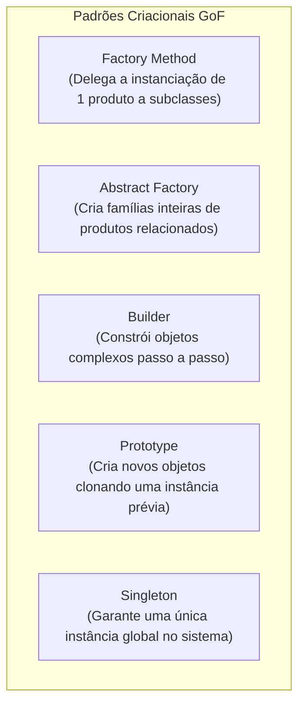

# 04 - Padrões de Projeto (Design Patterns - GoF)

> **Matéria:** Engenharia de Software  
> **Cargo:** B02 – Técnico de Controle Externo – Especialidade: Tecnologia da Informação  
> **Arquivo:** `04_padroes_de_projeto_design_patterns.md`  
> **Referência Fundamental:** Gang of Four (GoF - Erich Gamma, Richard Helm, Ralph Johnson e John Vlissides)

---

## 📌 Ementa / Itens do Edital
- Padrões de projeto de software (Design Patterns GoF)
- Padrões Criacionais (Creational Patterns)
- Padrões Estruturais (Structural Patterns)
- Padrões Comportamentais (Behavioral Patterns)

---

## 🧭 Sumário

1. [Fundamentos e Princípios dos Padrões de Projeto GoF](#1-fundamentos-e-principios-dos-padroes-de-projeto-gof)
    1. [Definição Canônica e Elementos Estruturantes](#11-definicao-canonica-e-elementos-estruturantes)
    2. [Os Dois Grandes Princípios de Design do GoF](#12-os-dois-grandes-principios-de-design-do-gof)
    3. [A Matriz Canônica dos 23 Padrões GoF (Propósito vs. Escopo)](#13-a-matriz-canonica-dos-23-padroes-gof-proposito-vs-escopo)
    4. [Teste 033](#Teste-033)
2. [Padrões de Criação (Creational Patterns)](#2-padroes-de-criacao-creational-patterns)
    1. [Factory Method vs. Abstract Factory](#21-factory-method-vs-abstract-factory)
    2. [Builder, Prototype e Singleton](#22-builder-prototype-e-singleton)
    3. [Teste 034](#Teste-034)
    4. [Teste 035](#Teste-035)
3. [Padrões Estruturais (Structural Patterns)](#3-padroes-estruturais-structural-patterns)
    1. [Adapter vs. Bridge vs. Facade](#31-adapter-vs-bridge-vs-facade)
    2. [Composite, Decorator, Flyweight e Proxy](#32-composite-decorator-flyweight-e-proxy)
    3. [Teste 036](#Teste-036)
    4. [Teste 037](#Teste-037)
    5. [Teste 038](#Teste-038)
4. [Padrões Comportamentais (Behavioral Patterns)](#4-padroes-comportamentais-behavioral-patterns)
    1. [Strategy vs. State vs. Template Method](#41-strategy-vs-state-vs-template-method)
    2. [Observer e Arquitetura de Publicação/Assinatura](#42-observer-e-arquitetura-de-publicacaoassinatura)
    3. [Command, Chain of Responsibility, Iterator, Mediator, Memento e Visitor](#43-command-chain-of-responsibility-iterator-mediator-memento-e-visitor)
    4. [Teste 039](#Teste-039)
    5. [Teste 040](#Teste-040)
    6. [Teste 041](#Teste-041)
    7. [Teste 042](#Teste-042)
5. [Fontes Oficiais e Referências Bibliográficas](#5-fontes-oficiais-e-referencias-bibliograficas)

---

## 1. Fundamentos e Princípios dos Padrões de Projeto GoF

### 1.1 Definição Canônica e Elementos Estruturantes
Publicado em 1994 por Erich Gamma, Richard Helm, Ralph Johnson e John Vlissides (*Gang of Four - GoF*), o catálogo clássico de Padrões de Projeto (*Design Patterns*) formalizou soluções reutilizáveis para problemas recorrentes no desenvolvimento de software orientado a objetos.
Um padrão de projeto não é código-fonte acabado nem uma biblioteca pronta, mas uma descrição e template arquitetural que orienta como estruturar classes e objetos para resolver determinado problema de design com flexibilidade e baixo acoplamento.

Conforme a definição GoF, cada padrão é formalmente caracterizado por quatro elementos essenciais:

1. **Nome do Padrão (*Pattern Name*):** Vocabulário de design conciso e compartilhado que eleva o nível de abstração das discussões técnicas;
2. **Problema (*Problem*):** Descreve quando aplicar o padrão, o contexto arquitetural e os requisitos ou sintomas de código que justificam sua adoção;
3. **Solução (*Solution*):** Descreve os elementos que compõem o design, seus relacionamentos, responsabilidades e colaborações (sem vincular a uma implementação específica em linguagem singular);
4. **Consequências (*Consequences*):** Os resultados, trade-offs, benefícios de flexibilidade e custos em termos de complexidade adicional ou consumo de memória advindos da aplicação do padrão.

### 1.2 Os Dois Grandes Princípios de Design do GoF
Toda a filosofia dos 23 padrões GoF alicerça-se sobre dois princípios basilares do design de software orientado a objetos:

1. **"Programe para uma interface, não para uma implementação":** Os clientes devem permanecer completamente alheios às classes concretas e aos tipos específicos dos objetos que utilizam, conhecendo unicamente a interface ou classe abstrata que define o contrato de operação. Isso viabiliza o polimorfismo puro e a substituição dinâmica de implementações em tempo de execução.
2. **"Favoreça a composição de objetos sobre a herança de classes":** Enquanto a herança de classes (*white-box reuse*) gera acoplamento estático em tempo de compilação e quebra de encapsulamento da superclasse, a composição de objetos (*black-box reuse*) estabelece associações dinâmicas em tempo de execução, preserva o encapsulamento interno dos objetos e permite alterar comportamentos dinamicamente sem afetar a hierarquia.

### 1.3 A Matriz Canônica dos 23 Padrões GoF (Propósito vs. Escopo)
Os 23 padrões são classificados de acordo com duas dimensões: o **Propósito** (o que o padrão faz: criar, estruturar ou definir comportamento) e o **Escopo** (se o padrão se aplica predominantemente a Classes via herança estática ou a Objetos via composição dinâmica):

| Propósito | Escopo de Classe (Herança Estática) | Escopo de Objeto (Composição Dinâmica) |
| :--- | :--- | :--- |
| **Criacional** (Criação de Objetos) | **Factory Method** | **Abstract Factory**, **Builder**, **Prototype**, **Singleton** |
| **Estrutural** (Composição de Classes/Objetos) | **Adapter (baseado em classe)** | **Adapter (baseado em objeto)**, **Bridge**, **Composite**, **Decorator**, **Facade**, **Flyweight**, **Proxy** |
| **Comportamental** (Comunicação e Algoritmos) | **Interpreter**, **Template Method** | **Chain of Responsibility**, **Command**, **Iterator**, **Mediator**, **Memento**, **Observer**, **State**, **Strategy**, **Visitor** |

> 🚨 **ALERTA DE PROVA / PEGADINHA FCC:**  
> A FCC adora cobrar a distinção entre padrões de **Escopo de Classe** e **Escopo de Objeto**. Memorize os quatro únicos padrões de Escopo de Classe do catálogo GoF:
>
> 1. *Factory Method* (Criacional);
> 2. *Adapter de Classe* (Estrutural com herança múltipla);
> 3. *Template Method* (Comportamental);
> 4. *Interpreter* (Comportamental).  
> **Todos os outros 19 padrões GoF operam sob Escopo de Objeto!**

---

### Teste 033
**(FGV – TJ-BA – Analista Judiciario Tecnologia da Informacao – 2015)**
Um padrão de projeto (do inglês design pattern) é uma solução reutilizável para problemas que ocorrem com frequência dentro de um determinado contexto de um projeto de sistema de software orientado a objetos, e que ganhou popularidade com o catálogo denominado Padrões GoF ('Gang of Four') que define e organiza essas soluções reutilizáveis em 3 famílias conforme o propósito de cada solução. Os padrões de projetos denominados Composite, Factory Method e Memento, que fazem parte desse catálogo, pertencem, respectivamente, às famílias:

* **A)** padrão de criação, padrão estrutural e padrão comportamental;
* **B)** padrão estrutural, padrão comportamental e padrão de criação;
* **C)** padrão comportamental, padrão estrutural e padrão de criação;
* **D)** padrão estrutural, padrão de criação e padrão comportamental;
* **E)** padrão de criação, padrão comportamental e padrão estrutural.

---

> **Comentário Detalhado:**
>
> - **A)** **Incorreta.** A opção apresenta proposição em desacordo com os fundamentos teóricos e técnicos do tópico ao afirmar que "padrão de criação, padrão estrutural e padrão comportamental". De acordo com a teoria estudada em *1.3 A Matriz Canônica dos 23 Padrões GoF (Propósito vs. Escopo)*, comportamental (Comunicação e Algoritmos): Interpreter, Template Method — Chain of Responsibility, Command, Iterator, Mediator, Memento, Observer, State, Strategy, Visitor.
> - **B)** **Incorreta.** A opção apresenta proposição em desacordo com os fundamentos teóricos e técnicos do tópico ao afirmar que "padrão estrutural, padrão comportamental e padrão de criação". De acordo com a teoria estudada em *1.3 A Matriz Canônica dos 23 Padrões GoF (Propósito vs. Escopo)*, criacional (Criação de Objetos): Factory Method — Abstract Factory, Builder, Prototype, Singleton.
> - **C)** **Incorreta.** A opção apresenta proposição em desacordo com os fundamentos teóricos e técnicos do tópico ao afirmar que "padrão comportamental, padrão estrutural e padrão de criação". De acordo com a teoria estudada em *1.1 Definição Canônica e Elementos Estruturantes*, um padrão de projeto não é código-fonte acabado nem uma biblioteca pronta, mas uma descrição e template arquitetural que orienta como estruturar classes e objetos para resolver determinado problema de design com flexibilidade e baixo acoplamento.
> - **D)** **Correta.** Conforme fundamentado na seção *1.1 Definição Canônica e Elementos Estruturantes* deste guia, publicado em 1994 por Erich Gamma, Richard Helm, Ralph Johnson e John Vlissides (*Gang of Four - GoF*), o catálogo clássico de Padrões de Projeto (*Design Patterns*) formalizou soluções reutilizáveis para problemas recorrentes no desenvolvimento de software orientado a objetos. Dessa forma, está plenamente correta a assertiva da banca (FGV – TJ-BA/2015) ao estabelecer que "padrão estrutural, padrão de criação e padrão comportamental".
> - **E)** **Incorreta.** A opção apresenta proposição em desacordo com os fundamentos teóricos e técnicos do tópico ao afirmar que "padrão de criação, padrão comportamental e padrão estrutural". De acordo com a teoria estudada em *1.3 A Matriz Canônica dos 23 Padrões GoF (Propósito vs. Escopo)*, estrutural (Composição de Classes/Objetos): Adapter (baseado em classe) — Adapter (baseado em objeto), Bridge, Composite, Decorator, Facade, Flyweight, Proxy.
>
> **Gabarito: D**

---

## 2. Padrões de Criação (Creational Patterns)

Os padrões criacionais abstraem o processo de instanciação, tornando o sistema independente de como seus objetos são criados, compostos e representados.

### 2.1 Factory Method vs. Abstract Factory
- **Factory Method (Método de Fábrica - Escopo de Classe):**
    - *Intenção:* Define uma interface para criar um objeto, mas deixa as subclasses decidirem qual classe concreta instanciar. Permite adiar a instanciação para as subclasses;
    - *Mecanismo:* Utiliza **herança**. A classe criadora base possui um método fábrica abstrato (`criarDocumento()`), e cada subclasse concreta sobrescreve esse método retornando o seu produto específico (`DocumentoPDF`, `DocumentoWord`).
- **Abstract Factory (Fábrica Abstrata - Escopo de Objeto):**
    - *Intenção:* Fornece uma interface para **criar famílias de objetos relacionados ou dependentes** sem especificar suas classes concretas;
    - *Mecanismo:* Utiliza **composição de objetos**. Uma fábrica abstrata declara múltiplos métodos de criação de produtos (`criarBotao()`, `criarJanela()`), e cada fábrica concreta produz uma família inteira harmonizada (ex.: `FabricaTemaEscuro` cria `BotaoEscuro` e `JanelaEscura`; `FabricaTemaClaro` cria `BotaoClaro` e `JanelaClara`).

### 2.2 Builder, Prototype e Singleton
- **Builder (Construtor):**
    - *Intenção:* Separa a construção de um objeto complexo da sua representação final, de modo que o mesmo processo de construção possa criar diferentes representações;
    - *Mecanismo:* Permite a construção passo a passo (*step-by-step*) do objeto com métodos encadeados (`setNome()`, `setCPF()`, `build()`). Envolve os papéis do **Director** (define a ordem dos passos) e do **Builder Concreto** (executa a montagem física);
- **Prototype (Protótipo):**
    - *Intenção:* Especifica os tipos de objetos a serem criados usando uma instância protótipo e cria novos objetos **clonando** esse protótipo existente;
    - *Mecanismo:* Evita o custo de instanciação pesada ou consultas lentas ao banco de dados chamando o método `clone()` da interface Prototype;
- **Singleton (Instância Única):**
    - *Intenção:* Garante que uma classe tenha **uma única instância** em toda a aplicação e fornece um ponto de acesso global a ela;
    - *Mecanismo:* Construtor privado (`private`), uma variável estática que armazena a instância única e um método público estático de recuperação (`getInstance()`).

> 📌 **NOTA EXPLICATIVA / SINGLETON E CONCORRÊNCIA:** Em ambientes multithread, a inicialização tardia simples (*lazy initialization*) do Singleton pode criar instâncias duplicadas se duas threads acessarem `getInstance()` simultaneamente. A solução em Java corporativo exige o padrão *Double-Checked Locking* com variável `volatile` ou a inicialização estática interna segura (*Bill Pugh Singleton*).

---

### Teste 034
**(FCC – TRT-15 – Analista Judiciario Tecnologia da Informacao – 2015)**
Os padrões de projeto tornam mais fácil reutilizar projetos e arquiteturas bem sucedidas. Atualmente existem diversos padrões de projetos conforme abaixo: I. Fornece uma interface para a criação de famílias de objetos relacionados ou dependentes sem especificar suas classes concretas. II. Converte a interface de uma classe em outra interface esperada pelos clientes permitindo que certas classes trabalhem em conjunto, pois de outra forma, seria impossível por causa de suas interfaces incompatíveis. III. Fornece uma maneira de acessar sequencialmente os elementos de uma agregação de objetos sem expor sua representação subjacente. Os padrões de projeto apresentados em I, II e III são, respectivamente,

* **A)** Façade, Builder e Mediator.
* **B)** Abstract Factory, Adapter e Iterator.
* **C)** Façade, Adapter e Interpreter.
* **D)** Singleton, Builder e Mediator.
* **E)** Abstract Factory, Prototype e Iterator.

---

> **Comentário Detalhado:**
>
> - **A)** **Incorreta.** A opção apresenta proposição em desacordo com os fundamentos teóricos e técnicos do tópico ao afirmar que "Façade, Builder e Mediator". De acordo com a teoria estudada em *3.1 Adapter vs. Bridge vs. Facade*, *Intenção:* Converte a interface de uma classe existente na interface esperada pelos clientes. Permite que classes com interfaces incompatíveis trabalhem juntas.
> - **B)** **Correta.** Conforme fundamentado na seção *2.1 Factory Method vs. Abstract Factory* deste guia, *Intenção:* Fornece uma interface para criar famílias de objetos relacionados ou dependentes sem especificar suas classes concretas. Dessa forma, está plenamente correta a assertiva da banca (FCC – TRT-15/2015) ao estabelecer que "Abstract Factory, Adapter e Iterator".
> - **C)** **Incorreta.** A opção apresenta proposição em desacordo com os fundamentos teóricos e técnicos do tópico ao afirmar que "Façade, Adapter e Interpreter". De acordo com a teoria estudada em *4.3 Command, Chain of Responsibility, Iterator, Mediator, Memento e Visitor*, iterator (Iterador): Fornece uma maneira de acessar sequencialmente os elementos de um objeto agregado (lista, árvore, grafo) sem expor sua representação estrutural subjacente.
> - **D)** **Incorreta.** A opção apresenta proposição em desacordo com os fundamentos teóricos e técnicos do tópico ao afirmar que "Singleton, Builder e Mediator". De acordo com a teoria estudada em *1.3 A Matriz Canônica dos 23 Padrões GoF (Propósito vs. Escopo)*, criacional (Criação de Objetos): Factory Method — Abstract Factory, Builder, Prototype, Singleton.
> - **E)** **Incorreta.** A opção apresenta proposição em desacordo com os fundamentos teóricos e técnicos do tópico ao afirmar que "Abstract Factory, Prototype e Iterator". De acordo com a teoria estudada em *2.1 Factory Method vs. Abstract Factory*, *Intenção:* Define uma interface para criar um objeto, mas deixa as subclasses decidirem qual classe concreta instanciar. Permite adiar a instanciação para as subclasses.
>
> **Gabarito: B**

---

### Teste 035
**(FCC – TRT-23 – Analista Judiciario Apoio Especializado Tecnologia da Informacao – 2016)**
Um Analista de Sistemas necessita utilizar alguns padrões de projeto para solucionar determinados problemas. De acordo com as Categorias de Padrões do Gang of Four − GoF, ele vai utilizar um padrão de cada uma das três categorias, pela ordem, a saber: − Padrões de Criação − Padrões Estruturais − Padrões Comportamentais Em relação a essas três categorias, os padrões são, respectivamente,

* **A)** Strategy, Template Method e Decorator.
* **B)** Factory Method, Flyweight e Memento.
* **C)** Bridge, Prototype e Composite.
* **D)** Abstract Factory, Singleton e Observer.
* **E)** Façade, Proxy e Iterator.

---

> **Comentário Detalhado:**
>
> - **A)** **Incorreta.** A opção apresenta proposição em desacordo com os fundamentos teóricos e técnicos do tópico ao afirmar que "Strategy, Template Method e Decorator". De acordo com a teoria estudada em *1.3 A Matriz Canônica dos 23 Padrões GoF (Propósito vs. Escopo)*, comportamental (Comunicação e Algoritmos): Interpreter, Template Method — Chain of Responsibility, Command, Iterator, Mediator, Memento, Observer, State, Strategy, Visitor.
> - **B)** **Correta.** Conforme fundamentado na seção *1.1 Definição Canônica e Elementos Estruturantes* deste guia, publicado em 1994 por Erich Gamma, Richard Helm, Ralph Johnson e John Vlissides (*Gang of Four - GoF*), o catálogo clássico de Padrões de Projeto (*Design Patterns*) formalizou soluções reutilizáveis para problemas recorrentes no desenvolvimento de software orientado a objetos. Dessa forma, está plenamente correta a assertiva da banca (FCC – TRT-23/2016) ao estabelecer que "Factory Method, Flyweight e Memento".
> - **C)** **Incorreta.** A opção apresenta proposição em desacordo com os fundamentos teóricos e técnicos do tópico ao afirmar que "Bridge, Prototype e Composite". De acordo com a teoria estudada em *1.3 A Matriz Canônica dos 23 Padrões GoF (Propósito vs. Escopo)*, criacional (Criação de Objetos): Factory Method — Abstract Factory, Builder, Prototype, Singleton.
> - **D)** **Incorreta.** A opção apresenta proposição em desacordo com os fundamentos teóricos e técnicos do tópico ao afirmar que "Abstract Factory, Singleton e Observer". De acordo com a teoria estudada em *2.1 Factory Method vs. Abstract Factory*, uma fábrica abstrata declara múltiplos métodos de criação de produtos (`criarBotao()`, `criarJanela()`), e cada fábrica concreta produz uma família inteira harmonizada (ex.: `FabricaTemaEscuro` cria `BotaoEscuro` e `JanelaEscura`; `FabricaTemaClaro` cria `BotaoClaro` e `JanelaClara`).
> - **E)** **Incorreta.** A opção apresenta proposição em desacordo com os fundamentos teóricos e técnicos do tópico ao afirmar que "Façade, Proxy e Iterator". De acordo com a teoria estudada em *1.3 A Matriz Canônica dos 23 Padrões GoF (Propósito vs. Escopo)*, estrutural (Composição de Classes/Objetos): Adapter (baseado em classe) — Adapter (baseado em objeto), Bridge, Composite, Decorator, Facade, Flyweight, Proxy.
>
> **Gabarito: B**

---

## 3. Padrões Estruturais (Structural Patterns)

Os padrões estruturais tratam de como classes e objetos são compostos para formar estruturas maiores e mais flexíveis.

### 3.1 Adapter vs. Bridge vs. Facade
- **Adapter (Adaptador / Wrapper):**
    - *Intenção:* Converte a interface de uma classe existente na interface esperada pelos clientes. Permite que classes com interfaces incompatíveis trabalhem juntas;
    - *Cenário:* Integração de sistemas legados ou bibliotecas de terceiros sem modificar seu código-fonte;
- **Bridge (Ponte):**
    - *Intenção:* Desacopla uma **abstração da sua implementação**, de modo que ambas possam variar independentemente;
    - *Cenário:* Evita a explosão combinatória de subclasses quando tanto a abstração de negócio (ex.: `Janela`, `JanelaDialogo`) quanto a implementação de plataforma subjacente (ex.: `JanelaWindows`, `JanelaLinux`) precisam evoluir separadamente;
- **Facade (Fachada):**
    - *Intenção:* Fornece uma **interface unificada e simplificada** para um conjunto complexo de interfaces em um subsistema;
    - *Cenário:* Cria uma camada de alto nível que oculta chamadas intrincadas de centenas de classes de um subsistema legado, tornando o uso elementar para novos clientes sem expor os detalhes internos.

### 3.2 Composite, Decorator, Flyweight e Proxy
- **Composite (Composição Hierárquica):**
    - *Intenção:* Compõe objetos em estruturas de **árvore** para representar hierarquias do tipo Todo-Parte. Permite aos clientes **tratar objetos individuais (*folhas*) e composições de objetos (*nós compostos*) de maneira uniforme** por meio de uma interface comum;
    - *Exemplo Clássico:* Sistema de arquivos (um `Arquivo` simples e um `Diretorio` composto contendo arquivos e outros subdiretórios implementam a mesma interface `ComponenteSistema`, respondendo identicamente a `obterTamanho()`).
- **Decorator (Decorador / Wrapper Dinâmico):**
    - *Intenção:* Agrega **responsabilidades adicionais a um objeto dinamicamente** em tempo de execução. Oferece uma alternativa mais flexível do que a herança de classes para estender funcionalidades;
    - *Exemplo Clássico:* Pacote `java.io` da biblioteca padrão Java:  
    `new BufferedReader(new InputStreamReader(new FileInputStream(file)));`
- **Flyweight (Peso-Mosca):**
    - *Intenção:* Usa compartilhamento para suportar eficientemente grandes quantidades de objetos de granulação fina, minimizando o consumo de memória RAM;
    - *Mecanismo:* Separa o estado em **Intrínseco** (imutável, compartilhado por todos os objetos, como o caractere 'A') e **Extrínseco** (mutável, dependente do contexto externo, como as coordenadas X e Y onde a letra é desenhada na página);
- **Proxy (Procurador / Substituto):**
    - *Intenção:* Fornece um objeto substituto ou intermediário que **controla o acesso** ao objeto real original;
    - *Tipos Comuns:* *Virtual Proxy* (carregamento tardio / *lazy loading* de imagens pesadas sob demanda), *Protection Proxy* (checagem de permissões de segurança antes de delegar a chamada) e *Remote Proxy* (representante local de um objeto que reside em outro servidor na rede).

> 🚨 **ALERTA DE PROVA / PEGADINHA FCC:**  
> A banca FCC costuma colocar em uma mesma questão **Adapter**, **Decorator**, **Facade** e **Proxy**, pois todos envolvem outros objetos. Memorize a diferença fulcral de intenção:
>
> - **Adapter:** Altera a interface para resolver **incompatibilidade**.
> - **Decorator:** Mantém a interface e **adiciona novas responsabilidades** dinamicamente.
> - **Facade:** Cria uma **nova interface simplificada** para um subsistema inteiro.
> - **Proxy:** Mantém a mesma interface e **controla o acesso** ao objeto real.

---

### Teste 036
**(FCC – TRT-13 – Analista Judiciario Tecnologia da Informacao – 2014)**
Considere o seguinte caso: Observando o trâmite de processos no tribunal, Marta percebeu que tanto advogados quanto juízes realizavam análises nos diversos pareceres constantes dos processos. Com sua experiência como analista ela deduziu que uma possível informatização dos processos poderia contemplar uma classe chamada Advogado e outra chamada Juiz, tendo como base uma classe comum chamada Pessoa, com um método chamado AnalisarParecer. Este método (definido na classe comum) se comportaria de maneira diferente para as chamadas feitas a partir de uma instância de Advogado e para as chamadas feitas a partir de uma instância de Juiz, em razão deles terem responsabilidades diferentes em sua forma de analisar e opinar sobre os pareceres. Pela observação do método e seu comportamento, o princípio da orientação a objetos aplicável no caso, fundamentalmente, é

* **A)** a comunicabilidade.
* **B)** o encapsulameto.
* **C)** a visibilidade.
* **D)** o polimorfismo.
* **E)** a estereotipagem.

---

> **Comentário Detalhado:**
>
> - **A)** **Incorreta.** A opção apresenta proposição em desacordo com os fundamentos teóricos e técnicos do tópico ao afirmar que "a comunicabilidade". De acordo com a teoria estudada em *3.2 Composite, Decorator, Flyweight e Proxy*, *Intenção:* Compõe objetos em estruturas de árvore para representar hierarquias do tipo Todo-Parte. Permite aos clientes tratar objetos individuais (*folhas*) e composições de objetos (*nós compostos*) de maneira uniforme por meio de uma interface comum.
> - **B)** **Incorreta.** A opção apresenta proposição em desacordo com os fundamentos teóricos e técnicos do tópico ao afirmar que "o encapsulameto". De acordo com a teoria estudada em *3.1 Adapter vs. Bridge vs. Facade*, *Cenário:* Evita a explosão combinatória de subclasses quando tanto a abstração de negócio (ex.: `Janela`, `JanelaDialogo`) quanto a implementação de plataforma subjacente (ex.: `JanelaWindows`, `JanelaLinux`) precisam evoluir separadamente.
> - **C)** **Incorreta.** A opção apresenta proposição em desacordo com os fundamentos teóricos e técnicos do tópico ao afirmar que "a visibilidade". De acordo com a teoria estudada em *2.1 Factory Method vs. Abstract Factory*, *Mecanismo:* Utiliza herança. A classe criadora base possui um método fábrica abstrato (`criarDocumento()`), e cada subclasse concreta sobrescreve esse método retornando o seu produto específico (`DocumentoPDF`, `DocumentoWord`).
> - **D)** **Correta.** Conforme fundamentado na seção *1.2 Os Dois Grandes Princípios de Design do GoF* deste guia, isso viabiliza o polimorfismo puro e a substituição dinâmica de implementações em tempo de execução. Dessa forma, está plenamente correta a assertiva da banca (FCC – TRT-13/2014) ao estabelecer que "o polimorfismo".
> - **E)** **Incorreta.** A opção apresenta proposição em desacordo com os fundamentos teóricos e técnicos do tópico ao afirmar que "a estereotipagem". De acordo com a teoria estudada em *2.2 Builder, Prototype e Singleton*, *Mecanismo:* Construtor privado (`private`), uma variável estática que armazena a instância única e um método público estático de recuperação (`getInstance()`).
>
> **Gabarito: D**

---

### Teste 037
**(FCC – TRT-13 – Analista Judiciario Tecnologia da Informacao – 2014)**
Um dos conceitos mais importantes da orientação a objetos é o de interface. Interfaces podem reduzir o acoplamento entre as classes e tornar o código mais reutilizável. Em Java, as interfaces

* **A)** podem ou não fornecer implementação de métodos, apesar de ser mais comum implementá-los apenas nas classes que as implementam.
* **B)** podem ser implementadas apenas por classes que utilizam em sua declaração a palavra extends.
* **C)** não podem ter campos de instância, mas permitem a especificação de constantes.
* **D)** podem ser instanciadas de outras classes, desde que estejam no mesmo pacote.
* **E)** podem ter seus objetos convertidos no tipo classe diretamente, sem a realização de typecasting.

---

> **Comentário Detalhado:**
>
> - **A)** **Incorreta.** A opção incorre em restrição indevida ao limitar o escopo conceitual ao afirmar que "podem ou não fornecer implementação de métodos, apesar de ser mais comum implementá-los apenas nas classes que as...". De acordo com a teoria estudada em *3. Padrões Estruturais (Structural Patterns)*, os padrões estruturais tratam de como classes e objetos são compostos para formar estruturas maiores e mais flexíveis.
> - **B)** **Incorreta.** A opção incorre em restrição indevida ao limitar o escopo conceitual ao afirmar que "podem ser implementadas apenas por classes que utilizam em sua declaração a palavra extends". De acordo com a teoria estudada em *1.2 Os Dois Grandes Princípios de Design do GoF*, "Programe para uma interface, não para uma implementação": Os clientes devem permanecer completamente alheios às classes concretas e aos tipos específicos dos objetos que utilizam, conhecendo unicamente a interface ou classe abstrata que define o contrato de operação.
> - **C)** **Correta.** Conforme fundamentado na seção *2.2 Builder, Prototype e Singleton* deste guia, *Intenção:* Especifica os tipos de objetos a serem criados usando uma instância protótipo e cria novos objetos clonando esse protótipo existente. Dessa forma, está plenamente correta a assertiva da banca (FCC – TRT-13/2014) ao estabelecer que "não podem ter campos de instância, mas permitem a especificação de constantes".
> - **D)** **Incorreta.** A opção apresenta proposição em desacordo com os fundamentos teóricos e técnicos do tópico ao afirmar que "podem ser instanciadas de outras classes, desde que estejam no mesmo pacote". De acordo com a teoria estudada em *3.2 Composite, Decorator, Flyweight e Proxy*, *Exemplo Clássico:* Pacote `java.io` da biblioteca padrão Java.
> - **E)** **Incorreta.** A opção apresenta proposição em desacordo com os fundamentos teóricos e técnicos do tópico ao afirmar que "podem ter seus objetos convertidos no tipo classe diretamente, sem a realização de typecasting". De acordo com a teoria estudada em *3.2 Composite, Decorator, Flyweight e Proxy*, *Intenção:* Compõe objetos em estruturas de árvore para representar hierarquias do tipo Todo-Parte. Permite aos clientes tratar objetos individuais (*folhas*) e composições de objetos (*nós compostos*) de maneira uniforme por meio de uma interface comum.
>
> **Gabarito: C**

---

### Teste 038
**(CEBRASPE – TJ-RJ – Analista Judiciario Grupo Tecnologia da Informacao Analista de Sistemas – 2021)**
A coleção GoF (Gang of Four) é formada por padrões orientados a objetos, separados em categorias. A categoria padrões estruturais é responsável por

* **A)** estabelecer um design de objetos reutilizáveis.
* **B)** fornecer maneiras eficientes para criar objetos.
* **C)** descrever como os objetos são colocados juntos.
* **D)** descrever como os objetos interagem.
* **E)** distribuir responsabilidades entre os objetos.

---

> **Comentário Detalhado:**
>
> - **A)** **Incorreta.** A opção apresenta proposição em desacordo com os fundamentos teóricos e técnicos do tópico ao afirmar que "estabelecer um design de objetos reutilizáveis". De acordo com a teoria estudada em *1.2 Os Dois Grandes Princípios de Design do GoF*, toda a filosofia dos 23 padrões GoF alicerça-se sobre dois princípios basilares do design de software orientado a objetos.
> - **B)** **Incorreta.** A opção apresenta proposição em desacordo com os fundamentos teóricos e técnicos do tópico ao afirmar que "fornecer maneiras eficientes para criar objetos". De acordo com a teoria estudada em *1.3 A Matriz Canônica dos 23 Padrões GoF (Propósito vs. Escopo)*, os 23 padrões são classificados de acordo com duas dimensões: o Propósito (o que o padrão faz: criar, estruturar ou definir comportamento) e o Escopo (se o padrão se aplica predominantemente a Classes via herança estática ou a Objetos via composição dinâmica).
> - **C)** **Correta.** Conforme fundamentado na seção *1.1 Definição Canônica e Elementos Estruturantes* deste guia, publicado em 1994 por Erich Gamma, Richard Helm, Ralph Johnson e John Vlissides (*Gang of Four - GoF*), o catálogo clássico de Padrões de Projeto (*Design Patterns*) formalizou soluções reutilizáveis para problemas recorrentes no desenvolvimento de software orientado a objetos. Dessa forma, está plenamente correta a assertiva da banca (CEBRASPE – TJ-RJ/2021) ao estabelecer que "descrever como os objetos são colocados juntos".
> - **D)** **Incorreta.** A opção apresenta proposição em desacordo com os fundamentos teóricos e técnicos do tópico ao afirmar que "descrever como os objetos interagem". De acordo com a teoria estudada em *3. Padrões Estruturais (Structural Patterns)*, os padrões estruturais tratam de como classes e objetos são compostos para formar estruturas maiores e mais flexíveis.
> - **E)** **Incorreta.** A opção apresenta proposição em desacordo com os fundamentos teóricos e técnicos do tópico ao afirmar que "distribuir responsabilidades entre os objetos". De acordo com a teoria estudada em *4. Padrões Comportamentais (Behavioral Patterns)*, os padrões comportamentais concentram-se nos algoritmos, na distribuição de responsabilidades e na dinâmica de comunicação e colaboração entre objetos.
>
> **Gabarito: C**

---

## 4. Padrões Comportamentais (Behavioral Patterns)

Os padrões comportamentais concentram-se nos algoritmos, na distribuição de responsabilidades e na dinâmica de comunicação e colaboração entre objetos.

### 4.1 Strategy vs. State vs. Template Method
A diferenciação entre esses três padrões é uma das temáticas mais cobradas em provas de controle externo:

| Critério de Comparação | Strategy | State | Template Method |
| :--- | :--- | :--- | :--- |
| **Intenção Principal** | Encapsular uma família de algoritmos intercambiáveis para que o cliente selecione qual utilizar. | Permitir a um objeto alterar seu comportamento dinamicamente quando seu estado interno mudar. | Definir o esqueleto estrutural de um algoritmo fixo, delegando passos específicos para subclasses. |
| **Mecanismo de Reúso** | **Composição de Objetos** | **Composição de Objetos** | **Herança de Classes** (Escopo de Classe) |
| **Quem Altera o Comportamento?** | O **cliente** injeta explicitamente a estratégia desejada no contexto (ex.: cálculo de juros simples ou compostos). | O **próprio contexto transita de estado** autonomamente em resposta a eventos (ex.: processo *Protocolado* $\rightarrow$ *Em Instrução* $\rightarrow$ *Julgado*). | A **superclasse** executa o fluxo; as subclasses sobrescrevem apenas métodos gancho (*hooks*). |

### 4.2 Observer e Arquitetura de Publicação/Assinatura
- **Observer (Observador / Publicador-Assinante):**
    - *Intenção:* Define uma **dependência um-para-muitos** entre objetos, de modo que quando um objeto (o *Sujeito* / *Subject*) muda de estado, todos os seus dependentes registrados (*Observadores* / *Observers*) são **automaticamente notificados e atualizados**;
    - *Mecanismo:* O sujeito mantém uma lista de referências abstratas a instâncias da interface `Observador`. Ao alterar seu estado interno, invoca em loop o método `atualizar()` de cada observador registrado;
    - *Benefício:* Desacoplamento pleno entre o produtor do evento e os múltiplos consumidores ouvintes.

### 4.3 Command, Chain of Responsibility, Iterator, Mediator, Memento e Visitor
- **Command (Comando):** Encapsula uma requisição como um **objeto**, permitindo parametrizar clientes com diferentes operações, enfileirar ou registrar requisições em log e suportar **operações reversíveis de desfazer (*undo/redo*)**;
- **Chain of Responsibility (Cadeia de Responsabilidade):** Evita o acoplamento do remetente de uma requisição ao seu destinatário, dando a mais de um objeto a oportunidade de tratar a solicitação. Encadeia os objetos receptores e passa a requisição ao longo da cadeia até que um deles a processe (ex.: filtros de requisição HTTP em servlets);
- **Iterator (Iterador):** Fornece uma maneira de **acessar sequencialmente os elementos de um objeto agregado** (lista, árvore, grafo) sem expor sua representação estrutural subjacente;
- **Mediator (Mediador):** Define um objeto central que encapsula como um conjunto de objetos interage. Promove o baixo acoplamento ao evitar que os objetos se refiram uns aos outros explicitamente, centralizando a lógica de comunicação (ex.: controlador de diálogo de interface gráfica);
- **Memento (Lembrança):** Sem violar o encapsulamento, captura e **externaliza o estado interno de um objeto**, permitindo que o objeto seja restaurado para esse estado posteriormente (snapshot de recuperação);
- **Visitor (Visitante):** Representa uma nova operação a ser executada sobre os elementos de uma estrutura de objetos existente. Permite **definir uma nova operação sem mudar as classes** dos elementos sobre os quais ela opera (utiliza o mecanismo de despacho duplo / *double dispatch*).

---

### Teste 039
**(FGV – TJ-BA – Analista Judiciario Tecnologia da Informacao – 2015)**
A utilização de interfaces em projetos de software orientados a objetivo promove a separação de aspectos internos e externos de um objeto, impedindo o acesso direto aos detalhes de seu funcionamento interno. Esse mecanismo de separação também contribui para que o software seja construído como um conjunto de componentes que realizam seu trabalho de forma independente. O uso desse mecanismo em projetos de sistemas de software é um exemplo de:

* **A)** abstração;
* **B)** encapsulamento;
* **C)** herança;
* **D)** proteção de código;
* **E)** polimorfismo.

---

> **Comentário Detalhado:**
>
> - **A)** **Incorreta.** A opção apresenta proposição em desacordo com os fundamentos teóricos e técnicos do tópico ao afirmar que "abstração". De acordo com a teoria estudada em *1.2 Os Dois Grandes Princípios de Design do GoF*, "Favoreça a composição de objetos sobre a herança de classes": Enquanto a herança de classes (*white-box reuse*) gera acoplamento estático em tempo de compilação e quebra de encapsulamento da superclasse, a composição de objetos (*black-box reuse*) estabelece associações dinâmicas em tempo de execução, preserva o encapsulamento interno dos objetos e permite alterar comportamentos dinamicamente sem afetar a hierarquia.
> - **B)** **Correta.** Conforme fundamentado na seção *4.3 Command, Chain of Responsibility, Iterator, Mediator, Memento e Visitor* deste guia, memento (Lembrança): Sem violar o encapsulamento, captura e externaliza o estado interno de um objeto, permitindo que o objeto seja restaurado para esse estado posteriormente (snapshot de recuperação). Dessa forma, está plenamente correta a assertiva da banca (FGV – TJ-BA/2015) ao estabelecer que "encapsulamento".
> - **C)** **Incorreta.** A opção apresenta proposição em desacordo com os fundamentos teóricos e técnicos do tópico ao afirmar que "herança". De acordo com a teoria estudada em *3.1 Adapter vs. Bridge vs. Facade*, *Cenário:* Cria uma camada de alto nível que oculta chamadas intrincadas de centenas de classes de um subsistema legado, tornando o uso elementar para novos clientes sem expor os detalhes internos.
> - **D)** **Incorreta.** A opção apresenta proposição em desacordo com os fundamentos teóricos e técnicos do tópico ao afirmar que "proteção de código". De acordo com a teoria estudada em *3.1 Adapter vs. Bridge vs. Facade*, *Cenário:* Integração de sistemas legados ou bibliotecas de terceiros sem modificar seu código-fonte.
> - **E)** **Incorreta.** A opção apresenta proposição em desacordo com os fundamentos teóricos e técnicos do tópico ao afirmar que "polimorfismo". De acordo com a teoria estudada em *1.2 Os Dois Grandes Princípios de Design do GoF*, isso viabiliza o polimorfismo puro e a substituição dinâmica de implementações em tempo de execução.
>
> **Gabarito: B**

---

### Teste 040
**(FCC – TRT-14 – Analista Judiciario Apoio Especializado Tecnologia da Informacao – 2016)**
Um Analista precisa construir uma aplicação que possui uma função da qual se conhece somente o algoritmo de execução, sendo que o trabalho de codificação para realização da operação desta função tem que ser postergado. Ele optou pelo uso do padrão de projeto comportamental

* **A)** Template Method, que permite implementar as partes invariantes de um algoritmo e deixar para subclasses a implementação da parte variante.
* **B)** Adapter, que cria classes reutilizáveis que cooperam com classes não relacionadas ou não previstas.
* **C)** Singleton, que possibilita o uso de uma instância estendida sem alterar o seu código.
* **D)** Abstract Factory, que permite criar uma biblioteca de classes de produtos e revelar somente suas interfaces, não suas implementações.
* **E)** Factory Method, que define uma interface para criar objetos, mas deixa que as subclasses decidam que classe instanciar.

---

> **Comentário Detalhado:**
>
> - **A)** **Correta.** Conforme fundamentado na seção *4.1 Strategy vs. State vs. Template Method* deste guia, intenção Principal: Encapsular uma família de algoritmos intercambiáveis para que o cliente selecione qual utilizar. — Permitir a um objeto alterar seu comportamento dinamicamente quando seu estado interno mudar. — Definir o esqueleto estrutural de um algoritmo fixo, delegando passos específicos para subclasses. Dessa forma, está plenamente correta a assertiva da banca (FCC – TRT-14/2016) ao estabelecer que "Template Method, que permite implementar as partes invariantes de um algoritmo e deixar para subclasses a...".
> - **B)** **Incorreta.** A opção apresenta proposição em desacordo com os fundamentos teóricos e técnicos do tópico ao afirmar que "Adapter, que cria classes reutilizáveis que cooperam com classes não relacionadas ou não previstas". De acordo com a teoria estudada em *3.1 Adapter vs. Bridge vs. Facade*, *Cenário:* Cria uma camada de alto nível que oculta chamadas intrincadas de centenas de classes de um subsistema legado, tornando o uso elementar para novos clientes sem expor os detalhes internos.
> - **C)** **Incorreta.** A opção apresenta proposição em desacordo com os fundamentos teóricos e técnicos do tópico ao afirmar que "Singleton, que possibilita o uso de uma instância estendida sem alterar o seu código". De acordo com a teoria estudada em *4.1 Strategy vs. State vs. Template Method*, quem Altera o Comportamento?: O cliente injeta explicitamente a estratégia desejada no contexto (ex.: cálculo de juros simples ou compostos). — O próprio contexto transita de estado autonomamente em resposta a eventos (ex.: processo *Protocolado* \$\rightarrow\$ *Em Instrução* \$\rightarrow\$ *Julgado*). — A superclasse executa o fluxo; as subclasses sobrescrevem apenas métodos gancho (*hooks*).
> - **D)** **Incorreta.** A opção incorre em restrição indevida ao limitar o escopo conceitual ao afirmar que "Abstract Factory, que permite criar uma biblioteca de classes de produtos e revelar somente suas interfaces, não...". De acordo com a teoria estudada em *2.1 Factory Method vs. Abstract Factory*, *Intenção:* Define uma interface para criar um objeto, mas deixa as subclasses decidirem qual classe concreta instanciar. Permite adiar a instanciação para as subclasses.
> - **E)** **Incorreta.** A opção apresenta proposição em desacordo com os fundamentos teóricos e técnicos do tópico ao afirmar que "Factory Method, que define uma interface para criar objetos, mas deixa que as subclasses decidam que classe...". De acordo com a teoria estudada em *1.2 Os Dois Grandes Princípios de Design do GoF*, "Programe para uma interface, não para uma implementação": Os clientes devem permanecer completamente alheios às classes concretas e aos tipos específicos dos objetos que utilizam, conhecendo unicamente a interface ou classe abstrata que define o contrato de operação.
>
> **Gabarito: A**

---

### Teste 041
**(FCC – TRT-4 – Analista Judiciario Tecnologia da Informacao – 2015)**
O uso de herança pode otimizar o tempo de desenvolvimento das aplicações orientadas a objetos devido ao reaproveitamento de código. Quando se implementa herança

* **A)** uma subclasse pode se tornar uma superclasse a qualquer momento, bastando para tanto que se derive uma subclasse a partir dela.
* **B)** a superclasse herda os atributos da subclasse, incluindo os atributos privados, públicos e protegidos.
* **C)** múltipla na linguagem Java versão 6, a subclasse herda características de mais de uma superclasse.
* **D)** só é possível obter polimorfismo na aplicação se houver sobrecarga de métodos.
* **E)** os métodos de uma superclasse não podem ser sobrescritos nas subclasses, porém, podem ser sobrecarregados.

---

> **Comentário Detalhado:**
>
> - **A)** **Correta.** Conforme fundamentado na seção *1.2 Os Dois Grandes Princípios de Design do GoF* deste guia, "Favoreça a composição de objetos sobre a herança de classes": Enquanto a herança de classes (*white-box reuse*) gera acoplamento estático em tempo de compilação e quebra de encapsulamento da superclasse, a composição de objetos (*black-box reuse*) estabelece associações dinâmicas em tempo de execução, preserva o encapsulamento interno dos objetos e permite alterar comportamentos dinamicamente sem afetar a hierarquia. Dessa forma, está plenamente correta a assertiva da banca (FCC – TRT-4/2015) ao estabelecer que "uma subclasse pode se tornar uma superclasse a qualquer momento, bastando para tanto que se derive uma subclasse a...".
> - **B)** **Incorreta.** A opção apresenta proposição em desacordo com os fundamentos teóricos e técnicos do tópico ao afirmar que "a superclasse herda os atributos da subclasse, incluindo os atributos privados, públicos e protegidos". De acordo com a teoria estudada em *2.2 Builder, Prototype e Singleton*, em ambientes multithread, a inicialização tardia simples (*lazy initialization*) do Singleton pode criar instâncias duplicadas se duas threads acessarem `getInstance()` simultaneamente.
> - **C)** **Incorreta.** A opção apresenta proposição em desacordo com os fundamentos teóricos e técnicos do tópico ao afirmar que "múltipla na linguagem Java versão 6, a subclasse herda características de mais de uma superclasse". De acordo com a teoria estudada em *1.3 A Matriz Canônica dos 23 Padrões GoF (Propósito vs. Escopo)*, *Adapter de Classe* (Estrutural com herança múltipla).
> - **D)** **Incorreta.** A opção apresenta proposição em desacordo com os fundamentos teóricos e técnicos do tópico ao afirmar que "só é possível obter polimorfismo na aplicação se houver sobrecarga de métodos". De acordo com a teoria estudada em *4.1 Strategy vs. State vs. Template Method*, quem Altera o Comportamento?: O cliente injeta explicitamente a estratégia desejada no contexto (ex.: cálculo de juros simples ou compostos). — O próprio contexto transita de estado autonomamente em resposta a eventos (ex.: processo *Protocolado* \$\rightarrow\$ *Em Instrução* \$\rightarrow\$ *Julgado*). — A superclasse executa o fluxo; as subclasses sobrescrevem apenas métodos gancho (*hooks*).
> - **E)** **Incorreta.** A opção apresenta proposição em desacordo com os fundamentos teóricos e técnicos do tópico ao afirmar que "os métodos de uma superclasse não podem ser sobrescritos nas subclasses, porém, podem ser sobrecarregados". De acordo com a teoria estudada em *3.1 Adapter vs. Bridge vs. Facade*, *Cenário:* Evita a explosão combinatória de subclasses quando tanto a abstração de negócio (ex.: `Janela`, `JanelaDialogo`) quanto a implementação de plataforma subjacente (ex.: `JanelaWindows`, `JanelaLinux`) precisam evoluir separadamente.
>
> **Gabarito: A**

---

### Teste 042
**(FGV – TCE-SC – Auditor Fiscal de Controle Externo Ciencias da Computacao Sistemas de Informacao – 2026)**
Na modernização dos sistemas de fiscalização, o Tribunal migrou de um sistema monolítico para uma arquitetura de microsserviços. Durante uma auditoria técnica, observou-se que a falha em um serviço de autenticação estava causando a queda em cascata de todos os outros serviços dependentes. O padrão de projeto de arquitetura de software a ser implementado para interromper chamadas a um serviço que está a falhar, permitindo que o sistema degrade graciosamente em vez de colapsar, é o

* **A)** Singleton.
* **B)** Observer.
* **C)** Circuit Breaker.
* **D)** Adapter.
* **E)** Facade.

---

> **Comentário Detalhado:**
>
> - **A)** **Incorreta.** A opção apresenta proposição em desacordo com os fundamentos teóricos e técnicos do tópico ao afirmar que "Singleton". De acordo com a teoria estudada em *2.2 Builder, Prototype e Singleton*, a solução em Java corporativo exige o padrão *Double-Checked Locking* com variável `volatile` ou a inicialização estática interna segura (*Bill Pugh Singleton*).
> - **B)** **Incorreta.** A opção apresenta proposição em desacordo com os fundamentos teóricos e técnicos do tópico ao afirmar que "Observer". De acordo com a teoria estudada em *4.2 Observer e Arquitetura de Publicação/Assinatura*, observer (Observador / Publicador-Assinante).
> - **C)** **Correta.** Conforme fundamentado na seção *4.2 Observer e Arquitetura de Publicação/Assinatura* deste guia, *Intenção:* Define uma dependência um-para-muitos entre objetos, de modo que quando um objeto (o *Sujeito* / *Subject*) muda de estado, todos os seus dependentes registrados (*Observadores* / *Observers*) são automaticamente notificados e atualizados. Dessa forma, está plenamente correta a assertiva da banca (FGV – TCE-SC/2026) ao estabelecer que "Circuit Breaker".
> - **D)** **Incorreta.** A opção apresenta proposição em desacordo com os fundamentos teóricos e técnicos do tópico ao afirmar que "Adapter". De acordo com a teoria estudada em *3.1 Adapter vs. Bridge vs. Facade*, *Cenário:* Integração de sistemas legados ou bibliotecas de terceiros sem modificar seu código-fonte.
> - **E)** **Incorreta.** A opção apresenta proposição em desacordo com os fundamentos teóricos e técnicos do tópico ao afirmar que "Facade". De acordo com a teoria estudada em *3.1 Adapter vs. Bridge vs. Facade*, *Cenário:* Cria uma camada de alto nível que oculta chamadas intrincadas de centenas de classes de um subsistema legado, tornando o uso elementar para novos clientes sem expor os detalhes internos.
>
> **Gabarito: C**

---

## 5. Fontes Oficiais e Referências Bibliográficas

* [Refactoring.Guru — Catálogo Completo dos 23 Padrões de Projeto GoF](https://refactoring.guru/pt-br/design-patterns/catalog) - Visão geral estruturada, diagramas UML e aplicabilidade dos padrões do Gang of Four.
* [Refactoring.Guru — Padrões de Projeto Criacionais](https://refactoring.guru/pt-br/design-patterns/creational-patterns) - Detalhamento técnico de Factory Method, Abstract Factory, Builder, Prototype e Singleton.
* [Refactoring.Guru — Padrões de Projeto Estruturais](https://refactoring.guru/pt-br/design-patterns/structural-patterns) - Detalhamento técnico de Adapter, Bridge, Composite, Decorator, Facade, Flyweight e Proxy.
* [Refactoring.Guru — Padrões de Projeto Comportamentais](https://refactoring.guru/pt-br/design-patterns/behavioral-patterns) - Detalhamento técnico de Strategy, State, Template Method, Observer, Command, Chain of Responsibility, Iterator, Mediator, Memento e Visitor.
* [SourceMaking — Design Patterns Reference & Architectural Guide](https://sourcemaking.com/design_patterns) - Catálogo técnico de padrões de projeto orientados a objetos, motivações e relações entre padrões.
* GAMMA, Erich; HELM, Richard; JOHNSON, Ralph; VLISSIDES, John. **Padrões de Projetos: Soluções Reutilizáveis de Software Orientado a Objetos**. Porto Alegre: Bookman, 2000. (Cap. 1 - Introdução; Cap. 3 a 5 - Catálogo de Padrões Criacionais, Estruturais e Comportamentais).
* FREEMAN, Eric; ROBSON, Elisabeth. **Use a Cabeça! Padrões de Projetos (Head First Design Patterns)**. 2. ed. Rio de Janeiro: Alta Books, 2021. (Cap. 1 a 12 - Aplicação Prática dos Padrões GoF).
