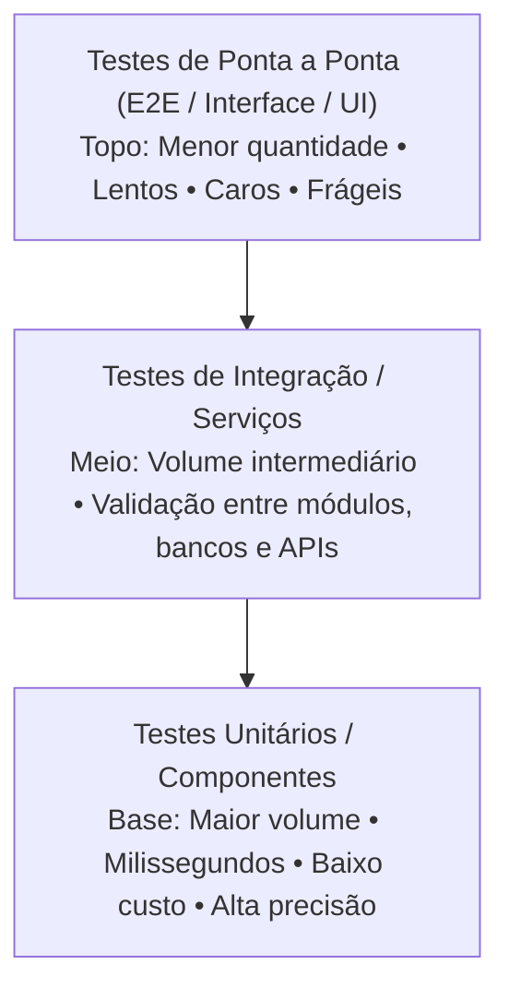
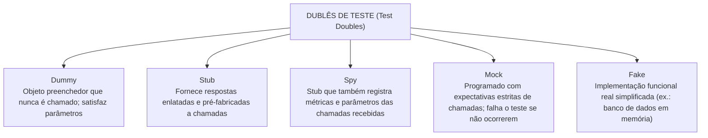
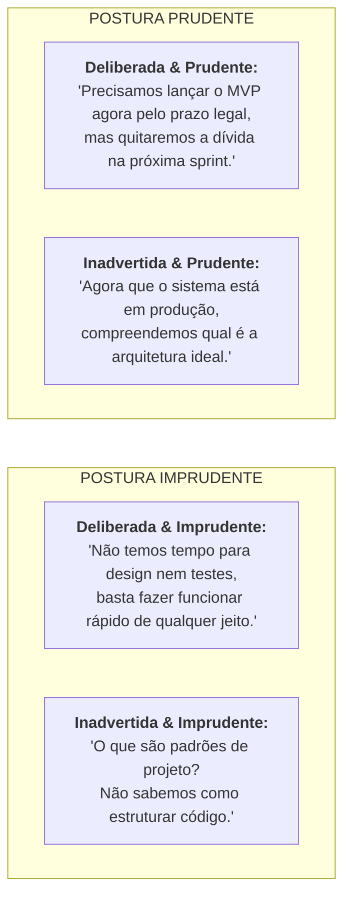

# 05 - Qualidade, Testes, Refatoração e Dívida Técnica

> **Matéria:** Engenharia de Software  
> **Cargo:** B02 – Técnico de Controle Externo – Especialidade: Tecnologia da Informação  
> **Arquivo:** `05_qualidade_testes_refatoracao_e_divida_tecnica.md`  

---

## 📌 Ementa / Itens do Edital
- Qualidade de software: desempenho, escalabilidade, disponibilidade, confiabilidade e manutenibilidade
- Testes de software: unitários, de integração, funcionais, de regressão, de carga e de estresse
- Testes automatizados
- Revisão de código (code review)
- Refatoração de código (refactoring)
- Dívida técnica (technical debt)

---

## 🧭 Sumário

1. [Atributos e Métricas de Qualidade de Software (ISO/IEC 25010)](#1-atributos-e-metricas-de-qualidade-de-software-isoiec-25010)
    1. [Desempenho e Eficiência de Recursos](#11-desempenho-e-eficiencia-de-recursos)
    2. [Escalabilidade Vertical (Scale Up) vs. Escalabilidade Horizontal (Scale Out)](#12-escalabilidade-vertical-scale-up-vs-escalabilidade-horizontal-scale-out)
    3. [Confiabilidade, Disponibilidade e Métricas de Manutenção (MTBF e MTTR)](#13-confiabilidade-disponibilidade-e-metricas-de-manutencao-mtbf-e-mttr)
    4. [Manutenibilidade e Facilidade de Mudança](#14-manutenibilidade-e-facilidade-de-mudanca)
    5. [Teste 043](#Teste-043)
2. [Níveis e Estratégias de Testes de Software](#2-niveis-e-estrategias-de-testes-de-software)
    1. [A Pirâmide de Testes de Mike Cohn](#21-a-piramide-de-testes-de-mike-cohn)
    2. [Dublês de Teste (*Test Doubles* de Gerard Meszaros)](#22-dubles-de-teste-test-doubles-de-gerard-meszaros)
    3. [Testes de Caixa-Preta (Funcionais) vs. Testes de Caixa-Branca (Estruturais)](#23-testes-de-caixa-preta-funcionais-vs-testes-de-caixa-branca-estruturais)
    4. [Complexidade Ciclomática de Thomas McCabe e Grafo de Fluxo](#24-complexidade-ciclomatica-de-thomas-mccabe-e-grafo-de-fluxo)
    5. [Teste 044](#Teste-044)
    6. [Teste 045](#Teste-045)
    7. [Teste 046](#Teste-046)
    8. [Teste 047](#Teste-047)
3. [Tipos Especializados de Testes e Automação](#3-tipos-especializados-de-testes-e-automacao)
    1. [Testes de Regressão e Automação Contínua](#31-testes-de-regressao-e-automacao-continua)
    2. [Testes de Desempenho: Carga vs. Estresse vs. Pico vs. Resistência](#32-testes-de-desempenho-carga-vs-estresse-vs-pico-vs-resistencia)
    3. [Práticas de TDD (Test-Driven Development) e BDD (Behavior-Driven Development)](#33-praticas-de-tdd-test-driven-development-e-bdd-behavior-driven-development)
    4. [Teste 048](#Teste-048)
    5. [Teste 049](#Teste-049)
    6. [Teste 050](#Teste-050)
4. [Revisão de Código, Refatoração e Dívida Técnica](#4-revisao-de-codigo-refatoracao-e-divida-tecnica)
    1. [Técnicas Modernas de Revisão de Código (Code Review)](#41-tecnicas-modernas-de-revisao-de-codigo-code-review)
    2. [Refatoração de Código e os "Maus Cheiros" (Code Smells) de Fowler](#42-refatoracao-de-codigo-e-os-maus-cheiros-code-smells-de-fowler)
    3. [Dívida Técnica e o Quadrante de Martin Fowler](#43-divida-tecnica-e-o-quadrante-de-martin-fowler)
    4. [Teste 051](#Teste-051)
    5. [Teste 052](#Teste-052)
    6. [Teste 053](#Teste-053)
5. [Fontes Oficiais e Referências Bibliográficas](#5-fontes-oficiais-e-referencias-bibliograficas)

---

## 1. Atributos e Métricas de Qualidade de Software (ISO/IEC 25010)

A norma internacional **ISO/IEC 25010** (evolução da ISO 9126) define o modelo de qualidade de produto de software, estruturado em oito características fundamentais: adequação funcional, eficiência de desempenho, compatibilidade, usabilidade, confiabilidade, segurança, manutenibilidade e portabilidade.

### 1.1 Desempenho e Eficiência de Recursos
Mede o comportamento do sistema em termos de velocidade de resposta e utilização racional dos recursos computacionais sob condições especificadas:

- **Tempo de Resposta (*Response Time*):** Intervalo de tempo transcorrido entre a emissão de uma requisição pelo usuário e a exibição completa da resposta processada;
- **Latência:** Tempo de trânsito que uma mensagem ou pacote leva para viajar da origem ao destino na rede;
- **Vazão (*Throughput*):** Quantidade de transações, requisições ou volume de dados processados com sucesso por unidade de tempo (ex.: 5.000 requisições por segundo - RPS);
- **Utilização de Recursos:** Percentual de ocupação de CPU, consumo de memória RAM, largura de banda e operações de entrada/saída em disco (I/O).

### 1.2 Escalabilidade Vertical (Scale Up) vs. Escalabilidade Horizontal (Scale Out)
- **Escalabilidade Vertical (*Scale Up*):** Expansão da capacidade computacional através do acréscimo de recursos físicos à máquina servidora existente (mais núcleos de processador, mais memória RAM ou discos SSD mais rápidos).  
  *Limitações:* Possui teto físico máximo de hardware, custo exponencialmente elevado nas faixas superiores e exige paradas no sistema para upgrade;
- **Escalabilidade Horizontal (*Scale Out*):** Expansão da capacidade mediante a adição de novas instâncias e nós servidores operando em paralelo sob um balanceador de carga (*Load Balancer*).  
  *Vantagens:* Altamente flexível, alinhada a ambientes em nuvem e contêineres elásticos, permitindo provisionamento dinâmico sem interrupção de serviços.

### 1.3 Confiabilidade, Disponibilidade e Métricas de Manutenção (MTBF e MTTR)
- **Confiabilidade:** Grau em que o software desempenha suas funções requeridas sob condições estabelecidas por um período especificado de tempo. Avalia a maturidade, a tolerância a falhas e a capacidade de recuperação de desastres;
- **Disponibilidade:** Proporção de tempo em que o sistema está operacional e plenamente acessível para uso quando demandado. Expressa-se habitualmente pelo número de "noves" em acordos de nível de serviço (SLA - *Service Level Agreement*):
    - *99% ("dois noves"):* Tolera até 3,65 dias de indisponibilidade por ano;
    - *99,9% ("três noves"):* Tolera até 8,76 horas de indisponibilidade por ano;
    - *99,99% ("quatro noves"):* Tolera até 52,56 minutos de indisponibilidade por ano.
- **Métricas Clássicas de Sustentação de Sistemas:**
    - **MTBF (*Mean Time Between Failures* - Tempo Médio Entre Falhas):** Métrica de confiabilidade que calcula o tempo médio em que o sistema opera perfeitamente entre duas panes consecutivas;
    - **MTTR (*Mean Time to Repair* - Tempo Médio para Reparo):** Métrica de manutenibilidade que mede o tempo médio gasto pela equipe de suporte para diagnosticar, corrigir a falha e restaurar o sistema à plena operação;
    - **Cálculo da Disponibilidade Teórica:**
    $$\text{Disponibilidade} = \frac{\text{MTBF}}{\text{MTBF} + \text{MTTR}}$$

### 1.4 Manutenibilidade e Facilidade de Mudança
A manutenibilidade reflete a facilidade e a eficiência com que o software pode ser modificado pelos desenvolvedores para corrigir defeitos, melhorar o desempenho ou adaptar o sistema a mudanças no ambiente de negócio. Subdivide-se em:

- **Modularidade:** Grau em que o sistema é composto por componentes discretos, isolando o impacto de alterações;
- **Reusabilidade:** Capacidade de um ativo ser utilizado em mais de um sistema ou módulo;
- **Analisabilidade:** Facilidade com que se pode diagnosticar deficiências, causas raízes de falhas ou identificar partes a serem alteradas;
- **Modificabilidade:** Facilidade com que o software pode ser modificado sem introduzir novos defeitos ou degradar a qualidade existente;
- **Testabilidade:** Grau em que critérios e testes eficazes podem ser estabelecidos e executados para validar as alterações realizadas.

---

### Teste 043
**(FGV – TCE/PA – 2024 – Auditor de Controle Externo - Administrativa - Engenharia Telecomunicação)**
A modulação por codificação de pulsos (PCM) é essencial na telefonia digital para a digitalização da voz humana. Essa técnica converte sinais analógicos em digitais, melhorando a eficiência e qualidade da transmissão. A voz captada é amostrada, quantificada e codificada em pulsos digitais, garantindo uma comunicação mais clara e confiável, com menos interferências e melhor desempenho em longas distâncias. Considere que um sistema que deseje transmitir, com fidedignidade, frequências da voz humana até 4000 Hz, utilizando uma taxa de amostragem de Nyquist e 12 bits para a quantização do sinal. A menor taxa de bits necessária para o envio desse sinal digital é

* **A)** 48 kbits/seg.
* **B)** 96 kbits/seg.
* **C)** 16,384 Mbits/seg.
* **D)** 32,768 Mbits/seg.
* **E)** 65,536 Mbits/seg.

---

> **Comentário Detalhado:**
>
> - **A)** **Incorreta.** A opção apresenta proposição em desacordo com os fundamentos teóricos e técnicos do tópico ao afirmar que "48 kbits/seg". De acordo com a teoria estudada em *1.1 Desempenho e Eficiência de Recursos*, mede o comportamento do sistema em termos de velocidade de resposta e utilização racional dos recursos computacionais sob condições especificadas.
> - **B)** **Correta.** Conforme fundamentado na seção *1. Atributos e Métricas de Qualidade de Software (ISO/IEC 25010)* deste guia, a norma internacional ISO/IEC 25010 (evolução da ISO 9126) define o modelo de qualidade de produto de software, estruturado em oito características fundamentais: adequação funcional, eficiência de desempenho, compatibilidade, usabilidade, confiabilidade, segurança, manutenibilidade e portabilidade. Dessa forma, está plenamente correta a assertiva da banca (FGV – TCE/PA/2024) ao estabelecer que "96 kbits/seg".
> - **C)** **Incorreta.** A opção apresenta proposição em desacordo com os fundamentos teóricos e técnicos do tópico ao afirmar que "16,384 Mbits/seg". De acordo com a teoria estudada em *1.4 Manutenibilidade e Facilidade de Mudança*, a manutenibilidade reflete a facilidade e a eficiência com que o software pode ser modificado pelos desenvolvedores para corrigir defeitos, melhorar o desempenho ou adaptar o sistema a mudanças no ambiente de negócio. Subdivide-se em.
> - **D)** **Incorreta.** A opção apresenta proposição em desacordo com os fundamentos teóricos e técnicos do tópico ao afirmar que "32,768 Mbits/seg". De acordo com a teoria estudada em *4.3 Dívida Técnica e o Quadrante de Martin Fowler*, inadvertida e Prudente: Decorrente do aprendizado natural do time: após colocar o sistema em produção e observar o uso real, os arquitetos percebem qual deveria ter sido o melhor design.
> - **E)** **Incorreta.** A opção apresenta proposição em desacordo com os fundamentos teóricos e técnicos do tópico ao afirmar que "65,536 Mbits/seg". De acordo com a teoria estudada em *1.4 Manutenibilidade e Facilidade de Mudança*, reusabilidade: Capacidade de um ativo ser utilizado em mais de um sistema ou módulo.
>
> **Gabarito: B**

---

## 2. Níveis e Estratégias de Testes de Software

### 2.1 A Pirâmide de Testes de Mike Cohn
A Pirâmide de Testes é o modelo canônico de engenharia de software para construir suítes de testes automatizados equilibradas e sustentáveis:

| Nível de Teste | Velocidade de Execução | Custo de Construção/Manutenção | Foco do Diagnóstico de Falha | Escopo de Isolamento |
| :--- | :--- | :--- | :--- | :--- |
| **Unitário** | Milissegundos | Muito baixo | Linha exata do código / método | Total (isola com Stubs/Mocks) |
| **Integração** | Segundos | Moderado | Comunicação entre componentes | Parcial (integra com BD ou filas) |
| **Ponta a Ponta (E2E)** | Minutos / Horas | Extremamente alto | Fluxo completo do usuário | Nulo (sistema real completo) |

> 🚨 **ALERTA DE PROVA / PEGADINHA FCC:** A inversão da pirâmide (chamada de antipadrão "Casquinha de Sorvete" ou *Ice Cream Cone*) ocorre quando a organização possui poucos testes unitários e concentra quase todo o esforço em testes manuais ou E2E de interface. O resultado são suítes de testes lentas, que demoram horas para rodar no CI/CD e quebram frequentemente por pequenas alterações visuais (*testes frágeis / flaky tests*).

### 2.2 Dublês de Teste (*Test Doubles* de Gerard Meszaros)
Nos testes unitários, para isolar a unidade sob teste (*System Under Test - SUT*) de dependências pesadas, instáveis ou lentas (bancos de dados, serviços web externos, sistemas de arquivos), empregam-se **Dublês de Teste**:

1. **Dummy:** Objeto passado apenas para preencher parâmetros de assinatura de métodos obrigatórios, nunca sendo invocado durante a execução do teste;
2. **Stub:** Objeto que fornece respostas prontas e pré-programadas para as chamadas recebidas durante o teste (ex.: método `consultarSaldo()` retorna sempre o valor fixo de `1000.00`);
3. **Spy (Espião):** Um Stub enriquecido que intercepta e grava o histórico das chamadas (armazena quantas vezes o método foi invocado e quais parâmetros foram passados para checagem posterior);
4. **Mock:** Objeto pré-programado com **expectativas formais de comportamento**. O desenvolvedor configura explicitamente quais métodos devem ser chamados, com quais argumentos específicos e em que ordem. Se o método não for invocado conforme a expectativa estabelecida, o teste falha compulsoriamente;
5. **Fake:** Objeto que possui uma implementação funcional real simplificada, mas utiliza atalhos que a tornam imprópria para produção (ex.: um banco de dados relacional em memória H2 substituindo um servidor Oracle corporativo nos testes).

### 2.3 Testes de Caixa-Preta (Funcionais) vs. Testes de Caixa-Branca (Estruturais)
- **Testes de Caixa-Preta (Funcionais):** Avaliam o comportamento do software sem conhecimento da estrutura interna ou do código-fonte. O foco reside nas entradas e saídas esperadas:
    - *Partição de Equivalência:* Divide os dados de entrada em classes válidas e inválidas, partindo do princípio de que qualquer dado dentro da mesma partição receberá o mesmo tratamento;
    - *Análise do Valor Limite (BVA):* Testa valores situados exatamente nas fronteiras e adjacências das partições (ex.: se o intervalo aceito é de 18 a 65 anos, testa-se 17, 18, 19, 64, 65 e 66 anos).
- **Testes de Caixa-Branca (Estruturais):** Avaliam os caminhos de controle, estruturas lógicas e condições internas do código-fonte:
    - *Critérios de Cobertura:* Cobertura de comandos (*Statement Coverage*), cobertura de decisões/desvios (*Branch Coverage*) e cobertura de caminhos independentes.

### 2.4 Complexidade Ciclomática de Thomas McCabe e Grafo de Fluxo
Proposta por Thomas McCabe em 1976, a **Complexidade Ciclomática ($V(G)$)** mede quantitativamente a complexidade lógica de um programa através da contagem do número de caminhos linearmente independentes no seu grafo de fluxo de controle.

**Fórmulas de Cálculo Clássicas:**

1. Pela contagem de arestas ($E$), nós ($N$) e componentes conexos ($P=1$ para método único):
   $$V(G) = E - N + 2$$
2. Pela contagem direta de pontos de decisão/predicados ($P$):
   $$V(G) = P + 1$$
   *(onde $P$ é o total de comandos condicionais e de laço: `if`, `while`, `for`, `case`)*.

> ⭐ **IMPORTANTE / APLICAÇÃO EM TESTES:** O valor da complexidade ciclomática de McCabe define o **número mínimo exato de casos de teste** necessários para garantir que todas as instruções e caminhos lógicos do método sejam executados ao menos uma vez!

---

### Teste 044
**(FCC – TRT 3ª – 2015 – Analista Judiciário - Tecnologia da Informação)**
Um profissional está trabalhando no processo de testes de desenvolvimento de um software orientado a objetos. Inicialmente, realizou o teste das funcionalidades dos objetos ou métodos das classes individualmente. Em seguida, integrou várias unidades individuais criando elementos compostos e testou as interfaces desses elementos. Para concluir a bateria de testes, integrou todos os componentes do software e testou a integração entre eles como um todo. Os testes realizados pelo profissional foram testes

* **A)** funcionais, de integração e de aceitação.
* **B)** alfa, beta e de sistema.
* **C)** unitários, de componentes e de sistema.
* **D)** funcionais, de componentes e de integração.
* **E)** unitários, de integração e de aceitação.

---

> **Comentário Detalhado:**
>
> - **A)** **Incorreta.** A opção apresenta proposição em desacordo com os fundamentos teóricos e técnicos do tópico ao afirmar que "funcionais, de integração e de aceitação". De acordo com a teoria estudada em *1.4 Manutenibilidade e Facilidade de Mudança*, modularidade: Grau em que o sistema é composto por componentes discretos, isolando o impacto de alterações.
> - **B)** **Incorreta.** A opção apresenta proposição em desacordo com os fundamentos teóricos e técnicos do tópico ao afirmar que "alfa, beta e de sistema". De acordo com a teoria estudada em *2.2 Dublês de Teste (Test Doubles de Gerard Meszaros)*, nos testes unitários, para isolar a unidade sob teste (*System Under Test - SUT*) de dependências pesadas, instáveis ou lentas (bancos de dados, serviços web externos, sistemas de arquivos), empregam-se Dublês de Teste.
> - **C)** **Correta.** Conforme fundamentado na seção *2.1 A Pirâmide de Testes de Mike Cohn* deste guia, integração: Segundos — Moderado — Comunicação entre componentes — Parcial (integra com BD ou filas). Dessa forma, está plenamente correta a assertiva da banca (FCC – TRT 3ª/2015) ao estabelecer que "unitários, de componentes e de sistema".
> - **D)** **Incorreta.** A opção apresenta proposição em desacordo com os fundamentos teóricos e técnicos do tópico ao afirmar que "funcionais, de componentes e de integração". De acordo com a teoria estudada em *2.3 Testes de Caixa-Preta (Funcionais) vs. Testes de Caixa-Branca (Estruturais)*, *Partição de Equivalência:* Divide os dados de entrada em classes válidas e inválidas, partindo do princípio de que qualquer dado dentro da mesma partição receberá o mesmo tratamento.
> - **E)** **Incorreta.** A opção apresenta proposição em desacordo com os fundamentos teóricos e técnicos do tópico ao afirmar que "unitários, de integração e de aceitação". De acordo com a teoria estudada em *2.4 Complexidade Ciclomática de Thomas McCabe e Grafo de Fluxo*, pela contagem de arestas ($E$), nós ($N$) e componentes conexos ($P=1$ para método único).
>
> **Gabarito: C**

---

### Teste 045
**(FCC – TRT 13ª – 2014 – Analista Judiciário - Tecnologia da Informação)**
Flávio pretende desenvolver um software seguindo os estágios do modelo em cascata proposto por Sommerville, em razão de ponderações que faz em relação a outros modelos quanto à solução de um problema que se apresenta. Desta forma ele definiu em seu cronograma, na ordem apresentada pelo autor, as seguintes etapas do ciclo de vida de software:

* **A)** Projeto de sistema e software; Definição de requisitos; Implementação e teste de unidade; Integração e teste de sistema; Operação e manutenção.
* **B)** Projeto de sistema e software; Engenharia de software; Integração e teste de sistema; Análise de requisitos funcionais e técnicos; Operação e manutenção; Implementação e teste de unidade.
* **C)** Projeto de sistema e software; Análise de requisitos; Engenharia de requisitos; Implantação; Testes de sistemas; Operação e manutenção.
* **D)** Definição de requisitos; Engenharia de requisitos; Integração e teste de sistema; Projeto de sistema e software; Implementação e teste de unidade; Operação e manutenção; Integração e teste de sistema.
* **E)** Definição de requisitos; Projeto de sistema e software; Implementação e teste de unidade; Integração e teste de sistema; Operação e manutenção.

---

> **Comentário Detalhado:**
>
> - **A)** **Incorreta.** A opção apresenta proposição em desacordo com os fundamentos teóricos e técnicos do tópico ao afirmar que "Projeto de sistema e software; Definição de requisitos; Implementação e teste de unidade; Integração e teste de...". De acordo com a teoria estudada em *3.2 Testes de Desempenho: Carga vs. Estresse vs. Pico vs. Resistência*, teste de Carga (*Load Testing*): Carga operacional esperada (normal e pico previsto em projeto). — Avaliar o comportamento do sistema, tempos de resposta e uso de hardware sob o volume regular de usuários acordado no SLA.
> - **B)** **Incorreta.** A opção apresenta proposição em desacordo com os fundamentos teóricos e técnicos do tópico ao afirmar que "Projeto de sistema e software; Engenharia de software; Integração e teste de sistema; Análise de requisitos...". De acordo com a teoria estudada em *2.3 Testes de Caixa-Preta (Funcionais) vs. Testes de Caixa-Branca (Estruturais)*, *Análise do Valor Limite (BVA):* Testa valores situados exatamente nas fronteiras e adjacências das partições (ex.: se o intervalo aceito é de 18 a 65 anos, testa-se 17, 18, 19, 64, 65 e 66 anos).
> - **C)** **Incorreta.** A opção apresenta proposição em desacordo com os fundamentos teóricos e técnicos do tópico ao afirmar que "Projeto de sistema e software; Análise de requisitos; Engenharia de requisitos; Implantação; Testes de sistemas...". De acordo com a teoria estudada em *2.2 Dublês de Teste (Test Doubles de Gerard Meszaros)*, nos testes unitários, para isolar a unidade sob teste (*System Under Test - SUT*) de dependências pesadas, instáveis ou lentas (bancos de dados, serviços web externos, sistemas de arquivos), empregam-se Dublês de Teste.
> - **D)** **Incorreta.** A opção apresenta proposição em desacordo com os fundamentos teóricos e técnicos do tópico ao afirmar que "Definição de requisitos; Engenharia de requisitos; Integração e teste de sistema; Projeto de sistema e software...". De acordo com a teoria estudada em *2.1 A Pirâmide de Testes de Mike Cohn*, a Pirâmide de Testes é o modelo canônico de engenharia de software para construir suítes de testes automatizados equilibradas e sustentáveis.
> - **E)** **Correta.** Conforme fundamentado na seção *1.3 Confiabilidade, Disponibilidade e Métricas de Manutenção (MTBF e MTTR)* deste guia, mTTR (*Mean Time to Repair* - Tempo Médio para Reparo): Métrica de manutenibilidade que mede o tempo médio gasto pela equipe de suporte para diagnosticar, corrigir a falha e restaurar o sistema à plena operação. Dessa forma, está plenamente correta a assertiva da banca (FCC – TRT 13ª/2014) ao estabelecer que "Definição de requisitos; Projeto de sistema e software; Implementação e teste de unidade; Integração e teste de...".
>
> **Gabarito: E**

---

### Teste 046
**(FCC – TRT 14ª – 2016 – Analista Judiciário - Apoio Especializado - Tecnologia da Informação)**
Considere o código em Java que realiza testes unitários com o framework JUnit: import junit.framework.TestCase; public class MatematicaTest I .. .... { private Matematica math=new Matematica(18, 3); public void testadd() { this.assertTrue(this.math.add()==21); } public void testsubtract() { this.assertTrue(this.math.subtract()=15); } public void testmultiply() { this.assertTrue(this.math.multiply()==54); } public void testdivide() { this.assertTrue(this.math.divide()==6); } public static void main(String[] args) { junit.textui.TestRunner.run( I I ); . ... .. } } As lacunas I e II devem ser, correta e respectivamente, preenchidas com

* **A)** implícito, como o Thread.sleep(), que determina um tempo fixo que alguma ação no teste precisa esperar antes de ser executada. Se este tempo for ultrapassado, o teste não falhará.
* **B)** explícito, como o Thread.sleep(). Se a ação estiver pronta para ser executada antes do tempo fixado, o teste conti- nuará.
* **C)** explícito, como o WebDriver.manage().timeouts(), que permite esperar por um certo elemento na tela por um tempo de espera mínimo. Se este tempo for ultrapassado, o teste falhará.
* **D)** implícito, cujo valor padrão é 0. Este tempo deve ser baixo, para evitar que o Selenium fique esperando por um elemento na tela antes de acusar um erro de tempo de espera excedido.
* **E)** explícito, cujo valor padrão é 10. Seu valor não deve ser baixo para evitar problemas em controle de tempo entre ações no teste.

---

> **Comentário Detalhado:**
>
> - **A)** **Incorreta.** A opção apresenta proposição em desacordo com os fundamentos teóricos e técnicos do tópico ao afirmar que "implícito, como o Thread.sleep(), que determina um tempo fixo que alguma ação no teste precisa esperar antes de...". De acordo com a teoria estudada em *4.1 Técnicas Modernas de Revisão de Código (Code Review)*, pair Programming: Revisão contínua em tempo real executada pelo copiloto (*Navigator*) enquanto o piloto (*Driver*) digita o código.
> - **B)** **Correta.** Conforme fundamentado na seção *2.2 Dublês de Teste (Test Doubles de Gerard Meszaros)* deste guia, mock: Objeto pré-programado com expectativas formais de comportamento. O desenvolvedor configura explicitamente quais métodos devem ser chamados, com quais argumentos específicos e em que ordem. Dessa forma, está plenamente correta a assertiva da banca (FCC – TRT 14ª/2016) ao estabelecer que "explícito, como o Thread.sleep(). Se a ação estiver pronta para ser executada antes do tempo fixado, o teste...".
> - **C)** **Incorreta.** A opção apresenta proposição em desacordo com os fundamentos teóricos e técnicos do tópico ao afirmar que "explícito, como o WebDriver.manage().timeouts(), que permite esperar por um certo elemento na tela por um tempo de...". De acordo com a teoria estudada em *2.4 Complexidade Ciclomática de Thomas McCabe e Grafo de Fluxo*, o valor da complexidade ciclomática de McCabe define o número mínimo exato de casos de teste necessários para garantir que todas as instruções e caminhos lógicos do método sejam executados ao menos uma vez!.
> - **D)** **Incorreta.** A opção apresenta proposição em desacordo com os fundamentos teóricos e técnicos do tópico ao afirmar que "implícito, cujo valor padrão é 0. Este tempo deve ser baixo, para evitar que o Selenium fique esperando por um...". De acordo com a teoria estudada em *3.1 Testes de Regressão e Automação Contínua*, automação no Pipeline de CI/CD: A suíte de testes de regressão deve ser integralmente automatizada e disparada a cada *commit* ou *Pull Request*, impedindo que código quebrado atinja o repositório principal.
> - **E)** **Incorreta.** A opção apresenta proposição em desacordo com os fundamentos teóricos e técnicos do tópico ao afirmar que "explícito, cujo valor padrão é 10. Seu valor não deve ser baixo para evitar problemas em controle de tempo entre...". De acordo com a teoria estudada em *3.3 Práticas de TDD (Test-Driven Development) e BDD (Behavior-Driven Development)*, *Red:* Escrever um teste automatizado que falha antes de escrever o código de produção.
>
> **Gabarito: B**

---

### Teste 047
**(FGV – TRT 16ª – 2022 – Analista Judiciário (Área Administrativa - Tecnologia da Informação))**
Considerando o DevOps e suas boas práticas, analise os itens a seguir: I. Testes integrados são uma parte importante do processo DevOps. Esses testes devem levar em consideração as práticas de Test-Driven Development e Behavior-Driven Development, dessa forma a execução automática desses testes pode ser integrada ao pipeline de CI. No entanto, é importante integrar outros tipos de testes, como testes funcionais ou testes de integração, que permitem que o aplicativo seja testado funcionalmente do início ao fim com os outros componentes do seu ecossistema. II. Recomenda-se automatizar apenas as tarefas críticas que envolvam poucas atualizações na implementação e nos testes dos aplicativos nas infraestruturas. Essas tarefas devem ser automatizadas em scripts que podem ser facilmente integradas e executadas em pipelines de CI/CD. III. A construção de pipelines de CI/CD envolvem a escolha de ferramentas de DevOps adequadas pelas equipes considerando a natureza da empresa. E necessário levar em conta aspectos financeiros, avaliar entre ferramentas de código aberto e gratuitas e as proprietárias, que são mais ricas em recursos e suporte, mas exigem um investimento significativo. Está correto apenas o que se afirma em

* **A)** I e III.
* **B)** I.
* **C)** I e II.
* **D)** II e III.
* **E)** II.

---

> **Comentário Detalhado:**
>
> - **A)** **Correta.** Conforme fundamentado na seção *3.3 Práticas de TDD (Test-Driven Development) e BDD (Behavior-Driven Development)* deste guia, *Green:* Escrever o código mais simples possível apenas para fazer o teste passar com sucesso. Dessa forma, está plenamente correta a assertiva da banca (FGV – TRT 16ª/2022) ao estabelecer que "I e III".
> - **B)** **Incorreta.** A opção apresenta proposição em desacordo com os fundamentos teóricos e técnicos do tópico ao afirmar que "I". De acordo com a teoria estudada em *3.3 Práticas de TDD (Test-Driven Development) e BDD (Behavior-Driven Development)*, *Refactor:* Limpar o código-fonte, eliminar duplicações e aperfeiçoar o design, garantindo que a suíte de testes continue verde.
> - **C)** **Incorreta.** A opção apresenta proposição em desacordo com os fundamentos teóricos e técnicos do tópico ao afirmar que "I e II". De acordo com a teoria estudada em *3.3 Práticas de TDD (Test-Driven Development) e BDD (Behavior-Driven Development)*, *Red:* Escrever um teste automatizado que falha antes de escrever o código de produção.
> - **D)** **Incorreta.** A opção apresenta proposição em desacordo com os fundamentos teóricos e técnicos do tópico ao afirmar que "II e III". De acordo com a teoria estudada em *3.3 Práticas de TDD (Test-Driven Development) e BDD (Behavior-Driven Development)*, tDD (Desenvolvimento Guiado por Testes): Técnica de engenharia de software fundamentada no ciclo rápido e iterativo de três fases: Red $\rightarrow$ Green $\rightarrow$ Refactor.
> - **E)** **Incorreta.** A opção apresenta proposição em desacordo com os fundamentos teóricos e técnicos do tópico ao afirmar que "II". De acordo com a teoria estudada em *3.3 Práticas de TDD (Test-Driven Development) e BDD (Behavior-Driven Development)*, bDD (Desenvolvimento Guiado por Comportamento): Evolução colaborativa do TDD focada na linguagem ubíqua e no comportamento do sistema sob a ótica do negócio. Expressa cenários no formato Given-When-Then (*Dado que... Quando... Então...* - sintaxe Gherkin).
>
> **Gabarito: A**

---

## 3. Tipos Especializados de Testes e Automação

### 3.1 Testes de Regressão e Automação Contínua
- **Conceito de Teste de Regressão:** Bateria sistemática de testes executada após qualquer manutenção no software (correção de bugs, refatoração ou acréscimo de novas funcionalidades) para certificar que as alterações introduzidas **não causaram efeitos colaterais adversos nem reintroduziram defeitos antigos em módulos que funcionavam perfeitamente**;
- **Automação no Pipeline de CI/CD:** A suíte de testes de regressão deve ser integralmente automatizada e disparada a cada *commit* ou *Pull Request*, impedindo que código quebrado atinja o repositório principal.

### 3.2 Testes de Desempenho: Carga vs. Estresse vs. Pico vs. Resistência
A engenharia de testes de desempenho categoriza os testes de acordo com o padrão e a intensidade de tráfego injetado no sistema:

| Modalidade de Teste | Volume de Tráfego / Carga Injetada | Objetivo Específico da Avaliação |
| :--- | :--- | :--- |
| **Teste de Carga (*Load Testing*)** | Carga operacional esperada (normal e pico previsto em projeto). | Avaliar o comportamento do sistema, tempos de resposta e uso de hardware sob o volume regular de usuários acordado no SLA. |
| **Teste de Estresse (*Stress Testing*)** | Carga extrema que ultrapassa intencionalmente o limite de capacidade máxima do sistema. | Identificar o **ponto de quebra (*breaking point*)**, testar como o sistema falha (degradação graciosa) e como ele se recupera após o término da sobrecarga extrema. |
| **Teste de Pico (*Spike Testing*)** | Variações abruptas, repentinas e massivas de tráfego em intervalos de segundos. | Avaliar se a infraestrutura elástica e os balanceadores reagem com agilidade suficiente a picos súbitos de acesso. |
| **Teste de Resistência (*Soak / Endurance*)** | Carga moderada a alta mantida de forma ininterrupta por períodos prolongados (dias/semanas). | Detectar **vazamentos de memória (*memory leaks*)**, esgotamento de pools de conexões e saturação progressiva de disco. |

> 🚨 **ALERTA DE PROVA / PEGADINHA FCC:** Fique atento: Teste de **Carga** avalia o sistema *dentro* da capacidade contratual. Teste de **Estresse** empurra o sistema *além* do limite máximo com a finalidade expressa de quebrar o ambiente e avaliar a resiliência e recuperação.

### 3.3 Práticas de TDD (Test-Driven Development) e BDD (Behavior-Driven Development)
- **TDD (Desenvolvimento Guiado por Testes):** Técnica de engenharia de software fundamentada no ciclo rápido e iterativo de três fases: **Red $\rightarrow$ Green $\rightarrow$ Refactor**:
    1. *Red:* Escrever um teste automatizado que falha antes de escrever o código de produção;
    2. *Green:* Escrever o código mais simples possível apenas para fazer o teste passar com sucesso;
    3. *Refactor:* Limpar o código-fonte, eliminar duplicações e aperfeiçoar o design, garantindo que a suíte de testes continue verde.

- **BDD (Desenvolvimento Guiado por Comportamento):** Evolução colaborativa do TDD focada na linguagem ubíqua e no comportamento do sistema sob a ótica do negócio. Expressa cenários no formato **Given-When-Then** (*Dado que... Quando... Então...* - sintaxe Gherkin).

---

### Teste 048
**(FGV – TRT 16ª – 2022 – Analista Judiciário (Área Administrativa - Tecnologia da Informação))**
JUnit é um framework que facilita o desenvolvimento e execução de testes unitários em códigos Java. Ao contrário das versões anteriores, o JUnit 5 é composto por muitos módulos oriundos de três subprojetos diferentes conhecidos como

* **A)** IntelliJ IDEA, Spring Boot e Ant.
* **B)** Plataforma JUnit, Maven e Eclipse.
* **C)** Gradle, Jupyter Notebook e Mockito.
* **D)** Plataforma JUnit, JUnit Jupiter e JUnit Vintage.
* **E)** Visual Studio Code, Gradle e Plataforma Vintage.

---

> **Comentário Detalhado:**
>
> - **A)** **Incorreta.** A opção apresenta proposição em desacordo com os fundamentos teóricos e técnicos do tópico ao afirmar que "IntelliJ IDEA, Spring Boot e Ant". De acordo com a teoria estudada em *3.1 Testes de Regressão e Automação Contínua*, conceito de Teste de Regressão: Bateria sistemática de testes executada após qualquer manutenção no software (correção de bugs, refatoração ou acréscimo de novas funcionalidades) para certificar que as alterações introduzidas não causaram efeitos colaterais adversos nem reintroduziram defeitos antigos em módulos que funcionavam perfeitamente.
> - **B)** **Incorreta.** A opção apresenta proposição em desacordo com os fundamentos teóricos e técnicos do tópico ao afirmar que "Plataforma JUnit, Maven e Eclipse". De acordo com a teoria estudada em *3.3 Práticas de TDD (Test-Driven Development) e BDD (Behavior-Driven Development)*, bDD (Desenvolvimento Guiado por Comportamento): Evolução colaborativa do TDD focada na linguagem ubíqua e no comportamento do sistema sob a ótica do negócio. Expressa cenários no formato Given-When-Then (*Dado que... Quando... Então...* - sintaxe Gherkin).
> - **C)** **Incorreta.** A opção apresenta proposição em desacordo com os fundamentos teóricos e técnicos do tópico ao afirmar que "Gradle, Jupyter Notebook e Mockito". De acordo com a teoria estudada em *2.1 A Pirâmide de Testes de Mike Cohn*, nível de Teste: Velocidade de Execução — Custo de Construção/Manutenção — Foco do Diagnóstico de Falha — Escopo de Isolamento.
> - **D)** **Correta.** Conforme fundamentado na seção *3.3 Práticas de TDD (Test-Driven Development) e BDD (Behavior-Driven Development)* deste guia, tDD (Desenvolvimento Guiado por Testes): Técnica de engenharia de software fundamentada no ciclo rápido e iterativo de três fases: Red $\rightarrow$ Green $\rightarrow$ Refactor. Dessa forma, está plenamente correta a assertiva da banca (FGV – TRT 16ª/2022) ao estabelecer que "Plataforma JUnit, JUnit Jupiter e JUnit Vintage".
> - **E)** **Incorreta.** A opção apresenta proposição em desacordo com os fundamentos teóricos e técnicos do tópico ao afirmar que "Visual Studio Code, Gradle e Plataforma Vintage". De acordo com a teoria estudada em *4.2 Refatoração de Código e os "Maus Cheiros" (Code Smells) de Fowler*, *Cirurgia com Espingarda (*Shotgun Surgery*):* Cada pequena alteração em uma regra exige dezenas de pequenas modificações espalhadas em classes diferentes. Indica alto acoplamento e baixa coesão.
>
> **Gabarito: D**

---

### Teste 049
**(FGV – TJ/RR – 2024 – Analista Judiciario Infraestrutura De Tecnologia Da Informacao)**
Um contêiner é um ambiente de software onde é possível instalar uma aplicação ou microsserviço e contém todas as dependências da biblioteca, os binários e uma configuração básica, necessária para a sua execução. Em relação ao uso de contêineres, analise as afirmativas a seguir. I. Permite uma capacidade de carga muito maior, a diminuição de custos e a facilidade de manuseio. II. Padroniza o ambiente de execução da aplicação e facilita a implantação (deploy) de forma independente. III. Permite o isolamento da aplicação, dependências e recursos como em uma máquina virtual, mas de maneira mais custosa. Está correto o que se afirma em

* **A)** I, apenas.
* **B)** II, apenas.
* **C)** I e II, apenas.
* **D)** II e III, apenas.
* **E)** I, II e III.

---

> **Comentário Detalhado:**
>
> - **A)** **Incorreta.** A opção incorre em restrição indevida ao limitar o escopo conceitual ao afirmar que "I, apenas". De acordo com a teoria estudada em *3.2 Testes de Desempenho: Carga vs. Estresse vs. Pico vs. Resistência*, fique atento: Teste de Carga avalia o sistema *dentro* da capacidade contratual. Teste de Estresse empurra o sistema *além* do limite máximo com a finalidade expressa de quebrar o ambiente e avaliar a resiliência e recuperação.
> - **B)** **Incorreta.** A opção incorre em restrição indevida ao limitar o escopo conceitual ao afirmar que "II, apenas". De acordo com a teoria estudada em *3.3 Práticas de TDD (Test-Driven Development) e BDD (Behavior-Driven Development)*, *Green:* Escrever o código mais simples possível apenas para fazer o teste passar com sucesso.
> - **C)** **Correta.** Conforme fundamentado na seção *1.2 Escalabilidade Vertical (Scale Up) vs. Escalabilidade Horizontal (Scale Out)* deste guia, escalabilidade Vertical (*Scale Up*): Expansão da capacidade computacional através do acréscimo de recursos físicos à máquina servidora existente (mais núcleos de processador, mais memória RAM ou discos SSD mais rápidos). Dessa forma, está plenamente correta a assertiva da banca (FGV – TJ/RR/2024) ao estabelecer que "I e II, apenas".
> - **D)** **Incorreta.** A opção incorre em restrição indevida ao limitar o escopo conceitual ao afirmar que "II e III, apenas". De acordo com a teoria estudada em *1.4 Manutenibilidade e Facilidade de Mudança*, reusabilidade: Capacidade de um ativo ser utilizado em mais de um sistema ou módulo.
> - **E)** **Incorreta.** A opção apresenta proposição em desacordo com os fundamentos teóricos e técnicos do tópico ao afirmar que "I, II e III". De acordo com a teoria estudada em *1.4 Manutenibilidade e Facilidade de Mudança*, a manutenibilidade reflete a facilidade e a eficiência com que o software pode ser modificado pelos desenvolvedores para corrigir defeitos, melhorar o desempenho ou adaptar o sistema a mudanças no ambiente de negócio. Subdivide-se em.
>
> **Gabarito: C**

---

### Teste 050
**(FGV – TRT/DA – 2025 – Analista Judiciario Area Apoio Especializado Tecnologia Da Informacao)**
JUnit 5 é um framework de testes unitários para códigos Java. Ele possui uma arquitetura modular e três subprojetos principais. O subprojeto que fornece uma engine para executar testes baseados em JUnit 3 e JUnit 4 se chama

* **A)** builder.
* **B)** fashion.
* **C)** jupiter.
* **D)** vintage
* **E)** tester.

---

> **Comentário Detalhado:**
>
> - **A)** **Incorreta.** A opção apresenta proposição em desacordo com os fundamentos teóricos e técnicos do tópico ao afirmar que "builder". De acordo com a teoria estudada em *3.3 Práticas de TDD (Test-Driven Development) e BDD (Behavior-Driven Development)*, tDD (Desenvolvimento Guiado por Testes): Técnica de engenharia de software fundamentada no ciclo rápido e iterativo de três fases: Red $\rightarrow$ Green $\rightarrow$ Refactor.
> - **B)** **Incorreta.** A opção apresenta proposição em desacordo com os fundamentos teóricos e técnicos do tópico ao afirmar que "fashion". De acordo com a teoria estudada em *2.2 Dublês de Teste (Test Doubles de Gerard Meszaros)*, nos testes unitários, para isolar a unidade sob teste (*System Under Test - SUT*) de dependências pesadas, instáveis ou lentas (bancos de dados, serviços web externos, sistemas de arquivos), empregam-se Dublês de Teste.
> - **C)** **Incorreta.** A opção apresenta proposição em desacordo com os fundamentos teóricos e técnicos do tópico ao afirmar que "jupiter". De acordo com a teoria estudada em *2.2 Dublês de Teste (Test Doubles de Gerard Meszaros)*, fake: Objeto que possui uma implementação funcional real simplificada, mas utiliza atalhos que a tornam imprópria para produção (ex.: um banco de dados relacional em memória H2 substituindo um servidor Oracle corporativo nos testes).
> - **D)** **Correta.** Conforme fundamentado na seção *2.1 A Pirâmide de Testes de Mike Cohn* deste guia, a inversão da pirâmide (chamada de antipadrão "Casquinha de Sorvete" ou *Ice Cream Cone*) ocorre quando a organização possui poucos testes unitários e concentra quase todo o esforço em testes manuais ou E2E de interface. Dessa forma, está plenamente correta a assertiva da banca (FGV – TRT/DA/2025) ao estabelecer que "vintage".
> - **E)** **Incorreta.** A opção apresenta proposição em desacordo com os fundamentos teóricos e técnicos do tópico ao afirmar que "tester". De acordo com a teoria estudada em *2.2 Dublês de Teste (Test Doubles de Gerard Meszaros)*, stub: Objeto que fornece respostas prontas e pré-programadas para as chamadas recebidas durante o teste (ex.: método `consultarSaldo()` retorna sempre o valor fixo de `1000.00`).
>
> **Gabarito: D**

---

## 4. Revisão de Código, Refatoração e Dívida Técnica

### 4.1 Técnicas Modernas de Revisão de Código (Code Review)
A revisão de código é uma prática colaborativa indispensável de garantia da qualidade:

- **Inspeções Formais (Fagan):** Processo tradicional rígido com papéis formais (moderador, autor, leitor e inspetor) e reuniões presenciais de leitura de código;
- **Revisão Baseada em Pull Requests (Moderna / Ágil):** Conduzida de forma assíncrona em plataformas como GitHub/GitLab. Antes de realizar o *merge* para a branch principal, outros desenvolvedores inspecionam o diff, verificam aderência a padrões arquiteturais, segurança e ausência de code smells;
- **Pair Programming:** Revisão contínua em tempo real executada pelo copiloto (*Navigator*) enquanto o piloto (*Driver*) digita o código.

### 4.2 Refatoração de Código e os "Maus Cheiros" (Code Smells) de Fowler
- **Definição Canônica (Martin Fowler):** Refatoração (*Refactoring*) é o processo de **modificar a estrutura interna de um software sem alterar o seu comportamento observável externo**, visando melhorar a legibilidade, reduzir a complexidade e facilitar futuras manutenções.  
  > 🚨 **PEGADINHA FCC:** Refatoração **NÃO adiciona novas funcionalidades** e **NÃO corrige bugs de negócio**! Se o comportamento funcional externo mudou, houve evolução de software ou correção, e não pura refatoração.
- **Maus Cheiros de Código (*Code Smells*) Recorrentes:**
    - *Método Longo (*Long Method*):* Métodos com centenas de linhas de código. Técnica de correção: **Extract Method** (extrair trecho para novo método nomeado);
    - *Classe Grande / Objeto Deus (*Large Class / God Class*):* Classe que acumula responsabilidades demais. Correção: **Extract Class**;
    - *Código Duplicado (*Duplicated Code*):* Mesma estrutura lógica em múltiplos locais. Viola o princípio DRY;
    - *Cirurgia com Espingarda (*Shotgun Surgery*):* Cada pequena alteração em uma regra exige dezenas de pequenas modificações espalhadas em classes diferentes. Indica alto acoplamento e baixa coesão.

### 4.3 Dívida Técnica e o Quadrante de Martin Fowler
Cunhada por Ward Cunningham, a metáfora da **Dívida Técnica (*Technical Debt*)** compara o desenvolvimento acelerado e descuidado de software a um empréstimo financeiro bancário: você consegue entregar o produto mais rápido hoje, mas contrai uma dívida de código mal estruturado. Se a dívida não for quitada (por meio de refatoração), o sistema acumula "juros compostos" que tornam qualquer nova manutenção futura proibitivamente lenta e cara.

- **Deliberada e Prudente:** A equipe sabe exatamente como fazer da melhor forma, mas opta conscientemente por um atalho temporário para atingir uma janela crítica de mercado ou prazo legal, agendando formalmente a refatoração subsequente;
- **Inadvertida e Prudente:** Decorrente do aprendizado natural do time: após colocar o sistema em produção e observar o uso real, os arquitetos percebem qual deveria ter sido o melhor design;
- **Deliberada e Imprudente:** A equipe sabe que está gerando código de péssima qualidade e sem testes, mas adota atalhos por puro desleixo e negligência;
- **Inadvertida e Imprudente:** A equipe desconhece princípios básicos de engenharia de software e padrões de design, gerando código macarrônico por pura incompetência técnica.

---

### Teste 051
**(CEBRASPE – TRT/10 – 2013 – Analista Judiciario Tecnologia Da Informacao)**
O trecho de código mostrado abaixo apresenta polimorfismo. using System; namespace SoPo { public class Humano { public virtual void Respirar() { Console.WriteLine("Método respirar da classe Humano"); } } public class Estagiario: Humano { public override void Respirar() { Console.WriteLine("Método respirar da classe Estagiario"); } } public class Entregador : Estagiario { public override void Respirar() { base.Respirar(); Console.WriteLine("Método respirar da classe Humano"); } } public class CodigoPrincipal { public static void Main() { Humano p = new Humano(); p.Respirar(); p = new Estagiario(); p.Respirar(); p = new Entregador(); p.Respirar(); } } }

* **C)** Certo
* **E)** Errado

---

> **Comentário Detalhado:**
>
> - **C)** **Correta.** O item está **Certo**. Conforme fundamentado na seção *4.2 Refatoração de Código e os "Maus Cheiros" (Code Smells) de Fowler* deste guia, *Classe Grande / Objeto Deus (*Large Class / God Class*):* Classe que acumula responsabilidades demais. Correção: Extract Class. Dessa forma, está plenamente correta a proposição da banca (CEBRASPE – TRT/10/2013) ao afirmar que "O trecho de código mostrado abaixo apresenta polimorfismo. using System; namespace SoPo { public class Humano...".
> - **E)** **Incorreta.** A marcação como **Errado** não procede, visto que a assertiva guarda integral conformidade com a teoria estudada em *4.2 Refatoração de Código e os "Maus Cheiros" (Code Smells) de Fowler*, segundo a qual *Método Longo (*Long Method*):* Métodos com centenas de linhas de código. Técnica de correção: Extract Method (extrair trecho para novo método nomeado).
>
> **Gabarito: C**

---

### Teste 052
**(FGV – TJ/AP – 2023 – Analista Judiciario Apoio Especializado Tecnologia Da Informacao Desenvolvimento De Sistemas)**
Analise o código Python a seguir. L=[0,1,1,2,3] for k in range(4, -4, -1): print (L[k] + L[k % len(L)]) O resultado da execução desse código, na ordem, é:

* **A)** 4, 2, 2, 0, 6, 4;
* **B)** 6, 4, 2, 2, 0, 6, 4, 2, 2;
* **C)** 6, 4, 2, 2, 0, 6, 4, 2;
* **D)** 6, 4, 2, 2, 6, 4, 2;
* **E)** 6, 4, 2, 0, 6, 4, 2.

---

> **Comentário Detalhado:**
>
> - **A)** **Incorreta.** A opção apresenta proposição em desacordo com os fundamentos teóricos e técnicos do tópico ao afirmar que "4, 2, 2, 0, 6, 4". De acordo com a teoria estudada em *2.2 Dublês de Teste (Test Doubles de Gerard Meszaros)*, mock: Objeto pré-programado com expectativas formais de comportamento. O desenvolvedor configura explicitamente quais métodos devem ser chamados, com quais argumentos específicos e em que ordem.
> - **B)** **Incorreta.** A opção apresenta proposição em desacordo com os fundamentos teóricos e técnicos do tópico ao afirmar que "6, 4, 2, 2, 0, 6, 4, 2, 2". De acordo com a teoria estudada em *2.3 Testes de Caixa-Preta (Funcionais) vs. Testes de Caixa-Branca (Estruturais)*, *Análise do Valor Limite (BVA):* Testa valores situados exatamente nas fronteiras e adjacências das partições (ex.: se o intervalo aceito é de 18 a 65 anos, testa-se 17, 18, 19, 64, 65 e 66 anos).
> - **C)** **Correta.** Conforme fundamentado na seção *2.1 A Pirâmide de Testes de Mike Cohn* deste guia, o resultado são suítes de testes lentas, que demoram horas para rodar no CI/CD e quebram frequentemente por pequenas alterações visuais (*testes frágeis / flaky tests*). Dessa forma, está plenamente correta a assertiva da banca (FGV – TJ/AP/2023) ao estabelecer que "6, 4, 2, 2, 0, 6, 4, 2".
> - **D)** **Incorreta.** A opção apresenta proposição em desacordo com os fundamentos teóricos e técnicos do tópico ao afirmar que "6, 4, 2, 2, 6, 4, 2". De acordo com a teoria estudada em *2.1 A Pirâmide de Testes de Mike Cohn*, nível de Teste: Velocidade de Execução — Custo de Construção/Manutenção — Foco do Diagnóstico de Falha — Escopo de Isolamento.
> - **E)** **Incorreta.** A opção apresenta proposição em desacordo com os fundamentos teóricos e técnicos do tópico ao afirmar que "6, 4, 2, 0, 6, 4, 2". De acordo com a teoria estudada em *2.2 Dublês de Teste (Test Doubles de Gerard Meszaros)*, dummy: Objeto passado apenas para preencher parâmetros de assinatura de métodos obrigatórios, nunca sendo invocado durante a execução do teste.
>
> **Gabarito: C**

---

### Teste 053
**(FGV – TJ/AP – 2023 – Analista Judiciario Apoio Especializado Tecnologia Da Informacao Desenvolvimento De Sistemas)**
Analise o conteúdo de uma página Web, com o código JavaScript, exibido a seguir. <!DOCTYPE html> <html> <body> 
Exemplo.
 
Aguarde um pouco...
 

  </body> </html> Quando essa página for carregada: -- as linhas Exemplo. Aguarde um pouco... serão exibidas; -- alguns segundos depois, a linha Obrigado. será exibida. Para que isso aconteça, o bloco tracejado no código deve ser substituído por:

* **A)** document.getElementById("xpto").innerHTML = setTimeout("Obrigado.", 5000);
* **B)** function f(p) { setTimeout(function() { f("Obrigado."); }, 5000); document.getElementById("xpto").innerHTML = f(p); }
* **C)** setTimeout(5, "s"); document.getElementById("xpto").innerHTML = "Obrigado.";
* **D)** setTimeout(5000); document.getElementById("xpto").innerHTML = "Obrigado.";
* **E)** setTimeout(function() { f("Obrigado."); }, 5000); function f(p) { document.getElementById("xpto").innerHTML = p; }

---

> **Comentário Detalhado:**
>
> - **A)** **Incorreta.** A opção apresenta proposição em desacordo com os fundamentos teóricos e técnicos do tópico ao afirmar que "document.getElementById("xpto").innerHTML = setTimeout("Obrigado.", 5000)". De acordo com a teoria estudada em *4.2 Refatoração de Código e os "Maus Cheiros" (Code Smells) de Fowler*, *Método Longo (*Long Method*):* Métodos com centenas de linhas de código. Técnica de correção: Extract Method (extrair trecho para novo método nomeado).
> - **B)** **Incorreta.** A opção apresenta proposição em desacordo com os fundamentos teóricos e técnicos do tópico ao afirmar que "function f(p) { setTimeout(function() { f("Obrigado."); }, 5000); document.getElementById("xpto").innerHTML =...". De acordo com a teoria estudada em *2.1 A Pirâmide de Testes de Mike Cohn*, unitário: Milissegundos — Muito baixo — Linha exata do código / método — Total (isola com Stubs/Mocks).
> - **C)** **Incorreta.** A opção apresenta proposição em desacordo com os fundamentos teóricos e técnicos do tópico ao afirmar que "setTimeout(5, "s"); document.getElementById("xpto").innerHTML = "Obrigado."". De acordo com a teoria estudada em *2.2 Dublês de Teste (Test Doubles de Gerard Meszaros)*, nos testes unitários, para isolar a unidade sob teste (*System Under Test - SUT*) de dependências pesadas, instáveis ou lentas (bancos de dados, serviços web externos, sistemas de arquivos), empregam-se Dublês de Teste.
> - **D)** **Incorreta.** A opção apresenta proposição em desacordo com os fundamentos teóricos e técnicos do tópico ao afirmar que "setTimeout(5000); document.getElementById("xpto").innerHTML = "Obrigado."". De acordo com a teoria estudada em *2.3 Testes de Caixa-Preta (Funcionais) vs. Testes de Caixa-Branca (Estruturais)*, *Análise do Valor Limite (BVA):* Testa valores situados exatamente nas fronteiras e adjacências das partições (ex.: se o intervalo aceito é de 18 a 65 anos, testa-se 17, 18, 19, 64, 65 e 66 anos).
> - **E)** **Correta.** Conforme fundamentado na seção *3.1 Testes de Regressão e Automação Contínua* deste guia, automação no Pipeline de CI/CD: A suíte de testes de regressão deve ser integralmente automatizada e disparada a cada *commit* ou *Pull Request*, impedindo que código quebrado atinja o repositório principal. Dessa forma, está plenamente correta a assertiva da banca (FGV – TJ/AP/2023) ao estabelecer que "setTimeout(function() { f("Obrigado."); }, 5000); function f(p) { document.getElementById("xpto").innerHTML = p; }".
>
> **Gabarito: E**

---

## 5. Fontes Oficiais e Referências Bibliográficas

* [ISO/IEC 25010 — Modelo de Qualidade de Produto de Software (Portal SQuaRE)](https://iso25000.com/index.php/en/iso-25000-standards/iso-25010) - Especificação das oito características de qualidade de produto de software (desempenho, confiabilidade, manutenibilidade, segurança e demais).
* [The Practical Test Pyramid — Pirâmide de Testes e Automação (Ham Vocke / Martin Fowler)](https://martinfowler.com/articles/practical-test-pyramid.html) - Estratégia de distribuição de testes unitários, de integração e de ponta a ponta (E2E).
* [Mocks Aren't Stubs — Dublês de Teste: Dummy, Fake, Stubs, Spies e Mocks (Martin Fowler)](https://martinfowler.com/articles/mocksArentStubs.html) - Distinção conceitual e prática entre os cinco tipos de *Test Doubles* de Gerard Meszaros e verificação de estado vs. comportamento.
* [Technical Debt Quadrant — O Quadrante da Dívida Técnica (Martin Fowler)](https://martinfowler.com/bliki/TechnicalDebtQuadrant.html) - Classificação da dívida técnica nos eixos prudente/imprudente e deliberada/inadvertida.
* [Refactoring.Guru — Maus Cheiros no Código (Code Smells) e Dívida Técnica](https://refactoring.guru/pt-br/refactoring/smells) - Catálogo de sintomas de degradação estrutural de código (*Long Method*, *Large Class*, *Shotgun Surgery*, *Duplicated Code*).
* [Refactoring.Guru — Catálogo de Técnicas de Refatoração de Código](https://refactoring.guru/pt-br/refactoring/techniques) - Operações formais de refatoração para melhoria do design interno sem alterar o comportamento externo.
* FOWLER, Martin. **Refatoração: Aperfeiçoando o Design de Códigos Existentes**. 2. ed. São Paulo: Novatec, 2019. (Cap. 1 - Refatoração: Um Primeiro Exemplo; Cap. 3 - Maus Cheiros no Código).
* MESZAROS, Gerard. **xUnit Test Patterns: Refactoring Test Code**. Boston: Addison-Wesley Professional, 2007. (Parte III - Cap. 11 - Using Test Doubles).
* SOMMERVILLE, Ian. **Engenharia de Software**. 10. ed. São Paulo: Pearson Education do Brasil, 2019. (Cap. 8 - Testes de Software; Cap. 24 - Gerenciamento da Qualidade).
