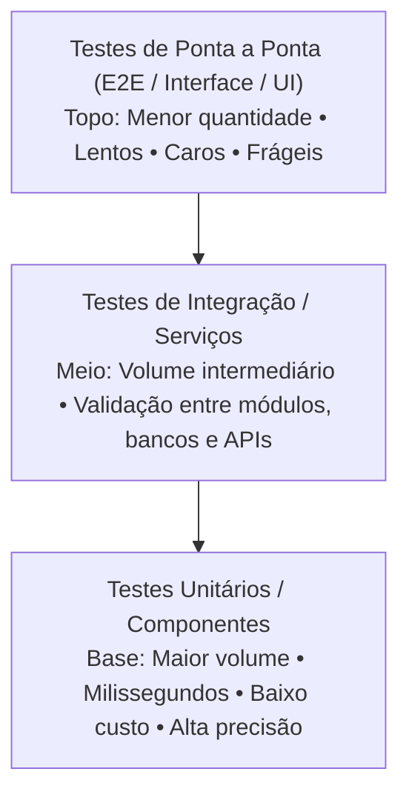
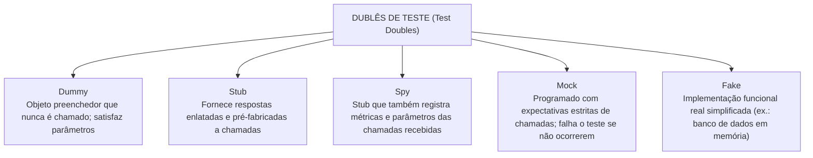
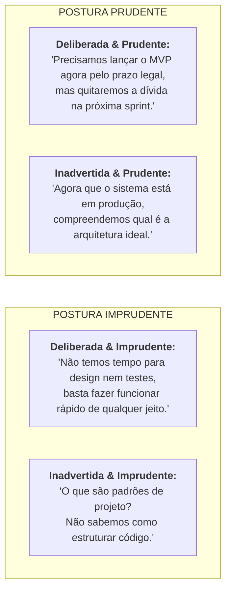

# 05 - Qualidade, Testes, Refatoração e Dívida Técnica

> **Matéria:** Engenharia de Software  
> **Cargo:** B02 – Técnico de Controle Externo – Especialidade: Tecnologia da Informação  
> **Arquivo:** `05_qualidade_testes_refatoracao_e_divida_tecnica.md`  

---

## 📌 Ementa / Itens do Edital
- Qualidade de software: desempenho, escalabilidade, disponibilidade, confiabilidade e manutenibilidade
- Testes de software: unitários, de integração, funcionais, de regressão, de carga e de estresse
- Testes automatizados
- Revisão de código (code review)
- Refatoração de código (refactoring)
- Dívida técnica (technical debt)

---

## 🧭 Sumário

1. [Atributos e Métricas de Qualidade de Software (ISO/IEC 25010)](#1-atributos-e-metricas-de-qualidade-de-software-isoiec-25010)
    1. [Desempenho e Eficiência de Recursos](#11-desempenho-e-eficiencia-de-recursos)
    2. [Escalabilidade Vertical (Scale Up) vs. Escalabilidade Horizontal (Scale Out)](#12-escalabilidade-vertical-scale-up-vs-escalabilidade-horizontal-scale-out)
    3. [Confiabilidade, Disponibilidade e Métricas de Manutenção (MTBF e MTTR)](#13-confiabilidade-disponibilidade-e-metricas-de-manutencao-mtbf-e-mttr)
    4. [Manutenibilidade e Facilidade de Mudança](#14-manutenibilidade-e-facilidade-de-mudanca)
    5. [Teste 043](#Teste-043)
2. [Níveis e Estratégias de Testes de Software](#2-niveis-e-estrategias-de-testes-de-software)
    1. [A Pirâmide de Testes de Mike Cohn](#21-a-piramide-de-testes-de-mike-cohn)
    2. [Dublês de Teste (*Test Doubles* de Gerard Meszaros)](#22-dubles-de-teste-test-doubles-de-gerard-meszaros)
    3. [Testes de Caixa-Preta (Funcionais) vs. Testes de Caixa-Branca (Estruturais)](#23-testes-de-caixa-preta-funcionais-vs-testes-de-caixa-branca-estruturais)
    4. [Complexidade Ciclomática de Thomas McCabe e Grafo de Fluxo](#24-complexidade-ciclomatica-de-thomas-mccabe-e-grafo-de-fluxo)
    5. [Teste 044](#Teste-044)
    6. [Teste 045](#Teste-045)
    7. [Teste 046](#Teste-046)
    8. [Teste 047](#Teste-047)
3. [Tipos Especializados de Testes e Automação](#3-tipos-especializados-de-testes-e-automacao)
    1. [Testes de Regressão e Automação Contínua](#31-testes-de-regressao-e-automacao-continua)
    2. [Testes de Desempenho: Carga vs. Estresse vs. Pico vs. Resistência](#32-testes-de-desempenho-carga-vs-estresse-vs-pico-vs-resistencia)
    3. [Práticas de TDD (Test-Driven Development) e BDD (Behavior-Driven Development)](#33-praticas-de-tdd-test-driven-development-e-bdd-behavior-driven-development)
    4. [Teste 048](#Teste-048)
    5. [Teste 049](#Teste-049)
    6. [Teste 050](#Teste-050)
4. [Revisão de Código, Refatoração e Dívida Técnica](#4-revisao-de-codigo-refatoracao-e-divida-tecnica)
    1. [Técnicas Modernas de Revisão de Código (Code Review)](#41-tecnicas-modernas-de-revisao-de-codigo-code-review)
    2. [Refatoração de Código e os "Maus Cheiros" (Code Smells) de Fowler](#42-refatoracao-de-codigo-e-os-maus-cheiros-code-smells-de-fowler)
    3. [Dívida Técnica e o Quadrante de Martin Fowler](#43-divida-tecnica-e-o-quadrante-de-martin-fowler)
    4. [Teste 051](#Teste-051)
    5. [Teste 052](#Teste-052)
    6. [Teste 053](#Teste-053)
5. [Fontes Oficiais e Referências Bibliográficas](#5-fontes-oficiais-e-referencias-bibliograficas)

---

## 1. Atributos e Métricas de Qualidade de Software (ISO/IEC 25010)

A norma internacional **ISO/IEC 25010** (evolução da ISO 9126) define o modelo de qualidade de produto de software, estruturado em oito características fundamentais: adequação funcional, eficiência de desempenho, compatibilidade, usabilidade, confiabilidade, segurança, manutenibilidade e portabilidade.

### 1.1 Desempenho e Eficiência de Recursos
Mede o comportamento do sistema em termos de velocidade de resposta e utilização racional dos recursos computacionais sob condições especificadas:

- **Tempo de Resposta (*Response Time*):** Intervalo de tempo transcorrido entre a emissão de uma requisição pelo usuário e a exibição completa da resposta processada;
- **Latência:** Tempo de trânsito que uma mensagem ou pacote leva para viajar da origem ao destino na rede;
- **Vazão (*Throughput*):** Quantidade de transações, requisições ou volume de dados processados com sucesso por unidade de tempo (ex.: 5.000 requisições por segundo - RPS);
- **Utilização de Recursos:** Percentual de ocupação de CPU, consumo de memória RAM, largura de banda e operações de entrada/saída em disco (I/O).

### 1.2 Escalabilidade Vertical (Scale Up) vs. Escalabilidade Horizontal (Scale Out)
- **Escalabilidade Vertical (*Scale Up*):** Expansão da capacidade computacional através do acréscimo de recursos físicos à máquina servidora existente (mais núcleos de processador, mais memória RAM ou discos SSD mais rápidos).  
  *Limitações:* Possui teto físico máximo de hardware, custo exponencialmente elevado nas faixas superiores e exige paradas no sistema para upgrade;
- **Escalabilidade Horizontal (*Scale Out*):** Expansão da capacidade mediante a adição de novas instâncias e nós servidores operando em paralelo sob um balanceador de carga (*Load Balancer*).  
  *Vantagens:* Altamente flexível, alinhada a ambientes em nuvem e contêineres elásticos, permitindo provisionamento dinâmico sem interrupção de serviços.

### 1.3 Confiabilidade, Disponibilidade e Métricas de Manutenção (MTBF e MTTR)
- **Confiabilidade:** Grau em que o software desempenha suas funções requeridas sob condições estabelecidas por um período especificado de tempo. Avalia a maturidade, a tolerância a falhas e a capacidade de recuperação de desastres;
- **Disponibilidade:** Proporção de tempo em que o sistema está operacional e plenamente acessível para uso quando demandado. Expressa-se habitualmente pelo número de "noves" em acordos de nível de serviço (SLA - *Service Level Agreement*):
    - *99% ("dois noves"):* Tolera até 3,65 dias de indisponibilidade por ano;
    - *99,9% ("três noves"):* Tolera até 8,76 horas de indisponibilidade por ano;
    - *99,99% ("quatro noves"):* Tolera até 52,56 minutos de indisponibilidade por ano.
- **Métricas Clássicas de Sustentação de Sistemas:**
    - **MTBF (*Mean Time Between Failures* - Tempo Médio Entre Falhas):** Métrica de confiabilidade que calcula o tempo médio em que o sistema opera perfeitamente entre duas panes consecutivas;
    - **MTTR (*Mean Time to Repair* - Tempo Médio para Reparo):** Métrica de manutenibilidade que mede o tempo médio gasto pela equipe de suporte para diagnosticar, corrigir a falha e restaurar o sistema à plena operação;
    - **Cálculo da Disponibilidade Teórica:**
    $$\text{Disponibilidade} = \frac{\text{MTBF}}{\text{MTBF} + \text{MTTR}}$$

### 1.4 Manutenibilidade e Facilidade de Mudança
A manutenibilidade reflete a facilidade e a eficiência com que o software pode ser modificado pelos desenvolvedores para corrigir defeitos, melhorar o desempenho ou adaptar o sistema a mudanças no ambiente de negócio. Subdivide-se em:

- **Modularidade:** Grau em que o sistema é composto por componentes discretos, isolando o impacto de alterações;
- **Reusabilidade:** Capacidade de um ativo ser utilizado em mais de um sistema ou módulo;
- **Analisabilidade:** Facilidade com que se pode diagnosticar deficiências, causas raízes de falhas ou identificar partes a serem alteradas;
- **Modificabilidade:** Facilidade com que o software pode ser modificado sem introduzir novos defeitos ou degradar a qualidade existente;
- **Testabilidade:** Grau em que critérios e testes eficazes podem ser estabelecidos e executados para validar as alterações realizadas.

---

### Teste 043
**(FGV – TJ-DFT – Analista Judiciario Suporte Em Tecnologia da Informacao – 2022)**
Os analistas de Tecnologia da Informação de uma instituição estão planejando modernizar o Centro de Dados da organização. Para isso, estão avaliando os indicadores de disponibilidade de sistemas e componentes, pois os indicadores são importantes para cálculos de desempenho e planejamento da manutenção. Um dos componentes em avaliação possui o tempo médio de operação sem falhas de 500 horas e o tempo médio de reparo é de 5 horas. Com base nessas informações, é correto afirmar que:

* **A)** o MTTF é de 5 horas;
* **B)** o MTBF é de 100 horas;
* **C)** o MTBF é de 500 horas;
* **D)** a disponibilidade do componente é de 90%;
* **E)** a disponibilidade do componente é de 95%.

---

> **Comentário Detalhado:**
>
> - **A)** **Incorreta.** A opção apresenta proposição em desacordo com os fundamentos teóricos e técnicos do tópico ao afirmar que "o MTTF é de 5 horas". De acordo com a teoria estudada em *1.3 Confiabilidade, Disponibilidade e Métricas de Manutenção (MTBF e MTTR)*, *99,9% ("três noves"):* Tolera até 8,76 horas de indisponibilidade por ano.
> - **B)** **Incorreta.** A opção apresenta proposição em desacordo com os fundamentos teóricos e técnicos do tópico ao afirmar que "o MTBF é de 100 horas". De acordo com a teoria estudada em *1.3 Confiabilidade, Disponibilidade e Métricas de Manutenção (MTBF e MTTR)*, mTBF (*Mean Time Between Failures* - Tempo Médio Entre Falhas): Métrica de confiabilidade que calcula o tempo médio em que o sistema opera perfeitamente entre duas panes consecutivas.
> - **C)** **Correta.** Conforme fundamentado na seção *1.3 Confiabilidade, Disponibilidade e Métricas de Manutenção (MTBF e MTTR)* deste guia, mTTR (*Mean Time to Repair* - Tempo Médio para Reparo): Métrica de manutenibilidade que mede o tempo médio gasto pela equipe de suporte para diagnosticar, corrigir a falha e restaurar o sistema à plena operação. Dessa forma, está plenamente correta a assertiva da banca (FGV – TJ-DFT/2022) ao estabelecer que "o MTBF é de 500 horas".
> - **D)** **Incorreta.** A opção apresenta proposição em desacordo com os fundamentos teóricos e técnicos do tópico ao afirmar que "a disponibilidade do componente é de 90%". De acordo com a teoria estudada em *1.3 Confiabilidade, Disponibilidade e Métricas de Manutenção (MTBF e MTTR)*, confiabilidade: Grau em que o software desempenha suas funções requeridas sob condições estabelecidas por um período especificado de tempo. Avalia a maturidade, a tolerância a falhas e a capacidade de recuperação de desastres.
> - **E)** **Incorreta.** A opção apresenta proposição em desacordo com os fundamentos teóricos e técnicos do tópico ao afirmar que "a disponibilidade do componente é de 95%". De acordo com a teoria estudada em *1.3 Confiabilidade, Disponibilidade e Métricas de Manutenção (MTBF e MTTR)*, métricas Clássicas de Sustentação de Sistemas.
>
> **Gabarito: C**

---

## 2. Níveis e Estratégias de Testes de Software

### 2.1 A Pirâmide de Testes de Mike Cohn
A Pirâmide de Testes é o modelo canônico de engenharia de software para construir suítes de testes automatizados equilibradas e sustentáveis:

| Nível de Teste | Velocidade de Execução | Custo de Construção/Manutenção | Foco do Diagnóstico de Falha | Escopo de Isolamento |
| :--- | :--- | :--- | :--- | :--- |
| **Unitário** | Milissegundos | Muito baixo | Linha exata do código / método | Total (isola com Stubs/Mocks) |
| **Integração** | Segundos | Moderado | Comunicação entre componentes | Parcial (integra com BD ou filas) |
| **Ponta a Ponta (E2E)** | Minutos / Horas | Extremamente alto | Fluxo completo do usuário | Nulo (sistema real completo) |

> 🚨 **ALERTA DE PROVA / PEGADINHA FCC:** A inversão da pirâmide (chamada de antipadrão "Casquinha de Sorvete" ou *Ice Cream Cone*) ocorre quando a organização possui poucos testes unitários e concentra quase todo o esforço em testes manuais ou E2E de interface. O resultado são suítes de testes lentas, que demoram horas para rodar no CI/CD e quebram frequentemente por pequenas alterações visuais (*testes frágeis / flaky tests*).

### 2.2 Dublês de Teste (*Test Doubles* de Gerard Meszaros)
Nos testes unitários, para isolar a unidade sob teste (*System Under Test - SUT*) de dependências pesadas, instáveis ou lentas (bancos de dados, serviços web externos, sistemas de arquivos), empregam-se **Dublês de Teste**:

1. **Dummy:** Objeto passado apenas para preencher parâmetros de assinatura de métodos obrigatórios, nunca sendo invocado durante a execução do teste;
2. **Stub:** Objeto que fornece respostas prontas e pré-programadas para as chamadas recebidas durante o teste (ex.: método `consultarSaldo()` retorna sempre o valor fixo de `1000.00`);
3. **Spy (Espião):** Um Stub enriquecido que intercepta e grava o histórico das chamadas (armazena quantas vezes o método foi invocado e quais parâmetros foram passados para checagem posterior);
4. **Mock:** Objeto pré-programado com **expectativas formais de comportamento**. O desenvolvedor configura explicitamente quais métodos devem ser chamados, com quais argumentos específicos e em que ordem. Se o método não for invocado conforme a expectativa estabelecida, o teste falha compulsoriamente;
5. **Fake:** Objeto que possui uma implementação funcional real simplificada, mas utiliza atalhos que a tornam imprópria para produção (ex.: um banco de dados relacional em memória H2 substituindo um servidor Oracle corporativo nos testes).

### 2.3 Testes de Caixa-Preta (Funcionais) vs. Testes de Caixa-Branca (Estruturais)
- **Testes de Caixa-Preta (Funcionais):** Avaliam o comportamento do software sem conhecimento da estrutura interna ou do código-fonte. O foco reside nas entradas e saídas esperadas:
    - *Partição de Equivalência:* Divide os dados de entrada em classes válidas e inválidas, partindo do princípio de que qualquer dado dentro da mesma partição receberá o mesmo tratamento;
    - *Análise do Valor Limite (BVA):* Testa valores situados exatamente nas fronteiras e adjacências das partições (ex.: se o intervalo aceito é de 18 a 65 anos, testa-se 17, 18, 19, 64, 65 e 66 anos).
- **Testes de Caixa-Branca (Estruturais):** Avaliam os caminhos de controle, estruturas lógicas e condições internas do código-fonte:
    - *Critérios de Cobertura:* Cobertura de comandos (*Statement Coverage*), cobertura de decisões/desvios (*Branch Coverage*) e cobertura de caminhos independentes.

### 2.4 Complexidade Ciclomática de Thomas McCabe e Grafo de Fluxo
Proposta por Thomas McCabe em 1976, a **Complexidade Ciclomática ($V(G)$)** mede quantitativamente a complexidade lógica de um programa através da contagem do número de caminhos linearmente independentes no seu grafo de fluxo de controle.

**Fórmulas de Cálculo Clássicas:**

1. Pela contagem de arestas ($E$), nós ($N$) e componentes conexos ($P=1$ para método único):
   $$V(G) = E - N + 2$$
2. Pela contagem direta de pontos de decisão/predicados ($P$):
   $$V(G) = P + 1$$
   *(onde $P$ é o total de comandos condicionais e de laço: `if`, `while`, `for`, `case`)*.

> ⭐ **IMPORTANTE / APLICAÇÃO EM TESTES:** O valor da complexidade ciclomática de McCabe define o **número mínimo exato de casos de teste** necessários para garantir que todas as instruções e caminhos lógicos do método sejam executados ao menos uma vez!

---

### Teste 044
**(FCC – TRT-6 – Analista Judiciario Apoio Especializado Tecnologia da Informacao – 2012)**
Considere o seguinte trecho de código em Java: public class Teste { public conta c1,c2; Teste(int d,double i) { c1 = new conta(d,i); c2 = new conta(i,d); } public static void main(String[] args) { Teste t = new Teste(2,4.8); t.c1.imprime_total(); System.out.print(", "); t.c2.imprime_total(); System.out.print("."); } public class conta { private int total; public conta(int i,double d) { total = i + (int) (2 * d); } public conta(double d,int i) { total = (int) d + 2 * i; } public void imprime_total() { System.out.print(total); } } } Após a execução do método main, o texto que será escrito no console é

* **A)** 8.8, 9.6.
* **B)** 9.6, 4.
* **C)** 2, 11.6.
* **D)** 4.8, 2.
* **E)** 11, 8.

---

> **Comentário Detalhado:**
>
> - **A)** **Incorreta.** A opção apresenta proposição em desacordo com os fundamentos teóricos e técnicos do tópico ao afirmar que "8.8, 9.6". De acordo com a teoria estudada em *4.2 Refatoração de Código e os "Maus Cheiros" (Code Smells) de Fowler*, *Método Longo (*Long Method*):* Métodos com centenas de linhas de código. Técnica de correção: Extract Method (extrair trecho para novo método nomeado).
> - **B)** **Incorreta.** A opção apresenta proposição em desacordo com os fundamentos teóricos e técnicos do tópico ao afirmar que "9.6, 4". De acordo com a teoria estudada em *2.2 Dublês de Teste (Test Doubles de Gerard Meszaros)*, nos testes unitários, para isolar a unidade sob teste (*System Under Test - SUT*) de dependências pesadas, instáveis ou lentas (bancos de dados, serviços web externos, sistemas de arquivos), empregam-se Dublês de Teste.
> - **C)** **Incorreta.** A opção apresenta proposição em desacordo com os fundamentos teóricos e técnicos do tópico ao afirmar que "2, 11.6". De acordo com a teoria estudada em *2.1 A Pirâmide de Testes de Mike Cohn*, nível de Teste: Velocidade de Execução — Custo de Construção/Manutenção — Foco do Diagnóstico de Falha — Escopo de Isolamento.
> - **D)** **Incorreta.** A opção apresenta proposição em desacordo com os fundamentos teóricos e técnicos do tópico ao afirmar que "4.8, 2". De acordo com a teoria estudada em *2.2 Dublês de Teste (Test Doubles de Gerard Meszaros)*, dummy: Objeto passado apenas para preencher parâmetros de assinatura de métodos obrigatórios, nunca sendo invocado durante a execução do teste.
> - **E)** **Correta.** Conforme fundamentado na seção *2.1 A Pirâmide de Testes de Mike Cohn* deste guia, unitário: Milissegundos — Muito baixo — Linha exata do código / método — Total (isola com Stubs/Mocks). Dessa forma, está plenamente correta a assertiva da banca (FCC – TRT-6/2012) ao estabelecer que "11, 8".
>
> **Gabarito: E**

---

### Teste 045
**(CEBRASPE – TRT-8 – Analista Judiciario Area Apoio Especializado Tecnologia da Informacao – 2022)**
A respeito de testes automatizados, no contexto de DevOps e DevSecOps, assinale a opção correta.

* **A)** Em um teste unitário, os métodos da classe sendo testada e suas dependências podem ter relação com recursos externos.
* **B)** Os bugs são detectados no final do ciclo de desenvolvimento, o que pode aumentar o tempo na criação de novos produtos.
* **C)** Os testes unitários são testes de caixa preta com cada função que compõe o software.
* **D)** O TDD (Test Driven Development) eleva o nível dos testes unitários e tem como característica criar a classe de testes antes da classe de produção, de forma que os testes guiem o código a ser implementado.
* **E)** Os testes de integração são caracterizados pela verificação de partes internas do sistema, que se inter-relacionam entre si, conforme definido pelos clientes.

---

> **Comentário Detalhado:**
>
> - **A)** **Incorreta.** A opção apresenta proposição em desacordo com os fundamentos teóricos e técnicos do tópico ao afirmar que "Em um teste unitário, os métodos da classe sendo testada e suas dependências podem ter relação com recursos...". De acordo com a teoria estudada em *2.2 Dublês de Teste (Test Doubles de Gerard Meszaros)*, nos testes unitários, para isolar a unidade sob teste (*System Under Test - SUT*) de dependências pesadas, instáveis ou lentas (bancos de dados, serviços web externos, sistemas de arquivos), empregam-se Dublês de Teste.
> - **B)** **Incorreta.** A opção apresenta proposição em desacordo com os fundamentos teóricos e técnicos do tópico ao afirmar que "Os bugs são detectados no final do ciclo de desenvolvimento, o que pode aumentar o tempo na criação de novos...". De acordo com a teoria estudada em *3.3 Práticas de TDD (Test-Driven Development) e BDD (Behavior-Driven Development)*, tDD (Desenvolvimento Guiado por Testes): Técnica de engenharia de software fundamentada no ciclo rápido e iterativo de três fases: Red \$\rightarrow\$ Green \$\rightarrow\$ Refactor.
> - **C)** **Incorreta.** A opção apresenta proposição em desacordo com os fundamentos teóricos e técnicos do tópico ao afirmar que "Os testes unitários são testes de caixa preta com cada função que compõe o software". De acordo com a teoria estudada em *3.3 Práticas de TDD (Test-Driven Development) e BDD (Behavior-Driven Development)*, *Refactor:* Limpar o código-fonte, eliminar duplicações e aperfeiçoar o design, garantindo que a suíte de testes continue verde.
> - **D)** **Correta.** Conforme fundamentado na seção *3.3 Práticas de TDD (Test-Driven Development) e BDD (Behavior-Driven Development)* deste guia, *Red:* Escrever um teste automatizado que falha antes de escrever o código de produção. Dessa forma, está plenamente correta a assertiva da banca (CEBRASPE – TRT-8/2022) ao estabelecer que "O TDD (Test Driven Development) eleva o nível dos testes unitários e tem como característica criar a classe de...".
> - **E)** **Incorreta.** A opção apresenta proposição em desacordo com os fundamentos teóricos e técnicos do tópico ao afirmar que "Os testes de integração são caracterizados pela verificação de partes internas do sistema, que se inter-relacionam...". De acordo com a teoria estudada em *3.3 Práticas de TDD (Test-Driven Development) e BDD (Behavior-Driven Development)*, bDD (Desenvolvimento Guiado por Comportamento): Evolução colaborativa do TDD focada na linguagem ubíqua e no comportamento do sistema sob a ótica do negócio. Expressa cenários no formato Given-When-Then (*Dado que... Quando... Então...* - sintaxe Gherkin).
>
> **Gabarito: D**

---

### Teste 046
**(FCC – TRT-3 – Analista Judiciario Tecnologia da Informacao – 2015)**
Um profissional está trabalhando no processo de testes de desenvolvimento de um software orientado a objetos. Inicialmente, realizou o teste das funcionalidades dos objetos ou métodos das classes individualmente. Em seguida, integrou várias unidades individuais criando elementos compostos e testou as interfaces desses elementos. Para concluir a bateria de testes, integrou todos os componentes do software e testou a integração entre eles como um todo. Os testes realizados pelo profissional foram testes

* **A)** funcionais, de integração e de aceitação.
* **B)** alfa, beta e de sistema.
* **C)** unitários, de componentes e de sistema.
* **D)** funcionais, de componentes e de integração.
* **E)** unitários, de integração e de aceitação.

---

> **Comentário Detalhado:**
>
> - **A)** **Incorreta.** A opção apresenta proposição em desacordo com os fundamentos teóricos e técnicos do tópico ao afirmar que "funcionais, de integração e de aceitação". De acordo com a teoria estudada em *1.4 Manutenibilidade e Facilidade de Mudança*, modularidade: Grau em que o sistema é composto por componentes discretos, isolando o impacto de alterações.
> - **B)** **Incorreta.** A opção apresenta proposição em desacordo com os fundamentos teóricos e técnicos do tópico ao afirmar que "alfa, beta e de sistema". De acordo com a teoria estudada em *2.2 Dublês de Teste (Test Doubles de Gerard Meszaros)*, nos testes unitários, para isolar a unidade sob teste (*System Under Test - SUT*) de dependências pesadas, instáveis ou lentas (bancos de dados, serviços web externos, sistemas de arquivos), empregam-se Dublês de Teste.
> - **C)** **Correta.** Conforme fundamentado na seção *2.1 A Pirâmide de Testes de Mike Cohn* deste guia, integração: Segundos — Moderado — Comunicação entre componentes — Parcial (integra com BD ou filas). Dessa forma, está plenamente correta a assertiva da banca (FCC – TRT-3/2015) ao estabelecer que "unitários, de componentes e de sistema".
> - **D)** **Incorreta.** A opção apresenta proposição em desacordo com os fundamentos teóricos e técnicos do tópico ao afirmar que "funcionais, de componentes e de integração". De acordo com a teoria estudada em *2.3 Testes de Caixa-Preta (Funcionais) vs. Testes de Caixa-Branca (Estruturais)*, *Partição de Equivalência:* Divide os dados de entrada em classes válidas e inválidas, partindo do princípio de que qualquer dado dentro da mesma partição receberá o mesmo tratamento.
> - **E)** **Incorreta.** A opção apresenta proposição em desacordo com os fundamentos teóricos e técnicos do tópico ao afirmar que "unitários, de integração e de aceitação". De acordo com a teoria estudada em *2.4 Complexidade Ciclomática de Thomas McCabe e Grafo de Fluxo*, pela contagem de arestas (\$E\$), nós (\$N\$) e componentes conexos (\$P=1\$ para método único).
>
> **Gabarito: C**

---

### Teste 047
**(FUMARC – TRT-3 – Analista Judiciario Apoio Especializado Tecnologia da Informacao – 2022)**
34 Analise as afirmativas referentes aos conceitos e ferramentas de testes de software: I – O Mockito é um framework de teste de código aberto para Java que permite instanciar classes e controlar o comportamento dos métodos. II – Teste de integração é um teste de validação no ambiente de produção dos usuários para identificar problemas antes de uma implantação. III – Testes unitários verificam se as menores partes testáveis de um software estão funcionando corretamente. Estão CORRETAS as afirmativas:

* **A)** I e II, apenas.
* **B)** I e III, apenas.
* **C)** II e III, apenas.
* **D)** III, apenas.
* **E)** I, II e III.

---

> **Comentário Detalhado:**
>
> - **A)** **Incorreta.** A opção incorre em restrição indevida ao limitar o escopo conceitual ao afirmar que "I e II, apenas". De acordo com a teoria estudada em *3.2 Testes de Desempenho: Carga vs. Estresse vs. Pico vs. Resistência*, teste de Carga (*Load Testing*): Carga operacional esperada (normal e pico previsto em projeto). — Avaliar o comportamento do sistema, tempos de resposta e uso de hardware sob o volume regular de usuários acordado no SLA.
> - **B)** **Correta.** Conforme fundamentado na seção *3.3 Práticas de TDD (Test-Driven Development) e BDD (Behavior-Driven Development)* deste guia, *Red:* Escrever um teste automatizado que falha antes de escrever o código de produção. Dessa forma, está plenamente correta a assertiva da banca (FUMARC – TRT-3/2022) ao estabelecer que "I e III, apenas".
> - **C)** **Incorreta.** A opção incorre em restrição indevida ao limitar o escopo conceitual ao afirmar que "II e III, apenas". De acordo com a teoria estudada em *4.1 Técnicas Modernas de Revisão de Código (Code Review)*, antes de realizar o *merge* para a branch principal, outros desenvolvedores inspecionam o diff, verificam aderência a padrões arquiteturais, segurança e ausência de code smells.
> - **D)** **Incorreta.** A opção incorre em restrição indevida ao limitar o escopo conceitual ao afirmar que "III, apenas". De acordo com a teoria estudada em *2.2 Dublês de Teste (Test Doubles de Gerard Meszaros)*, mock: Objeto pré-programado com expectativas formais de comportamento. O desenvolvedor configura explicitamente quais métodos devem ser chamados, com quais argumentos específicos e em que ordem.
> - **E)** **Incorreta.** A opção apresenta proposição em desacordo com os fundamentos teóricos e técnicos do tópico ao afirmar que "I, II e III". De acordo com a teoria estudada em *2.3 Testes de Caixa-Preta (Funcionais) vs. Testes de Caixa-Branca (Estruturais)*, testes de Caixa-Preta (Funcionais): Avaliam o comportamento do software sem conhecimento da estrutura interna ou do código-fonte. O foco reside nas entradas e saídas esperadas.
>
> **Gabarito: B**

---

## 3. Tipos Especializados de Testes e Automação

### 3.1 Testes de Regressão e Automação Contínua
- **Conceito de Teste de Regressão:** Bateria sistemática de testes executada após qualquer manutenção no software (correção de bugs, refatoração ou acréscimo de novas funcionalidades) para certificar que as alterações introduzidas **não causaram efeitos colaterais adversos nem reintroduziram defeitos antigos em módulos que funcionavam perfeitamente**;
- **Automação no Pipeline de CI/CD:** A suíte de testes de regressão deve ser integralmente automatizada e disparada a cada *commit* ou *Pull Request*, impedindo que código quebrado atinja o repositório principal.

### 3.2 Testes de Desempenho: Carga vs. Estresse vs. Pico vs. Resistência
A engenharia de testes de desempenho categoriza os testes de acordo com o padrão e a intensidade de tráfego injetado no sistema:

| Modalidade de Teste | Volume de Tráfego / Carga Injetada | Objetivo Específico da Avaliação |
| :--- | :--- | :--- |
| **Teste de Carga (*Load Testing*)** | Carga operacional esperada (normal e pico previsto em projeto). | Avaliar o comportamento do sistema, tempos de resposta e uso de hardware sob o volume regular de usuários acordado no SLA. |
| **Teste de Estresse (*Stress Testing*)** | Carga extrema que ultrapassa intencionalmente o limite de capacidade máxima do sistema. | Identificar o **ponto de quebra (*breaking point*)**, testar como o sistema falha (degradação graciosa) e como ele se recupera após o término da sobrecarga extrema. |
| **Teste de Pico (*Spike Testing*)** | Variações abruptas, repentinas e massivas de tráfego em intervalos de segundos. | Avaliar se a infraestrutura elástica e os balanceadores reagem com agilidade suficiente a picos súbitos de acesso. |
| **Teste de Resistência (*Soak / Endurance*)** | Carga moderada a alta mantida de forma ininterrupta por períodos prolongados (dias/semanas). | Detectar **vazamentos de memória (*memory leaks*)**, esgotamento de pools de conexões e saturação progressiva de disco. |

> 🚨 **ALERTA DE PROVA / PEGADINHA FCC:** Fique atento: Teste de **Carga** avalia o sistema *dentro* da capacidade contratual. Teste de **Estresse** empurra o sistema *além* do limite máximo com a finalidade expressa de quebrar o ambiente e avaliar a resiliência e recuperação.

### 3.3 Práticas de TDD (Test-Driven Development) e BDD (Behavior-Driven Development)
- **TDD (Desenvolvimento Guiado por Testes):** Técnica de engenharia de software fundamentada no ciclo rápido e iterativo de três fases: **Red $\rightarrow$ Green $\rightarrow$ Refactor**:
    1. *Red:* Escrever um teste automatizado que falha antes de escrever o código de produção;
    2. *Green:* Escrever o código mais simples possível apenas para fazer o teste passar com sucesso;
    3. *Refactor:* Limpar o código-fonte, eliminar duplicações e aperfeiçoar o design, garantindo que a suíte de testes continue verde.

- **BDD (Desenvolvimento Guiado por Comportamento):** Evolução colaborativa do TDD focada na linguagem ubíqua e no comportamento do sistema sob a ótica do negócio. Expressa cenários no formato **Given-When-Then** (*Dado que... Quando... Então...* - sintaxe Gherkin).

---

### Teste 048
**(FCC – TRT-6 – Analista Judiciario Apoio Especializado Tecnologia da Informacao – 2012)**
Sobre testes de sistemas, considere: I. Testes de cenário são úteis pois podem garantir que não restam erros no sistema. Neste ponto diferem dos testes de componentes que apenas garantem a integridade de módulos isolados do sistema, mas não garantem que a totalidade do sistema está isenta de erros. II. Testes de desenvolvimento incluem testes unitários, nos quais são testados objetos e métodos específicos; testes de componentes, nos quais são testados diversos grupos de objetos; testes de sistema, nos quais são testados sistemas parciais e sistemas completos. III. Os testes de usuário podem ser divididos em três fases: teste alfa, em que os usuários do software trabalham com a equipe de desenvolvimento para efetuar testes no local do desenvolvedor; teste beta, em que um release de software é disponibilizado aos usuários para que possam experimentar e levantar os problemas descobertos com os desenvolvedores do sistema; teste de sistema, em que os clientes testam um sistema para decidir se ele está pronto para ser implantado no ambiente de trabalho. Está correto o que se afirma em

* **A)** I, II e III.
* **B)** II, apenas.
* **C)** I e II, apenas.
* **D)** III, apenas.
* **E)** II e III, apenas.

---

> **Comentário Detalhado:**
>
> - **A)** **Incorreta.** A opção apresenta proposição em desacordo com os fundamentos teóricos e técnicos do tópico ao afirmar que "I, II e III". De acordo com a teoria estudada em *3.3 Práticas de TDD (Test-Driven Development) e BDD (Behavior-Driven Development)*, tDD (Desenvolvimento Guiado por Testes): Técnica de engenharia de software fundamentada no ciclo rápido e iterativo de três fases: Red \$\rightarrow\$ Green \$\rightarrow\$ Refactor.
> - **B)** **Correta.** Conforme fundamentado na seção *2.2 Dublês de Teste (Test Doubles de Gerard Meszaros)* deste guia, mock: Objeto pré-programado com expectativas formais de comportamento. O desenvolvedor configura explicitamente quais métodos devem ser chamados, com quais argumentos específicos e em que ordem. Dessa forma, está plenamente correta a assertiva da banca (FCC – TRT-6/2012) ao estabelecer que "II, apenas".
> - **C)** **Incorreta.** A opção incorre em restrição indevida ao limitar o escopo conceitual ao afirmar que "I e II, apenas". De acordo com a teoria estudada em *1.4 Manutenibilidade e Facilidade de Mudança*, a manutenibilidade reflete a facilidade e a eficiência com que o software pode ser modificado pelos desenvolvedores para corrigir defeitos, melhorar o desempenho ou adaptar o sistema a mudanças no ambiente de negócio. Subdivide-se em.
> - **D)** **Incorreta.** A opção incorre em restrição indevida ao limitar o escopo conceitual ao afirmar que "III, apenas". De acordo com a teoria estudada em *3.1 Testes de Regressão e Automação Contínua*, conceito de Teste de Regressão: Bateria sistemática de testes executada após qualquer manutenção no software (correção de bugs, refatoração ou acréscimo de novas funcionalidades) para certificar que as alterações introduzidas não causaram efeitos colaterais adversos nem reintroduziram defeitos antigos em módulos que funcionavam perfeitamente.
> - **E)** **Incorreta.** A opção incorre em restrição indevida ao limitar o escopo conceitual ao afirmar que "II e III, apenas". De acordo com a teoria estudada em *3.2 Testes de Desempenho: Carga vs. Estresse vs. Pico vs. Resistência*, teste de Carga (*Load Testing*): Carga operacional esperada (normal e pico previsto em projeto). — Avaliar o comportamento do sistema, tempos de resposta e uso de hardware sob o volume regular de usuários acordado no SLA.
>
> **Gabarito: B**

---

### Teste 049
**(FCC – TRT-2 – Analista Judiciario Tecnologia da Informacao – 2014)**
Há diversos processos e práticas ágeis de desenvolvimento de software. Considere: I. Seu objetivo é criar um “código limpo que funcione”. Trabalha com a estratégia Red − Green − Refactor: − Codifique o teste; − Faça-o compilar e executar. O teste não deve passar (Red). − Implemente o requisito e faça o teste passar (Green). − Refatore o código (Refactor). II. Suas práticas, regras e valores garantem um agradável ambiente de desenvolvimento de software para os seus seguidores, que são conduzidos pelos princípios básicos: − Comunicação − manter o melhor relacionamento possível entre clientes e desenvolvedores, preferindo conversas pessoais a outros meios de comunicação; − Simplicidade − implementar apenas requisitos atuais, evitando adicionar funcionalidades que podem ser importantes somente no futuro; − Feedback − o desenvolvedor terá informações constantes do cliente e do código, em que testes constantes indicam os erros tanto individuais quanto do software integrado; − Coragem − encorajar as pessoas que não possuem facilidade de comunicação e bom relacionamento interpessoal, encorajar a equipe a experimentar e buscar novas soluções, além de encorajar a obtenção de feedback do cliente. III. Objetiva capturar os critérios de aceitação para as funcionalidades em desenvolvimento. Trabalha com as seguintes etapas: − Discutir (Discuss): discussão colaborativa com a equipe visando elicitar os critérios de aceitação. − Refinar (Distill): refinamento dos critérios de aceitação em um conjunto concreto de cenários/exemplos de uso descrevendo o comportamento esperado da aplicação em uma linguagem comum a todos os membros da equipe. − Desenvolver (Develop): transformação dos testes de aceitação (descrevendo o comportamento esperado do software) em testes/especificação automatizados. IV. Suas práticas incluem: − Envolver as partes interessadas no processo através de Outside-in Development. − Usar exemplos para descrever o comportamento de uma aplicação ou unidades de código. − Automatizar os exemplos para prover um feedback rápido e testes de regressão. − Usar o verbo deve (should) ao descrever o comportamento de software para ajudar a esclarecer responsabilidades e permitir que funcionalidades sejam questionadas. − Usar dublês de teste (mocks, stubs, fakes, dummies, spies) para auxiliar na colaboração entre módulos e códigos que ainda não foram escritos. Os processos ágeis I, II, III e IV são, correta e respectivamente, denominados:

* **A)** BDD − DDD − ATDD − XP
* **B)** TDD − BDD − DDD − XP
* **C)** ATDD − XP − DDD − BDD
* **D)** ATDD − BDD − TDD − DDD
* **E)** TDD − XP − ATDD − BDD

---

> **Comentário Detalhado:**
>
> - **A)** **Incorreta.** A opção apresenta proposição em desacordo com os fundamentos teóricos e técnicos do tópico ao afirmar que "BDD − DDD − ATDD − XP". De acordo com a teoria estudada em *3.3 Práticas de TDD (Test-Driven Development) e BDD (Behavior-Driven Development)*, bDD (Desenvolvimento Guiado por Comportamento): Evolução colaborativa do TDD focada na linguagem ubíqua e no comportamento do sistema sob a ótica do negócio. Expressa cenários no formato Given-When-Then (*Dado que... Quando... Então...* - sintaxe Gherkin).
> - **B)** **Incorreta.** A opção apresenta proposição em desacordo com os fundamentos teóricos e técnicos do tópico ao afirmar que "TDD − BDD − DDD − XP". De acordo com a teoria estudada em *3.3 Práticas de TDD (Test-Driven Development) e BDD (Behavior-Driven Development)*, *Green:* Escrever o código mais simples possível apenas para fazer o teste passar com sucesso.
> - **C)** **Incorreta.** A opção apresenta proposição em desacordo com os fundamentos teóricos e técnicos do tópico ao afirmar que "ATDD − XP − DDD − BDD". De acordo com a teoria estudada em *3.3 Práticas de TDD (Test-Driven Development) e BDD (Behavior-Driven Development)*, *Red:* Escrever um teste automatizado que falha antes de escrever o código de produção.
> - **D)** **Incorreta.** A opção apresenta proposição em desacordo com os fundamentos teóricos e técnicos do tópico ao afirmar que "ATDD − BDD − TDD − DDD". De acordo com a teoria estudada em *3.3 Práticas de TDD (Test-Driven Development) e BDD (Behavior-Driven Development)*, *Refactor:* Limpar o código-fonte, eliminar duplicações e aperfeiçoar o design, garantindo que a suíte de testes continue verde.
> - **E)** **Correta.** Conforme fundamentado na seção *3.3 Práticas de TDD (Test-Driven Development) e BDD (Behavior-Driven Development)* deste guia, tDD (Desenvolvimento Guiado por Testes): Técnica de engenharia de software fundamentada no ciclo rápido e iterativo de três fases: Red \$\rightarrow\$ Green \$\rightarrow\$ Refactor. Dessa forma, está plenamente correta a assertiva da banca (FCC – TRT-2/2014) ao estabelecer que "TDD − XP − ATDD − BDD".
>
> **Gabarito: E**

---

### Teste 050
**(FCC – TRT-24 – Analista Judiciario Tecnologia da Informacao – 2017)**
As principais medidas de um teste incluem: I. medida da abrangência do teste que é expressa pela abrangência dos requisitos e casos de teste ou pela abrangência do código executado. II. medida de confiabilidade, de estabilidade e de desempenho do objetivo do teste (sistema ou aplicativo em teste), que se baseia na avaliação dos resultados do teste e na análise das solicitações de mudança (defeitos) identificadas durante o teste. É correto afirmar que I e II correspondem, correta e respectivamente, a

* **A)** Prioridade e Gravidade.
* **B)** Detecção de Origem e Permanência de Defeitos.
* **C)** Requisitos e Resultados.
* **D)** Cobertura e Qualidade.
* **E)** Tendência e Densidade.

---

> **Comentário Detalhado:**
>
> - **A)** **Incorreta.** A opção apresenta proposição em desacordo com os fundamentos teóricos e técnicos do tópico ao afirmar que "Prioridade e Gravidade". De acordo com a teoria estudada em *3.2 Testes de Desempenho: Carga vs. Estresse vs. Pico vs. Resistência*, modalidade de Teste: Volume de Tráfego / Carga Injetada — Objetivo Específico da Avaliação.
> - **B)** **Incorreta.** A opção apresenta proposição em desacordo com os fundamentos teóricos e técnicos do tópico ao afirmar que "Detecção de Origem e Permanência de Defeitos". De acordo com a teoria estudada em *1.4 Manutenibilidade e Facilidade de Mudança*, a manutenibilidade reflete a facilidade e a eficiência com que o software pode ser modificado pelos desenvolvedores para corrigir defeitos, melhorar o desempenho ou adaptar o sistema a mudanças no ambiente de negócio. Subdivide-se em.
> - **C)** **Incorreta.** A opção apresenta proposição em desacordo com os fundamentos teóricos e técnicos do tópico ao afirmar que "Requisitos e Resultados". De acordo com a teoria estudada em *1. Atributos e Métricas de Qualidade de Software (ISO/IEC 25010)*, a norma internacional ISO/IEC 25010 (evolução da ISO 9126) define o modelo de qualidade de produto de software, estruturado em oito características fundamentais: adequação funcional, eficiência de desempenho, compatibilidade, usabilidade, confiabilidade, segurança, manutenibilidade e portabilidade.
> - **D)** **Correta.** Conforme fundamentado na seção *1.4 Manutenibilidade e Facilidade de Mudança* deste guia, modificabilidade: Facilidade com que o software pode ser modificado sem introduzir novos defeitos ou degradar a qualidade existente. Dessa forma, está plenamente correta a assertiva da banca (FCC – TRT-24/2017) ao estabelecer que "Cobertura e Qualidade".
> - **E)** **Incorreta.** A opção apresenta proposição em desacordo com os fundamentos teóricos e técnicos do tópico ao afirmar que "Tendência e Densidade". De acordo com a teoria estudada em *2.3 Testes de Caixa-Preta (Funcionais) vs. Testes de Caixa-Branca (Estruturais)*, *Critérios de Cobertura:* Cobertura de comandos (*Statement Coverage*), cobertura de decisões/desvios (*Branch Coverage*) e cobertura de caminhos independentes.
>
> **Gabarito: D**

---

## 4. Revisão de Código, Refatoração e Dívida Técnica

### 4.1 Técnicas Modernas de Revisão de Código (Code Review)
A revisão de código é uma prática colaborativa indispensável de garantia da qualidade:

- **Inspeções Formais (Fagan):** Processo tradicional rígido com papéis formais (moderador, autor, leitor e inspetor) e reuniões presenciais de leitura de código;
- **Revisão Baseada em Pull Requests (Moderna / Ágil):** Conduzida de forma assíncrona em plataformas como GitHub/GitLab. Antes de realizar o *merge* para a branch principal, outros desenvolvedores inspecionam o diff, verificam aderência a padrões arquiteturais, segurança e ausência de code smells;
- **Pair Programming:** Revisão contínua em tempo real executada pelo copiloto (*Navigator*) enquanto o piloto (*Driver*) digita o código.

### 4.2 Refatoração de Código e os "Maus Cheiros" (Code Smells) de Fowler
- **Definição Canônica (Martin Fowler):** Refatoração (*Refactoring*) é o processo de **modificar a estrutura interna de um software sem alterar o seu comportamento observável externo**, visando melhorar a legibilidade, reduzir a complexidade e facilitar futuras manutenções.  
  > 🚨 **PEGADINHA FCC:** Refatoração **NÃO adiciona novas funcionalidades** e **NÃO corrige bugs de negócio**! Se o comportamento funcional externo mudou, houve evolução de software ou correção, e não pura refatoração.
- **Maus Cheiros de Código (*Code Smells*) Recorrentes:**
    - *Método Longo (*Long Method*):* Métodos com centenas de linhas de código. Técnica de correção: **Extract Method** (extrair trecho para novo método nomeado);
    - *Classe Grande / Objeto Deus (*Large Class / God Class*):* Classe que acumula responsabilidades demais. Correção: **Extract Class**;
    - *Código Duplicado (*Duplicated Code*):* Mesma estrutura lógica em múltiplos locais. Viola o princípio DRY;
    - *Cirurgia com Espingarda (*Shotgun Surgery*):* Cada pequena alteração em uma regra exige dezenas de pequenas modificações espalhadas em classes diferentes. Indica alto acoplamento e baixa coesão.

### 4.3 Dívida Técnica e o Quadrante de Martin Fowler
Cunhada por Ward Cunningham, a metáfora da **Dívida Técnica (*Technical Debt*)** compara o desenvolvimento acelerado e descuidado de software a um empréstimo financeiro bancário: você consegue entregar o produto mais rápido hoje, mas contrai uma dívida de código mal estruturado. Se a dívida não for quitada (por meio de refatoração), o sistema acumula "juros compostos" que tornam qualquer nova manutenção futura proibitivamente lenta e cara.

- **Deliberada e Prudente:** A equipe sabe exatamente como fazer da melhor forma, mas opta conscientemente por um atalho temporário para atingir uma janela crítica de mercado ou prazo legal, agendando formalmente a refatoração subsequente;
- **Inadvertida e Prudente:** Decorrente do aprendizado natural do time: após colocar o sistema em produção e observar o uso real, os arquitetos percebem qual deveria ter sido o melhor design;
- **Deliberada e Imprudente:** A equipe sabe que está gerando código de péssima qualidade e sem testes, mas adota atalhos por puro desleixo e negligência;
- **Inadvertida e Imprudente:** A equipe desconhece princípios básicos de engenharia de software e padrões de design, gerando código macarrônico por pura incompetência técnica.

---

### Teste 051
**(FGV – TJ-AP – Analista Judiciario Apoio Especializado Tecnologia da Informacao Desenvolvimento de Sistemas – 2023)**
Analise o código Java a seguir, no qual foi ocultada a segunda linha de código. abstract class X { --- public void exibe() { System.out.println("Concluído"); } } class Z extends X { public void X1(String P) { System.out.println(P); } } class Main { public static void main(String[] args) { Z objZ = new Z(); objZ.X1("OK"); objZ.exibe(); } } O trecho que substitui corretamente a linha tracejada é:

* **A)** public abstract void X1(String P);
* **B)** public static void X1(String P);
* **C)** public String X1(String P);
* **D)** public void X1(String P);
* **E)** public X1(String P);

---

> **Comentário Detalhado:**
>
> - **A)** **Correta.** Conforme fundamentado na seção *4.2 Refatoração de Código e os "Maus Cheiros" (Code Smells) de Fowler* deste guia, *Método Longo (*Long Method*):* Métodos com centenas de linhas de código. Técnica de correção: Extract Method (extrair trecho para novo método nomeado). Dessa forma, está plenamente correta a assertiva da banca (FGV – TJ-AP/2023) ao estabelecer que "public abstract void X1(String P)".
> - **B)** **Incorreta.** A opção apresenta proposição em desacordo com os fundamentos teóricos e técnicos do tópico ao afirmar que "public static void X1(String P)". De acordo com a teoria estudada em *4.2 Refatoração de Código e os "Maus Cheiros" (Code Smells) de Fowler*, *Classe Grande / Objeto Deus (*Large Class / God Class*):* Classe que acumula responsabilidades demais. Correção: Extract Class.
> - **C)** **Incorreta.** A opção apresenta proposição em desacordo com os fundamentos teóricos e técnicos do tópico ao afirmar que "public String X1(String P)". De acordo com a teoria estudada em *2.1 A Pirâmide de Testes de Mike Cohn*, unitário: Milissegundos — Muito baixo — Linha exata do código / método — Total (isola com Stubs/Mocks).
> - **D)** **Incorreta.** A opção apresenta proposição em desacordo com os fundamentos teóricos e técnicos do tópico ao afirmar que "public void X1(String P)". De acordo com a teoria estudada em *2.2 Dublês de Teste (Test Doubles de Gerard Meszaros)*, nos testes unitários, para isolar a unidade sob teste (*System Under Test - SUT*) de dependências pesadas, instáveis ou lentas (bancos de dados, serviços web externos, sistemas de arquivos), empregam-se Dublês de Teste.
> - **E)** **Incorreta.** A opção apresenta proposição em desacordo com os fundamentos teóricos e técnicos do tópico ao afirmar que "public X1(String P)". De acordo com a teoria estudada em *2.3 Testes de Caixa-Preta (Funcionais) vs. Testes de Caixa-Branca (Estruturais)*, *Análise do Valor Limite (BVA):* Testa valores situados exatamente nas fronteiras e adjacências das partições (ex.: se o intervalo aceito é de 18 a 65 anos, testa-se 17, 18, 19, 64, 65 e 66 anos).
>
> **Gabarito: A**

---

### Teste 052
**(FGV – TRT-16 – Analista Judiciario Area Administrativa Tecnologia da Informacao – 2022)**
Considerando o DevOps e suas boas práticas, analise os itens a seguir: I. Testes integrados são uma parte importante do processo DevOps. Esses testes devem levar em consideração as práticas de Test-Driven Development e Behavior-Driven Development, dessa forma a execução automática desses testes pode ser integrada ao pipeline de CI. No entanto, é importante integrar outros tipos de testes, como testes funcionais ou testes de integração, que permitem que o aplicativo seja testado funcionalmente do início ao fim com os outros componentes do seu ecossistema. II. Recomenda-se automatizar apenas as tarefas críticas que envolvam poucas atualizações na implementação e nos testes dos aplicativos nas infraestruturas. Essas tarefas devem ser automatizadas em scripts que podem ser facilmente integradas e executadas em pipelines de CI/CD. III. A construção de pipelines de CI/CD envolvem a escolha de ferramentas de DevOps adequadas pelas equipes considerando a natureza da empresa. E necessário levar em conta aspectos financeiros, avaliar entre ferramentas de código aberto e gratuitas e as proprietárias, que são mais ricas em recursos e suporte, mas exigem um investimento significativo. Está correto apenas o que se afirma em

* **A)** I e III.
* **B)** I.
* **C)** I e II.
* **D)** II e III.
* **E)** II.

---

> **Comentário Detalhado:**
>
> - **A)** **Correta.** Conforme fundamentado na seção *3.3 Práticas de TDD (Test-Driven Development) e BDD (Behavior-Driven Development)* deste guia, *Green:* Escrever o código mais simples possível apenas para fazer o teste passar com sucesso. Dessa forma, está plenamente correta a assertiva da banca (FGV – TRT-16/2022) ao estabelecer que "I e III".
> - **B)** **Incorreta.** A opção apresenta proposição em desacordo com os fundamentos teóricos e técnicos do tópico ao afirmar que "I". De acordo com a teoria estudada em *3.3 Práticas de TDD (Test-Driven Development) e BDD (Behavior-Driven Development)*, *Refactor:* Limpar o código-fonte, eliminar duplicações e aperfeiçoar o design, garantindo que a suíte de testes continue verde.
> - **C)** **Incorreta.** A opção apresenta proposição em desacordo com os fundamentos teóricos e técnicos do tópico ao afirmar que "I e II". De acordo com a teoria estudada em *3.3 Práticas de TDD (Test-Driven Development) e BDD (Behavior-Driven Development)*, *Red:* Escrever um teste automatizado que falha antes de escrever o código de produção.
> - **D)** **Incorreta.** A opção apresenta proposição em desacordo com os fundamentos teóricos e técnicos do tópico ao afirmar que "II e III". De acordo com a teoria estudada em *3.3 Práticas de TDD (Test-Driven Development) e BDD (Behavior-Driven Development)*, tDD (Desenvolvimento Guiado por Testes): Técnica de engenharia de software fundamentada no ciclo rápido e iterativo de três fases: Red \$\rightarrow\$ Green \$\rightarrow\$ Refactor.
> - **E)** **Incorreta.** A opção apresenta proposição em desacordo com os fundamentos teóricos e técnicos do tópico ao afirmar que "II". De acordo com a teoria estudada em *3.3 Práticas de TDD (Test-Driven Development) e BDD (Behavior-Driven Development)*, bDD (Desenvolvimento Guiado por Comportamento): Evolução colaborativa do TDD focada na linguagem ubíqua e no comportamento do sistema sob a ótica do negócio. Expressa cenários no formato Given-When-Then (*Dado que... Quando... Então...* - sintaxe Gherkin).
>
> **Gabarito: A**

---

### Teste 053
**(FGV – TCE-SC – Auditor Fiscal de Controle Externo Ciencias da Computacao Sistemas de Informacao – 2026)**
O Tribunal adotou o Test-Driven Development (TDD) para garantir a qualidade do código nos sistemas de cálculo de pensões. Um auditor está revisando o processo de desenvolvimento e quer validar se a equipe segue o ciclo padrão do TDD. A sequência correta de passos no ciclo Red-Green-Refactor do TDD é:

* **A)** escrever o código, testar se funciona e depois documentar.
* **B)** escrever um teste que falha, escrever o código mínimo para o teste passar e melhorar o código.
* **C)** refatorar o código antigo, escrever novos testes e apagar os testes que falham.
* **D)** desenvolver a interface, integrar a base de dados, escrever o teste e realizar testes de carga.
* **E)** documentar os requisitos, codificar em par e realizar o deploy em produção.

---

> **Comentário Detalhado:**
>
> - **A)** **Incorreta.** A opção apresenta proposição em desacordo com os fundamentos teóricos e técnicos do tópico ao afirmar que "escrever o código, testar se funciona e depois documentar". De acordo com a teoria estudada em *3.3 Práticas de TDD (Test-Driven Development) e BDD (Behavior-Driven Development)*, *Red:* Escrever um teste automatizado que falha antes de escrever o código de produção.
> - **B)** **Incorreta.** A opção apresenta proposição em desacordo com os fundamentos teóricos e técnicos do tópico ao afirmar que "escrever um teste que falha, escrever o código mínimo para o teste passar e melhorar o código". De acordo com a teoria estudada em *3.3 Práticas de TDD (Test-Driven Development) e BDD (Behavior-Driven Development)*, *Green:* Escrever o código mais simples possível apenas para fazer o teste passar com sucesso.
> - **C)** **Correta.** Conforme fundamentado na seção *3.3 Práticas de TDD (Test-Driven Development) e BDD (Behavior-Driven Development)* deste guia, tDD (Desenvolvimento Guiado por Testes): Técnica de engenharia de software fundamentada no ciclo rápido e iterativo de três fases: Red \$\rightarrow\$ Green \$\rightarrow\$ Refactor. Dessa forma, está plenamente correta a assertiva da banca (FGV – TCE-SC/2026) ao estabelecer que "refatorar o código antigo, escrever novos testes e apagar os testes que falham".
> - **D)** **Incorreta.** A opção apresenta proposição em desacordo com os fundamentos teóricos e técnicos do tópico ao afirmar que "desenvolver a interface, integrar a base de dados, escrever o teste e realizar testes de carga". De acordo com a teoria estudada em *3.3 Práticas de TDD (Test-Driven Development) e BDD (Behavior-Driven Development)*, *Refactor:* Limpar o código-fonte, eliminar duplicações e aperfeiçoar o design, garantindo que a suíte de testes continue verde.
> - **E)** **Incorreta.** A opção apresenta proposição em desacordo com os fundamentos teóricos e técnicos do tópico ao afirmar que "documentar os requisitos, codificar em par e realizar o deploy em produção". De acordo com a teoria estudada em *4.1 Técnicas Modernas de Revisão de Código (Code Review)*, antes de realizar o *merge* para a branch principal, outros desenvolvedores inspecionam o diff, verificam aderência a padrões arquiteturais, segurança e ausência de code smells.
>
> **Gabarito: C**

---

## 5. Fontes Oficiais e Referências Bibliográficas

* [ISO/IEC 25010 — Modelo de Qualidade de Produto de Software (Portal SQuaRE)](https://iso25000.com/index.php/en/iso-25000-standards/iso-25010) - Especificação das oito características de qualidade de produto de software (desempenho, confiabilidade, manutenibilidade, segurança e demais).
* [The Practical Test Pyramid — Pirâmide de Testes e Automação (Ham Vocke / Martin Fowler)](https://martinfowler.com/articles/practical-test-pyramid.html) - Estratégia de distribuição de testes unitários, de integração e de ponta a ponta (E2E).
* [Mocks Aren't Stubs — Dublês de Teste: Dummy, Fake, Stubs, Spies e Mocks (Martin Fowler)](https://martinfowler.com/articles/mocksArentStubs.html) - Distinção conceitual e prática entre os cinco tipos de *Test Doubles* de Gerard Meszaros e verificação de estado vs. comportamento.
* [Technical Debt Quadrant — O Quadrante da Dívida Técnica (Martin Fowler)](https://martinfowler.com/bliki/TechnicalDebtQuadrant.html) - Classificação da dívida técnica nos eixos prudente/imprudente e deliberada/inadvertida.
* [Refactoring.Guru — Maus Cheiros no Código (Code Smells) e Dívida Técnica](https://refactoring.guru/pt-br/refactoring/smells) - Catálogo de sintomas de degradação estrutural de código (*Long Method*, *Large Class*, *Shotgun Surgery*, *Duplicated Code*).
* [Refactoring.Guru — Catálogo de Técnicas de Refatoração de Código](https://refactoring.guru/pt-br/refactoring/techniques) - Operações formais de refatoração para melhoria do design interno sem alterar o comportamento externo.
* FOWLER, Martin. **Refatoração: Aperfeiçoando o Design de Códigos Existentes**. 2. ed. São Paulo: Novatec, 2019. (Cap. 1 - Refatoração: Um Primeiro Exemplo; Cap. 3 - Maus Cheiros no Código).
* MESZAROS, Gerard. **xUnit Test Patterns: Refactoring Test Code**. Boston: Addison-Wesley Professional, 2007. (Parte III - Cap. 11 - Using Test Doubles).
* SOMMERVILLE, Ian. **Engenharia de Software**. 10. ed. São Paulo: Pearson Education do Brasil, 2019. (Cap. 8 - Testes de Software; Cap. 24 - Gerenciamento da Qualidade).
