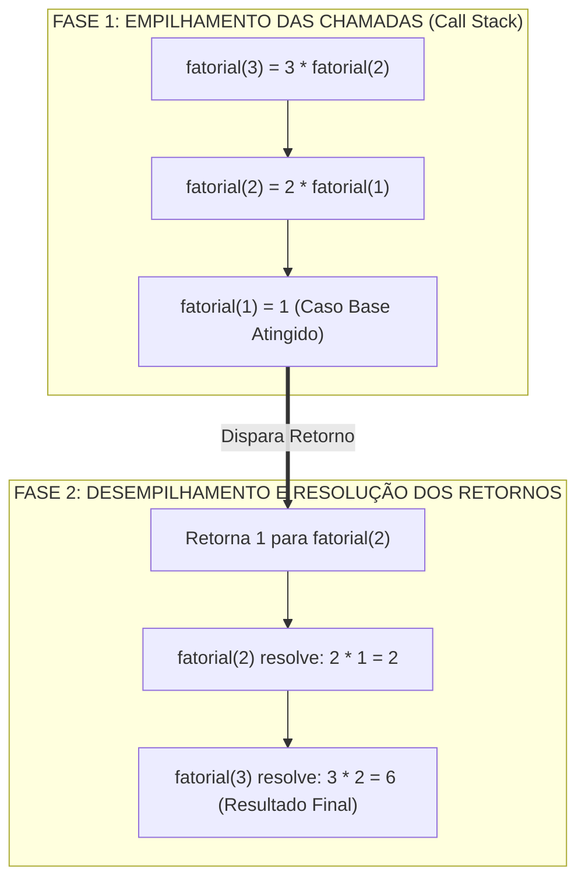
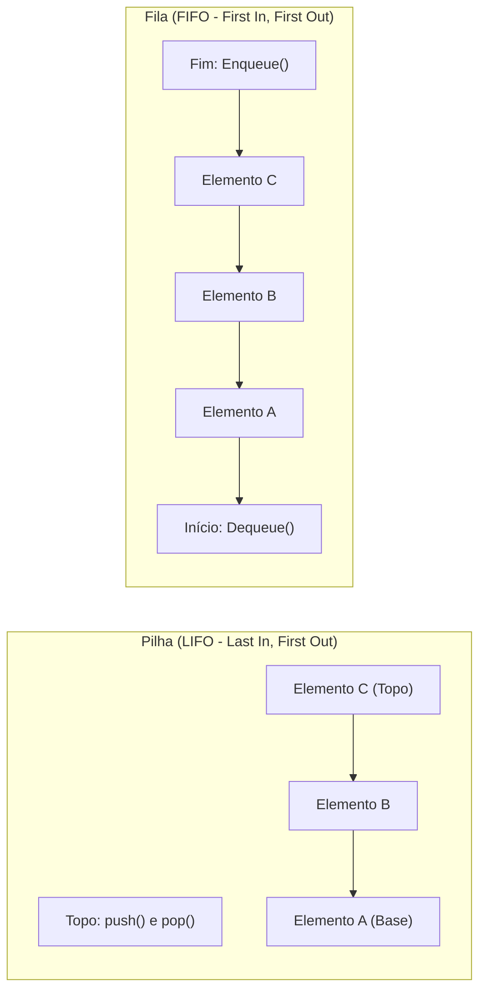
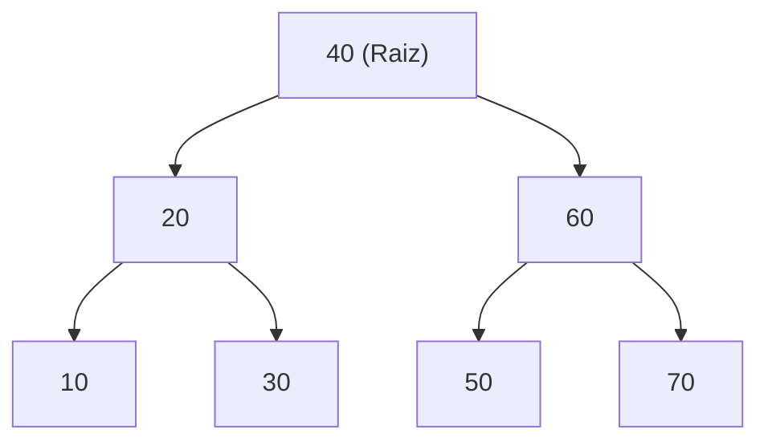
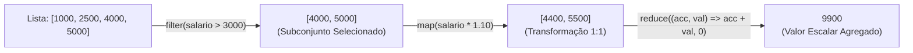

# 01 - Algoritmos, Estruturas de Dados e Paradigmas de Programação

> **Matéria:** Desenvolvimento de Sistemas  
> **Cargo:** B02 – Técnico de Controle Externo – Especialidade: Tecnologia da Informação  
> **Arquivo:** `01_algoritmos_estruturas_de_dados_e_paradigmas.md`  

---

## 📌 Ementa / Itens do Edital
- Algoritmos e lógica de programação
- Estruturas de dados (lineares e não lineares)
- Complexidade de algoritmos (noções assintóticas)
- Programação Orientada a Objetos (POO)
- Programação Funcional (PF)

---

## 🧭 Sumário

1. [Algoritmos, Lógica de Execução e Complexidade Assintótica](#1-algoritmos-logica-de-execucao-e-complexidade-assintotica)
    1. [Variáveis, Escopo e Passagem de Parâmetros (Valor vs. Referência)](#11-variaveis-escopo-e-passagem-de-parametros-valor-vs-referencia)
    2. [Recursão e Pilha de Execução (Call Stack)](#12-recursao-e-pilha-de-execucao-call-stack)
    3. [Análise Assintótica e a Notação Big-O](#13-analise-assintotica-e-a-notacao-big-o)
    4. [Teste 054](#Teste-054)
    5. [Teste 055](#Teste-055)
2. [Estruturas de Dados Fundamentais](#2-estruturas-de-dados-fundamentais)
    1. [Estruturas Lineares: Vetores, Listas Encadeadas, Pilhas e Filas](#21-estruturas-lineares-vetores-listas-encadeadas-pilhas-e-filas)
    2. [Tabelas Hash (Hash Tables) e Métodos de Tratamento de Colisão](#22-tabelas-hash-hash-tables-e-metodos-de-tratamento-de-colisao)
    3. [Estruturas Não Lineares: Árvores Binárias de Busca (BST) e Percursos](#23-estruturas-nao-lineares-arvores-binarias-de-busca-bst-e-percursos)
    4. [Árvores Auto-Balanceadas (AVL e Rubro-Negra) e Grafos](#24-arvores-auto-balanceadas-avl-e-rubro-negra-e-grafos)
    5. [Matriz Geral de Complexidade das Estruturas de Dados](#25-matriz-geral-de-complexidade-das-estruturas-de-dados)
    6. [Teste 056](#Teste-056)
    7. [Teste 057](#Teste-057)
    8. [Teste 058](#Teste-058)
    9. [Teste 059](#Teste-059)
3. [Paradigma de Programação Orientada a Objetos (POO)](#3-paradigma-de-programacao-orientada-a-objetos-poo)
    1. [Os Quatro Pilares da POO: Abstração, Encapsulamento, Herança e Polimorfismo](#31-os-quatro-pilares-da-poo-abstracao-encapsulamento-heranca-e-polimorfismo)
    2. [Polimorfismo Estático (Sobrecarga) vs. Polimorfismo Dinâmico (Sobrescrita)](#32-polimorfismo-estatico-sobrecarga-vs-polimorfismo-dinamico-sobrescrita)
    3. [Relações Estruturais: Classes Abstratas, Interfaces, Coesão e Acoplamento](#33-relacoes-estruturais-classes-abstratas-interfaces-coesao-e-acoplamento)
    4. [Teste 060](#Teste-060)
    5. [Teste 061](#Teste-061)
    6. [Teste 062](#Teste-062)
4. [Paradigma de Programação Funcional (PF)](#4-paradigma-de-programacao-funcional-pf)
    1. [Princípios Fundamentais: Funções Puras, Imutabilidade e Transparência Referencial](#41-principios-fundamentais-funcoes-puras-imutabilidade-e-transparencia-referencial)
    2. [Funções de Primeira Classe e Funções de Alta Ordem (Higher-Order Functions)](#42-funcoes-de-primeira-classe-e-funcoes-de-alta-ordem-higher-order-functions)
    3. [Operações Funcionais sobre Coleções: map, filter e reduce](#43-operacoes-funcionais-sobre-colecoes-map-filter-e-reduce)
    4. [Teste 063](#Teste-063)
    5. [Teste 064](#Teste-064)
5. [Fontes Oficiais e Referências Bibliográficas](#5-fontes-oficiais-e-referencias-bibliograficas)

---

## 1. Algoritmos, Lógica de Execução e Complexidade Assintótica

### 1.1 Variáveis, Escopo e Passagem de Parâmetros (Valor vs. Referência)
A lógica de programação orienta a elaboração de sequências finitas, ordenadas e inequívocas de passos para a resolução computacional de problemas:

- **Variáveis e Tipagem:** Uma variável é um espaço nominal alocado na memória para armazenar determinado tipo de dado. O **escopo** delimita a visibilidade dessa variável:
    - *Escopo Global:* Acessível em qualquer parte do módulo ou programa;
    - *Escopo Local de Bloco/Função:* Visível estritamente dentro do corpo da sub-rotina onde foi declarada, sendo liberada da pilha (*stack*) ao término da execução.
- **Mecanismos de Passagem de Parâmetros:**
    - **Passagem por Valor:** Uma cópia literal do valor do dado primitivo é enviada à sub-rotina. Qualquer modificação efetuada internamente não altera a variável original no escopo chamador;
    - **Passagem por Referência (ou Valor da Referência):** Em linguagens modernas como Java e Python, a passagem é estritamente **por valor**, mas para variáveis de tipos não primitivos (objetos e coleções), o "valor" copiado é o **endereço de memória (ponteiro)** do objeto. Logo:
    - Alterações no estado interno do objeto (ex.: `lista.add("item")` ou `obj.setNome("novo")`) afetam diretamente o objeto original no chamador;
    - Reatribuir a variável inteira dentro do método (ex.: `obj = new Objeto()`) altera apenas a cópia local do ponteiro, mantendo a variável original inalterada.

### 1.2 Recursão e Pilha de Execução (Call Stack)
Um algoritmo recursivo decompõe a solução de um problema invocando a si próprio com instâncias menores do mesmo problema.

Todo algoritmo recursivo exige dois componentes fundamentais:

1. **Caso Base (Condição de Parada):** Uma condição booleana explícita que encerra as chamadas subsequentes e retorna um valor constante imediato. A ausência ou falha no caso base gera recursão infinita e o esgotamento da memória de pilha do sistema operacional (*StackOverflowError*);
2. **Passo Recursivo:** Chamada da função a si mesma com argumentos que convergem progressivamente em direção à condição de parada.

### 1.3 Análise Assintótica e a Notação Big-O
A notação **Big-O ($\mathcal{O}$)** mensura o crescimento do tempo de execução ou do consumo de memória de um algoritmo à medida que o tamanho da entrada ($n$) tende ao infinito, descrevendo o limite superior assintótico (*pior caso* ou caso geral).

| Notação Big-O | Denominação | Comportamento ao Dobrar a Entrada ($2n$) | Exemplos Clássicos |
| :---: | :--- | :--- | :--- |
| $\mathcal{O}(1)$ | Constante | Tempo inalterado | Acesso a índice de array; `push`/`pop` em pilha. |
| $\mathcal{O}(\log n)$ | Logarítmica | Aumenta em uma fração constante | **Busca Binária** (*Binary Search*) em array ordenado. |
| $\mathcal{O}(n)$ | Linear | O tempo dobra proporcionalmente | Busca Linear em vetor; percurso em lista encadeada. |
| $\mathcal{O}(n \log n)$ | Linearítmica | Aumenta um pouco mais que o dobro | *Merge Sort*, *Heap Sort*, *Quick Sort* (caso médio). |
| $\mathcal{O}(n^2)$ | Quadrática | O tempo quadruplica | Laços aninhados simples, *Bubble Sort*, *Insertion Sort*. |
| $\mathcal{O}(2^n)$ | Exponencial | Crescimento explosivo impraticável | Algoritmos de força bruta (ex.: subconjuntos). |
| $\mathcal{O}(n!)$ | Fatorial | Pior classe computacional tratável | Caixeiro Viajante por enumeração exaustiva. |

> ⭐ **IMPORTANTE / BUSCA BINÁRIA:** A Busca Binária exige **obrigatoriamente** que a estrutura esteja previamente **ordenada** e suporte acesso aleatório indexado em tempo $\mathcal{O}(1)$ (como arrays e vetores contíguos). Sua complexidade temporal é $\mathcal{O}(\log n)$. Se aplicada em listas encadeadas, mesmo ordenadas, a busca binária perde eficiência porque o acesso ao nó central requer navegação sequencial $\mathcal{O}(n)$.

---

### Teste 054
**(CEBRASPE – TRT-8 – Analista Judiciario Apoio Especializado Tecnologia da Informacao – 2016)**
Assinale a opção que apresenta o algoritmo de ordenação com o pior desempenho, considerando-se um vetor de 100 elementos, com valores inteiros ordenados em ordem inversa ao do algoritmo de ordenação.

* **A)** shell sort
* **B)** quicksort
* **C)** heapsort
* **D)** radix sort
* **E)** bubble sort

---

> **Comentário Detalhado:**
>
> - **A)** **Incorreta.** A opção apresenta proposição em desacordo com os fundamentos teóricos e técnicos do tópico ao afirmar que "shell sort". De acordo com a teoria estudada em *1.3 Análise Assintótica e a Notação Big-O*, \$\mathcal{O}(n \log n)\$: Linearítmica — Aumenta um pouco mais que o dobro — *Merge Sort*, *Heap Sort*, *Quick Sort* (caso médio).
> - **B)** **Incorreta.** A opção apresenta proposição em desacordo com os fundamentos teóricos e técnicos do tópico ao afirmar que "quicksort". De acordo com a teoria estudada em *2.2 Tabelas Hash (Hash Tables) e Métodos de Tratamento de Colisão*, endereçamento Aberto (*Open Addressing*): Todos os elementos residem diretamente no vetor principal. Ocorrendo colisão, o algoritmo pesquisa sistematicamente o próximo slot vago.
> - **C)** **Incorreta.** A opção apresenta proposição em desacordo com os fundamentos teóricos e técnicos do tópico ao afirmar que "heapsort". De acordo com a teoria estudada em *1.3 Análise Assintótica e a Notação Big-O*, a notação Big-O (\$\mathcal{O}\$) mensura o crescimento do tempo de execução ou do consumo de memória de um algoritmo à medida que o tamanho da entrada (\$n\$) tende ao infinito, descrevendo o limite superior assintótico (*pior caso* ou caso geral).
> - **D)** **Incorreta.** A opção apresenta proposição em desacordo com os fundamentos teóricos e técnicos do tópico ao afirmar que "radix sort". De acordo com a teoria estudada em *2.4 Árvores Auto-Balanceadas (AVL e Rubro-Negra) e Grafos*, degeneração da BST: Se inserirmos elementos já ordenados (`10, 20, 30, 40, 50`) em uma BST simples, a árvore degenera em uma lista linear encadeada, e as operações de busca caem de \$\mathcal{O}(\log n)\$ para \$\mathcal{O}(n)\$.
> - **E)** **Correta.** Conforme fundamentado na seção *1.3 Análise Assintótica e a Notação Big-O* deste guia, \$\mathcal{O}(n^2)\$: Quadrática — O tempo quadruplica — Laços aninhados simples, *Bubble Sort*, *Insertion Sort*. Dessa forma, está plenamente correta a assertiva da banca (CEBRASPE – TRT-8/2016) ao estabelecer que "bubble sort".
>
> **Gabarito: E**

---

### Teste 055
**(FGV – TJ-AP – Analista Judiciario Apoio Especializado Tecnologia da Informacao Banco de Dados – 2023)**
Analise, no código JavaScript exibido a seguir, a função f que recebe um array como parâmetro. É dado que a função Math.trunc retorna a parte inteira de um número. function f(x) { i = 0; for (i=0; i < Math.trunc(x.length/2); i++) { a = x[i]; x[i] = x[x.length -i -1]; x[x.length -i -1] = a; } return x; } A complexidade do algoritmo é da ordem:

* **A)** Log (N)
* **B)** N Log(N)
* **C)** N/2
* **D)** N
* **E)** N2

---

> **Comentário Detalhado:**
>
> - **A)** **Incorreta.** A opção apresenta proposição em desacordo com os fundamentos teóricos e técnicos do tópico ao afirmar que "Log (N)". De acordo com a teoria estudada em *1.3 Análise Assintótica e a Notação Big-O*, \$\mathcal{O}(\log n)\$: Logarítmica — Aumenta em uma fração constante — Busca Binária (*Binary Search*) em array ordenado.
> - **B)** **Incorreta.** A opção apresenta proposição em desacordo com os fundamentos teóricos e técnicos do tópico ao afirmar que "N Log(N)". De acordo com a teoria estudada em *1.3 Análise Assintótica e a Notação Big-O*, a Busca Binária exige obrigatoriamente que a estrutura esteja previamente ordenada e suporte acesso aleatório indexado em tempo \$\mathcal{O}(1)\$ (como arrays e vetores contíguos). Sua complexidade temporal é \$\mathcal{O}(\log n)\$.
> - **C)** **Correta.** Conforme fundamentado na seção *2.2 Tabelas Hash (Hash Tables) e Métodos de Tratamento de Colisão* deste guia, uma Tabela Hash associa chaves de busca a índices de um array de tamanho \$m\$ por meio de uma função de espalhamento (*hash function*): \$\text{índice} = h(\text{chave}) \pmod m\$. Dessa forma, está plenamente correta a assertiva da banca (FGV – TJ-AP/2023) ao estabelecer que "N/2".
> - **D)** **Incorreta.** A opção apresenta proposição em desacordo com os fundamentos teóricos e técnicos do tópico ao afirmar que "N". De acordo com a teoria estudada em *1.3 Análise Assintótica e a Notação Big-O*, \$\mathcal{O}(1)\$: Constante — Tempo inalterado — Acesso a índice de array; `push`/`pop` em pilha.
> - **E)** **Incorreta.** A opção apresenta proposição em desacordo com os fundamentos teóricos e técnicos do tópico ao afirmar que "N2". De acordo com a teoria estudada em *1.3 Análise Assintótica e a Notação Big-O*, a notação Big-O (\$\mathcal{O}\$) mensura o crescimento do tempo de execução ou do consumo de memória de um algoritmo à medida que o tamanho da entrada (\$n\$) tende ao infinito, descrevendo o limite superior assintótico (*pior caso* ou caso geral).
>
> **Gabarito: C**

---

## 2. Estruturas de Dados Fundamentais

### 2.1 Estruturas Lineares: Vetores, Listas Encadeadas, Pilhas e Filas

- **Vetores (Arrays):** Estrutura indexada contígua na memória.
    - *Vantagem:* Acesso aleatório direto em $\mathcal{O}(1)$ via cálculo de deslocamento (`endereço = base + índice * tamanho`).
    - *Desvantagem:* Inserções ou remoções no meio do vetor exigem o deslocamento (*shift*) de todos os elementos posteriores, consumindo tempo $\mathcal{O}(n)$.
- **Listas Encadeadas (*Linked Lists*):** Elementos (nós) alocados dinamicamente na memória, contendo o dado e ponteiros:
    - *Simplesmente Encadeada:* Ponteiro único apontando para o próximo nó (`next`);
    - *Duplamente Encadeada:* Ponteiros para o anterior (`prev`) e próximo nó (`next`), permitindo percurso bidirecional e remoção em tempo $\mathcal{O}(1)$ caso a referência do nó seja conhecida;
    - *Circular:* O último nó aponta de volta para o primeiro nó da lista.
- **Pilhas (*Stacks* - Disciplina LIFO):**
    - *Last-In, First-Out* (o último elemento a entrar é o primeiro a sair);
    - Operações: `push()` (inserção no topo), `pop()` (remoção do topo) e `peek()` (inspeção do topo sem remoção). Todas operam em $\mathcal{O}(1)$;
    - Aplicações: Pilha de execução de sub-rotinas (*Call Stack*), conversão de expressões polonesas reversas (RPN), mecanismos de desfazer/refazer (*Undo/Redo*) e validação de fechamento de delimitadores (chaves e parênteses).
- **Filas (*Queues* - Disciplina FIFO):**
    - *First-In, First-Out* (o primeiro elemento a entrar é o primeiro a ser processado);
    - Operações: `enqueue()` (inserção no final da fila), `dequeue()` (remoção do início da fila) e `peek()`. Todas em $\mathcal{O}(1)$;
    - Aplicações: Spoolers de impressão, filas de mensagens assíncronas (RabbitMQ/Kafka) e algoritmo de busca em largura (BFS) em grafos e árvores.

### 2.2 Tabelas Hash (Hash Tables) e Métodos de Tratamento de Colisão
Uma Tabela Hash associa chaves de busca a índices de um array de tamanho $m$ por meio de uma **função de espalhamento** (*hash function*): $\text{índice} = h(\text{chave}) \pmod m$.

- **Fator de Carga ($\alpha$):** Razão entre o número de itens armazenados $n$ e o número total de posições da tabela $m$ ($\alpha = \frac{n}{m}$). Quando o fator de carga ultrapassa o limiar regulamentar (tipicamente $0.75$), a tabela é redimensionada (*rehashing*), duplicando a capacidade e recalculando as posições.
- **Tratamento de Colisões (Quando duas chaves resultam no mesmo índice):**
    1. **Encadeamento Separado (*Separate Chaining*):** Cada slot do vetor principal referencia uma lista encadeada (ou árvore binária balanceada quando a lista cresce demais, como no Java 8+). Os elementos colidentes são simplesmente adicionados como novos nós dessa lista secundária.
    2. **Endereçamento Aberto (*Open Addressing*):** Todos os elementos residem diretamente no vetor principal. Ocorrendo colisão, o algoritmo pesquisa sistematicamente o próximo slot vago:
        - *Sondagem Linear (*Linear Probing*):* Testa células consecutivas ($i+1, i+2, \dots$). Sofre com o fenômeno de **agrupamento primário** (*primary clustering*);
        - *Sondagem Quadrática (*Quadratic Probing*):* Testa células com incrementos quadráticos ($i+1^2, i+2^2, \dots$);
        - *Duplo Hash (*Double Hashing*):* Calcula o tamanho do salto através de uma segunda função hash: $\text{passo} = h_2(\text{chave})$.

> 🚨 **ALERTA DE PROVA / PEGADINHA FCC:**  
> A complexidade temporal média de busca, inserção e remoção em uma Tabela Hash é $\mathcal{O}(1)$. Todavia, no **pior caso** (quando todas as chaves colidem no mesmo índice devido a uma função hash deficiente ou ataque de negação de serviço), a complexidade **degrada compulsoriamente para $\mathcal{O}(n)$**. A FCC frequentemente tenta enganar o candidato afirmando que a busca em tabela hash é $\mathcal{O}(1)$ em qualquer circunstância!

### 2.3 Estruturas Não Lineares: Árvores Binárias de Busca (BST) e Percursos
Uma **Árvore Binária de Busca (BST - Binary Search Tree)** é uma estrutura hierárquica na qual, para cada nó raiz $X$:

- Todos os nós situados em sua subárvore esquerda possuem chaves estritamente **menores** que a chave de $X$;
- Todos os nós situados em sua subárvore direita possuem chaves estritamente **maiores** que a chave de $X$.

**Percursos em Profundidade (DFS - Depth-First Search):**

1. **Pré-Ordem (Pre-order / Raiz $\rightarrow$ Esquerda $\rightarrow$ Direita):** Visita a Raiz, depois percorre a subárvore Esquerda, e por fim a Direita.  
   *Sequência na árvore acima:* `40, 20, 10, 30, 60, 50, 70`. (Utilizada para clonagem ou serialização estrutural da árvore).
2. **Em-Ordem (In-order / Esquerda $\rightarrow$ Raiz $\rightarrow$ Direita):** Percorre a subárvore Esquerda, visita a Raiz, e por fim a Direita.  
   *Sequência na árvore acima:* `10, 20, 30, 40, 50, 60, 70`.  
   > ⭐ **REGRA DE OURO DA FCC:** Em qualquer Árvore Binária de Busca (BST), o percurso **Em-Ordem (In-order) produz obrigatoriamente a sequência dos elementos em ordem estritamente crescente!**
3. **Pós-Ordem (Post-order / Esquerda $\rightarrow$ Direita $\rightarrow$ Raiz):** Percorre a subárvore Esquerda, depois a Direita, e por fim visita a Raiz.  
   *Sequência na árvore acima:* `10, 30, 20, 50, 70, 60, 40`. (Utilizada para liberação e desalocação de memória de nós folha até a raiz).
4. **Percurso em Largura (BFS / Level-Order):** Visita os nós nível por nível, de cima para baixo e da esquerda para a direita, utilizando uma Fila auxiliar: `40, 20, 60, 10, 30, 50, 70`.

### 2.4 Árvores Auto-Balanceadas (AVL e Rubro-Negra) e Grafos
- **Degeneração da BST:** Se inserirmos elementos já ordenados (`10, 20, 30, 40, 50`) em uma BST simples, a árvore degenera em uma lista linear encadeada, e as operações de busca caem de $\mathcal{O}(\log n)$ para $\mathcal{O}(n)$;
- **Árvore AVL (Adelson-Velsky e Landis):** Mantém o Fator de Balanceamento $FB = \text{altura}(E) - \text{altura}(D) \in \{-1, 0, +1\}$. Caso $|FB| > 1$, aplica rotações (simples ou duplas) para restabelecer a altura estritamente logarítmica $\mathcal{O}(\log n)$;
- **Árvore Rubro-Negra (Red-Black Tree):** Árvore balanceada por coloração de nós (vermelho ou preto). Menos rígida que a AVL em altura, demandando menor quantidade de rotações em operações frequentes de inserção e exclusão (utilizada internamente no `TreeMap` e `HashMap` do Java);
- **Grafos:** Conjunto de vértices e arestas (direcionadas ou não, ponderadas ou não):
    - *Representações:* Matriz de Adjacência ($\mathcal{O}(V^2)$ de memória, ideal para grafos densos) e Lista de Adjacência ($\mathcal{O}(V + E)$, ideal para grafos esparsos);
    - *Algoritmos de Percurso:* Busca em Profundidade (DFS - usa pilha/recursão) e Busca em Largura (BFS - usa fila).

### 2.5 Matriz Geral de Complexidade das Estruturas de Dados

| Estrutura de Dados | Acesso Médio | Acesso Pior | Busca Média | Busca Pior | Inserção Média | Inserção Pior | Remoção Média | Remoção Pior |
| :--- | :---: | :---: | :---: | :---: | :---: | :---: | :---: | :---: |
| **Vetor (Array)** | $\mathcal{O}(1)$ | $\mathcal{O}(1)$ | $\mathcal{O}(n)$ | $\mathcal{O}(n)$ | $\mathcal{O}(n)$ | $\mathcal{O}(n)$ | $\mathcal{O}(n)$ | $\mathcal{O}(n)$ |
| **Lista Encadeada** | $\mathcal{O}(n)$ | $\mathcal{O}(n)$ | $\mathcal{O}(n)$ | $\mathcal{O}(n)$ | $\mathcal{O}(1)^*$ | $\mathcal{O}(1)^*$ | $\mathcal{O}(1)^*$ | $\mathcal{O}(1)^*$ |
| **Pilha (Stack)** | $\mathcal{O}(n)$ | $\mathcal{O}(n)$ | $\mathcal{O}(n)$ | $\mathcal{O}(n)$ | $\mathcal{O}(1)$ | $\mathcal{O}(1)$ | $\mathcal{O}(1)$ | $\mathcal{O}(1)$ |
| **Fila (Queue)** | $\mathcal{O}(n)$ | $\mathcal{O}(n)$ | $\mathcal{O}(n)$ | $\mathcal{O}(n)$ | $\mathcal{O}(1)$ | $\mathcal{O}(1)$ | $\mathcal{O}(1)$ | $\mathcal{O}(1)$ |
| **Tabela Hash** | N/A | N/A | $\mathcal{O}(1)$ | $\mathcal{O}(n)$ | $\mathcal{O}(1)$ | $\mathcal{O}(n)$ | $\mathcal{O}(1)$ | $\mathcal{O}(n)$ |
| **BST Degenerada** | $\mathcal{O}(n)$ | $\mathcal{O}(n)$ | $\mathcal{O}(n)$ | $\mathcal{O}(n)$ | $\mathcal{O}(n)$ | $\mathcal{O}(n)$ | $\mathcal{O}(n)$ | $\mathcal{O}(n)$ |
| **Árvore AVL / Rubro-Negra** | $\mathcal{O}(\log n)$ | $\mathcal{O}(\log n)$ | $\mathcal{O}(\log n)$ | $\mathcal{O}(\log n)$ | $\mathcal{O}(\log n)$ | $\mathcal{O}(\log n)$ | $\mathcal{O}(\log n)$ | $\mathcal{O}(\log n)$ |

*\*Inserção e remoção em lista encadeada são $\mathcal{O}(1)$ se a referência direta ao nó alvo for previamente conhecida.*

---

### Teste 056
**(FGV – TJ-AP – Analista Judiciario Apoio Especializado Tecnologia da Informacao Desenvolvimento de Sistemas – 2023)**
O paradigma funcional, evidenciado na linguagem LISP, criada em 1958, voltou com muita força atualmente, sendo incluído em diversas linguagens, como o Java. Considere o trecho de código apresentado a seguir. List`<String>` lista = Arrays.asList("UM","DOIS","TRES"); for(int i=0; i<lista.size(); i++){ System.out.println(lista.get(i)); } Para utilizar o paradigma funcional, o loop para apresentação dos valores deve ser reescrito da seguinte forma:

* **A)** for(String s: lista){ System.out.println(s); }
* **B)** for (Iterator`<String>` it = lista.iterator(); it.hasNext();) { System.out.println(it.next()); }
* **C)** lista.forEach(s -> { System.out.println(s); });
* **D)** Iterator`<String>` it = lista.iterator(); while(it.hasNext()) { System.out.println(it.next()); }
* **E)** for(var s: lista){ System.out.println(s); }

---

> **Comentário Detalhado:**
>
> - **A)** **Incorreta.** A opção apresenta proposição em desacordo com os fundamentos teóricos e técnicos do tópico ao afirmar que "for(String s: lista){ System.out.println(s); }". De acordo com a teoria estudada em *4.3 Operações Funcionais sobre Coleções: map, filter e reduce*, `reduce`: Acumula todos os elementos da coleção aplicando iterativamente uma função de combinação. — Exatamente \$1\$ valor — Valor escalar consolidado ou objeto acumulador único (número, string).
> - **B)** **Incorreta.** A opção apresenta proposição em desacordo com os fundamentos teóricos e técnicos do tópico ao afirmar que "for (Iterator`<String>` it = lista.iterator(); it.hasNext();) { System.out.println(it.next()); }". De acordo com a teoria estudada em *2.1 Estruturas Lineares: Vetores, Listas Encadeadas, Pilhas e Filas*, *Last-In, First-Out* (o último elemento a entrar é o primeiro a sair).
> - **C)** **Correta.** Conforme fundamentado na seção *2.1 Estruturas Lineares: Vetores, Listas Encadeadas, Pilhas e Filas* deste guia, *First-In, First-Out* (o primeiro elemento a entrar é o primeiro a ser processado). Dessa forma, está plenamente correta a assertiva da banca (FGV – TJ-AP/2023) ao estabelecer que "lista.forEach(s -> { System.out.println(s); })".
> - **D)** **Incorreta.** A opção apresenta proposição em desacordo com os fundamentos teóricos e técnicos do tópico ao afirmar que "Iterator`<String>` it = lista.iterator(); while(it.hasNext()) { System.out.println(it.next()); }". De acordo com a teoria estudada em *2.2 Tabelas Hash (Hash Tables) e Métodos de Tratamento de Colisão*, encadeamento Separado (*Separate Chaining*): Cada slot do vetor principal referencia uma lista encadeada (ou árvore binária balanceada quando a lista cresce demais, como no Java 8+).
> - **E)** **Incorreta.** A opção apresenta proposição em desacordo com os fundamentos teóricos e técnicos do tópico ao afirmar que "for(var s: lista){ System.out.println(s); }". De acordo com a teoria estudada em *2.1 Estruturas Lineares: Vetores, Listas Encadeadas, Pilhas e Filas*, *Circular:* O último nó aponta de volta para o primeiro nó da lista.
>
> **Gabarito: C**

---

### Teste 057
**(FGV – TJ-AP – Analista Judiciario Apoio Especializado Tecnologia da Informacao Desenvolvimento de Sistemas – 2023)**
Observe os seguintes fragmentos de um documento XML. Fragmento 1: `<table>` `<tr>` `<td>`Fruta`</td>` `<td>`Quantidade`</td>` `</tr>` `</table>` Fragmento 2: `<table>` `<name>`Manga`</name>` `<quantidade>`10`</quantidade>` `</table>` Ambos os fragmentos possuem o elemento `<table>`. Para evitar conflito entre os nomes dos elementos no mesmo documento XML, deve-se usar um:

* **A)** XSLT;
* **B)** Parser;
* **C)** Tag;
* **D)** Comments;
* **E)** Namespace.

---

> **Comentário Detalhado:**
>
> - **A)** **Incorreta.** A opção apresenta proposição em desacordo com os fundamentos teóricos e técnicos do tópico ao afirmar que "XSLT". De acordo com a teoria estudada em *2.3 Estruturas Não Lineares: Árvores Binárias de Busca (BST) e Percursos*, todos os nós situados em sua subárvore esquerda possuem chaves estritamente menores que a chave de \$X\$.
> - **B)** **Incorreta.** A opção apresenta proposição em desacordo com os fundamentos teóricos e técnicos do tópico ao afirmar que "Parser". De acordo com a teoria estudada em *2.3 Estruturas Não Lineares: Árvores Binárias de Busca (BST) e Percursos*, todos os nós situados em sua subárvore direita possuem chaves estritamente maiores que a chave de \$X\$.
> - **C)** **Incorreta.** A opção apresenta proposição em desacordo com os fundamentos teóricos e técnicos do tópico ao afirmar que "Tag". De acordo com a teoria estudada em *2.4 Árvores Auto-Balanceadas (AVL e Rubro-Negra) e Grafos*, menos rígida que a AVL em altura, demandando menor quantidade de rotações em operações frequentes de inserção e exclusão (utilizada internamente no `TreeMap` e `HashMap` do Java).
> - **D)** **Incorreta.** A opção apresenta proposição em desacordo com os fundamentos teóricos e técnicos do tópico ao afirmar que "Comments". De acordo com a teoria estudada em *2.1 Estruturas Lineares: Vetores, Listas Encadeadas, Pilhas e Filas*, *Last-In, First-Out* (o último elemento a entrar é o primeiro a sair).
> - **E)** **Correta.** Conforme fundamentado na seção *4.3 Operações Funcionais sobre Coleções: map, filter e reduce* deste guia, `map`: Aplica uma função de transformação individual a cada elemento da coleção. — Rigorosamente igual a \$n\$ — Nova coleção com elementos transformados (mesmo tamanho). Dessa forma, está plenamente correta a assertiva da banca (FGV – TJ-AP/2023) ao estabelecer que "Namespace".
>
> **Gabarito: E**

---

### Teste 058
**(FUMARC – TRT-3 – Analista Judiciario Apoio Especializado Tecnologia da Informacao – 2022)**
Ao acessar a opção “Personalização” na janela “Configurações” do Microsoft Windows 10, versão português, é possível fazer várias configurações personalizadas referentes ao sistema operacional. Analise as afirmativas abaixo sobre as funcionalidades da opção “Personalização” da janela “Configurações” do Microsoft Windows 10: I – Na opção “Tela de fundo” é possível definir o modo “Apresentação de Slides” e selecionar uma pasta contendo imagens que se alternam em um intervalo de tempo. II – Na opção “Tela de bloqueio”, é possível escolher um aplicativo para mostrar o status detalhado na tela de bloqueio. III – Na opção “Barra de Tarefas”, existe a opção para desativar a lista de aplicativos do “Menu Iniciar”. Estão CORRETAS as afirmativas:

* **A)** I, apenas.
* **B)** I e II, apenas.
* **C)** I e III, apenas.
* **D)** II e III, apenas.
* **E)** I, II e III.

---

> **Comentário Detalhado:**
>
> - **A)** **Incorreta.** A opção incorre em restrição indevida ao limitar o escopo conceitual ao afirmar que "I, apenas". De acordo com a teoria estudada em *1.3 Análise Assintótica e a Notação Big-O*, \$\mathcal{O}(n)\$: Linear — O tempo dobra proporcionalmente — Busca Linear em vetor; percurso em lista encadeada.
> - **B)** **Correta.** Conforme fundamentado na seção *1.2 Recursão e Pilha de Execução (Call Stack)* deste guia, a ausência ou falha no caso base gera recursão infinita e o esgotamento da memória de pilha do sistema operacional (*StackOverflowError*). Dessa forma, está plenamente correta a assertiva da banca (FUMARC – TRT-3/2022) ao estabelecer que "I e II, apenas".
> - **C)** **Incorreta.** A opção incorre em restrição indevida ao limitar o escopo conceitual ao afirmar que "I e III, apenas". De acordo com a teoria estudada em *2.1 Estruturas Lineares: Vetores, Listas Encadeadas, Pilhas e Filas*, listas Encadeadas (*Linked Lists*): Elementos (nós) alocados dinamicamente na memória, contendo o dado e ponteiros.
> - **D)** **Incorreta.** A opção incorre em restrição indevida ao limitar o escopo conceitual ao afirmar que "II e III, apenas". De acordo com a teoria estudada em *1.3 Análise Assintótica e a Notação Big-O*, a notação Big-O (\$\mathcal{O}\$) mensura o crescimento do tempo de execução ou do consumo de memória de um algoritmo à medida que o tamanho da entrada (\$n\$) tende ao infinito, descrevendo o limite superior assintótico (*pior caso* ou caso geral).
> - **E)** **Incorreta.** A opção apresenta proposição em desacordo com os fundamentos teóricos e técnicos do tópico ao afirmar que "I, II e III". De acordo com a teoria estudada em *1.3 Análise Assintótica e a Notação Big-O*, \$\mathcal{O}(1)\$: Constante — Tempo inalterado — Acesso a índice de array; `push`/`pop` em pilha.
>
> **Gabarito: B**

---

### Teste 059
**(FCC – TRT-23 – Analista Judiciario Apoio Especializado Tecnologia da Informacao – 2016)**
Considere o método de ordenação abaixo. void ordena(int m,int x[]) { int aux,j,i; for(i=0;i<m-1;i++) { for(j=0;j<m-i-1;j++) if (x[j] > x[j+1]) { aux=x[j]; x[j]=x[j+1]; x[j+1]=aux; } } } Utilizando este algoritmo de ordenação, percorre-se a lista dada da esquerda para a direita, comparando pares de elementos consecutivos, trocando de lugar os que estão fora da ordem. Em cada troca, o maior elemento é deslocado uma posição para a direita. Trata-se de um algoritmo de ordenação

* **A)** Select Sort.
* **B)** Insert Sort.
* **C)** Bubble Sort.
* **D)** Shell Sort.
* **E)** Quick Sort.

---

> **Comentário Detalhado:**
>
> - **A)** **Incorreta.** A opção apresenta proposição em desacordo com os fundamentos teóricos e técnicos do tópico ao afirmar que "Select Sort". De acordo com a teoria estudada em *2.3 Estruturas Não Lineares: Árvores Binárias de Busca (BST) e Percursos*, pré-Ordem (Pre-order / Raiz \$\rightarrow\$ Esquerda \$\rightarrow\$ Direita): Visita a Raiz, depois percorre a subárvore Esquerda, e por fim a Direita.
> - **B)** **Incorreta.** A opção apresenta proposição em desacordo com os fundamentos teóricos e técnicos do tópico ao afirmar que "Insert Sort". De acordo com a teoria estudada em *2.3 Estruturas Não Lineares: Árvores Binárias de Busca (BST) e Percursos*, em-Ordem (In-order / Esquerda \$\rightarrow\$ Raiz \$\rightarrow\$ Direita): Percorre a subárvore Esquerda, visita a Raiz, e por fim a Direita.
> - **C)** **Correta.** Conforme fundamentado na seção *1.3 Análise Assintótica e a Notação Big-O* deste guia, \$\mathcal{O}(n^2)\$: Quadrática — O tempo quadruplica — Laços aninhados simples, *Bubble Sort*, *Insertion Sort*. Dessa forma, está plenamente correta a assertiva da banca (FCC – TRT-23/2016) ao estabelecer que "Bubble Sort".
> - **D)** **Incorreta.** A opção apresenta proposição em desacordo com os fundamentos teóricos e técnicos do tópico ao afirmar que "Shell Sort". De acordo com a teoria estudada em *2.3 Estruturas Não Lineares: Árvores Binárias de Busca (BST) e Percursos*, pós-Ordem (Post-order / Esquerda \$\rightarrow\$ Direita \$\rightarrow\$ Raiz): Percorre a subárvore Esquerda, depois a Direita, e por fim visita a Raiz.
> - **E)** **Incorreta.** A opção apresenta proposição em desacordo com os fundamentos teóricos e técnicos do tópico ao afirmar que "Quick Sort". De acordo com a teoria estudada em *1.3 Análise Assintótica e a Notação Big-O*, \$\mathcal{O}(n \log n)\$: Linearítmica — Aumenta um pouco mais que o dobro — *Merge Sort*, *Heap Sort*, *Quick Sort* (caso médio).
>
> **Gabarito: C**

---

## 3. Paradigma de Programação Orientada a Objetos (POO)

### 3.1 Os Quatro Pilares da POO: Abstração, Encapsulamento, Herança e Polimorfismo
1. **Abstração:** Foco nos atributos e operações essenciais de uma entidade do domínio de negócio, isolando aspectos acidentais ou supérfluos;
2. **Encapsulamento:** Ocultamento do estado interno e detalhes algorítmicos de um objeto. O acesso às variáveis de instância é protegido por modificadores de visibilidade (`private`, `protected`, `public`), expondo apenas operações controladas de interface pública;
3. **Herança:** Relação estática entre classes onde uma subclasse (filha) estende atributos e comportamentos de uma superclasse (pai), estabelecendo uma taxonomia do tipo "é um" (*is-a*);
4. **Polimorfismo:** Capacidade de objetos de diferentes classes derivadas responderem a uma mesma mensagem (chamada de método) de maneiras particulares e especializadas.

### 3.2 Polimorfismo Estático (Sobrecarga) vs. Polimorfismo Dinâmico (Sobrescrita)
Essa comparação é cobrada com frequência máxima pela banca FCC:

| Critério de Comparação | Sobrecarga (*Overloading*) | Sobrescrita (*Overriding*) |
| :--- | :--- | :--- |
| **Definição** | Múltiplos métodos com o **mesmo nome** declarados na **mesma classe**. | Redefinição de um método herdado da superclasse na **subclasse**. |
| **Assinatura do Método** | **Obrigatoriamente DIFERENTE** (quantidade ou tipos de parâmetros). | **Rigorosamente IDÊNTICA** (mesmo nome, parâmetros e retorno covariante). |
| **Momento de Resolução** | **Tempo de Compilação** (*Compile-time* / Ligação Estática / *Early Binding*). | **Tempo de Execução** (*Runtime* / Ligação Dinâmica / *Late Binding*). |
| **Classificação** | Polimorfismo Estático ou Ad-hoc. | Polimorfismo Dinâmico, Verdadeiro ou de Inclusão. |
| **Dependência de Herança** | Não depende de herança. | **Exige herança** ou implementação de interface. |

> 🚨 **ALERTA DE PROVA / PEGADINHA FCC:**  
> A FCC adora afirmar que dois métodos são sobrecarregados se eles tiverem o mesmo nome, os mesmos parâmetros e **apenas o tipo de retorno diferente** (ex.: `int calcular(int x)` e `double calcular(int x)`). **ISSO NÃO É SOBRECARGA!** Isso é um erro de compilação! O tipo de retorno isolado não desambigua métodos sobrecarregados.

### 3.3 Relações Estruturais: Classes Abstratas, Interfaces, Coesão e Acoplamento
- **Classes Abstratas vs. Interfaces:**
    - *Classe Abstrata:* Não pode ser instanciada diretamente (`new`). Pode conter métodos abstratos (sem corpo) e métodos concretos (com implementação), além de atributos de instância com qualquer modificador de acesso. Modela uma herança conceitual forte;
    - *Interface:* Define um contrato puro de comportamento. Classes de diferentes hierarquias podem implementar a mesma interface, viabilizando o desacoplamento de contratos e a substituição de componentes;
- **Alta Coesão e Baixo Acoplamento:** Módulos de software de excelência devem ser altamente coesos (cada classe com foco em um propósito único do negócio) e fracamente acoplados (comunicação através de interfaces abstratas, permitindo substituição dinâmica);
- **Composição sobre Herança:** A herança gera forte acoplamento de código (*acoplamento de caixa-branca*), quebrando o encapsulamento caso a subclasse dependa de detalhes de implementação da superclasse. A composição de objetos (*relação "tem um"*) é amplamente recomendada por promover delegação dinâmica e flexibilidade em tempo de execução.

---

### Teste 060
**(FCC – TRT-15 – Analista Judiciario Tecnologia da Informacao – 2015)**
A herança é uma das características mais poderosas e importantes da orientação a objetos, pois permite o reaproveitamento de atributos e métodos. Em aplicações que utilizam herança,

* **A)** não é possível sobrescrever em uma subclasse, um método de sua superclasse.
* **B)** cada superclasse pode ter apenas uma subclasse.
* **C)** somente as superclasses poderão ter métodos ou construtores sobrecarregados.
* **D)** é possível se obter polimorfismo.
* **E)** é possível a implementação de herança múltipla, em todas as linguagens orientadas a objetos.

---

> **Comentário Detalhado:**
>
> - **A)** **Incorreta.** A opção apresenta proposição em desacordo com os fundamentos teóricos e técnicos do tópico ao afirmar que "não é possível sobrescrever em uma subclasse, um método de sua superclasse". De acordo com a teoria estudada em *3.2 Polimorfismo Estático (Sobrecarga) vs. Polimorfismo Dinâmico (Sobrescrita)*, definição: Múltiplos métodos com o mesmo nome declarados na mesma classe. — Redefinição de um método herdado da superclasse na subclasse.
> - **B)** **Incorreta.** A opção incorre em restrição indevida ao limitar o escopo conceitual ao afirmar que "cada superclasse pode ter apenas uma subclasse". De acordo com a teoria estudada em *3.1 Os Quatro Pilares da POO: Abstração, Encapsulamento, Herança e Polimorfismo*, herança: Relação estática entre classes onde uma subclasse (filha) estende atributos e comportamentos de uma superclasse (pai), estabelecendo uma taxonomia do tipo "é um" (*is-a*).
> - **C)** **Incorreta.** A opção incorre em restrição indevida ao limitar o escopo conceitual ao afirmar que "somente as superclasses poderão ter métodos ou construtores sobrecarregados". De acordo com a teoria estudada em *3.2 Polimorfismo Estático (Sobrecarga) vs. Polimorfismo Dinâmico (Sobrescrita)*, a FCC adora afirmar que dois métodos são sobrecarregados se eles tiverem o mesmo nome, os mesmos parâmetros e apenas o tipo de retorno diferente (ex.: `int calcular(int x)` e `double calcular(int x)`).
> - **D)** **Correta.** Conforme fundamentado na seção *3.1 Os Quatro Pilares da POO: Abstração, Encapsulamento, Herança e Polimorfismo* deste guia, abstração: Foco nos atributos e operações essenciais de uma entidade do domínio de negócio, isolando aspectos acidentais ou supérfluos. Dessa forma, está plenamente correta a assertiva da banca (FCC – TRT-15/2015) ao estabelecer que "é possível se obter polimorfismo".
> - **E)** **Incorreta.** A opção apresenta proposição em desacordo com os fundamentos teóricos e técnicos do tópico ao afirmar que "é possível a implementação de herança múltipla, em todas as linguagens orientadas a objetos". De acordo com a teoria estudada em *3.1 Os Quatro Pilares da POO: Abstração, Encapsulamento, Herança e Polimorfismo*, polimorfismo: Capacidade de objetos de diferentes classes derivadas responderem a uma mesma mensagem (chamada de método) de maneiras particulares e especializadas.
>
> **Gabarito: D**

---

### Teste 061
**(FCC – TRT-9 – Analista Judiciario Apoio Especializado Tecnologia da Informacao – 2015)**
Em uma servlet de uma aplicação web construída com Java EE, os dados de um objeto do tipo ArrayList chamado listaFun, contendo um conjunto de objetos de uma classe bean chamada Funcionario, foram incluídos em um atributo de requisição chamado funcionarios, enviado para um arquivo chamado exibefun.jsp. Estas operações foram realizadas pelo fragmento de código a seguir: request.setAttribute("funcionarios", listaFun); RequestDispatcher disp = request.getRequestDispatcher("exibefun.jsp");; disp.forward(request, response); No arquivo exibefun.jsp, para receber o atributo de requisição funcionarios, no interior de uma tag de scriptlet pode-se utilizar a instrução

* **A)** ArrayList`<Funcionario>` funcionarios = request.getAttribute("funcionarios");
* **B)** ArrayList funcionarios = (ArrayList) response.getAttribute("funcionarios");
* **C)** ArrayList funcionarios = (Funcionario) request.getAttribute("funcionarios");
* **D)** ArrayList`<Funcionario>` funcionarios = (ArrayList`<Funcionario>`) request.getAttribute ("funcionarios");
* **E)** ArrayList funcionarios = response.getAttribute("funcionarios").toArrayList();

---

> **Comentário Detalhado:**
>
> - **A)** **Incorreta.** A opção apresenta proposição em desacordo com os fundamentos teóricos e técnicos do tópico ao afirmar que "ArrayList`<Funcionario>` funcionarios = request.getAttribute("funcionarios")". De acordo com a teoria estudada em *3.1 Os Quatro Pilares da POO: Abstração, Encapsulamento, Herança e Polimorfismo*, polimorfismo: Capacidade de objetos de diferentes classes derivadas responderem a uma mesma mensagem (chamada de método) de maneiras particulares e especializadas.
> - **B)** **Incorreta.** A opção apresenta proposição em desacordo com os fundamentos teóricos e técnicos do tópico ao afirmar que "ArrayList funcionarios = (ArrayList) response.getAttribute("funcionarios")". De acordo com a teoria estudada em *3.3 Relações Estruturais: Classes Abstratas, Interfaces, Coesão e Acoplamento*, *Classe Abstrata:* Não pode ser instanciada diretamente (`new`). Pode conter métodos abstratos (sem corpo) e métodos concretos (com implementação), além de atributos de instância com qualquer modificador de acesso. Modela uma herança conceitual forte.
> - **C)** **Incorreta.** A opção apresenta proposição em desacordo com os fundamentos teóricos e técnicos do tópico ao afirmar que "ArrayList funcionarios = (Funcionario) request.getAttribute("funcionarios")". De acordo com a teoria estudada em *3.1 Os Quatro Pilares da POO: Abstração, Encapsulamento, Herança e Polimorfismo*, encapsulamento: Ocultamento do estado interno e detalhes algorítmicos de um objeto. O acesso às variáveis de instância é protegido por modificadores de visibilidade (`private`, `protected`, `public`), expondo apenas operações controladas de interface pública.
> - **D)** **Correta.** Conforme fundamentado na seção *1.1 Variáveis, Escopo e Passagem de Parâmetros (Valor vs. Referência)* deste guia, passagem por Referência (ou Valor da Referência): Em linguagens modernas como Java e Python, a passagem é estritamente por valor, mas para variáveis de tipos não primitivos (objetos e coleções), o "valor" copiado é o endereço de memória (ponteiro) do objeto. Dessa forma, está plenamente correta a assertiva da banca (FCC – TRT-9/2015) ao estabelecer que "ArrayList`<Funcionario>` funcionarios = (ArrayList`<Funcionario>`) request.getAttribute ("funcionarios")".
> - **E)** **Incorreta.** A opção apresenta proposição em desacordo com os fundamentos teóricos e técnicos do tópico ao afirmar que "ArrayList funcionarios = response.getAttribute("funcionarios").toArrayList()". De acordo com a teoria estudada em *3.3 Relações Estruturais: Classes Abstratas, Interfaces, Coesão e Acoplamento*, composição sobre Herança: A herança gera forte acoplamento de código (*acoplamento de caixa-branca*), quebrando o encapsulamento caso a subclasse dependa de detalhes de implementação da superclasse.
>
> **Gabarito: D**

---

### Teste 062
**(FGV – TJ-BA – Analista Judiciario Tecnologia da Informacao – 2015)**
Considere os termos private / protected, usados para especificar os direitos de acesso aos membros de classes escritas na linguagem C++. Na ordem respectiva, esses termos denotam permissões de acesso que se limitam aos membros:

* **A)** da mesma classe / da mesma classe e de classes derivadas;
* **B)** da mesma classe / de classes derivadas que sejam protected;
* **C)** da mesma classe que não sejam public / de classes derivadas que não sejam public;
* **D)** de classes derivadas que sejam private / da mesma classe;
* **E)** da mesma classe e de classes derivadas / da mesma classe.

---

> **Comentário Detalhado:**
>
> - **A)** **Correta.** Conforme fundamentado na seção *3.1 Os Quatro Pilares da POO: Abstração, Encapsulamento, Herança e Polimorfismo* deste guia, polimorfismo: Capacidade de objetos de diferentes classes derivadas responderem a uma mesma mensagem (chamada de método) de maneiras particulares e especializadas. Dessa forma, está plenamente correta a assertiva da banca (FGV – TJ-BA/2015) ao estabelecer que "da mesma classe / da mesma classe e de classes derivadas".
> - **B)** **Incorreta.** A opção apresenta proposição em desacordo com os fundamentos teóricos e técnicos do tópico ao afirmar que "da mesma classe / de classes derivadas que sejam protected". De acordo com a teoria estudada em *3.1 Os Quatro Pilares da POO: Abstração, Encapsulamento, Herança e Polimorfismo*, encapsulamento: Ocultamento do estado interno e detalhes algorítmicos de um objeto. O acesso às variáveis de instância é protegido por modificadores de visibilidade (`private`, `protected`, `public`), expondo apenas operações controladas de interface pública.
> - **C)** **Incorreta.** A opção apresenta proposição em desacordo com os fundamentos teóricos e técnicos do tópico ao afirmar que "da mesma classe que não sejam public / de classes derivadas que não sejam public". De acordo com a teoria estudada em *3.3 Relações Estruturais: Classes Abstratas, Interfaces, Coesão e Acoplamento*, *Classe Abstrata:* Não pode ser instanciada diretamente (`new`). Pode conter métodos abstratos (sem corpo) e métodos concretos (com implementação), além de atributos de instância com qualquer modificador de acesso. Modela uma herança conceitual forte.
> - **D)** **Incorreta.** A opção apresenta proposição em desacordo com os fundamentos teóricos e técnicos do tópico ao afirmar que "de classes derivadas que sejam private / da mesma classe". De acordo com a teoria estudada em *3.3 Relações Estruturais: Classes Abstratas, Interfaces, Coesão e Acoplamento*, *Interface:* Define um contrato puro de comportamento. Classes de diferentes hierarquias podem implementar a mesma interface, viabilizando o desacoplamento de contratos e a substituição de componentes.
> - **E)** **Incorreta.** A opção apresenta proposição em desacordo com os fundamentos teóricos e técnicos do tópico ao afirmar que "da mesma classe e de classes derivadas / da mesma classe". De acordo com a teoria estudada em *3.3 Relações Estruturais: Classes Abstratas, Interfaces, Coesão e Acoplamento*, alta Coesão e Baixo Acoplamento: Módulos de software de excelência devem ser altamente coesos (cada classe com foco em um propósito único do negócio) e fracamente acoplados (comunicação através de interfaces abstratas, permitindo substituição dinâmica).
>
> **Gabarito: A**

---

## 4. Paradigma de Programação Funcional (PF)

### 4.1 Princípios Fundamentais: Funções Puras, Imutabilidade e Transparência Referencial
A Programação Funcional é um paradigma declarativo que trata a computação como a avaliação de funções matemáticas e evita a mutação de estados e dados:

1. **Funções Puras (*Pure Functions*):**
    - *Determinismo:* Para os mesmos argumentos de entrada, a função retorna **rigorosamente o mesmo valor**;
    - *Ausência de Efeitos Colaterais (*No Side Effects*):* Não modifica variáveis externas ou globais, não altera parâmetros recebidos por referência e não realiza operações de I/O em disco ou rede durante a sua computação pura;

2. **Imutabilidade:** As estruturas de dados não são alteradas após criadas. Qualquer transformação produz uma **nova estrutura de dados**, deixando a original intacta. Isso elimina problemas de condição de corrida (*race conditions*) em ambientes concorrentes multithread;
3. **Transparência Referencial:** Uma expressão pode ser substituída diretamente pelo seu valor resultante em qualquer ponto do programa sem alterar o comportamento global do sistema.

### 4.2 Funções de Primeira Classe e Funções de Alta Ordem (Higher-Order Functions)
- **Funções como Cidadãs de Primeira Classe (*First-Class Citizens*):** Funções podem ser atribuídas a variáveis, armazenadas em estruturas de dados, passadas como parâmetros e retornadas como resultado de outras funções;
- **Funções de Alta Ordem (*Higher-Order Functions*):** Funções que recebem uma ou mais funções como argumento ou retornam uma função (como `map`, `filter`, `reduce`);
- **Expressões Lambda:** Funções anônimas concisas, declaradas sem identificador de nome formal (ex.: `x -> x * 2` ou `(a, b) -> a + b`).

### 4.3 Operações Funcionais sobre Coleções: map, filter e reduce

| Método Funcional | Propósito Central da Operação | Cardinalidade de Saída vs. Entrada | Tipo do Retorno |
| :--- | :--- | :---: | :--- |
| **`filter`** | Seleciona os elementos da coleção que satisfazem um predicado booleano. | $0 \le \text{tamanho} \le n$ | Nova coleção filtrada com elementos do mesmo tipo. |
| **`map`** | Aplica uma função de transformação individual a cada elemento da coleção. | Rigorosamente igual a $n$ | Nova coleção com elementos transformados (mesmo tamanho). |
| **`reduce`** | Acumula todos os elementos da coleção aplicando iterativamente uma função de combinação. | Exatamente $1$ valor | Valor escalar consolidado ou objeto acumulador único (número, string). |

---

### Teste 063
**(FGV – TJ-MT – Analista Judiciario Tecnologia da Informacao – 2024)**
A linguagem de programação R é uma linguagem especializada em análise estatística e manipulação de dados, muito popular em áreas como ciência de dados, estatísticas, biotecnologia, econometria e inteligência artificial. Desenvolvida por Ross Ihaka e Robert Gentleman na década de 1990, R foi projetada para fornecer um ambiente de desenvolvimento para análise de dados, com um foco particular em estatísticas e gráficos. Em R, o operador %in%

* **A)** compara dois vetores e retorna TRUE se todos os elementos do primeiro vetor estiverem contidos no segundo.
* **B)** realiza a união de dois vetores, retornando um vetor com todos os elementos exclusivos dos dois vetores.
* **C)** verifica se dois vetores têm exatamente os mesmos elementos e na mesma ordem, retornando TRUE ou FALSE.
* **D)** calcula a interseção entre dois vetores, retornando apenas os elementos que são comuns entre eles.
* **E)** verifica se um elemento ou conjunto de elementos do primeiro vetor está presente no segundo vetor, retornando um vetor lógico.

---

> **Comentário Detalhado:**
>
> - **A)** **Correta.** Conforme fundamentado na seção *2.1 Estruturas Lineares: Vetores, Listas Encadeadas, Pilhas e Filas* deste guia, *Desvantagem:* Inserções ou remoções no meio do vetor exigem o deslocamento (*shift*) de todos os elementos posteriores, consumindo tempo \$\mathcal{O}(n)\$. Dessa forma, está plenamente correta a assertiva da banca (FGV – TJ-MT/2024) ao estabelecer que "compara dois vetores e retorna TRUE se todos os elementos do primeiro vetor estiverem contidos no segundo".
> - **B)** **Incorreta.** A opção apresenta proposição em desacordo com os fundamentos teóricos e técnicos do tópico ao afirmar que "realiza a união de dois vetores, retornando um vetor com todos os elementos exclusivos dos dois vetores". De acordo com a teoria estudada em *2.1 Estruturas Lineares: Vetores, Listas Encadeadas, Pilhas e Filas*, *Circular:* O último nó aponta de volta para o primeiro nó da lista.
> - **C)** **Incorreta.** A opção apresenta proposição em desacordo com os fundamentos teóricos e técnicos do tópico ao afirmar que "verifica se dois vetores têm exatamente os mesmos elementos e na mesma ordem, retornando TRUE ou FALSE". De acordo com a teoria estudada em *4.1 Princípios Fundamentais: Funções Puras, Imutabilidade e Transparência Referencial*, *Determinismo:* Para os mesmos argumentos de entrada, a função retorna rigorosamente o mesmo valor.
> - **D)** **Incorreta.** A opção incorre em restrição indevida ao limitar o escopo conceitual ao afirmar que "calcula a interseção entre dois vetores, retornando apenas os elementos que são comuns entre eles". De acordo com a teoria estudada em *2.1 Estruturas Lineares: Vetores, Listas Encadeadas, Pilhas e Filas*, *Last-In, First-Out* (o último elemento a entrar é o primeiro a sair).
> - **E)** **Incorreta.** A opção apresenta proposição em desacordo com os fundamentos teóricos e técnicos do tópico ao afirmar que "verifica se um elemento ou conjunto de elementos do primeiro vetor está presente no segundo vetor, retornando um...". De acordo com a teoria estudada em *2.1 Estruturas Lineares: Vetores, Listas Encadeadas, Pilhas e Filas*, *First-In, First-Out* (o primeiro elemento a entrar é o primeiro a ser processado).
>
> **Gabarito: A**

---

### Teste 064
**(FGV – TJ-AP – Analista Judiciario Apoio Especializado Tecnologia da Informacao Desenvolvimento de Sistemas – 2023)**
No contexto do jQuery, analise o script a seguir. `` A função do termo “#xpto”, utilizado nesse código, é:

* **A)** detectar o acionamento do evento “xpto”;
* **B)** provocar o acionamento do evento “#xpto”;
* **C)** acionar uma função JavaScript intitulada “xpto”;
* **D)** referenciar um elemento HTML que pertence à class “xpto”;
* **E)** referenciar um elemento HTML que possui o valor do atributo id igual a “xpto”.

---

> **Comentário Detalhado:**
>
> - **A)** **Incorreta.** A opção apresenta proposição em desacordo com os fundamentos teóricos e técnicos do tópico ao afirmar que "detectar o acionamento do evento “xpto”". De acordo com a teoria estudada em *4.1 Princípios Fundamentais: Funções Puras, Imutabilidade e Transparência Referencial*, *Determinismo:* Para os mesmos argumentos de entrada, a função retorna rigorosamente o mesmo valor.
> - **B)** **Incorreta.** A opção apresenta proposição em desacordo com os fundamentos teóricos e técnicos do tópico ao afirmar que "provocar o acionamento do evento “#xpto”". De acordo com a teoria estudada em *4.3 Operações Funcionais sobre Coleções: map, filter e reduce*, `reduce`: Acumula todos os elementos da coleção aplicando iterativamente uma função de combinação. — Exatamente \$1\$ valor — Valor escalar consolidado ou objeto acumulador único (número, string).
> - **C)** **Incorreta.** A opção apresenta proposição em desacordo com os fundamentos teóricos e técnicos do tópico ao afirmar que "acionar uma função JavaScript intitulada “xpto”". De acordo com a teoria estudada em *1.1 Variáveis, Escopo e Passagem de Parâmetros (Valor vs. Referência)*, *Escopo Local de Bloco/Função:* Visível estritamente dentro do corpo da sub-rotina onde foi declarada, sendo liberada da pilha (*stack*) ao término da execução.
> - **D)** **Incorreta.** A opção apresenta proposição em desacordo com os fundamentos teóricos e técnicos do tópico ao afirmar que "referenciar um elemento HTML que pertence à class “xpto”". De acordo com a teoria estudada em *4.2 Funções de Primeira Classe e Funções de Alta Ordem (Higher-Order Functions)*, funções como Cidadãs de Primeira Classe (*First-Class Citizens*): Funções podem ser atribuídas a variáveis, armazenadas em estruturas de dados, passadas como parâmetros e retornadas como resultado de outras funções.
> - **E)** **Correta.** Conforme fundamentado na seção *4.3 Operações Funcionais sobre Coleções: map, filter e reduce* deste guia, `map`: Aplica uma função de transformação individual a cada elemento da coleção. — Rigorosamente igual a \$n\$ — Nova coleção com elementos transformados (mesmo tamanho). Dessa forma, está plenamente correta a assertiva da banca (FGV – TJ-AP/2023) ao estabelecer que "referenciar um elemento HTML que possui o valor do atributo id igual a “xpto”".
>
> **Gabarito: E**

---

## 5. Fontes Oficiais e Referências Bibliográficas

* [Python Official Documentation - Data Structures](https://docs.python.org/pt-br/3/tutorial/datastructures.html) - Listas, pilhas, filas, tuplas, dicionários, conjuntos e operações fundamentais de dados.
* [Oracle Java Documentation - Java Collections Framework](https://docs.oracle.com/javase/tutorial/collections/intro/index.html) - Interfaces List, Set, Queue, Deque, Map e implementações em Java.
* [Oracle Java Documentation - Object-Oriented Programming Concepts](https://docs.oracle.com/javase/tutorial/java/concepts/index.html) - Fundamentos formais de orientação a objetos: classes, objetos, encapsulamento e polimorfismo.
* [ArXiv - Algorithm Complexity and Analysis](https://arxiv.org/abs/2107.03374) - Análise assintótica formal de complexidade e benchmarks algorítmicos.
* CORMEN, Thomas H. et al. **Algoritmos: Teoria e Prática**. 4. ed. Rio de Janeiro: GEN LTC, 2024. (Cap. 1 a 4 - Fundamentos, Notação Assintótica e Divisão e Conquista).
* SEDGEWICK, Robert; WAYNE, Kevin. **Algorithms**. 4. ed. Boston: Addison-Wesley, 2011. (Cap. 1 e 2 - Estruturas de Dados Elementares e Ordenação).
* DROZDEK, Adam. **Estrutura de Dados e Algoritmos em C++**. 2. ed. São Paulo: Cengage Learning, 2016. (Cap. 3 a 5 - Pilhas, Filas e Árvores).
