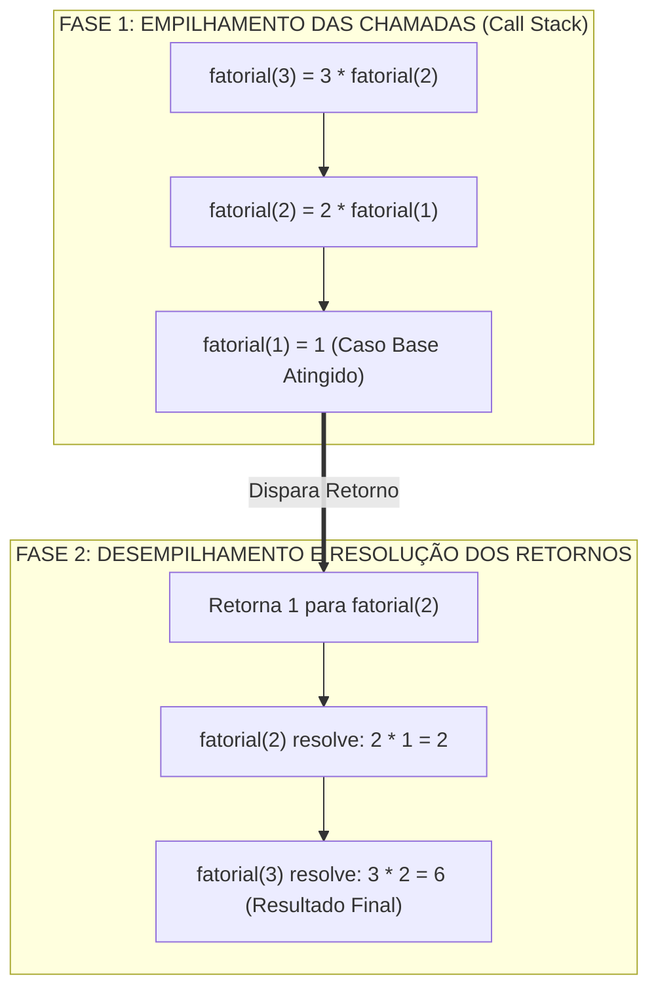
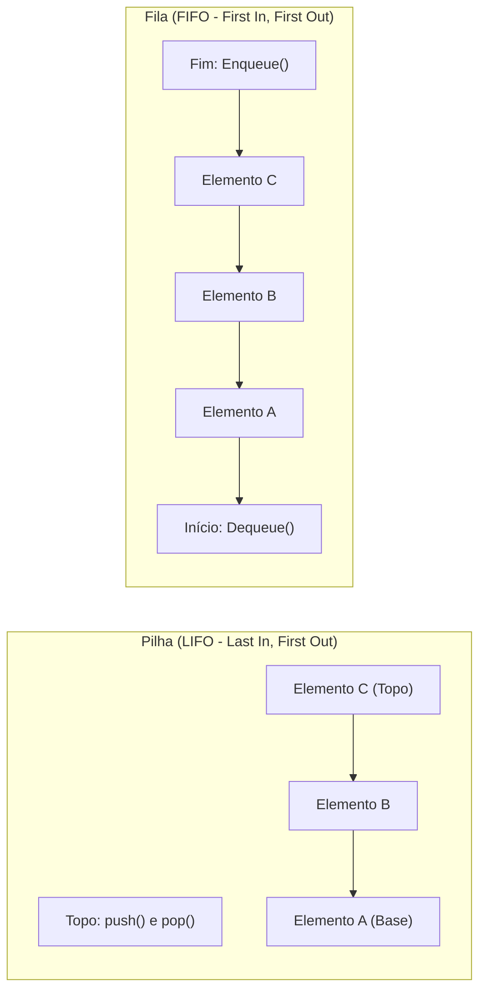
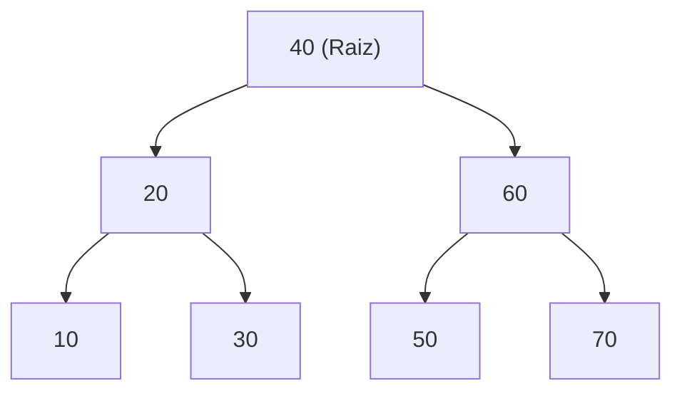

# 01 - Algoritmos, Estruturas de Dados e Paradigmas de Programação

> **Matéria:** Desenvolvimento de Sistemas  
> **Cargo:** B02 – Técnico de Controle Externo – Especialidade: Tecnologia da Informação  
> **Arquivo:** `01_algoritmos_estruturas_de_dados_e_paradigmas.md`  

---

## 📌 Ementa / Itens do Edital
- Algoritmos e lógica de programação
- Estruturas de dados (lineares e não lineares)
- Complexidade de algoritmos (noções assintóticas)
- Programação Orientada a Objetos (POO)
- Programação Funcional (PF)

---

## 🧭 Sumário

1. [Algoritmos, Lógica de Execução e Complexidade Assintótica](#1-algoritmos-logica-de-execucao-e-complexidade-assintotica)
    1. [Variáveis, Escopo e Passagem de Parâmetros (Valor vs. Referência)](#11-variaveis-escopo-e-passagem-de-parametros-valor-vs-referencia)
    2. [Recursão e Pilha de Execução (Call Stack)](#12-recursao-e-pilha-de-execucao-call-stack)
    3. [Análise Assintótica e a Notação Big-O](#13-analise-assintotica-e-a-notacao-big-o)
    4. [Teste 054](#Teste-054)
    5. [Teste 055](#Teste-055)
2. [Estruturas de Dados Fundamentais](#2-estruturas-de-dados-fundamentais)
    1. [Estruturas Lineares: Vetores, Listas Encadeadas, Pilhas e Filas](#21-estruturas-lineares-vetores-listas-encadeadas-pilhas-e-filas)
    2. [Tabelas Hash (Hash Tables) e Métodos de Tratamento de Colisão](#22-tabelas-hash-hash-tables-e-metodos-de-tratamento-de-colisao)
    3. [Estruturas Não Lineares: Árvores Binárias de Busca (BST) e Percursos](#23-estruturas-nao-lineares-arvores-binarias-de-busca-bst-e-percursos)
    4. [Árvores Auto-Balanceadas (AVL e Rubro-Negra) e Grafos](#24-arvores-auto-balanceadas-avl-e-rubro-negra-e-grafos)
    5. [Matriz Geral de Complexidade das Estruturas de Dados](#25-matriz-geral-de-complexidade-das-estruturas-de-dados)
    6. [Teste 056](#Teste-056)
    7. [Teste 057](#Teste-057)
    8. [Teste 058](#Teste-058)
    9. [Teste 059](#Teste-059)
3. [Paradigma de Programação Orientada a Objetos (POO)](#3-paradigma-de-programacao-orientada-a-objetos-poo)
    1. [Os Quatro Pilares da POO: Abstração, Encapsulamento, Herança e Polimorfismo](#31-os-quatro-pilares-da-poo-abstracao-encapsulamento-heranca-e-polimorfismo)
    2. [Polimorfismo Estático (Sobrecarga) vs. Polimorfismo Dinâmico (Sobrescrita)](#32-polimorfismo-estatico-sobrecarga-vs-polimorfismo-dinamico-sobrescrita)
    3. [Relações Estruturais: Classes Abstratas, Interfaces, Coesão e Acoplamento](#33-relacoes-estruturais-classes-abstratas-interfaces-coesao-e-acoplamento)
    4. [Teste 060](#Teste-060)
    5. [Teste 061](#Teste-061)
    6. [Teste 062](#Teste-062)
4. [Paradigma de Programação Funcional (PF)](#4-paradigma-de-programacao-funcional-pf)
    1. [Princípios Fundamentais: Funções Puras, Imutabilidade e Transparência Referencial](#41-principios-fundamentais-funcoes-puras-imutabilidade-e-transparencia-referencial)
    2. [Funções de Primeira Classe e Funções de Alta Ordem (Higher-Order Functions)](#42-funcoes-de-primeira-classe-e-funcoes-de-alta-ordem-higher-order-functions)
    3. [Operações Funcionais sobre Coleções: map, filter e reduce](#43-operacoes-funcionais-sobre-colecoes-map-filter-e-reduce)
    4. [Teste 063](#Teste-063)
    5. [Teste 064](#Teste-064)
5. [Fontes Oficiais e Referências Bibliográficas](#5-fontes-oficiais-e-referencias-bibliograficas)

---

## 1. Algoritmos, Lógica de Execução e Complexidade Assintótica

### 1.1 Variáveis, Escopo e Passagem de Parâmetros (Valor vs. Referência)
A lógica de programação orienta a elaboração de sequências finitas, ordenadas e inequívocas de passos para a resolução computacional de problemas:

- **Variáveis e Tipagem:** Uma variável é um espaço nominal alocado na memória para armazenar determinado tipo de dado. O **escopo** delimita a visibilidade dessa variável:
    - *Escopo Global:* Acessível em qualquer parte do módulo ou programa;
    - *Escopo Local de Bloco/Função:* Visível estritamente dentro do corpo da sub-rotina onde foi declarada, sendo liberada da pilha (*stack*) ao término da execução.
- **Mecanismos de Passagem de Parâmetros:**
    - **Passagem por Valor:** Uma cópia literal do valor do dado primitivo é enviada à sub-rotina. Qualquer modificação efetuada internamente não altera a variável original no escopo chamador;
    - **Passagem por Referência (ou Valor da Referência):** Em linguagens modernas como Java e Python, a passagem é estritamente **por valor**, mas para variáveis de tipos não primitivos (objetos e coleções), o "valor" copiado é o **endereço de memória (ponteiro)** do objeto. Logo:
    - Alterações no estado interno do objeto (ex.: `lista.add("item")` ou `obj.setNome("novo")`) afetam diretamente o objeto original no chamador;
    - Reatribuir a variável inteira dentro do método (ex.: `obj = new Objeto()`) altera apenas a cópia local do ponteiro, mantendo a variável original inalterada.

### 1.2 Recursão e Pilha de Execução (Call Stack)
Um algoritmo recursivo decompõe a solução de um problema invocando a si próprio com instâncias menores do mesmo problema.

Todo algoritmo recursivo exige dois componentes fundamentais:

1. **Caso Base (Condição de Parada):** Uma condição booleana explícita que encerra as chamadas subsequentes e retorna um valor constante imediato. A ausência ou falha no caso base gera recursão infinita e o esgotamento da memória de pilha do sistema operacional (*StackOverflowError*);
2. **Passo Recursivo:** Chamada da função a si mesma com argumentos que convergem progressivamente em direção à condição de parada.

### 1.3 Análise Assintótica e a Notação Big-O
A notação **Big-O ($\mathcal{O}$)** mensura o crescimento do tempo de execução ou do consumo de memória de um algoritmo à medida que o tamanho da entrada ($n$) tende ao infinito, descrevendo o limite superior assintótico (*pior caso* ou caso geral).

| Notação Big-O | Denominação | Comportamento ao Dobrar a Entrada ($2n$) | Exemplos Clássicos |
| :---: | :--- | :--- | :--- |
| $\mathcal{O}(1)$ | Constante | Tempo inalterado | Acesso a índice de array; `push`/`pop` em pilha. |
| $\mathcal{O}(\log n)$ | Logarítmica | Aumenta em uma fração constante | **Busca Binária** (*Binary Search*) em array ordenado. |
| $\mathcal{O}(n)$ | Linear | O tempo dobra proporcionalmente | Busca Linear em vetor; percurso em lista encadeada. |
| $\mathcal{O}(n \log n)$ | Linearítmica | Aumenta um pouco mais que o dobro | *Merge Sort*, *Heap Sort*, *Quick Sort* (caso médio). |
| $\mathcal{O}(n^2)$ | Quadrática | O tempo quadruplica | Laços aninhados simples, *Bubble Sort*, *Insertion Sort*. |
| $\mathcal{O}(2^n)$ | Exponencial | Crescimento explosivo impraticável | Algoritmos de força bruta (ex.: subconjuntos). |
| $\mathcal{O}(n!)$ | Fatorial | Pior classe computacional tratável | Caixeiro Viajante por enumeração exaustiva. |

> ⭐ **IMPORTANTE / BUSCA BINÁRIA:** A Busca Binária exige **obrigatoriamente** que a estrutura esteja previamente **ordenada** e suporte acesso aleatório indexado em tempo $\mathcal{O}(1)$ (como arrays e vetores contíguos). Sua complexidade temporal é $\mathcal{O}(\log n)$. Se aplicada em listas encadeadas, mesmo ordenadas, a busca binária perde eficiência porque o acesso ao nó central requer navegação sequencial $\mathcal{O}(n)$.

---

### Teste 054
**(FGV – TCE/PA – 2024 – Auditor de Controle Externo - Fiscalização - Ciências Atuariais)**
Sobre o Modelo de Referência Cross- Industry Standard Process for Data Mining (CRISP-DM), avalie as afirmativas a seguir: I. Após a fase de “Preparação dos dados” ocorre a fase de “Compreensão dos dados”. II. Durante a fase de “Mineração de Dados” ocorre a aplicação de algoritmos de mineração de dados buscando a extração de padrões. III. Durante a fase de “Preparação dos Dados”, pode ocorrer a construção de novos atributos a partir de outros já existentes. Está correto o que se afirma em

* **A)** I, apenas.
* **B)** III, apenas.
* **C)** I e III, apenas.
* **D)** II e III, apenas.
* **E)** I, II e III.

---

> **Comentário Detalhado:**
>
> - **A)** **Incorreta.** A opção incorre em restrição indevida ao limitar o escopo conceitual ao afirmar que "I, apenas". De acordo com a teoria estudada em *4.1 Princípios Fundamentais: Funções Puras, Imutabilidade e Transparência Referencial*, *Ausência de Efeitos Colaterais (*No Side Effects*):* Não modifica variáveis externas ou globais, não altera parâmetros recebidos por referência e não realiza operações de I/O em disco ou rede durante a sua computação pura.
> - **B)** **Correta.** Conforme fundamentado na seção *3.3 Relações Estruturais: Classes Abstratas, Interfaces, Coesão e Acoplamento* deste guia, *Classe Abstrata:* Não pode ser instanciada diretamente (`new`). Pode conter métodos abstratos (sem corpo) e métodos concretos (com implementação), além de atributos de instância com qualquer modificador de acesso. Modela uma herança conceitual forte. Dessa forma, está plenamente correta a assertiva da banca (FGV – TCE/PA/2024) ao estabelecer que "III, apenas".
> - **C)** **Incorreta.** A opção incorre em restrição indevida ao limitar o escopo conceitual ao afirmar que "I e III, apenas". De acordo com a teoria estudada em *4.1 Princípios Fundamentais: Funções Puras, Imutabilidade e Transparência Referencial*, imutabilidade: As estruturas de dados não são alteradas após criadas. Qualquer transformação produz uma nova estrutura de dados, deixando a original intacta.
> - **D)** **Incorreta.** A opção incorre em restrição indevida ao limitar o escopo conceitual ao afirmar que "II e III, apenas". De acordo com a teoria estudada em *1.3 Análise Assintótica e a Notação Big-O*, $\mathcal{O}(2^n)$: Exponencial — Crescimento explosivo impraticável — Algoritmos de força bruta (ex.: subconjuntos).
> - **E)** **Incorreta.** A opção apresenta proposição em desacordo com os fundamentos teóricos e técnicos do tópico ao afirmar que "I, II e III". De acordo com a teoria estudada em *2.5 Matriz Geral de Complexidade das Estruturas de Dados*, *\*Inserção e remoção em lista encadeada são $\mathcal{O}(1)$ se a referência direta ao nó alvo for previamente conhecida.*.
>
> **Gabarito: B**

---

### Teste 055
**(FCC – TRT 4ª – 2015 – Analista Judiciário - Tecnologia Da Informação)**
Se a instrução System.out.print(f(v, 3, 2, d)); for alterada para System.out.print(f(v, 2, 3, d)); e para a variável d for fornecido o valor 51, quando o programa for executado

* **A)** garantir que todos os caminhos independentes dentro de um módulo de software tenham sido exercitados pelo menos uma vez.
* **B)** exercitar todas as decisões lógicas para valores verdadeiros e falsos.
* **C)** garantir que todos os laços sejam testados dentro dos limites operacionais do sistema.
* **D)** encontrar funções incorretas ou ausentes.
* **E)** exercitar estruturas de dados internas para garantir a sua qualidade e validade.

---

> **Comentário Detalhado:**
>
> - **A)** **Correta.** Conforme fundamentado na seção *1.1 Variáveis, Escopo e Passagem de Parâmetros (Valor vs. Referência)* deste guia, *Escopo Global:* Acessível em qualquer parte do módulo ou programa. Dessa forma, está plenamente correta a assertiva da banca (FCC – TRT 4ª/2015) ao estabelecer que "garantir que todos os caminhos independentes dentro de um módulo de software tenham sido exercitados pelo menos...".
> - **B)** **Incorreta.** A opção apresenta proposição em desacordo com os fundamentos teóricos e técnicos do tópico ao afirmar que "exercitar todas as decisões lógicas para valores verdadeiros e falsos". De acordo com a teoria estudada em *1.1 Variáveis, Escopo e Passagem de Parâmetros (Valor vs. Referência)*, reatribuir a variável inteira dentro do método (ex.: `obj = new Objeto()`) altera apenas a cópia local do ponteiro, mantendo a variável original inalterada.
> - **C)** **Incorreta.** A opção apresenta proposição em desacordo com os fundamentos teóricos e técnicos do tópico ao afirmar que "garantir que todos os laços sejam testados dentro dos limites operacionais do sistema". De acordo com a teoria estudada em *4.1 Princípios Fundamentais: Funções Puras, Imutabilidade e Transparência Referencial*, transparência Referencial: Uma expressão pode ser substituída diretamente pelo seu valor resultante em qualquer ponto do programa sem alterar o comportamento global do sistema.
> - **D)** **Incorreta.** A opção apresenta proposição em desacordo com os fundamentos teóricos e técnicos do tópico ao afirmar que "encontrar funções incorretas ou ausentes". De acordo com a teoria estudada em *1.1 Variáveis, Escopo e Passagem de Parâmetros (Valor vs. Referência)*, *Escopo Local de Bloco/Função:* Visível estritamente dentro do corpo da sub-rotina onde foi declarada, sendo liberada da pilha (*stack*) ao término da execução.
> - **E)** **Incorreta.** A opção apresenta proposição em desacordo com os fundamentos teóricos e técnicos do tópico ao afirmar que "exercitar estruturas de dados internas para garantir a sua qualidade e validade". De acordo com a teoria estudada em *2.4 Árvores Auto-Balanceadas (AVL e Rubro-Negra) e Grafos*, menos rígida que a AVL em altura, demandando menor quantidade de rotações em operações frequentes de inserção e exclusão (utilizada internamente no `TreeMap` e `HashMap` do Java).
>
> **Gabarito: A**

---

## 2. Estruturas de Dados Fundamentais

### 2.1 Estruturas Lineares: Vetores, Listas Encadeadas, Pilhas e Filas

- **Vetores (Arrays):** Estrutura indexada contígua na memória.
    - *Vantagem:* Acesso aleatório direto em $\mathcal{O}(1)$ via cálculo de deslocamento (`endereço = base + índice * tamanho`).
    - *Desvantagem:* Inserções ou remoções no meio do vetor exigem o deslocamento (*shift*) de todos os elementos posteriores, consumindo tempo $\mathcal{O}(n)$.
- **Listas Encadeadas (*Linked Lists*):** Elementos (nós) alocados dinamicamente na memória, contendo o dado e ponteiros:
    - *Simplesmente Encadeada:* Ponteiro único apontando para o próximo nó (`next`);
    - *Duplamente Encadeada:* Ponteiros para o anterior (`prev`) e próximo nó (`next`), permitindo percurso bidirecional e remoção em tempo $\mathcal{O}(1)$ caso a referência do nó seja conhecida;
    - *Circular:* O último nó aponta de volta para o primeiro nó da lista.
- **Pilhas (*Stacks* - Disciplina LIFO):**
    - *Last-In, First-Out* (o último elemento a entrar é o primeiro a sair);
    - Operações: `push()` (inserção no topo), `pop()` (remoção do topo) e `peek()` (inspeção do topo sem remoção). Todas operam em $\mathcal{O}(1)$;
    - Aplicações: Pilha de execução de sub-rotinas (*Call Stack*), conversão de expressões polonesas reversas (RPN), mecanismos de desfazer/refazer (*Undo/Redo*) e validação de fechamento de delimitadores (chaves e parênteses).
- **Filas (*Queues* - Disciplina FIFO):**
    - *First-In, First-Out* (o primeiro elemento a entrar é o primeiro a ser processado);
    - Operações: `enqueue()` (inserção no final da fila), `dequeue()` (remoção do início da fila) e `peek()`. Todas em $\mathcal{O}(1)$;
    - Aplicações: Spoolers de impressão, filas de mensagens assíncronas (RabbitMQ/Kafka) e algoritmo de busca em largura (BFS) em grafos e árvores.

### 2.2 Tabelas Hash (Hash Tables) e Métodos de Tratamento de Colisão
Uma Tabela Hash associa chaves de busca a índices de um array de tamanho $m$ por meio de uma **função de espalhamento** (*hash function*): $\text{índice} = h(\text{chave}) \pmod m$.

- **Fator de Carga ($\alpha$):** Razão entre o número de itens armazenados $n$ e o número total de posições da tabela $m$ ($\alpha = \frac{n}{m}$). Quando o fator de carga ultrapassa o limiar regulamentar (tipicamente $0.75$), a tabela é redimensionada (*rehashing*), duplicando a capacidade e recalculando as posições.
- **Tratamento de Colisões (Quando duas chaves resultam no mesmo índice):**
    1. **Encadeamento Separado (*Separate Chaining*):** Cada slot do vetor principal referencia uma lista encadeada (ou árvore binária balanceada quando a lista cresce demais, como no Java 8+). Os elementos colidentes são simplesmente adicionados como novos nós dessa lista secundária.
    2. **Endereçamento Aberto (*Open Addressing*):** Todos os elementos residem diretamente no vetor principal. Ocorrendo colisão, o algoritmo pesquisa sistematicamente o próximo slot vago:
        - *Sondagem Linear (*Linear Probing*):* Testa células consecutivas ($i+1, i+2, \dots$). Sofre com o fenômeno de **agrupamento primário** (*primary clustering*);
        - *Sondagem Quadrática (*Quadratic Probing*):* Testa células com incrementos quadráticos ($i+1^2, i+2^2, \dots$);
        - *Duplo Hash (*Double Hashing*):* Calcula o tamanho do salto através de uma segunda função hash: $\text{passo} = h_2(\text{chave})$.

> 🚨 **ALERTA DE PROVA / PEGADINHA FCC:**  
> A complexidade temporal média de busca, inserção e remoção em uma Tabela Hash é $\mathcal{O}(1)$. Todavia, no **pior caso** (quando todas as chaves colidem no mesmo índice devido a uma função hash deficiente ou ataque de negação de serviço), a complexidade **degrada compulsoriamente para $\mathcal{O}(n)$**. A FCC frequentemente tenta enganar o candidato afirmando que a busca em tabela hash é $\mathcal{O}(1)$ em qualquer circunstância!

### 2.3 Estruturas Não Lineares: Árvores Binárias de Busca (BST) e Percursos
Uma **Árvore Binária de Busca (BST - Binary Search Tree)** é uma estrutura hierárquica na qual, para cada nó raiz $X$:

- Todos os nós situados em sua subárvore esquerda possuem chaves estritamente **menores** que a chave de $X$;
- Todos os nós situados em sua subárvore direita possuem chaves estritamente **maiores** que a chave de $X$.

**Percursos em Profundidade (DFS - Depth-First Search):**

1. **Pré-Ordem (Pre-order / Raiz $\rightarrow$ Esquerda $\rightarrow$ Direita):** Visita a Raiz, depois percorre a subárvore Esquerda, e por fim a Direita.  
   *Sequência na árvore acima:* `40, 20, 10, 30, 60, 50, 70`. (Utilizada para clonagem ou serialização estrutural da árvore).
2. **Em-Ordem (In-order / Esquerda $\rightarrow$ Raiz $\rightarrow$ Direita):** Percorre a subárvore Esquerda, visita a Raiz, e por fim a Direita.  
   *Sequência na árvore acima:* `10, 20, 30, 40, 50, 60, 70`.  
   > ⭐ **REGRA DE OURO DA FCC:** Em qualquer Árvore Binária de Busca (BST), o percurso **Em-Ordem (In-order) produz obrigatoriamente a sequência dos elementos em ordem estritamente crescente!**
3. **Pós-Ordem (Post-order / Esquerda $\rightarrow$ Direita $\rightarrow$ Raiz):** Percorre a subárvore Esquerda, depois a Direita, e por fim visita a Raiz.  
   *Sequência na árvore acima:* `10, 30, 20, 50, 70, 60, 40`. (Utilizada para liberação e desalocação de memória de nós folha até a raiz).
4. **Percurso em Largura (BFS / Level-Order):** Visita os nós nível por nível, de cima para baixo e da esquerda para a direita, utilizando uma Fila auxiliar: `40, 20, 60, 10, 30, 50, 70`.

### 2.4 Árvores Auto-Balanceadas (AVL e Rubro-Negra) e Grafos
- **Degeneração da BST:** Se inserirmos elementos já ordenados (`10, 20, 30, 40, 50`) em uma BST simples, a árvore degenera em uma lista linear encadeada, e as operações de busca caem de $\mathcal{O}(\log n)$ para $\mathcal{O}(n)$;
- **Árvore AVL (Adelson-Velsky e Landis):** Mantém o Fator de Balanceamento $FB = \text{altura}(E) - \text{altura}(D) \in \{-1, 0, +1\}$. Caso $|FB| > 1$, aplica rotações (simples ou duplas) para restabelecer a altura estritamente logarítmica $\mathcal{O}(\log n)$;
- **Árvore Rubro-Negra (Red-Black Tree):** Árvore balanceada por coloração de nós (vermelho ou preto). Menos rígida que a AVL em altura, demandando menor quantidade de rotações em operações frequentes de inserção e exclusão (utilizada internamente no `TreeMap` e `HashMap` do Java);
- **Grafos:** Conjunto de vértices e arestas (direcionadas ou não, ponderadas ou não):
    - *Representações:* Matriz de Adjacência ($\mathcal{O}(V^2)$ de memória, ideal para grafos densos) e Lista de Adjacência ($\mathcal{O}(V + E)$, ideal para grafos esparsos);
    - *Algoritmos de Percurso:* Busca em Profundidade (DFS - usa pilha/recursão) e Busca em Largura (BFS - usa fila).

### 2.5 Matriz Geral de Complexidade das Estruturas de Dados

| Estrutura de Dados | Acesso Médio | Acesso Pior | Busca Média | Busca Pior | Inserção Média | Inserção Pior | Remoção Média | Remoção Pior |
| :--- | :---: | :---: | :---: | :---: | :---: | :---: | :---: | :---: |
| **Vetor (Array)** | $\mathcal{O}(1)$ | $\mathcal{O}(1)$ | $\mathcal{O}(n)$ | $\mathcal{O}(n)$ | $\mathcal{O}(n)$ | $\mathcal{O}(n)$ | $\mathcal{O}(n)$ | $\mathcal{O}(n)$ |
| **Lista Encadeada** | $\mathcal{O}(n)$ | $\mathcal{O}(n)$ | $\mathcal{O}(n)$ | $\mathcal{O}(n)$ | $\mathcal{O}(1)^*$ | $\mathcal{O}(1)^*$ | $\mathcal{O}(1)^*$ | $\mathcal{O}(1)^*$ |
| **Pilha (Stack)** | $\mathcal{O}(n)$ | $\mathcal{O}(n)$ | $\mathcal{O}(n)$ | $\mathcal{O}(n)$ | $\mathcal{O}(1)$ | $\mathcal{O}(1)$ | $\mathcal{O}(1)$ | $\mathcal{O}(1)$ |
| **Fila (Queue)** | $\mathcal{O}(n)$ | $\mathcal{O}(n)$ | $\mathcal{O}(n)$ | $\mathcal{O}(n)$ | $\mathcal{O}(1)$ | $\mathcal{O}(1)$ | $\mathcal{O}(1)$ | $\mathcal{O}(1)$ |
| **Tabela Hash** | N/A | N/A | $\mathcal{O}(1)$ | $\mathcal{O}(n)$ | $\mathcal{O}(1)$ | $\mathcal{O}(n)$ | $\mathcal{O}(1)$ | $\mathcal{O}(n)$ |
| **BST Degenerada** | $\mathcal{O}(n)$ | $\mathcal{O}(n)$ | $\mathcal{O}(n)$ | $\mathcal{O}(n)$ | $\mathcal{O}(n)$ | $\mathcal{O}(n)$ | $\mathcal{O}(n)$ | $\mathcal{O}(n)$ |
| **Árvore AVL / Rubro-Negra** | $\mathcal{O}(\log n)$ | $\mathcal{O}(\log n)$ | $\mathcal{O}(\log n)$ | $\mathcal{O}(\log n)$ | $\mathcal{O}(\log n)$ | $\mathcal{O}(\log n)$ | $\mathcal{O}(\log n)$ | $\mathcal{O}(\log n)$ |

*\*Inserção e remoção em lista encadeada são $\mathcal{O}(1)$ se a referência direta ao nó alvo for previamente conhecida.*

---

### Teste 056
**(FGV – TJ/RR – 2024 – Analista Judiciario Infraestrutura De Tecnologia Da Informacao)**
Árvores são um importante tipo de estrutura de dados. Sobre as árvores, no contexto de estrutura de dados, analise as afirmativas a seguir. I. Árvores são estruturas de dados lineares. II. Em uma árvore cada nó pode ter no máximo dois filhos. III. Nós que não possuem filhos são chamados de Folhas. Está correto o que se afirma em

* **A)** I, apenas.
* **B)** II, apenas.
* **C)** III, apenas.
* **D)** I e III, apenas.
* **E)** I, II e III.

---

> **Comentário Detalhado:**
>
> - **A)** **Incorreta.** A opção incorre em restrição indevida ao limitar o escopo conceitual ao afirmar que "I, apenas". De acordo com a teoria estudada em *2.3 Estruturas Não Lineares: Árvores Binárias de Busca (BST) e Percursos*, todos os nós situados em sua subárvore esquerda possuem chaves estritamente menores que a chave de $X$.
> - **B)** **Incorreta.** A opção incorre em restrição indevida ao limitar o escopo conceitual ao afirmar que "II, apenas". De acordo com a teoria estudada em *2.3 Estruturas Não Lineares: Árvores Binárias de Busca (BST) e Percursos*, todos os nós situados em sua subárvore direita possuem chaves estritamente maiores que a chave de $X$.
> - **C)** **Correta.** Conforme fundamentado na seção *2.3 Estruturas Não Lineares: Árvores Binárias de Busca (BST) e Percursos* deste guia, uma Árvore Binária de Busca (BST - Binary Search Tree) é uma estrutura hierárquica na qual, para cada nó raiz $X$. Dessa forma, está plenamente correta a assertiva da banca (FGV – TJ/RR/2024) ao estabelecer que "III, apenas".
> - **D)** **Incorreta.** A opção incorre em restrição indevida ao limitar o escopo conceitual ao afirmar que "I e III, apenas". De acordo com a teoria estudada em *2.3 Estruturas Não Lineares: Árvores Binárias de Busca (BST) e Percursos*, *Sequência na árvore acima:* `40, 20, 10, 30, 60, 50, 70`. (Utilizada para clonagem ou serialização estrutural da árvore).
> - **E)** **Incorreta.** A opção apresenta proposição em desacordo com os fundamentos teóricos e técnicos do tópico ao afirmar que "I, II e III". De acordo com a teoria estudada em *2.3 Estruturas Não Lineares: Árvores Binárias de Busca (BST) e Percursos*, *Sequência na árvore acima:* `10, 20, 30, 40, 50, 60, 70`.
>
> **Gabarito: C**

---

### Teste 057
**(FGV – TCE/PA – 2024 – Auditor de Controle Externo - Administrativa - Ciência de Dados)**
Sobre a Análise Exploratória de Dados (AED), avalie as afirmativas a seguir. I. A AED permite a obtenção do entendimento sobre os dados coletados. II. A AED fornece uma ideia de como os dados se distribuem e sua forma de apresentação. III. Algoritmos de Machine Learning são as principais ferramentas utilizadas na AED. Está correto o que se afirma em

* **A)** I, apenas.
* **B)** I e II, apenas.
* **C)** I e III, apenas.
* **D)** II e III, apenas.
* **E)** I, II e III.

---

> **Comentário Detalhado:**
>
> - **A)** **Incorreta.** A opção incorre em restrição indevida ao limitar o escopo conceitual ao afirmar que "I, apenas". De acordo com a teoria estudada em *2.4 Árvores Auto-Balanceadas (AVL e Rubro-Negra) e Grafos*, *Algoritmos de Percurso:* Busca em Profundidade (DFS - usa pilha/recursão) e Busca em Largura (BFS - usa fila).
> - **B)** **Correta.** Conforme fundamentado na seção *1.3 Análise Assintótica e a Notação Big-O* deste guia, $\mathcal{O}(2^n)$: Exponencial — Crescimento explosivo impraticável — Algoritmos de força bruta (ex.: subconjuntos). Dessa forma, está plenamente correta a assertiva da banca (FGV – TCE/PA/2024) ao estabelecer que "I e II, apenas".
> - **C)** **Incorreta.** A opção incorre em restrição indevida ao limitar o escopo conceitual ao afirmar que "I e III, apenas". De acordo com a teoria estudada em *2.5 Matriz Geral de Complexidade das Estruturas de Dados*, estrutura de Dados: Acesso Médio — Acesso Pior — Busca Média — Busca Pior — Inserção Média — Inserção Pior — Remoção Média — Remoção Pior.
> - **D)** **Incorreta.** A opção incorre em restrição indevida ao limitar o escopo conceitual ao afirmar que "II e III, apenas". De acordo com a teoria estudada em *2.5 Matriz Geral de Complexidade das Estruturas de Dados*, vetor (Array): $\mathcal{O}(1)$ — $\mathcal{O}(1)$ — $\mathcal{O}(n)$ — $\mathcal{O}(n)$ — $\mathcal{O}(n)$ — $\mathcal{O}(n)$ — $\mathcal{O}(n)$ — $\mathcal{O}(n)$.
> - **E)** **Incorreta.** A opção apresenta proposição em desacordo com os fundamentos teóricos e técnicos do tópico ao afirmar que "I, II e III". De acordo com a teoria estudada em *2.5 Matriz Geral de Complexidade das Estruturas de Dados*, lista Encadeada: $\mathcal{O}(n)$ — $\mathcal{O}(n)$ — $\mathcal{O}(n)$ — $\mathcal{O}(n)$ — $\mathcal{O}(1)^*$ — $\mathcal{O}(1)^*$ — $\mathcal{O}(1)^*$ — $\mathcal{O}(1)^*$.
>
> **Gabarito: B**

---

### Teste 058
**(CEBRASPE – STF – 2013 – Analista Judiciario Suporte Em Tecnologia Da Informacao)**
O OpenSSL usa algoritmos de hash, como o SHA1 e MD5.

* **C)** Certo
* **E)** Errado

---

> **Comentário Detalhado:**
>
> - **C)** **Correta.** O item está **Certo**. Conforme fundamentado na seção *2.4 Árvores Auto-Balanceadas (AVL e Rubro-Negra) e Grafos* deste guia, *Algoritmos de Percurso:* Busca em Profundidade (DFS - usa pilha/recursão) e Busca em Largura (BFS - usa fila). Dessa forma, está plenamente correta a proposição da banca (CEBRASPE – STF/2013) ao afirmar que "O OpenSSL usa algoritmos de hash, como o SHA1 e MD5".
> - **E)** **Incorreta.** A marcação como **Errado** não procede, visto que a assertiva guarda integral conformidade com a teoria estudada em *1.3 Análise Assintótica e a Notação Big-O*, segundo a qual $\mathcal{O}(2^n)$: Exponencial — Crescimento explosivo impraticável — Algoritmos de força bruta (ex.: subconjuntos).
>
> **Gabarito: C**

---

### Teste 059
**(FGV – TJ/AP – 2023 – Analista Judiciario Apoio Especializado Tecnologia Da Informacao Banco De Dados)**
Transação é uma unidade lógica de trabalho e é fundamental para garantir a integridade e a consistência dos dados. Observe o seguinte script de uma transação implementada no MySQL: CREATE TABLE candidato (id INT, nome CHAR (50), INDEX (id)); START TRANSACTION; INSERT INTO candidato VALUES (1, 'JULIA'); INSERT INTO candidato VALUES (2, 'MARIA'); COMMIT; SET autocommit = 0; INSERT INTO candidato VALUES (3, 'SOFIA'); UPDATE candidato SET nome='ANA' WHERE id=3; DELETE FROM candidato WHERE nome='JULIA'; ROLLBACK; SELECT * FROM candidato; Após a execução do script apresentado, a consulta retornará as colunas id e nome com os valores:

* **A)** 2,MARIA
* **B)** 1,JULIA 2,MARIA
* **C)** 1,JULIA 2,MARIA 3,SOFIA
* **D)** 1,JULIA 2,MARIA 3,ANA
* **E)** 2,MARIA 3,ANA

---

> **Comentário Detalhado:**
>
> - **A)** **Incorreta.** A opção apresenta proposição em desacordo com os fundamentos teóricos e técnicos do tópico ao afirmar que "2,MARIA". De acordo com a teoria estudada em *4.1 Princípios Fundamentais: Funções Puras, Imutabilidade e Transparência Referencial*, imutabilidade: As estruturas de dados não são alteradas após criadas. Qualquer transformação produz uma nova estrutura de dados, deixando a original intacta.
> - **B)** **Correta.** Conforme fundamentado na seção *3.2 Polimorfismo Estático (Sobrecarga) vs. Polimorfismo Dinâmico (Sobrescrita)* deste guia, a FCC adora afirmar que dois métodos são sobrecarregados se eles tiverem o mesmo nome, os mesmos parâmetros e apenas o tipo de retorno diferente (ex.: `int calcular(int x)` e `double calcular(int x)`). Dessa forma, está plenamente correta a assertiva da banca (FGV – TJ/AP/2023) ao estabelecer que "1,JULIA 2,MARIA".
> - **C)** **Incorreta.** A opção apresenta proposição em desacordo com os fundamentos teóricos e técnicos do tópico ao afirmar que "1,JULIA 2,MARIA 3,SOFIA". De acordo com a teoria estudada em *2.2 Tabelas Hash (Hash Tables) e Métodos de Tratamento de Colisão*, a FCC frequentemente tenta enganar o candidato afirmando que a busca em tabela hash é $\mathcal{O}(1)$ em qualquer circunstância!.
> - **D)** **Incorreta.** A opção apresenta proposição em desacordo com os fundamentos teóricos e técnicos do tópico ao afirmar que "1,JULIA 2,MARIA 3,ANA". De acordo com a teoria estudada em *1.1 Variáveis, Escopo e Passagem de Parâmetros (Valor vs. Referência)*, a lógica de programação orienta a elaboração de sequências finitas, ordenadas e inequívocas de passos para a resolução computacional de problemas.
> - **E)** **Incorreta.** A opção apresenta proposição em desacordo com os fundamentos teóricos e técnicos do tópico ao afirmar que "2,MARIA 3,ANA". De acordo com a teoria estudada em *2.1 Estruturas Lineares: Vetores, Listas Encadeadas, Pilhas e Filas*, aplicações: Pilha de execução de sub-rotinas (*Call Stack*), conversão de expressões polonesas reversas (RPN), mecanismos de desfazer/refazer (*Undo/Redo*) e validação de fechamento de delimitadores (chaves e parênteses).
>
> **Gabarito: B**

---

## 3. Paradigma de Programação Orientada a Objetos (POO)

### 3.1 Os Quatro Pilares da POO: Abstração, Encapsulamento, Herança e Polimorfismo
1. **Abstração:** Foco nos atributos e operações essenciais de uma entidade do domínio de negócio, isolando aspectos acidentais ou supérfluos;
2. **Encapsulamento:** Ocultamento do estado interno e detalhes algorítmicos de um objeto. O acesso às variáveis de instância é protegido por modificadores de visibilidade (`private`, `protected`, `public`), expondo apenas operações controladas de interface pública;
3. **Herança:** Relação estática entre classes onde uma subclasse (filha) estende atributos e comportamentos de uma superclasse (pai), estabelecendo uma taxonomia do tipo "é um" (*is-a*);
4. **Polimorfismo:** Capacidade de objetos de diferentes classes derivadas responderem a uma mesma mensagem (chamada de método) de maneiras particulares e especializadas.

### 3.2 Polimorfismo Estático (Sobrecarga) vs. Polimorfismo Dinâmico (Sobrescrita)
Essa comparação é cobrada com frequência máxima pela banca FCC:

| Critério de Comparação | Sobrecarga (*Overloading*) | Sobrescrita (*Overriding*) |
| :--- | :--- | :--- |
| **Definição** | Múltiplos métodos com o **mesmo nome** declarados na **mesma classe**. | Redefinição de um método herdado da superclasse na **subclasse**. |
| **Assinatura do Método** | **Obrigatoriamente DIFERENTE** (quantidade ou tipos de parâmetros). | **Rigorosamente IDÊNTICA** (mesmo nome, parâmetros e retorno covariante). |
| **Momento de Resolução** | **Tempo de Compilação** (*Compile-time* / Ligação Estática / *Early Binding*). | **Tempo de Execução** (*Runtime* / Ligação Dinâmica / *Late Binding*). |
| **Classificação** | Polimorfismo Estático ou Ad-hoc. | Polimorfismo Dinâmico, Verdadeiro ou de Inclusão. |
| **Dependência de Herança** | Não depende de herança. | **Exige herança** ou implementação de interface. |

> 🚨 **ALERTA DE PROVA / PEGADINHA FCC:**  
> A FCC adora afirmar que dois métodos são sobrecarregados se eles tiverem o mesmo nome, os mesmos parâmetros e **apenas o tipo de retorno diferente** (ex.: `int calcular(int x)` e `double calcular(int x)`). **ISSO NÃO É SOBRECARGA!** Isso é um erro de compilação! O tipo de retorno isolado não desambigua métodos sobrecarregados.

### 3.3 Relações Estruturais: Classes Abstratas, Interfaces, Coesão e Acoplamento
- **Classes Abstratas vs. Interfaces:**
    - *Classe Abstrata:* Não pode ser instanciada diretamente (`new`). Pode conter métodos abstratos (sem corpo) e métodos concretos (com implementação), além de atributos de instância com qualquer modificador de acesso. Modela uma herança conceitual forte;
    - *Interface:* Define um contrato puro de comportamento. Classes de diferentes hierarquias podem implementar a mesma interface, viabilizando o desacoplamento de contratos e a substituição de componentes;
- **Alta Coesão e Baixo Acoplamento:** Módulos de software de excelência devem ser altamente coesos (cada classe com foco em um propósito único do negócio) e fracamente acoplados (comunicação através de interfaces abstratas, permitindo substituição dinâmica);
- **Composição sobre Herança:** A herança gera forte acoplamento de código (*acoplamento de caixa-branca*), quebrando o encapsulamento caso a subclasse dependa de detalhes de implementação da superclasse. A composição de objetos (*relação "tem um"*) é amplamente recomendada por promover delegação dinâmica e flexibilidade em tempo de execução.

---

### Teste 060
**(FCC – TRT 11ª – 2017 – Analista Judiciário - Tecnologia da Informação)**
Em uma aplicação Java orientada a objetos que usa relações de herança, uma

* **A)** subclasse herda somente os atributos e os métodos privados da superclasse.
* **B)** subclasse normalmente usa a anotação @Override para indicar que um método da superclasse foi sobrescrito.
* **C)** subclasse não pode ter mais que um construtor, mesmo que receba parâmetros diferentes.
* **D)** superclasse não pode ter métodos sobrecarregados ou sobrescritos.
* **E)** subclasse não pode sobrescrever um método da superclasse, mas o contrário é permitido.

---

> **Comentário Detalhado:**
>
> - **A)** **Incorreta.** A opção incorre em restrição indevida ao limitar o escopo conceitual ao afirmar que "subclasse herda somente os atributos e os métodos privados da superclasse". De acordo com a teoria estudada em *3.1 Os Quatro Pilares da POO: Abstração, Encapsulamento, Herança e Polimorfismo*, herança: Relação estática entre classes onde uma subclasse (filha) estende atributos e comportamentos de uma superclasse (pai), estabelecendo uma taxonomia do tipo "é um" (*is-a*).
> - **B)** **Correta.** Conforme fundamentado na seção *3.2 Polimorfismo Estático (Sobrecarga) vs. Polimorfismo Dinâmico (Sobrescrita)* deste guia, definição: Múltiplos métodos com o mesmo nome declarados na mesma classe. — Redefinição de um método herdado da superclasse na subclasse. Dessa forma, está plenamente correta a assertiva da banca (FCC – TRT 11ª/2017) ao estabelecer que "subclasse normalmente usa a anotação @Override para indicar que um método da superclasse foi sobrescrito".
> - **C)** **Incorreta.** A opção apresenta proposição em desacordo com os fundamentos teóricos e técnicos do tópico ao afirmar que "subclasse não pode ter mais que um construtor, mesmo que receba parâmetros diferentes". De acordo com a teoria estudada em *3.1 Os Quatro Pilares da POO: Abstração, Encapsulamento, Herança e Polimorfismo*, polimorfismo: Capacidade de objetos de diferentes classes derivadas responderem a uma mesma mensagem (chamada de método) de maneiras particulares e especializadas.
> - **D)** **Incorreta.** A opção apresenta proposição em desacordo com os fundamentos teóricos e técnicos do tópico ao afirmar que "superclasse não pode ter métodos sobrecarregados ou sobrescritos". De acordo com a teoria estudada em *3.3 Relações Estruturais: Classes Abstratas, Interfaces, Coesão e Acoplamento*, composição sobre Herança: A herança gera forte acoplamento de código (*acoplamento de caixa-branca*), quebrando o encapsulamento caso a subclasse dependa de detalhes de implementação da superclasse.
> - **E)** **Incorreta.** A opção apresenta proposição em desacordo com os fundamentos teóricos e técnicos do tópico ao afirmar que "subclasse não pode sobrescrever um método da superclasse, mas o contrário é permitido". De acordo com a teoria estudada em *3.3 Relações Estruturais: Classes Abstratas, Interfaces, Coesão e Acoplamento*, *Classe Abstrata:* Não pode ser instanciada diretamente (`new`). Pode conter métodos abstratos (sem corpo) e métodos concretos (com implementação), além de atributos de instância com qualquer modificador de acesso. Modela uma herança conceitual forte.
>
> **Gabarito: B**

---

### Teste 061
**(FCC – TRT 16ª – 2014 – Analista Judiciário - Tecnologia da Informação)**
Considere as classes a seguir, presentes em uma aplicação Java orientada a objetos: public class Funcionario { private int id; private String nome; private double valorBase; public Funcionario() { } public Funcionario(int id, String nome, double valorBase) { this.id = id; this.nome = nome; this.valorBase=valorBase; } public double getValorBase() { return valorBase; } public double calcularSalario(){ return valorBase; } } public class Mensalista extends Funcionario{ private double descontos; public Mensalista(double descontos, int id, String nome, double valorBase) { super(id, nome, valorBase); this.descontos = descontos; } @Override public double calcularSalario(){ return super.getValorBase() - descontos; } } public class Diarista extends Funcionario { private int diasPorSemana; public Diarista( int diasPorSemana, int id, String nome, double valorBase) { super(id, nome, valorBase); this.diasPorSemana = diasPorSemana; } @Override public double calcularSalario(){ return super.getValorBase() * diasPorSemana; } } Em uma classe principal foram digitadas, no interior do método main, as seguintes linhas: double s; Funcionario f; f=new Diarista(3,10456,"Ana Maria",90); s = f.calcularSalario(); System.out.println(s); f=new Mensalista(298.56,10457,"Pedro Henrique",877.56); s = f.calcularSalario(); System.out.println(s); As linhas que contêm a instrução s = f.calcularSalario(); demonstram um conceito da orientação a objetos conhecido como

* **A)** <errorcode>, <faultmessage>, <faultsource> e <faultowner>
* **B)** <faultcode>, <faultstring>, 
 e <faultactor>
* **C)** <faultcode>, <faulttype>, <faultdetails> e <faultfactor>
* **D)** <errorcode>, <errormessage>, <errorsource> e <workaround>
* **E)** <fault_error_code>, <fault_string>, <fault_details> e <fault_actor>

---

> **Comentário Detalhado:**
>
> - **A)** **Incorreta.** A opção apresenta proposição em desacordo com os fundamentos teóricos e técnicos do tópico ao afirmar que "`<errorcode>`, `<faultmessage>`, `<faultsource>` e `<faultowner>`". De acordo com a teoria estudada em *3.3 Relações Estruturais: Classes Abstratas, Interfaces, Coesão e Acoplamento*, *Classe Abstrata:* Não pode ser instanciada diretamente (`new`). Pode conter métodos abstratos (sem corpo) e métodos concretos (com implementação), além de atributos de instância com qualquer modificador de acesso. Modela uma herança conceitual forte.
> - **B)** **Incorreta.** A opção apresenta proposição em desacordo com os fundamentos teóricos e técnicos do tópico ao afirmar que "`<faultcode>`, `<faultstring>`, `
` e `<faultactor>`". De acordo com a teoria estudada em *3.1 Os Quatro Pilares da POO: Abstração, Encapsulamento, Herança e Polimorfismo*, polimorfismo: Capacidade de objetos de diferentes classes derivadas responderem a uma mesma mensagem (chamada de método) de maneiras particulares e especializadas.
> - **C)** **Correta.** Conforme fundamentado na seção *3.2 Polimorfismo Estático (Sobrecarga) vs. Polimorfismo Dinâmico (Sobrescrita)* deste guia, a FCC adora afirmar que dois métodos são sobrecarregados se eles tiverem o mesmo nome, os mesmos parâmetros e apenas o tipo de retorno diferente (ex.: `int calcular(int x)` e `double calcular(int x)`). Dessa forma, está plenamente correta a assertiva da banca (FCC – TRT 16ª/2014) ao estabelecer que "`<faultcode>`, `<faulttype>`, `<faultdetails>` e `<faultfactor>`".
> - **D)** **Incorreta.** A opção apresenta proposição em desacordo com os fundamentos teóricos e técnicos do tópico ao afirmar que "`<errorcode>`, `<errormessage>`, `<errorsource>` e `<workaround>`". De acordo com a teoria estudada em *3.2 Polimorfismo Estático (Sobrecarga) vs. Polimorfismo Dinâmico (Sobrescrita)*, definição: Múltiplos métodos com o mesmo nome declarados na mesma classe. — Redefinição de um método herdado da superclasse na subclasse.
> - **E)** **Incorreta.** A opção apresenta proposição em desacordo com os fundamentos teóricos e técnicos do tópico ao afirmar que "`<fault_error_code>`, `<fault_string>`, `<fault_details>` e `<fault_actor>`". De acordo com a teoria estudada em *4.3 Operações Funcionais sobre Coleções: map, filter e reduce*, `reduce`: Acumula todos os elementos da coleção aplicando iterativamente uma função de combinação. — Exatamente $1$ valor — Valor escalar consolidado ou objeto acumulador único (número, string).
>
> **Gabarito: C**

---

### Teste 062
**(FCC – TRT 23ª – 2016 – Analista Judiciário - Apoio Especializado - Tecnologia da Informação)**
A modelagem funcional de um sistema pode ser realizada por meio de DFDs que

* **A)** mostram a organização dos valores no interior dos objetos e a sequência em que ocorrem as interações entre os processos.
* **B)** não mostram informações de controle, como o momento em que os processos são executados, ou decisões entre vias alternativas de dados.
* **C)** apresentam os relacionamentos funcionais dos valores calculados por um sistema incluindo valores de entrada e saída, mas não inclui valores de depósitos de dados.
* **D)** mostram as classes, atributos, operações e relacionamentos entre os processos e atores do sistema.
* **E)** são compostos por processos, fluxo de dados, entidades externas, atributos e métodos.

---

> **Comentário Detalhado:**
>
> - **A)** **Incorreta.** A opção apresenta proposição em desacordo com os fundamentos teóricos e técnicos do tópico ao afirmar que "mostram a organização dos valores no interior dos objetos e a sequência em que ocorrem as interações entre os...". De acordo com a teoria estudada em *3.1 Os Quatro Pilares da POO: Abstração, Encapsulamento, Herança e Polimorfismo*, polimorfismo: Capacidade de objetos de diferentes classes derivadas responderem a uma mesma mensagem (chamada de método) de maneiras particulares e especializadas.
> - **B)** **Correta.** Conforme fundamentado na seção *3.2 Polimorfismo Estático (Sobrecarga) vs. Polimorfismo Dinâmico (Sobrescrita)* deste guia, momento de Resolução: Tempo de Compilação (*Compile-time* / Ligação Estática / *Early Binding*). — Tempo de Execução (*Runtime* / Ligação Dinâmica / *Late Binding*). Dessa forma, está plenamente correta a assertiva da banca (FCC – TRT 23ª/2016) ao estabelecer que "não mostram informações de controle, como o momento em que os processos são executados, ou decisões entre vias...".
> - **C)** **Incorreta.** A opção apresenta proposição em desacordo com os fundamentos teóricos e técnicos do tópico ao afirmar que "apresentam os relacionamentos funcionais dos valores calculados por um sistema incluindo valores de entrada e...". De acordo com a teoria estudada em *4.3 Operações Funcionais sobre Coleções: map, filter e reduce*, método Funcional: Propósito Central da Operação — Cardinalidade de Saída vs. Entrada — Tipo do Retorno.
> - **D)** **Incorreta.** A opção apresenta proposição em desacordo com os fundamentos teóricos e técnicos do tópico ao afirmar que "mostram as classes, atributos, operações e relacionamentos entre os processos e atores do sistema". De acordo com a teoria estudada em *3.3 Relações Estruturais: Classes Abstratas, Interfaces, Coesão e Acoplamento*, *Classe Abstrata:* Não pode ser instanciada diretamente (`new`). Pode conter métodos abstratos (sem corpo) e métodos concretos (com implementação), além de atributos de instância com qualquer modificador de acesso. Modela uma herança conceitual forte.
> - **E)** **Incorreta.** A opção apresenta proposição em desacordo com os fundamentos teóricos e técnicos do tópico ao afirmar que "são compostos por processos, fluxo de dados, entidades externas, atributos e métodos". De acordo com a teoria estudada em *4.1 Princípios Fundamentais: Funções Puras, Imutabilidade e Transparência Referencial*, *Ausência de Efeitos Colaterais (*No Side Effects*):* Não modifica variáveis externas ou globais, não altera parâmetros recebidos por referência e não realiza operações de I/O em disco ou rede durante a sua computação pura.
>
> **Gabarito: B**

---

## 4. Paradigma de Programação Funcional (PF)

### 4.1 Princípios Fundamentais: Funções Puras, Imutabilidade e Transparência Referencial
A Programação Funcional é um paradigma declarativo que trata a computação como a avaliação de funções matemáticas e evita a mutação de estados e dados:

1. **Funções Puras (*Pure Functions*):**
    - *Determinismo:* Para os mesmos argumentos de entrada, a função retorna **rigorosamente o mesmo valor**;
    - *Ausência de Efeitos Colaterais (*No Side Effects*):* Não modifica variáveis externas ou globais, não altera parâmetros recebidos por referência e não realiza operações de I/O em disco ou rede durante a sua computação pura;

2. **Imutabilidade:** As estruturas de dados não são alteradas após criadas. Qualquer transformação produz uma **nova estrutura de dados**, deixando a original intacta. Isso elimina problemas de condição de corrida (*race conditions*) em ambientes concorrentes multithread;
3. **Transparência Referencial:** Uma expressão pode ser substituída diretamente pelo seu valor resultante em qualquer ponto do programa sem alterar o comportamento global do sistema.

### 4.2 Funções de Primeira Classe e Funções de Alta Ordem (Higher-Order Functions)
- **Funções como Cidadãs de Primeira Classe (*First-Class Citizens*):** Funções podem ser atribuídas a variáveis, armazenadas em estruturas de dados, passadas como parâmetros e retornadas como resultado de outras funções;
- **Funções de Alta Ordem (*Higher-Order Functions*):** Funções que recebem uma ou mais funções como argumento ou retornam uma função (como `map`, `filter`, `reduce`);
- **Expressões Lambda:** Funções anônimas concisas, declaradas sem identificador de nome formal (ex.: `x -> x * 2` ou `(a, b) -> a + b`).

### 4.3 Operações Funcionais sobre Coleções: map, filter e reduce

| Método Funcional | Propósito Central da Operação | Cardinalidade de Saída vs. Entrada | Tipo do Retorno |
| :--- | :--- | :---: | :--- |
| **`filter`** | Seleciona os elementos da coleção que satisfazem um predicado booleano. | $0 \le \text{tamanho} \le n$ | Nova coleção filtrada com elementos do mesmo tipo. |
| **`map`** | Aplica uma função de transformação individual a cada elemento da coleção. | Rigorosamente igual a $n$ | Nova coleção com elementos transformados (mesmo tamanho). |
| **`reduce`** | Acumula todos os elementos da coleção aplicando iterativamente uma função de combinação. | Exatamente $1$ valor | Valor escalar consolidado ou objeto acumulador único (número, string). |

---

### Teste 063
**(FGV – TJ/RR – 2024 – Analista Judiciario Gestao E Governanca De Tecnologia Da Informacao)**
Em sistemas computacionais, diversos componentes desempenham funções essenciais e interagem para assegurar o funcionamento eficiente do sistema. A compreensão de como esses elementos se conectam e colaboram é fundamental para entender o funcionamento do hardware. Nesse contexto, analise as seguintes afirmações. I. O barramento é o canal de comunicação responsável por interligar os componentes, viabilizando a troca de dados entre os diversos dispositivos. Ele pode ser utilizado para a transmissão de sinais de controle, instruções e dados. II. O componente responsável por coordenar e gerenciar toda a atividade de um processador é a Unidade Lógica e Aritmética. III. Os registradores são memórias de média velocidade e alta capacidade de armazenamento, porém seu uso é limitado devido ao alto custo. Está correto o que se afirma em

* **A)** I, apenas.
* **B)** I e II, apenas.
* **C)** I e III, apenas.
* **D)** II e III, apenas.
* **E)** I, II e III.

---

> **Comentário Detalhado:**
>
> - **A)** **Correta.** Conforme fundamentado na seção *4.1 Princípios Fundamentais: Funções Puras, Imutabilidade e Transparência Referencial* deste guia, transparência Referencial: Uma expressão pode ser substituída diretamente pelo seu valor resultante em qualquer ponto do programa sem alterar o comportamento global do sistema. Dessa forma, está plenamente correta a assertiva da banca (FGV – TJ/RR/2024) ao estabelecer que "I, apenas".
> - **B)** **Incorreta.** A opção incorre em restrição indevida ao limitar o escopo conceitual ao afirmar que "I e II, apenas". De acordo com a teoria estudada em *4.2 Funções de Primeira Classe e Funções de Alta Ordem (Higher-Order Functions)*, funções como Cidadãs de Primeira Classe (*First-Class Citizens*): Funções podem ser atribuídas a variáveis, armazenadas em estruturas de dados, passadas como parâmetros e retornadas como resultado de outras funções.
> - **C)** **Incorreta.** A opção incorre em restrição indevida ao limitar o escopo conceitual ao afirmar que "I e III, apenas". De acordo com a teoria estudada em *3.3 Relações Estruturais: Classes Abstratas, Interfaces, Coesão e Acoplamento*, alta Coesão e Baixo Acoplamento: Módulos de software de excelência devem ser altamente coesos (cada classe com foco em um propósito único do negócio) e fracamente acoplados (comunicação através de interfaces abstratas, permitindo substituição dinâmica).
> - **D)** **Incorreta.** A opção incorre em restrição indevida ao limitar o escopo conceitual ao afirmar que "II e III, apenas". De acordo com a teoria estudada em *3.3 Relações Estruturais: Classes Abstratas, Interfaces, Coesão e Acoplamento*, *Interface:* Define um contrato puro de comportamento. Classes de diferentes hierarquias podem implementar a mesma interface, viabilizando o desacoplamento de contratos e a substituição de componentes.
> - **E)** **Incorreta.** A opção apresenta proposição em desacordo com os fundamentos teóricos e técnicos do tópico ao afirmar que "I, II e III". De acordo com a teoria estudada em *4.2 Funções de Primeira Classe e Funções de Alta Ordem (Higher-Order Functions)*, funções de Alta Ordem (*Higher-Order Functions*): Funções que recebem uma ou mais funções como argumento ou retornam uma função (como `map`, `filter`, `reduce`).
>
> **Gabarito: A**

---

### Teste 064
**(FCC – TRT 4ª – 2015 – Analista Judiciário - Tecnologia Da Informação)**
Para determinar o tamanho do software, de acordo com a AFP, devem ser seguidos procedimentos de contagem compostos por várias etapas. Na etapa de contagem das funções de transação, são definidas as Entradas Externas (EE), Saídas Externas (SE) e Consultas Externas (CE). Dentre os exemplos de CE estão

* **A)** os dados passados entre online e batch dentro das fronteiras da mesma aplicação.
* **B)** as informações provenientes de cálculos ou procedimentos para obtenção de dados derivados.
* **C)** as mensagens de erros ou de confirmação associadas às EE, SE ou CE.
* **D)** os relatórios de vendas semanais que requerem o uso de algoritmos e cálculos.
* **E)** as operações de recuperação de e-mail de uma mailbox.

---

> **Comentário Detalhado:**
>
> - **A)** **Incorreta.** A opção apresenta proposição em desacordo com os fundamentos teóricos e técnicos do tópico ao afirmar que "os dados passados entre online e batch dentro das fronteiras da mesma aplicação". De acordo com a teoria estudada em *4.2 Funções de Primeira Classe e Funções de Alta Ordem (Higher-Order Functions)*, funções como Cidadãs de Primeira Classe (*First-Class Citizens*): Funções podem ser atribuídas a variáveis, armazenadas em estruturas de dados, passadas como parâmetros e retornadas como resultado de outras funções.
> - **B)** **Incorreta.** A opção apresenta proposição em desacordo com os fundamentos teóricos e técnicos do tópico ao afirmar que "as informações provenientes de cálculos ou procedimentos para obtenção de dados derivados". De acordo com a teoria estudada em *3.3 Relações Estruturais: Classes Abstratas, Interfaces, Coesão e Acoplamento*, alta Coesão e Baixo Acoplamento: Módulos de software de excelência devem ser altamente coesos (cada classe com foco em um propósito único do negócio) e fracamente acoplados (comunicação através de interfaces abstratas, permitindo substituição dinâmica).
> - **C)** **Incorreta.** A opção apresenta proposição em desacordo com os fundamentos teóricos e técnicos do tópico ao afirmar que "as mensagens de erros ou de confirmação associadas às EE, SE ou CE". De acordo com a teoria estudada em *2.1 Estruturas Lineares: Vetores, Listas Encadeadas, Pilhas e Filas*, aplicações: Spoolers de impressão, filas de mensagens assíncronas (RabbitMQ/Kafka) e algoritmo de busca em largura (BFS) em grafos e árvores.
> - **D)** **Incorreta.** A opção apresenta proposição em desacordo com os fundamentos teóricos e técnicos do tópico ao afirmar que "os relatórios de vendas semanais que requerem o uso de algoritmos e cálculos". De acordo com a teoria estudada em *4.3 Operações Funcionais sobre Coleções: map, filter e reduce*, `filter`: Seleciona os elementos da coleção que satisfazem um predicado booleano. — $0 \le \text{tamanho} \le n$ — Nova coleção filtrada com elementos do mesmo tipo.
> - **E)** **Correta.** Conforme fundamentado na seção *4.1 Princípios Fundamentais: Funções Puras, Imutabilidade e Transparência Referencial* deste guia, *Ausência de Efeitos Colaterais (*No Side Effects*):* Não modifica variáveis externas ou globais, não altera parâmetros recebidos por referência e não realiza operações de I/O em disco ou rede durante a sua computação pura. Dessa forma, está plenamente correta a assertiva da banca (FCC – TRT 4ª/2015) ao estabelecer que "as operações de recuperação de e-mail de uma mailbox".
>
> **Gabarito: E**

---

## 5. Fontes Oficiais e Referências Bibliográficas

* [Python Official Documentation - Data Structures](https://docs.python.org/pt-br/3/tutorial/datastructures.html) - Listas, pilhas, filas, tuplas, dicionários, conjuntos e operações fundamentais de dados.
* [Oracle Java Documentation - Java Collections Framework](https://docs.oracle.com/javase/tutorial/collections/intro/index.html) - Interfaces List, Set, Queue, Deque, Map e implementações em Java.
* [Oracle Java Documentation - Object-Oriented Programming Concepts](https://docs.oracle.com/javase/tutorial/java/concepts/index.html) - Fundamentos formais de orientação a objetos: classes, objetos, encapsulamento e polimorfismo.
* [ArXiv - Algorithm Complexity and Analysis](https://arxiv.org/abs/2107.03374) - Análise assintótica formal de complexidade e benchmarks algorítmicos.
* CORMEN, Thomas H. et al. **Algoritmos: Teoria e Prática**. 4. ed. Rio de Janeiro: GEN LTC, 2024. (Cap. 1 a 4 - Fundamentos, Notação Assintótica e Divisão e Conquista).
* SEDGEWICK, Robert; WAYNE, Kevin. **Algorithms**. 4. ed. Boston: Addison-Wesley, 2011. (Cap. 1 e 2 - Estruturas de Dados Elementares e Ordenação).
* DROZDEK, Adam. **Estrutura de Dados e Algoritmos em C++**. 2. ed. São Paulo: Cengage Learning, 2016. (Cap. 3 a 5 - Pilhas, Filas e Árvores).
