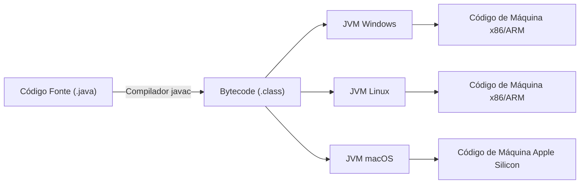
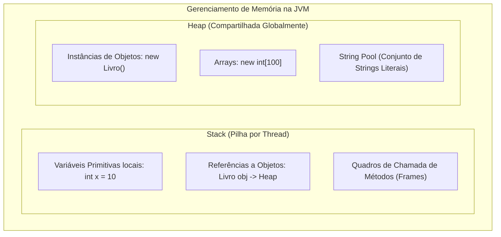
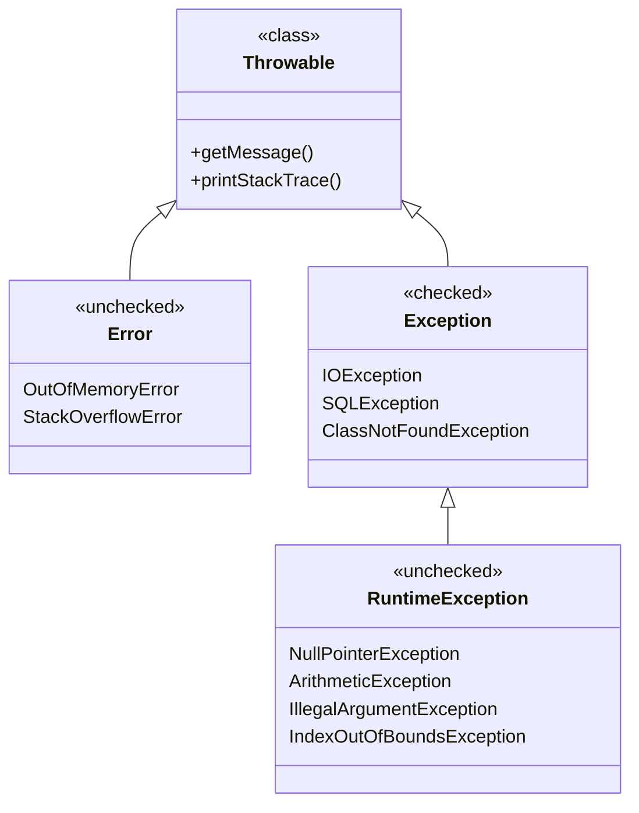
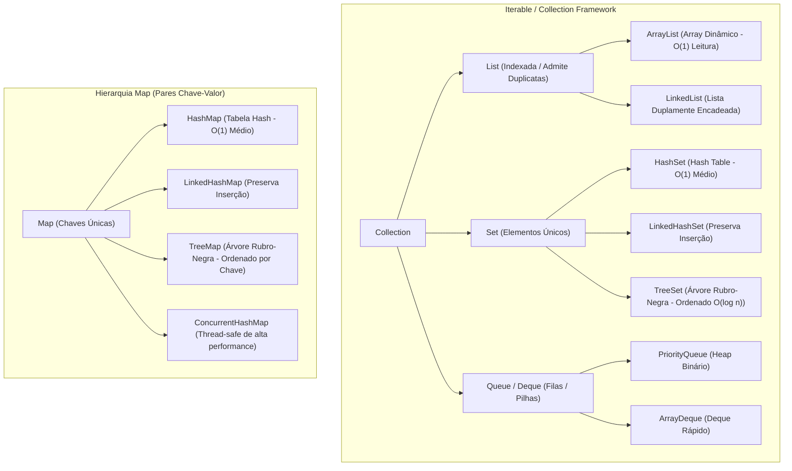
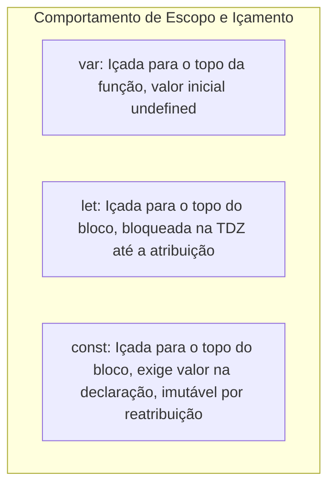
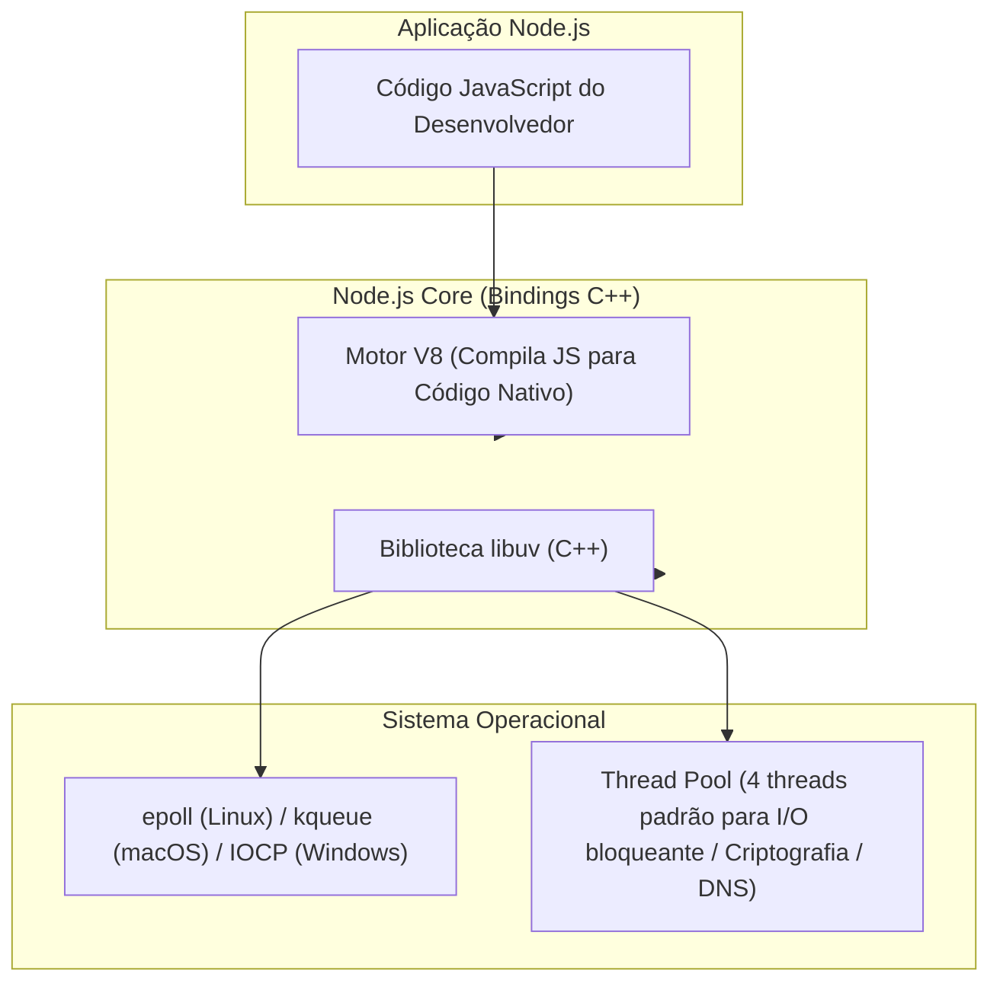
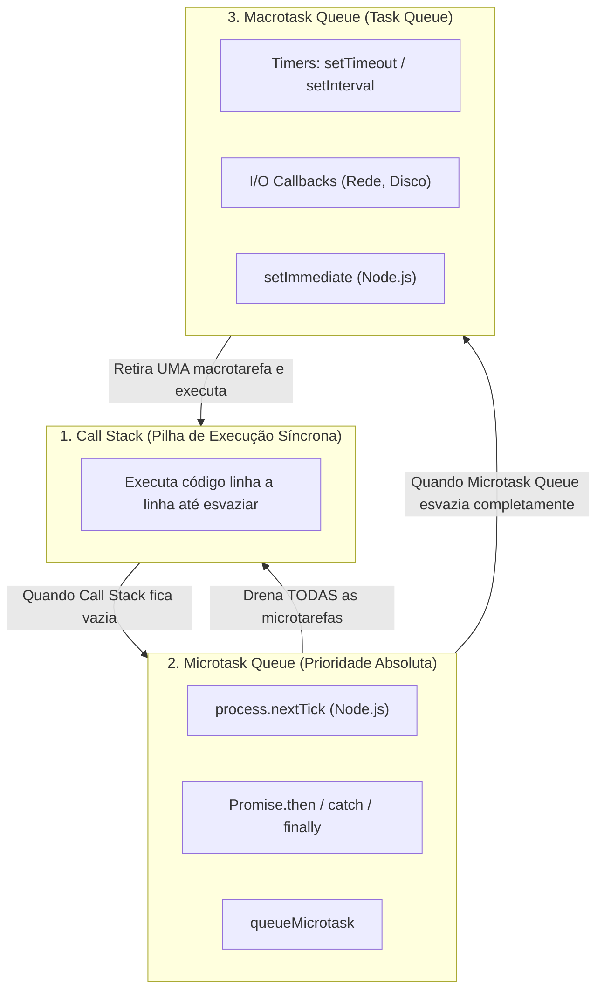
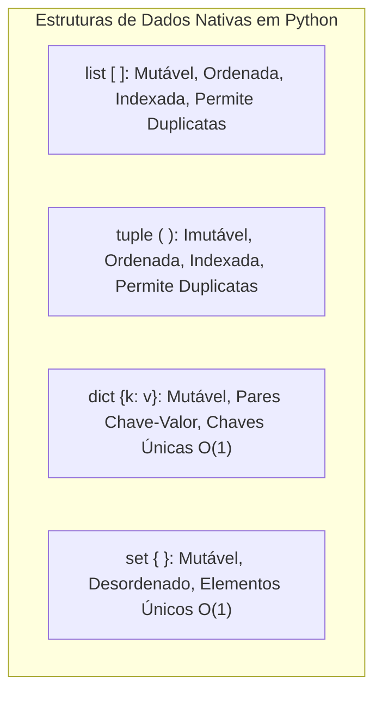

# 02 - Linguagens de Programação: Java, JavaScript, Node.js e Python

> **Matéria:** Desenvolvimento de Sistemas  
> **Cargo:** B02 – Técnico de Controle Externo – Especialidade: Tecnologia da Informação  
> **Arquivo:** `02_linguagens_java_javascript_nodejs_python.md`  


---


## 📌 Ementa / Itens do Edital
- Programação em Java (conceitos básicos)
- Programação em JavaScript e no ambiente Node.js
- Programação em Python para automação e desenvolvimento back-end

---

## 🧭 Sumário

1. [Programação em Java (Conceitos Fundamentais)](#1-programacao-em-java-conceitos-fundamentais)
    1. [Arquitetura da Plataforma: JVM, JRE, JDK e Bytecode](#11-arquitetura-da-plataforma-jvm-jre-jdk-e-bytecode)
    2. [Gerenciamento de Memória: Stack vs. Heap e Garbage Collection](#12-gerenciamento-de-memoria-stack-vs-heap-e-garbage-collection)
    3. [Tipos Primitivos vs. Classes Wrapper e Comparação de Objetos](#13-tipos-primitivos-vs-classes-wrapper-e-comparacao-de-objetos)
    4. [Modificadores de Acesso e a Palavra-Chave `final`](#14-modificadores-de-acesso-e-a-palavra-chave-final)
    5. [Tratamento de Exceções: Hierarquia de `Throwable`, Checked vs. Unchecked](#15-tratamento-de-excecoes-hierarquia-de-throwable-checked-vs-unchecked)
    6. [Java Collections Framework: List, Set, Queue e Map](#16-java-collections-framework-list-set-queue-e-map)
    7. [Recursos Modernos: Generics, Enums, Lambdas e Stream API](#17-recursos-modernos-generics-enums-lambdas-e-stream-api)
    8. [Teste 065](#Teste-065)
    9. [Teste 066](#Teste-066)
    10. [Teste 067](#Teste-067)
    11. [Teste 068](#Teste-068)
2. [JavaScript Moderno (ECMAScript 6+)](#2-javascript-moderno-ecmascript-6)
    1. [Declaração de Variáveis: `var`, `let` e `const`, Escopo e Hoisting](#21-declaracao-de-variaveis-var-let-e-const-escopo-e-hoisting)
    2. [Tipos de Dados, Coerção e Operadores de Igualdade (`==` vs. `===`)](#22-tipos-de-dados-coercao-e-operadores-de-igualdade-vs)
    3. [Recursos Idiomáticos ES6+: Desestruturação, Spread/Rest e Arrow Functions](#23-recursos-idiomaticos-es6-desestruturacao-spreadrest-e-arrow-functions)
    4. [Escopo Léxico, Closures e Funções de Alta Ordem](#24-escopo-lexico-closures-e-funcoes-de-alta-ordem)
    5. [Teste 069](#Teste-069)
    6. [Teste 070](#Teste-070)
    7. [Teste 071](#Teste-071)
3. [Programação Assíncrona e Ambiente Node.js](#3-programacao-assincrona-e-ambiente-nodejs)
    1. [Arquitetura do Node.js: Motor V8, Libuv e Non-blocking I/O](#31-arquitetura-do-nodejs-motor-v8-libuv-e-non-blocking-io)
    2. [O Event Loop: Call Stack, Microtasks e Macrotasks](#32-o-event-loop-call-stack-microtasks-e-macrotasks)
    3. [Promises e a Sintaxe `async` / `await`](#33-promises-e-a-sintaxe-async-await)
    4. [Sistema de Módulos (CommonJS vs. ES Modules) e Módulos Nativos Essenciais](#34-sistema-de-modulos-commonjs-vs-es-modules-e-modulos-nativos-essenciais)
    5. [Gerenciamento de Dependências com npm](#35-gerenciamento-de-dependencias-com-npm)
    6. [Teste 072](#Teste-072)
    7. [Teste 073](#Teste-073)
4. [Programação em Python para Automação e Back-end](#4-programacao-em-python-para-automacao-e-back-end)
    1. [Sintaxe, Tipagem Dinâmica e Forte e Filosofia PEP 8](#41-sintaxe-tipagem-dinamica-e-forte-e-filosofia-pep-8)
    2. [Estruturas de Dados Nativas: Listas, Tuplas, Dicionários e Conjuntos](#42-estruturas-de-dados-nativas-listas-tuplas-dicionarios-e-conjuntos)
    3. [Fatiamento (*Slicing*), Comprehensions e Funções Geradoras (`yield`)](#43-fatiamento-slicing-comprehensions-e-funcoes-geradoras-yield)
    4. [Tratamento de Exceções (`try-except-else-finally`) e Gerenciadores de Contexto (`with`)](#44-tratamento-de-excecoes-try-except-else-finally-e-gerenciadores-de-contexto-with)
    5. [Automação de Tarefas com Python: Arquivos, HTTP, Scraping e Formatos Estruturados](#45-automacao-de-tarefas-com-python-arquivos-http-scraping-e-formatos-estruturados)
    6. [Python no Back-end: Conceitos Fundamentais de Flask e FastAPI](#46-python-no-back-end-conceitos-fundamentais-de-flask-e-fastapi)
    7. [Teste 074](#Teste-074)
    8. [Teste 075](#Teste-075)
5. [Tabela Comparativa Sintética entre as Linguagens](#5-tabela-comparativa-sintetica-entre-as-linguagens)
6. [Fontes Recomendadas na Internet](#6-fontes-recomendadas-na-internet)

---

## 1. Programação em Java (Conceitos Fundamentais)

### 1.1 Arquitetura da Plataforma: JVM, JRE, JDK e Bytecode
A linguagem Java, criada pela Sun Microsystems e atualmente mantida pela Oracle, foi concebida sob o paradigma da independência de plataforma, expresso pelo lema *"Write Once, Run Anywhere"* (WORA). Essa portabilidade é viabilizada por uma arquitetura em camadas composta por:

1. **Código-Fonte (`.java`):** Arquivo de texto contendo as instruções escritas pelo programador em conformidade com as especificações da linguagem.
2. **Compilador (`javac`):** Não traduz o código-fonte diretamente para o código binário da máquina hospedeira. Em vez disso, compila o código-fonte para um formato intermediário, compacto e abstrato denominado **Bytecode** (arquivos com extensão `.class`).
3. **Bytecode:** Conjunto de instruções executáveis padronizadas que independem do hardware e do sistema operacional.
4. **JVM (Java Virtual Machine):** A máquina virtual abstrata instalada em cada sistema operacional específico (Windows, Linux, macOS). A JVM interpreta o bytecode e traduz suas instruções para o conjunto de instruções nativas do processador subjacente.
    - **JIT Compiler (*Just-In-Time*):** Para otimizar o desempenho e evitar a lentidão da interpretação instrução por instrução, o motor JIT compila trechos de bytecode frequentemente executados (*hot spots*) diretamente em código de máquina nativo durante o tempo de execução, armazenando-os em memória cache.

5. **JRE (Java Runtime Environment):** O ambiente mínimo de execução necessário para o usuário final rodar sistemas Java pré-compilados. Contém a JVM, as bibliotecas padrão da API Java (`rt.jar` ou módulos JPMS) e arquivos de configuração de suporte. A JRE **não** inclui ferramentas de desenvolvimento como compilador ou depurador.
6. **JDK (Java Development Kit):** O kit completo para engenheiros de software. Engloba toda a JRE mais ferramentas de desenvolvimento fundamentais: o compilador `javac`, empacotador `jar`, gerador de documentação `javadoc`, desassemblador `javap` e utilitários de diagnóstico e depuração (`jconsole`, `jstack`, `jps`).



> 🚨 **ALERTA DE PROVA / FCC:**  
> A FCC frequentemente tenta confundir o candidato afirmando que "o compilador Java gera código de máquina nativo dependente do sistema operacional" ou que "a JRE inclui o compilador javac". Lembre-se: o `javac` gera **Bytecode** (independente de plataforma); quem gera código nativo é a **JVM** (específica para cada SO), e o compilador só está presente no **JDK**, nunca na JRE isolada.

### 1.2 Gerenciamento de Memória: Stack vs. Heap e Garbage Collection
A JVM gerencia automaticamente o ciclo de vida da memória alocada, dividindo-a primariamente em duas áreas fundamentais de armazenamento:



#### A Memória Stack (Pilha)
- Cada thread em execução possui sua própria pilha de execução privativa (*thread-safe*).
- Armazena os quadros de chamada de métodos (*stack frames*).
- Guarda **valores de tipos primitivos locais** e **referências (ponteiros de memória)** para objetos instanciados no Heap.
- Possui alocação e liberação ultrarrápida, estritamente alinhada à entrada e saída do escopo do método (LIFO - *Last In, First Out*).
- Quando a profundidade de chamadas recursivas ultrapassa o limite da pilha, a JVM lança a exceção crítica `java.lang.StackOverflowError`.

#### A Memória Heap
- Área global compartilhada por todas as threads ativas do processo JVM.
- É o local exclusivo onde **todos os objetos** e arrays são criados fisicamente via operador `new`.
- O tamanho do Heap pode ser configurado na inicialização da aplicação pelos parâmetros `-Xms` (tamanho inicial) e `-Xmx` (tamanho máximo).
- Quando o Heap se esgota e o Garbage Collector não consegue liberar memória suficiente para novas instanciações, é lançada a exceção fatal `java.lang.OutOfMemoryError`.

#### O Coletor de Lixo (*Garbage Collector* - GC)
- O GC é uma thread de segundo plano gerenciada pela JVM que monitora o Heap e remove objetos que se tornaram **inalcançáveis** (*unreachable*), ou seja, objetos para os quais não existe mais nenhuma cadeia ativa de referências partindo das chamadas raízes do sistema (*GC Roots*, que incluem referências ativas na pilha, classes carregadas estáticas e variáveis JNI).
- A memória Heap tradicional é organizada em gerações baseadas na hipótese de que a maioria dos objetos morre jovem (*Weak Generational Hypothesis*):
    1. **Young Generation (Geração Jovem):** Onde novos objetos são inicialmente alocados (subdividida em espaço *Eden* e dois espaços *Survivor* - S0 e S1). A coleta aqui é chamada de *Minor GC*.
    2. **Old / Tenured Generation (Geração Antiga):** Armazena objetos que sobreviveram a vários ciclos de *Minor GC*. A coleta nesta área é a *Major GC* ou *Full GC*.
    3. **Metaspace (antigo PermGen):** Armazena metadados de classes carregadas e constantes de reflexão (alocado fora da memória do heap principal desde o Java 8, na memória nativa do SO).

- A chamada a `System.gc()` apenas **sugere** à JVM que execute uma coleta de lixo, mas **não garante** a execução imediata nem determinística do processo.

### 1.3 Tipos Primitivos vs. Classes Wrapper e Comparação de Objetos
Java é uma linguagem de tipagem estática e fortemente tipada que distingue claramente valores primitivos e referências a objetos.

#### Tipos Primitivos
Armazenam diretamente os seus próprios valores numéricos, lógicos ou textuais, operando sem a sobrecarga de objetos:

| Tipo Primitivo | Tamanho | Valor Padrão | Intervalo / Representação |
|---|:---:|:---:|---|
| `boolean` | 1 bit (dependente da JVM) | `false` | `true` ou `false` |
| `byte` | 8 bits (1 byte) | `0` | $-128$ a $127$ |
| `short` | 16 bits (2 bytes) | `0` | $-32.768$ a $32.767$ |
| `char` | 16 bits (2 bytes) | `'\u0000'` | $0$ a $65.535$ (caracteres Unicode UTF-16) |
| `int` | 32 bits (4 bytes) | `0` | $-2^{31}$ a $2^{31}-1$ (padrão para inteiros) |
| `long` | 64 bits (8 bytes) | `0L` | $-2^{63}$ a $2^{63}-1$ (sufixo `L`) |
| `float` | 32 bits (4 bytes) | `0.0f` | IEEE 754 ponto flutuante de precisão simples |
| `double` | 64 bits (8 bytes) | `0.0d` | IEEE 754 ponto flutuante de precisão dupla (padrão) |

#### Classes Wrapper (*Invólucros*)
Para cada tipo primitivo, Java fornece uma classe correspondente no pacote `java.lang` (`Boolean`, `Byte`, `Short`, `Character`, `Integer`, `Long`, `Float`, `Double`).

- **Autoboxing:** Conversão automática de um valor primitivo para seu respectivo objeto wrapper pelo compilador (ex.: `Integer obj = 10;`).
- **Unboxing:** Conversão automática do objeto wrapper para o tipo primitivo nativo (ex.: `int valor = obj;`).
- Objetos wrapper são **imutáveis**.
- Permitem que tipos básicos sejam armazenados em coleções genéricas (`List<Integer>`, `Map<String, Double>`), pois as coleções Java aceitam estritamente objetos.

#### Comparação de Igualdade: `==` vs. `.equals()` e o *String Pool*
- **Operador `==`:**
    - Quando aplicado a tipos primitivos, compara diretamente o **conteúdo numérico/lógico** dos valores (`10 == 10` é `true`).
    - Quando aplicado a objetos, compara a **identidade da referência de memória**, avaliando se ambas as variáveis apontam fisicamente para o mesmo endereço no Heap.
- **Método `.equals()`:**
    - Método herdado de `java.lang.Object`.
    - Quando sobrescrito (como nas classes `String`, `Integer`, `LocalDate`), compara a **igualdade semântica de estado e conteúdo**.
- **String Pool:** Literais de String criados com aspas duplas (ex.: `String s1 = "tce"; String s2 = "tce";`) são armazenados em um pool compartilhado no Heap. Nesses casos, `s1 == s2` resulta em `true` porque ambos apontam para o mesmo objeto no pool. Contudo, se for instanciado com o operador `new` (`String s3 = new String("tce");`), um novo objeto separado é alocado no Heap, fazendo com que `s1 == s3` seja `false`, embora `s1.equals(s3)` retorne `true`.

### 1.4 Modificadores de Acesso e a Palavra-Chave `final`
O encapsulamento e o design estrutural em Java apoiam-se em quatro níveis de visibilidade:

| Modificador | Mesma Classe | Classes do Mesmo Pacote | Subclasses em Outro Pacote | Outras Classes Externas |
|---|:---:|:---:|:---:|:---:|
| `private` | **Sim** | Não | Não | Não |
| *(default / package-private)* | **Sim** | **Sim** | Não | Não |
| `protected` | **Sim** | **Sim** | **Sim** (via herança) | Não |
| `public` | **Sim** | **Sim** | **Sim** | **Sim** |

#### Usos da Palavra-Chave `final`
A palavra-chave `final` é um modificador de não-acesso que restringe alterações:

1. **Em Variáveis e Parâmetros:** A variável torna-se uma constante. Uma vez inicializada com um valor ou referência, seu valor não pode mais ser reatribuído.
    - *Atenção:* Se a variável for uma referência para um objeto (`final List<String> itens = new ArrayList<>();`), a referência `itens` não pode ser apontada para outra lista, mas o estado interno do objeto **continua mutável** (`itens.add("dado")` é válido).

2. **Em Métodos:** Impede que subclasses sobrescrevam (*override*) o método, garantindo que o algoritmo implementado na superclasse seja mantido intacto.
3. **Em Classes:** Impede que a classe seja herdada/estendida por subclasses (ex.: a classe `java.lang.String` e todas as classes wrapper são `final` por razões de segurança e imutabilidade).

### 1.5 Tratamento de Exceções: Hierarquia de `Throwable`, Checked vs. Unchecked
Em Java, qualquer condição anômala que interrompa o fluxo normal de execução é representada por um objeto derivado de `java.lang.Throwable`.



#### 1. `java.lang.Error` (Unchecked)
Representa falhas catastróficas graves de infraestrutura e do ambiente de execução da JVM (como exaustão de memória ou estouro de pilha). Não são tratáveis pelo código de negócio da aplicação e não devem ser capturadas por blocos `try-catch`.

#### 2. `java.lang.Exception` e as *Checked Exceptions* (Exceções Checadas)
São subclasses diretas de `Exception` que **não** derivam de `RuntimeException` (ex.: `IOException`, `SQLException`, `FileNotFoundException`).

- **Regra do Compilador:** O compilador Java **obriga** o desenvolvedor a tratá-las explicitamente através de um bloco `try-catch` ou a propagá-las na assinatura do método por meio da cláusula `throws`. Se não o fizer, o código não compilará.
- Representam condições externas previsíveis e recuperáveis (ex.: rede indisponível, arquivo inexistente).

### 1.6 Java Collections Framework: List, Set, Queue e Map
O ecossistema de coleções de Java reside no pacote `java.util` e organiza-se em torno de quatro interfaces mestras:



#### 1. Interface `List` (Listas)
Coleção indexada com controle absoluto de posição. **Permite elementos duplicados** e preserva a ordem de inserção.

- **`ArrayList`:** Implementada sobre um array dinâmico redimensionável. Excelente para leitura e acesso aleatório por índice ($\mathcal{O}(1)$), porém custosa para inserções ou remoções de elementos no meio ou início da lista ($\mathcal{O}(n)$ devido ao deslocamento dos elementos).
- **`LinkedList`:** Implementada sobre uma lista duplamente encadeada. Também implementa a interface `Deque`. Inserções e remoções nos extremos (início/fim) operam em tempo constante $\mathcal{O}(1)$, mas a busca e acesso por índice operam em $\mathcal{O}(n)$.

#### 2. Interface `Set` (Conjuntos)
Coleção matemática que **não permite elementos duplicados** (baseia-se nos métodos `hashCode()` e `equals()`).

- **`HashSet`:** Utiliza internamente uma tabela hash (`HashMap`). Oferece operações básicas (`add`, `remove`, `contains`) em tempo constante médio $\mathcal{O}(1)$. **Não garante nenhuma ordem** dos elementos. Admite um único elemento `null`.
- **`LinkedHashSet`:** Especialização do `HashSet` que mantém uma lista duplamente encadeada entre os elementos, preservando a **ordem de inserção**.
- **`TreeSet`:** Implementa `NavigableSet` sobre uma Árvore Rubro-Negra (*Red-Black Tree*). Mantém os elementos **estritamente ordenados** (pela ordem natural `Comparable` ou por um `Comparator` customizado). Operações básicas operam em tempo logarítmico $\mathcal{O}(\log n)$. Não aceita elementos `null`.

#### 3. Interface `Map` (Mapas / Dicionários)
Associa chaves exclusivas a valores correspondentes (pares chave-valor). Não estende `java.util.Collection`.

- **`HashMap`:** Baseado em tabela hash. Operações de `get` e `put` em $\mathcal{O}(1)$ médio. Permite uma chave `null` e múltiplos valores `null`. Desordenado.
- **`LinkedHashMap`:** Mantém os pares chave-valor na ordem em que foram inseridos.
- **`TreeMap`:** Mantém as chaves ordenadas com base em árvores balanceadas ($\mathcal{O}(\log n)$).
- **`ConcurrentHashMap`:** Estrutura otimizada e thread-safe para concorrência multi-thread que utiliza travas por segmentos de baldes (*bucket-level locking*), superando amplamente a antiga e lenta classe sincronizada `Hashtable`.

### 1.7 Recursos Modernos: Generics, Enums, Lambdas e Stream API

#### Generics (Parametrização de Tipos)
Introduzidos no Java 5, conferem segurança de tipos em tempo de compilação (*type safety*), eliminando a necessidade de *casts* manuais e prevenindo erros do tipo `ClassCastException` em tempo de execução:

```java
List<String> nomes = new ArrayList<>();
nomes.add("TCE");
String primeiro = nomes.get(0); // Sem necessidade de cast (String)
```

Em tempo de compilação, o Java realiza o **Type Erasure** (apagamento de tipo), removendo os metadados genéricos para manter compatibilidade binária com versões legadas da JVM.

#### Expressões Lambda e Interfaces Funcionais (Java 8+)
Uma **Interface Funcional** é qualquer interface que possua exatamente um único método abstrato (marcada com `@FunctionalInterface`), como `Runnable`, `Callable`, `Comparator` e as interfaces padronizadas do pacote `java.util.function`:

- `Predicate<T>`: Recebe `T` e retorna `boolean` (`test(T t)`).
- `Function<T, R>`: Recebe `T` e retorna `R` (`apply(T t)`).
- `Consumer<T>`: Recebe `T`, realiza uma ação e não retorna nada (`accept(T t)`).
- `Supplier<T>`: Não recebe parâmetros e fornece um valor do tipo `T` (`get()`).

Expressões lambda fornecem uma notação concisa para instanciar interfaces funcionais sem classes anônimas: `(a, b) -> a + b`.

#### Stream API
Permite o processamento declarativo e funcional de coleções de dados:

- **Operações Intermediárias (Lazy - avaliação preguiçosa):** Retornam um novo Stream e não são executadas até que uma operação terminal seja disparada. Exemplos: `.filter()`, `.map()`, `.sorted()`, `.distinct()`, `.flatMap()`.
- **Operações Terminais (Eager):** Consomem o Stream e geram um resultado ou efeito colateral final. Exemplos: `.collect(Collectors.toList())`, `.forEach()`, `.reduce()`, `.count()`, `.anyMatch()`.

---

### Teste 065
**(FCC – TRT-13 – Analista Judiciario Tecnologia da Informacao – 2014)**
A classe Stack da biblioteca Java implementa o tipo abstrato de pilha e as operações push e pop. Considere o exemplo abaixo. import java.util.Stack; public class Pilha { public static void main(String[] args) { Stack`<String>` s = new Stack`<String>`(); s.push("Ana"); s.push("Paulo"); s.push("Pedro"); s.push("Marcos"); while (s.size() > 0) { System.out.println(s.pop()); } } } Sobre a classe Pilha apresentada é correto afirmar:

* **A)** A instrução s.pop(1); poderia ter sido utilizada antes do comando while para excluir o nome Paulo da pilha s.
* **B)** Ao término da execução do programa a pilha s estará vazia.
* **C)** Ocorrerá um erro em tempo de execução, pois o método pop apenas remove o último elemento que entrou na pilha e não retorna valor a ser exibido.
* **D)** O programa não irá compilar se a instrução Stack`<String>` s = new Stack`<String>`(); for substituída por Stack s = new Stack();
* **E)** Ao término da execução do programa a pilha s permanecerá com os quatro nomes, pois o método pop apenas retorna o elemento da pilha, sem removê-lo.

---

> **Comentário Detalhado:**
>
> - **A)** **Incorreta.** A opção apresenta proposição em desacordo com os fundamentos teóricos e técnicos do tópico ao afirmar que "A instrução s.pop(1); poderia ter sido utilizada antes do comando while para excluir o nome Paulo da pilha s". De acordo com a teoria estudada em *Mecanismos de Tratamento: `try-catch-finally` e `try-with-resources`*, `throw`: Palavra-chave utilizada para lançar ativamente uma instância de exceção no fluxo de execução (`throw new IllegalArgumentException("Valor inválido");`).
> - **B)** **Correta.** Conforme fundamentado na seção *A Memória Stack (Pilha)* deste guia, cada thread em execução possui sua própria pilha de execução privativa (*thread-safe*). Dessa forma, está plenamente correta a assertiva da banca (FCC – TRT-13/2014) ao estabelecer que "Ao término da execução do programa a pilha s estará vazia".
> - **C)** **Incorreta.** A opção incorre em restrição indevida ao limitar o escopo conceitual ao afirmar que "Ocorrerá um erro em tempo de execução, pois o método pop apenas remove o último elemento que entrou na pilha e não...". De acordo com a teoria estudada em *2. Interface `Set` (Conjuntos)*, `HashSet`: Utiliza internamente uma tabela hash (`HashMap`). Oferece operações básicas (`add`, `remove`, `contains`) em tempo constante médio \$\mathcal{O}(1)\$. Não garante nenhuma ordem dos elementos. Admite um único elemento `null`.
> - **D)** **Incorreta.** A opção apresenta proposição em desacordo com os fundamentos teóricos e técnicos do tópico ao afirmar que "O programa não irá compilar se a instrução Stack`<String>` s = new Stack`<String>`(); for substituída por Stack s...". De acordo com a teoria estudada em *A Memória Stack (Pilha)*, possui alocação e liberação ultrarrápida, estritamente alinhada à entrada e saída do escopo do método (LIFO - *Last In, First Out*).
> - **E)** **Incorreta.** A opção incorre em restrição indevida ao limitar o escopo conceitual ao afirmar que "Ao término da execução do programa a pilha s permanecerá com os quatro nomes, pois o método pop apenas retorna o...". De acordo com a teoria estudada em *O Coletor de Lixo (Garbage Collector - GC)*, o GC é uma thread de segundo plano gerenciada pela JVM que monitora o Heap e remove objetos que se tornaram inalcançáveis (*unreachable*), ou seja, objetos para os quais não existe mais nenhuma cadeia ativa de referências partindo das chamadas raízes do sistema (*GC Roots*, que incluem referências ativas na pilha, classes carregadas estáticas e variáveis JNI).
>
> **Gabarito: B**

---

### Teste 066
**(FGV – TJ-AP – Analista Judiciario Apoio Especializado Tecnologia da Informacao Desenvolvimento de Sistemas – 2023)**
Maria, analista de TI, observou que o tipo mais primitivo de linguagem de programação é a linguagem que o computador entende diretamente, isto é, as instruções que podem ser diretamente executadas pelo hardware, ou seja, pela UCP (processador). Para criar um programa em linguagem de máquina, Maria deve conhecer todas as instruções disponíveis para aquela máquina e seus respectivos códigos de operação e formatos, assim como os registradores da UCP disponíveis e os endereços das células de memória onde serão armazenadas as instruções e os dados. Nesse contexto, Maria pretende converter para linguagem de máquina um programa escrito em linguagem de mais alto nível do que o da linguagem de montagem e que gera o código-objeto. Para tal Maria utilizará o método:

* **A)** execução;
* **B)** montagem;
* **C)** compilação;
* **D)** interpretação;
* **E)** linkedição ou ligação.

---

> **Comentário Detalhado:**
>
> - **A)** **Incorreta.** A opção apresenta proposição em desacordo com os fundamentos teóricos e técnicos do tópico ao afirmar que "execução". De acordo com a teoria estudada em *Generics (Parametrização de Tipos)*, introduzidos no Java 5, conferem segurança de tipos em tempo de compilação (*type safety*), eliminando a necessidade de *casts* manuais e prevenindo erros do tipo `ClassCastException` em tempo de execução.
> - **B)** **Incorreta.** A opção apresenta proposição em desacordo com os fundamentos teóricos e técnicos do tópico ao afirmar que "montagem". De acordo com a teoria estudada em *4.2 Estruturas de Dados Nativas: Listas, Tuplas, Dicionários e Conjuntos*, tuplas (`tuple`): Estruturas imutáveis mais leves em consumo de memória que listas. Podem ser utilizadas como chaves de dicionários se contiverem apenas elementos imutáveis. Suportam empacotamento e desempacotamento (*tuple unpacking*): `x, y = (10, 20)`.
> - **C)** **Correta.** Conforme fundamentado na seção *4.1 Sintaxe, Tipagem Dinâmica e Forte e Filosofia PEP 8* deste guia, python é uma linguagem multiparadigma de alto nível focada na legibilidade do código. Dessa forma, está plenamente correta a assertiva da banca (FGV – TJ-AP/2023) ao estabelecer que "compilação".
> - **D)** **Incorreta.** A opção apresenta proposição em desacordo com os fundamentos teóricos e técnicos do tópico ao afirmar que "interpretação". De acordo com a teoria estudada em *1.1 Arquitetura da Plataforma: JVM, JRE, JDK e Bytecode*, jIT Compiler (*Just-In-Time*): Para otimizar o desempenho e evitar a lentidão da interpretação instrução por instrução, o motor JIT compila trechos de bytecode frequentemente executados (*hot spots*) diretamente em código de máquina nativo durante o tempo de execução, armazenando-os em memória cache.
> - **E)** **Incorreta.** A opção apresenta proposição em desacordo com os fundamentos teóricos e técnicos do tópico ao afirmar que "linkedição ou ligação". De acordo com a teoria estudada em *Generics (Parametrização de Tipos)*, em tempo de compilação, o Java realiza o Type Erasure (apagamento de tipo), removendo os metadados genéricos para manter compatibilidade binária com versões legadas da JVM.
>
> **Gabarito: C**

---

### Teste 067
**(FCC – TRT-16 – Analista Judiciario Tecnologia da Informacao – 2014)**
Considere as classes a seguir, presentes em uma aplicação Java orientada a objetos: public class Funcionario { private int id; private String nome; private double valorBase; public Funcionario() { } public Funcionario(int id, String nome, double valorBase) { this.id = id; this.nome = nome; this.valorBase=valorBase; } public double getValorBase() { return valorBase; } public double calcularSalario(){ return valorBase; } } public class Mensalista extends Funcionario{ private double descontos; public Mensalista(double descontos, int id, String nome, double valorBase) { super(id, nome, valorBase); this.descontos = descontos; } @Override public double calcularSalario(){ return super.getValorBase() - descontos; } } public class Diarista extends Funcionario { private int diasPorSemana; public Diarista( int diasPorSemana, int id, String nome, double valorBase) { super(id, nome, valorBase); this.diasPorSemana = diasPorSemana; } @Override public double calcularSalario(){ return super.getValorBase() * diasPorSemana; } } Em uma classe principal foram digitadas, no interior do método main, as seguintes linhas: double s; Funcionario f; f=new Diarista(3,10456,"Ana Maria",90); s = f.calcularSalario(); System.out.println(s); f=new Mensalista(298.56,10457,"Pedro Henrique",877.56); s = f.calcularSalario(); System.out.println(s); As linhas que contêm a instrução s = f.calcularSalario(); demonstram um conceito da orientação a objetos conhecido como

* **A)** encapsulamento.
* **B)** sobrecarga de métodos.
* **C)** polimorfismo.
* **D)** sobrescrita de construtores.
* **E)** métodos abstratos.

---

> **Comentário Detalhado:**
>
> - **A)** **Incorreta.** A opção apresenta proposição em desacordo com os fundamentos teóricos e técnicos do tópico ao afirmar que "encapsulamento". De acordo com a teoria estudada em *1.4 Modificadores de Acesso e a Palavra-Chave `final`*, o encapsulamento e o design estrutural em Java apoiam-se em quatro níveis de visibilidade.
> - **B)** **Incorreta.** A opção apresenta proposição em desacordo com os fundamentos teóricos e técnicos do tópico ao afirmar que "sobrecarga de métodos". De acordo com a teoria estudada em *Usos da Palavra-Chave `final`*, em Métodos: Impede que subclasses sobrescrevam (*override*) o método, garantindo que o algoritmo implementado na superclasse seja mantido intacto.
> - **C)** **Correta.** Conforme fundamentado na seção *Classes Wrapper (Invólucros)* deste guia, permitem que tipos básicos sejam armazenados em coleções genéricas (`List<Integer>`, `Map<String, Double>`), pois as coleções Java aceitam estritamente objetos. Dessa forma, está plenamente correta a assertiva da banca (FCC – TRT-16/2014) ao estabelecer que "polimorfismo".
> - **D)** **Incorreta.** A opção apresenta proposição em desacordo com os fundamentos teóricos e técnicos do tópico ao afirmar que "sobrescrita de construtores". De acordo com a teoria estudada em *Classes Wrapper (Invólucros)*, para cada tipo primitivo, Java fornece uma classe correspondente no pacote `java.lang` (`Boolean`, `Byte`, `Short`, `Character`, `Integer`, `Long`, `Float`, `Double`).
> - **E)** **Incorreta.** A opção apresenta proposição em desacordo com os fundamentos teóricos e técnicos do tópico ao afirmar que "métodos abstratos". De acordo com a teoria estudada em *Gerenciadores de Contexto com a Instrução `with`*, por debaixo dos panos, o gerenciador de contexto implementa o protocolo de contexto por meio dos métodos especiais `__enter__()` (executado na entrada) e `__exit__()` (executado na saída).
>
> **Gabarito: C**

---

#### 3. `java.lang.RuntimeException` e as *Unchecked Exceptions* (Não Checadas)
Subclasses de `RuntimeException` (ex.: `NullPointerException`, `ArithmeticException`, `ArrayIndexOutOfBoundsException`, `IllegalArgumentException`).

- Decorrem normalmente de falhas de lógica do programador, bugs ou violações de pré-condições.
- O compilador **não obriga** captura nem declaração com `throws`.

#### Mecanismos de Tratamento: `try-catch-finally` e `try-with-resources`
- **`try`:** Demarca o bloco de código protegido sujeito a falhas.
- **`catch`:** Captura e trata exceções do tipo compatível especificado no parâmetro. É possível capturar múltiplos tipos em um único catch (*multi-catch*): `catch (IOException | SQLException e)`.
- **`finally`:** Bloco que é executado **sempre e incondicionalmente**, tenha ocorrido exceção ou não, tenha havido `return` no `try` ou no `catch`. A única exceção ocorre se a JVM for terminada abruptamente por `System.exit(0)`. Utilizado historicamente para fechamento de conexões, fluxos e arquivos.
- **`try-with-resources` (Java 7+):** Declara recursos que implementam a interface `java.lang.AutoCloseable` diretamente nos parênteses da instrução `try`. Garante o fechamento automático e determinístico do recurso ao término do bloco, dispensando chamadas manuais a `.close()` no `finally`:

```java
try (BufferedReader br = new BufferedReader(new FileReader("auditoria.log"))) {
    String linha = br.readLine();
} catch (IOException e) {
    e.printStackTrace();
}
```

- **`throw` vs. `throws`:**
    - `throw`: Palavra-chave utilizada para lançar ativamente uma instância de exceção no fluxo de execução (`throw new IllegalArgumentException("Valor inválido");`).
    - `throws`: Modificador presente na declaração da assinatura do método que avisa aos chamadores que aquele método pode disparar certas exceções checadas (`public void gravar() throws IOException`).

---

### Teste 068
**(FCC – TRT-16 – Analista Judiciario Tecnologia da Informacao – 2014)**
Considere o código-fonte a seguir: import java.util.Scanner; public class T16 { static int a[] = {1, 6, 9, 10, 12, 18, 21, 34}; public static void main(String[] args) { Scanner in = new Scanner(System.in); System.out.print("Digite um valor:"); int v = in.nextInt(); int r = service(v); if (r == -1) { System.out.println("Sem êxito"); } else { System.out.print(r + " -> " + v); } } public static int service(int valor) { int l = 0; int h = a.length - 1; while (l <= h) { int m = (l + h) / 2; int d = a[m] - valor; if (d == 0) { return m; } else if (d < 0) { l = m + 1; } else { h = m - 1; } } return -1; } } É correto afirmar que a classe Java apresentada implementa uma

* **A)** pesquisa linear.
* **B)** árvore binária.
* **C)** pilha.
* **D)** fila.
* **E)** pesquisa binária.

---

> **Comentário Detalhado:**
>
> - **A)** **Incorreta.** A opção apresenta proposição em desacordo com os fundamentos teóricos e técnicos do tópico ao afirmar que "pesquisa linear". De acordo com a teoria estudada em *1.1 Arquitetura da Plataforma: JVM, JRE, JDK e Bytecode*, compilador (`javac`): Não traduz o código-fonte diretamente para o código binário da máquina hospedeira. Em vez disso, compila o código-fonte para um formato intermediário, compacto e abstrato denominado Bytecode (arquivos com extensão `.class`).
> - **B)** **Incorreta.** A opção apresenta proposição em desacordo com os fundamentos teóricos e técnicos do tópico ao afirmar que "árvore binária". De acordo com a teoria estudada em *2. Interface `Set` (Conjuntos)*, `TreeSet`: Implementa `NavigableSet` sobre uma Árvore Rubro-Negra (*Red-Black Tree*). Mantém os elementos estritamente ordenados (pela ordem natural `Comparable` ou por um `Comparator` customizado).
> - **C)** **Incorreta.** A opção apresenta proposição em desacordo com os fundamentos teóricos e técnicos do tópico ao afirmar que "pilha". De acordo com a teoria estudada em *A Memória Stack (Pilha)*, possui alocação e liberação ultrarrápida, estritamente alinhada à entrada e saída do escopo do método (LIFO - *Last In, First Out*).
> - **D)** **Incorreta.** A opção apresenta proposição em desacordo com os fundamentos teóricos e técnicos do tópico ao afirmar que "fila". De acordo com a teoria estudada em *A Ordem Rígida de Execução*, macrotask Queue: Apenas quando a fila de microtarefas estiver completamente vazia, o Event Loop extrai a primeira macrotarefa (`setTimeout`, `setInterval`, `setImmediate`, eventos de I/O) e a carrega na Call Stack.
> - **E)** **Correta.** Conforme fundamentado na seção *Generics (Parametrização de Tipos)* deste guia, em tempo de compilação, o Java realiza o Type Erasure (apagamento de tipo), removendo os metadados genéricos para manter compatibilidade binária com versões legadas da JVM. Dessa forma, está plenamente correta a assertiva da banca (FCC – TRT-16/2014) ao estabelecer que "pesquisa binária".
>
> **Gabarito: E**

---

## 2. JavaScript Moderno (ECMAScript 6+)

### 2.1 Declaração de Variáveis: `var`, `let` e `const`, Escopo e Hoisting
A evolução da especificação ECMAScript padronizou mecanismos determinísticos de vinculação de identificadores:

| Característica | `var` | `let` | `const` |
|---|---|---|---|
| **Escopo** | **De Função** ou Global | **De Bloco** (`{ .. }`) | **De Bloco** (`{ .. }`) |
| **Içamento (*Hoisting*)** | Sim (inicializada com `undefined`) | Sim (fica inacessível na TDZ) | Sim (fica inacessível na TDZ) |
| **Zona Morta Temporal (TDZ)** | Não se aplica | Sim | Sim |
| **Redeclaração no mesmo escopo** | Permitida | Erro de Sintaxe (*SyntaxError*) | Erro de Sintaxe (*SyntaxError*) |
| **Reatribuição** | Permitida | Permitida | **Proibida** (*TypeError*) |



#### Temporal Dead Zone (TDZ - Zona Morta Temporal)
É o intervalo temporal que ocorre entre a entrada no bloco de execução e a linha física onde a variável `let` ou `const` é declarada. Tentar acessar a variável antes dessa linha resulta em `ReferenceError`, diferentemente do `var`, que retorna `undefined` devido ao içamento complacente.

> 🚨 **ALERTA DE PROVA / FCC:**  
> A palavra-chave `const` impede estritamente a **reatribuição da variável** (isto é, você não pode fazer `minhaConst = outroValor`), mas **NÃO congela nem torna imutável o estado interno de objetos ou arrays**!
> ```javascript
> const config = { timeout: 5000 };
> config.timeout = 10000; // TOTALMENTE VÁLIDO!
> config.retries = 3;     // TOTALMENTE VÁLIDO!
> config = {};            // ERRO CRÍTICO: TypeError: Assignment to constant variable.
> ```
> Para tornar as propriedades de um objeto imutáveis em tempo de execução, deve-se utilizar `Object.freeze(config)`.

### 2.2 Tipos de Dados, Coerção e Operadores de Igualdade (`==` vs. `===`)
JavaScript possui tipagem dinâmica e fraca. Seus tipos de dados dividem-se em:

- **Tipos Primitivos (armazenados por valor):** `string`, `number` (ponto flutuante IEEE 754 de 64 bits), `bigint`, `boolean`, `undefined`, `null` e `symbol`.
- **Tipos de Referência (armazenados por endereço no Heap):** `Object`, `Array`, `Function`, `Date`, `RegExp`.

#### Comparação Ampla (`==`) vs. Comparação Estrita (`===`)
- **Operador de Igualdade Ampla (`==`):** Realiza **coerção implícita de tipos** quando os operandos são de tipos diferentes, segundo o algoritmo abstrato de comparação do ECMAScript:
    - `0 == ""` $\rightarrow$ `true` (ambos são convertidos para o número 0)
    - `0 == false` $\rightarrow$ `true`
    - `"" == false` $\rightarrow$ `true`
    - `null == undefined` $\rightarrow$ `true` (são mutuamente iguais apenas entre si)
    - `[] == false` $\rightarrow$ `true` (array vazio convertido para string vazia e depois para 0)
    - `[10] == 10` $\rightarrow$ `true`
- **Operador de Igualdade Estrita (`===`):** Não realiza coerção automática. Retorna `true` apenas se os operandos possuírem **o mesmo tipo** e **o mesmo valor**:
    - `0 === ""` $\rightarrow$ `false` (number vs string)
    - `null === undefined` $\rightarrow$ `false`
    - `10 === "10"` $\rightarrow$ `false`

### 2.3 Recursos Idiomáticos ES6+: Desestruturação, Spread/Rest e Arrow Functions

#### Atribuição por Desestruturação (*Destructuring Assignment*)
Permite extrair dados de arrays ou propriedades de objetos diretamente em variáveis nomeadas de forma sucinta:

```javascript
// Desestruturação de Objeto
const usuario = { nome: "Carlos", cargo: "Auditor", matricula: 9481 };
const { nome, cargo } = usuario;

// Desestruturação de Array com valores padrão
const [primeiro, segundo = 0, ..demais] = [10, 20, 30, 40];
```

#### Operadores Spread e Rest (`..`)
- **Rest Operator (no parâmetro):** Agrupa múltiplos argumentos restantes em um array real:

```javascript
function somar(..numeros) {
    return numeros.reduce((acc, curr) => acc + curr, 0);
}
```

- **Spread Operator (na expressão):** Espalha e desmembra os elementos de um iterável (array, objeto, string) dentro de uma nova estrutura, facilitando clones superficiais (*shallow copies*) e mesclagens:

```javascript
const listaOriginal = [1, 2, 3];
const copiaEstendida = [0, ..listaOriginal, 4]; // [0, 1, 2, 3, 4]
const configFinal = { ..configPadrao, timeout: 8000 };
```

### 2.4 Escopo Léxico, Closures e Funções de Alta Ordem
- **Escopo Léxico:** A resolução de nomes de identificadores é determinada pela posição estática do código-fonte onde as funções foram escritas.
- **Closures (Fechamentos):** Uma closure é a combinação de uma função empacotada com as referências ao seu estado léxico circundante (*lexical environment*). Isso permite que uma função interna acerte e memorize variáveis de sua função externa mesmo após a função externa já ter terminado de executar e retornado.

```javascript
function criarContador(inicial) {
    let valor = inicial; // Variável mantida viva pela closure
    return {
        incrementar: () => ++valor,
        obterValor: () => valor
    };
}
const contador = criarContador(10);
console.log(contador.incrementar()); // 11
```

---

### Teste 069
**(FGV – TRT-16 – Analista Judiciario Area Administrativa Tecnologia da Informacao – 2022)**
Analise o trecho de código JavaScript a seguir. const xxxxx = ... let texto = ""; for (const x of xxxxx) { texto += x; } Assinale a definição de xxxxx que não funciona para o código acima.

* **A)** const xxxxx = "abcdefghijklmnopqrstuvwxyz";
* **B)** const xxxxx = [undefined, null];
* **C)** const xxxxx = {10,12,14};
* **D)** const xxxxx = new Set(["a","b","c"]);
* **E)** const xxxxx = new Map([["Um", 1], ["Dois", 2]]);

---

> **Comentário Detalhado:**
>
> - **A)** **Incorreta.** A opção apresenta proposição em desacordo com os fundamentos teóricos e técnicos do tópico ao afirmar que "const xxxxx = "abcdefghijklmnopqrstuvwxyz"". De acordo com a teoria estudada em *2.1 Declaração de Variáveis: `var`, `let` e `const`, Escopo e Hoisting*, escopo: De Função ou Global — De Bloco (`{ .. }`) — De Bloco (`{ .. }`).
> - **B)** **Incorreta.** A opção apresenta proposição em desacordo com os fundamentos teóricos e técnicos do tópico ao afirmar que "const xxxxx = [undefined, null]". De acordo com a teoria estudada em *2.1 Declaração de Variáveis: `var`, `let` e `const`, Escopo e Hoisting*, içamento (*Hoisting*): Sim (inicializada com `undefined`) — Sim (fica inacessível na TDZ) — Sim (fica inacessível na TDZ).
> - **C)** **Correta.** Conforme fundamentado na seção *2.1 Declaração de Variáveis: `var`, `let` e `const`, Escopo e Hoisting* deste guia, a evolução da especificação ECMAScript padronizou mecanismos determinísticos de vinculação de identificadores. Dessa forma, está plenamente correta a assertiva da banca (FGV – TRT-16/2022) ao estabelecer que "const xxxxx = {10,12,14}".
> - **D)** **Incorreta.** A opção apresenta proposição em desacordo com os fundamentos teóricos e técnicos do tópico ao afirmar que "const xxxxx = new Set(["a","b","c"])". De acordo com a teoria estudada em *2.1 Declaração de Variáveis: `var`, `let` e `const`, Escopo e Hoisting*, zona Morta Temporal (TDZ): Não se aplica — Sim — Sim.
> - **E)** **Incorreta.** A opção apresenta proposição em desacordo com os fundamentos teóricos e técnicos do tópico ao afirmar que "const xxxxx = new Map([["Um", 1], ["Dois", 2]])". De acordo com a teoria estudada em *2.1 Declaração de Variáveis: `var`, `let` e `const`, Escopo e Hoisting*, redeclaração no mesmo escopo: Permitida — Erro de Sintaxe (*SyntaxError*) — Erro de Sintaxe (*SyntaxError*).
>
> **Gabarito: C**

---

### Teste 070
**(CEBRASPE – TRT-8 – Analista Judiciario Apoio Especializado Tecnologia da Informacao – 2016)**
A respeito da programação em Java, assinale a opção correta. A

* **A)** palavra-chave private é um modificador de acesso e a declaração de uma variável como sendo private dentro de uma instância de um método é conhecida como ocultamento de instância.
* **B)** As variáveis são divididas em tipos primitivos e tipos por referência. As variáveis do tipo primitivo devem ser declaradas como byte, char, double, int, long ou short. A variável que não for declarada como um desses tipos é do tipo por referência.
* **C)** Considere a declaração de variáveis e as expressões a seguir. int a = 8, b = 6, c = 4, d = 9 a %= 7, b *= 7, c += 7, d -= 7 Nesse caso, após a execução do código, as variáveis assumirão os seguintes valores: a = 1, b = 42, c = 11, d = 2
* **D)** Os métodos estáticos, também conhecidos como métodos de classe, dependem diretamente de um objeto instanciado. Para declarar um método como estático, deve-se inserir a palavra-chave static imediatamente após o tipo de retorno na declaração do método.
* **E)** Considere as instruções a seguir. int[][] vetor = new int [2][]; vetor [0] = new int [4]; vetor [1] = new int [5]; A execução dessas instruções resulta em um array multidimensional com 2 linhas e 5 colunas, totalizando 10 células que podem ser endereçadas.

---

> **Comentário Detalhado:**
>
> - **A)** **Incorreta.** A opção apresenta proposição em desacordo com os fundamentos teóricos e técnicos do tópico ao afirmar que "palavra-chave private é um modificador de acesso e a declaração de uma variável como sendo private dentro de uma...". De acordo com a teoria estudada em *1.4 Modificadores de Acesso e a Palavra-Chave `final`*, *(default / package-private)*: Sim — Sim — Não — Não.
> - **B)** **Incorreta.** A opção apresenta proposição em desacordo com os fundamentos teóricos e técnicos do tópico ao afirmar que "As variáveis são divididas em tipos primitivos e tipos por referência. As variáveis do tipo primitivo devem ser...". De acordo com a teoria estudada em *Classes Wrapper (Invólucros)*, para cada tipo primitivo, Java fornece uma classe correspondente no pacote `java.lang` (`Boolean`, `Byte`, `Short`, `Character`, `Integer`, `Long`, `Float`, `Double`).
> - **C)** **Correta.** Conforme fundamentado na seção *2.4 Escopo Léxico, Closures e Funções de Alta Ordem* deste guia, isso permite que uma função interna acerte e memorize variáveis de sua função externa mesmo após a função externa já ter terminado de executar e retornado. Dessa forma, está plenamente correta a assertiva da banca (CEBRASPE – TRT-8/2016) ao estabelecer que "Considere a declaração de variáveis e as expressões a seguir. int a = 8, b = 6, c = 4, d = 9 a %= 7, b *= 7, c +=...".
> - **D)** **Incorreta.** A opção apresenta proposição em desacordo com os fundamentos teóricos e técnicos do tópico ao afirmar que "Os métodos estáticos, também conhecidos como métodos de classe, dependem diretamente de um objeto instanciado...". De acordo com a teoria estudada em *Sintaxe `async` / `await`*, declarar uma função com a palavra-chave `async` garante que ela sempre retornará uma Promise, empacotando valores primitivos automaticamente com `Promise.resolve()`.
> - **E)** **Incorreta.** A opção apresenta proposição em desacordo com os fundamentos teóricos e técnicos do tópico ao afirmar que "Considere as instruções a seguir. int[][] vetor = new int [2][]; vetor [0] = new int [4]; vetor [1] = new int [5]...". De acordo com a teoria estudada em *Arrow Functions*, não são construtoras: Não possuem método interno `[[Construct]]`, não podem ser chamadas com o operador `new` e não possuem a propriedade `prototype`.
>
> **Gabarito: C**

---

### Teste 071
**(FCC – TRT-4 – Analista Judiciario Tecnologia da Informacao – 2015)**
Considere que o programa foi executado quatro vezes seguidas sendo fornecidos, consecutivamente, os valores 10, 41, 0 e -2 para a variável d. Neste contexto, pode-se concluir corretamente que serão exibidos como resultado destas execuções, consecutivamente, os valores

* **A)** true, true, false, true.
* **B)** true, false, true, true.
* **C)** true, false, true, false.
* **D)** false, true, true, false.
* **E)** false, true, false, true.

---

> **Comentário Detalhado:**
>
> - **A)** **Incorreta.** A opção apresenta proposição em desacordo com os fundamentos teóricos e técnicos do tópico ao afirmar que "true, true, false, true". De acordo com a teoria estudada em *Tipos Primitivos*, `boolean`: 1 bit (dependente da JVM) — `false` — `true` ou `false`.
> - **B)** **Incorreta.** A opção apresenta proposição em desacordo com os fundamentos teóricos e técnicos do tópico ao afirmar que "true, false, true, true". De acordo com a teoria estudada em *Comparação de Igualdade: `==` vs. `.equals()` e o String Pool*, contudo, se for instanciado com o operador `new` (`String s3 = new String("tce");`), um novo objeto separado é alocado no Heap, fazendo com que `s1 == s3` seja `false`, embora `s1.equals(s3)` retorne `true`.
> - **C)** **Correta.** Conforme fundamentado na seção *Comparação Ampla (`==`) vs. Comparação Estrita (`===`)* deste guia, `[] == false` \$\rightarrow\$ `true` (array vazio convertido para string vazia e depois para 0). Dessa forma, está plenamente correta a assertiva da banca (FCC – TRT-4/2015) ao estabelecer que "true, false, true, false".
> - **D)** **Incorreta.** A opção apresenta proposição em desacordo com os fundamentos teóricos e técnicos do tópico ao afirmar que "false, true, true, false". De acordo com a teoria estudada em *Comparação de Igualdade: `==` vs. `.equals()` e o String Pool*, quando aplicado a tipos primitivos, compara diretamente o conteúdo numérico/lógico dos valores (`10 == 10` é `true`).
> - **E)** **Incorreta.** A opção apresenta proposição em desacordo com os fundamentos teóricos e técnicos do tópico ao afirmar que "false, true, false, true". De acordo com a teoria estudada em *Comparação Ampla (`==`) vs. Comparação Estrita (`===`)*, `0 === ""` \$\rightarrow\$ `false` (number vs string).
>
> **Gabarito: C**

---

#### Arrow Functions
Funções anônimas concisas com sintaxe de seta `() => {}`. Possuem duas diferenças semânticas cruciais em relação às funções tradicionais declaradas com `function`:

1. **Vinculação Léxica do `this`:** As arrow functions **não possuem seu próprio contexto `this`**. Elas capturam o valor de `this` do escopo léxico envolvente no momento de sua definição. Não podem ser alteradas por `.bind()`, `.call()` ou `.apply()`.
2. **Não são construtoras:** Não possuem método interno `[[Construct]]`, não podem ser chamadas com o operador `new` e não possuem a propriedade `prototype`.
3. **Ausência do objeto `arguments`:** Para capturar parâmetros variáveis, deve-se usar a sintaxe rest `(..args)`.

---

## 3. Programação Assíncrona e Ambiente Node.js

### 3.1 Arquitetura do Node.js: Motor V8, Libuv e Non-blocking I/O
Node.js é um ambiente de execução JavaScript construído sobre o motor V8 do Google Chrome, projetado para construir aplicações de rede escaláveis orientadas a eventos.



- **Motor V8:** Compila o código JavaScript em código de máquina de alto desempenho e gerencia a Call Stack e a memória (Heap).
- **Biblioteca `libuv`:** Biblioteca multiplataforma escrita em C que gerencia o loop de eventos (*Event Loop*), abstrai os mecanismos de notificação assíncrona do sistema operacional (`epoll`, `kqueue`, `IOCP`) e gerencia uma **Thread Pool** interna (por padrão com 4 threads) para tarefas que não possuem suporte nativo assíncrono no SO (como operações de sistema de arquivos `fs`, resolução DNS síncrona e rotinas pesadas de criptografia).
- **Non-blocking I/O (E/S Não Bloqueante):** Chamadas de entrada e saída (rede, banco de dados) não bloqueiam a thread principal de execução. A operação é delegada à camada inferior e, ao ser concluída, o callback ou promessa correspondente é enfileirado para processamento.

### 3.2 O Event Loop: Call Stack, Microtasks e Macrotasks
O modelo de concorrência do JavaScript e do Node.js é baseado em um laço infinito que orquestra a execução de tarefas:



#### A Ordem Rígida de Execução
1. **Call Stack:** Executa todo o código síncrono até o final.
2. **Microtask Queue:** Imediatamente após a Call Stack esvaziar, o motor drena **todas as microtarefas pendentes** antes de qualquer macrotarefa. Se uma microtarefa enfileirar outra microtarefa, ela também será executada nesta mesma rodada. No Node.js, `process.nextTick` tem precedência até mesmo sobre as promessas.
3. **Macrotask Queue:** Apenas quando a fila de microtarefas estiver completamente vazia, o Event Loop extrai a primeira macrotarefa (`setTimeout`, `setInterval`, `setImmediate`, eventos de I/O) e a carrega na Call Stack.

### 3.3 Promises e a Sintaxe `async` / `await`

#### Promises (Promessas)
Um objeto `Promise` representa o resultado eventual (sucesso ou falha) de uma operação assíncrona, transitando entre três estados mutuamente exclusivos:

1. `pending` (pendente): Estado inicial.
2. `fulfilled` (resolvida/cumprida): A operação foi concluída com sucesso (invoca handlers registrados com `.then()`).
3. `rejected` (rejeitada): A operação falhou com um erro (invoca handlers registrados com `.catch()`).

**Métodos Estáticos de Combinação:**

- `Promise.all([p1, p2, p3])`: Retorna quando todas as promessas forem cumpridas. Se **qualquer uma** for rejeitada, rejeita imediatamente (*fast-fail*).
- `Promise.allSettled([p1, p2, p3])`: Aguarda a finalização de todas as promessas, independentemente de terem sido cumpridas ou rejeitadas, retornando um array de objetos descrevendo o status e resultado de cada uma.
- `Promise.race([p1, p2, p3])`: Retorna assim que a primeira promessa for resolvida ou rejeitada.
- `Promise.any([p1, p2, p3])`: Retorna a primeira promessa que for **cumprida com sucesso**. Rejeita apenas se todas falharem.

#### Sintaxe `async` / `await`
Introduzida no ES2017, funciona como açúcar sintático sobre Promises:

- Declarar uma função com a palavra-chave `async` garante que ela **sempre retornará uma Promise**, empacotando valores primitivos automaticamente com `Promise.resolve()`.
- O operador `await` pausa a execução da função assíncrona até que a Promise seja resolvida, retomando a execução de forma não bloqueante. O tratamento de erros é feito de forma tradicional e idiomática por meio de blocos `try-catch`.

### 3.4 Sistema de Módulos (CommonJS vs. ES Modules) e Módulos Nativos Essenciais

#### CommonJS (CJS) vs. ECMAScript Modules (ESM)

| Critério | CommonJS (CJS) | ECMAScript Modules (ESM) |
|---|---|---|
| **Sintaxe de Importação** | `const fs = require('fs');` | `import fs from 'fs';` |
| **Sintaxe de Exportação** | `module.exports = { .. };` | `export default ..;` ou `export { .. };` |
| **Carregamento** | Síncrono e dinâmico em tempo de execução | Assíncrono e estático em tempo de compilação/parse |
| **Padrão no Node.js** | Padrão histórico (`.js` sem `"type": "module"`) | Ativado com `"type": "module"` no `package.json` ou `.mjs` |
| **Variáveis Globais Mágicas** | Suporta `__dirname` e `__filename` | Não possui `__dirname` nativo (utiliza-se `import.meta.url`) |

#### Módulos Nativos Essenciais do Node.js
- **`fs` (File System):** Permite ler, gravar e manipular arquivos de forma síncrona (`fs.readFileSync`), baseada em callbacks (`fs.readFile`) ou orientada a promessas (`fs.promises.readFile`).
- **`path`:** Fornece utilitários multiplataforma para resolução e concatenação segura de caminhos de arquivos (`path.join(__dirname, 'dados', 'arquivo.txt')`, `path.resolve()`).
- **`http` / `https`:** Permite instanciar servidores HTTP de alta performance sem depender de bibliotecas externas (`http.createServer((req, res) => { .. })`).
- **`events` (`EventEmitter`):** Núcleo do padrão Observer no Node.js, viabilizando emissão e escuta customizada de eventos (`emitter.on('evento', callback)` e `emitter.emit('evento', dados)`).
- **`os`:** Fornece informações do sistema operacional hospedeiro (CPUs, memória livre/total, arquitetura).

### 3.5 Gerenciamento de Dependências com npm
- **`package.json`:** Manifesto do projeto contendo metadados, scripts executáveis (`npm run build`) e declaração de dependências:
    - `dependencies`: Bibliotecas essenciais para a execução do sistema em ambiente de produção (ex.: `express`, `pg`).
    - `devDependencies`: Ferramentas utilizadas estritamente durante o desenvolvimento e compilação (ex.: `jest`, `eslint`, `typescript`).
- **`package-lock.json`:** Registra a árvore de dependências exata instalada, com hashes criptográficos e versões fixas, garantindo compilações determinísticas e reproduzíveis entre diferentes ambientes.
- **`npx` (Node Package Execute):** Utilitário empacotado com o npm que permite baixar e executar binários de pacotes Node.js sob demanda sem precisar instalá-los globalmente no sistema (`npx create-react-app meu-app`).

---

### Teste 072
**(IBFC – TJ-MG – Analista Judiciario Classe C Analista de Tecnologia da Informacao – 2022)**
Em relação a linguagem de programação Java, analise as afirmativas a seguir e dê valores Verdadeiro (V) ou Falso (F). ( ) Existem vários ambientes de desenvolvimento (IDEs) como: BlueJ, JCreator e jEdit. ( ) Não suporta recursos de alto desempenho, como multithreading e compilação just-intime. ( ) Das diversas bibliotecas da linguagem Java uma das mais utilizadas é o Javascript. Assinale a alternativa que apresenta a sequência correta de cima para baixo.

* **A)** V - F - F
* **B)** V - F - V
* **C)** F - V - V
* **D)** V - V - F
* **E)** F - F - V

---

> **Comentário Detalhado:**
>
> - **A)** **Correta.** Conforme fundamentado na seção *3.1 Arquitetura do Node.js: Motor V8, Libuv e Non-blocking I/O* deste guia, motor V8: Compila o código JavaScript em código de máquina de alto desempenho e gerencia a Call Stack e a memória (Heap). Dessa forma, está plenamente correta a assertiva da banca (IBFC – TJ-MG/2022) ao estabelecer que "V - F - F".
> - **B)** **Incorreta.** A opção apresenta proposição em desacordo com os fundamentos teóricos e técnicos do tópico ao afirmar que "V - F - V". De acordo com a teoria estudada em *3.5 Gerenciamento de Dependências com npm*, `devDependencies`: Ferramentas utilizadas estritamente durante o desenvolvimento e compilação (ex.: `jest`, `eslint`, `typescript`).
> - **C)** **Incorreta.** A opção apresenta proposição em desacordo com os fundamentos teóricos e técnicos do tópico ao afirmar que "F - V - V". De acordo com a teoria estudada em *1.1 Arquitetura da Plataforma: JVM, JRE, JDK e Bytecode*, jIT Compiler (*Just-In-Time*): Para otimizar o desempenho e evitar a lentidão da interpretação instrução por instrução, o motor JIT compila trechos de bytecode frequentemente executados (*hot spots*) diretamente em código de máquina nativo durante o tempo de execução, armazenando-os em memória cache.
> - **D)** **Incorreta.** A opção apresenta proposição em desacordo com os fundamentos teóricos e técnicos do tópico ao afirmar que "V - V - F". De acordo com a teoria estudada em *1.3 Tipos Primitivos vs. Classes Wrapper e Comparação de Objetos*, java é uma linguagem de tipagem estática e fortemente tipada que distingue claramente valores primitivos e referências a objetos.
> - **E)** **Incorreta.** A opção apresenta proposição em desacordo com os fundamentos teóricos e técnicos do tópico ao afirmar que "F - F - V". De acordo com a teoria estudada em *4.2 Estruturas de Dados Nativas: Listas, Tuplas, Dicionários e Conjuntos*, tuplas (`tuple`): Estruturas imutáveis mais leves em consumo de memória que listas. Podem ser utilizadas como chaves de dicionários se contiverem apenas elementos imutáveis. Suportam empacotamento e desempacotamento (*tuple unpacking*): `x, y = (10, 20)`.
>
> **Gabarito: A**

---

### Teste 073
**(FGV – TJ-AP – Analista Judiciario Apoio Especializado Tecnologia da Informacao Banco de Dados – 2023)**
Considere o seguinte código em Java: Map`<String, String>` cidades = Map.of("11","Amapá","13","Itaubal","15","Cutias"); String texto = cidades.entrySet().stream().sorted( (e1, e2) -> e1.getKey().compareTo(e2.getKey())) .map(e-> Arrays.asList(e.getKey(), e.getValue())) .map(e-> String.join(", ", e)) .collect(Collectors.joining(": ")); System.out.println(texto); Ao ser executado com as importações necessárias, o código Java acima imprime na saída padrão:

* **A)** Cutias: 15, Amapá: 11, Itaubal: 13
* **B)** Amapá: 11, Cutias: 15, Itaubal: 13
* **C)** 11, Amapá: 13, Itaubal: 15, Cutias
* **D)** 11: Amapá, 13: Itaubal, 15: Cutias
* **E)** 15: Cutias, 13: Itaubal, 11: Amapá

---

> **Comentário Detalhado:**
>
> - **A)** **Incorreta.** A opção apresenta proposição em desacordo com os fundamentos teóricos e técnicos do tópico ao afirmar que "Cutias: 15, Amapá: 11, Itaubal: 13". De acordo com a teoria estudada em *Stream API*, operações Intermediárias (Lazy - avaliação preguiçosa): Retornam um novo Stream e não são executadas até que uma operação terminal seja disparada. Exemplos: `.filter()`, `.map()`, `.sorted()`, `.distinct()`, `.flatMap()`.
> - **B)** **Incorreta.** A opção apresenta proposição em desacordo com os fundamentos teóricos e técnicos do tópico ao afirmar que "Amapá: 11, Cutias: 15, Itaubal: 13". De acordo com a teoria estudada em *1.1 Arquitetura da Plataforma: JVM, JRE, JDK e Bytecode*, código-Fonte (`.java`): Arquivo de texto contendo as instruções escritas pelo programador em conformidade com as especificações da linguagem.
> - **C)** **Correta.** Conforme fundamentado na seção *Stream API* deste guia, operações Terminais (Eager): Consomem o Stream e geram um resultado ou efeito colateral final. Exemplos: `.collect(Collectors.toList())`, `.forEach()`, `.reduce()`, `.count()`, `.anyMatch()`. Dessa forma, está plenamente correta a assertiva da banca (FGV – TJ-AP/2023) ao estabelecer que "11, Amapá: 13, Itaubal: 15, Cutias".
> - **D)** **Incorreta.** A opção apresenta proposição em desacordo com os fundamentos teóricos e técnicos do tópico ao afirmar que "11: Amapá, 13: Itaubal, 15: Cutias". De acordo com a teoria estudada em *A Memória Stack (Pilha)*, possui alocação e liberação ultrarrápida, estritamente alinhada à entrada e saída do escopo do método (LIFO - *Last In, First Out*).
> - **E)** **Incorreta.** A opção apresenta proposição em desacordo com os fundamentos teóricos e técnicos do tópico ao afirmar que "15: Cutias, 13: Itaubal, 11: Amapá". De acordo com a teoria estudada em *Mecanismos de Tratamento: `try-catch-finally` e `try-with-resources`*, `finally`: Bloco que é executado sempre e incondicionalmente, tenha ocorrido exceção ou não, tenha havido `return` no `try` ou no `catch`. A única exceção ocorre se a JVM for terminada abruptamente por `System.exit(0)`.
>
> **Gabarito: C**

---

## 4. Programação em Python para Automação e Back-end

### 4.1 Sintaxe, Tipagem Dinâmica e Forte e Filosofia PEP 8
Python é uma linguagem multiparadigma de alto nível focada na legibilidade do código:

- **Tipagem Dinâmica:** O tipo de dados é associado dinamicamente ao valor do objeto na memória em tempo de execução, e não ao nome da variável.
- **Tipagem Forte:** O interpretador **não realiza conversão arbitrária entre tipos incompatíveis**. Se você tentar somar uma string com um número (`"Valor: " + 10`), Python lançará explicitamente um `TypeError` (diferentemente do JavaScript, que realizaria coerção para `"Valor: 10"`).
- **Indentação Significativa:** A hierarquia e a delimitação de blocos lógicos (funções, classes, laços, condicionais) são feitas exclusivamente por recuo de espaços em branco (padronizado em **4 espaços** pela PEP 8), dispensando chaves `{}` ou delimitadores `begin..end`.
- **PEP 8:** Guia oficial de estilo da linguagem (nomes de variáveis e funções em `snake_case`, nomes de classes em `PascalCase`, constantes em `UPPER_CASE`).

### 4.2 Estruturas de Dados Nativas: Listas, Tuplas, Dicionários e Conjuntos



| Tipo | Sintaxe Literal | Mutável? | Ordenado? | Admite Duplicatas? | Indexável por Posição? | Complexidade Média de Busca |
|---|---|:---:|:---:|:---:|:---:|:---:|
| **`list`** | `[1, 2, "a"]` | **Sim** | Sim (ordem de inserção) | Sim | **Sim** (`l[0]`) | $\mathcal{O}(n)$ |
| **`tuple`** | `(1, 2, "a")` | **Não** (imutável) | Sim | Sim | **Sim** (`t[0]`) | $\mathcal{O}(n)$ |
| **`dict`** | `{"chave": 10}` | **Sim** | Sim (desde Python 3.7) | Não (chaves únicas) | Não (acesso por chave) | $\mathcal{O}(1)$ |
| **`set`** | `{1, 2, 3}` | **Sim** | Não | **Não** | Não | $\mathcal{O}(1)$ |

- **Listas (`list`):** Sequências flexíveis. Métodos principais: `.append(x)`, `.insert(i, x)`, `.pop()`, `.extend(iter)`.
- **Tuplas (`tuple`):** Estruturas imutáveis mais leves em consumo de memória que listas. Podem ser utilizadas como chaves de dicionários se contiverem apenas elementos imutáveis. Suportam empacotamento e desempacotamento (*tuple unpacking*): `x, y = (10, 20)`.
- **Dicionários (`dict`):** Tabelas hash de alta performance. Métodos principais: `.get(chave, padrao)`, `.keys()`, `.values()`, `.items()`.
- **Conjuntos (`set`):** Otimizados para operações da teoria dos conjuntos: união (`|`), interseção (`&`), diferença (`-`) e diferença simétrica (`^`).

### 4.3 Fatiamento (*Slicing*), Comprehensions e Funções Geradoras (`yield`)

#### Operador de Fatiamento (*Slicing*)
Aplicável a listas, strings e tuplas com a sintaxe `sequencia[inicio:fim:passo]`:

- O índice `inicio` é inclusivo; o índice `fim` é exclusivo.
- Índices negativos contam a partir do final: `lista[-1]` obtém o último elemento.
- Inversão de sequências: `sequencia[::-1]`.

#### Comprehensions (List, Dict e Set Comprehensions)
Notação concisa, elegante e performática para filtrar e transformar iteráveis:

```python
# List Comprehension
quadrados_pares = [x**2 for x in range(10) if x % 2 == 0]

# Dict Comprehension
quadrados_mapa = {x: x**2 for x in range(5)}

# Set Comprehension
tamanhos = {len(palavra) for palavra in ["tce", "concurso", "auditor", "tce"]}
```

#### Funções Geradoras (`yield`) e Avaliação Preguiçosa (*Lazy Evaluation*)
Uma função que contém a palavra-chave `yield` não retorna um valor comum; ela retorna um **objeto gerador (*generator*)**.

- Ao ser invocada, a função pausa sua execução no ponto do `yield`, salva todo o seu estado local e entrega o valor sob demanda para a iteração (via função nativa `next()`).
- **Vantagem Vital:** Economia radical de memória ao iterar sobre massas de dados gigantescas (arquivos de gigabytes, bilhões de linhas), pois não instancia a lista inteira na memória RAM simultaneamente.

```python
def gerar_lotes(tamanho_maximo):
    n = 0
    while n < tamanho_maximo:
        yield n
        n += 1
```

### 4.4 Tratamento de Exceções (`try-except-else-finally`) e Gerenciadores de Contexto (`with`)

#### Estrutura Completa de Tratamento de Exceções

```python
try:
    conexao = abrir_banco()
    resultado = processar_dados(conexao)
except (ConexaoError, TimeoutError) as err:
    # Executado apenas se ocorrer uma das exceções capturadas
    log_erro(err)
else:
    # Executado APENAS se o bloco try terminar SEM NENHUMA EXCEÇÃO
    notificar_sucesso(resultado)
finally:
    # Executado SEMPRE e incondicionalmente para liberar recursos
    fechar_banco(conexao)
```

> 🚨 **ALERTA DE PROVA / FCC:**  
> A cláusula `else` em uma estrutura de tratamento de exceções em Python é uma das pegadinhas favoritas da banca FCC!
>
> - O bloco `else` **NÃO** é executado quando uma exceção é tratada no `except`.
> - O bloco `else` roda estritamente quando o bloco `try` é executado com **100% de sucesso (sem disparar nenhuma exceção)**.

#### Gerenciadores de Contexto com a Instrução `with`
Garante a alocação e desalocação determinística de recursos (fechamento de conexões e arquivos), mesmo diante de exceções não tratadas:

```python
with open("relatorio_auditoria.txt", "r", encoding="utf-8") as f:
    conteudo = f.read()
# O arquivo f é garantidamente fechado aqui automaticamente
```

Por debaixo dos panos, o gerenciador de contexto implementa o protocolo de contexto por meio dos métodos especiais `__enter__()` (executado na entrada) e `__exit__()` (executado na saída).

### 4.5 Automação de Tarefas com Python: Arquivos, HTTP, Scraping e Formatos Estruturados

#### 1. Manipulação de Arquivos e Sistema Operacional
- **`pathlib.Path`:** Abordagem moderna e orientada a objetos para caminhos de arquivo no sistema de arquivos:

```python
from pathlib import Path
caminho = Path("documentos") / "tce" / "edital.pdf"
if caminho.exists():
    print(caminho.read_bytes())
```

- **`os` e `sys`:** Execução de comandos do sistema, inspeção de variáveis de ambiente (`os.environ`) e argumentos de linha de comando (`sys.argv`).

#### 2. Requisições HTTP e Web Scraping
- **Biblioteca `requests`:** Padrão de fato para consumo de serviços HTTP:

```python
import requests
resposta = requests.get("https://api.tce.go.gov.br/dados", timeout=10)
if resposta.status_code == 200:
    dados = resposta.json() # Desserialização automática de JSON
```

- **`BeautifulSoup` (`bs4`):** Biblioteca para análise sintática (*parsing*) de documentos HTML e XML em raspagens de dados:

```python
from bs4 import BeautifulSoup
soup = BeautifulSoup(resposta.text, "html.parser")
titulos = [h2.text.strip() for h2 in soup.find_all("h2")]
```

#### 3. Formatos Estruturados: JSON e CSV
- **Módulo `json`:**
    - `json.dumps(obj)`: Converte objeto Python em string formatada JSON.
    - `json.loads(str)`: Analisa string JSON e a converte para dicionário/lista Python.
    - `json.dump(obj, f)` / `json.load(f)`: Opera diretamente sobre fluxos de arquivos abertos.
- **Módulo `csv`:**
    - `csv.reader()` e `csv.writer()`: Leitura e escrita baseada em listas de campos.
    - `csv.DictReader()` e `csv.DictWriter()`: Mapeia cada linha diretamente para dicionários com base nos cabeçalhos da primeira linha.

### 4.6 Python no Back-end: Conceitos Fundamentais de Flask e FastAPI

#### Flask (Microframework WSGI)
- Baseado no padrão WSGI (*Web Server Gateway Interface*) síncrono.
- Minimalista e extensível, utiliza o mecanismo de templates Jinja2 e a biblioteca de roteamento Werkzeug.
- Mapeamento de rotas por meio de decoradores:

```python
from flask import Flask, jsonify
app = Flask(__name__)

@app.route("/api/processos/<int:id>", methods=["GET"])
def obter_processo(id):
    return jsonify({"id": id, "status": "Em Julgamento"})
```

#### FastAPI (Framework Moderno ASGI de Alta Performance)
- Baseado em ASGI (*Asynchronous Server Gateway Interface*), oferecendo suporte nativo e concorrente a rotas assíncronas declaradas com `async def`.
- **Validação com Pydantic:** Utiliza *type hints* do Python padrão para realizar validação estrita de dados de entrada, conversão automática e serialização em tempo de execução.
- **Documentação Automática:** Gera documentação interativa completa em conformidade com as especificações OpenAPI e Swagger UI acessível em `/docs` sem necessidade de código adicional.

---

### Teste 074
**(FGV – TRF-1 – Analista Judiciario Area Apoio Especializado Especialidade Suporte Em Tecnologia da Informacao – 2024)**
Em uma rede de comunicação, está sendo implementado um sistema de transmissão de dados que utiliza o código de linha 4B/5B para garantir transições de bits suficientes e minimizar erros. Durante o processo de enquadramento, é necessário garantir que o receptor possa identificar corretamente o início e o fim dos quadros sem a necessidade de adicionar muitos bits extras, otimizando assim o uso da largura de banda disponível. Nesse contexto, o método utilizado por um sistema de transmissão de dados com código de linha 4B/5B para identificar o início e o fim dos quadros, utilizando sinais que não ocorrem em dados regulares, é o:

* **A)** violações de código;
* **B)** checksum de quadros;
* **C)** contagem de caracteres;
* **D)** bytes de flag com inserção de bytes;
* **E)** flags iniciais e finais com inserção de bits.

---

> **Comentário Detalhado:**
>
> - **A)** **Incorreta.** A opção apresenta proposição em desacordo com os fundamentos teóricos e técnicos do tópico ao afirmar que "violações de código". De acordo com a teoria estudada em *FastAPI (Framework Moderno ASGI de Alta Performance)*, documentação Automática: Gera documentação interativa completa em conformidade com as especificações OpenAPI e Swagger UI acessível em `/docs` sem necessidade de código adicional.
> - **B)** **Correta.** Conforme fundamentado na seção *A Memória Stack (Pilha)* deste guia, armazena os quadros de chamada de métodos (*stack frames*). Dessa forma, está plenamente correta a assertiva da banca (FGV – TRF-1/2024) ao estabelecer que "checksum de quadros".
> - **C)** **Incorreta.** A opção apresenta proposição em desacordo com os fundamentos teóricos e técnicos do tópico ao afirmar que "contagem de caracteres". De acordo com a teoria estudada em *Tipos Primitivos*, `char`: 16 bits (2 bytes) — `'\u0000'` — \$0\$ a \$65.535\$ (caracteres Unicode UTF-16).
> - **D)** **Incorreta.** A opção apresenta proposição em desacordo com os fundamentos teóricos e técnicos do tópico ao afirmar que "bytes de flag com inserção de bytes". De acordo com a teoria estudada em *4.2 Estruturas de Dados Nativas: Listas, Tuplas, Dicionários e Conjuntos*, `list`: `[1, 2, "a"]` — Sim — Sim (ordem de inserção) — Sim — Sim (`l[0]`) — \$\mathcal{O}(n)\$.
> - **E)** **Incorreta.** A opção apresenta proposição em desacordo com os fundamentos teóricos e técnicos do tópico ao afirmar que "flags iniciais e finais com inserção de bits". De acordo com a teoria estudada em *2.2 Tipos de Dados, Coerção e Operadores de Igualdade (`==` vs. `===`)*, tipos Primitivos (armazenados por valor): `string`, `number` (ponto flutuante IEEE 754 de 64 bits), `bigint`, `boolean`, `undefined`, `null` e `symbol`.
>
> **Gabarito: B**

---

### Teste 075
**(FGV – TCE-SC – Auditor Fiscal de Controle Externo Ciencias da Computacao Sistemas de Informacao – 2026)**
Um Auditor está escrevendo um script em Python para limpar CPFs duplicados em uma lista de milhões de registros. Ele precisa de uma estrutura que garanta a unicidade dos elementos com a melhor performance de busca. A estrutura nativa do Python mais adequada para esse propósito é:

* **A)** list
* **B)** tuple
* **C)** set
* **D)** dict_values
* **E)** linked_list

---

> **Comentário Detalhado:**
>
> - **A)** **Incorreta.** A opção apresenta proposição em desacordo com os fundamentos teóricos e técnicos do tópico ao afirmar que "list". De acordo com a teoria estudada em *Comprehensions (List, Dict e Set Comprehensions)*, notação concisa, elegante e performática para filtrar e transformar iteráveis.
> - **B)** **Incorreta.** A opção apresenta proposição em desacordo com os fundamentos teóricos e técnicos do tópico ao afirmar que "tuple". De acordo com a teoria estudada em *4.2 Estruturas de Dados Nativas: Listas, Tuplas, Dicionários e Conjuntos*, tuplas (`tuple`): Estruturas imutáveis mais leves em consumo de memória que listas. Podem ser utilizadas como chaves de dicionários se contiverem apenas elementos imutáveis. Suportam empacotamento e desempacotamento (*tuple unpacking*): `x, y = (10, 20)`.
> - **C)** **Incorreta.** A opção apresenta proposição em desacordo com os fundamentos teóricos e técnicos do tópico ao afirmar que "set". De acordo com a teoria estudada em *2. Interface `Set` (Conjuntos)*, coleção matemática que não permite elementos duplicados (baseia-se nos métodos `hashCode()` e `equals()`).
> - **D)** **Correta.** Conforme fundamentado na seção *4.2 Estruturas de Dados Nativas: Listas, Tuplas, Dicionários e Conjuntos* deste guia, dicionários (`dict`): Tabelas hash de alta performance. Métodos principais: `.get(chave, padrao)`, `.keys()`, `.values()`, `.items()`. Dessa forma, está plenamente correta a assertiva da banca (FGV – TCE-SC/2026) ao estabelecer que "dict_values".
> - **E)** **Incorreta.** A opção apresenta proposição em desacordo com os fundamentos teóricos e técnicos do tópico ao afirmar que "linked_list". De acordo com a teoria estudada em *4.2 Estruturas de Dados Nativas: Listas, Tuplas, Dicionários e Conjuntos*, `dict`: `{"chave": 10}` — Sim — Sim (desde Python 3.7) — Não (chaves únicas) — Não (acesso por chave) — \$\mathcal{O}(1)\$.
>
> **Gabarito: D**

---

## 5. Tabela Comparativa Sintética entre as Linguagens

| Critério | Java | JavaScript (Node.js) | Python |
|---|---|---|---|
| **Paradigma Central** | Orientado a Objetos (suporte funcional via Lambdas) | Multiparadigma (baseado em protótipos e eventos) | Multiparadigma (orientado a objetos, funcional e procedural) |
| **Sistema de Tipos** | Estático e Forte | Dinâmico e Fraco | Dinâmico e Forte |
| **Compilação / Execução** | Compilação para Bytecode (`javac`), interpretação/JIT na JVM | Interpretação e compilação JIT no motor V8 | Compilação para Bytecode (`.pyc`), interpretado na CPython |
| **Modelo de Concorrência** | Multithread real nativo com suporte moderno a *Virtual Threads* | Single-Thread com I/O assíncrono via Event Loop (libuv) | Single-Thread no interpretador CPython devido ao GIL (*asyncio* para I/O) |
| **Tratamento de Exceções** | *Checked Exceptions* obrigatórias e *Unchecked Exceptions* | *Unchecked* via `try-catch` | *Unchecked* via `try-except-else-finally` |
| **Gerenciamento de Recursos** | Bloco `finally` e `try-with-resources` (`AutoCloseable`) | Bloco `finally` | Bloco `finally` e `with` (`__enter__` / `__exit__`) |
| **Estrutura de Blocos** | Delimitada por chaves `{ .. }` | Delimitada por chaves `{ .. }` | Delimitada por recuo de espaços (**indentação obrigatória**) |


---

---

## 6. Fontes Recomendadas na Internet

* [Oracle Java Documentation - Streams and Functional Programming](https://docs.oracle.com/javase/tutorial/collections/streams/index.html) - Operações intermediárias e terminais da API Stream, expressões lambda e paralelismo.
* [MDN Web Docs - JavaScript Guide: The Event Loop](https://developer.mozilla.org/en-US/docs/Web/JavaScript/Event_loop) - Modelo de concorrência, Call Stack, Task Queue, Microtask Queue e execução assíncrona.
* [Python Official Documentation - Classes, Metaclasses e POO](https://docs.python.org/pt-br/3/tutorial/classes.html) - Escopos, namespaces, herança simples e múltipla e métodos mágicos em Python.
* [Python Official Documentation - Typing and Static Type Hints](https://docs.python.org/pt-br/3/library/typing.html) - Sistema de anotação e checagem estática de tipos em Python.
* BLOCH, Joshua. **Effective Java**. 3. ed. Boston: Addison-Wesley, 2018. (Cap. 4 - Classes and Interfaces; Cap. 7 - Lambdas and Streams).
* FLANAGAN, David. **JavaScript: O Guia Definitivo**. 7. ed. Porto Alegre: Bookman, 2021. (Cap. 13 - JavaScript Assíncrono; Cap. 14 - Metaprogramação).
* RAMALHO, Luciano. **Python Fluente: Programação Clara, Concisa e Eficaz**. 2. ed. São Paulo: Novatec, 2023. (Cap. 8 - Dicas de Tipos em Funções; Cap. 14 - Herança e Métodos Especiais).
