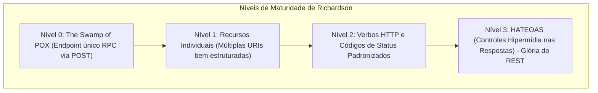
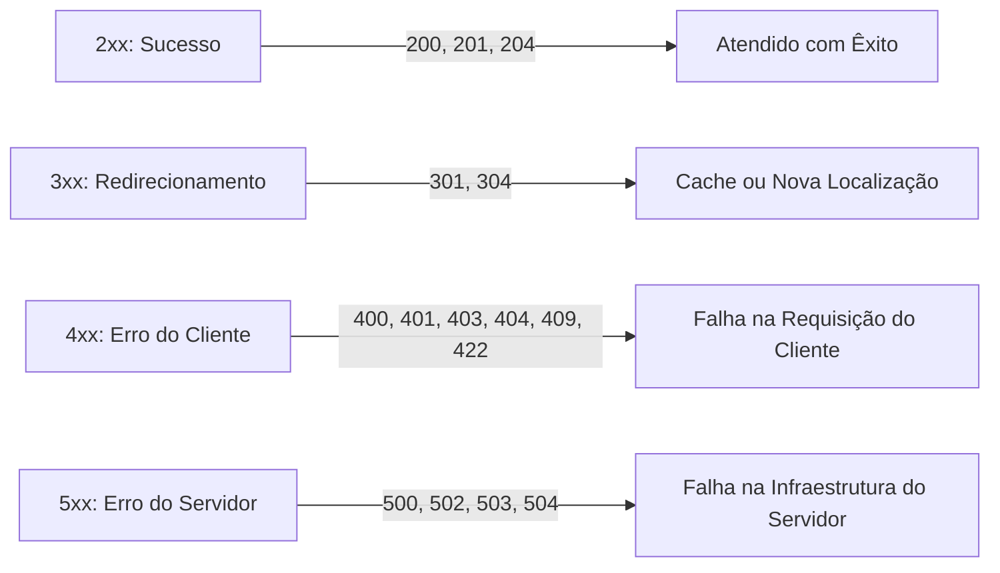
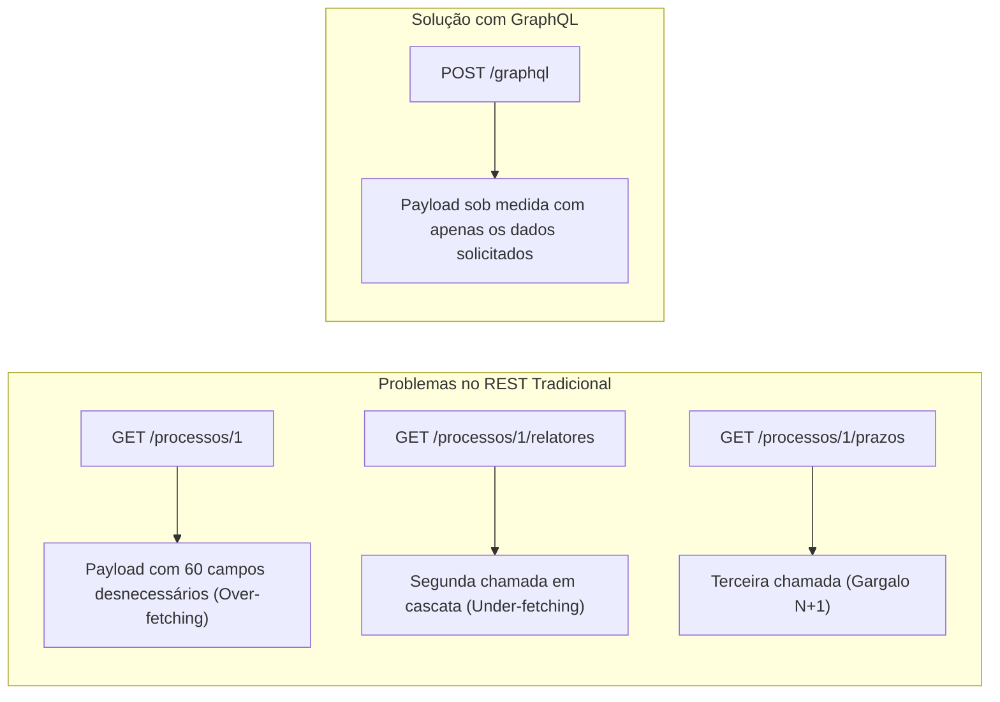
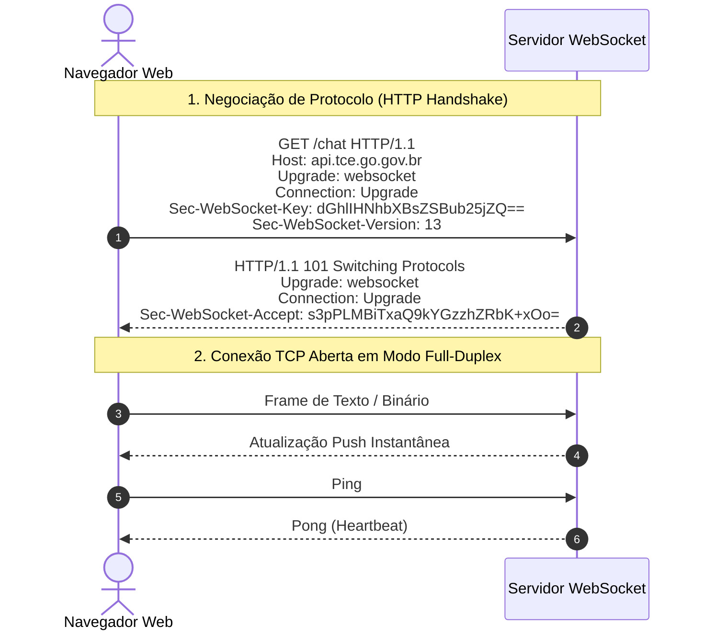

# 04 - APIs RESTful, GraphQL, WebSockets e Documentação

> **Matéria:** Desenvolvimento de Sistemas  
> **Cargo:** B02 – Técnico de Controle Externo – Especialidade: Tecnologia da Informação  
> **Arquivo:** `04_apis_restful_graphql_websockets_documentacao.md`  


---


## 📌 Ementa / Itens do Edital
- Desenvolvimento de APIs RESTful
- Conceitos de GraphQL e WebSockets
- Formatos de representação de dados: JSON e XML
- Documentação de APIs com OpenAPI e Swagger

---

## 🧭 Sumário

1. [APIs RESTful e Protocolo HTTP](#1-apis-restful-e-protocolo-http)
    1. [Princípios Arquiteturais do REST (Roy Fielding)](#11-principios-arquiteturais-do-rest-roy-fielding)
    2. [O Modelo de Maturidade de Richardson](#12-o-modelo-de-maturidade-de-richardson)
    3. [Métodos HTTP: Semântica, Segurança e Idempotência](#13-metodos-http-semantica-seguranca-e-idempotencia)
    4. [Códigos de Status HTTP Essenciais em Provas](#14-codigos-de-status-http-essenciais-em-provas)
    5. [Boas Práticas no Design de URIs e Recursos RESTful](#15-boas-praticas-no-design-de-uris-e-recursos-restful)
    6. [Teste 087](#Teste-087)
    7. [Teste 088](#Teste-088)
    8. [Teste 089](#Teste-089)
    9. [Teste 090](#Teste-090)
    10. [Teste 091](#Teste-091)
2. [GraphQL: Arquitetura e Consultas Declarativas](#2-graphql-arquitetura-e-consultas-declarativas)
    1. [Motivação: Resolução de Over-fetching e Under-fetching](#21-motivacao-resolucao-de-over-fetching-e-under-fetching)
    2. [Modelo Operacional e a Schema Definition Language (SDL)](#22-modelo-operacional-e-a-schema-definition-language-sdl)
    3. [Operações Centrais: Queries, Mutations, Subscriptions e Resolvers](#23-operacoes-centrais-queries-mutations-subscriptions-e-resolvers)
    4. [Teste 092](#Teste-092)
    5. [Teste 093](#Teste-093)
3. [Protocolo WebSocket e Comunicação em Tempo Real](#3-protocolo-websocket-e-comunicacao-em-tempo-real)
    1. [Arquitetura Full-Duplex e a RFC 6455](#31-arquitetura-full-duplex-e-a-rfc-6455)
    2. [O Handshake HTTP Upgrade e os Esquemas `ws://` e `wss://`](#32-o-handshake-http-upgrade-e-os-esquemas-ws-e-wss)
    3. [Comparativo: Polling, Long-Polling, Server-Sent Events (SSE) e WebSocket](#33-comparativo-polling-long-polling-server-sent-events-sse-e-websocket)
    4. [Teste 094](#Teste-094)
    5. [Teste 095](#Teste-095)
4. [Formatos de Representação de Dados: JSON vs. XML](#4-formatos-de-representacao-de-dados-json-vs-xml)
    1. [JSON: Tipagem, Sintaxe Estrita e Validação com JSON Schema](#41-json-tipagem-sintaxe-estrita-e-validacao-com-json-schema)
    2. [XML: Estrutura, Validação (DTD/XSD) e Consultas com XPath](#42-xml-estrutura-validacao-dtdxsd-e-consultas-com-xpath)
    3. [Comparativo Prático entre JSON e XML](#43-comparativo-pratico-entre-json-e-xml)
    4. [Teste 096](#Teste-096)
5. [Documentação de APIs com OpenAPI e o Ecossistema Swagger](#5-documentacao-de-apis-com-openapi-e-o-ecossistema-swagger)
    1. [A Especificação OpenAPI (OAS 3.0 / 3.1)](#51-a-especificacao-openapi-oas-30-31)
    2. [Estrutura Canônica do Documento OpenAPI (YAML / JSON)](#52-estrutura-canonica-do-documento-openapi-yaml-json)
    3. [Ferramental Swagger: Swagger UI, Editor e Codegen](#53-ferramental-swagger-swagger-ui-editor-e-codegen)
    4. [Teste 097](#Teste-097)
6. [Fontes Recomendadas na Internet](#6-fontes-recomendadas-na-internet)

---

## 1. APIs RESTful e Protocolo HTTP

### 1.1 Princípios Arquiteturais do REST (Roy Fielding)
O estilo arquitetural **REST** (*Representational State Transfer*) foi formalizado por Roy Fielding em sua tese de doutorado no ano 2000. Trata-se de um conjunto de **restrições arquiteturais** coordenadas que, quando seguidas, conferem à web propriedades desejáveis de desempenho, escalabilidade, simplicidade, modificabilidade e visibilidade:

1. **Cliente-Servidor (*Client-Server*):** Separação estrita de responsabilidades. O cliente cuida da apresentação visual e experiência do usuário; o servidor encarrega-se do armazenamento de dados e das regras de negócio. Essa dissociação permite que ambas as camadas evoluam de forma independente.
2. **Sem Estado (*Statelessness*):** Cada requisição do cliente para o servidor deve conter **todas as informações contextuais necessárias** para que o servidor a interprete e execute. O servidor não armazena nenhuma sessão em memória entre requisições. O estado da sessão reside exclusivamente no lado cliente (ex.: tokens JWT).
3. **Cacheabilidade (*Cacheable*):** As respostas devem explicitar claramente se podem ou não ser retidas em cache pelo cliente ou por nós intermediários (via cabeçalhos `Cache-Control`, `ETag`, `Last-Modified`), reduzindo a latência e o consumo de banda.
4. **Interface Uniforme (*Uniform Interface*):** É o princípio distintivo do REST, subdividido em 4 pilares:
    - *Identificação de Recursos:* Recursos são identificados unicamente por URIs estáveis (ex.: `/processos/10`).
    - *Manipulação por Representações:* O cliente manipula o recurso através de sua representação textual (JSON, XML), e não do objeto bruto no banco de dados.
    - *Mensagens Autodescritivas:* Cada mensagem inclui metadados suficientes para indicar como deve ser processada (cabeçalho `Content-Type: application/json`).
    - *HATEOAS (Hypermedia As The Engine Of Application State):* A resposta traz links navegáveis que orientam o cliente sobre quais são os próximos passos e estados possíveis na aplicação.

5. **Sistema em Camadas (*Layered System*):** A arquitetura pode incluir intermediários transparentes para o cliente (balanceadores de carga, firewalls de aplicação - WAF, proxies reversos e gateways de API), sem que o cliente precise saber se está falando com o servidor final.
6. **Código sob Demanda (*Code on Demand* - Única Opcional):** Permite ao servidor estender a funcionalidade do cliente transmitindo código executável (ex.: scripts JavaScript).

### 1.2 O Modelo de Maturidade de Richardson
Leonard Richardson concebeu um modelo para classificar a aderência de serviços web aos preceitos REST:



- **Nível 0 (The Swamp of POX):** Utiliza HTTP apenas como protocolo de transporte para chamadas RPC remotas sobre um único endpoint (ex.: SOAP ou XML-RPC, onde todas as operações são enviadas via `POST /servico`).
- **Nível 1 (Recursos):** A API introduz URIs específicas para identificar recursos distintos (ex.: `/processos`, `/processos/12`), mas ainda utiliza métodos HTTP de forma genérica (frequentemente apenas POST ou GET).
- **Nível 2 (Verbos HTTP & Status Codes):** Emprega os verbos HTTP de acordo com sua semântica oficial (`GET` para leitura, `POST` para criação, `PUT` para substituição, `DELETE` para exclusão) e responde com códigos de status padronizados (`200`, `201`, `404`). A grande maioria das APIs comerciais atuais opera neste nível.
- **Nível 3 (Controles Hipermídia - HATEOAS):** O patamar máximo da maturidade REST. As respostas trazem links hipermídia (`_links` ou `rel`) que informam dinamicamente ao cliente quais ações subsequentes ele pode executar (ex.: aprovar processo, anexar documento).

### 1.3 Métodos HTTP: Semântica, Segurança e Idempotência
A RFC 7231 da IETF define com rigor a semântica e as propriedades dos métodos HTTP:

| Método | Seguro (*Safe*)? | Idempotente? | Semântica Principal | Códigos de Sucesso Comuns |
|---|:---:|:---:|---|---|
| **`GET`** | **Sim** | **Sim** | Recuperar a representação de um recurso (somente leitura). | `200 OK` |
| **`HEAD`** | **Sim** | **Sim** | Idêntico ao GET, mas retorna **apenas cabeçalhos** (sem corpo). | `200 OK` |
| **`OPTIONS`**| **Sim** | **Sim** | Consulta quais métodos e parâmetros o servidor aceita naquela URI. | `200 OK`, `204 No Content` |
| **`POST`** | **Não** | **Não** | Criação de recurso subordinado ou processamento arbitrário. | `201 Created`, `200 OK` |
| **`PUT`** | **Não** | **Sim** | **Substituição completa** do recurso especificado na URI. | `200 OK`, `204 No Content` |
| **`PATCH`**| **Não** | **Não**\* | **Modificação parcial** de campos de um recurso existente. | `200 OK`, `204 No Content` |
| **`DELETE`**| **Não** | **Sim** | Exclusão do recurso indicado na URI. | `200 OK`, `204 No Content` |

*\*Nota: Pela RFC 5789, PATCH não é intrinsecamente idempotente, embora possa ser implementado de forma idempotente em certos casos.*

> 🚨 **ALERTA DE PROVA / FCC:**  
>
> - **Método Seguro (*Safe*):** A execução da requisição **NÃO altera o estado dos recursos no servidor** (leitura pura). `GET`, `HEAD` e `OPTIONS` são seguros.
> - **Método Idempotente (*Idempotent*):** Executar a mesma requisição uma vez ou $N$ vezes consecutivas com os mesmos dados produz **exatamente o mesmo efeito final no estado do servidor**.
>     - O `PUT` é idempotente: substituir integralmente um registro 10 vezes resulta no mesmo estado final no banco de dados.
>     - O `DELETE` é idempotente: após o primeiro comando, o recurso foi apagado; chamá-lo novamente mantém o recurso inexistente. O fato de responder `404` na segunda chamada não altera a idempotência!
>     - O `POST` **NÃO é idempotente**: disparar 5 vezes cria 5 novos registros no banco.

### 1.4 Códigos de Status HTTP Essenciais em Provas



#### Faixa 2xx (Sucesso)
- **`200 OK`:** A requisição foi atendida com sucesso e o corpo contém a resposta solicitada.
- **`201 Created`:** Um novo recurso foi criado com sucesso. O cabeçalho `Location` deve conter a URI do recurso recém-criado.
- **`204 No Content`:** A requisição foi processada com êxito, mas o servidor **não envia nenhum corpo de resposta** (comum após operações `DELETE` ou `PUT`).

#### Faixa 3xx (Redirecionamento)
- **`301 Moved Permanently`:** O recurso mudou de endereço definitivamente.
- **`304 Not Modified`:** Validação condicional de cache bem-sucedida (via `ETag` ou `If-Modified-Since`). O cliente deve reutilizar os dados já armazenados em seu cache local sem trafegar o corpo do arquivo.

#### Faixa 4xx (Erro do Cliente)
- **`400 Bad Request`:** Requisição sintaticamente malformada (ex.: JSON inválido, sintaxe corrompida).
- **`401 Unauthorized`:** Na realidade técnica, significa **Não Autenticado** (*Unauthenticated*). Faltam credenciais no cabeçalho `Authorization` ou o token expirou/está inválido (*"Eu não sei quem você é"*).
- **`403 Forbidden`:** O cliente foi **validado e autenticado com sucesso**, mas **não possui permissão/autorização** suficiente para acessar o recurso pretendido (*"Eu sei quem você é, mas você não tem autorização"*).
- **`404 Not Found`:** O servidor não encontrou nenhum recurso na URI solicitada.
- **`409 Conflict`:** Conflito de estado do recurso (ex.: tentativa de cadastrar um processo com número de protocolo que já existe).
- **`422 Unprocessable Entity`:** A sintaxe do payload é válida, mas há violação de regras semânticas de negócio (ex.: enviar campo "idade" com valor negativo).

### 1.5 Boas Práticas no Design de URIs e Recursos RESTful
- **Utilizar substantivos no plural:** `/processos`, `/auditores`, `/orgaos` (em vez de verbos como `/buscarProcessos` ou `/criarAuditor`).
- **Hierarquias para recursos aninhados:** `/processos/105/anexos/2` indica o anexo de código 2 subordinado ao processo 105.
- **Versionamento explícito na URI:** `/api/v1/processos` ou por cabeçalhos customizados (`Accept: application/vnd.tce.v1+json`).
- **Parâmetros de consulta (*Query Strings*):** Utilizados estritamente para filtragem, paginação e ordenação:
  `/processos?status=julgado&page=2&limit=20&sort=-dataCriacao`.

---

### Teste 087
**(CEBRASPE – STF – 2013 – Analista Judiciario Suporte Em Tecnologia Da Informacao)**
A declaração de aplicabilidade deve estar obrigatoriamente incluída na documentação do SGSI.

* **C)** Certo
* **E)** Errado

---

> **Comentário Detalhado:**
>
> - **C)** **Correta.** O item está **Certo**. Conforme fundamentado na seção *5.3 Ferramental Swagger: Swagger UI, Editor e Codegen* deste guia, swagger UI: Converte o contrato OpenAPI em uma interface visual web interativa, onde desenvolvedores e analistas podem inspecionar a documentação e realizar disparos de testes reais diretamente pelo navegador (*Try it out*). Dessa forma, está plenamente correta a proposição da banca (CEBRASPE – STF/2013) ao afirmar que "A declaração de aplicabilidade deve estar obrigatoriamente incluída na documentação do SGSI".
> - **E)** **Incorreta.** A marcação como **Errado** não procede, visto que a assertiva guarda integral conformidade com a teoria estudada em *2.2 Modelo Operacional e a Schema Definition Language (SDL)*, segundo a qual tipos de Lista (`[]`): `[String]` indica uma lista de strings. `[String!]!` indica uma lista não nula contendo itens obrigatoriamente não nulos.
>
> **Gabarito: C**

---

### Teste 088
**(FGV – TRT da 24º Região – 2025 – Analista Judiciário - Área Administrativa - Sem Especialidade)**
O escopo do projeto define claramente o que precisa ser feito, abrangendo todo o trabalho necessário para produzir as entregas previstas, atender aos requisitos ou critérios de aceitação e satisfazer o cliente, assegurando o alcance dos objetivos estabelecidos para o projeto. Assinale a opção que apresenta corretamente o que são consideradas exigências do cliente em um projeto.

* **A)** As preferências estéticas do cliente, como cor e formato dos produtos.
* **B)** As referências apenas aos prazos e aos custos acordados para a execução do projeto.
* **C)** As especificações funcionais, operacionais e de desempenho que o produto final e as demais entregas devem satisfazer.
* **D)** Os requisitos internos da equipe de gerenciamento para organizar os recursos do projeto.
* **E)** As sugestões genéricas do cliente, sem impacto direto nas entregas ou na qualidade do projeto.

---

> **Comentário Detalhado:**
>
> - **A)** **Incorreta.** A opção apresenta proposição em desacordo com os fundamentos teóricos e técnicos do tópico ao afirmar que "As preferências estéticas do cliente, como cor e formato dos produtos". De acordo com a teoria estudada em *1.1 Princípios Arquiteturais do REST (Roy Fielding)*, sistema em Camadas (*Layered System*): A arquitetura pode incluir intermediários transparentes para o cliente (balanceadores de carga, firewalls de aplicação - WAF, proxies reversos e gateways de API), sem que o cliente precise saber se está falando com o servidor final.
> - **B)** **Incorreta.** A opção incorre em restrição indevida ao limitar o escopo conceitual ao afirmar que "As referências apenas aos prazos e aos custos acordados para a execução do projeto". De acordo com a teoria estudada em *1.1 Princípios Arquiteturais do REST (Roy Fielding)*, trata-se de um conjunto de restrições arquiteturais coordenadas que, quando seguidas, conferem à web propriedades desejáveis de desempenho, escalabilidade, simplicidade, modificabilidade e visibilidade.
> - **C)** **Correta.** Conforme fundamentado na seção *1.1 Princípios Arquiteturais do REST (Roy Fielding)* deste guia, cacheabilidade (*Cacheable*): As respostas devem explicitar claramente se podem ou não ser retidas em cache pelo cliente ou por nós intermediários (via cabeçalhos `Cache-Control`, `ETag`, `Last-Modified`), reduzindo a latência e o consumo de banda. Dessa forma, está plenamente correta a assertiva da banca (FGV – TRT da 24º Região/2025) ao estabelecer que "As especificações funcionais, operacionais e de desempenho que o produto final e as demais entregas devem...".
> - **D)** **Incorreta.** A opção apresenta proposição em desacordo com os fundamentos teóricos e técnicos do tópico ao afirmar que "Os requisitos internos da equipe de gerenciamento para organizar os recursos do projeto". De acordo com a teoria estudada em *1.3 Métodos HTTP: Semântica, Segurança e Idempotência*, método Idempotente (*Idempotent*): Executar a mesma requisição uma vez ou $N$ vezes consecutivas com os mesmos dados produz exatamente o mesmo efeito final no estado do servidor.
> - **E)** **Incorreta.** A opção apresenta proposição em desacordo com os fundamentos teóricos e técnicos do tópico ao afirmar que "As sugestões genéricas do cliente, sem impacto direto nas entregas ou na qualidade do projeto". De acordo com a teoria estudada em *3.1 Arquitetura Full-Duplex e a RFC 6455*, o protocolo HTTP tradicional baseia-se no modelo *Request-Response* *half-duplex*, no qual toda comunicação precisa ser iniciada pelo cliente.
>
> **Gabarito: C**

---

### Teste 089
**(CEBRASPE – TRF 6ª – 2025 – Analista Judiciário - Apoio Especializado - Governança e Gestão de Tecnologia da Informação)**
A documentação técnica referente à API dos microsserviços desenvolvidos na PDPJ-Br deve seguir o padrão Swagger 2.0, a fim de garantir a compatibilidade com as especificações legadas dos sistemas antigos.

* **C)** Certo
* **E)** Errado

---

> **Comentário Detalhado:**
>
> - **C)** **Incorreta.** A marcação como **Certo** não procede, pois o enunciado apresenta proposição em desacordo com os fundamentos teóricos e técnicos do tópico ao afirmar que "A documentação técnica referente à API dos microsserviços desenvolvidos na PDPJ-Br deve seguir o padrão...". De acordo com a teoria estudada em *Faixa 4xx (Erro do Cliente)*, `401 Unauthorized`: Na realidade técnica, significa Não Autenticado (*Unauthenticated*). Faltam credenciais no cabeçalho `Authorization` ou o token expirou/está inválido (*"Eu não sei quem você é"*).
> - **E)** **Correta.** O item está **Errado** (gabarito oficial: **E**). Conforme fundamentado na seção *5.3 Ferramental Swagger: Swagger UI, Editor e Codegen* deste guia, swagger UI: Converte o contrato OpenAPI em uma interface visual web interativa, onde desenvolvedores e analistas podem inspecionar a documentação e realizar disparos de testes reais diretamente pelo navegador (*Try it out*). Portanto, a assertiva examinada pela banca (CEBRASPE – TRF 6ª/2025) viola os preceitos técnicos do tópico.
>
> **Gabarito: E**

---

### Teste 090
**(FGV – TRT/DA – 2025 – Analista Judiciario Area Apoio Especializado Tecnologia Da Informacao)**
O Swagger Editor é um editor de código aberto usado para projetar, definir e documentar APIs HTTP segundo a especificação OpenAPI. A respeito dos pré-requisitos necessários para o editor ser executado localmente, avalie os itens a seguir. I. Git em qualquer versão. II. Node.js em versão 20.3.0. ou superior. III. Npm em versão 9.6.7 ou superior. IV. OAuth em versão 2.0 ou superior. São pré-requisitos necessários para que o Swagger Editor seja executado localmente os indicados em

* **A)** I e III, apenas.
* **B)** II e IV, apenas.
* **C)** I, II e III, apenas.
* **D)** I, II e IV, apenas.
* **E)** II, III e IV, apenas.

---

> **Comentário Detalhado:**
>
> - **A)** **Incorreta.** A opção incorre em restrição indevida ao limitar o escopo conceitual ao afirmar que "I e III, apenas". De acordo com a teoria estudada em *5.3 Ferramental Swagger: Swagger UI, Editor e Codegen*, openAPI Generator / Swagger Codegen: Utilitários que leem o arquivo OpenAPI e geram automaticamente o código boilerplate de clientes SDK (em Java, Python, TypeScript) ou esqueletos de servidores backend.
> - **B)** **Incorreta.** A opção incorre em restrição indevida ao limitar o escopo conceitual ao afirmar que "II e IV, apenas". De acordo com a teoria estudada em *2.1 Motivação: Resolução de Over-fetching e Under-fetching*, desenvolvido pelo Facebook (Meta) em 2012 e tornado código aberto em 2015, o GraphQL é uma linguagem de consulta para APIs e um ambiente de execução para cumprir essas consultas com dados existentes.
> - **C)** **Correta.** Conforme fundamentado na seção *5.3 Ferramental Swagger: Swagger UI, Editor e Codegen* deste guia, swagger Editor: Editor visual com validação sintática em tempo real para projetar contratos OpenAPI em YAML/JSON. Dessa forma, está plenamente correta a assertiva da banca (FGV – TRT/DA/2025) ao estabelecer que "I, II e III, apenas".
> - **D)** **Incorreta.** A opção incorre em restrição indevida ao limitar o escopo conceitual ao afirmar que "I, II e IV, apenas". De acordo com a teoria estudada em *5.2 Estrutura Canônica do Documento OpenAPI (YAML / JSON)*, `openapi`: Versão da especificação OpenAPI empregada.
> - **E)** **Incorreta.** A opção incorre em restrição indevida ao limitar o escopo conceitual ao afirmar que "II, III e IV, apenas". De acordo com a teoria estudada em *5.3 Ferramental Swagger: Swagger UI, Editor e Codegen*, swagger UI: Converte o contrato OpenAPI em uma interface visual web interativa, onde desenvolvedores e analistas podem inspecionar a documentação e realizar disparos de testes reais diretamente pelo navegador (*Try it out*).
>
> **Gabarito: C**

---

#### Faixa 5xx (Erro do Servidor)
- **`500 Internal Server Error`:** Erro genérico e inesperado de execução no servidor (exceção não tratada no código).
- **`502 Bad Gateway`:** Um servidor intermediário (proxy reverso, gateway de API) recebeu uma resposta inválida ou falha do servidor *upstream* (backend).
- **`503 Service Unavailable`:** O servidor está temporariamente incapaz de atender requisições por sobrecarga pontual ou manutenção programada.
- **`504 Gateway Timeout`:** O servidor intermediário esgotou o tempo limite de espera (*timeout*) aguardando uma resposta do servidor backend.

---

### Teste 091
**(CEBRASPE – TRF 6ª – 2025 – Analista Judiciário - Apoio Especializado - Governança e Gestão de Tecnologia da Informação)**
O Swagger é um conjunto de ferramentas voltado para o desenvolvimento de todo o ciclo de vida da API, incluindo as etapas de design, documentação, teste e implantação. 108 import java.io.*; class Easy { public static void main(String[] args) { int x[] = {1, 3, 7, 22, 51}; for (int size : x) System.out.print(size); } } O resultado da execução do código precedente, desenvolvido em Java, será 6.

* **C)** Certo
* **E)** Errado

---

> **Comentário Detalhado:**
>
> - **C)** **Correta.** O item está **Certo**. Conforme fundamentado na seção *5.3 Ferramental Swagger: Swagger UI, Editor e Codegen* deste guia, swagger UI: Converte o contrato OpenAPI em uma interface visual web interativa, onde desenvolvedores e analistas podem inspecionar a documentação e realizar disparos de testes reais diretamente pelo navegador (*Try it out*). Dessa forma, está plenamente correta a proposição da banca (CEBRASPE – TRF 6ª/2025) ao afirmar que "O Swagger é um conjunto de ferramentas voltado para o desenvolvimento de todo o ciclo de vida da API...".
> - **E)** **Incorreta.** A marcação como **Errado** não procede, visto que a assertiva guarda integral conformidade com a teoria estudada em *2.1 Motivação: Resolução de Over-fetching e Under-fetching*, segundo a qual desenvolvido pelo Facebook (Meta) em 2012 e tornado código aberto em 2015, o GraphQL é uma linguagem de consulta para APIs e um ambiente de execução para cumprir essas consultas com dados existentes.
>
> **Gabarito: C**

---

## 2. GraphQL: Arquitetura e Consultas Declarativas

### 2.1 Motivação: Resolução de Over-fetching e Under-fetching
Desenvolvido pelo Facebook (Meta) em 2012 e tornado código aberto em 2015, o **GraphQL** é uma linguagem de consulta para APIs e um ambiente de execução para cumprir essas consultas com dados existentes.



- **Over-fetching (Excesso de Dados):** Ocorre no REST quando um endpoint fixo retorna dezenas de campos complexos, embora a interface do cliente só precise de dois (ex.: renderizar apenas o nome do relator em uma lista móvel consumindo centenas de kilobytes de dados irrelevantes).
- **Under-fetching (Carência de Dados):** Ocorre no REST quando um endpoint não traz dados relacionados suficientes, forçando o cliente a disparar sucessivas requisições em cascata para montar uma única tela (ex.: `GET /processos`, depois $N$ requisições para `GET /processos/{id}/partes` — o clássico problema $N+1$).
- **Solução do GraphQL:** O cliente envia uma consulta declarativa especificando **exatamente quais campos e relacionamentos deseja**. O backend responde com um JSON espelhado na estrutura exata do pedido, através de um **endpoint único** (geralmente `/graphql`), operando via requisições HTTP `POST`.

### 2.2 Modelo Operacional e a Schema Definition Language (SDL)
O contrato entre cliente e servidor no GraphQL é expresso na linguagem **SDL** (*Schema Definition Language*):

```graphql
type Processo {
  id: ID!
  numeroProtocolo: String!
  valorGlosa: Float
  julgado: Boolean!
  relator: Auditor!
}

type Auditor {
  id: ID!
  nome: String!
  matricula: String!
}
```

- **Tipos Escalares Nativos:** `Int` (inteiro 32 bits), `Float` (ponto flutuante com sinal), `String` (UTF-8), `Boolean` (`true`/`false`) e `ID` (identificador único serializado como string).
- **Modificador de Não-Nulo (`!`):** Garante que o campo jamais retornará nulo (ex.: `String!`). Se ausente, o campo é considerado anulável (*nullable*).
- **Tipos de Lista (`[]`):** `[String]` indica uma lista de strings. `[String!]!` indica uma lista não nula contendo itens obrigatoriamente não nulos.

### 2.3 Operações Centrais: Queries, Mutations, Subscriptions e Resolvers

1. **`Query`:** Operações de consulta e leitura de dados. Não devem provocar efeitos colaterais no backend (análogas ao método `GET` do REST).

```graphql
query BuscarProcesso {
  processo(id: "100") {
    numeroProtocolo
    relator {
      nome
    }
  }
}
```

2. **`Mutation`:** Operações que provocam modificações no servidor (criação, edição, exclusão de dados — análogas ao `POST`, `PUT`, `DELETE`).

```graphql
mutation CriarProcesso($dados: NovoProcessoInput!) {
  cadastrarProcesso(input: $dados) {
    id
    numeroProtocolo
  }
}
```

3. **`Subscription`:** Mecanismo de subscrição para receber eventos e atualizações em tempo real disparadas pelo servidor (mantidas tipicamente sobre conexões WebSocket).
4. **`Resolvers`:** Funções no backend associadas a cada campo do Schema. Quando uma query é executada, o motor do GraphQL invoca os *resolvers* correspondentes para extrair os dados de bancos SQL, bancos NoSQL ou de outras APIs REST.

---

### Teste 092
**(FGV – TJ/AP – 2023 – Analista Judiciario Apoio Especializado Tecnologia Da Informacao Desenvolvimento De Sistemas)**
Observe os dados do seguinte documento XML. <?xml version="1.0" encoding="UTF-8" ?> <root> <Pessoa> <Hospede> <Nome>Ana</Nome> <Acompanhantes>Bia</Acompanhantes> <Acompanhantes>Maitê</Acompanhantes> </Hospede> </Pessoa> </root> Os dados no formato JSON correspondente é:

* **A)** {"Pessoa":{"Hospede":[{"Nome":"Thomas"},{"Nome": "Ana","Acompanhantes":["Bia","Maitê"]}]}}
* **B)** <"Pessoa":<"Hospede":[{"Nome":"Thomas"};{"Nome": "Ana";"Acompanhantes":["Bia";"Maitê"]}]/>/>
* **C)** ["Pessoa":["Hospede":[["Nome":"Thomas"],["Nome": "Ana","Acompanhantes":["Bia","Maitê"]]]]]
* **D)** {"Pessoa"{"Hospede"[{"Nome";"Thomas"},{"Nome"; "Ana","Acompanhantes"("Bia";"Maitê")}]}}
* **E)** <"Pessoa"{"Hospede":[{"Nome";"Thomas"},{"Nome": "Ana","Acompanhantes":("Bia";"Maitê")}]}/>

---

> **Comentário Detalhado:**
>
> - **A)** **Correta.** Conforme fundamentado na seção *2.1 Motivação: Resolução de Over-fetching e Under-fetching* deste guia, over-fetching (Excesso de Dados): Ocorre no REST quando um endpoint fixo retorna dezenas de campos complexos, embora a interface do cliente só precise de dois (ex.: renderizar apenas o nome do relator em uma lista móvel consumindo centenas de kilobytes de dados irrelevantes). Dessa forma, está plenamente correta a assertiva da banca (FGV – TJ/AP/2023) ao estabelecer que "{"Pessoa":{"Hospede":[{"Nome":"Thomas"},{"Nome": "Ana","Acompanhantes":["Bia","Maitê"]}]}}".
> - **B)** **Incorreta.** A opção apresenta proposição em desacordo com os fundamentos teóricos e técnicos do tópico ao afirmar que "<"Pessoa":<"Hospede":[{"Nome":"Thomas"};{"Nome": "Ana";"Acompanhantes":["Bia";"Maitê"]}]/>/>". De acordo com a teoria estudada em *4.2 XML: Estrutura, Validação (DTD/XSD) e Consultas com XPath*, estrutura: Exige prólogo `<?xml version="1.0" encoding="UTF-8"?>`, raiz única (*root element*) e fechamento obrigatório de todas as tags (sensível a maiúsculas/minúsculas).
> - **C)** **Incorreta.** A opção apresenta proposição em desacordo com os fundamentos teóricos e técnicos do tópico ao afirmar que "["Pessoa":["Hospede":[["Nome":"Thomas"],["Nome": "Ana","Acompanhantes":["Bia","Maitê"]]]]]". De acordo com a teoria estudada em *4.3 Comparativo Prático entre JSON e XML*, formato de Estrutura: Pares chave-valor e listas (`{}`, `[]`) — Árvore de elementos com tags e atributos.
> - **D)** **Incorreta.** A opção apresenta proposição em desacordo com os fundamentos teóricos e técnicos do tópico ao afirmar que "{"Pessoa"{"Hospede"[{"Nome";"Thomas"},{"Nome"; "Ana","Acompanhantes"("Bia";"Maitê")}]}}". De acordo com a teoria estudada em *4.1 JSON: Tipagem, Sintaxe Estrita e Validação com JSON Schema*, o JSON (*JavaScript Object Notation*, padronizado pela RFC 8259) é o formato dominante no intercâmbio de dados em APIs REST modernas.
> - **E)** **Incorreta.** A opção apresenta proposição em desacordo com os fundamentos teóricos e técnicos do tópico ao afirmar que "<"Pessoa"{"Hospede":[{"Nome";"Thomas"},{"Nome": "Ana","Acompanhantes":("Bia";"Maitê")}]}/>". De acordo com a teoria estudada em *5.2 Estrutura Canônica do Documento OpenAPI (YAML / JSON)*, `schemas`: Modelos de entidades de dados.
>
> **Gabarito: A**

---

### Teste 093
**(FGV – TCE/GO – 2024 – Analista de Controle Externo - Tecnologia da Informação)**
Os modelos de aprendizado de máquina desempenham um papel fundamental na análise e interpretação de dados em uma variedade de domínios. Uma característica dos modelos de aprendizado de máquina supervisionados e não supervisionados é que modelos supervisionados

* **A)** exploram a detecção de outliers, enquanto modelos não supervisionados usam dados representados em formatos como XML ou JSON para treinamento..
* **B)** geralmente têm menos tendência ao overfitting do que modelos não supervisionados.
* **C)** requerem dados rotulados para treinamento, enquanto modelos não supervisionados podem funcionar com dados não rotulados.
* **D)** são mais adequados para tarefas de análise exploratória de dados, enquanto modelos não supervisionados são mais adequados para previsão de séries temporais.
* **E)** são usados apenas para classificação, enquanto modelos não supervisionados são usados apenas para agrupamento.

---

> **Comentário Detalhado:**
>
> - **A)** **Incorreta.** A opção apresenta proposição em desacordo com os fundamentos teóricos e técnicos do tópico ao afirmar que "exploram a detecção de outliers, enquanto modelos não supervisionados usam dados representados em formatos como...". De acordo com a teoria estudada em *1.1 Princípios Arquiteturais do REST (Roy Fielding)*, *Manipulação por Representações:* O cliente manipula o recurso através de sua representação textual (JSON, XML), e não do objeto bruto no banco de dados.
> - **B)** **Incorreta.** A opção apresenta proposição em desacordo com os fundamentos teóricos e técnicos do tópico ao afirmar que "geralmente têm menos tendência ao overfitting do que modelos não supervisionados". De acordo com a teoria estudada em *2.1 Motivação: Resolução de Over-fetching e Under-fetching*, o backend responde com um JSON espelhado na estrutura exata do pedido, através de um endpoint único (geralmente `/graphql`), operando via requisições HTTP `POST`.
> - **C)** **Correta.** Conforme fundamentado na seção *5.2 Estrutura Canônica do Documento OpenAPI (YAML / JSON)* deste guia, `schemas`: Modelos de entidades de dados. Dessa forma, está plenamente correta a assertiva da banca (FGV – TCE/GO/2024) ao estabelecer que "requerem dados rotulados para treinamento, enquanto modelos não supervisionados podem funcionar com dados não...".
> - **D)** **Incorreta.** A opção apresenta proposição em desacordo com os fundamentos teóricos e técnicos do tópico ao afirmar que "são mais adequados para tarefas de análise exploratória de dados, enquanto modelos não supervisionados são mais...". De acordo com a teoria estudada em *1.1 Princípios Arquiteturais do REST (Roy Fielding)*, cacheabilidade (*Cacheable*): As respostas devem explicitar claramente se podem ou não ser retidas em cache pelo cliente ou por nós intermediários (via cabeçalhos `Cache-Control`, `ETag`, `Last-Modified`), reduzindo a latência e o consumo de banda.
> - **E)** **Incorreta.** A opção incorre em restrição indevida ao limitar o escopo conceitual ao afirmar que "são usados apenas para classificação, enquanto modelos não supervisionados são usados apenas para agrupamento". De acordo com a teoria estudada em *5.3 Ferramental Swagger: Swagger UI, Editor e Codegen*, swagger UI: Converte o contrato OpenAPI em uma interface visual web interativa, onde desenvolvedores e analistas podem inspecionar a documentação e realizar disparos de testes reais diretamente pelo navegador (*Try it out*).
>
> **Gabarito: C**

---

## 3. Protocolo WebSocket e Comunicação em Tempo Real

### 3.1 Arquitetura Full-Duplex e a RFC 6455
O protocolo HTTP tradicional baseia-se no modelo *Request-Response* *half-duplex*, no qual toda comunicação precisa ser iniciada pelo cliente. O protocolo **WebSocket** (padronizado pela IETF na **RFC 6455**) viabiliza comunicação **Full-Duplex** (bidirecional simultânea) e persistente sobre uma única conexão TCP de longa duração.

- **Baixa Latência e Mínimo Overhead:** Após a conexão ser aberta, os cabeçalhos HTTP volumosos não são mais transmitidos. As mensagens trafegam divididas em frames levíssimos contendo cabeçalhos de apenas 2 a 10 bytes.
- **Mensageria Push Nativa:** O servidor pode enviar dados ativamente ao cliente a qualquer momento sem que o cliente precise solicitar (*server push* instantâneo).

### 3.2 O Handshake HTTP Upgrade e os Esquemas `ws://` e `wss://`
A conexão WebSocket não inicia diretamente no protocolo WebSocket; ela nasce sobre o protocolo HTTP através de um procedimento de negociação denominado **HTTP Upgrade Handshake**:



- **Cabeçalhos do Handshake:**
    - O cliente envia `Upgrade: websocket` e `Connection: Upgrade`.
    - O servidor concorda respondendo com o código especial **`101 Switching Protocols`**.
- **Esquemas de Conexão:**
    - `ws://`: Conexão em texto claro sem criptografia (opera na porta 80 por padrão).
    - `wss://` (*WebSocket Secure*): Conexão protegida por criptografia TLS/HTTPS (opera na porta 443 por padrão), recomendada em ambientes de produção.

### 3.3 Comparativo: Polling, Long-Polling, Server-Sent Events (SSE) e WebSocket

| Tecnologia | Direção da Comunicação | Protocolo Subjacente | Overhead por Mensagem | Caso de Uso Ideal |
|---|:---:|:---:|:---:|---|
| **Short Polling** | Unidirecional (Cliente $\rightarrow$ Servidor) | HTTP repetitivo em intervalos fixos | **Altíssimo** (novo handshake e cabeçalhos a cada requisição) | Verificações esporádicas e simples. |
| **Long Polling** | Unidirecional (Servidor segura requisição) | HTTP com conexão mantida aberta até haver dado | Alto (reabre conexão HTTP a cada resposta) | Cenários legados sem suporte a WebSockets. |
| **Server-Sent Events (SSE)** | **Unidirecional** (Servidor $\rightarrow$ Cliente) | HTTP padrão (`text/event-stream`) | Baixo (conexão persistente HTTP única) | Painéis de monitoramento, cotações, feeds onde o cliente só recebe dados. |
| **WebSocket** | **Bidirecional Completo (*Full-Duplex*)** | Protocolo TCP customizado após handshake | **Mínimo** (frames de 2 a 10 bytes) | Chats, jogos interativos, colaboração simultânea em tempo real. |

---

### Teste 094
**(CEBRASPE – STF – 2008 – Analista Judiciario Suporte Em Tecnologia Da Informacao)**
Em uma sessão FTP, uma só conexão é usada para transmitir comandos, respostas e dados dos arquivos. Uma sessão FTP se inicia com o estabelecimento dessa conexão entre cliente e servidor. Cada comando do cliente resulta em uma resposta composta por código numérico e texto.

* **C)** Certo
* **E)** Errado

---

> **Comentário Detalhado:**
>
> - **C)** **Incorreta.** A marcação como **Certo** não procede, pois o enunciado apresenta proposição em desacordo com os fundamentos teóricos e técnicos do tópico ao afirmar que "Em uma sessão FTP, uma só conexão é usada para transmitir comandos, respostas e dados dos arquivos. Uma...". De acordo com a teoria estudada em *3.3 Comparativo: Polling, Long-Polling, Server-Sent Events (SSE) e WebSocket*, long Polling: Unidirecional (Servidor segura requisição) — HTTP com conexão mantida aberta até haver dado — Alto (reabre conexão HTTP a cada resposta) — Cenários legados sem suporte a WebSockets.
> - **E)** **Correta.** O item está **Errado** (gabarito oficial: **E**). Conforme fundamentado na seção *3.3 Comparativo: Polling, Long-Polling, Server-Sent Events (SSE) e WebSocket* deste guia, server-Sent Events (SSE): Unidirecional (Servidor $\rightarrow$ Cliente) — HTTP padrão (`text/event-stream`) — Baixo (conexão persistente HTTP única) — Painéis de monitoramento, cotações, feeds onde o cliente só recebe dados. Portanto, a assertiva examinada pela banca (CEBRASPE – STF/2008) viola os preceitos técnicos do tópico.
>
> **Gabarito: E**

---

### Teste 095
**(FGV – TJ/AP – 2023 – Analista Judiciario Apoio Especializado Tecnologia Da Informacao Desenvolvimento De Sistemas)**
Maria, analista de TI, observou que o tipo mais primitivo de linguagem de programação é a linguagem que o computador entende diretamente, isto é, as instruções que podem ser diretamente executadas pelo hardware, ou seja, pela UCP (processador). Para criar um programa em linguagem de máquina, Maria deve conhecer todas as instruções disponíveis para aquela máquina e seus respectivos códigos de operação e formatos, assim como os registradores da UCP disponíveis e os endereços das células de memória onde serão armazenadas as instruções e os dados. Nesse contexto, Maria pretende converter para linguagem de máquina um programa escrito em linguagem de mais alto nível do que o da linguagem de montagem e que gera o código-objeto. Para tal Maria utilizará o método:

* **A)** execução;
* **B)** montagem;
* **C)** compilação;
* **D)** interpretação;
* **E)** linkedição ou ligação.

---

> **Comentário Detalhado:**
>
> - **A)** **Incorreta.** A opção apresenta proposição em desacordo com os fundamentos teóricos e técnicos do tópico ao afirmar que "execução". De acordo com a teoria estudada em *2.1 Motivação: Resolução de Over-fetching e Under-fetching*, desenvolvido pelo Facebook (Meta) em 2012 e tornado código aberto em 2015, o GraphQL é uma linguagem de consulta para APIs e um ambiente de execução para cumprir essas consultas com dados existentes.
> - **B)** **Incorreta.** A opção apresenta proposição em desacordo com os fundamentos teóricos e técnicos do tópico ao afirmar que "montagem". De acordo com a teoria estudada em *1.1 Princípios Arquiteturais do REST (Roy Fielding)*, sem Estado (*Statelessness*): Cada requisição do cliente para o servidor deve conter todas as informações contextuais necessárias para que o servidor a interprete e execute. O servidor não armazena nenhuma sessão em memória entre requisições.
> - **C)** **Correta.** Conforme fundamentado na seção *5.3 Ferramental Swagger: Swagger UI, Editor e Codegen* deste guia, swagger UI: Converte o contrato OpenAPI em uma interface visual web interativa, onde desenvolvedores e analistas podem inspecionar a documentação e realizar disparos de testes reais diretamente pelo navegador (*Try it out*). Dessa forma, está plenamente correta a assertiva da banca (FGV – TJ/AP/2023) ao estabelecer que "compilação".
> - **D)** **Incorreta.** A opção apresenta proposição em desacordo com os fundamentos teóricos e técnicos do tópico ao afirmar que "interpretação". De acordo com a teoria estudada em *1.2 O Modelo de Maturidade de Richardson*, nível 0 (The Swamp of POX): Utiliza HTTP apenas como protocolo de transporte para chamadas RPC remotas sobre um único endpoint (ex.: SOAP ou XML-RPC, onde todas as operações são enviadas via `POST /servico`).
> - **E)** **Incorreta.** A opção apresenta proposição em desacordo com os fundamentos teóricos e técnicos do tópico ao afirmar que "linkedição ou ligação". De acordo com a teoria estudada em *3.1 Arquitetura Full-Duplex e a RFC 6455*, baixa Latência e Mínimo Overhead: Após a conexão ser aberta, os cabeçalhos HTTP volumosos não são mais transmitidos. As mensagens trafegam divididas em frames levíssimos contendo cabeçalhos de apenas 2 a 10 bytes.
>
> **Gabarito: C**

---

## 4. Formatos de Representação de Dados: JSON vs. XML

### 4.1 JSON: Tipagem, Sintaxe Estrita e Validação com JSON Schema
O JSON (*JavaScript Object Notation*, padronizado pela RFC 8259) é o formato dominante no intercâmbio de dados em APIs REST modernas.

- **Tipos de Dados Suportados:**
    - Primitivos: `string` (entre aspas duplas), `number` (inteiro ou flutuante), `boolean` (`true` ou `false`), `null`.
    - Estruturas de Dados: `object` (pares chave-valor `{}`) e `array` (listas ordenadas `[]`).
- **Regras Estritas de Sintaxe:**
    - **Chaves obrigatoriamente entre aspas duplas (`"chave": valor`)**. Usar aspas simples gera erro de parsing.
    - Proibida vírgula residual no último elemento (*trailing comma*): `{"id": 1,}` é inválido.
    - O padrão JSON puro **não suporta comentários** (`//` ou `/* */`).
- **JSON Schema:** Padrão para validar a estrutura, os tipos e os campos obrigatórios em payloads JSON de forma automatizada.

### 4.2 XML: Estrutura, Validação (DTD/XSD) e Consultas com XPath
O XML (*Extensible Markup Language*) é uma linguagem de marcação baseada em tags hierárquicas personalizáveis.

- **Estrutura:** Exige prólogo `<?xml version="1.0" encoding="UTF-8"?>`, raiz única (*root element*) e fechamento obrigatório de todas as tags (sensível a maiúsculas/minúsculas).
- **Validação de Documentos XML:**
    - **Well-formed (Bem-formado):** Cumpre as regras sintáticas fundamentais da linguagem XML.
    - **Valid (Válido):** Além de bem-formado, respeita rigorosamente um esquema formal de regras estruturais:
    - **DTD (*Document Type Definition*):** Mecanismo mais antigo com sintaxe própria.
    - **XSD (*XML Schema Definition*):** Esquema moderno escrito na própria sintaxe XML, com suporte a tipos de dados ricos e namespaces.
- **Consultas com XPath:** Linguagem de expressões de caminhos que permite navegar e selecionar nós específicos dentro da árvore XML (ex.: `/processos/processo[@status='julgado']/valor`).

### 4.3 Comparativo Prático entre JSON e XML

| Critério | JSON | XML |
|---|---|---|
| **Formato de Estrutura** | Pares chave-valor e listas (`{}`, `[]`) | Árvore de elementos com tags e atributos |
| **Complexidade de Parsing** | Leve e nativo para interpretadores JavaScript | Custoso computacionalmente (requer parsers DOM/SAX) |
| **Tamanho da Mensagem** | Compacto, sem redundância de tags | Verboso devido à duplicação de tags de fechamento |
| **Validação de Esquema** | JSON Schema | DTD e XML Schema (XSD) |
| **Linguagem de Consulta** | JSONPath | XPath e XQuery |

---

### Teste 096
**(FGV – TRT/DA – 2025 – Analista Judiciario Area Apoio Especializado Tecnologia Da Informacao)**
Paula e Maria estão avaliando as potencialidades dos usos de JSON e XML no desenvolvimento de aplicações Web para uma grande companhia estatal. As analistas sabem que JSON e XML são duas escolhas muito comuns quando se trata de formatos de dados na Web. A esse respeito, assinale a afirmativa correta.

* **A)** Com relação à legibilidade, Paula informa que ambos são legíveis por humanos, mas os documentos XML são mais detalhados.
* **B)** Com relação ao volume de dados, Maria informa que o JSON é maior e menos compacto que o XML devido aos elementos extra de marcação.
* **C)** Com relação as análises, Paula informa que as análises dos documentos JSON são mais complexas que os XML.
* **D)** Com relação ao apoio à gestão de dados, Maria informa que ambos possuem limitado suporte ao idioma português e que o XML está em desuso.
* **E)** Com relação aos casos de uso, Paula informa que o JSON é geralmente preterido para aplicações web devido ao seu código binário ser maior o que XML.

---

> **Comentário Detalhado:**
>
> - **A)** **Correta.** Conforme fundamentado na seção *4.2 XML: Estrutura, Validação (DTD/XSD) e Consultas com XPath* deste guia, dTD (*Document Type Definition*): Mecanismo mais antigo com sintaxe própria. Dessa forma, está plenamente correta a assertiva da banca (FGV – TRT/DA/2025) ao estabelecer que "Com relação à legibilidade, Paula informa que ambos são legíveis por humanos, mas os documentos XML são mais...".
> - **B)** **Incorreta.** A opção apresenta proposição em desacordo com os fundamentos teóricos e técnicos do tópico ao afirmar que "Com relação ao volume de dados, Maria informa que o JSON é maior e menos compacto que o XML devido aos elementos...". De acordo com a teoria estudada em *4.3 Comparativo Prático entre JSON e XML*, tamanho da Mensagem: Compacto, sem redundância de tags — Verboso devido à duplicação de tags de fechamento.
> - **C)** **Incorreta.** A opção apresenta proposição em desacordo com os fundamentos teóricos e técnicos do tópico ao afirmar que "Com relação as análises, Paula informa que as análises dos documentos JSON são mais complexas que os XML". De acordo com a teoria estudada em *1.1 Princípios Arquiteturais do REST (Roy Fielding)*, *Manipulação por Representações:* O cliente manipula o recurso através de sua representação textual (JSON, XML), e não do objeto bruto no banco de dados.
> - **D)** **Incorreta.** A opção apresenta proposição em desacordo com os fundamentos teóricos e técnicos do tópico ao afirmar que "Com relação ao apoio à gestão de dados, Maria informa que ambos possuem limitado suporte ao idioma português e que...". De acordo com a teoria estudada em *4.2 XML: Estrutura, Validação (DTD/XSD) e Consultas com XPath*, xSD (*XML Schema Definition*): Esquema moderno escrito na própria sintaxe XML, com suporte a tipos de dados ricos e namespaces.
> - **E)** **Incorreta.** A opção apresenta proposição em desacordo com os fundamentos teóricos e técnicos do tópico ao afirmar que "Com relação aos casos de uso, Paula informa que o JSON é geralmente preterido para aplicações web devido ao seu...". De acordo com a teoria estudada em *1.3 Métodos HTTP: Semântica, Segurança e Idempotência*, *\*Nota: Pela RFC 5789, PATCH não é intrinsecamente idempotente, embora possa ser implementado de forma idempotente em certos casos.*.
>
> **Gabarito: A**

---

## 5. Documentação de APIs com OpenAPI e o Ecossistema Swagger

### 5.1 A Especificação OpenAPI (OAS 3.0 / 3.1)
A especificação **OpenAPI** (gerenciada pela *OpenAPI Initiative* sob tutela da Linux Foundation) é uma descrição padronizada, legível por humanos e máquinas, para interfaces de APIs RESTful. Escrita em sintaxe **YAML** ou **JSON**, ela independe da linguagem de programação utilizada no backend.

### 5.2 Estrutura Canônica do Documento OpenAPI (YAML / JSON)
Um documento OpenAPI divide-se nas seguintes seções principais:

```yaml
openapi: 3.0.3
info:
  title: API de Processos do TCE-GO
  version: 1.0.0
  description: API REST para consulta e instrução de auditorias fiscais.
servers:
  - url: https://api.tce.go.gov.br/v1
    description: Servidor de Produção
paths:
  /processos/{id}:
    get:
      summary: Obter detalhes do processo
      parameters:
        - name: id
          in: path
          required: true
          schema:
            type: integer
      responses:
        '200':
          description: Processo recuperado com sucesso
          content:
            application/json:
              schema:
                $ref: '#/components/schemas/Processo'
        '404':
          description: Processo não encontrado
components:
  schemas:
    Processo:
      type: object
      required:
        - id
        - numeroProtocolo
      properties:
        id:
          type: integer
        numeroProtocolo:
          type: string
  securitySchemes:
    bearerAuth:
      type: http
      scheme: bearer
      bearerFormat: JWT
```

- `openapi`: Versão da especificação OpenAPI empregada.
- `info`: Título, descrição, versão e termos da API.
- `servers`: URLs base dos ambientes (produção, homologação).
- `paths`: Mapeia os endpoints (URIs), métodos HTTP suportados, parâmetros (path, query, header), corpo de requisição (`requestBody`) e respostas (`responses`).
- `components`: Seção de **reutilização modular**. Evita redundância de código através do mecanismo de referências (`$ref`):
    - `schemas`: Modelos de entidades de dados.
    - `securitySchemes`: Definições de autenticação e autorização (Bearer JWT, OAuth2, API Key).

### 5.3 Ferramental Swagger: Swagger UI, Editor e Codegen
- **Swagger UI:** Converte o contrato OpenAPI em uma interface visual web interativa, onde desenvolvedores e analistas podem inspecionar a documentação e realizar disparos de testes reais diretamente pelo navegador (*Try it out*).
- **Swagger Editor:** Editor visual com validação sintática em tempo real para projetar contratos OpenAPI em YAML/JSON.
- **OpenAPI Generator / Swagger Codegen:** Utilitários que leem o arquivo OpenAPI e geram automaticamente o código boilerplate de clientes SDK (em Java, Python, TypeScript) ou esqueletos de servidores backend.

---

### Teste 097
**(FGV – TRT 16ª – 2022 – Analista Judiciário (Área Administrativa - Tecnologia da Informação))**
O SwaggerEditor permite editar e documentar APIs. Em relação ao tema, assinale V para a afirmativa verdadeira e F para a falsa. I. O editor pode ser utilizado online como uma ferramenta web de código aberto ou ser instalada e executada localmente a partir de um servidor. II. A página inicial da versão online é composta por quatro elementos de interface: um toolbar, um painel de edição de API, um painel de visualização de documentos e um painel para testar os webhooks e chamadas da API. III. O editor, na versão online, salva os códigos da APIs nos formatos das especificações YAML, JSON e XML. As afirmativas são, respectivamente,

* **A)** V, F e F.
* **B)** V, V e F.
* **C)** V, F e V.
* **D)** F, V e V.
* **E)** F, F e V.

---

> **Comentário Detalhado:**
>
> - **A)** **Correta.** Conforme fundamentado na seção *5.2 Estrutura Canônica do Documento OpenAPI (YAML / JSON)* deste guia, `info`: Título, descrição, versão e termos da API. Dessa forma, está plenamente correta a assertiva da banca (FGV – TRT 16ª/2022) ao estabelecer que "V, F e F".
> - **B)** **Incorreta.** A opção apresenta proposição em desacordo com os fundamentos teóricos e técnicos do tópico ao afirmar que "V, V e F". De acordo com a teoria estudada em *5.3 Ferramental Swagger: Swagger UI, Editor e Codegen*, swagger UI: Converte o contrato OpenAPI em uma interface visual web interativa, onde desenvolvedores e analistas podem inspecionar a documentação e realizar disparos de testes reais diretamente pelo navegador (*Try it out*).
> - **C)** **Incorreta.** A opção apresenta proposição em desacordo com os fundamentos teóricos e técnicos do tópico ao afirmar que "V, F e V". De acordo com a teoria estudada em *2.1 Motivação: Resolução de Over-fetching e Under-fetching*, desenvolvido pelo Facebook (Meta) em 2012 e tornado código aberto em 2015, o GraphQL é uma linguagem de consulta para APIs e um ambiente de execução para cumprir essas consultas com dados existentes.
> - **D)** **Incorreta.** A opção apresenta proposição em desacordo com os fundamentos teóricos e técnicos do tópico ao afirmar que "F, V e V". De acordo com a teoria estudada em *5.2 Estrutura Canônica do Documento OpenAPI (YAML / JSON)*, `openapi`: Versão da especificação OpenAPI empregada.
> - **E)** **Incorreta.** A opção apresenta proposição em desacordo com os fundamentos teóricos e técnicos do tópico ao afirmar que "F, F e V". De acordo com a teoria estudada em *5.3 Ferramental Swagger: Swagger UI, Editor e Codegen*, swagger Editor: Editor visual com validação sintática em tempo real para projetar contratos OpenAPI em YAML/JSON.
>
> **Gabarito: A**

---

## 6. Fontes Recomendadas na Internet

* [IETF - RFC 9110: HTTP Semantics](https://datatracker.ietf.org/doc/html/rfc9110) - Métodos HTTP (GET, POST, PUT, DELETE, PATCH), idempotência, segurança e cabeçalhos.
* [OpenAPI Specification v3.1.0 (OAS)](https://spec.openapis.org/oas/latest.html) - Estrutura de especificação formal para documentação interoperável de APIs RESTful.
* [GraphQL Official Documentation - Learn GraphQL](https://graphql.org/learn/) - Schemas, tipos, queries, mutations, resolvers e prevenção de over-fetching e under-fetching.
* [MDN Web Docs - WebSockets API](https://developer.mozilla.org/pt-BR/docs/Web/API/WebSockets_API) - Comunicação full-duplex bidirecional sobre uma única conexão TCP persistente.
* [Martin Fowler - Richardson Maturity Model](https://martinfowler.com/articles/richardsonMaturityModel.html) - Os quatro níveis de maturidade de serviços REST (Nível 0 a 3 / HATEOAS).
* FIELDING, Roy Thomas. **Architectural Styles and the Design of Network-based Software Architectures**. Tese de Doutorado. University of California, Irvine, 2000. (Cap. 5 - Representational State Transfer - REST).
* ALLAMARAJU, Subbu. **Arquitetura de Web Services RESTful**. Rio de Janeiro: Alta Books, 2011. (Cap. 2 e 3 - O Protocolo HTTP e Recursos REST).
* PORCELLO, Eve; BANKS, Alex. **Aprendendo GraphQL: Declarativo, Orientado a Dados e Eficiente**. São Paulo: Novatec, 2019. (Cap. 3 e 4 - Esquemas e Resoluções de Consultas).
