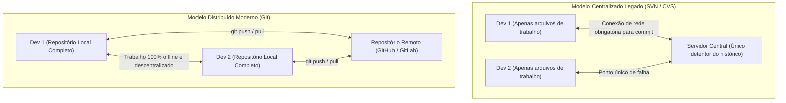
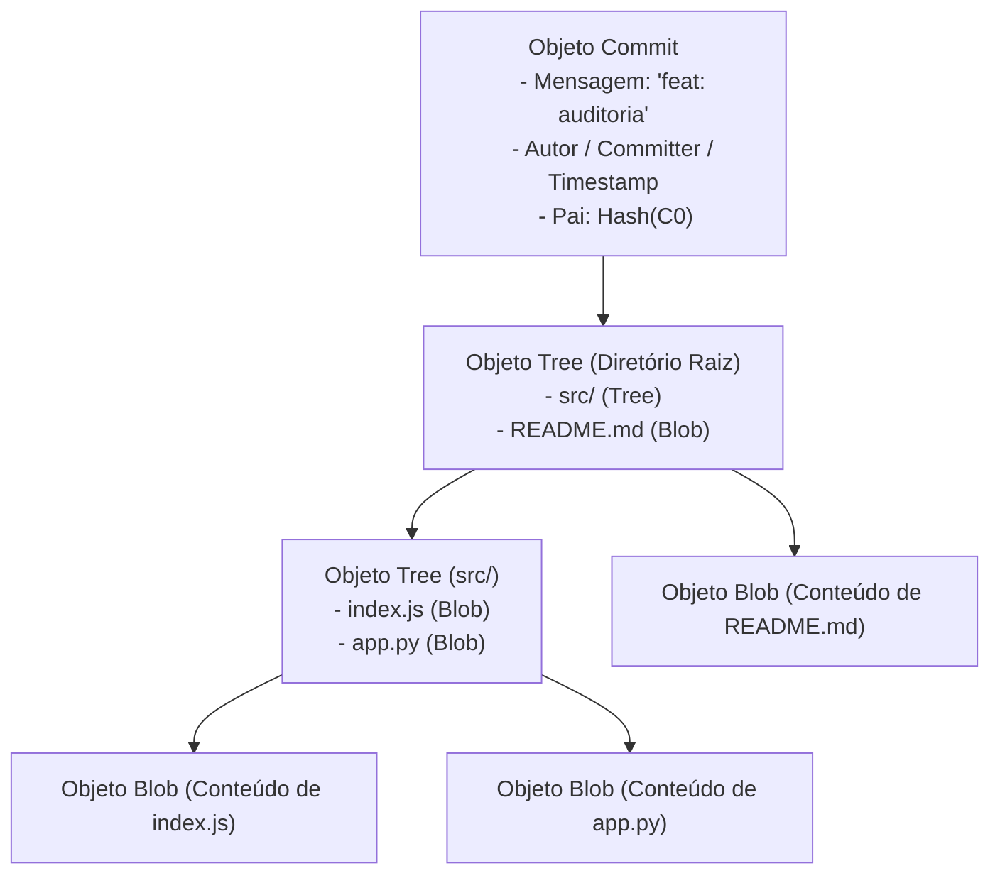
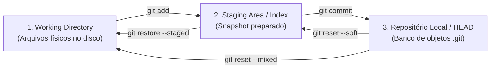
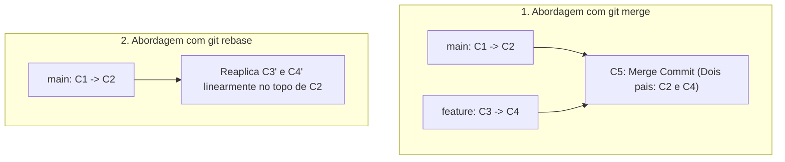
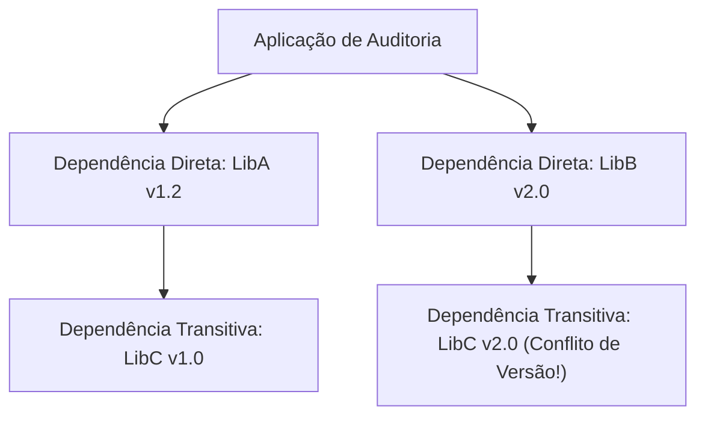
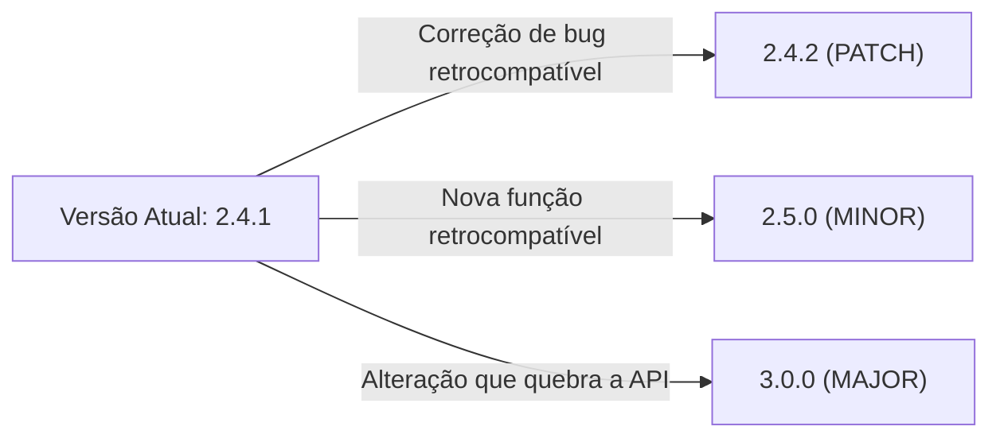
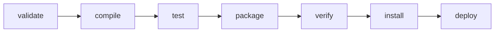
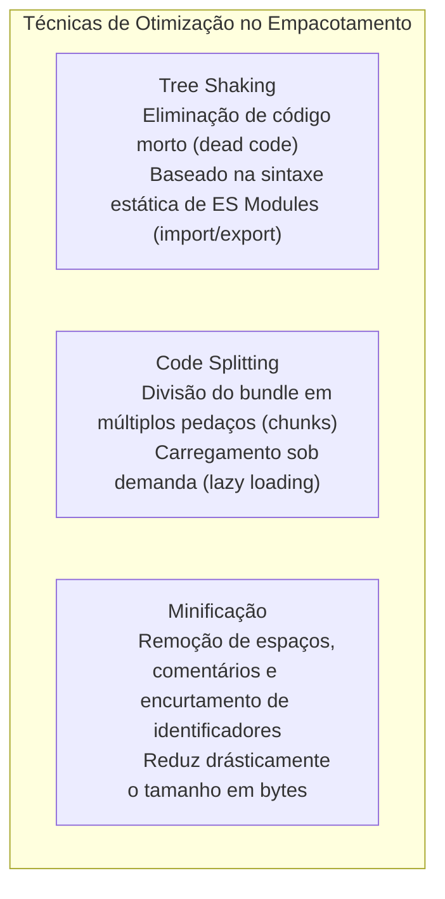

# 06 - Git, Gerenciamento de Dependências e Empacotamento

> **Matéria:** Desenvolvimento de Sistemas  
> **Cargo:** B02 – Técnico de Controle Externo – Especialidade: Tecnologia da Informação  
> **Arquivo:** `06_git_gerenciamento_de_dependencias_e_empacotamento.md`  

---

## 📌 Ementa / Itens do Edital
- Controle de versão distribuído com Git (conceitos e comandos essenciais)
- Gerenciamento de dependências
- Empacotamento de aplicações (bundlers e artefatos)
- Publicação e distribuição de aplicações

---

## 🧭 Sumário

1. [Controle de Versão Distribuído com Git](#1-controle-de-versao-distribuido-com-git)
    1. [Arquitetura Interna: Distribuído vs. Centralizado e Snapshots vs. Deltas](#11-arquitetura-interna-distribuido-vs-centralizado-e-snapshots-vs-deltas)
    2. [O Modelo de Objetos do Git: Blobs, Trees, Commits e Tags](#12-o-modelo-de-objetos-do-git-blobs-trees-commits-e-tags)
    3. [As Três Áreas Locais e o Ciclo de Vida dos Arquivos](#13-as-tres-areas-locais-e-o-ciclo-de-vida-dos-arquivos)
    4. [Comandos Fundamentais de Inspeção, Rastreamento e Histórico](#14-comandos-fundamentais-de-inspecao-rastreamento-e-historico)
    5. [Ramificação e Integração: `git merge` vs. `git rebase`](#15-ramificacao-e-integracao-git-merge-vs-git-rebase)
    6. [Operações de Recuperação e Desfazer: `reset`, `revert`, `stash` e `cherry-pick`](#16-operacoes-de-recuperacao-e-desfazer-reset-revert-stash-e-cherry-pick)
    7. [Sincronização e Fluxo Remoto: `fetch`, `pull` e `push`](#17-sincronizacao-e-fluxo-remoto-fetch-pull-e-push)
    8. [Teste 108](#Teste-108)
    9. [Teste 109](#Teste-109)
    10. [Teste 110](#Teste-110)
    11. [Teste 111](#Teste-111)
    12. [Teste 112](#Teste-112)
2. [Gerenciamento de Dependências de Software](#2-gerenciamento-de-dependencias-de-software)
    1. [Grafos de Dependência, Dependências Transitivas e Conflitos](#21-grafos-de-dependencia-dependencias-transitivas-e-conflitos)
    2. [Versionamento Semântico (SemVer 2.0.0)](#22-versionamento-semantico-semver-200)
    3. [Manifestos vs. Arquivos de Trava (Lockfiles) e o Comando `npm ci`](#23-manifestos-vs-arquivos-de-trava-lockfiles-e-o-comando-npm-ci)
    4. [Ecossistemas de Dependências: Node.js (npm), Python (pip/Poetry) e Java (Maven)](#24-ecossistemas-de-dependencias-nodejs-npm-python-pippoetry-e-java-maven)
    5. [O Ciclo de Vida Padrão do Apache Maven](#25-o-ciclo-de-vida-padrao-do-apache-maven)
    6. [Teste 113](#Teste-113)
    7. [Teste 114](#Teste-114)
    8. [Teste 115](#Teste-115)
    9. [Teste 116](#Teste-116)
3. [Empacotamento Web e Publicação de Aplicações](#3-empacotamento-web-e-publicacao-de-aplicacoes)
    1. [Empacotadores Web Modernos (Webpack, Vite, Rollup e esbuild)](#31-empacotadores-web-modernos-webpack-vite-rollup-e-esbuild)
    2. [Otimizações de Produção: Tree Shaking, Code Splitting e Minificação](#32-otimizacoes-de-producao-tree-shaking-code-splitting-e-minificacao)
    3. [Empacotamento de Backend: JAR/WAR, Wheels Python e Repositórios Corporativos](#33-empacotamento-de-backend-jarwar-wheels-python-e-repositorios-corporativos)
    4. [Teste 117](#Teste-117)
    5. [Teste 118](#Teste-118)
4. [Fontes Recomendadas na Internet](#4-fontes-recomendadas-na-internet)

---

## 1. Controle de Versão Distribuído com Git

### 1.1 Arquitetura Interna: Distribuído vs. Centralizado e Snapshots vs. Deltas
O Git, projetado originalmente por Linus Torvalds em 2005 para o desenvolvimento do kernel Linux, representa uma ruptura paradigmática em relação aos sistemas de controle de versão legados:

- **Sistemas Centralizados (SVN / CVS):** Há um único repositório centralizado. Para inspecionar logs de commits antigos, ramificar código ou confirmar alterações, o desenvolvedor precisa de conectividade direta com o servidor. Se o servidor queimar sem backup, todo o histórico é irremediavelmente perdido.
- **Sistemas Distribuídos (Git):** Cada desenvolvedor que executa um `git clone` recebe uma **cópia integral e idêntica do repositório**, contendo cada branch, cada commit e todos os metadados históricos desde a criação do projeto. Cada máquina opera como um servidor autônomo, viabilizando operações offline instantâneas e tolerância a falhas catastróficas.
- **Snapshots vs. Deltas:**
    - Sistemas legados salvam dados como conjuntos de alterações linha a linha baseados em arquivos (**deltas baseados em diferenças**).
    - O Git não pensa em termos de deltas de arquivos: ele enxerga seus dados como um conjunto de **instantâneos completos (*snapshots*)** da árvore de arquivos no momento exato do commit. Para não desperdiçar espaço em disco, se um arquivo não sofreu nenhuma modificação entre versões, o Git não grava o arquivo novamente: ele apenas insere um ponteiro direto apontando para o snapshot anterior já armazenado.

### 1.2 O Modelo de Objetos do Git: Blobs, Trees, Commits e Tags
Toda informação persistida pelo Git reside dentro do diretório oculto `.git/objects` e é identificada unicamente pelo seu hash criptográfico (originalmente SHA-1 de 40 dígitos hexadecimais, evoluindo para SHA-256). O Git organiza seus dados em quatro tipos fundamentais de objetos:

1. **Blob (*Binary Large Object*):** Armazena estritamente o conteúdo binário dos dados de um arquivo. O blob **não armazena o nome do arquivo nem suas permissões de acesso** (POSIX); guarda unicamente os bytes puros. Se dois arquivos em pastas diferentes tiverem conteúdos idênticos, o Git cria um único blob para ambos.
2. **Tree (Árvore):** Representa o equivalente a uma pasta/diretório no sistema de arquivos. Uma Tree mapeia os nomes de arquivos, permissões de execução e aponta para os respectivos hashes dos Blobs ou de outras Trees filhas (subpastas).
3. **Commit:** Representa a fotografia definitiva do projeto. Aponta para a Tree raiz daquele snapshot, armazena referências para o(s) commit(s) ancestral(is) (*parents*), nome e e-mail do autor e do committer, data/hora e a mensagem descritiva do commit.
4. **Annotated Tag (Tag Anotada):** Aponta para um commit específico, contendo um nome de versão (ex.: `v1.0.0`), mensagem explicativa e assinatura criptográfica opcional (GPG).

### 1.3 As Três Áreas Locais e o Ciclo de Vida dos Arquivos
No computador local do desenvolvedor, o Git segmenta os arquivos em três áreas distintas:

1. **Working Directory (Diretório de Trabalho):** Diretório físico no disco rígido do sistema operacional onde os arquivos do projeto residem descompactados e onde o programador efetivamente escreve e modifica o código-fonte.
2. **Staging Area / Index (Área de Preparação):** Arquivo binário localizado em `.git/index`. Funciona como uma mesa de preparação onde o desenvolvedor seleciona e pré-agrupa exatamente quais arquivos e quais trechos modificados farão parte do próximo commit.
3. **Repositório Local (.git directory / HEAD):** O banco de dados imutável onde os commits consolidados são gravados permanentemente. O ponteiro especial **HEAD** aponta para o ramo e commit em que o desenvolvedor está atualmente trabalhando.

### 1.4 Comandos Fundamentais de Inspeção, Rastreamento e Histórico
- **`git init`:** Inicializa um repositório Git vazio criando a pasta oculta `.git`.
- **`git clone <url>`:** Clona um repositório remoto completo com todo o histórico de branches para a máquina local.
- **`git status`:** Exibe o estado comparativo das três áreas, listando arquivos não rastreados (*untracked*), modificados e preparados (*staged*).
- **`git diff`:** Exibe diferenças linha a linha:
    - `git diff`: Diferenças entre o *Working Directory* e a *Staging Area*.
    - `git diff --staged` (ou `--cached`): Diferenças entre a *Staging Area* e o último commit no *HEAD*.
- **`git add <arquivo>`:** Adiciona o snapshot do arquivo à Staging Area.
- **`git commit -m "mensagem"`:** Grava o snapshot da Staging Area permanentemente no repositório local.
- **`git log`:** Exibe a linha do tempo de commits (`--oneline`, `--graph` para visualizar ramificações).
- **`git blame <arquivo>`:** Exibe o arquivo linha por linha, informando qual autor e qual hash de commit foi responsável pela última edição de cada linha (ferramenta essencial para auditoria forense de código).

### 1.5 Ramificação e Integração: `git merge` vs. `git rebase`
Branches no Git são apenas ponteiros móveis levíssimos de 41 bytes que apontam para um hash de commit. Ao integrar alterações de ramos diferentes, existem duas abordagens fundamentais:

#### Comparativo entre Merge e Rebase

| Critério | `git merge` | `git rebase` |
|---|---|---|
| **Mecânica Operacional** | Combina os ramos criando um **novo commit de junção (*Merge Commit*)** com múltiplos pais (salvo em *Fast-Forward*). | Pega os commits do ramo atual e os **reaplica individualmente um a um** no topo do ramo de destino. |
| **Linha Histórica** | Preserva o histórico não-linear fiel à cronologia dos fatos, documentando bifurcações e fusões de branches. | **Reescreve o histórico**, produzindo uma linha do tempo **estritamente linear e contínua**, sem commits de merge adicionais. |
| **Hashes Criptográficos** | **Preserva intactos** os hashes SHA-1/256 de todos os commits originais. | **Gera novos hashes criptográficos** para todos os commits que foram deslocados. |
| **Regra de Ouro da Equipe** | Seguro para qualquer branch, seja ela privada ou pública compartilhada. | ⭐ **NUNCA aplique rebase em branches públicas/compartilhadas!** Reescrever o histórico de commits já sincronizados por outros desenvolvedores quebra os repositórios locais de toda a equipe. |

### 1.6 Operações de Recuperação e Desfazer: `reset`, `revert`, `stash` e `cherry-pick`

#### 1. As Três Modalidades de `git reset`
O comando `git reset <hash>` move o ponteiro HEAD para trás:

| Modo do Reset | Efeito no HEAD | Efeito na Staging Area (Index) | Efeito no Working Directory | Caso de Uso Típico |
|---|---|---|---|---|
| **`--soft`** | Recua para o `<hash>` indicado | **Preserva todas as mudanças** (arquivos continuam *staged*) | Inalterado | Agrupar os últimos 3 commits em um único commit antes de enviar. |
| **`--mixed`** *(padrão)* | Recua para o `<hash>` indicado | **Limpa a Staging Area** (remove do *stage*) | **Preserva todas as mudanças** (arquivos ficam no disco como modificados) | Desfazer um commit para revisar alterações antes de commitar de novo. |
| **`--hard`** | Recua para o `<hash>` indicado | **Descarta e limpa tudo** | **Destrói e apaga tudo no disco** | Descartar sumariamente código recente com perda total de alterações locais. |

### 1.7 Sincronização e Fluxo Remoto: `fetch`, `pull` e `push`
- **`git remote add origin <url>`:** Vincula o repositório local a um repositório remoto.
- **`git fetch`:** Baixa todos os novos objetos e branches do servidor remoto para o repositório local, mas **não altera nem mescla nada no diretório de trabalho** do desenvolvedor (operação 100% segura para inspeção).
- **`git pull`:** Executa sequencialmente um `git fetch` seguido imediatamente por um `git merge` (ou `git rebase` se configurado) no ramo local atual.
- **`git push origin <branch>`:** Envia os novos commits locais para o servidor remoto centralizado.

---

### Teste 108
**(FGV – TJ-BA – Analista Judiciario Tecnologia da Informacao – 2015)**
Em um ambiente Linux instalado em uma determinada empresa, as contas dos programadores que trabalham num dado projeto de desenvolvimento estão associadas ao mesmo grupo de usuários. Um deles cria um diretório que deverá ser visível aos demais membros do time de desenvolvimento. A ideia é que os colegas possam entrar no diretório, criar novos arquivos sob o diretório, bem como visualizar e modificar o conteúdo dos arquivos ali armazenados. Usuários externos à equipe de desenvolvimento não devem ter acesso ao diretório, nem aos seus descendentes. Supondo-se que o caminho para o diretório em questão seja /home/projeto e que a proteção de /home já esteja corretamente estabelecida, o comando que associa a proteção desejada ao diretório /home/projeto e aos seus descendentes é:

* **A)** chmod –R 0770 /home/projeto;
* **B)** chmod –R 0760 /home/projeto;
* **C)** chmod –R 0750 /home/projeto;
* **D)** chmod –R 0740 /home/projeto;
* **E)** chmod –R 0730 /home/projeto.

---

> **Comentário Detalhado:**
>
> - **A)** **Correta.** Conforme fundamentado na seção *1.3 As Três Áreas Locais e o Ciclo de Vida dos Arquivos* deste guia, working Directory (Diretório de Trabalho): Diretório físico no disco rígido do sistema operacional onde os arquivos do projeto residem descompactados e onde o programador efetivamente escreve e modifica o código-fonte. Dessa forma, está plenamente correta a assertiva da banca (FGV – TJ-BA/2015) ao estabelecer que "chmod –R 0770 /home/projeto".
> - **B)** **Incorreta.** A opção apresenta proposição em desacordo com os fundamentos teóricos e técnicos do tópico ao afirmar que "chmod –R 0760 /home/projeto". De acordo com a teoria estudada em *2.5 O Ciclo de Vida Padrão do Apache Maven*, `validate`: Valida se a estrutura do projeto está correta e se todas as informações do `pom.xml` estão preenchidas.
> - **C)** **Incorreta.** A opção apresenta proposição em desacordo com os fundamentos teóricos e técnicos do tópico ao afirmar que "chmod –R 0750 /home/projeto". De acordo com a teoria estudada em *2.3 Manifestos vs. Arquivos de Trava (Lockfiles) e o Comando `npm ci`*, arquivo de Manifesto (`package.json`, `pom.xml`, `requirements.txt`): Descreve os metadados do projeto e declara faixas de tolerância flexíveis para as dependências (ex.: `"express": "^4.18.0"`).
> - **D)** **Incorreta.** A opção apresenta proposição em desacordo com os fundamentos teóricos e técnicos do tópico ao afirmar que "chmod –R 0740 /home/projeto". De acordo com a teoria estudada em *1.1 Arquitetura Interna: Distribuído vs. Centralizado e Snapshots vs. Deltas*, sistemas Distribuídos (Git): Cada desenvolvedor que executa um `git clone` recebe uma cópia integral e idêntica do repositório, contendo cada branch, cada commit e todos os metadados históricos desde a criação do projeto.
> - **E)** **Incorreta.** A opção apresenta proposição em desacordo com os fundamentos teóricos e técnicos do tópico ao afirmar que "chmod –R 0730 /home/projeto". De acordo com a teoria estudada em *1.2 O Modelo de Objetos do Git: Blobs, Trees, Commits e Tags*, commit: Representa a fotografia definitiva do projeto. Aponta para a Tree raiz daquele snapshot, armazena referências para o(s) commit(s) ancestral(is) (*parents*), nome e e-mail do autor e do committer, data/hora e a mensagem descritiva do commit.
>
> **Gabarito: A**

---

### Teste 109
**(FCC – TRT-2 – Analista Judiciario Tecnologia da Informacao – 2014)**
No sistema de controle de versões Git, para efetuar o download dos commits de um repositório remoto para o repositório local é utilizado o comando git

* **A)** apply.
* **B)** get.
* **C)** push.
* **D)** fetch.
* **E)** update.

---

> **Comentário Detalhado:**
>
> - **A)** **Incorreta.** A opção apresenta proposição em desacordo com os fundamentos teóricos e técnicos do tópico ao afirmar que "apply". De acordo com a teoria estudada em *1.7 Sincronização e Fluxo Remoto: `fetch`, `pull` e `push`*, `git fetch`: Baixa todos os novos objetos e branches do servidor remoto para o repositório local, mas não altera nem mescla nada no diretório de trabalho do desenvolvedor (operação 100% segura para inspeção).
> - **B)** **Incorreta.** A opção apresenta proposição em desacordo com os fundamentos teóricos e técnicos do tópico ao afirmar que "get". De acordo com a teoria estudada em *1.7 Sincronização e Fluxo Remoto: `fetch`, `pull` e `push`*, `git pull`: Executa sequencialmente um `git fetch` seguido imediatamente por um `git merge` (ou `git rebase` se configurado) no ramo local atual.
> - **C)** **Incorreta.** A opção apresenta proposição em desacordo com os fundamentos teóricos e técnicos do tópico ao afirmar que "push". De acordo com a teoria estudada em *1.7 Sincronização e Fluxo Remoto: `fetch`, `pull` e `push`*, `git push origin <branch>`: Envia os novos commits locais para o servidor remoto centralizado.
> - **D)** **Correta.** Conforme fundamentado na seção *1.7 Sincronização e Fluxo Remoto: `fetch`, `pull` e `push`* deste guia, `git remote add origin <url>`: Vincula o repositório local a um repositório remoto. Dessa forma, está plenamente correta a assertiva da banca (FCC – TRT-2/2014) ao estabelecer que "fetch".
> - **E)** **Incorreta.** A opção apresenta proposição em desacordo com os fundamentos teóricos e técnicos do tópico ao afirmar que "update". De acordo com a teoria estudada em *1.4 Comandos Fundamentais de Inspeção, Rastreamento e Histórico*, `git clone <url>`: Clona um repositório remoto completo com todo o histórico de branches para a máquina local.
>
> **Gabarito: D**

---

### Teste 110
**(FCC – TRT-13 – Analista Judiciario Tecnologia da Informacao – 2014)**
Paulo está executando o Git no Linux. Ele tem um repositório Git e um checkout ou cópia funcional dos arquivos para o projeto atual. Cada arquivo, no diretório de trabalho de Paulo, pode estar em um de dois estados: monitorado ou não monitorado. Arquivos monitorados são arquivos que estavam no último snapshot; podendo estar inalterados, modificados ou selecionados. Arquivos não monitorados são os restantes. Para Paulo verificar, em linha de comando, quais arquivos estão em quais estados ele utilizou o comando git status. Em seguida, ele adicionou um novo arquivo chamado trt ao projeto. Para passar a monitorar este arquivo ele deve usar o comando

* **A)** git add trt
* **B)** git -a --sx trt
* **C)** git state trt
* **D)** git fetch trt
* **E)** git -mu trt

---

> **Comentário Detalhado:**
>
> - **A)** **Correta.** Conforme fundamentado na seção *1.4 Comandos Fundamentais de Inspeção, Rastreamento e Histórico* deste guia, `git add <arquivo>`: Adiciona o snapshot do arquivo à Staging Area. Dessa forma, está plenamente correta a assertiva da banca (FCC – TRT-13/2014) ao estabelecer que "git add trt".
> - **B)** **Incorreta.** A opção apresenta proposição em desacordo com os fundamentos teóricos e técnicos do tópico ao afirmar que "git -a --sx trt". De acordo com a teoria estudada em *1.7 Sincronização e Fluxo Remoto: `fetch`, `pull` e `push`*, `git remote add origin <url>`: Vincula o repositório local a um repositório remoto.
> - **C)** **Incorreta.** A opção apresenta proposição em desacordo com os fundamentos teóricos e técnicos do tópico ao afirmar que "git state trt". De acordo com a teoria estudada em *1.3 As Três Áreas Locais e o Ciclo de Vida dos Arquivos*, staging Area / Index (Área de Preparação): Arquivo binário localizado em `.git/index`. Funciona como uma mesa de preparação onde o desenvolvedor seleciona e pré-agrupa exatamente quais arquivos e quais trechos modificados farão parte do próximo commit.
> - **D)** **Incorreta.** A opção apresenta proposição em desacordo com os fundamentos teóricos e técnicos do tópico ao afirmar que "git fetch trt". De acordo com a teoria estudada em *1.7 Sincronização e Fluxo Remoto: `fetch`, `pull` e `push`*, `git fetch`: Baixa todos os novos objetos e branches do servidor remoto para o repositório local, mas não altera nem mescla nada no diretório de trabalho do desenvolvedor (operação 100% segura para inspeção).
> - **E)** **Incorreta.** A opção apresenta proposição em desacordo com os fundamentos teóricos e técnicos do tópico ao afirmar que "git -mu trt". De acordo com a teoria estudada em *1.4 Comandos Fundamentais de Inspeção, Rastreamento e Histórico*, `git status`: Exibe o estado comparativo das três áreas, listando arquivos não rastreados (*untracked*), modificados e preparados (*staged*).
>
> **Gabarito: A**

---

### Teste 111
**(FGV – TJ-AP – Analista Judiciario Apoio Especializado Tecnologia da Informacao Desenvolvimento de Sistemas – 2023)**
A analista Cátia criou o branch tarefa10 em um repositório Git local. Logo após, Cátia alternou o branch de trabalho atual para o branch recém-criado, tarefa10. Estando no branch local tarefa10, Cátia precisou renomear o branch para t10_concluida, com um único comando da ferramenta git. Para renomear o branch de trabalho atual com um único comando, Cátia executou no repositório Git local o comando do git:

* **A)** mv t10_concluida;
* **B)** reset t10_concluida;
* **C)** rebase t10_concluida;
* **D)** branch -m t10_concluida;
* **E)** checkout -b t10_concluida.

---

> **Comentário Detalhado:**
>
> - **A)** **Incorreta.** A opção apresenta proposição em desacordo com os fundamentos teóricos e técnicos do tópico ao afirmar que "mv t10_concluida". De acordo com a teoria estudada em *1.1 Arquitetura Interna: Distribuído vs. Centralizado e Snapshots vs. Deltas*, sistemas Distribuídos (Git): Cada desenvolvedor que executa um `git clone` recebe uma cópia integral e idêntica do repositório, contendo cada branch, cada commit e todos os metadados históricos desde a criação do projeto.
> - **B)** **Incorreta.** A opção apresenta proposição em desacordo com os fundamentos teóricos e técnicos do tópico ao afirmar que "reset t10_concluida". De acordo com a teoria estudada em *1.7 Sincronização e Fluxo Remoto: `fetch`, `pull` e `push`*, `git push origin <branch>`: Envia os novos commits locais para o servidor remoto centralizado.
> - **C)** **Incorreta.** A opção apresenta proposição em desacordo com os fundamentos teóricos e técnicos do tópico ao afirmar que "rebase t10_concluida". De acordo com a teoria estudada em *Comparativo entre Merge e Rebase*, regra de Ouro da Equipe: Seguro para qualquer branch, seja ela privada ou pública compartilhada. — ⭐ NUNCA aplique rebase em branches públicas/compartilhadas! Reescrever o histórico de commits já sincronizados por outros desenvolvedores quebra os repositórios locais de toda a equipe.
> - **D)** **Correta.** Conforme fundamentado na seção *4. `git cherry-pick <hash>`* deste guia, permite selecionar um único commit específico de outra branch e reaplicá-lo cirurgicamente no topo da branch atual, sem precisar fundir a branch inteira via merge. Dessa forma, está plenamente correta a assertiva da banca (FGV – TJ-AP/2023) ao estabelecer que "branch -m t10_concluida".
> - **E)** **Incorreta.** A opção apresenta proposição em desacordo com os fundamentos teóricos e técnicos do tópico ao afirmar que "checkout -b t10_concluida". De acordo com a teoria estudada em *1.7 Sincronização e Fluxo Remoto: `fetch`, `pull` e `push`*, `git fetch`: Baixa todos os novos objetos e branches do servidor remoto para o repositório local, mas não altera nem mescla nada no diretório de trabalho do desenvolvedor (operação 100% segura para inspeção).
>
> **Gabarito: D**

---

#### 2. `git revert <hash>` (Desfazendo em Ramos Públicos)
Em branches públicas compartilhadas, o `git reset` é proibido. Para desfazer alterações com segurança sem quebrar o histórico compartilhado, utiliza-se o **`git revert <hash>`**.

- Ele **não apaga o commit defeituoso**.
- Em vez disso, o Git analisa as modificações daquele commit e gera automaticamente um **novo commit inverso**, anulando as alterações introduzidas com total transparência e auditabilidade.

---

### Teste 112
**(FGV – TRT-13 – Analista Judiciario Tecnologia da Informacao – 2022)**
Sobre os comandos da ferramenta de controle de versões Git, é correto afirmar que

* **A)** o comando git add altera simultaneamente os repositórios local e remoto.
* **B)** o comando git commit envia para o repositório remoto as alterações no espaço de trabalho local.
* **C)** o comando git status faz o download do repositório remoto para o espaço de trabalho local.
* **D)** o comando git push somente faz o upload das alterações que já estão em um commit.
* **E)** o comando git pull resolve automaticamente qualquer conflito entre os códigos dos repositórios local e remoto.

---

> **Comentário Detalhado:**
>
> - **A)** **Incorreta.** A opção apresenta proposição em desacordo com os fundamentos teóricos e técnicos do tópico ao afirmar que "o comando git add altera simultaneamente os repositórios local e remoto". De acordo com a teoria estudada em *1.7 Sincronização e Fluxo Remoto: `fetch`, `pull` e `push`*, `git fetch`: Baixa todos os novos objetos e branches do servidor remoto para o repositório local, mas não altera nem mescla nada no diretório de trabalho do desenvolvedor (operação 100% segura para inspeção).
> - **B)** **Incorreta.** A opção apresenta proposição em desacordo com os fundamentos teóricos e técnicos do tópico ao afirmar que "o comando git commit envia para o repositório remoto as alterações no espaço de trabalho local". De acordo com a teoria estudada em *1.7 Sincronização e Fluxo Remoto: `fetch`, `pull` e `push`*, `git remote add origin <url>`: Vincula o repositório local a um repositório remoto.
> - **C)** **Incorreta.** A opção apresenta proposição em desacordo com os fundamentos teóricos e técnicos do tópico ao afirmar que "o comando git status faz o download do repositório remoto para o espaço de trabalho local". De acordo com a teoria estudada em *1.7 Sincronização e Fluxo Remoto: `fetch`, `pull` e `push`*, `git pull`: Executa sequencialmente um `git fetch` seguido imediatamente por um `git merge` (ou `git rebase` se configurado) no ramo local atual.
> - **D)** **Correta.** Conforme fundamentado na seção *3. `git stash` (Armazenamento Temporário de Trabalho Inacabado)* deste guia, `git stash` (ou `git stash push -m "descrição"`): Guarda as alterações pendentes e limpa a pasta de trabalho. Dessa forma, está plenamente correta a assertiva da banca (FGV – TRT-13/2022) ao estabelecer que "o comando git push somente faz o upload das alterações que já estão em um commit".
> - **E)** **Incorreta.** A opção promove generalização excessiva que desconsidera as condições técnicas e normativas ao afirmar que "o comando git pull resolve automaticamente qualquer conflito entre os códigos dos repositórios local e remoto". De acordo com a teoria estudada em *1.7 Sincronização e Fluxo Remoto: `fetch`, `pull` e `push`*, `git push origin <branch>`: Envia os novos commits locais para o servidor remoto centralizado.
>
> **Gabarito: D**

---

#### 3. `git stash` (Armazenamento Temporário de Trabalho Inacabado)
Permite salvar o estado intermediário do *Working Directory* e da *Staging Area* em uma pilha interna temporária de memória do Git, limpando os arquivos do disco para o estado do último commit:

- `git stash` (ou `git stash push -m "descrição"`): Guarda as alterações pendentes e limpa a pasta de trabalho.
- `git stash pop`: Restaura as alterações salvas de volta para o diretório de trabalho e remove o registro do topo da pilha.
- `git stash apply`: Restaura as alterações, mas mantém uma cópia guardada na pilha.
- `git stash list`: Lista todos os stashes acumulados.

#### 4. `git cherry-pick <hash>`
Permite selecionar um **único commit específico** de outra branch e reaplicá-lo cirurgicamente no topo da branch atual, sem precisar fundir a branch inteira via merge.

---

## 2. Gerenciamento de Dependências de Software

### 2.1 Grafos de Dependência, Dependências Transitivas e Conflitos
Em engenharia de software contemporânea, quase nenhuma aplicação é construída do zero; projetos utilizam bibliotecas de terceiros que, por sua vez, dependem de outras bibliotecas:

- **Dependências Diretas:** Bibliotecas declaradas explicitamente pelo desenvolvedor no arquivo de manifesto do projeto.
- **Dependências Transitivas:** Bibliotecas exigidas pelas suas dependências diretas.
- **Conflito de Dependências:** Ocorre quando duas bibliotecas exigem versões mutuamente incompatíveis de uma mesma biblioteca transitiva (ex.: a famosa problemática do *"Dependency Hell"*).

### 2.2 Versionamento Semântico (SemVer 2.0.0)
A especificação universal SemVer define como os softwares devem rotular suas versões públicas através do formato de três inteiros separados por ponto:

$$\textbf{MAJOR} \,.\, \textbf{MINOR} \,.\, \textbf{PATCH}$$

1. **MAJOR (Quebra de Compatibilidade Reversa / *Breaking Changes*):** Incrementado quando são realizadas modificações substanciais na API pública que tornam o código incompatível com versões anteriores. Consumidores precisam alterar seus códigos para não quebrar.
2. **MINOR (Novas Funcionalidades Retrocompatíveis):** Incrementado quando novos métodos, classes ou funcionalidades são adicionados à biblioteca, mas preservando 100% da compatibilidade com o código pré-existente (*backwards-compatible*).
3. **PATCH (Correções de Bugs Retrocompatíveis):** Incrementado estritamente para correção de defeitos internos, bugs ou vulnerabilidades de segurança que não alteram a assinatura nem o comportamento da API pública.

#### Sintaxe de Prefixos de Versão no `npm` (Node.js)
- **Til (`~1.2.3`):** Autoriza atualizações apenas no nível de **PATCH** ($\ge 1.2.3 \text{ e } < 1.3.0$).
- **Circunflexo (`^1.2.3`):** Autoriza atualizações no nível de **MINOR e PATCH** ($\ge 1.2.3 \text{ e } < 2.0.0$).
- **Versão Exata (`1.2.3`):** Sem prefixos; trava estritamente naquela versão.

### 2.3 Manifestos vs. Arquivos de Trava (Lockfiles) e o Comando `npm ci`
- **Arquivo de Manifesto (`package.json`, `pom.xml`, `requirements.txt`):** Descreve os metadados do projeto e declara faixas de tolerância flexíveis para as dependências (ex.: `"express": "^4.18.0"`).
- **Arquivo de Trava (*Lockfile* - `package-lock.json`, `poetry.lock`, `yarn.lock`):** É gerado automaticamente pelo gerenciador de pacotes para congelar a **árvore completa e exata de dependências transitivas**, gravando a versão exata de cada subdependência instalada e o seu **hash criptográfico de integridade** (`integrity: sha512-..`). Garante compilações 100% determinísticas e reproduzíveis em qualquer máquina.

> 🚨 **ALERTA DE PROVA / FCC:**  
> **`npm install` vs. `npm ci` em Esteiras de CI/CD:**  
>
> - Em esteiras de Integração Contínua (CI/CD) de produção, **NUNCA se deve rodar `npm install`**. O `npm install` pode atualizar dependências permitidas pelas faixas do manifesto e regerar o `package-lock.json`, introduzindo código não testado em produção.
> - O comando correto e padronizado para esteiras automatizadas é o **`npm ci`** (*Clean Install*). Ele apaga a pasta `node_modules` inteira e instala rigorosamente o que está congelado no `package-lock.json`. Se houver qualquer discrepância entre o manifesto e o lockfile, ele aborta a esteira com erro.

### 2.4 Ecossistemas de Dependências: Node.js (npm), Python (pip/Poetry) e Java (Maven)

| Ecossistema | Gerenciador de Pacotes | Arquivo de Manifesto | Arquivo de Trava (*Lockfile*) | Repositório Central Público |
|---|---|---|---|---|
| **JavaScript / Node.js** | npm / Yarn / pnpm | `package.json` | `package-lock.json` / `yarn.lock` | npmjs.com |
| **Python** | pip / Poetry / Pipenv | `pyproject.toml` / `requirements.txt` | `poetry.lock` / `Pipfile.lock` | PyPI (*Python Package Index*) |
| **Java** | Apache Maven / Gradle | `pom.xml` / `build.gradle` | `gradle.lockfile` (ou hashes locais) | Maven Central |

### 2.5 O Ciclo de Vida Padrão do Apache Maven
No ecossistema Java corporativo, o Apache Maven organiza o processo de construção em fases sequenciais imutáveis dentro do seu ciclo de vida padrão (*default lifecycle*):

1. **`validate`:** Valida se a estrutura do projeto está correta e se todas as informações do `pom.xml` estão preenchidas.
2. **`compile`:** Compila o código-fonte Java (`.java`) localizado em `src/main/java` gerando os arquivos de bytecode (`.class`).
3. **`test`:** Executa os testes automatizados unitários (JUnit) localizados em `src/test/java`.
4. **`package`:** Empacota o código compilado no formato de distribuição configurado (`.jar` ou `.war`).
5. **`verify`:** Executa testes de integração para verificar critérios de qualidade e conformidade do pacote.
6. **`install`:** Copia o pacote gerado para o **repositório local do desenvolvedor** (localizado em `~/.m2/repository`), disponibilizando o artefato como dependência para outros projetos locais na mesma máquina.
7. **`deploy`:** Copia o pacote final para o **repositório corporativo remoto compartilhado** (ex.: Nexus ou JFrog Artifactory) para distribuição oficial.

---

### Teste 113
**(FCC – TRT-24 – Analista Judiciario Tecnologia da Informacao – 2017)**
Considere que um Analista está utilizando a ferramenta Maven e precisa definir que seu projeto depende de algumas outras ferramentas. Esta definição é feita inteiramente no POM, usando a tag `<dependencies>`, dentro da qual cada dependência é definida. Considere o trecho de código abaixo. Em condições ideais, para que seja definido que o projeto depende do JUnit 4.12 e que o Maven adicione a dependência do JUnit apenas no momento em que os testes forem executados, garantindo que a dependência não seja adicionada no artefato que será gerado, a caixa I deve ser corretamente preenchida com

* **A)** `<groupId>`junit`</groupId>` `<version>`4.12`</version>` `<exclusion>`system`</exclusion>`
* **B)** `<groupId>`junit 4.12`</groupId>` `<artifactId>`junit`</artifactId>` `<system>`test`</system>` `<scope>`system`</scope>`
* **C)** `<groupId>`junit`</groupId>` `<version>`4.12`</version>` `<test>`compile`</test>`
* **D)** `<groupId>`junit`</groupId>` `<artifactId>`junit 4.12`</artifactId>` `<compile>`test`</compile>`
* **E)** `<groupId>`junit`</groupId>` `<artifactId>`junit`</artifactId>` `<version>`4.12`</version>` `<scope>`test`</scope>`

---

> **Comentário Detalhado:**
>
> - **A)** **Correta.** Conforme fundamentado na seção *2.5 O Ciclo de Vida Padrão do Apache Maven* deste guia, `test`: Executa os testes automatizados unitários (JUnit) localizados em `src/test/java`. Dessa forma, está plenamente correta a assertiva da banca (FCC – TRT-24/2017) ao estabelecer que "`<groupId>`junit`</groupId>` `<version>`4.12`</version>` `<exclusion>`system`</exclusion>`".
> - **B)** **Incorreta.** A opção apresenta proposição em desacordo com os fundamentos teóricos e técnicos do tópico ao afirmar que "`<groupId>`junit 4.12`</groupId>` `<artifactId>`junit`</artifactId>` `<system>`test`</system>`...". De acordo com a teoria estudada em *2.5 O Ciclo de Vida Padrão do Apache Maven*, `install`: Copia o pacote gerado para o repositório local do desenvolvedor (localizado em `~/.m2/repository`), disponibilizando o artefato como dependência para outros projetos locais na mesma máquina.
> - **C)** **Incorreta.** A opção apresenta proposição em desacordo com os fundamentos teóricos e técnicos do tópico ao afirmar que "`<groupId>`junit`</groupId>` `<version>`4.12`</version>` `<test>`compile`</test>`". De acordo com a teoria estudada em *2.5 O Ciclo de Vida Padrão do Apache Maven*, `compile`: Compila o código-fonte Java (`.java`) localizado em `src/main/java` gerando os arquivos de bytecode (`.class`).
> - **D)** **Incorreta.** A opção apresenta proposição em desacordo com os fundamentos teóricos e técnicos do tópico ao afirmar que "`<groupId>`junit`</groupId>` `<artifactId>`junit 4.12`</artifactId>` `<compile>`test`</compile>`". De acordo com a teoria estudada em *4. Fontes Recomendadas na Internet*, lOELIGER, Jon; MCCULLOUGH, Matthew. Version Control with Git. 2. ed. Sebastopol: O'Reilly Media, 2012. (Cap. 8 e 9 - Rebase, Hook Scripts e Gestão de Branches).
> - **E)** **Incorreta.** A opção apresenta proposição em desacordo com os fundamentos teóricos e técnicos do tópico ao afirmar que "`<groupId>`junit`</groupId>` `<artifactId>`junit`</artifactId>` `<version>`4.12`</version>` `<scope>`test`</scope>`". De acordo com a teoria estudada em *2.5 O Ciclo de Vida Padrão do Apache Maven*, `validate`: Valida se a estrutura do projeto está correta e se todas as informações do `pom.xml` estão preenchidas.
>
> **Gabarito: A**

---

### Teste 114
**(IBFC – TJ-MG – Analista Judiciario Classe C Analista de Tecnologia da Informacao – 2022)**
Algumas das principais bibliotecas padrão da linguagem de programação Java são: (1) java.lang (2) java.net (3) java.sql (4) java.util Da relação apresentada:

* **A)** somente são aplicados o 1, 2 e 3
* **B)** somente são aplicados o 1, 2 e 4
* **C)** somente são aplicados o 2, 3 e 4
* **D)** somente são aplicados o 1, 3 e 4
* **E)** todos podem ser aplicados

---

> **Comentário Detalhado:**
>
> - **A)** **Incorreta.** A opção incorre em restrição indevida ao limitar o escopo conceitual ao afirmar que "somente são aplicados o 1, 2 e 3". De acordo com a teoria estudada em *2.5 O Ciclo de Vida Padrão do Apache Maven*, no ecossistema Java corporativo, o Apache Maven organiza o processo de construção em fases sequenciais imutáveis dentro do seu ciclo de vida padrão (*default lifecycle*).
> - **B)** **Incorreta.** A opção incorre em restrição indevida ao limitar o escopo conceitual ao afirmar que "somente são aplicados o 1, 2 e 4". De acordo com a teoria estudada em *2.5 O Ciclo de Vida Padrão do Apache Maven*, `compile`: Compila o código-fonte Java (`.java`) localizado em `src/main/java` gerando os arquivos de bytecode (`.class`).
> - **C)** **Incorreta.** A opção incorre em restrição indevida ao limitar o escopo conceitual ao afirmar que "somente são aplicados o 2, 3 e 4". De acordo com a teoria estudada em *2.5 O Ciclo de Vida Padrão do Apache Maven*, `test`: Executa os testes automatizados unitários (JUnit) localizados em `src/test/java`.
> - **D)** **Incorreta.** A opção incorre em restrição indevida ao limitar o escopo conceitual ao afirmar que "somente são aplicados o 1, 3 e 4". De acordo com a teoria estudada em *Formatos de Distribuição*, empacota em um único arquivo `.jar` todo o código compilado da aplicação, todas as bibliotecas de dependência de terceiros e um servidor web embutido (Tomcat ou Jetty), permitindo execução direta pelo comando `java -jar aplicacao.jar` sem depender de servidores pré-instalados.
> - **E)** **Correta.** Conforme fundamentado na seção *Formatos de Distribuição* deste guia, java WAR (*Web Application Archive*): Padrão corporativo legado contendo a estrutura de pastas `WEB-INF`, concebido para ser implantado dentro de servidores de aplicação compartilhados (*standalone application servers* como WildFly ou WebLogic). Dessa forma, está plenamente correta a assertiva da banca (IBFC – TJ-MG/2022) ao estabelecer que "todos podem ser aplicados".
>
> **Gabarito: E**

---

### Teste 115
**(CEBRASPE – TJ-RJ – Analista Judiciario Grupo Tecnologia da Informacao Analista de Sistemas – 2021)**
A ferramenta de controle de versão Subversion (SVN)

* **A)** é considerada um sistema peer-to-peer e, embora seja uma ferramenta proprietária que requer aquisição de licença para uso, pode rodar (executar) usando o servidor Apache.
* **B)** suporta commits atômicos, sem deixar inconsistências, mesmo diante de problemas que ocorrem na rede ou no servidor.
* **C)** tem como principal desvantagem o fato de não permitir as operações file-lock ou checkout reservado.
* **D)** fornece automaticamente uma camada extra de proteção a arquivos e pastas adicionais armazenados por ela, os quais, por isso, não podem ser corrompidos pelo usuário.
* **E)** mantém um histórico detalhado de todos os arquivos removidos, com exceção daqueles que foram renomeados.

---

> **Comentário Detalhado:**
>
> - **A)** **Incorreta.** A opção apresenta proposição em desacordo com os fundamentos teóricos e técnicos do tópico ao afirmar que "é considerada um sistema peer-to-peer e, embora seja uma ferramenta proprietária que requer aquisição de licença...". De acordo com a teoria estudada em *2.3 Manifestos vs. Arquivos de Trava (Lockfiles) e o Comando `npm ci`*, em esteiras de Integração Contínua (CI/CD) de produção, NUNCA se deve rodar `npm install`. O `npm install` pode atualizar dependências permitidas pelas faixas do manifesto e regerar o `package-lock.json`, introduzindo código não testado em produção.
> - **B)** **Correta.** Conforme fundamentado na seção *1.1 Arquitetura Interna: Distribuído vs. Centralizado e Snapshots vs. Deltas* deste guia, sistemas Centralizados (SVN / CVS): Há um único repositório centralizado. Para inspecionar logs de commits antigos, ramificar código ou confirmar alterações, o desenvolvedor precisa de conectividade direta com o servidor. Dessa forma, está plenamente correta a assertiva da banca (CEBRASPE – TJ-RJ/2021) ao estabelecer que "suporta commits atômicos, sem deixar inconsistências, mesmo diante de problemas que ocorrem na rede ou no servidor".
> - **C)** **Incorreta.** A opção apresenta proposição em desacordo com os fundamentos teóricos e técnicos do tópico ao afirmar que "tem como principal desvantagem o fato de não permitir as operações file-lock ou checkout reservado". De acordo com a teoria estudada em *1.1 Arquitetura Interna: Distribuído vs. Centralizado e Snapshots vs. Deltas*, cada máquina opera como um servidor autônomo, viabilizando operações offline instantâneas e tolerância a falhas catastróficas.
> - **D)** **Incorreta.** A opção apresenta proposição em desacordo com os fundamentos teóricos e técnicos do tópico ao afirmar que "fornece automaticamente uma camada extra de proteção a arquivos e pastas adicionais armazenados por ela, os quais...". De acordo com a teoria estudada em *Formatos de Distribuição*, java WAR (*Web Application Archive*): Padrão corporativo legado contendo a estrutura de pastas `WEB-INF`, concebido para ser implantado dentro de servidores de aplicação compartilhados (*standalone application servers* como WildFly ou WebLogic).
> - **E)** **Incorreta.** A opção apresenta proposição em desacordo com os fundamentos teóricos e técnicos do tópico ao afirmar que "mantém um histórico detalhado de todos os arquivos removidos, com exceção daqueles que foram renomeados". De acordo com a teoria estudada em *1.1 Arquitetura Interna: Distribuído vs. Centralizado e Snapshots vs. Deltas*, se o servidor queimar sem backup, todo o histórico é irremediavelmente perdido.
>
> **Gabarito: B**

---

### Teste 116
**(FCC – TRT-9 – Analista Judiciario Apoio Especializado Tecnologia da Informacao – 2015)**
Um usuário do sistema operacional Linux executou o seguinte comando no prompt de um terminal shell. \$ ls >> list O resultado da execução desse comando é a

* **A)** apresentação da listagem do conteúdo do diretório list no terminal.
* **B)** apresentação, no terminal, dos arquivos e diretórios que contém o termo list.
* **C)** listagem de comparação entre o conteúdo do diretório atual e do arquivo list.
* **D)** cópia do conteúdo do diretório atual para o diretório list.
* **E)** criação do arquivo list que contém a listagem do diretório atual.

---

> **Comentário Detalhado:**
>
> - **A)** **Incorreta.** A opção apresenta proposição em desacordo com os fundamentos teóricos e técnicos do tópico ao afirmar que "apresentação da listagem do conteúdo do diretório list no terminal". De acordo com a teoria estudada em *1.2 O Modelo de Objetos do Git: Blobs, Trees, Commits e Tags*, blob (*Binary Large Object*): Armazena estritamente o conteúdo binário dos dados de um arquivo. O blob não armazena o nome do arquivo nem suas permissões de acesso (POSIX); guarda unicamente os bytes puros.
> - **B)** **Incorreta.** A opção apresenta proposição em desacordo com os fundamentos teóricos e técnicos do tópico ao afirmar que "apresentação, no terminal, dos arquivos e diretórios que contém o termo list". De acordo com a teoria estudada em *1.3 As Três Áreas Locais e o Ciclo de Vida dos Arquivos*, working Directory (Diretório de Trabalho): Diretório físico no disco rígido do sistema operacional onde os arquivos do projeto residem descompactados e onde o programador efetivamente escreve e modifica o código-fonte.
> - **C)** **Incorreta.** A opção apresenta proposição em desacordo com os fundamentos teóricos e técnicos do tópico ao afirmar que "listagem de comparação entre o conteúdo do diretório atual e do arquivo list". De acordo com a teoria estudada em *1.2 O Modelo de Objetos do Git: Blobs, Trees, Commits e Tags*, tree (Árvore): Representa o equivalente a uma pasta/diretório no sistema de arquivos. Uma Tree mapeia os nomes de arquivos, permissões de execução e aponta para os respectivos hashes dos Blobs ou de outras Trees filhas (subpastas).
> - **D)** **Incorreta.** A opção apresenta proposição em desacordo com os fundamentos teóricos e técnicos do tópico ao afirmar que "cópia do conteúdo do diretório atual para o diretório list". De acordo com a teoria estudada em *1.1 Arquitetura Interna: Distribuído vs. Centralizado e Snapshots vs. Deltas*, sistemas Distribuídos (Git): Cada desenvolvedor que executa um `git clone` recebe uma cópia integral e idêntica do repositório, contendo cada branch, cada commit e todos os metadados históricos desde a criação do projeto.
> - **E)** **Correta.** Conforme fundamentado na seção *3. `git stash` (Armazenamento Temporário de Trabalho Inacabado)* deste guia, `git stash list`: Lista todos os stashes acumulados. Dessa forma, está plenamente correta a assertiva da banca (FCC – TRT-9/2015) ao estabelecer que "criação do arquivo list que contém a listagem do diretório atual".
>
> **Gabarito: E**

---

## 3. Empacotamento Web e Publicação de Aplicações

### 3.1 Empacotadores Web Modernos (Webpack, Vite, Rollup e esbuild)
No desenvolvimento front-end moderno, o código-fonte é decomposto em centenas de componentes JSX/TSX, folhas de estilo SASS/CSS e imagens. Navegadores não executam esses formatos diretamente de forma eficiente sem empacotamento.

- **Module Bundling:** Processo que analisa o grafo de dependências a partir de um arquivo de entrada (*entry point* como `index.tsx`) e consolida todos os recursos em arquivos estáticos otimizados (HTML, JS, CSS) dentro da pasta de produção (geralmente `dist/` ou `build/`).
- **Ferramentas:**
    - **Webpack:** O empacotador tradicional mais maduro e configurável do mercado.
    - **Vite:** Ferramenta moderna de alta velocidade que utiliza o motor **esbuild** (escrito em Go) para pré-empacotamento instantâneo em desenvolvimento e o **Rollup** para gerar o bundle final de produção.

### 3.2 Otimizações de Produção: Tree Shaking, Code Splitting e Minificação

- **Tree Shaking (Eliminação de Código Morto):** Técnica onde o empacotador inspeciona a árvore de dependências e **descarta funções, classes ou variáveis importadas que nunca são invocadas na lógica do sistema**. Baseia-se exclusivamente na análise estática dos módulos ECMAScript (ESM `import` e `export`). Não funciona adequadamente com CommonJS (`require()`), pois o CommonJS é dinâmico.
- **Code Splitting (Divisão de Código):** Estratégia de dividir o pacote JavaScript final em arquivos menores (*chunks*). Em vez de o usuário baixar 5 MB de código para abrir a tela de login, o navegador baixa apenas o essencial, carregando outras telas sob demanda via importações dinâmicas (`React.lazy()` / `import()`).
- **Minificação e Ofuscação:** Processo automatizado que remove todos os espaços em branco, quebras de linha e comentários, além de renomear variáveis longas para letras únicas (`function processarAuditoriaFiscal()` $\rightarrow$ `function a()`), reduzindo o payload e dificultando a engenharia reversa.

### 3.3 Empacotamento de Backend: JAR/WAR, Wheels Python e Repositórios Corporativos

#### Formatos de Distribuição
- **Java Executável (*Fat JAR* / *Uber JAR*):** Padrão dominante em microsserviços modernos (como Spring Boot). Empacota em um único arquivo `.jar` todo o código compilado da aplicação, todas as bibliotecas de dependência de terceiros e um **servidor web embutido** (Tomcat ou Jetty), permitindo execução direta pelo comando `java -jar aplicacao.jar` sem depender de servidores pré-instalados.
- **Java WAR (*Web Application Archive*):** Padrão corporativo legado contendo a estrutura de pastas `WEB-INF`, concebido para ser implantado dentro de servidores de aplicação compartilhados (*standalone application servers* como WildFly ou WebLogic).
- **Python Wheel (`.whl` - PEP 427):** Formato padrão de distribuição de pacotes binários pré-compilados em Python. Evita a execução de scripts de compilação C (`setup.py`) durante a instalação pelo `pip`, garantindo instalações até 10 vezes mais rápidas.

#### Repositórios Corporativos de Artefatos
Em ambientes corporativos como tribunais de contas, o acesso a repositórios públicos (npm, PyPI, Maven Central) é intermediado por gerenciadores de repositório privados como **Sonatype Nexus**, **JFrog Artifactory** ou **GitHub Packages**.

- Funcionam como proxy de cache local de dependências externas.
- Permitem aplicar varreduras automatizadas de segurança e vulnerabilidades conhecidas (CVEs) antes de permitir a instalação no ambiente governamental.

---

### Teste 117
**(FGV – TJ-AP – Analista Judiciario Apoio Especializado Tecnologia da Informacao Desenvolvimento de Sistemas – 2023)**
Analise o conteúdo de uma página Web, com o código JavaScript, exibido a seguir. <!DOCTYPE html> `<html>` `<body>` `
`Exemplo.`
` `
`Aguarde um pouco...`
` `
``
` `` `</body>` `</html>` Quando essa página for carregada: -- as linhas Exemplo. Aguarde um pouco... serão exibidas; -- alguns segundos depois, a linha Obrigado. será exibida. Para que isso aconteça, o bloco tracejado no código deve ser substituído por:

* **A)** document.getElementById("xpto").innerHTML = setTimeout("Obrigado.", 5000);
* **B)** function f(p) { setTimeout(function() { f("Obrigado."); }, 5000); document.getElementById("xpto").innerHTML = f(p); }
* **C)** setTimeout(5, "s"); document.getElementById("xpto").innerHTML = "Obrigado.";
* **D)** setTimeout(5000); document.getElementById("xpto").innerHTML = "Obrigado.";
* **E)** setTimeout(function() { f("Obrigado."); }, 5000);

---

> **Comentário Detalhado:**
>
> - **A)** **Incorreta.** A opção apresenta proposição em desacordo com os fundamentos teóricos e técnicos do tópico ao afirmar que "document.getElementById("xpto").innerHTML = setTimeout("Obrigado.", 5000)". De acordo com a teoria estudada em *3.1 Empacotadores Web Modernos (Webpack, Vite, Rollup e esbuild)*, module Bundling: Processo que analisa o grafo de dependências a partir de um arquivo de entrada (*entry point* como `index.tsx`) e consolida todos os recursos em arquivos estáticos otimizados (HTML, JS, CSS) dentro da pasta de produção (geralmente `dist/` ou `build/`).
> - **B)** **Incorreta.** A opção apresenta proposição em desacordo com os fundamentos teóricos e técnicos do tópico ao afirmar que "function f(p) { setTimeout(function() { f("Obrigado."); }, 5000); document.getElementById("xpto").innerHTML =...". De acordo com a teoria estudada em *Formatos de Distribuição*, java WAR (*Web Application Archive*): Padrão corporativo legado contendo a estrutura de pastas `WEB-INF`, concebido para ser implantado dentro de servidores de aplicação compartilhados (*standalone application servers* como WildFly ou WebLogic).
> - **C)** **Incorreta.** A opção apresenta proposição em desacordo com os fundamentos teóricos e técnicos do tópico ao afirmar que "setTimeout(5, "s"); document.getElementById("xpto").innerHTML = "Obrigado."". De acordo com a teoria estudada em *3.2 Otimizações de Produção: Tree Shaking, Code Splitting e Minificação*, code Splitting (Divisão de Código): Estratégia de dividir o pacote JavaScript final em arquivos menores (*chunks*).
> - **D)** **Incorreta.** A opção apresenta proposição em desacordo com os fundamentos teóricos e técnicos do tópico ao afirmar que "setTimeout(5000); document.getElementById("xpto").innerHTML = "Obrigado."". De acordo com a teoria estudada em *3.1 Empacotadores Web Modernos (Webpack, Vite, Rollup e esbuild)*, no desenvolvimento front-end moderno, o código-fonte é decomposto em centenas de componentes JSX/TSX, folhas de estilo SASS/CSS e imagens. Navegadores não executam esses formatos diretamente de forma eficiente sem empacotamento.
> - **E)** **Correta.** Conforme fundamentado na seção *3.2 Otimizações de Produção: Tree Shaking, Code Splitting e Minificação* deste guia, minificação e Ofuscação: Processo automatizado que remove todos os espaços em branco, quebras de linha e comentários, além de renomear variáveis longas para letras únicas (`function processarAuditoriaFiscal()` \$\rightarrow\$ `function a()`), reduzindo o payload e dificultando a engenharia reversa. Dessa forma, está plenamente correta a assertiva da banca (FGV – TJ-AP/2023) ao estabelecer que "setTimeout(function() { f("Obrigado."); }, 5000)".
>
> **Gabarito: E**

---

### Teste 118
**(FGV – TRT-16 – Analista Judiciario Area Administrativa Tecnologia da Informacao – 2022)**
O comando que pode ser executado na ferramenta de versionamento Git para exibir a lista dos arquivos alterados no diretório de trabalho local é

* **A)** git fetch
* **B)** git gc
* **C)** git status
* **D)** git prune
* **E)** git remote

---

> **Comentário Detalhado:**
>
> - **A)** **Incorreta.** A opção apresenta proposição em desacordo com os fundamentos teóricos e técnicos do tópico ao afirmar que "git fetch". De acordo com a teoria estudada em *1.7 Sincronização e Fluxo Remoto: `fetch`, `pull` e `push`*, `git fetch`: Baixa todos os novos objetos e branches do servidor remoto para o repositório local, mas não altera nem mescla nada no diretório de trabalho do desenvolvedor (operação 100% segura para inspeção).
> - **B)** **Incorreta.** A opção apresenta proposição em desacordo com os fundamentos teóricos e técnicos do tópico ao afirmar que "git gc". De acordo com a teoria estudada em *3. `git stash` (Armazenamento Temporário de Trabalho Inacabado)*, `git stash list`: Lista todos os stashes acumulados.
> - **C)** **Correta.** Conforme fundamentado na seção *1.4 Comandos Fundamentais de Inspeção, Rastreamento e Histórico* deste guia, `git status`: Exibe o estado comparativo das três áreas, listando arquivos não rastreados (*untracked*), modificados e preparados (*staged*). Dessa forma, está plenamente correta a assertiva da banca (FGV – TRT-16/2022) ao estabelecer que "git status".
> - **D)** **Incorreta.** A opção apresenta proposição em desacordo com os fundamentos teóricos e técnicos do tópico ao afirmar que "git prune". De acordo com a teoria estudada em *3. `git stash` (Armazenamento Temporário de Trabalho Inacabado)*, `git stash pop`: Restaura as alterações salvas de volta para o diretório de trabalho e remove o registro do topo da pilha.
> - **E)** **Incorreta.** A opção apresenta proposição em desacordo com os fundamentos teóricos e técnicos do tópico ao afirmar que "git remote". De acordo com a teoria estudada em *1.7 Sincronização e Fluxo Remoto: `fetch`, `pull` e `push`*, `git remote add origin <url>`: Vincula o repositório local a um repositório remoto.
>
> **Gabarito: C**

---

## 4. Fontes Recomendadas na Internet

* [Git Official Documentation - Git Rebase](https://git-scm.com/docs/git-rebase) - Reescrevendo histórico, rebase linear vs. merge commit e resolução de conflitos.
* [Git Official Documentation - Git Merge](https://git-scm.com/docs/git-merge) - Algoritmos de junção de branches, Fast-Forward e 3-way merge.
* [Semantic Versioning 2.0.0 Specification](https://semver.org/lang/pt-BR/) - Regras formais para versionamento MAJOR.MINOR.PATCH e compatibilidade de API.
* [Martin Fowler - Patterns for Managing Source Code Branches](https://martinfowler.com/articles/branching-patterns.html) - Padrões de branching, Trunk-Based Development e Feature Branches.
* CHACON, Scott; STRAUB, Ben. **Pro Git**. 2. ed. Nova York: Apress, 2014. (Cap. 3 - Git Branching e Integração).
* HUMBLE, Jez; FARLEY, David. **Entrega Contínua: Como Entregar Software de Forma Rápida e Confiável**. Porto Alegre: Bookman, 2014. (Cap. 14 - Gestão Avançada de Versionamento e Dependências).
* LOELIGER, Jon; MCCULLOUGH, Matthew. **Version Control with Git**. 2. ed. Sebastopol: O'Reilly Media, 2012. (Cap. 8 e 9 - Rebase, Hook Scripts e Gestão de Branches).
