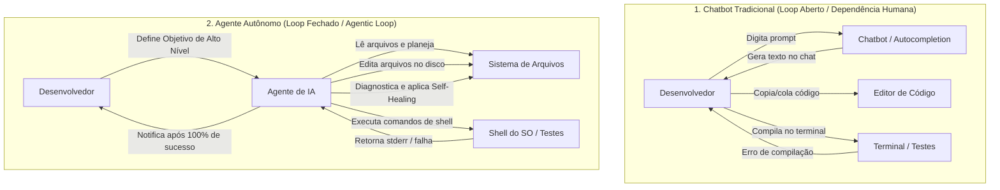
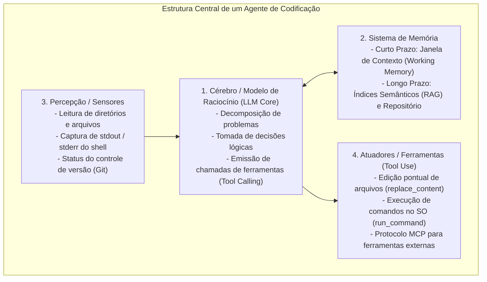
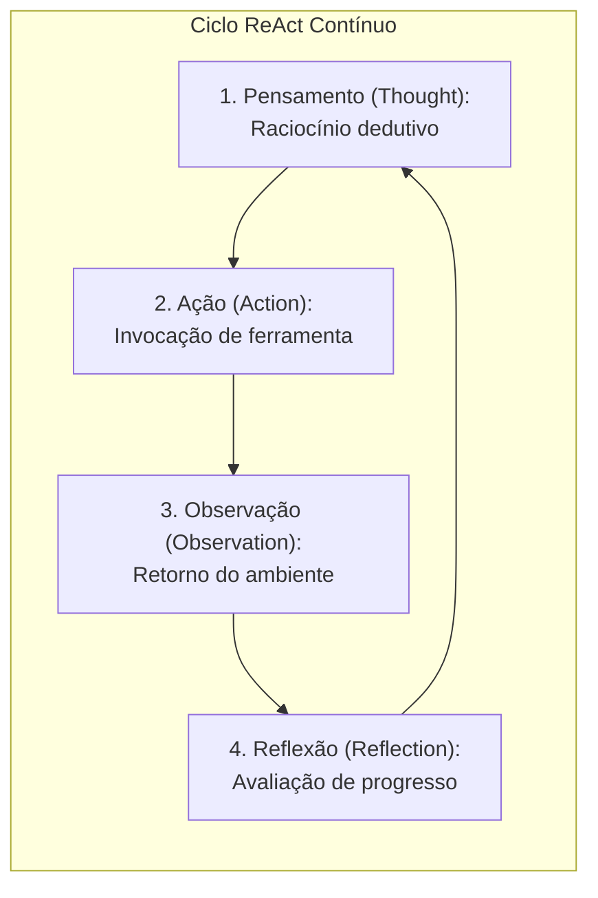
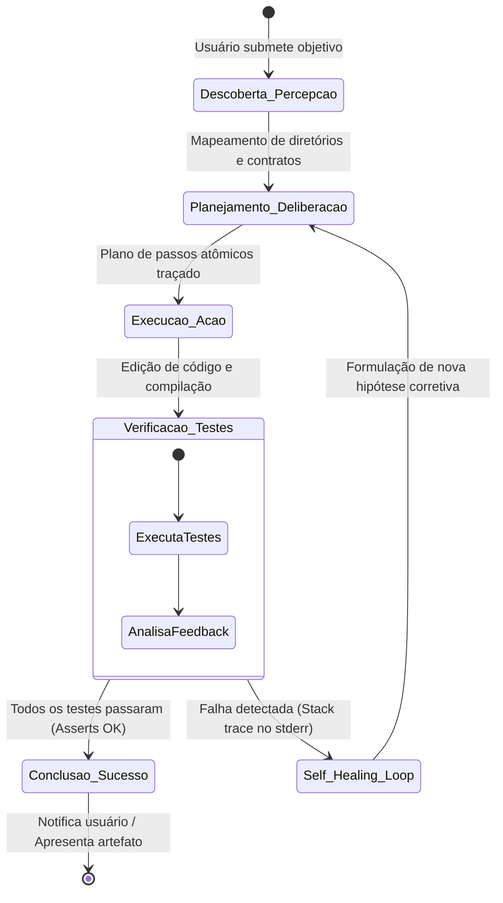
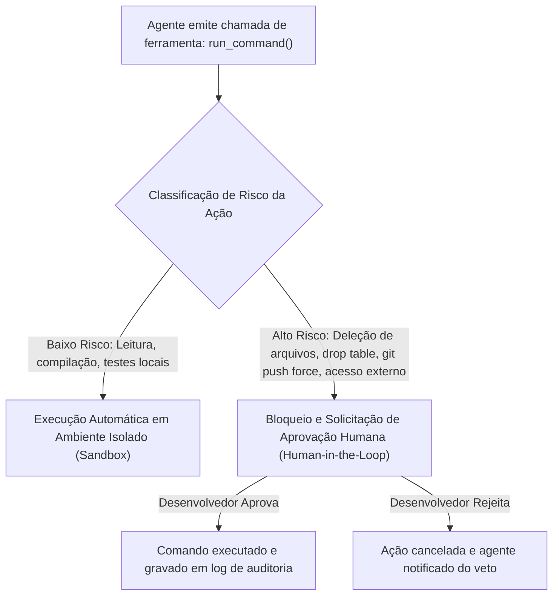

# 02 - Sistemas Agentivos de Desenvolvimento (CLI e IDE)

> **Matéria:** Engenharia de Software Assistida por IA e Sistemas Agentivos  
> **Cargo:** B02 – Técnico de Controle Externo – Especialidade: Tecnologia da Informação  
> **Arquivo:** `02_arquitetura_de_sistemas_agentivos_e_ferramentas_cli_ide.md`  


---


## 📌 Ementa / Itens do Edital
- Sistemas agentivos de desenvolvimento: arquitetura e funcionamento
- Assistentes de codificação em interfaces de terminal (CLI) e integradas a IDE (ex.: Claude Code, Antigravity CLI e equivalentes)
- Ciclo agentivo de desenvolvimento: descoberta, planejamento, execução, verificação e autocorreção (*self-healing*)
- Ações em sistema de arquivos e comandos de shell

---

## 🧭 Sumário

1. [Arquitetura dos Agentes de Codificação](#1-arquitetura-dos-agentes-de-codificacao)
    1. [A Evolução: De Chatbots Passivos a Agentes Orientados a Objetivos (Goal-Driven)](#11-a-evolucao-de-chatbots-passivos-a-agentes-orientados-a-objetivos-goal-driven)
    2. [Os Quatro Componentes Estruturais de um Agente de Software](#12-os-quatro-componentes-estruturais-de-um-agente-de-software)
    3. [Padrões de Interface: Agentes de Linha de Comando (CLI) vs. Agentes Nativos em IDE](#13-padroes-de-interface-agentes-de-linha-de-comando-cli-vs-agentes-nativos-em-ide)
    4. [Teste 129](#Teste-129)
    5. [Teste 130](#Teste-130)
    6. [Teste 131](#Teste-131)
2. [O Ciclo Agentivo de Desenvolvimento (The Agentic Loop)](#2-o-ciclo-agentivo-de-desenvolvimento-the-agentic-loop)
    1. [Fundamentos do Paradigma ReAct e Ciclo OODA](#21-fundamentos-do-paradigma-react-e-ciclo-ooda)
    2. [Fase 1: Descoberta e Coleta de Contexto (Percepção)](#22-fase-1-descoberta-e-coleta-de-contexto-percepcao)
    3. [Fase 2: Planejamento, Decomposição e Deliberação (Reasoning & Planning)](#23-fase-2-planejamento-decomposicao-e-deliberacao-reasoning-planning)
    4. [Fase 3: Execução de Ações no Ambiente (Action)](#24-fase-3-execucao-de-acoes-no-ambiente-action)
    5. [Fase 4: Verificação Autônoma e o Loop de Autocorreção (Self-Healing)](#25-fase-4-verificacao-autonoma-e-o-loop-de-autocorrecao-self-healing)
    6. [Critérios de Parada (Stop Conditions) e Disjuntores (Circuit Breakers)](#26-criterios-de-parada-stop-conditions-e-disjuntores-circuit-breakers)
    7. [Teste 132](#Teste-132)
    8. [Teste 133](#Teste-133)
    9. [Teste 134](#Teste-134)
    10. [Teste 135](#Teste-135)
    11. [Teste 136](#Teste-136)
3. [Ferramentas de Referência e Governança de Segurança](#3-ferramentas-de-referencia-e-governanca-de-seguranca)
    1. [Claude Code e a Filosofia Unix-First de Terminal](#31-claude-code-e-a-filosofia-unix-first-de-terminal)
    2. [Antigravity CLI e a Orquestração Hierárquica Multiagente](#32-antigravity-cli-e-a-orquestracao-hierarquica-multiagente)
    3. [Segurança Cibernética, Privilégio Mínimo e Human-in-the-Loop](#33-seguranca-cibernetica-privilegio-minimo-e-human-in-the-loop)
    4. [Teste 137](#Teste-137)
    5. [Teste 138](#Teste-138)
4. [Fontes Recomendadas na Internet](#4-fontes-recomendadas-na-internet)

---

## 1. Arquitetura dos Agentes de Codificação

### 1.1 A Evolução: De Chatbots Passivos a Agentes Orientados a Objetivos (Goal-Driven)
A evolução da inteligência artificial aplicada ao desenvolvimento de software pode ser compreendida pela transição entre sistemas de loop aberto (*Open-Loop*) e sistemas cibernéticos autônomos de loop fechado (*Closed-Loop*):



- **Chatbots e Completadores Passivos (Autocompletion):** Modelos reativos baseados em sugestão de texto fantasma (*ghost text*). O desenvolvedor programa manualmente e o modelo prevê a próxima linha. Diante de erros sintáticos ou falhas em testes, o desenvolvedor precisa copiar o log, colar na caixa de diálogo e pedir uma nova versão, aplicando o código manualmente no editor.
- **Agentes Autônomos Orientados a Objetivos (*Goal-Driven Agents*):** O usuário define a meta macro em linguagem natural (ex.: *"Implemente a emissão de certidão de débitos tributários com tratamento de concorrência e testes unitários"*). O agente assume a condução do fluxo: descobre a estrutura do projeto, inspeciona dependências, cria ou modifica arquivos no disco rígido, executa o compilador no shell, analisa as saídas de erro e realiza ciclos contínuos de autocorreção até que todas as condições de sucesso sejam satisfeitas.

### 1.2 Os Quatro Componentes Estruturais de um Agente de Software
Segundo a taxonomia clássica de agentes autônomos baseados em LLMs (formalizada por Lilian Weng, 2023), um agente de engenharia de software estrutura-se em quatro pilares articulados:



1. **Cérebro / Modelo de Raciocínio (LLM Core):** O modelo fundacional de ponta (ex.: Claude 3.5 Sonnet, GPT-4o) responsável pelo raciocínio lógico, interpretação de regras de negócio, planejamento em etapas e decisão de qual ferramenta acionar a cada instante.
2. **Sistema de Memória:**
    - **Memória de Curto Prazo (*Working Memory*):** Reside na janela de contexto da sessão ativa. Retém o objetivo da tarefa, o plano de trabalho corrente, o histórico recente de ações executadas e os logs parciais retornados pelo terminal.
    - **Memória de Longo Prazo:** Bases vetoriais locais ou grafos de código que mantêm o repositório indexado semanticamente, além de documentações e diretrizes institucionais persistentes entre sessões.

3. **Módulo de Percepção / Sensores:** Permite ao agente observar o ambiente de software:
    - Inspeção estrutural de diretórios (`list_dir`, `glob`);
    - Leitura pontual de arquivos de código (`view_file`, `grep`);
    - Captura dos fluxos padrão de saída (`stdout`) e de erro (`stderr`) emitidos pelo sistema operacional;
    - Monitoramento do status do controle de versão (`git status`, `git diff`).

4. **Módulo de Atuadores / Ferramentas (*Tool Use*):** Mecanismos determinísticos fornecidos pela aplicação hospedeira para que o agente altere o ambiente:
    - Manipulação de arquivos (`write_to_file`, `replace_file_content`);
    - Execução de processos e comandos de shell (`run_command`);
    - Invocação de ferramentas e serviços externos padronizados via protocolo MCP (*Model Context Protocol*).

### 1.3 Padrões de Interface: Agentes de Linha de Comando (CLI) vs. Agentes Nativos em IDE

| Dimensão Técnica | Agentes de Linha de Comando (CLI) | Agentes Integrados à IDE (IDE Native) |
|---|---|---|
| **Exemplos de Referência** | Claude Code, Antigravity CLI, Aider, Mentat. | Cursor, Windsurf, Copilot Workspace, Continue.dev. |
| **Ambiente de Hospedagem** | Terminal do Sistema Operacional (Bash, Zsh, PowerShell). | Painéis internos de Ambientes de Desenvolvimento Integrados (forks do VS Code, plugins JetBrains). |
| **Acesso a Ferramentas** | Acesso nativo direto a comandos do SO (`git`, `grep`, `find`, `docker`, scripts shell compilados). | Acesso intermediado por APIs da IDE e protocolos de linguagem (LSP - *Language Server Protocol*). |
| **Consumo de Recursos** | Mínimo overhead de memória e CPU; dispensa renderização de interfaces gráficas pesadas. | Elevado consumo de memória RAM devido aos processos gráficos e servidores de linguagem paralelos. |
| **Cenário de Uso Ideal** | Servidores remotos via SSH, máquinas virtuais sem interface gráfica (*headless*), automações de esteiras CI/CD e refatorações multi-repositório. | Programação interativa do dia a dia com edição visual lado a lado e navegação gráfica do código. |

---

### Teste 129
**(FGV – TCE-PA – Auditor de Controle Externo Administrativa Ciencia de Dados – 2024)**
Com relação ao framework pytest, da linguagem de programação Python, avalie as afirmativas a seguir: I. O comando pytest executa os arquivos no formato test_*.py ou *_test.py no diretório corrente e nos subdiretórios. II. O comando abaixo mostra os 5 testes com maior tempo de duração. >>> pytest -vv --durations=5 III. É possível invocar o framework pytest usando o próprio interpretador do Python por meio do comando abaixo: >>> python -m pytest Está correto o que se afirma em

* **A)** I, apenas.
* **B)** II, apenas.
* **C)** I e II, apenas.
* **D)** II e III, apenas.
* **E)** I, II e III.

---

> **Comentário Detalhado:**
>
> - **A)** **Incorreta.** A opção incorre em restrição indevida ao limitar o escopo conceitual ao afirmar que "I, apenas". De acordo com a teoria estudada em *1.3 Padrões de Interface: Agentes de Linha de Comando (CLI) vs. Agentes Nativos em IDE*, cenário de Uso Ideal: Servidores remotos via SSH, máquinas virtuais sem interface gráfica (*headless*), automações de esteiras CI/CD e refatorações multi-repositório. — Programação interativa do dia a dia com edição visual lado a lado e navegação gráfica do código.
> - **B)** **Incorreta.** A opção incorre em restrição indevida ao limitar o escopo conceitual ao afirmar que "II, apenas". De acordo com a teoria estudada em *1.1 A Evolução: De Chatbots Passivos a Agentes Orientados a Objetivos (Goal-Driven)*, o agente assume a condução do fluxo: descobre a estrutura do projeto, inspeciona dependências, cria ou modifica arquivos no disco rígido, executa o compilador no shell, analisa as saídas de erro e realiza ciclos contínuos de autocorreção até que todas as condições de sucesso sejam satisfeitas.
> - **C)** **Incorreta.** A opção incorre em restrição indevida ao limitar o escopo conceitual ao afirmar que "I e II, apenas". De acordo com a teoria estudada em *1.3 Padrões de Interface: Agentes de Linha de Comando (CLI) vs. Agentes Nativos em IDE*, acesso a Ferramentas: Acesso nativo direto a comandos do SO (`git`, `grep`, `find`, `docker`, scripts shell compilados). — Acesso intermediado por APIs da IDE e protocolos de linguagem (LSP - *Language Server Protocol*).
> - **D)** **Incorreta.** A opção incorre em restrição indevida ao limitar o escopo conceitual ao afirmar que "II e III, apenas". De acordo com a teoria estudada em *1.3 Padrões de Interface: Agentes de Linha de Comando (CLI) vs. Agentes Nativos em IDE*, consumo de Recursos: Mínimo overhead de memória e CPU; dispensa renderização de interfaces gráficas pesadas. — Elevado consumo de memória RAM devido aos processos gráficos e servidores de linguagem paralelos.
> - **E)** **Correta.** Conforme fundamentado na seção *2.5 Fase 4: Verificação Autônoma e o Loop de Autocorreção (Self-Healing)* deste guia, disparo de Verificadores: O agente roda suítes automatizadas de testes unitários e de integração (`pytest`, `jest`, `mvn test`), bem como linters e analisadores estáticos. Dessa forma, está plenamente correta a assertiva da banca (FGV – TCE-PA/2024) ao estabelecer que "I, II e III".
>
> **Gabarito: E**

---

### Teste 130
**(FUMARC – TRT-3 – Analista Judiciario Apoio Especializado Tecnologia da Informacao – 2022)**
33 Analise as afirmativas sobre as tecnologias utilizadas na Arquitetura de Desenvolvimento da Plataforma Digital do Poder Judiciário (PDPJ-Br). I – Flyway é uma ferramenta para organização de scripts SQL que são executados no banco de dados, funcionando como um controle de versão do mesmo. II – MapStruct é um gerador de código para a implementação de mapeamento entre tipos de beans java. III – Keycloak é uma linguagem de descrição de interface para descrever APIs RESTful expressas usando JSON. Está CORRETO o que se afirma em:

* **A)** I, apenas.
* **B)** I e II, apenas.
* **C)** I e III, apenas.
* **D)** II e III, apenas.
* **E)** I, II e III.

---

> **Comentário Detalhado:**
>
> - **A)** **Incorreta.** A opção incorre em restrição indevida ao limitar o escopo conceitual ao afirmar que "I, apenas". De acordo com a teoria estudada em *2.2 Fase 1: Descoberta e Coleta de Contexto (Percepção)*, identificação da Pilha Tecnológica: Localização e leitura de manifestos de dependências (`pom.xml` para Java, `package.json` para TypeScript/Node, `pyproject.toml` para Python).
> - **B)** **Correta.** Conforme fundamentado na seção *1.3 Padrões de Interface: Agentes de Linha de Comando (CLI) vs. Agentes Nativos em IDE* deste guia, acesso a Ferramentas: Acesso nativo direto a comandos do SO (`git`, `grep`, `find`, `docker`, scripts shell compilados). — Acesso intermediado por APIs da IDE e protocolos de linguagem (LSP - *Language Server Protocol*). Dessa forma, está plenamente correta a assertiva da banca (FUMARC – TRT-3/2022) ao estabelecer que "I e II, apenas".
> - **C)** **Incorreta.** A opção incorre em restrição indevida ao limitar o escopo conceitual ao afirmar que "I e III, apenas". De acordo com a teoria estudada em *1.3 Padrões de Interface: Agentes de Linha de Comando (CLI) vs. Agentes Nativos em IDE*, ambiente de Hospedagem: Terminal do Sistema Operacional (Bash, Zsh, PowerShell). — Painéis internos de Ambientes de Desenvolvimento Integrados (forks do VS Code, plugins JetBrains).
> - **D)** **Incorreta.** A opção incorre em restrição indevida ao limitar o escopo conceitual ao afirmar que "II e III, apenas". De acordo com a teoria estudada em *1.3 Padrões de Interface: Agentes de Linha de Comando (CLI) vs. Agentes Nativos em IDE*, consumo de Recursos: Mínimo overhead de memória e CPU; dispensa renderização de interfaces gráficas pesadas. — Elevado consumo de memória RAM devido aos processos gráficos e servidores de linguagem paralelos.
> - **E)** **Incorreta.** A opção apresenta proposição em desacordo com os fundamentos teóricos e técnicos do tópico ao afirmar que "I, II e III". De acordo com a teoria estudada em *3.3 Segurança Cibernética, Privilégio Mínimo e Human-in-the-Loop*, em contrapartida, para ações potencialmente destrutivas ou com efeitos colaterais irreversíveis (ex.: exclusão de arquivos, comandos com privilégios de superusuário `sudo`, alterações de banco de dados ou operações forçadas de rede), o sistema deve obrigatoriamente impor confirmação humana explícita (*Human-in-the-Loop*).
>
> **Gabarito: B**

---

### Teste 131
**(FGV – TCE-GO – Analista de Controle Externo Tecnologia da Informacao – 2024)**
Na programação estruturada, os laços de repetição são fundamentais para executar uma determinada sequência de instruções várias vezes, facilitando a automação de tarefas repetitivas. Dois dos laços mais comuns são os comandos "for" e "while", cada um com suas características específicas. Assinale a opção que descreve corretamente as diferenças entre os laços "for" e "while" na programação estruturada.

* **A)** O laço "for" é adequado para situações em que o número de iterações é conhecido antecipadamente, enquanto o laço "while" atende situações em que o número de iterações é desconhecido e depende de uma condição.
* **B)** O laço "for" é usado quando se deseja percorrer uma coleção de elementos, como uma lista ou um array, enquanto o laço "while" é aplicado em situações em que é necessário repetir uma ação até que uma condição específica seja atendida.
* **C)** O laço "for" é uma opção mais flexível, pois permite a declaração e inicialização de variáveis de controle dentro da própria estrutura do laço, enquanto o laço "while" exige que essas variáveis sejam definidas antes do laço.
* **D)** O laço "while" é mais propenso a causar loops infinitos se a condição de parada não for adequadamente definida, enquanto o laço "for" oferece controle sobre o número de iterações devido à sua estrutura mais definida.
* **E)** O laço "while" é mais eficiente em termos de desempenho do que o laço "for", pois avalia a condição de parada apenas no início de cada iteração, enquanto o laço "for" precisa avaliar a condição a cada iteração.

---

> **Comentário Detalhado:**
>
> - **A)** **Correta.** Conforme fundamentado na seção *2.6 Critérios de Parada (Stop Conditions) e Disjuntores (Circuit Breakers)* deste guia, disjuntor (*Circuit Breaker*): Limite máximo parametrizado de iterações consecutivas sem progresso (tipicamente entre 3 e 5 iterações de *Self-Healing*). Dessa forma, está plenamente correta a assertiva da banca (FGV – TCE-GO/2024) ao estabelecer que "O laço "for" é adequado para situações em que o número de iterações é conhecido antecipadamente, enquanto o laço...".
> - **B)** **Incorreta.** A opção apresenta proposição em desacordo com os fundamentos teóricos e técnicos do tópico ao afirmar que "O laço "for" é usado quando se deseja percorrer uma coleção de elementos, como uma lista ou um array, enquanto o...". De acordo com a teoria estudada em *2.1 Fundamentos do Paradigma ReAct e Ciclo OODA*, o núcleo operacional que rege o comportamento autônomo apoia-se no paradigma ReAct (*Reasoning + Acting*, Yao et al., 2023), integrando raciocínio reflexivo e ação no mundo físico.
> - **C)** **Incorreta.** A opção apresenta proposição em desacordo com os fundamentos teóricos e técnicos do tópico ao afirmar que "O laço "for" é uma opção mais flexível, pois permite a declaração e inicialização de variáveis de controle dentro...". De acordo com a teoria estudada em *3.2 Antigravity CLI e a Orquestração Hierárquica Multiagente*, emissão Estruturada de Artefatos: Geração de relatórios, memoriais de cálculo e planos de execução em arquivos Markdown estruturados, facilitando a inspeção e conferência humana antes e durante a execução.
> - **D)** **Incorreta.** A opção apresenta proposição em desacordo com os fundamentos teóricos e técnicos do tópico ao afirmar que "O laço "while" é mais propenso a causar loops infinitos se a condição de parada não for adequadamente definida...". De acordo com a teoria estudada em *2.6 Critérios de Parada (Stop Conditions) e Disjuntores (Circuit Breakers)*, para evitar que o agente entre em ciclos infinitos de tentativa e erro que consumam excessivamente a cota de tokens e recursos de máquina, arquiteturas agentivas incorporam critérios rígidos de parada.
> - **E)** **Incorreta.** A opção incorre em restrição indevida ao limitar o escopo conceitual ao afirmar que "O laço "while" é mais eficiente em termos de desempenho do que o laço "for", pois avalia a condição de parada...". De acordo com a teoria estudada em *1.1 A Evolução: De Chatbots Passivos a Agentes Orientados a Objetivos (Goal-Driven)*, diante de erros sintáticos ou falhas em testes, o desenvolvedor precisa copiar o log, colar na caixa de diálogo e pedir uma nova versão, aplicando o código manualmente no editor.
>
> **Gabarito: A**

---

## 2. O Ciclo Agentivo de Desenvolvimento (The Agentic Loop)

### 2.1 Fundamentos do Paradigma ReAct e Ciclo OODA
O núcleo operacional que rege o comportamento autônomo apoia-se no paradigma **ReAct** (*Reasoning + Acting*, Yao et al., 2023), integrando raciocínio reflexivo e ação no mundo físico:



O ciclo opera em quatro fases sequenciais estruturadas:



### 2.2 Fase 1: Descoberta e Coleta de Contexto (Percepção)
Antes de redigir qualquer instrução de código, o agente inspeciona o ambiente para ancorar seu raciocínio em dados concretos:

1. **Identificação da Pilha Tecnológica:** Localização e leitura de manifestos de dependências (`pom.xml` para Java, `package.json` para TypeScript/Node, `pyproject.toml` para Python).
2. **Localização Cirúrgica de Símbolos:** Utilização de ferramentas de busca rápida (como `grep` ou comandos de busca semântica) para encontrar declarações exatas de métodos, evitando a leitura indiscriminada de pastas inteiras (o que provocaria esgotamento prematuro da janela de contexto).
3. **Mapeamento de Contratos e DDLs:** Identificação das interfaces, entidades e modelos já consolidados na base de código institucional.

### 2.3 Fase 2: Planejamento, Decomposição e Deliberação (Reasoning & Planning)
Nesta fase, o modelo formula uma estratégia de execução transparente:

- **Decomposição em Subtarefas Atômicas:** Em vez de tentar resolver um requisito complexo de uma só vez, o agente divide o problema em passos incrementais (ex.: 1. Criar migration no banco; 2. Implementar repositório; 3. Escrever regras de negócio no serviço; 4. Expor endpoint no controller; 5. Criar testes unitários).
- **Antecipação de Efeitos Colaterais:** Análise prévia de como a alteração impactará módulos interdependentes.
- **Mecanismo *Human-in-the-Loop* para Ambiguidade:** Caso o requisito de negócio contenha contradições ou indefinições, o agente pausa a execução e questiona o usuário de forma estruturada antes de tomar decisões arbitrárias.

### 2.4 Fase 3: Execução de Ações no Ambiente (Action)
O agente invoca as ferramentas disponibilizadas para alterar o estado do sistema:

- **Edição Atômica de Arquivos:** Aplicação de modificações cirúrgicas por correspondência de texto exato (`replace_file_content`), evitando a reescrita desnecessária de arquivos extensos de milhares de linhas (o que geraria alto custo e risco de truncamento acidental de código pré-existente).
- **Comandos de Terminal:** Compilação de código (`mvn compile`, `npm run build`), instalação de dependências e gerenciamento de processos em background.

### 2.5 Fase 4: Verificação Autônoma e o Loop de Autocorreção (Self-Healing)
É a fase que separa definitivamente um gerador estático de código de um sistema agentivo autônomo:

```mermaid
flowchart TD
    Exec["1. Execução de Testes Automatizados (pytest / mvn test / jest)"] --> Res{"Resultado da Execução"}
    Res -->|Sucesso Total (Exit Code 0)| Term["Conclui Tarefa com Sucesso"]
    Res -->|Falha ou Erro de Compilação (Exit Code != 0)| Cap["2. Captura do Stack Trace no stderr"]
    Cap --> Diag["3. Diagnóstico e Formulação de Nova Hipótese"]
    Diag --> Edit["4. Aplicação de Ajuste Cirúrgico no Código"]
    Edit --> Exec
```

1. **Disparo de Verificadores:** O agente roda suítes automatizadas de testes unitários e de integração (`pytest`, `jest`, `mvn test`), bem como linters e analisadores estáticos.
2. **Captura do Feedback do Ambiente:** O agente intercepta o código de retorno do processo (*exit code*) e os logs detalhados de erro emitidos no canal `stderr`.
3. **Mecânica do *Self-Healing*:** Ao se deparar com uma falha (como um `NullPointerException` ou uma asserção de teste frustrada), o agente **não desiste nem repassa o problema ao usuário imediatamente**. Ele lê a linha exata apontada pelo stack trace, diagnostica a causa-raiz, elabora uma correção no código e dispara os testes novamente de forma totalmente autônoma.

### 2.6 Critérios de Parada (Stop Conditions) e Disjuntores (Circuit Breakers)
Para evitar que o agente entre em ciclos infinitos de tentativa e erro que consumam excessivamente a cota de tokens e recursos de máquina, arquiteturas agentivas incorporam critérios rígidos de parada:

- **Critério de Sucesso:** Aprovação integral de 100% dos testes e ausência de violações no linter.
- **Disjuntor (*Circuit Breaker*):** Limite máximo parametrizado de iterações consecutivas sem progresso (tipicamente entre 3 e 5 iterações de *Self-Healing*). Ao atingir o limite, o disjuntor interrompe o loop, reverte alterações defeituosas via Git e convoca a intervenção do desenvolvedor humano com um relatório detalhado das falhas persistentes.

---

### Teste 132
**(FCC – TRT-4 – Analista Judiciario Tecnologia da Informacao – 2015)**
Considere os dois trechos de código PL/SQL do Oracle 11g. Trecho 1 Trecho 2 SQL> BEGIN 2 FOR cont IN 1..3 LOOP 3 DBMS_OUTPUT.PUT_LINE 4 ('Dentro do loop, cont = ' || TO_CHAR(cont)); 5 END LOOP; 6 7 DBMS_OUTPUT.PUT_LINE 8 ('Fora do loop, cont = ' || TO_CHAR(cont)); 9 END; 10 / O trecho

* **A)** 1 e o trecho 2 estão corretos e irão executar sem erros. SQL> DECLARE 2 done BOOLEAN; 3 BEGIN 4 FOR cont IN 1..50 LOOP 5 IF done THEN 6 GOTO end_loop; 7 END IF; 8 <`<end_loop>`> 9 END LOOP; 10 END; 11 /
* **B)** 1 e o trecho 2 têm o mesmo erro: falta declarar a variável cont.
* **C)** 2 tem erro, pois o label <`<end_loop>`> da linha 8 está escrito com sintaxe errada: não existem << >>.
* **D)** 1 tem erro, pois não se pode referenciar a variável não declarada cont fora do LOOP.
* **E)** 2 apresenta erro na declaração da variável done e faltou declarar a variável cont.

---

> **Comentário Detalhado:**
>
> - **A)** **Incorreta.** A opção apresenta proposição em desacordo com os fundamentos teóricos e técnicos do tópico ao afirmar que "1 e o trecho 2 estão corretos e irão executar sem erros. SQL> DECLARE 2 done BOOLEAN; 3 BEGIN 4 FOR cont IN 1..50...". De acordo com a teoria estudada em *1.1 A Evolução: De Chatbots Passivos a Agentes Orientados a Objetivos (Goal-Driven)*, a evolução da inteligência artificial aplicada ao desenvolvimento de software pode ser compreendida pela transição entre sistemas de loop aberto (*Open-Loop*) e sistemas cibernéticos autônomos de loop fechado (*Closed-Loop*).
> - **B)** **Incorreta.** A opção apresenta proposição em desacordo com os fundamentos teóricos e técnicos do tópico ao afirmar que "1 e o trecho 2 têm o mesmo erro: falta declarar a variável cont". De acordo com a teoria estudada em *2.6 Critérios de Parada (Stop Conditions) e Disjuntores (Circuit Breakers)*, para evitar que o agente entre em ciclos infinitos de tentativa e erro que consumam excessivamente a cota de tokens e recursos de máquina, arquiteturas agentivas incorporam critérios rígidos de parada.
> - **C)** **Incorreta.** A opção apresenta proposição em desacordo com os fundamentos teóricos e técnicos do tópico ao afirmar que "2 tem erro, pois o label <`<end_loop>`> da linha 8 está escrito com sintaxe errada: não existem << >>". De acordo com a teoria estudada em *2.5 Fase 4: Verificação Autônoma e o Loop de Autocorreção (Self-Healing)*, ele lê a linha exata apontada pelo stack trace, diagnostica a causa-raiz, elabora uma correção no código e dispara os testes novamente de forma totalmente autônoma.
> - **D)** **Correta.** Conforme fundamentado na seção *2.5 Fase 4: Verificação Autônoma e o Loop de Autocorreção (Self-Healing)* deste guia, captura do Feedback do Ambiente: O agente intercepta o código de retorno do processo (*exit code*) e os logs detalhados de erro emitidos no canal `stderr`. Dessa forma, está plenamente correta a assertiva da banca (FCC – TRT-4/2015) ao estabelecer que "1 tem erro, pois não se pode referenciar a variável não declarada cont fora do LOOP".
> - **E)** **Incorreta.** A opção apresenta proposição em desacordo com os fundamentos teóricos e técnicos do tópico ao afirmar que "2 apresenta erro na declaração da variável done e faltou declarar a variável cont". De acordo com a teoria estudada em *2.5 Fase 4: Verificação Autônoma e o Loop de Autocorreção (Self-Healing)*, é a fase que separa definitivamente um gerador estático de código de um sistema agentivo autônomo.
>
> **Gabarito: D**

---

### Teste 133
**(FGV – TRT-24 – Analista Judiciario Area Apoio Especializado Tecnologia da Informacao – 2025)**
O Swagger Editor é um editor de código aberto usado para projetar, definir e documentar APIs HTTP segundo a especificação OpenAPI. A respeito dos pré-requisitos necessários para o editor ser executado localmente, avalie os itens a seguir. I. Git em qualquer versão. II. Node.js em versão 20.3.0. ou superior. III. Npm em versão 9.6.7 ou superior. IV. OAuth em versão 2.0 ou superior. São pré-requisitos necessários para que o Swagger Editor seja executado localmente os indicados em

* **A)** I e III, apenas.
* **B)** II e IV, apenas.
* **C)** I, II e III, apenas.
* **D)** I, II e IV, apenas.
* **E)** II, III e IV, apenas.

---

> **Comentário Detalhado:**
>
> - **A)** **Incorreta.** A opção incorre em restrição indevida ao limitar o escopo conceitual ao afirmar que "I e III, apenas". De acordo com a teoria estudada em *1.1 A Evolução: De Chatbots Passivos a Agentes Orientados a Objetivos (Goal-Driven)*, a evolução da inteligência artificial aplicada ao desenvolvimento de software pode ser compreendida pela transição entre sistemas de loop aberto (*Open-Loop*) e sistemas cibernéticos autônomos de loop fechado (*Closed-Loop*).
> - **B)** **Incorreta.** A opção incorre em restrição indevida ao limitar o escopo conceitual ao afirmar que "II e IV, apenas". De acordo com a teoria estudada em *2.2 Fase 1: Descoberta e Coleta de Contexto (Percepção)*, antes de redigir qualquer instrução de código, o agente inspeciona o ambiente para ancorar seu raciocínio em dados concretos.
> - **C)** **Correta.** Conforme fundamentado na seção *1.1 A Evolução: De Chatbots Passivos a Agentes Orientados a Objetivos (Goal-Driven)* deste guia, diante de erros sintáticos ou falhas em testes, o desenvolvedor precisa copiar o log, colar na caixa de diálogo e pedir uma nova versão, aplicando o código manualmente no editor. Dessa forma, está plenamente correta a assertiva da banca (FGV – TRT-24/2025) ao estabelecer que "I, II e III, apenas".
> - **D)** **Incorreta.** A opção incorre em restrição indevida ao limitar o escopo conceitual ao afirmar que "I, II e IV, apenas". De acordo com a teoria estudada em *2.4 Fase 3: Execução de Ações no Ambiente (Action)*, edição Atômica de Arquivos: Aplicação de modificações cirúrgicas por correspondência de texto exato (`replace_file_content`), evitando a reescrita desnecessária de arquivos extensos de milhares de linhas (o que geraria alto custo e risco de truncamento acidental de código pré-existente).
> - **E)** **Incorreta.** A opção incorre em restrição indevida ao limitar o escopo conceitual ao afirmar que "II, III e IV, apenas". De acordo com a teoria estudada em *2.4 Fase 3: Execução de Ações no Ambiente (Action)*, comandos de Terminal: Compilação de código (`mvn compile`, `npm run build`), instalação de dependências e gerenciamento de processos em background.
>
> **Gabarito: C**

---

### Teste 134
**(FGV – TRT-16 – Analista Judiciario Area Administrativa Tecnologia da Informacao – 2022)**
Analise o código Node.JS, exibido a seguir, que estabelece um servidor HTTP que recebe e responde mensagens. var http = require('http'); http.createServer(function (req, res) { res.write('Ok'); res.end(); }).listen(8080); Assinale a afirmativa correta a respeito dessa operação.

* **A)** A função definida é executada somente em caso de erro de parâmetros.
* **B)** A função definida é sempre executada no lado cliente.
* **C)** O parâmetro req da função definida deve ser do tipo http.IncomingMessage object.
* **D)** O parâmetro req da função definida é opcional.
* **E)** O parâmetro res da função definida é opcional.

---

> **Comentário Detalhado:**
>
> - **A)** **Incorreta.** A opção incorre em restrição indevida ao limitar o escopo conceitual ao afirmar que "A função definida é executada somente em caso de erro de parâmetros". De acordo com a teoria estudada em *2.3 Fase 2: Planejamento, Decomposição e Deliberação (Reasoning & Planning)*, mecanismo *Human-in-the-Loop* para Ambiguidade: Caso o requisito de negócio contenha contradições ou indefinições, o agente pausa a execução e questiona o usuário de forma estruturada antes de tomar decisões arbitrárias.
> - **B)** **Incorreta.** A opção promove generalização excessiva que desconsidera as condições técnicas e normativas ao afirmar que "A função definida é sempre executada no lado cliente". De acordo com a teoria estudada em *4. Fontes Recomendadas na Internet*, model Context Protocol (MCP) Official Documentation - Arquitetura cliente-servidor do protocolo aberto MCP para integração de LLMs com ferramentas.
> - **C)** **Correta.** Conforme fundamentado na seção *1.1 A Evolução: De Chatbots Passivos a Agentes Orientados a Objetivos (Goal-Driven)* deste guia, a evolução da inteligência artificial aplicada ao desenvolvimento de software pode ser compreendida pela transição entre sistemas de loop aberto (*Open-Loop*) e sistemas cibernéticos autônomos de loop fechado (*Closed-Loop*). Dessa forma, está plenamente correta a assertiva da banca (FGV – TRT-16/2022) ao estabelecer que "O parâmetro req da função definida deve ser do tipo http.IncomingMessage object".
> - **D)** **Incorreta.** A opção apresenta proposição em desacordo com os fundamentos teóricos e técnicos do tópico ao afirmar que "O parâmetro req da função definida é opcional". De acordo com a teoria estudada em *3.3 Segurança Cibernética, Privilégio Mínimo e Human-in-the-Loop*, em contrapartida, para ações potencialmente destrutivas ou com efeitos colaterais irreversíveis (ex.: exclusão de arquivos, comandos com privilégios de superusuário `sudo`, alterações de banco de dados ou operações forçadas de rede), o sistema deve obrigatoriamente impor confirmação humana explícita (*Human-in-the-Loop*).
> - **E)** **Incorreta.** A opção apresenta proposição em desacordo com os fundamentos teóricos e técnicos do tópico ao afirmar que "O parâmetro res da função definida é opcional". De acordo com a teoria estudada em *2.2 Fase 1: Descoberta e Coleta de Contexto (Percepção)*, identificação da Pilha Tecnológica: Localização e leitura de manifestos de dependências (`pom.xml` para Java, `package.json` para TypeScript/Node, `pyproject.toml` para Python).
>
> **Gabarito: C**

---

### Teste 135
**(CEBRASPE – TJ-RJ – Analista Judiciario Grupo Tecnologia da Informacao Analista de Infraestrutura de Tic – 2021)**
Considere que, no log de uma instância do Microsoft SQL Server, é encontrada a mensagem: “Falha na atualização do SQL Server. Para continuar, investigue o motivo da falha, corrija o problema e repare a instalação”. Assinale a opção que descreve o comando a ser usado para executar o processo de reparação da instância de nome instance.

* **A)** Setup.exe/q /ACTION=ENU /INSTANCENAME=instance
* **B)** Setup.exe /q /ACTION=UpdateEnabled /INSTANCENAME=instance
* **C)** Setup.exe /q /ACTION=Install /INSTANCENAME=instance
* **D)** Setup.exe /q /ACTION=Sysprep /INSTANCENAME=instance
* **E)** Setup.exe /q /ACTION=Repair /INSTANCENAME=instance

---

> **Comentário Detalhado:**
>
> - **A)** **Incorreta.** A opção apresenta proposição em desacordo com os fundamentos teóricos e técnicos do tópico ao afirmar que "Setup.exe/q /ACTION=ENU /INSTANCENAME=instance". De acordo com a teoria estudada em *2.4 Fase 3: Execução de Ações no Ambiente (Action)*, o agente invoca as ferramentas disponibilizadas para alterar o estado do sistema.
> - **B)** **Incorreta.** A opção apresenta proposição em desacordo com os fundamentos teóricos e técnicos do tópico ao afirmar que "Setup.exe /q /ACTION=UpdateEnabled /INSTANCENAME=instance". De acordo com a teoria estudada em *2.4 Fase 3: Execução de Ações no Ambiente (Action)*, edição Atômica de Arquivos: Aplicação de modificações cirúrgicas por correspondência de texto exato (`replace_file_content`), evitando a reescrita desnecessária de arquivos extensos de milhares de linhas (o que geraria alto custo e risco de truncamento acidental de código pré-existente).
> - **C)** **Incorreta.** A opção apresenta proposição em desacordo com os fundamentos teóricos e técnicos do tópico ao afirmar que "Setup.exe /q /ACTION=Install /INSTANCENAME=instance". De acordo com a teoria estudada em *2.5 Fase 4: Verificação Autônoma e o Loop de Autocorreção (Self-Healing)*, mecânica do *Self-Healing*: Ao se deparar com uma falha (como um `NullPointerException` ou uma asserção de teste frustrada), o agente não desiste nem repassa o problema ao usuário imediatamente.
> - **D)** **Incorreta.** A opção apresenta proposição em desacordo com os fundamentos teóricos e técnicos do tópico ao afirmar que "Setup.exe /q /ACTION=Sysprep /INSTANCENAME=instance". De acordo com a teoria estudada em *1.3 Padrões de Interface: Agentes de Linha de Comando (CLI) vs. Agentes Nativos em IDE*, acesso a Ferramentas: Acesso nativo direto a comandos do SO (`git`, `grep`, `find`, `docker`, scripts shell compilados). — Acesso intermediado por APIs da IDE e protocolos de linguagem (LSP - *Language Server Protocol*).
> - **E)** **Correta.** Conforme fundamentado na seção *2.4 Fase 3: Execução de Ações no Ambiente (Action)* deste guia, comandos de Terminal: Compilação de código (`mvn compile`, `npm run build`), instalação de dependências e gerenciamento de processos em background. Dessa forma, está plenamente correta a assertiva da banca (CEBRASPE – TJ-RJ/2021) ao estabelecer que "Setup.exe /q /ACTION=Repair /INSTANCENAME=instance".
>
> **Gabarito: E**

---

### Teste 136
**(FCC – TRT-6 – Analista Judiciario Apoio Especializado Tecnologia da Informacao – 2012)**
O termo malware é uma denominação genérica para designar software projetado para causar danos a quem o executa. Software assim pode ganhar acesso a um computador através dos seguintes meios, EXCETO

* **A)** um arquivo .mp3 que infecta o sistema ao ser tocado.
* **B)** um arquivo .doc que infecta o sistema ao ser aberto no editor.
* **C)** uma extensão do navegador que infecta o sistema ao ser executada.
* **D)** um programa executável que infecta o sistema ao ser executado.
* **E)** uma arquivo .xls que infecta o sistema ao ser aberto.

---

> **Comentário Detalhado:**
>
> - **A)** **Correta.** Conforme fundamentado na seção *1.1 A Evolução: De Chatbots Passivos a Agentes Orientados a Objetivos (Goal-Driven)* deste guia, a evolução da inteligência artificial aplicada ao desenvolvimento de software pode ser compreendida pela transição entre sistemas de loop aberto (*Open-Loop*) e sistemas cibernéticos autônomos de loop fechado (*Closed-Loop*). Dessa forma, está plenamente correta a assertiva da banca (FCC – TRT-6/2012) ao estabelecer que "um arquivo .mp3 que infecta o sistema ao ser tocado".
> - **B)** **Incorreta.** A opção apresenta proposição em desacordo com os fundamentos teóricos e técnicos do tópico ao afirmar que "um arquivo .doc que infecta o sistema ao ser aberto no editor". De acordo com a teoria estudada em *1.1 A Evolução: De Chatbots Passivos a Agentes Orientados a Objetivos (Goal-Driven)*, diante de erros sintáticos ou falhas em testes, o desenvolvedor precisa copiar o log, colar na caixa de diálogo e pedir uma nova versão, aplicando o código manualmente no editor.
> - **C)** **Incorreta.** A opção apresenta proposição em desacordo com os fundamentos teóricos e técnicos do tópico ao afirmar que "uma extensão do navegador que infecta o sistema ao ser executada". De acordo com a teoria estudada em *2.4 Fase 3: Execução de Ações no Ambiente (Action)*, o agente invoca as ferramentas disponibilizadas para alterar o estado do sistema.
> - **D)** **Incorreta.** A opção apresenta proposição em desacordo com os fundamentos teóricos e técnicos do tópico ao afirmar que "um programa executável que infecta o sistema ao ser executado". De acordo com a teoria estudada em *1.1 A Evolução: De Chatbots Passivos a Agentes Orientados a Objetivos (Goal-Driven)*, chatbots e Completadores Passivos (Autocompletion): Modelos reativos baseados em sugestão de texto fantasma (*ghost text*). O desenvolvedor programa manualmente e o modelo prevê a próxima linha.
> - **E)** **Incorreta.** A opção apresenta proposição em desacordo com os fundamentos teóricos e técnicos do tópico ao afirmar que "uma arquivo .xls que infecta o sistema ao ser aberto". De acordo com a teoria estudada em *4. Fontes Recomendadas na Internet*, model Context Protocol (MCP) Official Documentation - Arquitetura cliente-servidor do protocolo aberto MCP para integração de LLMs com ferramentas.
>
> **Gabarito: A**

---

## 3. Ferramentas de Referência e Governança de Segurança

### 3.1 Claude Code e a Filosofia Unix-First de Terminal
Desenvolvido pela Anthropic, o **Claude Code** tornou-se a referência contemporânea de assistente agentivo operado diretamente no terminal:

- **Integração com Ferramental Nativo:** Opera sobre o repositório git local utilizando ferramentas integradas como `Bash`, `Glob`, `Grep`, `FileEdit` e `FileRead`.
- **Raciocínio Contextual em Larga Escala:** Capacidade de analisar o grafo de arquivos do projeto para propor refatorações complexas mantendo compatibilidade com código legado.

### 3.2 Antigravity CLI e a Orquestração Hierárquica Multiagente
O **Antigravity CLI** destaca-se pela sua arquitetura modular voltada para governança e execução de tarefas concorrentes:

- **Delegação a Subagentes Especializados:** Capacidade de criar e despachar agentes filhos isolados (*subagents*) para atuar em tarefas complementares (ex.: um subagente encarregado de pesquisar documentações, outro focado em testes unitários e um terceiro dedicado à auditoria de vulnerabilidades de segurança).
- **Emissão Estruturada de Artefatos:** Geração de relatórios, memoriais de cálculo e planos de execução em arquivos Markdown estruturados, facilitando a inspeção e conferência humana antes e durante a execução.

### 3.3 Segurança Cibernética, Privilégio Mínimo e Human-in-the-Loop
A concessão de autonomia para que uma IA execute comandos de terminal exige controles de segurança e governança corporativa:



> 🚨 **ALERTA DE PROVA / FCC:**  
> A banca explora com rigor a fronteira entre a autonomia do **Self-Healing** e o controle de **Comandos Críticos**:  
>
> - No *Self-Healing*, o agente possui autonomia plena para **editar o código e reexecutar testes locais em loop fechado** sem requerer confirmação humana a cada linha alterada.  
> - Em contrapartida, para ações potencialmente destrutivas ou com efeitos colaterais irreversíveis (ex.: exclusão de arquivos, comandos com privilégios de superusuário `sudo`, alterações de banco de dados ou operações forçadas de rede), o sistema **deve obrigatoriamente impor confirmação humana explícita (*Human-in-the-Loop*)**.
> - **Princípio do Menor Privilégio (*Least Privilege*):** Agentes de desenvolvimento devem operar em ambientes isolados (*sandboxes* ou containers Docker/Podman) e nunca com privilégios de administrador/root da infraestrutura.

---

### Teste 137
**(FGV – TCE-SC – Auditor Fiscal de Controle Externo Ciencias da Computacao Sistemas de Informacao – 2026)**
Um auditor precisa consolidar dados de 12 planilhas mensais diferentes em um único relatório anual no Excel 365. Ele deseja que, ao atualizar um dado na planilha mensal, o relatório anual seja atualizado automaticamente, sem a necessidade de copiar e colar. O recurso do Excel 365 mais adequado para realizar essa extração e transformação de dados de fontes externas é

* **A)** a criação de atalhos na área de trabalho para cada arquivo.
* **B)** o uso da área de transferência com Colar Especial -> Valores.
* **C)** o Power Query.
* **D)** a gravação de uma macro para formatar a fonte do cabeçalho.
* **E)** a inserção de um gráfico de pizza em cada planilha mensal.

---

> **Comentário Detalhado:**
>
> - **A)** **Incorreta.** A opção apresenta proposição em desacordo com os fundamentos teóricos e técnicos do tópico ao afirmar que "a criação de atalhos na área de trabalho para cada arquivo". De acordo com a teoria estudada em *1.2 Os Quatro Componentes Estruturais de um Agente de Software*, memória de Curto Prazo (*Working Memory*): Reside na janela de contexto da sessão ativa. Retém o objetivo da tarefa, o plano de trabalho corrente, o histórico recente de ações executadas e os logs parciais retornados pelo terminal.
> - **B)** **Correta.** Conforme fundamentado na seção *1.1 A Evolução: De Chatbots Passivos a Agentes Orientados a Objetivos (Goal-Driven)* deste guia, diante de erros sintáticos ou falhas em testes, o desenvolvedor precisa copiar o log, colar na caixa de diálogo e pedir uma nova versão, aplicando o código manualmente no editor. Dessa forma, está plenamente correta a assertiva da banca (FGV – TCE-SC/2026) ao estabelecer que "o uso da área de transferência com Colar Especial -> Valores".
> - **C)** **Incorreta.** A opção apresenta proposição em desacordo com os fundamentos teóricos e técnicos do tópico ao afirmar que "o Power Query". De acordo com a teoria estudada em *1.3 Padrões de Interface: Agentes de Linha de Comando (CLI) vs. Agentes Nativos em IDE*, cenário de Uso Ideal: Servidores remotos via SSH, máquinas virtuais sem interface gráfica (*headless*), automações de esteiras CI/CD e refatorações multi-repositório. — Programação interativa do dia a dia com edição visual lado a lado e navegação gráfica do código.
> - **D)** **Incorreta.** A opção apresenta proposição em desacordo com os fundamentos teóricos e técnicos do tópico ao afirmar que "a gravação de uma macro para formatar a fonte do cabeçalho". De acordo com a teoria estudada em *1.1 A Evolução: De Chatbots Passivos a Agentes Orientados a Objetivos (Goal-Driven)*, agentes Autônomos Orientados a Objetivos (*Goal-Driven Agents*): O usuário define a meta macro em linguagem natural (ex.: *"Implemente a emissão de certidão de débitos tributários com tratamento de concorrência e testes unitários"*).
> - **E)** **Incorreta.** A opção apresenta proposição em desacordo com os fundamentos teóricos e técnicos do tópico ao afirmar que "a inserção de um gráfico de pizza em cada planilha mensal". De acordo com a teoria estudada em *3.3 Segurança Cibernética, Privilégio Mínimo e Human-in-the-Loop*, em contrapartida, para ações potencialmente destrutivas ou com efeitos colaterais irreversíveis (ex.: exclusão de arquivos, comandos com privilégios de superusuário `sudo`, alterações de banco de dados ou operações forçadas de rede), o sistema deve obrigatoriamente impor confirmação humana explícita (*Human-in-the-Loop*).
>
> **Gabarito: B**

---

### Teste 138
**(CEBRASPE – TJ-RJ – Analista Judiciario Grupo Tecnologia da Informacao Analista de Gestao de Tic – 2021)**
Tipicamente, a gestão de projetos é adotada quando se deseja empreender tarefas

* **A)** repetitivas, sob prazo indeterminado e de forma rotineira.
* **B)** específicas, sob prazo indeterminado e de forma não rotineira.
* **C)** específicas, sob prazo determinado e de forma não rotineira.
* **D)** repetitivas, sob prazo determinado e de forma rotineira.
* **E)** recorrentes, sob prazo indeterminado e de forma rotineira.

---

> **Comentário Detalhado:**
>
> - **A)** **Incorreta.** A opção apresenta proposição em desacordo com os fundamentos teóricos e técnicos do tópico ao afirmar que "repetitivas, sob prazo indeterminado e de forma rotineira". De acordo com a teoria estudada em *1.2 Os Quatro Componentes Estruturais de um Agente de Software*, memória de Longo Prazo: Bases vetoriais locais ou grafos de código que mantêm o repositório indexado semanticamente, além de documentações e diretrizes institucionais persistentes entre sessões.
> - **B)** **Incorreta.** A opção apresenta proposição em desacordo com os fundamentos teóricos e técnicos do tópico ao afirmar que "específicas, sob prazo indeterminado e de forma não rotineira". De acordo com a teoria estudada em *2.3 Fase 2: Planejamento, Decomposição e Deliberação (Reasoning & Planning)*, mecanismo *Human-in-the-Loop* para Ambiguidade: Caso o requisito de negócio contenha contradições ou indefinições, o agente pausa a execução e questiona o usuário de forma estruturada antes de tomar decisões arbitrárias.
> - **C)** **Correta.** Conforme fundamentado na seção *1.2 Os Quatro Componentes Estruturais de um Agente de Software* deste guia, memória de Curto Prazo (*Working Memory*): Reside na janela de contexto da sessão ativa. Retém o objetivo da tarefa, o plano de trabalho corrente, o histórico recente de ações executadas e os logs parciais retornados pelo terminal. Dessa forma, está plenamente correta a assertiva da banca (CEBRASPE – TJ-RJ/2021) ao estabelecer que "específicas, sob prazo determinado e de forma não rotineira".
> - **D)** **Incorreta.** A opção apresenta proposição em desacordo com os fundamentos teóricos e técnicos do tópico ao afirmar que "repetitivas, sob prazo determinado e de forma rotineira". De acordo com a teoria estudada em *2.5 Fase 4: Verificação Autônoma e o Loop de Autocorreção (Self-Healing)*, ele lê a linha exata apontada pelo stack trace, diagnostica a causa-raiz, elabora uma correção no código e dispara os testes novamente de forma totalmente autônoma.
> - **E)** **Incorreta.** A opção apresenta proposição em desacordo com os fundamentos teóricos e técnicos do tópico ao afirmar que "recorrentes, sob prazo indeterminado e de forma rotineira". De acordo com a teoria estudada em *3.2 Antigravity CLI e a Orquestração Hierárquica Multiagente*, o Antigravity CLI destaca-se pela sua arquitetura modular voltada para governança e execução de tarefas concorrentes.
>
> **Gabarito: C**

---

## 4. Fontes Recomendadas na Internet

* [Model Context Protocol (MCP) Official Documentation](https://modelcontextprotocol.io/introduction) - Arquitetura cliente-servidor do protocolo aberto MCP para integração de LLMs com ferramentas.
* [ArXiv - ReAct: Synergizing Reasoning and Acting in Language Models (Yao et al.)](https://arxiv.org/abs/2210.03629) - Integração dinâmica de raciocínio verbal e execução de ações computacionais em agentes autônomos.
* [Anthropic Claude - Building Effective Agents Guide](https://docs.anthropic.com/en/docs/build-with-claude/prompt-engineering/overview) - Padrões de arquitetura agentiva: roteadores, encadeamentos, paralelismo e loops avaliador-otimizador.
* [NIST AI Risk Management Framework - Governance of Autonomous Systems](https://www.nist.gov/itl/ai-risk-management-framework) - Controle humano no loop (*human-in-the-loop*) e barreiras de segurança operacional.
* RUSSELL, Stuart; NORVIG, Peter. **Inteligência Artificial: Uma Abordagem Moderna**. 4. ed. Rio de Janeiro: GEN LTC, 2022. (Cap. 2 - Agentes Inteligentes e Arquiteturas Racionais).
* WOOLDRIDGE, Michael. **An Introduction to MultiAgent Systems**. 2. ed. Chichester: John Wiley & Sons, 2009. (Cap. 2 e 3 - Agentes Reativos e Deliberativos).
* HUYEN, Chip. **AI Engineering: Building Applications with Foundation Models**. Sebastopol: O'Reilly Media, 2025. (Cap. 5 - Autonomous Agents and Tool Use).
