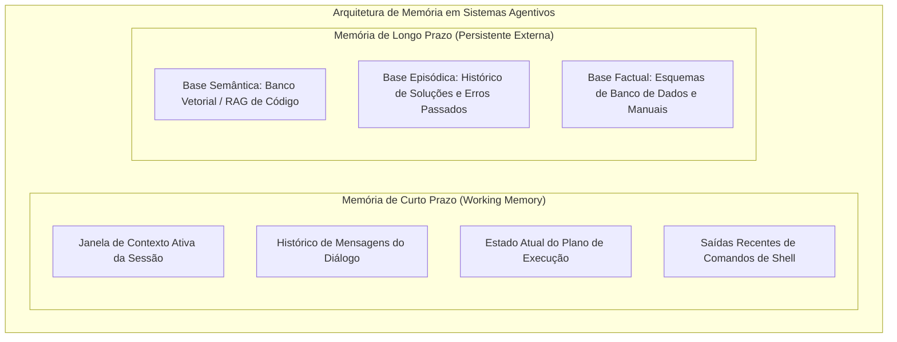
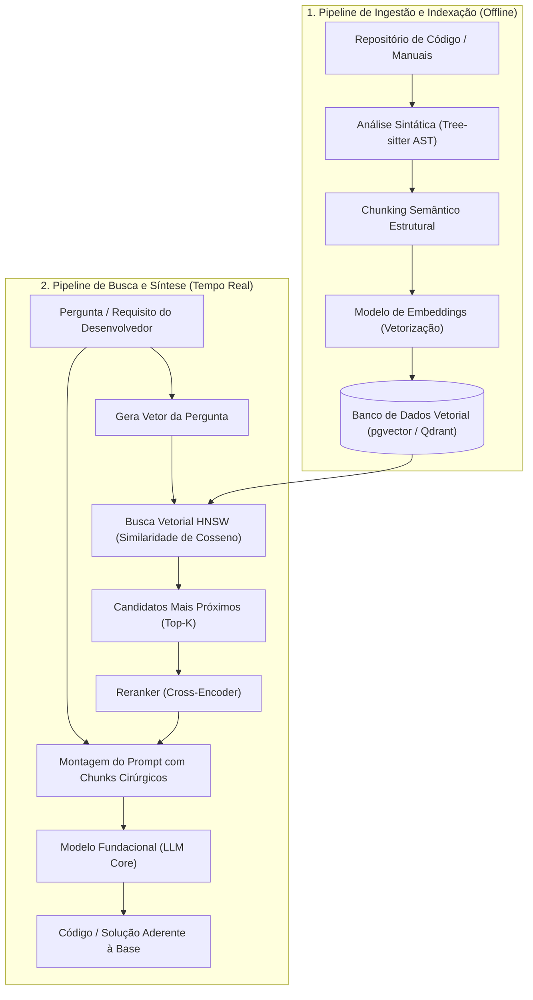
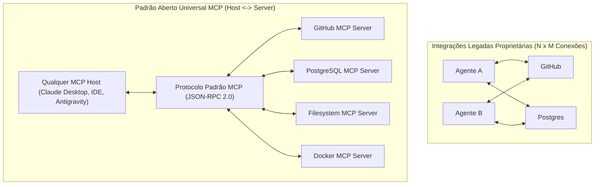
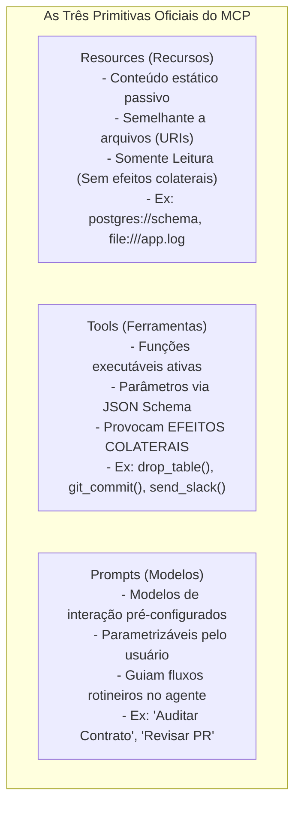
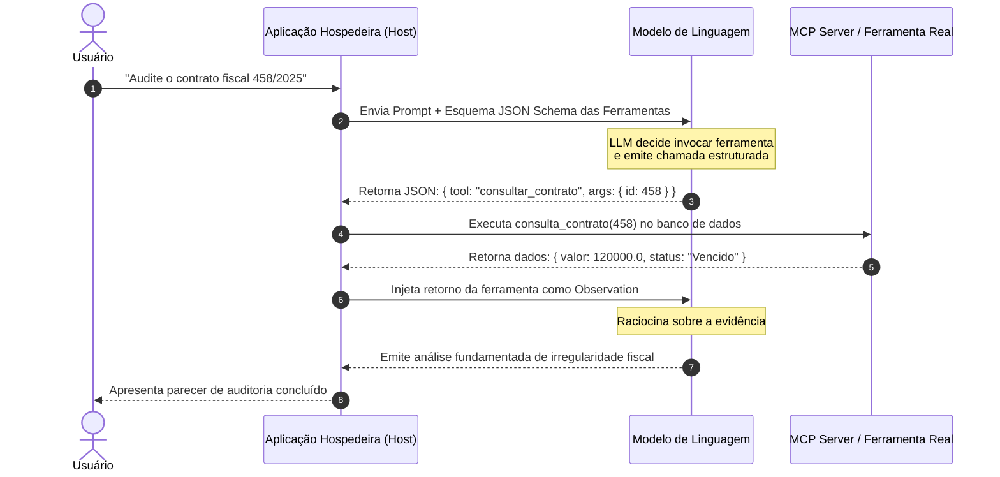

# 04 - RAG, Protocolo MCP, Skills e Ferramental de Agentes

> **Matéria:** Engenharia de Software Assistida por IA e Sistemas Agentivos  
> **Cargo:** B02 – Técnico de Controle Externo – Especialidade: Tecnologia da Informação  
> **Arquivo:** `04_rag_protocolo_mcp_skills_e_ferramental.md`  

---

## 📌 Ementa / Itens do Edital
- Gestão de contexto e memória em sistemas agentivos
- Recuperação Aumentada por Geração (Retrieval-Augmented Generation – RAG) e bancos de dados vetoriais
- Protocolos de interoperabilidade entre agentes e ferramentas: Model Context Protocol (MCP)
- Extensibilidade e automação de fluxos de trabalho especializados: Skills e Tool Use (Function Calling)

---

## 🧭 Sumário

1. [Gestão de Contexto e Memória em Sistemas Agentivos](#1-gestao-de-contexto-e-memoria-em-sistemas-agentivos)
    1. [Desafios da Janela de Contexto e a Degradação de Atenção](#11-desafios-da-janela-de-contexto-e-a-degradacao-de-atencao)
    2. [Memória de Curto Prazo (Working Memory) vs. Memória de Longo Prazo](#12-memoria-de-curto-prazo-working-memory-vs-memoria-de-longo-prazo)
    3. [Estratégias de Gestão: Sumarização Progressiva, Podagem e Prompt Caching](#13-estrategias-de-gestao-sumarizacao-progressiva-podagem-e-prompt-caching)
    4. [Teste 150](#Teste-150)
    5. [Teste 151](#Teste-151)
2. [Retrieval-Augmented Generation (RAG) Aplicado a Bases de Código](#2-retrieval-augmented-generation-rag-aplicado-a-bases-de-codigo)
    1. [Arquitetura e Pipeline de Ingestão de Código](#21-arquitetura-e-pipeline-de-ingestao-de-codigo)
    2. [O Desafio do Chunking Consciente de Sintaxe (AST-Based Chunking)](#22-o-desafio-do-chunking-consciente-de-sintaxe-ast-based-chunking)
    3. [Modelos de Embeddings e Bancos de Dados Vetoriais](#23-modelos-de-embeddings-e-bancos-de-dados-vetoriais)
    4. [Métricas de Proximidade Semântica e Similaridade de Cosseno](#24-metricas-de-proximidade-semantica-e-similaridade-de-cosseno)
    5. [Busca Híbrida (Dense + Sparse) e Técnicas de Reranking](#25-busca-hibrida-dense-sparse-e-tecnicas-de-reranking)
    6. [Matriz de Decisão Arquitetural: RAG vs. Fine-Tuning](#26-matriz-de-decisao-arquitetural-rag-vs-fine-tuning)
    7. [Teste 152](#Teste-152)
    8. [Teste 153](#Teste-153)
    9. [Teste 154](#Teste-154)
    10. [Teste 155](#Teste-155)
3. [O Protocolo Model Context Protocol (MCP)](#3-o-protocolo-model-context-protocol-mcp)
    1. [Motivação e Resolução do Problema de Integração N x M](#31-motivacao-e-resolucao-do-problema-de-integracao-n-x-m)
    2. [A Arquitetura Cliente-Servidor do MCP (Host, Client e Server)](#32-a-arquitetura-cliente-servidor-do-mcp-host-client-e-server)
    3. [As Três Primitivas Centrais: Resources, Tools e Prompts](#33-as-tres-primitivas-centrais-resources-tools-e-prompts)
    4. [Mecanismos de Transporte Padronizados: `stdio` e `SSE`](#34-mecanismos-de-transporte-padronizados-stdio-e-sse)
    5. [Teste 156](#Teste-156)
    6. [Teste 157](#Teste-157)
    7. [Teste 158](#Teste-158)
    8. [Teste 159](#Teste-159)
4. [Extensibilidade, Tool Use e Skills Especializadas](#4-extensibilidade-tool-use-e-skills-especializadas)
    1. [Funcionamento do Tool Use / Function Calling via JSON Schema](#41-funcionamento-do-tool-use-function-calling-via-json-schema)
    2. [Definição e Estrutura de Skills Modulares](#42-definicao-e-estrutura-de-skills-modulares)
    3. [Orquestração Multiagente e Segregação de Responsabilidades](#43-orquestracao-multiagente-e-segregacao-de-responsabilidades)
    4. [Teste 160](#Teste-160)
5. [Fontes Recomendadas na Internet](#5-fontes-recomendadas-na-internet)

---

## 1. Gestão de Contexto e Memória em Sistemas Agentivos

### 1.1 Desafios da Janela de Contexto e a Degradação de Atenção
A operação contínua de agentes de engenharia de software enfrenta restrições físicas e cognitivas no uso de Modelos de Linguagem de Grande Porte (LLMs):

- **Saturação de Tokens:** A cada comando executado, leitura de arquivo e retorno de teste, a janela de contexto acumula tokens de entrada (*input tokens*), elevando os custos financeiros da inferência e a latência de processamento.
- **Degradação de Atenção e Ruído:** Contextos excessivamente longos e desordenados dispersam a atenção dos mecanismos de autoatenção (*Self-Attention*), aumentando a probabilidade de esquecimento de restrições arquiteturais e ocorrência de alucinações.

### 1.2 Memória de Curto Prazo (Working Memory) vs. Memória de Longo Prazo

- **Memória de Curto Prazo (*Working Memory*):** Armazenada diretamente dentro da janela de contexto da chamada do LLM. É ultra-rápida e acessível diretamente pelos pesos de atenção, mas finita e descartada ao término da sessão de execução.
- **Memória de Longo Prazo (*Episódica e Semântica*):** Armazenada fora do modelo em bancos de dados relacionais, grafos de conhecimento ou bancos vetoriais especializados. Persiste indefinidamente entre diferentes sessões e dias de desenvolvimento, retendo decisões consolidadas de arquitetura e padrões corporativos.

### 1.3 Estratégias de Gestão: Sumarização Progressiva, Podagem e Prompt Caching
Para viabilizar fluxos agentivos em bases de código de milhões de linhas:

1. **Sumarização Progressiva (*Rolling Summarization*):** Conforme o diálogo avança, um subagente em segundo plano gera uma síntese executiva das decisões já tomadas e substitui dezenas de mensagens históricas anteriores por esse resumo conciso.
2. **Podagem de Contexto (*Context Pruning*):** Descarte cirúrgico de retornos de ferramentas que já cumpriram seu papel (ex.: expurgar os 500 kilobytes de log de um build bem-sucedido após a confirmação de sucesso).
3. **Prompt Caching:** Recurso disponibilizado pelos principais provedores de modelos (como Anthropic Claude), permitindo gravar em memória cache os prefixos estáticos da janela de contexto (como a leitura do código-fonte ou diretrizes institucionais). O *Prompt Caching* reduz o tempo de resposta em até 80% e corta em até 90% os custos de tokens de entrada em requisições consecutivas.

---

### Teste 150
**(FGV – TJ-RR – Analista Judiciario Gestao e Governanca de Tecnologia da Informacao – 2024)**
Em relação aos eventos e aos artefatos do framework Scrum, analise as afirmativas a seguir. I. O backlog do produto é um documento preenchido antes do início do projeto e que não sofre alterações mesmo que os desejos do cliente mudem ao longo do tempo. II. A reunião diária, daily Scrum, é um evento de curta duração que permite identificar impedimentos, melhorar as comunicações, promover rápida tomada de decisões e reduzir a necessidade de outras reuniões ao longo do dia. III. A reunião de revisão da Sprint é um evento em que são definidas as histórias de usuário que serão trabalhadas naquela Sprint. Está correto o que se afirma em

* **A)** I, apenas.
* **B)** II, apenas.
* **C)** III, apenas.
* **D)** I e II, apenas.
* **E)** II e III, apenas.

---

> **Comentário Detalhado:**
>
> - **A)** **Incorreta.** A opção incorre em restrição indevida ao limitar o escopo conceitual ao afirmar que "I, apenas". De acordo com a teoria estudada em *1.2 Memória de Curto Prazo (Working Memory) vs. Memória de Longo Prazo*, persiste indefinidamente entre diferentes sessões e dias de desenvolvimento, retendo decisões consolidadas de arquitetura e padrões corporativos.
> - **B)** **Correta.** Conforme fundamentado na seção *1.2 Memória de Curto Prazo (Working Memory) vs. Memória de Longo Prazo* deste guia, memória de Curto Prazo (*Working Memory*): Armazenada diretamente dentro da janela de contexto da chamada do LLM. É ultra-rápida e acessível diretamente pelos pesos de atenção, mas finita e descartada ao término da sessão de execução. Dessa forma, está plenamente correta a assertiva da banca (FGV – TJ-RR/2024) ao estabelecer que "II, apenas".
> - **C)** **Incorreta.** A opção incorre em restrição indevida ao limitar o escopo conceitual ao afirmar que "III, apenas". De acordo com a teoria estudada em *3.4 Mecanismos de Transporte Padronizados: `stdio` e `SSE`*, utiliza uma conexão HTTP persistente unidirecional para o streaming de eventos do servidor para o cliente, acompanhada por requisições HTTP POST para o envio de comandos do cliente para o servidor.
> - **D)** **Incorreta.** A opção incorre em restrição indevida ao limitar o escopo conceitual ao afirmar que "I e II, apenas". De acordo com a teoria estudada em *1.3 Estratégias de Gestão: Sumarização Progressiva, Podagem e Prompt Caching*, o *Prompt Caching* reduz o tempo de resposta em até 80% e corta em até 90% os custos de tokens de entrada em requisições consecutivas.
> - **E)** **Incorreta.** A opção incorre em restrição indevida ao limitar o escopo conceitual ao afirmar que "II e III, apenas". De acordo com a teoria estudada em *1.3 Estratégias de Gestão: Sumarização Progressiva, Podagem e Prompt Caching*, sumarização Progressiva (*Rolling Summarization*): Conforme o diálogo avança, um subagente em segundo plano gera uma síntese executiva das decisões já tomadas e substitui dezenas de mensagens históricas anteriores por esse resumo conciso.
>
> **Gabarito: B**

---

### Teste 151
**(CEBRASPE – TJ-RJ – Analista Judiciario Grupo Tecnologia da Informacao Analista de Sistemas – 2021)**
Considere o trecho de código a seguir, de um programa escrito na linguagem Java. Quanto a esse contexto, considere, ainda, as instruções a seguir, da classe CarroEsportivo. Com relação aos trechos de código precedentes, é correto afirmar que

* **A)** o parâmetro this, na linha 7 da classe CarroEsportivo, é uma palavra reservada usada para mostrar que está sendo feita referência ao atributo privado marca da classe Carro.
* **B)** o comando this, na linha 7 da classe CarroEsportivo, é uma palavra reservada que faz referência ao atributo público marca da classe Carro.
* **C)** a instrução super, na linha 6 da classe CarroEsportivo, é usada para importar o pacote atributos privados da classe Carro, a fim de se tornarem públicos para a classe CarroEsportivo.
* **D)** a instrução super, na linha 6 da classe CarroEsportivo, permite à classe CarroEsportivo acessar os atributos privados da classe Carro.
* **E)** a instrução super, na linha 6 da classe CarroEsportivo, pode permitir à classe CarroEsportivo acessar atributos públicos da classe Carro.

---

> **Comentário Detalhado:**
>
> - **A)** **Incorreta.** A opção apresenta proposição em desacordo com os fundamentos teóricos e técnicos do tópico ao afirmar que "o parâmetro this, na linha 7 da classe CarroEsportivo, é uma palavra reservada usada para mostrar que está sendo...". De acordo com a teoria estudada em *2.2 O Desafio do Chunking Consciente de Sintaxe (AST-Based Chunking)*, cada chunk encapsula um método completo, uma classe autocontida ou um bloco de interface com seus respectivos comentários.
> - **B)** **Incorreta.** A opção apresenta proposição em desacordo com os fundamentos teóricos e técnicos do tópico ao afirmar que "o comando this, na linha 7 da classe CarroEsportivo, é uma palavra reservada que faz referência ao atributo...". De acordo com a teoria estudada em *1.1 Desafios da Janela de Contexto e a Degradação de Atenção*, saturação de Tokens: A cada comando executado, leitura de arquivo e retorno de teste, a janela de contexto acumula tokens de entrada (*input tokens*), elevando os custos financeiros da inferência e a latência de processamento.
> - **C)** **Incorreta.** A opção apresenta proposição em desacordo com os fundamentos teóricos e técnicos do tópico ao afirmar que "a instrução super, na linha 6 da classe CarroEsportivo, é usada para importar o pacote atributos privados da...". De acordo com a teoria estudada em *2.2 O Desafio do Chunking Consciente de Sintaxe (AST-Based Chunking)*, preserva no topo do chunk o caminho do arquivo, imports e declaração de pacote (*namespace*), assegurando contexto para o modelo de embeddings.
> - **D)** **Incorreta.** A opção apresenta proposição em desacordo com os fundamentos teóricos e técnicos do tópico ao afirmar que "a instrução super, na linha 6 da classe CarroEsportivo, permite à classe CarroEsportivo acessar os atributos...". De acordo com a teoria estudada em *2.6 Matriz de Decisão Arquitetural: RAG vs. Fine-Tuning*, auditabilidade e Fontes: Total: Permite indicar o arquivo, autor e linha exata de onde a resposta foi extraída. — Nula: O conhecimento funde-se nos pesos probabilísticos dos parâmetros neurais (caixa-preta).
> - **E)** **Correta.** Conforme fundamentado na seção *2.5 Busca Híbrida (Dense + Sparse) e Técnicas de Reranking* deste guia, bases de código dependem criticamente de nomes literais exatos (como o nome de uma constante `MAX_RETRY_TIMEOUT` ou a classe `AcordaoAuditoriaService`). A busca puramente semântica pode falhar ao identificar o identificador exato. Dessa forma, está plenamente correta a assertiva da banca (CEBRASPE – TJ-RJ/2021) ao estabelecer que "a instrução super, na linha 6 da classe CarroEsportivo, pode permitir à classe CarroEsportivo acessar atributos...".
>
> **Gabarito: E**

---

## 2. Retrieval-Augmented Generation (RAG) Aplicado a Bases de Código

### 2.1 Arquitetura e Pipeline de Ingestão de Código
O **RAG (Recuperação Aumentada por Geração)** conecta a inteligência de raciocínio de um LLM generalista a uma base proprietária, dinâmica e atualizada de código-fonte e manuais, sem demandar o re-treinamento dos parâmetros da rede neural.

### 2.2 O Desafio do Chunking Consciente de Sintaxe (AST-Based Chunking)
Dividir código-fonte através de fatiamento ingênuo por contagem fixa de caracteres ou linhas é um erro grave na engenharia de software: pode cortar uma função no meio, separar anotações de transação do método ou quebrar laços de repetição.

- **Chunking Baseado em AST (*Abstract Syntax Tree*):** Utiliza parsers gramaticais (como *Tree-sitter*) para recortar o arquivo respeitando suas fronteiras sintáticas reais:
    - Cada chunk encapsula um método completo, uma classe autocontida ou um bloco de interface com seus respectivos comentários;
    - Preserva no topo do chunk o caminho do arquivo, imports e declaração de pacote (*namespace*), assegurando contexto para o modelo de embeddings.

### 2.3 Modelos de Embeddings e Bancos de Dados Vetoriais
- **Embeddings:** Modelos neurais especializados que convertem fragmentos de texto ou código em vetores densos (arrays unidimensionais de números reais com 768 a 3072 dimensões). Trechos com semântica semelhante ficam espacialmente próximos no hiperplano vetorial.
- **Bancos de Dados Vetoriais:** Motores de persistência que organizam esses vetores com algoritmos de grafos de vizinhos mais próximos aproximados (**HNSW - *Hierarchical Navigable Small World***). Exemplos proeminentes:
    - **`pgvector`:** Extensão oficial que habilita busca vetorial nativa dentro do SGBD PostgreSQL relacional;
    - **Bancos Especializados:** Qdrant, Pinecone, Milvus, Chroma.

### 2.4 Métricas de Proximidade Semântica e Similaridade de Cosseno
A métrica canônica para avaliar a afinidade entre o vetor da consulta do desenvolvedor ($A$) e o vetor do trecho de código ($B$) é a **Similaridade de Cosseno**, que mede o cosseno do ângulo formado entre os dois vetores no espaço multidimensional:

$$\cos(\theta) = \frac{A \cdot B}{\|A\| \|B\|} = \frac{\sum_{i=1}^n A_i B_i}{\sqrt{\sum_{i=1}^n A_i^2} \sqrt{\sum_{i=1}^n B_i^2}}$$

- Varia entre $-1$ e $1$ (ou entre $0$ e $1$ para vetores não negativos);
- Avalia estritamente a orientação dos vetores, sendo imune a variações no tamanho do texto original;
- Se os vetores forem pré-normalizados na ingestão ($\|A\| = \|B\| = 1$), a similaridade equivale diretamente ao **produto escalar (*dot product*)**, reduzindo o custo computacional da consulta.

### 2.5 Busca Híbrida (Dense + Sparse) e Técnicas de Reranking
Bases de código dependem criticamente de nomes literais exatos (como o nome de uma constante `MAX_RETRY_TIMEOUT` ou a classe `AcordaoAuditoriaService`). A busca puramente semântica pode falhar ao identificar o identificador exato.

- **Busca Híbrida (*Hybrid Search*):** Combina em uma única operação a busca vetorial densa (conceitual) com a busca léxica tradicional baseada em frequência de termos (**BM25** ou Full-Text Search).
- **Reciprocal Rank Fusion (RRF):** Algoritmo matemático que mescla e equaliza as posições das duas listas de resultados.
- **Reranker (Cross-Encoder):** Modelo neural especializado que inspeciona detalhadamente os 20 melhores resultados preliminares, reordenando-os para selecionar os 3 a 5 chunks com mais alto grau de relevância antes da injeção no prompt final.

### 2.6 Matriz de Decisão Arquitetural: RAG vs. Fine-Tuning

| Critério de Decisão | Retrieval-Augmented Generation (RAG) | Fine-Tuning (Ajuste Fino Supervisionado) |
|---|---|---|
| **Natureza do Conhecimento** | **Factual, Dinâmico e Mutável:** Regras fiscais recentes, APIs internas, documentações de projeto. | **Estilo, Sintaxe e Forma:** Adaptação a DSLs proprietárias da empresa, formatos de resposta fixos. |
| **Frequência de Atualização** | Instantânea: basta gravar ou apagar o chunk no banco vetorial. | Lenta: requer curadoria de dataset, retreino supervisionado e validação de checkpoints. |
| **Auditabilidade e Fontes** | **Total:** Permite indicar o arquivo, autor e linha exata de onde a resposta foi extraída. | **Nula:** O conhecimento funde-se nos pesos probabilísticos dos parâmetros neurais (caixa-preta). |
| **Mitigação de Alucinações** | Altamente eficaz por ancorar a resposta em evidências concretas. | Moderada: pode alucinar se houver conflito entre dados antigos pré-treinados e novos dados. |
| **Custo Computacional** | Baixo a moderado (operações de embedding e banco vetorial). | Elevado (horas de treinamento em clusters de GPUs dedicadas). |

---

### Teste 152
**(FGV – TCE-PA – Auditor de Controle Externo Administrativa Ciencia de Dados – 2024)**
Com o aumento do volume e da complexidade dos dados gerados em sistemas de informação atuais, cresce a necessidade de eficiência no armazenamento, segurança, recuperação de dados e disponibilidade. Nesse contexto, o algoritmo HNSW (Hierarchical Navigable Small World) busca, ao ser aplicado em bases de dados de vetores,

* **A)** compactar dados para economizar espaço de armazenamento.
* **B)** buscar vetores semelhantes para acelerar a recuperação de informações.
* **C)** criptografar dados garantindo a segurança das informações.
* **D)** organizar dados em uma hierarquia de diretórios para facilitar o acesso.
* **E)** replicar dados em diferentes locais para alta disponibilidade.

---

> **Comentário Detalhado:**
>
> - **A)** **Incorreta.** A opção apresenta proposição em desacordo com os fundamentos teóricos e técnicos do tópico ao afirmar que "compactar dados para economizar espaço de armazenamento". De acordo com a teoria estudada em *2.4 Métricas de Proximidade Semântica e Similaridade de Cosseno*, a métrica canônica para avaliar a afinidade entre o vetor da consulta do desenvolvedor (\$A\$) e o vetor do trecho de código (\$B\$) é a Similaridade de Cosseno, que mede o cosseno do ângulo formado entre os dois vetores no espaço multidimensional.
> - **B)** **Correta.** Conforme fundamentado na seção *2.3 Modelos de Embeddings e Bancos de Dados Vetoriais* deste guia, bancos de Dados Vetoriais: Motores de persistência que organizam esses vetores com algoritmos de grafos de vizinhos mais próximos aproximados (HNSW - *Hierarchical Navigable Small World*). Exemplos proeminentes. Dessa forma, está plenamente correta a assertiva da banca (FGV – TCE-PA/2024) ao estabelecer que "buscar vetores semelhantes para acelerar a recuperação de informações".
> - **C)** **Incorreta.** A opção apresenta proposição em desacordo com os fundamentos teóricos e técnicos do tópico ao afirmar que "criptografar dados garantindo a segurança das informações". De acordo com a teoria estudada em *2.3 Modelos de Embeddings e Bancos de Dados Vetoriais*, embeddings: Modelos neurais especializados que convertem fragmentos de texto ou código em vetores densos (arrays unidimensionais de números reais com 768 a 3072 dimensões). Trechos com semântica semelhante ficam espacialmente próximos no hiperplano vetorial.
> - **D)** **Incorreta.** A opção apresenta proposição em desacordo com os fundamentos teóricos e técnicos do tópico ao afirmar que "organizar dados em uma hierarquia de diretórios para facilitar o acesso". De acordo com a teoria estudada em *5. Fontes Recomendadas na Internet*, mANNING, Christopher D.; RAGHAVAN, Prabhakar; SCHÜTZE, Hinrich. Introdução à Recuperação de Informação. Cambridge: Cambridge University Press, 2008. (Cap. 6 - Pontuação de Similaridade e Espaços Vetoriais).
> - **E)** **Incorreta.** A opção apresenta proposição em desacordo com os fundamentos teóricos e técnicos do tópico ao afirmar que "replicar dados em diferentes locais para alta disponibilidade". De acordo com a teoria estudada em *3.2 A Arquitetura Cliente-Servidor do MCP (Host, Client e Server)*, mCP Server: Serviço leve e desacoplado que expõe dados locais ou remotos e encapsula as ferramentas de um domínio específico (ex.: servidor MCP do PostgreSQL, servidor MCP do Git).
>
> **Gabarito: B**

---

### Teste 153
**(FGV – TJ-AP – Analista Judiciario Apoio Especializado Tecnologia da Informacao Desenvolvimento de Sistemas – 2023)**
Analise o código HTML exibido a seguir, cujas linhas foram numeradas somente para fins de referência. 1 <!DOCTYPE html> 2 `<html>` 3 `<head>` 4 `` 12 `</head>` 13 `<body>` 14 15 `<h1>`ATENÇÃO`</h1>` 16 `` 17 `
`Essa imagem não deve ser copiada.`
` 18 `</body>` 19 `</html>` Para que a imagem seja exibida na página por trás do texto, a linha 9 deve conter:

* **A)** deep-align: 0;
* **B)** display: block behind;
* **C)** overflow: auto;
* **D)** visible: behind;
* **E)** z-index: -1;

---

> **Comentário Detalhado:**
>
> - **A)** **Incorreta.** A opção apresenta proposição em desacordo com os fundamentos teóricos e técnicos do tópico ao afirmar que "deep-align: 0". De acordo com a teoria estudada em *2.2 O Desafio do Chunking Consciente de Sintaxe (AST-Based Chunking)*, dividir código-fonte através de fatiamento ingênuo por contagem fixa de caracteres ou linhas é um erro grave na engenharia de software: pode cortar uma função no meio, separar anotações de transação do método ou quebrar laços de repetição.
> - **B)** **Incorreta.** A opção apresenta proposição em desacordo com os fundamentos teóricos e técnicos do tópico ao afirmar que "display: block behind". De acordo com a teoria estudada em *2.3 Modelos de Embeddings e Bancos de Dados Vetoriais*, embeddings: Modelos neurais especializados que convertem fragmentos de texto ou código em vetores densos (arrays unidimensionais de números reais com 768 a 3072 dimensões). Trechos com semântica semelhante ficam espacialmente próximos no hiperplano vetorial.
> - **C)** **Incorreta.** A opção apresenta proposição em desacordo com os fundamentos teóricos e técnicos do tópico ao afirmar que "overflow: auto". De acordo com a teoria estudada em *1.3 Estratégias de Gestão: Sumarização Progressiva, Podagem e Prompt Caching*, para viabilizar fluxos agentivos em bases de código de milhões de linhas.
> - **D)** **Incorreta.** A opção apresenta proposição em desacordo com os fundamentos teóricos e técnicos do tópico ao afirmar que "visible: behind". De acordo com a teoria estudada em *2.2 O Desafio do Chunking Consciente de Sintaxe (AST-Based Chunking)*, chunking Baseado em AST (*Abstract Syntax Tree*): Utiliza parsers gramaticais (como *Tree-sitter*) para recortar o arquivo respeitando suas fronteiras sintáticas reais.
> - **E)** **Correta.** Conforme fundamentado na seção *4.3 Orquestração Multiagente e Segregação de Responsabilidades* deste guia, em arquiteturas corporativas avançadas, a complexidade de um sistema de software não deve ser atribuída a um único agente sobrecarregado. Dessa forma, está plenamente correta a assertiva da banca (FGV – TJ-AP/2023) ao estabelecer que "z-index: -1".
>
> **Gabarito: E**

---

### Teste 154
**(FGV – TJ-AP – Analista Judiciario Apoio Especializado Tecnologia da Informacao Banco de Dados – 2023)**
A técnica de modelagem de dados que impacta negativamente no desempenho das consultas de uma base multidimensional, pois aumenta a quantidade de joins, é a:

* **A)** criação de chaves substitutas;
* **B)** conformidade das dimensões;
* **C)** não aditividade dos fatos;
* **D)** degeneração das dimensões;
* **E)** normalização das dimensões.

---

> **Comentário Detalhado:**
>
> - **A)** **Incorreta.** A opção apresenta proposição em desacordo com os fundamentos teóricos e técnicos do tópico ao afirmar que "criação de chaves substitutas". De acordo com a teoria estudada em *2.1 Arquitetura e Pipeline de Ingestão de Código*, o RAG (Recuperação Aumentada por Geração) conecta a inteligência de raciocínio de um LLM generalista a uma base proprietária, dinâmica e atualizada de código-fonte e manuais, sem demandar o re-treinamento dos parâmetros da rede neural.
> - **B)** **Incorreta.** A opção apresenta proposição em desacordo com os fundamentos teóricos e técnicos do tópico ao afirmar que "conformidade das dimensões". De acordo com a teoria estudada em *2.4 Métricas de Proximidade Semântica e Similaridade de Cosseno*, a métrica canônica para avaliar a afinidade entre o vetor da consulta do desenvolvedor (\$A\$) e o vetor do trecho de código (\$B\$) é a Similaridade de Cosseno, que mede o cosseno do ângulo formado entre os dois vetores no espaço multidimensional.
> - **C)** **Incorreta.** A opção apresenta proposição em desacordo com os fundamentos teóricos e técnicos do tópico ao afirmar que "não aditividade dos fatos". De acordo com a teoria estudada em *2.3 Modelos de Embeddings e Bancos de Dados Vetoriais*, bancos de Dados Vetoriais: Motores de persistência que organizam esses vetores com algoritmos de grafos de vizinhos mais próximos aproximados (HNSW - *Hierarchical Navigable Small World*). Exemplos proeminentes.
> - **D)** **Incorreta.** A opção apresenta proposição em desacordo com os fundamentos teóricos e técnicos do tópico ao afirmar que "degeneração das dimensões". De acordo com a teoria estudada em *2.3 Modelos de Embeddings e Bancos de Dados Vetoriais*, `pgvector`: Extensão oficial que habilita busca vetorial nativa dentro do SGBD PostgreSQL relacional.
> - **E)** **Correta.** Conforme fundamentado na seção *2.3 Modelos de Embeddings e Bancos de Dados Vetoriais* deste guia, embeddings: Modelos neurais especializados que convertem fragmentos de texto ou código em vetores densos (arrays unidimensionais de números reais com 768 a 3072 dimensões). Trechos com semântica semelhante ficam espacialmente próximos no hiperplano vetorial. Dessa forma, está plenamente correta a assertiva da banca (FGV – TJ-AP/2023) ao estabelecer que "normalização das dimensões".
>
> **Gabarito: E**

---

### Teste 155
**(FGV – TCE-PA – Auditor de Controle Externo Administrativa Ciencia de Dados – 2024)**
Alguns dos primeiros modelos de linguagem de larga escala desenvolvidos tendiam a gerar resultados incorretos com excesso de confiança, caracterizando o que se convencionou chamar de alucinações dos modelos. Uma estratégia de mitigação das alucinações é o uso da técnica de Geração Aumentada por Recuperação, ou Retrieval-Augmented Generation (RAG). A respeito da RAG, avalie as afirmativas a seguir. I. Baseia-se na combinação de sistemas de recuperação de informações e de modelos generativos capazes de produzir novos textos. II. Permite aos modelos buscarem informações relevantes em bases de dados mais confiáveis durante o processamento das consultas dos usuários (user queries), viabilizando melhor adequação a contextos e melhor qualidade das respostas. III. Não altera os parâmetros dos modelos generativos, e, portanto, não influencia o treinamento das redes neurais com informações recuperadas de bases de dados externas. Está correto o que se afirma em

* **A)** I, apenas.
* **B)** II, apenas.
* **C)** III, apenas.
* **D)** I e II, apenas.
* **E)** I, II e III.

---

> **Comentário Detalhado:**
>
> - **A)** **Incorreta.** A opção incorre em restrição indevida ao limitar o escopo conceitual ao afirmar que "I, apenas". De acordo com a teoria estudada em *5. Fontes Recomendadas na Internet*, arXiv - Retrieval-Augmented Generation for Knowledge-Intensive NLP Tasks (Lewis et al.) - Artigo seminal da arquitetura RAG combinando recuperação vetorial densa e modelos neurais geradores.
> - **B)** **Incorreta.** A opção incorre em restrição indevida ao limitar o escopo conceitual ao afirmar que "II, apenas". De acordo com a teoria estudada em *2.6 Matriz de Decisão Arquitetural: RAG vs. Fine-Tuning*, mitigação de Alucinações: Altamente eficaz por ancorar a resposta em evidências concretas. — Moderada: pode alucinar se houver conflito entre dados antigos pré-treinados e novos dados.
> - **C)** **Incorreta.** A opção incorre em restrição indevida ao limitar o escopo conceitual ao afirmar que "III, apenas". De acordo com a teoria estudada em *2.6 Matriz de Decisão Arquitetural: RAG vs. Fine-Tuning*, auditabilidade e Fontes: Total: Permite indicar o arquivo, autor e linha exata de onde a resposta foi extraída. — Nula: O conhecimento funde-se nos pesos probabilísticos dos parâmetros neurais (caixa-preta).
> - **D)** **Incorreta.** A opção incorre em restrição indevida ao limitar o escopo conceitual ao afirmar que "I e II, apenas". De acordo com a teoria estudada em *4.1 Funcionamento do Tool Use / Function Calling via JSON Schema*, o mecanismo de uso de ferramentas permite que um LLM transcenda o processamento puramente textual para orquestrar sistemas reais.
> - **E)** **Correta.** Conforme fundamentado na seção *2.1 Arquitetura e Pipeline de Ingestão de Código* deste guia, o RAG (Recuperação Aumentada por Geração) conecta a inteligência de raciocínio de um LLM generalista a uma base proprietária, dinâmica e atualizada de código-fonte e manuais, sem demandar o re-treinamento dos parâmetros da rede neural. Dessa forma, está plenamente correta a assertiva da banca (FGV – TCE-PA/2024) ao estabelecer que "I, II e III".
>
> **Gabarito: E**

---

## 3. O Protocolo Model Context Protocol (MCP)

### 3.1 Motivação e Resolução do Problema de Integração N x M
Antes do surgimento do **Model Context Protocol (MCP)**, anunciado no final de 2024 pela Anthropic como um padrão aberto da indústria, o ecossistema de IA sofria com a proliferação caótica de integrações proprietárias: para cada nova aplicação de IA ($N$) conectar-se a cada fonte corporativa de dados ($M$), exigia-se um conector proprietário sob medida ($N \times M$ integrações).

### 3.2 A Arquitetura Cliente-Servidor do MCP (Host, Client e Server)
A especificação MCP é dividida em três papéis complementares:

1. **MCP Host:** A aplicação central que executa a interface e orquestra o LLM (ex.: Claude Desktop, Cursor, Antigravity CLI).
2. **MCP Client:** Módulo interno do host que estabelece e gerencia conexões 1:1 seguras e isoladas com os servidores.
3. **MCP Server:** Serviço leve e desacoplado que expõe dados locais ou remotos e encapsula as ferramentas de um domínio específico (ex.: servidor MCP do PostgreSQL, servidor MCP do Git).

### 3.3 As Três Primitivas Centrais: Resources, Tools e Prompts
O contrato funcional do MCP estabelece exatamente três entidades padronizadas:

| Primitiva | Comportamento Operacional | Finalidade no Desenvolvimento | Gera Efeitos Colaterais? |
|---|---|---|:---:|
| **`Resources`** | **Passivo / Somente Leitura** | Expor dados e documentos como arquivos virtuais (`file://`, `postgres://`) para leitura de contexto. | **Não** (Leitura idempotente). |
| **`Tools`** | **Ativo / Executável** | Funções com esquemas tipados que realizam ações reais no ambiente (gravar arquivos, rodar queries, disparar builds). | **Sim** (Pode alterar estado). |
| **`Prompts`** | **Modelos Parametrizados** | Roteiros pré-configurados pelo servidor para orientar a interação do usuário em rotinas especializadas. | **Não** (Template estruturado). |

> 🚨 **ALERTA DE PROVA / PEGADINHA FCC:**  
> A banca frequentemente inverte os papéis de **Resources** e **Tools**:  
>
> - **Resources NÃO EXECUTAM comandos nem alteram dados**! São exclusivamente fontes passivas de consulta e leitura de contexto.  
> - Toda e qualquer operação de modificação, exclusão de dados ou execução de comandos é de competência estrita das **Tools**!

### 3.4 Mecanismos de Transporte Padronizados: `stdio` e `SSE`
A especificação do MCP padroniza dois canais de comunicação utilizando mensagens serializadas em **JSON-RPC 2.0**:

- **`stdio` (Standard Input / Output):** Padrão oficial para servidores locais que rodam na mesma máquina do Host. O Host instancia o processo do servidor MCP como um subprocesso filho e comunica-se pelas vias de entrada e saída padrão do SO. É extremamente seguro, não abre portas de rede e é isolado pelo sistema de processos do computador.
- **`SSE` (*Server-Sent Events* sobre HTTP):** Padrão adotado para servidores remotos distribuídos em nuvem. Utiliza uma conexão HTTP persistente unidirecional para o streaming de eventos do servidor para o cliente, acompanhada por requisições HTTP POST para o envio de comandos do cliente para o servidor.

---

### Teste 156
**(FCC – TRT-14 – Analista Judiciario Apoio Especializado Tecnologia da Informacao – 2016)**
Após construir um DFD durante a modelagem funcional de um sistema, um Analista deseja apresentar mais informações com objetivo de definir o significado dos fluxos e depósitos de dados, a composição de pacotes de dados que se movimentam pelos fluxos e os valores e unidades relevantes de partes elementares dos fluxos e depósitos de dados. O Analista terá que criar

* **A)** um Banco de Dados de Gerenciamento da Configuração.
* **B)** um Dicionário de Dados.
* **C)** um Repositório de Componentes.
* **D)** uma Base de Dados de Processos.
* **E)** uma Base de Dados de Contexto.

---

> **Comentário Detalhado:**
>
> - **A)** **Incorreta.** A opção apresenta proposição em desacordo com os fundamentos teóricos e técnicos do tópico ao afirmar que "um Banco de Dados de Gerenciamento da Configuração". De acordo com a teoria estudada em *2.6 Matriz de Decisão Arquitetural: RAG vs. Fine-Tuning*, frequência de Atualização: Instantânea: basta gravar ou apagar o chunk no banco vetorial. — Lenta: requer curadoria de dataset, retreino supervisionado e validação de checkpoints.
> - **B)** **Correta.** Conforme fundamentado na seção *2.3 Modelos de Embeddings e Bancos de Dados Vetoriais* deste guia, bancos de Dados Vetoriais: Motores de persistência que organizam esses vetores com algoritmos de grafos de vizinhos mais próximos aproximados (HNSW - *Hierarchical Navigable Small World*). Exemplos proeminentes. Dessa forma, está plenamente correta a assertiva da banca (FCC – TRT-14/2016) ao estabelecer que "um Dicionário de Dados".
> - **C)** **Incorreta.** A opção apresenta proposição em desacordo com os fundamentos teóricos e técnicos do tópico ao afirmar que "um Repositório de Componentes". De acordo com a teoria estudada em *3.1 Motivação e Resolução do Problema de Integração N x M*, antes do surgimento do Model Context Protocol (MCP), anunciado no final de 2024 pela Anthropic como um padrão aberto da indústria, o ecossistema de IA sofria com a proliferação caótica de integrações proprietárias: para cada nova aplicação de IA (\$N\$) conectar-se a cada fonte corporativa de dados (\$M\$), exigia-se um conector proprietário sob medida (\$N \times M\$ integrações).
> - **D)** **Incorreta.** A opção apresenta proposição em desacordo com os fundamentos teóricos e técnicos do tópico ao afirmar que "uma Base de Dados de Processos". De acordo com a teoria estudada em *3.4 Mecanismos de Transporte Padronizados: `stdio` e `SSE`*, é extremamente seguro, não abre portas de rede e é isolado pelo sistema de processos do computador.
> - **E)** **Incorreta.** A opção apresenta proposição em desacordo com os fundamentos teóricos e técnicos do tópico ao afirmar que "uma Base de Dados de Contexto". De acordo com a teoria estudada em *3.3 As Três Primitivas Centrais: Resources, Tools e Prompts*, `Resources`: Passivo / Somente Leitura — Expor dados e documentos como arquivos virtuais (`file://`, `postgres://`) para leitura de contexto. — Não (Leitura idempotente).
>
> **Gabarito: B**

---

### Teste 157
**(FGV – TRT-24 – Analista Judiciario Area Apoio Especializado Tecnologia da Informacao – 2025)**
A arquitetura em três camadas surgiu no final dos anos 80 e ainda é comum na construção de sistemas de informação corporativos. As três camadas dessa arquitetura são

* **A)** interface com o usuário, lógica de negócio e banco de dados.
* **B)** interface com o usuário, microsserviços e repositório.
* **C)** publicador, broker de eventos e assinante.
* **D)** cliente, web server e banco de dados.
* **E)** modelo, visão e controle.

---

> **Comentário Detalhado:**
>
> - **A)** **Correta.** Conforme fundamentado na seção *3.3 As Três Primitivas Centrais: Resources, Tools e Prompts* deste guia, `Prompts`: Modelos Parametrizados — Roteiros pré-configurados pelo servidor para orientar a interação do usuário em rotinas especializadas. — Não (Template estruturado). Dessa forma, está plenamente correta a assertiva da banca (FGV – TRT-24/2025) ao estabelecer que "interface com o usuário, lógica de negócio e banco de dados".
> - **B)** **Incorreta.** A opção apresenta proposição em desacordo com os fundamentos teóricos e técnicos do tópico ao afirmar que "interface com o usuário, microsserviços e repositório". De acordo com a teoria estudada em *3.2 A Arquitetura Cliente-Servidor do MCP (Host, Client e Server)*, mCP Host: A aplicação central que executa a interface e orquestra o LLM (ex.: Claude Desktop, Cursor, Antigravity CLI).
> - **C)** **Incorreta.** A opção apresenta proposição em desacordo com os fundamentos teóricos e técnicos do tópico ao afirmar que "publicador, broker de eventos e assinante". De acordo com a teoria estudada em *3.4 Mecanismos de Transporte Padronizados: `stdio` e `SSE`*, utiliza uma conexão HTTP persistente unidirecional para o streaming de eventos do servidor para o cliente, acompanhada por requisições HTTP POST para o envio de comandos do cliente para o servidor.
> - **D)** **Incorreta.** A opção apresenta proposição em desacordo com os fundamentos teóricos e técnicos do tópico ao afirmar que "cliente, web server e banco de dados". De acordo com a teoria estudada em *3.2 A Arquitetura Cliente-Servidor do MCP (Host, Client e Server)*, mCP Server: Serviço leve e desacoplado que expõe dados locais ou remotos e encapsula as ferramentas de um domínio específico (ex.: servidor MCP do PostgreSQL, servidor MCP do Git).
> - **E)** **Incorreta.** A opção apresenta proposição em desacordo com os fundamentos teóricos e técnicos do tópico ao afirmar que "modelo, visão e controle". De acordo com a teoria estudada em *1.2 Memória de Curto Prazo (Working Memory) vs. Memória de Longo Prazo*, memória de Longo Prazo (*Episódica e Semântica*): Armazenada fora do modelo em bancos de dados relacionais, grafos de conhecimento ou bancos vetoriais especializados.
>
> **Gabarito: A**

---

### Teste 158
**(FGV – TCE-GO – Analista de Controle Externo Tecnologia da Informacao – 2024)**
Algumas importantes bibliotecas de programação em Python desempenham papel crucial no desenvolvimento de soluções eficientes para uma variedade de problemas em Ciência de Dados e Aprendizado de Máquina. O objetivo principal da biblioteca Pandas no contexto da ciência de dados e análise de dados é

* **A)** facilitar a manipulação e análise de dados estruturados pela disponibilização de opções de estruturas de dados.
* **B)** fornecer ferramentas para processamento de linguagem natural e textos.
* **C)** oferecer uma interface de alto nível para construção e treinamento de modelos de redes neurais.
* **D)** prover funcionalidades para manipulação de datas e horas de forma eficiente.
* **E)** realizar cálculos numéricos eficientes e manipulação de arrays multidimensionais.

---

> **Comentário Detalhado:**
>
> - **A)** **Correta.** Conforme fundamentado na seção *3.3 As Três Primitivas Centrais: Resources, Tools e Prompts* deste guia, `Resources`: Passivo / Somente Leitura — Expor dados e documentos como arquivos virtuais (`file://`, `postgres://`) para leitura de contexto. — Não (Leitura idempotente). Dessa forma, está plenamente correta a assertiva da banca (FGV – TCE-GO/2024) ao estabelecer que "facilitar a manipulação e análise de dados estruturados pela disponibilização de opções de estruturas de dados".
> - **B)** **Incorreta.** A opção apresenta proposição em desacordo com os fundamentos teóricos e técnicos do tópico ao afirmar que "fornecer ferramentas para processamento de linguagem natural e textos". De acordo com a teoria estudada em *4.1 Funcionamento do Tool Use / Function Calling via JSON Schema*, o mecanismo de uso de ferramentas permite que um LLM transcenda o processamento puramente textual para orquestrar sistemas reais.
> - **C)** **Incorreta.** A opção apresenta proposição em desacordo com os fundamentos teóricos e técnicos do tópico ao afirmar que "oferecer uma interface de alto nível para construção e treinamento de modelos de redes neurais". De acordo com a teoria estudada em *2.3 Modelos de Embeddings e Bancos de Dados Vetoriais*, embeddings: Modelos neurais especializados que convertem fragmentos de texto ou código em vetores densos (arrays unidimensionais de números reais com 768 a 3072 dimensões). Trechos com semântica semelhante ficam espacialmente próximos no hiperplano vetorial.
> - **D)** **Incorreta.** A opção apresenta proposição em desacordo com os fundamentos teóricos e técnicos do tópico ao afirmar que "prover funcionalidades para manipulação de datas e horas de forma eficiente". De acordo com a teoria estudada em *2.6 Matriz de Decisão Arquitetural: RAG vs. Fine-Tuning*, natureza do Conhecimento: Factual, Dinâmico e Mutável: Regras fiscais recentes, APIs internas, documentações de projeto. — Estilo, Sintaxe e Forma: Adaptação a DSLs proprietárias da empresa, formatos de resposta fixos.
> - **E)** **Incorreta.** A opção apresenta proposição em desacordo com os fundamentos teóricos e técnicos do tópico ao afirmar que "realizar cálculos numéricos eficientes e manipulação de arrays multidimensionais". De acordo com a teoria estudada em *3.3 As Três Primitivas Centrais: Resources, Tools e Prompts*, resources NÃO EXECUTAM comandos nem alteram dados! São exclusivamente fontes passivas de consulta e leitura de contexto.
>
> **Gabarito: A**

---

### Teste 159
**(FGV – TJ-MT – Analista Judiciario Tecnologia da Informacao – 2024)**
O ciclo de vida de um processo de ciência de dados envolve uma série de etapas estruturadas que guiam o desenvolvimento de projetos de ciência de dados desde a definição do problema até a implementação e o monitoramento das soluções. No ciclo de vida de um processo de ciência de dados, na fase de preparação de dados

* **A)** são definidos os objetivos do projeto e formuladas as perguntas que o modelo deve responder.
* **B)** o modelo é treinado e avaliado usando algoritmos de aprendizado de máquina.
* **C)** são realizadas atividades como limpeza, transformação e formatação dos dados para garantir qualidade e adequação ao modelo.
* **D)** os resultados são comunicados aos stakeholders por meio de visualizações e relatórios.
* **E)** os dados são coletados diretamente dos usuários para garantir que o modelo esteja alinhado com as necessidades do público.

---

> **Comentário Detalhado:**
>
> - **A)** **Incorreta.** A opção apresenta proposição em desacordo com os fundamentos teóricos e técnicos do tópico ao afirmar que "são definidos os objetivos do projeto e formuladas as perguntas que o modelo deve responder". De acordo com a teoria estudada em *2.5 Busca Híbrida (Dense + Sparse) e Técnicas de Reranking*, reranker (Cross-Encoder): Modelo neural especializado que inspeciona detalhadamente os 20 melhores resultados preliminares, reordenando-os para selecionar os 3 a 5 chunks com mais alto grau de relevância antes da injeção no prompt final.
> - **B)** **Incorreta.** A opção apresenta proposição em desacordo com os fundamentos teóricos e técnicos do tópico ao afirmar que "o modelo é treinado e avaliado usando algoritmos de aprendizado de máquina". De acordo com a teoria estudada em *3.4 Mecanismos de Transporte Padronizados: `stdio` e `SSE`*, `stdio` (Standard Input / Output): Padrão oficial para servidores locais que rodam na mesma máquina do Host. O Host instancia o processo do servidor MCP como um subprocesso filho e comunica-se pelas vias de entrada e saída padrão do SO.
> - **C)** **Incorreta.** A opção apresenta proposição em desacordo com os fundamentos teóricos e técnicos do tópico ao afirmar que "são realizadas atividades como limpeza, transformação e formatação dos dados para garantir qualidade e adequação...". De acordo com a teoria estudada em *1.2 Memória de Curto Prazo (Working Memory) vs. Memória de Longo Prazo*, memória de Longo Prazo (*Episódica e Semântica*): Armazenada fora do modelo em bancos de dados relacionais, grafos de conhecimento ou bancos vetoriais especializados.
> - **D)** **Correta.** Conforme fundamentado na seção *2.2 O Desafio do Chunking Consciente de Sintaxe (AST-Based Chunking)* deste guia, dividir código-fonte através de fatiamento ingênuo por contagem fixa de caracteres ou linhas é um erro grave na engenharia de software: pode cortar uma função no meio, separar anotações de transação do método ou quebrar laços de repetição. Dessa forma, está plenamente correta a assertiva da banca (FGV – TJ-MT/2024) ao estabelecer que "os resultados são comunicados aos stakeholders por meio de visualizações e relatórios".
> - **E)** **Incorreta.** A opção apresenta proposição em desacordo com os fundamentos teóricos e técnicos do tópico ao afirmar que "os dados são coletados diretamente dos usuários para garantir que o modelo esteja alinhado com as necessidades do...". De acordo com a teoria estudada em *3.1 Motivação e Resolução do Problema de Integração N x M*, antes do surgimento do Model Context Protocol (MCP), anunciado no final de 2024 pela Anthropic como um padrão aberto da indústria, o ecossistema de IA sofria com a proliferação caótica de integrações proprietárias: para cada nova aplicação de IA (\$N\$) conectar-se a cada fonte corporativa de dados (\$M\$), exigia-se um conector proprietário sob medida (\$N \times M\$ integrações).
>
> **Gabarito: D**

---

## 4. Extensibilidade, Tool Use e Skills Especializadas

### 4.1 Funcionamento do Tool Use / Function Calling via JSON Schema
O mecanismo de uso de ferramentas permite que um LLM transcenda o processamento puramente textual para orquestrar sistemas reais:

### 4.2 Definição e Estrutura de Skills Modulares
Uma **Skill** é um pacote autocontido de capacidades especializadas composto por:

- **Instruções de Domínio:** Diretrizes heurísticas de especialistas que ensinam o agente a pensar naquele contexto (ex.: normas regimentais do TCE-GO, critérios de auditoria contábil);
- **Ferramentas Dedicadas:** Mapeamento de funções executáveis expostas por servidores MCP ou scripts utilitários;
- **Recursos e Exemplos:** Manuais técnicos, modelos de documentos e casos de referência que orientam a qualidade final.

### 4.3 Orquestração Multiagente e Segregação de Responsabilidades
Em arquiteturas corporativas avançadas, a complexidade de um sistema de software não deve ser atribuída a um único agente sobrecarregado:

- **Agente Orquestrador (*Planner*):** Recebe o objetivo, divide o trabalho em etapas e delega subtarefas;
- **Subagentes Especialistas:** Operam em paralelo com ferramentas e permissões segregadas (ex.: um agente focado em pesquisa e documentação que só tem acesso de leitura via *Resources*, e outro agente de execução que possui permissão de escrita monitorada por *Human-in-the-Loop*).

---

### Teste 160
**(FCC – TRT-11 – Analista Judiciario Tecnologia da Informacao – 2017)**
Pode-se calcular o valor total de um sistema em Use Case Points (UCP) utilizando-se a seguinte fórmula: UCP = UUCP × TCF × ECF Um Analista afirma corretamente:

* **A)** Determinar que um dado fator ambiental (ECF) tem nível de influência alta corresponde a atribuir a ele o valor 10, indicando que está presente no projeto e influencia um único Use Case.
* **B)** A fim de se determinar o tempo necessário para o desenvolvimento do projeto, devem-se usar 20 horas de trabalho para cada UCP e dividir este valor por 60.
* **C)** O Peso Total Não Ajustado (Unadjusted Use Case Points-UUCP) é calculado pelo somatório entre os pesos de atores (Unadjusted Actor Weight) e os pesos de casos de uso (Unadjusted Use Case Weight).
* **D)** TCF se refere ao Fator de Complexidade de Tempo do sistema ou Time Complexity Factor.
* **E)** No caso dos fatores ambientais ou Environment and Conservation Fact (ECF), o nível de influência indica o nível de disponibilidade de cada recurso no decorrer do projeto.

---

> **Comentário Detalhado:**
>
> - **A)** **Incorreta.** A opção apresenta proposição em desacordo com os fundamentos teóricos e técnicos do tópico ao afirmar que "Determinar que um dado fator ambiental (ECF) tem nível de influência alta corresponde a atribuir a ele o valor 10...". De acordo com a teoria estudada em *2.6 Matriz de Decisão Arquitetural: RAG vs. Fine-Tuning*, auditabilidade e Fontes: Total: Permite indicar o arquivo, autor e linha exata de onde a resposta foi extraída. — Nula: O conhecimento funde-se nos pesos probabilísticos dos parâmetros neurais (caixa-preta).
> - **B)** **Incorreta.** A opção apresenta proposição em desacordo com os fundamentos teóricos e técnicos do tópico ao afirmar que "A fim de se determinar o tempo necessário para o desenvolvimento do projeto, devem-se usar 20 horas de trabalho...". De acordo com a teoria estudada em *2.2 O Desafio do Chunking Consciente de Sintaxe (AST-Based Chunking)*, dividir código-fonte através de fatiamento ingênuo por contagem fixa de caracteres ou linhas é um erro grave na engenharia de software: pode cortar uma função no meio, separar anotações de transação do método ou quebrar laços de repetição.
> - **C)** **Correta.** Conforme fundamentado na seção *4.1 Funcionamento do Tool Use / Function Calling via JSON Schema* deste guia, o mecanismo de uso de ferramentas permite que um LLM transcenda o processamento puramente textual para orquestrar sistemas reais. Dessa forma, está plenamente correta a assertiva da banca (FCC – TRT-11/2017) ao estabelecer que "O Peso Total Não Ajustado (Unadjusted Use Case Points-UUCP) é calculado pelo somatório entre os pesos de atores...".
> - **D)** **Incorreta.** A opção apresenta proposição em desacordo com os fundamentos teóricos e técnicos do tópico ao afirmar que "TCF se refere ao Fator de Complexidade de Tempo do sistema ou Time Complexity Factor". De acordo com a teoria estudada em *4.3 Orquestração Multiagente e Segregação de Responsabilidades*, em arquiteturas corporativas avançadas, a complexidade de um sistema de software não deve ser atribuída a um único agente sobrecarregado.
> - **E)** **Incorreta.** A opção apresenta proposição em desacordo com os fundamentos teóricos e técnicos do tópico ao afirmar que "No caso dos fatores ambientais ou Environment and Conservation Fact (ECF), o nível de influência indica o nível de...". De acordo com a teoria estudada em *4.2 Definição e Estrutura de Skills Modulares*, recursos e Exemplos: Manuais técnicos, modelos de documentos e casos de referência que orientam a qualidade final.
>
> **Gabarito: C**

---

## 5. Fontes Recomendadas na Internet

* [ArXiv - Retrieval-Augmented Generation for Knowledge-Intensive NLP Tasks (Lewis et al.)](https://arxiv.org/abs/2005.11401) - Artigo seminal da arquitetura RAG combinando recuperação vetorial densa e modelos neurais geradores.
* [Model Context Protocol (MCP) - Core Architecture & Specification](https://modelcontextprotocol.io/introduction) - Especificação formal de Resources, Prompts e Tools para sistemas agentivos.
* [OpenAI Platform - Embeddings Guide and Semantic Search](https://platform.openai.com/docs/guides/prompt-engineering) - Geração de representações vetoriais densas e busca semântica por similaridade de cosseno.
* [NIST AI Risk Management Framework (AI RMF 1.0)](https://www.nist.gov/itl/ai-risk-management-framework) - Validação de fontes de dados e ancoragem factual (*grounding*) contra alucinações.
* MANNING, Christopher D.; RAGHAVAN, Prabhakar; SCHÜTZE, Hinrich. **Introdução à Recuperação de Informação**. Cambridge: Cambridge University Press, 2008. (Cap. 6 - Pontuação de Similaridade e Espaços Vetoriais).
* HUYEN, Chip. **AI Engineering: Building Applications with Foundation Models**. Sebastopol: O'Reilly Media, 2025. (Cap. 4 - Retrieval-Augmented Generation and Vector Databases).
* JURAFSKY, Daniel; MARTIN, James H. **Speech and Language Processing**. 3. ed. Stanford University, 2024. (Cap. 14 - Vector Semantics and Embeddings).
