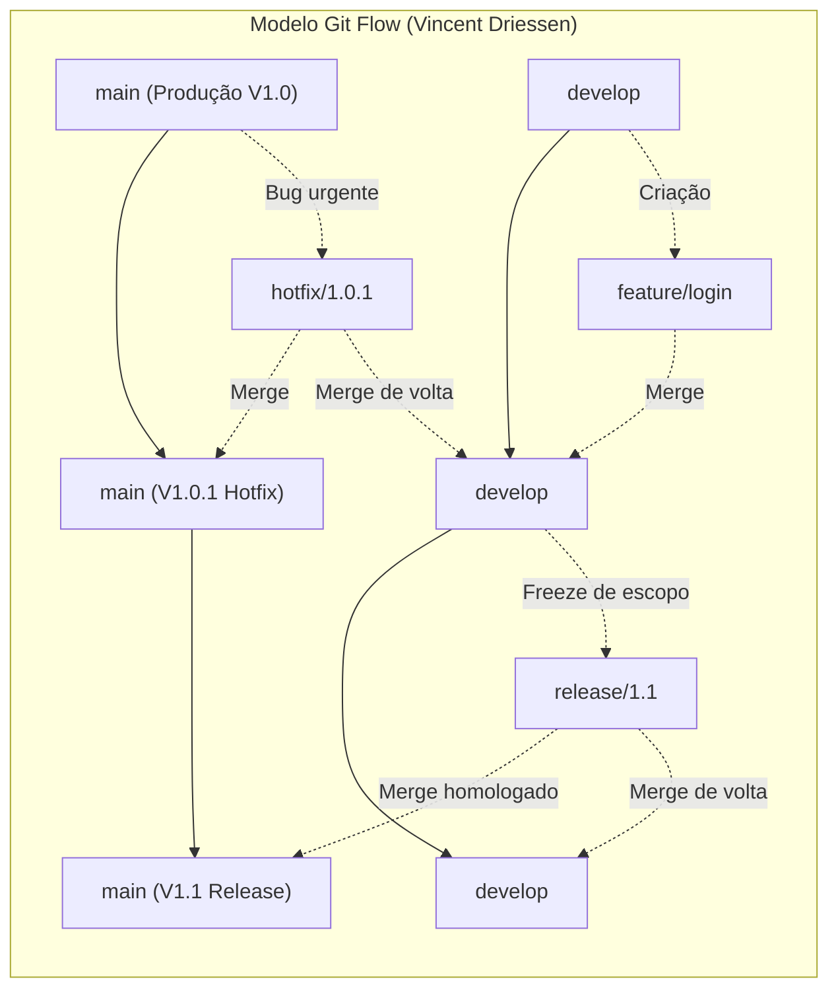
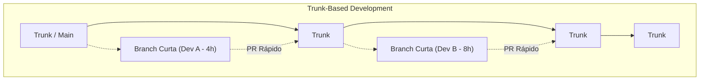
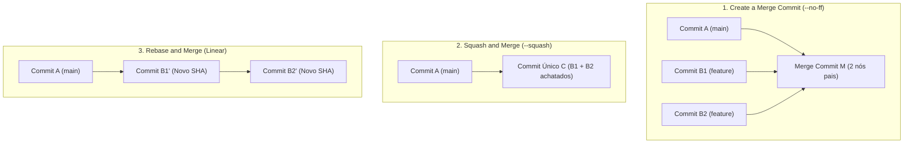

# 02 - Estratégias de Branching e Plataformas Git Colaborativas

> **Matéria:** DevOps, Plataforma de Desenvolvimento e Engenharia de Entrega  
> **Cargo:** B02 – Técnico de Controle Externo – Especialidade: Tecnologia da Informação  
> **Arquivo:** `02_git_estrategias_de_branching_e_plataformas_colaborativas.md`  


---


## 📌 Ementa / Itens do Edital
- Plataformas de hospedagem, colaboração e automação baseadas em Git: GitHub e GitLab
- Estratégias de branching (fluxos de ramificação): Git Flow, Trunk-Based Development, GitHub Flow e GitLab Flow
- Fluxo de trabalho com Pull Requests (GitHub) e Merge Requests (GitLab)
- Estratégias de mesclagem (Merge Commit, Squash and Merge, Rebase and Merge)
- Políticas de proteção de branches, governança de código e arquivos de configuração (`CODEOWNERS`)

---

## 🧭 Sumário

1. [Modelos e Estratégias de Branching](#1-modelos-e-estrategias-de-branching)
    1. [O Modelo Git Flow: Ramos Perenes e Ramos Temporários](#11-o-modelo-git-flow-ramos-perenes-e-ramos-temporarios)
    2. [Trunk-Based Development (TBD): Filosofia, Feature Flags e Branch by Abstraction](#12-trunk-based-development-tbd-filosofia-feature-flags-e-branch-by-abstraction)
    3. [O Modelo GitHub Flow](#13-o-modelo-github-flow)
    4. [O Modelo GitLab Flow (Ambientes e Versões)](#14-o-modelo-gitlab-flow-ambientes-e-versoes)
    5. [Matriz Comparativa Síntese entre os Modelos de Ramificação](#15-matriz-comparativa-sintese-entre-os-modelos-de-ramificacao)
    6. [Teste 182](#Teste-182)
    7. [Teste 183](#Teste-183)
    8. [Teste 184](#Teste-184)
    9. [Teste 185](#Teste-185)
2. [Estratégias de Integração e Mesclagem (Merge Commit, Squash e Rebase)](#2-estrategias-de-integracao-e-mesclagem-merge-commit-squash-e-rebase)
    1. [Create a Merge Commit (`git merge --no-ff`)](#21-create-a-merge-commit-git-merge-no-ff)
    2. [Squash and Merge (`git merge --squash`)](#22-squash-and-merge-git-merge-squash)
    3. [Rebase and Merge (`git rebase`)](#23-rebase-and-merge-git-rebase)
    4. [Teste 186](#Teste-186)
    5. [Teste 187](#Teste-187)
    6. [Teste 188](#Teste-188)
3. [Governança, Regras de Proteção de Branches e `CODEOWNERS`](#3-governanca-regras-de-protecao-de-branches-e-codeowners)
    1. [Regras de Proteção de Branches (Branch Protection Rules)](#31-regras-de-protecao-de-branches-branch-protection-rules)
    2. [O Arquivo `CODEOWNERS` e Revisões Bloqueantes](#32-o-arquivo-codeowners-e-revisoes-bloqueantes)
    3. [Comparativo Terminológico e Operacional: GitHub vs. GitLab](#33-comparativo-terminologico-e-operacional-github-vs-gitlab)
    4. [Teste 189](#Teste-189)
    5. [Teste 190](#Teste-190)
    6. [Teste 191](#Teste-191)
4. [🌐 Fontes Oficiais e Referências Bibliográficas](#fontes-oficiais-e-referencias-bibliograficas)

---

## 1. Modelos e Estratégias de Branching

A estratégia de ramificação (*branching strategy*) estabelece as regras e convenções que orientam como desenvolvedores criam branches, integram códigos, isolam novas funcionalidades e estabilizam versões para publicação. A escolha inadequada de um modelo de ramificação é a principal causadora do chamado **"Merge Hell"** — o cenário traumático em que múltiplas branches isoladas divergem por semanas ou meses, acumulando centenas de conflitos de mesclagem de resolução complexa e arriscada.



### 1.1 O Modelo Git Flow: Ramos Perenes e Ramos Temporários

Formalizado por Vincent Driessen em 2010, o **Git Flow** foi concebido para produtos de software que operam com ciclos de lançamento formais e programados com versionamento semântico estrito (como distribuições empacotadas para desktop, aplicativos de smartphone em lojas de apps e sistemas legados com janelas mensais ou trimestrais de homologação).

O Git Flow define rigorosamente duas categorias de branches:

#### 1. Ramos Perenes (Long-Lived Branches)
Permanecem ativos durante todo o ciclo de vida do repositório:

- **`main` (ou `master`):** Armazena exclusivamente o código em estado de prontidão para produção ou que já está rodando nos servidores produtivos. Cada commit na branch `main` representa um release oficial de software e deve ser compulsoriamente etiquetado com uma tag semântica (ex.: `v1.0.0`, `v1.1.0`).
- **`develop`:** Atua como o ramo integrador do trabalho contínuo de desenvolvimento. Reúne as funcionalidades concluídas e testadas que comporão o próximo lançamento planejado.

#### 2. Ramos Temporários de Suporte (Short-Lived / Supporting Branches)
Possuem ciclo de vida efêmero e regras rígidas de derivação e mesclagem:

- **`feature/*`:** Nascem **exclusivamente a partir de `develop`** e realizam merge de volta **obrigatoriamente em `develop`**. São utilizadas por equipes para implementar funcionalidades específicas sem interferir no trabalho alheio.
- **`release/*`:** Nascem **a partir de `develop`** quando o conjunto de funcionalidades planejadas para a próxima versão está finalizado (*code freeze*). Durante a existência da branch de release, é proibida a adição de novas funcionalidades; realizam-se apenas correções de defeitos identificados em homologação, ajustes finos de documentação e bump de versão. Ao ser finalizada e homologada, a branch de release é mesclada na **`main`** (recebendo uma tag) **E também na `develop`** (para repassar os ajustes de homologação ao fluxo principal).
- **`hotfix/*`:** Nascem **diretamente a partir de `main`** para solucionar incidentes críticos de segurança ou bugs impeditivos em produção que não podem aguardar o próximo ciclo formal de release. Uma vez testada e validada, a branch de hotfix deve ser mesclada na **`main`** (com nova subversão de patch, ex.: `v1.0.1`) **E compulsoriamente na `develop`**, impedindo que lançamentos futuros reintroduzam a falha que acabara de ser corrigida.

> 🚨 **ALERTA DE PROVA / PEGADINHA FCC:**  
> A FCC adora cobrar o destino de mesclagem das branches temporárias de **`hotfix`** e de **`release`** no Git Flow:
>
> - **`hotfix`:** Deriva de `main` $\rightarrow$ Realiza merge **em `main` E em `develop`**!
> - **`release`:** Deriva de `develop` $\rightarrow$ Realiza merge **em `main` E em `develop`**!
> Se a alternativa afirmar que o hotfix ou a release faz merge apenas na `main`, a afirmativa está incorreta!

### 1.2 Trunk-Based Development (TBD): Filosofia, Feature Flags e Branch by Abstraction

O **Trunk-Based Development (TBD)** é o modelo de ramificação preconizado pelas organizações de alta performance tecnológica (como Google, Meta, Netflix) e referendado com destaque empírico nas pesquisas do **DORA** (*State of DevOps Report*).



- **Filosofia Central:** Existe **apenas um único ramo perene**, denominado `trunk` (ou `main`).
- Todos os desenvolvedores integram seu trabalho ao `trunk` com altíssima frequência (ao menos uma vez por dia, preferencialmente múltiplas vezes).
- Se houver uso de branches de tarefas, elas devem ser estritamente de **vida curtíssima (*short-lived feature branches*)**, durando poucas horas ou no máximo 1 a 2 dias, sendo submetidas a Pull Requests pequenos e fáceis de revisar.
- **Habilitadores Técnicos Indispensáveis:**
    1. **Feature Flags / Feature Toggles:** Como integrar ao trunk códigos de histórias de usuário complexas que levam duas semanas para serem construídas? A equipe comita e sobe o código diariamente para produção, mas o mantém envolto em uma condicional booleana (*Feature Flag*). O recurso inacabado executa em produção desativado para os cidadãos e auditores, sem risco de quebra.
    2. **Branch by Abstraction:** Padrão arquitetural em nível de código-fonte utilizado para refatorar subsistemas complexos diretamente no trunk: cria-se uma interface/abstração intermediária entre o chamador e a implementação legada; implementa-se o novo componente gradualmente; redireciona-se o chamador para a nova implementação; e expurga-se o código legado do repositório, sem a necessidade de criar branches paralelas de longa duração.

### 1.3 O Modelo GitHub Flow

Criado pela equipe do GitHub, o **GitHub Flow** é uma abordagem minimalista e centrada na web, amplamente adotada em arquiteturas de microsserviços e sistemas com entregas contínuas:

- **Premissa Inviolável:** A branch `main` é permanentemente estável e **a qualquer momento pronta para entrar em produção** (*"Anything in the main branch is deployable"*).
- **Ciclo Operacional:**
    1. Cria-se uma branch descritiva diretamente a partir da `main` (ex.: `add-oauth2-support`);
    2. Adicionam-se commits frequentes e mensagens claras;
    3. Abre-se uma *Pull Request* precocemente para iniciar a discussão técnica e executar pipelines de CI automatizados;
    4. Após aprovação em revisão por pares e nos testes automatizados, o código é implantado em produção (para validação imediata);
    5. Realiza-se o merge na branch `main` e a branch de trabalho é excluída.

### 1.4 O Modelo GitLab Flow (Ambientes e Versões)

O **GitLab Flow** une a simplicidade do GitHub Flow à necessidade corporativa de gerenciar múltiplos ambientes de infraestrutura e suporte a versões legadas:

1. **GitLab Flow com Branches de Ambiente (*Environment Branches*):**
    - Cria-se uma branch perene para cada ambiente do ciclo de vida: `main` (desenvolvimento/integração), `pre-production` (homologação/staging) e `production` (produção real).
    - O código flui em sentido único: da `main` para `pre-production`, e de `pre-production` para `production`. O merge entre essas branches dispara automaticamente o pipeline de implantação no respectivo ambiente físico, garantindo que tudo o que entra em produção passou comprovadamente por homologação.

2. **GitLab Flow com Branches de Versão (*Release Branches*):**
    - Utilizado quando uma organização precisa manter suporte a múltiplas versões ativas de um mesmo software distribuído (ex.: versões 1.x, 2.x e 3.x). Correções de bugs são aplicadas primeiro na `main` e depois retroalimentadas (*backported*) nas branches de versão ativas através de comandos `git cherry-pick`.

### 1.5 Matriz Comparativa Síntese entre os Modelos de Ramificação

| Dimensão de Análise | Git Flow | Trunk-Based Development (TBD) | GitHub Flow | GitLab Flow (Ambientes) |
| :--- | :--- | :--- | :--- | :--- |
| **Complexidade Estrutural** | **Alta** (múltiplas branches com regras estritas) | **Mínima** | Baixa | Moderada |
| **Ramos Perenes Principais** | 2 (`main` e `develop`) | 1 (`trunk` / `main`) | 1 (`main`) | 1 principal + ramos de ambiente (`prod`, `staging`) |
| **Duração das Branches** | Longa (semanas a meses) | Curtíssima (horas a no máximo 1-2 dias) | Curta (ciclo da tarefa) | Curta para features; perene para ambientes |
| **Frequência de Deploys** | Baixa/Média (janelas de release agendadas) | Contínua (múltiplas vezes ao dia sob demanda) | Contínua (a cada PR aprovado) | Progressiva por promoção de ambiente |
| **Risco de Conflitos (Merge Hell)**| **Elevado** devido ao isolamento prolongado | **Quase nulo** (resolução precoce) | Baixo | Baixo |
| **Uso de Feature Flags** | Opcional | **Crítico / Essencial** | Opcional | Recomendado |
| **Aderência ao DevOps / CI/CD** | Baixa (silos temporais em branches) | **Padrão Ouro (Recomendado DORA)** | Alta para web e microsserviços | Alta para governança corporativa |

---

### Teste 182
**(FGV – TRT/13 – 2022 – Analista Judiciario Tecnologia Da Informacao)**
Quanto aos critérios e diretrizes técnicas para o processo de desenvolvimento de módulos e serviços na Plataforma Digital do Poder Judiciário Brasileiro – PDPJ-Br, assinale V para a afirmativa verdadeira e F para a falsa. I. Os módulos estruturantes do PDPJ-Br seguem o modelo arquitetural de microsserviços, que deverão ser obrigatoriamente modelados utilizando-se a metodologia Domain Driven Design (DDD). II. O controle de versionamento de microserviços poderá empregar como sistema de controle de versões: Git, SVN ou CVS. III. O CNJ desenvolveu o UIKit como conjunto de ferramentas de interface gráfica, de adoção opcional, como identidade visual dos módulos desenvolvidos dentro da PDPJ-Br As afirmativas são, respectivamente,

* **A)** F, F e F.
* **B)** F, F e V.
* **C)** V, V e F.
* **D)** V, V e V.
* **E)** F, V e F.

---

> **Comentário Detalhado:**
>
> - **A)** **Correta.** Conforme fundamentado na seção *1.2 Trunk-Based Development (TBD): Filosofia, Feature Flags e Branch by Abstraction* deste guia, branch by Abstraction: Padrão arquitetural em nível de código-fonte utilizado para refatorar subsistemas complexos diretamente no trunk: cria-se uma interface/abstração intermediária entre o chamador e a implementação legada; implementa-se o novo componente gradualmente; redireciona-se o chamador para a nova implementação; e expurga-se o código legado do repositório, sem a necessidade de criar branches paralelas de longa duração. Dessa forma, está plenamente correta a assertiva da banca (FGV – TRT/13/2022) ao estabelecer que "F, F e F".
> - **B)** **Incorreta.** A opção apresenta proposição em desacordo com os fundamentos teóricos e técnicos do tópico ao afirmar que "F, F e V". De acordo com a teoria estudada em *1.4 O Modelo GitLab Flow (Ambientes e Versões)*, cria-se uma branch perene para cada ambiente do ciclo de vida: `main` (desenvolvimento/integração), `pre-production` (homologação/staging) e `production` (produção real).
> - **C)** **Incorreta.** A opção apresenta proposição em desacordo com os fundamentos teóricos e técnicos do tópico ao afirmar que "V, V e F". De acordo com a teoria estudada em *1.1 O Modelo Git Flow: Ramos Perenes e Ramos Temporários*, formalizado por Vincent Driessen em 2010, o Git Flow foi concebido para produtos de software que operam com ciclos de lançamento formais e programados com versionamento semântico estrito (como distribuições empacotadas para desktop, aplicativos de smartphone em lojas de apps e sistemas legados com janelas mensais ou trimestrais de homologação).
> - **D)** **Incorreta.** A opção apresenta proposição em desacordo com os fundamentos teóricos e técnicos do tópico ao afirmar que "V, V e V". De acordo com a teoria estudada em *1.4 O Modelo GitLab Flow (Ambientes e Versões)*, correções de bugs são aplicadas primeiro na `main` e depois retroalimentadas (*backported*) nas branches de versão ativas através de comandos `git cherry-pick`.
> - **E)** **Incorreta.** A opção apresenta proposição em desacordo com os fundamentos teóricos e técnicos do tópico ao afirmar que "F, V e F". De acordo com a teoria estudada em *1.3 O Modelo GitHub Flow*, criado pela equipe do GitHub, o GitHub Flow é uma abordagem minimalista e centrada na web, amplamente adotada em arquiteturas de microsserviços e sistemas com entregas contínuas.
>
> **Gabarito: A**

---

### Teste 183
**(FGV – TJ/DFT – 2022 – Analista Judiciario Suporte Em Tecnologia Da Informacao)**
Based on the text, mark the statements below as TRUE (T) or FALSE (F). ( ) Unlike a computer, it is hard for our brain to classify objects according to a specific purpose. ( ) The author rules out the possibility that computers may emulate the human brain someday. ( ) The brain adapts as one both matures and becomes more knowledgeable. The statements are, respectively:

* **A)** F – T – T;
* **B)** T – F – F;
* **C)** F – T – F;
* **D)** F – F – T;
* **E)** T – T – F.

---

> **Comentário Detalhado:**
>
> - **A)** **Incorreta.** A opção apresenta proposição em desacordo com os fundamentos teóricos e técnicos do tópico ao afirmar que "F – T – T". De acordo com a teoria estudada em *3.3 Comparativo Terminológico e Operacional: GitHub vs. GitLab*, agente Executor de Tarefas: GitHub Runner (*Hosted* ou *Self-Hosted*) — GitLab Runner (Shared ou Specific).
> - **B)** **Incorreta.** A opção apresenta proposição em desacordo com os fundamentos teóricos e técnicos do tópico ao afirmar que "T – F – F". De acordo com a teoria estudada em *1.2 Trunk-Based Development (TBD): Filosofia, Feature Flags e Branch by Abstraction*, o Trunk-Based Development (TBD) é o modelo de ramificação preconizado pelas organizações de alta performance tecnológica (como Google, Meta, Netflix) e referendado com destaque empírico nas pesquisas do DORA (*State of DevOps Report*).
> - **C)** **Incorreta.** A opção apresenta proposição em desacordo com os fundamentos teóricos e técnicos do tópico ao afirmar que "F – T – F". De acordo com a teoria estudada em *1.2 Trunk-Based Development (TBD): Filosofia, Feature Flags e Branch by Abstraction*, filosofia Central: Existe apenas um único ramo perene, denominado `trunk` (ou `main`).
> - **D)** **Correta.** Conforme fundamentado na seção *1.3 O Modelo GitHub Flow* deste guia, premissa Inviolável: A branch `main` é permanentemente estável e a qualquer momento pronta para entrar em produção (*"Anything in the main branch is deployable"*). Dessa forma, está plenamente correta a assertiva da banca (FGV – TJ/DFT/2022) ao estabelecer que "F – F – T".
> - **E)** **Incorreta.** A opção apresenta proposição em desacordo com os fundamentos teóricos e técnicos do tópico ao afirmar que "T – T – F". De acordo com a teoria estudada em *1.2 Trunk-Based Development (TBD): Filosofia, Feature Flags e Branch by Abstraction*, todos os desenvolvedores integram seu trabalho ao `trunk` com altíssima frequência (ao menos uma vez por dia, preferencialmente múltiplas vezes).
>
> **Gabarito: D**

---

### Teste 184
**(FGV – TCE/GO – 2024 – Analista de Controle Externo - Ciências Contábeis)**
Based on the text, mark the statements below as TRUE (T) or FALSE (F): ( ) The author mentions the fact that AGI may supplant human faculties. ( ) Ways in which we can lead meaningful lives are detailed. ( ) AGI has already solved the problems of economic equality. The statements are, respectively

* **A)** F – T – F.
* **B)** T – F – F.
* **C)** T – T – F.
* **D)** F – T – T.
* **E)** F – F – T.

---

> **Comentário Detalhado:**
>
> - **A)** **Incorreta.** A opção apresenta proposição em desacordo com os fundamentos teóricos e técnicos do tópico ao afirmar que "F – T – F". De acordo com a teoria estudada em *1.2 Trunk-Based Development (TBD): Filosofia, Feature Flags e Branch by Abstraction*, o Trunk-Based Development (TBD) é o modelo de ramificação preconizado pelas organizações de alta performance tecnológica (como Google, Meta, Netflix) e referendado com destaque empírico nas pesquisas do DORA (*State of DevOps Report*).
> - **B)** **Correta.** Conforme fundamentado na seção *1.3 O Modelo GitHub Flow* deste guia, premissa Inviolável: A branch `main` é permanentemente estável e a qualquer momento pronta para entrar em produção (*"Anything in the main branch is deployable"*). Dessa forma, está plenamente correta a assertiva da banca (FGV – TCE/GO/2024) ao estabelecer que "T – F – F".
> - **C)** **Incorreta.** A opção apresenta proposição em desacordo com os fundamentos teóricos e técnicos do tópico ao afirmar que "T – T – F". De acordo com a teoria estudada em *1.2 Trunk-Based Development (TBD): Filosofia, Feature Flags e Branch by Abstraction*, filosofia Central: Existe apenas um único ramo perene, denominado `trunk` (ou `main`).
> - **D)** **Incorreta.** A opção apresenta proposição em desacordo com os fundamentos teóricos e técnicos do tópico ao afirmar que "F – T – T". De acordo com a teoria estudada em *1.2 Trunk-Based Development (TBD): Filosofia, Feature Flags e Branch by Abstraction*, todos os desenvolvedores integram seu trabalho ao `trunk` com altíssima frequência (ao menos uma vez por dia, preferencialmente múltiplas vezes).
> - **E)** **Incorreta.** A opção apresenta proposição em desacordo com os fundamentos teóricos e técnicos do tópico ao afirmar que "F – F – T". De acordo com a teoria estudada em *1.2 Trunk-Based Development (TBD): Filosofia, Feature Flags e Branch by Abstraction*, se houver uso de branches de tarefas, elas devem ser estritamente de vida curtíssima (*short-lived feature branches*), durando poucas horas ou no máximo 1 a 2 dias, sendo submetidas a Pull Requests pequenos e fáceis de revisar.
>
> **Gabarito: B**

---

### Teste 185
**(CEBRASPE – STF – 2008 – Analista Judiciario Suporte Em Tecnologia Da Informacao)**
RASCUNHO billions of people around the world. We believe that if technology is to truly bring benefit to humanity, then human values and the impact of technology must be considered at the 22 earliest possible opportunity in the technology design process.” Internet: <www.microsoft.com> (adapted). Based on the text, judge the following items.

* **C)** Certo
* **E)** Errado

---

> **Comentário Detalhado:**
>
> - **C)** **Incorreta.** A marcação como **Certo** não procede, pois o enunciado apresenta proposição em desacordo com os fundamentos teóricos e técnicos do tópico ao afirmar que "RASCUNHO billions of people around the world. We believe that if technology is to truly bring benefit to...". De acordo com a teoria estudada em *1.2 Trunk-Based Development (TBD): Filosofia, Feature Flags e Branch by Abstraction*, o Trunk-Based Development (TBD) é o modelo de ramificação preconizado pelas organizações de alta performance tecnológica (como Google, Meta, Netflix) e referendado com destaque empírico nas pesquisas do DORA (*State of DevOps Report*).
> - **E)** **Correta.** O item está **Errado** (gabarito oficial: **E**). Conforme fundamentado na seção *1.3 O Modelo GitHub Flow* deste guia, premissa Inviolável: A branch `main` é permanentemente estável e a qualquer momento pronta para entrar em produção (*"Anything in the main branch is deployable"*). Portanto, a assertiva examinada pela banca (CEBRASPE – STF/2008) viola os preceitos técnicos do tópico.
>
> **Gabarito: E**

---

## 2. Estratégias de Integração e Mesclagem (Merge Commit, Squash e Rebase)

Ao aprovar uma *Pull Request* (no GitHub) ou *Merge Request* (no GitLab), as plataformas oferecem três estratégias fundamentais para integrar os commits da branch de trabalho ao ramo de destino:



### 2.1 Create a Merge Commit (`git merge --no-ff`)

- **Operação Subjacente:** Executa um merge do tipo *no fast-forward*. Cria um nó de commit especial na árvore do Git que possui **dois nós pais**: o último commit da branch de destino e o último commit da branch de trabalho.
- **Vantagens:** Preserva integralmente o histórico original de todos os commits intermediários e a exata demarcação cronológica de que aquele conjunto de linhas foi concebido em uma branch isolada.
- **Desvantagens:** Pode transformar o grafo visual do repositório em uma "teia de espaguete" de difícil interpretação, repleta de commits triviais como *"wip"*, *"corrigindo typo"* ou *"ajuste de teste"*.

### 2.2 Squash and Merge (`git merge --squash`)

- **Operação Subjacente:** Coleta todas as modificações introduzidas pelos múltiplos commits da branch de trabalho, une-as em uma única alteração atômica e registra **um único e coeso commit novo** no topo da branch de destino, descartando os commits individuais intermediários.
- **Vantagens:** Mantém o histórico do branch principal (`main`) estritamente limpo, coeso e legível. Cada commit na `main` corresponde a uma entrega funcional completa (*atomic commit*). Facilita drasticamente a identificação de bugs via `git bisect` e a reversão de falhas em produção via um único comando `git revert <hash>`.
- **Desvantagens:** Suprime o detalhamento granular dos micro-passos dados pelo desenvolvedor durante a confecção da funcionalidade.

### 2.3 Rebase and Merge (`git rebase`)

- **Operação Subjacente:** Pega os commits individuais da branch de trabalho e os reaplica um a um sobre a ponta mais recente da branch de destino, gerando um histórico estritamente linear sem nós de merge intermediários.
- **Pontos de Atenção:** Ao reaplicar os commits, o Git recalcula os identificadores criptográficos (hashes SHA-1/SHA-256), alterando a identidade dos commits originais. Não cria nó com múltiplos pais.

---

### Teste 186
**(FGV – TJ/AP – 2023 – Analista Judiciario Apoio Especializado Tecnologia Da Informacao Banco De Dados)**
Observe o seguinte script de criação da tabela “Empresa” e outros objetos em Oracle: CREATE TABLE empresa ( empresa_ID NUMBER(12) PRIMARY KEY, razao_social VARCHAR2(50) NOT NULL ); CREATE SEQUENCE sq_empresa_pk START WITH 2 INCREMENT BY 2 NOMAXVALUE NOCACHE NOCYCLE; CREATE OR REPLACE TRIGGER trg_bi_empresa BEFORE INSERT ON empresa FOR EACH ROW WHEN (NEW.empresa_ID IS NULL) BEGIN SELECT sq_empresa_pk.NEXTVAL INTO :NEW.empresa_ID FROM dual; END; Após a execução do script anteriormente apresentado, analise a execução dos seguintes comandos: INSERT INTO empresa (empresa_ID, razao_social) VALUES (NULL, 'AAA'); INSERT INTO empresa (razao_social) VALUES ('BBB'); INSERT INTO empresa (empresa_ID, razao_social) VALUES (1, 'CCC'); INSERT INTO empresa (empresa_ID, razao_social) VALUES (5, 'DDD'); INSERT INTO empresa (empresa_ID, razao_social) VALUES (6, 'EEE'); INSERT INTO empresa (razao_social) VALUES ('FFF'); COMMIT; Após a execução dos comandos apresentados, é correto afirmar que:

* **A)** foram inseridas 6 (seis) linhas e o número final para sq_empresa_pk.CURRVAL é igual a 6 (seis);
* **B)** nenhuma linha pode ser inserida e o número final para sq_empresa_pk.CURRVAL é igual a 2 (dois);
* **C)** foram inseridas 5 (cinco) linhas e o número final para sq_empresa_pk.CURRVAL é igual a 6 (seis);
* **D)** foram inseridas 5 (cinco) linhas e o número final para sq_empresa_pk.CURRVAL é igual a 4 (quatro);
* **E)** foram inseridas 4 (quatro) linhas e o número final para sq_empresa_pk.CURRVAL é igual a 4 (quatro).

---

> **Comentário Detalhado:**
>
> - **A)** **Incorreta.** A opção apresenta proposição em desacordo com os fundamentos teóricos e técnicos do tópico ao afirmar que "foram inseridas 6 (seis) linhas e o número final para sq_empresa_pk.CURRVAL é igual a 6 (seis)". De acordo com a teoria estudada em *2.1 Create a Merge Commit (`git merge --no-ff`)*, operação Subjacente: Executa um merge do tipo *no fast-forward*. Cria um nó de commit especial na árvore do Git que possui dois nós pais: o último commit da branch de destino e o último commit da branch de trabalho.
> - **B)** **Incorreta.** A opção apresenta proposição em desacordo com os fundamentos teóricos e técnicos do tópico ao afirmar que "nenhuma linha pode ser inserida e o número final para sq_empresa_pk.CURRVAL é igual a 2 (dois)". De acordo com a teoria estudada em *2.1 Create a Merge Commit (`git merge --no-ff`)*, desvantagens: Pode transformar o grafo visual do repositório em uma "teia de espaguete" de difícil interpretação, repleta de commits triviais como *"wip"*, *"corrigindo typo"* ou *"ajuste de teste"*.
> - **C)** **Correta.** Conforme fundamentado na seção *2.1 Create a Merge Commit (`git merge --no-ff`)* deste guia, vantagens: Preserva integralmente o histórico original de todos os commits intermediários e a exata demarcação cronológica de que aquele conjunto de linhas foi concebido em uma branch isolada. Dessa forma, está plenamente correta a assertiva da banca (FGV – TJ/AP/2023) ao estabelecer que "foram inseridas 5 (cinco) linhas e o número final para sq_empresa_pk.CURRVAL é igual a 6 (seis)".
> - **D)** **Incorreta.** A opção apresenta proposição em desacordo com os fundamentos teóricos e técnicos do tópico ao afirmar que "foram inseridas 5 (cinco) linhas e o número final para sq_empresa_pk.CURRVAL é igual a 4 (quatro)". De acordo com a teoria estudada em *2. Ramos Temporários de Suporte (Short-Lived / Supporting Branches)*, se a alternativa afirmar que o hotfix ou a release faz merge apenas na `main`, a afirmativa está incorreta!.
> - **E)** **Incorreta.** A opção apresenta proposição em desacordo com os fundamentos teóricos e técnicos do tópico ao afirmar que "foram inseridas 4 (quatro) linhas e o número final para sq_empresa_pk.CURRVAL é igual a 4 (quatro)". De acordo com a teoria estudada em *1.3 O Modelo GitHub Flow*, após aprovação em revisão por pares e nos testes automatizados, o código é implantado em produção (para validação imediata).
>
> **Gabarito: C**

---

### Teste 187
**(FCC – TRT 15ª – 2015 – Analista Judiciário - Tecnologia da Informação)**
O processo de medição funcional de um software utilizando pontos de função possui uma série de etapas, dentre elas, a de medir as funções de transação. Estas funções representam a funcionalidade fornecida ao usuário para atender às suas necessidades de processamento de dados pela aplicação. São classificadas em entradas externas, saídas externas ou consultas externas. Constitui exemplo de entrada externa:

* **A)** Telas de filtro de relatório e consultas.
* **B)** Telas de login com objetivo de verificar se o usuário pode ou não acessar o sistema.
* **C)** Relatórios que possuem totalização de dados.
* **D)** Informações que possuem formato gráfico.
* **E)** Processamento em lotes de atualização de bases cadastrais a partir de arquivos de movimento.

---

> **Comentário Detalhado:**
>
> - **A)** **Incorreta.** A opção apresenta proposição em desacordo com os fundamentos teóricos e técnicos do tópico ao afirmar que "Telas de filtro de relatório e consultas". De acordo com a teoria estudada em *2. Ramos Temporários de Suporte (Short-Lived / Supporting Branches)*, possuem ciclo de vida efêmero e regras rígidas de derivação e mesclagem.
> - **B)** **Incorreta.** A opção apresenta proposição em desacordo com os fundamentos teóricos e técnicos do tópico ao afirmar que "Telas de login com objetivo de verificar se o usuário pode ou não acessar o sistema". De acordo com a teoria estudada em *1.2 Trunk-Based Development (TBD): Filosofia, Feature Flags e Branch by Abstraction*, feature Flags / Feature Toggles: Como integrar ao trunk códigos de histórias de usuário complexas que levam duas semanas para serem construídas? A equipe comita e sobe o código diariamente para produção, mas o mantém envolto em uma condicional booleana (*Feature Flag*).
> - **C)** **Correta.** Conforme fundamentado na seção *2.2 Squash and Merge (`git merge --squash`)* deste guia, desvantagens: Suprime o detalhamento granular dos micro-passos dados pelo desenvolvedor durante a confecção da funcionalidade. Dessa forma, está plenamente correta a assertiva da banca (FCC – TRT 15ª/2015) ao estabelecer que "Relatórios que possuem totalização de dados".
> - **D)** **Incorreta.** A opção apresenta proposição em desacordo com os fundamentos teóricos e técnicos do tópico ao afirmar que "Informações que possuem formato gráfico". De acordo com a teoria estudada em *2.1 Create a Merge Commit (`git merge --no-ff`)*, operação Subjacente: Executa um merge do tipo *no fast-forward*. Cria um nó de commit especial na árvore do Git que possui dois nós pais: o último commit da branch de destino e o último commit da branch de trabalho.
> - **E)** **Incorreta.** A opção apresenta proposição em desacordo com os fundamentos teóricos e técnicos do tópico ao afirmar que "Processamento em lotes de atualização de bases cadastrais a partir de arquivos de movimento". De acordo com a teoria estudada em *3.2 O Arquivo `CODEOWNERS` e Revisões Bloqueantes*, o arquivo `CODEOWNERS` (alocado na raiz do repositório, dentro da pasta `.github/` ou em `.gitlab/`) permite estabelecer proprietários técnicos e papéis de governança baseados em diretórios ou extensões de arquivos.
>
> **Gabarito: C**

---

### Teste 188
**(CEBRASPE – STJ – 2015 – Analista Judiciario Suporte Em Tecnologia Da Informacao)**
Born in São Paulo and working under the name OSGEMEOS since 1987, the siblings work alongside each other on each project, and have always communicated in an 25 artistic way. The two have worked in many mediums including graffiti, drawings, paintings, sculptures, and most recently, animation. B r a z ili a n t w in a r ti s t s O S G E M E O S m a k e he a d s r a i n o n 42 n d S t re e t . I nt e rn e t : < h tt p: // ed iti on . c nn . c o m > (a d a p t e d ) . Based on the text above, judge the following items.

* **C)** Certo
* **E)** Errado

---

> **Comentário Detalhado:**
>
> - **C)** **Correta.** O item está **Certo**. Conforme fundamentado na seção *1.3 O Modelo GitHub Flow* deste guia, premissa Inviolável: A branch `main` é permanentemente estável e a qualquer momento pronta para entrar em produção (*"Anything in the main branch is deployable"*). Dessa forma, está plenamente correta a proposição da banca (CEBRASPE – STJ/2015) ao afirmar que "Born in São Paulo and working under the name OSGEMEOS since 1987, the siblings work alongside each other on...".
> - **E)** **Incorreta.** A marcação como **Errado** não procede, visto que a assertiva guarda integral conformidade com a teoria estudada em *2.2 Squash and Merge (`git merge --squash`)*, segundo a qual operação Subjacente: Coleta todas as modificações introduzidas pelos múltiplos commits da branch de trabalho, une-as em uma única alteração atômica e registra um único e coeso commit novo no topo da branch de destino, descartando os commits individuais intermediários.
>
> **Gabarito: C**

---

## 3. Governança, Regras de Proteção de Branches e `CODEOWNERS`

Em instituições governamentais e órgãos de controle externo como o TCE-GO, os repositórios de código constituem ativos estratégicos sujeitos a rígidos requisitos de conformidade, trilhas de auditoria e segregação de funções.

### 3.1 Regras de Proteção de Branches (Branch Protection Rules)

As configurações de proteção de branch (*Branch Protection Rules* no GitHub ou *Protected Branches* no GitLab) impõem controles automatizados invioláveis sobre ramos críticos (especialmente `main` e `develop`):

1. **Bloqueio de Push Direto (*Require a pull request before merging*):** Impede que qualquer desenvolvedor envie commits diretamente para a branch principal sem a abertura de uma Pull Request formal.
2. **Bloqueio de Forçamento de Histórico (*Block Force Pushes*):** Desativa compulsoriamente a permissão para executar comandos `git push --force`, impedindo a reescrita deliberada ou acidental do histórico versionado.
3. **Bloqueio de Exclusão (*Prevent Branch Deletion*):** Impede que comandos administrativos apaguem a branch principal.
4. **Revisão Obrigatória por Pares (*Required Approvals*):** Condiciona o merge à aprovação formal de ao menos um (ou mais) revisores humanos qualificados, impedindo a auto-aprovação de código pelo próprio autor.
5. **Aprovação Obrigatória em Verificações de Status do CI (*Required Status Checks*):** Exige que suítes de testes unitários, checagens de linter e análises de vulnerabilidades executadas nos runners de CI reportem sucesso obrigatório antes que o botão de merge seja liberado.
6. **Assinatura Criptográfica Obrigatória (*Require Signed Commits*):** Rejeita commits que não possuam assinatura criptográfica válida (via chaves GPG ou SSH), comprovando a identidade real do autor e prevenindo falsificação de identidade (*commit spoofing*).

### 3.2 O Arquivo `CODEOWNERS` e Revisões Bloqueantes

O arquivo **`CODEOWNERS`** (alocado na raiz do repositório, dentro da pasta `.github/` ou em `.gitlab/`) permite estabelecer proprietários técnicos e papéis de governança baseados em diretórios ou extensões de arquivos:

```text
# O time de arquitetura é dono de todo o repositório por padrão:
*       @orgao-tce/time-arquitetura

# Mudanças em módulos de autenticação e criptografia exigem aprovação da equipe de segurança:
/src/auth/      @orgao-tce/time-seguranca-app
/config/jwt/    @orgao-tce/time-seguranca-app

# Migrações e scripts SQL de banco de dados exigem aprovação obrigatória dos DBAs:
*.sql           @orgao-tce/time-dbas
/database/      @orgao-tce/time-dbas
```

**Mecânica de Aplicação:** Quando um desenvolvedor abre uma *Pull Request* alterando qualquer arquivo coberto pelas regras do `CODEOWNERS`, a plataforma Git adiciona **automaticamente e de forma obrigatória** as equipes ou usuários especificados como revisores bloqueantes. O merge da PR torna-se tecnicamente impossível até que os proprietários do código tenham revisado e concedido a aprovação.

### 3.3 Comparativo Terminológico e Operacional: GitHub vs. GitLab

| Conceito / Recurso | Plataforma GitHub | Plataforma GitLab |
| :--- | :--- | :--- |
| **Proposta de Integração de Código** | **Pull Request (PR)** | **Merge Request (MR)** |
| **Pipeline de Automação CI/CD** | **GitHub Actions** (`.github/workflows/*.yml`) | **GitLab CI/CD** (`.gitlab-ci.yml`) |
| **Agente Executor de Tarefas** | **GitHub Runner** (*Hosted* ou *Self-Hosted*) | **GitLab Runner** (Shared ou Specific) |
| **Regras de Governança de Ramos** | *Branch Protection Rules* | *Protected Branches* |
| **Arquivo de Donos de Código** | `.github/CODEOWNERS` ou raiz | `.gitlab/CODEOWNERS` ou raiz |

---

### Teste 189
**(CEBRASPE – TRF 6ª – 2025 – Analista Judiciário - Apoio Especializado - Governança e Gestão de Tecnologia da Informação)**
O grupo revisor de código-fonte das soluções da PDPJ-Br pode aceitar merge requests no código-fonte sem a necessidade de aprovação de testes, desde que a funcionalidade desenvolvida atenda às necessidades operacionais.

* **C)** Certo
* **E)** Errado

---

> **Comentário Detalhado:**
>
> - **C)** **Incorreta.** A marcação como **Certo** não procede, pois o enunciado apresenta proposição em desacordo com os fundamentos teóricos e técnicos do tópico ao afirmar que "O grupo revisor de código-fonte das soluções da PDPJ-Br pode aceitar merge requests no código-fonte sem a...". De acordo com a teoria estudada em *1.3 O Modelo GitHub Flow*, após aprovação em revisão por pares e nos testes automatizados, o código é implantado em produção (para validação imediata).
> - **E)** **Correta.** O item está **Errado** (gabarito oficial: **E**). Conforme fundamentado na seção *1.2 Trunk-Based Development (TBD): Filosofia, Feature Flags e Branch by Abstraction* deste guia, branch by Abstraction: Padrão arquitetural em nível de código-fonte utilizado para refatorar subsistemas complexos diretamente no trunk: cria-se uma interface/abstração intermediária entre o chamador e a implementação legada; implementa-se o novo componente gradualmente; redireciona-se o chamador para a nova implementação; e expurga-se o código legado do repositório, sem a necessidade de criar branches paralelas de longa duração. Portanto, a assertiva examinada pela banca (CEBRASPE – TRF 6ª/2025) viola os preceitos técnicos do tópico.
>
> **Gabarito: E**

---

### Teste 190
**(CEBRASPE – STJ – 2024 – Analista Judiciário - Apoio Especializado - Suporte em Tecnologia da Informação)**
A solução Flyway permite que seja realizado o controle de versão de código de banco de dados, estendendo o DevOps aos bancos de dados de modo a permitir que se acompanhem as alterações e se aprimore a confiabilidade das implantações de software.

* **C)** Certo
* **E)** Errado

---

> **Comentário Detalhado:**
>
> - **C)** **Correta.** O item está **Certo**. Conforme fundamentado na seção *3.2 O Arquivo `CODEOWNERS` e Revisões Bloqueantes* deste guia, o arquivo `CODEOWNERS` (alocado na raiz do repositório, dentro da pasta `.github/` ou em `.gitlab/`) permite estabelecer proprietários técnicos e papéis de governança baseados em diretórios ou extensões de arquivos. Dessa forma, está plenamente correta a proposição da banca (CEBRASPE – STJ/2024) ao afirmar que "A solução Flyway permite que seja realizado o controle de versão de código de banco de dados, estendendo o...".
> - **E)** **Incorreta.** A marcação como **Errado** não procede, visto que a assertiva guarda integral conformidade com a teoria estudada em *2.2 Squash and Merge (`git merge --squash`)*, segundo a qual desvantagens: Suprime o detalhamento granular dos micro-passos dados pelo desenvolvedor durante a confecção da funcionalidade.
>
> **Gabarito: C**

---

### Teste 191
**(FCC – TRT 2ª – 2014 – Analista Judiciário - Tecnologia da Informação)**
Considere os seguintes fatores sobre o sistema de arquivos EXT4 no Linux: I. O tamanho máximo deste sistema de arquivos é 1EB (exabyte), também suporta arquivos com 16TB (terabytes). II. Diretórios podem conter, no máximo, 128.000 subdiretórios, (contrastando com um máximo de 64.000 no ext3). III. Não é possível efetuar a montagem de um sistema de arquivos EXT3 existente como sendo um EXT4 sem efetuar seu upgrade. Isto se deve aos diferentes tipos de journaling. IV. Neste sistema de arquivos é possível desligar a funcionalidade journaling. Está correto o que consta APENAS em

* **A)** leitura para o proprietário do arquivo.
* **B)** execução para usuários que não pertençam ao grupo deste arquivo.
* **C)** escrita, tanto para o proprietário do arquivo, quanto para usuários que não pertençam ao grupo deste arquivo.
* **D)** escrita e execução para os usuários que pertençam ao grupo deste arquivo.
* **E)** leitura e execução para o proprietário do arquivo.

---

> **Comentário Detalhado:**
>
> - **A)** **Incorreta.** A opção apresenta proposição em desacordo com os fundamentos teóricos e técnicos do tópico ao afirmar que "leitura para o proprietário do arquivo". De acordo com a teoria estudada em *3.2 O Arquivo `CODEOWNERS` e Revisões Bloqueantes*, mecânica de Aplicação: Quando um desenvolvedor abre uma *Pull Request* alterando qualquer arquivo coberto pelas regras do `CODEOWNERS`, a plataforma Git adiciona automaticamente e de forma obrigatória as equipes ou usuários especificados como revisores bloqueantes.
> - **B)** **Incorreta.** A opção apresenta proposição em desacordo com os fundamentos teóricos e técnicos do tópico ao afirmar que "execução para usuários que não pertençam ao grupo deste arquivo". De acordo com a teoria estudada em *3.2 O Arquivo `CODEOWNERS` e Revisões Bloqueantes*, o merge da PR torna-se tecnicamente impossível até que os proprietários do código tenham revisado e concedido a aprovação.
> - **C)** **Incorreta.** A opção apresenta proposição em desacordo com os fundamentos teóricos e técnicos do tópico ao afirmar que "escrita, tanto para o proprietário do arquivo, quanto para usuários que não pertençam ao grupo deste arquivo". De acordo com a teoria estudada em *3.3 Comparativo Terminológico e Operacional: GitHub vs. GitLab*, arquivo de Donos de Código: `.github/CODEOWNERS` ou raiz — `.gitlab/CODEOWNERS` ou raiz.
> - **D)** **Incorreta.** A opção apresenta proposição em desacordo com os fundamentos teóricos e técnicos do tópico ao afirmar que "escrita e execução para os usuários que pertençam ao grupo deste arquivo". De acordo com a teoria estudada em *1.2 Trunk-Based Development (TBD): Filosofia, Feature Flags e Branch by Abstraction*, se houver uso de branches de tarefas, elas devem ser estritamente de vida curtíssima (*short-lived feature branches*), durando poucas horas ou no máximo 1 a 2 dias, sendo submetidas a Pull Requests pequenos e fáceis de revisar.
> - **E)** **Correta.** Conforme fundamentado na seção *3.2 O Arquivo `CODEOWNERS` e Revisões Bloqueantes* deste guia, o arquivo `CODEOWNERS` (alocado na raiz do repositório, dentro da pasta `.github/` ou em `.gitlab/`) permite estabelecer proprietários técnicos e papéis de governança baseados em diretórios ou extensões de arquivos. Dessa forma, está plenamente correta a assertiva da banca (FCC – TRT 2ª/2014) ao estabelecer que "leitura e execução para o proprietário do arquivo".
>
> **Gabarito: E**

---

## 🌐 Fontes Oficiais e Referências Bibliográficas

* [Trunk Based Development Official Guide](https://trunkbaseddevelopment.com/5-min-overview/) - Práticas de desenvolvimento linear focado na branch principal, releases a partir do trunk e feature flags.
* [GitHub Documentation - Managing Protected Branches and Pull Requests](https://docs.github.com/pt/repositories/configuring-branches-and-merges-in-your-repository/managing-protected-branches/about-protected-branches) - Regras de proteção, revisões obrigatórias (code review) e status checks.
* [Git Official Documentation - Advanced Git Rebase](https://git-scm.com/docs/git-rebase) - Reescrevendo histórico de commits, squashing e rebase interativo.
* [Git Official Documentation - Git Merge Strategies](https://git-scm.com/docs/git-merge) - Algoritmos ortogonais de resolução de conflitos e políticas de mesclagem.
* CHACON, Scott; STRAUB, Ben. **Pro Git**. 2. ed. Nova York: Apress, 2014. (Cap. 3 - Git Branching e Fluxos Colaborativos).
* HUMBLE, Jez; FARLEY, David. **Entrega Contínua**. Porto Alegre: Bookman, 2014. (Cap. 14 - Gestão Avançada de Branches e Versionamento).
* KIM, Gene et al. **Manual de DevOps**. São Paulo: Alta Books, 2018. (Cap. 11 - Integrando Segurança e Governança no Controle de Versão).
