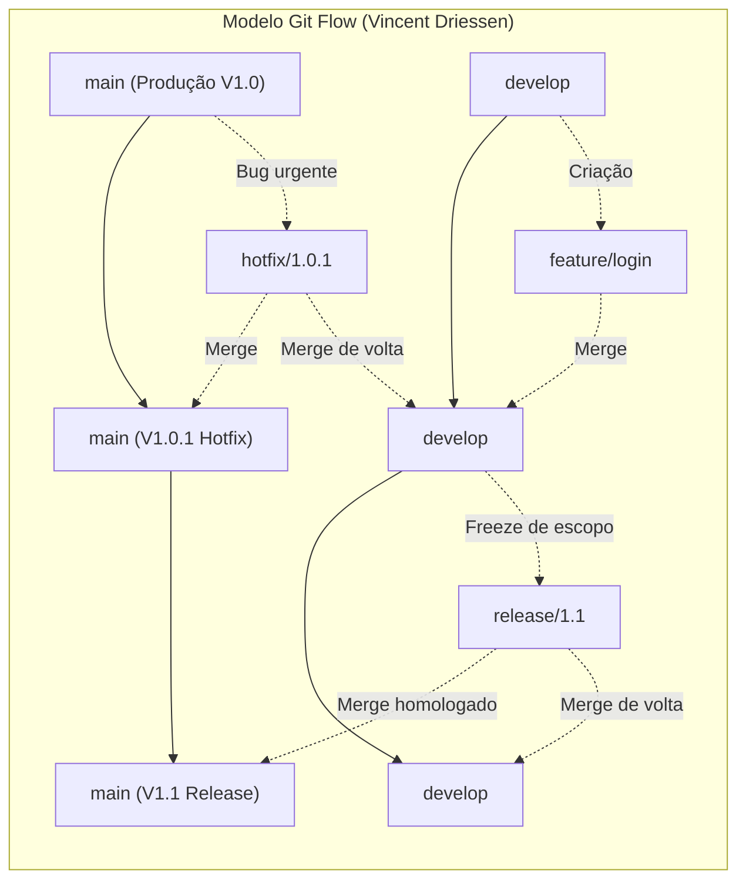
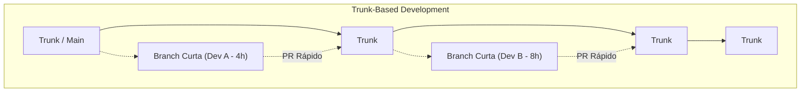
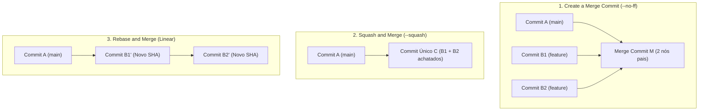

# 02 - Estratégias de Branching e Plataformas Git Colaborativas

> **Matéria:** DevOps, Plataforma de Desenvolvimento e Engenharia de Entrega  
> **Cargo:** B02 – Técnico de Controle Externo – Especialidade: Tecnologia da Informação  
> **Arquivo:** `02_git_estrategias_de_branching_e_plataformas_colaborativas.md`  

---

## 📌 Ementa / Itens do Edital
- Plataformas de hospedagem, colaboração e automação baseadas em Git: GitHub e GitLab
- Estratégias de branching (fluxos de ramificação): Git Flow, Trunk-Based Development, GitHub Flow e GitLab Flow
- Fluxo de trabalho com Pull Requests (GitHub) e Merge Requests (GitLab)
- Estratégias de mesclagem (Merge Commit, Squash and Merge, Rebase and Merge)
- Políticas de proteção de branches, governança de código e arquivos de configuração (`CODEOWNERS`)

---

## 🧭 Sumário

1. [Modelos e Estratégias de Branching](#1-modelos-e-estrategias-de-branching)
    1. [O Modelo Git Flow: Ramos Perenes e Ramos Temporários](#11-o-modelo-git-flow-ramos-perenes-e-ramos-temporarios)
    2. [Trunk-Based Development (TBD): Filosofia, Feature Flags e Branch by Abstraction](#12-trunk-based-development-tbd-filosofia-feature-flags-e-branch-by-abstraction)
    3. [O Modelo GitHub Flow](#13-o-modelo-github-flow)
    4. [O Modelo GitLab Flow (Ambientes e Versões)](#14-o-modelo-gitlab-flow-ambientes-e-versoes)
    5. [Matriz Comparativa Síntese entre os Modelos de Ramificação](#15-matriz-comparativa-sintese-entre-os-modelos-de-ramificacao)
    6. [Teste 182](#Teste-182)
    7. [Teste 183](#Teste-183)
    8. [Teste 184](#Teste-184)
    9. [Teste 185](#Teste-185)
2. [Estratégias de Integração e Mesclagem (Merge Commit, Squash e Rebase)](#2-estrategias-de-integracao-e-mesclagem-merge-commit-squash-e-rebase)
    1. [Create a Merge Commit (`git merge --no-ff`)](#21-create-a-merge-commit-git-merge-no-ff)
    2. [Squash and Merge (`git merge --squash`)](#22-squash-and-merge-git-merge-squash)
    3. [Rebase and Merge (`git rebase`)](#23-rebase-and-merge-git-rebase)
    4. [Teste 186](#Teste-186)
    5. [Teste 187](#Teste-187)
    6. [Teste 188](#Teste-188)
3. [Governança, Regras de Proteção de Branches e `CODEOWNERS`](#3-governanca-regras-de-protecao-de-branches-e-codeowners)
    1. [Regras de Proteção de Branches (Branch Protection Rules)](#31-regras-de-protecao-de-branches-branch-protection-rules)
    2. [O Arquivo `CODEOWNERS` e Revisões Bloqueantes](#32-o-arquivo-codeowners-e-revisoes-bloqueantes)
    3. [Comparativo Terminológico e Operacional: GitHub vs. GitLab](#33-comparativo-terminologico-e-operacional-github-vs-gitlab)
    4. [Teste 189](#Teste-189)
    5. [Teste 190](#Teste-190)
    6. [Teste 191](#Teste-191)
4. [🌐 Fontes Oficiais e Referências Bibliográficas](#fontes-oficiais-e-referencias-bibliograficas)

---

## 1. Modelos e Estratégias de Branching

A estratégia de ramificação (*branching strategy*) estabelece as regras e convenções que orientam como desenvolvedores criam branches, integram códigos, isolam novas funcionalidades e estabilizam versões para publicação. A escolha inadequada de um modelo de ramificação é a principal causadora do chamado **"Merge Hell"** — o cenário traumático em que múltiplas branches isoladas divergem por semanas ou meses, acumulando centenas de conflitos de mesclagem de resolução complexa e arriscada.



### 1.1 O Modelo Git Flow: Ramos Perenes e Ramos Temporários

Formalizado por Vincent Driessen em 2010, o **Git Flow** foi concebido para produtos de software que operam com ciclos de lançamento formais e programados com versionamento semântico estrito (como distribuições empacotadas para desktop, aplicativos de smartphone em lojas de apps e sistemas legados com janelas mensais ou trimestrais de homologação).

O Git Flow define rigorosamente duas categorias de branches:

#### 1. Ramos Perenes (Long-Lived Branches)
Permanecem ativos durante todo o ciclo de vida do repositório:

- **`main` (ou `master`):** Armazena exclusivamente o código em estado de prontidão para produção ou que já está rodando nos servidores produtivos. Cada commit na branch `main` representa um release oficial de software e deve ser compulsoriamente etiquetado com uma tag semântica (ex.: `v1.0.0`, `v1.1.0`).
- **`develop`:** Atua como o ramo integrador do trabalho contínuo de desenvolvimento. Reúne as funcionalidades concluídas e testadas que comporão o próximo lançamento planejado.

#### 2. Ramos Temporários de Suporte (Short-Lived / Supporting Branches)
Possuem ciclo de vida efêmero e regras rígidas de derivação e mesclagem:

- **`feature/*`:** Nascem **exclusivamente a partir de `develop`** e realizam merge de volta **obrigatoriamente em `develop`**. São utilizadas por equipes para implementar funcionalidades específicas sem interferir no trabalho alheio.
- **`release/*`:** Nascem **a partir de `develop`** quando o conjunto de funcionalidades planejadas para a próxima versão está finalizado (*code freeze*). Durante a existência da branch de release, é proibida a adição de novas funcionalidades; realizam-se apenas correções de defeitos identificados em homologação, ajustes finos de documentação e bump de versão. Ao ser finalizada e homologada, a branch de release é mesclada na **`main`** (recebendo uma tag) **E também na `develop`** (para repassar os ajustes de homologação ao fluxo principal).
- **`hotfix/*`:** Nascem **diretamente a partir de `main`** para solucionar incidentes críticos de segurança ou bugs impeditivos em produção que não podem aguardar o próximo ciclo formal de release. Uma vez testada e validada, a branch de hotfix deve ser mesclada na **`main`** (com nova subversão de patch, ex.: `v1.0.1`) **E compulsoriamente na `develop`**, impedindo que lançamentos futuros reintroduzam a falha que acabara de ser corrigida.

> 🚨 **ALERTA DE PROVA / PEGADINHA FCC:**  
> A FCC adora cobrar o destino de mesclagem das branches temporárias de **`hotfix`** e de **`release`** no Git Flow:
>
> - **`hotfix`:** Deriva de `main` $\rightarrow$ Realiza merge **em `main` E em `develop`**!
> - **`release`:** Deriva de `develop` $\rightarrow$ Realiza merge **em `main` E em `develop`**!
> Se a alternativa afirmar que o hotfix ou a release faz merge apenas na `main`, a afirmativa está incorreta!

### 1.2 Trunk-Based Development (TBD): Filosofia, Feature Flags e Branch by Abstraction

O **Trunk-Based Development (TBD)** é o modelo de ramificação preconizado pelas organizações de alta performance tecnológica (como Google, Meta, Netflix) e referendado com destaque empírico nas pesquisas do **DORA** (*State of DevOps Report*).



- **Filosofia Central:** Existe **apenas um único ramo perene**, denominado `trunk` (ou `main`).
- Todos os desenvolvedores integram seu trabalho ao `trunk` com altíssima frequência (ao menos uma vez por dia, preferencialmente múltiplas vezes).
- Se houver uso de branches de tarefas, elas devem ser estritamente de **vida curtíssima (*short-lived feature branches*)**, durando poucas horas ou no máximo 1 a 2 dias, sendo submetidas a Pull Requests pequenos e fáceis de revisar.
- **Habilitadores Técnicos Indispensáveis:**
    1. **Feature Flags / Feature Toggles:** Como integrar ao trunk códigos de histórias de usuário complexas que levam duas semanas para serem construídas? A equipe comita e sobe o código diariamente para produção, mas o mantém envolto em uma condicional booleana (*Feature Flag*). O recurso inacabado executa em produção desativado para os cidadãos e auditores, sem risco de quebra.
    2. **Branch by Abstraction:** Padrão arquitetural em nível de código-fonte utilizado para refatorar subsistemas complexos diretamente no trunk: cria-se uma interface/abstração intermediária entre o chamador e a implementação legada; implementa-se o novo componente gradualmente; redireciona-se o chamador para a nova implementação; e expurga-se o código legado do repositório, sem a necessidade de criar branches paralelas de longa duração.

### 1.3 O Modelo GitHub Flow

Criado pela equipe do GitHub, o **GitHub Flow** é uma abordagem minimalista e centrada na web, amplamente adotada em arquiteturas de microsserviços e sistemas com entregas contínuas:

- **Premissa Inviolável:** A branch `main` é permanentemente estável e **a qualquer momento pronta para entrar em produção** (*"Anything in the main branch is deployable"*).
- **Ciclo Operacional:**
    1. Cria-se uma branch descritiva diretamente a partir da `main` (ex.: `add-oauth2-support`);
    2. Adicionam-se commits frequentes e mensagens claras;
    3. Abre-se uma *Pull Request* precocemente para iniciar a discussão técnica e executar pipelines de CI automatizados;
    4. Após aprovação em revisão por pares e nos testes automatizados, o código é implantado em produção (para validação imediata);
    5. Realiza-se o merge na branch `main` e a branch de trabalho é excluída.

### 1.4 O Modelo GitLab Flow (Ambientes e Versões)

O **GitLab Flow** une a simplicidade do GitHub Flow à necessidade corporativa de gerenciar múltiplos ambientes de infraestrutura e suporte a versões legadas:

1. **GitLab Flow com Branches de Ambiente (*Environment Branches*):**
    - Cria-se uma branch perene para cada ambiente do ciclo de vida: `main` (desenvolvimento/integração), `pre-production` (homologação/staging) e `production` (produção real).
    - O código flui em sentido único: da `main` para `pre-production`, e de `pre-production` para `production`. O merge entre essas branches dispara automaticamente o pipeline de implantação no respectivo ambiente físico, garantindo que tudo o que entra em produção passou comprovadamente por homologação.

2. **GitLab Flow com Branches de Versão (*Release Branches*):**
    - Utilizado quando uma organização precisa manter suporte a múltiplas versões ativas de um mesmo software distribuído (ex.: versões 1.x, 2.x e 3.x). Correções de bugs são aplicadas primeiro na `main` e depois retroalimentadas (*backported*) nas branches de versão ativas através de comandos `git cherry-pick`.

### 1.5 Matriz Comparativa Síntese entre os Modelos de Ramificação

| Dimensão de Análise | Git Flow | Trunk-Based Development (TBD) | GitHub Flow | GitLab Flow (Ambientes) |
| :--- | :--- | :--- | :--- | :--- |
| **Complexidade Estrutural** | **Alta** (múltiplas branches com regras estritas) | **Mínima** | Baixa | Moderada |
| **Ramos Perenes Principais** | 2 (`main` e `develop`) | 1 (`trunk` / `main`) | 1 (`main`) | 1 principal + ramos de ambiente (`prod`, `staging`) |
| **Duração das Branches** | Longa (semanas a meses) | Curtíssima (horas a no máximo 1-2 dias) | Curta (ciclo da tarefa) | Curta para features; perene para ambientes |
| **Frequência de Deploys** | Baixa/Média (janelas de release agendadas) | Contínua (múltiplas vezes ao dia sob demanda) | Contínua (a cada PR aprovado) | Progressiva por promoção de ambiente |
| **Risco de Conflitos (Merge Hell)**| **Elevado** devido ao isolamento prolongado | **Quase nulo** (resolução precoce) | Baixo | Baixo |
| **Uso de Feature Flags** | Opcional | **Crítico / Essencial** | Opcional | Recomendado |
| **Aderência ao DevOps / CI/CD** | Baixa (silos temporais em branches) | **Padrão Ouro (Recomendado DORA)** | Alta para web e microsserviços | Alta para governança corporativa |

---

### Teste 001
**(FGV – TCE/GO – 2024 – Analista de Controle Externo - Controle Externo)**
Em relação à Análise da Variância (ANOVA), as afirmativas a seguir estão corretas, à exceção de uma. Assinale-a.

* **A)** É um método para testar a igualdade de três ou mais médias populacionais, baseado na análise das variâncias amostrais.
* **B)** Os dados amostrais são separados em grupos segundo uma característica denominada fator. Fator (ou tratamento) é uma característica que permite distinguir diferentes populações umas das outras.
* **C)** Cada fator contém dois ou mais grupos (classificações).
* **D)** Amostras são aleatórias e mutuamente dependentes.
* **E)** Suposições incluem: populações normalmente distribuídas e de mesma variância. Realização T C E RIBUNAL DE ONTAS DO STADO G DE OIÁS CONCURSO PÚBLICO – EDITAL 01/2024 TARDE ANALISTA DE CONTROLE EXTERNO CONTROLE EXTERNO NÍVEL SUPERIOR TIPO 1 – BRANCA SUA PROVA INFORMAÇÕES GERAIS • Além deste caderno contendo 2 (duas) • Verifique se seu caderno de questões está completo, discursivas você receberá do fiscal de sala a folha sem repetição de questões ou falhas. Caso contrário, de texto definitivo; notifique imediatamente o fiscal da sala, para que • As questões discursivas deverão ser redigidas em sejam tomadas as devidas providências; até 20 (vinte) linhas. • Confira seus dados pessoais, especialmente nome, número de inscrição e documento de identidade e leia atentamente as instruções para preencher a folha de • texto definitivo; TEMPO • Para o preenchimento das folhas de textos definitivos, use somente caneta esferográfica, fabricada em • Você dispõe de 2 (duas) horas para a realização material transparente, com tinta preta ou azul; da prova, já incluído o tempo para o preenchimento • Assine seu nome apenas nos espaços reservados nas das folhas de textos definitivos; folhas de textos definitivos; • 1 (uma) hora após o início da prova, é possível retirar-se da sala, sem levar o caderno de questões; • Confira seu cargo, cor e tipo do caderno de questões. Caso tenha recebido caderno de cargo ou cor ou tipo • A partir dos 30 (trinta) minutos anteriores ao diferente do impresso em suas folhas de textos término da prova é possível retirar-se da sala definitivos, o fiscal de sala deve ser obrigatoriamente levando o caderno de questões. informado para o devido registro na ata da sala; • Reserve tempo suficiente para o preenchimento das suas folhas de textos definitivos. O preenchimento é de sua responsabilidade e não será permitida a troca das folhas de textos definitivos em caso de erro NÃO SERÁ PERMITIDO cometido pelo candidato; • Para fins de avaliação, serão levadas em consideração • Qualquer tipo de comunicação entre os candidatos apenas as marcações realizadas nas folhas de textos durante a aplicação da prova; definitivos; • Anotar informações relativas às respostas em • A FGV coletará as impressões digitais dos candidatos qualquer outro meio que não seja o caderno de na lista de presença; questões; • Levantar da cadeira sem autorização do fiscal de • Os candidatos serão submetidos ao sistema de sala; detecção de metais quando do ingresso e da saída de sanitários durante a realização das provas. • Usar o sanitário ao término da prova, após deixar a sala. • Boa prova! Controle Externo - Discursiva

---

> **Comentário Detalhado:**
>
> - **A)** **Incorreta.** A opção apresenta proposição em desacordo com os fundamentos teóricos e técnicos do tópico ao afirmar que "É um método para testar a igualdade de três ou mais médias populacionais, baseado na análise das variâncias...". De acordo com a teoria estudada em *1.5 Matriz Comparativa Síntese entre os Modelos de Ramificação*, dimensão de Análise: Git Flow — Trunk Based Development (TBD) — GitHub Flow — GitLab Flow (Ambientes).
> - **B)** **Incorreta.** A opção apresenta proposição em desacordo com os fundamentos teóricos e técnicos do tópico ao afirmar que "Os dados amostrais são separados em grupos segundo uma característica denominada fator. Fator (ou tratamento) é...". De acordo com a teoria estudada em *2.2 Squash and Merge (`git merge --squash`)*, desvantagens: Suprime o detalhamento granular dos micro passos dados pelo desenvolvedor durante a confecção da funcionalidade.
> - **C)** **Correta.** Conforme fundamentado na seção *2.1 Create a Merge Commit (`git merge --no-ff`)* deste guia, operação Subjacente: Executa um merge do tipo no fast forward . Cria um nó de commit especial na árvore do Git que possui dois nós pais: o último commit da branch de destino e o último commit da branch de trabalho. Dessa forma, está plenamente correta a assertiva da banca (FGV – TCE/GO/2024) ao estabelecer que "Cada fator contém dois ou mais grupos (classificações)".
> - **D)** **Incorreta.** A opção apresenta proposição em desacordo com os fundamentos teóricos e técnicos do tópico ao afirmar que "Amostras são aleatórias e mutuamente dependentes". De acordo com a teoria estudada em *2.3 Rebase and Merge (`git rebase`)*, operação Subjacente: Pega os commits individuais da branch de trabalho e os reaplica um a um sobre a ponta mais recente da branch de destino, gerando um histórico estritamente linear sem nós de merge intermediários.
> - **E)** **Incorreta.** A opção incorre em restrição indevida ao limitar o escopo conceitual ao afirmar que "Suposições incluem: populações normalmente distribuídas e de mesma variância. Realização T C E RIBUNAL DE ONTAS DO...". De acordo com a teoria estudada em *2. Ramos Temporários de Suporte (Short-Lived / Supporting Branches)*, hotfix/ : Nascem diretamente a partir de main para solucionar incidentes críticos de segurança ou bugs impeditivos em produção que não podem aguardar o próximo ciclo formal de release. Uma vez testada e validada, a branch de hotfix deve ser mesclada na main (com nova subversão de patch, ex.: v1.0.1 ) E compulsoriamente na develop , impedindo que lançamentos futuros reintroduzam a falha que acabara de ser corrigida.
>
> **Gabarito: C**

---


### Teste 002
**(FGV – TCE/GO – 2024 – Analista de Controle Externo - Engenharia)**
Relacione os tipos de precipitação a seguir com as respectivas definições. 1 Orográfica. 2 Convectiva. 3 Frontal. ( ) Ocorre ao longo da linha de descontinuidade, separando duas massas de ar de características diferentes. ( ) Provocadas pela ascensão de ar devido às diferenças de temperatura na camada vizinha da atmosfera. ( ) Ocorrem quando o ar é forçado a transpor barreiras de montanhas. Assinale a opção que indica a relação correta na ordem apresentada.

* **A)** 1 – 2 – 3
* **B)** 2 – 1 – 3
* **C)** 2 – 3 – 1
* **D)** 3 – 1 – 2
* **E)** 3 – 2 – 1 Realização T RIBUNAL ANALISTA SUA PROVA • Além deste caderno contendo 2 (duas) discursivas você receberá do fiscal de sala a folha de texto definitivo; • As questões discursivas deverão ser redigidas em até 20 (vinte) linhas. • TEMPO • Você dispõe de 2 (duas) horas para a realização da prova, já incluído o tempo para o preenchimento das folhas de textos definitivos; • 1 (uma) hora após o início da prova, é possível retirar-se da sala, sem levar o caderno de questões; • A partir dos 30 (trinta) minutos anteriores ao término da prova é possível retirar-se da sala levando o caderno de questões. NÃO SERÁ PERMITIDO • Qualquer tipo de comunicação entre os candidatos durante a aplicação da prova; • Anotar informações relativas às respostas em qualquer outro meio que não seja o caderno de questões; • Levantar da cadeira sem autorização do fiscal de sala; • Usar o sanitário ao término da prova, após deixar a sala. C E DE ONTAS DO STADO G DE OIÁS CONCURSO PÚBLICO – EDITAL 01/2024 TARDE DE CONTROLE EXTERNO ENGENHARIA NÍVEL SUPERIOR TIPO 1 – BRANCA INFORMAÇÕES GERAIS • Verifique se seu caderno de questões está completo, sem repetição de questões ou falhas. Caso contrário, notifique imediatamente o fiscal da sala, para que sejam tomadas as devidas providências; • Confira seus dados pessoais, especialmente nome, número de inscrição e documento de identidade e leia atentamente as instruções para preencher a folha de texto definitivo; • Para o preenchimento das folhas de textos definitivos, use somente caneta esferográfica, fabricada em material transparente, com tinta preta ou azul; • Assine seu nome apenas nos espaços reservados nas folhas de textos definitivos; • Confira seu cargo, cor e tipo do caderno de questões. Caso tenha recebido caderno de cargo ou cor ou tipo diferente do impresso em suas folhas de textos definitivos, o fiscal de sala deve ser obrigatoriamente informado para o devido registro na ata da sala; • Reserve tempo suficiente para o preenchimento das suas folhas de textos definitivos. O preenchimento é de sua responsabilidade e não será permitida a troca das folhas de textos definitivos em caso de erro cometido pelo candidato; • Para fins de avaliação, serão levadas em consideração apenas as marcações realizadas nas folhas de textos definitivos; • A FGV coletará as impressões digitais dos candidatos na lista de presença; • Os candidatos serão submetidos ao sistema de detecção de metais quando do ingresso e da saída de sanitários durante a realização das provas. • Boa prova! Engenharia - Discursiva

---

> **Comentário Detalhado:**
>
> - **A)** **Incorreta.** A opção apresenta proposição em desacordo com os fundamentos teóricos e técnicos do tópico ao afirmar que "1 – 2 – 3". De acordo com a teoria estudada em *2. Ramos Temporários de Suporte (Short-Lived / Supporting Branches)*, release/ : Nascem a partir de develop quando o conjunto de funcionalidades planejadas para a próxima versão está finalizado ( code freeze ). Durante a existência da branch de release, é proibida a adição de novas funcionalidades; realizam se apenas correções de defeitos identificados em homologação, ajustes finos de documentação e bump de versão. Ao ser finalizada e homologada, a branch de release é mesclada na main (recebendo uma tag) E também na develop (para repassar os ajustes de homologação ao fluxo principal).
> - **B)** **Incorreta.** A opção apresenta proposição em desacordo com os fundamentos teóricos e técnicos do tópico ao afirmar que "2 – 1 – 3". De acordo com a teoria estudada em *2. Ramos Temporários de Suporte (Short-Lived / Supporting Branches)*, feature/ : Nascem exclusivamente a partir de develop e realizam merge de volta obrigatoriamente em develop . São utilizadas por equipes para implementar funcionalidades específicas sem interferir no trabalho alheio.
> - **C)** **Incorreta.** A opção apresenta proposição em desacordo com os fundamentos teóricos e técnicos do tópico ao afirmar que "2 – 3 – 1". De acordo com a teoria estudada em *2.2 Squash and Merge (`git merge --squash`)*, desvantagens: Suprime o detalhamento granular dos micro passos dados pelo desenvolvedor durante a confecção da funcionalidade.
> - **D)** **Incorreta.** A opção apresenta proposição em desacordo com os fundamentos teóricos e técnicos do tópico ao afirmar que "3 – 1 – 2". De acordo com a teoria estudada em *3.2 O Arquivo `CODEOWNERS` e Revisões Bloqueantes*, mecânica de Aplicação: Quando um desenvolvedor abre uma Pull Request alterando qualquer arquivo coberto pelas regras do CODEOWNERS , a plataforma Git adiciona automaticamente e de forma obrigatória as equipes ou usuários especificados como revisores bloqueantes. O merge da PR torna se tecnicamente impossível até que os proprietários do código tenham revisado e concedido a aprovação.
> - **E)** **Correta.** Conforme fundamentado na seção *2. Ramos Temporários de Suporte (Short-Lived / Supporting Branches)* deste guia, hotfix/ : Nascem diretamente a partir de main para solucionar incidentes críticos de segurança ou bugs impeditivos em produção que não podem aguardar o próximo ciclo formal de release. Uma vez testada e validada, a branch de hotfix deve ser mesclada na main (com nova subversão de patch, ex.: v1.0.1 ) E compulsoriamente na develop , impedindo que lançamentos futuros reintroduzam a falha que acabara de ser corrigida. Dessa forma, está plenamente correta a assertiva da banca (FGV – TCE/GO/2024) ao estabelecer que "3 – 2 – 1 Realização T RIBUNAL ANALISTA SUA PROVA • Além deste caderno contendo 2 (duas) discursivas você receberá...".
>
> **Gabarito: E**

---


### Teste 003
**(FGV – TCE/GO – 2024 – Analista de Controle Externo - Tecnologia da Informação)**
Um certo fiscal de contratos da administração pública exerce vários papéis e funções. Considerando o tema, é correto que se deve

* **A)** representar a contratada nas negociações com a administração pública, garantindo a adequação dos termos contratuais às necessidades da contratante.
* **B)** aplicar diretamente penalidades e sanções administrativas à contratada em caso de execução inadequada do contrato.
* **C)** receber e aceite dos bens e serviços, não participando das etapas anteriores de acompanhamento da execução contratual.
* **D)** acompanhar a execução contratual, registrando e notificando irregularidades à autoridade competente, para as devidas providências.
* **E)** elaborar sanções a ser aplicadas nas irregularidades encontradas durante a execução contratual. Realização T C E RIBUNAL DE ONTAS DO STADO G DE OIÁS CONCURSO PÚBLICO – EDITAL 01/2024 TARDE ANALISTA DE CONTROLE EXTERNO TECNOLOGIA DA INFORMACAO NÍVEL SUPERIOR TIPO 1 – BRANCA SUA PROVA INFORMAÇÕES GERAIS • Além deste caderno contendo 2 (duas) • Verifique se seu caderno de questões está completo, discursivas você receberá do fiscal de sala a folha sem repetição de questões ou falhas. Caso contrário, de texto definitivo; notifique imediatamente o fiscal da sala, para que • As questões discursivas deverão ser redigidas em sejam tomadas as devidas providências; até 20 (vinte) linhas. • Confira seus dados pessoais, especialmente nome, número de inscrição e documento de identidade e leia atentamente as instruções para preencher a folha de • texto definitivo; TEMPO • Para o preenchimento das folhas de textos definitivos, use somente caneta esferográfica, fabricada em • Você dispõe de 2 (duas) horas para a realização material transparente, com tinta preta ou azul; da prova, já incluído o tempo para o preenchimento • Assine seu nome apenas nos espaços reservados nas das folhas de textos definitivos; folhas de textos definitivos; • 1 (uma) hora após o início da prova, é possível retirar-se da sala, sem levar o caderno de questões; • Confira seu cargo, cor e tipo do caderno de questões. Caso tenha recebido caderno de cargo ou cor ou tipo • A partir dos 30 (trinta) minutos anteriores ao diferente do impresso em suas folhas de textos término da prova é possível retirar-se da sala definitivos, o fiscal de sala deve ser obrigatoriamente levando o caderno de questões. informado para o devido registro na ata da sala; • Reserve tempo suficiente para o preenchimento das suas folhas de textos definitivos. O preenchimento é de sua responsabilidade e não será permitida a troca das folhas de textos definitivos em caso de erro NÃO SERÁ PERMITIDO cometido pelo candidato; • Para fins de avaliação, serão levadas em consideração • Qualquer tipo de comunicação entre os candidatos apenas as marcações realizadas nas folhas de textos durante a aplicação da prova; definitivos; • Anotar informações relativas às respostas em • A FGV coletará as impressões digitais dos candidatos qualquer outro meio que não seja o caderno de na lista de presença; questões; • Levantar da cadeira sem autorização do fiscal de • Os candidatos serão submetidos ao sistema de sala; detecção de metais quando do ingresso e da saída de sanitários durante a realização das provas. • Usar o sanitário ao término da prova, após deixar a sala. • Boa prova! Tecnologia da Informação - Discursiva

---

> **Comentário Detalhado:**
>
> - **A)** **Incorreta.** A opção apresenta proposição em desacordo com os fundamentos teóricos e técnicos do tópico ao afirmar que "representar a contratada nas negociações com a administração pública, garantindo a adequação dos termos...". De acordo com a teoria estudada em *1.4 O Modelo GitLab Flow (Ambientes e Versões)*, o código flui em sentido único: da main para pre production , e de pre production para production . O merge entre essas branches dispara automaticamente o pipeline de implantação no respectivo ambiente físico, garantindo que tudo o que entra em produção passou comprovadamente por homologação.
> - **B)** **Incorreta.** A opção apresenta proposição em desacordo com os fundamentos teóricos e técnicos do tópico ao afirmar que "aplicar diretamente penalidades e sanções administrativas à contratada em caso de execução inadequada do contrato". De acordo com a teoria estudada em *2. Ramos Temporários de Suporte (Short-Lived / Supporting Branches)*, hotfix/ : Nascem diretamente a partir de main para solucionar incidentes críticos de segurança ou bugs impeditivos em produção que não podem aguardar o próximo ciclo formal de release. Uma vez testada e validada, a branch de hotfix deve ser mesclada na main (com nova subversão de patch, ex.: v1.0.1 ) E compulsoriamente na develop , impedindo que lançamentos futuros reintroduzam a falha que acabara de ser corrigida.
> - **C)** **Incorreta.** A opção apresenta proposição em desacordo com os fundamentos teóricos e técnicos do tópico ao afirmar que "receber e aceite dos bens e serviços, não participando das etapas anteriores de acompanhamento da execução...". De acordo com a teoria estudada em *3. Governança, Regras de Proteção de Branches e `CODEOWNERS`*, em instituições governamentais e órgãos de controle externo como o TCE GO, os repositórios de código constituem ativos estratégicos sujeitos a rígidos requisitos de conformidade, trilhas de auditoria e segregação de funções.
> - **D)** **Correta.** Conforme fundamentado na seção *1. Ramos Perenes (Long-Lived Branches)* deste guia, main (ou master ): Armazena exclusivamente o código em estado de prontidão para produção ou que já está rodando nos servidores produtivos. Cada commit na branch main representa um release oficial de software e deve ser compulsoriamente etiquetado com uma tag semântica (ex.: v1.0.0 , v1.1.0 ). Dessa forma, está plenamente correta a assertiva da banca (FGV – TCE/GO/2024) ao estabelecer que "acompanhar a execução contratual, registrando e notificando irregularidades à autoridade competente, para as...".
> - **E)** **Incorreta.** A opção incorre em restrição indevida ao limitar o escopo conceitual ao afirmar que "elaborar sanções a ser aplicadas nas irregularidades encontradas durante a execução contratual. Realização T C E...". De acordo com a teoria estudada em *2. Ramos Temporários de Suporte (Short-Lived / Supporting Branches)*, release/ : Nascem a partir de develop quando o conjunto de funcionalidades planejadas para a próxima versão está finalizado ( code freeze ). Durante a existência da branch de release, é proibida a adição de novas funcionalidades; realizam se apenas correções de defeitos identificados em homologação, ajustes finos de documentação e bump de versão. Ao ser finalizada e homologada, a branch de release é mesclada na main (recebendo uma tag) E também na develop (para repassar os ajustes de homologação ao fluxo principal).
>
> **Gabarito: D**

---


### Teste 004
**(CEBRASPE – TRF 6ª – 2025 – Analista Judiciário - Apoio Especializado - Governança e Gestão de Tecnologia da Informação)**
No RabbitMQ, a forma padrão de se distribuir mensagens é round-robin, de modo que cada consumidor terá, em média, o mesmo número de mensagens. 120 git branch -D test A execução do comando precedente excluirá a branch test caso todos os commits tenham sido realizados; porém, se a master estiver em estado de check-out, a exclusão será cancelada.

* **C)** Certo
* **E)** Errado

---

> **Comentário Detalhado:**
>
> - **C)** **Correta.** O item está **Certo**. Conforme fundamentado na seção *3.2 O Arquivo `CODEOWNERS` e Revisões Bloqueantes*, mecânica de Aplicação: Quando um desenvolvedor abre uma Pull Request alterando qualquer arquivo coberto pelas regras do CODEOWNERS , a plataforma Git adiciona automaticamente e de forma obrigatória as equipes ou usuários especificados como revisores bloqueantes. O merge da PR torna se tecnicamente impossível até que os proprietários do código tenham revisado e concedido a aprovação. Dessa forma, está plenamente correta a assertiva da banca (CEBRASPE – TRF 6ª/2025) ao afirmar que "No RabbitMQ, a forma padrão de se distribuir mensagens é round robin, de modo que cada consumidor terá, em...".
> - **E)** **Incorreta.** A assertiva não incorre em erro conceitual, guardando conformidade com a teoria estudada.
>
> **Gabarito: C**

---


### Teste 005
**(CEBRASPE – STJ – 2024 – Analista Judiciário - Apoio Especializado - Suporte em Tecnologia da Informação)**
Continuous delivery (CD) e continuous integration (CI) são práticas afetas ao DevOps: a primeira realiza a implantação automática no repositório da solução após o build; e a segunda realiza implantação automática no ambiente de produção a cada release.

* **C)** Certo
* **E)** Errado

---

> **Comentário Detalhado:**
>
> - **C)** **Incorreta.** A proposição apresenta proposição em desacordo com os fundamentos teóricos e técnicos do tópico ao afirmar que "Continuous delivery (CD) e continuous integration (CI) são práticas afetas ao DevOps: a primeira realiza a...". De acordo com a teoria em *1.4 O Modelo GitLab Flow (Ambientes e Versões)*, o código flui em sentido único: da main para pre production , e de pre production para production . O merge entre essas branches dispara automaticamente o pipeline de implantação no respectivo ambiente físico, garantindo que tudo o que entra em produção passou comprovadamente por homologação.
> - **E)** **Correta.** O item está **Errado** (gabarito oficial: **E**), pois contraria a disciplina teórica aplicável.
>
> **Gabarito: E**

---


### Teste 006
**(CEBRASPE – STJ – 2024 – Analista Judiciário - Apoio Especializado - Suporte em Tecnologia da Informação)**
O comando Git a seguir, ao ser executado, copiará todo o conteúdo do repositório local para o repositório remoto git, e, por padrão, fará a mesclagem com a branch master. git clone --bare -l /home/projetox/ .git/pub/projetox

* **C)** Certo
* **E)** Errado

---

> **Comentário Detalhado:**
>
> - **C)** **Incorreta.** A proposição apresenta proposição em desacordo com os fundamentos teóricos e técnicos do tópico ao afirmar que "O comando Git a seguir, ao ser executado, copiará todo o conteúdo do repositório local para o repositório...". De acordo com a teoria em *1. Ramos Perenes (Long-Lived Branches)*, main (ou master ): Armazena exclusivamente o código em estado de prontidão para produção ou que já está rodando nos servidores produtivos. Cada commit na branch main representa um release oficial de software e deve ser compulsoriamente etiquetado com uma tag semântica (ex.: v1.0.0 , v1.1.0 ).
> - **E)** **Correta.** O item está **Errado** (gabarito oficial: **E**), pois contraria a disciplina teórica aplicável.
>
> **Gabarito: E**

---


### Teste 007
**(FGV – TJ/AP – 2023 – Analista Judiciario Apoio Especializado Tecnologia Da Informacao Desenvolvimento De Sistemas)**
A analista Cátia criou o branch tarefa10 em um repositório Git local. Logo após, Cátia alternou o branch de trabalho atual para o branch recém-criado, tarefa10. Estando no branch local tarefa10, Cátia precisou renomear o branch para t10_concluida, com um único comando da ferramenta git. Para renomear o branch de trabalho atual com um único comando, Cátia executou no repositório Git local o comando do git:

* **A)** mv t10_concluida;
* **B)** reset t10_concluida;
* **C)** rebase t10_concluida;
* **D)** branch -m t10_concluida;
* **E)** checkout -b t10_concluida.

---

> **Comentário Detalhado:**
>
> - **A)** **Incorreta.** A opção apresenta proposição em desacordo com os fundamentos teóricos e técnicos do tópico ao afirmar que "mv t10 concluida". De acordo com a teoria estudada em *2.2 Squash and Merge (`git merge --squash`)*, operação Subjacente: Coleta todas as modificações introduzidas pelos múltiplos commits da branch de trabalho, une as em uma única alteração atômica e registra um único e coeso commit novo no topo da branch de destino, descartando os commits individuais intermediários.
> - **B)** **Incorreta.** A opção apresenta proposição em desacordo com os fundamentos teóricos e técnicos do tópico ao afirmar que "reset t10 concluida". De acordo com a teoria estudada em *1.2 Trunk-Based Development (TBD): Filosofia, Feature Flags e Branch by Abstraction*, branch by Abstraction: Padrão arquitetural em nível de código fonte utilizado para refatorar subsistemas complexos diretamente no trunk: cria se uma interface/abstração intermediária entre o chamador e a implementação legada; implementa se o novo componente gradualmente; redireciona se o chamador para a nova implementação; e expurga se o código legado do repositório, sem a necessidade de criar branches paralelas de longa duração.
> - **C)** **Incorreta.** A opção apresenta proposição em desacordo com os fundamentos teóricos e técnicos do tópico ao afirmar que "rebase t10 concluida". De acordo com a teoria estudada em *2.3 Rebase and Merge (`git rebase`)*, operação Subjacente: Pega os commits individuais da branch de trabalho e os reaplica um a um sobre a ponta mais recente da branch de destino, gerando um histórico estritamente linear sem nós de merge intermediários.
> - **D)** **Correta.** Conforme fundamentado na seção *2.2 Squash and Merge (`git merge --squash`)* deste guia, vantagens: Mantém o histórico do branch principal ( main ) estritamente limpo, coeso e legível. Cada commit na main corresponde a uma entrega funcional completa ( atomic commit ). Facilita drasticamente a identificação de bugs via git bisect e a reversão de falhas em produção via um único comando git revert <hash. Dessa forma, está plenamente correta a assertiva da banca (FGV – TJ/AP/2023) ao estabelecer que "branch m t10 concluida".
> - **E)** **Incorreta.** A opção apresenta proposição em desacordo com os fundamentos teóricos e técnicos do tópico ao afirmar que "checkout b t10 concluida". De acordo com a teoria estudada em *1.2 Trunk-Based Development (TBD): Filosofia, Feature Flags e Branch by Abstraction*, filosofia Central: Existe apenas um único ramo perene, denominado trunk (ou main ).
>
> **Gabarito: D**

---


### Teste 008
**(CEBRASPE – TRF/6 – 2025 – Analista Judiciario Apoio Especializado Tecnologia Da Informacao)**
No RabbitMQ, a forma padrão de se distribuir mensagens é round-robin, de modo que cada consumidor terá, em média, o mesmo número de mensagens. 110 git branch -D test A execução do comando precedente excluirá a branch test caso todos os commits tenham sido realizados; porém, se a master estiver em estado de check-out, a exclusão será cancelada.

* **C)** Certo
* **E)** Errado

---

> **Comentário Detalhado:**
>
> - **C)** **Incorreta.** A proposição apresenta proposição em desacordo com os fundamentos teóricos e técnicos do tópico ao afirmar que "No RabbitMQ, a forma padrão de se distribuir mensagens é round robin, de modo que cada consumidor terá, em...". De acordo com a teoria em *3.2 O Arquivo `CODEOWNERS` e Revisões Bloqueantes*, mecânica de Aplicação: Quando um desenvolvedor abre uma Pull Request alterando qualquer arquivo coberto pelas regras do CODEOWNERS , a plataforma Git adiciona automaticamente e de forma obrigatória as equipes ou usuários especificados como revisores bloqueantes. O merge da PR torna se tecnicamente impossível até que os proprietários do código tenham revisado e concedido a aprovação.
> - **E)** **Correta.** O item está **Errado** (gabarito oficial: **E**), pois contraria a disciplina teórica aplicável.
>
> **Gabarito: E**

---


### Teste 009
**(CEBRASPE – TRT/10 – 2013 – Analista Judiciario Tecnologia Da Informacao)**
A criação da estrutura analítica de projeto assim como as atividades de definição e verificação de escopo são entradas para a atividade de coleta de requisitos de um projeto. Com relação à certificação digital, julgue os itens que se seguem.

* **C)** Certo
* **E)** Errado

---

> **Comentário Detalhado:**
>
> - **C)** **Incorreta.** A proposição apresenta proposição em desacordo com os fundamentos teóricos e técnicos do tópico ao afirmar que "A criação da estrutura analítica de projeto assim como as atividades de definição e verificação de escopo são...". De acordo com a teoria em *2.2 Squash and Merge (`git merge --squash`)*, operação Subjacente: Coleta todas as modificações introduzidas pelos múltiplos commits da branch de trabalho, une as em uma única alteração atômica e registra um único e coeso commit novo no topo da branch de destino, descartando os commits individuais intermediários.
> - **E)** **Correta.** O item está **Errado** (gabarito oficial: **E**), pois contraria a disciplina teórica aplicável.
>
> **Gabarito: E**

---


### Teste 010
**(FGV – TCE/SC – 2026 – Auditor Fiscal de Controle Externo - Administração)**
O Tribunal de Contas do Estado de Santa Catarina ampliou nos últimos anos seus mecanismos de interação com a sociedade civil, disponibilizando portais de transparência com dados abertos sobre a aplicação de recursos públicos municipais e estaduais, instituindo canais eletrônicos para recebimento de denúncias de irregularidades por qualquer cidadão e desenvolvendo programas de educação para a cidadania voltados ao fomento do controle social. Um pesquisador avaliou essas iniciativas e concluiu que, embora representem avanço na transparência ativa do Tribunal, ainda existem limites estruturais que restringem a efetividade do controle social exercido pela população sobre a Administração Pública. Considerando os conceitos de controle interno, externo e social, o papel constitucional do Tribunal de Contas e os instrumentos de transparência e controle social, assinale a afirmativa correta.

* **A)** A disponibilização de portais de dados abertos pelo TCE-SC caracteriza transparência passiva, pois a publicação proativa de informações depende de solicitação prévia do cidadão, ao contrário da transparência ativa, que se realiza por meio de respostas a pedidos formalizados pelo interessado junto ao órgão.
* **B)** A transparência ativa praticada pelo TCE e os canais de denúncia abertos à sociedade civil são instrumentos complementares ao controle externo institucional, pois ampliam a capacidade da população de identificar irregularidades e acionar o Tribunal, fortalecendo a accountability democrática sem substituir a atuação técnica do órgão de controle.
* **C)** O controle social exercido pelos cidadãos sobre a Administração Pública substitui o controle externo exercido pelo Tribunal de Contas nos municípios em que os portais de transparência estiverem plenamente implementados, tornando dispensável a atuação técnica do TCE-SC nesses casos.
* **D)** Os canais eletrônicos de denúncia instituídos pelo TCE-SC são incompatíveis com a Constituição Federal, que restringe a legitimidade para denunciar irregularidades perante o Tribunal de Contas a partidos políticos, associações e sindicatos, excluindo os cidadãos individualmente considerados dessa prerrogativa.
* **E)** O controle social e o controle externo são modalidades excludentes de fiscalização da Administração Pública: enquanto o controle externo é exercido pelo Tribunal de Contas com base em critérios técnicos e jurídicos, o controle social exercido pelos cidadãos não produz efeitos jurídicos e não subsidia processos de fiscalização institucional. Realização

---

> **Comentário Detalhado:**
>
> - **A)** **Incorreta.** A opção apresenta proposição em desacordo com os fundamentos teóricos e técnicos do tópico ao afirmar que "A disponibilização de portais de dados abertos pelo TCE SC caracteriza transparência passiva, pois a publicação...". De acordo com a teoria estudada em *3.2 O Arquivo `CODEOWNERS` e Revisões Bloqueantes*, /config/jwt/ @orgao tce/time seguranca app.
> - **B)** **Correta.** Conforme fundamentado na seção *3.2 O Arquivo `CODEOWNERS` e Revisões Bloqueantes* deste guia, /src/auth/ @orgao tce/time seguranca app. Dessa forma, está plenamente correta a assertiva da banca (FGV – TCE/SC/2026) ao estabelecer que "A transparência ativa praticada pelo TCE e os canais de denúncia abertos à sociedade civil são instrumentos...".
> - **C)** **Incorreta.** A opção apresenta proposição em desacordo com os fundamentos teóricos e técnicos do tópico ao afirmar que "O controle social exercido pelos cidadãos sobre a Administração Pública substitui o controle externo exercido pelo...". De acordo com a teoria estudada em *3.2 O Arquivo `CODEOWNERS` e Revisões Bloqueantes*, /database/ @orgao tce/time dbas.
> - **D)** **Incorreta.** A opção apresenta proposição em desacordo com os fundamentos teóricos e técnicos do tópico ao afirmar que "Os canais eletrônicos de denúncia instituídos pelo TCE SC são incompatíveis com a Constituição Federal, que...". De acordo com a teoria estudada em *1.2 Trunk-Based Development (TBD): Filosofia, Feature Flags e Branch by Abstraction*, feature Flags / Feature Toggles: Como integrar ao trunk códigos de histórias de usuário complexas que levam duas semanas para serem construídas? A equipe comita e sobe o código diariamente para produção, mas o mantém envolto em uma condicional booleana ( Feature Flag ). O recurso inacabado executa em produção desativado para os cidadãos e auditores, sem risco de quebra.
> - **E)** **Incorreta.** A opção apresenta proposição em desacordo com os fundamentos teóricos e técnicos do tópico ao afirmar que "O controle social e o controle externo são modalidades excludentes de fiscalização da Administração Pública...". De acordo com a teoria estudada em *1.3 O Modelo GitHub Flow*, abre se uma Pull Request precocemente para iniciar a discussão técnica e executar pipelines de CI automatizados.
>
> **Gabarito: B**

---


## 2. Estratégias de Integração e Mesclagem (Merge Commit, Squash e Rebase)

Ao aprovar uma *Pull Request* (no GitHub) ou *Merge Request* (no GitLab), as plataformas oferecem três estratégias fundamentais para integrar os commits da branch de trabalho ao ramo de destino:



### 2.1 Create a Merge Commit (`git merge --no-ff`)

- **Operação Subjacente:** Executa um merge do tipo *no fast-forward*. Cria um nó de commit especial na árvore do Git que possui **dois nós pais**: o último commit da branch de destino e o último commit da branch de trabalho.
- **Vantagens:** Preserva integralmente o histórico original de todos os commits intermediários e a exata demarcação cronológica de que aquele conjunto de linhas foi concebido em uma branch isolada.
- **Desvantagens:** Pode transformar o grafo visual do repositório em uma "teia de espaguete" de difícil interpretação, repleta de commits triviais como *"wip"*, *"corrigindo typo"* ou *"ajuste de teste"*.

### 2.2 Squash and Merge (`git merge --squash`)

- **Operação Subjacente:** Coleta todas as modificações introduzidas pelos múltiplos commits da branch de trabalho, une-as em uma única alteração atômica e registra **um único e coeso commit novo** no topo da branch de destino, descartando os commits individuais intermediários.
- **Vantagens:** Mantém o histórico do branch principal (`main`) estritamente limpo, coeso e legível. Cada commit na `main` corresponde a uma entrega funcional completa (*atomic commit*). Facilita drasticamente a identificação de bugs via `git bisect` e a reversão de falhas em produção via um único comando `git revert <hash>`.
- **Desvantagens:** Suprime o detalhamento granular dos micro-passos dados pelo desenvolvedor durante a confecção da funcionalidade.

### 2.3 Rebase and Merge (`git rebase`)

- **Operação Subjacente:** Pega os commits individuais da branch de trabalho e os reaplica um a um sobre a ponta mais recente da branch de destino, gerando um histórico estritamente linear sem nós de merge intermediários.
- **Pontos de Atenção:** Ao reaplicar os commits, o Git recalcula os identificadores criptográficos (hashes SHA-1/SHA-256), alterando a identidade dos commits originais. Não cria nó com múltiplos pais.

---

## 3. Governança, Regras de Proteção de Branches e `CODEOWNERS`

Em instituições governamentais e órgãos de controle externo como o TCE-GO, os repositórios de código constituem ativos estratégicos sujeitos a rígidos requisitos de conformidade, trilhas de auditoria e segregação de funções.

### 3.1 Regras de Proteção de Branches (Branch Protection Rules)

As configurações de proteção de branch (*Branch Protection Rules* no GitHub ou *Protected Branches* no GitLab) impõem controles automatizados invioláveis sobre ramos críticos (especialmente `main` e `develop`):

1. **Bloqueio de Push Direto (*Require a pull request before merging*):** Impede que qualquer desenvolvedor envie commits diretamente para a branch principal sem a abertura de uma Pull Request formal.
2. **Bloqueio de Forçamento de Histórico (*Block Force Pushes*):** Desativa compulsoriamente a permissão para executar comandos `git push --force`, impedindo a reescrita deliberada ou acidental do histórico versionado.
3. **Bloqueio de Exclusão (*Prevent Branch Deletion*):** Impede que comandos administrativos apaguem a branch principal.
4. **Revisão Obrigatória por Pares (*Required Approvals*):** Condiciona o merge à aprovação formal de ao menos um (ou mais) revisores humanos qualificados, impedindo a auto-aprovação de código pelo próprio autor.
5. **Aprovação Obrigatória em Verificações de Status do CI (*Required Status Checks*):** Exige que suítes de testes unitários, checagens de linter e análises de vulnerabilidades executadas nos runners de CI reportem sucesso obrigatório antes que o botão de merge seja liberado.
6. **Assinatura Criptográfica Obrigatória (*Require Signed Commits*):** Rejeita commits que não possuam assinatura criptográfica válida (via chaves GPG ou SSH), comprovando a identidade real do autor e prevenindo falsificação de identidade (*commit spoofing*).

### 3.2 O Arquivo `CODEOWNERS` e Revisões Bloqueantes

O arquivo **`CODEOWNERS`** (alocado na raiz do repositório, dentro da pasta `.github/` ou em `.gitlab/`) permite estabelecer proprietários técnicos e papéis de governança baseados em diretórios ou extensões de arquivos:

```text
# O time de arquitetura é dono de todo o repositório por padrão:
*       @orgao-tce/time-arquitetura

# Mudanças em módulos de autenticação e criptografia exigem aprovação da equipe de segurança:
/src/auth/      @orgao-tce/time-seguranca-app
/config/jwt/    @orgao-tce/time-seguranca-app

# Migrações e scripts SQL de banco de dados exigem aprovação obrigatória dos DBAs:
*.sql           @orgao-tce/time-dbas
/database/      @orgao-tce/time-dbas
```

**Mecânica de Aplicação:** Quando um desenvolvedor abre uma *Pull Request* alterando qualquer arquivo coberto pelas regras do `CODEOWNERS`, a plataforma Git adiciona **automaticamente e de forma obrigatória** as equipes ou usuários especificados como revisores bloqueantes. O merge da PR torna-se tecnicamente impossível até que os proprietários do código tenham revisado e concedido a aprovação.

### 3.3 Comparativo Terminológico e Operacional: GitHub vs. GitLab

| Conceito / Recurso | Plataforma GitHub | Plataforma GitLab |
| :--- | :--- | :--- |
| **Proposta de Integração de Código** | **Pull Request (PR)** | **Merge Request (MR)** |
| **Pipeline de Automação CI/CD** | **GitHub Actions** (`.github/workflows/*.yml`) | **GitLab CI/CD** (`.gitlab-ci.yml`) |
| **Agente Executor de Tarefas** | **GitHub Runner** (*Hosted* ou *Self-Hosted*) | **GitLab Runner** (Shared ou Specific) |
| **Regras de Governança de Ramos** | *Branch Protection Rules* | *Protected Branches* |
| **Arquivo de Donos de Código** | `.github/CODEOWNERS` ou raiz | `.gitlab/CODEOWNERS` ou raiz |

---

## 🌐 Fontes Oficiais e Referências Bibliográficas

* [Trunk Based Development Official Guide](https://trunkbaseddevelopment.com/5-min-overview/) - Práticas de desenvolvimento linear focado na branch principal, releases a partir do trunk e feature flags.
* [GitHub Documentation - Managing Protected Branches and Pull Requests](https://docs.github.com/pt/repositories/configuring-branches-and-merges-in-your-repository/managing-protected-branches/about-protected-branches) - Regras de proteção, revisões obrigatórias (code review) e status checks.
* [Git Official Documentation - Advanced Git Rebase](https://git-scm.com/docs/git-rebase) - Reescrevendo histórico de commits, squashing e rebase interativo.
* [Git Official Documentation - Git Merge Strategies](https://git-scm.com/docs/git-merge) - Algoritmos ortogonais de resolução de conflitos e políticas de mesclagem.
* CHACON, Scott; STRAUB, Ben. **Pro Git**. 2. ed. Nova York: Apress, 2014. (Cap. 3 - Git Branching e Fluxos Colaborativos).
* HUMBLE, Jez; FARLEY, David. **Entrega Contínua**. Porto Alegre: Bookman, 2014. (Cap. 14 - Gestão Avançada de Branches e Versionamento).
* KIM, Gene et al. **Manual de DevOps**. São Paulo: Alta Books, 2018. (Cap. 11 - Integrando Segurança e Governança no Controle de Versão).
