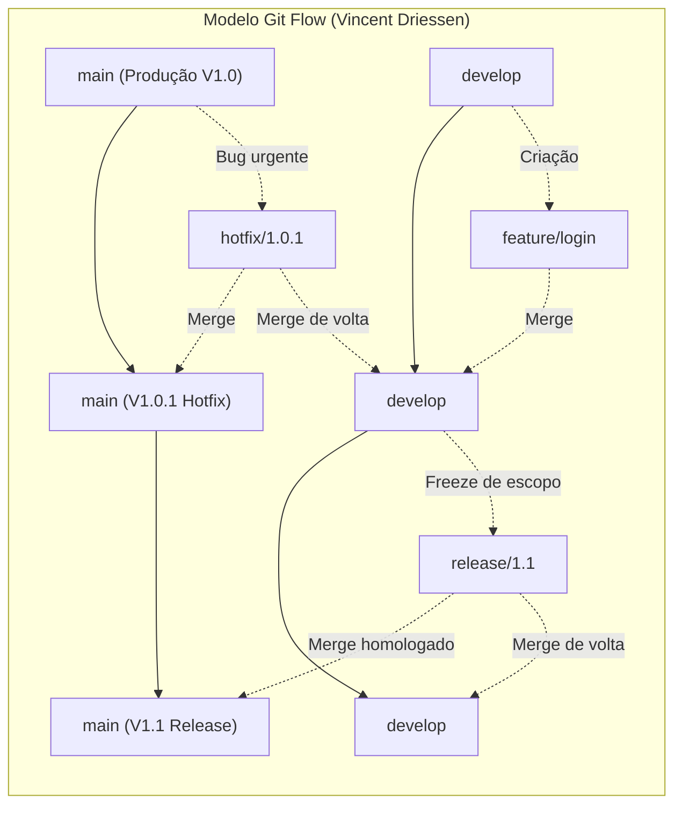
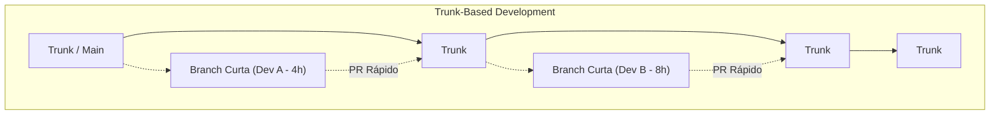
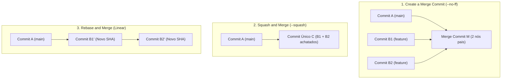

# 02 - Estratégias de Branching e Plataformas Git Colaborativas

> **Matéria:** DevOps, Plataforma de Desenvolvimento e Engenharia de Entrega  
> **Cargo:** B02 – Técnico de Controle Externo – Especialidade: Tecnologia da Informação  
> **Arquivo:** `02_git_estrategias_de_branching_e_plataformas_colaborativas.md`  


---


## 📌 Ementa / Itens do Edital
- Plataformas de hospedagem, colaboração e automação baseadas em Git: GitHub e GitLab
- Estratégias de branching (fluxos de ramificação): Git Flow, Trunk-Based Development, GitHub Flow e GitLab Flow
- Fluxo de trabalho com Pull Requests (GitHub) e Merge Requests (GitLab)
- Estratégias de mesclagem (Merge Commit, Squash and Merge, Rebase and Merge)
- Políticas de proteção de branches, governança de código e arquivos de configuração (`CODEOWNERS`)

---

## 🧭 Sumário

1. [Modelos e Estratégias de Branching](#1-modelos-e-estrategias-de-branching)
    1. [O Modelo Git Flow: Ramos Perenes e Ramos Temporários](#11-o-modelo-git-flow-ramos-perenes-e-ramos-temporarios)
    2. [Trunk-Based Development (TBD): Filosofia, Feature Flags e Branch by Abstraction](#12-trunk-based-development-tbd-filosofia-feature-flags-e-branch-by-abstraction)
    3. [O Modelo GitHub Flow](#13-o-modelo-github-flow)
    4. [O Modelo GitLab Flow (Ambientes e Versões)](#14-o-modelo-gitlab-flow-ambientes-e-versoes)
    5. [Matriz Comparativa Síntese entre os Modelos de Ramificação](#15-matriz-comparativa-sintese-entre-os-modelos-de-ramificacao)
    6. [Teste 182](#Teste-182)
    7. [Teste 183](#Teste-183)
    8. [Teste 184](#Teste-184)
    9. [Teste 185](#Teste-185)
2. [Estratégias de Integração e Mesclagem (Merge Commit, Squash e Rebase)](#2-estrategias-de-integracao-e-mesclagem-merge-commit-squash-e-rebase)
    1. [Create a Merge Commit (`git merge --no-ff`)](#21-create-a-merge-commit-git-merge-no-ff)
    2. [Squash and Merge (`git merge --squash`)](#22-squash-and-merge-git-merge-squash)
    3. [Rebase and Merge (`git rebase`)](#23-rebase-and-merge-git-rebase)
    4. [Teste 186](#Teste-186)
    5. [Teste 187](#Teste-187)
    6. [Teste 188](#Teste-188)
3. [Governança, Regras de Proteção de Branches e `CODEOWNERS`](#3-governanca-regras-de-protecao-de-branches-e-codeowners)
    1. [Regras de Proteção de Branches (Branch Protection Rules)](#31-regras-de-protecao-de-branches-branch-protection-rules)
    2. [O Arquivo `CODEOWNERS` e Revisões Bloqueantes](#32-o-arquivo-codeowners-e-revisoes-bloqueantes)
    3. [Comparativo Terminológico e Operacional: GitHub vs. GitLab](#33-comparativo-terminologico-e-operacional-github-vs-gitlab)
    4. [Teste 189](#Teste-189)
    5. [Teste 190](#Teste-190)
    6. [Teste 191](#Teste-191)
4. [🌐 Fontes Oficiais e Referências Bibliográficas](#fontes-oficiais-e-referencias-bibliograficas)

---

## 1. Modelos e Estratégias de Branching

A estratégia de ramificação (*branching strategy*) estabelece as regras e convenções que orientam como desenvolvedores criam branches, integram códigos, isolam novas funcionalidades e estabilizam versões para publicação. A escolha inadequada de um modelo de ramificação é a principal causadora do chamado **"Merge Hell"** — o cenário traumático em que múltiplas branches isoladas divergem por semanas ou meses, acumulando centenas de conflitos de mesclagem de resolução complexa e arriscada.



### 1.1 O Modelo Git Flow: Ramos Perenes e Ramos Temporários

Formalizado por Vincent Driessen em 2010, o **Git Flow** foi concebido para produtos de software que operam com ciclos de lançamento formais e programados com versionamento semântico estrito (como distribuições empacotadas para desktop, aplicativos de smartphone em lojas de apps e sistemas legados com janelas mensais ou trimestrais de homologação).

O Git Flow define rigorosamente duas categorias de branches:

#### 1. Ramos Perenes (Long-Lived Branches)
Permanecem ativos durante todo o ciclo de vida do repositório:

- **`main` (ou `master`):** Armazena exclusivamente o código em estado de prontidão para produção ou que já está rodando nos servidores produtivos. Cada commit na branch `main` representa um release oficial de software e deve ser compulsoriamente etiquetado com uma tag semântica (ex.: `v1.0.0`, `v1.1.0`).
- **`develop`:** Atua como o ramo integrador do trabalho contínuo de desenvolvimento. Reúne as funcionalidades concluídas e testadas que comporão o próximo lançamento planejado.

#### 2. Ramos Temporários de Suporte (Short-Lived / Supporting Branches)
Possuem ciclo de vida efêmero e regras rígidas de derivação e mesclagem:

- **`feature/*`:** Nascem **exclusivamente a partir de `develop`** e realizam merge de volta **obrigatoriamente em `develop`**. São utilizadas por equipes para implementar funcionalidades específicas sem interferir no trabalho alheio.
- **`release/*`:** Nascem **a partir de `develop`** quando o conjunto de funcionalidades planejadas para a próxima versão está finalizado (*code freeze*). Durante a existência da branch de release, é proibida a adição de novas funcionalidades; realizam-se apenas correções de defeitos identificados em homologação, ajustes finos de documentação e bump de versão. Ao ser finalizada e homologada, a branch de release é mesclada na **`main`** (recebendo uma tag) **E também na `develop`** (para repassar os ajustes de homologação ao fluxo principal).
- **`hotfix/*`:** Nascem **diretamente a partir de `main`** para solucionar incidentes críticos de segurança ou bugs impeditivos em produção que não podem aguardar o próximo ciclo formal de release. Uma vez testada e validada, a branch de hotfix deve ser mesclada na **`main`** (com nova subversão de patch, ex.: `v1.0.1`) **E compulsoriamente na `develop`**, impedindo que lançamentos futuros reintroduzam a falha que acabara de ser corrigida.

> 🚨 **ALERTA DE PROVA / PEGADINHA FCC:**  
> A FCC adora cobrar o destino de mesclagem das branches temporárias de **`hotfix`** e de **`release`** no Git Flow:
>
> - **`hotfix`:** Deriva de `main` $\rightarrow$ Realiza merge **em `main` E em `develop`**!
> - **`release`:** Deriva de `develop` $\rightarrow$ Realiza merge **em `main` E em `develop`**!
> Se a alternativa afirmar que o hotfix ou a release faz merge apenas na `main`, a afirmativa está incorreta!

### 1.2 Trunk-Based Development (TBD): Filosofia, Feature Flags e Branch by Abstraction

O **Trunk-Based Development (TBD)** é o modelo de ramificação preconizado pelas organizações de alta performance tecnológica (como Google, Meta, Netflix) e referendado com destaque empírico nas pesquisas do **DORA** (*State of DevOps Report*).



- **Filosofia Central:** Existe **apenas um único ramo perene**, denominado `trunk` (ou `main`).
- Todos os desenvolvedores integram seu trabalho ao `trunk` com altíssima frequência (ao menos uma vez por dia, preferencialmente múltiplas vezes).
- Se houver uso de branches de tarefas, elas devem ser estritamente de **vida curtíssima (*short-lived feature branches*)**, durando poucas horas ou no máximo 1 a 2 dias, sendo submetidas a Pull Requests pequenos e fáceis de revisar.
- **Habilitadores Técnicos Indispensáveis:**
    1. **Feature Flags / Feature Toggles:** Como integrar ao trunk códigos de histórias de usuário complexas que levam duas semanas para serem construídas? A equipe comita e sobe o código diariamente para produção, mas o mantém envolto em uma condicional booleana (*Feature Flag*). O recurso inacabado executa em produção desativado para os cidadãos e auditores, sem risco de quebra.
    2. **Branch by Abstraction:** Padrão arquitetural em nível de código-fonte utilizado para refatorar subsistemas complexos diretamente no trunk: cria-se uma interface/abstração intermediária entre o chamador e a implementação legada; implementa-se o novo componente gradualmente; redireciona-se o chamador para a nova implementação; e expurga-se o código legado do repositório, sem a necessidade de criar branches paralelas de longa duração.

### 1.3 O Modelo GitHub Flow

Criado pela equipe do GitHub, o **GitHub Flow** é uma abordagem minimalista e centrada na web, amplamente adotada em arquiteturas de microsserviços e sistemas com entregas contínuas:

- **Premissa Inviolável:** A branch `main` é permanentemente estável e **a qualquer momento pronta para entrar em produção** (*"Anything in the main branch is deployable"*).
- **Ciclo Operacional:**
    1. Cria-se uma branch descritiva diretamente a partir da `main` (ex.: `add-oauth2-support`);
    2. Adicionam-se commits frequentes e mensagens claras;
    3. Abre-se uma *Pull Request* precocemente para iniciar a discussão técnica e executar pipelines de CI automatizados;
    4. Após aprovação em revisão por pares e nos testes automatizados, o código é implantado em produção (para validação imediata);
    5. Realiza-se o merge na branch `main` e a branch de trabalho é excluída.

### 1.4 O Modelo GitLab Flow (Ambientes e Versões)

O **GitLab Flow** une a simplicidade do GitHub Flow à necessidade corporativa de gerenciar múltiplos ambientes de infraestrutura e suporte a versões legadas:

1. **GitLab Flow com Branches de Ambiente (*Environment Branches*):**
    - Cria-se uma branch perene para cada ambiente do ciclo de vida: `main` (desenvolvimento/integração), `pre-production` (homologação/staging) e `production` (produção real).
    - O código flui em sentido único: da `main` para `pre-production`, e de `pre-production` para `production`. O merge entre essas branches dispara automaticamente o pipeline de implantação no respectivo ambiente físico, garantindo que tudo o que entra em produção passou comprovadamente por homologação.

2. **GitLab Flow com Branches de Versão (*Release Branches*):**
    - Utilizado quando uma organização precisa manter suporte a múltiplas versões ativas de um mesmo software distribuído (ex.: versões 1.x, 2.x e 3.x). Correções de bugs são aplicadas primeiro na `main` e depois retroalimentadas (*backported*) nas branches de versão ativas através de comandos `git cherry-pick`.

### 1.5 Matriz Comparativa Síntese entre os Modelos de Ramificação

| Dimensão de Análise | Git Flow | Trunk-Based Development (TBD) | GitHub Flow | GitLab Flow (Ambientes) |
| :--- | :--- | :--- | :--- | :--- |
| **Complexidade Estrutural** | **Alta** (múltiplas branches com regras estritas) | **Mínima** | Baixa | Moderada |
| **Ramos Perenes Principais** | 2 (`main` e `develop`) | 1 (`trunk` / `main`) | 1 (`main`) | 1 principal + ramos de ambiente (`prod`, `staging`) |
| **Duração das Branches** | Longa (semanas a meses) | Curtíssima (horas a no máximo 1-2 dias) | Curta (ciclo da tarefa) | Curta para features; perene para ambientes |
| **Frequência de Deploys** | Baixa/Média (janelas de release agendadas) | Contínua (múltiplas vezes ao dia sob demanda) | Contínua (a cada PR aprovado) | Progressiva por promoção de ambiente |
| **Risco de Conflitos (Merge Hell)**| **Elevado** devido ao isolamento prolongado | **Quase nulo** (resolução precoce) | Baixo | Baixo |
| **Uso de Feature Flags** | Opcional | **Crítico / Essencial** | Opcional | Recomendado |
| **Aderência ao DevOps / CI/CD** | Baixa (silos temporais em branches) | **Padrão Ouro (Recomendado DORA)** | Alta para web e microsserviços | Alta para governança corporativa |

---

### Teste 182
**(FGV – TRT-1 – Analista Judiciario Area Administrativa – 2024)**
Em uma pequena fábrica, o gestor precisa decidir o volume de produção para o mês seguinte. A partir de informações sobre os custos de produção, preços e projeções de venda, entre outras, o gestor elaborou a matriz de resultados apresentada abaixo. Vendas (unidades) Produção (unidades) Probabilidade 1000 2000 3000 1000 R$4.000,00 -R$500,00 -R$1.000,00 20% 2000 R$2.000,00 R$5.000,00 R$3.000,00 25% 3000 - R$2.000,00 R$8.000,00 R$12.000,00 50% Pelo critério de maior valor esperado, o gestor deve optar por produzir:

* **A)** 1000 unidades, com valor esperado de R$2.300,00;
* **B)** 2000 unidades, com valor esperado de R$2.550,00;
* **C)** 2000 unidades, com valor esperado de R$5.150,00;
* **D)** 3000 unidades, com valor esperado de R$5.050,00;
* **E)** 3000 unidades, com valor esperado de R$9.000,00.

---

> **Comentário Detalhado:**
>
> - **A)** **Incorreta.** A opção apresenta proposição em desacordo com os fundamentos teóricos e técnicos do tópico ao afirmar que "1000 unidades, com valor esperado de R$2.300,00". De acordo com a teoria estudada em *1.4 O Modelo GitLab Flow (Ambientes e Versões)*, utilizado quando uma organização precisa manter suporte a múltiplas versões ativas de um mesmo software distribuído (ex.: versões 1.x, 2.x e 3.x).
> - **B)** **Correta.** Conforme fundamentado na seção *2. Ramos Temporários de Suporte (Short-Lived / Supporting Branches)* deste guia, `hotfix/*`: Nascem diretamente a partir de `main` para solucionar incidentes críticos de segurança ou bugs impeditivos em produção que não podem aguardar o próximo ciclo formal de release. Dessa forma, está plenamente correta a assertiva da banca (FGV – TRT-1/2024) ao estabelecer que "2000 unidades, com valor esperado de R$2.550,00".
> - **C)** **Incorreta.** A opção apresenta proposição em desacordo com os fundamentos teóricos e técnicos do tópico ao afirmar que "2000 unidades, com valor esperado de R$5.150,00". De acordo com a teoria estudada em *1. Ramos Perenes (Long-Lived Branches)*, cada commit na branch `main` representa um release oficial de software e deve ser compulsoriamente etiquetado com uma tag semântica (ex.: `v1.0.0`, `v1.1.0`).
> - **D)** **Incorreta.** A opção apresenta proposição em desacordo com os fundamentos teóricos e técnicos do tópico ao afirmar que "3000 unidades, com valor esperado de R$5.050,00". De acordo com a teoria estudada em *2. Ramos Temporários de Suporte (Short-Lived / Supporting Branches)*, uma vez testada e validada, a branch de hotfix deve ser mesclada na `main` (com nova subversão de patch, ex.: `v1.0.1`) E compulsoriamente na `develop`, impedindo que lançamentos futuros reintroduzam a falha que acabara de ser corrigida.
> - **E)** **Incorreta.** A opção apresenta proposição em desacordo com os fundamentos teóricos e técnicos do tópico ao afirmar que "3000 unidades, com valor esperado de R$9.000,00". De acordo com a teoria estudada em *2. Ramos Temporários de Suporte (Short-Lived / Supporting Branches)*, `feature/*`: Nascem exclusivamente a partir de `develop` e realizam merge de volta obrigatoriamente em `develop`. São utilizadas por equipes para implementar funcionalidades específicas sem interferir no trabalho alheio.
>
> **Gabarito: B**

---

### Teste 183
**(FGV – TJ-SC – Analista Administrativo – 2026)**
Na empresa ABC, a equipe responsável pela implantação de um novo sistema de gestão documental encontra-se em momento crítico do projeto: o plano-base já foi estruturado e aprovado, e a equipe executa as atividades de trabalho voltadas à produção das entregas. Nessa etapa, o gerente de projeto monitora continuamente o progresso para assegurar que o trabalho permaneça dentro da programação e do orçamento, que o escopo seja integralmente atendido conforme as especificações e que eventuais mudanças sejam documentadas, aprovadas e incorporadas a um plano-base atualizado. Considerando o ciclo de vida genérico do projeto, a fase descrita corresponde à de

* **A)** iniciação.
* **B)** planejamento.
* **C)** realização.
* **D)** encerramento.
* **E)** avaliação.

---

> **Comentário Detalhado:**
>
> - **A)** **Incorreta.** A opção apresenta proposição em desacordo com os fundamentos teóricos e técnicos do tópico ao afirmar que "iniciação". De acordo com a teoria estudada em *1.3 O Modelo GitHub Flow*, criado pela equipe do GitHub, o GitHub Flow é uma abordagem minimalista e centrada na web, amplamente adotada em arquiteturas de microsserviços e sistemas com entregas contínuas.
> - **B)** **Correta.** Conforme fundamentado na seção *1.4 O Modelo GitLab Flow (Ambientes e Versões)* deste guia, cria-se uma branch perene para cada ambiente do ciclo de vida: `main` (desenvolvimento/integração), `pre-production` (homologação/staging) e `production` (produção real). Dessa forma, está plenamente correta a assertiva da banca (FGV – TJ-SC/2026) ao estabelecer que "planejamento".
> - **C)** **Incorreta.** A opção apresenta proposição em desacordo com os fundamentos teóricos e técnicos do tópico ao afirmar que "realização". De acordo com a teoria estudada em *1.3 O Modelo GitHub Flow*, premissa Inviolável: A branch `main` é permanentemente estável e a qualquer momento pronta para entrar em produção (*"Anything in the main branch is deployable"*).
> - **D)** **Incorreta.** A opção apresenta proposição em desacordo com os fundamentos teóricos e técnicos do tópico ao afirmar que "encerramento". De acordo com a teoria estudada em *1.4 O Modelo GitLab Flow (Ambientes e Versões)*, o merge entre essas branches dispara automaticamente o pipeline de implantação no respectivo ambiente físico, garantindo que tudo o que entra em produção passou comprovadamente por homologação.
> - **E)** **Incorreta.** A opção apresenta proposição em desacordo com os fundamentos teóricos e técnicos do tópico ao afirmar que "avaliação". De acordo com a teoria estudada em *1.2 Trunk-Based Development (TBD): Filosofia, Feature Flags e Branch by Abstraction*, feature Flags / Feature Toggles: Como integrar ao trunk códigos de histórias de usuário complexas que levam duas semanas para serem construídas? A equipe comita e sobe o código diariamente para produção, mas o mantém envolto em uma condicional booleana (*Feature Flag*).
>
> **Gabarito: B**

---

### Teste 184
**(FGV – TJ-BA – Analista Judiciario Tecnologia da Informacao – 2015)**
Um projeto pode ser dividido em qualquer número de fases. A fase de um projeto é um conjunto de atividades relacionadas de maneira lógica que culmina na conclusão de uma ou mais entregas. Com relação a projetos iterativos e incrementais, analise as afirmativas a seguir: I- Ciclos de vida iterativos e incrementais são aqueles em que as fases do projeto (também chamadas de iterações) intencionalmente repetem uma ou mais atividades de projeto à medida que a compreensão do produto pela equipe do projeto aumenta. II- As atividades de todos os grupos de processos de gerenciamento de projeto serão executadas durante uma iteração. III - No final de cada iteração, uma entrega ou conjunto de entregas será concluído. As iterações futuras podem aprimorar tais entregas ou criar novas entregas. Está correto o que se afirma em:

* **A)** somente I;
* **B)** somente II;
* **C)** somente III;
* **D)** somente I e II;
* **E)** I, II e III.

---

> **Comentário Detalhado:**
>
> - **A)** **Incorreta.** A opção incorre em restrição indevida ao limitar o escopo conceitual ao afirmar que "somente I". De acordo com a teoria estudada em *2. Ramos Temporários de Suporte (Short-Lived / Supporting Branches)*, durante a existência da branch de release, é proibida a adição de novas funcionalidades; realizam-se apenas correções de defeitos identificados em homologação, ajustes finos de documentação e bump de versão.
> - **B)** **Incorreta.** A opção incorre em restrição indevida ao limitar o escopo conceitual ao afirmar que "somente II". De acordo com a teoria estudada em *1. Ramos Perenes (Long-Lived Branches)*, permanecem ativos durante todo o ciclo de vida do repositório.
> - **C)** **Incorreta.** A opção incorre em restrição indevida ao limitar o escopo conceitual ao afirmar que "somente III". De acordo com a teoria estudada em *1.2 Trunk-Based Development (TBD): Filosofia, Feature Flags e Branch by Abstraction*, se houver uso de branches de tarefas, elas devem ser estritamente de vida curtíssima (*short-lived feature branches*), durando poucas horas ou no máximo 1 a 2 dias, sendo submetidas a Pull Requests pequenos e fáceis de revisar.
> - **D)** **Incorreta.** A opção incorre em restrição indevida ao limitar o escopo conceitual ao afirmar que "somente I e II". De acordo com a teoria estudada em *1.1 O Modelo Git Flow: Ramos Perenes e Ramos Temporários*, formalizado por Vincent Driessen em 2010, o Git Flow foi concebido para produtos de software que operam com ciclos de lançamento formais e programados com versionamento semântico estrito (como distribuições empacotadas para desktop, aplicativos de smartphone em lojas de apps e sistemas legados com janelas mensais ou trimestrais de homologação).
> - **E)** **Correta.** Conforme fundamentado na seção *1.3 O Modelo GitHub Flow* deste guia, criado pela equipe do GitHub, o GitHub Flow é uma abordagem minimalista e centrada na web, amplamente adotada em arquiteturas de microsserviços e sistemas com entregas contínuas. Dessa forma, está plenamente correta a assertiva da banca (FGV – TJ-BA/2015) ao estabelecer que "I, II e III".
>
> **Gabarito: E**

---

### Teste 185
**(FGV – TJ-AP – Analista Judiciario Apoio Especializado Tecnologia da Informacao Seguranca da Informacao – 2023)**
Um especialista em infraestrutura foi contratado para otimizar a transmissão de dados em uma rede local. Pela premissa de que a camada de rede oferece serviços à camada de transporte, os serviços precisam ser cuidadosamente planejados tendo em vista os objetivos a seguir. 1. Os serviços devem ser independentes da tecnologia presente nos roteadores. 2. A camada de transporte deve ser isolada do número, do tipo e da topologia dos roteadores presentes. 3. Os endereços de rede que tornam os pacotes disponíveis para a camada de transporte devem usar um plano de numeração uniforme, mesmo nas LANs e WANs. A camada de rede deve fornecer serviço orientado a conexões. Para tal, o especialista poderá optar pelas tecnologias:

* **A)** MPLS e VLANs;
* **B)** Rede de datagramas e ATM;
* **C)** VLANs e Rede de datagramas;
* **D)** UDP e Rede de circuitos virtuais;
* **E)** Rede de datagramas e Rede de circuitos virtuais.

---

> **Comentário Detalhado:**
>
> - **A)** **Correta.** Conforme fundamentado na seção *1.2 Trunk-Based Development (TBD): Filosofia, Feature Flags e Branch by Abstraction* deste guia, se houver uso de branches de tarefas, elas devem ser estritamente de vida curtíssima (*short-lived feature branches*), durando poucas horas ou no máximo 1 a 2 dias, sendo submetidas a Pull Requests pequenos e fáceis de revisar. Dessa forma, está plenamente correta a assertiva da banca (FGV – TJ-AP/2023) ao estabelecer que "MPLS e VLANs".
> - **B)** **Incorreta.** A opção apresenta proposição em desacordo com os fundamentos teóricos e técnicos do tópico ao afirmar que "Rede de datagramas e ATM". De acordo com a teoria estudada em *1. Ramos Perenes (Long-Lived Branches)*, cada commit na branch `main` representa um release oficial de software e deve ser compulsoriamente etiquetado com uma tag semântica (ex.: `v1.0.0`, `v1.1.0`).
> - **C)** **Incorreta.** A opção apresenta proposição em desacordo com os fundamentos teóricos e técnicos do tópico ao afirmar que "VLANs e Rede de datagramas". De acordo com a teoria estudada em *2. Ramos Temporários de Suporte (Short-Lived / Supporting Branches)*, uma vez testada e validada, a branch de hotfix deve ser mesclada na `main` (com nova subversão de patch, ex.: `v1.0.1`) E compulsoriamente na `develop`, impedindo que lançamentos futuros reintroduzam a falha que acabara de ser corrigida.
> - **D)** **Incorreta.** A opção apresenta proposição em desacordo com os fundamentos teóricos e técnicos do tópico ao afirmar que "UDP e Rede de circuitos virtuais". De acordo com a teoria estudada em *1.3 O Modelo GitHub Flow*, premissa Inviolável: A branch `main` é permanentemente estável e a qualquer momento pronta para entrar em produção (*"Anything in the main branch is deployable"*).
> - **E)** **Incorreta.** A opção apresenta proposição em desacordo com os fundamentos teóricos e técnicos do tópico ao afirmar que "Rede de datagramas e Rede de circuitos virtuais". De acordo com a teoria estudada em *1.4 O Modelo GitLab Flow (Ambientes e Versões)*, o GitLab Flow une a simplicidade do GitHub Flow à necessidade corporativa de gerenciar múltiplos ambientes de infraestrutura e suporte a versões legadas.
>
> **Gabarito: A**

---

## 2. Estratégias de Integração e Mesclagem (Merge Commit, Squash e Rebase)

Ao aprovar uma *Pull Request* (no GitHub) ou *Merge Request* (no GitLab), as plataformas oferecem três estratégias fundamentais para integrar os commits da branch de trabalho ao ramo de destino:



### 2.1 Create a Merge Commit (`git merge --no-ff`)

- **Operação Subjacente:** Executa um merge do tipo *no fast-forward*. Cria um nó de commit especial na árvore do Git que possui **dois nós pais**: o último commit da branch de destino e o último commit da branch de trabalho.
- **Vantagens:** Preserva integralmente o histórico original de todos os commits intermediários e a exata demarcação cronológica de que aquele conjunto de linhas foi concebido em uma branch isolada.
- **Desvantagens:** Pode transformar o grafo visual do repositório em uma "teia de espaguete" de difícil interpretação, repleta de commits triviais como *"wip"*, *"corrigindo typo"* ou *"ajuste de teste"*.

### 2.2 Squash and Merge (`git merge --squash`)

- **Operação Subjacente:** Coleta todas as modificações introduzidas pelos múltiplos commits da branch de trabalho, une-as em uma única alteração atômica e registra **um único e coeso commit novo** no topo da branch de destino, descartando os commits individuais intermediários.
- **Vantagens:** Mantém o histórico do branch principal (`main`) estritamente limpo, coeso e legível. Cada commit na `main` corresponde a uma entrega funcional completa (*atomic commit*). Facilita drasticamente a identificação de bugs via `git bisect` e a reversão de falhas em produção via um único comando `git revert <hash>`.
- **Desvantagens:** Suprime o detalhamento granular dos micro-passos dados pelo desenvolvedor durante a confecção da funcionalidade.

### 2.3 Rebase and Merge (`git rebase`)

- **Operação Subjacente:** Pega os commits individuais da branch de trabalho e os reaplica um a um sobre a ponta mais recente da branch de destino, gerando um histórico estritamente linear sem nós de merge intermediários.
- **Pontos de Atenção:** Ao reaplicar os commits, o Git recalcula os identificadores criptográficos (hashes SHA-1/SHA-256), alterando a identidade dos commits originais. Não cria nó com múltiplos pais.

---

### Teste 186
**(FCC – TRT-3 – Analista Judiciario Tecnologia da Informacao – 2015)**
No MPS.BR (Agosto 2012) − Nível G do MR-MPS-SV − Parcialmente Gerenciado, o processo Gerência de Requisitos − GRE, tem como propósito gerenciar os requisitos de trabalho e dos componentes de trabalho e identificar inconsistências entre os requisitos, os planos de trabalho e os produtos de trabalho. Considere seus resultados esperados: I. A rastreabilidade unidirecional entre os requisitos e os produtos de trabalho é estabelecida e mantida. II. Os requisitos são avaliados com base em critérios objetivos e um comprometimento da equipe técnica com estes requisitos é obtido. III. Mudanças nos requisitos são gerenciadas apenas no final do trabalho. IV. Revisões em planos e produtos derivados do trabalho são realizadas visando identificar e corrigir inconsistências em relação aos requisitos. Está correto o que consta APENAS em

* **A)** II e III.
* **B)** I, II e IV.
* **C)** III e IV.
* **D)** I e III.
* **E)** II e IV.

---

> **Comentário Detalhado:**
>
> - **A)** **Incorreta.** A opção apresenta proposição em desacordo com os fundamentos teóricos e técnicos do tópico ao afirmar que "II e III". De acordo com a teoria estudada em *1.2 Trunk-Based Development (TBD): Filosofia, Feature Flags e Branch by Abstraction*, branch by Abstraction: Padrão arquitetural em nível de código-fonte utilizado para refatorar subsistemas complexos diretamente no trunk: cria-se uma interface/abstração intermediária entre o chamador e a implementação legada; implementa-se o novo componente gradualmente; redireciona-se o chamador para a nova implementação; e expurga-se o código legado do repositório, sem a necessidade de criar branches paralelas de longa duração.
> - **B)** **Incorreta.** A opção apresenta proposição em desacordo com os fundamentos teóricos e técnicos do tópico ao afirmar que "I, II e IV". De acordo com a teoria estudada em *1.3 O Modelo GitHub Flow*, abre-se uma *Pull Request* precocemente para iniciar a discussão técnica e executar pipelines de CI automatizados.
> - **C)** **Incorreta.** A opção apresenta proposição em desacordo com os fundamentos teóricos e técnicos do tópico ao afirmar que "III e IV". De acordo com a teoria estudada em *1.4 O Modelo GitLab Flow (Ambientes e Versões)*, o GitLab Flow une a simplicidade do GitHub Flow à necessidade corporativa de gerenciar múltiplos ambientes de infraestrutura e suporte a versões legadas.
> - **D)** **Incorreta.** A opção apresenta proposição em desacordo com os fundamentos teóricos e técnicos do tópico ao afirmar que "I e III". De acordo com a teoria estudada em *3. Governança, Regras de Proteção de Branches e `CODEOWNERS`*, em instituições governamentais e órgãos de controle externo como o TCE-GO, os repositórios de código constituem ativos estratégicos sujeitos a rígidos requisitos de conformidade, trilhas de auditoria e segregação de funções.
> - **E)** **Correta.** Conforme fundamentado na seção *1.1 O Modelo Git Flow: Ramos Perenes e Ramos Temporários* deste guia, formalizado por Vincent Driessen em 2010, o Git Flow foi concebido para produtos de software que operam com ciclos de lançamento formais e programados com versionamento semântico estrito (como distribuições empacotadas para desktop, aplicativos de smartphone em lojas de apps e sistemas legados com janelas mensais ou trimestrais de homologação). Dessa forma, está plenamente correta a assertiva da banca (FCC – TRT-3/2015) ao estabelecer que "II e IV".
>
> **Gabarito: E**

---

### Teste 187
**(FCC – TRT-13 – Analista Judiciario Tecnologia da Informacao – 2014)**
A imagem a seguir mostra uma representação das etapas do processo de desenvolvimento de software e os tipos de testes aplicados em cada etapa. Tipo de teste I Tipo de teste II Tipo de teste III Levantamento de Requisitos Codificação Especificação de Classes Manutenção Tipo de teste VI Modelagem de Negócios Prototipagem Projeto e Arquitetura Tipo de teste V Tipo de teste IV O mais adequado para Tipo de Teste II é o teste

* **A)** de sistema.
* **B)** de regressão.
* **C)** de aceitação.
* **D)** funcional.
* **E)** de unidade.

---

> **Comentário Detalhado:**
>
> - **A)** **Incorreta.** A opção apresenta proposição em desacordo com os fundamentos teóricos e técnicos do tópico ao afirmar que "de sistema". De acordo com a teoria estudada em *2.1 Create a Merge Commit (`git merge --no-ff`)*, desvantagens: Pode transformar o grafo visual do repositório em uma "teia de espaguete" de difícil interpretação, repleta de commits triviais como *"wip"*, *"corrigindo typo"* ou *"ajuste de teste"*.
> - **B)** **Incorreta.** A opção apresenta proposição em desacordo com os fundamentos teóricos e técnicos do tópico ao afirmar que "de regressão". De acordo com a teoria estudada em *2.3 Rebase and Merge (`git rebase`)*, operação Subjacente: Pega os commits individuais da branch de trabalho e os reaplica um a um sobre a ponta mais recente da branch de destino, gerando um histórico estritamente linear sem nós de merge intermediários.
> - **C)** **Correta.** Conforme fundamentado na seção *2.1 Create a Merge Commit (`git merge --no-ff`)* deste guia, operação Subjacente: Executa um merge do tipo *no fast-forward*. Cria um nó de commit especial na árvore do Git que possui dois nós pais: o último commit da branch de destino e o último commit da branch de trabalho. Dessa forma, está plenamente correta a assertiva da banca (FCC – TRT-13/2014) ao estabelecer que "de aceitação".
> - **D)** **Incorreta.** A opção apresenta proposição em desacordo com os fundamentos teóricos e técnicos do tópico ao afirmar que "funcional". De acordo com a teoria estudada em *2.2 Squash and Merge (`git merge --squash`)*, vantagens: Mantém o histórico do branch principal (`main`) estritamente limpo, coeso e legível. Cada commit na `main` corresponde a uma entrega funcional completa (*atomic commit*).
> - **E)** **Incorreta.** A opção apresenta proposição em desacordo com os fundamentos teóricos e técnicos do tópico ao afirmar que "de unidade". De acordo com a teoria estudada em *3. Governança, Regras de Proteção de Branches e `CODEOWNERS`*, em instituições governamentais e órgãos de controle externo como o TCE-GO, os repositórios de código constituem ativos estratégicos sujeitos a rígidos requisitos de conformidade, trilhas de auditoria e segregação de funções.
>
> **Gabarito: C**

---

### Teste 188
**(CEBRASPE – TJ-RJ – Analista Judiciario Grupo Tecnologia da Informacao Analista de Sistemas – 2021)**
Para apoiar a análise de negócios, o OMG (Object Management Group) publicou uma norma que está disponível para os analistas como DMN (Decision Model and Notation). Essa notação

* **A)** oferece recursos inexistentes na BPMN, como a modelagem de decisões e de regras de negócio.
* **B)** preenche uma lacuna na UML, que não oferece um diagrama para descrever os processos de negócio.
* **C)** é voltada para a criação de um modelo de decisão mais detalhado e foi projetada para ser usada juntamente com a notação de processos de negócio BPMN padrão.
* **D)** é voltada para definir as etapas de um processo de negócio.
* **E)** tem sua especificação protegida por ser um padrão

---

> **Comentário Detalhado:**
>
> - **A)** **Incorreta.** A opção apresenta proposição em desacordo com os fundamentos teóricos e técnicos do tópico ao afirmar que "oferece recursos inexistentes na BPMN, como a modelagem de decisões e de regras de negócio". De acordo com a teoria estudada em *3.1 Regras de Proteção de Branches (Branch Protection Rules)*, revisão Obrigatória por Pares (*Required Approvals*): Condiciona o merge à aprovação formal de ao menos um (ou mais) revisores humanos qualificados, impedindo a auto-aprovação de código pelo próprio autor.
> - **B)** **Incorreta.** A opção apresenta proposição em desacordo com os fundamentos teóricos e técnicos do tópico ao afirmar que "preenche uma lacuna na UML, que não oferece um diagrama para descrever os processos de negócio". De acordo com a teoria estudada em *1.2 Trunk-Based Development (TBD): Filosofia, Feature Flags e Branch by Abstraction*, branch by Abstraction: Padrão arquitetural em nível de código-fonte utilizado para refatorar subsistemas complexos diretamente no trunk: cria-se uma interface/abstração intermediária entre o chamador e a implementação legada; implementa-se o novo componente gradualmente; redireciona-se o chamador para a nova implementação; e expurga-se o código legado do repositório, sem a necessidade de criar branches paralelas de longa duração.
> - **C)** **Correta.** Conforme fundamentado na seção *2.3 Rebase and Merge (`git rebase`)* deste guia, operação Subjacente: Pega os commits individuais da branch de trabalho e os reaplica um a um sobre a ponta mais recente da branch de destino, gerando um histórico estritamente linear sem nós de merge intermediários. Dessa forma, está plenamente correta a assertiva da banca (CEBRASPE – TJ-RJ/2021) ao estabelecer que "é voltada para a criação de um modelo de decisão mais detalhado e foi projetada para ser usada juntamente com a...".
> - **D)** **Incorreta.** A opção apresenta proposição em desacordo com os fundamentos teóricos e técnicos do tópico ao afirmar que "é voltada para definir as etapas de um processo de negócio". De acordo com a teoria estudada em *1.5 Matriz Comparativa Síntese entre os Modelos de Ramificação*, aderência ao DevOps / CI/CD: Baixa (silos temporais em branches) — Padrão Ouro (Recomendado DORA) — Alta para web e microsserviços — Alta para governança corporativa.
> - **E)** **Incorreta.** A opção apresenta proposição em desacordo com os fundamentos teóricos e técnicos do tópico ao afirmar que "tem sua especificação protegida por ser um padrão". De acordo com a teoria estudada em *1. Ramos Perenes (Long-Lived Branches)*, cada commit na branch `main` representa um release oficial de software e deve ser compulsoriamente etiquetado com uma tag semântica (ex.: `v1.0.0`, `v1.1.0`).
>
> **Gabarito: C**

---

## 3. Governança, Regras de Proteção de Branches e `CODEOWNERS`

Em instituições governamentais e órgãos de controle externo como o TCE-GO, os repositórios de código constituem ativos estratégicos sujeitos a rígidos requisitos de conformidade, trilhas de auditoria e segregação de funções.

### 3.1 Regras de Proteção de Branches (Branch Protection Rules)

As configurações de proteção de branch (*Branch Protection Rules* no GitHub ou *Protected Branches* no GitLab) impõem controles automatizados invioláveis sobre ramos críticos (especialmente `main` e `develop`):

1. **Bloqueio de Push Direto (*Require a pull request before merging*):** Impede que qualquer desenvolvedor envie commits diretamente para a branch principal sem a abertura de uma Pull Request formal.
2. **Bloqueio de Forçamento de Histórico (*Block Force Pushes*):** Desativa compulsoriamente a permissão para executar comandos `git push --force`, impedindo a reescrita deliberada ou acidental do histórico versionado.
3. **Bloqueio de Exclusão (*Prevent Branch Deletion*):** Impede que comandos administrativos apaguem a branch principal.
4. **Revisão Obrigatória por Pares (*Required Approvals*):** Condiciona o merge à aprovação formal de ao menos um (ou mais) revisores humanos qualificados, impedindo a auto-aprovação de código pelo próprio autor.
5. **Aprovação Obrigatória em Verificações de Status do CI (*Required Status Checks*):** Exige que suítes de testes unitários, checagens de linter e análises de vulnerabilidades executadas nos runners de CI reportem sucesso obrigatório antes que o botão de merge seja liberado.
6. **Assinatura Criptográfica Obrigatória (*Require Signed Commits*):** Rejeita commits que não possuam assinatura criptográfica válida (via chaves GPG ou SSH), comprovando a identidade real do autor e prevenindo falsificação de identidade (*commit spoofing*).

### 3.2 O Arquivo `CODEOWNERS` e Revisões Bloqueantes

O arquivo **`CODEOWNERS`** (alocado na raiz do repositório, dentro da pasta `.github/` ou em `.gitlab/`) permite estabelecer proprietários técnicos e papéis de governança baseados em diretórios ou extensões de arquivos:

```text
# O time de arquitetura é dono de todo o repositório por padrão:
*       @orgao-tce/time-arquitetura

# Mudanças em módulos de autenticação e criptografia exigem aprovação da equipe de segurança:
/src/auth/      @orgao-tce/time-seguranca-app
/config/jwt/    @orgao-tce/time-seguranca-app

# Migrações e scripts SQL de banco de dados exigem aprovação obrigatória dos DBAs:
*.sql           @orgao-tce/time-dbas
/database/      @orgao-tce/time-dbas
```

**Mecânica de Aplicação:** Quando um desenvolvedor abre uma *Pull Request* alterando qualquer arquivo coberto pelas regras do `CODEOWNERS`, a plataforma Git adiciona **automaticamente e de forma obrigatória** as equipes ou usuários especificados como revisores bloqueantes. O merge da PR torna-se tecnicamente impossível até que os proprietários do código tenham revisado e concedido a aprovação.

### 3.3 Comparativo Terminológico e Operacional: GitHub vs. GitLab

| Conceito / Recurso | Plataforma GitHub | Plataforma GitLab |
| :--- | :--- | :--- |
| **Proposta de Integração de Código** | **Pull Request (PR)** | **Merge Request (MR)** |
| **Pipeline de Automação CI/CD** | **GitHub Actions** (`.github/workflows/*.yml`) | **GitLab CI/CD** (`.gitlab-ci.yml`) |
| **Agente Executor de Tarefas** | **GitHub Runner** (*Hosted* ou *Self-Hosted*) | **GitLab Runner** (Shared ou Specific) |
| **Regras de Governança de Ramos** | *Branch Protection Rules* | *Protected Branches* |
| **Arquivo de Donos de Código** | `.github/CODEOWNERS` ou raiz | `.gitlab/CODEOWNERS` ou raiz |

---

### Teste 189
**(FCC – TRT-24 – Analista Judiciario Tecnologia da Informacao – 2017)**
Ao comparar os servidores de aplicação Red Hat JBoss EAP versões 5 e 6, visando a instalação e configuração da versão 6, um Analista afirma corretamente que

* **A)** no JBoss EAP 6 a fonte de dados é configurada no arquivo de configuração do servidor. Caso a instância do JBoss EAP estiver sendo executada como servidor autônomo, a fonte de dados é configurada no arquivo standalone/ configuration/standalone.xml.
* **B)** o JBoss Messaging passou a ser incluído no JBoss EAP 6, já que o JBoss EAP 5 usava o HornetQ como provedor messaging.
* **C)** no JBoss EAP 5 a arquitetura de carregamento de classe era baseado nos JBoss Modules, mas no JBoss EAP6, o carregamento de classe é hierárquico, ocultando as classes de implementação do servidor e carregando apenas as classes que o aplicativo necessita.
* **D)** no JBoss EAP 5, o servidor podia ser executado em um managed domain, mas no JBoss EAP 6 executa como um servidor autônomo, permitindo configurar todos os grupos dos servidores de uma só vez, mantendo as configurações sincronizadas por toda a rede de servidores.
* **E)** o JBoss EAP 5 usava perfis baseados na configuração de implantação, localizados no diretório EAP_HOME/ configuration/. No JBoss EAP 6, a configuração da implantação é feita usando um arquivo e um servidor autônomo, que é configurado usando o arquivo EAP_HOME/domain/server/domain.xml.

---

> **Comentário Detalhado:**
>
> - **A)** **Correta.** Conforme fundamentado na seção *3.2 O Arquivo `CODEOWNERS` e Revisões Bloqueantes* deste guia, mecânica de Aplicação: Quando um desenvolvedor abre uma *Pull Request* alterando qualquer arquivo coberto pelas regras do `CODEOWNERS`, a plataforma Git adiciona automaticamente e de forma obrigatória as equipes ou usuários especificados como revisores bloqueantes. Dessa forma, está plenamente correta a assertiva da banca (FCC – TRT-24/2017) ao estabelecer que "no JBoss EAP 6 a fonte de dados é configurada no arquivo de configuração do servidor. Caso a instância do JBoss...".
> - **B)** **Incorreta.** A opção apresenta proposição em desacordo com os fundamentos teóricos e técnicos do tópico ao afirmar que "o JBoss Messaging passou a ser incluído no JBoss EAP 6, já que o JBoss EAP 5 usava o HornetQ como provedor...". De acordo com a teoria estudada em *1.2 Trunk-Based Development (TBD): Filosofia, Feature Flags e Branch by Abstraction*, se houver uso de branches de tarefas, elas devem ser estritamente de vida curtíssima (*short-lived feature branches*), durando poucas horas ou no máximo 1 a 2 dias, sendo submetidas a Pull Requests pequenos e fáceis de revisar.
> - **C)** **Incorreta.** A opção incorre em restrição indevida ao limitar o escopo conceitual ao afirmar que "no JBoss EAP 5 a arquitetura de carregamento de classe era baseado nos JBoss Modules, mas no JBoss EAP6, o...". De acordo com a teoria estudada em *1.2 Trunk-Based Development (TBD): Filosofia, Feature Flags e Branch by Abstraction*, branch by Abstraction: Padrão arquitetural em nível de código-fonte utilizado para refatorar subsistemas complexos diretamente no trunk: cria-se uma interface/abstração intermediária entre o chamador e a implementação legada; implementa-se o novo componente gradualmente; redireciona-se o chamador para a nova implementação; e expurga-se o código legado do repositório, sem a necessidade de criar branches paralelas de longa duração.
> - **D)** **Incorreta.** A opção apresenta proposição em desacordo com os fundamentos teóricos e técnicos do tópico ao afirmar que "no JBoss EAP 5, o servidor podia ser executado em um managed domain, mas no JBoss EAP 6 executa como um servidor...". De acordo com a teoria estudada em *1. Ramos Perenes (Long-Lived Branches)*, `main` (ou `master`): Armazena exclusivamente o código em estado de prontidão para produção ou que já está rodando nos servidores produtivos.
> - **E)** **Incorreta.** A opção apresenta proposição em desacordo com os fundamentos teóricos e técnicos do tópico ao afirmar que "o JBoss EAP 5 usava perfis baseados na configuração de implantação, localizados no diretório EAP_HOME/...". De acordo com a teoria estudada em *3.2 O Arquivo `CODEOWNERS` e Revisões Bloqueantes*, o arquivo `CODEOWNERS` (alocado na raiz do repositório, dentro da pasta `.github/` ou em `.gitlab/`) permite estabelecer proprietários técnicos e papéis de governança baseados em diretórios ou extensões de arquivos.
>
> **Gabarito: A**

---

### Teste 190
**(FCC – TRT-2 – Analista Judiciario Tecnologia da Informacao – 2014)**
Considere as seguintes figuras que apresentam o envio de um arquivo entre dois serviços: Figura 1 Figura 2 Com base nessas imagens e nas configurações padrão para os protocolos HTTP e HTTPS, é correto afirmar que o arquivo enviado na figura 1

* **A)** é recebido na porta 80 e o arquivo enviado na figura 2 é transportado por HTTPS.
* **B)** é transportado por HTTP e o arquivo enviado na figura 2 é recebido na porta 80.
* **C)** e o arquivo enviado na figura 2 são transportados na porta 80, porém o primeiro arquivo possui um header que garante sua segurança.
* **D)** é recebido na porta 443 e o arquivo enviado na figura 2 é transportado por HTTP.
* **E)** é transportado por HTTPS e o arquivo enviado na figura 2 é recebido na porta 443.

---

> **Comentário Detalhado:**
>
> - **A)** **Incorreta.** A opção apresenta proposição em desacordo com os fundamentos teóricos e técnicos do tópico ao afirmar que "é recebido na porta 80 e o arquivo enviado na figura 2 é transportado por HTTPS". De acordo com a teoria estudada em *3.2 O Arquivo `CODEOWNERS` e Revisões Bloqueantes*, mecânica de Aplicação: Quando um desenvolvedor abre uma *Pull Request* alterando qualquer arquivo coberto pelas regras do `CODEOWNERS`, a plataforma Git adiciona automaticamente e de forma obrigatória as equipes ou usuários especificados como revisores bloqueantes.
> - **B)** **Incorreta.** A opção apresenta proposição em desacordo com os fundamentos teóricos e técnicos do tópico ao afirmar que "é transportado por HTTP e o arquivo enviado na figura 2 é recebido na porta 80". De acordo com a teoria estudada em *3.2 O Arquivo `CODEOWNERS` e Revisões Bloqueantes*, o merge da PR torna-se tecnicamente impossível até que os proprietários do código tenham revisado e concedido a aprovação.
> - **C)** **Incorreta.** A opção apresenta proposição em desacordo com os fundamentos teóricos e técnicos do tópico ao afirmar que "e o arquivo enviado na figura 2 são transportados na porta 80, porém o primeiro arquivo possui um header que...". De acordo com a teoria estudada em *2.1 Create a Merge Commit (`git merge --no-ff`)*, operação Subjacente: Executa um merge do tipo *no fast-forward*. Cria um nó de commit especial na árvore do Git que possui dois nós pais: o último commit da branch de destino e o último commit da branch de trabalho.
> - **D)** **Correta.** Conforme fundamentado na seção *3.2 O Arquivo `CODEOWNERS` e Revisões Bloqueantes* deste guia, o arquivo `CODEOWNERS` (alocado na raiz do repositório, dentro da pasta `.github/` ou em `.gitlab/`) permite estabelecer proprietários técnicos e papéis de governança baseados em diretórios ou extensões de arquivos. Dessa forma, está plenamente correta a assertiva da banca (FCC – TRT-2/2014) ao estabelecer que "é recebido na porta 443 e o arquivo enviado na figura 2 é transportado por HTTP".
> - **E)** **Incorreta.** A opção apresenta proposição em desacordo com os fundamentos teóricos e técnicos do tópico ao afirmar que "é transportado por HTTPS e o arquivo enviado na figura 2 é recebido na porta 443". De acordo com a teoria estudada em *3.3 Comparativo Terminológico e Operacional: GitHub vs. GitLab*, arquivo de Donos de Código: `.github/CODEOWNERS` ou raiz — `.gitlab/CODEOWNERS` ou raiz.
>
> **Gabarito: D**

---

### Teste 191
**(CEBRASPE – TRT-8 – Analista Judiciario Apoio Especializado Tecnologia da Informacao – 2016)**
Acerca do MPLS (multiprotocol label switching), assinale a opção correta.

* **A)** O MPLS permite a criação de redes virtuais, sendo capaz de isolar o tráfego por completo com tabelas que utilizam mecanismos de pilhas e de etiquetagem exclusivas para cada VPN.
* **B)** O MPLS permite a criação de caminhos entre os roteadores por meio das label switchingpaths.
* **C)** Na rede MPLS, um label é utilizado pelos roteadores para encaminhar um pacote recebido. Nesse caso, o cabeçalho MPLS deve ser posicionado depois de qualquer cabeçalho da camada 1 (física) e antes do cabeçalho da camada 2 (enlace).
* **D)** Com a utilização de alguns dos protocolos da camada 4 (transporte), o MPLS pode ser empregado para transportar vários tipos de tráfego, como pacotes IP e ATM.
* **E)** Em situações de falhas e de congestionamentos, apesar de a rede MPLS possuir algoritmos capazes de reduzir perdas ou atrasos, tais avarias ainda serão perceptíveis. Esse é um indicativo de que a capacidade de gestão de tráfego do MPLS é inferior em relação a outros protocolos.

---

> **Comentário Detalhado:**
>
> - **A)** **Incorreta.** A opção apresenta proposição em desacordo com os fundamentos teóricos e técnicos do tópico ao afirmar que "O MPLS permite a criação de redes virtuais, sendo capaz de isolar o tráfego por completo com tabelas que utilizam...". De acordo com a teoria estudada em *1.2 Trunk-Based Development (TBD): Filosofia, Feature Flags e Branch by Abstraction*, se houver uso de branches de tarefas, elas devem ser estritamente de vida curtíssima (*short-lived feature branches*), durando poucas horas ou no máximo 1 a 2 dias, sendo submetidas a Pull Requests pequenos e fáceis de revisar.
> - **B)** **Correta.** Conforme fundamentado na seção *3.2 O Arquivo `CODEOWNERS` e Revisões Bloqueantes* deste guia, o arquivo `CODEOWNERS` (alocado na raiz do repositório, dentro da pasta `.github/` ou em `.gitlab/`) permite estabelecer proprietários técnicos e papéis de governança baseados em diretórios ou extensões de arquivos. Dessa forma, está plenamente correta a assertiva da banca (CEBRASPE – TRT-8/2016) ao estabelecer que "O MPLS permite a criação de caminhos entre os roteadores por meio das label switchingpaths".
> - **C)** **Incorreta.** A opção promove generalização excessiva que desconsidera as condições técnicas e normativas ao afirmar que "Na rede MPLS, um label é utilizado pelos roteadores para encaminhar um pacote recebido. Nesse caso, o cabeçalho...". De acordo com a teoria estudada em *1. Ramos Perenes (Long-Lived Branches)*, cada commit na branch `main` representa um release oficial de software e deve ser compulsoriamente etiquetado com uma tag semântica (ex.: `v1.0.0`, `v1.1.0`).
> - **D)** **Incorreta.** A opção apresenta proposição em desacordo com os fundamentos teóricos e técnicos do tópico ao afirmar que "Com a utilização de alguns dos protocolos da camada 4 (transporte), o MPLS pode ser empregado para transportar...". De acordo com a teoria estudada em *2.1 Create a Merge Commit (`git merge --no-ff`)*, desvantagens: Pode transformar o grafo visual do repositório em uma "teia de espaguete" de difícil interpretação, repleta de commits triviais como *"wip"*, *"corrigindo typo"* ou *"ajuste de teste"*.
> - **E)** **Incorreta.** A opção apresenta proposição em desacordo com os fundamentos teóricos e técnicos do tópico ao afirmar que "Em situações de falhas e de congestionamentos, apesar de a rede MPLS possuir algoritmos capazes de reduzir perdas...". De acordo com a teoria estudada em *2.2 Squash and Merge (`git merge --squash`)*, facilita drasticamente a identificação de bugs via `git bisect` e a reversão de falhas em produção via um único comando `git revert <hash>`.
>
> **Gabarito: B**

---

## 🌐 Fontes Oficiais e Referências Bibliográficas

* [Trunk Based Development Official Guide](https://trunkbaseddevelopment.com/5-min-overview/) - Práticas de desenvolvimento linear focado na branch principal, releases a partir do trunk e feature flags.
* [GitHub Documentation - Managing Protected Branches and Pull Requests](https://docs.github.com/pt/repositories/configuring-branches-and-merges-in-your-repository/managing-protected-branches/about-protected-branches) - Regras de proteção, revisões obrigatórias (code review) e status checks.
* [Git Official Documentation - Advanced Git Rebase](https://git-scm.com/docs/git-rebase) - Reescrevendo histórico de commits, squashing e rebase interativo.
* [Git Official Documentation - Git Merge Strategies](https://git-scm.com/docs/git-merge) - Algoritmos ortogonais de resolução de conflitos e políticas de mesclagem.
* CHACON, Scott; STRAUB, Ben. **Pro Git**. 2. ed. Nova York: Apress, 2014. (Cap. 3 - Git Branching e Fluxos Colaborativos).
* HUMBLE, Jez; FARLEY, David. **Entrega Contínua**. Porto Alegre: Bookman, 2014. (Cap. 14 - Gestão Avançada de Branches e Versionamento).
* KIM, Gene et al. **Manual de DevOps**. São Paulo: Alta Books, 2018. (Cap. 11 - Integrando Segurança e Governança no Controle de Versão).
