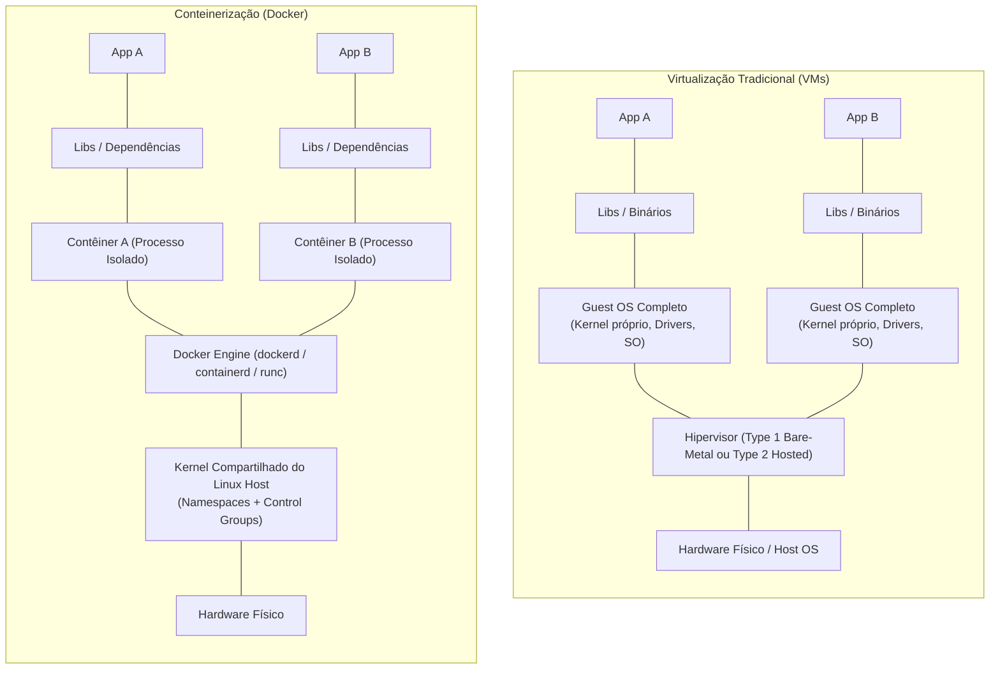
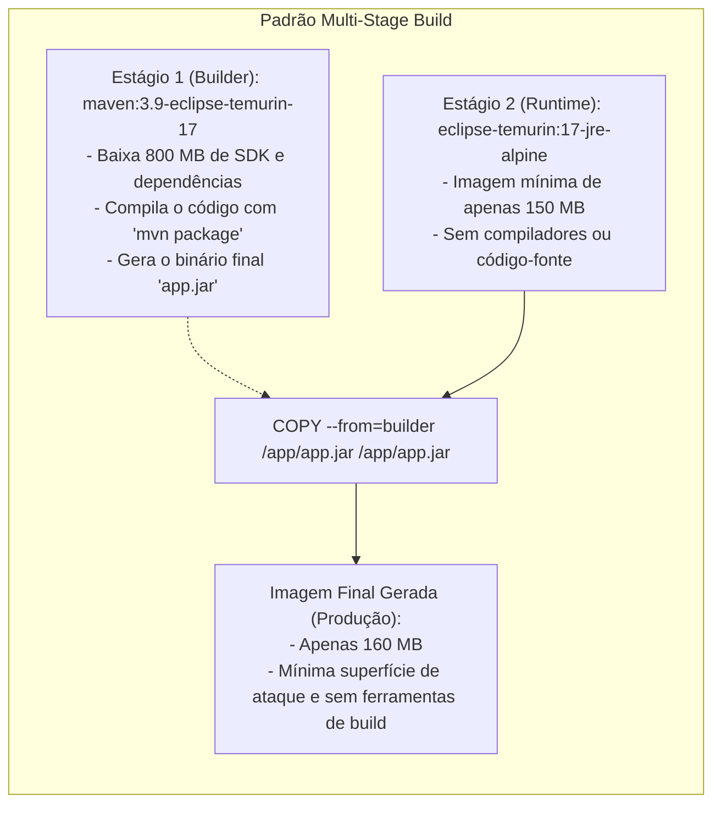
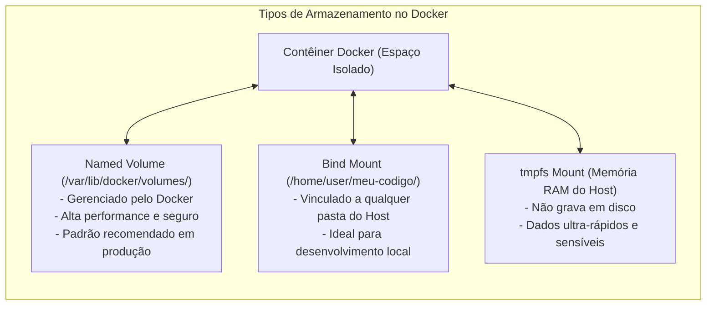

# 03 - Conteinerização com Docker e Docker Compose

> **Matéria:** DevOps, Plataforma de Desenvolvimento e Engenharia de Entrega  
> **Cargo:** B02 – Técnico de Controle Externo – Especialidade: Tecnologia da Informação  
> **Arquivo:** `03_conteinerizacao_docker_e_docker_compose.md`  

---

## 📌 Ementa / Itens do Edital
- Conceitos de conteinerização vs. virtualização tradicional
- Arquitetura e componentes do Docker (Daemon, Client, Images, Containers, Registries)
- Construção de imagens e instruções do Dockerfile
- Otimização com builds de múltiplos estágios (Multi-Stage Builds)
- Gestão de dados (Volumes, Bind Mounts e tmpfs) e Redes no Docker
- Orquestração de múltiplos contêineres com Docker Compose

---

## 🧭 Sumário

1. [Fundamentos de Conteinerização vs. Virtualização Tradicional](#1-fundamentos-de-conteinerizacao-vs-virtualizacao-tradicional)
    1. [Máquinas Virtuais (Hypervisors) vs. Contêineres (Kernel Compartilhado)](#11-maquinas-virtuais-hypervisors-vs-conteineres-kernel-compartilhado)
    2. [Primitivas Essenciais do Kernel Linux: Namespaces e Control Groups (cgroups)](#12-primitivas-essenciais-do-kernel-linux-namespaces-e-control-groups-cgroups)
    3. [Arquitetura do Docker Engine: Client, Daemon, containerd, runc e Registries](#13-arquitetura-do-docker-engine-client-daemon-containerd-runc-e-registries)
    4. [Sistema de Arquivos em Camadas (Overlay2 UnionFS) e Copy-on-Write (CoW)](#14-sistema-de-arquivos-em-camadas-overlay2-unionfs-e-copy-on-write-cow)
    5. [Teste 192](#Teste-192)
    6. [Teste 193](#Teste-193)
    7. [Teste 194](#Teste-194)
2. [Construção de Imagens e Anatomia do Dockerfile](#2-construcao-de-imagens-e-anatomia-do-dockerfile)
    1. [Instruções Canônicas: FROM, WORKDIR, COPY vs. ADD, RUN, ENV vs. ARG](#21-instrucoes-canonicas-from-workdir-copy-vs-add-run-env-vs-arg)
    2. [Execução de Processos: ENTRYPOINT vs. CMD (Exec Form vs. Shell Form)](#22-execucao-de-processos-entrypoint-vs-cmd-exec-form-vs-shell-form)
    3. [Exposição de Portas e Segurança: EXPOSE vs. Publicação no Host e Diretiva USER](#23-exposicao-de-portas-e-seguranca-expose-vs-publicacao-no-host-e-diretiva-user)
    4. [Otimização com Builds de Múltiplos Estágios (Multi-Stage Builds) e Cache de Camadas](#24-otimizacao-com-builds-de-multiplos-estagios-multi-stage-builds-e-cache-de-camadas)
    5. [Teste 195](#Teste-195)
    6. [Teste 196](#Teste-196)
    7. [Teste 197](#Teste-197)
    8. [Teste 198](#Teste-198)
3. [Persistência de Dados e Gerenciamento de Armazenamento](#3-persistencia-de-dados-e-gerenciamento-de-armazenamento)
    1. [Efemeridade da Camada de Leitura e Escrita do Contêiner](#31-efemeridade-da-camada-de-leitura-e-escrita-do-conteiner)
    2. [Comparativo: Named Volumes vs. Bind Mounts vs. tmpfs Mounts](#32-comparativo-named-volumes-vs-bind-mounts-vs-tmpfs-mounts)
    3. [Teste 199](#Teste-199)
4. [Redes no Docker: Drivers e Resolução de Nomes](#4-redes-no-docker-drivers-e-resolucao-de-nomes)
    1. [Drivers de Rede: bridge, host, none, overlay e macvlan](#41-drivers-de-rede-bridge-host-none-overlay-e-macvlan)
    2. [Resolução de Nomes por DNS Integrado em Redes Customizadas](#42-resolucao-de-nomes-por-dns-integrado-em-redes-customizadas)
    3. [Teste 200](#Teste-200)
    4. [Teste 201](#Teste-201)
5. [Orquestração Multi-Contêiner com Docker Compose](#5-orquestracao-multi-conteiner-com-docker-compose)
    1. [Estrutura do Manifesto Compose: Services, Networks, Volumes e depends_on](#51-estrutura-do-manifesto-compose-services-networks-volumes-e-dependson)
    2. [Ciclo de Vida e Comandos Operacionais da CLI](#52-ciclo-de-vida-e-comandos-operacionais-da-cli)
    3. [Teste 202](#Teste-202)
6. [🌐 Fontes Oficiais e Referências Bibliográficas](#fontes-oficiais-e-referencias-bibliograficas)

---

## 1. Fundamentos de Conteinerização vs. Virtualização Tradicional

A compreensão da barreira arquitetural entre Máquinas Virtuais (VMs) e Contêineres de software constitui um dos temas mais recorrentes em concursos públicos da FCC na área de infraestrutura, arquitetura de sistemas e DevOps.



### 1.1 Máquinas Virtuais (Hypervisors) vs. Contêineres (Kernel Compartilhado)

A distinção basilar assenta-se no **nível de abstração** e na **existência ou não de um núcleo de sistema operacional independente**:

- **Máquinas Virtuais (VMs):**
    - Operam sob a abstração em **nível de hardware**.
    - O **Hipervisor** (*Hypervisor* Type 1 bare-metal como VMware ESXi/KVM, ou Type 2 hospedado como VirtualBox) emula componentes físicos virtuais (CPU, memória RAM, interfaces de rede, controladoras de disco).
    - Cada máquina virtual instala e executa um **Sistema Operacional convidado (*Guest OS*) completo e autônomo**, contendo seu próprio Kernel, drivers e daemons de inicialização.
    - **Sobrecarga (*Overhead*):** Elevado consumo de espaço em disco e memória RAM apenas para manter as instâncias de SO convidado rodando; tempo de inicialização lento (de dezenas de segundos a vários minutos para executar o boot completo).
- **Contêineres (Docker / OCI):**
    - Operam sob a abstração em **nível de sistema operacional**.
    - Os contêineres **NÃO possuem kernel próprio nem executam um Guest OS completo**. Todos os contêineres em execução em um mesmo host compartilham diretamente o **mesmo Kernel do sistema operacional hospedeiro**.
    - Um contêiner nada mais é do que um **processo padrão do Linux encapsulado e isolado** do restante do sistema através de recursos nativos do núcleo.
    - **Eficiência e Densidade:** Inicialização em milissegundos (o tempo de iniciar um processo simples); consumo mínimo de RAM e CPU; densidade operacional altíssima (dezenas ou centenas de contêineres em um mesmo nó físico).

| Parâmetro de Comparação | Máquinas Virtuais (VMs) | Contêineres (Docker) |
| :--- | :--- | :--- |
| **Nível de Abstração** | Abstração da camada de **Hardware**. | Abstração em nível de **Processos do Sistema Operacional**. |
| **Núcleo de SO (Kernel)** | **SIM**. Cada VM possui seu próprio kernel independente (*Guest OS*). | **NÃO**. Compartilham o **mesmo Kernel do host**. |
| **Mecanismo Central** | Hipervisor (*Hypervisor Type 1 ou Type 2*). | Primitivas do Kernel Linux: *Namespaces* e *cgroups*. |
| **Tempo de Inicialização** | Dezenas de segundos a minutos (boot de SO completo). | Milissegundos a poucos segundos (inicialização de processo comum). |
| **Consumo de Recursos** | Alto (gigabytes alocados para o SO convidado). | Mínimo (apenas o espaço estritamente consumido pela aplicação). |
| **Nível de Isolamento** | Muito alto (isolamento por hardware via instruções de CPU VT-x/AMD-V). | Alto (isolamento em espaço de usuário do Linux via kernel). |

### 1.2 Primitivas Essenciais do Kernel Linux: Namespaces e Control Groups (cgroups)

A segurança e o isolamento de um contêiner Docker não decorrem de mágica, mas do acoplamento de duas tecnologias maduras do Kernel Linux:

#### 1. Linux Namespaces (Isolamento de Visibilidade)
Determinam **o que um contêiner consegue enxergar**. Cada contêiner recebe seu próprio conjunto isolado de namespaces:

- **`pid` (Process ID):** Isola a árvore de processos. Dentro do contêiner, o processo principal da aplicação visualiza a si mesmo como `PID 1`, sendo totalmente cego aos processos em execução no host e em outros contêineres.
- **`net` (Network):** Isola interfaces de rede, portas TCP/UDP, tabelas de roteamento e regras de firewall (iptables/nftables).
- **`mnt` (Mount):** Isola os pontos de montagem do sistema de arquivos, garantindo que o contêiner enxergue apenas a sua raiz (`/`) privativa.
- **`ipc` (Inter-Process Communication):** Isola mecanismos de comunicação interprocessos, como memória compartilhada e semáforos POSIX.
- **`uts` (UNIX Timesharing System):** Permite que cada contêiner possua seu próprio *hostname* e nome de domínio independente.
- **`user` (User IDs):** Mapeia UIDs e GIDs entre o contêiner e o host, viabilizando que um processo execute como `root` (UID 0) dentro do contêiner, mas seja mapeado para um usuário não privilegiado comum (ex.: UID 10001) no sistema hospedeiro.

#### 2. Control Groups - `cgroups` (Limitação e Governança de Recursos)
Determinam **quanto de recursos computacionais um contêiner pode consumir**:

- Permitem estabelecer quotas estritas e limites máximos de consumo de **memória RAM** (evitando ataques de exaustão de memória e acionamento descontrolado do *OOM Killer* no host).
- Limitam a fração de **tempo de CPU** (ex.: reservar 1.5 núcleos para um serviço).
- Controlam a largura de banda de tráfego de rede e taxas de leitura/gravação em disco (*Block I/O limits*).

### 1.3 Arquitetura do Docker Engine: Client, Daemon, containerd, runc e Registries

A arquitetura do Docker é cliente-servidor distribuída e baseada em componentes modulares padronizados pela *Open Container Initiative* (OCI):

- **Docker Client (CLI):** O binário de linha de comando `docker` utilizado pelos operadores e desenvolvedores. Comunica-se com o daemon local ou remoto através de chamadas REST em um socket Unix (`/var/run/docker.sock`) ou conexão TCP com TLS.
- **Docker Daemon (`dockerd`):** Serviço persistente de segundo plano que processa requisições da API, orquestra contêineres, compila imagens e gerencia volumes e redes virtuais.
- **containerd:** Daemon de gerenciamento de contêineres de alto nível (desacoplado do Docker e doado à CNCF). Supervisiona o ciclo de vida completo: download de imagens de repositórios remotos, provisionamento de armazenamento e monitoramento de execução.
- **runc:** Runtime de baixo nível compatível com a especificação OCI. É o componente final responsável por interagir diretamente com as chamadas de sistema (*syscalls*) do Kernel Linux para criar os *namespaces* e *cgroups* e despachar o processo do contêiner.
- **Registries de Imagens:** Servidores centralizados de catalogação e armazenamento de imagens Docker (como Docker Hub público, AWS Elastic Container Registry - ECR, Harbor corporativo ou GitHub Packages).

### 1.4 Sistema de Arquivos em Camadas (Overlay2 UnionFS) e Copy-on-Write (CoW)

Uma imagem Docker é uma coleção imutável de **camadas de somente leitura (*Read-Only Layers*)** empilhadas hierarquicamente.

- **UnionFS / Overlay2:** Driver de armazenamento padrão que sobrepõe as múltiplas camadas de diretórios, apresentando-as ao contêiner como um sistema de arquivos unificado e coeso.
- **Copy-on-Write (CoW):** Quando um contêiner é instanciado a partir de uma imagem, o Docker cria uma camada muito fina e descartável de **leitura e escrita (*Container Read-Write Layer*)** no topo da pilha. Se o contêiner precisa alterar um arquivo que pertence a uma camada inferior de somente leitura, o driver copia esse arquivo para a camada superior gravável e aplica a alteração ali. As camadas da imagem base permanecem intactas e compartilhadas por todos os outros contêineres que utilizam a mesma imagem.

---

## 2. Construção de Imagens e Anatomia do Dockerfile

O `Dockerfile` é o manifesto declarativo em formato de texto simples que estabelece o passo a passo automatizado para compilar uma imagem de contêiner.

### 2.1 Instruções Canônicas: FROM, WORKDIR, COPY vs. ADD, RUN, ENV vs. ARG

- **`FROM <imagem>:<tag>`:** Especifica a imagem base que fundamenta a construção. Toda compilação deve iniciar por um comando `FROM` (ou `FROM scratch` para construir uma imagem vazia de 0 bytes para binários estáticos).
- **`WORKDIR /caminho`:** Define o diretório de trabalho padrão para as instruções subsequentes (`RUN`, `CMD`, `ENTRYPOINT`, `COPY`). Se a pasta não existir no sistema de arquivos da imagem, o Docker a cria automaticamente. É uma boa prática usar `WORKDIR` em vez de comandos imperativos `RUN cd /caminho`.
- **`COPY` vs. `ADD` (Ponto Forte em Provas):**
    - **`COPY <origem> <destino>`:** Realiza a cópia direta, simples e estrita de arquivos e pastas da máquina local (contexto de build) para o interior da imagem. **É a instrução oficialmente recomendada pelas boas práticas para cópias locais.**
    - **`ADD <origem> <destino>`:** Possui recursos extras automáticos: permite baixar arquivos remotos via URLs HTTP/HTTPS e descompacta compulsoriamente arquivos tar/gzip (`.tar`, `.tar.gz`) diretamente no destino. Por apresentar comportamentos implícitos que podem introduzir vulnerabilidades ou aumentar o tamanho da imagem, seu uso indiscriminado é desaconselhado pela comunidade técnica.
- **`RUN <comando>`:** Executa comandos durante a fase de construção (*build-time*), como instalação de pacotes (`apt-get install`, `npm install`). Cada comando `RUN` gera uma **nova camada imutável** no sistema de arquivos da imagem.
- **`ENV` vs. `ARG`:**
    - **`ARG`:** Define variáveis disponíveis **exclusivamente durante a compilação da imagem** (`docker build --build-arg CHAVE=VALOR`). Não persiste nos metadados nem no ambiente do contêiner em runtime.
    - **`ENV`:** Define variáveis de ambiente que são gravadas permanentemente na imagem e permanecem **ativas durante a execução do contêiner em produção (runtime)**.

### 2.2 Execução de Processos: ENTRYPOINT vs. CMD (Exec Form vs. Shell Form)

A definição de qual processo será executado ao instanciar o contêiner é regulada pela combinação de `ENTRYPOINT` e `CMD`:

- **`ENTRYPOINT`:** Define o **executável imutável principal** do contêiner. Ele transforma o contêiner em um comando executável dedicado. Não é sobrescrito facilmente por parâmetros informados ao final do comando `docker run`.
- **`CMD`:** Define os **argumentos padrão** ou o comando de fallback. Se utilizado em conjunto com `ENTRYPOINT`, os valores declarados no `CMD` atuam como parâmetros padrão que podem ser facilmente substituídos pelo usuário na linha de comando.
- **Regra de Sobrescrita Prática:** Ao executar `docker run minha-imagem arg1 arg2`, os argumentos `arg1 arg2` substituem integralmente o conteúdo da diretiva `CMD`, mas são repassados como parâmetros para o executável fixado no `ENTRYPOINT`.

**Formatos de Notação (Exec Form vs. Shell Form):**

- **Exec Form (Recomendado):** Notação em vetor JSON com aspas duplas: `ENTRYPOINT ["nginx", "-g", "daemon off;"]`. Executa o processo diretamente sem passar por interpretadores de terminal, permitindo que o processo receba os sinais de término do sistema operacional (`SIGTERM`, `SIGKILL`) como `PID 1`.
- **Shell Form (Desaconselhado):** Notação em string simples: `ENTRYPOINT nginx -g "daemon off;"`. O Docker invoca internamente `/bin/sh -c`, tornando o shell o `PID 1` e impedindo o repasse adequado de sinais de encerramento gracioso para a aplicação.

### 2.3 Exposição de Portas e Segurança: EXPOSE vs. Publicação no Host e Diretiva USER

- **`EXPOSE <porta>`:** Instrução **meramente informativa e documental**. Ela sinaliza ao desenvolvedor ou orquestrador em qual porta o serviço interno escuta por padrão, mas **NÃO abre portas no firewall da máquina host nem publica a porta externamente**. Para que o contêiner fique acessível pelo tráfego de fora do host, o operador deve compulsoriamente mapear a porta via `docker run -p <porta_host>:<porta_container>` ou pela diretiva `ports` no Docker Compose.
- **Diretiva `USER` e Segurança (Princípio do Menor Privilégio):** Por padrão, os processos dentro de um contêiner rodam como o usuário `root` (UID 0). Caso a aplicação sofra um ataque de *container breakout*, o invasor pode comprometer o host. A diretiva `USER <usuario_sem_privilegio>` altera o contexto de execução para um usuário comum do sistema, mitigando severamente riscos de escalada de privilégios.

### 2.4 Otimização com Builds de Múltiplos Estágios (Multi-Stage Builds) e Cache de Camadas



#### O Padrão Multi-Stage Build
Em pipelines corporativos de CI/CD, compilar software exige SDKs volumosos, compiladores C/C++, ferramentas de empacotamento e código-fonte bruto. Se esses artefatos forem mantidos na imagem final que vai para produção, a imagem terá gigabytes de tamanho e conterá dezenas de vulnerabilidades conhecidas (CVEs).

A funcionalidade de **Multi-Stage Builds** resolve esse problema declarando múltiplos comandos `FROM` no mesmo `Dockerfile`:

1. **Estágio de Construção (*Builder*):** `FROM maven:3.9-eclipse-temurin-17 AS builder`. Utiliza o ambiente pesado de build para compilar e empacotar a aplicação, gerando o artefato final (`app.jar`).
2. **Estágio de Execução (*Runtime*):** `FROM eclipse-temurin:17-jre-alpine`. Utiliza uma imagem base mínima que contém apenas o ambiente estrito de execução (JRE ou Alpine/Distroless).
3. **Cópia Seletiva:** Através do comando `COPY --from=builder /app/target/app.jar /app/app.jar`, extrai-se apenas o binário compilado. Todo o SDK do Maven, código-fonte original e arquivos temporários são descartados.
4. **Benefícios:** Redução drástica do tamanho da imagem (de centenas de megabytes para dezenas), agilidade no download pelos nós do Kubernetes e minimização radical da superfície de ataque cibernético.

---

## 3. Persistência de Dados e Gerenciamento de Armazenamento

Por definição arquitetural, os contêineres Docker são **efêmeros e sem estado (*stateless*)**. Compreender as opções de persistência é requisito obrigatório para a sustentação de bancos de dados relacionais e sistemas de arquivos corporativos.



### 3.1 Efemeridade da Camada de Leitura e Escrita do Contêiner

Todas as modificações, gravações de logs e escritas em tabelas realizadas por uma aplicação em execução dentro de um contêiner são salvas na camada fina de leitura e escrita (*Container Read-Write Layer*).

- Se o contêiner for parado (`docker stop`) e reiniciado (`docker start`), esses dados são preservados.
- Contudo, **se o contêiner for removido (`docker rm`)**, essa camada é destruída imediata e irremediavelmente, ocasionando a perda total de todos os dados que não foram explicitamente montados em volumes persistentes.

### 3.2 Comparativo: Named Volumes vs. Bind Mounts vs. tmpfs Mounts

| Tipo de Montagem | Localização no Disco do Host | Gerenciado pelo Docker Engine? | Caso de Uso Principal e Boas Práticas |
| :--- | :--- | :--- | :--- |
| **Named Volumes** | `/var/lib/docker/volumes/<nome>/_data` | **SIM** (via comandos `docker volume create/ls/rm`) | **Padrão ouro para produção e bancos de dados (PostgreSQL, MySQL, MongoDB)**. Independe do SO hospedeiro, permite backups simples e oferece alto rendimento de I/O. |
| **Bind Mounts** | Qualquer caminho arbitrário absoluto do host (ex.: `/opt/app` ou `C:\projetos`) | **NÃO** (depende da estrutura física e de permissões do host) | **Desenvolvimento local**. Permite montar o código-fonte da máquina do desenvolvedor dentro do contêiner para viabilizar *hot-reloading* imediato. |
| **tmpfs Mounts** | Alocado diretamente na **Memória RAM** volátil do hospedeiro | **SIM** (via Docker Engine) | **Armazenamento de segredos, senhas e operações temporárias intensivas**. Não grava dados no disco físico; os dados somem ao desligar o contêiner. |

---

## 4. Redes no Docker: Drivers e Resolução de Nomes

O Docker abstrai a conectividade de contêineres através de subsistemas de rede modulares controlados por drivers específicos.

### 4.1 Drivers de Rede: bridge, host, none, overlay e macvlan

- **`bridge` (Ponte):** É o driver de rede padrão no Linux. Cria uma ponte de rede virtual interna na máquina hospedeira (tipicamente `docker0`). Cada contêiner recebe um endereço IP privativo (ex.: na faixa `172.17.0.0/16`).
- **`host`:** Elimina o isolamento de pilha de rede entre o contêiner e a máquina hospedeira. O contêiner compartilha as portas e a interface de rede física diretamente com o host. Não há overhead de tradução de endereços (NAT), mas dois contêineres não podem utilizar a mesma porta simultaneamente.
- **`none`:** Desativa compulsoriamente a conectividade de rede do contêiner. Mantém apenas a interface local de loopback (`127.0.0.1`), deixando o contêiner completamente isolado de acessos externos e de outros serviços.
- **`overlay`:** Driver de rede virtual distribuída para ambientes com múltiplos servidores físicos (*multi-host*). Criptografa e roteia o tráfego de contêineres entre diferentes nós, atuando como alicerce de orquestradores como o Docker Swarm.
- **`macvlan`:** Atribui um endereço MAC físico diretamente à interface virtual do contêiner, fazendo com que ele se apresente perante a rede corporativa (switch/roteador físico) como se fosse um servidor físico independente com IP próprio na sub-rede da LAN.

### 4.2 Resolução de Nomes por DNS Integrado em Redes Customizadas

Existe uma diferença crítica cobrada em concursos entre a rede bridge padrão e redes bridge criadas pelo usuário:

1. **Rede Bridge Padrão (`bridge` default):** Contêineres só conseguem se comunicar diretamente por endereços IP ou usando links legados desaconselhados (`--link`). **Não há suporte nativo à resolução automática de nomes por DNS.**
2. **Redes Customizadas pelo Usuário (*User-Defined Networks*):** Ao criar uma rede com `docker network create minha-rede`, o Docker ativa um **servidor DNS interno embutido**. Todos os contêineres vinculados a essa rede conseguem resolver e alcançar seus pares **utilizando diretamente o próprio nome do contêiner como endereço de rede (hostname)**.

---

## 5. Orquestração Multi-Contêiner com Docker Compose

O **Docker Compose** é a ferramenta oficial do ecossistema Docker voltada para definir, versionar e gerenciar a execução de múltiplos contêineres interconectados em uma única máquina hospedeira através de arquivos declarativos YAML (`compose.yaml` ou `docker-compose.yml`).

### 5.1 Estrutura do Manifesto Compose: Services, Networks, Volumes e depends_on

O arquivo Compose estrutura a topologia de microsserviços em seções padronizadas:

```yaml
services:
  web:
    build: .
    ports:
      - "8080:80"        # Mapeamento Porta Host : Porta Contêiner
    environment:
      - DB_HOST=db
      - DB_NAME=tce_fiscal
    depends_on:
      db:
        condition: service_healthy
    networks:
      - rede-corporativa

  db:
    image: postgres:16-alpine
    environment:
      POSTGRES_DB: tce_fiscal
      POSTGRES_PASSWORD: senha_segura_tce
    volumes:
      - pgdata:/var/lib/postgresql/data
    healthcheck:
      test: ["CMD-SHELL", "pg_isready -U postgres"]
      interval: 5s
      timeout: 5s
      retries: 5
    networks:
      - rede-corporativa

volumes:
  pgdata:                # Volume persistente gerenciado nomeado

networks:
  rede-corporativa:      # Rede bridge customizada com DNS interno automático
```

- **`services`:** Declara cada um dos contêineres da aplicação. Define a imagem pronta (`image:`) ou o contexto de construção local (`build:`), portas mapeadas (`ports:`), variáveis (`environment:`) e volumes acoplados.
- **`depends_on`:** Especifica a ordem de inicialização das dependências. Em sua forma moderna, permite aguardar não apenas a subida do contêiner dependente, mas a validação de que ele está funcionalmente pronto através de regras de `condition: service_healthy`.
- **`networks`:** Define as redes virtuais privativas. Todos os serviços conectados à mesma rede conseguem se comunicar apontando o tráfego diretamente para o **nome do serviço** (ex.: a aplicação web acessa o banco via `db:5432`).
- **`volumes`:** Declara os volumes gerenciados que devem sobreviver à desmontagem dos contêineres.

### 5.2 Ciclo de Vida e Comandos Operacionais da CLI

- **`docker compose up -d`:** Compila imagens pendentes, cria redes, provisiona volumes e inicia todos os serviços em segundo plano (*detached mode*).
- **`docker compose down`:** Interrompe a execução dos contêineres e remove os contêineres e as redes criadas. **Atenção:** Os dados dos volumes persistentes NÃO são apagados pelo comando padrão. Para excluir também os volumes gerenciados, deve-se explicitar a flag `-v` (`docker compose down -v`).
- **`docker compose ps`:** Lista o estado operacional dos contêineres gerenciados pelo manifesto Compose.
- **`docker compose logs -f [servico]`:** Exibe o fluxo contínuo de logs consolidados de todos os contêineres ou de um serviço específico.
- **`docker compose exec [servico] [comando]`:** Dispara a execução de um comando interativo dentro de um contêiner em execução (ex.: `docker compose exec db psql -U postgres`).

---

### Teste 001
**(FGV – TCE/GO – 2024 – Analista de Controle Externo - Tecnologia da Informação)**
Roberto está desenvolvendo uma aplicação web usando React, e decidiu utilizar o Bootstrap para que a aplicação seja responsiva. Analise o trecho do código a seguir como parte da aplicação: Marque a opção que aponta problemas para a implementação correta deste projeto.

* **A)** O código não necessita da importação do React pois a exportação já vai incorporar no projeto o React.
* **B)** É necessário acrescentar a importação do CSS do Bootstrap.
* **C)** O uso de classes como "container", "text-center", e "btn btn- primary" precisa ser mudado pois não funciona no React.
* **D)** O Bootstrap não pode ser utilizado em projetos React devido a incompatibilidades entre as bibliotecas.
* **E)** A tag `<div>` utilizada não é suportada pelo HTML5.

---

> **Comentário Detalhado:**
>
> - **A)** **Incorreta.** A opção apresenta proposição em desacordo com os fundamentos teóricos e técnicos do tópico ao afirmar que "O código não necessita da importação do React pois a exportação já vai incorporar no projeto o React". De acordo com a teoria estudada em *O Padrão Multi-Stage Build*, em pipelines corporativos de CI/CD, compilar software exige SDKs volumosos, compiladores C/C++, ferramentas de empacotamento e código fonte bruto. Se esses artefatos forem mantidos na imagem final que vai para produção, a imagem terá gigabytes de tamanho e conterá dezenas de vulnerabilidades conhecidas (CVEs).
> - **B)** **Correta.** Conforme fundamentado na seção *🌐 Fontes Oficiais e Referências Bibliográficas* deste guia, mOUAT, Adrian. Usando Docker: Desenvolvendo e Implantando Software com Contêineres. São Paulo: Novatec, 2016. (Cap. 3 a 5 Construindo Imagens e Redes com Docker). Dessa forma, está plenamente correta a assertiva da banca (FGV – TCE/GO/2024) ao estabelecer que "É necessário acrescentar a importação do CSS do Bootstrap".
> - **C)** **Incorreta.** A opção apresenta proposição em desacordo com os fundamentos teóricos e técnicos do tópico ao afirmar que "O uso de classes como "container", "text center", e "btn btn primary" precisa ser mudado pois não funciona no React". De acordo com a teoria estudada em *1.4 Sistema de Arquivos em Camadas (Overlay2 UnionFS) e Copy-on-Write (CoW)*, copy on Write (CoW): Quando um contêiner é instanciado a partir de uma imagem, o Docker cria uma camada muito fina e descartável de leitura e escrita ( Container Read Write Layer ) no topo da pilha. Se o contêiner precisa alterar um arquivo que pertence a uma camada inferior de somente leitura, o driver copia esse arquivo para a camada superior gravável e aplica a alteração ali. As camadas da imagem base permanecem intactas e compartilhadas por todos os outros contêineres que utilizam a mesma imagem.
> - **D)** **Incorreta.** A opção apresenta proposição em desacordo com os fundamentos teóricos e técnicos do tópico ao afirmar que "O Bootstrap não pode ser utilizado em projetos React devido a incompatibilidades entre as bibliotecas". De acordo com a teoria estudada em *2.2 Execução de Processos: ENTRYPOINT vs. CMD (Exec Form vs. Shell Form)*, cMD : Define os argumentos padrão ou o comando de fallback. Se utilizado em conjunto com ENTRYPOINT , os valores declarados no CMD atuam como parâmetros padrão que podem ser facilmente substituídos pelo usuário na linha de comando.
> - **E)** **Incorreta.** A opção apresenta proposição em desacordo com os fundamentos teóricos e técnicos do tópico ao afirmar que "A tag <div utilizada não é suportada pelo HTML5". De acordo com a teoria estudada em *2.1 Instruções Canônicas: FROM, WORKDIR, COPY vs. ADD, RUN, ENV vs. ARG*, fROM <imagem :<tag : Especifica a imagem base que fundamenta a construção. Toda compilação deve iniciar por um comando FROM (ou FROM scratch para construir uma imagem vazia de 0 bytes para binários estáticos).
>
> **Gabarito: B**

---

### Teste 002
**(CEBRASPE – TRF 6ª – 2025 – Analista Judiciário - Apoio Especializado - Governança e Gestão de Tecnologia da Informação)**
O Rancher pode provisionar o Kubernetes de um provedor hospedado ou importar clusters do Kubernetes existente em execução em qualquer lugar, permitindo, ainda, o monitoramento e a emissão de alerta para clusters e seus recursos.

* **C)** Certo
* **E)** Errado

---

> **Comentário Detalhado:**
>
> - **C)** **Correta.** O item está **Certo**. Conforme fundamentado na seção *2. Control Groups - `cgroups` (Limitação e Governança de Recursos)*, determinam quanto de recursos computacionais um contêiner pode consumir. Dessa forma, está plenamente correta a assertiva da banca (CEBRASPE – TRF 6ª/2025) ao afirmar que "O Rancher pode provisionar o Kubernetes de um provedor hospedado ou importar clusters do Kubernetes existente...".
> - **E)** **Incorreta.** A assertiva não incorre em erro conceitual, guardando conformidade com a teoria estudada.
>
> **Gabarito: C**

---

### Teste 003
**(CEBRASPE – STJ – 2024 – Analista Judiciário - Apoio Especializado - Suporte em Tecnologia da Informação)**
O Keycloak é considerado uma pilha de software completa cujo objetivo principal é gerenciar a segurança em contêineres à medida que ele administra a infraestrutura de docker.

* **C)** Certo
* **E)** Errado

---

> **Comentário Detalhado:**
>
> - **C)** **Incorreta.** A proposição apresenta proposição em desacordo com os fundamentos teóricos e técnicos do tópico ao afirmar que "O Keycloak é considerado uma pilha de software completa cujo objetivo principal é gerenciar a segurança em...". De acordo com a teoria em *1. Fundamentos de Conteinerização vs. Virtualização Tradicional*, a compreensão da barreira arquitetural entre Máquinas Virtuais (VMs) e Contêineres de software constitui um dos temas mais recorrentes em concursos públicos da FCC na área de infraestrutura, arquitetura de sistemas e DevOps.
> - **E)** **Correta.** O item está **Errado** (gabarito oficial: **E**), pois contraria a disciplina teórica aplicável.
>
> **Gabarito: E**

---

### Teste 004
**(FGV – TJ/AP – 2023 – Analista Judiciario Apoio Especializado Tecnologia Da Informacao Desenvolvimento De Sistemas)**
A analista Ana administra o cluster Kubernetes do TJAP. Ana percebeu que o nó ANode do cluster está recusando a criação de containers de forma indevida. Para mitigar o problema, Ana deve verificar no ANode o status do agente do Kubernetes que é executado em cada nó, sendo responsável pela garantia da execução dos containers em um pod do Kubernetes. Ana deve verificar no ANode o status do:

* **A)** kubectl;
* **B)** kubelet;
* **C)** kadvisor;
* **D)** kube-apiserver;
* **E)** kube-scheduler.

---

> **Comentário Detalhado:**
>
> - **A)** **Incorreta.** A opção apresenta proposição em desacordo com os fundamentos teóricos e técnicos do tópico ao afirmar que "kubectl". De acordo com a teoria estudada em *2.2 Execução de Processos: ENTRYPOINT vs. CMD (Exec Form vs. Shell Form)*, a definição de qual processo será executado ao instanciar o contêiner é regulada pela combinação de ENTRYPOINT e CMD.
> - **B)** **Correta.** Conforme fundamentado na seção *1. Linux Namespaces (Isolamento de Visibilidade)* deste guia, pid (Process ID): Isola a árvore de processos. Dentro do contêiner, o processo principal da aplicação visualiza a si mesmo como PID 1 , sendo totalmente cego aos processos em execução no host e em outros contêineres. Dessa forma, está plenamente correta a assertiva da banca (FGV – TJ/AP/2023) ao estabelecer que "kubelet".
> - **C)** **Incorreta.** A opção apresenta proposição em desacordo com os fundamentos teóricos e técnicos do tópico ao afirmar que "kadvisor". De acordo com a teoria estudada em *5.2 Ciclo de Vida e Comandos Operacionais da CLI*, docker compose down : Interrompe a execução dos contêineres e remove os contêineres e as redes criadas. Atenção: Os dados dos volumes persistentes NÃO são apagados pelo comando padrão. Para excluir também os volumes gerenciados, deve se explicitar a flag v ( docker compose down v ).
> - **D)** **Incorreta.** A opção apresenta proposição em desacordo com os fundamentos teóricos e técnicos do tópico ao afirmar que "kube apiserver". De acordo com a teoria estudada em *1.3 Arquitetura do Docker Engine: Client, Daemon, containerd, runc e Registries*, runc: Runtime de baixo nível compatível com a especificação OCI. É o componente final responsável por interagir diretamente com as chamadas de sistema ( syscalls ) do Kernel Linux para criar os namespaces e cgroups e despachar o processo do contêiner.
> - **E)** **Incorreta.** A opção apresenta proposição em desacordo com os fundamentos teóricos e técnicos do tópico ao afirmar que "kube scheduler". De acordo com a teoria estudada em *O Padrão Multi-Stage Build*, a funcionalidade de Multi Stage Builds resolve esse problema declarando múltiplos comandos FROM no mesmo Dockerfile.
>
> **Gabarito: B**

---

### Teste 005
**(FGV – TRF/1 – 2024 – Analista Judiciario Area Apoio Especializado Especialidade Tecnologia Da Informacao)**
O analista Carlos está configurando o modo rootless do Docker em um servidor Linux. Carlos sabe que, para operar no modo rootless, o Docker exige a presença de determinados utilitários do sistema operacional que possibilitam o uso de múltiplos identificadores de usuário e de grupo no namespace de um usuário. Logo, antes de configurar o modo rootless do Docker no servidor Linux, Carlos verificou a presença dos utilitários:

* **A)** subuid e subgid;
* **B)** subuid e newgidmap;
* **C)** newuidmap e subgid;
* **D)** newuidmap e subuid;
* **E)** newuidmap e newgidmap.

---

> **Comentário Detalhado:**
>
> - **A)** **Incorreta.** A opção apresenta proposição em desacordo com os fundamentos teóricos e técnicos do tópico ao afirmar que "subuid e subgid". De acordo com a teoria estudada em *1. Linux Namespaces (Isolamento de Visibilidade)*, user (User IDs): Mapeia UIDs e GIDs entre o contêiner e o host, viabilizando que um processo execute como root (UID 0) dentro do contêiner, mas seja mapeado para um usuário não privilegiado comum (ex.: UID 10001) no sistema hospedeiro.
> - **B)** **Incorreta.** A opção apresenta proposição em desacordo com os fundamentos teóricos e técnicos do tópico ao afirmar que "subuid e newgidmap". De acordo com a teoria estudada em *1.3 Arquitetura do Docker Engine: Client, Daemon, containerd, runc e Registries*, runc: Runtime de baixo nível compatível com a especificação OCI. É o componente final responsável por interagir diretamente com as chamadas de sistema ( syscalls ) do Kernel Linux para criar os namespaces e cgroups e despachar o processo do contêiner.
> - **C)** **Incorreta.** A opção apresenta proposição em desacordo com os fundamentos teóricos e técnicos do tópico ao afirmar que "newuidmap e subgid". De acordo com a teoria estudada em *1.1 Máquinas Virtuais (Hypervisors) vs. Contêineres (Kernel Compartilhado)*, nível de Isolamento: Muito alto (isolamento por hardware via instruções de CPU VT x/AMD V). — Alto (isolamento em espaço de usuário do Linux via kernel).
> - **D)** **Incorreta.** A opção apresenta proposição em desacordo com os fundamentos teóricos e técnicos do tópico ao afirmar que "newuidmap e subuid". De acordo com a teoria estudada em *2.3 Exposição de Portas e Segurança: EXPOSE vs. Publicação no Host e Diretiva USER*, diretiva USER e Segurança (Princípio do Menor Privilégio): Por padrão, os processos dentro de um contêiner rodam como o usuário root (UID 0). Caso a aplicação sofra um ataque de container breakout , o invasor pode comprometer o host. A diretiva USER <usuario sem privilegio altera o contexto de execução para um usuário comum do sistema, mitigando severamente riscos de escalada de privilégios.
> - **E)** **Correta.** Conforme fundamentado na seção *4.2 Resolução de Nomes por DNS Integrado em Redes Customizadas* deste guia, redes Customizadas pelo Usuário ( User Defined Networks ): Ao criar uma rede com docker network create minha rede , o Docker ativa um servidor DNS interno embutido. Todos os contêineres vinculados a essa rede conseguem resolver e alcançar seus pares utilizando diretamente o próprio nome do contêiner como endereço de rede (hostname). Dessa forma, está plenamente correta a assertiva da banca (FGV – TRF/1/2024) ao estabelecer que "newuidmap e newgidmap".
>
> **Gabarito: E**

---

### Teste 006
**(FGV – TRF/1 – 2024 – Analista Judiciario Area Apoio Especializado Especialidade Tecnologia Da Informacao)**
O analista Maicon deve configurar um novo runner, chamado RunM, no GitLab CI/CD do TRF1. Os jobs executados no RunM devem ser capazes de interagir de forma plena com um dispositivo externo conectado fisicamente ao host do runner. O escalonamento do RunM pelo GitLab deve ser fixo, e não automático. Maicon deve escolher o executor de runner do GitLab que exige a menor quantidade de customização necessária para a execução de RunM. O executor de runner que Maicon deve escolher é:

* **A)** shell;
* **B)** docker;
* **C)** parallels;
* **D)** instance;
* **E)** virtualbox.

---

> **Comentário Detalhado:**
>
> - **A)** **Incorreta.** A opção apresenta proposição em desacordo com os fundamentos teóricos e técnicos do tópico ao afirmar que "shell". De acordo com a teoria estudada em *2.2 Execução de Processos: ENTRYPOINT vs. CMD (Exec Form vs. Shell Form)*, cMD : Define os argumentos padrão ou o comando de fallback. Se utilizado em conjunto com ENTRYPOINT , os valores declarados no CMD atuam como parâmetros padrão que podem ser facilmente substituídos pelo usuário na linha de comando.
> - **B)** **Incorreta.** A opção apresenta proposição em desacordo com os fundamentos teóricos e técnicos do tópico ao afirmar que "docker". De acordo com a teoria estudada em *5.2 Ciclo de Vida e Comandos Operacionais da CLI*, docker compose down : Interrompe a execução dos contêineres e remove os contêineres e as redes criadas. Atenção: Os dados dos volumes persistentes NÃO são apagados pelo comando padrão. Para excluir também os volumes gerenciados, deve se explicitar a flag v ( docker compose down v ).
> - **C)** **Correta.** Conforme fundamentado na seção *2.3 Exposição de Portas e Segurança: EXPOSE vs. Publicação no Host e Diretiva USER* deste guia, diretiva USER e Segurança (Princípio do Menor Privilégio): Por padrão, os processos dentro de um contêiner rodam como o usuário root (UID 0). Caso a aplicação sofra um ataque de container breakout , o invasor pode comprometer o host. A diretiva USER <usuario sem privilegio altera o contexto de execução para um usuário comum do sistema, mitigando severamente riscos de escalada de privilégios. Dessa forma, está plenamente correta a assertiva da banca (FGV – TRF/1/2024) ao estabelecer que "parallels".
> - **D)** **Incorreta.** A opção apresenta proposição em desacordo com os fundamentos teóricos e técnicos do tópico ao afirmar que "instance". De acordo com a teoria estudada em *2.3 Exposição de Portas e Segurança: EXPOSE vs. Publicação no Host e Diretiva USER*, eXPOSE <porta : Instrução meramente informativa e documental. Ela sinaliza ao desenvolvedor ou orquestrador em qual porta o serviço interno escuta por padrão, mas NÃO abre portas no firewall da máquina host nem publica a porta externamente. Para que o contêiner fique acessível pelo tráfego de fora do host, o operador deve compulsoriamente mapear a porta via docker run p <porta host :<porta container ou pela diretiva ports no Docker Compose.
> - **E)** **Incorreta.** A opção apresenta proposição em desacordo com os fundamentos teóricos e técnicos do tópico ao afirmar que "virtualbox". De acordo com a teoria estudada em *1.1 Máquinas Virtuais (Hypervisors) vs. Contêineres (Kernel Compartilhado)*, o Hipervisor ( Hypervisor Type 1 bare metal como VMware ESXi/KVM, ou Type 2 hospedado como VirtualBox) emula componentes físicos virtuais (CPU, memória RAM, interfaces de rede, controladoras de disco).
>
> **Gabarito: C**

---

### Teste 007
**(FGV – TRT/DA – 2025 – Analista Judiciario Area Apoio Especializado Tecnologia Da Informacao)**
Zuul é um sistema de controle de projetos que atua como um sistema CI/CD com foco em testar o estado futuro dos repositórios de código. Zuul foi organizado em torno do conceito de

* **A)** Sabendo que um esquema de encriptação baseado em chave pública possui cinco elementos, identifique e explique cada um desses cinco elementos, destacando suas funções no processo de encriptação e decriptação de mensagens.
* **B)** Considerando que Bob e Alice necessitam realizar uma troca segura de mensagens utilizando criptografia assimétrica, descreva tecnicamente as etapas essenciais envolvidas nesse processo.
* **C)** contêiner.
* **D)** clusteres.
* **E)** pipeline. Questão Discursiva Considere que Bob e Alice são analistas do Poder Judiciário que trabalham na área de Tecnologia da Informação. Diante da necessidade de trocarem mensagens confidenciais, com garantias de autenticidade e segurança, eles optaram por utilizar criptossistemas de chave pública. Com base nesse cenário, desenvolva, de forma fundamentada, os itens a seguir.

---

> **Comentário Detalhado:**
>
> - **A)** **Incorreta.** A opção apresenta proposição em desacordo com os fundamentos teóricos e técnicos do tópico ao afirmar que "Sabendo que um esquema de encriptação baseado em chave pública possui cinco elementos, identifique e explique cada...". De acordo com a teoria estudada em *2.1 Instruções Canônicas: FROM, WORKDIR, COPY vs. ADD, RUN, ENV vs. ARG*, aRG : Define variáveis disponíveis exclusivamente durante a compilação da imagem ( docker build build arg CHAVE=VALOR ). Não persiste nos metadados nem no ambiente do contêiner em runtime.
> - **B)** **Incorreta.** A opção apresenta proposição em desacordo com os fundamentos teóricos e técnicos do tópico ao afirmar que "Considerando que Bob e Alice necessitam realizar uma troca segura de mensagens utilizando criptografia...". De acordo com a teoria estudada em *1.2 Primitivas Essenciais do Kernel Linux: Namespaces e Control Groups (cgroups)*, a segurança e o isolamento de um contêiner Docker não decorrem de mágica, mas do acoplamento de duas tecnologias maduras do Kernel Linux.
> - **C)** **Incorreta.** A opção apresenta proposição em desacordo com os fundamentos teóricos e técnicos do tópico ao afirmar que "contêiner". De acordo com a teoria estudada em *4.1 Drivers de Rede: bridge, host, none, overlay e macvlan*, host : Elimina o isolamento de pilha de rede entre o contêiner e a máquina hospedeira. O contêiner compartilha as portas e a interface de rede física diretamente com o host. Não há overhead de tradução de endereços (NAT), mas dois contêineres não podem utilizar a mesma porta simultaneamente.
> - **D)** **Incorreta.** A opção apresenta proposição em desacordo com os fundamentos teóricos e técnicos do tópico ao afirmar que "clusteres". De acordo com a teoria estudada em *5.1 Estrutura do Manifesto Compose: Services, Networks, Volumes e depends_on*, depends on : Especifica a ordem de inicialização das dependências. Em sua forma moderna, permite aguardar não apenas a subida do contêiner dependente, mas a validação de que ele está funcionalmente pronto através de regras de condition: service healthy.
> - **E)** **Correta.** Conforme fundamentado na seção *1. Fundamentos de Conteinerização vs. Virtualização Tradicional* deste guia, a compreensão da barreira arquitetural entre Máquinas Virtuais (VMs) e Contêineres de software constitui um dos temas mais recorrentes em concursos públicos da FCC na área de infraestrutura, arquitetura de sistemas e DevOps. Dessa forma, está plenamente correta a assertiva da banca (FGV – TRT/DA/2025) ao estabelecer que "pipeline. Questão Discursiva Considere que Bob e Alice são analistas do Poder Judiciário que trabalham na área de...".
>
> **Gabarito: E**

---

### Teste 008
**(FGV – TJ/RR – 2024 – Analista Judiciario Infraestrutura De Tecnologia Da Informacao)**
No Kubernetes, há duas formas de aplicar mudanças na configuração de uma aplicação: imperativa e declarativa. Considere os dois comandos a seguir: 1: kubectl create -f exemplo.yaml 2: kubectl apply -f exemplo-deployment.yaml Nesse caso, é correto afirmar que

* **A)** 1 é um exemplo de comando declarativo, em que o kubectl especifica a operação que se deseja aplicar.
* **B)** 2 é um exemplo de comando imperativo, em que o kubectl especifica a operação que se deseja aplicar.
* **C)** 2 é um exemplo de comando imperativo, em que o usuário não define que operações serão executadas.
* **D)** 1 é um exemplo de comando declarativo, em que o sistema do Kubernetes decidirá a melhor forma de aplicá-lo.
* **E)** 2 é um exemplo de comando declarativo, em que o sistema do Kubernetes decidirá a melhor forma de aplicá-lo.

---

> **Comentário Detalhado:**
>
> - **A)** **Incorreta.** A opção apresenta proposição em desacordo com os fundamentos teóricos e técnicos do tópico ao afirmar que "1 é um exemplo de comando declarativo, em que o kubectl especifica a operação que se deseja aplicar". De acordo com a teoria estudada em *5.1 Estrutura do Manifesto Compose: Services, Networks, Volumes e depends_on*, depends on : Especifica a ordem de inicialização das dependências. Em sua forma moderna, permite aguardar não apenas a subida do contêiner dependente, mas a validação de que ele está funcionalmente pronto através de regras de condition: service healthy.
> - **B)** **Incorreta.** A opção apresenta proposição em desacordo com os fundamentos teóricos e técnicos do tópico ao afirmar que "2 é um exemplo de comando imperativo, em que o kubectl especifica a operação que se deseja aplicar". De acordo com a teoria estudada em *2.1 Instruções Canônicas: FROM, WORKDIR, COPY vs. ADD, RUN, ENV vs. ARG*, fROM <imagem :<tag : Especifica a imagem base que fundamenta a construção. Toda compilação deve iniciar por um comando FROM (ou FROM scratch para construir uma imagem vazia de 0 bytes para binários estáticos).
> - **C)** **Incorreta.** A opção apresenta proposição em desacordo com os fundamentos teóricos e técnicos do tópico ao afirmar que "2 é um exemplo de comando imperativo, em que o usuário não define que operações serão executadas". De acordo com a teoria estudada em *2.2 Execução de Processos: ENTRYPOINT vs. CMD (Exec Form vs. Shell Form)*, cMD : Define os argumentos padrão ou o comando de fallback. Se utilizado em conjunto com ENTRYPOINT , os valores declarados no CMD atuam como parâmetros padrão que podem ser facilmente substituídos pelo usuário na linha de comando.
> - **D)** **Incorreta.** A opção apresenta proposição em desacordo com os fundamentos teóricos e técnicos do tópico ao afirmar que "1 é um exemplo de comando declarativo, em que o sistema do Kubernetes decidirá a melhor forma de aplicá lo". De acordo com a teoria estudada em *O Padrão Multi-Stage Build*, benefícios: Redução drástica do tamanho da imagem (de centenas de megabytes para dezenas), agilidade no download pelos nós do Kubernetes e minimização radical da superfície de ataque cibernético.
> - **E)** **Correta.** Conforme fundamentado na seção *1.4 Sistema de Arquivos em Camadas (Overlay2 UnionFS) e Copy-on-Write (CoW)* deste guia, copy on Write (CoW): Quando um contêiner é instanciado a partir de uma imagem, o Docker cria uma camada muito fina e descartável de leitura e escrita ( Container Read Write Layer ) no topo da pilha. Se o contêiner precisa alterar um arquivo que pertence a uma camada inferior de somente leitura, o driver copia esse arquivo para a camada superior gravável e aplica a alteração ali. As camadas da imagem base permanecem intactas e compartilhadas por todos os outros contêineres que utilizam a mesma imagem. Dessa forma, está plenamente correta a assertiva da banca (FGV – TJ/RR/2024) ao estabelecer que "2 é um exemplo de comando declarativo, em que o sistema do Kubernetes decidirá a melhor forma de aplicá lo".
>
> **Gabarito: E**

---

### Teste 009
**(CEBRASPE – STJ – 2015 – Analista Judiciario Suporte Em Tecnologia Da Informacao)**
Aplicações web desenvolvidas com as tecnologias Java Servlet e JSP podem ser executadas no container IIS.

* **C)** Certo
* **E)** Errado

---

> **Comentário Detalhado:**
>
> - **C)** **Incorreta.** A proposição apresenta proposição em desacordo com os fundamentos teóricos e técnicos do tópico ao afirmar que "Aplicações web desenvolvidas com as tecnologias Java Servlet e JSP podem ser executadas no container IIS". De acordo com a teoria em *2.2 Execução de Processos: ENTRYPOINT vs. CMD (Exec Form vs. Shell Form)*, cMD : Define os argumentos padrão ou o comando de fallback. Se utilizado em conjunto com ENTRYPOINT , os valores declarados no CMD atuam como parâmetros padrão que podem ser facilmente substituídos pelo usuário na linha de comando.
> - **E)** **Correta.** O item está **Errado** (gabarito oficial: **E**), pois contraria a disciplina teórica aplicável.
>
> **Gabarito: E**

---

### Teste 010
**(FGV – TJ/DFT – 2022 – Analista Judiciario Suporte Em Tecnologia Da Informacao)**
A analista Ana precisa implantar o pod LogPod no cluster de Kubernetes KCluster do TJDFT de forma que todos os nós elegíveis do KCluster executem uma cópia do LogPod. Para que o KCluster apresente uma cópia do LogPod em cada nó elegível, de forma automática, Ana deve implantar o LogPod utilizando o recurso do Kubernetes:

* **A)** ReplicationController;
* **B)** ReplicaSet;
* **C)** StatefulSet;
* **D)** DaemonSet;
* **E)** EndpointSlice.

---

> **Comentário Detalhado:**
>
> - **A)** **Incorreta.** A opção apresenta proposição em desacordo com os fundamentos teóricos e técnicos do tópico ao afirmar que "ReplicationController". De acordo com a teoria estudada em *O Padrão Multi-Stage Build*, benefícios: Redução drástica do tamanho da imagem (de centenas de megabytes para dezenas), agilidade no download pelos nós do Kubernetes e minimização radical da superfície de ataque cibernético.
> - **B)** **Incorreta.** A opção apresenta proposição em desacordo com os fundamentos teóricos e técnicos do tópico ao afirmar que "ReplicaSet". De acordo com a teoria estudada em *4.1 Drivers de Rede: bridge, host, none, overlay e macvlan*, macvlan : Atribui um endereço MAC físico diretamente à interface virtual do contêiner, fazendo com que ele se apresente perante a rede corporativa (switch/roteador físico) como se fosse um servidor físico independente com IP próprio na sub rede da LAN.
> - **C)** **Incorreta.** A opção apresenta proposição em desacordo com os fundamentos teóricos e técnicos do tópico ao afirmar que "StatefulSet". De acordo com a teoria estudada em *4.2 Resolução de Nomes por DNS Integrado em Redes Customizadas*, rede Bridge Padrão ( bridge default): Contêineres só conseguem se comunicar diretamente por endereços IP ou usando links legados desaconselhados ( link ). Não há suporte nativo à resolução automática de nomes por DNS.
> - **D)** **Correta.** Conforme fundamentado na seção *1.4 Sistema de Arquivos em Camadas (Overlay2 UnionFS) e Copy-on-Write (CoW)* deste guia, copy on Write (CoW): Quando um contêiner é instanciado a partir de uma imagem, o Docker cria uma camada muito fina e descartável de leitura e escrita ( Container Read Write Layer ) no topo da pilha. Se o contêiner precisa alterar um arquivo que pertence a uma camada inferior de somente leitura, o driver copia esse arquivo para a camada superior gravável e aplica a alteração ali. As camadas da imagem base permanecem intactas e compartilhadas por todos os outros contêineres que utilizam a mesma imagem. Dessa forma, está plenamente correta a assertiva da banca (FGV – TJ/DFT/2022) ao estabelecer que "DaemonSet".
> - **E)** **Incorreta.** A opção apresenta proposição em desacordo com os fundamentos teóricos e técnicos do tópico ao afirmar que "EndpointSlice". De acordo com a teoria estudada em *4.2 Resolução de Nomes por DNS Integrado em Redes Customizadas*, redes Customizadas pelo Usuário ( User Defined Networks ): Ao criar uma rede com docker network create minha rede , o Docker ativa um servidor DNS interno embutido. Todos os contêineres vinculados a essa rede conseguem resolver e alcançar seus pares utilizando diretamente o próprio nome do contêiner como endereço de rede (hostname).
>
> **Gabarito: D**

---

### Teste 011
**(FGV – TJ/DFT – 2022 – Analista Judiciario Suporte Em Tecnologia Da Informacao)**
A analista Sara modificou alguns arquivos do container Docker TJSiteContainer que se encontra em execução. Para criar uma imagem Docker a partir do estado atual de TJSiteContainer, a fim de persistirem as modificações efetuadas em seus arquivos, Sara deve utilizar o comando:

* **A)** docker create
* **B)** docker diff
* **C)** docker export
* **D)** docker image save
* **E)** docker commit

---

> **Comentário Detalhado:**
>
> - **A)** **Incorreta.** A opção apresenta proposição em desacordo com os fundamentos teóricos e técnicos do tópico ao afirmar que "docker create". De acordo com a teoria estudada em *4.2 Resolução de Nomes por DNS Integrado em Redes Customizadas*, redes Customizadas pelo Usuário ( User Defined Networks ): Ao criar uma rede com docker network create minha rede , o Docker ativa um servidor DNS interno embutido. Todos os contêineres vinculados a essa rede conseguem resolver e alcançar seus pares utilizando diretamente o próprio nome do contêiner como endereço de rede (hostname).
> - **B)** **Incorreta.** A opção apresenta proposição em desacordo com os fundamentos teóricos e técnicos do tópico ao afirmar que "docker diff". De acordo com a teoria estudada em *5.2 Ciclo de Vida e Comandos Operacionais da CLI*, docker compose down : Interrompe a execução dos contêineres e remove os contêineres e as redes criadas. Atenção: Os dados dos volumes persistentes NÃO são apagados pelo comando padrão. Para excluir também os volumes gerenciados, deve se explicitar a flag v ( docker compose down v ).
> - **C)** **Incorreta.** A opção apresenta proposição em desacordo com os fundamentos teóricos e técnicos do tópico ao afirmar que "docker export". De acordo com a teoria estudada em *2.3 Exposição de Portas e Segurança: EXPOSE vs. Publicação no Host e Diretiva USER*, eXPOSE <porta : Instrução meramente informativa e documental. Ela sinaliza ao desenvolvedor ou orquestrador em qual porta o serviço interno escuta por padrão, mas NÃO abre portas no firewall da máquina host nem publica a porta externamente. Para que o contêiner fique acessível pelo tráfego de fora do host, o operador deve compulsoriamente mapear a porta via docker run p <porta host :<porta container ou pela diretiva ports no Docker Compose.
> - **D)** **Incorreta.** A opção apresenta proposição em desacordo com os fundamentos teóricos e técnicos do tópico ao afirmar que "docker image save". De acordo com a teoria estudada em *5.1 Estrutura do Manifesto Compose: Services, Networks, Volumes e depends_on*, services : Declara cada um dos contêineres da aplicação. Define a imagem pronta ( image: ) ou o contexto de construção local ( build: ), portas mapeadas ( ports: ), variáveis ( environment: ) e volumes acoplados.
> - **E)** **Correta.** Conforme fundamentado na seção *1.4 Sistema de Arquivos em Camadas (Overlay2 UnionFS) e Copy-on-Write (CoW)* deste guia, copy on Write (CoW): Quando um contêiner é instanciado a partir de uma imagem, o Docker cria uma camada muito fina e descartável de leitura e escrita ( Container Read Write Layer ) no topo da pilha. Se o contêiner precisa alterar um arquivo que pertence a uma camada inferior de somente leitura, o driver copia esse arquivo para a camada superior gravável e aplica a alteração ali. As camadas da imagem base permanecem intactas e compartilhadas por todos os outros contêineres que utilizam a mesma imagem. Dessa forma, está plenamente correta a assertiva da banca (FGV – TJ/DFT/2022) ao estabelecer que "docker commit".
>
> **Gabarito: E**

---

### Teste 012
**(FGV – TRT/13 – 2022 – Analista Judiciario Tecnologia Da Informacao)**
A infraestrutura recomendada para instalar o Rancher em um cluster Kubernetes K3 de alta disponibilidade é

* **A)** dois nós Linux, normalmente máquina virtual, e um banco de dados externo do tipo NoSQL.
* **B)** um cluster com Linux com menos dois nós ou quatro nós se Windows Server normalmente máquinas virtuais; com pelos menos 64 GB de memória RAM no provedor de infraestrutura e um banco de dados externo do tipo NoSQL.
* **C)** um cluster com Linux de dois nós normalmente máquinas virtuais; com pelos menos 48 GB de memória RAM no provedor de infraestrutura.
* **D)** dois nós Linux, normalmente máquinas virtuais; um banco de dados externo do tipo relacional, um balanceador de carga e um registro DNS.
* **E)** quatro nós Windows Server, normalmente máquinas virtuais; um banco de dados externo do tipo relacional, um balanceador de carga entre os quatro nós e dois registros DNS como redundância.

---

> **Comentário Detalhado:**
>
> - **A)** **Incorreta.** A opção apresenta proposição em desacordo com os fundamentos teóricos e técnicos do tópico ao afirmar que "dois nós Linux, normalmente máquina virtual, e um banco de dados externo do tipo NoSQL". De acordo com a teoria estudada em *1.1 Máquinas Virtuais (Hypervisors) vs. Contêineres (Kernel Compartilhado)*, cada máquina virtual instala e executa um Sistema Operacional convidado ( Guest OS ) completo e autônomo, contendo seu próprio Kernel, drivers e daemons de inicialização.
> - **B)** **Incorreta.** A opção apresenta proposição em desacordo com os fundamentos teóricos e técnicos do tópico ao afirmar que "um cluster com Linux com menos dois nós ou quatro nós se Windows Server normalmente máquinas virtuais; com pelos...". De acordo com a teoria estudada em *1.1 Máquinas Virtuais (Hypervisors) vs. Contêineres (Kernel Compartilhado)*, o Hipervisor ( Hypervisor Type 1 bare metal como VMware ESXi/KVM, ou Type 2 hospedado como VirtualBox) emula componentes físicos virtuais (CPU, memória RAM, interfaces de rede, controladoras de disco).
> - **C)** **Incorreta.** A opção apresenta proposição em desacordo com os fundamentos teóricos e técnicos do tópico ao afirmar que "um cluster com Linux de dois nós normalmente máquinas virtuais; com pelos menos 48 GB de memória RAM no provedor...". De acordo com a teoria estudada em *1.1 Máquinas Virtuais (Hypervisors) vs. Contêineres (Kernel Compartilhado)*, sobrecarga ( Overhead ): Elevado consumo de espaço em disco e memória RAM apenas para manter as instâncias de SO convidado rodando; tempo de inicialização lento (de dezenas de segundos a vários minutos para executar o boot completo).
> - **D)** **Correta.** Conforme fundamentado na seção *5.1 Estrutura do Manifesto Compose: Services, Networks, Volumes e depends_on* deste guia, networks : Define as redes virtuais privativas. Todos os serviços conectados à mesma rede conseguem se comunicar apontando o tráfego diretamente para o nome do serviço (ex.: a aplicação web acessa o banco via db:5432 ). Dessa forma, está plenamente correta a assertiva da banca (FGV – TRT/13/2022) ao estabelecer que "dois nós Linux, normalmente máquinas virtuais; um banco de dados externo do tipo relacional, um balanceador de...".
> - **E)** **Incorreta.** A opção apresenta proposição em desacordo com os fundamentos teóricos e técnicos do tópico ao afirmar que "quatro nós Windows Server, normalmente máquinas virtuais; um banco de dados externo do tipo relacional, um...". De acordo com a teoria estudada em *1.1 Máquinas Virtuais (Hypervisors) vs. Contêineres (Kernel Compartilhado)*, um contêiner nada mais é do que um processo padrão do Linux encapsulado e isolado do restante do sistema através de recursos nativos do núcleo.
>
> **Gabarito: D**

---

### Teste 013
**(FGV – TCE/SC – 2026 – Auditor Fiscal de Controle Externo - Ciências da Computação, Sistemas de Informação...)**
O Tribunal está migrando seus serviços de auditoria contínua para um cluster Kubernetes (K8s). Durante um teste de carga, um Auditor de TI observa que, embora o Horizontal Pod Autoscaler (HPA) esteja criando novas réplicas dos Pods, o tempo de resposta continua alto porque o tráfego não está sendo distribuído eficientemente entre as novas instâncias. Para garantir que o tráfego seja enviado apenas para Pods que já completaram sua rotina de inicialização e carregamento de cache, a seguinte configuração do Kubernetes deve ser rigorosamente auditada e ajustada:

* **A)** Liveness Probe.
* **B)** Resource Quotas.
* **C)** Readiness Probe.
* **D)** ConfigMaps.
* **E)** Node Selector.

---

> **Comentário Detalhado:**
>
> - **A)** **Incorreta.** A opção apresenta proposição em desacordo com os fundamentos teóricos e técnicos do tópico ao afirmar que "Liveness Probe". De acordo com a teoria estudada em *2.3 Exposição de Portas e Segurança: EXPOSE vs. Publicação no Host e Diretiva USER*, eXPOSE <porta : Instrução meramente informativa e documental. Ela sinaliza ao desenvolvedor ou orquestrador em qual porta o serviço interno escuta por padrão, mas NÃO abre portas no firewall da máquina host nem publica a porta externamente. Para que o contêiner fique acessível pelo tráfego de fora do host, o operador deve compulsoriamente mapear a porta via docker run p <porta host :<porta container ou pela diretiva ports no Docker Compose.
> - **B)** **Incorreta.** A opção apresenta proposição em desacordo com os fundamentos teóricos e técnicos do tópico ao afirmar que "Resource Quotas". De acordo com a teoria estudada em *2. Control Groups - `cgroups` (Limitação e Governança de Recursos)*, permitem estabelecer quotas estritas e limites máximos de consumo de memória RAM (evitando ataques de exaustão de memória e acionamento descontrolado do OOM Killer no host).
> - **C)** **Correta.** Conforme fundamentado na seção *1.1 Máquinas Virtuais (Hypervisors) vs. Contêineres (Kernel Compartilhado)* deste guia, sobrecarga ( Overhead ): Elevado consumo de espaço em disco e memória RAM apenas para manter as instâncias de SO convidado rodando; tempo de inicialização lento (de dezenas de segundos a vários minutos para executar o boot completo). Dessa forma, está plenamente correta a assertiva da banca (FGV – TCE/SC/2026) ao estabelecer que "Readiness Probe".
> - **D)** **Incorreta.** A opção apresenta proposição em desacordo com os fundamentos teóricos e técnicos do tópico ao afirmar que "ConfigMaps". De acordo com a teoria estudada em *5.1 Estrutura do Manifesto Compose: Services, Networks, Volumes e depends_on*, networks : Define as redes virtuais privativas. Todos os serviços conectados à mesma rede conseguem se comunicar apontando o tráfego diretamente para o nome do serviço (ex.: a aplicação web acessa o banco via db:5432 ).
> - **E)** **Incorreta.** A opção apresenta proposição em desacordo com os fundamentos teóricos e técnicos do tópico ao afirmar que "Node Selector". De acordo com a teoria estudada em *1.1 Máquinas Virtuais (Hypervisors) vs. Contêineres (Kernel Compartilhado)*, eficiência e Densidade: Inicialização em milissegundos (o tempo de iniciar um processo simples); consumo mínimo de RAM e CPU; densidade operacional altíssima (dezenas ou centenas de contêineres em um mesmo nó físico).
>
> **Gabarito: C**

---

## 🌐 Fontes Oficiais e Referências Bibliográficas

* [Docker Official Documentation - Dockerfile Reference](https://docs.docker.com/reference/dockerfile/) - Instruções canônicas: FROM, RUN, COPY, ADD, CMD, ENTRYPOINT, EXPOSE e USER.
* [Docker Official Documentation - Multi-stage Builds](https://docs.docker.com/build/building/multi-stage/) - Redução do tamanho de imagens, segregação de compilação e segurança de artefatos.
* [Docker Official Documentation - Storage and Volumes](https://docs.docker.com/engine/storage/volumes/) - Persistência de dados: Volumes nomeados, Bind Mounts e tmpfs.
* [Docker Official Documentation - Compose Application Model](https://docs.docker.com/compose/intro/compose-application-model/) - Orquestração de múltiplos contêineres locais, redes bridge e dependências de serviços.
* MOUAT, Adrian. **Usando Docker: Desenvolvendo e Implantando Software com Contêineres**. São Paulo: Novatec, 2016. (Cap. 3 a 5 - Construindo Imagens e Redes com Docker).
* TURNBULL, James. **The Docker Book: Containerization is the new virtualization**. 2. ed. James Turnbull, 2017. (Cap. 4 - Gerenciando Contêineres e Volumes).
* MORRIS, Kief. **Infraestrutura como Código: Gerenciamento Dinâmico de Sistemas na Era da Nuvem**. 2. ed. São Paulo: Novatec, 2021. (Cap. 8 - Imutabilidade e Contêineres).
