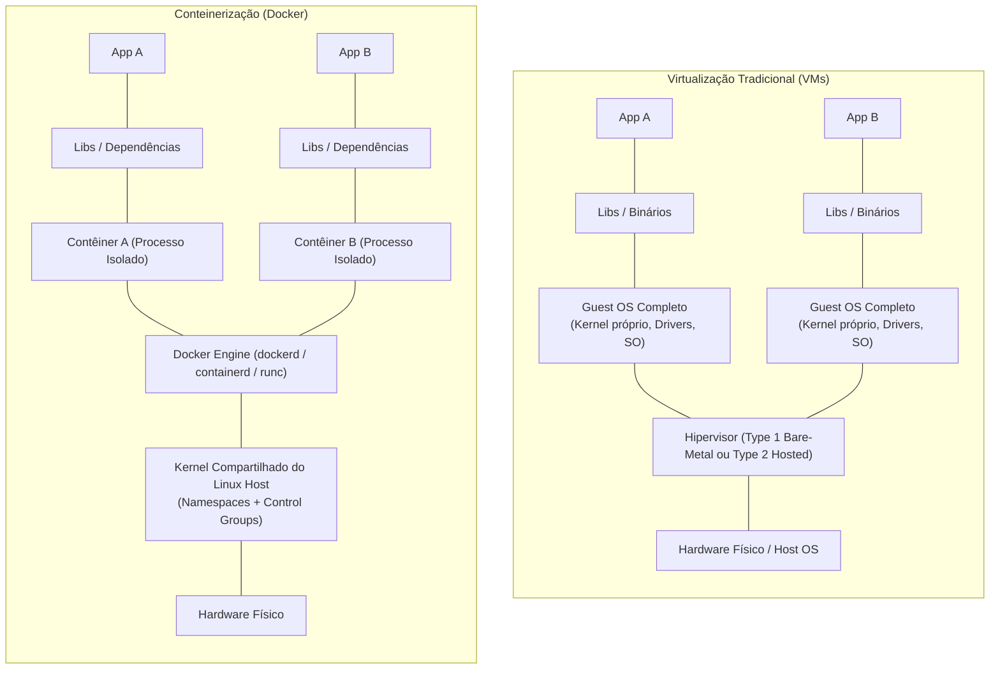
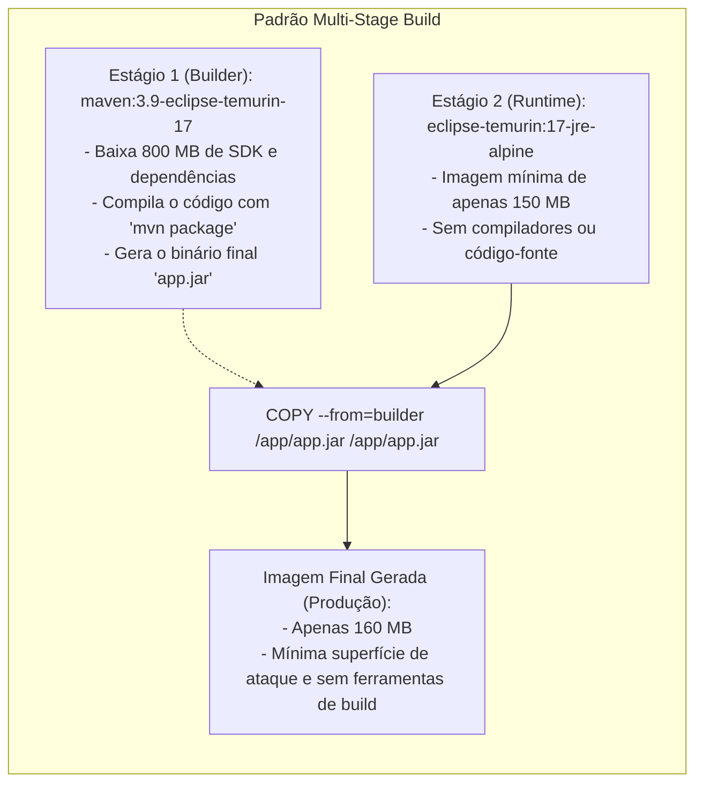
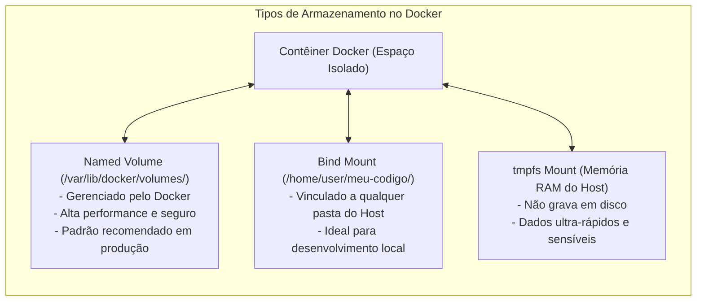

# 03 - Conteinerização com Docker e Docker Compose

> **Matéria:** DevOps, Plataforma de Desenvolvimento e Engenharia de Entrega  
> **Cargo:** B02 – Técnico de Controle Externo – Especialidade: Tecnologia da Informação  
> **Arquivo:** `03_conteinerizacao_docker_e_docker_compose.md`  


---


## 📌 Ementa / Itens do Edital
- Conceitos de conteinerização vs. virtualização tradicional
- Arquitetura e componentes do Docker (Daemon, Client, Images, Containers, Registries)
- Construção de imagens e instruções do Dockerfile
- Otimização com builds de múltiplos estágios (Multi-Stage Builds)
- Gestão de dados (Volumes, Bind Mounts e tmpfs) e Redes no Docker
- Orquestração de múltiplos contêineres com Docker Compose

---

## 🧭 Sumário

1. [Fundamentos de Conteinerização vs. Virtualização Tradicional](#1-fundamentos-de-conteinerizacao-vs-virtualizacao-tradicional)
    1. [Máquinas Virtuais (Hypervisors) vs. Contêineres (Kernel Compartilhado)](#11-maquinas-virtuais-hypervisors-vs-conteineres-kernel-compartilhado)
    2. [Primitivas Essenciais do Kernel Linux: Namespaces e Control Groups (cgroups)](#12-primitivas-essenciais-do-kernel-linux-namespaces-e-control-groups-cgroups)
    3. [Arquitetura do Docker Engine: Client, Daemon, containerd, runc e Registries](#13-arquitetura-do-docker-engine-client-daemon-containerd-runc-e-registries)
    4. [Sistema de Arquivos em Camadas (Overlay2 UnionFS) e Copy-on-Write (CoW)](#14-sistema-de-arquivos-em-camadas-overlay2-unionfs-e-copy-on-write-cow)
    5. [Teste 192](#Teste-192)
    6. [Teste 193](#Teste-193)
    7. [Teste 194](#Teste-194)
2. [Construção de Imagens e Anatomia do Dockerfile](#2-construcao-de-imagens-e-anatomia-do-dockerfile)
    1. [Instruções Canônicas: FROM, WORKDIR, COPY vs. ADD, RUN, ENV vs. ARG](#21-instrucoes-canonicas-from-workdir-copy-vs-add-run-env-vs-arg)
    2. [Execução de Processos: ENTRYPOINT vs. CMD (Exec Form vs. Shell Form)](#22-execucao-de-processos-entrypoint-vs-cmd-exec-form-vs-shell-form)
    3. [Exposição de Portas e Segurança: EXPOSE vs. Publicação no Host e Diretiva USER](#23-exposicao-de-portas-e-seguranca-expose-vs-publicacao-no-host-e-diretiva-user)
    4. [Otimização com Builds de Múltiplos Estágios (Multi-Stage Builds) e Cache de Camadas](#24-otimizacao-com-builds-de-multiplos-estagios-multi-stage-builds-e-cache-de-camadas)
    5. [Teste 195](#Teste-195)
    6. [Teste 196](#Teste-196)
    7. [Teste 197](#Teste-197)
    8. [Teste 198](#Teste-198)
3. [Persistência de Dados e Gerenciamento de Armazenamento](#3-persistencia-de-dados-e-gerenciamento-de-armazenamento)
    1. [Efemeridade da Camada de Leitura e Escrita do Contêiner](#31-efemeridade-da-camada-de-leitura-e-escrita-do-conteiner)
    2. [Comparativo: Named Volumes vs. Bind Mounts vs. tmpfs Mounts](#32-comparativo-named-volumes-vs-bind-mounts-vs-tmpfs-mounts)
    3. [Teste 199](#Teste-199)
4. [Redes no Docker: Drivers e Resolução de Nomes](#4-redes-no-docker-drivers-e-resolucao-de-nomes)
    1. [Drivers de Rede: bridge, host, none, overlay e macvlan](#41-drivers-de-rede-bridge-host-none-overlay-e-macvlan)
    2. [Resolução de Nomes por DNS Integrado em Redes Customizadas](#42-resolucao-de-nomes-por-dns-integrado-em-redes-customizadas)
    3. [Teste 200](#Teste-200)
    4. [Teste 201](#Teste-201)
5. [Orquestração Multi-Contêiner com Docker Compose](#5-orquestracao-multi-conteiner-com-docker-compose)
    1. [Estrutura do Manifesto Compose: Services, Networks, Volumes e depends_on](#51-estrutura-do-manifesto-compose-services-networks-volumes-e-dependson)
    2. [Ciclo de Vida e Comandos Operacionais da CLI](#52-ciclo-de-vida-e-comandos-operacionais-da-cli)
    3. [Teste 202](#Teste-202)
6. [🌐 Fontes Oficiais e Referências Bibliográficas](#fontes-oficiais-e-referencias-bibliograficas)

---

## 1. Fundamentos de Conteinerização vs. Virtualização Tradicional

A compreensão da barreira arquitetural entre Máquinas Virtuais (VMs) e Contêineres de software constitui um dos temas mais recorrentes em concursos públicos da FCC na área de infraestrutura, arquitetura de sistemas e DevOps.



### 1.1 Máquinas Virtuais (Hypervisors) vs. Contêineres (Kernel Compartilhado)

A distinção basilar assenta-se no **nível de abstração** e na **existência ou não de um núcleo de sistema operacional independente**:

- **Máquinas Virtuais (VMs):**
    - Operam sob a abstração em **nível de hardware**.
    - O **Hipervisor** (*Hypervisor* Type 1 bare-metal como VMware ESXi/KVM, ou Type 2 hospedado como VirtualBox) emula componentes físicos virtuais (CPU, memória RAM, interfaces de rede, controladoras de disco).
    - Cada máquina virtual instala e executa um **Sistema Operacional convidado (*Guest OS*) completo e autônomo**, contendo seu próprio Kernel, drivers e daemons de inicialização.
    - **Sobrecarga (*Overhead*):** Elevado consumo de espaço em disco e memória RAM apenas para manter as instâncias de SO convidado rodando; tempo de inicialização lento (de dezenas de segundos a vários minutos para executar o boot completo).
- **Contêineres (Docker / OCI):**
    - Operam sob a abstração em **nível de sistema operacional**.
    - Os contêineres **NÃO possuem kernel próprio nem executam um Guest OS completo**. Todos os contêineres em execução em um mesmo host compartilham diretamente o **mesmo Kernel do sistema operacional hospedeiro**.
    - Um contêiner nada mais é do que um **processo padrão do Linux encapsulado e isolado** do restante do sistema através de recursos nativos do núcleo.
    - **Eficiência e Densidade:** Inicialização em milissegundos (o tempo de iniciar um processo simples); consumo mínimo de RAM e CPU; densidade operacional altíssima (dezenas ou centenas de contêineres em um mesmo nó físico).

| Parâmetro de Comparação | Máquinas Virtuais (VMs) | Contêineres (Docker) |
| :--- | :--- | :--- |
| **Nível de Abstração** | Abstração da camada de **Hardware**. | Abstração em nível de **Processos do Sistema Operacional**. |
| **Núcleo de SO (Kernel)** | **SIM**. Cada VM possui seu próprio kernel independente (*Guest OS*). | **NÃO**. Compartilham o **mesmo Kernel do host**. |
| **Mecanismo Central** | Hipervisor (*Hypervisor Type 1 ou Type 2*). | Primitivas do Kernel Linux: *Namespaces* e *cgroups*. |
| **Tempo de Inicialização** | Dezenas de segundos a minutos (boot de SO completo). | Milissegundos a poucos segundos (inicialização de processo comum). |
| **Consumo de Recursos** | Alto (gigabytes alocados para o SO convidado). | Mínimo (apenas o espaço estritamente consumido pela aplicação). |
| **Nível de Isolamento** | Muito alto (isolamento por hardware via instruções de CPU VT-x/AMD-V). | Alto (isolamento em espaço de usuário do Linux via kernel). |

### 1.2 Primitivas Essenciais do Kernel Linux: Namespaces e Control Groups (cgroups)

A segurança e o isolamento de um contêiner Docker não decorrem de mágica, mas do acoplamento de duas tecnologias maduras do Kernel Linux:

#### 1. Linux Namespaces (Isolamento de Visibilidade)
Determinam **o que um contêiner consegue enxergar**. Cada contêiner recebe seu próprio conjunto isolado de namespaces:

- **`pid` (Process ID):** Isola a árvore de processos. Dentro do contêiner, o processo principal da aplicação visualiza a si mesmo como `PID 1`, sendo totalmente cego aos processos em execução no host e em outros contêineres.
- **`net` (Network):** Isola interfaces de rede, portas TCP/UDP, tabelas de roteamento e regras de firewall (iptables/nftables).
- **`mnt` (Mount):** Isola os pontos de montagem do sistema de arquivos, garantindo que o contêiner enxergue apenas a sua raiz (`/`) privativa.
- **`ipc` (Inter-Process Communication):** Isola mecanismos de comunicação interprocessos, como memória compartilhada e semáforos POSIX.
- **`uts` (UNIX Timesharing System):** Permite que cada contêiner possua seu próprio *hostname* e nome de domínio independente.
- **`user` (User IDs):** Mapeia UIDs e GIDs entre o contêiner e o host, viabilizando que um processo execute como `root` (UID 0) dentro do contêiner, mas seja mapeado para um usuário não privilegiado comum (ex.: UID 10001) no sistema hospedeiro.

#### 2. Control Groups - `cgroups` (Limitação e Governança de Recursos)
Determinam **quanto de recursos computacionais um contêiner pode consumir**:

- Permitem estabelecer quotas estritas e limites máximos de consumo de **memória RAM** (evitando ataques de exaustão de memória e acionamento descontrolado do *OOM Killer* no host).
- Limitam a fração de **tempo de CPU** (ex.: reservar 1.5 núcleos para um serviço).
- Controlam a largura de banda de tráfego de rede e taxas de leitura/gravação em disco (*Block I/O limits*).

### 1.3 Arquitetura do Docker Engine: Client, Daemon, containerd, runc e Registries

A arquitetura do Docker é cliente-servidor distribuída e baseada em componentes modulares padronizados pela *Open Container Initiative* (OCI):

- **Docker Client (CLI):** O binário de linha de comando `docker` utilizado pelos operadores e desenvolvedores. Comunica-se com o daemon local ou remoto através de chamadas REST em um socket Unix (`/var/run/docker.sock`) ou conexão TCP com TLS.
- **Docker Daemon (`dockerd`):** Serviço persistente de segundo plano que processa requisições da API, orquestra contêineres, compila imagens e gerencia volumes e redes virtuais.
- **containerd:** Daemon de gerenciamento de contêineres de alto nível (desacoplado do Docker e doado à CNCF). Supervisiona o ciclo de vida completo: download de imagens de repositórios remotos, provisionamento de armazenamento e monitoramento de execução.
- **runc:** Runtime de baixo nível compatível com a especificação OCI. É o componente final responsável por interagir diretamente com as chamadas de sistema (*syscalls*) do Kernel Linux para criar os *namespaces* e *cgroups* e despachar o processo do contêiner.
- **Registries de Imagens:** Servidores centralizados de catalogação e armazenamento de imagens Docker (como Docker Hub público, AWS Elastic Container Registry - ECR, Harbor corporativo ou GitHub Packages).

### 1.4 Sistema de Arquivos em Camadas (Overlay2 UnionFS) e Copy-on-Write (CoW)

Uma imagem Docker é uma coleção imutável de **camadas de somente leitura (*Read-Only Layers*)** empilhadas hierarquicamente.

- **UnionFS / Overlay2:** Driver de armazenamento padrão que sobrepõe as múltiplas camadas de diretórios, apresentando-as ao contêiner como um sistema de arquivos unificado e coeso.
- **Copy-on-Write (CoW):** Quando um contêiner é instanciado a partir de uma imagem, o Docker cria uma camada muito fina e descartável de **leitura e escrita (*Container Read-Write Layer*)** no topo da pilha. Se o contêiner precisa alterar um arquivo que pertence a uma camada inferior de somente leitura, o driver copia esse arquivo para a camada superior gravável e aplica a alteração ali. As camadas da imagem base permanecem intactas e compartilhadas por todos os outros contêineres que utilizam a mesma imagem.

---

### Teste 192
**(FGV – TJ/SC – 2026 – Analista Administrativo)**
A navegação segura na internet via protocolo HTTPS (Hypertext Transfer Protocol Secure) exige uma interação complexa entre hardware, software e protocolos de rede. Considerando o fluxo de processamento de uma requisição HTTPS em um sistema computacional moderno, é correto afirmar que

* **A)** o protocolo HTTPS opera exclusivamente na camada de transporte do modelo OSI, substituindo o TCP para garantir que a criptografia seja processada diretamente pelo hardware da placa de rede (NIC).
* **B)** durante o handshake do TLS, o sistema operacional utiliza chamadas de sistema para acessar funções criptográficas e gerenciar sockets de rede, permitindo que o navegador estabeleça um canal seguro sobre a pilha TCP/IP.
* **C)** a criptografia assimétrica utilizada no HTTPS é uma função nativa do firmware do roteador, o que desonera a CPU do computador cliente de realizar cálculos matemáticos complexos.
* **D)** o endereçamento IP (camada de rede do modelo OSI) é o responsável por garantir a integridade dos certificados digitais, enquanto o protocolo HTTPS gerencia o endereçamento físico (MAC Address).
* **E)** ao utilizar HTTPS, o sistema operacional desativa a memória virtual para impedir que chaves criptográficas sejam gravadas em disco (swap), priorizando o processamento na Unidade de Controle.

---

> **Comentário Detalhado:**
>
> - **A)** **Incorreta.** A opção incorre em restrição indevida ao limitar o escopo conceitual ao afirmar que "o protocolo HTTPS opera exclusivamente na camada de transporte do modelo OSI, substituindo o TCP para garantir que...". De acordo com a teoria estudada em *1.1 Máquinas Virtuais (Hypervisors) vs. Contêineres (Kernel Compartilhado)*, nível de Abstração: Abstração da camada de Hardware. — Abstração em nível de Processos do Sistema Operacional.
> - **B)** **Correta.** Conforme fundamentado na seção *1.3 Arquitetura do Docker Engine: Client, Daemon, containerd, runc e Registries* deste guia, docker Client (CLI): O binário de linha de comando `docker` utilizado pelos operadores e desenvolvedores. Comunica-se com o daemon local ou remoto através de chamadas REST em um socket Unix (`/var/run/docker.sock`) ou conexão TCP com TLS. Dessa forma, está plenamente correta a assertiva da banca (FGV – TJ/SC/2026) ao estabelecer que "durante o handshake do TLS, o sistema operacional utiliza chamadas de sistema para acessar funções criptográficas...".
> - **C)** **Incorreta.** A opção apresenta proposição em desacordo com os fundamentos teóricos e técnicos do tópico ao afirmar que "a criptografia assimétrica utilizada no HTTPS é uma função nativa do firmware do roteador, o que desonera a CPU do...". De acordo com a teoria estudada em *2.2 Execução de Processos: ENTRYPOINT vs. CMD (Exec Form vs. Shell Form)*, executa o processo diretamente sem passar por interpretadores de terminal, permitindo que o processo receba os sinais de término do sistema operacional (`SIGTERM`, `SIGKILL`) como `PID 1`.
> - **D)** **Incorreta.** A opção apresenta proposição em desacordo com os fundamentos teóricos e técnicos do tópico ao afirmar que "o endereçamento IP (camada de rede do modelo OSI) é o responsável por garantir a integridade dos certificados...". De acordo com a teoria estudada em *1.3 Arquitetura do Docker Engine: Client, Daemon, containerd, runc e Registries*, runc: Runtime de baixo nível compatível com a especificação OCI. É o componente final responsável por interagir diretamente com as chamadas de sistema (*syscalls*) do Kernel Linux para criar os *namespaces* e *cgroups* e despachar o processo do contêiner.
> - **E)** **Incorreta.** A opção apresenta proposição em desacordo com os fundamentos teóricos e técnicos do tópico ao afirmar que "ao utilizar HTTPS, o sistema operacional desativa a memória virtual para impedir que chaves criptográficas sejam...". De acordo com a teoria estudada em *1.1 Máquinas Virtuais (Hypervisors) vs. Contêineres (Kernel Compartilhado)*, o Hipervisor (*Hypervisor* Type 1 bare-metal como VMware ESXi/KVM, ou Type 2 hospedado como VirtualBox) emula componentes físicos virtuais (CPU, memória RAM, interfaces de rede, controladoras de disco).
>
> **Gabarito: B**

---

### Teste 193
**(FCC – TRT 23ª – 2016 – Analista Judiciário - Apoio Especializado - Tecnologia da Informação)**
O administrador de um servidor com sistema operacional Linux escolheu o sistema de arquivos XFS para o sistema de arma- zenamento principal. O XFS

* **A)** permite o redimensionamento de uma partição apenas para aumentar.
* **B)** é um sistema de 32 bits compatível com sistemas de 64 bits.
* **C)** utiliza tamanho de blocos fixos para otimizar o espaço em disco.
* **D)** foi concebido para operar prioritariamente com arquivos de pequenas dimensões.
* **E)** faz uso do journaling físico, ou seja, os metadados são gravados em disco imediatamente.

---

> **Comentário Detalhado:**
>
> - **A)** **Incorreta.** A opção incorre em restrição indevida ao limitar o escopo conceitual ao afirmar que "permite o redimensionamento de uma partição apenas para aumentar". De acordo com a teoria estudada em *2.1 Instruções Canônicas: FROM, WORKDIR, COPY vs. ADD, RUN, ENV vs. ARG*, por apresentar comportamentos implícitos que podem introduzir vulnerabilidades ou aumentar o tamanho da imagem, seu uso indiscriminado é desaconselhado pela comunidade técnica.
> - **B)** **Incorreta.** A opção apresenta proposição em desacordo com os fundamentos teóricos e técnicos do tópico ao afirmar que "é um sistema de 32 bits compatível com sistemas de 64 bits". De acordo com a teoria estudada em *1.3 Arquitetura do Docker Engine: Client, Daemon, containerd, runc e Registries*, runc: Runtime de baixo nível compatível com a especificação OCI. É o componente final responsável por interagir diretamente com as chamadas de sistema (*syscalls*) do Kernel Linux para criar os *namespaces* e *cgroups* e despachar o processo do contêiner.
> - **C)** **Correta.** Conforme fundamentado na seção *1.1 Máquinas Virtuais (Hypervisors) vs. Contêineres (Kernel Compartilhado)* deste guia, sobrecarga (*Overhead*): Elevado consumo de espaço em disco e memória RAM apenas para manter as instâncias de SO convidado rodando; tempo de inicialização lento (de dezenas de segundos a vários minutos para executar o boot completo). Dessa forma, está plenamente correta a assertiva da banca (FCC – TRT 23ª/2016) ao estabelecer que "utiliza tamanho de blocos fixos para otimizar o espaço em disco".
> - **D)** **Incorreta.** A opção apresenta proposição em desacordo com os fundamentos teóricos e técnicos do tópico ao afirmar que "foi concebido para operar prioritariamente com arquivos de pequenas dimensões". De acordo com a teoria estudada em *1.1 Máquinas Virtuais (Hypervisors) vs. Contêineres (Kernel Compartilhado)*, nível de Isolamento: Muito alto (isolamento por hardware via instruções de CPU VT-x/AMD-V). — Alto (isolamento em espaço de usuário do Linux via kernel).
> - **E)** **Incorreta.** A opção apresenta proposição em desacordo com os fundamentos teóricos e técnicos do tópico ao afirmar que "faz uso do journaling físico, ou seja, os metadados são gravados em disco imediatamente". De acordo com a teoria estudada em *3.2 Comparativo: Named Volumes vs. Bind Mounts vs. tmpfs Mounts*, tipo de Montagem: Localização no Disco do Host — Gerenciado pelo Docker Engine? — Caso de Uso Principal e Boas Práticas.
>
> **Gabarito: C**

---

### Teste 194
**(FCC – TRT 15ª – 2015 – Analista Judiciário - Tecnologia da Informação)**
O administrador de um servidor com o sistema operacional Linux Red Hat pode utilizar o arquivo /etc/fstab para

* **A)** controlar a montagem dos sistemas de arquivos durante o processo de boot.
* **B)** definir a tabela de roteamento dos pacotes destinados para a rede de computadores.
* **C)** especificar os sistemas de arquivos utilizáveis pelos usuários padrão.
* **D)** definir a lista de arquivos disponibilizados por meio do NFS.
* **E)** listar os sistemas de arquivos disponíveis pela rede de computadores.

---

> **Comentário Detalhado:**
>
> - **A)** **Incorreta.** A opção apresenta proposição em desacordo com os fundamentos teóricos e técnicos do tópico ao afirmar que "controlar a montagem dos sistemas de arquivos durante o processo de boot". De acordo com a teoria estudada em *1. Linux Namespaces (Isolamento de Visibilidade)*, `mnt` (Mount): Isola os pontos de montagem do sistema de arquivos, garantindo que o contêiner enxergue apenas a sua raiz (`/`) privativa.
> - **B)** **Incorreta.** A opção apresenta proposição em desacordo com os fundamentos teóricos e técnicos do tópico ao afirmar que "definir a tabela de roteamento dos pacotes destinados para a rede de computadores". De acordo com a teoria estudada em *1. Linux Namespaces (Isolamento de Visibilidade)*, `net` (Network): Isola interfaces de rede, portas TCP/UDP, tabelas de roteamento e regras de firewall (iptables/nftables).
> - **C)** **Incorreta.** A opção apresenta proposição em desacordo com os fundamentos teóricos e técnicos do tópico ao afirmar que "especificar os sistemas de arquivos utilizáveis pelos usuários padrão". De acordo com a teoria estudada em *3. Persistência de Dados e Gerenciamento de Armazenamento*, por definição arquitetural, os contêineres Docker são efêmeros e sem estado (*stateless*). Compreender as opções de persistência é requisito obrigatório para a sustentação de bancos de dados relacionais e sistemas de arquivos corporativos.
> - **D)** **Correta.** Conforme fundamentado na seção *5. Orquestração Multi-Contêiner com Docker Compose* deste guia, o Docker Compose é a ferramenta oficial do ecossistema Docker voltada para definir, versionar e gerenciar a execução de múltiplos contêineres interconectados em uma única máquina hospedeira através de arquivos declarativos YAML (`compose.yaml` ou `docker-compose.yml`). Dessa forma, está plenamente correta a assertiva da banca (FCC – TRT 15ª/2015) ao estabelecer que "definir a lista de arquivos disponibilizados por meio do NFS".
> - **E)** **Incorreta.** A opção apresenta proposição em desacordo com os fundamentos teóricos e técnicos do tópico ao afirmar que "listar os sistemas de arquivos disponíveis pela rede de computadores". De acordo com a teoria estudada em *5.2 Ciclo de Vida e Comandos Operacionais da CLI*, `docker compose ps`: Lista o estado operacional dos contêineres gerenciados pelo manifesto Compose.
>
> **Gabarito: D**

---

## 2. Construção de Imagens e Anatomia do Dockerfile

O `Dockerfile` é o manifesto declarativo em formato de texto simples que estabelece o passo a passo automatizado para compilar uma imagem de contêiner.

### 2.1 Instruções Canônicas: FROM, WORKDIR, COPY vs. ADD, RUN, ENV vs. ARG

- **`FROM <imagem>:<tag>`:** Especifica a imagem base que fundamenta a construção. Toda compilação deve iniciar por um comando `FROM` (ou `FROM scratch` para construir uma imagem vazia de 0 bytes para binários estáticos).
- **`WORKDIR /caminho`:** Define o diretório de trabalho padrão para as instruções subsequentes (`RUN`, `CMD`, `ENTRYPOINT`, `COPY`). Se a pasta não existir no sistema de arquivos da imagem, o Docker a cria automaticamente. É uma boa prática usar `WORKDIR` em vez de comandos imperativos `RUN cd /caminho`.
- **`COPY` vs. `ADD` (Ponto Forte em Provas):**
    - **`COPY <origem> <destino>`:** Realiza a cópia direta, simples e estrita de arquivos e pastas da máquina local (contexto de build) para o interior da imagem. **É a instrução oficialmente recomendada pelas boas práticas para cópias locais.**
    - **`ADD <origem> <destino>`:** Possui recursos extras automáticos: permite baixar arquivos remotos via URLs HTTP/HTTPS e descompacta compulsoriamente arquivos tar/gzip (`.tar`, `.tar.gz`) diretamente no destino. Por apresentar comportamentos implícitos que podem introduzir vulnerabilidades ou aumentar o tamanho da imagem, seu uso indiscriminado é desaconselhado pela comunidade técnica.
- **`RUN <comando>`:** Executa comandos durante a fase de construção (*build-time*), como instalação de pacotes (`apt-get install`, `npm install`). Cada comando `RUN` gera uma **nova camada imutável** no sistema de arquivos da imagem.
- **`ENV` vs. `ARG`:**
    - **`ARG`:** Define variáveis disponíveis **exclusivamente durante a compilação da imagem** (`docker build --build-arg CHAVE=VALOR`). Não persiste nos metadados nem no ambiente do contêiner em runtime.
    - **`ENV`:** Define variáveis de ambiente que são gravadas permanentemente na imagem e permanecem **ativas durante a execução do contêiner em produção (runtime)**.

### 2.2 Execução de Processos: ENTRYPOINT vs. CMD (Exec Form vs. Shell Form)

A definição de qual processo será executado ao instanciar o contêiner é regulada pela combinação de `ENTRYPOINT` e `CMD`:

- **`ENTRYPOINT`:** Define o **executável imutável principal** do contêiner. Ele transforma o contêiner em um comando executável dedicado. Não é sobrescrito facilmente por parâmetros informados ao final do comando `docker run`.
- **`CMD`:** Define os **argumentos padrão** ou o comando de fallback. Se utilizado em conjunto com `ENTRYPOINT`, os valores declarados no `CMD` atuam como parâmetros padrão que podem ser facilmente substituídos pelo usuário na linha de comando.
- **Regra de Sobrescrita Prática:** Ao executar `docker run minha-imagem arg1 arg2`, os argumentos `arg1 arg2` substituem integralmente o conteúdo da diretiva `CMD`, mas são repassados como parâmetros para o executável fixado no `ENTRYPOINT`.

**Formatos de Notação (Exec Form vs. Shell Form):**

- **Exec Form (Recomendado):** Notação em vetor JSON com aspas duplas: `ENTRYPOINT ["nginx", "-g", "daemon off;"]`. Executa o processo diretamente sem passar por interpretadores de terminal, permitindo que o processo receba os sinais de término do sistema operacional (`SIGTERM`, `SIGKILL`) como `PID 1`.
- **Shell Form (Desaconselhado):** Notação em string simples: `ENTRYPOINT nginx -g "daemon off;"`. O Docker invoca internamente `/bin/sh -c`, tornando o shell o `PID 1` e impedindo o repasse adequado de sinais de encerramento gracioso para a aplicação.

### 2.3 Exposição de Portas e Segurança: EXPOSE vs. Publicação no Host e Diretiva USER

- **`EXPOSE <porta>`:** Instrução **meramente informativa e documental**. Ela sinaliza ao desenvolvedor ou orquestrador em qual porta o serviço interno escuta por padrão, mas **NÃO abre portas no firewall da máquina host nem publica a porta externamente**. Para que o contêiner fique acessível pelo tráfego de fora do host, o operador deve compulsoriamente mapear a porta via `docker run -p <porta_host>:<porta_container>` ou pela diretiva `ports` no Docker Compose.
- **Diretiva `USER` e Segurança (Princípio do Menor Privilégio):** Por padrão, os processos dentro de um contêiner rodam como o usuário `root` (UID 0). Caso a aplicação sofra um ataque de *container breakout*, o invasor pode comprometer o host. A diretiva `USER <usuario_sem_privilegio>` altera o contexto de execução para um usuário comum do sistema, mitigando severamente riscos de escalada de privilégios.

### 2.4 Otimização com Builds de Múltiplos Estágios (Multi-Stage Builds) e Cache de Camadas



#### O Padrão Multi-Stage Build
Em pipelines corporativos de CI/CD, compilar software exige SDKs volumosos, compiladores C/C++, ferramentas de empacotamento e código-fonte bruto. Se esses artefatos forem mantidos na imagem final que vai para produção, a imagem terá gigabytes de tamanho e conterá dezenas de vulnerabilidades conhecidas (CVEs).

A funcionalidade de **Multi-Stage Builds** resolve esse problema declarando múltiplos comandos `FROM` no mesmo `Dockerfile`:

1. **Estágio de Construção (*Builder*):** `FROM maven:3.9-eclipse-temurin-17 AS builder`. Utiliza o ambiente pesado de build para compilar e empacotar a aplicação, gerando o artefato final (`app.jar`).
2. **Estágio de Execução (*Runtime*):** `FROM eclipse-temurin:17-jre-alpine`. Utiliza uma imagem base mínima que contém apenas o ambiente estrito de execução (JRE ou Alpine/Distroless).
3. **Cópia Seletiva:** Através do comando `COPY --from=builder /app/target/app.jar /app/app.jar`, extrai-se apenas o binário compilado. Todo o SDK do Maven, código-fonte original e arquivos temporários são descartados.
4. **Benefícios:** Redução drástica do tamanho da imagem (de centenas de megabytes para dezenas), agilidade no download pelos nós do Kubernetes e minimização radical da superfície de ataque cibernético.

---

### Teste 195
**(FGV – TJ/DFT – 2022 – Analista Judiciario Suporte Em Tecnologia Da Informacao)**
A analista Sara modificou alguns arquivos do container Docker TJSiteContainer que se encontra em execução. Para criar uma imagem Docker a partir do estado atual de TJSiteContainer, a fim de persistirem as modificações efetuadas em seus arquivos, Sara deve utilizar o comando:

* **A)** docker create
* **B)** docker diff
* **C)** docker export
* **D)** docker image save
* **E)** docker commit

---

> **Comentário Detalhado:**
>
> - **A)** **Incorreta.** A opção apresenta proposição em desacordo com os fundamentos teóricos e técnicos do tópico ao afirmar que "docker create". De acordo com a teoria estudada em *4.2 Resolução de Nomes por DNS Integrado em Redes Customizadas*, redes Customizadas pelo Usuário (*User-Defined Networks*): Ao criar uma rede com `docker network create minha-rede`, o Docker ativa um servidor DNS interno embutido.
> - **B)** **Incorreta.** A opção apresenta proposição em desacordo com os fundamentos teóricos e técnicos do tópico ao afirmar que "docker diff". De acordo com a teoria estudada em *2.3 Exposição de Portas e Segurança: EXPOSE vs. Publicação no Host e Diretiva USER*, para que o contêiner fique acessível pelo tráfego de fora do host, o operador deve compulsoriamente mapear a porta via `docker run -p <porta_host>:<porta_container>` ou pela diretiva `ports` no Docker Compose.
> - **C)** **Incorreta.** A opção apresenta proposição em desacordo com os fundamentos teóricos e técnicos do tópico ao afirmar que "docker export". De acordo com a teoria estudada em *2.2 Execução de Processos: ENTRYPOINT vs. CMD (Exec Form vs. Shell Form)*, `ENTRYPOINT`: Define o executável imutável principal do contêiner. Ele transforma o contêiner em um comando executável dedicado. Não é sobrescrito facilmente por parâmetros informados ao final do comando `docker run`.
> - **D)** **Incorreta.** A opção apresenta proposição em desacordo com os fundamentos teóricos e técnicos do tópico ao afirmar que "docker image save". De acordo com a teoria estudada em *5.1 Estrutura do Manifesto Compose: Services, Networks, Volumes e depends_on*, `services`: Declara cada um dos contêineres da aplicação. Define a imagem pronta (`image:`) ou o contexto de construção local (`build:`), portas mapeadas (`ports:`), variáveis (`environment:`) e volumes acoplados.
> - **E)** **Correta.** Conforme fundamentado na seção *1.4 Sistema de Arquivos em Camadas (Overlay2 UnionFS) e Copy-on-Write (CoW)* deste guia, copy-on-Write (CoW): Quando um contêiner é instanciado a partir de uma imagem, o Docker cria uma camada muito fina e descartável de leitura e escrita (*Container Read-Write Layer*) no topo da pilha. Dessa forma, está plenamente correta a assertiva da banca (FGV – TJ/DFT/2022) ao estabelecer que "docker commit".
>
> **Gabarito: E**

---

### Teste 196
**(FCC – TRT 9ª – 2015 – Analista Judiciário - Apoio Especializado - Tecnologia da Informação)**
Um usuário do sistema operacional Linux executou o seguinte comando no prompt de um terminal shell. $ ls >> list O resultado da execução desse comando é a

* **A)** apresentação da listagem do conteúdo do diretório list no terminal.
* **B)** apresentação, no terminal, dos arquivos e diretórios que contém o termo list.
* **C)** listagem de comparação entre o conteúdo do diretório atual e do arquivo list.
* **D)** cópia do conteúdo do diretório atual para o diretório list.
* **E)** criação do arquivo list que contém a listagem do diretório atual.

---

> **Comentário Detalhado:**
>
> - **A)** **Incorreta.** A opção apresenta proposição em desacordo com os fundamentos teóricos e técnicos do tópico ao afirmar que "apresentação da listagem do conteúdo do diretório list no terminal". De acordo com a teoria estudada em *2.2 Execução de Processos: ENTRYPOINT vs. CMD (Exec Form vs. Shell Form)*, executa o processo diretamente sem passar por interpretadores de terminal, permitindo que o processo receba os sinais de término do sistema operacional (`SIGTERM`, `SIGKILL`) como `PID 1`.
> - **B)** **Incorreta.** A opção apresenta proposição em desacordo com os fundamentos teóricos e técnicos do tópico ao afirmar que "apresentação, no terminal, dos arquivos e diretórios que contém o termo list". De acordo com a teoria estudada em *1.4 Sistema de Arquivos em Camadas (Overlay2 UnionFS) e Copy-on-Write (CoW)*, unionFS / Overlay2: Driver de armazenamento padrão que sobrepõe as múltiplas camadas de diretórios, apresentando-as ao contêiner como um sistema de arquivos unificado e coeso.
> - **C)** **Incorreta.** A opção apresenta proposição em desacordo com os fundamentos teóricos e técnicos do tópico ao afirmar que "listagem de comparação entre o conteúdo do diretório atual e do arquivo list". De acordo com a teoria estudada em *2.2 Execução de Processos: ENTRYPOINT vs. CMD (Exec Form vs. Shell Form)*, regra de Sobrescrita Prática: Ao executar `docker run minha-imagem arg1 arg2`, os argumentos `arg1 arg2` substituem integralmente o conteúdo da diretiva `CMD`, mas são repassados como parâmetros para o executável fixado no `ENTRYPOINT`.
> - **D)** **Incorreta.** A opção apresenta proposição em desacordo com os fundamentos teóricos e técnicos do tópico ao afirmar que "cópia do conteúdo do diretório atual para o diretório list". De acordo com a teoria estudada em *1.4 Sistema de Arquivos em Camadas (Overlay2 UnionFS) e Copy-on-Write (CoW)*, se o contêiner precisa alterar um arquivo que pertence a uma camada inferior de somente leitura, o driver copia esse arquivo para a camada superior gravável e aplica a alteração ali.
> - **E)** **Correta.** Conforme fundamentado na seção *2.1 Instruções Canônicas: FROM, WORKDIR, COPY vs. ADD, RUN, ENV vs. ARG* deste guia, `WORKDIR /caminho`: Define o diretório de trabalho padrão para as instruções subsequentes (`RUN`, `CMD`, `ENTRYPOINT`, `COPY`). Se a pasta não existir no sistema de arquivos da imagem, o Docker a cria automaticamente. Dessa forma, está plenamente correta a assertiva da banca (FCC – TRT 9ª/2015) ao estabelecer que "criação do arquivo list que contém a listagem do diretório atual".
>
> **Gabarito: E**

---

### Teste 197
**(FGV – TRT/13 – 2022 – Analista Judiciario Tecnologia Da Informacao)**
Considere uma tabela relacional X com uma única coluna A, cuja instância contém uma linha apenas, e os comandos SQL a seguir. ------------- 1. delete from X where exists (select * from X x2 where x2.A = X.A) 2. delete from X where not exists (select * from X x2 where x2.A = X.A) ------------- Nesse contexto, analise as afirmativas sobre os efeitos desses comandos. I. Nenhuma linha seria deletada na execução do comando 1. II. Uma linha seria deletada na execução do comando 1. III. Nenhuma linha seria deletada na execução do comando 2. IV. Uma linha seria deletada na execução do comando 2. V. Os dois comandos gerariam erros de execução. Está correto o que se afirma em

* **A)** I e III, apenas.
* **B)** I e IV, apenas.
* **C)** II e III, apenas.
* **D)** II e IV, apenas.
* **E)** V, apenas.

---

> **Comentário Detalhado:**
>
> - **A)** **Incorreta.** A opção incorre em restrição indevida ao limitar o escopo conceitual ao afirmar que "I e III, apenas". De acordo com a teoria estudada em *O Padrão Multi-Stage Build*, estágio de Execução (*Runtime*): `FROM eclipse-temurin:17-jre-alpine`. Utiliza uma imagem base mínima que contém apenas o ambiente estrito de execução (JRE ou Alpine/Distroless).
> - **B)** **Incorreta.** A opção incorre em restrição indevida ao limitar o escopo conceitual ao afirmar que "I e IV, apenas". De acordo com a teoria estudada em *2.1 Instruções Canônicas: FROM, WORKDIR, COPY vs. ADD, RUN, ENV vs. ARG*, `RUN <comando>`: Executa comandos durante a fase de construção (*build-time*), como instalação de pacotes (`apt-get install`, `npm install`). Cada comando `RUN` gera uma nova camada imutável no sistema de arquivos da imagem.
> - **C)** **Correta.** Conforme fundamentado na seção *2.2 Execução de Processos: ENTRYPOINT vs. CMD (Exec Form vs. Shell Form)* deste guia, `CMD`: Define os argumentos padrão ou o comando de fallback. Se utilizado em conjunto com `ENTRYPOINT`, os valores declarados no `CMD` atuam como parâmetros padrão que podem ser facilmente substituídos pelo usuário na linha de comando. Dessa forma, está plenamente correta a assertiva da banca (FGV – TRT/13/2022) ao estabelecer que "II e III, apenas".
> - **D)** **Incorreta.** A opção incorre em restrição indevida ao limitar o escopo conceitual ao afirmar que "II e IV, apenas". De acordo com a teoria estudada em *2.1 Instruções Canônicas: FROM, WORKDIR, COPY vs. ADD, RUN, ENV vs. ARG*, `COPY <origem> <destino>`: Realiza a cópia direta, simples e estrita de arquivos e pastas da máquina local (contexto de build) para o interior da imagem. É a instrução oficialmente recomendada pelas boas práticas para cópias locais.
> - **E)** **Incorreta.** A opção incorre em restrição indevida ao limitar o escopo conceitual ao afirmar que "V, apenas". De acordo com a teoria estudada em *2.3 Exposição de Portas e Segurança: EXPOSE vs. Publicação no Host e Diretiva USER*, a diretiva `USER <usuario_sem_privilegio>` altera o contexto de execução para um usuário comum do sistema, mitigando severamente riscos de escalada de privilégios.
>
> **Gabarito: C**

---

### Teste 198
**(FGV – TCE/PA – 2024 – Auditor de Controle Externo - Administrativa - Engenharia Telecomunicação)**
Os sistemas de comunicações celulares são redes de telecomunicações sem fio que utilizam uma infraestrutura distribuída em células para fornecer cobertura e capacidade de comunicação a dispositivos móveis. Cada célula é servida por uma estação rádio base (ERB), que se conecta com os dispositivos dentro da sua área de cobertura. A respeito dos fundamentos teóricos e do princípio da transmissão por células em sistemas de comunicações celulares, analise as seguintes afirmativas: I. Além da divisão em células, o sistema de comunicações celulares pode ainda subdividir cada célula em setores, geralmente 3 ou 6 setores. O principal benefício dessa setorização é a redução da interferência na conexão de cada usuário dentro da célula setorizada. II. O handover é o processo pelo qual é estabelecido o link de comunicação entre dois usuários dentro de uma mesma célula. III. Em sistemas de comunicação celular, cada célula sempre utiliza todos os canais disponíveis para maximizar a capacidade da rede. O objetivo principal de uma infraestrutura distribuída é otimizar o processamento de informações pelas Estações Rádio Base (ERBs), permitindo que cada ERB gerencie um menor número de usuários. Está correto o que se afirma em

* **A)** I, apenas.
* **B)** I e II, apenas.
* **C)** I e III, apenas.
* **D)** II e III, apenas.
* **E)** I, II e III.

---

> **Comentário Detalhado:**
>
> - **A)** **Correta.** Conforme fundamentado na seção *2.3 Exposição de Portas e Segurança: EXPOSE vs. Publicação no Host e Diretiva USER* deste guia, diretiva `USER` e Segurança (Princípio do Menor Privilégio): Por padrão, os processos dentro de um contêiner rodam como o usuário `root` (UID 0). Caso a aplicação sofra um ataque de *container breakout*, o invasor pode comprometer o host. Dessa forma, está plenamente correta a assertiva da banca (FGV – TCE/PA/2024) ao estabelecer que "I, apenas".
> - **B)** **Incorreta.** A opção incorre em restrição indevida ao limitar o escopo conceitual ao afirmar que "I e II, apenas". De acordo com a teoria estudada em *1. Fundamentos de Conteinerização vs. Virtualização Tradicional*, a compreensão da barreira arquitetural entre Máquinas Virtuais (VMs) e Contêineres de software constitui um dos temas mais recorrentes em concursos públicos da FCC na área de infraestrutura, arquitetura de sistemas e DevOps.
> - **C)** **Incorreta.** A opção incorre em restrição indevida ao limitar o escopo conceitual ao afirmar que "I e III, apenas". De acordo com a teoria estudada em *1.4 Sistema de Arquivos em Camadas (Overlay2 UnionFS) e Copy-on-Write (CoW)*, as camadas da imagem base permanecem intactas e compartilhadas por todos os outros contêineres que utilizam a mesma imagem.
> - **D)** **Incorreta.** A opção incorre em restrição indevida ao limitar o escopo conceitual ao afirmar que "II e III, apenas". De acordo com a teoria estudada em *2.2 Execução de Processos: ENTRYPOINT vs. CMD (Exec Form vs. Shell Form)*, executa o processo diretamente sem passar por interpretadores de terminal, permitindo que o processo receba os sinais de término do sistema operacional (`SIGTERM`, `SIGKILL`) como `PID 1`.
> - **E)** **Incorreta.** A opção apresenta proposição em desacordo com os fundamentos teóricos e técnicos do tópico ao afirmar que "I, II e III". De acordo com a teoria estudada em *1. Linux Namespaces (Isolamento de Visibilidade)*, `user` (User IDs): Mapeia UIDs e GIDs entre o contêiner e o host, viabilizando que um processo execute como `root` (UID 0) dentro do contêiner, mas seja mapeado para um usuário não privilegiado comum (ex.: UID 10001) no sistema hospedeiro.
>
> **Gabarito: A**

---

## 3. Persistência de Dados e Gerenciamento de Armazenamento

Por definição arquitetural, os contêineres Docker são **efêmeros e sem estado (*stateless*)**. Compreender as opções de persistência é requisito obrigatório para a sustentação de bancos de dados relacionais e sistemas de arquivos corporativos.



### 3.1 Efemeridade da Camada de Leitura e Escrita do Contêiner

Todas as modificações, gravações de logs e escritas em tabelas realizadas por uma aplicação em execução dentro de um contêiner são salvas na camada fina de leitura e escrita (*Container Read-Write Layer*).

- Se o contêiner for parado (`docker stop`) e reiniciado (`docker start`), esses dados são preservados.
- Contudo, **se o contêiner for removido (`docker rm`)**, essa camada é destruída imediata e irremediavelmente, ocasionando a perda total de todos os dados que não foram explicitamente montados em volumes persistentes.

### 3.2 Comparativo: Named Volumes vs. Bind Mounts vs. tmpfs Mounts

| Tipo de Montagem | Localização no Disco do Host | Gerenciado pelo Docker Engine? | Caso de Uso Principal e Boas Práticas |
| :--- | :--- | :--- | :--- |
| **Named Volumes** | `/var/lib/docker/volumes/<nome>/_data` | **SIM** (via comandos `docker volume create/ls/rm`) | **Padrão ouro para produção e bancos de dados (PostgreSQL, MySQL, MongoDB)**. Independe do SO hospedeiro, permite backups simples e oferece alto rendimento de I/O. |
| **Bind Mounts** | Qualquer caminho arbitrário absoluto do host (ex.: `/opt/app` ou `C:\projetos`) | **NÃO** (depende da estrutura física e de permissões do host) | **Desenvolvimento local**. Permite montar o código-fonte da máquina do desenvolvedor dentro do contêiner para viabilizar *hot-reloading* imediato. |
| **tmpfs Mounts** | Alocado diretamente na **Memória RAM** volátil do hospedeiro | **SIM** (via Docker Engine) | **Armazenamento de segredos, senhas e operações temporárias intensivas**. Não grava dados no disco físico; os dados somem ao desligar o contêiner. |

---

### Teste 199
**(FGV – TCE/PA – 2024 – Auditor de Controle Externo - Administrativa - Ciência de Dados)**
Em um Sistema de Gerenciamento de Banco de Dados (SGBD), recursos como Stored Procedures e Triggers são utilizados para dar maior flexibilidade para as aplicações a serem desenvolvidas, com o objetivo de regras e controles serem implementados na camada do banco. No contexto apresentado, assinale a opção que mostra a principal diferença entre Stored Procedures e Triggers.

* **A)** Stored Procedures são usadas para automatizar a execução de tarefas rotineiras, enquanto Triggers são usadas para armazenar procedimentos complexos.
* **B)** Stored Procedures são acionadas automaticamente em resposta a eventos específicos, enquanto Triggers são procedimentos armazenados que podem ser chamados explicitamente por comandos SQL.
* **C)** Stored Procedures são sempre escritas em linguagens de programação de alto nível, enquanto Triggers são escritas em SQL puro.
* **D)** Stored Procedures são armazenadas no disco junto com os dados do banco, enquanto Triggers são armazenadas apenas na memória principal do servidor.
* **E)** Stored Procedures são executadas apenas uma vez por evento, enquanto Triggers são executadas repetidamente até que o evento seja concluído.

---

> **Comentário Detalhado:**
>
> - **A)** **Incorreta.** A opção apresenta proposição em desacordo com os fundamentos teóricos e técnicos do tópico ao afirmar que "Stored Procedures são usadas para automatizar a execução de tarefas rotineiras, enquanto Triggers são usadas para...". De acordo com a teoria estudada em *3.1 Efemeridade da Camada de Leitura e Escrita do Contêiner*, contudo, se o contêiner for removido (`docker rm`), essa camada é destruída imediata e irremediavelmente, ocasionando a perda total de todos os dados que não foram explicitamente montados em volumes persistentes.
> - **B)** **Correta.** Conforme fundamentado na seção *2.2 Execução de Processos: ENTRYPOINT vs. CMD (Exec Form vs. Shell Form)* deste guia, `CMD`: Define os argumentos padrão ou o comando de fallback. Se utilizado em conjunto com `ENTRYPOINT`, os valores declarados no `CMD` atuam como parâmetros padrão que podem ser facilmente substituídos pelo usuário na linha de comando. Dessa forma, está plenamente correta a assertiva da banca (FGV – TCE/PA/2024) ao estabelecer que "Stored Procedures são acionadas automaticamente em resposta a eventos específicos, enquanto Triggers são...".
> - **C)** **Incorreta.** A opção promove generalização excessiva que desconsidera as condições técnicas e normativas ao afirmar que "Stored Procedures são sempre escritas em linguagens de programação de alto nível, enquanto Triggers são escritas...". De acordo com a teoria estudada em *1.3 Arquitetura do Docker Engine: Client, Daemon, containerd, runc e Registries*, containerd: Daemon de gerenciamento de contêineres de alto nível (desacoplado do Docker e doado à CNCF). Supervisiona o ciclo de vida completo: download de imagens de repositórios remotos, provisionamento de armazenamento e monitoramento de execução.
> - **D)** **Incorreta.** A opção incorre em restrição indevida ao limitar o escopo conceitual ao afirmar que "Stored Procedures são armazenadas no disco junto com os dados do banco, enquanto Triggers são armazenadas apenas...". De acordo com a teoria estudada em *3.2 Comparativo: Named Volumes vs. Bind Mounts vs. tmpfs Mounts*, tmpfs Mounts: Alocado diretamente na Memória RAM volátil do hospedeiro — SIM (via Docker Engine) — Armazenamento de segredos, senhas e operações temporárias intensivas. Não grava dados no disco físico; os dados somem ao desligar o contêiner.
> - **E)** **Incorreta.** A opção incorre em restrição indevida ao limitar o escopo conceitual ao afirmar que "Stored Procedures são executadas apenas uma vez por evento, enquanto Triggers são executadas repetidamente até que...". De acordo com a teoria estudada em *2.1 Instruções Canônicas: FROM, WORKDIR, COPY vs. ADD, RUN, ENV vs. ARG*, `WORKDIR /caminho`: Define o diretório de trabalho padrão para as instruções subsequentes (`RUN`, `CMD`, `ENTRYPOINT`, `COPY`). Se a pasta não existir no sistema de arquivos da imagem, o Docker a cria automaticamente.
>
> **Gabarito: B**

---

## 4. Redes no Docker: Drivers e Resolução de Nomes

O Docker abstrai a conectividade de contêineres através de subsistemas de rede modulares controlados por drivers específicos.

### 4.1 Drivers de Rede: bridge, host, none, overlay e macvlan

- **`bridge` (Ponte):** É o driver de rede padrão no Linux. Cria uma ponte de rede virtual interna na máquina hospedeira (tipicamente `docker0`). Cada contêiner recebe um endereço IP privativo (ex.: na faixa `172.17.0.0/16`).
- **`host`:** Elimina o isolamento de pilha de rede entre o contêiner e a máquina hospedeira. O contêiner compartilha as portas e a interface de rede física diretamente com o host. Não há overhead de tradução de endereços (NAT), mas dois contêineres não podem utilizar a mesma porta simultaneamente.
- **`none`:** Desativa compulsoriamente a conectividade de rede do contêiner. Mantém apenas a interface local de loopback (`127.0.0.1`), deixando o contêiner completamente isolado de acessos externos e de outros serviços.
- **`overlay`:** Driver de rede virtual distribuída para ambientes com múltiplos servidores físicos (*multi-host*). Criptografa e roteia o tráfego de contêineres entre diferentes nós, atuando como alicerce de orquestradores como o Docker Swarm.
- **`macvlan`:** Atribui um endereço MAC físico diretamente à interface virtual do contêiner, fazendo com que ele se apresente perante a rede corporativa (switch/roteador físico) como se fosse um servidor físico independente com IP próprio na sub-rede da LAN.

### 4.2 Resolução de Nomes por DNS Integrado em Redes Customizadas

Existe uma diferença crítica cobrada em concursos entre a rede bridge padrão e redes bridge criadas pelo usuário:

1. **Rede Bridge Padrão (`bridge` default):** Contêineres só conseguem se comunicar diretamente por endereços IP ou usando links legados desaconselhados (`--link`). **Não há suporte nativo à resolução automática de nomes por DNS.**
2. **Redes Customizadas pelo Usuário (*User-Defined Networks*):** Ao criar uma rede com `docker network create minha-rede`, o Docker ativa um **servidor DNS interno embutido**. Todos os contêineres vinculados a essa rede conseguem resolver e alcançar seus pares **utilizando diretamente o próprio nome do contêiner como endereço de rede (hostname)**.

---

### Teste 200
**(FGV – TJ/AP – 2023 – Analista Judiciario Apoio Especializado Tecnologia Da Informacao Telecomunicacoes)**
Correlacione os protocolos e tecnologias de switching com suas respectivas definições ou aplicações. 1. Spanning Tree Protocol (STP) 2. Virtual LAN (VLAN) 3. Domain Name System (DNS) 4. Port Address Translation (PAT) ( ) Permite a proteção contra loops de rede em camada 2 do modelo OSI. ( ) Permite a navegação de máquinas com IPv4 sob a RFC 1918 em redes públicas, como a internet. ( ) Realiza a tradução de nomes em endereços IP. ( ) Permite o compartilhamento de meios físicos entre máquinas pertencentes a redes lógicas diferentes. A sequência correta é:

* **A)** 1, 2, 3, 4;
* **B)** 1, 4, 3, 2;
* **C)** 2, 3, 1, 4;
* **D)** 4, 2, 3, 1;
* **E)** 4, 3, 2, 1.

---

> **Comentário Detalhado:**
>
> - **A)** **Incorreta.** A opção apresenta proposição em desacordo com os fundamentos teóricos e técnicos do tópico ao afirmar que "1, 2, 3, 4". De acordo com a teoria estudada em *4.1 Drivers de Rede: bridge, host, none, overlay e macvlan*, `overlay`: Driver de rede virtual distribuída para ambientes com múltiplos servidores físicos (*multi-host*). Criptografa e roteia o tráfego de contêineres entre diferentes nós, atuando como alicerce de orquestradores como o Docker Swarm.
> - **B)** **Correta.** Conforme fundamentado na seção *4.2 Resolução de Nomes por DNS Integrado em Redes Customizadas* deste guia, rede Bridge Padrão (`bridge` default): Contêineres só conseguem se comunicar diretamente por endereços IP ou usando links legados desaconselhados (`--link`). Não há suporte nativo à resolução automática de nomes por DNS. Dessa forma, está plenamente correta a assertiva da banca (FGV – TJ/AP/2023) ao estabelecer que "1, 4, 3, 2".
> - **C)** **Incorreta.** A opção apresenta proposição em desacordo com os fundamentos teóricos e técnicos do tópico ao afirmar que "2, 3, 1, 4". De acordo com a teoria estudada em *4.2 Resolução de Nomes por DNS Integrado em Redes Customizadas*, existe uma diferença crítica cobrada em concursos entre a rede bridge padrão e redes bridge criadas pelo usuário.
> - **D)** **Incorreta.** A opção apresenta proposição em desacordo com os fundamentos teóricos e técnicos do tópico ao afirmar que "4, 2, 3, 1". De acordo com a teoria estudada em *4.2 Resolução de Nomes por DNS Integrado em Redes Customizadas*, redes Customizadas pelo Usuário (*User-Defined Networks*): Ao criar uma rede com `docker network create minha-rede`, o Docker ativa um servidor DNS interno embutido.
> - **E)** **Incorreta.** A opção apresenta proposição em desacordo com os fundamentos teóricos e técnicos do tópico ao afirmar que "4, 3, 2, 1". De acordo com a teoria estudada em *4.2 Resolução de Nomes por DNS Integrado em Redes Customizadas*, todos os contêineres vinculados a essa rede conseguem resolver e alcançar seus pares utilizando diretamente o próprio nome do contêiner como endereço de rede (hostname).
>
> **Gabarito: B**

---

### Teste 201
**(FGV – TJ/AP – 2023 – Analista Judiciario Apoio Especializado Tecnologia Da Informacao Telecomunicacoes)**
Redes de computadores podem ser classificadas de acordo com a distância máxima entre dois dispositivos da rede. Essa distância determina a sua abrangência geográfica, que pode ser definida como LAN (Local Area Network), MAN (Metropolitan Area Network), PAN (Personal Area Network) e WAN (Wide Area Network). Os tipos de redes, em ordem crescente de abrangência geográfica, são:

* **A)** WAN, MAN, LAN e PAN;
* **B)** LAN, PAN, MAN e WAN;
* **C)** LAN, MAN, PAN e WAN;
* **D)** PAN, LAN, WAN e MAN;
* **E)** PAN, LAN, MAN e WAN.

---

> **Comentário Detalhado:**
>
> - **A)** **Incorreta.** A opção apresenta proposição em desacordo com os fundamentos teóricos e técnicos do tópico ao afirmar que "WAN, MAN, LAN e PAN". De acordo com a teoria estudada em *4.1 Drivers de Rede: bridge, host, none, overlay e macvlan*, não há overhead de tradução de endereços (NAT), mas dois contêineres não podem utilizar a mesma porta simultaneamente.
> - **B)** **Incorreta.** A opção apresenta proposição em desacordo com os fundamentos teóricos e técnicos do tópico ao afirmar que "LAN, PAN, MAN e WAN". De acordo com a teoria estudada em *4.2 Resolução de Nomes por DNS Integrado em Redes Customizadas*, redes Customizadas pelo Usuário (*User-Defined Networks*): Ao criar uma rede com `docker network create minha-rede`, o Docker ativa um servidor DNS interno embutido.
> - **C)** **Incorreta.** A opção apresenta proposição em desacordo com os fundamentos teóricos e técnicos do tópico ao afirmar que "LAN, MAN, PAN e WAN". De acordo com a teoria estudada em *2.2 Execução de Processos: ENTRYPOINT vs. CMD (Exec Form vs. Shell Form)*, `CMD`: Define os argumentos padrão ou o comando de fallback. Se utilizado em conjunto com `ENTRYPOINT`, os valores declarados no `CMD` atuam como parâmetros padrão que podem ser facilmente substituídos pelo usuário na linha de comando.
> - **D)** **Incorreta.** A opção apresenta proposição em desacordo com os fundamentos teóricos e técnicos do tópico ao afirmar que "PAN, LAN, WAN e MAN". De acordo com a teoria estudada em *4.1 Drivers de Rede: bridge, host, none, overlay e macvlan*, `none`: Desativa compulsoriamente a conectividade de rede do contêiner. Mantém apenas a interface local de loopback (`127.0.0.1`), deixando o contêiner completamente isolado de acessos externos e de outros serviços.
> - **E)** **Correta.** Conforme fundamentado na seção *4.1 Drivers de Rede: bridge, host, none, overlay e macvlan* deste guia, `macvlan`: Atribui um endereço MAC físico diretamente à interface virtual do contêiner, fazendo com que ele se apresente perante a rede corporativa (switch/roteador físico) como se fosse um servidor físico independente com IP próprio na sub-rede da LAN. Dessa forma, está plenamente correta a assertiva da banca (FGV – TJ/AP/2023) ao estabelecer que "PAN, LAN, MAN e WAN".
>
> **Gabarito: E**

---

## 5. Orquestração Multi-Contêiner com Docker Compose

O **Docker Compose** é a ferramenta oficial do ecossistema Docker voltada para definir, versionar e gerenciar a execução de múltiplos contêineres interconectados em uma única máquina hospedeira através de arquivos declarativos YAML (`compose.yaml` ou `docker-compose.yml`).

### 5.1 Estrutura do Manifesto Compose: Services, Networks, Volumes e depends_on

O arquivo Compose estrutura a topologia de microsserviços em seções padronizadas:

```yaml
services:
  web:
    build: .
    ports:
      - "8080:80"        # Mapeamento Porta Host : Porta Contêiner
    environment:
      - DB_HOST=db
      - DB_NAME=tce_fiscal
    depends_on:
      db:
        condition: service_healthy
    networks:
      - rede-corporativa

  db:
    image: postgres:16-alpine
    environment:
      POSTGRES_DB: tce_fiscal
      POSTGRES_PASSWORD: senha_segura_tce
    volumes:
      - pgdata:/var/lib/postgresql/data
    healthcheck:
      test: ["CMD-SHELL", "pg_isready -U postgres"]
      interval: 5s
      timeout: 5s
      retries: 5
    networks:
      - rede-corporativa

volumes:
  pgdata:                # Volume persistente gerenciado nomeado

networks:
  rede-corporativa:      # Rede bridge customizada com DNS interno automático
```

- **`services`:** Declara cada um dos contêineres da aplicação. Define a imagem pronta (`image:`) ou o contexto de construção local (`build:`), portas mapeadas (`ports:`), variáveis (`environment:`) e volumes acoplados.
- **`depends_on`:** Especifica a ordem de inicialização das dependências. Em sua forma moderna, permite aguardar não apenas a subida do contêiner dependente, mas a validação de que ele está funcionalmente pronto através de regras de `condition: service_healthy`.
- **`networks`:** Define as redes virtuais privativas. Todos os serviços conectados à mesma rede conseguem se comunicar apontando o tráfego diretamente para o **nome do serviço** (ex.: a aplicação web acessa o banco via `db:5432`).
- **`volumes`:** Declara os volumes gerenciados que devem sobreviver à desmontagem dos contêineres.

### 5.2 Ciclo de Vida e Comandos Operacionais da CLI

- **`docker compose up -d`:** Compila imagens pendentes, cria redes, provisiona volumes e inicia todos os serviços em segundo plano (*detached mode*).
- **`docker compose down`:** Interrompe a execução dos contêineres e remove os contêineres e as redes criadas. **Atenção:** Os dados dos volumes persistentes NÃO são apagados pelo comando padrão. Para excluir também os volumes gerenciados, deve-se explicitar a flag `-v` (`docker compose down -v`).
- **`docker compose ps`:** Lista o estado operacional dos contêineres gerenciados pelo manifesto Compose.
- **`docker compose logs -f [servico]`:** Exibe o fluxo contínuo de logs consolidados de todos os contêineres ou de um serviço específico.
- **`docker compose exec [servico] [comando]`:** Dispara a execução de um comando interativo dentro de um contêiner em execução (ex.: `docker compose exec db psql -U postgres`).

---

### Teste 202
**(FCC – TRT 6ª – 2012 – Analista Judiciário - Apoio Especializado/Tecnologia da Informação)**
A respeito de prevenção e tratamento de ataques a redes de computadores, é correto afirmar que

* **A)** o tipo de ataque conhecido como man in the middle (MITM) consiste em apresentar à vítima a versão adulterada de uma página WWW (de um banco, por exemplo) induzindo-a a informar seus dados.
* **B)** a política de segurança de rede deve estabelecer restrições sobre o tráfego de dados na rede e não restrições sobre a atividade de indivíduos.
* **C)** o servidor DHCP é um dos serviços tipicamente instalado em uma DMZ.
* **D)** o tipo de ataque conhecido como "DoS" consiste em tornar os recursos de um computador ou de uma rede indisponíveis para seus usuários.
* **E)** o tipo de ataque conhecido como phishing consiste em adulterar os cabeçalhos (headers) de uma mensagem de e-mail induzindo o destinatário da mensagem a crer que foi enviada por alguém diferente do seu real autor.

---

> **Comentário Detalhado:**
>
> - **A)** **Incorreta.** A opção apresenta proposição em desacordo com os fundamentos teóricos e técnicos do tópico ao afirmar que "o tipo de ataque conhecido como man in the middle (MITM) consiste em apresentar à vítima a versão adulterada de...". De acordo com a teoria estudada em *5.2 Ciclo de Vida e Comandos Operacionais da CLI*, `docker compose up -d`: Compila imagens pendentes, cria redes, provisiona volumes e inicia todos os serviços em segundo plano (*detached mode*).
> - **B)** **Incorreta.** A opção apresenta proposição em desacordo com os fundamentos teóricos e técnicos do tópico ao afirmar que "a política de segurança de rede deve estabelecer restrições sobre o tráfego de dados na rede e não restrições...". De acordo com a teoria estudada em *2.3 Exposição de Portas e Segurança: EXPOSE vs. Publicação no Host e Diretiva USER*, para que o contêiner fique acessível pelo tráfego de fora do host, o operador deve compulsoriamente mapear a porta via `docker run -p <porta_host>:<porta_container>` ou pela diretiva `ports` no Docker Compose.
> - **C)** **Correta.** Conforme fundamentado na seção *5.1 Estrutura do Manifesto Compose: Services, Networks, Volumes e depends_on* deste guia, `networks`: Define as redes virtuais privativas. Todos os serviços conectados à mesma rede conseguem se comunicar apontando o tráfego diretamente para o nome do serviço (ex.: a aplicação web acessa o banco via `db:5432`). Dessa forma, está plenamente correta a assertiva da banca (FCC – TRT 6ª/2012) ao estabelecer que "o servidor DHCP é um dos serviços tipicamente instalado em uma DMZ".
> - **D)** **Incorreta.** A opção apresenta proposição em desacordo com os fundamentos teóricos e técnicos do tópico ao afirmar que "o tipo de ataque conhecido como "DoS" consiste em tornar os recursos de um computador ou de uma rede indisponíveis...". De acordo com a teoria estudada em *4.1 Drivers de Rede: bridge, host, none, overlay e macvlan*, `bridge` (Ponte): É o driver de rede padrão no Linux. Cria uma ponte de rede virtual interna na máquina hospedeira (tipicamente `docker0`). Cada contêiner recebe um endereço IP privativo (ex.: na faixa `172.17.0.0/16`).
> - **E)** **Incorreta.** A opção apresenta proposição em desacordo com os fundamentos teóricos e técnicos do tópico ao afirmar que "o tipo de ataque conhecido como phishing consiste em adulterar os cabeçalhos (headers) de uma mensagem de e-mail...". De acordo com a teoria estudada em *3.2 Comparativo: Named Volumes vs. Bind Mounts vs. tmpfs Mounts*, tipo de Montagem: Localização no Disco do Host — Gerenciado pelo Docker Engine? — Caso de Uso Principal e Boas Práticas.
>
> **Gabarito: C**

---

## 🌐 Fontes Oficiais e Referências Bibliográficas

* [Docker Official Documentation - Dockerfile Reference](https://docs.docker.com/reference/dockerfile/) - Instruções canônicas: FROM, RUN, COPY, ADD, CMD, ENTRYPOINT, EXPOSE e USER.
* [Docker Official Documentation - Multi-stage Builds](https://docs.docker.com/build/building/multi-stage/) - Redução do tamanho de imagens, segregação de compilação e segurança de artefatos.
* [Docker Official Documentation - Storage and Volumes](https://docs.docker.com/engine/storage/volumes/) - Persistência de dados: Volumes nomeados, Bind Mounts e tmpfs.
* [Docker Official Documentation - Compose Application Model](https://docs.docker.com/compose/intro/compose-application-model/) - Orquestração de múltiplos contêineres locais, redes bridge e dependências de serviços.
* MOUAT, Adrian. **Usando Docker: Desenvolvendo e Implantando Software com Contêineres**. São Paulo: Novatec, 2016. (Cap. 3 a 5 - Construindo Imagens e Redes com Docker).
* TURNBULL, James. **The Docker Book: Containerization is the new virtualization**. 2. ed. James Turnbull, 2017. (Cap. 4 - Gerenciando Contêineres e Volumes).
* MORRIS, Kief. **Infraestrutura como Código: Gerenciamento Dinâmico de Sistemas na Era da Nuvem**. 2. ed. São Paulo: Novatec, 2021. (Cap. 8 - Imutabilidade e Contêineres).
