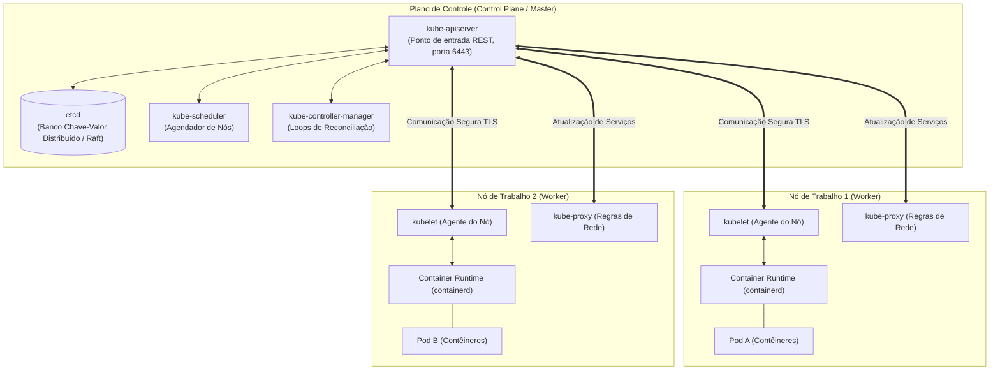
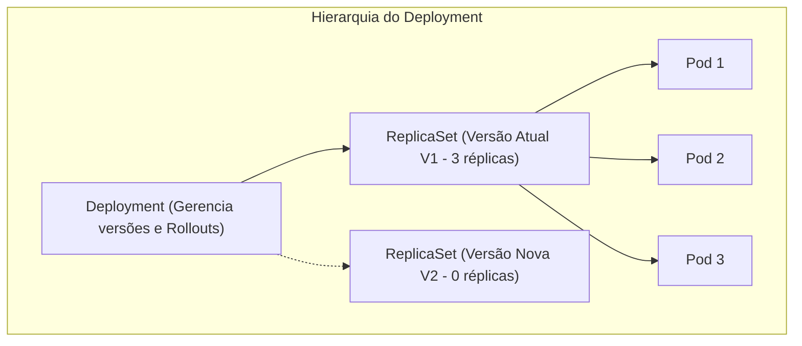
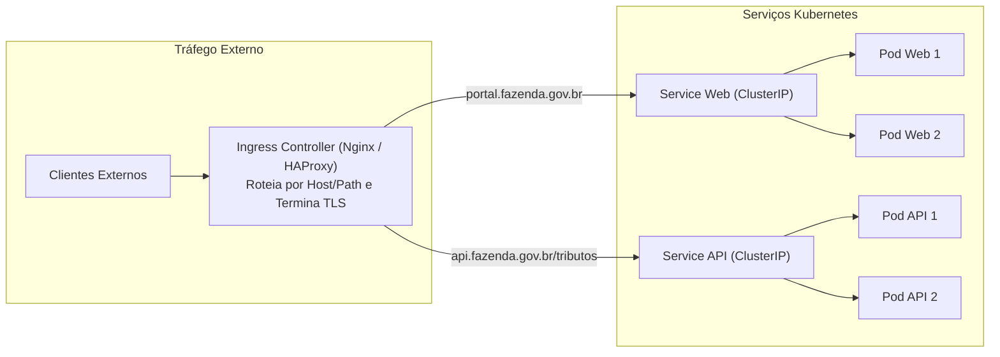
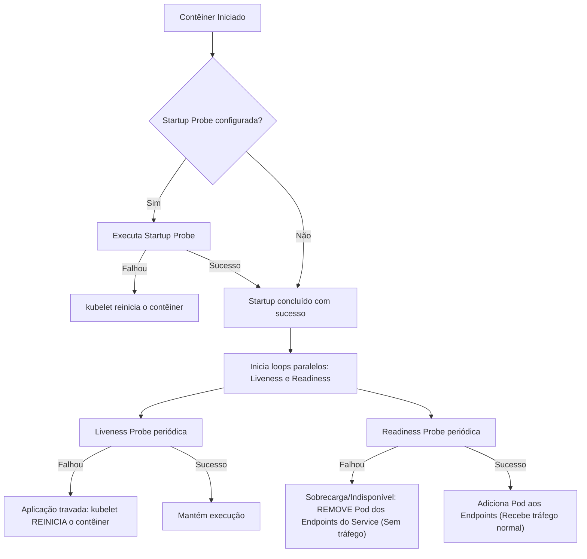

# 04 - Orquestração com Kubernetes e Gestão de Ambientes

> **Matéria:** DevOps, Plataforma de Desenvolvimento e Engenharia de Entrega  
> **Cargo:** B02 – Técnico de Controle Externo – Especialidade: Tecnologia da Informação  
> **Arquivo:** `04_orquestracao_com_kubernetes_e_gestao_de_ambientes.md`  

---

## 📌 Ementa / Itens do Edital
- Orquestração de contêineres com Kubernetes (K8s)
- Arquitetura de clusters Kubernetes (Plano de Controle / Control Plane e Nós de Trabalho / Worker Nodes)
- Objetos fundamentais: Pods, Deployments, ReplicaSets, StatefulSets, DaemonSets, Services e Ingress
- Mecanismos de configuração, persistência e governança: ConfigMaps, Secrets, Namespaces, PV e PVC
- Probes de integridade e ciclo de vida: Liveness, Readiness e Startup Probes
- Estratégias de implantação (Rolling Update, Recreate, Blue-Green, Canary)
- Gestão e segregação de ambientes: Desenvolvimento, Homologação e Produção (Paridade Dev/Prod)

---

## 🧭 Sumário

1. [Arquitetura do Kubernetes: Control Plane vs. Worker Nodes](#1-arquitetura-do-kubernetes-control-plane-vs-worker-nodes)
    1. [Componentes do Plano de Controle (Control Plane)](#11-componentes-do-plano-de-controle-control-plane)
    2. [Componentes dos Nós de Execução (Worker Nodes)](#12-componentes-dos-nos-de-execucao-worker-nodes)
    3. [O Loop de Reconciliação Contínua e o Estado Desejado](#13-o-loop-de-reconciliacao-continua-e-o-estado-desejado)
    4. [Teste 203](#Teste-203)
    5. [Teste 204](#Teste-204)
    6. [Teste 205](#Teste-205)
2. [Workloads e Controladores: Qual Objeto Escolher?](#2-workloads-e-controladores-qual-objeto-escolher)
    1. [Pods: A Menor Unidade Implantável](#21-pods-a-menor-unidade-implantavel)
    2. [Deployment e ReplicaSet: Gerenciamento Declarativo para Aplicações Stateless](#22-deployment-e-replicaset-gerenciamento-declarativo-para-aplicacoes-stateless)
    3. [StatefulSet: Identidade Estável e Volumes para Cargas Stateful](#23-statefulset-identidade-estavel-e-volumes-para-cargas-stateful)
    4. [DaemonSet: Instância Única por Nó de Infraestrutura](#24-daemonset-instancia-unica-por-no-de-infraestrutura)
    5. [Job e CronJob: Tarefas em Lote e Rotinas Agendadas](#25-job-e-cronjob-tarefas-em-lote-e-rotinas-agendadas)
    6. [Teste 206](#Teste-206)
    7. [Teste 207](#Teste-207)
    8. [Teste 208](#Teste-208)
3. [Serviços de Rede (Services) e Roteamento de Borda (Ingress)](#3-servicos-de-rede-services-e-roteamento-de-borda-ingress)
    1. [Tipos de Services: ClusterIP, NodePort, LoadBalancer e ExternalName](#31-tipos-de-services-clusterip-nodeport-loadbalancer-e-externalname)
    2. [O Objeto Ingress e Controladores de Roteamento de Camada 7](#32-o-objeto-ingress-e-controladores-de-roteamento-de-camada-7)
    3. [Teste 209](#Teste-209)
    4. [Teste 210](#Teste-210)
4. [Ciclo de Vida, Resiliência e Probes de Integridade](#4-ciclo-de-vida-resiliencia-e-probes-de-integridade)
    1. [Liveness Probe vs. Readiness Probe vs. Startup Probe](#41-liveness-probe-vs-readiness-probe-vs-startup-probe)
    2. [Tabela Comparativa de Comportamento em Caso de Falha](#42-tabela-comparativa-de-comportamento-em-caso-de-falha)
    3. [Teste 211](#Teste-211)
5. [Governança, Armazenamento e Segregação de Ambientes](#5-governanca-armazenamento-e-segregacao-de-ambientes)
    1. [ConfigMaps e Secrets: Injeção Desacoplada de Configurações](#51-configmaps-e-secrets-injecao-desacoplada-de-configuracoes)
    2. [Persistência: PersistentVolume (PV), PersistentVolumeClaim (PVC) e StorageClass](#52-persistencia-persistentvolume-pv-persistentvolumeclaim-pvc-e-storageclass)
    3. [Segregação de Ambientes e Paridade Dev/Prod (Twelve-Factor App)](#53-segregacao-de-ambientes-e-paridade-devprod-twelve-factor-app)
    4. [Teste 212](#Teste-212)
    5. [Teste 213](#Teste-213)
6. [🌐 Fontes Oficiais e Referências Bibliográficas](#fontes-oficiais-e-referencias-bibliograficas)

---

## 1. Arquitetura do Kubernetes: Control Plane vs. Worker Nodes

O Kubernetes (K8s) é a plataforma líder da indústria para orquestração declarativa de contêineres em ambientes distribuídos e elásticos. Concebido a partir da experiência do Google com seus sistemas internos (Borg e Omega) e posteriormente doado à *Cloud Native Computing Foundation* (CNCF), o Kubernetes opera sob o paradigma do **estado desejado (*declarative reconciliation*)**: o operador define as metas do cluster em manifestos YAML e a plataforma atua ininterruptamente para assegurar que o **estado real** coincida com o **estado declarado**.



### 1.1 Componentes do Plano de Controle (Control Plane)

O Plano de Controle é responsável por tomar decisões globais sobre o cluster (como agendamento de recursos), detectar e responder a eventos (como inicializar um novo Pod quando as réplicas de um Deployment não são atendidas):

1. **`kube-apiserver`:** É o coração e a porta de entrada de todo o cluster. Expõe a API REST do Kubernetes em HTTPS (porta padrão 6443). Todos os clientes externos (como a CLI `kubectl` ou esteiras de CI/CD) e todos os nós internos comunicam-se **exclusivamente com ele**. É o único componente autorizado a realizar operações diretas de leitura e gravação no banco de dados distribuído `etcd`.
2. **`etcd`:** Armazena o estado completo de configuração, segredos, metadados e objetos do cluster. Trata-se de um banco de dados relacional distribuído chave-valor altamente consistente que utiliza o algoritmo de consenso Raft. Fazer backup regular do `etcd` equivale a garantir a recuperação completa de desastres (*Disaster Recovery*) de todo o cluster K8s.
3. **`kube-scheduler`:** Responsável por analisar Pods recém-criados que ainda não possuem um nó atribuído e selecionar o nó de trabalho ideal para executá-los. Considera restrições de hardware (CPU e RAM solicitadas), regras de afinidade e anti-afinidade (*nodeAffinity*, *podAntiAffinity*), tolerâncias a manchas (*taints & tolerations*) e disponibilidade de portas.
4. **`kube-controller-manager`:** Executa os controladores internos em processos de segundo plano. Cada controlador é um loop contínuo de reconciliação que compara o estado real observado via API Server com o estado desejado (ex.: *Node Controller* para nós que falham, *Deployment Controller* para substituição de versões, *EndpointSlice Controller* para roteamento de rede).
5. **`cloud-controller-manager`:** Módulo opcional que integra a lógica do Kubernetes com as APIs dos provedores de nuvem pública (AWS, Azure, Google Cloud), provisionando dinamicamente balanceadores de carga, rotas e discos gerenciados.

### 1.2 Componentes dos Nós de Execução (Worker Nodes)

Os Nós de Trabalho (*Worker Nodes*) são os servidores físicos ou máquinas virtuais encarregados de executar as cargas de trabalho reais da organização:

1. **`kubelet`:** O agente de gerenciamento instalado em cada nó do cluster. Ele consome as especificações do Pod (*PodSpecs*) enviadas pelo `kube-apiserver` e interage com o runtime local de contêineres via *Container Runtime Interface* (CRI) para garantir que os contêineres descritos sejam criados, permaneçam em execução e estejam saudáveis. Ele também supervisiona o resultado das *probes* de integridade e reporta o status do nó ao Control Plane.
2. **`kube-proxy`:** Componente de rede distribuído executado em cada nó de trabalho. Mantém as regras de rede (usando tabelas `iptables` ou módulos `IPVS` do Linux), viabilizando a abstração de *Service* e implementando o balanceamento de conexões TCP/UDP entre as réplicas ativas dos Pods.
3. **Container Runtime:** O software responsável pela execução física dos contêineres (como `containerd` ou `CRI-O`). Opera em conformidade com os padrões da OCI (*Open Container Initiative*).

> ⭐ **IMPORTANTE / REGRA DE OURO:**  
> Nenhum componente do cluster comunica-se diretamente com o `etcd`, com exceção do **`kube-apiserver`**. O `kube-scheduler`, o `controller-manager` e os agentes `kubelet` consultam e atualizam o estado do cluster **sempre e obrigatoriamente através do `kube-apiserver`**.

### 1.3 O Loop de Reconciliação Contínua e o Estado Desejado

O ciclo de vida do Kubernetes baseia-se em um mecanismo ininterrupto:
$$\text{Observar Estado Real} \longrightarrow \text{Comparar com Estado Desejado} \longrightarrow \text{Executar Ação Corretiva}$$
Se um desenvolvedor define `replicas: 4` em um manifesto e um nó físico desliga subitamente (derrubando 2 Pods), o *Controller Manager* detecta que o estado real caiu para 2 réplicas e comanda o *kube-scheduler* a despachar 2 novos Pods em nós sadios remanescentes, restaurando a capacidade desejada sem qualquer intervenção humana (*Self-Healing*).

---

### Teste 001
**(FGV – TJ/SC – 2026 – Analista Administrativo)**
João e Maria, servidores públicos ocupantes de cargos de provimento efetivo no Estado Sigma, que não se conhecem e jamais praticaram qualquer ato em comunhão de ações e desígnios, respondem a ações de improbidade administrativa com base na Lei nº 8.429/1992, cada qual pela prática dos próprios atos. João desviou recursos públicos enquanto atuava como ordenador de despesas. Maria, por sua vez, revelou fato de que tinha ciência em razão de suas atribuições e que deveria permanecer em segredo, colocando em risco a segurança do Estado. À luz da sistemática vigente, é correto afirmar que

* **A)** as condutas de João e Maria podem acarretar a aplicação da sanção de perda da função pública.
* **B)** as condutas de João e Maria foram enquadradas em uma tipologia legal de caráter exemplificativo, não taxativo.
* **C)** a conduta de João pode acarretar a aplicação da sanção de suspensão dos direitos políticos por até 14 (quatorze) anos.
* **D)** a conduta de Maria pode acarretar a aplicação da sanção de vedação ao recebimento de incentivos fiscais por até 12 (doze) anos.
* **E)** as ações ajuizadas em face de João e Maria são de autoria do Ministério Público, considerando sua legitimidade privativa nessa seara.

---

> **Comentário Detalhado:**
>
> - **A)** **Incorreta.** A opção apresenta proposição em desacordo com os fundamentos teóricos e técnicos do tópico ao afirmar que "as condutas de João e Maria podem acarretar a aplicação da sanção de perda da função pública". De acordo com a teoria estudada em *2.1 Pods: A Menor Unidade Implantável*, network Namespace Compartilhado: Todos os contêineres do mesmo Pod compartilham o mesmo endereço IP e a mesma tabela de portas. Eles podem se comunicar internamente via localhost com altíssima performance.
> - **B)** **Incorreta.** A opção apresenta proposição em desacordo com os fundamentos teóricos e técnicos do tópico ao afirmar que "as condutas de João e Maria foram enquadradas em uma tipologia legal de caráter exemplificativo, não taxativo". De acordo com a teoria estudada em *4. Ciclo de Vida, Resiliência e Probes de Integridade*, rUN LP |Falhou| KILL LP["Aplicação travada: kubelet REINICIA o contêiner"].
> - **C)** **Correta.** Conforme fundamentado na seção *4.2 Tabela Comparativa de Comportamento em Caso de Falha* deste guia, readinessProbe : Verificar se a aplicação pode atender requisições agora. — NÃO reinicia o contêiner. — Remove o Pod dos Endpoints do Service (zero tráfego). Dessa forma, está plenamente correta a assertiva da banca (FGV – TJ/SC/2026) ao estabelecer que "a conduta de João pode acarretar a aplicação da sanção de suspensão dos direitos políticos por até 14 (quatorze)...".
> - **D)** **Incorreta.** A opção apresenta proposição em desacordo com os fundamentos teóricos e técnicos do tópico ao afirmar que "a conduta de Maria pode acarretar a aplicação da sanção de vedação ao recebimento de incentivos fiscais por até 12...". De acordo com a teoria estudada em *5.3 Segregação de Ambientes e Paridade Dev/Prod (Twelve-Factor App)*, hard Multi Tenancy (Clusters Físicos Dedicados): Padrão recomendado para órgãos do setor público como o TCE GO. Mantêm se clusters fisicamente isolados para Produção e Não Produção, eliminando qualquer risco de contaminação cruzada, vazamento de dados fiscais ou exaustão de plano de controle.
> - **E)** **Incorreta.** A opção apresenta proposição em desacordo com os fundamentos teóricos e técnicos do tópico ao afirmar que "as ações ajuizadas em face de João e Maria são de autoria do Ministério Público, considerando sua legitimidade...". De acordo com a teoria estudada em *4.1 Liveness Probe vs. Readiness Probe vs. Startup Probe*, objetivo: Detectar se a aplicação interna entrou em estado de falha fatal irrecuperável (ex.: deadlock de threads, vazamento catastrófico de memória ou loop infinito).
>
> **Gabarito: C**

---


### Teste 002
**(FGV – TJ/SC – 2026 – Analista Administrativo)**
A sociedade empresária Alfa teria praticado atos lesivos ao Estado Beta, consistentes em alegada fraude à licitação praticada em detrimento da Secretaria de Estado de Educação do Poder Executivo do referido ente federativo. No curso do processo administrativo instaurado para a apuração dos fatos, o representante legal de Alfa cogitou a celebração de ajuste no âmbito da consensualidade de colaboração, conforme disciplina estabelecida na Lei nº 12.846/2013. Em relação ao ajuste cogitado pelo representante legal de Alfa, é correto afirmar que

* **A)** é vedado, considerando a indisponibilidade dos interesses envolvidos.
* **B)** deve ser celebrado no plano administrativo e homologado pelo Poder Judiciário.
* **C)** exime Alfa, caso celebrado, da obrigação de reparar integralmente o dano causado.
* **D)** deve ser celebrado no plano processual, pelo Ministério Público, com a correlata homologação pelo Poder Judiciário.
* **E)** independe de homologação pelo Poder Judiciário e não afasta a possibilidade de suspensão ou interdição parcial das atividades de Alfa.

---

> **Comentário Detalhado:**
>
> - **A)** **Incorreta.** A opção apresenta proposição em desacordo com os fundamentos teóricos e técnicos do tópico ao afirmar que "é vedado, considerando a indisponibilidade dos interesses envolvidos". De acordo com a teoria estudada em *4.2 Tabela Comparativa de Comportamento em Caso de Falha*, afirmar que a falha da readinessProbe causa a destruição ou reinicialização do contêiner (FALSO! A readiness apenas remove o Pod do balanceador do Service).
> - **B)** **Incorreta.** A opção apresenta proposição em desacordo com os fundamentos teóricos e técnicos do tópico ao afirmar que "deve ser celebrado no plano administrativo e homologado pelo Poder Judiciário". De acordo com a teoria estudada em *5.3 Segregação de Ambientes e Paridade Dev/Prod (Twelve-Factor App)*, paridade entre Ambientes (Fator X do Twelve Factor App): As ferramentas, bibliotecas e sistemas de retaguarda (bancos de dados, mensageria) devem ser estritamente idênticos em todos os estágios. Não se deve utilizar SQLite em desenvolvimento e PostgreSQL em produção; utilize o mesmo PostgreSQL conteinerizado em todos os ambientes.
> - **C)** **Incorreta.** A opção apresenta proposição em desacordo com os fundamentos teóricos e técnicos do tópico ao afirmar que "exime Alfa, caso celebrado, da obrigação de reparar integralmente o dano causado". De acordo com a teoria estudada em *4.2 Tabela Comparativa de Comportamento em Caso de Falha*, tipo de Sonda: Propósito Essencial — Ação do Kubernetes em Caso de Falha Contínua — Impacto no Tráfego de Rede.
> - **D)** **Incorreta.** A opção apresenta proposição em desacordo com os fundamentos teóricos e técnicos do tópico ao afirmar que "deve ser celebrado no plano processual, pelo Ministério Público, com a correlata homologação pelo Poder Judiciário". De acordo com a teoria estudada em *2.1 Pods: A Menor Unidade Implantável*, efemeridade Crítica: Pods são descartáveis e mortais. Eles nunca devem ser instanciados de forma avulsa em produção; devem ser sempre gerenciados por controladores de carga de trabalho.
> - **E)** **Correta.** Conforme fundamentado na seção *5.3 Segregação de Ambientes e Paridade Dev/Prod (Twelve-Factor App)* deste guia, a gestão profissional de múltiplos ambientes (Desenvolvimento, Homologação/Staging e Produção) exige conformidade com as boas práticas de governança. Dessa forma, está plenamente correta a assertiva da banca (FGV – TJ/SC/2026) ao estabelecer que "independe de homologação pelo Poder Judiciário e não afasta a possibilidade de suspensão ou interdição parcial das...".
>
> **Gabarito: E**

---


### Teste 003
**(FGV – TJ/SC – 2026 – Analista Administrativo)**
João, servidor público ocupante de cargo de provimento efetivo da Administração Pública indireta do Estado Delta, aceitou vantagem indevida dada pela sociedade empresária Sigma, para que fosse favorecida em determinada licitação. Para que seja atribuído ato ilícito a Sigma, na perspectiva da Lei nº 12.846/2013, é correto afirmar que

* **A)** deve ocorrer a prévia condenação de João pela prática de ato de improbidade administrativa.
* **B)** deve ser previamente demonstrada a responsabilidade individual de um dirigente a ela vinculado.
* **C)** pode ser perquirida a responsabilização de Sigma, independentemente da culpabilidade de um dos seus dirigentes.
* **D)** pode ser perquirida a responsabilidade administrativa de Sigma, independentemente do elemento subjetivo do agir, mas não a responsabilidade na instância civil.
* **E)** deve ser demonstrada a existência de cláusula de anuência à responsabilização, no edital da licitação, paralelamente à responsabilização com base na Lei nº 8.429/1992.

---

> **Comentário Detalhado:**
>
> - **A)** **Incorreta.** A opção apresenta proposição em desacordo com os fundamentos teóricos e técnicos do tópico ao afirmar que "deve ocorrer a prévia condenação de João pela prática de ato de improbidade administrativa". De acordo com a teoria estudada em *5.3 Segregação de Ambientes e Paridade Dev/Prod (Twelve-Factor App)*, paridade entre Ambientes (Fator X do Twelve Factor App): As ferramentas, bibliotecas e sistemas de retaguarda (bancos de dados, mensageria) devem ser estritamente idênticos em todos os estágios. Não se deve utilizar SQLite em desenvolvimento e PostgreSQL em produção; utilize o mesmo PostgreSQL conteinerizado em todos os ambientes.
> - **B)** **Incorreta.** A opção apresenta proposição em desacordo com os fundamentos teóricos e técnicos do tópico ao afirmar que "deve ser previamente demonstrada a responsabilidade individual de um dirigente a ela vinculado". De acordo com a teoria estudada em *2.3 StatefulSet: Identidade Estável e Volumes para Cargas Stateful*, volumes Dedicados via volumeClaimTemplates : Cada réplica recebe seu próprio disco persistente individual; se o postgres 1 morrer e renascer em outro nó, o Kubernetes reanexa exatamente o mesmo disco à nova réplica.
> - **C)** **Correta.** Conforme fundamentado na seção *4.2 Tabela Comparativa de Comportamento em Caso de Falha* deste guia, readinessProbe : Verificar se a aplicação pode atender requisições agora. — NÃO reinicia o contêiner. — Remove o Pod dos Endpoints do Service (zero tráfego). Dessa forma, está plenamente correta a assertiva da banca (FGV – TJ/SC/2026) ao estabelecer que "pode ser perquirida a responsabilização de Sigma, independentemente da culpabilidade de um dos seus dirigentes".
> - **D)** **Incorreta.** A opção apresenta proposição em desacordo com os fundamentos teóricos e técnicos do tópico ao afirmar que "pode ser perquirida a responsabilidade administrativa de Sigma, independentemente do elemento subjetivo do agir...". De acordo com a teoria estudada em *2.4 DaemonSet: Instância Única por Nó de Infraestrutura*, garante que exatamente uma cópia de um determinado Pod seja executada em todos os nós de trabalho do cluster.
> - **E)** **Incorreta.** A opção apresenta proposição em desacordo com os fundamentos teóricos e técnicos do tópico ao afirmar que "deve ser demonstrada a existência de cláusula de anuência à responsabilização, no edital da licitação...". De acordo com a teoria estudada em *2.5 Job e CronJob: Tarefas em Lote e Rotinas Agendadas*, cronJob : Gerencia a execução periódica de Jobs com base em uma tabela temporal padrão (sintaxe cron de 5 campos, ex.: 0 2 para rodar diariamente às 02h). Indicado para rotinas de backup noturno e limpezas de cache.
>
> **Gabarito: C**

---


### Teste 004
**(FGV – TJ/SC – 2026 – Analista Administrativo)**
Maria ocupa cargo de primeiro escalão em determinado ente federativo, na condição de Secretária de Estado. As normas afetas à prevenção e ao tratamento do conflito de interesses nesse ente seguem os balizamentos oferecidos pela Lei nº 12.813/2013. Maria pretende exercer determinada atividade privada de cunho econômico. Embora o exercício dessa atividade não seja vedado pelas referidas normas, Maria tem dúvida em relação à sua licitude, pois implicaria na prestação de serviços a pessoas jurídicas que têm interesse em decisões de colegiado administrativo do qual ela participa. Ao analisar a sistemática legal, Maria concluiu corretamente que

* **A)** a ausência de vedação legal ao exercício da atividade afasta a possibilidade de ser configurado o conflito de interesses.
* **B)** o interesse das pessoas jurídicas nas decisões do colegiado de que Maria participe não configura conflito de interesses.
* **C)** o conflito de interesses na situação descrita é afastado, caso Maria esteja em gozo de licença ou em período de afastamento.
* **D)** a situação descrita configura conflito de interesses, devendo ser fiscalizada por Comissão de Ética Pública instituída no âmbito do Poder Executivo do ente federativo ao qual Maria está vinculada.
* **E)** o conflito de interesses somente estará configurado se Maria divulgar ou fizer uso de informações privilegiadas obtidas no exercício funcional, para viabilizar a prestação do serviço para o qual seja contratada. Noções de Informática e Proteção de Dados

---

> **Comentário Detalhado:**
>
> - **A)** **Incorreta.** A opção apresenta proposição em desacordo com os fundamentos teóricos e técnicos do tópico ao afirmar que "a ausência de vedação legal ao exercício da atividade afasta a possibilidade de ser configurado o conflito de...". De acordo com a teoria estudada em *2.1 Pods: A Menor Unidade Implantável*, efemeridade Crítica: Pods são descartáveis e mortais. Eles nunca devem ser instanciados de forma avulsa em produção; devem ser sempre gerenciados por controladores de carga de trabalho.
> - **B)** **Incorreta.** A opção apresenta proposição em desacordo com os fundamentos teóricos e técnicos do tópico ao afirmar que "o interesse das pessoas jurídicas nas decisões do colegiado de que Maria participe não configura conflito de...". De acordo com a teoria estudada em *1.1 Componentes do Plano de Controle (Control Plane)*, o Plano de Controle é responsável por tomar decisões globais sobre o cluster (como agendamento de recursos), detectar e responder a eventos (como inicializar um novo Pod quando as réplicas de um Deployment não são atendidas).
> - **C)** **Incorreta.** A opção apresenta proposição em desacordo com os fundamentos teóricos e técnicos do tópico ao afirmar que "o conflito de interesses na situação descrita é afastado, caso Maria esteja em gozo de licença ou em período de...". De acordo com a teoria estudada em *2.2 Deployment e ReplicaSet: Gerenciamento Declarativo para Aplicações Stateless*, controla o ritmo de rollout através das diretivas maxSurge (quantos Pods extras podem ser criados acima da meta) e maxUnavailable (quantos Pods podem ficar indisponíveis durante a transição).
> - **D)** **Correta.** Conforme fundamentado na seção *5.1 ConfigMaps e Secrets: Injeção Desacoplada de Configurações* deste guia, configMap : Armazena dados de configuração não sensíveis em texto claro (variáveis de ambiente, URLs de serviços externos, arquivos de configuração completos como nginx.conf ). Podem ser injetados no contêiner como variáveis de ambiente ou montados como arquivos em volumes virtuais. Dessa forma, está plenamente correta a assertiva da banca (FGV – TJ/SC/2026) ao estabelecer que "a situação descrita configura conflito de interesses, devendo ser fiscalizada por Comissão de Ética Pública...".
> - **E)** **Incorreta.** A opção incorre em restrição indevida ao limitar o escopo conceitual ao afirmar que "o conflito de interesses somente estará configurado se Maria divulgar ou fizer uso de informações privilegiadas...". De acordo com a teoria estudada em *2.3 StatefulSet: Identidade Estável e Volumes para Cargas Stateful*, uso ideal: Bancos de dados distribuídos (PostgreSQL com replicação, MongoDB, Cassandra), sistemas de mensageria (Apache Kafka, RabbitMQ).
>
> **Gabarito: D**

---


### Teste 005
**(FGV – TJ/SC – 2026 – Analista Administrativo)**
No que diz respeito às políticas institucionais de privacidade e ao tratamento de dados pessoais no âmbito do Poder Judiciário, analise as afirmativas a seguir. I. O tratamento de dados pessoais realizado para fins de atividades jurisdicionais é isento de medidas de segurança e conformidade, as quais devem ser aplicadas exclusivamente às atividades administrativas dos tribunais. II. Os tribunais devem designar um Encarregado pelo Tratamento de Dados Pessoais (DPO) para atuar como canal de comunicação entre o órgão, os titulares dos dados e a Autoridade Nacional de Proteção de Dados (ANPD). III. No Poder Judiciário, a responsabilidade pela segurança da informação e pela preservação da confidencialidade dos dados é atribuída exclusivamente aos servidores das unidades de Tecnologia da Informação (TI). Está correto o que se afirma, apenas, em

* **A)** I.
* **B)** II.
* **C)** III.
* **D)** I e II.
* **E)** II e III.

---

> **Comentário Detalhado:**
>
> - **A)** **Incorreta.** A opção apresenta proposição em desacordo com os fundamentos teóricos e técnicos do tópico ao afirmar que "I". De acordo com a teoria estudada em *1.1 Componentes do Plano de Controle (Control Plane)*, kube apiserver : É o coração e a porta de entrada de todo o cluster. Expõe a API REST do Kubernetes em HTTPS (porta padrão 6443). Todos os clientes externos (como a CLI kubectl ou esteiras de CI/CD) e todos os nós internos comunicam se exclusivamente com ele. É o único componente autorizado a realizar operações diretas de leitura e gravação no banco de dados distribuído etcd.
> - **B)** **Correta.** Conforme fundamentado na seção *5.3 Segregação de Ambientes e Paridade Dev/Prod (Twelve-Factor App)* deste guia, paridade entre Ambientes (Fator X do Twelve Factor App): As ferramentas, bibliotecas e sistemas de retaguarda (bancos de dados, mensageria) devem ser estritamente idênticos em todos os estágios. Não se deve utilizar SQLite em desenvolvimento e PostgreSQL em produção; utilize o mesmo PostgreSQL conteinerizado em todos os ambientes. Dessa forma, está plenamente correta a assertiva da banca (FGV – TJ/SC/2026) ao estabelecer que "II".
> - **C)** **Incorreta.** A opção apresenta proposição em desacordo com os fundamentos teóricos e técnicos do tópico ao afirmar que "III". De acordo com a teoria estudada em *5.1 ConfigMaps e Secrets: Injeção Desacoplada de Configurações*, em cumprimento ao Fator III da metodologia Twelve Factor App ( Store config in the environment ), parâmetros de configuração e credenciais nunca devem estar fixados ( hardcoded ) dentro do código fonte ou da imagem Docker.
> - **D)** **Incorreta.** A opção apresenta proposição em desacordo com os fundamentos teóricos e técnicos do tópico ao afirmar que "I e II". De acordo com a teoria estudada em *2.1 Pods: A Menor Unidade Implantável*, efemeridade Crítica: Pods são descartáveis e mortais. Eles nunca devem ser instanciados de forma avulsa em produção; devem ser sempre gerenciados por controladores de carga de trabalho.
> - **E)** **Incorreta.** A opção apresenta proposição em desacordo com os fundamentos teóricos e técnicos do tópico ao afirmar que "II e III". De acordo com a teoria estudada em *5.1 ConfigMaps e Secrets: Injeção Desacoplada de Configurações*, secret : Armazena dados estritamente sensíveis (senhas de banco de dados, chaves privadas SSH, tokens JWT, certificados digitais TLS). Por padrão no Kubernetes vanilla, os dados são armazenados no etcd e codificados em Base64 (exigindo a habilitação de criptografia em repouso no etcd para segurança corporativa plena).
>
> **Gabarito: B**

---


### Teste 006
**(FGV – TJ/SC – 2026 – Analista Administrativo)**
O Tribunal de Justiça de Santa Catarina implementou um sistema eletrônico para gestão processual e atendimento ao cidadão, com o objetivo de aprimorar a prestação jurisdicional e assegurar a conformidade com a Lei nº 13.709/2018 (Lei Geral de Proteção de Dados Pessoais – LGPD). Na solução adotada: i) dados de partes, advogados e demais usuários são coletados e utilizados para identificação, comunicação processual e tramitação dos feitos; ii) informações relativas à saúde, biometria e outros dados protegidos pela LGPD recebem tratamento diferenciado e maior nível de proteção; iii) os cidadãos podem solicitar informações sobre o tratamento de seus dados pessoais, nos termos da legislação aplicável; iv) o Tribunal define as finalidades e os meios de tratamento dos dados pessoais utilizados em suas atividades; e v) empresa contratada é responsável pelo armazenamento e processamento de dados em ambiente computacional disponibilizado ao Tribunal. Com base nesse cenário, associe corretamente os conceitos da LGPD (Coluna I) às descrições (Coluna II): Coluna I Coluna II ( ) Informações como nome, CPF, endereço eletrônico e telefone, 1. Dado pessoal utilizadas para identificar usuários dos serviços judiciais. 2. Dado pessoal ( ) Empresa contratada que realiza o sensível armazenamento e o processamento de dados em nome do Tribunal. 3. Titular dos ( ) Pessoa física a quem os dados pessoais dados se referem, podendo exercer os direitos previstos na LGPD. 4. Controlador ( ) Informações sobre saúde, dados biométricos ou outros dados 5. Operador submetidos à proteção especial pela legislação. ( ) Órgão responsável por definir as finalidades e os meios de tratamento dos dados pessoais utilizados no sistema. Assinale a opção que indica a relação correta, na ordem apresentada.

* **A)** 1 – 5 – 3 – 2 – 4.
* **B)** 1 – 4 – 3 – 2 – 5.
* **C)** 2 – 5 – 3 – 1 – 4.
* **D)** 1 – 5 – 4 – 2 – 3.
* **E)** 1 – 3 – 5 – 2 – 4.

---

> **Comentário Detalhado:**
>
> - **A)** **Correta.** Conforme fundamentado na seção *1. Arquitetura do Kubernetes: Control Plane vs. Worker Nodes* deste guia, o Kubernetes (K8s) é a plataforma líder da indústria para orquestração declarativa de contêineres em ambientes distribuídos e elásticos. Concebido a partir da experiência do Google com seus sistemas internos (Borg e Omega) e posteriormente doado à Cloud Native Computing Foundation (CNCF), o Kubernetes opera sob o paradigma do estado desejado ( declarative reconciliation ): o operador define as metas do cluster em manifestos YAML e a plataforma atua ininterruptamente para assegurar que o estado real coincida com o estado declarado. Dessa forma, está plenamente correta a assertiva da banca (FGV – TJ/SC/2026) ao estabelecer que "1 – 5 – 3 – 2 – 4".
> - **B)** **Incorreta.** A opção apresenta proposição em desacordo com os fundamentos teóricos e técnicos do tópico ao afirmar que "1 – 4 – 3 – 2 – 5". De acordo com a teoria estudada em *1.2 Componentes dos Nós de Execução (Worker Nodes)*, container Runtime: O software responsável pela execução física dos contêineres (como containerd ou CRI O ). Opera em conformidade com os padrões da OCI ( Open Container Initiative ).
> - **C)** **Incorreta.** A opção apresenta proposição em desacordo com os fundamentos teóricos e técnicos do tópico ao afirmar que "2 – 5 – 3 – 1 – 4". De acordo com a teoria estudada em *5.1 ConfigMaps e Secrets: Injeção Desacoplada de Configurações*, configMap : Armazena dados de configuração não sensíveis em texto claro (variáveis de ambiente, URLs de serviços externos, arquivos de configuração completos como nginx.conf ). Podem ser injetados no contêiner como variáveis de ambiente ou montados como arquivos em volumes virtuais.
> - **D)** **Incorreta.** A opção apresenta proposição em desacordo com os fundamentos teóricos e técnicos do tópico ao afirmar que "1 – 5 – 4 – 2 – 3". De acordo com a teoria estudada em *3.1 Tipos de Services: ClusterIP, NodePort, LoadBalancer e ExternalName*, não utiliza seletores nem endereços IP virtuais; atua como um redirecionamento interno de DNS mapeando o serviço para um nome externo (registro CNAME), como database.orgao.gov.br.
> - **E)** **Incorreta.** A opção apresenta proposição em desacordo com os fundamentos teóricos e técnicos do tópico ao afirmar que "1 – 3 – 5 – 2 – 4". De acordo com a teoria estudada em *4.1 Liveness Probe vs. Readiness Probe vs. Startup Probe*, consequência da Falha: O contêiner NÃO é reiniciado! O Kubernetes apenas remove temporariamente o endereço IP do Pod da lista de Endpoints do Service, impedindo que requisições de usuários sejam enviadas a um Pod que está ocupado ou aquecendo caches.
>
> **Gabarito: A**

---


### Teste 007
**(FGV – TJ/SC – 2026 – Analista Administrativo)**
No âmbito da Resolução TJ nº 3/2021 do Tribunal de Justiça de Santa Catarina, o tratamento de dados pessoais deve ser pautado pela observância estrita das bases legais e dos princípios de proteção ao titular. Imagine que uma unidade administrativa do TJSC deseja implementar um novo sistema para o processamento de dados de magistrados e servidores, visando especificamente ao cumprimento de determinações contidas em leis federais e normas do Conselho Nacional de Justiça (CNJ). Considerando as diretrizes sobre o ciclo de vida dos dados e as hipóteses de tratamento previstas na referida Resolução e na LGPD, assinale a afirmativa que descreve corretamente a base legal e a conduta correta para esse cenário.

* **A)** O tratamento deve ser baseado exclusivamente no consentimento do titular, devendo o sistema ser interrompido caso algum servidor se recuse a autorizar a coleta dos dados.
* **B)** O tratamento poderá ser realizado com base no cumprimento de obrigação legal ou regulatória, o que dispensa a coleta de consentimento específico, desde que respeitados os princípios da finalidade e da necessidade.
* **C)** Os dados coletados para essa finalidade legal podem ser utilizados posteriormente para qualquer outro fim administrativo, uma vez que o dado já reside nos servidores do Controlador (PJSC).
* **D)** O dado pessoal sensível, por sua natureza, não pode ser tratado pelo Tribunal sob a justificativa de obrigação legal, exigindo sempre a anonimização irreversível imediata após a coleta.
* **E)** A fase de descarte do ciclo de vida do dado é facultativa para o Judiciário, sendo permitida a manutenção perpétua de dados pessoais em texto claro para fins de registro histórico, sem necessidade de avaliação de descarte. Direitos Humanos e acesso à justiça

---

> **Comentário Detalhado:**
>
> - **A)** **Incorreta.** A opção incorre em restrição indevida ao limitar o escopo conceitual ao afirmar que "O tratamento deve ser baseado exclusivamente no consentimento do titular, devendo o sistema ser interrompido caso...". De acordo com a teoria estudada em *1.1 Componentes do Plano de Controle (Control Plane)*, kube apiserver : É o coração e a porta de entrada de todo o cluster. Expõe a API REST do Kubernetes em HTTPS (porta padrão 6443). Todos os clientes externos (como a CLI kubectl ou esteiras de CI/CD) e todos os nós internos comunicam se exclusivamente com ele. É o único componente autorizado a realizar operações diretas de leitura e gravação no banco de dados distribuído etcd.
> - **B)** **Correta.** Conforme fundamentado na seção *5.3 Segregação de Ambientes e Paridade Dev/Prod (Twelve-Factor App)* deste guia, paridade entre Ambientes (Fator X do Twelve Factor App): As ferramentas, bibliotecas e sistemas de retaguarda (bancos de dados, mensageria) devem ser estritamente idênticos em todos os estágios. Não se deve utilizar SQLite em desenvolvimento e PostgreSQL em produção; utilize o mesmo PostgreSQL conteinerizado em todos os ambientes. Dessa forma, está plenamente correta a assertiva da banca (FGV – TJ/SC/2026) ao estabelecer que "O tratamento poderá ser realizado com base no cumprimento de obrigação legal ou regulatória, o que dispensa a...".
> - **C)** **Incorreta.** A opção promove generalização excessiva que desconsidera as condições técnicas e normativas ao afirmar que "Os dados coletados para essa finalidade legal podem ser utilizados posteriormente para qualquer outro fim...". De acordo com a teoria estudada em *5.1 ConfigMaps e Secrets: Injeção Desacoplada de Configurações*, configMap : Armazena dados de configuração não sensíveis em texto claro (variáveis de ambiente, URLs de serviços externos, arquivos de configuração completos como nginx.conf ). Podem ser injetados no contêiner como variáveis de ambiente ou montados como arquivos em volumes virtuais.
> - **D)** **Incorreta.** A opção promove generalização excessiva que desconsidera as condições técnicas e normativas ao afirmar que "O dado pessoal sensível, por sua natureza, não pode ser tratado pelo Tribunal sob a justificativa de obrigação...". De acordo com a teoria estudada em *2.1 Pods: A Menor Unidade Implantável*, efemeridade Crítica: Pods são descartáveis e mortais. Eles nunca devem ser instanciados de forma avulsa em produção; devem ser sempre gerenciados por controladores de carga de trabalho.
> - **E)** **Incorreta.** A opção afasta requisito ou relação estrutural exigida pela matéria ao afirmar que "A fase de descarte do ciclo de vida do dado é facultativa para o Judiciário, sendo permitida a manutenção perpétua...". De acordo com a teoria estudada em *1.3 O Loop de Reconciliação Contínua e o Estado Desejado*, o ciclo de vida do Kubernetes baseia se em um mecanismo ininterrupto.
>
> **Gabarito: B**

---


### Teste 008
**(FGV – TJ/SC – 2026 – Analista Administrativo)**
Os direitos humanos foram consolidados no Brasil mediante a Constituição Federal de 1988, que adotou a dignidade da pessoa humana (Art. 1º, III) como fundamento da República e garantiu a igualdade (Art. 5º) sem distinções. Esses princípios norteiam o Estado Democrático de Direito, assegurando proteção contra arbítrios, além de direitos fundamentais, sociais e mecanismos de inclusão. Considerando as disposições constitucionais relativas aos direitos e garantias individuais, assinale a afirmativa correta.

* **A)** A liberdade de consciência e de crença é inviolável, assegurado o livre exercício dos cultos religiosos, não sendo garantida a prestação de assistência religiosa nas entidades civis e militares de internação coletiva.
* **B)** A casa é asilo inviolável do indivíduo, ninguém nela podendo adentrar sem consentimento do morador, salvo em caso de flagrante delito ou desastre, ou para prestar socorro, ou, durante o dia ou noite, por determinação judicial.
* **C)** O sigilo da correspondência é inviolável, salvo, no último caso, por ordem judicial, nas hipóteses e na forma que a lei estabelecer para fins de investigação criminal ou instrução processual penal.
* **D)** Todos podem reunir-se pacificamente, ainda que armados, em locais abertos ao público, independentemente de autorização, desde que não frustrem outra reunião anteriormente convocada para o mesmo local.
* **E)** É livre a locomoção no território nacional em tempo de paz ou de guerra, podendo qualquer pessoa, nos termos da lei, nele entrar, permanecer ou dele sair com seus bens.

---

> **Comentário Detalhado:**
>
> - **A)** **Incorreta.** A opção apresenta proposição em desacordo com os fundamentos teóricos e técnicos do tópico ao afirmar que "A liberdade de consciência e de crença é inviolável, assegurado o livre exercício dos cultos religiosos, não sendo...". De acordo com a teoria estudada em *2. Workloads e Controladores: Qual Objeto Escolher?*, o Kubernetes não executa contêineres diretamente de forma isolada; ele os encapsula em abstrações funcionais denominadas Workloads.
> - **B)** **Incorreta.** A opção apresenta proposição em desacordo com os fundamentos teóricos e técnicos do tópico ao afirmar que "A casa é asilo inviolável do indivíduo, ninguém nela podendo adentrar sem consentimento do morador, salvo em caso...". De acordo com a teoria estudada em *2.2 Deployment e ReplicaSet: Gerenciamento Declarativo para Aplicações Stateless*, controla o ritmo de rollout através das diretivas maxSurge (quantos Pods extras podem ser criados acima da meta) e maxUnavailable (quantos Pods podem ficar indisponíveis durante a transição).
> - **C)** **Correta.** Conforme fundamentado na seção *2.3 StatefulSet: Identidade Estável e Volumes para Cargas Stateful* deste guia, inicialização e Parada Ordenada: Pods sobem sequencialmente (0, depois 1, depois 2) e são encerrados na ordem inversa (2, depois 1, depois 0). Dessa forma, está plenamente correta a assertiva da banca (FGV – TJ/SC/2026) ao estabelecer que "O sigilo da correspondência é inviolável, salvo, no último caso, por ordem judicial, nas hipóteses e na forma que...".
> - **D)** **Incorreta.** A opção apresenta proposição em desacordo com os fundamentos teóricos e técnicos do tópico ao afirmar que "Todos podem reunir se pacificamente, ainda que armados, em locais abertos ao público, independentemente de...". De acordo com a teoria estudada em *2.1 Pods: A Menor Unidade Implantável*, volumes Compartilhados: Podem montar os mesmos diretórios de dados locais.
> - **E)** **Incorreta.** A opção promove generalização excessiva que desconsidera as condições técnicas e normativas ao afirmar que "É livre a locomoção no território nacional em tempo de paz ou de guerra, podendo qualquer pessoa, nos termos da...". De acordo com a teoria estudada em *4.2 Tabela Comparativa de Comportamento em Caso de Falha*, startupProbe : Proteger o tempo de boot inicial de sistemas lentos. — REINICIA o contêiner somente se o tempo limite de boot expirar. — O Pod não recebe tráfego até passar na sonda.
>
> **Gabarito: C**

---


### Teste 009
**(FGV – TJ/SC – 2026 – Analista Administrativo)**
O acesso à justiça é direito fundamental, preceituado no artigo 5º, XXXV, da Constituição Federal de 1988, que garante a inafastabilidade da jurisdição. Trata-se de garantia sustentada pelos princípios do contraditório e da ampla defesa, assegurando o devido processo legal. Considerando a legislação em vigor, é correto afirmar que

* **A)** é assegurado a todos, desde que haja o pagamento de taxas, o direito de petição aos Poderes Públicos em defesa de direitos ou contra ilegalidade ou abuso de poder.
* **B)** a Constituição Federal veda que haja juízo ou tribunal de exceção, salvo em época de guerra ou estado de sítio decretado.
* **C)** ninguém será considerado culpado até a publicação da sentença penal condenatória em Diário Oficial, lançado o nome no rol dos culpados.
* **D)** a lei não prejudicará o ato jurídico perfeito e a coisa julgada, sendo possível que direito adquirido seja alterado por regra resultante de Emenda Constitucional, posterior.
* **E)** é a todos assegurada a obtenção de certidões em repartições públicas, para defesa de direitos e esclarecimento de situações de interesse pessoal.

---

> **Comentário Detalhado:**
>
> - **A)** **Incorreta.** A opção apresenta proposição em desacordo com os fundamentos teóricos e técnicos do tópico ao afirmar que "é assegurado a todos, desde que haja o pagamento de taxas, o direito de petição aos Poderes Públicos em defesa de...". De acordo com a teoria estudada em *3.2 O Objeto Ingress e Controladores de Roteamento de Camada 7*, enquanto criar múltiplos serviços do tipo LoadBalancer gera custos financeiros elevados e aloca dezenas de IPs públicos, o Ingress atua como um roteador de borda consolidado na Camada 7 (HTTP/HTTPS).
> - **B)** **Incorreta.** A opção apresenta vedação ou negativa absoluta incompatível com a regra aplicável ao afirmar que "a Constituição Federal veda que haja juízo ou tribunal de exceção, salvo em época de guerra ou estado de sítio...". De acordo com a teoria estudada em *1.2 Componentes dos Nós de Execução (Worker Nodes)*, nenhum componente do cluster comunica se diretamente com o etcd , com exceção do kube apiserver . O kube scheduler , o controller manager e os agentes kubelet consultam e atualizam o estado do cluster sempre e obrigatoriamente através do kube apiserver.
> - **C)** **Incorreta.** A opção apresenta proposição em desacordo com os fundamentos teóricos e técnicos do tópico ao afirmar que "ninguém será considerado culpado até a publicação da sentença penal condenatória em Diário Oficial, lançado o nome...". De acordo com a teoria estudada em *2.2 Deployment e ReplicaSet: Gerenciamento Declarativo para Aplicações Stateless*, possibilita pausar, retomar e reverter versões instantaneamente ( kubectl rollout undo deployment/<nome ).
> - **D)** **Incorreta.** A opção apresenta proposição em desacordo com os fundamentos teóricos e técnicos do tópico ao afirmar que "a lei não prejudicará o ato jurídico perfeito e a coisa julgada, sendo possível que direito adquirido seja...". De acordo com a teoria estudada em *1.1 Componentes do Plano de Controle (Control Plane)*, etcd : Armazena o estado completo de configuração, segredos, metadados e objetos do cluster. Trata se de um banco de dados relacional distribuído chave valor altamente consistente que utiliza o algoritmo de consenso Raft. Fazer backup regular do etcd equivale a garantir a recuperação completa de desastres ( Disaster Recovery ) de todo o cluster K8s.
> - **E)** **Correta.** Conforme fundamentado na seção *3.2 O Objeto Ingress e Controladores de Roteamento de Camada 7* deste guia, funcionalidades: Roteamento baseado em nomes de domínio ( Virtual Hosting baseado em SNI, ex.: portal.tce.go.gov.br vs auditoria.tce.go.gov.br ), roteamento baseado em caminhos de URL (ex.: /api/v1/auth vs /api/v1/certidoes ) e terminação centralizada de criptografia TLS/SSL. Dessa forma, está plenamente correta a assertiva da banca (FGV – TJ/SC/2026) ao estabelecer que "é a todos assegurada a obtenção de certidões em repartições públicas, para defesa de direitos e esclarecimento de...".
>
> **Gabarito: E**

---


### Teste 010
**(FGV – TJ/SC – 2026 – Analista Administrativo)**
A ordem jurídica brasileira prevê mecanismos específicos de proteção destinados à promoção da igualdade e à prevenção de discriminações contra grupos vulneráveis. Considerando a Constituição Federal, a legislação vigente e a jurisprudência dos tribunais superiores, assinale a afirmativa correta.

* **A)** É obrigação do poder público assegurar à pessoa idosa, diversas garantias, entre elas, a prioridade no recebimento da restituição do Imposto de Renda.
* **B)** A deficiência não afeta a plena capacidade civil da pessoa, salvo o exercício do direito à curatela e à adoção, como adotante ou adotando.
* **C)** Nos processos seletivos para ingresso nos cursos de instituições de ensino superior, deve haver atendimento preferencial à pessoa com deficiência, não sendo possível conceder dilação de tempo.
* **D)** A Constituição Federal protege a liberdade de consciência e de crença, não sendo assegurada a assistência religiosa aos praticantes de quaisquer religiões, internados em hospitais públicos, diante da laicidade do Estado.
* **E)** O Supremo Tribunal Federal, por não equiparar a homofobia e a transfobia ao crime de racismo, não permite aplicar à homofobia as sanções previstas na Lei nº 7.716/1989.

---

> **Comentário Detalhado:**
>
> - **A)** **Correta.** Conforme fundamentado na seção *1. Arquitetura do Kubernetes: Control Plane vs. Worker Nodes* deste guia, o Kubernetes (K8s) é a plataforma líder da indústria para orquestração declarativa de contêineres em ambientes distribuídos e elásticos. Concebido a partir da experiência do Google com seus sistemas internos (Borg e Omega) e posteriormente doado à Cloud Native Computing Foundation (CNCF), o Kubernetes opera sob o paradigma do estado desejado ( declarative reconciliation ): o operador define as metas do cluster em manifestos YAML e a plataforma atua ininterruptamente para assegurar que o estado real coincida com o estado declarado. Dessa forma, está plenamente correta a assertiva da banca (FGV – TJ/SC/2026) ao estabelecer que "É obrigação do poder público assegurar à pessoa idosa, diversas garantias, entre elas, a prioridade no recebimento...".
> - **B)** **Incorreta.** A opção apresenta proposição em desacordo com os fundamentos teóricos e técnicos do tópico ao afirmar que "A deficiência não afeta a plena capacidade civil da pessoa, salvo o exercício do direito à curatela e à adoção...". De acordo com a teoria estudada em *1.3 O Loop de Reconciliação Contínua e o Estado Desejado*, se um desenvolvedor define replicas: 4 em um manifesto e um nó físico desliga subitamente (derrubando 2 Pods), o Controller Manager detecta que o estado real caiu para 2 réplicas e comanda o kube scheduler a despachar 2 novos Pods em nós sadios remanescentes, restaurando a capacidade desejada sem qualquer intervenção humana ( Self Healing ).
> - **C)** **Incorreta.** A opção apresenta proposição em desacordo com os fundamentos teóricos e técnicos do tópico ao afirmar que "Nos processos seletivos para ingresso nos cursos de instituições de ensino superior, deve haver atendimento...". De acordo com a teoria estudada em *1.1 Componentes do Plano de Controle (Control Plane)*, kube controller manager : Executa os controladores internos em processos de segundo plano. Cada controlador é um loop contínuo de reconciliação que compara o estado real observado via API Server com o estado desejado (ex.: Node Controller para nós que falham, Deployment Controller para substituição de versões, EndpointSlice Controller para roteamento de rede).
> - **D)** **Incorreta.** A opção apresenta proposição em desacordo com os fundamentos teóricos e técnicos do tópico ao afirmar que "A Constituição Federal protege a liberdade de consciência e de crença, não sendo assegurada a assistência...". De acordo com a teoria estudada em *3.2 O Objeto Ingress e Controladores de Roteamento de Camada 7*, enquanto criar múltiplos serviços do tipo LoadBalancer gera custos financeiros elevados e aloca dezenas de IPs públicos, o Ingress atua como um roteador de borda consolidado na Camada 7 (HTTP/HTTPS).
> - **E)** **Incorreta.** A opção apresenta proposição em desacordo com os fundamentos teóricos e técnicos do tópico ao afirmar que "O Supremo Tribunal Federal, por não equiparar a homofobia e a transfobia ao crime de racismo, não permite aplicar...". De acordo com a teoria estudada em *3.2 O Objeto Ingress e Controladores de Roteamento de Camada 7*, ingress Controller: O objeto Ingress é apenas um manifesto declarativo de regras. Ele exige a presença de um Ingress Controller ativo no cluster (como NGINX Ingress Controller, Traefik, HAProxy ou Kong) para interceptar o tráfego e aplicar o roteamento.
>
> **Gabarito: A**

---


### Teste 011
**(FGV – TJ/SC – 2026 – Analista Administrativo)**
No Brasil, as políticas judiciárias de inclusão e cidadania são coordenadas, principalmente, pelo Conselho Nacional de Justiça (CNJ) e visam a transformar o Poder Judiciário em um agente ativo na promoção de direitos fundamentais e na remoção de barreiras ao acesso à justiça. Considerando as normas vigentes sobre essas políticas, assinale a afirmativa correta.

* **A)** As pessoas em situação de rua terão assegurado o acesso às dependências do Poder Judiciário para o exercício de seus direitos, salvo se estiverem com vestimentas e condições de higiene incompatíveis com as regras do Tribunal.
* **B)** Os tribunais deverão viabilizar atendimento prioritário e desburocratizado às pessoas em situação de rua, não se conferindo atendimento especial a qualquer pessoa, ainda que caracterizada como LGBTQUIA+ ou migrantes.
* **C)** Entende-se como mulheres em condição de especial vulnerabilidade econômico-social, as mulheres vítimas de violência física, moral, patrimonial, psicológica ou sexual, salvo as mulheres trans e travestis.
* **D)** A Resolução 497/2023 do CNJ instituiu, no âmbito do Poder Judiciário Nacional, à exceção do Supremo Tribunal Federal, o Programa “Transformação”, para fomentar a adoção de políticas afirmativas que reduzam as desigualdades no mercado de trabalho de mulheres de grupos vulneráveis.
* **E)** O Programa “Transformação” consiste na reserva, pelos Tribunais e Conselhos, de, no mínimo, 10% (dez por cento) das vagas nos contratos que envolvam prestação de serviços contínuos com regime de dedicação exclusiva de mão de obra. Conhecimentos Específicos Administração Geral

---

> **Comentário Detalhado:**
>
> - **A)** **Incorreta.** A opção apresenta proposição em desacordo com os fundamentos teóricos e técnicos do tópico ao afirmar que "As pessoas em situação de rua terão assegurado o acesso às dependências do Poder Judiciário para o exercício de...". De acordo com a teoria estudada em *1.1 Componentes do Plano de Controle (Control Plane)*, kube scheduler : Responsável por analisar Pods recém criados que ainda não possuem um nó atribuído e selecionar o nó de trabalho ideal para executá los. Considera restrições de hardware (CPU e RAM solicitadas), regras de afinidade e anti afinidade ( nodeAffinity , podAntiAffinity ), tolerâncias a manchas ( taints & tolerations ) e disponibilidade de portas.
> - **B)** **Incorreta.** A opção promove generalização excessiva que desconsidera as condições técnicas e normativas ao afirmar que "Os tribunais deverão viabilizar atendimento prioritário e desburocratizado às pessoas em situação de rua, não se...". De acordo com a teoria estudada em *1.3 O Loop de Reconciliação Contínua e o Estado Desejado*, se um desenvolvedor define replicas: 4 em um manifesto e um nó físico desliga subitamente (derrubando 2 Pods), o Controller Manager detecta que o estado real caiu para 2 réplicas e comanda o kube scheduler a despachar 2 novos Pods em nós sadios remanescentes, restaurando a capacidade desejada sem qualquer intervenção humana ( Self Healing ).
> - **C)** **Incorreta.** A opção apresenta proposição em desacordo com os fundamentos teóricos e técnicos do tópico ao afirmar que "Entende se como mulheres em condição de especial vulnerabilidade econômico social, as mulheres vítimas de...". De acordo com a teoria estudada em *4. Ciclo de Vida, Resiliência e Probes de Integridade*, o agente kubelet utiliza três sondas de monitoramento ( probes ) para acompanhar a integridade física e funcional dos contêineres.
> - **D)** **Correta.** Conforme fundamentado na seção *1.2 Componentes dos Nós de Execução (Worker Nodes)* deste guia, nenhum componente do cluster comunica se diretamente com o etcd , com exceção do kube apiserver . O kube scheduler , o controller manager e os agentes kubelet consultam e atualizam o estado do cluster sempre e obrigatoriamente através do kube apiserver. Dessa forma, está plenamente correta a assertiva da banca (FGV – TJ/SC/2026) ao estabelecer que "A Resolução 497/2023 do CNJ instituiu, no âmbito do Poder Judiciário Nacional, à exceção do Supremo Tribunal...".
> - **E)** **Incorreta.** A opção apresenta proposição em desacordo com os fundamentos teóricos e técnicos do tópico ao afirmar que "O Programa “Transformação” consiste na reserva, pelos Tribunais e Conselhos, de, no mínimo, 10% (dez por cento)...". De acordo com a teoria estudada em *3. Serviços de Rede (Services) e Roteamento de Borda (Ingress)*, como os Pods são efêmeros e seus IPs são dinâmicos e voláteis, sistemas corporativos exigem pontos de acesso estáveis para comunicação.
>
> **Gabarito: D**

---


### Teste 012
**(FGV – TJ/SC – 2026 – Analista Administrativo)**
A Gestão da Qualidade, ao analisar percepções equivocadas ou parciais sobre o tema observadas no cotidiano organizacional, costuma reconvertê-las em ações estratégicas, transformando cada limitação em ponto de partida para uma intervenção orientada à produção da qualidade. Relacione as posições consagradas sobre qualidade às respectivas ações estratégicas que a Gestão da Qualidade pode desenvolver a partir delas. Posição sobre Ação estratégica qualidade 1. A qualidade é um ( ) Priorizar processos produtivos aspecto subjetivo. mais confiáveis. 2. A qualidade ( ) Ampliar o número de clientes, identifica-se com cujas preferências passariam a capacidade de ser atendidas por essas novas fabricação. alternativas de produtos ou de itens que os compõem. 3. A qualidade ( ) Investir em melhorias do envolve a processo produtivo que evitem diversidade de o aparecimento de quaisquer opções que um defeitos e falhas. produto ou serviço pode oferecer a seus clientes. 4. A qualidade é ( ) Desenvolver processos em que considerada como o cliente interfira na produção a falta de defeitos de bens ou serviços da no produto ou no empresa, tornando-os mais serviço prestado. adequados às suas necessidades, preferências ou conveniências. Assinale a opção que indica a relação correta, na ordem apresentada.

* **A)** 1 – 3 – 4 – 2.
* **B)** 2 – 3 – 4 – 1.
* **C)** 2 – 4 – 3 – 1.
* **D)** 4 – 1 – 2 – 3.
* **E)** 3 – 2 – 1 – 4.

---

> **Comentário Detalhado:**
>
> - **A)** **Incorreta.** A opção apresenta proposição em desacordo com os fundamentos teóricos e técnicos do tópico ao afirmar que "1 – 3 – 4 – 2". De acordo com a teoria estudada em *3.1 Tipos de Services: ClusterIP, NodePort, LoadBalancer e ExternalName*, qualquer cliente que enviar tráfego para <IP Qualquer No :<NodePort é balanceado e direcionado aos Pods do serviço.
> - **B)** **Correta.** Conforme fundamentado na seção *1.3 O Loop de Reconciliação Contínua e o Estado Desejado* deste guia, se um desenvolvedor define replicas: 4 em um manifesto e um nó físico desliga subitamente (derrubando 2 Pods), o Controller Manager detecta que o estado real caiu para 2 réplicas e comanda o kube scheduler a despachar 2 novos Pods em nós sadios remanescentes, restaurando a capacidade desejada sem qualquer intervenção humana ( Self Healing ). Dessa forma, está plenamente correta a assertiva da banca (FGV – TJ/SC/2026) ao estabelecer que "2 – 3 – 4 – 1".
> - **C)** **Incorreta.** A opção apresenta proposição em desacordo com os fundamentos teóricos e técnicos do tópico ao afirmar que "2 – 4 – 3 – 1". De acordo com a teoria estudada em *5.3 Segregação de Ambientes e Paridade Dev/Prod (Twelve-Factor App)*, a gestão profissional de múltiplos ambientes (Desenvolvimento, Homologação/Staging e Produção) exige conformidade com as boas práticas de governança.
> - **D)** **Incorreta.** A opção apresenta proposição em desacordo com os fundamentos teóricos e técnicos do tópico ao afirmar que "4 – 1 – 2 – 3". De acordo com a teoria estudada em *2.1 Pods: A Menor Unidade Implantável*, efemeridade Crítica: Pods são descartáveis e mortais. Eles nunca devem ser instanciados de forma avulsa em produção; devem ser sempre gerenciados por controladores de carga de trabalho.
> - **E)** **Incorreta.** A opção apresenta proposição em desacordo com os fundamentos teóricos e técnicos do tópico ao afirmar que "3 – 2 – 1 – 4". De acordo com a teoria estudada em *5.3 Segregação de Ambientes e Paridade Dev/Prod (Twelve-Factor App)*, paridade entre Ambientes (Fator X do Twelve Factor App): As ferramentas, bibliotecas e sistemas de retaguarda (bancos de dados, mensageria) devem ser estritamente idênticos em todos os estágios. Não se deve utilizar SQLite em desenvolvimento e PostgreSQL em produção; utilize o mesmo PostgreSQL conteinerizado em todos os ambientes.
>
> **Gabarito: B**

---


### Teste 013
**(FGV – TJ/SC – 2026 – Analista Administrativo)**
A modelagem de processos pode ser realizada por meio de diferentes formatos, cada qual mais adequado a uma finalidade específica. A escolha do formato depende da situação organizacional, do público-alvo e do grau de formalidade exigido. Considere as situações a seguir, vivenciadas por gestores em uma organização. I. "Tenho 15 minutos para explicar o processo a quem nunca o viu." II. "Preciso mapear gargalos com o time de operação." III. "Preciso compreender oportunidades de melhorias, realizar automação, implantar IA ou conduzir projeto de transformação digital ou organizacional." Os formatos de modelagem mais adequados a cada uma dessas situações são, respectivamente,

* **A)** BPMN simplificado, fluxograma tradicional e desenho lúdico.
* **B)** fluxograma tradicional, desenho lúdico e BPMN simplificado.
* **C)** desenho lúdico, BPMN simplificado e fluxograma tradicional.
* **D)** desenho lúdico, fluxograma tradicional e BPMN simplificado.
* **E)** BPMN simplificado, desenho lúdico e fluxograma tradicional. Gestão de Pessoas e Comportamento Organizacional

---

> **Comentário Detalhado:**
>
> - **A)** **Incorreta.** A opção apresenta proposição em desacordo com os fundamentos teóricos e técnicos do tópico ao afirmar que "BPMN simplificado, fluxograma tradicional e desenho lúdico". De acordo com a teoria estudada em *2.1 Pods: A Menor Unidade Implantável*, efemeridade Crítica: Pods são descartáveis e mortais. Eles nunca devem ser instanciados de forma avulsa em produção; devem ser sempre gerenciados por controladores de carga de trabalho.
> - **B)** **Incorreta.** A opção apresenta proposição em desacordo com os fundamentos teóricos e técnicos do tópico ao afirmar que "fluxograma tradicional, desenho lúdico e BPMN simplificado". De acordo com a teoria estudada em *1.1 Componentes do Plano de Controle (Control Plane)*, kube controller manager : Executa os controladores internos em processos de segundo plano. Cada controlador é um loop contínuo de reconciliação que compara o estado real observado via API Server com o estado desejado (ex.: Node Controller para nós que falham, Deployment Controller para substituição de versões, EndpointSlice Controller para roteamento de rede).
> - **C)** **Incorreta.** A opção apresenta proposição em desacordo com os fundamentos teóricos e técnicos do tópico ao afirmar que "desenho lúdico, BPMN simplificado e fluxograma tradicional". De acordo com a teoria estudada em *1.2 Componentes dos Nós de Execução (Worker Nodes)*, os Nós de Trabalho ( Worker Nodes ) são os servidores físicos ou máquinas virtuais encarregados de executar as cargas de trabalho reais da organização.
> - **D)** **Correta.** Conforme fundamentado na seção *5.1 ConfigMaps e Secrets: Injeção Desacoplada de Configurações* deste guia, em cumprimento ao Fator III da metodologia Twelve Factor App ( Store config in the environment ), parâmetros de configuração e credenciais nunca devem estar fixados ( hardcoded ) dentro do código fonte ou da imagem Docker. Dessa forma, está plenamente correta a assertiva da banca (FGV – TJ/SC/2026) ao estabelecer que "desenho lúdico, fluxograma tradicional e BPMN simplificado".
> - **E)** **Incorreta.** A opção apresenta proposição em desacordo com os fundamentos teóricos e técnicos do tópico ao afirmar que "BPMN simplificado, desenho lúdico e fluxograma tradicional. Gestão de Pessoas e Comportamento Organizacional". De acordo com a teoria estudada em *4.2 Tabela Comparativa de Comportamento em Caso de Falha*, readinessProbe : Verificar se a aplicação pode atender requisições agora. — NÃO reinicia o contêiner. — Remove o Pod dos Endpoints do Service (zero tráfego).
>
> **Gabarito: D**

---


### Teste 014
**(FGV – TJ/SC – 2026 – Analista Administrativo)**
No campo da gestão pública, os conceitos de governabilidade e accountability constituem categorias distintas, embora complementares. A respeito dos conceitos de governabilidade e accountability, é correto afirmar que

* **A)** governabilidade refere-se à capacidade política do Estado de governar e decidir, originada de sua legitimidade democrática perante a sociedade, ao passo que accountability designa o dever de os agentes de governança prestarem contas de sua atuação e assumirem as consequências de seus atos e omissões.
* **B)** governabilidade e accountability são expressões sinônimas, ambas designando os mecanismos institucionais de prestação de contas dos governantes perante o Poder Legislativo e os órgãos de controle externo.
* **C)** governabilidade corresponde ao dever do agente público de prestar contas de modo claro, conciso e tempestivo, ao passo que accountability designa a capacidade administrativa do Estado de implementar suas políticas.
* **D)** governabilidade traduz a fiscalização exercida pelos órgãos de controle interno sobre a Administração Pública, enquanto accountability designa o conjunto de mecanismos de liderança, estratégia e controle aplicados à gestão.
* **E)** governabilidade e accountability constituem dimensões da gestão de riscos, voltadas à identificação e ao monitoramento de eventos potenciais que possam afetar o alcance dos objetivos institucionais.

---

> **Comentário Detalhado:**
>
> - **A)** **Correta.** Conforme fundamentado na seção *5.3 Segregação de Ambientes e Paridade Dev/Prod (Twelve-Factor App)* deste guia, a gestão profissional de múltiplos ambientes (Desenvolvimento, Homologação/Staging e Produção) exige conformidade com as boas práticas de governança. Dessa forma, está plenamente correta a assertiva da banca (FGV – TJ/SC/2026) ao estabelecer que "governabilidade refere se à capacidade política do Estado de governar e decidir, originada de sua legitimidade...".
> - **B)** **Incorreta.** A opção apresenta proposição em desacordo com os fundamentos teóricos e técnicos do tópico ao afirmar que "governabilidade e accountability são expressões sinônimas, ambas designando os mecanismos institucionais de...". De acordo com a teoria estudada em *1.2 Componentes dos Nós de Execução (Worker Nodes)*, nenhum componente do cluster comunica se diretamente com o etcd , com exceção do kube apiserver . O kube scheduler , o controller manager e os agentes kubelet consultam e atualizam o estado do cluster sempre e obrigatoriamente através do kube apiserver.
> - **C)** **Incorreta.** A opção apresenta proposição em desacordo com os fundamentos teóricos e técnicos do tópico ao afirmar que "governabilidade corresponde ao dever do agente público de prestar contas de modo claro, conciso e tempestivo, ao...". De acordo com a teoria estudada em *1.3 O Loop de Reconciliação Contínua e o Estado Desejado*, se um desenvolvedor define replicas: 4 em um manifesto e um nó físico desliga subitamente (derrubando 2 Pods), o Controller Manager detecta que o estado real caiu para 2 réplicas e comanda o kube scheduler a despachar 2 novos Pods em nós sadios remanescentes, restaurando a capacidade desejada sem qualquer intervenção humana ( Self Healing ).
> - **D)** **Incorreta.** A opção apresenta proposição em desacordo com os fundamentos teóricos e técnicos do tópico ao afirmar que "governabilidade traduz a fiscalização exercida pelos órgãos de controle interno sobre a Administração Pública...". De acordo com a teoria estudada em *🌐 Fontes Oficiais e Referências Bibliográficas*, kubernetes Official Documentation Workloads e Deployments Gestão declarativa de Pods, ReplicaSets, Rolling Updates e Rollbacks.
> - **E)** **Incorreta.** A opção apresenta proposição em desacordo com os fundamentos teóricos e técnicos do tópico ao afirmar que "governabilidade e accountability constituem dimensões da gestão de riscos, voltadas à identificação e ao...". De acordo com a teoria estudada em *2.4 DaemonSet: Instância Única por Nó de Infraestrutura*, uso ideal: Daemons de infraestrutura, coletores de logs (Fluentd, Logstash), agentes de monitoramento de métricas (Prometheus Node Exporter) e plugins de rede CNI (Calico, Flannel).
>
> **Gabarito: A**

---


### Teste 015
**(FGV – TJ/SC – 2026 – Analista Administrativo)**
Durante a elaboração da Lei Orçamentária Anual de determinado Estado, um parlamentar verificou que diversas receitas arrecadadas por fundos especiais e despesas executadas por entidades da administração indireta não estavam incluídas na proposta orçamentária consolidada. A justificativa apresentada foi a de que tais valores possuíam destinação específica e, por isso, poderiam ser executados à margem da lei orçamentária. Diante desse cenário, à luz dos princípios orçamentários, é correto afirmar que a solução viola o princípio

* **A)** da exclusividade.
* **B)** da anualidade.
* **C)** da universalidade.
* **D)** do orçamento bruto.
* **E)** da unidade.

---

> **Comentário Detalhado:**
>
> - **A)** **Incorreta.** A opção apresenta proposição em desacordo com os fundamentos teóricos e técnicos do tópico ao afirmar que "da exclusividade". De acordo com a teoria estudada em *2.4 DaemonSet: Instância Única por Nó de Infraestrutura*, garante que exatamente uma cópia de um determinado Pod seja executada em todos os nós de trabalho do cluster.
> - **B)** **Incorreta.** A opção apresenta proposição em desacordo com os fundamentos teóricos e técnicos do tópico ao afirmar que "da anualidade". De acordo com a teoria estudada em *4.2 Tabela Comparativa de Comportamento em Caso de Falha*, afirmar que a falha da readinessProbe causa a destruição ou reinicialização do contêiner (FALSO! A readiness apenas remove o Pod do balanceador do Service).
> - **C)** **Correta.** Conforme fundamentado na seção *2.2 Deployment e ReplicaSet: Gerenciamento Declarativo para Aplicações Stateless* deste guia, controla o ritmo de rollout através das diretivas maxSurge (quantos Pods extras podem ser criados acima da meta) e maxUnavailable (quantos Pods podem ficar indisponíveis durante a transição). Dessa forma, está plenamente correta a assertiva da banca (FGV – TJ/SC/2026) ao estabelecer que "da universalidade".
> - **D)** **Incorreta.** A opção apresenta proposição em desacordo com os fundamentos teóricos e técnicos do tópico ao afirmar que "do orçamento bruto". De acordo com a teoria estudada em *2.1 Pods: A Menor Unidade Implantável*, efemeridade Crítica: Pods são descartáveis e mortais. Eles nunca devem ser instanciados de forma avulsa em produção; devem ser sempre gerenciados por controladores de carga de trabalho.
> - **E)** **Incorreta.** A opção apresenta proposição em desacordo com os fundamentos teóricos e técnicos do tópico ao afirmar que "da unidade". De acordo com a teoria estudada em *2.1 Pods: A Menor Unidade Implantável*, o Pod é a menor e mais básica unidade gerenciável do modelo de objetos do Kubernetes.
>
> **Gabarito: C**

---


### Teste 016
**(FGV – TJ/SC – 2026 – Analista Administrativo)**
No primeiro ano de mandato, o Presidente da República encaminha ao Congresso Nacional projeto de lei que estabelece, de forma regionalizada, diretrizes, objetivos e metas da Administração Pública federal, voltados às despesas de capital e aos programas de duração continuada, com vigência para os anos subsequentes. À luz da Constituição Federal, é correto afirmar que esse projeto de lei

* **A)** possui vigência de quatro anos, iniciando-se no segundo ano do mandato e encerrando-se no primeiro ano do mandato seguinte.
* **B)** tem vigência coincidente com o mandato presidencial, iniciando-se no primeiro ano e encerrando-se no último ano de governo.
* **C)** abrange exclusivamente despesas correntes, vedada a inclusão de despesas de capital.
* **D)** dispensa a regionalização das metas, por se tratar de planejamento estratégico nacional.
* **E)** caso rejeitado pelo Poder Legislativo, pode ser reeditado por medida provisória, em razão de sua natureza programática e provisória.

---

> **Comentário Detalhado:**
>
> - **A)** **Correta.** Conforme fundamentado na seção *1. Arquitetura do Kubernetes: Control Plane vs. Worker Nodes* deste guia, o Kubernetes (K8s) é a plataforma líder da indústria para orquestração declarativa de contêineres em ambientes distribuídos e elásticos. Concebido a partir da experiência do Google com seus sistemas internos (Borg e Omega) e posteriormente doado à Cloud Native Computing Foundation (CNCF), o Kubernetes opera sob o paradigma do estado desejado ( declarative reconciliation ): o operador define as metas do cluster em manifestos YAML e a plataforma atua ininterruptamente para assegurar que o estado real coincida com o estado declarado. Dessa forma, está plenamente correta a assertiva da banca (FGV – TJ/SC/2026) ao estabelecer que "possui vigência de quatro anos, iniciando se no segundo ano do mandato e encerrando se no primeiro ano do mandato...".
> - **B)** **Incorreta.** A opção apresenta proposição em desacordo com os fundamentos teóricos e técnicos do tópico ao afirmar que "tem vigência coincidente com o mandato presidencial, iniciando se no primeiro ano e encerrando se no último ano de...". De acordo com a teoria estudada em *4.2 Tabela Comparativa de Comportamento em Caso de Falha*, afirmar que a falha da readinessProbe causa a destruição ou reinicialização do contêiner (FALSO! A readiness apenas remove o Pod do balanceador do Service).
> - **C)** **Incorreta.** A opção incorre em restrição indevida ao limitar o escopo conceitual ao afirmar que "abrange exclusivamente despesas correntes, vedada a inclusão de despesas de capital". De acordo com a teoria estudada em *1.1 Componentes do Plano de Controle (Control Plane)*, kube apiserver : É o coração e a porta de entrada de todo o cluster. Expõe a API REST do Kubernetes em HTTPS (porta padrão 6443). Todos os clientes externos (como a CLI kubectl ou esteiras de CI/CD) e todos os nós internos comunicam se exclusivamente com ele. É o único componente autorizado a realizar operações diretas de leitura e gravação no banco de dados distribuído etcd.
> - **D)** **Incorreta.** A opção afasta requisito ou relação estrutural exigida pela matéria ao afirmar que "dispensa a regionalização das metas, por se tratar de planejamento estratégico nacional". De acordo com a teoria estudada em *2. Workloads e Controladores: Qual Objeto Escolher?*, o Kubernetes não executa contêineres diretamente de forma isolada; ele os encapsula em abstrações funcionais denominadas Workloads.
> - **E)** **Incorreta.** A opção apresenta proposição em desacordo com os fundamentos teóricos e técnicos do tópico ao afirmar que "caso rejeitado pelo Poder Legislativo, pode ser reeditado por medida provisória, em razão de sua natureza...". De acordo com a teoria estudada em *4.2 Tabela Comparativa de Comportamento em Caso de Falha*, readinessProbe : Verificar se a aplicação pode atender requisições agora. — NÃO reinicia o contêiner. — Remove o Pod dos Endpoints do Service (zero tráfego).
>
> **Gabarito: A**

---


### Teste 017
**(FGV – TJ/SC – 2026 – Analista Administrativo)**
Durante a execução orçamentária, determinado ente federativo verificou a necessidade de realizar despesa não prevista na Lei Orçamentária Anual. Para tanto, o Poder Executivo pretendeu abrir crédito adicional por meio de ato infralegal, sem submissão ao Poder Legislativo. À luz da Constituição Federal, da Lei nº 4.320/1964 e da jurisprudência do Supremo Tribunal Federal, é correto afirmar que

* **A)** a abertura de crédito adicional independe de autorização legislativa, por se tratar de ato de execução orçamentária.
* **B)** a abertura de crédito adicional pode ser realizada por decreto, desde que haja indicação de fonte de recursos.
* **C)** a autorização legislativa somente é dispensável quando se tratar de crédito suplementar.
* **D)** a abertura de crédito adicional depende de autorização legislativa, mediante lei em sentido formal.
* **E)** a abertura de crédito adicional exige previsão geral na Lei de Diretrizes Orçamentárias, mas não autorização específica em lei formal.

---

> **Comentário Detalhado:**
>
> - **A)** **Incorreta.** A opção afasta requisito ou relação estrutural exigida pela matéria ao afirmar que "a abertura de crédito adicional independe de autorização legislativa, por se tratar de ato de execução orçamentária". De acordo com a teoria estudada em *1.2 Componentes dos Nós de Execução (Worker Nodes)*, os Nós de Trabalho ( Worker Nodes ) são os servidores físicos ou máquinas virtuais encarregados de executar as cargas de trabalho reais da organização.
> - **B)** **Incorreta.** A opção apresenta proposição em desacordo com os fundamentos teóricos e técnicos do tópico ao afirmar que "a abertura de crédito adicional pode ser realizada por decreto, desde que haja indicação de fonte de recursos". De acordo com a teoria estudada em *2.2 Deployment e ReplicaSet: Gerenciamento Declarativo para Aplicações Stateless*, controla o ritmo de rollout através das diretivas maxSurge (quantos Pods extras podem ser criados acima da meta) e maxUnavailable (quantos Pods podem ficar indisponíveis durante a transição).
> - **C)** **Incorreta.** A opção incorre em restrição indevida ao limitar o escopo conceitual ao afirmar que "a autorização legislativa somente é dispensável quando se tratar de crédito suplementar". De acordo com a teoria estudada em *1.1 Componentes do Plano de Controle (Control Plane)*, kube apiserver : É o coração e a porta de entrada de todo o cluster. Expõe a API REST do Kubernetes em HTTPS (porta padrão 6443). Todos os clientes externos (como a CLI kubectl ou esteiras de CI/CD) e todos os nós internos comunicam se exclusivamente com ele. É o único componente autorizado a realizar operações diretas de leitura e gravação no banco de dados distribuído etcd.
> - **D)** **Correta.** Conforme fundamentado na seção *5.2 Persistência: PersistentVolume (PV), PersistentVolumeClaim (PVC) e StorageClass* deste guia, persistentVolumeClaim (PVC): A solicitação formal de armazenamento feita por um desenvolvedor (especificando tamanho em gigabytes e modo de acesso, como ReadWriteOnce ou ReadWriteMany ). O Kubernetes vincula automaticamente o PVC a um PV compatível. Dessa forma, está plenamente correta a assertiva da banca (FGV – TJ/SC/2026) ao estabelecer que "a abertura de crédito adicional depende de autorização legislativa, mediante lei em sentido formal".
> - **E)** **Incorreta.** A opção apresenta proposição em desacordo com os fundamentos teóricos e técnicos do tópico ao afirmar que "a abertura de crédito adicional exige previsão geral na Lei de Diretrizes Orçamentárias, mas não autorização...". De acordo com a teoria estudada em *3.2 O Objeto Ingress e Controladores de Roteamento de Camada 7*, ingress Controller: O objeto Ingress é apenas um manifesto declarativo de regras. Ele exige a presença de um Ingress Controller ativo no cluster (como NGINX Ingress Controller, Traefik, HAProxy ou Kong) para interceptar o tráfego e aplicar o roteamento.
>
> **Gabarito: D**

---


### Teste 018
**(FGV – TJ/SC – 2026 – Analista Administrativo)**
Na elaboração da Lei de Diretrizes Orçamentárias (LDO), determinado ente federativo deixou de incluir avaliação de passivos contingentes e de outros riscos capazes de afetar as contas públicas, sob o argumento de que tais eventos seriam imprevisíveis e, portanto, dispensariam previsão formal. À luz da Lei de Responsabilidade Fiscal, é correto afirmar que

* **A)** os riscos fiscais somente devem ser tratados na Lei Orçamentária Anual.
* **B)** a LDO deve conter Anexo de Riscos Fiscais com avaliação e medidas a serem adotadas.
* **C)** a omissão é justificável, desde que haja previsão genérica de reserva de contingência na Lei Orçamentária Anual.
* **D)** a avaliação de riscos fiscais é facultativa, podendo ser substituída por metas fiscais anuais.
* **E)** a avaliação de riscos fiscais deve constar exclusivamente do Plano Plurianual.

---

> **Comentário Detalhado:**
>
> - **A)** **Incorreta.** A opção incorre em restrição indevida ao limitar o escopo conceitual ao afirmar que "os riscos fiscais somente devem ser tratados na Lei Orçamentária Anual". De acordo com a teoria estudada em *2.1 Pods: A Menor Unidade Implantável*, efemeridade Crítica: Pods são descartáveis e mortais. Eles nunca devem ser instanciados de forma avulsa em produção; devem ser sempre gerenciados por controladores de carga de trabalho.
> - **B)** **Correta.** Conforme fundamentado na seção *5.3 Segregação de Ambientes e Paridade Dev/Prod (Twelve-Factor App)* deste guia, paridade entre Ambientes (Fator X do Twelve Factor App): As ferramentas, bibliotecas e sistemas de retaguarda (bancos de dados, mensageria) devem ser estritamente idênticos em todos os estágios. Não se deve utilizar SQLite em desenvolvimento e PostgreSQL em produção; utilize o mesmo PostgreSQL conteinerizado em todos os ambientes. Dessa forma, está plenamente correta a assertiva da banca (FGV – TJ/SC/2026) ao estabelecer que "a LDO deve conter Anexo de Riscos Fiscais com avaliação e medidas a serem adotadas".
> - **C)** **Incorreta.** A opção apresenta proposição em desacordo com os fundamentos teóricos e técnicos do tópico ao afirmar que "a omissão é justificável, desde que haja previsão genérica de reserva de contingência na Lei Orçamentária Anual". De acordo com a teoria estudada em *5.3 Segregação de Ambientes e Paridade Dev/Prod (Twelve-Factor App)*, hard Multi Tenancy (Clusters Físicos Dedicados): Padrão recomendado para órgãos do setor público como o TCE GO. Mantêm se clusters fisicamente isolados para Produção e Não Produção, eliminando qualquer risco de contaminação cruzada, vazamento de dados fiscais ou exaustão de plano de controle.
> - **D)** **Incorreta.** A opção afasta requisito ou relação estrutural exigida pela matéria ao afirmar que "a avaliação de riscos fiscais é facultativa, podendo ser substituída por metas fiscais anuais". De acordo com a teoria estudada em *1. Arquitetura do Kubernetes: Control Plane vs. Worker Nodes*, o Kubernetes (K8s) é a plataforma líder da indústria para orquestração declarativa de contêineres em ambientes distribuídos e elásticos. Concebido a partir da experiência do Google com seus sistemas internos (Borg e Omega) e posteriormente doado à Cloud Native Computing Foundation (CNCF), o Kubernetes opera sob o paradigma do estado desejado ( declarative reconciliation ): o operador define as metas do cluster em manifestos YAML e a plataforma atua ininterruptamente para assegurar que o estado real coincida com o estado declarado.
> - **E)** **Incorreta.** A opção incorre em restrição indevida ao limitar o escopo conceitual ao afirmar que "a avaliação de riscos fiscais deve constar exclusivamente do Plano Plurianual". De acordo com a teoria estudada em *1.1 Componentes do Plano de Controle (Control Plane)*, kube apiserver : É o coração e a porta de entrada de todo o cluster. Expõe a API REST do Kubernetes em HTTPS (porta padrão 6443). Todos os clientes externos (como a CLI kubectl ou esteiras de CI/CD) e todos os nós internos comunicam se exclusivamente com ele. É o único componente autorizado a realizar operações diretas de leitura e gravação no banco de dados distribuído etcd.
>
> **Gabarito: B**

---


### Teste 019
**(FGV – TJ/SC – 2026 – Analista Administrativo)**
O Tribunal de Contas de determinado Estado, em resposta à consulta, emitiu parecer recomendando a exclusão do imposto de renda retido na fonte (IRRF) incidente sobre a folha de pagamento dos servidores públicos, do cálculo da receita corrente líquida e do limite de despesa com pessoal. À luz da Constituição Federal, da Lei de Responsabilidade Fiscal e da jurisprudência, é correto afirmar que o IRRF

* **A)** não compõe a receita corrente líquida, nem integra o limite de despesa com pessoal.
* **B)** compõe a receita corrente líquida, mas não integra o limite de despesa com pessoal.
* **C)** não compõe a receita corrente líquida, mas integra o limite de despesa com pessoal.
* **D)** compõe a receita corrente líquida e integra o limite de despesa com pessoal.
* **E)** pode ser excluído desses cálculos por ato normativo estadual, desde que haja previsão em lei local.

---

> **Comentário Detalhado:**
>
> - **A)** **Incorreta.** A opção apresenta proposição em desacordo com os fundamentos teóricos e técnicos do tópico ao afirmar que "não compõe a receita corrente líquida, nem integra o limite de despesa com pessoal". De acordo com a teoria estudada em *1.1 Componentes do Plano de Controle (Control Plane)*, cloud controller manager : Módulo opcional que integra a lógica do Kubernetes com as APIs dos provedores de nuvem pública (AWS, Azure, Google Cloud), provisionando dinamicamente balanceadores de carga, rotas e discos gerenciados.
> - **B)** **Incorreta.** A opção apresenta proposição em desacordo com os fundamentos teóricos e técnicos do tópico ao afirmar que "compõe a receita corrente líquida, mas não integra o limite de despesa com pessoal". De acordo com a teoria estudada em *1.2 Componentes dos Nós de Execução (Worker Nodes)*, os Nós de Trabalho ( Worker Nodes ) são os servidores físicos ou máquinas virtuais encarregados de executar as cargas de trabalho reais da organização.
> - **C)** **Incorreta.** A opção apresenta proposição em desacordo com os fundamentos teóricos e técnicos do tópico ao afirmar que "não compõe a receita corrente líquida, mas integra o limite de despesa com pessoal". De acordo com a teoria estudada em *2.4 DaemonSet: Instância Única por Nó de Infraestrutura*, garante que exatamente uma cópia de um determinado Pod seja executada em todos os nós de trabalho do cluster.
> - **D)** **Correta.** Conforme fundamentado na seção *4.2 Tabela Comparativa de Comportamento em Caso de Falha* deste guia, startupProbe : Proteger o tempo de boot inicial de sistemas lentos. — REINICIA o contêiner somente se o tempo limite de boot expirar. — O Pod não recebe tráfego até passar na sonda. Dessa forma, está plenamente correta a assertiva da banca (FGV – TJ/SC/2026) ao estabelecer que "compõe a receita corrente líquida e integra o limite de despesa com pessoal".
> - **E)** **Incorreta.** A opção apresenta proposição em desacordo com os fundamentos teóricos e técnicos do tópico ao afirmar que "pode ser excluído desses cálculos por ato normativo estadual, desde que haja previsão em lei local". De acordo com a teoria estudada em *1.2 Componentes dos Nós de Execução (Worker Nodes)*, kubelet : O agente de gerenciamento instalado em cada nó do cluster. Ele consome as especificações do Pod ( PodSpecs ) enviadas pelo kube apiserver e interage com o runtime local de contêineres via Container Runtime Interface (CRI) para garantir que os contêineres descritos sejam criados, permaneçam em execução e estejam saudáveis. Ele também supervisiona o resultado das probes de integridade e reporta o status do nó ao Control Plane.
>
> **Gabarito: D**

---


### Teste 020
**(FGV – TJ/SC – 2026 – Analista Administrativo)**
Um Estado possui na Lei Orçamentária Anual dotação de R$ 10 milhões para a construção de escolas. Durante a execução orçamentária, o Poder Executivo firma contrato administrativo para construção de novas unidades no valor total de R$ 18 milhões, sem abertura de crédito adicional e sem autorização legislativa. Considerando o regime constitucional das finanças públicas, a consequência jurídica dessa prática é a

* **A)** possibilidade de execução da despesa, desde que haja disponibilidade financeira suficiente no exercício.
* **B)** vedação à realização da despesa, por ausência de prévio crédito orçamentário ou adicional.
* **C)** regularidade da execução, caso a despesa esteja alinhada às diretrizes da LDO.
* **D)** necessidade de ajuste contábil apenas posterior, sem impacto na validade da despesa.
* **E)** possibilidade de execução da despesa, desde que posteriormente incluída em crédito adicional.

---

> **Comentário Detalhado:**
>
> - **A)** **Incorreta.** A opção apresenta proposição em desacordo com os fundamentos teóricos e técnicos do tópico ao afirmar que "possibilidade de execução da despesa, desde que haja disponibilidade financeira suficiente no exercício". De acordo com a teoria estudada em *1.1 Componentes do Plano de Controle (Control Plane)*, kube scheduler : Responsável por analisar Pods recém criados que ainda não possuem um nó atribuído e selecionar o nó de trabalho ideal para executá los. Considera restrições de hardware (CPU e RAM solicitadas), regras de afinidade e anti afinidade ( nodeAffinity , podAntiAffinity ), tolerâncias a manchas ( taints & tolerations ) e disponibilidade de portas.
> - **B)** **Correta.** Conforme fundamentado na seção *5.2 Persistência: PersistentVolume (PV), PersistentVolumeClaim (PVC) e StorageClass* deste guia, storageClass : Permite o provisionamento dinâmico de volumes. Quando um PVC referencia uma StorageClass, o Kubernetes aciona a API do provedor de infraestrutura para criar o disco físico sob demanda, dispensando o provisionamento manual prévio de PVs. Dessa forma, está plenamente correta a assertiva da banca (FGV – TJ/SC/2026) ao estabelecer que "vedação à realização da despesa, por ausência de prévio crédito orçamentário ou adicional".
> - **C)** **Incorreta.** A opção apresenta proposição em desacordo com os fundamentos teóricos e técnicos do tópico ao afirmar que "regularidade da execução, caso a despesa esteja alinhada às diretrizes da LDO". De acordo com a teoria estudada em *1.2 Componentes dos Nós de Execução (Worker Nodes)*, os Nós de Trabalho ( Worker Nodes ) são os servidores físicos ou máquinas virtuais encarregados de executar as cargas de trabalho reais da organização.
> - **D)** **Incorreta.** A opção incorre em restrição indevida ao limitar o escopo conceitual ao afirmar que "necessidade de ajuste contábil apenas posterior, sem impacto na validade da despesa". De acordo com a teoria estudada em *4.2 Tabela Comparativa de Comportamento em Caso de Falha*, tipo de Sonda: Propósito Essencial — Ação do Kubernetes em Caso de Falha Contínua — Impacto no Tráfego de Rede.
> - **E)** **Incorreta.** A opção apresenta proposição em desacordo com os fundamentos teóricos e técnicos do tópico ao afirmar que "possibilidade de execução da despesa, desde que posteriormente incluída em crédito adicional". De acordo com a teoria estudada em *1. Arquitetura do Kubernetes: Control Plane vs. Worker Nodes*, o Kubernetes (K8s) é a plataforma líder da indústria para orquestração declarativa de contêineres em ambientes distribuídos e elásticos. Concebido a partir da experiência do Google com seus sistemas internos (Borg e Omega) e posteriormente doado à Cloud Native Computing Foundation (CNCF), o Kubernetes opera sob o paradigma do estado desejado ( declarative reconciliation ): o operador define as metas do cluster em manifestos YAML e a plataforma atua ininterruptamente para assegurar que o estado real coincida com o estado declarado.
>
> **Gabarito: B**

---


### Teste 021
**(FGV – TJ/SC – 2026 – Analista Administrativo)**
Projeto de lei ordinária de iniciativa popular, aprovado pela Assembleia Legislativa de determinado Estado, fixou a obrigatoriedade de destinação mínima anual de percentual do orçamento estadual para determinada política pública, vinculando receitas e impondo gasto contínuo ao Poder Executivo. Considerando o regime constitucional orçamentário, a consequência jurídica dessa medida é a

* **A)** inconstitucionalidade da norma, pois a destinação do orçamento é matéria reservada à lei complementar.
* **B)** possibilidade de aplicação da norma, desde que compatível com a Lei de Diretrizes Orçamentárias.
* **C)** inconstitucionalidade da norma, por violação à iniciativa privativa do Poder Executivo em matéria orçamentária.
* **D)** regularidade da vinculação, desde que respeitados os limites da Lei de Responsabilidade Fiscal.
* **E)** admissibilidade da medida, por se tratar de definição legítima de política pública pelo Legislativo. Transparência e Controle na Administração Pública

---

> **Comentário Detalhado:**
>
> - **A)** **Incorreta.** A opção apresenta proposição em desacordo com os fundamentos teóricos e técnicos do tópico ao afirmar que "inconstitucionalidade da norma, pois a destinação do orçamento é matéria reservada à lei complementar". De acordo com a teoria estudada em *1.1 Componentes do Plano de Controle (Control Plane)*, kube controller manager : Executa os controladores internos em processos de segundo plano. Cada controlador é um loop contínuo de reconciliação que compara o estado real observado via API Server com o estado desejado (ex.: Node Controller para nós que falham, Deployment Controller para substituição de versões, EndpointSlice Controller para roteamento de rede).
> - **B)** **Incorreta.** A opção apresenta proposição em desacordo com os fundamentos teóricos e técnicos do tópico ao afirmar que "possibilidade de aplicação da norma, desde que compatível com a Lei de Diretrizes Orçamentárias". De acordo com a teoria estudada em *5.2 Persistência: PersistentVolume (PV), PersistentVolumeClaim (PVC) e StorageClass*, persistentVolumeClaim (PVC): A solicitação formal de armazenamento feita por um desenvolvedor (especificando tamanho em gigabytes e modo de acesso, como ReadWriteOnce ou ReadWriteMany ). O Kubernetes vincula automaticamente o PVC a um PV compatível.
> - **C)** **Correta.** Conforme fundamentado na seção *4.1 Liveness Probe vs. Readiness Probe vs. Startup Probe* deste guia, consequência da Falha: O kubelet encerra o contêiner imediatamente e o reinicia de acordo com a política de reinício ( restartPolicy ). Dessa forma, está plenamente correta a assertiva da banca (FGV – TJ/SC/2026) ao estabelecer que "inconstitucionalidade da norma, por violação à iniciativa privativa do Poder Executivo em matéria orçamentária".
> - **D)** **Incorreta.** A opção apresenta proposição em desacordo com os fundamentos teóricos e técnicos do tópico ao afirmar que "regularidade da vinculação, desde que respeitados os limites da Lei de Responsabilidade Fiscal". De acordo com a teoria estudada em *5.2 Persistência: PersistentVolume (PV), PersistentVolumeClaim (PVC) e StorageClass*, pVC . |Vinculação Automática (Binding)| PV.
> - **E)** **Incorreta.** A opção apresenta proposição em desacordo com os fundamentos teóricos e técnicos do tópico ao afirmar que "admissibilidade da medida, por se tratar de definição legítima de política pública pelo Legislativo. Transparência...". De acordo com a teoria estudada em *2.4 DaemonSet: Instância Única por Nó de Infraestrutura*, garante que exatamente uma cópia de um determinado Pod seja executada em todos os nós de trabalho do cluster.
>
> **Gabarito: C**

---


### Teste 022
**(FGV – TJ/SC – 2026 – Analista Administrativo)**
As limitações dos mecanismos eleitorais e dos controles intraestatais para assegurar a responsividade dos governantes têm levado a literatura especializada a reconhecer a dimensão de accountability societal. Constitui exemplo de mecanismo de fiscalização e controle típico da accountability societal

* **A)** o julgamento das contas anuais do Chefe do Poder Executivo pelo Poder Legislativo, com auxílio do Tribunal de Contas competente.
* **B)** a aplicação de sanções a agentes públicos por improbidade administrativa pelos órgãos do Ministério Público e do Poder Judiciário.
* **C)** o exercício do voto pelos eleitores em pleitos periódicos para a renovação dos mandatos eletivos no Poder Executivo e no Poder Legislativo.
* **D)** a atuação de observatórios sociais e de organizações da sociedade civil organizada que monitoram contratos públicos e mobilizam a opinião pública por meio da mídia.
* **E)** a fiscalização das despesas públicas pelas Controladorias- Gerais no exercício do controle interno da Administração Pública. Realização

---

> **Comentário Detalhado:**
>
> - **A)** **Incorreta.** A opção apresenta proposição em desacordo com os fundamentos teóricos e técnicos do tópico ao afirmar que "o julgamento das contas anuais do Chefe do Poder Executivo pelo Poder Legislativo, com auxílio do Tribunal de...". De acordo com a teoria estudada em *1. Arquitetura do Kubernetes: Control Plane vs. Worker Nodes*, o Kubernetes (K8s) é a plataforma líder da indústria para orquestração declarativa de contêineres em ambientes distribuídos e elásticos. Concebido a partir da experiência do Google com seus sistemas internos (Borg e Omega) e posteriormente doado à Cloud Native Computing Foundation (CNCF), o Kubernetes opera sob o paradigma do estado desejado ( declarative reconciliation ): o operador define as metas do cluster em manifestos YAML e a plataforma atua ininterruptamente para assegurar que o estado real coincida com o estado declarado.
> - **B)** **Incorreta.** A opção apresenta proposição em desacordo com os fundamentos teóricos e técnicos do tópico ao afirmar que "a aplicação de sanções a agentes públicos por improbidade administrativa pelos órgãos do Ministério Público e do...". De acordo com a teoria estudada em *1.2 Componentes dos Nós de Execução (Worker Nodes)*, nenhum componente do cluster comunica se diretamente com o etcd , com exceção do kube apiserver . O kube scheduler , o controller manager e os agentes kubelet consultam e atualizam o estado do cluster sempre e obrigatoriamente através do kube apiserver.
> - **C)** **Incorreta.** A opção apresenta proposição em desacordo com os fundamentos teóricos e técnicos do tópico ao afirmar que "o exercício do voto pelos eleitores em pleitos periódicos para a renovação dos mandatos eletivos no Poder...". De acordo com a teoria estudada em *1.3 O Loop de Reconciliação Contínua e o Estado Desejado*, o ciclo de vida do Kubernetes baseia se em um mecanismo ininterrupto.
> - **D)** **Correta.** Conforme fundamentado na seção *3.2 O Objeto Ingress e Controladores de Roteamento de Camada 7* deste guia, enquanto criar múltiplos serviços do tipo LoadBalancer gera custos financeiros elevados e aloca dezenas de IPs públicos, o Ingress atua como um roteador de borda consolidado na Camada 7 (HTTP/HTTPS). Dessa forma, está plenamente correta a assertiva da banca (FGV – TJ/SC/2026) ao estabelecer que "a atuação de observatórios sociais e de organizações da sociedade civil organizada que monitoram contratos...".
> - **E)** **Incorreta.** A opção apresenta proposição em desacordo com os fundamentos teóricos e técnicos do tópico ao afirmar que "a fiscalização das despesas públicas pelas Controladorias Gerais no exercício do controle interno da Administração...". De acordo com a teoria estudada em *3.1 Tipos de Services: ClusterIP, NodePort, LoadBalancer e ExternalName*, não utiliza seletores nem endereços IP virtuais; atua como um redirecionamento interno de DNS mapeando o serviço para um nome externo (registro CNAME), como database.orgao.gov.br.
>
> **Gabarito: D**

---


### Teste 023
**(FGV – TCE/GO – 2024 – Analista de Controle Externo - Ciências Contábeis)**
Determinado processo administrativo foi encaminhado para apreciação do Ministério Público de Contas do Estado de Goiás, ocasião em que, com base nas regras de distribuição, foi encaminhado ao Procurador de Contas XX. No momento da distribuição, dois assessores do Procurador-Geral de Contas debateram sobre a possibilidade, ou não, de serem estabelecidas orientações a serem observadas pelo Procurador que atuará no caso, quanto à análise do seu mérito. Ao final do debate, os assessores concluíram corretamente que

* **A)** não podem ser estabelecidas orientações vinculantes, em relação à análise do mérito.
* **B)** por força do princípio hierárquico, as orientações podem ser estabelecidas e serão vinculantes.
* **C)** será possível a revogação das conclusões do parecer, por razões de conveniência e oportunidade.
* **D)** as orientações podem ser estabelecidas, mas apenas no âmbito do planejamento estratégico, pelo colegiado competente do Ministério Público de Contas.
* **E)** como o Ministério Público de Contas integra a estrutura do Tribunal de Contas, cabe a esta estrutura, por sua presidência, estabelecer as referidas orientações.

---

> **Comentário Detalhado:**
>
> - **A)** **Correta.** Conforme fundamentado na seção *2.2 Deployment e ReplicaSet: Gerenciamento Declarativo para Aplicações Stateless* deste guia, controla o ritmo de rollout através das diretivas maxSurge (quantos Pods extras podem ser criados acima da meta) e maxUnavailable (quantos Pods podem ficar indisponíveis durante a transição). Dessa forma, está plenamente correta a assertiva da banca (FGV – TCE/GO/2024) ao estabelecer que "não podem ser estabelecidas orientações vinculantes, em relação à análise do mérito".
> - **B)** **Incorreta.** A opção apresenta proposição em desacordo com os fundamentos teóricos e técnicos do tópico ao afirmar que "por força do princípio hierárquico, as orientações podem ser estabelecidas e serão vinculantes". De acordo com a teoria estudada em *5.1 ConfigMaps e Secrets: Injeção Desacoplada de Configurações*, configMap : Armazena dados de configuração não sensíveis em texto claro (variáveis de ambiente, URLs de serviços externos, arquivos de configuração completos como nginx.conf ). Podem ser injetados no contêiner como variáveis de ambiente ou montados como arquivos em volumes virtuais.
> - **C)** **Incorreta.** A opção apresenta proposição em desacordo com os fundamentos teóricos e técnicos do tópico ao afirmar que "será possível a revogação das conclusões do parecer, por razões de conveniência e oportunidade". De acordo com a teoria estudada em *2.1 Pods: A Menor Unidade Implantável*, network Namespace Compartilhado: Todos os contêineres do mesmo Pod compartilham o mesmo endereço IP e a mesma tabela de portas. Eles podem se comunicar internamente via localhost com altíssima performance.
> - **D)** **Incorreta.** A opção incorre em restrição indevida ao limitar o escopo conceitual ao afirmar que "as orientações podem ser estabelecidas, mas apenas no âmbito do planejamento estratégico, pelo colegiado...". De acordo com a teoria estudada em *2.1 Pods: A Menor Unidade Implantável*, volumes Compartilhados: Podem montar os mesmos diretórios de dados locais.
> - **E)** **Incorreta.** A opção apresenta proposição em desacordo com os fundamentos teóricos e técnicos do tópico ao afirmar que "como o Ministério Público de Contas integra a estrutura do Tribunal de Contas, cabe a esta estrutura, por sua...". De acordo com a teoria estudada em *1.1 Componentes do Plano de Controle (Control Plane)*, cloud controller manager : Módulo opcional que integra a lógica do Kubernetes com as APIs dos provedores de nuvem pública (AWS, Azure, Google Cloud), provisionando dinamicamente balanceadores de carga, rotas e discos gerenciados.
>
> **Gabarito: A**

---


### Teste 024
**(FGV – TCE/GO – 2024 – Analista de Controle Externo - Ciências Contábeis)**
Pedro, servidor ocupante de cargo de provimento efetivo no Estado de Goiás, em exercício há cinco anos ininterruptos, após regular processo administrativo-disciplinar, veio a ser demitido. O cargo que ocupava, por sua vez, de nomenclatura X, foi transformado no cargo Y, que passou a ser ocupado por Maria. A demissão de Pedro, no entanto, foi invalidada pelo Poder Judiciário. De acordo com a Lei Estadual nº 20.756/2020, é correto afirmar que ocorrerá

* **A)** a recondução de Pedro.
* **B)** a reintegração de Pedro.
* **C)** a disponibilidade de Pedro.
* **D)** o reaproveitamento de Pedro.
* **E)** o retorno de Pedro, e Maria será exonerada.

---

> **Comentário Detalhado:**
>
> - **A)** **Incorreta.** A opção apresenta proposição em desacordo com os fundamentos teóricos e técnicos do tópico ao afirmar que "a recondução de Pedro". De acordo com a teoria estudada em *4.1 Liveness Probe vs. Readiness Probe vs. Startup Probe*, consequência da Falha: O contêiner NÃO é reiniciado! O Kubernetes apenas remove temporariamente o endereço IP do Pod da lista de Endpoints do Service, impedindo que requisições de usuários sejam enviadas a um Pod que está ocupado ou aquecendo caches.
> - **B)** **Correta.** Conforme fundamentado na seção *1.1 Componentes do Plano de Controle (Control Plane)* deste guia, etcd : Armazena o estado completo de configuração, segredos, metadados e objetos do cluster. Trata se de um banco de dados relacional distribuído chave valor altamente consistente que utiliza o algoritmo de consenso Raft. Fazer backup regular do etcd equivale a garantir a recuperação completa de desastres ( Disaster Recovery ) de todo o cluster K8s. Dessa forma, está plenamente correta a assertiva da banca (FGV – TCE/GO/2024) ao estabelecer que "a reintegração de Pedro".
> - **C)** **Incorreta.** A opção apresenta proposição em desacordo com os fundamentos teóricos e técnicos do tópico ao afirmar que "a disponibilidade de Pedro". De acordo com a teoria estudada em *1.1 Componentes do Plano de Controle (Control Plane)*, kube scheduler : Responsável por analisar Pods recém criados que ainda não possuem um nó atribuído e selecionar o nó de trabalho ideal para executá los. Considera restrições de hardware (CPU e RAM solicitadas), regras de afinidade e anti afinidade ( nodeAffinity , podAntiAffinity ), tolerâncias a manchas ( taints & tolerations ) e disponibilidade de portas.
> - **D)** **Incorreta.** A opção apresenta proposição em desacordo com os fundamentos teóricos e técnicos do tópico ao afirmar que "o reaproveitamento de Pedro". De acordo com a teoria estudada em *4.2 Tabela Comparativa de Comportamento em Caso de Falha*, afirmar que a falha da readinessProbe causa a destruição ou reinicialização do contêiner (FALSO! A readiness apenas remove o Pod do balanceador do Service).
> - **E)** **Incorreta.** A opção apresenta proposição em desacordo com os fundamentos teóricos e técnicos do tópico ao afirmar que "o retorno de Pedro, e Maria será exonerada". De acordo com a teoria estudada em *2.1 Pods: A Menor Unidade Implantável*, efemeridade Crítica: Pods são descartáveis e mortais. Eles nunca devem ser instanciados de forma avulsa em produção; devem ser sempre gerenciados por controladores de carga de trabalho.
>
> **Gabarito: B**

---


### Teste 025
**(FGV – TCE/GO – 2024 – Analista de Controle Externo - Ciências Contábeis)**
Ana, servidora pública no âmbito do estado de Goiás, em conluio com João, requereu o pagamento de determinado benefício estatutário ao qual sabidamente não tinha direito. Apesar da injuridicidade, João o deferiu poucos dias depois, tendo se iniciado, incontinente, o recebimento mensal do benefício por Ana. Seis anos depois, os mecanismos de controle interno detectaram o ilícito praticado. À luz dessa narrativa, é correto afirmar que, nos termos da Lei Estadual nº 13.800/2001,

* **A)** apesar do tempo decorrido, a decisão pode ser anulada.
* **B)** deve ser revogada a decisão que concedeu o benefício a Ana.
* **C)** a decisão não pode ser modificada, pois a Administração Pública decaiu da possibilidade de modificá-la.
* **D)** como Ana recebe o benefício mensalmente, a cada mês se reinicia o prazo prescricional de cinco anos para a anulação da decisão.
* **E)** como o benefício foi integrado à esfera jurídica de Ana, operou-se o direito adquirido, logo, a decisão não pode ser modificada.

---

> **Comentário Detalhado:**
>
> - **A)** **Correta.** Conforme fundamentado na seção *4.2 Tabela Comparativa de Comportamento em Caso de Falha* deste guia, readinessProbe : Verificar se a aplicação pode atender requisições agora. — NÃO reinicia o contêiner. — Remove o Pod dos Endpoints do Service (zero tráfego). Dessa forma, está plenamente correta a assertiva da banca (FGV – TCE/GO/2024) ao estabelecer que "apesar do tempo decorrido, a decisão pode ser anulada".
> - **B)** **Incorreta.** A opção apresenta proposição em desacordo com os fundamentos teóricos e técnicos do tópico ao afirmar que "deve ser revogada a decisão que concedeu o benefício a Ana". De acordo com a teoria estudada em *5.3 Segregação de Ambientes e Paridade Dev/Prod (Twelve-Factor App)*, paridade entre Ambientes (Fator X do Twelve Factor App): As ferramentas, bibliotecas e sistemas de retaguarda (bancos de dados, mensageria) devem ser estritamente idênticos em todos os estágios. Não se deve utilizar SQLite em desenvolvimento e PostgreSQL em produção; utilize o mesmo PostgreSQL conteinerizado em todos os ambientes.
> - **C)** **Incorreta.** A opção apresenta proposição em desacordo com os fundamentos teóricos e técnicos do tópico ao afirmar que "a decisão não pode ser modificada, pois a Administração Pública decaiu da possibilidade de modificá la". De acordo com a teoria estudada em *2.2 Deployment e ReplicaSet: Gerenciamento Declarativo para Aplicações Stateless*, permite realizar atualizações sem tempo de inatividade ( RollingUpdate ).
> - **D)** **Incorreta.** A opção apresenta proposição em desacordo com os fundamentos teóricos e técnicos do tópico ao afirmar que "como Ana recebe o benefício mensalmente, a cada mês se reinicia o prazo prescricional de cinco anos para a...". De acordo com a teoria estudada em *4.2 Tabela Comparativa de Comportamento em Caso de Falha*, startupProbe : Proteger o tempo de boot inicial de sistemas lentos. — REINICIA o contêiner somente se o tempo limite de boot expirar. — O Pod não recebe tráfego até passar na sonda.
> - **E)** **Incorreta.** A opção apresenta proposição em desacordo com os fundamentos teóricos e técnicos do tópico ao afirmar que "como o benefício foi integrado à esfera jurídica de Ana, operou se o direito adquirido, logo, a decisão não pode...". De acordo com a teoria estudada em *2.1 Pods: A Menor Unidade Implantável*, efemeridade Crítica: Pods são descartáveis e mortais. Eles nunca devem ser instanciados de forma avulsa em produção; devem ser sempre gerenciados por controladores de carga de trabalho.
>
> **Gabarito: A**

---


### Teste 026
**(FGV – TCE/GO – 2024 – Analista de Controle Externo - Ciências Contábeis)**
Maria, pessoa natural, com trinta anos de idade, que jamais tinha providenciado o seu alistamento eleitoral, almejava ter acesso a informações de interesse coletivo que se encontravam em poder de determinada estrutura orgânica do Poder Executivo do Estado Alfa. À luz dos balizamentos estabelecidos pela Lei Estadual nº 18.025/2013, é correto afirmar que Maria

* **A)** ao formular o pedido de acesso à informação, deve se identificar a apresentar documento comprobatório de sua identidade.
* **B)** precisa apresentar o pedido de acesso à informação por meio eletrônico, sendo vedado fazê-lo por meio físico.
* **C)** deve apresentar o requerimento de acesso à informação com o uso de formulário padronizado.
* **D)** deve apresentar justificativa para o acesso às informações almejadas.
* **E)** não pode ter acesso às informações almejadas, isto por não ser cidadã.

---

> **Comentário Detalhado:**
>
> - **A)** **Incorreta.** A opção apresenta proposição em desacordo com os fundamentos teóricos e técnicos do tópico ao afirmar que "ao formular o pedido de acesso à informação, deve se identificar a apresentar documento comprobatório de sua...". De acordo com a teoria estudada em *2.3 StatefulSet: Identidade Estável e Volumes para Cargas Stateful*, uso ideal: Bancos de dados distribuídos (PostgreSQL com replicação, MongoDB, Cassandra), sistemas de mensageria (Apache Kafka, RabbitMQ).
> - **B)** **Incorreta.** A opção apresenta proposição em desacordo com os fundamentos teóricos e técnicos do tópico ao afirmar que "precisa apresentar o pedido de acesso à informação por meio eletrônico, sendo vedado fazê lo por meio físico". De acordo com a teoria estudada em *5.2 Persistência: PersistentVolume (PV), PersistentVolumeClaim (PVC) e StorageClass*, persistentVolumeClaim (PVC): A solicitação formal de armazenamento feita por um desenvolvedor (especificando tamanho em gigabytes e modo de acesso, como ReadWriteOnce ou ReadWriteMany ). O Kubernetes vincula automaticamente o PVC a um PV compatível.
> - **C)** **Correta.** Conforme fundamentado na seção *3. Serviços de Rede (Services) e Roteamento de Borda (Ingress)* deste guia, como os Pods são efêmeros e seus IPs são dinâmicos e voláteis, sistemas corporativos exigem pontos de acesso estáveis para comunicação. Dessa forma, está plenamente correta a assertiva da banca (FGV – TCE/GO/2024) ao estabelecer que "deve apresentar o requerimento de acesso à informação com o uso de formulário padronizado".
> - **D)** **Incorreta.** A opção apresenta proposição em desacordo com os fundamentos teóricos e técnicos do tópico ao afirmar que "deve apresentar justificativa para o acesso às informações almejadas". De acordo com a teoria estudada em *5.3 Segregação de Ambientes e Paridade Dev/Prod (Twelve-Factor App)*, paridade entre Ambientes (Fator X do Twelve Factor App): As ferramentas, bibliotecas e sistemas de retaguarda (bancos de dados, mensageria) devem ser estritamente idênticos em todos os estágios. Não se deve utilizar SQLite em desenvolvimento e PostgreSQL em produção; utilize o mesmo PostgreSQL conteinerizado em todos os ambientes.
> - **E)** **Incorreta.** A opção apresenta proposição em desacordo com os fundamentos teóricos e técnicos do tópico ao afirmar que "não pode ter acesso às informações almejadas, isto por não ser cidadã". De acordo com a teoria estudada em *4.2 Tabela Comparativa de Comportamento em Caso de Falha*, readinessProbe : Verificar se a aplicação pode atender requisições agora. — NÃO reinicia o contêiner. — Remove o Pod dos Endpoints do Service (zero tráfego).
>
> **Gabarito: C**

---


### Teste 027
**(FGV – TCE/GO – 2024 – Analista de Controle Externo - Ciências Contábeis)**
João, servidor público ocupante de cargo em comissão no âmbito do poder Executivo do Estado de Goiás, foi afastado da direção do órgão público X, em razão de permissivo constante da Lei estadual nº 20.756/2020. Maria, por sua vez, que dirigia o órgão público Y, foi informada que iria substituir João. Nessa situação, é correto afirmar que Maria, ao ser designada para substituir João

* **A)** continuará no órgão público Y, e receberá a integralidade da retribuição estipendial do cargo de João, paga proporcionalmente aos dias de efetiva substituição.
* **B)** continuará no órgão público Y, e poderá optar pela remuneração integral do cargo de João, ao invés daquela correspondente ao cargo que ocupa.
* **C)** continuará no órgão publico Y, e receberá 60% da retribuição estipendial do cargo de João, paga proporcionalmente aos dias de efetiva substituição.
* **D)** continuará no órgão público Y, e não fará jus a qualquer retribuição estipendial pela acumulação do órgão público x.
* **E)** será afastada do órgão público Y, em razão da vedação à acumulação de cargos.

---

> **Comentário Detalhado:**
>
> - **A)** **Incorreta.** A opção apresenta proposição em desacordo com os fundamentos teóricos e técnicos do tópico ao afirmar que "continuará no órgão público Y, e receberá a integralidade da retribuição estipendial do cargo de João, paga...". De acordo com a teoria estudada em *1.1 Componentes do Plano de Controle (Control Plane)*, kube controller manager : Executa os controladores internos em processos de segundo plano. Cada controlador é um loop contínuo de reconciliação que compara o estado real observado via API Server com o estado desejado (ex.: Node Controller para nós que falham, Deployment Controller para substituição de versões, EndpointSlice Controller para roteamento de rede).
> - **B)** **Incorreta.** A opção apresenta proposição em desacordo com os fundamentos teóricos e técnicos do tópico ao afirmar que "continuará no órgão público Y, e poderá optar pela remuneração integral do cargo de João, ao invés daquela...". De acordo com a teoria estudada em *4.2 Tabela Comparativa de Comportamento em Caso de Falha*, afirmar que a falha da readinessProbe causa a destruição ou reinicialização do contêiner (FALSO! A readiness apenas remove o Pod do balanceador do Service).
> - **C)** **Correta.** Conforme fundamentado na seção *3.1 Tipos de Services: ClusterIP, NodePort, LoadBalancer e ExternalName* deste guia, não utiliza seletores nem endereços IP virtuais; atua como um redirecionamento interno de DNS mapeando o serviço para um nome externo (registro CNAME), como database.orgao.gov.br. Dessa forma, está plenamente correta a assertiva da banca (FGV – TCE/GO/2024) ao estabelecer que "continuará no órgão publico Y, e receberá 60% da retribuição estipendial do cargo de João, paga proporcionalmente...".
> - **D)** **Incorreta.** A opção promove generalização excessiva que desconsidera as condições técnicas e normativas ao afirmar que "continuará no órgão público Y, e não fará jus a qualquer retribuição estipendial pela acumulação do órgão público x". De acordo com a teoria estudada em *1.3 O Loop de Reconciliação Contínua e o Estado Desejado*, se um desenvolvedor define replicas: 4 em um manifesto e um nó físico desliga subitamente (derrubando 2 Pods), o Controller Manager detecta que o estado real caiu para 2 réplicas e comanda o kube scheduler a despachar 2 novos Pods em nós sadios remanescentes, restaurando a capacidade desejada sem qualquer intervenção humana ( Self Healing ).
> - **E)** **Incorreta.** A opção apresenta proposição em desacordo com os fundamentos teóricos e técnicos do tópico ao afirmar que "será afastada do órgão público Y, em razão da vedação à acumulação de cargos". De acordo com a teoria estudada em *2.1 Pods: A Menor Unidade Implantável*, efemeridade Crítica: Pods são descartáveis e mortais. Eles nunca devem ser instanciados de forma avulsa em produção; devem ser sempre gerenciados por controladores de carga de trabalho.
>
> **Gabarito: C**

---


### Teste 028
**(FGV – TCE/GO – 2024 – Analista de Controle Externo - Ciências Contábeis)**
O artigo 31 da Constituição Federal do Brasil estabelece que a fiscalização no âmbito municipal será conduzida pelo Poder Legislativo Municipal, por meio de controle externo, e pelos sistemas de controle interno do Poder Executivo Municipal, conforme determinado pela legislação. Assinale a opção que indica o órgão que auxilia o controle externo da Câmara Municipal.

* **A)** Controladoria do Estado.
* **B)** Tribunal de Contas do Estado.
* **C)** Secretaria da Fazenda.
* **D)** Secretaria de Auditoria.
* **E)** Conselho de Controle.

---

> **Comentário Detalhado:**
>
> - **A)** **Incorreta.** A opção apresenta proposição em desacordo com os fundamentos teóricos e técnicos do tópico ao afirmar que "Controladoria do Estado". De acordo com a teoria estudada em *1. Arquitetura do Kubernetes: Control Plane vs. Worker Nodes*, o Kubernetes (K8s) é a plataforma líder da indústria para orquestração declarativa de contêineres em ambientes distribuídos e elásticos. Concebido a partir da experiência do Google com seus sistemas internos (Borg e Omega) e posteriormente doado à Cloud Native Computing Foundation (CNCF), o Kubernetes opera sob o paradigma do estado desejado ( declarative reconciliation ): o operador define as metas do cluster em manifestos YAML e a plataforma atua ininterruptamente para assegurar que o estado real coincida com o estado declarado.
> - **B)** **Correta.** Conforme fundamentado na seção *3.1 Tipos de Services: ClusterIP, NodePort, LoadBalancer e ExternalName* deste guia, não utiliza seletores nem endereços IP virtuais; atua como um redirecionamento interno de DNS mapeando o serviço para um nome externo (registro CNAME), como database.orgao.gov.br. Dessa forma, está plenamente correta a assertiva da banca (FGV – TCE/GO/2024) ao estabelecer que "Tribunal de Contas do Estado".
> - **C)** **Incorreta.** A opção apresenta proposição em desacordo com os fundamentos teóricos e técnicos do tópico ao afirmar que "Secretaria da Fazenda". De acordo com a teoria estudada em *3. Serviços de Rede (Services) e Roteamento de Borda (Ingress)*, iNG |"portal.fazenda.gov.br"| SVC WEB["Service Web (ClusterIP)"].
> - **D)** **Incorreta.** A opção apresenta proposição em desacordo com os fundamentos teóricos e técnicos do tópico ao afirmar que "Secretaria de Auditoria". De acordo com a teoria estudada em *3.2 O Objeto Ingress e Controladores de Roteamento de Camada 7*, funcionalidades: Roteamento baseado em nomes de domínio ( Virtual Hosting baseado em SNI, ex.: portal.tce.go.gov.br vs auditoria.tce.go.gov.br ), roteamento baseado em caminhos de URL (ex.: /api/v1/auth vs /api/v1/certidoes ) e terminação centralizada de criptografia TLS/SSL.
> - **E)** **Incorreta.** A opção apresenta proposição em desacordo com os fundamentos teóricos e técnicos do tópico ao afirmar que "Conselho de Controle". De acordo com a teoria estudada em *2.4 DaemonSet: Instância Única por Nó de Infraestrutura*, garante que exatamente uma cópia de um determinado Pod seja executada em todos os nós de trabalho do cluster.
>
> **Gabarito: B**

---


### Teste 029
**(FGV – TCE/GO – 2024 – Analista de Controle Externo - Ciências Contábeis)**
O Sistema de Controle Externo, conforme estabelecido na Constituição do Estado de Goiás, é essencial para garantir a fiscalização efetiva e transparente da aplicação dos recursos públicos. Assinale a opção que indica a instituição que exerce o assessoramento no controle externo do Poder Legislativo.

* **A)** Procuradoria-Geral da Assembleia Legislativa.
* **B)** Prefeitura Municipal.
* **C)** Secretaria Estadual de Planejamento.
* **D)** Câmara Municipal.
* **E)** Controladoria do Estado.

---

> **Comentário Detalhado:**
>
> - **A)** **Correta.** Conforme fundamentado na seção *1.1 Componentes do Plano de Controle (Control Plane)* deste guia, o Plano de Controle é responsável por tomar decisões globais sobre o cluster (como agendamento de recursos), detectar e responder a eventos (como inicializar um novo Pod quando as réplicas de um Deployment não são atendidas). Dessa forma, está plenamente correta a assertiva da banca (FGV – TCE/GO/2024) ao estabelecer que "Procuradoria Geral da Assembleia Legislativa".
> - **B)** **Incorreta.** A opção apresenta proposição em desacordo com os fundamentos teóricos e técnicos do tópico ao afirmar que "Prefeitura Municipal". De acordo com a teoria estudada em *1.1 Componentes do Plano de Controle (Control Plane)*, etcd : Armazena o estado completo de configuração, segredos, metadados e objetos do cluster. Trata se de um banco de dados relacional distribuído chave valor altamente consistente que utiliza o algoritmo de consenso Raft. Fazer backup regular do etcd equivale a garantir a recuperação completa de desastres ( Disaster Recovery ) de todo o cluster K8s.
> - **C)** **Incorreta.** A opção apresenta proposição em desacordo com os fundamentos teóricos e técnicos do tópico ao afirmar que "Secretaria Estadual de Planejamento". De acordo com a teoria estudada em *1.2 Componentes dos Nós de Execução (Worker Nodes)*, kubelet : O agente de gerenciamento instalado em cada nó do cluster. Ele consome as especificações do Pod ( PodSpecs ) enviadas pelo kube apiserver e interage com o runtime local de contêineres via Container Runtime Interface (CRI) para garantir que os contêineres descritos sejam criados, permaneçam em execução e estejam saudáveis. Ele também supervisiona o resultado das probes de integridade e reporta o status do nó ao Control Plane.
> - **D)** **Incorreta.** A opção apresenta proposição em desacordo com os fundamentos teóricos e técnicos do tópico ao afirmar que "Câmara Municipal". De acordo com a teoria estudada em *3.2 O Objeto Ingress e Controladores de Roteamento de Camada 7*, enquanto criar múltiplos serviços do tipo LoadBalancer gera custos financeiros elevados e aloca dezenas de IPs públicos, o Ingress atua como um roteador de borda consolidado na Camada 7 (HTTP/HTTPS).
> - **E)** **Incorreta.** A opção apresenta proposição em desacordo com os fundamentos teóricos e técnicos do tópico ao afirmar que "Controladoria do Estado". De acordo com a teoria estudada em *4.2 Tabela Comparativa de Comportamento em Caso de Falha*, tipo de Sonda: Propósito Essencial — Ação do Kubernetes em Caso de Falha Contínua — Impacto no Tráfego de Rede.
>
> **Gabarito: A**

---


### Teste 030
**(FGV – TCE/GO – 2024 – Analista de Controle Externo - Ciências Contábeis)**
O artigo 25 da Constituição do Estado de Goiás estabelece que a fiscalização contábil, financeira, orçamentária, operacional e patrimonial do Estado e das entidades da administração direta e indireta, no que se refere à legalidade, legitimidade, economicidade, aplicação das subvenções e renúncia de receitas, será́ exercida pela Assembleia Legislativa mediante controle externo e pelo sistema de controle interno de cada Poder. Assinale a opção que indica uma competência do TCE.

* **A)** apreciar as contas prestadas anualmente pelo Presidente.
* **B)** legislar sobre assuntos de seu interesse.
* **C)** prestar contas da aplicação dos auxílios federais ou estaduais entregues ao Município.
* **D)** julgar as contas dos responsáveis por bens, excluídas as fundações mantidas pelo Estado.
* **E)** aplicar aos responsáveis, em caso de ilegalidade de despesa, multa proporcional ao dano causado ao erário.

---

> **Comentário Detalhado:**
>
> - **A)** **Incorreta.** A opção apresenta proposição em desacordo com os fundamentos teóricos e técnicos do tópico ao afirmar que "apreciar as contas prestadas anualmente pelo Presidente". De acordo com a teoria estudada em *4.2 Tabela Comparativa de Comportamento em Caso de Falha*, livenessProbe : Verificar se a aplicação está viva e operante. — REINICIA o contêiner (emite SIGTERM e SIGKILL ). — O Pod fica temporariamente indisponível até o reinício.
> - **B)** **Incorreta.** A opção apresenta proposição em desacordo com os fundamentos teóricos e técnicos do tópico ao afirmar que "legislar sobre assuntos de seu interesse". De acordo com a teoria estudada em *4.2 Tabela Comparativa de Comportamento em Caso de Falha*, readinessProbe : Verificar se a aplicação pode atender requisições agora. — NÃO reinicia o contêiner. — Remove o Pod dos Endpoints do Service (zero tráfego).
> - **C)** **Incorreta.** A opção apresenta proposição em desacordo com os fundamentos teóricos e técnicos do tópico ao afirmar que "prestar contas da aplicação dos auxílios federais ou estaduais entregues ao Município". De acordo com a teoria estudada em *4. Ciclo de Vida, Resiliência e Probes de Integridade*, rUN LP |Falhou| KILL LP["Aplicação travada: kubelet REINICIA o contêiner"].
> - **D)** **Incorreta.** A opção apresenta proposição em desacordo com os fundamentos teóricos e técnicos do tópico ao afirmar que "julgar as contas dos responsáveis por bens, excluídas as fundações mantidas pelo Estado". De acordo com a teoria estudada em *4.2 Tabela Comparativa de Comportamento em Caso de Falha*, tipo de Sonda: Propósito Essencial — Ação do Kubernetes em Caso de Falha Contínua — Impacto no Tráfego de Rede.
> - **E)** **Correta.** Conforme fundamentado na seção *3.2 O Objeto Ingress e Controladores de Roteamento de Camada 7* deste guia, ingress Controller: O objeto Ingress é apenas um manifesto declarativo de regras. Ele exige a presença de um Ingress Controller ativo no cluster (como NGINX Ingress Controller, Traefik, HAProxy ou Kong) para interceptar o tráfego e aplicar o roteamento. Dessa forma, está plenamente correta a assertiva da banca (FGV – TCE/GO/2024) ao estabelecer que "aplicar aos responsáveis, em caso de ilegalidade de despesa, multa proporcional ao dano causado ao erário".
>
> **Gabarito: E**

---


### Teste 031
**(FGV – TCE/GO – 2024 – Analista de Controle Externo - Ciências Contábeis)**
As funções dos Tribunais de Contas são estipuladas na Lei Complementar nº 101/2000, que trata da responsabilidade fiscal no Brasil. Assinale a opção que indica por quem as contas do Poder Judiciário serão apresentadas no âmbito dos Estados.

* **A)** Presidentes do Supremo Tribunal Federal.
* **B)** Presidentes dos Tribunais Superiores.
* **C)** Conselhos de Gestão Fiscal.
* **D)** Presidentes dos Tribunais de Justiça.
* **E)** Presidentes de Conselho de Administração.

---

> **Comentário Detalhado:**
>
> - **A)** **Incorreta.** A opção apresenta proposição em desacordo com os fundamentos teóricos e técnicos do tópico ao afirmar que "Presidentes do Supremo Tribunal Federal". De acordo com a teoria estudada em *1. Arquitetura do Kubernetes: Control Plane vs. Worker Nodes*, o Kubernetes (K8s) é a plataforma líder da indústria para orquestração declarativa de contêineres em ambientes distribuídos e elásticos. Concebido a partir da experiência do Google com seus sistemas internos (Borg e Omega) e posteriormente doado à Cloud Native Computing Foundation (CNCF), o Kubernetes opera sob o paradigma do estado desejado ( declarative reconciliation ): o operador define as metas do cluster em manifestos YAML e a plataforma atua ininterruptamente para assegurar que o estado real coincida com o estado declarado.
> - **B)** **Incorreta.** A opção apresenta proposição em desacordo com os fundamentos teóricos e técnicos do tópico ao afirmar que "Presidentes dos Tribunais Superiores". De acordo com a teoria estudada em *1. Arquitetura do Kubernetes: Control Plane vs. Worker Nodes*, subgraph Control Plane["Plano de Controle (Control Plane / Master)"].
> - **C)** **Incorreta.** A opção apresenta proposição em desacordo com os fundamentos teóricos e técnicos do tópico ao afirmar que "Conselhos de Gestão Fiscal". De acordo com a teoria estudada em *5.3 Segregação de Ambientes e Paridade Dev/Prod (Twelve-Factor App)*, a gestão profissional de múltiplos ambientes (Desenvolvimento, Homologação/Staging e Produção) exige conformidade com as boas práticas de governança.
> - **D)** **Correta.** Conforme fundamentado na seção *1.1 Componentes do Plano de Controle (Control Plane)* deste guia, etcd : Armazena o estado completo de configuração, segredos, metadados e objetos do cluster. Trata se de um banco de dados relacional distribuído chave valor altamente consistente que utiliza o algoritmo de consenso Raft. Fazer backup regular do etcd equivale a garantir a recuperação completa de desastres ( Disaster Recovery ) de todo o cluster K8s. Dessa forma, está plenamente correta a assertiva da banca (FGV – TCE/GO/2024) ao estabelecer que "Presidentes dos Tribunais de Justiça".
> - **E)** **Incorreta.** A opção apresenta proposição em desacordo com os fundamentos teóricos e técnicos do tópico ao afirmar que "Presidentes de Conselho de Administração". De acordo com a teoria estudada em *1. Arquitetura do Kubernetes: Control Plane vs. Worker Nodes*, aPI["kube apiserver<br/ (Ponto de entrada REST, porta 6443)"].
>
> **Gabarito: D**

---


### Teste 032
**(FGV – TCE/GO – 2024 – Analista de Controle Externo - Ciências Contábeis)**
A Lei nº 9.504/1997 atribui funções específicas aos Tribunais de Contas no contexto das eleições e da fiscalização dos gastos públicos relacionados a campanhas políticas. Assinale a opção que indica uma função dos Tribunais de Contas constante na Lei nº 9.504/1997.

* **A)** promover eventos de capacitação para os servidores efetivos e empregados públicos designados para o desempenho das funções essenciais à execução desta Lei por meio de suas escolas de contas.
* **B)** fiscalizar a execução do orçamento, inclusive a aplicação de recursos específicos, bem como sua compatibilização com o plano plurianual e com as diretrizes orçamentárias.
* **C)** fornecer à Justiça Eleitoral relação dos que tiveram suas contas relativas ao exercício de cargos ou funções públicas rejeitadas por irregularidade insanável e por decisão irrecorrível, exceto em situações sob análise judicial ou com decisão favorável.
* **D)** prestar as informações solicitadas pela Assembleia ou por qualquer de suas comissões, sobre a fiscalização contábil, financeira, orçamentária, operacional e patrimonial, e sobre resultados de auditorias e inspeções realizadas.
* **E)** representar ao Poder competente sobre irregularidades ou abusos apurados, indicando o ato inquinado e definindo responsabilidades.

---

> **Comentário Detalhado:**
>
> - **A)** **Incorreta.** A opção apresenta proposição em desacordo com os fundamentos teóricos e técnicos do tópico ao afirmar que "promover eventos de capacitação para os servidores efetivos e empregados públicos designados para o desempenho das...". De acordo com a teoria estudada em *1.2 Componentes dos Nós de Execução (Worker Nodes)*, os Nós de Trabalho ( Worker Nodes ) são os servidores físicos ou máquinas virtuais encarregados de executar as cargas de trabalho reais da organização.
> - **B)** **Incorreta.** A opção apresenta proposição em desacordo com os fundamentos teóricos e técnicos do tópico ao afirmar que "fiscalizar a execução do orçamento, inclusive a aplicação de recursos específicos, bem como sua compatibilização...". De acordo com a teoria estudada em *1.1 Componentes do Plano de Controle (Control Plane)*, o Plano de Controle é responsável por tomar decisões globais sobre o cluster (como agendamento de recursos), detectar e responder a eventos (como inicializar um novo Pod quando as réplicas de um Deployment não são atendidas).
> - **C)** **Correta.** Conforme fundamentado na seção *1. Arquitetura do Kubernetes: Control Plane vs. Worker Nodes* deste guia, o Kubernetes (K8s) é a plataforma líder da indústria para orquestração declarativa de contêineres em ambientes distribuídos e elásticos. Concebido a partir da experiência do Google com seus sistemas internos (Borg e Omega) e posteriormente doado à Cloud Native Computing Foundation (CNCF), o Kubernetes opera sob o paradigma do estado desejado ( declarative reconciliation ): o operador define as metas do cluster em manifestos YAML e a plataforma atua ininterruptamente para assegurar que o estado real coincida com o estado declarado. Dessa forma, está plenamente correta a assertiva da banca (FGV – TCE/GO/2024) ao estabelecer que "fornecer à Justiça Eleitoral relação dos que tiveram suas contas relativas ao exercício de cargos ou funções...".
> - **D)** **Incorreta.** A opção promove generalização excessiva que desconsidera as condições técnicas e normativas ao afirmar que "prestar as informações solicitadas pela Assembleia ou por qualquer de suas comissões, sobre a fiscalização...". De acordo com a teoria estudada em *1.1 Componentes do Plano de Controle (Control Plane)*, kube scheduler : Responsável por analisar Pods recém criados que ainda não possuem um nó atribuído e selecionar o nó de trabalho ideal para executá los. Considera restrições de hardware (CPU e RAM solicitadas), regras de afinidade e anti afinidade ( nodeAffinity , podAntiAffinity ), tolerâncias a manchas ( taints & tolerations ) e disponibilidade de portas.
> - **E)** **Incorreta.** A opção apresenta proposição em desacordo com os fundamentos teóricos e técnicos do tópico ao afirmar que "representar ao Poder competente sobre irregularidades ou abusos apurados, indicando o ato inquinado e definindo...". De acordo com a teoria estudada em *5.2 Persistência: PersistentVolume (PV), PersistentVolumeClaim (PVC) e StorageClass*, storageClass : Permite o provisionamento dinâmico de volumes. Quando um PVC referencia uma StorageClass, o Kubernetes aciona a API do provedor de infraestrutura para criar o disco físico sob demanda, dispensando o provisionamento manual prévio de PVs.
>
> **Gabarito: C**

---


### Teste 033
**(FGV – TCE/GO – 2024 – Analista de Controle Externo - Ciências Contábeis)**
Um município brasileiro fictício promulgou lei instituindo nova modalidade de licitação denominada pife. Em seguimento, a novel legislação foi regulamentada pelo Prefeito Municipal e três editais de licitação, com a nova modalidade, foram publicados com o objetivo de contratar obras públicas. O Corpo de Auditoria do Tribunal de Contas com jurisdição sobre o município examinou o caso e, considerando o disposto no artigo 22, XXVII da Constituição Federal que atribui competência privativa à União para legislar sobre normas gerais de licitação e contratação, em todas as modalidades, para as administrações públicas diretas e indireta de todos os entes federados, representou ao Plenário quanto a constitucionalidade da norma. Tendo por orientação o prescrito na Súmula 347 do Supremo Tribunal Federal, é correto afirmar que a representação deve ser

* **A)** conhecida, uma vez cumprir os requisitos de legitimidade, porém não provida, uma vez que falece competência aos Tribunais de Contas para apreciação da constitucionalidade de leis.
* **B)** conhecida, uma vez cumprir os requisitos de legitimidade, e parcialmente provida, uma vez que o Tribunal de Contas poderá determinar a sustação dos editais de licitação, contudo não poderá se pronunciar quanto a lei e o decreto, haja vista falecer competência para apreciação da constitucionalidade.
* **C)** conhecida, uma vez cumprir os requisitos de legitimidade, e provida, determinando-se a sustação dos três editais e que a Administração Pública se abstenha de aplicar as referidas lei e regulamentação às suas licitações, uma vez que atos doravante praticados com base nos referidos normativos serão considerados como irregulares e implicarão na responsabilização pessoal dos agentes que lhes derem causa.
* **D)** conhecida, uma vez cumprir os requisitos de legitimidade, e provida, determinando-se a sustação dos três editais e, quanto as normas, somente sendo possível, representar ao poder competente à apreciação da inconstitucionalidade.
* **E)** conhecida e provida, sendo declarada a inconstitucionalidade da norma com efeito erga omnes.

---

> **Comentário Detalhado:**
>
> - **A)** **Incorreta.** A opção apresenta proposição em desacordo com os fundamentos teóricos e técnicos do tópico ao afirmar que "conhecida, uma vez cumprir os requisitos de legitimidade, porém não provida, uma vez que falece competência aos...". De acordo com a teoria estudada em *4. Ciclo de Vida, Resiliência e Probes de Integridade*, o agente kubelet utiliza três sondas de monitoramento ( probes ) para acompanhar a integridade física e funcional dos contêineres.
> - **B)** **Incorreta.** A opção apresenta proposição em desacordo com os fundamentos teóricos e técnicos do tópico ao afirmar que "conhecida, uma vez cumprir os requisitos de legitimidade, e parcialmente provida, uma vez que o Tribunal de Contas...". De acordo com a teoria estudada em *1.2 Componentes dos Nós de Execução (Worker Nodes)*, nenhum componente do cluster comunica se diretamente com o etcd , com exceção do kube apiserver . O kube scheduler , o controller manager e os agentes kubelet consultam e atualizam o estado do cluster sempre e obrigatoriamente através do kube apiserver.
> - **C)** **Correta.** Conforme fundamentado na seção *4.2 Tabela Comparativa de Comportamento em Caso de Falha* deste guia, afirmar que a falha da readinessProbe causa a destruição ou reinicialização do contêiner (FALSO! A readiness apenas remove o Pod do balanceador do Service). Dessa forma, está plenamente correta a assertiva da banca (FGV – TCE/GO/2024) ao estabelecer que "conhecida, uma vez cumprir os requisitos de legitimidade, e provida, determinando se a sustação dos três editais e...".
> - **D)** **Incorreta.** A opção incorre em restrição indevida ao limitar o escopo conceitual ao afirmar que "conhecida, uma vez cumprir os requisitos de legitimidade, e provida, determinando se a sustação dos três editais...". De acordo com a teoria estudada em *2.5 Job e CronJob: Tarefas em Lote e Rotinas Agendadas*, cronJob : Gerencia a execução periódica de Jobs com base em uma tabela temporal padrão (sintaxe cron de 5 campos, ex.: 0 2 para rodar diariamente às 02h). Indicado para rotinas de backup noturno e limpezas de cache.
> - **E)** **Incorreta.** A opção apresenta proposição em desacordo com os fundamentos teóricos e técnicos do tópico ao afirmar que "conhecida e provida, sendo declarada a inconstitucionalidade da norma com efeito erga omnes". De acordo com a teoria estudada em *3.2 O Objeto Ingress e Controladores de Roteamento de Camada 7*, ingress Controller: O objeto Ingress é apenas um manifesto declarativo de regras. Ele exige a presença de um Ingress Controller ativo no cluster (como NGINX Ingress Controller, Traefik, HAProxy ou Kong) para interceptar o tráfego e aplicar o roteamento.
>
> **Gabarito: C**

---


### Teste 034
**(FGV – TCE/GO – 2024 – Analista de Controle Externo - Ciências Contábeis)**
Em um Tribunal de Contas Estadual havia sete conselheiros, sendo quatro nomeados pela Assembleia Legislativa e três pelo Governador do Estado. Ocorre que o decano da Corte de Contas se aposentou, conselheiro este que havia sido indicado pela Assembleia Legislativa, liberando sua vaga. Ocorre que, por razões históricas, as três indicações realizadas pelos Governadores à época foram de livre escolha, tendo sido preenchidas por membros da sociedade local, até então estranhos ao quadro de pessoal do Tribunal de Contas. A par da situação, o Governador questionou a Procuradoria-Geral quanto a possibilidade de ele nomear um dentre os membros do Ministério Público junto à Corte de Contas de modo a garantir a sua representatividade no Plenário, em observância ao prescrito na Carta Magna. Qual das alternativas apresenta parecer condizente à Súmula 653 e ao tema de repercussão geral 652, ambos do Supremo Tribunal Federal:

* **A)** Se mostra plenamente possível, haja vista a necessidade de salvaguardar as regras da Constituição Federal.
* **B)** Não se mostra possível a nomeação do membro do Ministério Público junto à Corte de Contas pelo Governador, contudo em observância da regra Constitucional deve a Assembleia Legislativa indicar um dos membros do parquet de contas.
* **C)** A situação é possível, contudo, há precedência para a ocupação da vaga por um dentre os auditores-substitutos, pela ordem prescrita no texto constitucional.
* **D)** A situação é possível desde que o texto da Constituição Estadual seja emendado de modo a modificar a divisão proporcional das indicações entre os Poderes Legislativo e Executivo.
* **E)** É inconstitucional a nomeação, pelo Governador, de membro do Ministério Público junto à Corte de Contas para preenchimento de cargo vago de conselheiro quando se tratar de vaga reservada à escolha da Assembleia Legislativa.

---

> **Comentário Detalhado:**
>
> - **A)** **Incorreta.** A opção apresenta proposição em desacordo com os fundamentos teóricos e técnicos do tópico ao afirmar que "Se mostra plenamente possível, haja vista a necessidade de salvaguardar as regras da Constituição Federal". De acordo com a teoria estudada em *1. Arquitetura do Kubernetes: Control Plane vs. Worker Nodes*, kPROXY1["kube proxy (Regras de Rede)"].
> - **B)** **Incorreta.** A opção apresenta proposição em desacordo com os fundamentos teóricos e técnicos do tópico ao afirmar que "Não se mostra possível a nomeação do membro do Ministério Público junto à Corte de Contas pelo Governador, contudo...". De acordo com a teoria estudada em *5.3 Segregação de Ambientes e Paridade Dev/Prod (Twelve-Factor App)*, paridade entre Ambientes (Fator X do Twelve Factor App): As ferramentas, bibliotecas e sistemas de retaguarda (bancos de dados, mensageria) devem ser estritamente idênticos em todos os estágios. Não se deve utilizar SQLite em desenvolvimento e PostgreSQL em produção; utilize o mesmo PostgreSQL conteinerizado em todos os ambientes.
> - **C)** **Incorreta.** A opção apresenta proposição em desacordo com os fundamentos teóricos e técnicos do tópico ao afirmar que "A situação é possível, contudo, há precedência para a ocupação da vaga por um dentre os auditores substitutos...". De acordo com a teoria estudada em *2.3 StatefulSet: Identidade Estável e Volumes para Cargas Stateful*, inicialização e Parada Ordenada: Pods sobem sequencialmente (0, depois 1, depois 2) e são encerrados na ordem inversa (2, depois 1, depois 0).
> - **D)** **Incorreta.** A opção apresenta proposição em desacordo com os fundamentos teóricos e técnicos do tópico ao afirmar que "A situação é possível desde que o texto da Constituição Estadual seja emendado de modo a modificar a divisão...". De acordo com a teoria estudada em *5.2 Persistência: PersistentVolume (PV), PersistentVolumeClaim (PVC) e StorageClass*, persistentVolumeClaim (PVC): A solicitação formal de armazenamento feita por um desenvolvedor (especificando tamanho em gigabytes e modo de acesso, como ReadWriteOnce ou ReadWriteMany ). O Kubernetes vincula automaticamente o PVC a um PV compatível.
> - **E)** **Correta.** Conforme fundamentado na seção *1.2 Componentes dos Nós de Execução (Worker Nodes)* deste guia, kubelet : O agente de gerenciamento instalado em cada nó do cluster. Ele consome as especificações do Pod ( PodSpecs ) enviadas pelo kube apiserver e interage com o runtime local de contêineres via Container Runtime Interface (CRI) para garantir que os contêineres descritos sejam criados, permaneçam em execução e estejam saudáveis. Ele também supervisiona o resultado das probes de integridade e reporta o status do nó ao Control Plane. Dessa forma, está plenamente correta a assertiva da banca (FGV – TCE/GO/2024) ao estabelecer que "É inconstitucional a nomeação, pelo Governador, de membro do Ministério Público junto à Corte de Contas para...".
>
> **Gabarito: E**

---


### Teste 035
**(FGV – TCE/GO – 2024 – Analista de Controle Externo - Ciências Contábeis)**
Jucundido Francisco, servidor de um município brasileiro fictício, alcançou enfim o tempo de sua aposentadoria após décadas de labor. O processo de aposentadoria somente foi encaminhado para registro junto ao Tribunal de Contas Local após dois anos da concessão da aposentadoria à Jucundido Francisco. Passados três anos e meio de tramitação do processo na Corte de Contas o tribunal decidiu anular o ato de concessão de aposentadoria por verificação de algumas inconsistências. Tendo por orientação o tema 445 de repercussão geral do Supremo Tribunal Federal, assinale a alternativa que melhor resolve a situação-problema apresentada.

* **A)** O tribunal não poderia anular o ato de concessão de aposentadoria haja vista o prazo decadencial de 5 anos da publicação do ato no diário oficial.
* **B)** O tribunal pode anular o ato de concessão de aposentadoria na situação em tela.
* **C)** O tribunal não poderia anular o ato de concessão de aposentadoria haja vista o prazo decadencial de 3 anos a contar da chegada do processo à respectiva Corte de Contas.
* **D)** O tribunal não poderia anular o ato de concessão de aposentadoria haja vista o prazo decadencial de 2 anos a contar da chegada do processo à respectiva Corte de Contas.
* **E)** O tribunal não poderia anular o ato de concessão de aposentadoria haja vista o prazo decadencial de 3 anos da publicação do ato no diário oficial, cabendo responsabilizar o agente a que deu causa o atraso no envio. Auditoria Governamental

---

> **Comentário Detalhado:**
>
> - **A)** **Incorreta.** A opção apresenta proposição em desacordo com os fundamentos teóricos e técnicos do tópico ao afirmar que "O tribunal não poderia anular o ato de concessão de aposentadoria haja vista o prazo decadencial de 5 anos da...". De acordo com a teoria estudada em *1.2 Componentes dos Nós de Execução (Worker Nodes)*, kubelet : O agente de gerenciamento instalado em cada nó do cluster. Ele consome as especificações do Pod ( PodSpecs ) enviadas pelo kube apiserver e interage com o runtime local de contêineres via Container Runtime Interface (CRI) para garantir que os contêineres descritos sejam criados, permaneçam em execução e estejam saudáveis. Ele também supervisiona o resultado das probes de integridade e reporta o status do nó ao Control Plane.
> - **B)** **Correta.** Conforme fundamentado na seção *4.2 Tabela Comparativa de Comportamento em Caso de Falha* deste guia, readinessProbe : Verificar se a aplicação pode atender requisições agora. — NÃO reinicia o contêiner. — Remove o Pod dos Endpoints do Service (zero tráfego). Dessa forma, está plenamente correta a assertiva da banca (FGV – TCE/GO/2024) ao estabelecer que "O tribunal pode anular o ato de concessão de aposentadoria na situação em tela".
> - **C)** **Incorreta.** A opção apresenta proposição em desacordo com os fundamentos teóricos e técnicos do tópico ao afirmar que "O tribunal não poderia anular o ato de concessão de aposentadoria haja vista o prazo decadencial de 3 anos a...". De acordo com a teoria estudada em *4. Ciclo de Vida, Resiliência e Probes de Integridade*, o agente kubelet utiliza três sondas de monitoramento ( probes ) para acompanhar a integridade física e funcional dos contêineres.
> - **D)** **Incorreta.** A opção apresenta proposição em desacordo com os fundamentos teóricos e técnicos do tópico ao afirmar que "O tribunal não poderia anular o ato de concessão de aposentadoria haja vista o prazo decadencial de 2 anos a...". De acordo com a teoria estudada em *2.2 Deployment e ReplicaSet: Gerenciamento Declarativo para Aplicações Stateless*, permite realizar atualizações sem tempo de inatividade ( RollingUpdate ).
> - **E)** **Incorreta.** A opção apresenta proposição em desacordo com os fundamentos teóricos e técnicos do tópico ao afirmar que "O tribunal não poderia anular o ato de concessão de aposentadoria haja vista o prazo decadencial de 3 anos da...". De acordo com a teoria estudada em *2.1 Pods: A Menor Unidade Implantável*, padrão Sidecar: Um contêiner primário executa a lógica de negócio (ex.: API Node.js), enquanto contêineres secundários ( sidecars ) realizam tarefas de apoio (ex.: agente Envoy de Service Mesh ou agente de envio de logs).
>
> **Gabarito: B**

---


### Teste 036
**(FGV – TCE/GO – 2024 – Analista de Controle Externo - Ciências Contábeis)**
As Normas Internacionais das Entidades Fiscalizadoras Superiores (ISSAI), desenvolvidas pela Organização Internacional das Entidades Fiscalizadoras Superiores (INTOSAI), visam promover a realização de auditorias independentes e eficazes pelas Entidades Fiscalizadoras Superiores (EFS). Sobre auditoria governamental segundo a INTOSAI, analise os itens a seguir: I. As EFS podem optar por compilar um único documento normativo, uma série de tais documentos ou uma combinação de documentos normativos e outros documentos oficiais; II. As EFS devem declarar quais normas elas aplicam na execução de suas auditorias, e essa declaração deve ser acessível para os usuários dos seus relatórios; III. As EFS podem decidir adotar as Diretrizes Gerais de Auditoria como suas normas oficiais. Está correto o que se afirma em

* **A)** I, apenas.
* **B)** I e II, apenas.
* **C)** I e III, apenas.
* **D)** II e III, apenas.
* **E)** I, II e III.

---

> **Comentário Detalhado:**
>
> - **A)** **Incorreta.** A opção incorre em restrição indevida ao limitar o escopo conceitual ao afirmar que "I, apenas". De acordo com a teoria estudada em *5.3 Segregação de Ambientes e Paridade Dev/Prod (Twelve-Factor App)*, paridade entre Ambientes (Fator X do Twelve Factor App): As ferramentas, bibliotecas e sistemas de retaguarda (bancos de dados, mensageria) devem ser estritamente idênticos em todos os estágios. Não se deve utilizar SQLite em desenvolvimento e PostgreSQL em produção; utilize o mesmo PostgreSQL conteinerizado em todos os ambientes.
> - **B)** **Incorreta.** A opção incorre em restrição indevida ao limitar o escopo conceitual ao afirmar que "I e II, apenas". De acordo com a teoria estudada em *1.2 Componentes dos Nós de Execução (Worker Nodes)*, os Nós de Trabalho ( Worker Nodes ) são os servidores físicos ou máquinas virtuais encarregados de executar as cargas de trabalho reais da organização.
> - **C)** **Incorreta.** A opção incorre em restrição indevida ao limitar o escopo conceitual ao afirmar que "I e III, apenas". De acordo com a teoria estudada em *2.1 Pods: A Menor Unidade Implantável*, efemeridade Crítica: Pods são descartáveis e mortais. Eles nunca devem ser instanciados de forma avulsa em produção; devem ser sempre gerenciados por controladores de carga de trabalho.
> - **D)** **Incorreta.** A opção incorre em restrição indevida ao limitar o escopo conceitual ao afirmar que "II e III, apenas". De acordo com a teoria estudada em *2.2 Deployment e ReplicaSet: Gerenciamento Declarativo para Aplicações Stateless*, controla o ritmo de rollout através das diretivas maxSurge (quantos Pods extras podem ser criados acima da meta) e maxUnavailable (quantos Pods podem ficar indisponíveis durante a transição).
> - **E)** **Correta.** Conforme fundamentado na seção *5.1 ConfigMaps e Secrets: Injeção Desacoplada de Configurações* deste guia, em cumprimento ao Fator III da metodologia Twelve Factor App ( Store config in the environment ), parâmetros de configuração e credenciais nunca devem estar fixados ( hardcoded ) dentro do código fonte ou da imagem Docker. Dessa forma, está plenamente correta a assertiva da banca (FGV – TCE/GO/2024) ao estabelecer que "I, II e III".
>
> **Gabarito: E**

---


### Teste 037
**(FGV – TCE/GO – 2024 – Analista de Controle Externo - Ciências Contábeis)**
A NBASP 10 tem como objetivo definir, no nível institucional, os princípios relacionados ao pré-requisito da independência e as diretrizes que devem reger a atuação independente dos Tribunais de Contas. Sobre a NBASP 10 - Independência dos Tribunais de Contas, analise os itens a seguir: I. O auxílio prestado pelos Tribunais de Contas ao Poder Legislativo, conforme art. 71 da Constituição Federal, representa subordinação hierárquica. II. Os Tribunais de Contas somente podem exercer suas funções com objetividade quando são independentes das entidades fiscalizadas e estão protegidos contra influências externas. III. Embora se reconheça que as instituições do Estado não podem ser totalmente independentes, os Tribunais de Contas devem exercer sua independência funcional e organizacional no cumprimento de suas competências constitucionais. Está correto o que se afirma em

* **A)** I, apenas.
* **B)** I e II, apenas.
* **C)** I e III, apenas.
* **D)** II e III, apenas.
* **E)** I, II e III.

---

> **Comentário Detalhado:**
>
> - **A)** **Incorreta.** A opção incorre em restrição indevida ao limitar o escopo conceitual ao afirmar que "I, apenas". De acordo com a teoria estudada em *2.1 Pods: A Menor Unidade Implantável*, efemeridade Crítica: Pods são descartáveis e mortais. Eles nunca devem ser instanciados de forma avulsa em produção; devem ser sempre gerenciados por controladores de carga de trabalho.
> - **B)** **Incorreta.** A opção incorre em restrição indevida ao limitar o escopo conceitual ao afirmar que "I e II, apenas". De acordo com a teoria estudada em *5.3 Segregação de Ambientes e Paridade Dev/Prod (Twelve-Factor App)*, paridade entre Ambientes (Fator X do Twelve Factor App): As ferramentas, bibliotecas e sistemas de retaguarda (bancos de dados, mensageria) devem ser estritamente idênticos em todos os estágios. Não se deve utilizar SQLite em desenvolvimento e PostgreSQL em produção; utilize o mesmo PostgreSQL conteinerizado em todos os ambientes.
> - **C)** **Incorreta.** A opção incorre em restrição indevida ao limitar o escopo conceitual ao afirmar que "I e III, apenas". De acordo com a teoria estudada em *2.2 Deployment e ReplicaSet: Gerenciamento Declarativo para Aplicações Stateless*, controla o ritmo de rollout através das diretivas maxSurge (quantos Pods extras podem ser criados acima da meta) e maxUnavailable (quantos Pods podem ficar indisponíveis durante a transição).
> - **D)** **Correta.** Conforme fundamentado na seção *5.1 ConfigMaps e Secrets: Injeção Desacoplada de Configurações* deste guia, em cumprimento ao Fator III da metodologia Twelve Factor App ( Store config in the environment ), parâmetros de configuração e credenciais nunca devem estar fixados ( hardcoded ) dentro do código fonte ou da imagem Docker. Dessa forma, está plenamente correta a assertiva da banca (FGV – TCE/GO/2024) ao estabelecer que "II e III, apenas".
> - **E)** **Incorreta.** A opção apresenta proposição em desacordo com os fundamentos teóricos e técnicos do tópico ao afirmar que "I, II e III". De acordo com a teoria estudada em *5.1 ConfigMaps e Secrets: Injeção Desacoplada de Configurações*, configMap : Armazena dados de configuração não sensíveis em texto claro (variáveis de ambiente, URLs de serviços externos, arquivos de configuração completos como nginx.conf ). Podem ser injetados no contêiner como variáveis de ambiente ou montados como arquivos em volumes virtuais.
>
> **Gabarito: D**

---


### Teste 038
**(FGV – TCE/GO – 2024 – Analista de Controle Externo - Ciências Contábeis)**
A NBASP 50 - Princípios de Atividades Jurisdicionais dos Tribunais de Contas desenvolve doze princípios adequados ao contexto especifico das atividades jurisdicionais dos Tribunais de Contas. Nesse contexto, analise os itens a seguir: I. O Tribunal de Contas deve garantir que as pessoas responsáveis perante ele sejam submetidas a um julgamento justo, garantido por procedimentos legais. II. Qualquer julgamento do Tribunal de Contas deve ser aberto a objeções e reconsideração e estar sujeito a revisão ou anulação em conformidade com a legislação nacional. III. Uma pessoa pode ser condenada pela mesma irregularidade a várias sanções da mesma natureza impostas pelo Tribunal de Contas. Está correto o que se afirma em

* **A)** I, apenas.
* **B)** I e II, apenas.
* **C)** I e III, apenas.
* **D)** II e III, apenas.
* **E)** I, II e III.

---

> **Comentário Detalhado:**
>
> - **A)** **Incorreta.** A opção incorre em restrição indevida ao limitar o escopo conceitual ao afirmar que "I, apenas". De acordo com a teoria estudada em *5.3 Segregação de Ambientes e Paridade Dev/Prod (Twelve-Factor App)*, paridade entre Ambientes (Fator X do Twelve Factor App): As ferramentas, bibliotecas e sistemas de retaguarda (bancos de dados, mensageria) devem ser estritamente idênticos em todos os estágios. Não se deve utilizar SQLite em desenvolvimento e PostgreSQL em produção; utilize o mesmo PostgreSQL conteinerizado em todos os ambientes.
> - **B)** **Correta.** Conforme fundamentado na seção *5.1 ConfigMaps e Secrets: Injeção Desacoplada de Configurações* deste guia, em cumprimento ao Fator III da metodologia Twelve Factor App ( Store config in the environment ), parâmetros de configuração e credenciais nunca devem estar fixados ( hardcoded ) dentro do código fonte ou da imagem Docker. Dessa forma, está plenamente correta a assertiva da banca (FGV – TCE/GO/2024) ao estabelecer que "I e II, apenas".
> - **C)** **Incorreta.** A opção incorre em restrição indevida ao limitar o escopo conceitual ao afirmar que "I e III, apenas". De acordo com a teoria estudada em *1.1 Componentes do Plano de Controle (Control Plane)*, etcd : Armazena o estado completo de configuração, segredos, metadados e objetos do cluster. Trata se de um banco de dados relacional distribuído chave valor altamente consistente que utiliza o algoritmo de consenso Raft. Fazer backup regular do etcd equivale a garantir a recuperação completa de desastres ( Disaster Recovery ) de todo o cluster K8s.
> - **D)** **Incorreta.** A opção incorre em restrição indevida ao limitar o escopo conceitual ao afirmar que "II e III, apenas". De acordo com a teoria estudada em *1.2 Componentes dos Nós de Execução (Worker Nodes)*, kubelet : O agente de gerenciamento instalado em cada nó do cluster. Ele consome as especificações do Pod ( PodSpecs ) enviadas pelo kube apiserver e interage com o runtime local de contêineres via Container Runtime Interface (CRI) para garantir que os contêineres descritos sejam criados, permaneçam em execução e estejam saudáveis. Ele também supervisiona o resultado das probes de integridade e reporta o status do nó ao Control Plane.
> - **E)** **Incorreta.** A opção apresenta proposição em desacordo com os fundamentos teóricos e técnicos do tópico ao afirmar que "I, II e III". De acordo com a teoria estudada em *1.2 Componentes dos Nós de Execução (Worker Nodes)*, container Runtime: O software responsável pela execução física dos contêineres (como containerd ou CRI O ). Opera em conformidade com os padrões da OCI ( Open Container Initiative ).
>
> **Gabarito: B**

---


### Teste 039
**(FGV – TCE/GO – 2024 – Analista de Controle Externo - Ciências Contábeis)**
A NBASP 9020 - Avaliação de políticas públicas oferece orientações detalhadas para a avaliação rigorosa e abrangente das políticas públicas, visando aprimorar sua eficácia e impacto na sociedade. Nesse contexto, analise os itens a seguir: I. As Entidades Fiscalizadoras Superiores (EFS) não são os únicos atores que podem realizar avaliações de políticas públicas. II. Organizações administrativas devem realizar avaliações de políticas públicas quando requisitadas por autoridades governamentais. III. Semelhantes as outras instituições públicas ou privadas, as EFS precisam demonstrar sua objetividade e comprovar sua independência do governo e de interesses privados. Está correto o que se afirma em

* **A)** I, apenas.
* **B)** I e II, apenas.
* **C)** I e III, apenas.
* **D)** II e III, apenas.
* **E)** I, II e III. Conhecimentos Específicos Noções de Direito Constitucional

---

> **Comentário Detalhado:**
>
> - **A)** **Correta.** Conforme fundamentado na seção *5.1 ConfigMaps e Secrets: Injeção Desacoplada de Configurações* deste guia, em cumprimento ao Fator III da metodologia Twelve Factor App ( Store config in the environment ), parâmetros de configuração e credenciais nunca devem estar fixados ( hardcoded ) dentro do código fonte ou da imagem Docker. Dessa forma, está plenamente correta a assertiva da banca (FGV – TCE/GO/2024) ao estabelecer que "I, apenas".
> - **B)** **Incorreta.** A opção incorre em restrição indevida ao limitar o escopo conceitual ao afirmar que "I e II, apenas". De acordo com a teoria estudada em *1.1 Componentes do Plano de Controle (Control Plane)*, kube apiserver : É o coração e a porta de entrada de todo o cluster. Expõe a API REST do Kubernetes em HTTPS (porta padrão 6443). Todos os clientes externos (como a CLI kubectl ou esteiras de CI/CD) e todos os nós internos comunicam se exclusivamente com ele. É o único componente autorizado a realizar operações diretas de leitura e gravação no banco de dados distribuído etcd.
> - **C)** **Incorreta.** A opção incorre em restrição indevida ao limitar o escopo conceitual ao afirmar que "I e III, apenas". De acordo com a teoria estudada em *4.2 Tabela Comparativa de Comportamento em Caso de Falha*, tipo de Sonda: Propósito Essencial — Ação do Kubernetes em Caso de Falha Contínua — Impacto no Tráfego de Rede.
> - **D)** **Incorreta.** A opção incorre em restrição indevida ao limitar o escopo conceitual ao afirmar que "II e III, apenas". De acordo com a teoria estudada em *5.1 ConfigMaps e Secrets: Injeção Desacoplada de Configurações*, secret : Armazena dados estritamente sensíveis (senhas de banco de dados, chaves privadas SSH, tokens JWT, certificados digitais TLS). Por padrão no Kubernetes vanilla, os dados são armazenados no etcd e codificados em Base64 (exigindo a habilitação de criptografia em repouso no etcd para segurança corporativa plena).
> - **E)** **Incorreta.** A opção apresenta proposição em desacordo com os fundamentos teóricos e técnicos do tópico ao afirmar que "I, II e III. Conhecimentos Específicos Noções de Direito Constitucional". De acordo com a teoria estudada em *2.2 Deployment e ReplicaSet: Gerenciamento Declarativo para Aplicações Stateless*, permite realizar atualizações sem tempo de inatividade ( RollingUpdate ).
>
> **Gabarito: A**

---


### Teste 040
**(FGV – TCE/GO – 2024 – Analista de Controle Externo - Ciências Contábeis)**
Maria, Joana e Antônio, respectivamente, brasileira nata, brasileira naturalizada e ugandense residente no território brasileiro, consultaram um especialista em relação à existência, ou não, de distinção em relação à situação jurídica de cada qual considerando os direitos fundamentais e os direitos políticos. O especialista respondeu corretamente que, à luz dos balizamentos estabelecidos pela Constituição da República,

* **A)** os três possuem os mesmos direitos fundamentais, mas, atendidos os requisitos exigidos, não há identidade em relação aos direitos políticos.
* **B)** Maria e Joana possuem os mesmos direitos políticos, apesar de a naturalização desta última poder ser cassada.
* **C)** diversamente de Maria e Joana, Antônio não possui direitos fundamentais e, por via reflexa, não possui direitos políticos.
* **D)** somente possuem direitos políticos aqueles que possuem direitos fundamentais, logo, os três os possuem.
* **E)** Maria e Joana não possuem os mesmos direitos fundamentais, e Antônio não pode usufruir de direitos políticos.

---

> **Comentário Detalhado:**
>
> - **A)** **Incorreta.** A opção apresenta proposição em desacordo com os fundamentos teóricos e técnicos do tópico ao afirmar que "os três possuem os mesmos direitos fundamentais, mas, atendidos os requisitos exigidos, não há identidade em...". De acordo com a teoria estudada em *2.1 Pods: A Menor Unidade Implantável*, volumes Compartilhados: Podem montar os mesmos diretórios de dados locais.
> - **B)** **Incorreta.** A opção apresenta proposição em desacordo com os fundamentos teóricos e técnicos do tópico ao afirmar que "Maria e Joana possuem os mesmos direitos políticos, apesar de a naturalização desta última poder ser cassada". De acordo com a teoria estudada em *4.2 Tabela Comparativa de Comportamento em Caso de Falha*, readinessProbe : Verificar se a aplicação pode atender requisições agora. — NÃO reinicia o contêiner. — Remove o Pod dos Endpoints do Service (zero tráfego).
> - **C)** **Incorreta.** A opção apresenta proposição em desacordo com os fundamentos teóricos e técnicos do tópico ao afirmar que "diversamente de Maria e Joana, Antônio não possui direitos fundamentais e, por via reflexa, não possui direitos...". De acordo com a teoria estudada em *1.1 Componentes do Plano de Controle (Control Plane)*, kube controller manager : Executa os controladores internos em processos de segundo plano. Cada controlador é um loop contínuo de reconciliação que compara o estado real observado via API Server com o estado desejado (ex.: Node Controller para nós que falham, Deployment Controller para substituição de versões, EndpointSlice Controller para roteamento de rede).
> - **D)** **Incorreta.** A opção incorre em restrição indevida ao limitar o escopo conceitual ao afirmar que "somente possuem direitos políticos aqueles que possuem direitos fundamentais, logo, os três os possuem". De acordo com a teoria estudada em *4. Ciclo de Vida, Resiliência e Probes de Integridade*, o agente kubelet utiliza três sondas de monitoramento ( probes ) para acompanhar a integridade física e funcional dos contêineres.
> - **E)** **Correta.** Conforme fundamentado na seção *1.1 Componentes do Plano de Controle (Control Plane)* deste guia, kube scheduler : Responsável por analisar Pods recém criados que ainda não possuem um nó atribuído e selecionar o nó de trabalho ideal para executá los. Considera restrições de hardware (CPU e RAM solicitadas), regras de afinidade e anti afinidade ( nodeAffinity , podAntiAffinity ), tolerâncias a manchas ( taints & tolerations ) e disponibilidade de portas. Dessa forma, está plenamente correta a assertiva da banca (FGV – TCE/GO/2024) ao estabelecer que "Maria e Joana não possuem os mesmos direitos fundamentais, e Antônio não pode usufruir de direitos políticos".
>
> **Gabarito: E**

---


### Teste 041
**(FGV – TCE/GO – 2024 – Analista de Controle Externo - Ciências Contábeis)**
O Estado Alfa editou a Lei nº X, em matéria de competência legislativa concorrente com a União, em momento no qual este ente federativo ainda não tinha editado nenhuma norma a respeito da temática. Apesar desse diploma normativo ter sido enaltecido pela coletividade, muitos argumentavam com a sua inconstitucionalidade. À luz da sistemática constitucional vigente, é correto afirmar que o Estado Alfa

* **A)** não poderia ter editado a Lei nº X enquanto a União não legislasse sobre a temática.
* **B)** somente poderia legislar sobre a temática se houvesse lei complementar autorizando-o.
* **C)** editou corretamente a Lei nº X, e, caso colida com norma geral que venha a ser editada pela União, continuará válida, mas se tornará ineficaz.
* **D)** tinha competência legislativa plena para legislar sobre a temática, sendo que a Lei nº X será tida como revogada quando sobrevier a lei da União.
* **E)** pode legislar sobre a temática, sendo que a Lei nº X tem preeminência, no âmbito do seu território, em relação às normas gerais que venham a ser editadas pela União.

---

> **Comentário Detalhado:**
>
> - **A)** **Incorreta.** A opção apresenta proposição em desacordo com os fundamentos teóricos e técnicos do tópico ao afirmar que "não poderia ter editado a Lei nº X enquanto a União não legislasse sobre a temática". De acordo com a teoria estudada em *2.1 Pods: A Menor Unidade Implantável*, padrão Sidecar: Um contêiner primário executa a lógica de negócio (ex.: API Node.js), enquanto contêineres secundários ( sidecars ) realizam tarefas de apoio (ex.: agente Envoy de Service Mesh ou agente de envio de logs).
> - **B)** **Incorreta.** A opção incorre em restrição indevida ao limitar o escopo conceitual ao afirmar que "somente poderia legislar sobre a temática se houvesse lei complementar autorizando o". De acordo com a teoria estudada em *2.1 Pods: A Menor Unidade Implantável*, efemeridade Crítica: Pods são descartáveis e mortais. Eles nunca devem ser instanciados de forma avulsa em produção; devem ser sempre gerenciados por controladores de carga de trabalho.
> - **C)** **Correta.** Conforme fundamentado na seção *4.2 Tabela Comparativa de Comportamento em Caso de Falha* deste guia, afirmar que a falha da readinessProbe causa a destruição ou reinicialização do contêiner (FALSO! A readiness apenas remove o Pod do balanceador do Service). Dessa forma, está plenamente correta a assertiva da banca (FGV – TCE/GO/2024) ao estabelecer que "editou corretamente a Lei nº X, e, caso colida com norma geral que venha a ser editada pela União, continuará...".
> - **D)** **Incorreta.** A opção apresenta proposição em desacordo com os fundamentos teóricos e técnicos do tópico ao afirmar que "tinha competência legislativa plena para legislar sobre a temática, sendo que a Lei nº X será tida como revogada...". De acordo com a teoria estudada em *5.1 ConfigMaps e Secrets: Injeção Desacoplada de Configurações*, secret : Armazena dados estritamente sensíveis (senhas de banco de dados, chaves privadas SSH, tokens JWT, certificados digitais TLS). Por padrão no Kubernetes vanilla, os dados são armazenados no etcd e codificados em Base64 (exigindo a habilitação de criptografia em repouso no etcd para segurança corporativa plena).
> - **E)** **Incorreta.** A opção apresenta proposição em desacordo com os fundamentos teóricos e técnicos do tópico ao afirmar que "pode legislar sobre a temática, sendo que a Lei nº X tem preeminência, no âmbito do seu território, em relação às...". De acordo com a teoria estudada em *4.2 Tabela Comparativa de Comportamento em Caso de Falha*, readinessProbe : Verificar se a aplicação pode atender requisições agora. — NÃO reinicia o contêiner. — Remove o Pod dos Endpoints do Service (zero tráfego).
>
> **Gabarito: C**

---


### Teste 042
**(FGV – TCE/GO – 2024 – Analista de Controle Externo - Ciências Contábeis)**
Maria, servidora ocupante de cargo de provimento efetivo no âmbito do Estado Alfa, e que se encontrava na segunda classe de sua carreira, tomou conhecimento de que estavam sendo realizados estudos, ainda embrionários, em relação à possibilidade de a sua sistemática estipendial ser alterada para o formato de subsídios. Ao se inteirar dos balizamentos constitucionais afetos a essa temática, Maria concluiu corretamente que

* **A)** somente os agentes políticos estão sujeitos à sistemática de subsídios, logo, não pode ser aplicada a ela.
* **B)** caso a sistemática de subsídios seja implementada, deve ser assegurado o direito de opção aos servidores que já ocupam cargos públicos.
* **C)** há mora legislativa do Estado Alfa, pois é obrigatória a submissão, à sistemática de subsídios, dos servidores organizados em carreira.
* **D)** subsídio é apenas um designativo atribuído à retribuição estipendial paga aos servidores, logo, sua implementação não afetará a situação jurídica dela.
* **E)** não há óbice a que a sistemática de subsídios seja estendida a servidores como Maria, mas, nesse caso, ela não poderá receber adicional por tempo de serviço.

---

> **Comentário Detalhado:**
>
> - **A)** **Incorreta.** A opção incorre em restrição indevida ao limitar o escopo conceitual ao afirmar que "somente os agentes políticos estão sujeitos à sistemática de subsídios, logo, não pode ser aplicada a ela". De acordo com a teoria estudada em *4.2 Tabela Comparativa de Comportamento em Caso de Falha*, readinessProbe : Verificar se a aplicação pode atender requisições agora. — NÃO reinicia o contêiner. — Remove o Pod dos Endpoints do Service (zero tráfego).
> - **B)** **Incorreta.** A opção apresenta proposição em desacordo com os fundamentos teóricos e técnicos do tópico ao afirmar que "caso a sistemática de subsídios seja implementada, deve ser assegurado o direito de opção aos servidores que já...". De acordo com a teoria estudada em *5.3 Segregação de Ambientes e Paridade Dev/Prod (Twelve-Factor App)*, paridade entre Ambientes (Fator X do Twelve Factor App): As ferramentas, bibliotecas e sistemas de retaguarda (bancos de dados, mensageria) devem ser estritamente idênticos em todos os estágios. Não se deve utilizar SQLite em desenvolvimento e PostgreSQL em produção; utilize o mesmo PostgreSQL conteinerizado em todos os ambientes.
> - **C)** **Incorreta.** A opção apresenta proposição em desacordo com os fundamentos teóricos e técnicos do tópico ao afirmar que "há mora legislativa do Estado Alfa, pois é obrigatória a submissão, à sistemática de subsídios, dos servidores...". De acordo com a teoria estudada em *1.2 Componentes dos Nós de Execução (Worker Nodes)*, os Nós de Trabalho ( Worker Nodes ) são os servidores físicos ou máquinas virtuais encarregados de executar as cargas de trabalho reais da organização.
> - **D)** **Incorreta.** A opção incorre em restrição indevida ao limitar o escopo conceitual ao afirmar que "subsídio é apenas um designativo atribuído à retribuição estipendial paga aos servidores, logo, sua implementação...". De acordo com a teoria estudada em *1.1 Componentes do Plano de Controle (Control Plane)*, kube scheduler : Responsável por analisar Pods recém criados que ainda não possuem um nó atribuído e selecionar o nó de trabalho ideal para executá los. Considera restrições de hardware (CPU e RAM solicitadas), regras de afinidade e anti afinidade ( nodeAffinity , podAntiAffinity ), tolerâncias a manchas ( taints & tolerations ) e disponibilidade de portas.
> - **E)** **Correta.** Conforme fundamentado na seção *4.2 Tabela Comparativa de Comportamento em Caso de Falha* deste guia, startupProbe : Proteger o tempo de boot inicial de sistemas lentos. — REINICIA o contêiner somente se o tempo limite de boot expirar. — O Pod não recebe tráfego até passar na sonda. Dessa forma, está plenamente correta a assertiva da banca (FGV – TCE/GO/2024) ao estabelecer que "não há óbice a que a sistemática de subsídios seja estendida a servidores como Maria, mas, nesse caso, ela não...".
>
> **Gabarito: E**

---


### Teste 043
**(FGV – TCE/GO – 2024 – Analista de Controle Externo - Ciências Contábeis)**
O Chefe do Poder Executivo do Estado Alfa encaminhou o projeto de lei orçamentária anual, abrangendo todos os Poderes e instituições constitucionais que gozam de autonomia financeira. No âmbito da Comissão competente da Assembleia Legislativa, que deve emitir parecer sobre a temática, os seus integrantes estavam propensos a apresentar emendas, devidamente compatíveis com o plano plurianual e a lei de diretrizes orçamentárias, com o objetivo de aumentar os valores a serem direcionados a certas políticas públicas. Ao consultarem seus assessores a respeito dos balizamentos estabelecidos pela ordem constitucional a respeito da temática, foi-lhes corretamente informado que

* **A)** podem ser utilizados, como fontes de recursos das emendas, valores que seriam direcionados ao pagamento de juros da dívida pública interna mobiliária.
* **B)** somente podem ser utilizados recursos afetos às transferências tributárias constitucionais para os entes subnacionais.
* **C)** para que as emendas possam ser apresentadas, é necessário que seja ampliada, de modo justificado, a estimativa da receita para o respectivo exercício financeiro.
* **D)** é vedada a apresentação de emendas dessa natureza, considerando a iniciativa privativa do Governador do Estado para que seja iniciado o processo legislativo.
* **E)** é admitida a apresentação das emendas, desde que anulada alguma despesa, a exemplo das despesas de capital.

---

> **Comentário Detalhado:**
>
> - **A)** **Incorreta.** A opção apresenta proposição em desacordo com os fundamentos teóricos e técnicos do tópico ao afirmar que "podem ser utilizados, como fontes de recursos das emendas, valores que seriam direcionados ao pagamento de juros...". De acordo com a teoria estudada em *2.2 Deployment e ReplicaSet: Gerenciamento Declarativo para Aplicações Stateless*, controla o ritmo de rollout através das diretivas maxSurge (quantos Pods extras podem ser criados acima da meta) e maxUnavailable (quantos Pods podem ficar indisponíveis durante a transição).
> - **B)** **Incorreta.** A opção incorre em restrição indevida ao limitar o escopo conceitual ao afirmar que "somente podem ser utilizados recursos afetos às transferências tributárias constitucionais para os entes...". De acordo com a teoria estudada em *5.1 ConfigMaps e Secrets: Injeção Desacoplada de Configurações*, configMap : Armazena dados de configuração não sensíveis em texto claro (variáveis de ambiente, URLs de serviços externos, arquivos de configuração completos como nginx.conf ). Podem ser injetados no contêiner como variáveis de ambiente ou montados como arquivos em volumes virtuais.
> - **C)** **Incorreta.** A opção apresenta proposição em desacordo com os fundamentos teóricos e técnicos do tópico ao afirmar que "para que as emendas possam ser apresentadas, é necessário que seja ampliada, de modo justificado, a estimativa da...". De acordo com a teoria estudada em *5.3 Segregação de Ambientes e Paridade Dev/Prod (Twelve-Factor App)*, paridade entre Ambientes (Fator X do Twelve Factor App): As ferramentas, bibliotecas e sistemas de retaguarda (bancos de dados, mensageria) devem ser estritamente idênticos em todos os estágios. Não se deve utilizar SQLite em desenvolvimento e PostgreSQL em produção; utilize o mesmo PostgreSQL conteinerizado em todos os ambientes.
> - **D)** **Incorreta.** A opção apresenta proposição em desacordo com os fundamentos teóricos e técnicos do tópico ao afirmar que "é vedada a apresentação de emendas dessa natureza, considerando a iniciativa privativa do Governador do Estado...". De acordo com a teoria estudada em *4. Ciclo de Vida, Resiliência e Probes de Integridade*, sTART["Contêiner Iniciado"] S PROBE{"Startup Probe configurada?"}.
> - **E)** **Correta.** Conforme fundamentado na seção *2.3 StatefulSet: Identidade Estável e Volumes para Cargas Stateful* deste guia, inicialização e Parada Ordenada: Pods sobem sequencialmente (0, depois 1, depois 2) e são encerrados na ordem inversa (2, depois 1, depois 0). Dessa forma, está plenamente correta a assertiva da banca (FGV – TCE/GO/2024) ao estabelecer que "é admitida a apresentação das emendas, desde que anulada alguma despesa, a exemplo das despesas de capital".
>
> **Gabarito: E**

---


### Teste 044
**(FGV – TCE/GO – 2024 – Analista de Controle Externo - Ciências Contábeis)**
Marcela e Maíra estavam debatendo sobre o regime jurídico dos bens das autarquias e das sociedades de economia mista que atuam em regime de concorrência, distribuem lucro entre seus acionistas e não realizam serviços públicos, situação em que concluíram corretamente que

* **A)** os bens das autarquias podem ser usucapidos.
* **B)** os bens de ambas as mencionadas entidades administrativas são inalienáveis.
* **C)** os bens das referidas sociedades de economia mista são imprescritíveis.
* **D)** os bens dominicais das autarquias são passíveis de alienação, observadas as exigências legais.
* **E)** os bens das aludidas sociedades de economia mista são impenhoráveis.

---

> **Comentário Detalhado:**
>
> - **A)** **Incorreta.** A opção apresenta proposição em desacordo com os fundamentos teóricos e técnicos do tópico ao afirmar que "os bens das autarquias podem ser usucapidos". De acordo com a teoria estudada em *5.1 ConfigMaps e Secrets: Injeção Desacoplada de Configurações*, configMap : Armazena dados de configuração não sensíveis em texto claro (variáveis de ambiente, URLs de serviços externos, arquivos de configuração completos como nginx.conf ). Podem ser injetados no contêiner como variáveis de ambiente ou montados como arquivos em volumes virtuais.
> - **B)** **Incorreta.** A opção apresenta proposição em desacordo com os fundamentos teóricos e técnicos do tópico ao afirmar que "os bens de ambas as mencionadas entidades administrativas são inalienáveis". De acordo com a teoria estudada em *2.1 Pods: A Menor Unidade Implantável*, padrão Sidecar: Um contêiner primário executa a lógica de negócio (ex.: API Node.js), enquanto contêineres secundários ( sidecars ) realizam tarefas de apoio (ex.: agente Envoy de Service Mesh ou agente de envio de logs).
> - **C)** **Incorreta.** A opção apresenta proposição em desacordo com os fundamentos teóricos e técnicos do tópico ao afirmar que "os bens das referidas sociedades de economia mista são imprescritíveis". De acordo com a teoria estudada em *1. Arquitetura do Kubernetes: Control Plane vs. Worker Nodes*, aPI <=== |Atualização de Serviços| KPROXY1.
> - **D)** **Correta.** Conforme fundamentado na seção *3.2 O Objeto Ingress e Controladores de Roteamento de Camada 7* deste guia, enquanto criar múltiplos serviços do tipo LoadBalancer gera custos financeiros elevados e aloca dezenas de IPs públicos, o Ingress atua como um roteador de borda consolidado na Camada 7 (HTTP/HTTPS). Dessa forma, está plenamente correta a assertiva da banca (FGV – TCE/GO/2024) ao estabelecer que "os bens dominicais das autarquias são passíveis de alienação, observadas as exigências legais".
> - **E)** **Incorreta.** A opção apresenta proposição em desacordo com os fundamentos teóricos e técnicos do tópico ao afirmar que "os bens das aludidas sociedades de economia mista são impenhoráveis". De acordo com a teoria estudada em *1. Arquitetura do Kubernetes: Control Plane vs. Worker Nodes*, aPI <=== |Atualização de Serviços| KPROXY2.
>
> **Gabarito: D**

---


### Teste 045
**(FGV – TCE/GO – 2024 – Analista de Controle Externo - Ciências Contábeis)**
Após a fase de habilitação em determinado procedimento licitatório, realizado na modalidade concorrência, que seguiu a sequência estabelecida como regra na Lei nº 14.133/2021, surgiram dúvidas sobre o adequado encadeamento do certame, bem como quanto à viabilidade de apresentação de recursos administrativos, assim também acerca das peculiaridades das irresignações previstas na aludida norma. Nesse contexto, considerando o disposto no mencionado Diploma Legal, é correto afirmar que

* **A)** a fase de habilitação em questão é seguida da fase de julgamento, sendo certo que essa última só pode ser realizada após a apreciação dos recursos apresentados na fase anterior, diante de efeito suspensivo conferido às irresignações formuladas durante o procedimento.
* **B)** a fase de habilitação em questão é seguida da apreciação dos respectivos recursos, sendo certo que aqueles atinentes ao julgamento das propostas já foram examinados, antes da habilitação, diante do efeito suspensivo de tais irresignações em sede administrativa.
* **C)** a fase de habilitação em questão é seguida da homologação do certame, momento em que serão apreciados os recursos contra a habilitação e julgamento, mesmo que, em regra, tais irresignações não tenham efeito suspensivo, para que então possa ser promovido o encerramento do procedimento licitatório.
* **D)** a fase de habilitação em questão é seguida da recursal, sendo certo que os recursos são dotados de efeito suspensivo e apreciados em fase única quanto às questões atinentes à habilitação e ao julgamento, dependendo, no entanto, da imediata manifestação da intenção de recorrer, sob pena de preclusão.
* **E)** a fase de habilitação em questão é seguida da fase de encerramento, que poderá resultar na homologação, anulação ou revogação da licitação, independentemente da apreciação de recursos administrativos quanto as questões atinentes à habilitação e ao julgamento, que não são dotados de efeito suspensivo.

---

> **Comentário Detalhado:**
>
> - **A)** **Incorreta.** A opção apresenta proposição em desacordo com os fundamentos teóricos e técnicos do tópico ao afirmar que "a fase de habilitação em questão é seguida da fase de julgamento, sendo certo que essa última só pode ser...". De acordo com a teoria estudada em *2.2 Deployment e ReplicaSet: Gerenciamento Declarativo para Aplicações Stateless*, controla o ritmo de rollout através das diretivas maxSurge (quantos Pods extras podem ser criados acima da meta) e maxUnavailable (quantos Pods podem ficar indisponíveis durante a transição).
> - **B)** **Incorreta.** A opção apresenta proposição em desacordo com os fundamentos teóricos e técnicos do tópico ao afirmar que "a fase de habilitação em questão é seguida da apreciação dos respectivos recursos, sendo certo que aqueles...". De acordo com a teoria estudada em *1.1 Componentes do Plano de Controle (Control Plane)*, o Plano de Controle é responsável por tomar decisões globais sobre o cluster (como agendamento de recursos), detectar e responder a eventos (como inicializar um novo Pod quando as réplicas de um Deployment não são atendidas).
> - **C)** **Incorreta.** A opção apresenta proposição em desacordo com os fundamentos teóricos e técnicos do tópico ao afirmar que "a fase de habilitação em questão é seguida da homologação do certame, momento em que serão apreciados os recursos...". De acordo com a teoria estudada em *2.1 Pods: A Menor Unidade Implantável*, um Pod encapsula um ou mais contêineres estreitamente acoplados que compartilham recursos de baixo nível.
> - **D)** **Correta.** Conforme fundamentado na seção *5.1 ConfigMaps e Secrets: Injeção Desacoplada de Configurações* deste guia, secret : Armazena dados estritamente sensíveis (senhas de banco de dados, chaves privadas SSH, tokens JWT, certificados digitais TLS). Por padrão no Kubernetes vanilla, os dados são armazenados no etcd e codificados em Base64 (exigindo a habilitação de criptografia em repouso no etcd para segurança corporativa plena). Dessa forma, está plenamente correta a assertiva da banca (FGV – TCE/GO/2024) ao estabelecer que "a fase de habilitação em questão é seguida da recursal, sendo certo que os recursos são dotados de efeito...".
> - **E)** **Incorreta.** A opção apresenta proposição em desacordo com os fundamentos teóricos e técnicos do tópico ao afirmar que "a fase de habilitação em questão é seguida da fase de encerramento, que poderá resultar na homologação, anulação...". De acordo com a teoria estudada em *2.4 DaemonSet: Instância Única por Nó de Infraestrutura*, garante que exatamente uma cópia de um determinado Pod seja executada em todos os nós de trabalho do cluster.
>
> **Gabarito: D**

---


### Teste 046
**(FGV – TCE/GO – 2024 – Analista de Controle Externo - Ciências Contábeis)**
A Lei nº 13.303/2016 estabelece que os órgãos de controle externo e interno das três esferas de governo fiscalizarão as empresas públicas e as sociedades de economia mista a eles relacionados, inclusive aquelas domiciliadas no exterior, quanto à legitimidade, à economicidade e à eficácia da aplicação de seus recursos, sob o ponto de vista contábil, financeiro, operacional e patrimonial. Acerca do mencionado tema, à luz da referida norma, é correto afirmar que

* **A)** as ações e deliberações do órgão ou ente de controle não podem implicar interferência na gestão das empresas públicas e das sociedades de economia mista a eles submetidas nem ingerência no exercício de suas competências ou na definição de políticas públicas.
* **B)** é vedado que os Tribunais de Contas realizem o controle externo em relação às licitações e contratos formalizados pelas empresas públicas e sociedades de economia mista, considerando a natureza jurídica de tais entidades administrativas.
* **C)** as gravações e filmagens existentes de reuniões, ordinárias ou extraordinárias, dos conselhos de administração ou fiscal das empresas públicas e das sociedades de economia mista, não poderão ser disponibilizados para os órgãos de controle, no âmbito dos trabalhos de auditoria.
* **D)** o exercício da supervisão por vinculação da empresa pública ou da sociedade de economia mista, pelo órgão a que se vincula, enseja necessariamente a redução da autonomia conferida pela lei específica que autorizou a criação da entidade supervisionada ou inerente a sua natureza, autorizando, assim, a ingerência do supervisor em sua administração e funcionamento.
* **E)** para a realização da aludida atividade fiscalizatória, os órgãos de controle deverão ter acesso às informações e aos documentos necessários à realização dos trabalhos, ressalvados aqueles classificados como sigilosos pela empresa pública ou pela sociedade de economia mista, nos termos da legislação de regência.

---

> **Comentário Detalhado:**
>
> - **A)** **Correta.** Conforme fundamentado na seção *3.1 Tipos de Services: ClusterIP, NodePort, LoadBalancer e ExternalName* deste guia, não utiliza seletores nem endereços IP virtuais; atua como um redirecionamento interno de DNS mapeando o serviço para um nome externo (registro CNAME), como database.orgao.gov.br. Dessa forma, está plenamente correta a assertiva da banca (FGV – TCE/GO/2024) ao estabelecer que "as ações e deliberações do órgão ou ente de controle não podem implicar interferência na gestão das empresas...".
> - **B)** **Incorreta.** A opção apresenta proposição em desacordo com os fundamentos teóricos e técnicos do tópico ao afirmar que "é vedado que os Tribunais de Contas realizem o controle externo em relação às licitações e contratos formalizados...". De acordo com a teoria estudada em *5.3 Segregação de Ambientes e Paridade Dev/Prod (Twelve-Factor App)*, a gestão profissional de múltiplos ambientes (Desenvolvimento, Homologação/Staging e Produção) exige conformidade com as boas práticas de governança.
> - **C)** **Incorreta.** A opção apresenta proposição em desacordo com os fundamentos teóricos e técnicos do tópico ao afirmar que "as gravações e filmagens existentes de reuniões, ordinárias ou extraordinárias, dos conselhos de administração ou...". De acordo com a teoria estudada em *2.2 Deployment e ReplicaSet: Gerenciamento Declarativo para Aplicações Stateless*, controla o ritmo de rollout através das diretivas maxSurge (quantos Pods extras podem ser criados acima da meta) e maxUnavailable (quantos Pods podem ficar indisponíveis durante a transição).
> - **D)** **Incorreta.** A opção apresenta proposição em desacordo com os fundamentos teóricos e técnicos do tópico ao afirmar que "o exercício da supervisão por vinculação da empresa pública ou da sociedade de economia mista, pelo órgão a que se...". De acordo com a teoria estudada em *3.1 Tipos de Services: ClusterIP, NodePort, LoadBalancer e ExternalName*, estende o tipo NodePort ao solicitar automaticamente a criação de um balanceador de carga externo gerenciado no provedor de nuvem pública (AWS NLB, Azure Load Balancer).
> - **E)** **Incorreta.** A opção apresenta proposição em desacordo com os fundamentos teóricos e técnicos do tópico ao afirmar que "para a realização da aludida atividade fiscalizatória, os órgãos de controle deverão ter acesso às informações e...". De acordo com a teoria estudada em *5.3 Segregação de Ambientes e Paridade Dev/Prod (Twelve-Factor App)*, hard Multi Tenancy (Clusters Físicos Dedicados): Padrão recomendado para órgãos do setor público como o TCE GO. Mantêm se clusters fisicamente isolados para Produção e Não Produção, eliminando qualquer risco de contaminação cruzada, vazamento de dados fiscais ou exaustão de plano de controle.
>
> **Gabarito: A**

---


### Teste 047
**(FGV – TCE/GO – 2024 – Analista de Controle Externo - Ciências Contábeis)**
Certo Tribunal de Contas, no âmbito de sua competência, realizou uma tomada de contas especial, para fins de verificar a regularidade no cumprimento de determinado convênio interfederativo de repasse de verbas e promover a responsabilização pessoal dos envolvidos, dentre os quais o prefeito do Município Alfa. Considerando as disposições constitucionais acerca do controle exercido pelas Cortes de Contas e a orientação do Supremo Tribunal Federal acerca do tema, é correto afirmar que, em relação à mencionada tomada de contas especial

* **A)** não é possível que o Tribunal de Contas aprecie condutas e gastos realizados pelo prefeito, considerando que a Constituição determina que o julgamento das contas do Chefe do Poder Executivo deve ser realizado pela respectiva Casa Legislativa.
* **B)** cabe ao Tribunal de Contas apenas apreciar a regularidade dos gastos realizados pelo prefeito, mediante a elaboração de parecer, cuja conclusão apenas deixa de prevalecer pela votação de 2/3 (dois terços) da Câmara de Vereadores.
* **C)** deve aplicar as sanções pertinentes ao prefeito, em decorrência da apuração de irregularidades no convênio em questão, considerando ser o órgão responsável pelo julgamento anual das contas do Chefe do Poder Executivo.
* **D)** não pode ser compreendida como atribuição autônoma do Tribunal de Contas, de modo que eventual aplicação de penalidade ao Chefe do Poder Executivo, em decorrência de irregularidades no convênio em questão, deve ser submetida à apreciação da Casa Legislativa.
* **E)** pode promover a condenação administrativa do Chefe do Poder Executivo, quando identificada a responsabilidade pessoal em face de irregularidades no cumprimento do convênio em questão, sem necessidade de posterior julgamento ou aprovação do ato pelo respectivo Poder Legislativo.

---

> **Comentário Detalhado:**
>
> - **A)** **Incorreta.** A opção apresenta proposição em desacordo com os fundamentos teóricos e técnicos do tópico ao afirmar que "não é possível que o Tribunal de Contas aprecie condutas e gastos realizados pelo prefeito, considerando que a...". De acordo com a teoria estudada em *5.3 Segregação de Ambientes e Paridade Dev/Prod (Twelve-Factor App)*, paridade entre Ambientes (Fator X do Twelve Factor App): As ferramentas, bibliotecas e sistemas de retaguarda (bancos de dados, mensageria) devem ser estritamente idênticos em todos os estágios. Não se deve utilizar SQLite em desenvolvimento e PostgreSQL em produção; utilize o mesmo PostgreSQL conteinerizado em todos os ambientes.
> - **B)** **Incorreta.** A opção incorre em restrição indevida ao limitar o escopo conceitual ao afirmar que "cabe ao Tribunal de Contas apenas apreciar a regularidade dos gastos realizados pelo prefeito, mediante a...". De acordo com a teoria estudada em *4.2 Tabela Comparativa de Comportamento em Caso de Falha*, readinessProbe : Verificar se a aplicação pode atender requisições agora. — NÃO reinicia o contêiner. — Remove o Pod dos Endpoints do Service (zero tráfego).
> - **C)** **Incorreta.** A opção apresenta proposição em desacordo com os fundamentos teóricos e técnicos do tópico ao afirmar que "deve aplicar as sanções pertinentes ao prefeito, em decorrência da apuração de irregularidades no convênio em...". De acordo com a teoria estudada em *3.1 Tipos de Services: ClusterIP, NodePort, LoadBalancer e ExternalName*, não utiliza seletores nem endereços IP virtuais; atua como um redirecionamento interno de DNS mapeando o serviço para um nome externo (registro CNAME), como database.orgao.gov.br.
> - **D)** **Incorreta.** A opção apresenta proposição em desacordo com os fundamentos teóricos e técnicos do tópico ao afirmar que "não pode ser compreendida como atribuição autônoma do Tribunal de Contas, de modo que eventual aplicação de...". De acordo com a teoria estudada em *5.2 Persistência: PersistentVolume (PV), PersistentVolumeClaim (PVC) e StorageClass*, persistentVolumeClaim (PVC): A solicitação formal de armazenamento feita por um desenvolvedor (especificando tamanho em gigabytes e modo de acesso, como ReadWriteOnce ou ReadWriteMany ). O Kubernetes vincula automaticamente o PVC a um PV compatível.
> - **E)** **Correta.** Conforme fundamentado na seção *5.1 ConfigMaps e Secrets: Injeção Desacoplada de Configurações* deste guia, em cumprimento ao Fator III da metodologia Twelve Factor App ( Store config in the environment ), parâmetros de configuração e credenciais nunca devem estar fixados ( hardcoded ) dentro do código fonte ou da imagem Docker. Dessa forma, está plenamente correta a assertiva da banca (FGV – TCE/GO/2024) ao estabelecer que "pode promover a condenação administrativa do Chefe do Poder Executivo, quando identificada a responsabilidade...".
>
> **Gabarito: E**

---


### Teste 048
**(FGV – TCE/GO – 2024 – Analista de Controle Externo - Ciências Contábeis)**
Ao estudar a remuneração, direitos e vantagens no âmbito da remuneração dos agentes públicos, Helena verificou que o subsídio é uma espécie remuneratória que tem definição constitucional, de modo que decidiu aprofundar os estudos acerca das respectivas peculiaridades. Nesse contexto, considerando o disposto na CRFB/88 e a orientação do Supremo Tribunal Federal acerca do tema, é correto afirmar que o subsídio

* **A)** não é a espécie remuneratória dos Secretários de Estado.
* **B)** não deve obedecer ao teto constitucional de remuneração.
* **C)** pode ser instituído e majorado por Decreto.
* **D)** não pode ser utilizado para a remuneração dos servidores de carreira.
* **E)** não abarca as parcelas indenizatórias pagas aos agentes públicos. Administração Financeira e Orçamentária

---

> **Comentário Detalhado:**
>
> - **A)** **Incorreta.** A opção apresenta proposição em desacordo com os fundamentos teóricos e técnicos do tópico ao afirmar que "não é a espécie remuneratória dos Secretários de Estado". De acordo com a teoria estudada em *1.2 Componentes dos Nós de Execução (Worker Nodes)*, nenhum componente do cluster comunica se diretamente com o etcd , com exceção do kube apiserver . O kube scheduler , o controller manager e os agentes kubelet consultam e atualizam o estado do cluster sempre e obrigatoriamente através do kube apiserver.
> - **B)** **Incorreta.** A opção apresenta proposição em desacordo com os fundamentos teóricos e técnicos do tópico ao afirmar que "não deve obedecer ao teto constitucional de remuneração". De acordo com a teoria estudada em *2.4 DaemonSet: Instância Única por Nó de Infraestrutura*, uso ideal: Daemons de infraestrutura, coletores de logs (Fluentd, Logstash), agentes de monitoramento de métricas (Prometheus Node Exporter) e plugins de rede CNI (Calico, Flannel).
> - **C)** **Incorreta.** A opção apresenta proposição em desacordo com os fundamentos teóricos e técnicos do tópico ao afirmar que "pode ser instituído e majorado por Decreto". De acordo com a teoria estudada em *4.2 Tabela Comparativa de Comportamento em Caso de Falha*, readinessProbe : Verificar se a aplicação pode atender requisições agora. — NÃO reinicia o contêiner. — Remove o Pod dos Endpoints do Service (zero tráfego).
> - **D)** **Incorreta.** A opção apresenta proposição em desacordo com os fundamentos teóricos e técnicos do tópico ao afirmar que "não pode ser utilizado para a remuneração dos servidores de carreira". De acordo com a teoria estudada em *1.2 Componentes dos Nós de Execução (Worker Nodes)*, os Nós de Trabalho ( Worker Nodes ) são os servidores físicos ou máquinas virtuais encarregados de executar as cargas de trabalho reais da organização.
> - **E)** **Correta.** Conforme fundamentado na seção *3.2 O Objeto Ingress e Controladores de Roteamento de Camada 7* deste guia, enquanto criar múltiplos serviços do tipo LoadBalancer gera custos financeiros elevados e aloca dezenas de IPs públicos, o Ingress atua como um roteador de borda consolidado na Camada 7 (HTTP/HTTPS). Dessa forma, está plenamente correta a assertiva da banca (FGV – TCE/GO/2024) ao estabelecer que "não abarca as parcelas indenizatórias pagas aos agentes públicos. Administração Financeira e Orçamentária".
>
> **Gabarito: E**

---


### Teste 049
**(FGV – TCE/GO – 2024 – Analista de Controle Externo - Ciências Contábeis)**
Na análise das matérias orçamentárias, os membros das casas Legislativas desempenham uma variedade de atividades abrangentes, que englobam estudos, avaliações, debates, consultas e a busca ativa por informações. As emendas ao projeto de Lei Orçamentária Anual (LOA) ou aos projetos que o modifiquem podem ser aprovadas caso

* **A)** indiquem um aumento de despesa global ou de cada órgão, fundo, projeto ou programa.
* **B)** anulem dotações que envolvam gastos com pessoal e encargos, serviço da dívida e transferências tributárias intergovernamentais.
* **C)** indiquem os recursos necessários, admitidos apenas os provenientes de anulação de despesa, excluídas as que incidem sobre dotações para pessoal e seus encargos, serviço da dívida e transferências tributárias constitucionais para Estados, Municípios e Distrito Federal.
* **D)** sejam compatíveis com o plano plurianual ou com a lei de diretrizes orçamentárias.
* **E)** indiquem os recursos necessários, admitidos apenas os provenientes de anulação de despesa, incluídas as que incidem sobre dotações para pessoal e seus encargos, serviço da dívida e transferências tributárias constitucionais para Estados, Municípios e Distrito Federal.

---

> **Comentário Detalhado:**
>
> - **A)** **Incorreta.** A opção apresenta proposição em desacordo com os fundamentos teóricos e técnicos do tópico ao afirmar que "indiquem um aumento de despesa global ou de cada órgão, fundo, projeto ou programa". De acordo com a teoria estudada em *3.1 Tipos de Services: ClusterIP, NodePort, LoadBalancer e ExternalName*, não utiliza seletores nem endereços IP virtuais; atua como um redirecionamento interno de DNS mapeando o serviço para um nome externo (registro CNAME), como database.orgao.gov.br.
> - **B)** **Incorreta.** A opção apresenta proposição em desacordo com os fundamentos teóricos e técnicos do tópico ao afirmar que "anulem dotações que envolvam gastos com pessoal e encargos, serviço da dívida e transferências tributárias...". De acordo com a teoria estudada em *2.1 Pods: A Menor Unidade Implantável*, um Pod encapsula um ou mais contêineres estreitamente acoplados que compartilham recursos de baixo nível.
> - **C)** **Correta.** Conforme fundamentado na seção *1.1 Componentes do Plano de Controle (Control Plane)* deste guia, o Plano de Controle é responsável por tomar decisões globais sobre o cluster (como agendamento de recursos), detectar e responder a eventos (como inicializar um novo Pod quando as réplicas de um Deployment não são atendidas). Dessa forma, está plenamente correta a assertiva da banca (FGV – TCE/GO/2024) ao estabelecer que "indiquem os recursos necessários, admitidos apenas os provenientes de anulação de despesa, excluídas as que...".
> - **D)** **Incorreta.** A opção apresenta proposição em desacordo com os fundamentos teóricos e técnicos do tópico ao afirmar que "sejam compatíveis com o plano plurianual ou com a lei de diretrizes orçamentárias". De acordo com a teoria estudada em *3.1 Tipos de Services: ClusterIP, NodePort, LoadBalancer e ExternalName*, qualquer cliente que enviar tráfego para <IP Qualquer No :<NodePort é balanceado e direcionado aos Pods do serviço.
> - **E)** **Incorreta.** A opção incorre em restrição indevida ao limitar o escopo conceitual ao afirmar que "indiquem os recursos necessários, admitidos apenas os provenientes de anulação de despesa, incluídas as que...". De acordo com a teoria estudada em *2.2 Deployment e ReplicaSet: Gerenciamento Declarativo para Aplicações Stateless*, controla o ritmo de rollout através das diretivas maxSurge (quantos Pods extras podem ser criados acima da meta) e maxUnavailable (quantos Pods podem ficar indisponíveis durante a transição).
>
> **Gabarito: C**

---


### Teste 050
**(FGV – TCE/GO – 2024 – Analista de Controle Externo - Ciências Contábeis)**
O ciclo orçamentário compreende as seguintes etapas essenciais: elaboração da proposta, apreciação legislativa, execução, controle e avaliação. Este ciclo representa o período em que ocorrem as atividades fundamentais do orçamento público, desde sua concepção inicial até a avaliação final de seu desempenho. Sobre o ciclo orçamentário, analise os itens a seguir: I. A elaboração da proposta orçamentária envolve a consolidação pelo Poder Executivo do projeto da lei orçamentária anual, abrangendo as propostas orçamentárias dos demais Poderes, seguida do envio ao Poder Legislativo para apreciação; II. A avaliação orçamentária consiste na avaliação do cumprimento das metas previstas na LOA e da execução dos programas de governo e dos orçamentos da União; III. A execução orçamentária compreende a utilização dos créditos consignados no Orçamento Geral da União, visando à realização das ações atribuídas às unidades orçamentárias. Envolve os três estágios da receita: empenho, liquidação e pagamento. Está correto o que se afirma em

* **A)** I, apenas.
* **B)** I e II, apenas.
* **C)** I e III, apenas.
* **D)** II e III, apenas.
* **E)** I, II e III.

---

> **Comentário Detalhado:**
>
> - **A)** **Correta.** Conforme fundamentado na seção *5.1 ConfigMaps e Secrets: Injeção Desacoplada de Configurações* deste guia, em cumprimento ao Fator III da metodologia Twelve Factor App ( Store config in the environment ), parâmetros de configuração e credenciais nunca devem estar fixados ( hardcoded ) dentro do código fonte ou da imagem Docker. Dessa forma, está plenamente correta a assertiva da banca (FGV – TCE/GO/2024) ao estabelecer que "I, apenas".
> - **B)** **Incorreta.** A opção incorre em restrição indevida ao limitar o escopo conceitual ao afirmar que "I e II, apenas". De acordo com a teoria estudada em *4. Ciclo de Vida, Resiliência e Probes de Integridade*, o agente kubelet utiliza três sondas de monitoramento ( probes ) para acompanhar a integridade física e funcional dos contêineres.
> - **C)** **Incorreta.** A opção incorre em restrição indevida ao limitar o escopo conceitual ao afirmar que "I e III, apenas". De acordo com a teoria estudada em *1. Arquitetura do Kubernetes: Control Plane vs. Worker Nodes*, o Kubernetes (K8s) é a plataforma líder da indústria para orquestração declarativa de contêineres em ambientes distribuídos e elásticos. Concebido a partir da experiência do Google com seus sistemas internos (Borg e Omega) e posteriormente doado à Cloud Native Computing Foundation (CNCF), o Kubernetes opera sob o paradigma do estado desejado ( declarative reconciliation ): o operador define as metas do cluster em manifestos YAML e a plataforma atua ininterruptamente para assegurar que o estado real coincida com o estado declarado.
> - **D)** **Incorreta.** A opção incorre em restrição indevida ao limitar o escopo conceitual ao afirmar que "II e III, apenas". De acordo com a teoria estudada em *4. Ciclo de Vida, Resiliência e Probes de Integridade*, rUN LP |Sucesso| OK LP["Mantém execução"].
> - **E)** **Incorreta.** A opção apresenta proposição em desacordo com os fundamentos teóricos e técnicos do tópico ao afirmar que "I, II e III". De acordo com a teoria estudada em *1.2 Componentes dos Nós de Execução (Worker Nodes)*, os Nós de Trabalho ( Worker Nodes ) são os servidores físicos ou máquinas virtuais encarregados de executar as cargas de trabalho reais da organização.
>
> **Gabarito: A**

---


### Teste 051
**(FGV – TCE/GO – 2024 – Analista de Controle Externo - Ciências Contábeis)**
Suprimento de fundos é um adiantamento concedido ao servidor para pagamento de despesas, com prazo certo para utilização e comprovação de gastos. Sobre Suprimento de Fundos, analise os itens a seguir: I. A concessão do benefício ocorre por meio do Cartão de Pagamento do Governo Federal (CPGF); II. O CPGF foi criado para substituir o uso de cheques na Administração Pública; III. O Portal da Transparência do Governo Federal publica, semanalmente, as faturas dos cartões de pagamentos utilizados pelo Poder Executivo Federal. Está correto o que se afirma em

* **A)** I, apenas.
* **B)** I e II, apenas.
* **C)** I e III, apenas.
* **D)** II e III, apenas.
* **E)** I, II e III.

---

> **Comentário Detalhado:**
>
> - **A)** **Incorreta.** A opção incorre em restrição indevida ao limitar o escopo conceitual ao afirmar que "I, apenas". De acordo com a teoria estudada em *5.1 ConfigMaps e Secrets: Injeção Desacoplada de Configurações*, em cumprimento ao Fator III da metodologia Twelve Factor App ( Store config in the environment ), parâmetros de configuração e credenciais nunca devem estar fixados ( hardcoded ) dentro do código fonte ou da imagem Docker.
> - **B)** **Correta.** Conforme fundamentado na seção *4.2 Tabela Comparativa de Comportamento em Caso de Falha* deste guia, o reinício compulsório ocorre na falha contínua da livenessProbe!. Dessa forma, está plenamente correta a assertiva da banca (FGV – TCE/GO/2024) ao estabelecer que "I e II, apenas".
> - **C)** **Incorreta.** A opção incorre em restrição indevida ao limitar o escopo conceitual ao afirmar que "I e III, apenas". De acordo com a teoria estudada em *3. Serviços de Rede (Services) e Roteamento de Borda (Ingress)*, iNG |"portal.fazenda.gov.br"| SVC WEB["Service Web (ClusterIP)"].
> - **D)** **Incorreta.** A opção incorre em restrição indevida ao limitar o escopo conceitual ao afirmar que "II e III, apenas". De acordo com a teoria estudada em *3.2 O Objeto Ingress e Controladores de Roteamento de Camada 7*, funcionalidades: Roteamento baseado em nomes de domínio ( Virtual Hosting baseado em SNI, ex.: portal.tce.go.gov.br vs auditoria.tce.go.gov.br ), roteamento baseado em caminhos de URL (ex.: /api/v1/auth vs /api/v1/certidoes ) e terminação centralizada de criptografia TLS/SSL.
> - **E)** **Incorreta.** A opção apresenta proposição em desacordo com os fundamentos teóricos e técnicos do tópico ao afirmar que "I, II e III". De acordo com a teoria estudada em *2.2 Deployment e ReplicaSet: Gerenciamento Declarativo para Aplicações Stateless*, uso ideal: Aplicações web sem estado ( stateless ), microsserviços REST, APIs de processamento assíncrono.
>
> **Gabarito: B**

---


### Teste 052
**(FGV – TCE/GO – 2024 – Analista de Controle Externo - Ciências Contábeis)**
Camila havia programado uma viagem internacional de 01 a 20 de março. Para acessar internet de modo ilimitado no período de sua viagem, Camila decidiu habilitar o chip de seu celular. Na empresa de telefonia, foi informado que o chip poderia ser habilitado durante somente o mês de março por R$100, ou, a partir da data da viagem e até o final de 2023, por R$120. Mesmo não tendo outras viagens internacionais agendadas no ano, Camila considerou a segunda opção mais vantajosa, e optou por habilitar o chip até o final de 2023. Assinale a opção que indica o reconhecimento da despesa relacionada à habilitação de internet no chip.

* **A)** R$100 em março.
* **B)** R$120 em janeiro.
* **C)** R$120 em março.
* **D)** R$10 de janeiro a dezembro.
* **E)** R$12 de março a dezembro.

---

> **Comentário Detalhado:**
>
> - **A)** **Incorreta.** A opção apresenta proposição em desacordo com os fundamentos teóricos e técnicos do tópico ao afirmar que "R$100 em março". De acordo com a teoria estudada em *2.5 Job e CronJob: Tarefas em Lote e Rotinas Agendadas*, job : Cria um ou mais Pods e assegura que eles executem até o término bem sucedido (código de saída zero). Ao concluir a tarefa, o Pod é encerrado e não é reiniciado pelo kubelet. Indicado para migrações de schema de banco de dados e relatórios pontuais.
> - **B)** **Incorreta.** A opção apresenta proposição em desacordo com os fundamentos teóricos e técnicos do tópico ao afirmar que "R$120 em janeiro". De acordo com a teoria estudada em *🌐 Fontes Oficiais e Referências Bibliográficas*, lUKSA, Marko. Kubernetes em Ação. Rio de Janeiro: Alta Books, 2019. (Cap. 6 e 7 Volumes, ConfigMaps e Secrets).
> - **C)** **Incorreta.** A opção apresenta proposição em desacordo com os fundamentos teóricos e técnicos do tópico ao afirmar que "R$120 em março". De acordo com a teoria estudada em *1. Arquitetura do Kubernetes: Control Plane vs. Worker Nodes*, o Kubernetes (K8s) é a plataforma líder da indústria para orquestração declarativa de contêineres em ambientes distribuídos e elásticos. Concebido a partir da experiência do Google com seus sistemas internos (Borg e Omega) e posteriormente doado à Cloud Native Computing Foundation (CNCF), o Kubernetes opera sob o paradigma do estado desejado ( declarative reconciliation ): o operador define as metas do cluster em manifestos YAML e a plataforma atua ininterruptamente para assegurar que o estado real coincida com o estado declarado.
> - **D)** **Incorreta.** A opção apresenta proposição em desacordo com os fundamentos teóricos e técnicos do tópico ao afirmar que "R$10 de janeiro a dezembro". De acordo com a teoria estudada em *3. Serviços de Rede (Services) e Roteamento de Borda (Ingress)*, subgraph Internet Traffic["Tráfego Externo"].
> - **E)** **Correta.** Conforme fundamentado na seção *2.2 Deployment e ReplicaSet: Gerenciamento Declarativo para Aplicações Stateless* deste guia, controla o ritmo de rollout através das diretivas maxSurge (quantos Pods extras podem ser criados acima da meta) e maxUnavailable (quantos Pods podem ficar indisponíveis durante a transição). Dessa forma, está plenamente correta a assertiva da banca (FGV – TCE/GO/2024) ao estabelecer que "R$12 de março a dezembro".
>
> **Gabarito: E**

---


### Teste 053
**(FGV – TCE/GO – 2024 – Analista de Controle Externo - Ciências Contábeis)**
De acordo com a NBC TSP 11- Apresentação das Demonstrações Contábeis, normalmente, todos os itens de receita e de despesa reconhecidos no período contábil são incluídos no resultado. Porém, em algumas circunstâncias, itens específicos podem ser excluídos do resultado do período corrente. Entre esses itens estão ganhos e perdas específicos provenientes

* **A)** dos procedimentos aplicáveis relativos à correção de erros, quando aplicável.
* **B)** de entidades coligadas e controladas que não envolvem caixa, da entidade que tem esse tipo de investimento.
* **C)** dos efeitos das mudanças nas estimativas contábeis e nas políticas contábeis, quando aplicável.
* **D)** da venda de ativos imobilizados ou intangíveis, que não eram utilizados na atividade fim da entidade.
* **E)** da conversão das demonstrações contábeis das operações no exterior da entidade que tenha operação no exterior.

---

> **Comentário Detalhado:**
>
> - **A)** **Incorreta.** A opção apresenta proposição em desacordo com os fundamentos teóricos e técnicos do tópico ao afirmar que "dos procedimentos aplicáveis relativos à correção de erros, quando aplicável". De acordo com a teoria estudada em *2.2 Deployment e ReplicaSet: Gerenciamento Declarativo para Aplicações Stateless*, controla o ritmo de rollout através das diretivas maxSurge (quantos Pods extras podem ser criados acima da meta) e maxUnavailable (quantos Pods podem ficar indisponíveis durante a transição).
> - **B)** **Incorreta.** A opção apresenta proposição em desacordo com os fundamentos teóricos e técnicos do tópico ao afirmar que "de entidades coligadas e controladas que não envolvem caixa, da entidade que tem esse tipo de investimento". De acordo com a teoria estudada em *3.1 Tipos de Services: ClusterIP, NodePort, LoadBalancer e ExternalName*, estende o tipo NodePort ao solicitar automaticamente a criação de um balanceador de carga externo gerenciado no provedor de nuvem pública (AWS NLB, Azure Load Balancer).
> - **C)** **Incorreta.** A opção apresenta proposição em desacordo com os fundamentos teóricos e técnicos do tópico ao afirmar que "dos efeitos das mudanças nas estimativas contábeis e nas políticas contábeis, quando aplicável". De acordo com a teoria estudada em *5.1 ConfigMaps e Secrets: Injeção Desacoplada de Configurações*, configMap : Armazena dados de configuração não sensíveis em texto claro (variáveis de ambiente, URLs de serviços externos, arquivos de configuração completos como nginx.conf ). Podem ser injetados no contêiner como variáveis de ambiente ou montados como arquivos em volumes virtuais.
> - **D)** **Incorreta.** A opção apresenta proposição em desacordo com os fundamentos teóricos e técnicos do tópico ao afirmar que "da venda de ativos imobilizados ou intangíveis, que não eram utilizados na atividade fim da entidade". De acordo com a teoria estudada em *1.2 Componentes dos Nós de Execução (Worker Nodes)*, kubelet : O agente de gerenciamento instalado em cada nó do cluster. Ele consome as especificações do Pod ( PodSpecs ) enviadas pelo kube apiserver e interage com o runtime local de contêineres via Container Runtime Interface (CRI) para garantir que os contêineres descritos sejam criados, permaneçam em execução e estejam saudáveis. Ele também supervisiona o resultado das probes de integridade e reporta o status do nó ao Control Plane.
> - **E)** **Correta.** Conforme fundamentado na seção *1.1 Componentes do Plano de Controle (Control Plane)* deste guia, kube apiserver : É o coração e a porta de entrada de todo o cluster. Expõe a API REST do Kubernetes em HTTPS (porta padrão 6443). Todos os clientes externos (como a CLI kubectl ou esteiras de CI/CD) e todos os nós internos comunicam se exclusivamente com ele. É o único componente autorizado a realizar operações diretas de leitura e gravação no banco de dados distribuído etcd. Dessa forma, está plenamente correta a assertiva da banca (FGV – TCE/GO/2024) ao estabelecer que "da conversão das demonstrações contábeis das operações no exterior da entidade que tenha operação no exterior".
>
> **Gabarito: E**

---


### Teste 054
**(FGV – TCE/GO – 2024 – Analista de Controle Externo - Ciências Contábeis)**
Em relação à apresentação e divulgação de Informação Orçamentária nas Demonstrações Contábeis, de acordo com a NBC TSP 13- Apresentação de Informação Orçamentária nas Demonstrações Contábeis, assinale V para a alternativa verdadeira e F para a falsa. ( ) A entidade deve apresentar a comparação do orçamento com os valores realizados por meio de colunas adicionais nas demonstrações contábeis somente quando as demonstrações e o orçamento são elaborados em base comparável. ( ) Quando o orçamento e as demonstrações contábeis não são elaborados em base comparável, não deve haver apresentação e divulgação e o fato deve ser aclarado em nota explicativa. ( ) Quando os orçamentos são elaborados com base no regime de competência e abrangem todas as demonstrações contábeis, colunas adicionais de orçamento podem ser adicionadas a todas as demonstrações contábeis exigidas pelas normas contábeis. As afirmativas são, respectivamente,

* **A)** V – V – V.
* **B)** V – V – F.
* **C)** V – F – V.
* **D)** F – V – V.
* **E)** V – F – F.

---

> **Comentário Detalhado:**
>
> - **A)** **Incorreta.** A opção apresenta proposição em desacordo com os fundamentos teóricos e técnicos do tópico ao afirmar que "V – V – V". De acordo com a teoria estudada em *2.2 Deployment e ReplicaSet: Gerenciamento Declarativo para Aplicações Stateless*, controla o ritmo de rollout através das diretivas maxSurge (quantos Pods extras podem ser criados acima da meta) e maxUnavailable (quantos Pods podem ficar indisponíveis durante a transição).
> - **B)** **Incorreta.** A opção apresenta proposição em desacordo com os fundamentos teóricos e técnicos do tópico ao afirmar que "V – V – F". De acordo com a teoria estudada em *5.1 ConfigMaps e Secrets: Injeção Desacoplada de Configurações*, configMap : Armazena dados de configuração não sensíveis em texto claro (variáveis de ambiente, URLs de serviços externos, arquivos de configuração completos como nginx.conf ). Podem ser injetados no contêiner como variáveis de ambiente ou montados como arquivos em volumes virtuais.
> - **C)** **Correta.** Conforme fundamentado na seção *5.3 Segregação de Ambientes e Paridade Dev/Prod (Twelve-Factor App)* deste guia, paridade entre Ambientes (Fator X do Twelve Factor App): As ferramentas, bibliotecas e sistemas de retaguarda (bancos de dados, mensageria) devem ser estritamente idênticos em todos os estágios. Não se deve utilizar SQLite em desenvolvimento e PostgreSQL em produção; utilize o mesmo PostgreSQL conteinerizado em todos os ambientes. Dessa forma, está plenamente correta a assertiva da banca (FGV – TCE/GO/2024) ao estabelecer que "V – F – V".
> - **D)** **Incorreta.** A opção apresenta proposição em desacordo com os fundamentos teóricos e técnicos do tópico ao afirmar que "F – V – V". De acordo com a teoria estudada em *2.5 Job e CronJob: Tarefas em Lote e Rotinas Agendadas*, cronJob : Gerencia a execução periódica de Jobs com base em uma tabela temporal padrão (sintaxe cron de 5 campos, ex.: 0 2 para rodar diariamente às 02h). Indicado para rotinas de backup noturno e limpezas de cache.
> - **E)** **Incorreta.** A opção apresenta proposição em desacordo com os fundamentos teóricos e técnicos do tópico ao afirmar que "V – F – F". De acordo com a teoria estudada em *3.1 Tipos de Services: ClusterIP, NodePort, LoadBalancer e ExternalName*, abre uma porta estática de alto nível (por padrão entre as faixas 30000 e 32767) em todas as interfaces de rede de todos os nós do cluster.
>
> **Gabarito: C**

---


### Teste 055
**(FGV – TCE/GO – 2024 – Analista de Controle Externo - Controle Externo)**
Considerando a natureza dos serviços públicos e as peculiaridades previstas no ordenamento pátrio, é correto afirmar que pode ser objeto de uma concessão patrocinada

* **A)** a delegação de atividade que tenha como objeto único a realização de uma obra pública.
* **B)** a delegação do exercício do poder de polícia, com relação a todas as fases que compõem o respectivo ciclo.
* **C)** a delegação do serviço de veículo leve sobre trilhos, com a previsão de instalação da respectiva infraestrutura e manutenção, mediante a cobrança de tarifa dos usuários.
* **D)** a delegação da construção de uma universidade pública e a prestação do respectivo serviço de educação no estabelecimento oficial, mediante a cobrança de mensalidades.
* **E)** a delegação do serviço de iluminação pública, mediante a realização de obras e manutenção da respectiva infraestrutura.

---

> **Comentário Detalhado:**
>
> - **A)** **Incorreta.** A opção apresenta proposição em desacordo com os fundamentos teóricos e técnicos do tópico ao afirmar que "a delegação de atividade que tenha como objeto único a realização de uma obra pública". De acordo com a teoria estudada em *3.2 O Objeto Ingress e Controladores de Roteamento de Camada 7*, enquanto criar múltiplos serviços do tipo LoadBalancer gera custos financeiros elevados e aloca dezenas de IPs públicos, o Ingress atua como um roteador de borda consolidado na Camada 7 (HTTP/HTTPS).
> - **B)** **Incorreta.** A opção apresenta proposição em desacordo com os fundamentos teóricos e técnicos do tópico ao afirmar que "a delegação do exercício do poder de polícia, com relação a todas as fases que compõem o respectivo ciclo". De acordo com a teoria estudada em *3.1 Tipos de Services: ClusterIP, NodePort, LoadBalancer e ExternalName*, abre uma porta estática de alto nível (por padrão entre as faixas 30000 e 32767) em todas as interfaces de rede de todos os nós do cluster.
> - **C)** **Incorreta.** A opção apresenta proposição em desacordo com os fundamentos teóricos e técnicos do tópico ao afirmar que "a delegação do serviço de veículo leve sobre trilhos, com a previsão de instalação da respectiva infraestrutura e...". De acordo com a teoria estudada em *4.1 Liveness Probe vs. Readiness Probe vs. Startup Probe*, consequência da Falha: O contêiner NÃO é reiniciado! O Kubernetes apenas remove temporariamente o endereço IP do Pod da lista de Endpoints do Service, impedindo que requisições de usuários sejam enviadas a um Pod que está ocupado ou aquecendo caches.
> - **D)** **Correta.** Conforme fundamentado na seção *3.1 Tipos de Services: ClusterIP, NodePort, LoadBalancer e ExternalName* deste guia, qualquer cliente que enviar tráfego para <IP Qualquer No :<NodePort é balanceado e direcionado aos Pods do serviço. Dessa forma, está plenamente correta a assertiva da banca (FGV – TCE/GO/2024) ao estabelecer que "a delegação da construção de uma universidade pública e a prestação do respectivo serviço de educação no...".
> - **E)** **Incorreta.** A opção apresenta proposição em desacordo com os fundamentos teóricos e técnicos do tópico ao afirmar que "a delegação do serviço de iluminação pública, mediante a realização de obras e manutenção da respectiva...". De acordo com a teoria estudada em *3.1 Tipos de Services: ClusterIP, NodePort, LoadBalancer e ExternalName*, não utiliza seletores nem endereços IP virtuais; atua como um redirecionamento interno de DNS mapeando o serviço para um nome externo (registro CNAME), como database.orgao.gov.br.
>
> **Gabarito: D**

---


### Teste 056
**(FGV – TCE/GO – 2024 – Analista de Controle Externo - Controle Externo)**
A matriz GUT é uma ferramenta de análise que ajuda a priorizar problemas ou situações, considerando sua gravidade, urgência e tendência de crescimento, facilitando a tomada de decisões assertivas. Sobre a matriz GUT, é correto o que se afirma em

* **A)** Gravidade questiona “a ação pode aguardar?”
* **B)** Urgência questiona “a ação é relativamente importante?”
* **C)** Urgência questiona “a situação vai melhorar?”
* **D)** Tendência questiona “a ação é extremamente importante?”
* **E)** Tendência questiona “a situação vai piorar?”

---

> **Comentário Detalhado:**
>
> - **A)** **Incorreta.** A opção apresenta proposição em desacordo com os fundamentos teóricos e técnicos do tópico ao afirmar que "Gravidade questiona “a ação pode aguardar?”". De acordo com a teoria estudada em *4.2 Tabela Comparativa de Comportamento em Caso de Falha*, readinessProbe : Verificar se a aplicação pode atender requisições agora. — NÃO reinicia o contêiner. — Remove o Pod dos Endpoints do Service (zero tráfego).
> - **B)** **Correta.** Conforme fundamentado na seção *1.3 O Loop de Reconciliação Contínua e o Estado Desejado* deste guia, $$\text{Observar Estado Real} \longrightarrow \text{Comparar com Estado Desejado} \longrightarrow \text{Executar Ação Corretiva}$$. Dessa forma, está plenamente correta a assertiva da banca (FGV – TCE/GO/2024) ao estabelecer que "Urgência questiona “a ação é relativamente importante?”".
> - **C)** **Incorreta.** A opção apresenta proposição em desacordo com os fundamentos teóricos e técnicos do tópico ao afirmar que "Urgência questiona “a situação vai melhorar?”". De acordo com a teoria estudada em *4.2 Tabela Comparativa de Comportamento em Caso de Falha*, tipo de Sonda: Propósito Essencial — Ação do Kubernetes em Caso de Falha Contínua — Impacto no Tráfego de Rede.
> - **D)** **Incorreta.** A opção apresenta proposição em desacordo com os fundamentos teóricos e técnicos do tópico ao afirmar que "Tendência questiona “a ação é extremamente importante?”". De acordo com a teoria estudada em *🌐 Fontes Oficiais e Referências Bibliográficas*, lUKSA, Marko. Kubernetes em Ação. Rio de Janeiro: Alta Books, 2019. (Cap. 6 e 7 Volumes, ConfigMaps e Secrets).
> - **E)** **Incorreta.** A opção apresenta proposição em desacordo com os fundamentos teóricos e técnicos do tópico ao afirmar que "Tendência questiona “a situação vai piorar?”". De acordo com a teoria estudada em *1.1 Componentes do Plano de Controle (Control Plane)*, o Plano de Controle é responsável por tomar decisões globais sobre o cluster (como agendamento de recursos), detectar e responder a eventos (como inicializar um novo Pod quando as réplicas de um Deployment não são atendidas).
>
> **Gabarito: B**

---


### Teste 057
**(FGV – TCE/GO – 2024 – Analista de Controle Externo - Controle Externo)**
Accountability é a responsabilidade e prestação de contas transparente e ética que as organizações e indivíduos assumem perante suas ações e resultados, promovendo a confiança e a credibilidade em suas atividades. Assinale, dentre as opções a seguir, o tipo de accountability que compreende a fiscalização e controle mútuo dos Três Poderes, através de órgãos legalmente estabelecidos para essa finalidade – um sistema de checks and balances (freios e contrapesos) previsto na Constituição, que inclui Tribunais de Contas, Ministério Público, controladorias e agências fiscalizadoras.

* **A)** Vertical.
* **B)** Societal.
* **C)** Holístico.
* **D)** Horizontal.
* **E)** Social.

---

> **Comentário Detalhado:**
>
> - **A)** **Incorreta.** A opção apresenta proposição em desacordo com os fundamentos teóricos e técnicos do tópico ao afirmar que "Vertical". De acordo com a teoria estudada em *4. Ciclo de Vida, Resiliência e Probes de Integridade*, o agente kubelet utiliza três sondas de monitoramento ( probes ) para acompanhar a integridade física e funcional dos contêineres.
> - **B)** **Incorreta.** A opção apresenta proposição em desacordo com os fundamentos teóricos e técnicos do tópico ao afirmar que "Societal". De acordo com a teoria estudada em *5.3 Segregação de Ambientes e Paridade Dev/Prod (Twelve-Factor App)*, hard Multi Tenancy (Clusters Físicos Dedicados): Padrão recomendado para órgãos do setor público como o TCE GO. Mantêm se clusters fisicamente isolados para Produção e Não Produção, eliminando qualquer risco de contaminação cruzada, vazamento de dados fiscais ou exaustão de plano de controle.
> - **C)** **Incorreta.** A opção apresenta proposição em desacordo com os fundamentos teóricos e técnicos do tópico ao afirmar que "Holístico". De acordo com a teoria estudada em *2.2 Deployment e ReplicaSet: Gerenciamento Declarativo para Aplicações Stateless*, controla o ritmo de rollout através das diretivas maxSurge (quantos Pods extras podem ser criados acima da meta) e maxUnavailable (quantos Pods podem ficar indisponíveis durante a transição).
> - **D)** **Correta.** Conforme fundamentado na seção *1.2 Componentes dos Nós de Execução (Worker Nodes)* deste guia, nenhum componente do cluster comunica se diretamente com o etcd , com exceção do kube apiserver . O kube scheduler , o controller manager e os agentes kubelet consultam e atualizam o estado do cluster sempre e obrigatoriamente através do kube apiserver. Dessa forma, está plenamente correta a assertiva da banca (FGV – TCE/GO/2024) ao estabelecer que "Horizontal".
> - **E)** **Incorreta.** A opção apresenta proposição em desacordo com os fundamentos teóricos e técnicos do tópico ao afirmar que "Social". De acordo com a teoria estudada em *2.2 Deployment e ReplicaSet: Gerenciamento Declarativo para Aplicações Stateless*, replicaSet : Controlador encarregado de manter um número fixo e estável de réplicas de Pods rodando a qualquer momento, utilizando seletores de rótulos ( Labels and Selectors ).
>
> **Gabarito: D**

---


### Teste 058
**(FGV – TCE/GO – 2024 – Analista de Controle Externo - Controle Externo)**
A Constituição Federal de 1988 determinou que o controle externo da administração pública brasileira seja conduzido pelo Tribunal de Contas e pelo Ministério Público. Essas instituições possuem autonomia formal em relação ao governo, sendo responsáveis por fiscalizar a correta aplicação dos recursos públicos, garantir a transparência nos atos de gestão e fortalecer a participação da sociedade civil. Além disso, têm o poder de atuar mediante solicitação do cidadão, ampliando assim o controle democrático sobre a administração pública. Com relação à accountability, analise os itens a seguir: I. O conceito de accountability é fundamental na teoria democrática moderna, uma vez que estabelece que os governantes e ocupantes de funções públicas devem prestar contas à sociedade, seguindo critérios democráticos que definem o propósito e o alcance de cada instituição. II. O que deve ser prestado conta à sociedade não é apenas determinado pelos ocupantes dos cargos públicos, mas sim por um processo amplo que engloba a criação de leis por políticos eleitos, a interação de controles entre os poderes para evitar a centralização decisória e a definição de padrões republicanos para evitar o exercício personalizado do poder ou a influência de grupos de interesse. III. A lógica da transparência apresentada pelo ideário do governo aberto pode levar a uma falácia em torno da accountability. Está correto o que se afirma em

* **A)** I, apenas.
* **B)** I e II, apenas.
* **C)** I e III, apenas.
* **D)** II e III, apenas.
* **E)** I, II e III. Noções de Análise de Dados

---

> **Comentário Detalhado:**
>
> - **A)** **Correta.** Conforme fundamentado na seção *5.3 Segregação de Ambientes e Paridade Dev/Prod (Twelve-Factor App)* deste guia, paridade entre Ambientes (Fator X do Twelve Factor App): As ferramentas, bibliotecas e sistemas de retaguarda (bancos de dados, mensageria) devem ser estritamente idênticos em todos os estágios. Não se deve utilizar SQLite em desenvolvimento e PostgreSQL em produção; utilize o mesmo PostgreSQL conteinerizado em todos os ambientes. Dessa forma, está plenamente correta a assertiva da banca (FGV – TCE/GO/2024) ao estabelecer que "I, apenas".
> - **B)** **Incorreta.** A opção incorre em restrição indevida ao limitar o escopo conceitual ao afirmar que "I e II, apenas". De acordo com a teoria estudada em *5.2 Persistência: PersistentVolume (PV), PersistentVolumeClaim (PVC) e StorageClass*, persistentVolumeClaim (PVC): A solicitação formal de armazenamento feita por um desenvolvedor (especificando tamanho em gigabytes e modo de acesso, como ReadWriteOnce ou ReadWriteMany ). O Kubernetes vincula automaticamente o PVC a um PV compatível.
> - **C)** **Incorreta.** A opção incorre em restrição indevida ao limitar o escopo conceitual ao afirmar que "I e III, apenas". De acordo com a teoria estudada em *5.1 ConfigMaps e Secrets: Injeção Desacoplada de Configurações*, em cumprimento ao Fator III da metodologia Twelve Factor App ( Store config in the environment ), parâmetros de configuração e credenciais nunca devem estar fixados ( hardcoded ) dentro do código fonte ou da imagem Docker.
> - **D)** **Incorreta.** A opção incorre em restrição indevida ao limitar o escopo conceitual ao afirmar que "II e III, apenas". De acordo com a teoria estudada em *4.2 Tabela Comparativa de Comportamento em Caso de Falha*, readinessProbe : Verificar se a aplicação pode atender requisições agora. — NÃO reinicia o contêiner. — Remove o Pod dos Endpoints do Service (zero tráfego).
> - **E)** **Incorreta.** A opção apresenta proposição em desacordo com os fundamentos teóricos e técnicos do tópico ao afirmar que "I, II e III. Noções de Análise de Dados". De acordo com a teoria estudada em *1.1 Componentes do Plano de Controle (Control Plane)*, etcd : Armazena o estado completo de configuração, segredos, metadados e objetos do cluster. Trata se de um banco de dados relacional distribuído chave valor altamente consistente que utiliza o algoritmo de consenso Raft. Fazer backup regular do etcd equivale a garantir a recuperação completa de desastres ( Disaster Recovery ) de todo o cluster K8s.
>
> **Gabarito: A**

---


### Teste 059
**(FGV – TCE/GO – 2024 – Analista de Controle Externo - Engenharia)**
As contratações feitas pela Administração Pública devem seguir normas e procedimentos que observem, dentre outros, o princípio do interesse público. Tais contratações são, geralmente, precedidas por licitações, que podem ser efetuadas segundo várias modalidades. Com relação a essas modalidades, analise os itens a seguir: I. No Diálogo Competitivo, a Administração Pública realiza diálogos com licitantes previamente selecionados; II. No Pregão, o critério de julgamento pode ser o maior desconto; III. Na Concorrência, o critério de julgamento pode ser o maior retorno econômico. Está correto o que se afirma em

* **A)** I, apenas.
* **B)** I e II, apenas.
* **C)** I e III, apenas.
* **D)** II e III, apenas.
* **E)** I, II e III.

---

> **Comentário Detalhado:**
>
> - **A)** **Incorreta.** A opção incorre em restrição indevida ao limitar o escopo conceitual ao afirmar que "I, apenas". De acordo com a teoria estudada em *2.1 Pods: A Menor Unidade Implantável*, efemeridade Crítica: Pods são descartáveis e mortais. Eles nunca devem ser instanciados de forma avulsa em produção; devem ser sempre gerenciados por controladores de carga de trabalho.
> - **B)** **Incorreta.** A opção incorre em restrição indevida ao limitar o escopo conceitual ao afirmar que "I e II, apenas". De acordo com a teoria estudada em *5.3 Segregação de Ambientes e Paridade Dev/Prod (Twelve-Factor App)*, paridade entre Ambientes (Fator X do Twelve Factor App): As ferramentas, bibliotecas e sistemas de retaguarda (bancos de dados, mensageria) devem ser estritamente idênticos em todos os estágios. Não se deve utilizar SQLite em desenvolvimento e PostgreSQL em produção; utilize o mesmo PostgreSQL conteinerizado em todos os ambientes.
> - **C)** **Incorreta.** A opção incorre em restrição indevida ao limitar o escopo conceitual ao afirmar que "I e III, apenas". De acordo com a teoria estudada em *2.2 Deployment e ReplicaSet: Gerenciamento Declarativo para Aplicações Stateless*, controla o ritmo de rollout através das diretivas maxSurge (quantos Pods extras podem ser criados acima da meta) e maxUnavailable (quantos Pods podem ficar indisponíveis durante a transição).
> - **D)** **Incorreta.** A opção incorre em restrição indevida ao limitar o escopo conceitual ao afirmar que "II e III, apenas". De acordo com a teoria estudada em *5.1 ConfigMaps e Secrets: Injeção Desacoplada de Configurações*, configMap : Armazena dados de configuração não sensíveis em texto claro (variáveis de ambiente, URLs de serviços externos, arquivos de configuração completos como nginx.conf ). Podem ser injetados no contêiner como variáveis de ambiente ou montados como arquivos em volumes virtuais.
> - **E)** **Correta.** Conforme fundamentado na seção *5.1 ConfigMaps e Secrets: Injeção Desacoplada de Configurações* deste guia, em cumprimento ao Fator III da metodologia Twelve Factor App ( Store config in the environment ), parâmetros de configuração e credenciais nunca devem estar fixados ( hardcoded ) dentro do código fonte ou da imagem Docker. Dessa forma, está plenamente correta a assertiva da banca (FGV – TCE/GO/2024) ao estabelecer que "I, II e III".
>
> **Gabarito: E**

---


### Teste 060
**(FCC – TCE/GO – 2009 – Analista de Controle Externo - Gestão de Conhecimento)**
Ao organizar o Poder Legislativo, na esfera federal, a Constituição da República prevê que

* **A)** a Câmara dos Deputados será composta de repre- sentantes do povo, eleitos, pelo sistema majoritário, em cada Estado, em cada Território e no Distrito Federal.
* **B)** o Senado Federal será composto de representantes dos Estados e do Distrito Federal, eleitos segundo o princípio proporcional.
* **C)** a representação de cada Estado e do Distrito Fede- ral no Senado Federal será renovada de quatro em quatro anos, alternadamente, por um e dois terços.
* **D)** as deliberações de cada Casa Legislativa serão tomadas pela maioria absoluta de seus membros, salvo disposição constitucional em contrário.
* **E)** o número total de Senadores será estabelecido por lei complementar, proporcionalmente à população, procedendo-se aos ajustes necessários, no ano an- terior às eleições, para que nenhuma daquelas uni- dades da Federação tenha menos de oito ou mais de setenta representantes. _________________________________________________________

---

> **Comentário Detalhado:**
>
> - **A)** **Incorreta.** A opção apresenta proposição em desacordo com os fundamentos teóricos e técnicos do tópico ao afirmar que "a Câmara dos Deputados será composta de repre sentantes do povo, eleitos, pelo sistema majoritário, em cada...". De acordo com a teoria estudada em *1. Arquitetura do Kubernetes: Control Plane vs. Worker Nodes*, subgraph Control Plane["Plano de Controle (Control Plane / Master)"].
> - **B)** **Incorreta.** A opção apresenta proposição em desacordo com os fundamentos teóricos e técnicos do tópico ao afirmar que "o Senado Federal será composto de representantes dos Estados e do Distrito Federal, eleitos segundo o princípio...". De acordo com a teoria estudada em *1. Arquitetura do Kubernetes: Control Plane vs. Worker Nodes*, aPI["kube apiserver<br/ (Ponto de entrada REST, porta 6443)"].
> - **C)** **Correta.** Conforme fundamentado na seção *1. Arquitetura do Kubernetes: Control Plane vs. Worker Nodes* deste guia, o Kubernetes (K8s) é a plataforma líder da indústria para orquestração declarativa de contêineres em ambientes distribuídos e elásticos. Concebido a partir da experiência do Google com seus sistemas internos (Borg e Omega) e posteriormente doado à Cloud Native Computing Foundation (CNCF), o Kubernetes opera sob o paradigma do estado desejado ( declarative reconciliation ): o operador define as metas do cluster em manifestos YAML e a plataforma atua ininterruptamente para assegurar que o estado real coincida com o estado declarado. Dessa forma, está plenamente correta a assertiva da banca (FCC – TCE/GO/2009) ao estabelecer que "a representação de cada Estado e do Distrito Fede ral no Senado Federal será renovada de quatro em quatro anos...".
> - **D)** **Incorreta.** A opção apresenta proposição em desacordo com os fundamentos teóricos e técnicos do tópico ao afirmar que "as deliberações de cada Casa Legislativa serão tomadas pela maioria absoluta de seus membros, salvo disposição...". De acordo com a teoria estudada em *1. Arquitetura do Kubernetes: Control Plane vs. Worker Nodes*, eTCD[("etcd<br/ (Banco Chave Valor Distribuído / Raft)")].
> - **E)** **Incorreta.** A opção apresenta proposição em desacordo com os fundamentos teóricos e técnicos do tópico ao afirmar que "o número total de Senadores será estabelecido por lei complementar, proporcionalmente à população, procedendo se...". De acordo com a teoria estudada em *2.2 Deployment e ReplicaSet: Gerenciamento Declarativo para Aplicações Stateless*, replicaSet : Controlador encarregado de manter um número fixo e estável de réplicas de Pods rodando a qualquer momento, utilizando seletores de rótulos ( Labels and Selectors ).
>
> **Gabarito: C**

---


### Teste 061
**(FCC – TCE/GO – 2009 – Analista de Controle Externo - Gestão de Conhecimento)**
Considere as seguintes afirmações sobre a disciplina

* **A)** impede sua apreciação pelo Poder Judiciário. bens do acusado, nos casos de atos de improbidade que importem enriquecimento ilícito ou que lesem o
* **B)** os herdeiros do infrator respondem ilimitadamente pelos prejuízos causados por este, caso venha a
* **C)** a propositura da ação gera automaticamente a in- do ato. disponibilidade dos bens do acusado, cabendo pos- teriormente sua ratificação por decisão judicial.
* **D)** a condenação ao ressarcimento do dano deverá ser efetuada em ação autônoma, ainda que a condena-
* **E)** são imputáveis apenas os agentes administrativos _________________________________________________________ que tenham direta participação no evento, sem pre-

---

> **Comentário Detalhado:**
>
> - **A)** **Incorreta.** A opção apresenta proposição em desacordo com os fundamentos teóricos e técnicos do tópico ao afirmar que "impede sua apreciação pelo Poder Judiciário. bens do acusado, nos casos de atos de improbidade que importem...". De acordo com a teoria estudada em *1.3 O Loop de Reconciliação Contínua e o Estado Desejado*, $$\text{Observar Estado Real} \longrightarrow \text{Comparar com Estado Desejado} \longrightarrow \text{Executar Ação Corretiva}$$.
> - **B)** **Incorreta.** A opção apresenta proposição em desacordo com os fundamentos teóricos e técnicos do tópico ao afirmar que "os herdeiros do infrator respondem ilimitadamente pelos prejuízos causados por este, caso venha a". De acordo com a teoria estudada em *4.2 Tabela Comparativa de Comportamento em Caso de Falha*, tipo de Sonda: Propósito Essencial — Ação do Kubernetes em Caso de Falha Contínua — Impacto no Tráfego de Rede.
> - **C)** **Incorreta.** A opção apresenta proposição em desacordo com os fundamentos teóricos e técnicos do tópico ao afirmar que "a propositura da ação gera automaticamente a in do ato. disponibilidade dos bens do acusado, cabendo pos...". De acordo com a teoria estudada em *3.2 O Objeto Ingress e Controladores de Roteamento de Camada 7*, enquanto criar múltiplos serviços do tipo LoadBalancer gera custos financeiros elevados e aloca dezenas de IPs públicos, o Ingress atua como um roteador de borda consolidado na Camada 7 (HTTP/HTTPS).
> - **D)** **Correta.** Conforme fundamentado na seção *1.1 Componentes do Plano de Controle (Control Plane)* deste guia, kube scheduler : Responsável por analisar Pods recém criados que ainda não possuem um nó atribuído e selecionar o nó de trabalho ideal para executá los. Considera restrições de hardware (CPU e RAM solicitadas), regras de afinidade e anti afinidade ( nodeAffinity , podAntiAffinity ), tolerâncias a manchas ( taints & tolerations ) e disponibilidade de portas. Dessa forma, está plenamente correta a assertiva da banca (FCC – TCE/GO/2009) ao estabelecer que "a condenação ao ressarcimento do dano deverá ser efetuada em ação autônoma, ainda que a condena".
> - **E)** **Incorreta.** A opção incorre em restrição indevida ao limitar o escopo conceitual ao afirmar que "são imputáveis apenas os agentes administrativos que tenham direta participação no evento, sem pre". De acordo com a teoria estudada em *1.2 Componentes dos Nós de Execução (Worker Nodes)*, nenhum componente do cluster comunica se diretamente com o etcd , com exceção do kube apiserver . O kube scheduler , o controller manager e os agentes kubelet consultam e atualizam o estado do cluster sempre e obrigatoriamente através do kube apiserver.
>
> **Gabarito: D**

---


### Teste 062
**(FCC – TCE/GO – 2009 – Analista de Controle Externo - Gestão de Conhecimento)**
Considere as situações abaixo descritas, relativamente a juízo da responsabilização disciplinar daqueles que atividades desempenhadas por servidores públicos do tenham com ele concorrido. Estado de Goiás, no exercício de suas funções: _________________________________________________________ 46. No exercício de seu poder regulamentar, o Chefe do Po- I. deixar, injustificadamente, de arrecadar tributos a der Executivo pode expedir, relativamente a todas as seu cargo. matérias de sua competência, regulamentos II. empregar meio vexatório na cobrança de tributo ou

* **A)** I, apenas. decretos por ele expedidos.
* **B)** II, apenas. ção de serviços públicos. _________________________________________________________
* **C)** III, apenas.
* **D)** de execução, destinados a dar fiel cumprimento aos
* **E)** independentes, destinados a regulamentar a presta-

---

> **Comentário Detalhado:**
>
> - **A)** **Incorreta.** A opção incorre em restrição indevida ao limitar o escopo conceitual ao afirmar que "I, apenas. decretos por ele expedidos". De acordo com a teoria estudada em *3. Serviços de Rede (Services) e Roteamento de Borda (Ingress)*, iNG |"api.fazenda.gov.br/tributos"| SVC API["Service API (ClusterIP)"].
> - **B)** **Incorreta.** A opção incorre em restrição indevida ao limitar o escopo conceitual ao afirmar que "II, apenas. ção de serviços públicos". De acordo com a teoria estudada em *3.2 O Objeto Ingress e Controladores de Roteamento de Camada 7*, enquanto criar múltiplos serviços do tipo LoadBalancer gera custos financeiros elevados e aloca dezenas de IPs públicos, o Ingress atua como um roteador de borda consolidado na Camada 7 (HTTP/HTTPS).
> - **C)** **Incorreta.** A opção incorre em restrição indevida ao limitar o escopo conceitual ao afirmar que "III, apenas". De acordo com a teoria estudada em *5.1 ConfigMaps e Secrets: Injeção Desacoplada de Configurações*, em cumprimento ao Fator III da metodologia Twelve Factor App ( Store config in the environment ), parâmetros de configuração e credenciais nunca devem estar fixados ( hardcoded ) dentro do código fonte ou da imagem Docker.
> - **D)** **Incorreta.** A opção apresenta proposição em desacordo com os fundamentos teóricos e técnicos do tópico ao afirmar que "de execução, destinados a dar fiel cumprimento aos". De acordo com a teoria estudada em *1.2 Componentes dos Nós de Execução (Worker Nodes)*, kubelet : O agente de gerenciamento instalado em cada nó do cluster. Ele consome as especificações do Pod ( PodSpecs ) enviadas pelo kube apiserver e interage com o runtime local de contêineres via Container Runtime Interface (CRI) para garantir que os contêineres descritos sejam criados, permaneçam em execução e estejam saudáveis. Ele também supervisiona o resultado das probes de integridade e reporta o status do nó ao Control Plane.
> - **E)** **Correta.** Conforme fundamentado na seção *1.2 Componentes dos Nós de Execução (Worker Nodes)* deste guia, os Nós de Trabalho ( Worker Nodes ) são os servidores físicos ou máquinas virtuais encarregados de executar as cargas de trabalho reais da organização. Dessa forma, está plenamente correta a assertiva da banca (FCC – TCE/GO/2009) ao estabelecer que "independentes, destinados a regulamentar a presta".
>
> **Gabarito: E**

---


### Teste 063
**(FCC – TCE/GO – 2009 – Analista de Controle Externo - Gestão de Conhecimento)**
Aceitação formal das atribuições, deveres e responsabi- _________________________________________________________ lidades inerentes ao cargo público, com o compromisso de 59. Quanto à participação de empresas reunidas em con- bem servir, denomina-se sórcio no pregão, é correto afirmar que

* **A)** as empresas consorciadas não poderão participar,
* **B)** no consórcio de empresas brasileiras e estrangeiras,
* **C)** posse. na mesma licitação, de mais de um consórcio ou
* **D)** lotação. isoladamente.
* **E)** contratação. _________________________________________________________

---

> **Comentário Detalhado:**
>
> - **A)** **Incorreta.** A opção apresenta proposição em desacordo com os fundamentos teóricos e técnicos do tópico ao afirmar que "as empresas consorciadas não poderão participar,". De acordo com a teoria estudada em *2.1 Pods: A Menor Unidade Implantável*, network Namespace Compartilhado: Todos os contêineres do mesmo Pod compartilham o mesmo endereço IP e a mesma tabela de portas. Eles podem se comunicar internamente via localhost com altíssima performance.
> - **B)** **Incorreta.** A opção apresenta proposição em desacordo com os fundamentos teóricos e técnicos do tópico ao afirmar que "no consórcio de empresas brasileiras e estrangeiras,". De acordo com a teoria estudada em *2.1 Pods: A Menor Unidade Implantável*, o Pod é a menor e mais básica unidade gerenciável do modelo de objetos do Kubernetes.
> - **C)** **Correta.** Conforme fundamentado na seção *2.5 Job e CronJob: Tarefas em Lote e Rotinas Agendadas* deste guia, job : Cria um ou mais Pods e assegura que eles executem até o término bem sucedido (código de saída zero). Ao concluir a tarefa, o Pod é encerrado e não é reiniciado pelo kubelet. Indicado para migrações de schema de banco de dados e relatórios pontuais. Dessa forma, está plenamente correta a assertiva da banca (FCC – TCE/GO/2009) ao estabelecer que "posse. na mesma licitação, de mais de um consórcio ou".
> - **D)** **Incorreta.** A opção apresenta proposição em desacordo com os fundamentos teóricos e técnicos do tópico ao afirmar que "lotação. isoladamente". De acordo com a teoria estudada em *2.1 Pods: A Menor Unidade Implantável*, um Pod encapsula um ou mais contêineres estreitamente acoplados que compartilham recursos de baixo nível.
> - **E)** **Incorreta.** A opção apresenta proposição em desacordo com os fundamentos teóricos e técnicos do tópico ao afirmar que "contratação". De acordo com a teoria estudada em *4.2 Tabela Comparativa de Comportamento em Caso de Falha*, afirmar que a falha da readinessProbe causa a destruição ou reinicialização do contêiner (FALSO! A readiness apenas remove o Pod do balanceador do Service).
>
> **Gabarito: C**

---


### Teste 064
**(FCC – TCE/GO – 2009 – Analista de Controle Externo - Gestão de Conhecimento)**
A prioridade na tramitação dos processos e procedimentos a liderança poderá ser ou não exercida pela empre- administrativos e na execução dos atos e diligências admi- sa brasileira. nistrativas é assegurada quando figure, em qualquer grau de instância, como requerente ou interveniente, pessoa

* **A)** 55 anos. contábeis definidos no edital.
* **B)** 60 anos.
* **C)** 65 anos.
* **D)** 70 anos. mentação de habilitação exigida no edital.
* **E)** as empresas integrantes, salvo a empresa líder, po-

---

> **Comentário Detalhado:**
>
> - **A)** **Incorreta.** A opção apresenta proposição em desacordo com os fundamentos teóricos e técnicos do tópico ao afirmar que "55 anos. contábeis definidos no edital". De acordo com a teoria estudada em *1.3 O Loop de Reconciliação Contínua e o Estado Desejado*, se um desenvolvedor define replicas: 4 em um manifesto e um nó físico desliga subitamente (derrubando 2 Pods), o Controller Manager detecta que o estado real caiu para 2 réplicas e comanda o kube scheduler a despachar 2 novos Pods em nós sadios remanescentes, restaurando a capacidade desejada sem qualquer intervenção humana ( Self Healing ).
> - **B)** **Correta.** Conforme fundamentado na seção *1.1 Componentes do Plano de Controle (Control Plane)* deste guia, kube controller manager : Executa os controladores internos em processos de segundo plano. Cada controlador é um loop contínuo de reconciliação que compara o estado real observado via API Server com o estado desejado (ex.: Node Controller para nós que falham, Deployment Controller para substituição de versões, EndpointSlice Controller para roteamento de rede). Dessa forma, está plenamente correta a assertiva da banca (FCC – TCE/GO/2009) ao estabelecer que "60 anos".
> - **C)** **Incorreta.** A opção apresenta proposição em desacordo com os fundamentos teóricos e técnicos do tópico ao afirmar que "65 anos". De acordo com a teoria estudada em *1.2 Componentes dos Nós de Execução (Worker Nodes)*, os Nós de Trabalho ( Worker Nodes ) são os servidores físicos ou máquinas virtuais encarregados de executar as cargas de trabalho reais da organização.
> - **D)** **Incorreta.** A opção apresenta proposição em desacordo com os fundamentos teóricos e técnicos do tópico ao afirmar que "70 anos. mentação de habilitação exigida no edital". De acordo com a teoria estudada em *5.1 ConfigMaps e Secrets: Injeção Desacoplada de Configurações*, secret : Armazena dados estritamente sensíveis (senhas de banco de dados, chaves privadas SSH, tokens JWT, certificados digitais TLS). Por padrão no Kubernetes vanilla, os dados são armazenados no etcd e codificados em Base64 (exigindo a habilitação de criptografia em repouso no etcd para segurança corporativa plena).
> - **E)** **Incorreta.** A opção apresenta proposição em desacordo com os fundamentos teóricos e técnicos do tópico ao afirmar que "as empresas integrantes, salvo a empresa líder, po". De acordo com a teoria estudada em *1. Arquitetura do Kubernetes: Control Plane vs. Worker Nodes*, o Kubernetes (K8s) é a plataforma líder da indústria para orquestração declarativa de contêineres em ambientes distribuídos e elásticos. Concebido a partir da experiência do Google com seus sistemas internos (Borg e Omega) e posteriormente doado à Cloud Native Computing Foundation (CNCF), o Kubernetes opera sob o paradigma do estado desejado ( declarative reconciliation ): o operador define as metas do cluster em manifestos YAML e a plataforma atua ininterruptamente para assegurar que o estado real coincida com o estado declarado.
>
> **Gabarito: B**

---


### Teste 065
**(FCC – TCE/GO – 2009 – Analista de Controle Externo - Gestão de Conhecimento)**
Considere as afirmativas a seguir: I. Tesauros são vocabulários controlados formados por termos-descritores semanticamente relaciona- dos que atuam como instrumentos de controle terminológico. Os tesauros podem ser estruturados hierarquicamente (gênero-espécie e todo-parte) e associativamente (aproximação semântica). II. Os tesauros não são utilizados somente pelos especialistas da informação, no momento da inde- xação, mas também por usuários da informação, no momento da busca de documentos. Ocorre que

* **A)** ambas estão corretas; os tesauros são utilizados para indexar e recuperar informações por meio de seu conteúdo.
* **B)** ambas estão incorretas; as relações em um tesauro são sempre de reciprocidade e o vocabulário é usado apenas na hora de indexar.
* **C)** a primeira está incorreta; os termos em um tesauro são relacionados sintaticamente.
* **D)** a segunda está incorreta; os tesauros e outros instrumentos de indexação são de uso exclusivo dos bibliotecários.
* **E)** a primeira está incompleta; os tesauros são também especificações formais para descrever estruturas conceituais de domínios específicos. _________________________________________________________

---

> **Comentário Detalhado:**
>
> - **A)** **Correta.** Conforme fundamentado na seção *2.2 Deployment e ReplicaSet: Gerenciamento Declarativo para Aplicações Stateless* deste guia, controla o ritmo de rollout através das diretivas maxSurge (quantos Pods extras podem ser criados acima da meta) e maxUnavailable (quantos Pods podem ficar indisponíveis durante a transição). Dessa forma, está plenamente correta a assertiva da banca (FCC – TCE/GO/2009) ao estabelecer que "ambas estão corretas; os tesauros são utilizados para indexar e recuperar informações por meio de seu conteúdo".
> - **B)** **Incorreta.** A opção incorre em restrição indevida ao limitar o escopo conceitual ao afirmar que "ambas estão incorretas; as relações em um tesauro são sempre de reciprocidade e o vocabulário é usado apenas na...". De acordo com a teoria estudada em *2.1 Pods: A Menor Unidade Implantável*, efemeridade Crítica: Pods são descartáveis e mortais. Eles nunca devem ser instanciados de forma avulsa em produção; devem ser sempre gerenciados por controladores de carga de trabalho.
> - **C)** **Incorreta.** A opção apresenta proposição em desacordo com os fundamentos teóricos e técnicos do tópico ao afirmar que "a primeira está incorreta; os termos em um tesauro são relacionados sintaticamente". De acordo com a teoria estudada em *5.1 ConfigMaps e Secrets: Injeção Desacoplada de Configurações*, configMap : Armazena dados de configuração não sensíveis em texto claro (variáveis de ambiente, URLs de serviços externos, arquivos de configuração completos como nginx.conf ). Podem ser injetados no contêiner como variáveis de ambiente ou montados como arquivos em volumes virtuais.
> - **D)** **Incorreta.** A opção apresenta proposição em desacordo com os fundamentos teóricos e técnicos do tópico ao afirmar que "a segunda está incorreta; os tesauros e outros instrumentos de indexação são de uso exclusivo dos bibliotecários". De acordo com a teoria estudada em *2.2 Deployment e ReplicaSet: Gerenciamento Declarativo para Aplicações Stateless*, uso ideal: Aplicações web sem estado ( stateless ), microsserviços REST, APIs de processamento assíncrono.
> - **E)** **Incorreta.** A opção apresenta proposição em desacordo com os fundamentos teóricos e técnicos do tópico ao afirmar que "a primeira está incompleta; os tesauros são também especificações formais para descrever estruturas conceituais de...". De acordo com a teoria estudada em *1.2 Componentes dos Nós de Execução (Worker Nodes)*, kubelet : O agente de gerenciamento instalado em cada nó do cluster. Ele consome as especificações do Pod ( PodSpecs ) enviadas pelo kube apiserver e interage com o runtime local de contêineres via Container Runtime Interface (CRI) para garantir que os contêineres descritos sejam criados, permaneçam em execução e estejam saudáveis. Ele também supervisiona o resultado das probes de integridade e reporta o status do nó ao Control Plane.
>
> **Gabarito: A**

---


### Teste 066
**(FCC – TCE/GO – 2009 – Analista de Controle Externo - Gestão de Conhecimento)**
Observe o esquema a seguir. Base de Dados A Base de Dados B “Orçamento público − Fis- “Orçamento público” calização financeira − Con- “Fiscalização financeira” trole externo” “Controle externo” Um usuário interessado no assunto “Controle externo e Fiscalização financeira do Orçamento público” faz uma busca usando termos autorizados, conforme indicado no esquema, em duas bases de dados que utilizam diferentes sistemas de indexação. O resultado da busca na base A foi mais consistente e relevante, enquanto o resultado da base B trouxe um número maior de documentos, porque a base

* **A)** cada informação só pode representar um único dado
* **B)** as informações devem ser verdadeiras.
* **C)** o código usado deve ser compreensível para o
* **D)** o Sistema de Informações do Congresso Nacional.
* **E)** a Biblioteca Jurídica Virtual. _________________________________________________________

---

> **Comentário Detalhado:**
>
> - **A)** **Incorreta.** A opção apresenta proposição em desacordo com os fundamentos teóricos e técnicos do tópico ao afirmar que "cada informação só pode representar um único dado". De acordo com a teoria estudada em *1.1 Componentes do Plano de Controle (Control Plane)*, kube apiserver : É o coração e a porta de entrada de todo o cluster. Expõe a API REST do Kubernetes em HTTPS (porta padrão 6443). Todos os clientes externos (como a CLI kubectl ou esteiras de CI/CD) e todos os nós internos comunicam se exclusivamente com ele. É o único componente autorizado a realizar operações diretas de leitura e gravação no banco de dados distribuído etcd.
> - **B)** **Incorreta.** A opção apresenta proposição em desacordo com os fundamentos teóricos e técnicos do tópico ao afirmar que "as informações devem ser verdadeiras". De acordo com a teoria estudada em *5.3 Segregação de Ambientes e Paridade Dev/Prod (Twelve-Factor App)*, paridade entre Ambientes (Fator X do Twelve Factor App): As ferramentas, bibliotecas e sistemas de retaguarda (bancos de dados, mensageria) devem ser estritamente idênticos em todos os estágios. Não se deve utilizar SQLite em desenvolvimento e PostgreSQL em produção; utilize o mesmo PostgreSQL conteinerizado em todos os ambientes.
> - **C)** **Incorreta.** A opção apresenta proposição em desacordo com os fundamentos teóricos e técnicos do tópico ao afirmar que "o código usado deve ser compreensível para o". De acordo com a teoria estudada em *5.1 ConfigMaps e Secrets: Injeção Desacoplada de Configurações*, configMap : Armazena dados de configuração não sensíveis em texto claro (variáveis de ambiente, URLs de serviços externos, arquivos de configuração completos como nginx.conf ). Podem ser injetados no contêiner como variáveis de ambiente ou montados como arquivos em volumes virtuais.
> - **D)** **Correta.** Conforme fundamentado na seção *2.5 Job e CronJob: Tarefas em Lote e Rotinas Agendadas* deste guia, job : Cria um ou mais Pods e assegura que eles executem até o término bem sucedido (código de saída zero). Ao concluir a tarefa, o Pod é encerrado e não é reiniciado pelo kubelet. Indicado para migrações de schema de banco de dados e relatórios pontuais. Dessa forma, está plenamente correta a assertiva da banca (FCC – TCE/GO/2009) ao estabelecer que "o Sistema de Informações do Congresso Nacional".
> - **E)** **Incorreta.** A opção apresenta proposição em desacordo com os fundamentos teóricos e técnicos do tópico ao afirmar que "a Biblioteca Jurídica Virtual". De acordo com a teoria estudada em *3.1 Tipos de Services: ClusterIP, NodePort, LoadBalancer e ExternalName*, o objeto Service provê um endereço IP virtual fixo ( VIP ) e um registro DNS imutável para um conjunto de Pods selecionados via labels.
>
> **Gabarito: D**

---


### Teste 067
**(FCC – TCE/GO – 2009 – Analista de Controle Externo - Gestão de Conhecimento)**
A prática rotineira da catalogação, da indexação e da no acervo de uma biblioteca. É ordenado pelo número de pesquisa bibliográfica dispõe de normas e instrumentos registro ou de tombo, que o documento recebe quando que podem ser aplicados indistintamente em todas essas chega à biblioteca, e apresenta principalmente as atividades, servindo-lhes de suporte e favorecendo a seguintes informações: padronização e a comunicação. Um exemplo deste uso é a NBR

* **A)** 6029:2006, que define os princípios gerais para e número de exemplares. apresentação dos elementos que constituem o livro ou o folheto.
* **B)** 5892:1989, que fixa as condições exigíveis para a indicação da data de um documento ou aconte-
* **C)** 10520:2002, que especifica as características exigí- veis para apresentação de citações em documentos.
* **D)** 6028:2003, que estabelece os requisitos para reda- ção e apresentação de resumos.
* **E)** 6033:1989, que fixa os critérios de aplicação da patrimonial, localização e inventário. ordem alfabética em listas, índices, catálogos e _________________________________________________________ bibliografias.

---

> **Comentário Detalhado:**
>
> - **A)** **Incorreta.** A opção apresenta proposição em desacordo com os fundamentos teóricos e técnicos do tópico ao afirmar que "6029:2006, que define os princípios gerais para e número de exemplares. apresentação dos elementos que constituem...". De acordo com a teoria estudada em *2.2 Deployment e ReplicaSet: Gerenciamento Declarativo para Aplicações Stateless*, replicaSet : Controlador encarregado de manter um número fixo e estável de réplicas de Pods rodando a qualquer momento, utilizando seletores de rótulos ( Labels and Selectors ).
> - **B)** **Correta.** Conforme fundamentado na seção *2.2 Deployment e ReplicaSet: Gerenciamento Declarativo para Aplicações Stateless* deste guia, controla o ritmo de rollout através das diretivas maxSurge (quantos Pods extras podem ser criados acima da meta) e maxUnavailable (quantos Pods podem ficar indisponíveis durante a transição). Dessa forma, está plenamente correta a assertiva da banca (FCC – TCE/GO/2009) ao estabelecer que "5892:1989, que fixa as condições exigíveis para a indicação da data de um documento ou aconte".
> - **C)** **Incorreta.** A opção apresenta proposição em desacordo com os fundamentos teóricos e técnicos do tópico ao afirmar que "10520:2002, que especifica as características exigí veis para apresentação de citações em documentos". De acordo com a teoria estudada em *5.1 ConfigMaps e Secrets: Injeção Desacoplada de Configurações*, configMap : Armazena dados de configuração não sensíveis em texto claro (variáveis de ambiente, URLs de serviços externos, arquivos de configuração completos como nginx.conf ). Podem ser injetados no contêiner como variáveis de ambiente ou montados como arquivos em volumes virtuais.
> - **D)** **Incorreta.** A opção apresenta proposição em desacordo com os fundamentos teóricos e técnicos do tópico ao afirmar que "6028:2003, que estabelece os requisitos para reda ção e apresentação de resumos". De acordo com a teoria estudada em *5.3 Segregação de Ambientes e Paridade Dev/Prod (Twelve-Factor App)*, soft Multi Tenancy (Namespaces Compartilhados no mesmo Cluster): Ambientes separados logicamente por Namespaces dentro de um único cluster. Exige o uso obrigatório de ResourceQuota (para limitar o teto de CPU e RAM de desenvolvimento e evitar que testes sobrecarreguem a produção), LimitRange e NetworkPolicies (regras de firewall interno impedindo comunicação entre namespaces).
> - **E)** **Incorreta.** A opção apresenta proposição em desacordo com os fundamentos teóricos e técnicos do tópico ao afirmar que "6033:1989, que fixa os critérios de aplicação da patrimonial, localização e inventário. ordem alfabética em...". De acordo com a teoria estudada em *2.3 StatefulSet: Identidade Estável e Volumes para Cargas Stateful*, inicialização e Parada Ordenada: Pods sobem sequencialmente (0, depois 1, depois 2) e são encerrados na ordem inversa (2, depois 1, depois 0).
>
> **Gabarito: B**

---


### Teste 068
**(FCC – TCE/GO – 2009 – Analista de Controle Externo - Gestão de Conhecimento)**
Nas atividades culturais realizadas no âmbito da biblioteca _________________________________________________________ são utilizadas várias técnicas e instrumentos combinados. 69. Considere as afirmativas abaixo sobre catalogação. Na perspectiva da ação cultural, como proposta por José I. Enquanto o AACR-2 é usado para descrever Teixeira Coelho Neto, essas atividades devem fisicamente um documento e definir a forma das suas entradas, o padrão MARC organiza esses

* **A)** alavancar a produção cultural, em que os parti- mesmos dados para que possam ser processados cipantes são sujeitos do processo. por linguagens de marcação.
* **B)** ter princípio, meio e fim predeterminados, visando a II. Os Requisitos Funcionais para Registros Bibliográfi- realização de um produto. cos podem ser entendidos como um modelo con- ceitual que reestrutura os registros bibliográficos
* **C)** partir de um projeto da instituição e envolver os baseado na necessidade dos usuários. usuários como seus receptores. III. De acordo com o AACR-2, quando uma obra tem
* **D)** divertir o público e promover formas de lazer que mais de três autores, a entrada principal é pelo incluam programas de leitura e de arte. primeiro autor, seguido da expressão “et al”.
* **E)** facilitar o uso de instalações e meios ao desenvol- IV. O AACR-2 especifica três níveis para a descrição vimento de eventos culturais. catalográfica, o que dá às bibliotecas certa flexibili- _________________________________________________________ dade para determinar a sua política de catalogação.

---

> **Comentário Detalhado:**
>
> - **A)** **Incorreta.** A opção apresenta proposição em desacordo com os fundamentos teóricos e técnicos do tópico ao afirmar que "alavancar a produção cultural, em que os parti mesmos dados para que possam ser processados cipantes são sujeitos...". De acordo com a teoria estudada em *5.3 Segregação de Ambientes e Paridade Dev/Prod (Twelve-Factor App)*, paridade entre Ambientes (Fator X do Twelve Factor App): As ferramentas, bibliotecas e sistemas de retaguarda (bancos de dados, mensageria) devem ser estritamente idênticos em todos os estágios. Não se deve utilizar SQLite em desenvolvimento e PostgreSQL em produção; utilize o mesmo PostgreSQL conteinerizado em todos os ambientes.
> - **B)** **Incorreta.** A opção apresenta proposição em desacordo com os fundamentos teóricos e técnicos do tópico ao afirmar que "ter princípio, meio e fim predeterminados, visando a II. Os Requisitos Funcionais para Registros Bibliográfi...". De acordo com a teoria estudada em *2.2 Deployment e ReplicaSet: Gerenciamento Declarativo para Aplicações Stateless*, controla o ritmo de rollout através das diretivas maxSurge (quantos Pods extras podem ser criados acima da meta) e maxUnavailable (quantos Pods podem ficar indisponíveis durante a transição).
> - **C)** **Correta.** Conforme fundamentado na seção *5.1 ConfigMaps e Secrets: Injeção Desacoplada de Configurações* deste guia, em cumprimento ao Fator III da metodologia Twelve Factor App ( Store config in the environment ), parâmetros de configuração e credenciais nunca devem estar fixados ( hardcoded ) dentro do código fonte ou da imagem Docker. Dessa forma, está plenamente correta a assertiva da banca (FCC – TCE/GO/2009) ao estabelecer que "partir de um projeto da instituição e envolver os baseado na necessidade dos usuários. usuários como seus...".
> - **D)** **Incorreta.** A opção apresenta proposição em desacordo com os fundamentos teóricos e técnicos do tópico ao afirmar que "divertir o público e promover formas de lazer que mais de três autores, a entrada principal é pelo incluam...". De acordo com a teoria estudada em *1.1 Componentes do Plano de Controle (Control Plane)*, kube apiserver : É o coração e a porta de entrada de todo o cluster. Expõe a API REST do Kubernetes em HTTPS (porta padrão 6443). Todos os clientes externos (como a CLI kubectl ou esteiras de CI/CD) e todos os nós internos comunicam se exclusivamente com ele. É o único componente autorizado a realizar operações diretas de leitura e gravação no banco de dados distribuído etcd.
> - **E)** **Incorreta.** A opção apresenta proposição em desacordo com os fundamentos teóricos e técnicos do tópico ao afirmar que "facilitar o uso de instalações e meios ao desenvol IV. O AACR 2 especifica três níveis para a descrição vimento de...". De acordo com a teoria estudada em *1. Arquitetura do Kubernetes: Control Plane vs. Worker Nodes*, o Kubernetes (K8s) é a plataforma líder da indústria para orquestração declarativa de contêineres em ambientes distribuídos e elásticos. Concebido a partir da experiência do Google com seus sistemas internos (Borg e Omega) e posteriormente doado à Cloud Native Computing Foundation (CNCF), o Kubernetes opera sob o paradigma do estado desejado ( declarative reconciliation ): o operador define as metas do cluster em manifestos YAML e a plataforma atua ininterruptamente para assegurar que o estado real coincida com o estado declarado.
>
> **Gabarito: C**

---


### Teste 069
**(FCC – TCE/GO – 2009 – Analista de Controle Externo - Gestão de Conhecimento)**
As bibliotecas podem implementar o Customer Relationship Management (CRM) como uma nova forma de gestão centrada no cliente, capaz de colaborar na definição de serviços e produtos mais adequados. Os quatro passos básicos para implementação do CRM são identificar, _________________________________________________________ diferenciar, interagir e

* **A)** generalizar, voltado para a implementação de serviços que atendam a todos os clientes, indistintamente.
* **B)** segmentar, que busca estabelecer diferentes níveis de valor dos serviços para os clientes.
* **C)** personalizar, que visa a adaptação das atividades, para um melhor atendimento aos clientes.
* **D)** priorizar, que define serviços e produtos que devem ser objeto de atenção dos clientes. _________________________________________________________
* **E)** intermediar, que equaciona as necessidades dos clientes e as possibilidades da biblioteca. _________________________________________________________

---

> **Comentário Detalhado:**
>
> - **A)** **Incorreta.** A opção apresenta proposição em desacordo com os fundamentos teóricos e técnicos do tópico ao afirmar que "generalizar, voltado para a implementação de serviços que atendam a todos os clientes, indistintamente". De acordo com a teoria estudada em *5.1 ConfigMaps e Secrets: Injeção Desacoplada de Configurações*, configMap : Armazena dados de configuração não sensíveis em texto claro (variáveis de ambiente, URLs de serviços externos, arquivos de configuração completos como nginx.conf ). Podem ser injetados no contêiner como variáveis de ambiente ou montados como arquivos em volumes virtuais.
> - **B)** **Incorreta.** A opção apresenta proposição em desacordo com os fundamentos teóricos e técnicos do tópico ao afirmar que "segmentar, que busca estabelecer diferentes níveis de valor dos serviços para os clientes". De acordo com a teoria estudada em *1. Arquitetura do Kubernetes: Control Plane vs. Worker Nodes*, eTCD[("etcd<br/ (Banco Chave Valor Distribuído / Raft)")].
> - **C)** **Correta.** Conforme fundamentado na seção *3. Serviços de Rede (Services) e Roteamento de Borda (Ingress)* deste guia, uSER["Clientes Externos"] ING["Ingress Controller (Nginx / HAProxy)<br/ Roteia por Host/Path e Termina TLS"]. Dessa forma, está plenamente correta a assertiva da banca (FCC – TCE/GO/2009) ao estabelecer que "personalizar, que visa a adaptação das atividades, para um melhor atendimento aos clientes".
> - **D)** **Incorreta.** A opção apresenta proposição em desacordo com os fundamentos teóricos e técnicos do tópico ao afirmar que "priorizar, que define serviços e produtos que devem ser objeto de atenção dos clientes". De acordo com a teoria estudada em *5.3 Segregação de Ambientes e Paridade Dev/Prod (Twelve-Factor App)*, paridade entre Ambientes (Fator X do Twelve Factor App): As ferramentas, bibliotecas e sistemas de retaguarda (bancos de dados, mensageria) devem ser estritamente idênticos em todos os estágios. Não se deve utilizar SQLite em desenvolvimento e PostgreSQL em produção; utilize o mesmo PostgreSQL conteinerizado em todos os ambientes.
> - **E)** **Incorreta.** A opção apresenta proposição em desacordo com os fundamentos teóricos e técnicos do tópico ao afirmar que "intermediar, que equaciona as necessidades dos clientes e as possibilidades da biblioteca". De acordo com a teoria estudada em *1.1 Componentes do Plano de Controle (Control Plane)*, kube apiserver : É o coração e a porta de entrada de todo o cluster. Expõe a API REST do Kubernetes em HTTPS (porta padrão 6443). Todos os clientes externos (como a CLI kubectl ou esteiras de CI/CD) e todos os nós internos comunicam se exclusivamente com ele. É o único componente autorizado a realizar operações diretas de leitura e gravação no banco de dados distribuído etcd.
>
> **Gabarito: C**

---


### Teste 070
**(FCC – TCE/GO – 2009 – Analista de Controle Externo - Gestão de Conhecimento)**
Quanto maior a diversidade de dados ou registros de circulação passíveis de serem utilizados em um estudo de

* **A)** menor o esforço a ser dispendido pelos avaliadores.
* **B)** maior o índice de dúvida (ID) em relação aos resul- da. tados.
* **C)** maior a margem de erro. for baixa.
* **D)** bases de dados ocupam pouco espaço na memória dos computadores.
* **E)** apenas redes de bibliotecas podem ter bases de _________________________________________________________ dados em CD-ROM, se considerada a relação entre os custos e os benefícios.

---

> **Comentário Detalhado:**
>
> - **A)** **Incorreta.** A opção apresenta proposição em desacordo com os fundamentos teóricos e técnicos do tópico ao afirmar que "menor o esforço a ser dispendido pelos avaliadores". De acordo com a teoria estudada em *5.1 ConfigMaps e Secrets: Injeção Desacoplada de Configurações*, configMap : Armazena dados de configuração não sensíveis em texto claro (variáveis de ambiente, URLs de serviços externos, arquivos de configuração completos como nginx.conf ). Podem ser injetados no contêiner como variáveis de ambiente ou montados como arquivos em volumes virtuais.
> - **B)** **Incorreta.** A opção apresenta proposição em desacordo com os fundamentos teóricos e técnicos do tópico ao afirmar que "maior o índice de dúvida (ID) em relação aos resul da. tados". De acordo com a teoria estudada em *2.1 Pods: A Menor Unidade Implantável*, volumes Compartilhados: Podem montar os mesmos diretórios de dados locais.
> - **C)** **Incorreta.** A opção apresenta proposição em desacordo com os fundamentos teóricos e técnicos do tópico ao afirmar que "maior a margem de erro. for baixa". De acordo com a teoria estudada em *3.2 O Objeto Ingress e Controladores de Roteamento de Camada 7*, enquanto criar múltiplos serviços do tipo LoadBalancer gera custos financeiros elevados e aloca dezenas de IPs públicos, o Ingress atua como um roteador de borda consolidado na Camada 7 (HTTP/HTTPS).
> - **D)** **Incorreta.** A opção apresenta proposição em desacordo com os fundamentos teóricos e técnicos do tópico ao afirmar que "bases de dados ocupam pouco espaço na memória dos computadores". De acordo com a teoria estudada em *4.1 Liveness Probe vs. Readiness Probe vs. Startup Probe*, objetivo: Detectar se a aplicação interna entrou em estado de falha fatal irrecuperável (ex.: deadlock de threads, vazamento catastrófico de memória ou loop infinito).
> - **E)** **Correta.** Conforme fundamentado na seção *5.3 Segregação de Ambientes e Paridade Dev/Prod (Twelve-Factor App)* deste guia, paridade entre Ambientes (Fator X do Twelve Factor App): As ferramentas, bibliotecas e sistemas de retaguarda (bancos de dados, mensageria) devem ser estritamente idênticos em todos os estágios. Não se deve utilizar SQLite em desenvolvimento e PostgreSQL em produção; utilize o mesmo PostgreSQL conteinerizado em todos os ambientes. Dessa forma, está plenamente correta a assertiva da banca (FCC – TCE/GO/2009) ao estabelecer que "apenas redes de bibliotecas podem ter bases de dados em CD ROM, se considerada a relação entre os custos e os...".
>
> **Gabarito: E**

---


### Teste 071
**(FGV – TCE/GO – 2024 – Analista de Controle Externo - Jurídica)**
O Chefe do Poder Executivo do Estado Alfa encaminhou o projeto de lei orçamentária anual à Assembleia Legislativa. Poucos dias depois, foi comunicado pelo Procurador-Geral de Justiça de que a proposta subscrita por este agente, referente à estrutura por ele chefiada, carecia de pequena alteração. À luz da sistemática da Constituição da República, aplicável por simetria ao Estado Alfa, é correto afirmar, em relação à alteração pretendida, que ela

* **A)** não pode ser promovida, considerando a ocorrência da preclusão consumativa no processo legislativo.
* **B)** somente pode ser promovida pelo Governador do Estado, enquanto não iniciada a votação em Plenário.
* **C)** somente pode ser promovida pelo Governador do Estado, por meio de proposição suplementar, enquanto não encerrada a apreciação do projeto pela Comissão competente.
* **D)** somente pode ser promovida pelo Procurador-Geral de Justiça, considerando a autonomia financeira do Ministério Público, enquanto não iniciada a votação em Plenário.
* **E)** somente pode ser promovida pelo Governador do Estado, por meio de mensagem, enquanto não iniciada a votação, na Comissão competente, da parte cuja alteração é proposta. Direito Administrativo

---

> **Comentário Detalhado:**
>
> - **A)** **Incorreta.** A opção apresenta proposição em desacordo com os fundamentos teóricos e técnicos do tópico ao afirmar que "não pode ser promovida, considerando a ocorrência da preclusão consumativa no processo legislativo". De acordo com a teoria estudada em *4.2 Tabela Comparativa de Comportamento em Caso de Falha*, readinessProbe : Verificar se a aplicação pode atender requisições agora. — NÃO reinicia o contêiner. — Remove o Pod dos Endpoints do Service (zero tráfego).
> - **B)** **Incorreta.** A opção incorre em restrição indevida ao limitar o escopo conceitual ao afirmar que "somente pode ser promovida pelo Governador do Estado, enquanto não iniciada a votação em Plenário". De acordo com a teoria estudada em *3.2 O Objeto Ingress e Controladores de Roteamento de Camada 7*, enquanto criar múltiplos serviços do tipo LoadBalancer gera custos financeiros elevados e aloca dezenas de IPs públicos, o Ingress atua como um roteador de borda consolidado na Camada 7 (HTTP/HTTPS).
> - **C)** **Incorreta.** A opção incorre em restrição indevida ao limitar o escopo conceitual ao afirmar que "somente pode ser promovida pelo Governador do Estado, por meio de proposição suplementar, enquanto não encerrada a...". De acordo com a teoria estudada em *2.1 Pods: A Menor Unidade Implantável*, efemeridade Crítica: Pods são descartáveis e mortais. Eles nunca devem ser instanciados de forma avulsa em produção; devem ser sempre gerenciados por controladores de carga de trabalho.
> - **D)** **Incorreta.** A opção incorre em restrição indevida ao limitar o escopo conceitual ao afirmar que "somente pode ser promovida pelo Procurador Geral de Justiça, considerando a autonomia financeira do Ministério...". De acordo com a teoria estudada em *2.2 Deployment e ReplicaSet: Gerenciamento Declarativo para Aplicações Stateless*, controla o ritmo de rollout através das diretivas maxSurge (quantos Pods extras podem ser criados acima da meta) e maxUnavailable (quantos Pods podem ficar indisponíveis durante a transição).
> - **E)** **Correta.** Conforme fundamentado na seção *2.1 Pods: A Menor Unidade Implantável* deste guia, padrão Sidecar: Um contêiner primário executa a lógica de negócio (ex.: API Node.js), enquanto contêineres secundários ( sidecars ) realizam tarefas de apoio (ex.: agente Envoy de Service Mesh ou agente de envio de logs). Dessa forma, está plenamente correta a assertiva da banca (FGV – TCE/GO/2024) ao estabelecer que "somente pode ser promovida pelo Governador do Estado, por meio de mensagem, enquanto não iniciada a votação, na...".
>
> **Gabarito: E**

---


### Teste 072
**(FGV – TCE/GO – 2024 – Analista de Controle Externo - Jurídica)**
Jansen, servidor público estável do Estado de Goiás, exerce a atribuição de analisar processos administrativos sobre determinada matéria, sendo certo que um dos feitos submetidos à sua apreciação envolve o interesse de Carlos, que é casado com Angélica, contra quem o mencionado agente público está litigando judicialmente. Considerando as causas de impedimento e suspeição constantes da Lei Estadual nº 13.800/2001, é correto afirmar que a situação descrita

* **A)** não apresenta qualquer razão para o reconhecimento do impedimento ou suspeição de Jansen.
* **B)** caracteriza hipótese de suspeição, de modo que Jansen deve comunicá-la a autoridade competente, abstendo-se de atuar no referido processo.
* **C)** apenas poderia delimitar o impedimento de Jansen se ele estivesse litigando contra Carlos, o que não pode ser estendido para a sua esposa.
* **D)** configura causa de impedimento, de modo que a omissão de Jansen no dever de comunicar tal fato, constitui falta grave para efeitos disciplinares.
* **E)** conforma a suspeição de Jansen, que pode ser arguida por Carlos, hipótese em que o eventual indeferimento da alegação é passível de recurso sem efeito suspensivo.

---

> **Comentário Detalhado:**
>
> - **A)** **Incorreta.** A opção promove generalização excessiva que desconsidera as condições técnicas e normativas ao afirmar que "não apresenta qualquer razão para o reconhecimento do impedimento ou suspeição de Jansen". De acordo com a teoria estudada em *2.1 Pods: A Menor Unidade Implantável*, network Namespace Compartilhado: Todos os contêineres do mesmo Pod compartilham o mesmo endereço IP e a mesma tabela de portas. Eles podem se comunicar internamente via localhost com altíssima performance.
> - **B)** **Incorreta.** A opção apresenta proposição em desacordo com os fundamentos teóricos e técnicos do tópico ao afirmar que "caracteriza hipótese de suspeição, de modo que Jansen deve comunicá la a autoridade competente, abstendo se de...". De acordo com a teoria estudada em *1.2 Componentes dos Nós de Execução (Worker Nodes)*, nenhum componente do cluster comunica se diretamente com o etcd , com exceção do kube apiserver . O kube scheduler , o controller manager e os agentes kubelet consultam e atualizam o estado do cluster sempre e obrigatoriamente através do kube apiserver.
> - **C)** **Incorreta.** A opção incorre em restrição indevida ao limitar o escopo conceitual ao afirmar que "apenas poderia delimitar o impedimento de Jansen se ele estivesse litigando contra Carlos, o que não pode ser...". De acordo com a teoria estudada em *4.2 Tabela Comparativa de Comportamento em Caso de Falha*, readinessProbe : Verificar se a aplicação pode atender requisições agora. — NÃO reinicia o contêiner. — Remove o Pod dos Endpoints do Service (zero tráfego).
> - **D)** **Correta.** Conforme fundamentado na seção *4.2 Tabela Comparativa de Comportamento em Caso de Falha* deste guia, afirmar que a falha da readinessProbe causa a destruição ou reinicialização do contêiner (FALSO! A readiness apenas remove o Pod do balanceador do Service). Dessa forma, está plenamente correta a assertiva da banca (FGV – TCE/GO/2024) ao estabelecer que "configura causa de impedimento, de modo que a omissão de Jansen no dever de comunicar tal fato, constitui falta...".
> - **E)** **Incorreta.** A opção apresenta proposição em desacordo com os fundamentos teóricos e técnicos do tópico ao afirmar que "conforma a suspeição de Jansen, que pode ser arguida por Carlos, hipótese em que o eventual indeferimento da...". De acordo com a teoria estudada em *5.2 Persistência: PersistentVolume (PV), PersistentVolumeClaim (PVC) e StorageClass*, persistentVolume (PV): O recurso de armazenamento real provisionado no cluster (disco SAN, volume AWS EBS, export NFS). Representa a oferta de capacidade física.
>
> **Gabarito: D**

---


### Teste 073
**(FGV – TCE/GO – 2024 – Analista de Controle Externo - Jurídica)**
Ao perquirir as peculiaridades atinentes à licitação no âmbito das parcerias público-privadas, nos termos da Lei nº 11.079/2004, Solange concluiu corretamente que

* **A)** a única modalidade de licitação cabível é a concorrência, que poderá adotar o critério de julgamento de menor valor da contraprestação a ser paga pela Administração Pública.
* **B)** não é necessária a submissão de minuta do edital e do contrato à consulta pública, para fins de realização do respectivo procedimento licitatório.
* **C)** a fase de habilitação dos licitantes deve anteceder necessariamente a de julgamento das propostas, não sendo possível a inversão de tais fases.
* **D)** nas hipóteses de concessão administrativa há necessidade de autorização legislativa, apenas nas situações em que a contraprestação da Administração corresponda a mais de 70% (setenta por cento) do objeto do contrato.
* **E)** a abertura do procedimento licitatório está condicionada à autorização da autoridade competente, fundamentada em estudo técnico que demonstre a conveniência e a oportunidade da contratação, mediante identificação das razões que justifiquem a opção pela forma de parceria público- privada.

---

> **Comentário Detalhado:**
>
> - **A)** **Incorreta.** A opção apresenta proposição em desacordo com os fundamentos teóricos e técnicos do tópico ao afirmar que "a única modalidade de licitação cabível é a concorrência, que poderá adotar o critério de julgamento de menor...". De acordo com a teoria estudada em *2.1 Pods: A Menor Unidade Implantável*, efemeridade Crítica: Pods são descartáveis e mortais. Eles nunca devem ser instanciados de forma avulsa em produção; devem ser sempre gerenciados por controladores de carga de trabalho.
> - **B)** **Incorreta.** A opção apresenta proposição em desacordo com os fundamentos teóricos e técnicos do tópico ao afirmar que "não é necessária a submissão de minuta do edital e do contrato à consulta pública, para fins de realização do...". De acordo com a teoria estudada em *2.2 Deployment e ReplicaSet: Gerenciamento Declarativo para Aplicações Stateless*, deployment : Abstração de nível superior que gerencia os ReplicaSets de forma declarativa.
> - **C)** **Incorreta.** A opção apresenta proposição em desacordo com os fundamentos teóricos e técnicos do tópico ao afirmar que "a fase de habilitação dos licitantes deve anteceder necessariamente a de julgamento das propostas, não sendo...". De acordo com a teoria estudada em *5.1 ConfigMaps e Secrets: Injeção Desacoplada de Configurações*, secret : Armazena dados estritamente sensíveis (senhas de banco de dados, chaves privadas SSH, tokens JWT, certificados digitais TLS). Por padrão no Kubernetes vanilla, os dados são armazenados no etcd e codificados em Base64 (exigindo a habilitação de criptografia em repouso no etcd para segurança corporativa plena).
> - **D)** **Incorreta.** A opção incorre em restrição indevida ao limitar o escopo conceitual ao afirmar que "nas hipóteses de concessão administrativa há necessidade de autorização legislativa, apenas nas situações em que a...". De acordo com a teoria estudada em *2.1 Pods: A Menor Unidade Implantável*, o Pod é a menor e mais básica unidade gerenciável do modelo de objetos do Kubernetes.
> - **E)** **Correta.** Conforme fundamentado na seção *2. Workloads e Controladores: Qual Objeto Escolher?* deste guia, o Kubernetes não executa contêineres diretamente de forma isolada; ele os encapsula em abstrações funcionais denominadas Workloads. Dessa forma, está plenamente correta a assertiva da banca (FGV – TCE/GO/2024) ao estabelecer que "a abertura do procedimento licitatório está condicionada à autorização da autoridade competente, fundamentada em...".
>
> **Gabarito: E**

---


### Teste 074
**(FGV – TCE/GO – 2024 – Analista de Controle Externo - Jurídica)**
Após ser aprovado em concurso público para cargo efetivo de determinada autarquia do Estado de Goiás, Josivaldo passou a perquirir os diversos aspectos atinentes ao provimento previstos na Lei Estadual nº 20.756/2020 (Regime Jurídico dos Servidores Públicos Civis do Estado de Goiás), situação em que verificou corretamente que

* **A)** o ato de provimento de cargo público compete ao Chefe do Poder Executivo, mediante decreto.
* **B)** é cabível a edição de atos de nomeação, admissão ou contratação, posse ou exercício com efeito retroativo.
* **C)** são formas de provimento de cargo público apenas a nomeação, a recondução e a reintegração.
* **D)** as funções de confiança são de livre nomeação e exoneração, não sendo, portanto, privativas de servidores ocupantes de cargos de provimento efetivo.
* **E)** os requisitos para investidura em cargo público de provimento efetivo devem ser comprovados por ocasião da homologação do respectivo concurso público.

---

> **Comentário Detalhado:**
>
> - **A)** **Correta.** Conforme fundamentado na seção *1.2 Componentes dos Nós de Execução (Worker Nodes)* deste guia, os Nós de Trabalho ( Worker Nodes ) são os servidores físicos ou máquinas virtuais encarregados de executar as cargas de trabalho reais da organização. Dessa forma, está plenamente correta a assertiva da banca (FGV – TCE/GO/2024) ao estabelecer que "o ato de provimento de cargo público compete ao Chefe do Poder Executivo, mediante decreto".
> - **B)** **Incorreta.** A opção apresenta proposição em desacordo com os fundamentos teóricos e técnicos do tópico ao afirmar que "é cabível a edição de atos de nomeação, admissão ou contratação, posse ou exercício com efeito retroativo". De acordo com a teoria estudada em *3.2 O Objeto Ingress e Controladores de Roteamento de Camada 7*, enquanto criar múltiplos serviços do tipo LoadBalancer gera custos financeiros elevados e aloca dezenas de IPs públicos, o Ingress atua como um roteador de borda consolidado na Camada 7 (HTTP/HTTPS).
> - **C)** **Incorreta.** A opção incorre em restrição indevida ao limitar o escopo conceitual ao afirmar que "são formas de provimento de cargo público apenas a nomeação, a recondução e a reintegração". De acordo com a teoria estudada em *2.1 Pods: A Menor Unidade Implantável*, efemeridade Crítica: Pods são descartáveis e mortais. Eles nunca devem ser instanciados de forma avulsa em produção; devem ser sempre gerenciados por controladores de carga de trabalho.
> - **D)** **Incorreta.** A opção apresenta proposição em desacordo com os fundamentos teóricos e técnicos do tópico ao afirmar que "as funções de confiança são de livre nomeação e exoneração, não sendo, portanto, privativas de servidores...". De acordo com a teoria estudada em *2.2 Deployment e ReplicaSet: Gerenciamento Declarativo para Aplicações Stateless*, controla o ritmo de rollout através das diretivas maxSurge (quantos Pods extras podem ser criados acima da meta) e maxUnavailable (quantos Pods podem ficar indisponíveis durante a transição).
> - **E)** **Incorreta.** A opção apresenta proposição em desacordo com os fundamentos teóricos e técnicos do tópico ao afirmar que "os requisitos para investidura em cargo público de provimento efetivo devem ser comprovados por ocasião da...". De acordo com a teoria estudada em *5.3 Segregação de Ambientes e Paridade Dev/Prod (Twelve-Factor App)*, paridade entre Ambientes (Fator X do Twelve Factor App): As ferramentas, bibliotecas e sistemas de retaguarda (bancos de dados, mensageria) devem ser estritamente idênticos em todos os estágios. Não se deve utilizar SQLite em desenvolvimento e PostgreSQL em produção; utilize o mesmo PostgreSQL conteinerizado em todos os ambientes.
>
> **Gabarito: A**

---


### Teste 075
**(FGV – TCE/GO – 2024 – Analista de Controle Externo - Jurídica)**
Em decorrência da verificação em processo de tomada especial de contas de fraude à lei e confusão patrimonial entre sociedade e sócios da sociedade Ômega, certo Tribunal de Contas determinou, após o devido processo administrativo, a desconsideração da personalidade jurídica da mencionada sociedade, viabilizando que a imposição de ressarcimento ao erário alcançasse o patrimônio de seus sócios, para fins de resguardar o resultado útil do processo, mediante a garantia do contraditório e da ampla defesa. Diante dessa situação hipotética, à luz da orientação do Supremo Tribunal Federal, é correto afirmar que a medida determinada no âmbito do controle realizado pela Corte de Contas é

* **A)** inconstitucional, na medida em que viola a propriedade privada e a livre iniciativa.
* **B)** constitucional, por se lhe reconhecer todos os poderes inerentes à atividade jurisdicional.
* **C)** inconstitucional, considerando que não está especificada dentre as suas atribuições na forma em que delimitada na Constituição.
* **D)** inconstitucional, pois tal desconsideração da personalidade jurídica apenas poderia ser determinada pelo Poder Judiciário.
* **E)** constitucional, porque abarcada pelo poder geral de cautela que lhe é reconhecido com base na teoria dos poderes implícitos. Direito Civil

---

> **Comentário Detalhado:**
>
> - **A)** **Incorreta.** A opção apresenta proposição em desacordo com os fundamentos teóricos e técnicos do tópico ao afirmar que "inconstitucional, na medida em que viola a propriedade privada e a livre iniciativa". De acordo com a teoria estudada em *1. Arquitetura do Kubernetes: Control Plane vs. Worker Nodes*, o Kubernetes (K8s) é a plataforma líder da indústria para orquestração declarativa de contêineres em ambientes distribuídos e elásticos. Concebido a partir da experiência do Google com seus sistemas internos (Borg e Omega) e posteriormente doado à Cloud Native Computing Foundation (CNCF), o Kubernetes opera sob o paradigma do estado desejado ( declarative reconciliation ): o operador define as metas do cluster em manifestos YAML e a plataforma atua ininterruptamente para assegurar que o estado real coincida com o estado declarado.
> - **B)** **Incorreta.** A opção apresenta proposição em desacordo com os fundamentos teóricos e técnicos do tópico ao afirmar que "constitucional, por se lhe reconhecer todos os poderes inerentes à atividade jurisdicional". De acordo com a teoria estudada em *1.2 Componentes dos Nós de Execução (Worker Nodes)*, kubelet : O agente de gerenciamento instalado em cada nó do cluster. Ele consome as especificações do Pod ( PodSpecs ) enviadas pelo kube apiserver e interage com o runtime local de contêineres via Container Runtime Interface (CRI) para garantir que os contêineres descritos sejam criados, permaneçam em execução e estejam saudáveis. Ele também supervisiona o resultado das probes de integridade e reporta o status do nó ao Control Plane.
> - **C)** **Incorreta.** A opção apresenta proposição em desacordo com os fundamentos teóricos e técnicos do tópico ao afirmar que "inconstitucional, considerando que não está especificada dentre as suas atribuições na forma em que delimitada na...". De acordo com a teoria estudada em *2. Workloads e Controladores: Qual Objeto Escolher?*, o Kubernetes não executa contêineres diretamente de forma isolada; ele os encapsula em abstrações funcionais denominadas Workloads.
> - **D)** **Incorreta.** A opção incorre em restrição indevida ao limitar o escopo conceitual ao afirmar que "inconstitucional, pois tal desconsideração da personalidade jurídica apenas poderia ser determinada pelo Poder...". De acordo com a teoria estudada em *2.1 Pods: A Menor Unidade Implantável*, efemeridade Crítica: Pods são descartáveis e mortais. Eles nunca devem ser instanciados de forma avulsa em produção; devem ser sempre gerenciados por controladores de carga de trabalho.
> - **E)** **Correta.** Conforme fundamentado na seção *2.5 Job e CronJob: Tarefas em Lote e Rotinas Agendadas* deste guia, cronJob : Gerencia a execução periódica de Jobs com base em uma tabela temporal padrão (sintaxe cron de 5 campos, ex.: 0 2 para rodar diariamente às 02h). Indicado para rotinas de backup noturno e limpezas de cache. Dessa forma, está plenamente correta a assertiva da banca (FGV – TCE/GO/2024) ao estabelecer que "constitucional, porque abarcada pelo poder geral de cautela que lhe é reconhecido com base na teoria dos poderes...".
>
> **Gabarito: E**

---


### Teste 076
**(FGV – TCE/GO – 2024 – Analista de Controle Externo - Jurídica)**
O direito fundamental ao contraditório é pilar fundador do Estado Democrático de Direito. Com efeito, a possibilidade de se manifestar no curso do processo é essencial à tutela de direitos em juízo. Sobre tal direito, assinale a alternativa correta.

* **A)** Segundo o Código de Processo Civil, todas as hipóteses de concessão de tutela provisória da evidência dispensam o contraditório prévio.
* **B)** O direito ao contraditório deve ser promovido pelas partes, individual e conjuntamente, podendo ser dispensada a atuação do juiz em zelar pelo efetivo contraditório.
* **C)** O juiz não pode decidir, em grau algum de jurisdição, com base em fundamento a respeito do qual não se tenha dado às partes oportunidade de se manifestar, ainda que se trate de matéria sobre a qual deva decidir de ofício.
* **D)** Na acepção do Código de Processo Civil, o contraditório em seu aspecto formal é assegurado, não havendo exigência de atendimento ao contraditório substancial, o qual dependerá de decisão judicial específica.
* **E)** Como regra, o contraditório poderá ser postergado pelo juiz, cabendo às partes se manifestar após a decisão judicial, em nome da duração razoável do processo.

---

> **Comentário Detalhado:**
>
> - **A)** **Incorreta.** A opção apresenta proposição em desacordo com os fundamentos teóricos e técnicos do tópico ao afirmar que "Segundo o Código de Processo Civil, todas as hipóteses de concessão de tutela provisória da evidência dispensam o...". De acordo com a teoria estudada em *2.5 Job e CronJob: Tarefas em Lote e Rotinas Agendadas*, cronJob : Gerencia a execução periódica de Jobs com base em uma tabela temporal padrão (sintaxe cron de 5 campos, ex.: 0 2 para rodar diariamente às 02h). Indicado para rotinas de backup noturno e limpezas de cache.
> - **B)** **Incorreta.** A opção apresenta proposição em desacordo com os fundamentos teóricos e técnicos do tópico ao afirmar que "O direito ao contraditório deve ser promovido pelas partes, individual e conjuntamente, podendo ser dispensada a...". De acordo com a teoria estudada em *5.3 Segregação de Ambientes e Paridade Dev/Prod (Twelve-Factor App)*, paridade entre Ambientes (Fator X do Twelve Factor App): As ferramentas, bibliotecas e sistemas de retaguarda (bancos de dados, mensageria) devem ser estritamente idênticos em todos os estágios. Não se deve utilizar SQLite em desenvolvimento e PostgreSQL em produção; utilize o mesmo PostgreSQL conteinerizado em todos os ambientes.
> - **C)** **Correta.** Conforme fundamentado na seção *1.1 Componentes do Plano de Controle (Control Plane)* deste guia, kube scheduler : Responsável por analisar Pods recém criados que ainda não possuem um nó atribuído e selecionar o nó de trabalho ideal para executá los. Considera restrições de hardware (CPU e RAM solicitadas), regras de afinidade e anti afinidade ( nodeAffinity , podAntiAffinity ), tolerâncias a manchas ( taints & tolerations ) e disponibilidade de portas. Dessa forma, está plenamente correta a assertiva da banca (FGV – TCE/GO/2024) ao estabelecer que "O juiz não pode decidir, em grau algum de jurisdição, com base em fundamento a respeito do qual não se tenha dado...".
> - **D)** **Incorreta.** A opção apresenta proposição em desacordo com os fundamentos teóricos e técnicos do tópico ao afirmar que "Na acepção do Código de Processo Civil, o contraditório em seu aspecto formal é assegurado, não havendo exigência...". De acordo com a teoria estudada em *4.2 Tabela Comparativa de Comportamento em Caso de Falha*, readinessProbe : Verificar se a aplicação pode atender requisições agora. — NÃO reinicia o contêiner. — Remove o Pod dos Endpoints do Service (zero tráfego).
> - **E)** **Incorreta.** A opção apresenta proposição em desacordo com os fundamentos teóricos e técnicos do tópico ao afirmar que "Como regra, o contraditório poderá ser postergado pelo juiz, cabendo às partes se manifestar após a decisão...". De acordo com a teoria estudada em *2.2 Deployment e ReplicaSet: Gerenciamento Declarativo para Aplicações Stateless*, possibilita pausar, retomar e reverter versões instantaneamente ( kubectl rollout undo deployment/<nome ).
>
> **Gabarito: C**

---


### Teste 077
**(FGV – TCE/GO – 2024 – Analista de Controle Externo - Jurídica)**
O processo estrutural tem atraído maior atenção da doutrina e jurisprudência pátrias. Aponta-se, como alguns fatores para tanto, o protagonismo do Poder Judiciário no combate às inações das políticas públicas, bem como a necessidade de tratamento macro de falhas na promoção de direitos fundamentais e sociais. Sobre o assunto, assinale a alternativa correta.

* **A)** O processo estrutural tem como principal característica a sua similitude com o processo coletivo, razão pela qual sua disciplina é inteiramente dada pela Lei da Ação Civil Pública (Lei nº 7.347/1985).
* **B)** A complexidade e a multipolaridade dos processos estruturais impedem a cumulação de pedidos em face do réu, somente admitindo pretensões de índole condenatória.
* **C)** Por se tratar de espécie de processo destinada exclusivamente à efetivação de políticas públicas, o processo estrutural é incompatível com a pretensão de mudar o comportamento de estruturas privadas de interesse público.
* **D)** A rigidez do procedimento faz com que os litígios estruturais não admitam a flexibilização de técnicas processuais em prol da eficiência da decisão judicial, tampouco a adoção de regimes de transição.
* **E)** Um exemplo de processo estrutural colhido da jurisprudência é o julgamento no qual o Supremo Tribunal Federal reconheceu o estado de coisas inconstitucional no sistema carcerário brasileiro.

---

> **Comentário Detalhado:**
>
> - **A)** **Incorreta.** A opção apresenta proposição em desacordo com os fundamentos teóricos e técnicos do tópico ao afirmar que "O processo estrutural tem como principal característica a sua similitude com o processo coletivo, razão pela qual...". De acordo com a teoria estudada em *1.3 O Loop de Reconciliação Contínua e o Estado Desejado*, $$\text{Observar Estado Real} \longrightarrow \text{Comparar com Estado Desejado} \longrightarrow \text{Executar Ação Corretiva}$$.
> - **B)** **Incorreta.** A opção incorre em restrição indevida ao limitar o escopo conceitual ao afirmar que "A complexidade e a multipolaridade dos processos estruturais impedem a cumulação de pedidos em face do réu...". De acordo com a teoria estudada em *1.1 Componentes do Plano de Controle (Control Plane)*, kube controller manager : Executa os controladores internos em processos de segundo plano. Cada controlador é um loop contínuo de reconciliação que compara o estado real observado via API Server com o estado desejado (ex.: Node Controller para nós que falham, Deployment Controller para substituição de versões, EndpointSlice Controller para roteamento de rede).
> - **C)** **Incorreta.** A opção incorre em restrição indevida ao limitar o escopo conceitual ao afirmar que "Por se tratar de espécie de processo destinada exclusivamente à efetivação de políticas públicas, o processo...". De acordo com a teoria estudada em *1.1 Componentes do Plano de Controle (Control Plane)*, kube apiserver : É o coração e a porta de entrada de todo o cluster. Expõe a API REST do Kubernetes em HTTPS (porta padrão 6443). Todos os clientes externos (como a CLI kubectl ou esteiras de CI/CD) e todos os nós internos comunicam se exclusivamente com ele. É o único componente autorizado a realizar operações diretas de leitura e gravação no banco de dados distribuído etcd.
> - **D)** **Incorreta.** A opção apresenta proposição em desacordo com os fundamentos teóricos e técnicos do tópico ao afirmar que "A rigidez do procedimento faz com que os litígios estruturais não admitam a flexibilização de técnicas processuais...". De acordo com a teoria estudada em *2.2 Deployment e ReplicaSet: Gerenciamento Declarativo para Aplicações Stateless*, controla o ritmo de rollout através das diretivas maxSurge (quantos Pods extras podem ser criados acima da meta) e maxUnavailable (quantos Pods podem ficar indisponíveis durante a transição).
> - **E)** **Correta.** Conforme fundamentado na seção *2.5 Job e CronJob: Tarefas em Lote e Rotinas Agendadas* deste guia, job : Cria um ou mais Pods e assegura que eles executem até o término bem sucedido (código de saída zero). Ao concluir a tarefa, o Pod é encerrado e não é reiniciado pelo kubelet. Indicado para migrações de schema de banco de dados e relatórios pontuais. Dessa forma, está plenamente correta a assertiva da banca (FGV – TCE/GO/2024) ao estabelecer que "Um exemplo de processo estrutural colhido da jurisprudência é o julgamento no qual o Supremo Tribunal Federal...".
>
> **Gabarito: E**

---


### Teste 078
**(FGV – TCE/GO – 2024 – Analista de Controle Externo - Jurídica)**
Analise as afirmativas a seguir: I. Denomina-se coisa julgada material a autoridade que torna imutável e indiscutível a decisão de mérito não mais sujeita a recurso; II. A sentença faz coisa julgada às partes entre as quais é dada, não prejudicando nem beneficiando terceiros; III. Faz coisa julgada a verdade dos fatos, estabelecida como fundamento da sentença; IV. O juiz poderá decidir novamente as questões já decididas relativas à mesma lide se, tratando-se de relação jurídica de trato continuado, sobreveio modificação no estado de fato ou de direito. Está correto o que se afirma em

* **A)** I e II, apenas.
* **B)** I e III, apenas.
* **C)** I e IV, apenas.
* **D)** I, II e III, apenas.
* **E)** III e IV, apenas.

---

> **Comentário Detalhado:**
>
> - **A)** **Incorreta.** A opção incorre em restrição indevida ao limitar o escopo conceitual ao afirmar que "I e II, apenas". De acordo com a teoria estudada em *3.1 Tipos de Services: ClusterIP, NodePort, LoadBalancer e ExternalName*, o objeto Service provê um endereço IP virtual fixo ( VIP ) e um registro DNS imutável para um conjunto de Pods selecionados via labels.
> - **B)** **Incorreta.** A opção incorre em restrição indevida ao limitar o escopo conceitual ao afirmar que "I e III, apenas". De acordo com a teoria estudada em *5.1 ConfigMaps e Secrets: Injeção Desacoplada de Configurações*, em cumprimento ao Fator III da metodologia Twelve Factor App ( Store config in the environment ), parâmetros de configuração e credenciais nunca devem estar fixados ( hardcoded ) dentro do código fonte ou da imagem Docker.
> - **C)** **Correta.** Conforme fundamentado na seção *2.1 Pods: A Menor Unidade Implantável* deste guia, network Namespace Compartilhado: Todos os contêineres do mesmo Pod compartilham o mesmo endereço IP e a mesma tabela de portas. Eles podem se comunicar internamente via localhost com altíssima performance. Dessa forma, está plenamente correta a assertiva da banca (FGV – TCE/GO/2024) ao estabelecer que "I e IV, apenas".
> - **D)** **Incorreta.** A opção incorre em restrição indevida ao limitar o escopo conceitual ao afirmar que "I, II e III, apenas". De acordo com a teoria estudada em *4.2 Tabela Comparativa de Comportamento em Caso de Falha*, a pegadinha clássica da FCC em questões sobre probes é inverter as consequências de falha.
> - **E)** **Incorreta.** A opção incorre em restrição indevida ao limitar o escopo conceitual ao afirmar que "III e IV, apenas". De acordo com a teoria estudada em *5.2 Persistência: PersistentVolume (PV), PersistentVolumeClaim (PVC) e StorageClass*, persistentVolume (PV): O recurso de armazenamento real provisionado no cluster (disco SAN, volume AWS EBS, export NFS). Representa a oferta de capacidade física.
>
> **Gabarito: C**

---


### Teste 079
**(FGV – TCE/GO – 2024 – Analista de Controle Externo - Jurídica)**
A Lei Complementar nº 200, de 30 de agosto de 2023, instituiu o novo regime fiscal, também denominado de novo arcabouço fiscal. Assinale a afirmação correta sobre esta norma complementar.

* **A)** Substituiu o denominado teto de gastos, que limitava as despesas anuais, permitindo-se que as despesas cresçam acima da variação oficial da inflação, mas dentro de uma faixa que vai de 0,6% a 2,5% de crescimento real ao ano.
* **B)** Aplica-se às receitas e despesas financeiras, não se aplicando às receitas e despesas primárias dos orçamentos fiscal e da seguridade social da União.
* **C)** Impõe limites globalizados para o montante das dotações orçamentárias relativas a despesas primárias do Poder Executivo, Legislativo, Judiciário Federais, o Ministério Público da União e à Defensoria da União.
* **D)** As despesas nos valores custeados com recursos de doações ou com recursos decorrentes de acordos judiciais ou extrajudiciais firmados para reparação de danos em decorrência de desastre devem ser incluídas nos limites individualizados para o montante global das dotações orçamentárias.
* **E)** Prevê que lei orçamentária anual estabelecerá as diretrizes de política fiscal e as respectivas metas anuais de resultado primário do Governo Central, para o exercício a que se referir e para os 3 (três) seguintes, compatíveis com a trajetória sustentável da dívida pública.

---

> **Comentário Detalhado:**
>
> - **A)** **Correta.** Conforme fundamentado na seção *5.3 Segregação de Ambientes e Paridade Dev/Prod (Twelve-Factor App)* deste guia, soft Multi Tenancy (Namespaces Compartilhados no mesmo Cluster): Ambientes separados logicamente por Namespaces dentro de um único cluster. Exige o uso obrigatório de ResourceQuota (para limitar o teto de CPU e RAM de desenvolvimento e evitar que testes sobrecarreguem a produção), LimitRange e NetworkPolicies (regras de firewall interno impedindo comunicação entre namespaces). Dessa forma, está plenamente correta a assertiva da banca (FGV – TCE/GO/2024) ao estabelecer que "Substituiu o denominado teto de gastos, que limitava as despesas anuais, permitindo se que as despesas cresçam...".
> - **B)** **Incorreta.** A opção apresenta proposição em desacordo com os fundamentos teóricos e técnicos do tópico ao afirmar que "Aplica se às receitas e despesas financeiras, não se aplicando às receitas e despesas primárias dos orçamentos...". De acordo com a teoria estudada em *1. Arquitetura do Kubernetes: Control Plane vs. Worker Nodes*, o Kubernetes (K8s) é a plataforma líder da indústria para orquestração declarativa de contêineres em ambientes distribuídos e elásticos. Concebido a partir da experiência do Google com seus sistemas internos (Borg e Omega) e posteriormente doado à Cloud Native Computing Foundation (CNCF), o Kubernetes opera sob o paradigma do estado desejado ( declarative reconciliation ): o operador define as metas do cluster em manifestos YAML e a plataforma atua ininterruptamente para assegurar que o estado real coincida com o estado declarado.
> - **C)** **Incorreta.** A opção apresenta proposição em desacordo com os fundamentos teóricos e técnicos do tópico ao afirmar que "Impõe limites globalizados para o montante das dotações orçamentárias relativas a despesas primárias do Poder...". De acordo com a teoria estudada em *1.1 Componentes do Plano de Controle (Control Plane)*, kube controller manager : Executa os controladores internos em processos de segundo plano. Cada controlador é um loop contínuo de reconciliação que compara o estado real observado via API Server com o estado desejado (ex.: Node Controller para nós que falham, Deployment Controller para substituição de versões, EndpointSlice Controller para roteamento de rede).
> - **D)** **Incorreta.** A opção apresenta proposição em desacordo com os fundamentos teóricos e técnicos do tópico ao afirmar que "As despesas nos valores custeados com recursos de doações ou com recursos decorrentes de acordos judiciais ou...". De acordo com a teoria estudada em *5.1 ConfigMaps e Secrets: Injeção Desacoplada de Configurações*, em cumprimento ao Fator III da metodologia Twelve Factor App ( Store config in the environment ), parâmetros de configuração e credenciais nunca devem estar fixados ( hardcoded ) dentro do código fonte ou da imagem Docker.
> - **E)** **Incorreta.** A opção apresenta proposição em desacordo com os fundamentos teóricos e técnicos do tópico ao afirmar que "Prevê que lei orçamentária anual estabelecerá as diretrizes de política fiscal e as respectivas metas anuais de...". De acordo com a teoria estudada em *1.2 Componentes dos Nós de Execução (Worker Nodes)*, kubelet : O agente de gerenciamento instalado em cada nó do cluster. Ele consome as especificações do Pod ( PodSpecs ) enviadas pelo kube apiserver e interage com o runtime local de contêineres via Container Runtime Interface (CRI) para garantir que os contêineres descritos sejam criados, permaneçam em execução e estejam saudáveis. Ele também supervisiona o resultado das probes de integridade e reporta o status do nó ao Control Plane.
>
> **Gabarito: A**

---


### Teste 080
**(FGV – TCE/GO – 2024 – Analista de Controle Externo - Jurídica)**
O art. 100, da Constituição Federal, dispõe que os pagamentos devidos pelas Fazendas Públicas Federal, Estaduais, Distrital e Municipais, em virtude de sentença judiciária, far-se-ão exclusivamente na ordem cronológica de apresentação dos precatórios. Sobre a matéria e considerando a jurisprudência do Supremo Tribunal Federal – STF, analise os itens a seguir: I. No caso de necessidade de complementação da indenização, ao final do processo expropriatório, deverá o pagamento ser feito mediante depósito judicial direto se o Poder Público não estiver em dia com os precatórios; II. Não incidem juros da mora entre a data da realização dos cálculos e a da requisição ou do precatório; III. Os privilégios da Fazenda Pública são inextensíveis às sociedades de economia mista que executam atividades em regime de concorrência ou que tenham como objetivo distribuir lucros aos seus acionistas. Está correto o que se afirma em

* **A)** I, II e III.
* **B)** I e II, apenas.
* **C)** I e III, apenas.
* **D)** II e III, apenas.
* **E)** I, apenas.

---

> **Comentário Detalhado:**
>
> - **A)** **Incorreta.** A opção apresenta proposição em desacordo com os fundamentos teóricos e técnicos do tópico ao afirmar que "I, II e III". De acordo com a teoria estudada em *1.1 Componentes do Plano de Controle (Control Plane)*, kube apiserver : É o coração e a porta de entrada de todo o cluster. Expõe a API REST do Kubernetes em HTTPS (porta padrão 6443). Todos os clientes externos (como a CLI kubectl ou esteiras de CI/CD) e todos os nós internos comunicam se exclusivamente com ele. É o único componente autorizado a realizar operações diretas de leitura e gravação no banco de dados distribuído etcd.
> - **B)** **Incorreta.** A opção incorre em restrição indevida ao limitar o escopo conceitual ao afirmar que "I e II, apenas". De acordo com a teoria estudada em *2.3 StatefulSet: Identidade Estável e Volumes para Cargas Stateful*, inicialização e Parada Ordenada: Pods sobem sequencialmente (0, depois 1, depois 2) e são encerrados na ordem inversa (2, depois 1, depois 0).
> - **C)** **Correta.** Conforme fundamentado na seção *5.1 ConfigMaps e Secrets: Injeção Desacoplada de Configurações* deste guia, em cumprimento ao Fator III da metodologia Twelve Factor App ( Store config in the environment ), parâmetros de configuração e credenciais nunca devem estar fixados ( hardcoded ) dentro do código fonte ou da imagem Docker. Dessa forma, está plenamente correta a assertiva da banca (FGV – TCE/GO/2024) ao estabelecer que "I e III, apenas".
> - **D)** **Incorreta.** A opção incorre em restrição indevida ao limitar o escopo conceitual ao afirmar que "II e III, apenas". De acordo com a teoria estudada em *3. Serviços de Rede (Services) e Roteamento de Borda (Ingress)*, iNG |"portal.fazenda.gov.br"| SVC WEB["Service Web (ClusterIP)"].
> - **E)** **Incorreta.** A opção incorre em restrição indevida ao limitar o escopo conceitual ao afirmar que "I, apenas". De acordo com a teoria estudada em *3. Serviços de Rede (Services) e Roteamento de Borda (Ingress)*, iNG |"api.fazenda.gov.br/tributos"| SVC API["Service API (ClusterIP)"].
>
> **Gabarito: C**

---


### Teste 081
**(FGV – TCE/GO – 2024 – Analista de Controle Externo - Jurídica)**
De acordo com a Constituição Federal e a legislação em vigor, a lei orçamentária anual (LOA) compreende

* **A)** as diretrizes, objetivos e metas da administração pública a serem priorizadas durante o período de 1 (um) ano de sua vigência.
* **B)** as metas e prioridades da administração pública, estabelecendo as diretrizes de política fiscal e respectivas metas, em consonância com trajetória sustentável da dívida pública.
* **C)** o orçamento fiscal anual, podendo conter dispositivo não previsto na receita e na fixação da despesa, e a autorização para abertura de créditos suplementares e contratação de operações de crédito.
* **D)** o orçamento de todos os poderes, no período de um ano, sendo vedado prever despesas para exercícios seguintes, com a especificação dos investimentos plurianuais e daqueles em andamento.
* **E)** o orçamento fiscal (receitas e despesas), o orçamento de investimentos e o orçamento da seguridade social, todos de duração anual, abrangendo as finanças de todos os Poderes da União, fundos, órgãos e entidades da Administração Pública Federal direta e indireta.

---

> **Comentário Detalhado:**
>
> - **A)** **Incorreta.** A opção apresenta proposição em desacordo com os fundamentos teóricos e técnicos do tópico ao afirmar que "as diretrizes, objetivos e metas da administração pública a serem priorizadas durante o período de 1 (um) ano de...". De acordo com a teoria estudada em *1. Arquitetura do Kubernetes: Control Plane vs. Worker Nodes*, o Kubernetes (K8s) é a plataforma líder da indústria para orquestração declarativa de contêineres em ambientes distribuídos e elásticos. Concebido a partir da experiência do Google com seus sistemas internos (Borg e Omega) e posteriormente doado à Cloud Native Computing Foundation (CNCF), o Kubernetes opera sob o paradigma do estado desejado ( declarative reconciliation ): o operador define as metas do cluster em manifestos YAML e a plataforma atua ininterruptamente para assegurar que o estado real coincida com o estado declarado.
> - **B)** **Incorreta.** A opção apresenta proposição em desacordo com os fundamentos teóricos e técnicos do tópico ao afirmar que "as metas e prioridades da administração pública, estabelecendo as diretrizes de política fiscal e respectivas...". De acordo com a teoria estudada em *4.1 Liveness Probe vs. Readiness Probe vs. Startup Probe*, consequência da Falha: O kubelet encerra o contêiner imediatamente e o reinicia de acordo com a política de reinício ( restartPolicy ).
> - **C)** **Incorreta.** A opção apresenta proposição em desacordo com os fundamentos teóricos e técnicos do tópico ao afirmar que "o orçamento fiscal anual, podendo conter dispositivo não previsto na receita e na fixação da despesa, e a...". De acordo com a teoria estudada em *1.1 Componentes do Plano de Controle (Control Plane)*, kube apiserver : É o coração e a porta de entrada de todo o cluster. Expõe a API REST do Kubernetes em HTTPS (porta padrão 6443). Todos os clientes externos (como a CLI kubectl ou esteiras de CI/CD) e todos os nós internos comunicam se exclusivamente com ele. É o único componente autorizado a realizar operações diretas de leitura e gravação no banco de dados distribuído etcd.
> - **D)** **Incorreta.** A opção apresenta proposição em desacordo com os fundamentos teóricos e técnicos do tópico ao afirmar que "o orçamento de todos os poderes, no período de um ano, sendo vedado prever despesas para exercícios seguintes, com...". De acordo com a teoria estudada em *1. Arquitetura do Kubernetes: Control Plane vs. Worker Nodes*, subgraph Control Plane["Plano de Controle (Control Plane / Master)"].
> - **E)** **Correta.** Conforme fundamentado na seção *5.3 Segregação de Ambientes e Paridade Dev/Prod (Twelve-Factor App)* deste guia, hard Multi Tenancy (Clusters Físicos Dedicados): Padrão recomendado para órgãos do setor público como o TCE GO. Mantêm se clusters fisicamente isolados para Produção e Não Produção, eliminando qualquer risco de contaminação cruzada, vazamento de dados fiscais ou exaustão de plano de controle. Dessa forma, está plenamente correta a assertiva da banca (FGV – TCE/GO/2024) ao estabelecer que "o orçamento fiscal (receitas e despesas), o orçamento de investimentos e o orçamento da seguridade social, todos...".
>
> **Gabarito: E**

---


### Teste 082
**(FGV – TCE/GO – 2024 – Analista de Controle Externo - Jurídica)**
Em relação ao controle orçamentário, assinale V para a afirmativa verdadeira e F para a falsa. ( ) A fiscalização orçamentária, quanto à legalidade, legitimidade, economicidade, aplicação das subvenções e renúncia de receitas, será exercida pelo Congresso Nacional, com o auxílio do Tribunal de Contas, mediante controle externo, e pelo sistema de controle interno de cada Poder. ( ) A Constituição da República contempla comando expresso de espelhamento obrigatório, nos Estados, no Distrito Federal e nos Municípios, do modelo nela estabelecido de controle externo da higidez orçamentária dos atos administrativos, sendo materialmente inconstitucional a norma de regência da organização ou funcionamento de Tribunal de Contas estadual divorciada do modelo federal de controle externo das contas públicas. ( ) É vedado ao Tribunal de Contas realizar, por iniciativa própria, inspeções e auditorias de natureza orçamentária, nas unidades administrativas dos Poderes Legislativo, Executivo e Judiciário. As afirmativas são, respectivamente,

* **A)** F – V – F.
* **B)** F – V – V.
* **C)** V – F – F.
* **D)** V – V – F.
* **E)** F – F – V.

---

> **Comentário Detalhado:**
>
> - **A)** **Incorreta.** A opção apresenta proposição em desacordo com os fundamentos teóricos e técnicos do tópico ao afirmar que "F – V – F". De acordo com a teoria estudada em *1.2 Componentes dos Nós de Execução (Worker Nodes)*, os Nós de Trabalho ( Worker Nodes ) são os servidores físicos ou máquinas virtuais encarregados de executar as cargas de trabalho reais da organização.
> - **B)** **Incorreta.** A opção apresenta proposição em desacordo com os fundamentos teóricos e técnicos do tópico ao afirmar que "F – V – V". De acordo com a teoria estudada em *1.1 Componentes do Plano de Controle (Control Plane)*, kube apiserver : É o coração e a porta de entrada de todo o cluster. Expõe a API REST do Kubernetes em HTTPS (porta padrão 6443). Todos os clientes externos (como a CLI kubectl ou esteiras de CI/CD) e todos os nós internos comunicam se exclusivamente com ele. É o único componente autorizado a realizar operações diretas de leitura e gravação no banco de dados distribuído etcd.
> - **C)** **Incorreta.** A opção apresenta proposição em desacordo com os fundamentos teóricos e técnicos do tópico ao afirmar que "V – F – F". De acordo com a teoria estudada em *2.1 Pods: A Menor Unidade Implantável*, o Pod é a menor e mais básica unidade gerenciável do modelo de objetos do Kubernetes.
> - **D)** **Correta.** Conforme fundamentado na seção *5.3 Segregação de Ambientes e Paridade Dev/Prod (Twelve-Factor App)* deste guia, soft Multi Tenancy (Namespaces Compartilhados no mesmo Cluster): Ambientes separados logicamente por Namespaces dentro de um único cluster. Exige o uso obrigatório de ResourceQuota (para limitar o teto de CPU e RAM de desenvolvimento e evitar que testes sobrecarreguem a produção), LimitRange e NetworkPolicies (regras de firewall interno impedindo comunicação entre namespaces). Dessa forma, está plenamente correta a assertiva da banca (FGV – TCE/GO/2024) ao estabelecer que "V – V – F".
> - **E)** **Incorreta.** A opção apresenta proposição em desacordo com os fundamentos teóricos e técnicos do tópico ao afirmar que "F – F – V". De acordo com a teoria estudada em *2.2 Deployment e ReplicaSet: Gerenciamento Declarativo para Aplicações Stateless*, permite realizar atualizações sem tempo de inatividade ( RollingUpdate ).
>
> **Gabarito: D**

---


### Teste 083
**(FGV – TCE/GO – 2024 – Analista de Controle Externo - Jurídica)**
A Lei Complementar nº 159, de 19 de maio de 2017, institui o Regime de Recuperação Fiscal dos Estados e do Distrito Federal. Sobre a matéria, analise os itens a seguir: I. O Regime de Recuperação Fiscal será orientado pelos princípios da sustentabilidade econômico-financeira, da equidade intergeracional, da transparência das contas públicas, da confiança nas demonstrações financeiras, da celeridade das decisões e da solidariedade entre os Poderes e os órgãos da administração pública; II. O Plano de Recuperação Fiscal poderá ser realizado, de ofício, pela União Federal, caso seja verificado, por diagnóstico técnico, que o Estado se encontra em situação de desequilíbrio financeiro; III. É vedado ao Estado, durante a vigência do Regime de Recuperação Fiscal, a criação de cargo, emprego ou função que implique aumento de despesa e a alteração de estrutura de carreira que implique aumento de despesa. Está correto o que se afirma em

* **A)** I, II e III.
* **B)** I e II, apenas.
* **C)** I e III, apenas.
* **D)** II e III, apenas.
* **E)** I, apenas. Administração e Políticas Públicas

---

> **Comentário Detalhado:**
>
> - **A)** **Incorreta.** A opção apresenta proposição em desacordo com os fundamentos teóricos e técnicos do tópico ao afirmar que "I, II e III". De acordo com a teoria estudada em *1.1 Componentes do Plano de Controle (Control Plane)*, o Plano de Controle é responsável por tomar decisões globais sobre o cluster (como agendamento de recursos), detectar e responder a eventos (como inicializar um novo Pod quando as réplicas de um Deployment não são atendidas).
> - **B)** **Incorreta.** A opção incorre em restrição indevida ao limitar o escopo conceitual ao afirmar que "I e II, apenas". De acordo com a teoria estudada em *1.1 Componentes do Plano de Controle (Control Plane)*, etcd : Armazena o estado completo de configuração, segredos, metadados e objetos do cluster. Trata se de um banco de dados relacional distribuído chave valor altamente consistente que utiliza o algoritmo de consenso Raft. Fazer backup regular do etcd equivale a garantir a recuperação completa de desastres ( Disaster Recovery ) de todo o cluster K8s.
> - **C)** **Correta.** Conforme fundamentado na seção *5.1 ConfigMaps e Secrets: Injeção Desacoplada de Configurações* deste guia, em cumprimento ao Fator III da metodologia Twelve Factor App ( Store config in the environment ), parâmetros de configuração e credenciais nunca devem estar fixados ( hardcoded ) dentro do código fonte ou da imagem Docker. Dessa forma, está plenamente correta a assertiva da banca (FGV – TCE/GO/2024) ao estabelecer que "I e III, apenas".
> - **D)** **Incorreta.** A opção incorre em restrição indevida ao limitar o escopo conceitual ao afirmar que "II e III, apenas". De acordo com a teoria estudada em *2.2 Deployment e ReplicaSet: Gerenciamento Declarativo para Aplicações Stateless*, controla o ritmo de rollout através das diretivas maxSurge (quantos Pods extras podem ser criados acima da meta) e maxUnavailable (quantos Pods podem ficar indisponíveis durante a transição).
> - **E)** **Incorreta.** A opção incorre em restrição indevida ao limitar o escopo conceitual ao afirmar que "I, apenas. Administração e Políticas Públicas". De acordo com a teoria estudada em *5.3 Segregação de Ambientes e Paridade Dev/Prod (Twelve-Factor App)*, hard Multi Tenancy (Clusters Físicos Dedicados): Padrão recomendado para órgãos do setor público como o TCE GO. Mantêm se clusters fisicamente isolados para Produção e Não Produção, eliminando qualquer risco de contaminação cruzada, vazamento de dados fiscais ou exaustão de plano de controle.
>
> **Gabarito: C**

---


### Teste 084
**(FGV – TCE/GO – 2024 – Analista de Controle Externo - Tecnologia da Informação)**
Roberto está desenvolvendo uma aplicação web usando React, e decidiu utilizar o Bootstrap para que a aplicação seja responsiva. Analise o trecho do código a seguir como parte da aplicação: Marque a opção que aponta problemas para a implementação correta deste projeto.

* **A)** O código não necessita da importação do React pois a exportação já vai incorporar no projeto o React.
* **B)** É necessário acrescentar a importação do CSS do Bootstrap.
* **C)** O uso de classes como "container", "text-center", e "btn btn- primary" precisa ser mudado pois não funciona no React.
* **D)** O Bootstrap não pode ser utilizado em projetos React devido a incompatibilidades entre as bibliotecas.
* **E)** A tag `<div>` utilizada não é suportada pelo HTML5.

---

> **Comentário Detalhado:**
>
> - **A)** **Incorreta.** A opção apresenta proposição em desacordo com os fundamentos teóricos e técnicos do tópico ao afirmar que "O código não necessita da importação do React pois a exportação já vai incorporar no projeto o React". De acordo com a teoria estudada em *2.5 Job e CronJob: Tarefas em Lote e Rotinas Agendadas*, job : Cria um ou mais Pods e assegura que eles executem até o término bem sucedido (código de saída zero). Ao concluir a tarefa, o Pod é encerrado e não é reiniciado pelo kubelet. Indicado para migrações de schema de banco de dados e relatórios pontuais.
> - **B)** **Correta.** Conforme fundamentado na seção *1.2 Componentes dos Nós de Execução (Worker Nodes)* deste guia, kube proxy : Componente de rede distribuído executado em cada nó de trabalho. Mantém as regras de rede (usando tabelas iptables ou módulos IPVS do Linux), viabilizando a abstração de Service e implementando o balanceamento de conexões TCP/UDP entre as réplicas ativas dos Pods. Dessa forma, está plenamente correta a assertiva da banca (FGV – TCE/GO/2024) ao estabelecer que "É necessário acrescentar a importação do CSS do Bootstrap".
> - **C)** **Incorreta.** A opção apresenta proposição em desacordo com os fundamentos teóricos e técnicos do tópico ao afirmar que "O uso de classes como "container", "text center", e "btn btn primary" precisa ser mudado pois não funciona no React". De acordo com a teoria estudada em *1.3 O Loop de Reconciliação Contínua e o Estado Desejado*, $$\text{Observar Estado Real} \longrightarrow \text{Comparar com Estado Desejado} \longrightarrow \text{Executar Ação Corretiva}$$.
> - **D)** **Incorreta.** A opção apresenta proposição em desacordo com os fundamentos teóricos e técnicos do tópico ao afirmar que "O Bootstrap não pode ser utilizado em projetos React devido a incompatibilidades entre as bibliotecas". De acordo com a teoria estudada em *5.3 Segregação de Ambientes e Paridade Dev/Prod (Twelve-Factor App)*, paridade entre Ambientes (Fator X do Twelve Factor App): As ferramentas, bibliotecas e sistemas de retaguarda (bancos de dados, mensageria) devem ser estritamente idênticos em todos os estágios. Não se deve utilizar SQLite em desenvolvimento e PostgreSQL em produção; utilize o mesmo PostgreSQL conteinerizado em todos os ambientes.
> - **E)** **Incorreta.** A opção apresenta proposição em desacordo com os fundamentos teóricos e técnicos do tópico ao afirmar que "A tag <div utilizada não é suportada pelo HTML5". De acordo com a teoria estudada em *2.2 Deployment e ReplicaSet: Gerenciamento Declarativo para Aplicações Stateless*, uso ideal: Aplicações web sem estado ( stateless ), microsserviços REST, APIs de processamento assíncrono.
>
> **Gabarito: B**

---


### Teste 085
**(FGV – TCE/GO – 2024 – Analista de Controle Externo - Tecnologia da Informação)**
Com relação à criação de links entre arquivos, em ambientes operacionais Linux, assinale V para afirmativa verdadeira e F para a falsa. ( ) Não é possível criar links físicos para um diretório ou arquivo especial, apenas para arquivos regulares. ( ) Links simbólicos só podem ser usados se ambos os arquivos estiverem no mesmo sistema de arquivos. ( ) Mesmo que o arquivo original seja excluído, o conteúdo do arquivo ainda estará disponível, desde que pelo menos um link físico exista. As afirmativas são, respectivamente:

* **A)** V, V e V
* **B)** F, V e F
* **C)** V, F e F
* **D)** V, F e V
* **E)** F, V e V

---

> **Comentário Detalhado:**
>
> - **A)** **Incorreta.** A opção apresenta proposição em desacordo com os fundamentos teóricos e técnicos do tópico ao afirmar que "V, V e V". De acordo com a teoria estudada em *5.2 Persistência: PersistentVolume (PV), PersistentVolumeClaim (PVC) e StorageClass*, storageClass : Permite o provisionamento dinâmico de volumes. Quando um PVC referencia uma StorageClass, o Kubernetes aciona a API do provedor de infraestrutura para criar o disco físico sob demanda, dispensando o provisionamento manual prévio de PVs.
> - **B)** **Incorreta.** A opção apresenta proposição em desacordo com os fundamentos teóricos e técnicos do tópico ao afirmar que "F, V e F". De acordo com a teoria estudada em *5.3 Segregação de Ambientes e Paridade Dev/Prod (Twelve-Factor App)*, hard Multi Tenancy (Clusters Físicos Dedicados): Padrão recomendado para órgãos do setor público como o TCE GO. Mantêm se clusters fisicamente isolados para Produção e Não Produção, eliminando qualquer risco de contaminação cruzada, vazamento de dados fiscais ou exaustão de plano de controle.
> - **C)** **Incorreta.** A opção apresenta proposição em desacordo com os fundamentos teóricos e técnicos do tópico ao afirmar que "V, F e F". De acordo com a teoria estudada em *2.2 Deployment e ReplicaSet: Gerenciamento Declarativo para Aplicações Stateless*, controla o ritmo de rollout através das diretivas maxSurge (quantos Pods extras podem ser criados acima da meta) e maxUnavailable (quantos Pods podem ficar indisponíveis durante a transição).
> - **D)** **Correta.** Conforme fundamentado na seção *5.1 ConfigMaps e Secrets: Injeção Desacoplada de Configurações* deste guia, configMap : Armazena dados de configuração não sensíveis em texto claro (variáveis de ambiente, URLs de serviços externos, arquivos de configuração completos como nginx.conf ). Podem ser injetados no contêiner como variáveis de ambiente ou montados como arquivos em volumes virtuais. Dessa forma, está plenamente correta a assertiva da banca (FGV – TCE/GO/2024) ao estabelecer que "V, F e V".
> - **E)** **Incorreta.** A opção apresenta proposição em desacordo com os fundamentos teóricos e técnicos do tópico ao afirmar que "F, V e V". De acordo com a teoria estudada em *5.3 Segregação de Ambientes e Paridade Dev/Prod (Twelve-Factor App)*, paridade entre Ambientes (Fator X do Twelve Factor App): As ferramentas, bibliotecas e sistemas de retaguarda (bancos de dados, mensageria) devem ser estritamente idênticos em todos os estágios. Não se deve utilizar SQLite em desenvolvimento e PostgreSQL em produção; utilize o mesmo PostgreSQL conteinerizado em todos os ambientes.
>
> **Gabarito: D**

---


### Teste 086
**(FGV – TCE/GO – 2024 – Analista de Controle Externo - Tecnologia da Informação)**
A Internet é formada por um grande número de sistemas autônomos (SAs). Cada SA é operado por uma organização diferente e pode usar seu próprio algoritmo de roteamento interno. Um algoritmo de roteamento em um SA é chamado de protocolo de gateway interior, já um algoritmo para roteamento entre SAs é chamado de protocolo de gateway exterior. A respeito desses protocolos, analise os itens a seguir: I. O protocolo de gateway interior recomendado na Internet é o BGP; II. O protocolo OSPF é baseado no roteamento de vetor de distância; III. Os protocolos de gateway exterior foram projetados para permitir a imposição de muitos tipos de políticas de roteamento no tráfego entre SAs. Está correto o que se afirma em

* **A)** I, II e III.
* **B)** I e II, apenas.
* **C)** I e III, apenas.
* **D)** I, apenas.
* **E)** III, apenas.

---

> **Comentário Detalhado:**
>
> - **A)** **Incorreta.** A opção apresenta proposição em desacordo com os fundamentos teóricos e técnicos do tópico ao afirmar que "I, II e III". De acordo com a teoria estudada em *3. Serviços de Rede (Services) e Roteamento de Borda (Ingress)*, subgraph Internet Traffic["Tráfego Externo"].
> - **B)** **Incorreta.** A opção incorre em restrição indevida ao limitar o escopo conceitual ao afirmar que "I e II, apenas". De acordo com a teoria estudada em *4.2 Tabela Comparativa de Comportamento em Caso de Falha*, readinessProbe : Verificar se a aplicação pode atender requisições agora. — NÃO reinicia o contêiner. — Remove o Pod dos Endpoints do Service (zero tráfego).
> - **C)** **Incorreta.** A opção incorre em restrição indevida ao limitar o escopo conceitual ao afirmar que "I e III, apenas". De acordo com a teoria estudada em *3.2 O Objeto Ingress e Controladores de Roteamento de Camada 7*, funcionalidades: Roteamento baseado em nomes de domínio ( Virtual Hosting baseado em SNI, ex.: portal.tce.go.gov.br vs auditoria.tce.go.gov.br ), roteamento baseado em caminhos de URL (ex.: /api/v1/auth vs /api/v1/certidoes ) e terminação centralizada de criptografia TLS/SSL.
> - **D)** **Incorreta.** A opção incorre em restrição indevida ao limitar o escopo conceitual ao afirmar que "I, apenas". De acordo com a teoria estudada em *3.1 Tipos de Services: ClusterIP, NodePort, LoadBalancer e ExternalName*, não utiliza seletores nem endereços IP virtuais; atua como um redirecionamento interno de DNS mapeando o serviço para um nome externo (registro CNAME), como database.orgao.gov.br.
> - **E)** **Correta.** Conforme fundamentado na seção *5.1 ConfigMaps e Secrets: Injeção Desacoplada de Configurações* deste guia, em cumprimento ao Fator III da metodologia Twelve Factor App ( Store config in the environment ), parâmetros de configuração e credenciais nunca devem estar fixados ( hardcoded ) dentro do código fonte ou da imagem Docker. Dessa forma, está plenamente correta a assertiva da banca (FGV – TCE/GO/2024) ao estabelecer que "III, apenas".
>
> **Gabarito: E**

---


### Teste 087
**(FGV – TCE/GO – 2024 – Analista de Controle Externo - Tecnologia da Informação)**
O Sistema de Nomes de Domínios (DNS) é uma aplicação cliente/servidor que associa cada host na Internet com um nome de domínio exclusivo facilmente identificável. Sobre DNS, é correto afirmar que

* **A)** existem dois tipos de registros DNS: registros de consultas e registros de respostas.
* **B)** na resolução iterativa, o cliente transmite sua solicitação a um servidor que, no final do processo, retorna uma resposta.
* **C)** um FQDN é um nome de domínio que não inclui todos os níveis existentes entre o host e o nó raiz.
* **D)** o DNS usa os serviços de UDP para mensagens menores que 1024 bytes, caso contrário é usado o TCP.
* **E)** o DNS pode ser representado por uma estrutura hierárquica de árvore invertida, com o nó raiz na parte superior e um máximo de 128 níveis. Segurança da Informação

---

> **Comentário Detalhado:**
>
> - **A)** **Incorreta.** A opção apresenta proposição em desacordo com os fundamentos teóricos e técnicos do tópico ao afirmar que "existem dois tipos de registros DNS: registros de consultas e registros de respostas". De acordo com a teoria estudada em *3.1 Tipos de Services: ClusterIP, NodePort, LoadBalancer e ExternalName*, o objeto Service provê um endereço IP virtual fixo ( VIP ) e um registro DNS imutável para um conjunto de Pods selecionados via labels.
> - **B)** **Incorreta.** A opção apresenta proposição em desacordo com os fundamentos teóricos e técnicos do tópico ao afirmar que "na resolução iterativa, o cliente transmite sua solicitação a um servidor que, no final do processo, retorna uma...". De acordo com a teoria estudada em *3.1 Tipos de Services: ClusterIP, NodePort, LoadBalancer e ExternalName*, qualquer cliente que enviar tráfego para <IP Qualquer No :<NodePort é balanceado e direcionado aos Pods do serviço.
> - **C)** **Incorreta.** A opção apresenta proposição em desacordo com os fundamentos teóricos e técnicos do tópico ao afirmar que "um FQDN é um nome de domínio que não inclui todos os níveis existentes entre o host e o nó raiz". De acordo com a teoria estudada em *3.2 O Objeto Ingress e Controladores de Roteamento de Camada 7*, funcionalidades: Roteamento baseado em nomes de domínio ( Virtual Hosting baseado em SNI, ex.: portal.tce.go.gov.br vs auditoria.tce.go.gov.br ), roteamento baseado em caminhos de URL (ex.: /api/v1/auth vs /api/v1/certidoes ) e terminação centralizada de criptografia TLS/SSL.
> - **D)** **Incorreta.** A opção apresenta proposição em desacordo com os fundamentos teóricos e técnicos do tópico ao afirmar que "o DNS usa os serviços de UDP para mensagens menores que 1024 bytes, caso contrário é usado o TCP". De acordo com a teoria estudada em *1.2 Componentes dos Nós de Execução (Worker Nodes)*, kube proxy : Componente de rede distribuído executado em cada nó de trabalho. Mantém as regras de rede (usando tabelas iptables ou módulos IPVS do Linux), viabilizando a abstração de Service e implementando o balanceamento de conexões TCP/UDP entre as réplicas ativas dos Pods.
> - **E)** **Correta.** Conforme fundamentado na seção *3.1 Tipos de Services: ClusterIP, NodePort, LoadBalancer e ExternalName* deste guia, não utiliza seletores nem endereços IP virtuais; atua como um redirecionamento interno de DNS mapeando o serviço para um nome externo (registro CNAME), como database.orgao.gov.br. Dessa forma, está plenamente correta a assertiva da banca (FGV – TCE/GO/2024) ao estabelecer que "o DNS pode ser representado por uma estrutura hierárquica de árvore invertida, com o nó raiz na parte superior e...".
>
> **Gabarito: E**

---


### Teste 088
**(FGV – TCE/GO – 2024 – Analista de Controle Externo - Tecnologia da Informação)**
Os modelos de aprendizado de máquina desempenham um papel fundamental na análise e interpretação de dados em uma variedade de domínios. Uma característica dos modelos de aprendizado de máquina supervisionados e não supervisionados é que modelos supervisionados

* **A)** exploram a detecção de outliers, enquanto modelos não supervisionados usam dados representados em formatos como XML ou JSON para treinamento..
* **B)** geralmente têm menos tendência ao overfitting do que modelos não supervisionados.
* **C)** requerem dados rotulados para treinamento, enquanto modelos não supervisionados podem funcionar com dados não rotulados.
* **D)** são mais adequados para tarefas de análise exploratória de dados, enquanto modelos não supervisionados são mais adequados para previsão de séries temporais.
* **E)** são usados apenas para classificação, enquanto modelos não supervisionados são usados apenas para agrupamento.

---

> **Comentário Detalhado:**
>
> - **A)** **Incorreta.** A opção apresenta proposição em desacordo com os fundamentos teóricos e técnicos do tópico ao afirmar que "exploram a detecção de outliers, enquanto modelos não supervisionados usam dados representados em formatos como...". De acordo com a teoria estudada em *5.1 ConfigMaps e Secrets: Injeção Desacoplada de Configurações*, configMap : Armazena dados de configuração não sensíveis em texto claro (variáveis de ambiente, URLs de serviços externos, arquivos de configuração completos como nginx.conf ). Podem ser injetados no contêiner como variáveis de ambiente ou montados como arquivos em volumes virtuais.
> - **B)** **Incorreta.** A opção apresenta proposição em desacordo com os fundamentos teóricos e técnicos do tópico ao afirmar que "geralmente têm menos tendência ao overfitting do que modelos não supervisionados". De acordo com a teoria estudada em *5.3 Segregação de Ambientes e Paridade Dev/Prod (Twelve-Factor App)*, modelos de Isolamento Multi Ambiente.
> - **C)** **Correta.** Conforme fundamentado na seção *2.1 Pods: A Menor Unidade Implantável* deste guia, volumes Compartilhados: Podem montar os mesmos diretórios de dados locais. Dessa forma, está plenamente correta a assertiva da banca (FGV – TCE/GO/2024) ao estabelecer que "requerem dados rotulados para treinamento, enquanto modelos não supervisionados podem funcionar com dados não...".
> - **D)** **Incorreta.** A opção apresenta proposição em desacordo com os fundamentos teóricos e técnicos do tópico ao afirmar que "são mais adequados para tarefas de análise exploratória de dados, enquanto modelos não supervisionados são mais...". De acordo com a teoria estudada em *2.5 Job e CronJob: Tarefas em Lote e Rotinas Agendadas*, job : Cria um ou mais Pods e assegura que eles executem até o término bem sucedido (código de saída zero). Ao concluir a tarefa, o Pod é encerrado e não é reiniciado pelo kubelet. Indicado para migrações de schema de banco de dados e relatórios pontuais.
> - **E)** **Incorreta.** A opção incorre em restrição indevida ao limitar o escopo conceitual ao afirmar que "são usados apenas para classificação, enquanto modelos não supervisionados são usados apenas para agrupamento". De acordo com a teoria estudada em *2.1 Pods: A Menor Unidade Implantável*, padrão Sidecar: Um contêiner primário executa a lógica de negócio (ex.: API Node.js), enquanto contêineres secundários ( sidecars ) realizam tarefas de apoio (ex.: agente Envoy de Service Mesh ou agente de envio de logs).
>
> **Gabarito: C**

---


### Teste 089
**(FGV – TCE/GO – 2024 – Analista de Controle Externo - Tecnologia da Informação)**
O Keras é uma API de aprendizagem profunda escrita em Python. Sobre o Keras é incorreto afirmar que

* **A)** as principais estruturas de dados são layers e models.
* **B)** ele foi integrado ao TensorFlow como sua API de alto nível padrão.
* **C)** ele utiliza tensores para representar os dados de entrada, saída e os parâmetros do modelo.
* **D)** ele é restrito a arquiteturas específicas de redes neurais.
* **E)** qualquer modelo do Keras pode ser instanciado como um módulo do PyTorch.

---

> **Comentário Detalhado:**
>
> - **A)** **Incorreta.** A opção apresenta proposição em desacordo com os fundamentos teóricos e técnicos do tópico ao afirmar que "as principais estruturas de dados são layers e models". De acordo com a teoria estudada em *1.1 Componentes do Plano de Controle (Control Plane)*, kube apiserver : É o coração e a porta de entrada de todo o cluster. Expõe a API REST do Kubernetes em HTTPS (porta padrão 6443). Todos os clientes externos (como a CLI kubectl ou esteiras de CI/CD) e todos os nós internos comunicam se exclusivamente com ele. É o único componente autorizado a realizar operações diretas de leitura e gravação no banco de dados distribuído etcd.
> - **B)** **Incorreta.** A opção apresenta proposição em desacordo com os fundamentos teóricos e técnicos do tópico ao afirmar que "ele foi integrado ao TensorFlow como sua API de alto nível padrão". De acordo com a teoria estudada em *3.1 Tipos de Services: ClusterIP, NodePort, LoadBalancer e ExternalName*, abre uma porta estática de alto nível (por padrão entre as faixas 30000 e 32767) em todas as interfaces de rede de todos os nós do cluster.
> - **C)** **Incorreta.** A opção apresenta proposição em desacordo com os fundamentos teóricos e técnicos do tópico ao afirmar que "ele utiliza tensores para representar os dados de entrada, saída e os parâmetros do modelo". De acordo com a teoria estudada em *2.5 Job e CronJob: Tarefas em Lote e Rotinas Agendadas*, job : Cria um ou mais Pods e assegura que eles executem até o término bem sucedido (código de saída zero). Ao concluir a tarefa, o Pod é encerrado e não é reiniciado pelo kubelet. Indicado para migrações de schema de banco de dados e relatórios pontuais.
> - **D)** **Correta.** Conforme fundamentado na seção *4.2 Tabela Comparativa de Comportamento em Caso de Falha* deste guia, afirmar que a falha da readinessProbe causa a destruição ou reinicialização do contêiner (FALSO! A readiness apenas remove o Pod do balanceador do Service). Dessa forma, está plenamente correta a assertiva da banca (FGV – TCE/GO/2024) ao estabelecer que "ele é restrito a arquiteturas específicas de redes neurais".
> - **E)** **Incorreta.** A opção promove generalização excessiva que desconsidera as condições técnicas e normativas ao afirmar que "qualquer modelo do Keras pode ser instanciado como um módulo do PyTorch". De acordo com a teoria estudada em *1.1 Componentes do Plano de Controle (Control Plane)*, cloud controller manager : Módulo opcional que integra a lógica do Kubernetes com as APIs dos provedores de nuvem pública (AWS, Azure, Google Cloud), provisionando dinamicamente balanceadores de carga, rotas e discos gerenciados.
>
> **Gabarito: D**

---


### Teste 090
**(CEBRASPE – TRF 6ª – 2025 – Analista Judiciário - Apoio Especializado - Governança e Gestão de Tecnologia da Informação)**
Os sistemas utilizados em atividades judiciais e administrativas dos órgãos integrantes do Poder Judiciário devem aderir aos requisitos do MoReq-Jus para assegurar a confidencialidade, a integridade, a disponibilidade, a autenticidade, o não repúdio, a conformidade e a preservação de processos e documentos do Poder Judiciário. À luz da Resolução CNJ n.º 335/2020, que institui política pública para a governança e a gestão de processo judicial eletrônico, julgue os itens a seguir.

* **C)** Certo
* **E)** Errado

---

> **Comentário Detalhado:**
>
> - **C)** **Correta.** O item está **Certo**. Conforme fundamentado na seção *5.3 Segregação de Ambientes e Paridade Dev/Prod (Twelve-Factor App)*, a gestão profissional de múltiplos ambientes (Desenvolvimento, Homologação/Staging e Produção) exige conformidade com as boas práticas de governança. Dessa forma, está plenamente correta a assertiva da banca (CEBRASPE – TRF 6ª/2025) ao afirmar que "Os sistemas utilizados em atividades judiciais e administrativas dos órgãos integrantes do Poder Judiciário...".
> - **E)** **Incorreta.** A assertiva não incorre em erro conceitual, guardando conformidade com a teoria estudada.
>
> **Gabarito: C**

---


### Teste 091
**(CEBRASPE – TRF 6ª – 2025 – Analista Judiciário - Apoio Especializado - Governança e Gestão de Tecnologia da Informação)**
A política de governança e gestão da Plataforma Digital do Poder Judiciário Brasileiro (PDPJ-Br) será coordenada pelo CNJ, com a participação, sempre que possível, de representantes do Poder Judiciário e do Sistema de Justiça.

* **C)** Certo
* **E)** Errado

---

> **Comentário Detalhado:**
>
> - **C)** **Correta.** O item está **Certo**. Conforme fundamentado na seção *5.3 Segregação de Ambientes e Paridade Dev/Prod (Twelve-Factor App)*, a gestão profissional de múltiplos ambientes (Desenvolvimento, Homologação/Staging e Produção) exige conformidade com as boas práticas de governança. Dessa forma, está plenamente correta a assertiva da banca (CEBRASPE – TRF 6ª/2025) ao afirmar que "A política de governança e gestão da Plataforma Digital do Poder Judiciário Brasileiro (PDPJ Br) será...".
> - **E)** **Incorreta.** A assertiva não incorre em erro conceitual, guardando conformidade com a teoria estudada.
>
> **Gabarito: C**

---


### Teste 092
**(CEBRASPE – TRF 6ª – 2025 – Analista Judiciário - Apoio Especializado - Governança e Gestão de Tecnologia da Informação)**
É proibida a contratação de qualquer novo sistema, módulo ou funcionalidade privados, mesmo de forma não onerosa, que causem dependência tecnológica do fornecedor e que não permitam o compartilhamento não oneroso na Plataforma Digital do Poder Judiciário Brasileiro (PDPJ-Br). De acordo com a Portaria CNJ n.º 252/2020, que dispõe sobre o modelo de governança e gestão da PDPJ-Br, julgue os itens que se seguem.

* **C)** Certo
* **E)** Errado

---

> **Comentário Detalhado:**
>
> - **C)** **Correta.** O item está **Certo**. Conforme fundamentado na seção *5.3 Segregação de Ambientes e Paridade Dev/Prod (Twelve-Factor App)*, a gestão profissional de múltiplos ambientes (Desenvolvimento, Homologação/Staging e Produção) exige conformidade com as boas práticas de governança. Dessa forma, está plenamente correta a assertiva da banca (CEBRASPE – TRF 6ª/2025) ao afirmar que "É proibida a contratação de qualquer novo sistema, módulo ou funcionalidade privados, mesmo de forma não...".
> - **E)** **Incorreta.** A assertiva não incorre em erro conceitual, guardando conformidade com a teoria estudada.
>
> **Gabarito: C**

---


### Teste 093
**(CEBRASPE – TRF 6ª – 2025 – Analista Judiciário - Apoio Especializado - Governança e Gestão de Tecnologia da Informação)**
O grupo revisor de código-fonte das soluções da PDPJ-Br pode aceitar merge requests no código-fonte sem a necessidade de aprovação de testes, desde que a funcionalidade desenvolvida atenda às necessidades operacionais.

* **C)** Certo
* **E)** Errado

---

> **Comentário Detalhado:**
>
> - **C)** **Incorreta.** A proposição apresenta proposição em desacordo com os fundamentos teóricos e técnicos do tópico ao afirmar que "O grupo revisor de código fonte das soluções da PDPJ Br pode aceitar merge requests no código fonte sem a...". De acordo com a teoria em *5.1 ConfigMaps e Secrets: Injeção Desacoplada de Configurações*, em cumprimento ao Fator III da metodologia Twelve Factor App ( Store config in the environment ), parâmetros de configuração e credenciais nunca devem estar fixados ( hardcoded ) dentro do código fonte ou da imagem Docker.
> - **E)** **Correta.** O item está **Errado** (gabarito oficial: **E**), pois contraria a disciplina teórica aplicável.
>
> **Gabarito: E**

---


### Teste 094
**(CEBRASPE – TRF 6ª – 2025 – Analista Judiciário - Apoio Especializado - Governança e Gestão de Tecnologia da Informação)**
A Resolução CNJ n.º 396/2021 também é aplicável às soluções tecnológicas que não tratem de processo judicial eletrônico, desde que sirvam ao Poder Judiciário.

* **C)** Certo
* **E)** Errado

---

> **Comentário Detalhado:**
>
> - **C)** **Correta.** O item está **Certo**. Conforme fundamentado na seção *1. Arquitetura do Kubernetes: Control Plane vs. Worker Nodes*, o Kubernetes (K8s) é a plataforma líder da indústria para orquestração declarativa de contêineres em ambientes distribuídos e elásticos. Concebido a partir da experiência do Google com seus sistemas internos (Borg e Omega) e posteriormente doado à Cloud Native Computing Foundation (CNCF), o Kubernetes opera sob o paradigma do estado desejado ( declarative reconciliation ): o operador define as metas do cluster em manifestos YAML e a plataforma atua ininterruptamente para assegurar que o estado real coincida com o estado declarado. Dessa forma, está plenamente correta a assertiva da banca (CEBRASPE – TRF 6ª/2025) ao afirmar que "A Resolução CNJ n.º 396/2021 também é aplicável às soluções tecnológicas que não tratem de processo judicial...".
> - **E)** **Incorreta.** A assertiva não incorre em erro conceitual, guardando conformidade com a teoria estudada.
>
> **Gabarito: C**

---


### Teste 095
**(CEBRASPE – TRF 6ª – 2025 – Analista Judiciário - Apoio Especializado - Governança e Gestão de Tecnologia da Informação)**
A ENSEC-PJ tem, entre outras finalidades, o objetivo de estabelecer governança de segurança cibernética e fortalecer a gestão e coordenação integrada de ações de segurança cibernética nos órgãos do Poder Judiciário.

* **C)** Certo
* **E)** Errado

---

> **Comentário Detalhado:**
>
> - **C)** **Correta.** O item está **Certo**. Conforme fundamentado na seção *5.3 Segregação de Ambientes e Paridade Dev/Prod (Twelve-Factor App)*, a gestão profissional de múltiplos ambientes (Desenvolvimento, Homologação/Staging e Produção) exige conformidade com as boas práticas de governança. Dessa forma, está plenamente correta a assertiva da banca (CEBRASPE – TRF 6ª/2025) ao afirmar que "A ENSEC PJ tem, entre outras finalidades, o objetivo de estabelecer governança de segurança cibernética e...".
> - **E)** **Incorreta.** A assertiva não incorre em erro conceitual, guardando conformidade com a teoria estudada.
>
> **Gabarito: C**

---


### Teste 096
**(CEBRASPE – TRF 6ª – 2025 – Analista Judiciário - Apoio Especializado - Governança e Gestão de Tecnologia da Informação)**
Em Keycloak, a troca de token é o processo pelo qual um cliente pode trocar um token Keycloak existente por um token externo.

* **C)** Certo
* **E)** Errado

---

> **Comentário Detalhado:**
>
> - **C)** **Correta.** O item está **Certo**. Conforme fundamentado na seção *3.1 Tipos de Services: ClusterIP, NodePort, LoadBalancer e ExternalName*, qualquer cliente que enviar tráfego para <IP Qualquer No :<NodePort é balanceado e direcionado aos Pods do serviço. Dessa forma, está plenamente correta a assertiva da banca (CEBRASPE – TRF 6ª/2025) ao afirmar que "Em Keycloak, a troca de token é o processo pelo qual um cliente pode trocar um token Keycloak existente por...".
> - **E)** **Incorreta.** A assertiva não incorre em erro conceitual, guardando conformidade com a teoria estudada.
>
> **Gabarito: C**

---


### Teste 097
**(CEBRASPE – TRF 6ª – 2025 – Analista Judiciário - Apoio Especializado - Governança e Gestão de Tecnologia da Informação)**
O Rancher pode provisionar o Kubernetes de um provedor hospedado ou importar clusters do Kubernetes existente em execução em qualquer lugar, permitindo, ainda, o monitoramento e a emissão de alerta para clusters e seus recursos.

* **C)** Certo
* **E)** Errado

---

> **Comentário Detalhado:**
>
> - **C)** **Correta.** O item está **Certo**. Conforme fundamentado na seção *5.3 Segregação de Ambientes e Paridade Dev/Prod (Twelve-Factor App)*, hard Multi Tenancy (Clusters Físicos Dedicados): Padrão recomendado para órgãos do setor público como o TCE GO. Mantêm se clusters fisicamente isolados para Produção e Não Produção, eliminando qualquer risco de contaminação cruzada, vazamento de dados fiscais ou exaustão de plano de controle. Dessa forma, está plenamente correta a assertiva da banca (CEBRASPE – TRF 6ª/2025) ao afirmar que "O Rancher pode provisionar o Kubernetes de um provedor hospedado ou importar clusters do Kubernetes existente...".
> - **E)** **Incorreta.** A assertiva não incorre em erro conceitual, guardando conformidade com a teoria estudada.
>
> **Gabarito: C**

---


### Teste 098
**(CEBRASPE – STJ – 2024 – Analista Judiciário - Apoio Especializado - Suporte em Tecnologia da Informação)**
Segundo o PMBOK, a comunicação passiva, elemento fundamental para o engajamento das partes interessadas, é o tipo de comunicação que pode ocorrer por meio da busca por políticas ou modelos de comunicação e pesquisas em repositórios online, a fim de se detectarem indiretamente as preocupações dessas partes interessadas quanto ao projeto.

* **C)** Certo
* **E)** Errado

---

> **Comentário Detalhado:**
>
> - **C)** **Correta.** O item está **Certo**. Conforme fundamentado na seção *4.2 Tabela Comparativa de Comportamento em Caso de Falha*, readinessProbe : Verificar se a aplicação pode atender requisições agora. — NÃO reinicia o contêiner. — Remove o Pod dos Endpoints do Service (zero tráfego). Dessa forma, está plenamente correta a assertiva da banca (CEBRASPE – STJ/2024) ao afirmar que "Segundo o PMBOK, a comunicação passiva, elemento fundamental para o engajamento das partes interessadas, é o...".
> - **E)** **Incorreta.** A assertiva não incorre em erro conceitual, guardando conformidade com a teoria estudada.
>
> **Gabarito: C**

---


### Teste 099
**(CEBRASPE – STJ – 2024 – Analista Judiciário - Apoio Especializado - Suporte em Tecnologia da Informação)**
O merge request será aceito se pelo menos dois tribunais, distintos daquele que houver desenvolvido a funcionalidade ou solução, aprovarem-no. Em consonância com a Portaria CNJ n.º 162/2021, julgue os itens seguintes, relativos à Estratégia Nacional de Segurança Cibernética do Poder Judiciário.

* **C)** Certo
* **E)** Errado

---

> **Comentário Detalhado:**
>
> - **C)** **Incorreta.** A proposição apresenta proposição em desacordo com os fundamentos teóricos e técnicos do tópico ao afirmar que "O merge request será aceito se pelo menos dois tribunais, distintos daquele que houver desenvolvido a...". De acordo com a teoria em *5.1 ConfigMaps e Secrets: Injeção Desacoplada de Configurações*, secret : Armazena dados estritamente sensíveis (senhas de banco de dados, chaves privadas SSH, tokens JWT, certificados digitais TLS). Por padrão no Kubernetes vanilla, os dados são armazenados no etcd e codificados em Base64 (exigindo a habilitação de criptografia em repouso no etcd para segurança corporativa plena).
> - **E)** **Correta.** O item está **Errado** (gabarito oficial: **E**), pois contraria a disciplina teórica aplicável.
>
> **Gabarito: E**

---


### Teste 100
**(CEBRASPE – STJ – 2024 – Analista Judiciário - Apoio Especializado - Suporte em Tecnologia da Informação)**
O gerenciamento de crises cibernéticas do Poder Judiciário encontra-se dividido em três fases: planejamento, execução e melhoria contínua.

* **C)** Certo
* **E)** Errado

---

> **Comentário Detalhado:**
>
> - **C)** **Correta.** O item está **Certo**. Conforme fundamentado na seção *1.2 Componentes dos Nós de Execução (Worker Nodes)*, kubelet : O agente de gerenciamento instalado em cada nó do cluster. Ele consome as especificações do Pod ( PodSpecs ) enviadas pelo kube apiserver e interage com o runtime local de contêineres via Container Runtime Interface (CRI) para garantir que os contêineres descritos sejam criados, permaneçam em execução e estejam saudáveis. Ele também supervisiona o resultado das probes de integridade e reporta o status do nó ao Control Plane. Dessa forma, está plenamente correta a assertiva da banca (CEBRASPE – STJ/2024) ao afirmar que "O gerenciamento de crises cibernéticas do Poder Judiciário encontra se dividido em três fases: planejamento...".
> - **E)** **Incorreta.** A assertiva não incorre em erro conceitual, guardando conformidade com a teoria estudada.
>
> **Gabarito: C**

---


### Teste 101
**(CEBRASPE – STJ – 2024 – Analista Judiciário - Apoio Especializado - Suporte em Tecnologia da Informação)**
As funções básicas do protocolo de prevenção de incidentes cibernéticos do Poder Judiciário restringem-se a identificar, proteger, detectar e responder aos ataques ou ameaças.

* **C)** Certo
* **E)** Errado

---

> **Comentário Detalhado:**
>
> - **C)** **Incorreta.** A proposição apresenta proposição em desacordo com os fundamentos teóricos e técnicos do tópico ao afirmar que "As funções básicas do protocolo de prevenção de incidentes cibernéticos do Poder Judiciário restringem se a...". De acordo com a teoria em *1.1 Componentes do Plano de Controle (Control Plane)*, o Plano de Controle é responsável por tomar decisões globais sobre o cluster (como agendamento de recursos), detectar e responder a eventos (como inicializar um novo Pod quando as réplicas de um Deployment não são atendidas).
> - **E)** **Correta.** O item está **Errado** (gabarito oficial: **E**), pois contraria a disciplina teórica aplicável.
>
> **Gabarito: E**

---


### Teste 102
**(CEBRASPE – STJ – 2024 – Analista Judiciário - Apoio Especializado - Suporte em Tecnologia da Informação)**
O Keycloak é considerado uma pilha de software completa cujo objetivo principal é gerenciar a segurança em contêineres à medida que ele administra a infraestrutura de docker.

* **C)** Certo
* **E)** Errado

---

> **Comentário Detalhado:**
>
> - **C)** **Incorreta.** A proposição apresenta proposição em desacordo com os fundamentos teóricos e técnicos do tópico ao afirmar que "O Keycloak é considerado uma pilha de software completa cujo objetivo principal é gerenciar a segurança em...". De acordo com a teoria em *5.2 Persistência: PersistentVolume (PV), PersistentVolumeClaim (PVC) e StorageClass*, o Kubernetes implementa um padrão desacoplado entre administradores de infraestrutura e desenvolvedores para gerenciar armazenamento de dados.
> - **E)** **Correta.** O item está **Errado** (gabarito oficial: **E**), pois contraria a disciplina teórica aplicável.
>
> **Gabarito: E**

---


### Teste 103
**(CEBRASPE – STJ – 2024 – Analista Judiciário - Apoio Especializado - Suporte em Tecnologia da Informação)**
As políticas de segurança da informação dentro de uma organização podem ser apoiadas por políticas específicas por tema, as quais devem, por sua vez, ser alinhadas e complementares à política de segurança da informação da organização.

* **C)** Certo
* **E)** Errado

---

> **Comentário Detalhado:**
>
> - **C)** **Correta.** O item está **Certo**. Conforme fundamentado na seção *5.1 ConfigMaps e Secrets: Injeção Desacoplada de Configurações*, em cumprimento ao Fator III da metodologia Twelve Factor App ( Store config in the environment ), parâmetros de configuração e credenciais nunca devem estar fixados ( hardcoded ) dentro do código fonte ou da imagem Docker. Dessa forma, está plenamente correta a assertiva da banca (CEBRASPE – STJ/2024) ao afirmar que "As políticas de segurança da informação dentro de uma organização podem ser apoiadas por políticas...".
> - **E)** **Incorreta.** A assertiva não incorre em erro conceitual, guardando conformidade com a teoria estudada.
>
> **Gabarito: C**

---


### Teste 104
**(CEBRASPE – STJ – 2024 – Analista Judiciário - Apoio Especializado - Suporte em Tecnologia da Informação)**
Os bancos de dados dimensionais que atendem ao data warehouse nas fontes transacionais, sem que haja acréscimo de informações devem ser implementados de forma normalizada. transcreva o texto para a FOLHA DE TEXTO DEFINITIVO DA PROVA DISCURSIVA, no local apropriado, pois não será avaliado fragmento de texto escrito em local indevido. • Qualquer fragmento de texto além da extensão máxima de linhas disponibilizadas será desconsiderado. • Na Folha de Texto Definitivo, a presença de qualquer marca identificadora no espaço destinado à transcrição do texto definitivo acarretará a anulação da sua prova discursiva. • Ao domínio do conteúdo serão atribuídos até 40,00 pontos, dos quais até 2,00 pontos serão atribuídos ao quesito apresentação (legibilidade, respeito às margens e indicação de parágrafos) e estrutura textual (organização das ideias em texto estruturado). -- PROVA DISCURSIVA -- A criptografia é um método de segurança que usa algoritmos para proteger informações, transformando-as em um código secreto que só pode ser desbloqueado com uma chave digital. A respeito da criptografia no âmbito da segurança da informação, redija um texto dissertativo atendendo ao que se pede a seguir.

* **C)** Certo
* **E)** Errado

---

> **Comentário Detalhado:**
>
> - **C)** **Incorreta.** A proposição promove generalização excessiva que desconsidera as condições técnicas e normativas ao afirmar que "Os bancos de dados dimensionais que atendem ao data warehouse nas fontes transacionais, sem que haja...". De acordo com a teoria em *5.3 Segregação de Ambientes e Paridade Dev/Prod (Twelve-Factor App)*, paridade entre Ambientes (Fator X do Twelve Factor App): As ferramentas, bibliotecas e sistemas de retaguarda (bancos de dados, mensageria) devem ser estritamente idênticos em todos os estágios. Não se deve utilizar SQLite em desenvolvimento e PostgreSQL em produção; utilize o mesmo PostgreSQL conteinerizado em todos os ambientes.
> - **E)** **Correta.** O item está **Errado** (gabarito oficial: **E**), pois contraria a disciplina teórica aplicável.
>
> **Gabarito: E**

---


### Teste 105
**(FGV – TJ/AP – 2023 – Analista Judiciario Apoio Especializado Tecnologia Da Informacao Banco De Dados)**
“Numa peça teatral ou romance, uma palavra imprópria é apenas uma palavra: e a impropriedade, seja ou não percebida, não acarreta consequência alguma. Num código legal – especialmente composto de leis tidas como fundamentais – uma palavra imprópria pode ser uma calamidade nacional: e a guerra civil, a consequência disso. De uma palavra tola podem irromper mil punhais.” (Bentham, 1796) A finalidade básica desse fragmento textual é:

* **A)** alertar contra o uso impróprio de palavras, especialmente em textos de grande aplicabilidade social;
* **B)** mostrar o uso irresponsável das palavras em textos modernos, mesmo naqueles produzidos por pessoas cultas;
* **C)** indicar que a impropriedade vocabular é fruto da inadequação entre o significado da palavra e a situação em que é empregada;
* **D)** demonstrar a absoluta necessidade de que os usuários das palavras tenham perfeito conhecimento de seus significados;
* **E)** aconselhar que os autores dos textos verifiquem a possibilidade de ambiguidade no uso dos vocábulos a fim de evitarem consequências desastrosas.

---

> **Comentário Detalhado:**
>
> - **A)** **Correta.** Conforme fundamentado na seção *2.2 Deployment e ReplicaSet: Gerenciamento Declarativo para Aplicações Stateless* deste guia, uso ideal: Aplicações web sem estado ( stateless ), microsserviços REST, APIs de processamento assíncrono. Dessa forma, está plenamente correta a assertiva da banca (FGV – TJ/AP/2023) ao estabelecer que "alertar contra o uso impróprio de palavras, especialmente em textos de grande aplicabilidade social".
> - **B)** **Incorreta.** A opção apresenta proposição em desacordo com os fundamentos teóricos e técnicos do tópico ao afirmar que "mostrar o uso irresponsável das palavras em textos modernos, mesmo naqueles produzidos por pessoas cultas". De acordo com a teoria estudada em *2.3 StatefulSet: Identidade Estável e Volumes para Cargas Stateful*, uso ideal: Bancos de dados distribuídos (PostgreSQL com replicação, MongoDB, Cassandra), sistemas de mensageria (Apache Kafka, RabbitMQ).
> - **C)** **Incorreta.** A opção apresenta proposição em desacordo com os fundamentos teóricos e técnicos do tópico ao afirmar que "indicar que a impropriedade vocabular é fruto da inadequação entre o significado da palavra e a situação em que é...". De acordo com a teoria estudada em *2.4 DaemonSet: Instância Única por Nó de Infraestrutura*, uso ideal: Daemons de infraestrutura, coletores de logs (Fluentd, Logstash), agentes de monitoramento de métricas (Prometheus Node Exporter) e plugins de rede CNI (Calico, Flannel).
> - **D)** **Incorreta.** A opção apresenta proposição em desacordo com os fundamentos teóricos e técnicos do tópico ao afirmar que "demonstrar a absoluta necessidade de que os usuários das palavras tenham perfeito conhecimento de seus significados". De acordo com a teoria estudada em *4.1 Liveness Probe vs. Readiness Probe vs. Startup Probe*, consequência da Falha: O contêiner NÃO é reiniciado! O Kubernetes apenas remove temporariamente o endereço IP do Pod da lista de Endpoints do Service, impedindo que requisições de usuários sejam enviadas a um Pod que está ocupado ou aquecendo caches.
> - **E)** **Incorreta.** A opção apresenta proposição em desacordo com os fundamentos teóricos e técnicos do tópico ao afirmar que "aconselhar que os autores dos textos verifiquem a possibilidade de ambiguidade no uso dos vocábulos a fim de...". De acordo com a teoria estudada em *4.2 Tabela Comparativa de Comportamento em Caso de Falha*, a pegadinha clássica da FCC em questões sobre probes é inverter as consequências de falha.
>
> **Gabarito: A**

---


### Teste 106
**(FGV – TJ/AP – 2023 – Analista Judiciario Apoio Especializado Tecnologia Da Informacao Banco De Dados)**
Observe a seguinte frase: “Deus deve amar os homens medíocres. Fez vários deles.” Sobre o significado e a estruturação dessa frase, é correto afirmar que:

* **A)** o primeiro período funciona como causa do segundo;
* **B)** o segundo período é um fato deduzido do primeiro;
* **C)** considerando a frase como texto argumentativo, a tese defendida é verbalizada no segundo período;
* **D)** o argumento que defende a tese exposta no período é de caráter opinativo;
* **E)** em lugar do ponto separando os dois períodos, poderia estar empregado o conector “já que”.

---

> **Comentário Detalhado:**
>
> - **A)** **Incorreta.** A opção apresenta proposição em desacordo com os fundamentos teóricos e técnicos do tópico ao afirmar que "o primeiro período funciona como causa do segundo". De acordo com a teoria estudada em *4.2 Tabela Comparativa de Comportamento em Caso de Falha*, afirmar que a falha da readinessProbe causa a destruição ou reinicialização do contêiner (FALSO! A readiness apenas remove o Pod do balanceador do Service).
> - **B)** **Incorreta.** A opção apresenta proposição em desacordo com os fundamentos teóricos e técnicos do tópico ao afirmar que "o segundo período é um fato deduzido do primeiro". De acordo com a teoria estudada em *5.1 ConfigMaps e Secrets: Injeção Desacoplada de Configurações*, em cumprimento ao Fator III da metodologia Twelve Factor App ( Store config in the environment ), parâmetros de configuração e credenciais nunca devem estar fixados ( hardcoded ) dentro do código fonte ou da imagem Docker.
> - **C)** **Incorreta.** A opção apresenta proposição em desacordo com os fundamentos teóricos e técnicos do tópico ao afirmar que "considerando a frase como texto argumentativo, a tese defendida é verbalizada no segundo período". De acordo com a teoria estudada em *5.1 ConfigMaps e Secrets: Injeção Desacoplada de Configurações*, configMap : Armazena dados de configuração não sensíveis em texto claro (variáveis de ambiente, URLs de serviços externos, arquivos de configuração completos como nginx.conf ). Podem ser injetados no contêiner como variáveis de ambiente ou montados como arquivos em volumes virtuais.
> - **D)** **Incorreta.** A opção apresenta proposição em desacordo com os fundamentos teóricos e técnicos do tópico ao afirmar que "o argumento que defende a tese exposta no período é de caráter opinativo". De acordo com a teoria estudada em *4.1 Liveness Probe vs. Readiness Probe vs. Startup Probe*, objetivo: Proteger aplicações legadas que demoram vários minutos para inicializar (ex.: monólitos corporativos em Java/Spring).
> - **E)** **Correta.** Conforme fundamentado na seção *1. Arquitetura do Kubernetes: Control Plane vs. Worker Nodes* deste guia, aPI["kube apiserver<br/ (Ponto de entrada REST, porta 6443)"]. Dessa forma, está plenamente correta a assertiva da banca (FGV – TJ/AP/2023) ao estabelecer que "em lugar do ponto separando os dois períodos, poderia estar empregado o conector “já que”".
>
> **Gabarito: E**

---


### Teste 107
**(FGV – TJ/AP – 2023 – Analista Judiciario Apoio Especializado Tecnologia Da Informacao Banco De Dados)**
Eliane, servidora ocupante de cargo de provimento efetivo, em atuação em determinado órgão do Poder Executivo do Estado do Amapá, consultou o Departamento de Recursos Humanos em relação à possibilidade de requerer a sua “movimentação”, a pedido, para outro órgão do Poder Executivo. Na situação descrita na narrativa, a “movimentação” almejada por Eliane é:

* **A)** admitida, sendo denominada remoção;
* **B)** admitida, sendo denominada realocação;
* **C)** admitida, sendo denominada transferência;
* **D)** denominada relotação e tem sempre caráter temporário;
* **E)** expressamente vedada, por importar em burla à exigência de prévia aprovação em concurso público.

---

> **Comentário Detalhado:**
>
> - **A)** **Correta.** Conforme fundamentado na seção *1.1 Componentes do Plano de Controle (Control Plane)* deste guia, o Plano de Controle é responsável por tomar decisões globais sobre o cluster (como agendamento de recursos), detectar e responder a eventos (como inicializar um novo Pod quando as réplicas de um Deployment não são atendidas). Dessa forma, está plenamente correta a assertiva da banca (FGV – TJ/AP/2023) ao estabelecer que "admitida, sendo denominada remoção".
> - **B)** **Incorreta.** A opção apresenta proposição em desacordo com os fundamentos teóricos e técnicos do tópico ao afirmar que "admitida, sendo denominada realocação". De acordo com a teoria estudada em *2.3 StatefulSet: Identidade Estável e Volumes para Cargas Stateful*, volumes Dedicados via volumeClaimTemplates : Cada réplica recebe seu próprio disco persistente individual; se o postgres 1 morrer e renascer em outro nó, o Kubernetes reanexa exatamente o mesmo disco à nova réplica.
> - **C)** **Incorreta.** A opção apresenta proposição em desacordo com os fundamentos teóricos e técnicos do tópico ao afirmar que "admitida, sendo denominada transferência". De acordo com a teoria estudada em *2.4 DaemonSet: Instância Única por Nó de Infraestrutura*, garante que exatamente uma cópia de um determinado Pod seja executada em todos os nós de trabalho do cluster.
> - **D)** **Incorreta.** A opção promove generalização excessiva que desconsidera as condições técnicas e normativas ao afirmar que "denominada relotação e tem sempre caráter temporário". De acordo com a teoria estudada em *1.2 Componentes dos Nós de Execução (Worker Nodes)*, nenhum componente do cluster comunica se diretamente com o etcd , com exceção do kube apiserver . O kube scheduler , o controller manager e os agentes kubelet consultam e atualizam o estado do cluster sempre e obrigatoriamente através do kube apiserver.
> - **E)** **Incorreta.** A opção apresenta proposição em desacordo com os fundamentos teóricos e técnicos do tópico ao afirmar que "expressamente vedada, por importar em burla à exigência de prévia aprovação em concurso público". De acordo com a teoria estudada em *3.1 Tipos de Services: ClusterIP, NodePort, LoadBalancer e ExternalName*, não utiliza seletores nem endereços IP virtuais; atua como um redirecionamento interno de DNS mapeando o serviço para um nome externo (registro CNAME), como database.orgao.gov.br.
>
> **Gabarito: A**

---


### Teste 108
**(FGV – TJ/AP – 2023 – Analista Judiciario Apoio Especializado Tecnologia Da Informacao Banco De Dados)**
João foi condenado em sentença transitada em julgado pela prática de uma infração penal. Poucos meses após o cumprimento da pena, decidiu que iria concorrer a um cargo eletivo nas próximas eleições. Ao analisar exclusivamente a Constituição da República, não a legislação infraconstitucional, com o objetivo de verificar se a condenação anterior constituiria óbice à realização do seu objetivo, João concluiu, corretamente, que:

* **A)** está inelegível;
* **B)** está com os direitos políticos suspensos;
* **C)** pode ser considerado inelegível por lei complementar;
* **D)** está inabilitado para o exercício de outra função pública;
* **E)** perdeu os direitos políticos, mas pode readquiri-los com a reabilitação.

---

> **Comentário Detalhado:**
>
> - **A)** **Incorreta.** A opção apresenta proposição em desacordo com os fundamentos teóricos e técnicos do tópico ao afirmar que "está inelegível". De acordo com a teoria estudada em *2.1 Pods: A Menor Unidade Implantável*, efemeridade Crítica: Pods são descartáveis e mortais. Eles nunca devem ser instanciados de forma avulsa em produção; devem ser sempre gerenciados por controladores de carga de trabalho.
> - **B)** **Incorreta.** A opção apresenta proposição em desacordo com os fundamentos teóricos e técnicos do tópico ao afirmar que "está com os direitos políticos suspensos". De acordo com a teoria estudada em *2.2 Deployment e ReplicaSet: Gerenciamento Declarativo para Aplicações Stateless*, controla o ritmo de rollout através das diretivas maxSurge (quantos Pods extras podem ser criados acima da meta) e maxUnavailable (quantos Pods podem ficar indisponíveis durante a transição).
> - **C)** **Correta.** Conforme fundamentado na seção *4.2 Tabela Comparativa de Comportamento em Caso de Falha* deste guia, readinessProbe : Verificar se a aplicação pode atender requisições agora. — NÃO reinicia o contêiner. — Remove o Pod dos Endpoints do Service (zero tráfego). Dessa forma, está plenamente correta a assertiva da banca (FGV – TJ/AP/2023) ao estabelecer que "pode ser considerado inelegível por lei complementar".
> - **D)** **Incorreta.** A opção apresenta proposição em desacordo com os fundamentos teóricos e técnicos do tópico ao afirmar que "está inabilitado para o exercício de outra função pública". De acordo com a teoria estudada em *5.1 ConfigMaps e Secrets: Injeção Desacoplada de Configurações*, configMap : Armazena dados de configuração não sensíveis em texto claro (variáveis de ambiente, URLs de serviços externos, arquivos de configuração completos como nginx.conf ). Podem ser injetados no contêiner como variáveis de ambiente ou montados como arquivos em volumes virtuais.
> - **E)** **Incorreta.** A opção apresenta proposição em desacordo com os fundamentos teóricos e técnicos do tópico ao afirmar que "perdeu os direitos políticos, mas pode readquiri los com a reabilitação". De acordo com a teoria estudada em *1.1 Componentes do Plano de Controle (Control Plane)*, kube scheduler : Responsável por analisar Pods recém criados que ainda não possuem um nó atribuído e selecionar o nó de trabalho ideal para executá los. Considera restrições de hardware (CPU e RAM solicitadas), regras de afinidade e anti afinidade ( nodeAffinity , podAntiAffinity ), tolerâncias a manchas ( taints & tolerations ) e disponibilidade de portas.
>
> **Gabarito: C**

---


### Teste 109
**(FGV – TJ/AP – 2023 – Analista Judiciario Apoio Especializado Tecnologia Da Informacao Banco De Dados)**
Nair, servidora pública ocupante de cargo de provimento efetivo, logrou ser eleita vereadora no município em que é domiciliada. Preocupada com a possibilidade de conciliar o cargo público com a vereança, analisou os balizamentos estabelecidos pela Constituição da República, tendo concluído corretamente que:

* **A)** deve ser afastada do cargo de provimento efetivo durante o mandato;
* **B)** deve optar por um ou outro, pois a acumulação de cargos públicos é vedada;
* **C)** deve receber a contraprestação estipendial correspondente a ambos, caso acumule os cargos;
* **D)** pode acumular ambos os cargos caso tenha obtido a estabilidade no cargo de provimento efetivo;
* **E)** tem o direito subjetivo de acumular os cargos, independentemente do cumprimento de qualquer requisito específico.

---

> **Comentário Detalhado:**
>
> - **A)** **Incorreta.** A opção apresenta proposição em desacordo com os fundamentos teóricos e técnicos do tópico ao afirmar que "deve ser afastada do cargo de provimento efetivo durante o mandato". De acordo com a teoria estudada em *2.2 Deployment e ReplicaSet: Gerenciamento Declarativo para Aplicações Stateless*, controla o ritmo de rollout através das diretivas maxSurge (quantos Pods extras podem ser criados acima da meta) e maxUnavailable (quantos Pods podem ficar indisponíveis durante a transição).
> - **B)** **Incorreta.** A opção apresenta proposição em desacordo com os fundamentos teóricos e técnicos do tópico ao afirmar que "deve optar por um ou outro, pois a acumulação de cargos públicos é vedada". De acordo com a teoria estudada em *2.3 StatefulSet: Identidade Estável e Volumes para Cargas Stateful*, volumes Dedicados via volumeClaimTemplates : Cada réplica recebe seu próprio disco persistente individual; se o postgres 1 morrer e renascer em outro nó, o Kubernetes reanexa exatamente o mesmo disco à nova réplica.
> - **C)** **Correta.** Conforme fundamentado na seção *5.3 Segregação de Ambientes e Paridade Dev/Prod (Twelve-Factor App)* deste guia, paridade entre Ambientes (Fator X do Twelve Factor App): As ferramentas, bibliotecas e sistemas de retaguarda (bancos de dados, mensageria) devem ser estritamente idênticos em todos os estágios. Não se deve utilizar SQLite em desenvolvimento e PostgreSQL em produção; utilize o mesmo PostgreSQL conteinerizado em todos os ambientes. Dessa forma, está plenamente correta a assertiva da banca (FGV – TJ/AP/2023) ao estabelecer que "deve receber a contraprestação estipendial correspondente a ambos, caso acumule os cargos".
> - **D)** **Incorreta.** A opção apresenta proposição em desacordo com os fundamentos teóricos e técnicos do tópico ao afirmar que "pode acumular ambos os cargos caso tenha obtido a estabilidade no cargo de provimento efetivo". De acordo com a teoria estudada em *4.2 Tabela Comparativa de Comportamento em Caso de Falha*, readinessProbe : Verificar se a aplicação pode atender requisições agora. — NÃO reinicia o contêiner. — Remove o Pod dos Endpoints do Service (zero tráfego).
> - **E)** **Incorreta.** A opção promove generalização excessiva que desconsidera as condições técnicas e normativas ao afirmar que "tem o direito subjetivo de acumular os cargos, independentemente do cumprimento de qualquer requisito específico". De acordo com a teoria estudada em *4.1 Liveness Probe vs. Readiness Probe vs. Startup Probe*, objetivo: Detectar se a aplicação está pronta para receber tráfego de rede dos clientes.
>
> **Gabarito: C**

---


### Teste 110
**(FGV – TJ/AP – 2023 – Analista Judiciario Apoio Especializado Tecnologia Da Informacao Banco De Dados)**
Maria, Ana e Antônia realizaram um debate em relação às características comuns aos recursos especial e extraordinário. Maria defendia que ambos deveriam ser processados e julgados pelo Supremo Tribunal Federal. Ana sustentava que ambos exigiriam que a causa fosse julgada em única ou última instância. Por fim, Antônia observou que ambos poderiam ser interpostos, respectivamente, após o julgamento de recursos ordinários, pelo Superior Tribunal de Justiça e pelo Supremo Tribunal Federal. À luz da sistemática constitucional, é correto afirmar, em relação aos argumentos de Maria, Ana e Antônia, que:

* **A)** todos estão errados;
* **B)** apenas o de Ana está certo;
* **C)** apenas o de Antônia está certo;
* **D)** apenas os de Maria e Ana estão certos;
* **E)** apenas os de Maria e Antônia estão certos.

---

> **Comentário Detalhado:**
>
> - **A)** **Incorreta.** A opção apresenta proposição em desacordo com os fundamentos teóricos e técnicos do tópico ao afirmar que "todos estão errados". De acordo com a teoria estudada em *2.4 DaemonSet: Instância Única por Nó de Infraestrutura*, garante que exatamente uma cópia de um determinado Pod seja executada em todos os nós de trabalho do cluster.
> - **B)** **Correta.** Conforme fundamentado na seção *4.2 Tabela Comparativa de Comportamento em Caso de Falha* deste guia, afirmar que a falha da readinessProbe causa a destruição ou reinicialização do contêiner (FALSO! A readiness apenas remove o Pod do balanceador do Service). Dessa forma, está plenamente correta a assertiva da banca (FGV – TJ/AP/2023) ao estabelecer que "apenas o de Ana está certo".
> - **C)** **Incorreta.** A opção incorre em restrição indevida ao limitar o escopo conceitual ao afirmar que "apenas o de Antônia está certo". De acordo com a teoria estudada em *2.4 DaemonSet: Instância Única por Nó de Infraestrutura*, se novos nós forem adicionados ao cluster (por autoscaling de infraestrutura), o DaemonSet automaticamente agenda uma réplica do Pod no nó recém adicionado. Se um nó for removido, o Pod é destruído.
> - **D)** **Incorreta.** A opção incorre em restrição indevida ao limitar o escopo conceitual ao afirmar que "apenas os de Maria e Ana estão certos". De acordo com a teoria estudada em *2.4 DaemonSet: Instância Única por Nó de Infraestrutura*, uso ideal: Daemons de infraestrutura, coletores de logs (Fluentd, Logstash), agentes de monitoramento de métricas (Prometheus Node Exporter) e plugins de rede CNI (Calico, Flannel).
> - **E)** **Incorreta.** A opção incorre em restrição indevida ao limitar o escopo conceitual ao afirmar que "apenas os de Maria e Antônia estão certos". De acordo com a teoria estudada em *1.1 Componentes do Plano de Controle (Control Plane)*, o Plano de Controle é responsável por tomar decisões globais sobre o cluster (como agendamento de recursos), detectar e responder a eventos (como inicializar um novo Pod quando as réplicas de um Deployment não são atendidas).
>
> **Gabarito: B**

---


### Teste 111
**(FGV – TJ/AP – 2023 – Analista Judiciario Apoio Especializado Tecnologia Da Informacao Banco De Dados)**
Semana passada, Adroaldo, no exercício das atribuições do cargo efetivo em que está lotado no Estado do Amapá, praticou a conduta de negar publicidade a determinado ato oficial, sob o fundamento de que ele está gravado de sigilo, classificado como informação secreta, que, mediante a devida motivação, foi considerada imprescindível para a segurança da sociedade e do Estado. Acerca dessa situação hipotética, considerando o disposto na Lei nº 8.429/1992, com a redação conferida pela Lei nº 14.230/2021, é correto afirmar que:

* **A)** caso caracterizado o dolo na realização de tal conduta, ficará configurado o ato de improbidade que atenta contra os princípios da Administração Pública, diante da previsão específica no respectivo dispositivo da Lei de Improbidade;
* **B)** independentemente da caracterização de dolo, a conduta em questão não configura ato de improbidade que atenta contra os princípios da Administração Pública, tanto que excepcionada pela própria Lei de Improbidade Administrativa;
* **C)** considerando que o rol atinente aos atos de improbidade que atentam contra os princípios da Administração Pública é exemplificativo, a conduta em análise deve assim ser caracterizada, ainda que o servidor tenha agido com culpa;
* **D)** considerando que a negativa de publicidade não consta do rol taxativo das condutas que configuram o ato de improbidade que atenta contra os princípios da Administração Pública, a conduta em apreço não poderia ser assim caracterizada ainda que a informação não estivesse gravada de sigilo;
* **E)** considerando que a conduta em cotejo não pode ser caracterizada como ato de improbidade que atenta contra os princípios da Administração Pública, para tanto, é imprescindível o enriquecimento sem causa ou a lesão ao erário.

---

> **Comentário Detalhado:**
>
> - **A)** **Incorreta.** A opção apresenta proposição em desacordo com os fundamentos teóricos e técnicos do tópico ao afirmar que "caso caracterizado o dolo na realização de tal conduta, ficará configurado o ato de improbidade que atenta contra...". De acordo com a teoria estudada em *4.2 Tabela Comparativa de Comportamento em Caso de Falha*, afirmar que a falha da readinessProbe causa a destruição ou reinicialização do contêiner (FALSO! A readiness apenas remove o Pod do balanceador do Service).
> - **B)** **Correta.** Conforme fundamentado na seção *1. Arquitetura do Kubernetes: Control Plane vs. Worker Nodes* deste guia, o Kubernetes (K8s) é a plataforma líder da indústria para orquestração declarativa de contêineres em ambientes distribuídos e elásticos. Concebido a partir da experiência do Google com seus sistemas internos (Borg e Omega) e posteriormente doado à Cloud Native Computing Foundation (CNCF), o Kubernetes opera sob o paradigma do estado desejado ( declarative reconciliation ): o operador define as metas do cluster em manifestos YAML e a plataforma atua ininterruptamente para assegurar que o estado real coincida com o estado declarado. Dessa forma, está plenamente correta a assertiva da banca (FGV – TJ/AP/2023) ao estabelecer que "independentemente da caracterização de dolo, a conduta em questão não configura ato de improbidade que atenta...".
> - **C)** **Incorreta.** A opção apresenta proposição em desacordo com os fundamentos teóricos e técnicos do tópico ao afirmar que "considerando que o rol atinente aos atos de improbidade que atentam contra os princípios da Administração Pública...". De acordo com a teoria estudada em *5.3 Segregação de Ambientes e Paridade Dev/Prod (Twelve-Factor App)*, paridade entre Ambientes (Fator X do Twelve Factor App): As ferramentas, bibliotecas e sistemas de retaguarda (bancos de dados, mensageria) devem ser estritamente idênticos em todos os estágios. Não se deve utilizar SQLite em desenvolvimento e PostgreSQL em produção; utilize o mesmo PostgreSQL conteinerizado em todos os ambientes.
> - **D)** **Incorreta.** A opção apresenta proposição em desacordo com os fundamentos teóricos e técnicos do tópico ao afirmar que "considerando que a negativa de publicidade não consta do rol taxativo das condutas que configuram o ato de...". De acordo com a teoria estudada em *1.1 Componentes do Plano de Controle (Control Plane)*, kube scheduler : Responsável por analisar Pods recém criados que ainda não possuem um nó atribuído e selecionar o nó de trabalho ideal para executá los. Considera restrições de hardware (CPU e RAM solicitadas), regras de afinidade e anti afinidade ( nodeAffinity , podAntiAffinity ), tolerâncias a manchas ( taints & tolerations ) e disponibilidade de portas.
> - **E)** **Incorreta.** A opção apresenta proposição em desacordo com os fundamentos teóricos e técnicos do tópico ao afirmar que "considerando que a conduta em cotejo não pode ser caracterizada como ato de improbidade que atenta contra os...". De acordo com a teoria estudada em *4.2 Tabela Comparativa de Comportamento em Caso de Falha*, readinessProbe : Verificar se a aplicação pode atender requisições agora. — NÃO reinicia o contêiner. — Remove o Pod dos Endpoints do Service (zero tráfego).
>
> **Gabarito: B**

---


### Teste 112
**(FGV – TJ/AP – 2023 – Analista Judiciario Apoio Especializado Tecnologia Da Informacao Banco De Dados)**
Pérola é servidora estável do Estado Delta e viu sua colega de trabalho Açucena, ocupante de semelhante cargo efetivo, investida após a realização de concurso público, ser demitida, após a garantia do contraditório e da ampla defesa, em decorrência de falta grave funcional por ela cometida após dois anos de efetivo exercício, em decorrência de procedimento instaurado uma semana depois da ocorrência da conduta. Diante dessa situação hipotética, considerando as disposições constitucionais acerca da estabilidade dos servidores públicos, Pérola concluiu, corretamente, que Açucena:

* **A)** apenas poderia ter sido demitida por sentença judicial transitada em julgado em decorrência da garantia da estabilidade a ela assegurada pela Constituição;
* **B)** poderia ter sido posta em disponibilidade, independentemente do preenchimento de requisitos para a aquisição da estabilidade;
* **C)** pode, eventualmente, demonstrar a ilegalidade do procedimento que levou à sua demissão, hipótese em que terá direito à recondução ao cargo que ocupava, independentemente da garantia da estabilidade;
* **D)** tem direito à estabilidade, diante do transcurso do prazo de dois anos de efetivo exercício, em razão do que era necessária a instauração do procedimento administrativo disciplinar pertinente para a sua demissão;
* **E)** foi demitida com a observância dos princípios do contraditório e da ampla defesa, que é indispensável mesmo para as hipóteses em que o servidor ainda não alcançou a estabilidade.

---

> **Comentário Detalhado:**
>
> - **A)** **Incorreta.** A opção incorre em restrição indevida ao limitar o escopo conceitual ao afirmar que "apenas poderia ter sido demitida por sentença judicial transitada em julgado em decorrência da garantia da...". De acordo com a teoria estudada em *1.2 Componentes dos Nós de Execução (Worker Nodes)*, os Nós de Trabalho ( Worker Nodes ) são os servidores físicos ou máquinas virtuais encarregados de executar as cargas de trabalho reais da organização.
> - **B)** **Incorreta.** A opção apresenta proposição em desacordo com os fundamentos teóricos e técnicos do tópico ao afirmar que "poderia ter sido posta em disponibilidade, independentemente do preenchimento de requisitos para a aquisição da...". De acordo com a teoria estudada em *2.1 Pods: A Menor Unidade Implantável*, efemeridade Crítica: Pods são descartáveis e mortais. Eles nunca devem ser instanciados de forma avulsa em produção; devem ser sempre gerenciados por controladores de carga de trabalho.
> - **C)** **Incorreta.** A opção apresenta proposição em desacordo com os fundamentos teóricos e técnicos do tópico ao afirmar que "pode, eventualmente, demonstrar a ilegalidade do procedimento que levou à sua demissão, hipótese em que terá...". De acordo com a teoria estudada em *4.2 Tabela Comparativa de Comportamento em Caso de Falha*, readinessProbe : Verificar se a aplicação pode atender requisições agora. — NÃO reinicia o contêiner. — Remove o Pod dos Endpoints do Service (zero tráfego).
> - **D)** **Incorreta.** A opção apresenta proposição em desacordo com os fundamentos teóricos e técnicos do tópico ao afirmar que "tem direito à estabilidade, diante do transcurso do prazo de dois anos de efetivo exercício, em razão do que era...". De acordo com a teoria estudada em *1. Arquitetura do Kubernetes: Control Plane vs. Worker Nodes*, subgraph Worker Node 1["Nó de Trabalho 1 (Worker)"].
> - **E)** **Correta.** Conforme fundamentado na seção *1.1 Componentes do Plano de Controle (Control Plane)* deste guia, kube scheduler : Responsável por analisar Pods recém criados que ainda não possuem um nó atribuído e selecionar o nó de trabalho ideal para executá los. Considera restrições de hardware (CPU e RAM solicitadas), regras de afinidade e anti afinidade ( nodeAffinity , podAntiAffinity ), tolerâncias a manchas ( taints & tolerations ) e disponibilidade de portas. Dessa forma, está plenamente correta a assertiva da banca (FGV – TJ/AP/2023) ao estabelecer que "foi demitida com a observância dos princípios do contraditório e da ampla defesa, que é indispensável mesmo para...".
>
> **Gabarito: E**

---


### Teste 113
**(FGV – TJ/AP – 2023 – Analista Judiciario Apoio Especializado Tecnologia Da Informacao Banco De Dados)**
A autoridade competente no âmbito da atividade de controle sugeriu a revogação de todos os atos administrativos que não mais atendam ao interesse público, mas foi indagada acerca da existência de atos que não seriam passíveis de tal modalidade de extinção. Diante dessa situação hipotética, é correto afirmar que:

* **A)** todos os atos administrativos são passíveis de revogação;
* **B)** apenas os atos vinculados são passíveis de revogação;
* **C)** nenhum ato administrativo é passível de revogação;
* **D)** somente os atos discricionários são passíveis de revogação;
* **E)** apenas os atos administrativos que já exauriram os seus efeitos não podem ser revogados. Conhecimentos Específicos Quando referenciadas, considere as tabelas relacionais Competidor e Disputa, cujas estruturas e instâncias são descritas abaixo. Todas as colunas são definidas como strings. A tabela Disputa contém as disputas realizadas entre competidores que aparecem na tabela Competidor. Em cada disputa há dois competidores, um com camisa azul e outro com camisa verde. Competidor Disputa Nome Azul Verde A A B B C A C B A D C E E F A F F D

---

> **Comentário Detalhado:**
>
> - **A)** **Incorreta.** A opção apresenta proposição em desacordo com os fundamentos teóricos e técnicos do tópico ao afirmar que "todos os atos administrativos são passíveis de revogação". De acordo com a teoria estudada em *2.1 Pods: A Menor Unidade Implantável*, o Pod é a menor e mais básica unidade gerenciável do modelo de objetos do Kubernetes.
> - **B)** **Incorreta.** A opção incorre em restrição indevida ao limitar o escopo conceitual ao afirmar que "apenas os atos vinculados são passíveis de revogação". De acordo com a teoria estudada em *2.1 Pods: A Menor Unidade Implantável*, um Pod encapsula um ou mais contêineres estreitamente acoplados que compartilham recursos de baixo nível.
> - **C)** **Incorreta.** A opção apresenta proposição em desacordo com os fundamentos teóricos e técnicos do tópico ao afirmar que "nenhum ato administrativo é passível de revogação". De acordo com a teoria estudada em *1.2 Componentes dos Nós de Execução (Worker Nodes)*, nenhum componente do cluster comunica se diretamente com o etcd , com exceção do kube apiserver . O kube scheduler , o controller manager e os agentes kubelet consultam e atualizam o estado do cluster sempre e obrigatoriamente através do kube apiserver.
> - **D)** **Correta.** Conforme fundamentado na seção *4.2 Tabela Comparativa de Comportamento em Caso de Falha* deste guia, afirmar que a falha da readinessProbe causa a destruição ou reinicialização do contêiner (FALSO! A readiness apenas remove o Pod do balanceador do Service). Dessa forma, está plenamente correta a assertiva da banca (FGV – TJ/AP/2023) ao estabelecer que "somente os atos discricionários são passíveis de revogação".
> - **E)** **Incorreta.** A opção incorre em restrição indevida ao limitar o escopo conceitual ao afirmar que "apenas os atos administrativos que já exauriram os seus efeitos não podem ser revogados. Conhecimentos Específicos...". De acordo com a teoria estudada em *2.2 Deployment e ReplicaSet: Gerenciamento Declarativo para Aplicações Stateless*, controla o ritmo de rollout através das diretivas maxSurge (quantos Pods extras podem ser criados acima da meta) e maxUnavailable (quantos Pods podem ficar indisponíveis durante a transição).
>
> **Gabarito: D**

---


### Teste 114
**(FGV – TJ/AP – 2023 – Analista Judiciario Apoio Especializado Tecnologia Da Informacao Banco De Dados)**
A tabela “Tbl_Financeiro” armazena milhares de registros de transações financeiras. Para lidar com consultas que envolvam agregações e cálculos complexos, o administrador de banco de dados poderá adotar a seguinte estratégia de otimização de consultas:

* **A)** aplicar “commits” aninhados;
* **B)** utilizar índices bitmap para colunas que envolvam dados calculados;
* **C)** reduzir a redundância dos dados aplicando técnicas de normalização;
* **D)** implementar particionamento horizontal para dividir a tabela em segmentos menores;
* **E)** armazenar previamente os resultados de consultas frequentes utilizando visões materializadas.

---

> **Comentário Detalhado:**
>
> - **A)** **Incorreta.** A opção apresenta proposição em desacordo com os fundamentos teóricos e técnicos do tópico ao afirmar que "aplicar “commits” aninhados". De acordo com a teoria estudada em *3.2 O Objeto Ingress e Controladores de Roteamento de Camada 7*, ingress Controller: O objeto Ingress é apenas um manifesto declarativo de regras. Ele exige a presença de um Ingress Controller ativo no cluster (como NGINX Ingress Controller, Traefik, HAProxy ou Kong) para interceptar o tráfego e aplicar o roteamento.
> - **B)** **Incorreta.** A opção apresenta proposição em desacordo com os fundamentos teóricos e técnicos do tópico ao afirmar que "utilizar índices bitmap para colunas que envolvam dados calculados". De acordo com a teoria estudada em *5.3 Segregação de Ambientes e Paridade Dev/Prod (Twelve-Factor App)*, paridade entre Ambientes (Fator X do Twelve Factor App): As ferramentas, bibliotecas e sistemas de retaguarda (bancos de dados, mensageria) devem ser estritamente idênticos em todos os estágios. Não se deve utilizar SQLite em desenvolvimento e PostgreSQL em produção; utilize o mesmo PostgreSQL conteinerizado em todos os ambientes.
> - **C)** **Incorreta.** A opção apresenta proposição em desacordo com os fundamentos teóricos e técnicos do tópico ao afirmar que "reduzir a redundância dos dados aplicando técnicas de normalização". De acordo com a teoria estudada em *1.1 Componentes do Plano de Controle (Control Plane)*, etcd : Armazena o estado completo de configuração, segredos, metadados e objetos do cluster. Trata se de um banco de dados relacional distribuído chave valor altamente consistente que utiliza o algoritmo de consenso Raft. Fazer backup regular do etcd equivale a garantir a recuperação completa de desastres ( Disaster Recovery ) de todo o cluster K8s.
> - **D)** **Incorreta.** A opção apresenta proposição em desacordo com os fundamentos teóricos e técnicos do tópico ao afirmar que "implementar particionamento horizontal para dividir a tabela em segmentos menores". De acordo com a teoria estudada em *2.1 Pods: A Menor Unidade Implantável*, network Namespace Compartilhado: Todos os contêineres do mesmo Pod compartilham o mesmo endereço IP e a mesma tabela de portas. Eles podem se comunicar internamente via localhost com altíssima performance.
> - **E)** **Correta.** Conforme fundamentado na seção *2.2 Deployment e ReplicaSet: Gerenciamento Declarativo para Aplicações Stateless* deste guia, replicaSet : Controlador encarregado de manter um número fixo e estável de réplicas de Pods rodando a qualquer momento, utilizando seletores de rótulos ( Labels and Selectors ). Dessa forma, está plenamente correta a assertiva da banca (FGV – TJ/AP/2023) ao estabelecer que "armazenar previamente os resultados de consultas frequentes utilizando visões materializadas".
>
> **Gabarito: E**

---


### Teste 115
**(FGV – TJ/AP – 2023 – Analista Judiciario Apoio Especializado Tecnologia Da Informacao Banco De Dados)**
João, administrador de banco de dados, deverá configurar a inicialização de uma instância do Banco de Dados Oracle. Para isso, deverá considerar que somente poderá executar o “shutdown” da instância após o “rollback” das transações não submetidas a “commit”. Para tanto, como João não precisa aguardar a conclusão de todas as transações, ele deverá executar o modo de “shutdown”:

* **A)** abort;
* **B)** mount;
* **C)** nomount;
* **D)** immediate;
* **E)** transactional.

---

> **Comentário Detalhado:**
>
> - **A)** **Incorreta.** A opção apresenta proposição em desacordo com os fundamentos teóricos e técnicos do tópico ao afirmar que "abort". De acordo com a teoria estudada em *1.1 Componentes do Plano de Controle (Control Plane)*, etcd : Armazena o estado completo de configuração, segredos, metadados e objetos do cluster. Trata se de um banco de dados relacional distribuído chave valor altamente consistente que utiliza o algoritmo de consenso Raft. Fazer backup regular do etcd equivale a garantir a recuperação completa de desastres ( Disaster Recovery ) de todo o cluster K8s.
> - **B)** **Incorreta.** A opção apresenta proposição em desacordo com os fundamentos teóricos e técnicos do tópico ao afirmar que "mount". De acordo com a teoria estudada em *1.2 Componentes dos Nós de Execução (Worker Nodes)*, os Nós de Trabalho ( Worker Nodes ) são os servidores físicos ou máquinas virtuais encarregados de executar as cargas de trabalho reais da organização.
> - **C)** **Incorreta.** A opção apresenta proposição em desacordo com os fundamentos teóricos e técnicos do tópico ao afirmar que "nomount". De acordo com a teoria estudada em *1.3 O Loop de Reconciliação Contínua e o Estado Desejado*, $$\text{Observar Estado Real} \longrightarrow \text{Comparar com Estado Desejado} \longrightarrow \text{Executar Ação Corretiva}$$.
> - **D)** **Correta.** Conforme fundamentado na seção *1.1 Componentes do Plano de Controle (Control Plane)* deste guia, kube apiserver : É o coração e a porta de entrada de todo o cluster. Expõe a API REST do Kubernetes em HTTPS (porta padrão 6443). Todos os clientes externos (como a CLI kubectl ou esteiras de CI/CD) e todos os nós internos comunicam se exclusivamente com ele. É o único componente autorizado a realizar operações diretas de leitura e gravação no banco de dados distribuído etcd. Dessa forma, está plenamente correta a assertiva da banca (FGV – TJ/AP/2023) ao estabelecer que "immediate".
> - **E)** **Incorreta.** A opção apresenta proposição em desacordo com os fundamentos teóricos e técnicos do tópico ao afirmar que "transactional". De acordo com a teoria estudada em *2.5 Job e CronJob: Tarefas em Lote e Rotinas Agendadas*, job : Cria um ou mais Pods e assegura que eles executem até o término bem sucedido (código de saída zero). Ao concluir a tarefa, o Pod é encerrado e não é reiniciado pelo kubelet. Indicado para migrações de schema de banco de dados e relatórios pontuais.
>
> **Gabarito: D**

---


### Teste 116
**(FGV – TJ/AP – 2023 – Analista Judiciario Apoio Especializado Tecnologia Da Informacao Banco De Dados)**
De acordo com a Resolução CNJ nº 396/2021, que institui a Estratégia Nacional de Segurança Cibernética do Poder Judiciário (ENSEC-PJ), no seu Art. 18, estabelece que a Rede de Cooperação do Judiciário na área de segurança cibernética tem o seguinte objetivo:

* **A)** evitar ambiente colaborativo com outros órgãos do Poder Judiciário, de forma a manter em segredo quaisquer ameaças e eventuais ataques ou incidentes cibernéticos;
* **B)** estimular o compartilhamento de informações sobre incidentes e vulnerabilidades cibernéticas, exceto as do âmbito do Poder Judiciário;
* **C)** realizar exercícios cibernéticos com a participação de entes restritos ao Poder Judiciário, no intuito de evitar vazamento de dados sensíveis;
* **D)** fortalecer o Centro de Prevenção, Tratamento e Resposta a Incidentes Cibernéticos (CPTRIC-PJ) do CNJ;
* **E)** desestimular a estrutura judiciária quanto ao aprimoramento de investigações de crimes cibernéticos.

---

> **Comentário Detalhado:**
>
> - **A)** **Incorreta.** A opção apresenta proposição em desacordo com os fundamentos teóricos e técnicos do tópico ao afirmar que "evitar ambiente colaborativo com outros órgãos do Poder Judiciário, de forma a manter em segredo quaisquer ameaças...". De acordo com a teoria estudada em *2.2 Deployment e ReplicaSet: Gerenciamento Declarativo para Aplicações Stateless*, replicaSet : Controlador encarregado de manter um número fixo e estável de réplicas de Pods rodando a qualquer momento, utilizando seletores de rótulos ( Labels and Selectors ).
> - **B)** **Incorreta.** A opção apresenta proposição em desacordo com os fundamentos teóricos e técnicos do tópico ao afirmar que "estimular o compartilhamento de informações sobre incidentes e vulnerabilidades cibernéticas, exceto as do âmbito...". De acordo com a teoria estudada em *5.1 ConfigMaps e Secrets: Injeção Desacoplada de Configurações*, secret : Armazena dados estritamente sensíveis (senhas de banco de dados, chaves privadas SSH, tokens JWT, certificados digitais TLS). Por padrão no Kubernetes vanilla, os dados são armazenados no etcd e codificados em Base64 (exigindo a habilitação de criptografia em repouso no etcd para segurança corporativa plena).
> - **C)** **Incorreta.** A opção apresenta proposição em desacordo com os fundamentos teóricos e técnicos do tópico ao afirmar que "realizar exercícios cibernéticos com a participação de entes restritos ao Poder Judiciário, no intuito de evitar...". De acordo com a teoria estudada em *1.1 Componentes do Plano de Controle (Control Plane)*, kube apiserver : É o coração e a porta de entrada de todo o cluster. Expõe a API REST do Kubernetes em HTTPS (porta padrão 6443). Todos os clientes externos (como a CLI kubectl ou esteiras de CI/CD) e todos os nós internos comunicam se exclusivamente com ele. É o único componente autorizado a realizar operações diretas de leitura e gravação no banco de dados distribuído etcd.
> - **D)** **Correta.** Conforme fundamentado na seção *4.1 Liveness Probe vs. Readiness Probe vs. Startup Probe* deste guia, objetivo: Detectar se a aplicação está pronta para receber tráfego de rede dos clientes. Dessa forma, está plenamente correta a assertiva da banca (FGV – TJ/AP/2023) ao estabelecer que "fortalecer o Centro de Prevenção, Tratamento e Resposta a Incidentes Cibernéticos (CPTRIC PJ) do CNJ".
> - **E)** **Incorreta.** A opção apresenta proposição em desacordo com os fundamentos teóricos e técnicos do tópico ao afirmar que "desestimular a estrutura judiciária quanto ao aprimoramento de investigações de crimes cibernéticos". De acordo com a teoria estudada em *1. Arquitetura do Kubernetes: Control Plane vs. Worker Nodes*, kPROXY1["kube proxy (Regras de Rede)"].
>
> **Gabarito: D**

---


### Teste 117
**(FGV – TJ/AP – 2023 – Analista Judiciario Apoio Especializado Tecnologia Da Informacao Banco De Dados)**
A Resolução CNJ nº 335, de 29 de setembro de 2020, que institui política pública para a governança e a gestão de processo judicial eletrônico, no seu Art. 4º, considera que a plataforma digital do Poder Judiciário Brasileiro (PDPJ-BR) adotará obrigatoriamente soluções que abranjam o(s) seguinte(s) conceito(s):

* **A)** utilização preferencial de tecnologias com código fechado;
* **B)** desenvolvimento que possibilite o compartilhamento em segmentos específicos e esferas do Poder Judiciário;
* **C)** ampla cobertura de testes, alto acoplamento, baixa coesão e modularização;
* **D)** processo eletrônico em plataforma privada;
* **E)** adaptável ao uso de ferramentas de aprendizado de máquina (machine learning) e de I.A. (Inteligência Artificial)

---

> **Comentário Detalhado:**
>
> - **A)** **Incorreta.** A opção apresenta proposição em desacordo com os fundamentos teóricos e técnicos do tópico ao afirmar que "utilização preferencial de tecnologias com código fechado". De acordo com a teoria estudada em *2.5 Job e CronJob: Tarefas em Lote e Rotinas Agendadas*, job : Cria um ou mais Pods e assegura que eles executem até o término bem sucedido (código de saída zero). Ao concluir a tarefa, o Pod é encerrado e não é reiniciado pelo kubelet. Indicado para migrações de schema de banco de dados e relatórios pontuais.
> - **B)** **Incorreta.** A opção apresenta proposição em desacordo com os fundamentos teóricos e técnicos do tópico ao afirmar que "desenvolvimento que possibilite o compartilhamento em segmentos específicos e esferas do Poder Judiciário". De acordo com a teoria estudada em *5.3 Segregação de Ambientes e Paridade Dev/Prod (Twelve-Factor App)*, soft Multi Tenancy (Namespaces Compartilhados no mesmo Cluster): Ambientes separados logicamente por Namespaces dentro de um único cluster. Exige o uso obrigatório de ResourceQuota (para limitar o teto de CPU e RAM de desenvolvimento e evitar que testes sobrecarreguem a produção), LimitRange e NetworkPolicies (regras de firewall interno impedindo comunicação entre namespaces).
> - **C)** **Incorreta.** A opção apresenta proposição em desacordo com os fundamentos teóricos e técnicos do tópico ao afirmar que "ampla cobertura de testes, alto acoplamento, baixa coesão e modularização". De acordo com a teoria estudada em *3.1 Tipos de Services: ClusterIP, NodePort, LoadBalancer e ExternalName*, abre uma porta estática de alto nível (por padrão entre as faixas 30000 e 32767) em todas as interfaces de rede de todos os nós do cluster.
> - **D)** **Incorreta.** A opção apresenta proposição em desacordo com os fundamentos teóricos e técnicos do tópico ao afirmar que "processo eletrônico em plataforma privada". De acordo com a teoria estudada em *1. Arquitetura do Kubernetes: Control Plane vs. Worker Nodes*, o Kubernetes (K8s) é a plataforma líder da indústria para orquestração declarativa de contêineres em ambientes distribuídos e elásticos. Concebido a partir da experiência do Google com seus sistemas internos (Borg e Omega) e posteriormente doado à Cloud Native Computing Foundation (CNCF), o Kubernetes opera sob o paradigma do estado desejado ( declarative reconciliation ): o operador define as metas do cluster em manifestos YAML e a plataforma atua ininterruptamente para assegurar que o estado real coincida com o estado declarado.
> - **E)** **Correta.** Conforme fundamentado na seção *5.3 Segregação de Ambientes e Paridade Dev/Prod (Twelve-Factor App)* deste guia, paridade entre Ambientes (Fator X do Twelve Factor App): As ferramentas, bibliotecas e sistemas de retaguarda (bancos de dados, mensageria) devem ser estritamente idênticos em todos os estágios. Não se deve utilizar SQLite em desenvolvimento e PostgreSQL em produção; utilize o mesmo PostgreSQL conteinerizado em todos os ambientes. Dessa forma, está plenamente correta a assertiva da banca (FGV – TJ/AP/2023) ao estabelecer que "adaptável ao uso de ferramentas de aprendizado de máquina (machine learning) e de I.A. (Inteligência Artificial)".
>
> **Gabarito: E**

---


### Teste 118
**(FGV – TJ/AP – 2023 – Analista Judiciario Apoio Especializado Tecnologia Da Informacao Desenvolvimento De Sistemas)**
Maria, analista de TI, observou que o tipo mais primitivo de linguagem de programação é a linguagem que o computador entende diretamente, isto é, as instruções que podem ser diretamente executadas pelo hardware, ou seja, pela UCP (processador). Para criar um programa em linguagem de máquina, Maria deve conhecer todas as instruções disponíveis para aquela máquina e seus respectivos códigos de operação e formatos, assim como os registradores da UCP disponíveis e os endereços das células de memória onde serão armazenadas as instruções e os dados. Nesse contexto, Maria pretende converter para linguagem de máquina um programa escrito em linguagem de mais alto nível do que o da linguagem de montagem e que gera o código-objeto. Para tal Maria utilizará o método:

* **A)** execução;
* **B)** montagem;
* **C)** compilação;
* **D)** interpretação;
* **E)** linkedição ou ligação.

---

> **Comentário Detalhado:**
>
> - **A)** **Incorreta.** A opção apresenta proposição em desacordo com os fundamentos teóricos e técnicos do tópico ao afirmar que "execução". De acordo com a teoria estudada em *1.2 Componentes dos Nós de Execução (Worker Nodes)*, nenhum componente do cluster comunica se diretamente com o etcd , com exceção do kube apiserver . O kube scheduler , o controller manager e os agentes kubelet consultam e atualizam o estado do cluster sempre e obrigatoriamente através do kube apiserver.
> - **B)** **Incorreta.** A opção apresenta proposição em desacordo com os fundamentos teóricos e técnicos do tópico ao afirmar que "montagem". De acordo com a teoria estudada em *3.1 Tipos de Services: ClusterIP, NodePort, LoadBalancer e ExternalName*, abre uma porta estática de alto nível (por padrão entre as faixas 30000 e 32767) em todas as interfaces de rede de todos os nós do cluster.
> - **C)** **Correta.** Conforme fundamentado na seção *3.2 O Objeto Ingress e Controladores de Roteamento de Camada 7* deste guia, enquanto criar múltiplos serviços do tipo LoadBalancer gera custos financeiros elevados e aloca dezenas de IPs públicos, o Ingress atua como um roteador de borda consolidado na Camada 7 (HTTP/HTTPS). Dessa forma, está plenamente correta a assertiva da banca (FGV – TJ/AP/2023) ao estabelecer que "compilação".
> - **D)** **Incorreta.** A opção apresenta proposição em desacordo com os fundamentos teóricos e técnicos do tópico ao afirmar que "interpretação". De acordo com a teoria estudada em *5.3 Segregação de Ambientes e Paridade Dev/Prod (Twelve-Factor App)*, paridade entre Ambientes (Fator X do Twelve Factor App): As ferramentas, bibliotecas e sistemas de retaguarda (bancos de dados, mensageria) devem ser estritamente idênticos em todos os estágios. Não se deve utilizar SQLite em desenvolvimento e PostgreSQL em produção; utilize o mesmo PostgreSQL conteinerizado em todos os ambientes.
> - **E)** **Incorreta.** A opção apresenta proposição em desacordo com os fundamentos teóricos e técnicos do tópico ao afirmar que "linkedição ou ligação". De acordo com a teoria estudada em *2.5 Job e CronJob: Tarefas em Lote e Rotinas Agendadas*, job : Cria um ou mais Pods e assegura que eles executem até o término bem sucedido (código de saída zero). Ao concluir a tarefa, o Pod é encerrado e não é reiniciado pelo kubelet. Indicado para migrações de schema de banco de dados e relatórios pontuais.
>
> **Gabarito: C**

---


### Teste 119
**(FGV – TJ/AP – 2023 – Analista Judiciario Apoio Especializado Tecnologia Da Informacao Desenvolvimento De Sistemas)**
A analista Ana administra o cluster Kubernetes do TJAP. Ana percebeu que o nó ANode do cluster está recusando a criação de containers de forma indevida. Para mitigar o problema, Ana deve verificar no ANode o status do agente do Kubernetes que é executado em cada nó, sendo responsável pela garantia da execução dos containers em um pod do Kubernetes. Ana deve verificar no ANode o status do:

* **A)** kubectl;
* **B)** kubelet;
* **C)** kadvisor;
* **D)** kube-apiserver;
* **E)** kube-scheduler.

---

> **Comentário Detalhado:**
>
> - **A)** **Incorreta.** A opção apresenta proposição em desacordo com os fundamentos teóricos e técnicos do tópico ao afirmar que "kubectl". De acordo com a teoria estudada em *1.1 Componentes do Plano de Controle (Control Plane)*, kube apiserver : É o coração e a porta de entrada de todo o cluster. Expõe a API REST do Kubernetes em HTTPS (porta padrão 6443). Todos os clientes externos (como a CLI kubectl ou esteiras de CI/CD) e todos os nós internos comunicam se exclusivamente com ele. É o único componente autorizado a realizar operações diretas de leitura e gravação no banco de dados distribuído etcd.
> - **B)** **Correta.** Conforme fundamentado na seção *1.2 Componentes dos Nós de Execução (Worker Nodes)* deste guia, kubelet : O agente de gerenciamento instalado em cada nó do cluster. Ele consome as especificações do Pod ( PodSpecs ) enviadas pelo kube apiserver e interage com o runtime local de contêineres via Container Runtime Interface (CRI) para garantir que os contêineres descritos sejam criados, permaneçam em execução e estejam saudáveis. Ele também supervisiona o resultado das probes de integridade e reporta o status do nó ao Control Plane. Dessa forma, está plenamente correta a assertiva da banca (FGV – TJ/AP/2023) ao estabelecer que "kubelet".
> - **C)** **Incorreta.** A opção apresenta proposição em desacordo com os fundamentos teóricos e técnicos do tópico ao afirmar que "kadvisor". De acordo com a teoria estudada em *1.2 Componentes dos Nós de Execução (Worker Nodes)*, nenhum componente do cluster comunica se diretamente com o etcd , com exceção do kube apiserver . O kube scheduler , o controller manager e os agentes kubelet consultam e atualizam o estado do cluster sempre e obrigatoriamente através do kube apiserver.
> - **D)** **Incorreta.** A opção apresenta proposição em desacordo com os fundamentos teóricos e técnicos do tópico ao afirmar que "kube apiserver". De acordo com a teoria estudada em *1. Arquitetura do Kubernetes: Control Plane vs. Worker Nodes*, aPI["kube apiserver<br/ (Ponto de entrada REST, porta 6443)"].
> - **E)** **Incorreta.** A opção apresenta proposição em desacordo com os fundamentos teóricos e técnicos do tópico ao afirmar que "kube scheduler". De acordo com a teoria estudada em *🌐 Fontes Oficiais e Referências Bibliográficas*, kubernetes Official Documentation Componentes da Arquitetura Control Plane (API Server, etcd, Scheduler, Controller Manager) e Node (kubelet, kube proxy, runtime).
>
> **Gabarito: B**

---


### Teste 120
**(FGV – TJ/AP – 2023 – Analista Judiciario Apoio Especializado Tecnologia Da Informacao Seguranca Da Informacao)**
Um especialista em infraestrutura foi contratado para otimizar a transmissão de dados em uma rede local. Pela premissa de que a camada de rede oferece serviços à camada de transporte, os serviços precisam ser cuidadosamente planejados tendo em vista os objetivos a seguir. 1. Os serviços devem ser independentes da tecnologia presente nos roteadores. 2. A camada de transporte deve ser isolada do número, do tipo e da topologia dos roteadores presentes. 3. Os endereços de rede que tornam os pacotes disponíveis para a camada de transporte devem usar um plano de numeração uniforme, mesmo nas LANs e WANs. A camada de rede deve fornecer serviço orientado a conexões. Para tal, o especialista poderá optar pelas tecnologias:

* **A)** MPLS e VLANs;
* **B)** Rede de datagramas e ATM;
* **C)** VLANs e Rede de datagramas;
* **D)** UDP e Rede de circuitos virtuais;
* **E)** Rede de datagramas e Rede de circuitos virtuais.

---

> **Comentário Detalhado:**
>
> - **A)** **Correta.** Conforme fundamentado na seção *5.3 Segregação de Ambientes e Paridade Dev/Prod (Twelve-Factor App)* deste guia, paridade entre Ambientes (Fator X do Twelve Factor App): As ferramentas, bibliotecas e sistemas de retaguarda (bancos de dados, mensageria) devem ser estritamente idênticos em todos os estágios. Não se deve utilizar SQLite em desenvolvimento e PostgreSQL em produção; utilize o mesmo PostgreSQL conteinerizado em todos os ambientes. Dessa forma, está plenamente correta a assertiva da banca (FGV – TJ/AP/2023) ao estabelecer que "MPLS e VLANs".
> - **B)** **Incorreta.** A opção apresenta proposição em desacordo com os fundamentos teóricos e técnicos do tópico ao afirmar que "Rede de datagramas e ATM". De acordo com a teoria estudada em *1.2 Componentes dos Nós de Execução (Worker Nodes)*, kube proxy : Componente de rede distribuído executado em cada nó de trabalho. Mantém as regras de rede (usando tabelas iptables ou módulos IPVS do Linux), viabilizando a abstração de Service e implementando o balanceamento de conexões TCP/UDP entre as réplicas ativas dos Pods.
> - **C)** **Incorreta.** A opção apresenta proposição em desacordo com os fundamentos teóricos e técnicos do tópico ao afirmar que "VLANs e Rede de datagramas". De acordo com a teoria estudada em *1.1 Componentes do Plano de Controle (Control Plane)*, kube controller manager : Executa os controladores internos em processos de segundo plano. Cada controlador é um loop contínuo de reconciliação que compara o estado real observado via API Server com o estado desejado (ex.: Node Controller para nós que falham, Deployment Controller para substituição de versões, EndpointSlice Controller para roteamento de rede).
> - **D)** **Incorreta.** A opção apresenta proposição em desacordo com os fundamentos teóricos e técnicos do tópico ao afirmar que "UDP e Rede de circuitos virtuais". De acordo com a teoria estudada em *3.1 Tipos de Services: ClusterIP, NodePort, LoadBalancer e ExternalName*, não utiliza seletores nem endereços IP virtuais; atua como um redirecionamento interno de DNS mapeando o serviço para um nome externo (registro CNAME), como database.orgao.gov.br.
> - **E)** **Incorreta.** A opção apresenta proposição em desacordo com os fundamentos teóricos e técnicos do tópico ao afirmar que "Rede de datagramas e Rede de circuitos virtuais". De acordo com a teoria estudada em *5.1 ConfigMaps e Secrets: Injeção Desacoplada de Configurações*, configMap : Armazena dados de configuração não sensíveis em texto claro (variáveis de ambiente, URLs de serviços externos, arquivos de configuração completos como nginx.conf ). Podem ser injetados no contêiner como variáveis de ambiente ou montados como arquivos em volumes virtuais.
>
> **Gabarito: A**

---


### Teste 121
**(FGV – TJ/AP – 2023 – Analista Judiciario Apoio Especializado Tecnologia Da Informacao Seguranca Da Informacao)**
A Estratégia Nacional de Segurança Cibernética do Poder Judiciário (ENSEC-PJ) define, em seu Art. 12, um modelo centralizado de governança nacional na segurança cibernética para os órgãos no âmbito do Poder Judiciário, à exceção do Supremo Tribunal Federal. Um dos objetivos desse modelo centralizado é:

* **A)** realizar exercícios cibernéticos com a participação de múltiplos entes;
* **B)** estabelecer norma sobre a definição dos requisitos metodológicos para a implementação da gestão de risco dos ativos da informação no Poder Judiciário;
* **C)** estabelecer rotinas de verificações de conformidade em segurança cibernética;
* **D)** elaborar a Política de Segurança da Informação e normas internas correlatas ao tema, observadas as normas de segurança da informação editadas pelo CNJ;
* **E)** promover ações de capacitação e profissionalização dos recursos humanos em temas relacionados à segurança da informação.

---

> **Comentário Detalhado:**
>
> - **A)** **Incorreta.** A opção apresenta proposição em desacordo com os fundamentos teóricos e técnicos do tópico ao afirmar que "realizar exercícios cibernéticos com a participação de múltiplos entes". De acordo com a teoria estudada em *5.3 Segregação de Ambientes e Paridade Dev/Prod (Twelve-Factor App)*, a gestão profissional de múltiplos ambientes (Desenvolvimento, Homologação/Staging e Produção) exige conformidade com as boas práticas de governança.
> - **B)** **Incorreta.** A opção apresenta proposição em desacordo com os fundamentos teóricos e técnicos do tópico ao afirmar que "estabelecer norma sobre a definição dos requisitos metodológicos para a implementação da gestão de risco dos...". De acordo com a teoria estudada em *5.3 Segregação de Ambientes e Paridade Dev/Prod (Twelve-Factor App)*, hard Multi Tenancy (Clusters Físicos Dedicados): Padrão recomendado para órgãos do setor público como o TCE GO. Mantêm se clusters fisicamente isolados para Produção e Não Produção, eliminando qualquer risco de contaminação cruzada, vazamento de dados fiscais ou exaustão de plano de controle.
> - **C)** **Correta.** Conforme fundamentado na seção *5.1 ConfigMaps e Secrets: Injeção Desacoplada de Configurações* deste guia, secret : Armazena dados estritamente sensíveis (senhas de banco de dados, chaves privadas SSH, tokens JWT, certificados digitais TLS). Por padrão no Kubernetes vanilla, os dados são armazenados no etcd e codificados em Base64 (exigindo a habilitação de criptografia em repouso no etcd para segurança corporativa plena). Dessa forma, está plenamente correta a assertiva da banca (FGV – TJ/AP/2023) ao estabelecer que "estabelecer rotinas de verificações de conformidade em segurança cibernética".
> - **D)** **Incorreta.** A opção apresenta proposição em desacordo com os fundamentos teóricos e técnicos do tópico ao afirmar que "elaborar a Política de Segurança da Informação e normas internas correlatas ao tema, observadas as normas de...". De acordo com a teoria estudada em *1.2 Componentes dos Nós de Execução (Worker Nodes)*, container Runtime: O software responsável pela execução física dos contêineres (como containerd ou CRI O ). Opera em conformidade com os padrões da OCI ( Open Container Initiative ).
> - **E)** **Incorreta.** A opção apresenta proposição em desacordo com os fundamentos teóricos e técnicos do tópico ao afirmar que "promover ações de capacitação e profissionalização dos recursos humanos em temas relacionados à segurança da...". De acordo com a teoria estudada em *1.1 Componentes do Plano de Controle (Control Plane)*, o Plano de Controle é responsável por tomar decisões globais sobre o cluster (como agendamento de recursos), detectar e responder a eventos (como inicializar um novo Pod quando as réplicas de um Deployment não são atendidas).
>
> **Gabarito: C**

---


### Teste 122
**(FGV – TJ/AP – 2023 – Analista Judiciario Apoio Especializado Tecnologia Da Informacao Seguranca Da Informacao)**
Um órgão público realiza tratamento dos dados pessoais dos seus servidores para implementar o módulo de autenticação de usuários de seus sistemas de informação e para prevenir ataques de softwares maliciosos na sua rede interna. Nesse cenário, é correto afirmar que:

* **A)** o órgão público deve recorrer à base legal do legítimo interesse adotando medidas para garantir a transparência do tratamento dos dados dos seus funcionários;
* **B)** o órgão público deve anonimizar os dados dos funcionários para poder usar no módulo de autenticação;
* **C)** a Autoridade Nacional de Proteção de Dados deverá autorizar o tratamento dos dados sensíveis dos funcionários do órgão público;
* **D)** o registro de um incidente de segurança é requisito para justificar o tratamento dos dados do servidor para o módulo de segurança;
* **E)** cada funcionário deve manifestar seu consentimento concordando com o tratamento de seus dados pessoais para serem usados pelo módulo de autenticação.

---

> **Comentário Detalhado:**
>
> - **A)** **Correta.** Conforme fundamentado na seção *5.3 Segregação de Ambientes e Paridade Dev/Prod (Twelve-Factor App)* deste guia, paridade entre Ambientes (Fator X do Twelve Factor App): As ferramentas, bibliotecas e sistemas de retaguarda (bancos de dados, mensageria) devem ser estritamente idênticos em todos os estágios. Não se deve utilizar SQLite em desenvolvimento e PostgreSQL em produção; utilize o mesmo PostgreSQL conteinerizado em todos os ambientes. Dessa forma, está plenamente correta a assertiva da banca (FGV – TJ/AP/2023) ao estabelecer que "o órgão público deve recorrer à base legal do legítimo interesse adotando medidas para garantir a transparência do...".
> - **B)** **Incorreta.** A opção apresenta proposição em desacordo com os fundamentos teóricos e técnicos do tópico ao afirmar que "o órgão público deve anonimizar os dados dos funcionários para poder usar no módulo de autenticação". De acordo com a teoria estudada em *1.1 Componentes do Plano de Controle (Control Plane)*, etcd : Armazena o estado completo de configuração, segredos, metadados e objetos do cluster. Trata se de um banco de dados relacional distribuído chave valor altamente consistente que utiliza o algoritmo de consenso Raft. Fazer backup regular do etcd equivale a garantir a recuperação completa de desastres ( Disaster Recovery ) de todo o cluster K8s.
> - **C)** **Incorreta.** A opção apresenta proposição em desacordo com os fundamentos teóricos e técnicos do tópico ao afirmar que "a Autoridade Nacional de Proteção de Dados deverá autorizar o tratamento dos dados sensíveis dos funcionários do...". De acordo com a teoria estudada em *5.1 ConfigMaps e Secrets: Injeção Desacoplada de Configurações*, configMap : Armazena dados de configuração não sensíveis em texto claro (variáveis de ambiente, URLs de serviços externos, arquivos de configuração completos como nginx.conf ). Podem ser injetados no contêiner como variáveis de ambiente ou montados como arquivos em volumes virtuais.
> - **D)** **Incorreta.** A opção apresenta proposição em desacordo com os fundamentos teóricos e técnicos do tópico ao afirmar que "o registro de um incidente de segurança é requisito para justificar o tratamento dos dados do servidor para o...". De acordo com a teoria estudada em *3.1 Tipos de Services: ClusterIP, NodePort, LoadBalancer e ExternalName*, não utiliza seletores nem endereços IP virtuais; atua como um redirecionamento interno de DNS mapeando o serviço para um nome externo (registro CNAME), como database.orgao.gov.br.
> - **E)** **Incorreta.** A opção apresenta proposição em desacordo com os fundamentos teóricos e técnicos do tópico ao afirmar que "cada funcionário deve manifestar seu consentimento concordando com o tratamento de seus dados pessoais para serem...". De acordo com a teoria estudada em *1.1 Componentes do Plano de Controle (Control Plane)*, cloud controller manager : Módulo opcional que integra a lógica do Kubernetes com as APIs dos provedores de nuvem pública (AWS, Azure, Google Cloud), provisionando dinamicamente balanceadores de carga, rotas e discos gerenciados.
>
> **Gabarito: A**

---


### Teste 123
**(FGV – TJ/AP – 2023 – Analista Judiciario Apoio Especializado Tecnologia Da Informacao Telecomunicacoes)**
O gerenciamento e a configuração de equipamentos de rede dependem de uma série de protocolos e aplicações. Dentre eles, podem-se destacar aqueles associados ao acesso remoto e ao monitoramento de equipamentos, e aqueles destinados à transferência de arquivos. Nesse sentido, analise os itens a seguir. I. O protocolo SSH (Secure Shell) permite a realização de autenticação em dispositivos de rede por meio do uso de criptografia. Por padrão, seus servidores utilizam a porta TCP 23 para conexão. II. O protocolo FTP (File Transfer Protocol) realiza a transferência de arquivos de forma segura por meio do uso de criptografia. Por padrão, seus servidores utilizam a porta 21 para controle da conexão e a porta 20 é usada na transferência de dados. III. O protocolo SNMP (Simple Network Management Protocol) permite o monitoramento de uma série de informações de dispositivos de rede. Por padrão, dentre as portas utilizadas por seus servidores estão as portas UDP 161 e UDP 162. Está correto somente o que se afirma em:

* **A)** I;
* **B)** II;
* **C)** III;
* **D)** I e II;
* **E)** II e III.

---

> **Comentário Detalhado:**
>
> - **A)** **Incorreta.** A opção apresenta proposição em desacordo com os fundamentos teóricos e técnicos do tópico ao afirmar que "I". De acordo com a teoria estudada em *5.1 ConfigMaps e Secrets: Injeção Desacoplada de Configurações*, configMap : Armazena dados de configuração não sensíveis em texto claro (variáveis de ambiente, URLs de serviços externos, arquivos de configuração completos como nginx.conf ). Podem ser injetados no contêiner como variáveis de ambiente ou montados como arquivos em volumes virtuais.
> - **B)** **Incorreta.** A opção apresenta proposição em desacordo com os fundamentos teóricos e técnicos do tópico ao afirmar que "II". De acordo com a teoria estudada em *5.1 ConfigMaps e Secrets: Injeção Desacoplada de Configurações*, secret : Armazena dados estritamente sensíveis (senhas de banco de dados, chaves privadas SSH, tokens JWT, certificados digitais TLS). Por padrão no Kubernetes vanilla, os dados são armazenados no etcd e codificados em Base64 (exigindo a habilitação de criptografia em repouso no etcd para segurança corporativa plena).
> - **C)** **Correta.** Conforme fundamentado na seção *5.1 ConfigMaps e Secrets: Injeção Desacoplada de Configurações* deste guia, em cumprimento ao Fator III da metodologia Twelve Factor App ( Store config in the environment ), parâmetros de configuração e credenciais nunca devem estar fixados ( hardcoded ) dentro do código fonte ou da imagem Docker. Dessa forma, está plenamente correta a assertiva da banca (FGV – TJ/AP/2023) ao estabelecer que "III".
> - **D)** **Incorreta.** A opção apresenta proposição em desacordo com os fundamentos teóricos e técnicos do tópico ao afirmar que "I e II". De acordo com a teoria estudada em *1.2 Componentes dos Nós de Execução (Worker Nodes)*, kube proxy : Componente de rede distribuído executado em cada nó de trabalho. Mantém as regras de rede (usando tabelas iptables ou módulos IPVS do Linux), viabilizando a abstração de Service e implementando o balanceamento de conexões TCP/UDP entre as réplicas ativas dos Pods.
> - **E)** **Incorreta.** A opção apresenta proposição em desacordo com os fundamentos teóricos e técnicos do tópico ao afirmar que "II e III". De acordo com a teoria estudada em *2.1 Pods: A Menor Unidade Implantável*, network Namespace Compartilhado: Todos os contêineres do mesmo Pod compartilham o mesmo endereço IP e a mesma tabela de portas. Eles podem se comunicar internamente via localhost com altíssima performance.
>
> **Gabarito: C**

---


### Teste 124
**(FGV – TJ/AP – 2023 – Analista Judiciario Apoio Especializado Tecnologia Da Informacao Telecomunicacoes)**
Em um sistema de cabeamento estruturado, a conexão entre os equipamentos ativos de rede e o cabeamento horizontal pode ser realizada utilizando-se duas técnicas distintas. A técnica em que as portas dos ativos de rede são conectadas diretamente às portas do patch panel do cabeamento horizontal, utilizando patch cords, é conhecida como:

* **A)** interconexão;
* **B)** conexão direta;
* **C)** conexão cruzada;
* **D)** conexão crossover;
* **E)** conexão back-to-back.

---

> **Comentário Detalhado:**
>
> - **A)** **Correta.** Conforme fundamentado na seção *1.1 Componentes do Plano de Controle (Control Plane)* deste guia, kube scheduler : Responsável por analisar Pods recém criados que ainda não possuem um nó atribuído e selecionar o nó de trabalho ideal para executá los. Considera restrições de hardware (CPU e RAM solicitadas), regras de afinidade e anti afinidade ( nodeAffinity , podAntiAffinity ), tolerâncias a manchas ( taints & tolerations ) e disponibilidade de portas. Dessa forma, está plenamente correta a assertiva da banca (FGV – TJ/AP/2023) ao estabelecer que "interconexão".
> - **B)** **Incorreta.** A opção apresenta proposição em desacordo com os fundamentos teóricos e técnicos do tópico ao afirmar que "conexão direta". De acordo com a teoria estudada em *1.2 Componentes dos Nós de Execução (Worker Nodes)*, nenhum componente do cluster comunica se diretamente com o etcd , com exceção do kube apiserver . O kube scheduler , o controller manager e os agentes kubelet consultam e atualizam o estado do cluster sempre e obrigatoriamente através do kube apiserver.
> - **C)** **Incorreta.** A opção apresenta proposição em desacordo com os fundamentos teóricos e técnicos do tópico ao afirmar que "conexão cruzada". De acordo com a teoria estudada em *5.3 Segregação de Ambientes e Paridade Dev/Prod (Twelve-Factor App)*, hard Multi Tenancy (Clusters Físicos Dedicados): Padrão recomendado para órgãos do setor público como o TCE GO. Mantêm se clusters fisicamente isolados para Produção e Não Produção, eliminando qualquer risco de contaminação cruzada, vazamento de dados fiscais ou exaustão de plano de controle.
> - **D)** **Incorreta.** A opção apresenta proposição em desacordo com os fundamentos teóricos e técnicos do tópico ao afirmar que "conexão crossover". De acordo com a teoria estudada em *2.2 Deployment e ReplicaSet: Gerenciamento Declarativo para Aplicações Stateless*, replicaSet : Controlador encarregado de manter um número fixo e estável de réplicas de Pods rodando a qualquer momento, utilizando seletores de rótulos ( Labels and Selectors ).
> - **E)** **Incorreta.** A opção apresenta proposição em desacordo com os fundamentos teóricos e técnicos do tópico ao afirmar que "conexão back to back". De acordo com a teoria estudada em *4.2 Tabela Comparativa de Comportamento em Caso de Falha*, readinessProbe : Verificar se a aplicação pode atender requisições agora. — NÃO reinicia o contêiner. — Remove o Pod dos Endpoints do Service (zero tráfego).
>
> **Gabarito: A**

---


### Teste 125
**(FGV – TJ/AP – 2023 – Analista Judiciario Apoio Especializado Tecnologia Da Informacao Telecomunicacoes)**
Um servidor de endereços IP (Dynamic Host Configuration Protocol – DHCP) foi configurado para fornecer endereços IPv4 para máquinas da rede 10.1.2.160/27. Em sua configuração, os quatro últimos IP úteis foram excluídos da oferta DHCP para hospedar o gateway da rede e três máquinas com IP fixo. Com relação à configuração realizada nesse servidor, analise os itens a seguir. I. Os IPv4 reservados para os dispositivos com necessidade de IP fixo são os IP 10.1.2.187, 10.1.2.188, 10.1.2.189 e 10.1.2.190. II. A faixa de IPv4 a ser distribuída pelo servidor DHCP, vai do IPv4 10.1.2.160 até o IPv4 10.1.2.191. III. O servidor DHCP poderá configurar endereço de rede em até 26 máquinas. Está correto o que se afirma em:

* **A)** somente II;
* **B)** somente I e II;
* **C)** somente I e III;
* **D)** somente II e III;
* **E)** I, II e III.

---

> **Comentário Detalhado:**
>
> - **A)** **Incorreta.** A opção incorre em restrição indevida ao limitar o escopo conceitual ao afirmar que "somente II". De acordo com a teoria estudada em *3.1 Tipos de Services: ClusterIP, NodePort, LoadBalancer e ExternalName*, o objeto Service provê um endereço IP virtual fixo ( VIP ) e um registro DNS imutável para um conjunto de Pods selecionados via labels.
> - **B)** **Incorreta.** A opção incorre em restrição indevida ao limitar o escopo conceitual ao afirmar que "somente I e II". De acordo com a teoria estudada em *5.1 ConfigMaps e Secrets: Injeção Desacoplada de Configurações*, configMap : Armazena dados de configuração não sensíveis em texto claro (variáveis de ambiente, URLs de serviços externos, arquivos de configuração completos como nginx.conf ). Podem ser injetados no contêiner como variáveis de ambiente ou montados como arquivos em volumes virtuais.
> - **C)** **Correta.** Conforme fundamentado na seção *5.1 ConfigMaps e Secrets: Injeção Desacoplada de Configurações* deste guia, em cumprimento ao Fator III da metodologia Twelve Factor App ( Store config in the environment ), parâmetros de configuração e credenciais nunca devem estar fixados ( hardcoded ) dentro do código fonte ou da imagem Docker. Dessa forma, está plenamente correta a assertiva da banca (FGV – TJ/AP/2023) ao estabelecer que "somente I e III".
> - **D)** **Incorreta.** A opção incorre em restrição indevida ao limitar o escopo conceitual ao afirmar que "somente II e III". De acordo com a teoria estudada em *3. Serviços de Rede (Services) e Roteamento de Borda (Ingress)*, uSER["Clientes Externos"] ING["Ingress Controller (Nginx / HAProxy)<br/ Roteia por Host/Path e Termina TLS"].
> - **E)** **Incorreta.** A opção apresenta proposição em desacordo com os fundamentos teóricos e técnicos do tópico ao afirmar que "I, II e III". De acordo com a teoria estudada em *1.2 Componentes dos Nós de Execução (Worker Nodes)*, os Nós de Trabalho ( Worker Nodes ) são os servidores físicos ou máquinas virtuais encarregados de executar as cargas de trabalho reais da organização.
>
> **Gabarito: C**

---


### Teste 126
**(FGV – TJ/AP – 2023 – Analista Judiciario Apoio Especializado Tecnologia Da Informacao Telecomunicacoes)**
Uma solicitação de conexão HTTP (Hypertext Transfer Protocol) foi enviada para um servidor de páginas desse tipo na internet. A resposta a essa solicitação possui código de estado (status) 403. O provável motivo do recebimento do código de estado (status) 403 nessa tentativa de conexão é:

* **A)** a solicitação foi recebida, compreendida e será processada com sucesso pelo servidor;
* **B)** houve um redirecionamento de página;
* **C)** a página não pode ser encontrada ou não existe;
* **D)** a solicitação não foi autorizada pelo servidor;
* **E)** o servidor web não conseguiu processar a solicitação.

---

> **Comentário Detalhado:**
>
> - **A)** **Incorreta.** A opção apresenta proposição em desacordo com os fundamentos teóricos e técnicos do tópico ao afirmar que "a solicitação foi recebida, compreendida e será processada com sucesso pelo servidor". De acordo com a teoria estudada em *4. Ciclo de Vida, Resiliência e Probes de Integridade*, rUN SP |Sucesso| PASS SP["Startup concluído com sucesso"].
> - **B)** **Incorreta.** A opção apresenta proposição em desacordo com os fundamentos teóricos e técnicos do tópico ao afirmar que "houve um redirecionamento de página". De acordo com a teoria estudada em *3.1 Tipos de Services: ClusterIP, NodePort, LoadBalancer e ExternalName*, não utiliza seletores nem endereços IP virtuais; atua como um redirecionamento interno de DNS mapeando o serviço para um nome externo (registro CNAME), como database.orgao.gov.br.
> - **C)** **Incorreta.** A opção apresenta proposição em desacordo com os fundamentos teóricos e técnicos do tópico ao afirmar que "a página não pode ser encontrada ou não existe". De acordo com a teoria estudada em *4.2 Tabela Comparativa de Comportamento em Caso de Falha*, readinessProbe : Verificar se a aplicação pode atender requisições agora. — NÃO reinicia o contêiner. — Remove o Pod dos Endpoints do Service (zero tráfego).
> - **D)** **Correta.** Conforme fundamentado na seção *5.2 Persistência: PersistentVolume (PV), PersistentVolumeClaim (PVC) e StorageClass* deste guia, persistentVolumeClaim (PVC): A solicitação formal de armazenamento feita por um desenvolvedor (especificando tamanho em gigabytes e modo de acesso, como ReadWriteOnce ou ReadWriteMany ). O Kubernetes vincula automaticamente o PVC a um PV compatível. Dessa forma, está plenamente correta a assertiva da banca (FGV – TJ/AP/2023) ao estabelecer que "a solicitação não foi autorizada pelo servidor".
> - **E)** **Incorreta.** A opção apresenta proposição em desacordo com os fundamentos teóricos e técnicos do tópico ao afirmar que "o servidor web não conseguiu processar a solicitação". De acordo com a teoria estudada em *2.2 Deployment e ReplicaSet: Gerenciamento Declarativo para Aplicações Stateless*, uso ideal: Aplicações web sem estado ( stateless ), microsserviços REST, APIs de processamento assíncrono.
>
> **Gabarito: D**

---


### Teste 127
**(FGV – TJ/AP – 2023 – Analista Judiciario Apoio Especializado Tecnologia Da Informacao Telecomunicacoes)**
Com base na Instrução Normativa nº 4, de 11 de setembro de 2014 (MPOG/SLTI), que dispõe sobre o processo de contratação de Soluções de Tecnologia da Informação pelos órgãos integrantes do Sistema de Administração dos Recursos de Tecnologia da Informação (SISP) do Poder Executivo Federal. A primeira fase da contratação de Soluções de Tecnologia da Informação se inicia com a elaboração do Documento de Oficialização de Demanda (DOD). Esse documento:

* **A)** apresenta os riscos e ameaças à contratação;
* **B)** demonstra a viabilidade técnica e econômica da contratação;
* **C)** detalha a necessidade que deverá ser atendida pela contratação;
* **D)** descreve as atividades de alocação de recursos necessários para a contratação;
* **E)** reúne as especificações necessárias para definir a Solução de Tecnologia da Informação a ser contratada.

---

> **Comentário Detalhado:**
>
> - **A)** **Incorreta.** A opção apresenta proposição em desacordo com os fundamentos teóricos e técnicos do tópico ao afirmar que "apresenta os riscos e ameaças à contratação". De acordo com a teoria estudada em *2.2 Deployment e ReplicaSet: Gerenciamento Declarativo para Aplicações Stateless*, controla o ritmo de rollout através das diretivas maxSurge (quantos Pods extras podem ser criados acima da meta) e maxUnavailable (quantos Pods podem ficar indisponíveis durante a transição).
> - **B)** **Incorreta.** A opção apresenta proposição em desacordo com os fundamentos teóricos e técnicos do tópico ao afirmar que "demonstra a viabilidade técnica e econômica da contratação". De acordo com a teoria estudada em *5.1 ConfigMaps e Secrets: Injeção Desacoplada de Configurações*, configMap : Armazena dados de configuração não sensíveis em texto claro (variáveis de ambiente, URLs de serviços externos, arquivos de configuração completos como nginx.conf ). Podem ser injetados no contêiner como variáveis de ambiente ou montados como arquivos em volumes virtuais.
> - **C)** **Correta.** Conforme fundamentado na seção *2.1 Pods: A Menor Unidade Implantável* deste guia, efemeridade Crítica: Pods são descartáveis e mortais. Eles nunca devem ser instanciados de forma avulsa em produção; devem ser sempre gerenciados por controladores de carga de trabalho. Dessa forma, está plenamente correta a assertiva da banca (FGV – TJ/AP/2023) ao estabelecer que "detalha a necessidade que deverá ser atendida pela contratação".
> - **D)** **Incorreta.** A opção apresenta proposição em desacordo com os fundamentos teóricos e técnicos do tópico ao afirmar que "descreve as atividades de alocação de recursos necessários para a contratação". De acordo com a teoria estudada em *1.1 Componentes do Plano de Controle (Control Plane)*, o Plano de Controle é responsável por tomar decisões globais sobre o cluster (como agendamento de recursos), detectar e responder a eventos (como inicializar um novo Pod quando as réplicas de um Deployment não são atendidas).
> - **E)** **Incorreta.** A opção apresenta proposição em desacordo com os fundamentos teóricos e técnicos do tópico ao afirmar que "reúne as especificações necessárias para definir a Solução de Tecnologia da Informação a ser contratada". De acordo com a teoria estudada em *1.2 Componentes dos Nós de Execução (Worker Nodes)*, kubelet : O agente de gerenciamento instalado em cada nó do cluster. Ele consome as especificações do Pod ( PodSpecs ) enviadas pelo kube apiserver e interage com o runtime local de contêineres via Container Runtime Interface (CRI) para garantir que os contêineres descritos sejam criados, permaneçam em execução e estejam saudáveis. Ele também supervisiona o resultado das probes de integridade e reporta o status do nó ao Control Plane.
>
> **Gabarito: C**

---


### Teste 128
**(CEBRASPE – TRF/6 – 2025 – Analista Judiciario Apoio Especializado Tecnologia Da Informacao)**
Nos sistemas operacionais Linux, os processos podem comunicar-se uns com os outros por meio de canais para trocas de mensagens denominados pipes.

* **C)** Certo
* **E)** Errado

---

> **Comentário Detalhado:**
>
> - **C)** **Incorreta.** A proposição apresenta proposição em desacordo com os fundamentos teóricos e técnicos do tópico ao afirmar que "Nos sistemas operacionais Linux, os processos podem comunicar se uns com os outros por meio de canais para...". De acordo com a teoria em *2.1 Pods: A Menor Unidade Implantável*, network Namespace Compartilhado: Todos os contêineres do mesmo Pod compartilham o mesmo endereço IP e a mesma tabela de portas. Eles podem se comunicar internamente via localhost com altíssima performance.
> - **E)** **Correta.** O item está **Errado** (gabarito oficial: **E**), pois contraria a disciplina teórica aplicável.
>
> **Gabarito: E**

---


### Teste 129
**(CEBRASPE – TRF/6 – 2025 – Analista Judiciario Apoio Especializado Tecnologia Da Informacao)**
O tratamento integral de dados pessoais de banco de dados para fins exclusivos de segurança pública poderá ser realizado por pessoa de direito privado cujo capital seja integralmente constituído pelo poder público.

* **C)** Certo
* **E)** Errado

---

> **Comentário Detalhado:**
>
> - **C)** **Incorreta.** A proposição apresenta proposição em desacordo com os fundamentos teóricos e técnicos do tópico ao afirmar que "O tratamento integral de dados pessoais de banco de dados para fins exclusivos de segurança pública poderá...". De acordo com a teoria em *5.1 ConfigMaps e Secrets: Injeção Desacoplada de Configurações*, secret : Armazena dados estritamente sensíveis (senhas de banco de dados, chaves privadas SSH, tokens JWT, certificados digitais TLS). Por padrão no Kubernetes vanilla, os dados são armazenados no etcd e codificados em Base64 (exigindo a habilitação de criptografia em repouso no etcd para segurança corporativa plena).
> - **E)** **Correta.** O item está **Errado** (gabarito oficial: **E**), pois contraria a disciplina teórica aplicável.
>
> **Gabarito: E**

---


### Teste 130
**(CEBRASPE – TRF/6 – 2025 – Analista Judiciario Apoio Especializado Tecnologia Da Informacao)**
Atualmente, o algoritmo AES com chave de 256 bits é de Requisitos para Sistemas Informatizados de Gestão de Processos e Documentos do Poder Judiciário (MoReq-Jus), julgue os itens a seguir.

* **C)** Certo
* **E)** Errado

---

> **Comentário Detalhado:**
>
> - **C)** **Incorreta.** A proposição apresenta proposição em desacordo com os fundamentos teóricos e técnicos do tópico ao afirmar que "Atualmente, o algoritmo AES com chave de 256 bits é de Requisitos para Sistemas Informatizados de Gestão de...". De acordo com a teoria em *1.1 Componentes do Plano de Controle (Control Plane)*, etcd : Armazena o estado completo de configuração, segredos, metadados e objetos do cluster. Trata se de um banco de dados relacional distribuído chave valor altamente consistente que utiliza o algoritmo de consenso Raft. Fazer backup regular do etcd equivale a garantir a recuperação completa de desastres ( Disaster Recovery ) de todo o cluster K8s.
> - **E)** **Correta.** O item está **Errado** (gabarito oficial: **E**), pois contraria a disciplina teórica aplicável.
>
> **Gabarito: E**

---


### Teste 131
**(CEBRASPE – TRF/6 – 2025 – Analista Judiciario Apoio Especializado Tecnologia Da Informacao)**
A documentação técnica referente à API dos microsserviços desenvolvidos na PDPJ-Br deve seguir o padrão Swagger 2.0, a fim de garantir a compatibilidade com as Estratégia Nacional de Segurança Cibernética do Poder Judiciário (ENSEC-PJ), bem como na Portaria CNJ n.º 162/2021, que aprova protocolos e manuais criados pela referida Resolução, julgue os itens seguintes.

* **C)** Certo
* **E)** Errado

---

> **Comentário Detalhado:**
>
> - **C)** **Incorreta.** A proposição apresenta proposição em desacordo com os fundamentos teóricos e técnicos do tópico ao afirmar que "A documentação técnica referente à API dos microsserviços desenvolvidos na PDPJ Br deve seguir o padrão...". De acordo com a teoria em *1.2 Componentes dos Nós de Execução (Worker Nodes)*, kubelet : O agente de gerenciamento instalado em cada nó do cluster. Ele consome as especificações do Pod ( PodSpecs ) enviadas pelo kube apiserver e interage com o runtime local de contêineres via Container Runtime Interface (CRI) para garantir que os contêineres descritos sejam criados, permaneçam em execução e estejam saudáveis. Ele também supervisiona o resultado das probes de integridade e reporta o status do nó ao Control Plane.
> - **E)** **Correta.** O item está **Errado** (gabarito oficial: **E**), pois contraria a disciplina teórica aplicável.
>
> **Gabarito: E**

---


### Teste 132
**(FCC – TRT 14ª – 2016 – Analista Judiciário - Apoio Especializado - Tecnologia da Informação)**
Atente para as seguintes afirmações: I. No 1o parágrafo, à advertência Ledo engano segue-se a convicção de que a atração das crianças por histórias contadas diretamente a elas não é menor do que a que sentem pelas desenvolvidas com recursos eletrônicos. II. No 2o parágrafo, a expressão caloroso laço de vozes e de palavras reafirma a importância já ressaltada pela afirmação de que a presença do narrador faz toda a diferença. III. No 3o parágrafo, depreende-se que a analogia entre a narrativa oral e a arte do teatro ocorre por força de um elemento comum: a interpretação pessoal e atualizada que se pode dar a narrativas tradicionais. Em relação ao texto, está correto o que se afirma em

* **A)** I, II e III.
* **B)** I e II, apenas.
* **C)** I e III, apenas.
* **D)** II e III, apenas.
* **E)** II, apenas.

---

> **Comentário Detalhado:**
>
> - **A)** **Correta.** Conforme fundamentado na seção *5.1 ConfigMaps e Secrets: Injeção Desacoplada de Configurações* deste guia, em cumprimento ao Fator III da metodologia Twelve Factor App ( Store config in the environment ), parâmetros de configuração e credenciais nunca devem estar fixados ( hardcoded ) dentro do código fonte ou da imagem Docker. Dessa forma, está plenamente correta a assertiva da banca (FCC – TRT 14ª/2016) ao estabelecer que "I, II e III".
> - **B)** **Incorreta.** A opção incorre em restrição indevida ao limitar o escopo conceitual ao afirmar que "I e II, apenas". De acordo com a teoria estudada em *2.1 Pods: A Menor Unidade Implantável*, um Pod encapsula um ou mais contêineres estreitamente acoplados que compartilham recursos de baixo nível.
> - **C)** **Incorreta.** A opção incorre em restrição indevida ao limitar o escopo conceitual ao afirmar que "I e III, apenas". De acordo com a teoria estudada em *1.1 Componentes do Plano de Controle (Control Plane)*, o Plano de Controle é responsável por tomar decisões globais sobre o cluster (como agendamento de recursos), detectar e responder a eventos (como inicializar um novo Pod quando as réplicas de um Deployment não são atendidas).
> - **D)** **Incorreta.** A opção incorre em restrição indevida ao limitar o escopo conceitual ao afirmar que "II e III, apenas". De acordo com a teoria estudada em *1.2 Componentes dos Nós de Execução (Worker Nodes)*, nenhum componente do cluster comunica se diretamente com o etcd , com exceção do kube apiserver . O kube scheduler , o controller manager e os agentes kubelet consultam e atualizam o estado do cluster sempre e obrigatoriamente através do kube apiserver.
> - **E)** **Incorreta.** A opção incorre em restrição indevida ao limitar o escopo conceitual ao afirmar que "II, apenas". De acordo com a teoria estudada em *3.2 O Objeto Ingress e Controladores de Roteamento de Camada 7*, ingress Controller: O objeto Ingress é apenas um manifesto declarativo de regras. Ele exige a presença de um Ingress Controller ativo no cluster (como NGINX Ingress Controller, Traefik, HAProxy ou Kong) para interceptar o tráfego e aplicar o roteamento.
>
> **Gabarito: A**

---


### Teste 133
**(FCC – TRT 14ª – 2016 – Analista Judiciário - Apoio Especializado - Tecnologia da Informação)**
O verbo indicado entre parênteses deverá flexionar-se em uma forma do plural para preencher corretamente a lacuna da frase:

* **A)** Nem se ...... (pensar) em dar ouvidos às pessoas que não acreditam no poder da arte de contar histórias.
* **B)** Aos meninos do bairro ...... (parecer) melhor ouvir histórias do que se entreter com jogos eletrônicos.
* **C)** Das histórias que ouviram nada os ...... (encantar) mais do que as inflexões do narrador.
* **D)** É improvável que nos anos futuros ...... (deixar) de haver gratas recordações dessas histórias que ouvimos.
* **E)** Para a maioria dos alunos ainda se ...... (conservar) os momentos mágicos daquela antiga sessão. Matemática e Raciocínio Lógico-Matemático

---

> **Comentário Detalhado:**
>
> - **A)** **Incorreta.** A opção apresenta proposição em desacordo com os fundamentos teóricos e técnicos do tópico ao afirmar que "Nem se ...... (pensar) em dar ouvidos às pessoas que não acreditam no poder da arte de contar histórias". De acordo com a teoria estudada em *2.5 Job e CronJob: Tarefas em Lote e Rotinas Agendadas*, job : Cria um ou mais Pods e assegura que eles executem até o término bem sucedido (código de saída zero). Ao concluir a tarefa, o Pod é encerrado e não é reiniciado pelo kubelet. Indicado para migrações de schema de banco de dados e relatórios pontuais.
> - **B)** **Incorreta.** A opção apresenta proposição em desacordo com os fundamentos teóricos e técnicos do tópico ao afirmar que "Aos meninos do bairro ...... (parecer) melhor ouvir histórias do que se entreter com jogos eletrônicos". De acordo com a teoria estudada em *2.5 Job e CronJob: Tarefas em Lote e Rotinas Agendadas*, cronJob : Gerencia a execução periódica de Jobs com base em uma tabela temporal padrão (sintaxe cron de 5 campos, ex.: 0 2 para rodar diariamente às 02h). Indicado para rotinas de backup noturno e limpezas de cache.
> - **C)** **Incorreta.** A opção apresenta proposição em desacordo com os fundamentos teóricos e técnicos do tópico ao afirmar que "Das histórias que ouviram nada os ...... (encantar) mais do que as inflexões do narrador". De acordo com a teoria estudada em *2.1 Pods: A Menor Unidade Implantável*, o Pod é a menor e mais básica unidade gerenciável do modelo de objetos do Kubernetes.
> - **D)** **Incorreta.** A opção apresenta proposição em desacordo com os fundamentos teóricos e técnicos do tópico ao afirmar que "É improvável que nos anos futuros ...... (deixar) de haver gratas recordações dessas histórias que ouvimos". De acordo com a teoria estudada em *2. Workloads e Controladores: Qual Objeto Escolher?*, o Kubernetes não executa contêineres diretamente de forma isolada; ele os encapsula em abstrações funcionais denominadas Workloads.
> - **E)** **Correta.** Conforme fundamentado na seção *1.1 Componentes do Plano de Controle (Control Plane)* deste guia, kube scheduler : Responsável por analisar Pods recém criados que ainda não possuem um nó atribuído e selecionar o nó de trabalho ideal para executá los. Considera restrições de hardware (CPU e RAM solicitadas), regras de afinidade e anti afinidade ( nodeAffinity , podAntiAffinity ), tolerâncias a manchas ( taints & tolerations ) e disponibilidade de portas. Dessa forma, está plenamente correta a assertiva da banca (FCC – TRT 14ª/2016) ao estabelecer que "Para a maioria dos alunos ainda se ...... (conservar) os momentos mágicos daquela antiga sessão. Matemática e...".
>
> **Gabarito: E**

---


### Teste 134
**(FCC – TRT 14ª – 2016 – Analista Judiciário - Apoio Especializado - Tecnologia da Informação)**
O LDAP define, dentre outras, a forma como um cliente de diretório pode acessar um servidor de diretório. O LDAP pode ser usado

* **A)** para enumerar objetos de diretório, mas não para localizá-los.
* **B)** para estabelecer uma conexão entre um cliente e um servidor LDAP, usando a porta padrão 485, via UDP.
* **C)** apenas em ambiente Windows, pois é um serviço de diretório proprietário.
* **D)** no Linux e configurado através do arquivo ldap-inf.xml, encontrado no diretório /etc.
* **E)** para consultar ou administrar o Active Directory.

---

> **Comentário Detalhado:**
>
> - **A)** **Incorreta.** A opção apresenta proposição em desacordo com os fundamentos teóricos e técnicos do tópico ao afirmar que "para enumerar objetos de diretório, mas não para localizá los". De acordo com a teoria estudada em *1.1 Componentes do Plano de Controle (Control Plane)*, kube scheduler : Responsável por analisar Pods recém criados que ainda não possuem um nó atribuído e selecionar o nó de trabalho ideal para executá los. Considera restrições de hardware (CPU e RAM solicitadas), regras de afinidade e anti afinidade ( nodeAffinity , podAntiAffinity ), tolerâncias a manchas ( taints & tolerations ) e disponibilidade de portas.
> - **B)** **Incorreta.** A opção apresenta proposição em desacordo com os fundamentos teóricos e técnicos do tópico ao afirmar que "para estabelecer uma conexão entre um cliente e um servidor LDAP, usando a porta padrão 485, via UDP". De acordo com a teoria estudada em *1.2 Componentes dos Nós de Execução (Worker Nodes)*, kube proxy : Componente de rede distribuído executado em cada nó de trabalho. Mantém as regras de rede (usando tabelas iptables ou módulos IPVS do Linux), viabilizando a abstração de Service e implementando o balanceamento de conexões TCP/UDP entre as réplicas ativas dos Pods.
> - **C)** **Incorreta.** A opção incorre em restrição indevida ao limitar o escopo conceitual ao afirmar que "apenas em ambiente Windows, pois é um serviço de diretório proprietário". De acordo com a teoria estudada em *3.1 Tipos de Services: ClusterIP, NodePort, LoadBalancer e ExternalName*, qualquer cliente que enviar tráfego para <IP Qualquer No :<NodePort é balanceado e direcionado aos Pods do serviço.
> - **D)** **Correta.** Conforme fundamentado na seção *2.2 Deployment e ReplicaSet: Gerenciamento Declarativo para Aplicações Stateless* deste guia, controla o ritmo de rollout através das diretivas maxSurge (quantos Pods extras podem ser criados acima da meta) e maxUnavailable (quantos Pods podem ficar indisponíveis durante a transição). Dessa forma, está plenamente correta a assertiva da banca (FCC – TRT 14ª/2016) ao estabelecer que "no Linux e configurado através do arquivo ldap inf.xml, encontrado no diretório /etc".
> - **E)** **Incorreta.** A opção apresenta proposição em desacordo com os fundamentos teóricos e técnicos do tópico ao afirmar que "para consultar ou administrar o Active Directory". De acordo com a teoria estudada em *1.2 Componentes dos Nós de Execução (Worker Nodes)*, nenhum componente do cluster comunica se diretamente com o etcd , com exceção do kube apiserver . O kube scheduler , o controller manager e os agentes kubelet consultam e atualizam o estado do cluster sempre e obrigatoriamente através do kube apiserver.
>
> **Gabarito: D**

---


### Teste 135
**(FCC – TRT 14ª – 2016 – Analista Judiciário - Apoio Especializado - Tecnologia da Informação)**
A partir de um endereço IP 192.168.2.0/27 de uma rede classe C com máscara 255.255.255.224 podem ser criadas até 8 sub-redes com até 30 hosts utilizáveis cada. Na segunda sub-rede, o endereço de rede e de broadcast serão, respecti- vamente,

* **A)** 192.168.2.0/27 − 192.168.2.31/27
* **B)** 192.168.2.128/27 − 192.168.2.159/27
* **C)** 192.168.2.32/27 − 192.168.2.63/27
* **D)** 192.168.2.96/27 − 192.168.2.127/27
* **E)** 192.168.2.64/27 − 192.168.2.95/27

---

> **Comentário Detalhado:**
>
> - **A)** **Incorreta.** A opção apresenta proposição em desacordo com os fundamentos teóricos e técnicos do tópico ao afirmar que "192.168.2.0/27 − 192.168.2.31/27". De acordo com a teoria estudada em *2.2 Deployment e ReplicaSet: Gerenciamento Declarativo para Aplicações Stateless*, controla o ritmo de rollout através das diretivas maxSurge (quantos Pods extras podem ser criados acima da meta) e maxUnavailable (quantos Pods podem ficar indisponíveis durante a transição).
> - **B)** **Incorreta.** A opção apresenta proposição em desacordo com os fundamentos teóricos e técnicos do tópico ao afirmar que "192.168.2.128/27 − 192.168.2.159/27". De acordo com a teoria estudada em *5.1 ConfigMaps e Secrets: Injeção Desacoplada de Configurações*, configMap : Armazena dados de configuração não sensíveis em texto claro (variáveis de ambiente, URLs de serviços externos, arquivos de configuração completos como nginx.conf ). Podem ser injetados no contêiner como variáveis de ambiente ou montados como arquivos em volumes virtuais.
> - **C)** **Incorreta.** A opção apresenta proposição em desacordo com os fundamentos teóricos e técnicos do tópico ao afirmar que "192.168.2.32/27 − 192.168.2.63/27". De acordo com a teoria estudada em *1. Arquitetura do Kubernetes: Control Plane vs. Worker Nodes*, o Kubernetes (K8s) é a plataforma líder da indústria para orquestração declarativa de contêineres em ambientes distribuídos e elásticos. Concebido a partir da experiência do Google com seus sistemas internos (Borg e Omega) e posteriormente doado à Cloud Native Computing Foundation (CNCF), o Kubernetes opera sob o paradigma do estado desejado ( declarative reconciliation ): o operador define as metas do cluster em manifestos YAML e a plataforma atua ininterruptamente para assegurar que o estado real coincida com o estado declarado.
> - **D)** **Incorreta.** A opção apresenta proposição em desacordo com os fundamentos teóricos e técnicos do tópico ao afirmar que "192.168.2.96/27 − 192.168.2.127/27". De acordo com a teoria estudada em *1. Arquitetura do Kubernetes: Control Plane vs. Worker Nodes*, kPROXY1["kube proxy (Regras de Rede)"].
> - **E)** **Correta.** Conforme fundamentado na seção *2.1 Pods: A Menor Unidade Implantável* deste guia, network Namespace Compartilhado: Todos os contêineres do mesmo Pod compartilham o mesmo endereço IP e a mesma tabela de portas. Eles podem se comunicar internamente via localhost com altíssima performance. Dessa forma, está plenamente correta a assertiva da banca (FCC – TRT 14ª/2016) ao estabelecer que "192.168.2.64/27 − 192.168.2.95/27".
>
> **Gabarito: E**

---


### Teste 136
**(FCC – TRT 14ª – 2016 – Analista Judiciário - Apoio Especializado - Tecnologia da Informação)**
Ao participar da elaboração do Plano de Continuidade de Negócios − PCN, um Analista afirmou corretamente que o PCN

* **A)** é de responsabilidade direta da equipe de TI, pois trata do estabelecimento de procedimentos que garantirão a recuperação apenas dos ativos de informática.
* **B)** não pode apresentar falhas em seus procedimentos, então estes devem ser testados uma única vez antes da entrada em vigência do plano.
* **C)** pode ser testado na totalidade, parcialmente ou, ainda, por meio de simulações, quando ocorrem representações de situação emergencial.
* **D)** é o único requisito de segurança capaz de assegurar que os aspectos de confidencialidade e disponibilidade da informação sejam preservados durante todo o tempo.
* **E)** terá sua eficácia garantida se forem cumpridas apenas estas regras: treinamento e conscientização das pessoas envolvidas e processo de manutenção contínua.

---

> **Comentário Detalhado:**
>
> - **A)** **Incorreta.** A opção incorre em restrição indevida ao limitar o escopo conceitual ao afirmar que "é de responsabilidade direta da equipe de TI, pois trata do estabelecimento de procedimentos que garantirão a...". De acordo com a teoria estudada em *1.1 Componentes do Plano de Controle (Control Plane)*, etcd : Armazena o estado completo de configuração, segredos, metadados e objetos do cluster. Trata se de um banco de dados relacional distribuído chave valor altamente consistente que utiliza o algoritmo de consenso Raft. Fazer backup regular do etcd equivale a garantir a recuperação completa de desastres ( Disaster Recovery ) de todo o cluster K8s.
> - **B)** **Incorreta.** A opção apresenta proposição em desacordo com os fundamentos teóricos e técnicos do tópico ao afirmar que "não pode apresentar falhas em seus procedimentos, então estes devem ser testados uma única vez antes da entrada em...". De acordo com a teoria estudada em *1.1 Componentes do Plano de Controle (Control Plane)*, kube apiserver : É o coração e a porta de entrada de todo o cluster. Expõe a API REST do Kubernetes em HTTPS (porta padrão 6443). Todos os clientes externos (como a CLI kubectl ou esteiras de CI/CD) e todos os nós internos comunicam se exclusivamente com ele. É o único componente autorizado a realizar operações diretas de leitura e gravação no banco de dados distribuído etcd.
> - **C)** **Incorreta.** A opção apresenta proposição em desacordo com os fundamentos teóricos e técnicos do tópico ao afirmar que "pode ser testado na totalidade, parcialmente ou, ainda, por meio de simulações, quando ocorrem representações de...". De acordo com a teoria estudada em *2.4 DaemonSet: Instância Única por Nó de Infraestrutura*, se novos nós forem adicionados ao cluster (por autoscaling de infraestrutura), o DaemonSet automaticamente agenda uma réplica do Pod no nó recém adicionado. Se um nó for removido, o Pod é destruído.
> - **D)** **Incorreta.** A opção apresenta proposição em desacordo com os fundamentos teóricos e técnicos do tópico ao afirmar que "é o único requisito de segurança capaz de assegurar que os aspectos de confidencialidade e disponibilidade da...". De acordo com a teoria estudada em *5.3 Segregação de Ambientes e Paridade Dev/Prod (Twelve-Factor App)*, soft Multi Tenancy (Namespaces Compartilhados no mesmo Cluster): Ambientes separados logicamente por Namespaces dentro de um único cluster. Exige o uso obrigatório de ResourceQuota (para limitar o teto de CPU e RAM de desenvolvimento e evitar que testes sobrecarreguem a produção), LimitRange e NetworkPolicies (regras de firewall interno impedindo comunicação entre namespaces).
> - **E)** **Correta.** Conforme fundamentado na seção *1.1 Componentes do Plano de Controle (Control Plane)* deste guia, kube scheduler : Responsável por analisar Pods recém criados que ainda não possuem um nó atribuído e selecionar o nó de trabalho ideal para executá los. Considera restrições de hardware (CPU e RAM solicitadas), regras de afinidade e anti afinidade ( nodeAffinity , podAntiAffinity ), tolerâncias a manchas ( taints & tolerations ) e disponibilidade de portas. Dessa forma, está plenamente correta a assertiva da banca (FCC – TRT 14ª/2016) ao estabelecer que "terá sua eficácia garantida se forem cumpridas apenas estas regras: treinamento e conscientização das pessoas...".
>
> **Gabarito: E**

---


### Teste 137
**(FCC – TRT 14ª – 2016 – Analista Judiciário - Apoio Especializado - Tecnologia da Informação)**
O modelo de qualidade de software MPS.BR

* **A)** não é compatível com a Norma NBR ISO/IEC 12207:2009.
* **B)** adota a ITIL v3 como padrão de gerenciamento da qualidade de serviços de TI.
* **C)** não pode ser aplicado em nenhum Tribunal Regional do Trabalho.
* **D)** não atende às necessidades das empresas brasileiras, que preferem a adoção do CMMI.
* **E)** não conflita com as metodologias ágeis de software, podendo ser utilizado junto com o Scrum.

---

> **Comentário Detalhado:**
>
> - **A)** **Incorreta.** A opção apresenta proposição em desacordo com os fundamentos teóricos e técnicos do tópico ao afirmar que "não é compatível com a Norma NBR ISO/IEC 12207:2009". De acordo com a teoria estudada em *1.2 Componentes dos Nós de Execução (Worker Nodes)*, nenhum componente do cluster comunica se diretamente com o etcd , com exceção do kube apiserver . O kube scheduler , o controller manager e os agentes kubelet consultam e atualizam o estado do cluster sempre e obrigatoriamente através do kube apiserver.
> - **B)** **Incorreta.** A opção apresenta proposição em desacordo com os fundamentos teóricos e técnicos do tópico ao afirmar que "adota a ITIL v3 como padrão de gerenciamento da qualidade de serviços de TI". De acordo com a teoria estudada em *2.2 Deployment e ReplicaSet: Gerenciamento Declarativo para Aplicações Stateless*, controla o ritmo de rollout através das diretivas maxSurge (quantos Pods extras podem ser criados acima da meta) e maxUnavailable (quantos Pods podem ficar indisponíveis durante a transição).
> - **C)** **Correta.** Conforme fundamentado na seção *2.1 Pods: A Menor Unidade Implantável* deste guia, efemeridade Crítica: Pods são descartáveis e mortais. Eles nunca devem ser instanciados de forma avulsa em produção; devem ser sempre gerenciados por controladores de carga de trabalho. Dessa forma, está plenamente correta a assertiva da banca (FCC – TRT 14ª/2016) ao estabelecer que "não pode ser aplicado em nenhum Tribunal Regional do Trabalho".
> - **D)** **Incorreta.** A opção apresenta proposição em desacordo com os fundamentos teóricos e técnicos do tópico ao afirmar que "não atende às necessidades das empresas brasileiras, que preferem a adoção do CMMI". De acordo com a teoria estudada em *4.2 Tabela Comparativa de Comportamento em Caso de Falha*, readinessProbe : Verificar se a aplicação pode atender requisições agora. — NÃO reinicia o contêiner. — Remove o Pod dos Endpoints do Service (zero tráfego).
> - **E)** **Incorreta.** A opção apresenta proposição em desacordo com os fundamentos teóricos e técnicos do tópico ao afirmar que "não conflita com as metodologias ágeis de software, podendo ser utilizado junto com o Scrum". De acordo com a teoria estudada em *1.2 Componentes dos Nós de Execução (Worker Nodes)*, container Runtime: O software responsável pela execução física dos contêineres (como containerd ou CRI O ). Opera em conformidade com os padrões da OCI ( Open Container Initiative ).
>
> **Gabarito: C**

---


### Teste 138
**(FCC – TRT 14ª – 2016 – Analista Judiciário - Apoio Especializado - Tecnologia da Informação)**
Dentre as atividades que um homologador de sistemas deve realizar em um processo de homologação de sistemas novos, inclui-se

* **A)** implantar o sistema no ambiente de produção do cliente, bloqueando módulos com eventuais erros.
* **B)** classificar os requisitos como funcionais e não funcionais.
* **C)** desenvolver, apresentando ao cliente, o protótipo das principais funcionalidades do sistema.
* **D)** elaborar um documento com a lista de requisitos que podem ser descartados sem comprometer o funcionamento do sistema.
* **E)** elaborar o documento de problemas encontrados durante os testes, encaminhando-o ao responsável pelo desenvolvi- mento do sistema.

---

> **Comentário Detalhado:**
>
> - **A)** **Incorreta.** A opção apresenta proposição em desacordo com os fundamentos teóricos e técnicos do tópico ao afirmar que "implantar o sistema no ambiente de produção do cliente, bloqueando módulos com eventuais erros". De acordo com a teoria estudada em *5.3 Segregação de Ambientes e Paridade Dev/Prod (Twelve-Factor App)*, soft Multi Tenancy (Namespaces Compartilhados no mesmo Cluster): Ambientes separados logicamente por Namespaces dentro de um único cluster. Exige o uso obrigatório de ResourceQuota (para limitar o teto de CPU e RAM de desenvolvimento e evitar que testes sobrecarreguem a produção), LimitRange e NetworkPolicies (regras de firewall interno impedindo comunicação entre namespaces).
> - **B)** **Incorreta.** A opção apresenta proposição em desacordo com os fundamentos teóricos e técnicos do tópico ao afirmar que "classificar os requisitos como funcionais e não funcionais". De acordo com a teoria estudada em *2. Workloads e Controladores: Qual Objeto Escolher?*, o Kubernetes não executa contêineres diretamente de forma isolada; ele os encapsula em abstrações funcionais denominadas Workloads.
> - **C)** **Incorreta.** A opção apresenta proposição em desacordo com os fundamentos teóricos e técnicos do tópico ao afirmar que "desenvolver, apresentando ao cliente, o protótipo das principais funcionalidades do sistema". De acordo com a teoria estudada em *3.1 Tipos de Services: ClusterIP, NodePort, LoadBalancer e ExternalName*, qualquer cliente que enviar tráfego para <IP Qualquer No :<NodePort é balanceado e direcionado aos Pods do serviço.
> - **D)** **Incorreta.** A opção apresenta proposição em desacordo com os fundamentos teóricos e técnicos do tópico ao afirmar que "elaborar um documento com a lista de requisitos que podem ser descartados sem comprometer o funcionamento do...". De acordo com a teoria estudada em *5.1 ConfigMaps e Secrets: Injeção Desacoplada de Configurações*, configMap : Armazena dados de configuração não sensíveis em texto claro (variáveis de ambiente, URLs de serviços externos, arquivos de configuração completos como nginx.conf ). Podem ser injetados no contêiner como variáveis de ambiente ou montados como arquivos em volumes virtuais.
> - **E)** **Correta.** Conforme fundamentado na seção *2.2 Deployment e ReplicaSet: Gerenciamento Declarativo para Aplicações Stateless* deste guia, controla o ritmo de rollout através das diretivas maxSurge (quantos Pods extras podem ser criados acima da meta) e maxUnavailable (quantos Pods podem ficar indisponíveis durante a transição). Dessa forma, está plenamente correta a assertiva da banca (FCC – TRT 14ª/2016) ao estabelecer que "elaborar o documento de problemas encontrados durante os testes, encaminhando o ao responsável pelo desenvolvi...".
>
> **Gabarito: E**

---


### Teste 139
**(FCC – TRT 23ª – 2016 – Analista Judiciário - Apoio Especializado - Tecnologia da Informação)**
Há noção de finalidade em:

* **A)** vendê-las convenceu-o lhe daria
* **B)** vender-lhes − convenceu-lhe − daria-lhe III. Os editais de licitação para a contratação de bens,
* **C)** as vender − convenceu-lhe − o daria
* **D)** vendê-las − lhe convenceu − daria-no serviços e obras não poderão exigir que o contra-
* **E)** vender-lhes − o convenceu − lhe daria tado promova, em favor de órgão ou entidade in- _________________________________________________________ tegrante da Administração pública medidas de compensação comercial, industrial, tecnológica ou Noções de Sustentabilidade acesso a condições vantajosas de financiamento,

---

> **Comentário Detalhado:**
>
> - **A)** **Incorreta.** A opção apresenta proposição em desacordo com os fundamentos teóricos e técnicos do tópico ao afirmar que "vendê las convenceu o lhe daria". De acordo com a teoria estudada em *1. Arquitetura do Kubernetes: Control Plane vs. Worker Nodes*, subgraph Control Plane["Plano de Controle (Control Plane / Master)"].
> - **B)** **Incorreta.** A opção apresenta proposição em desacordo com os fundamentos teóricos e técnicos do tópico ao afirmar que "vender lhes − convenceu lhe − daria lhe III. Os editais de licitação para a contratação de bens,". De acordo com a teoria estudada em *5.1 ConfigMaps e Secrets: Injeção Desacoplada de Configurações*, em cumprimento ao Fator III da metodologia Twelve Factor App ( Store config in the environment ), parâmetros de configuração e credenciais nunca devem estar fixados ( hardcoded ) dentro do código fonte ou da imagem Docker.
> - **C)** **Correta.** Conforme fundamentado na seção *1. Arquitetura do Kubernetes: Control Plane vs. Worker Nodes* deste guia, o Kubernetes (K8s) é a plataforma líder da indústria para orquestração declarativa de contêineres em ambientes distribuídos e elásticos. Concebido a partir da experiência do Google com seus sistemas internos (Borg e Omega) e posteriormente doado à Cloud Native Computing Foundation (CNCF), o Kubernetes opera sob o paradigma do estado desejado ( declarative reconciliation ): o operador define as metas do cluster em manifestos YAML e a plataforma atua ininterruptamente para assegurar que o estado real coincida com o estado declarado. Dessa forma, está plenamente correta a assertiva da banca (FCC – TRT 23ª/2016) ao estabelecer que "as vender − convenceu lhe − o daria".
> - **D)** **Incorreta.** A opção apresenta proposição em desacordo com os fundamentos teóricos e técnicos do tópico ao afirmar que "vendê las − lhe convenceu − daria no serviços e obras não poderão exigir que o contra". De acordo com a teoria estudada em *1. Arquitetura do Kubernetes: Control Plane vs. Worker Nodes*, aPI <=== |Atualização de Serviços| KPROXY1.
> - **E)** **Incorreta.** A opção apresenta proposição em desacordo com os fundamentos teóricos e técnicos do tópico ao afirmar que "vender lhes − o convenceu − lhe daria tado promova, em favor de órgão ou entidade in tegrante da Administração...". De acordo com a teoria estudada em *3.1 Tipos de Services: ClusterIP, NodePort, LoadBalancer e ExternalName*, não utiliza seletores nem endereços IP virtuais; atua como um redirecionamento interno de DNS mapeando o serviço para um nome externo (registro CNAME), como database.orgao.gov.br.
>
> **Gabarito: C**

---


### Teste 140
**(FCC – TRT 23ª – 2016 – Analista Judiciário - Apoio Especializado - Tecnologia da Informação)**
Nas sessões do Tribunal Pleno não poderão atuar nos 16. Com relação à Comissão Interministerial de Sustentabili- mesmos feitos, judiciais ou administrativos, Desembarga- dade na Administração Pública − CISAP, considere: dores do Trabalho que sejam I. A CISAP possui natureza consultiva e caráter

* **A)** implica em inelegibilidade para os cargos de Presi-
* **B)** I, II e III.
* **C)** I, III e IV. dente ou Vice-presidente do Tribunal, havendo ex-
* **D)** I e IV. pressa vedação legal em razão incompatibilidade
* **E)** II e III. existente. _________________________________________________________

---

> **Comentário Detalhado:**
>
> - **A)** **Incorreta.** A opção apresenta proposição em desacordo com os fundamentos teóricos e técnicos do tópico ao afirmar que "implica em inelegibilidade para os cargos de Presi". De acordo com a teoria estudada em *1. Arquitetura do Kubernetes: Control Plane vs. Worker Nodes*, subgraph Worker Node 1["Nó de Trabalho 1 (Worker)"].
> - **B)** **Incorreta.** A opção apresenta proposição em desacordo com os fundamentos teóricos e técnicos do tópico ao afirmar que "I, II e III". De acordo com a teoria estudada em *1. Arquitetura do Kubernetes: Control Plane vs. Worker Nodes*, subgraph Worker Node 2["Nó de Trabalho 2 (Worker)"].
> - **C)** **Incorreta.** A opção apresenta proposição em desacordo com os fundamentos teóricos e técnicos do tópico ao afirmar que "I, III e IV. dente ou Vice presidente do Tribunal, havendo ex". De acordo com a teoria estudada em *1.1 Componentes do Plano de Controle (Control Plane)*, kube scheduler : Responsável por analisar Pods recém criados que ainda não possuem um nó atribuído e selecionar o nó de trabalho ideal para executá los. Considera restrições de hardware (CPU e RAM solicitadas), regras de afinidade e anti afinidade ( nodeAffinity , podAntiAffinity ), tolerâncias a manchas ( taints & tolerations ) e disponibilidade de portas.
> - **D)** **Incorreta.** A opção apresenta proposição em desacordo com os fundamentos teóricos e técnicos do tópico ao afirmar que "I e IV. pressa vedação legal em razão incompatibilidade". De acordo com a teoria estudada em *1.2 Componentes dos Nós de Execução (Worker Nodes)*, os Nós de Trabalho ( Worker Nodes ) são os servidores físicos ou máquinas virtuais encarregados de executar as cargas de trabalho reais da organização.
> - **E)** **Correta.** Conforme fundamentado na seção *5.1 ConfigMaps e Secrets: Injeção Desacoplada de Configurações* deste guia, em cumprimento ao Fator III da metodologia Twelve Factor App ( Store config in the environment ), parâmetros de configuração e credenciais nunca devem estar fixados ( hardcoded ) dentro do código fonte ou da imagem Docker. Dessa forma, está plenamente correta a assertiva da banca (FCC – TRT 23ª/2016) ao estabelecer que "II e III. existente".
>
> **Gabarito: E**

---


### Teste 141
**(FCC – TRT 23ª – 2016 – Analista Judiciário - Apoio Especializado - Tecnologia da Informação)**
A disponibilização de informações referentes a web services pode ser feita utilizando especificações que usam um modelo centralizado ou um modelo distribuído. A especificação que utiliza um modelo completamente distribuído, de forma que as descrições dos serviços possam ser armazenadas em qualquer localização, e os pedidos para se obter tais informações possam ser processados junto às entidades que prestam tais serviços, é conhecida como

* **A)** Representational State Transfer − REST.
* **B)** Web Services Description Language − WSDL.
* **C)** Universal Description Discovery and Integration − UDDI.
* **D)** Web Services Interoperability − WS-I.
* **E)** Web Services Inspection Language − WSIL.

---

> **Comentário Detalhado:**
>
> - **A)** **Incorreta.** A opção apresenta proposição em desacordo com os fundamentos teóricos e técnicos do tópico ao afirmar que "Representational State Transfer − REST". De acordo com a teoria estudada em *2.2 Deployment e ReplicaSet: Gerenciamento Declarativo para Aplicações Stateless*, uso ideal: Aplicações web sem estado ( stateless ), microsserviços REST, APIs de processamento assíncrono.
> - **B)** **Incorreta.** A opção apresenta proposição em desacordo com os fundamentos teóricos e técnicos do tópico ao afirmar que "Web Services Description Language − WSDL". De acordo com a teoria estudada em *3.1 Tipos de Services: ClusterIP, NodePort, LoadBalancer e ExternalName*, não utiliza seletores nem endereços IP virtuais; atua como um redirecionamento interno de DNS mapeando o serviço para um nome externo (registro CNAME), como database.orgao.gov.br.
> - **C)** **Incorreta.** A opção apresenta proposição em desacordo com os fundamentos teóricos e técnicos do tópico ao afirmar que "Universal Description Discovery and Integration − UDDI". De acordo com a teoria estudada em *🌐 Fontes Oficiais e Referências Bibliográficas*, bURNS, Brendan; BEDA, Joe; HIGHTOWER, Kelsey. Kubernetes: Up and Running: Dive into the Future of Infrastructure. 3. ed. Sebastopol: O'Reilly Media, 2022. (Cap. 4 Pods; Cap. 5 Services; Cap. 9 Deployments).
> - **D)** **Incorreta.** A opção apresenta proposição em desacordo com os fundamentos teóricos e técnicos do tópico ao afirmar que "Web Services Interoperability − WS I". De acordo com a teoria estudada em *3.1 Tipos de Services: ClusterIP, NodePort, LoadBalancer e ExternalName*, qualquer cliente que enviar tráfego para <IP Qualquer No :<NodePort é balanceado e direcionado aos Pods do serviço.
> - **E)** **Correta.** Conforme fundamentado na seção *3. Serviços de Rede (Services) e Roteamento de Borda (Ingress)* deste guia, iNG |"portal.fazenda.gov.br"| SVC WEB["Service Web (ClusterIP)"]. Dessa forma, está plenamente correta a assertiva da banca (FCC – TRT 23ª/2016) ao estabelecer que "Web Services Inspection Language − WSIL".
>
> **Gabarito: E**

---


### Teste 142
**(FCC – TRT 23ª – 2016 – Analista Judiciário - Apoio Especializado - Tecnologia da Informação)**
A modelagem funcional de um sistema pode ser realizada por meio de DFDs que

* **A)** mostram a organização dos valores no interior dos objetos e a sequência em que ocorrem as interações entre os processos.
* **B)** não mostram informações de controle, como o momento em que os processos são executados, ou decisões entre vias alternativas de dados.
* **C)** apresentam os relacionamentos funcionais dos valores calculados por um sistema incluindo valores de entrada e saída, mas não inclui valores de depósitos de dados.
* **D)** mostram as classes, atributos, operações e relacionamentos entre os processos e atores do sistema.
* **E)** são compostos por processos, fluxo de dados, entidades externas, atributos e métodos.

---

> **Comentário Detalhado:**
>
> - **A)** **Incorreta.** A opção apresenta proposição em desacordo com os fundamentos teóricos e técnicos do tópico ao afirmar que "mostram a organização dos valores no interior dos objetos e a sequência em que ocorrem as interações entre os...". De acordo com a teoria estudada em *1.1 Componentes do Plano de Controle (Control Plane)*, etcd : Armazena o estado completo de configuração, segredos, metadados e objetos do cluster. Trata se de um banco de dados relacional distribuído chave valor altamente consistente que utiliza o algoritmo de consenso Raft. Fazer backup regular do etcd equivale a garantir a recuperação completa de desastres ( Disaster Recovery ) de todo o cluster K8s.
> - **B)** **Correta.** Conforme fundamentado na seção *1.1 Componentes do Plano de Controle (Control Plane)* deste guia, o Plano de Controle é responsável por tomar decisões globais sobre o cluster (como agendamento de recursos), detectar e responder a eventos (como inicializar um novo Pod quando as réplicas de um Deployment não são atendidas). Dessa forma, está plenamente correta a assertiva da banca (FCC – TRT 23ª/2016) ao estabelecer que "não mostram informações de controle, como o momento em que os processos são executados, ou decisões entre vias...".
> - **C)** **Incorreta.** A opção apresenta proposição em desacordo com os fundamentos teóricos e técnicos do tópico ao afirmar que "apresentam os relacionamentos funcionais dos valores calculados por um sistema incluindo valores de entrada e...". De acordo com a teoria estudada em *1.1 Componentes do Plano de Controle (Control Plane)*, kube apiserver : É o coração e a porta de entrada de todo o cluster. Expõe a API REST do Kubernetes em HTTPS (porta padrão 6443). Todos os clientes externos (como a CLI kubectl ou esteiras de CI/CD) e todos os nós internos comunicam se exclusivamente com ele. É o único componente autorizado a realizar operações diretas de leitura e gravação no banco de dados distribuído etcd.
> - **D)** **Incorreta.** A opção apresenta proposição em desacordo com os fundamentos teóricos e técnicos do tópico ao afirmar que "mostram as classes, atributos, operações e relacionamentos entre os processos e atores do sistema". De acordo com a teoria estudada em *1.1 Componentes do Plano de Controle (Control Plane)*, kube controller manager : Executa os controladores internos em processos de segundo plano. Cada controlador é um loop contínuo de reconciliação que compara o estado real observado via API Server com o estado desejado (ex.: Node Controller para nós que falham, Deployment Controller para substituição de versões, EndpointSlice Controller para roteamento de rede).
> - **E)** **Incorreta.** A opção apresenta proposição em desacordo com os fundamentos teóricos e técnicos do tópico ao afirmar que "são compostos por processos, fluxo de dados, entidades externas, atributos e métodos". De acordo com a teoria estudada em *2.2 Deployment e ReplicaSet: Gerenciamento Declarativo para Aplicações Stateless*, replicaSet : Controlador encarregado de manter um número fixo e estável de réplicas de Pods rodando a qualquer momento, utilizando seletores de rótulos ( Labels and Selectors ).
>
> **Gabarito: B**

---


### Teste 143
**(FCC – TRT 23ª – 2016 – Analista Judiciário - Apoio Especializado - Tecnologia da Informação)**
Um Analista está desenvolvendo um Modelo Entidade-Relacionamento do banco de dados de um tribunal sob uma perspectiva lógica e parte do modelo é formado pelas duas entidades abaixo, relacionadas com cardinalidade n:m. A entidade Processo contém os atributos: − NuM_Seq (número sequencial do processo por unidade de origem) − valor inteiro − (PK). − Dig (dígito verificador) − valor inteiro − (PK). − Ano (ano do ajuizamento) − valor inteiro − (PK). − Org (órgão ou segmento do Poder Judiciário, sendo 5 o correspondente à Justiça do Trabalho) − valor inteiro. − Tribunal (tribunal do segmento do Poder Judiciário, sendo 23 para o TRT da 23a Região) − valor inteiro (FK). − Origem (unidade de origem do processo, sendo 4 zeros para o TRT) − valor inteiro. A entidade Advogado contém os atributos: − Num_OAB (número da OAB) − cadeia de caracteres − primary key. − Nome (nome do advogado) − cadeia de caracteres. − Telefone (telefone residencial e comercial) − cadeia de caracteres. Considerando que Advogado acompanha Processo,

* **A)** IIF
* **B)** IFNULL
* **C)** NVL
* **D)** COALESCE
* **E)** ISNULL

---

> **Comentário Detalhado:**
>
> - **A)** **Incorreta.** A opção apresenta proposição em desacordo com os fundamentos teóricos e técnicos do tópico ao afirmar que "IIF". De acordo com a teoria estudada em *1. Arquitetura do Kubernetes: Control Plane vs. Worker Nodes*, eTCD[("etcd<br/ (Banco Chave Valor Distribuído / Raft)")].
> - **B)** **Incorreta.** A opção apresenta proposição em desacordo com os fundamentos teóricos e técnicos do tópico ao afirmar que "IFNULL". De acordo com a teoria estudada em *3.1 Tipos de Services: ClusterIP, NodePort, LoadBalancer e ExternalName*, não utiliza seletores nem endereços IP virtuais; atua como um redirecionamento interno de DNS mapeando o serviço para um nome externo (registro CNAME), como database.orgao.gov.br.
> - **C)** **Correta.** Conforme fundamentado na seção *1.1 Componentes do Plano de Controle (Control Plane)* deste guia, etcd : Armazena o estado completo de configuração, segredos, metadados e objetos do cluster. Trata se de um banco de dados relacional distribuído chave valor altamente consistente que utiliza o algoritmo de consenso Raft. Fazer backup regular do etcd equivale a garantir a recuperação completa de desastres ( Disaster Recovery ) de todo o cluster K8s. Dessa forma, está plenamente correta a assertiva da banca (FCC – TRT 23ª/2016) ao estabelecer que "NVL".
> - **D)** **Incorreta.** A opção apresenta proposição em desacordo com os fundamentos teóricos e técnicos do tópico ao afirmar que "COALESCE". De acordo com a teoria estudada em *2.1 Pods: A Menor Unidade Implantável*, o Pod é a menor e mais básica unidade gerenciável do modelo de objetos do Kubernetes.
> - **E)** **Incorreta.** A opção apresenta proposição em desacordo com os fundamentos teóricos e técnicos do tópico ao afirmar que "ISNULL". De acordo com a teoria estudada em *1.1 Componentes do Plano de Controle (Control Plane)*, kube apiserver : É o coração e a porta de entrada de todo o cluster. Expõe a API REST do Kubernetes em HTTPS (porta padrão 6443). Todos os clientes externos (como a CLI kubectl ou esteiras de CI/CD) e todos os nós internos comunicam se exclusivamente com ele. É o único componente autorizado a realizar operações diretas de leitura e gravação no banco de dados distribuído etcd.
>
> **Gabarito: C**

---


### Teste 144
**(FCC – TRT 23ª – 2016 – Analista Judiciário - Apoio Especializado - Tecnologia da Informação)**
São vários os tipos de dados numéricos no PostgreSQL. O tipo

* **A)** smallint tem tamanho de armazenamento de 1 byte, que permite armazenar a faixa de valores inteiros de −128 a 127.
* **B)** bigint é a escolha usual para números inteiros, pois oferece o melhor equilíbrio entre faixa de valores, tamanho de armazenamento e desempenho.
* **C)** integer tem tamanho de armazenamento de 4 bytes e pode armazenar valores na faixa de −32768 a 32767.
* **D)** numeric pode armazenar números com precisão variável de, no máximo, 100 dígitos.
* **E)** serial é um tipo conveniente para definir colunas identificadoras únicas, semelhante à propriedade auto incremento.

---

> **Comentário Detalhado:**
>
> - **A)** **Incorreta.** A opção apresenta proposição em desacordo com os fundamentos teóricos e técnicos do tópico ao afirmar que "smallint tem tamanho de armazenamento de 1 byte, que permite armazenar a faixa de valores inteiros de −128 a 127". De acordo com a teoria estudada em *5.2 Persistência: PersistentVolume (PV), PersistentVolumeClaim (PVC) e StorageClass*, persistentVolumeClaim (PVC): A solicitação formal de armazenamento feita por um desenvolvedor (especificando tamanho em gigabytes e modo de acesso, como ReadWriteOnce ou ReadWriteMany ). O Kubernetes vincula automaticamente o PVC a um PV compatível.
> - **B)** **Incorreta.** A opção apresenta proposição em desacordo com os fundamentos teóricos e técnicos do tópico ao afirmar que "bigint é a escolha usual para números inteiros, pois oferece o melhor equilíbrio entre faixa de valores, tamanho...". De acordo com a teoria estudada em *5.2 Persistência: PersistentVolume (PV), PersistentVolumeClaim (PVC) e StorageClass*, o Kubernetes implementa um padrão desacoplado entre administradores de infraestrutura e desenvolvedores para gerenciar armazenamento de dados.
> - **C)** **Incorreta.** A opção apresenta proposição em desacordo com os fundamentos teóricos e técnicos do tópico ao afirmar que "integer tem tamanho de armazenamento de 4 bytes e pode armazenar valores na faixa de −32768 a 32767". De acordo com a teoria estudada em *3.1 Tipos de Services: ClusterIP, NodePort, LoadBalancer e ExternalName*, abre uma porta estática de alto nível (por padrão entre as faixas 30000 e 32767) em todas as interfaces de rede de todos os nós do cluster.
> - **D)** **Correta.** Conforme fundamentado na seção *4.2 Tabela Comparativa de Comportamento em Caso de Falha* deste guia, readinessProbe : Verificar se a aplicação pode atender requisições agora. — NÃO reinicia o contêiner. — Remove o Pod dos Endpoints do Service (zero tráfego). Dessa forma, está plenamente correta a assertiva da banca (FCC – TRT 23ª/2016) ao estabelecer que "numeric pode armazenar números com precisão variável de, no máximo, 100 dígitos".
> - **E)** **Incorreta.** A opção apresenta proposição em desacordo com os fundamentos teóricos e técnicos do tópico ao afirmar que "serial é um tipo conveniente para definir colunas identificadoras únicas, semelhante à propriedade auto incremento". De acordo com a teoria estudada em *3.1 Tipos de Services: ClusterIP, NodePort, LoadBalancer e ExternalName*, estende o tipo NodePort ao solicitar automaticamente a criação de um balanceador de carga externo gerenciado no provedor de nuvem pública (AWS NLB, Azure Load Balancer).
>
> **Gabarito: D**

---


### Teste 145
**(FCC – TRT 23ª – 2016 – Analista Judiciário - Apoio Especializado - Tecnologia da Informação)**
Um Analista está avaliando alguns elementos do PMBOK 5a edição passíveis de auxiliarem na tarefa de gerenciamento do projeto que desenvolveu. Um dos instrumentos que poderiam auxiliar seria a análise de variação que é uma técnica

* **A)** analítica que usa modelos matemáticos para prever resultados futuros com base em resultados históricos.
* **B)** para determinar a causa e o grau de diferença entre a linha de base e o desempenho real.
* **C)** analítica para determinar as características e relações essenciais dos componentes do plano de gerenciamento do projeto a fim de estabelecer a reserva para a duração do cronograma, orçamento, custo estimado ou fundos de um projeto.
* **D)** de identificação das datas de início mais cedo e mais tarde e também das datas de término mais cedo e mais tarde das partes incompletas das atividades do cronograma do projeto.
* **E)** estatística para calcular o resultado médio quando o futuro inclui cenários que podem ou não acontecer. Uma utilização comum desta técnica está na análise da árvore de decisão.

---

> **Comentário Detalhado:**
>
> - **A)** **Incorreta.** A opção apresenta proposição em desacordo com os fundamentos teóricos e técnicos do tópico ao afirmar que "analítica que usa modelos matemáticos para prever resultados futuros com base em resultados históricos". De acordo com a teoria estudada em *2.5 Job e CronJob: Tarefas em Lote e Rotinas Agendadas*, cronJob : Gerencia a execução periódica de Jobs com base em uma tabela temporal padrão (sintaxe cron de 5 campos, ex.: 0 2 para rodar diariamente às 02h). Indicado para rotinas de backup noturno e limpezas de cache.
> - **B)** **Incorreta.** A opção apresenta proposição em desacordo com os fundamentos teóricos e técnicos do tópico ao afirmar que "para determinar a causa e o grau de diferença entre a linha de base e o desempenho real". De acordo com a teoria estudada em *4.2 Tabela Comparativa de Comportamento em Caso de Falha*, afirmar que a falha da readinessProbe causa a destruição ou reinicialização do contêiner (FALSO! A readiness apenas remove o Pod do balanceador do Service).
> - **C)** **Incorreta.** A opção apresenta proposição em desacordo com os fundamentos teóricos e técnicos do tópico ao afirmar que "analítica para determinar as características e relações essenciais dos componentes do plano de gerenciamento do...". De acordo com a teoria estudada em *2.2 Deployment e ReplicaSet: Gerenciamento Declarativo para Aplicações Stateless*, controla o ritmo de rollout através das diretivas maxSurge (quantos Pods extras podem ser criados acima da meta) e maxUnavailable (quantos Pods podem ficar indisponíveis durante a transição).
> - **D)** **Incorreta.** A opção apresenta proposição em desacordo com os fundamentos teóricos e técnicos do tópico ao afirmar que "de identificação das datas de início mais cedo e mais tarde e também das datas de término mais cedo e mais tarde...". De acordo com a teoria estudada em *2.5 Job e CronJob: Tarefas em Lote e Rotinas Agendadas*, job : Cria um ou mais Pods e assegura que eles executem até o término bem sucedido (código de saída zero). Ao concluir a tarefa, o Pod é encerrado e não é reiniciado pelo kubelet. Indicado para migrações de schema de banco de dados e relatórios pontuais.
> - **E)** **Correta.** Conforme fundamentado na seção *1.2 Componentes dos Nós de Execução (Worker Nodes)* deste guia, kubelet : O agente de gerenciamento instalado em cada nó do cluster. Ele consome as especificações do Pod ( PodSpecs ) enviadas pelo kube apiserver e interage com o runtime local de contêineres via Container Runtime Interface (CRI) para garantir que os contêineres descritos sejam criados, permaneçam em execução e estejam saudáveis. Ele também supervisiona o resultado das probes de integridade e reporta o status do nó ao Control Plane. Dessa forma, está plenamente correta a assertiva da banca (FCC – TRT 23ª/2016) ao estabelecer que "estatística para calcular o resultado médio quando o futuro inclui cenários que podem ou não acontecer. Uma...".
>
> **Gabarito: E**

---


### Teste 146
**(FCC – TRT 6ª – 2012 – Analista Judiciário - Apoio Especializado/Tecnologia da Informação)**
Com relação às características inovadoras do Plano Plurianual − PPA no ciclo orçamentário brasileiro, considere: I. É aprovado por lei anual, sujeita a prazos e ritos ordinários de tramitação. Tem vigência do primeiro ano de um mandato presidencial até o último ano do respectivo mandato. II. O PPA é dividido em planos de ações, e cada plano deverá conter indicadores que representem a situação que o plano visa a alterar, necessidade de bens e serviços para a correta efetivação do previsto, ações não previstas no orçamento da União e regionalização do plano. III. Os programas não serão executados por uma unidade responsável competente, pois durante a execução dos trabalhos várias unidades da esfera pública serão envolvidas. IV. O PPA prevê que sempre se deva buscar a integração das várias esferas do poder público (federal, estadual e municipal), e também destas com o setor privado. V. Prevê a atuação do governo, durante o período mencionado, em programas de duração continuada já instituídos ou a instituir no médio prazo. Está correto o que se afirma APENAS em

* **A)** I, II, III e V.
* **B)** I e III.
* **C)** II, IV e V.
* **D)** III, IV, e V.
* **E)** II e IV.

---

> **Comentário Detalhado:**
>
> - **A)** **Incorreta.** A opção apresenta proposição em desacordo com os fundamentos teóricos e técnicos do tópico ao afirmar que "I, II, III e V". De acordo com a teoria estudada em *5.1 ConfigMaps e Secrets: Injeção Desacoplada de Configurações*, em cumprimento ao Fator III da metodologia Twelve Factor App ( Store config in the environment ), parâmetros de configuração e credenciais nunca devem estar fixados ( hardcoded ) dentro do código fonte ou da imagem Docker.
> - **B)** **Incorreta.** A opção apresenta proposição em desacordo com os fundamentos teóricos e técnicos do tópico ao afirmar que "I e III". De acordo com a teoria estudada em *1.2 Componentes dos Nós de Execução (Worker Nodes)*, container Runtime: O software responsável pela execução física dos contêineres (como containerd ou CRI O ). Opera em conformidade com os padrões da OCI ( Open Container Initiative ).
> - **C)** **Correta.** Conforme fundamentado na seção *1.2 Componentes dos Nós de Execução (Worker Nodes)* deste guia, nenhum componente do cluster comunica se diretamente com o etcd , com exceção do kube apiserver . O kube scheduler , o controller manager e os agentes kubelet consultam e atualizam o estado do cluster sempre e obrigatoriamente através do kube apiserver. Dessa forma, está plenamente correta a assertiva da banca (FCC – TRT 6ª/2012) ao estabelecer que "II, IV e V".
> - **D)** **Incorreta.** A opção apresenta proposição em desacordo com os fundamentos teóricos e técnicos do tópico ao afirmar que "III, IV, e V". De acordo com a teoria estudada em *1.1 Componentes do Plano de Controle (Control Plane)*, o Plano de Controle é responsável por tomar decisões globais sobre o cluster (como agendamento de recursos), detectar e responder a eventos (como inicializar um novo Pod quando as réplicas de um Deployment não são atendidas).
> - **E)** **Incorreta.** A opção apresenta proposição em desacordo com os fundamentos teóricos e técnicos do tópico ao afirmar que "II e IV". De acordo com a teoria estudada em *1.1 Componentes do Plano de Controle (Control Plane)*, kube scheduler : Responsável por analisar Pods recém criados que ainda não possuem um nó atribuído e selecionar o nó de trabalho ideal para executá los. Considera restrições de hardware (CPU e RAM solicitadas), regras de afinidade e anti afinidade ( nodeAffinity , podAntiAffinity ), tolerâncias a manchas ( taints & tolerations ) e disponibilidade de portas.
>
> **Gabarito: C**

---


### Teste 147
**(FCC – TRT 6ª – 2012 – Analista Judiciário - Apoio Especializado/Tecnologia da Informação)**
Segundo o PMBOK, a governança de projetos oferece um método abrangente e consistente de controle e garantia de sucesso do projeto, considerando duas restrições que devem ser observadas. Uma das restrições é que a abordagem da governança do projeto deve ser descrita no plano de gerenciamento do projeto. A outra é que

* **A)** em projetos com várias fases, pode ocorrer mais de uma relação entre elas durante o ciclo de vida do projeto. A governança do projeto deve se restringir às fases isoladas, deixando o tratamento das relações com a equipe de gerenciamento do projeto.
* **B)** da mesma maneira que o gerenciamento do projeto, a governança do projeto deve dividir um projeto em duas fases onde uma equipe diferente pode escolher gerenciar todo o trabalho como uma única fase.
* **C)** a organização da governança do projeto deve estabelecer políticas que padronizam todos os projetos, enquanto a equipe de gerenciamento é encarregada de escolher as políticas mais apropriadas para seu projeto específico.
* **D)** a governança do projeto deve se adequar ao contexto mais amplo do programa ou da organização patrocinadora.
* **E)** a equipe de governança do projeto precisa identificar as partes interessadas, tanto internas quanto externas, a fim de determinar os requisitos e as expectativas em relação ao projeto de todas as partes envolvidas.

---

> **Comentário Detalhado:**
>
> - **A)** **Incorreta.** A opção apresenta proposição em desacordo com os fundamentos teóricos e técnicos do tópico ao afirmar que "em projetos com várias fases, pode ocorrer mais de uma relação entre elas durante o ciclo de vida do projeto. A...". De acordo com a teoria estudada em *2.2 Deployment e ReplicaSet: Gerenciamento Declarativo para Aplicações Stateless*, controla o ritmo de rollout através das diretivas maxSurge (quantos Pods extras podem ser criados acima da meta) e maxUnavailable (quantos Pods podem ficar indisponíveis durante a transição).
> - **B)** **Incorreta.** A opção apresenta proposição em desacordo com os fundamentos teóricos e técnicos do tópico ao afirmar que "da mesma maneira que o gerenciamento do projeto, a governança do projeto deve dividir um projeto em duas fases...". De acordo com a teoria estudada em *1.2 Componentes dos Nós de Execução (Worker Nodes)*, os Nós de Trabalho ( Worker Nodes ) são os servidores físicos ou máquinas virtuais encarregados de executar as cargas de trabalho reais da organização.
> - **C)** **Incorreta.** A opção apresenta proposição em desacordo com os fundamentos teóricos e técnicos do tópico ao afirmar que "a organização da governança do projeto deve estabelecer políticas que padronizam todos os projetos, enquanto a...". De acordo com a teoria estudada em *5.3 Segregação de Ambientes e Paridade Dev/Prod (Twelve-Factor App)*, a gestão profissional de múltiplos ambientes (Desenvolvimento, Homologação/Staging e Produção) exige conformidade com as boas práticas de governança.
> - **D)** **Correta.** Conforme fundamentado na seção *5.3 Segregação de Ambientes e Paridade Dev/Prod (Twelve-Factor App)* deste guia, paridade entre Ambientes (Fator X do Twelve Factor App): As ferramentas, bibliotecas e sistemas de retaguarda (bancos de dados, mensageria) devem ser estritamente idênticos em todos os estágios. Não se deve utilizar SQLite em desenvolvimento e PostgreSQL em produção; utilize o mesmo PostgreSQL conteinerizado em todos os ambientes. Dessa forma, está plenamente correta a assertiva da banca (FCC – TRT 6ª/2012) ao estabelecer que "a governança do projeto deve se adequar ao contexto mais amplo do programa ou da organização patrocinadora".
> - **E)** **Incorreta.** A opção apresenta proposição em desacordo com os fundamentos teóricos e técnicos do tópico ao afirmar que "a equipe de governança do projeto precisa identificar as partes interessadas, tanto internas quanto externas, a...". De acordo com a teoria estudada em *3.1 Tipos de Services: ClusterIP, NodePort, LoadBalancer e ExternalName*, abre uma porta estática de alto nível (por padrão entre as faixas 30000 e 32767) em todas as interfaces de rede de todos os nós do cluster.
>
> **Gabarito: D**

---


### Teste 148
**(FCC – TRT 6ª – 2012 – Analista Judiciário - Apoio Especializado/Tecnologia da Informação)**
Segundo a ISO/IEC 27001, em relação à Provisão de Recursos, a organização deve determinar e prover os recursos necessários para

* **A)** avaliar a necessidade de ações para assegurar que as não conformidades não ocorram.
* **B)** identificar os impactos que as perdas de confidencialidade, integridade e disponibilidade podem causar aos ativos.
* **C)** transferir os riscos associados ao negócio a outras partes, por exemplo, seguradoras e fornecedores.
* **D)** estabelecer, implementar, operar, monitorar, analisar criticamente, manter e melhorar um SGSI.
* **E)** desenvolver critérios para a aceitação de riscos e identificar níveis aceitáveis de risco.

---

> **Comentário Detalhado:**
>
> - **A)** **Incorreta.** A opção apresenta proposição em desacordo com os fundamentos teóricos e técnicos do tópico ao afirmar que "avaliar a necessidade de ações para assegurar que as não conformidades não ocorram". De acordo com a teoria estudada em *1. Arquitetura do Kubernetes: Control Plane vs. Worker Nodes*, o Kubernetes (K8s) é a plataforma líder da indústria para orquestração declarativa de contêineres em ambientes distribuídos e elásticos. Concebido a partir da experiência do Google com seus sistemas internos (Borg e Omega) e posteriormente doado à Cloud Native Computing Foundation (CNCF), o Kubernetes opera sob o paradigma do estado desejado ( declarative reconciliation ): o operador define as metas do cluster em manifestos YAML e a plataforma atua ininterruptamente para assegurar que o estado real coincida com o estado declarado.
> - **B)** **Correta.** Conforme fundamentado na seção *1.1 Componentes do Plano de Controle (Control Plane)* deste guia, kube scheduler : Responsável por analisar Pods recém criados que ainda não possuem um nó atribuído e selecionar o nó de trabalho ideal para executá los. Considera restrições de hardware (CPU e RAM solicitadas), regras de afinidade e anti afinidade ( nodeAffinity , podAntiAffinity ), tolerâncias a manchas ( taints & tolerations ) e disponibilidade de portas. Dessa forma, está plenamente correta a assertiva da banca (FCC – TRT 6ª/2012) ao estabelecer que "identificar os impactos que as perdas de confidencialidade, integridade e disponibilidade podem causar aos ativos".
> - **C)** **Incorreta.** A opção apresenta proposição em desacordo com os fundamentos teóricos e técnicos do tópico ao afirmar que "transferir os riscos associados ao negócio a outras partes, por exemplo, seguradoras e fornecedores". De acordo com a teoria estudada em *2.1 Pods: A Menor Unidade Implantável*, padrão Sidecar: Um contêiner primário executa a lógica de negócio (ex.: API Node.js), enquanto contêineres secundários ( sidecars ) realizam tarefas de apoio (ex.: agente Envoy de Service Mesh ou agente de envio de logs).
> - **D)** **Incorreta.** A opção apresenta proposição em desacordo com os fundamentos teóricos e técnicos do tópico ao afirmar que "estabelecer, implementar, operar, monitorar, analisar criticamente, manter e melhorar um SGSI". De acordo com a teoria estudada em *2.2 Deployment e ReplicaSet: Gerenciamento Declarativo para Aplicações Stateless*, replicaSet : Controlador encarregado de manter um número fixo e estável de réplicas de Pods rodando a qualquer momento, utilizando seletores de rótulos ( Labels and Selectors ).
> - **E)** **Incorreta.** A opção apresenta proposição em desacordo com os fundamentos teóricos e técnicos do tópico ao afirmar que "desenvolver critérios para a aceitação de riscos e identificar níveis aceitáveis de risco". De acordo com a teoria estudada em *5.3 Segregação de Ambientes e Paridade Dev/Prod (Twelve-Factor App)*, hard Multi Tenancy (Clusters Físicos Dedicados): Padrão recomendado para órgãos do setor público como o TCE GO. Mantêm se clusters fisicamente isolados para Produção e Não Produção, eliminando qualquer risco de contaminação cruzada, vazamento de dados fiscais ou exaustão de plano de controle.
>
> **Gabarito: B**

---


### Teste 149
**(FCC – TRT 6ª – 2012 – Analista Judiciário - Apoio Especializado/Tecnologia da Informação)**
O Decreto no 5.296/2004, Art. 8o, inciso II, define como barreiras: qualquer entrave ou obstáculo que limite ou impeça o acesso, a liberdade de movimento, a circulação com segurança e a possibilidade de as pessoas se comunicarem ou terem acesso à informação. Segundo o Decreto, essas barreiras podem ser classificadas, entre outras, como

* **A)** públicas e privadas.
* **B)** urbanísticas e nas edificações.
* **C)** permanentes e móveis.
* **D)** internas e externas.
* **E)** de limitação de mobilidade e de limitação de interatividade.

---

> **Comentário Detalhado:**
>
> - **A)** **Incorreta.** A opção apresenta proposição em desacordo com os fundamentos teóricos e técnicos do tópico ao afirmar que "públicas e privadas". De acordo com a teoria estudada em *5.1 ConfigMaps e Secrets: Injeção Desacoplada de Configurações*, secret : Armazena dados estritamente sensíveis (senhas de banco de dados, chaves privadas SSH, tokens JWT, certificados digitais TLS). Por padrão no Kubernetes vanilla, os dados são armazenados no etcd e codificados em Base64 (exigindo a habilitação de criptografia em repouso no etcd para segurança corporativa plena).
> - **B)** **Incorreta.** A opção apresenta proposição em desacordo com os fundamentos teóricos e técnicos do tópico ao afirmar que "urbanísticas e nas edificações". De acordo com a teoria estudada em *2.2 Deployment e ReplicaSet: Gerenciamento Declarativo para Aplicações Stateless*, controla o ritmo de rollout através das diretivas maxSurge (quantos Pods extras podem ser criados acima da meta) e maxUnavailable (quantos Pods podem ficar indisponíveis durante a transição).
> - **C)** **Incorreta.** A opção apresenta proposição em desacordo com os fundamentos teóricos e técnicos do tópico ao afirmar que "permanentes e móveis". De acordo com a teoria estudada em *5.1 ConfigMaps e Secrets: Injeção Desacoplada de Configurações*, configMap : Armazena dados de configuração não sensíveis em texto claro (variáveis de ambiente, URLs de serviços externos, arquivos de configuração completos como nginx.conf ). Podem ser injetados no contêiner como variáveis de ambiente ou montados como arquivos em volumes virtuais.
> - **D)** **Correta.** Conforme fundamentado na seção *1.3 O Loop de Reconciliação Contínua e o Estado Desejado* deste guia, se um desenvolvedor define replicas: 4 em um manifesto e um nó físico desliga subitamente (derrubando 2 Pods), o Controller Manager detecta que o estado real caiu para 2 réplicas e comanda o kube scheduler a despachar 2 novos Pods em nós sadios remanescentes, restaurando a capacidade desejada sem qualquer intervenção humana ( Self Healing ). Dessa forma, está plenamente correta a assertiva da banca (FCC – TRT 6ª/2012) ao estabelecer que "internas e externas".
> - **E)** **Incorreta.** A opção apresenta proposição em desacordo com os fundamentos teóricos e técnicos do tópico ao afirmar que "de limitação de mobilidade e de limitação de interatividade". De acordo com a teoria estudada em *1. Arquitetura do Kubernetes: Control Plane vs. Worker Nodes*, o Kubernetes (K8s) é a plataforma líder da indústria para orquestração declarativa de contêineres em ambientes distribuídos e elásticos. Concebido a partir da experiência do Google com seus sistemas internos (Borg e Omega) e posteriormente doado à Cloud Native Computing Foundation (CNCF), o Kubernetes opera sob o paradigma do estado desejado ( declarative reconciliation ): o operador define as metas do cluster em manifestos YAML e a plataforma atua ininterruptamente para assegurar que o estado real coincida com o estado declarado.
>
> **Gabarito: D**

---


### Teste 150
**(FCC – TRT 6ª – 2012 – Analista Judiciário - Apoio Especializado/Tecnologia da Informação)**
Um banco de dados relacional é um banco de dados projetado segundo o chamado modelo relacional, que é um modelo de banco de dados baseado na lógica de predicados de primeira ordem. O objetivo do modelo é o de proporcionar uma linguagem declarativa para a descrição tanto dos dados como de consultas a seu respeito, de maneira que o usuário declara tanto a informação contida no banco de dados como a informação que dele deseja extrair, deixando a cargo do sistema gerenciador do banco de dados a tarefa de estabelecer estruturas de armazenamento de dados bem como os procedimentos de recuperação destes dados para responder consultas. O modelo relacional foi proposto formalmente há mais de 40 anos. O texto acima está

* **A)** entidades podem ter atributos, mas relacionamentos não podem ter atributos.
* **B)** uma chave é um conjunto de atributos cujos valores identificam um relacionamento de maneira única.
* **C)** um relacionamento é uma associação entre atributos.
* **D)** todo relacionamento tem uma chave.
* **E)** uma chave é um conjunto de atributos cujos valores identificam uma entidade de maneira única.

---

> **Comentário Detalhado:**
>
> - **A)** **Incorreta.** A opção apresenta proposição em desacordo com os fundamentos teóricos e técnicos do tópico ao afirmar que "entidades podem ter atributos, mas relacionamentos não podem ter atributos". De acordo com a teoria estudada em *2.5 Job e CronJob: Tarefas em Lote e Rotinas Agendadas*, job : Cria um ou mais Pods e assegura que eles executem até o término bem sucedido (código de saída zero). Ao concluir a tarefa, o Pod é encerrado e não é reiniciado pelo kubelet. Indicado para migrações de schema de banco de dados e relatórios pontuais.
> - **B)** **Incorreta.** A opção apresenta proposição em desacordo com os fundamentos teóricos e técnicos do tópico ao afirmar que "uma chave é um conjunto de atributos cujos valores identificam um relacionamento de maneira única". De acordo com a teoria estudada em *1. Arquitetura do Kubernetes: Control Plane vs. Worker Nodes*, eTCD[("etcd<br/ (Banco Chave Valor Distribuído / Raft)")].
> - **C)** **Incorreta.** A opção apresenta proposição em desacordo com os fundamentos teóricos e técnicos do tópico ao afirmar que "um relacionamento é uma associação entre atributos". De acordo com a teoria estudada em *3.1 Tipos de Services: ClusterIP, NodePort, LoadBalancer e ExternalName*, o objeto Service provê um endereço IP virtual fixo ( VIP ) e um registro DNS imutável para um conjunto de Pods selecionados via labels.
> - **D)** **Incorreta.** A opção apresenta proposição em desacordo com os fundamentos teóricos e técnicos do tópico ao afirmar que "todo relacionamento tem uma chave". De acordo com a teoria estudada em *2.4 DaemonSet: Instância Única por Nó de Infraestrutura*, garante que exatamente uma cópia de um determinado Pod seja executada em todos os nós de trabalho do cluster.
> - **E)** **Correta.** Conforme fundamentado na seção *1.1 Componentes do Plano de Controle (Control Plane)* deste guia, etcd : Armazena o estado completo de configuração, segredos, metadados e objetos do cluster. Trata se de um banco de dados relacional distribuído chave valor altamente consistente que utiliza o algoritmo de consenso Raft. Fazer backup regular do etcd equivale a garantir a recuperação completa de desastres ( Disaster Recovery ) de todo o cluster K8s. Dessa forma, está plenamente correta a assertiva da banca (FCC – TRT 6ª/2012) ao estabelecer que "uma chave é um conjunto de atributos cujos valores identificam uma entidade de maneira única".
>
> **Gabarito: E**

---


### Teste 151
**(FCC – TRT 6ª – 2012 – Analista Judiciário - Apoio Especializado/Tecnologia da Informação)**
Dentre as redes sem fio mais comumente utilizadas estão aquelas designadas pela marca registrada Wi-Fi. A seu respeito, é correto afirmar que

* **A)** para poder ser certificado como Wi-Fi, um aparelho precisa implementar o Wireless Application Protocol (WAP).
* **B)** um aparelho que implemente o padrão de segurança WEP pode ser certificado como Wi-Fi, mesmo que não implemente o padrão de segurança WPA.
* **C)** aparelhos baseados no padrão IEEE 802.11b trabalham na faixa de 2.4GHz e por isso estão sujeitos a interferência de outros equipamentos como fornos micro-ondas e telefones sem fio.
* **D)** em ordem decrescente de alcance de operação estão os padrões 802.11b, 802.11g e 802.11n.
* **E)** em ordem crescente de segurança estão os padrões WPA, WPA2 e WEP.

---

> **Comentário Detalhado:**
>
> - **A)** **Correta.** Conforme fundamentado na seção *2.1 Pods: A Menor Unidade Implantável* deste guia, efemeridade Crítica: Pods são descartáveis e mortais. Eles nunca devem ser instanciados de forma avulsa em produção; devem ser sempre gerenciados por controladores de carga de trabalho. Dessa forma, está plenamente correta a assertiva da banca (FCC – TRT 6ª/2012) ao estabelecer que "para poder ser certificado como Wi Fi, um aparelho precisa implementar o Wireless Application Protocol (WAP)".
> - **B)** **Incorreta.** A opção apresenta proposição em desacordo com os fundamentos teóricos e técnicos do tópico ao afirmar que "um aparelho que implemente o padrão de segurança WEP pode ser certificado como Wi Fi, mesmo que não implemente o...". De acordo com a teoria estudada em *5.1 ConfigMaps e Secrets: Injeção Desacoplada de Configurações*, secret : Armazena dados estritamente sensíveis (senhas de banco de dados, chaves privadas SSH, tokens JWT, certificados digitais TLS). Por padrão no Kubernetes vanilla, os dados são armazenados no etcd e codificados em Base64 (exigindo a habilitação de criptografia em repouso no etcd para segurança corporativa plena).
> - **C)** **Incorreta.** A opção apresenta proposição em desacordo com os fundamentos teóricos e técnicos do tópico ao afirmar que "aparelhos baseados no padrão IEEE 802.11b trabalham na faixa de 2.4GHz e por isso estão sujeitos a interferência...". De acordo com a teoria estudada em *2.2 Deployment e ReplicaSet: Gerenciamento Declarativo para Aplicações Stateless*, controla o ritmo de rollout através das diretivas maxSurge (quantos Pods extras podem ser criados acima da meta) e maxUnavailable (quantos Pods podem ficar indisponíveis durante a transição).
> - **D)** **Incorreta.** A opção apresenta proposição em desacordo com os fundamentos teóricos e técnicos do tópico ao afirmar que "em ordem decrescente de alcance de operação estão os padrões 802.11b, 802.11g e 802.11n". De acordo com a teoria estudada em *1.2 Componentes dos Nós de Execução (Worker Nodes)*, container Runtime: O software responsável pela execução física dos contêineres (como containerd ou CRI O ). Opera em conformidade com os padrões da OCI ( Open Container Initiative ).
> - **E)** **Incorreta.** A opção apresenta proposição em desacordo com os fundamentos teóricos e técnicos do tópico ao afirmar que "em ordem crescente de segurança estão os padrões WPA, WPA2 e WEP". De acordo com a teoria estudada em *2.3 StatefulSet: Identidade Estável e Volumes para Cargas Stateful*, inicialização e Parada Ordenada: Pods sobem sequencialmente (0, depois 1, depois 2) e são encerrados na ordem inversa (2, depois 1, depois 0).
>
> **Gabarito: A**

---


### Teste 152
**(FCC – TRT 6ª – 2012 – Analista Judiciário - Apoio Especializado/Tecnologia da Informação)**
Protocolos de rede podem ser classificados como "sem estados" (stateless) ou "com estado" (stateful). A este respeito é correto afirmar que

* **A)** protocolos sem estados exigem que tanto cliente como servidor mantenham um histórico da conexão.
* **B)** o uso de cookies é uma maneira de contornar o fato de que HTTP é um protocolo com estados.
* **C)** protocolos sem estados têm a desvantagem de não admitir encapsulamento criptográfico.
* **D)** o uso de cookies é uma maneira de contornar o fato de que HTTP é um protocolo sem estados.
* **E)** protocolos com estados exigem que cada mensagem trocada entre cliente e servidor contenha informação respectiva ao estado da transação.

---

> **Comentário Detalhado:**
>
> - **A)** **Incorreta.** A opção apresenta proposição em desacordo com os fundamentos teóricos e técnicos do tópico ao afirmar que "protocolos sem estados exigem que tanto cliente como servidor mantenham um histórico da conexão". De acordo com a teoria estudada em *3. Serviços de Rede (Services) e Roteamento de Borda (Ingress)*, como os Pods são efêmeros e seus IPs são dinâmicos e voláteis, sistemas corporativos exigem pontos de acesso estáveis para comunicação.
> - **B)** **Correta.** Conforme fundamentado na seção *🌐 Fontes Oficiais e Referências Bibliográficas* deste guia, kubernetes Official Documentation Services e Ingress Comunicação de rede (ClusterIP, NodePort, LoadBalancer) e roteamento HTTP/HTTPS via Ingress. Dessa forma, está plenamente correta a assertiva da banca (FCC – TRT 6ª/2012) ao estabelecer que "o uso de cookies é uma maneira de contornar o fato de que HTTP é um protocolo com estados".
> - **C)** **Incorreta.** A opção apresenta proposição em desacordo com os fundamentos teóricos e técnicos do tópico ao afirmar que "protocolos sem estados têm a desvantagem de não admitir encapsulamento criptográfico". De acordo com a teoria estudada em *2.3 StatefulSet: Identidade Estável e Volumes para Cargas Stateful*, uso ideal: Bancos de dados distribuídos (PostgreSQL com replicação, MongoDB, Cassandra), sistemas de mensageria (Apache Kafka, RabbitMQ).
> - **D)** **Incorreta.** A opção apresenta proposição em desacordo com os fundamentos teóricos e técnicos do tópico ao afirmar que "o uso de cookies é uma maneira de contornar o fato de que HTTP é um protocolo sem estados". De acordo com a teoria estudada em *2.2 Deployment e ReplicaSet: Gerenciamento Declarativo para Aplicações Stateless*, uso ideal: Aplicações web sem estado ( stateless ), microsserviços REST, APIs de processamento assíncrono.
> - **E)** **Incorreta.** A opção apresenta proposição em desacordo com os fundamentos teóricos e técnicos do tópico ao afirmar que "protocolos com estados exigem que cada mensagem trocada entre cliente e servidor contenha informação respectiva ao...". De acordo com a teoria estudada em *3.1 Tipos de Services: ClusterIP, NodePort, LoadBalancer e ExternalName*, qualquer cliente que enviar tráfego para <IP Qualquer No :<NodePort é balanceado e direcionado aos Pods do serviço.
>
> **Gabarito: B**

---


### Teste 153
**(FCC – TRT 6ª – 2012 – Analista Judiciário - Apoio Especializado/Tecnologia da Informação)**
O Domain Name System pode ser visto como uma base de dados onde é possível consultar, entre outras coisas,

* **A)** a lista dos serviços disponíveis em um certo domínio.
* **B)** os servidores HTTP responsáveis por servir as páginas WWW de um certo domínio.
* **C)** os servidores NTP responsáveis por manter o sincronismo de um certo domínio.
* **D)** os servidores DHCP responsáveis por atribuir números IP às máquinas que se conectam dinamicamente a um certo domínio.
* **E)** os servidores de e-mail responsáveis por receber as mensagens endereçadas a um certo domínio.

---

> **Comentário Detalhado:**
>
> - **A)** **Incorreta.** A opção apresenta proposição em desacordo com os fundamentos teóricos e técnicos do tópico ao afirmar que "a lista dos serviços disponíveis em um certo domínio". De acordo com a teoria estudada em *5.1 ConfigMaps e Secrets: Injeção Desacoplada de Configurações*, configMap : Armazena dados de configuração não sensíveis em texto claro (variáveis de ambiente, URLs de serviços externos, arquivos de configuração completos como nginx.conf ). Podem ser injetados no contêiner como variáveis de ambiente ou montados como arquivos em volumes virtuais.
> - **B)** **Incorreta.** A opção apresenta proposição em desacordo com os fundamentos teóricos e técnicos do tópico ao afirmar que "os servidores HTTP responsáveis por servir as páginas WWW de um certo domínio". De acordo com a teoria estudada em *3.2 O Objeto Ingress e Controladores de Roteamento de Camada 7*, funcionalidades: Roteamento baseado em nomes de domínio ( Virtual Hosting baseado em SNI, ex.: portal.tce.go.gov.br vs auditoria.tce.go.gov.br ), roteamento baseado em caminhos de URL (ex.: /api/v1/auth vs /api/v1/certidoes ) e terminação centralizada de criptografia TLS/SSL.
> - **C)** **Incorreta.** A opção apresenta proposição em desacordo com os fundamentos teóricos e técnicos do tópico ao afirmar que "os servidores NTP responsáveis por manter o sincronismo de um certo domínio". De acordo com a teoria estudada em *2.2 Deployment e ReplicaSet: Gerenciamento Declarativo para Aplicações Stateless*, replicaSet : Controlador encarregado de manter um número fixo e estável de réplicas de Pods rodando a qualquer momento, utilizando seletores de rótulos ( Labels and Selectors ).
> - **D)** **Incorreta.** A opção apresenta proposição em desacordo com os fundamentos teóricos e técnicos do tópico ao afirmar que "os servidores DHCP responsáveis por atribuir números IP às máquinas que se conectam dinamicamente a um certo...". De acordo com a teoria estudada em *1.1 Componentes do Plano de Controle (Control Plane)*, cloud controller manager : Módulo opcional que integra a lógica do Kubernetes com as APIs dos provedores de nuvem pública (AWS, Azure, Google Cloud), provisionando dinamicamente balanceadores de carga, rotas e discos gerenciados.
> - **E)** **Correta.** Conforme fundamentado na seção *1.2 Componentes dos Nós de Execução (Worker Nodes)* deste guia, os Nós de Trabalho ( Worker Nodes ) são os servidores físicos ou máquinas virtuais encarregados de executar as cargas de trabalho reais da organização. Dessa forma, está plenamente correta a assertiva da banca (FCC – TRT 6ª/2012) ao estabelecer que "os servidores de e mail responsáveis por receber as mensagens endereçadas a um certo domínio".
>
> **Gabarito: E**

---


### Teste 154
**(FCC – TRT 6ª – 2012 – Analista Judiciário - Apoio Especializado/Tecnologia da Informação)**
A respeito de algoritmos criptográficos, é correto afirmar que

* **A)** AES é um exemplo de criptografia de chave assimétrica.
* **B)** os certificados utilizam criptografia simétrica.
* **C)** os documentos eletrônicos assinados digitalmente com o uso de certificados emitidos no âmbito da ICP-Brasil têm a mesma validade jurídica que os documentos em papel com assinaturas manuscritas.
* **D)** a interoperabilidade dentro da ICP-Brasil está concebida de tal forma que o correto funcionamento de um sistema com um certificado da ICP-Brasil pode depender da autoridade certificadora que o tenha emitido.
* **E)** o certificado digital não possui um prazo de validade, sendo válido até sua revogação por parte do usuário ou da autoridade certificadora.

---

> **Comentário Detalhado:**
>
> - **A)** **Correta.** Conforme fundamentado na seção *1. Arquitetura do Kubernetes: Control Plane vs. Worker Nodes* deste guia, eTCD[("etcd<br/ (Banco Chave Valor Distribuído / Raft)")]. Dessa forma, está plenamente correta a assertiva da banca (FCC – TRT 6ª/2012) ao estabelecer que "AES é um exemplo de criptografia de chave assimétrica".
> - **B)** **Incorreta.** A opção apresenta proposição em desacordo com os fundamentos teóricos e técnicos do tópico ao afirmar que "os certificados utilizam criptografia simétrica". De acordo com a teoria estudada em *5.1 ConfigMaps e Secrets: Injeção Desacoplada de Configurações*, secret : Armazena dados estritamente sensíveis (senhas de banco de dados, chaves privadas SSH, tokens JWT, certificados digitais TLS). Por padrão no Kubernetes vanilla, os dados são armazenados no etcd e codificados em Base64 (exigindo a habilitação de criptografia em repouso no etcd para segurança corporativa plena).
> - **C)** **Incorreta.** A opção apresenta proposição em desacordo com os fundamentos teóricos e técnicos do tópico ao afirmar que "os documentos eletrônicos assinados digitalmente com o uso de certificados emitidos no âmbito da ICP Brasil têm a...". De acordo com a teoria estudada em *1.1 Componentes do Plano de Controle (Control Plane)*, etcd : Armazena o estado completo de configuração, segredos, metadados e objetos do cluster. Trata se de um banco de dados relacional distribuído chave valor altamente consistente que utiliza o algoritmo de consenso Raft. Fazer backup regular do etcd equivale a garantir a recuperação completa de desastres ( Disaster Recovery ) de todo o cluster K8s.
> - **D)** **Incorreta.** A opção apresenta proposição em desacordo com os fundamentos teóricos e técnicos do tópico ao afirmar que "a interoperabilidade dentro da ICP Brasil está concebida de tal forma que o correto funcionamento de um sistema...". De acordo com a teoria estudada em *4.2 Tabela Comparativa de Comportamento em Caso de Falha*, readinessProbe : Verificar se a aplicação pode atender requisições agora. — NÃO reinicia o contêiner. — Remove o Pod dos Endpoints do Service (zero tráfego).
> - **E)** **Incorreta.** A opção apresenta proposição em desacordo com os fundamentos teóricos e técnicos do tópico ao afirmar que "o certificado digital não possui um prazo de validade, sendo válido até sua revogação por parte do usuário ou da...". De acordo com a teoria estudada em *3.2 O Objeto Ingress e Controladores de Roteamento de Camada 7*, funcionalidades: Roteamento baseado em nomes de domínio ( Virtual Hosting baseado em SNI, ex.: portal.tce.go.gov.br vs auditoria.tce.go.gov.br ), roteamento baseado em caminhos de URL (ex.: /api/v1/auth vs /api/v1/certidoes ) e terminação centralizada de criptografia TLS/SSL.
>
> **Gabarito: A**

---


### Teste 155
**(FCC – TRT 6ª – 2012 – Analista Judiciário - Apoio Especializado/Tecnologia da Informação)**
O termo malware é uma denominação genérica para designar software projetado para causar danos a quem o executa. Software assim pode ganhar acesso a um computador através dos seguintes meios, EXCETO

* **A)** um arquivo .mp3 que infecta o sistema ao ser tocado.
* **B)** um arquivo .doc que infecta o sistema ao ser aberto no editor.
* **C)** uma extensão do navegador que infecta o sistema ao ser executada.
* **D)** um programa executável que infecta o sistema ao ser executado.
* **E)** uma arquivo .xls que infecta o sistema ao ser aberto.

---

> **Comentário Detalhado:**
>
> - **A)** **Incorreta.** A opção apresenta proposição em desacordo com os fundamentos teóricos e técnicos do tópico ao afirmar que "um arquivo .mp3 que infecta o sistema ao ser tocado". De acordo com a teoria estudada em *2.2 Deployment e ReplicaSet: Gerenciamento Declarativo para Aplicações Stateless*, controla o ritmo de rollout através das diretivas maxSurge (quantos Pods extras podem ser criados acima da meta) e maxUnavailable (quantos Pods podem ficar indisponíveis durante a transição).
> - **B)** **Incorreta.** A opção apresenta proposição em desacordo com os fundamentos teóricos e técnicos do tópico ao afirmar que "um arquivo .doc que infecta o sistema ao ser aberto no editor". De acordo com a teoria estudada em *2.1 Pods: A Menor Unidade Implantável*, efemeridade Crítica: Pods são descartáveis e mortais. Eles nunca devem ser instanciados de forma avulsa em produção; devem ser sempre gerenciados por controladores de carga de trabalho.
> - **C)** **Incorreta.** A opção apresenta proposição em desacordo com os fundamentos teóricos e técnicos do tópico ao afirmar que "uma extensão do navegador que infecta o sistema ao ser executada". De acordo com a teoria estudada em *2.4 DaemonSet: Instância Única por Nó de Infraestrutura*, garante que exatamente uma cópia de um determinado Pod seja executada em todos os nós de trabalho do cluster.
> - **D)** **Correta.** Conforme fundamentado na seção *1.2 Componentes dos Nós de Execução (Worker Nodes)* deste guia, kube proxy : Componente de rede distribuído executado em cada nó de trabalho. Mantém as regras de rede (usando tabelas iptables ou módulos IPVS do Linux), viabilizando a abstração de Service e implementando o balanceamento de conexões TCP/UDP entre as réplicas ativas dos Pods. Dessa forma, está plenamente correta a assertiva da banca (FCC – TRT 6ª/2012) ao estabelecer que "um programa executável que infecta o sistema ao ser executado".
> - **E)** **Incorreta.** A opção apresenta proposição em desacordo com os fundamentos teóricos e técnicos do tópico ao afirmar que "uma arquivo .xls que infecta o sistema ao ser aberto". De acordo com a teoria estudada em *5.1 ConfigMaps e Secrets: Injeção Desacoplada de Configurações*, configMap : Armazena dados de configuração não sensíveis em texto claro (variáveis de ambiente, URLs de serviços externos, arquivos de configuração completos como nginx.conf ). Podem ser injetados no contêiner como variáveis de ambiente ou montados como arquivos em volumes virtuais.
>
> **Gabarito: D**

---


### Teste 156
**(FCC – TRT 9ª – 2015 – Analista Judiciário - Apoio Especializado - Tecnologia da Informação)**
Embora as esculturas ficassem longe do público, elas foram vistas por artistas que visitavam Picasso. Sem prejuízo da correção e do sentido, o elemento sublinhado acima pode ser substituído por:

* **A)** Não chegou a preocupar Picasso, evidentemente, as condições de venda de suas esculturas ou mesmo se poderiam ser tema de exposição.
* **B)** Ao se deterem nas obras de Picasso, muitos dos que apreciam a escultura percebem nela uma evidente conexão com a arte africana.
* **C)** Ao permitirem improvisações, segundo a curadora Ann Temke, a escultura se adaptava ao temperamento irrequieto de Picasso.
* **D)** À época, quando se olha as esculturas europeias não se pensa em um poder mágico delas derivado.
* **E)** Devem haver explicações para a escultura de Picasso, embora de reconhecido valor artístico, não ter sido reunida com frequência. Matemática e Raciocínio Lógico-Matemático

---

> **Comentário Detalhado:**
>
> - **A)** **Incorreta.** A opção apresenta proposição em desacordo com os fundamentos teóricos e técnicos do tópico ao afirmar que "Não chegou a preocupar Picasso, evidentemente, as condições de venda de suas esculturas ou mesmo se poderiam ser...". De acordo com a teoria estudada em *2.1 Pods: A Menor Unidade Implantável*, efemeridade Crítica: Pods são descartáveis e mortais. Eles nunca devem ser instanciados de forma avulsa em produção; devem ser sempre gerenciados por controladores de carga de trabalho.
> - **B)** **Incorreta.** A opção apresenta proposição em desacordo com os fundamentos teóricos e técnicos do tópico ao afirmar que "Ao se deterem nas obras de Picasso, muitos dos que apreciam a escultura percebem nela uma evidente conexão com a...". De acordo com a teoria estudada em *2.2 Deployment e ReplicaSet: Gerenciamento Declarativo para Aplicações Stateless*, controla o ritmo de rollout através das diretivas maxSurge (quantos Pods extras podem ser criados acima da meta) e maxUnavailable (quantos Pods podem ficar indisponíveis durante a transição).
> - **C)** **Incorreta.** A opção apresenta proposição em desacordo com os fundamentos teóricos e técnicos do tópico ao afirmar que "Ao permitirem improvisações, segundo a curadora Ann Temke, a escultura se adaptava ao temperamento irrequieto de...". De acordo com a teoria estudada em *5.1 ConfigMaps e Secrets: Injeção Desacoplada de Configurações*, configMap : Armazena dados de configuração não sensíveis em texto claro (variáveis de ambiente, URLs de serviços externos, arquivos de configuração completos como nginx.conf ). Podem ser injetados no contêiner como variáveis de ambiente ou montados como arquivos em volumes virtuais.
> - **D)** **Correta.** Conforme fundamentado na seção *4.2 Tabela Comparativa de Comportamento em Caso de Falha* deste guia, readinessProbe : Verificar se a aplicação pode atender requisições agora. — NÃO reinicia o contêiner. — Remove o Pod dos Endpoints do Service (zero tráfego). Dessa forma, está plenamente correta a assertiva da banca (FCC – TRT 9ª/2015) ao estabelecer que "À época, quando se olha as esculturas europeias não se pensa em um poder mágico delas derivado".
> - **E)** **Incorreta.** A opção apresenta proposição em desacordo com os fundamentos teóricos e técnicos do tópico ao afirmar que "Devem haver explicações para a escultura de Picasso, embora de reconhecido valor artístico, não ter sido reunida...". De acordo com a teoria estudada em *5.3 Segregação de Ambientes e Paridade Dev/Prod (Twelve-Factor App)*, paridade entre Ambientes (Fator X do Twelve Factor App): As ferramentas, bibliotecas e sistemas de retaguarda (bancos de dados, mensageria) devem ser estritamente idênticos em todos os estágios. Não se deve utilizar SQLite em desenvolvimento e PostgreSQL em produção; utilize o mesmo PostgreSQL conteinerizado em todos os ambientes.
>
> **Gabarito: D**

---


### Teste 157
**(FCC – TRT 9ª – 2015 – Analista Judiciário - Apoio Especializado - Tecnologia da Informação)**
No que se refere às regras constitucionais aplicáveis à Administração pública, é VEDADO

* **A)** direta, não estando sujeita aos mesmos princípios a Administração pública indireta e o Poder Judiciário, em razão do princípio da separação dos poderes.
* **B)** pública direta e indireta, não abarcando o Poder Judiciário e Legislativo, mesmo no exercício atípico da função admi- nistrativa, em razão do princípio da estrita legalidade.
* **C)** pública direta e indireta de qualquer dos Poderes da União, dos Estados, do Distrito Federal e dos Municípios.
* **D)** pública direta e indireta dos Poderes Executivo e Judiciário, excluído o Poder Legislativo, em razão da submissão ao Tribunal de Contas.
* **E)** pública direta de qualquer dos Poderes da União, dos Estados, do Distrito Federal e dos Municípios, excluindo a administração pública indireta, por estar sujeita a regime de direito privado.

---

> **Comentário Detalhado:**
>
> - **A)** **Incorreta.** A opção apresenta proposição em desacordo com os fundamentos teóricos e técnicos do tópico ao afirmar que "direta, não estando sujeita aos mesmos princípios a Administração pública indireta e o Poder Judiciário, em razão...". De acordo com a teoria estudada em *2.1 Pods: A Menor Unidade Implantável*, volumes Compartilhados: Podem montar os mesmos diretórios de dados locais.
> - **B)** **Incorreta.** A opção apresenta proposição em desacordo com os fundamentos teóricos e técnicos do tópico ao afirmar que "pública direta e indireta, não abarcando o Poder Judiciário e Legislativo, mesmo no exercício atípico da função...". De acordo com a teoria estudada em *2.3 StatefulSet: Identidade Estável e Volumes para Cargas Stateful*, projetado para aplicações que demandam persistência de dados e ordenação estrita.
> - **C)** **Incorreta.** A opção promove generalização excessiva que desconsidera as condições técnicas e normativas ao afirmar que "pública direta e indireta de qualquer dos Poderes da União, dos Estados, do Distrito Federal e dos Municípios". De acordo com a teoria estudada em *1.3 O Loop de Reconciliação Contínua e o Estado Desejado*, se um desenvolvedor define replicas: 4 em um manifesto e um nó físico desliga subitamente (derrubando 2 Pods), o Controller Manager detecta que o estado real caiu para 2 réplicas e comanda o kube scheduler a despachar 2 novos Pods em nós sadios remanescentes, restaurando a capacidade desejada sem qualquer intervenção humana ( Self Healing ).
> - **D)** **Incorreta.** A opção apresenta proposição em desacordo com os fundamentos teóricos e técnicos do tópico ao afirmar que "pública direta e indireta dos Poderes Executivo e Judiciário, excluído o Poder Legislativo, em razão da submissão...". De acordo com a teoria estudada em *2.2 Deployment e ReplicaSet: Gerenciamento Declarativo para Aplicações Stateless*, replicaSet : Controlador encarregado de manter um número fixo e estável de réplicas de Pods rodando a qualquer momento, utilizando seletores de rótulos ( Labels and Selectors ).
> - **E)** **Correta.** Conforme fundamentado na seção *5.1 ConfigMaps e Secrets: Injeção Desacoplada de Configurações* deste guia, em cumprimento ao Fator III da metodologia Twelve Factor App ( Store config in the environment ), parâmetros de configuração e credenciais nunca devem estar fixados ( hardcoded ) dentro do código fonte ou da imagem Docker. Dessa forma, está plenamente correta a assertiva da banca (FCC – TRT 9ª/2015) ao estabelecer que "pública direta de qualquer dos Poderes da União, dos Estados, do Distrito Federal e dos Municípios, excluindo a...".
>
> **Gabarito: E**

---


### Teste 158
**(FCC – TRT 9ª – 2015 – Analista Judiciário - Apoio Especializado - Tecnologia da Informação)**
O denominado Poder de autotutela é uma decorrência do princípio da legalidade. Cuida-se de controle que a Administração exerce sobre seus próprios atos, que podem ser

* **A)** anulados, quando eivados de vícios que os tornem ilegais, sendo vedada, no entanto, pela via administrativa, a revogação por motivos de conveniência e oportunidade.
* **B)** anulados ou revogados, no entanto, na hipótese de revogação há a necessidade de participação do judiciário, que exerce controle de razoabilidade e proporcionalidade da medida.
* **C)** declarados nulos, ante a presença de vício de legalidade, ou revogados, por motivo de conveniência e oportunidade, respeitados os direitos adquiridos, e rassalvada, quando o caso, a apreciação judicial.
* **D)** revogados ou anulados, respectivamente por motivo de conveniência e oportunidade e em razão de vício de legalidade, sendo passível de controle judicial tão somente a retirada do ato, pela Administração, por motivo de legalidade, restrito ao judiciário o controle da autotutela fundamentado em juízo discricionário.
* **E)** anulados por ilegalidade e revogados por motivo de conveniência e oportunidade, sempre por meio de recurso ao Poder judiciário, em razão do princípio da inafastabilidade da jurisdição.

---

> **Comentário Detalhado:**
>
> - **A)** **Incorreta.** A opção apresenta proposição em desacordo com os fundamentos teóricos e técnicos do tópico ao afirmar que "anulados, quando eivados de vícios que os tornem ilegais, sendo vedada, no entanto, pela via administrativa, a...". De acordo com a teoria estudada em *2.1 Pods: A Menor Unidade Implantável*, network Namespace Compartilhado: Todos os contêineres do mesmo Pod compartilham o mesmo endereço IP e a mesma tabela de portas. Eles podem se comunicar internamente via localhost com altíssima performance.
> - **B)** **Incorreta.** A opção apresenta proposição em desacordo com os fundamentos teóricos e técnicos do tópico ao afirmar que "anulados ou revogados, no entanto, na hipótese de revogação há a necessidade de participação do judiciário, que...". De acordo com a teoria estudada em *4.2 Tabela Comparativa de Comportamento em Caso de Falha*, tipo de Sonda: Propósito Essencial — Ação do Kubernetes em Caso de Falha Contínua — Impacto no Tráfego de Rede.
> - **C)** **Correta.** Conforme fundamentado na seção *3.2 O Objeto Ingress e Controladores de Roteamento de Camada 7* deste guia, ingress Controller: O objeto Ingress é apenas um manifesto declarativo de regras. Ele exige a presença de um Ingress Controller ativo no cluster (como NGINX Ingress Controller, Traefik, HAProxy ou Kong) para interceptar o tráfego e aplicar o roteamento. Dessa forma, está plenamente correta a assertiva da banca (FCC – TRT 9ª/2015) ao estabelecer que "declarados nulos, ante a presença de vício de legalidade, ou revogados, por motivo de conveniência e oportunidade...".
> - **D)** **Incorreta.** A opção incorre em restrição indevida ao limitar o escopo conceitual ao afirmar que "revogados ou anulados, respectivamente por motivo de conveniência e oportunidade e em razão de vício de...". De acordo com a teoria estudada em *4.2 Tabela Comparativa de Comportamento em Caso de Falha*, livenessProbe : Verificar se a aplicação está viva e operante. — REINICIA o contêiner (emite SIGTERM e SIGKILL ). — O Pod fica temporariamente indisponível até o reinício.
> - **E)** **Incorreta.** A opção promove generalização excessiva que desconsidera as condições técnicas e normativas ao afirmar que "anulados por ilegalidade e revogados por motivo de conveniência e oportunidade, sempre por meio de recurso ao...". De acordo com a teoria estudada em *2.1 Pods: A Menor Unidade Implantável*, efemeridade Crítica: Pods são descartáveis e mortais. Eles nunca devem ser instanciados de forma avulsa em produção; devem ser sempre gerenciados por controladores de carga de trabalho.
>
> **Gabarito: C**

---


### Teste 159
**(FCC – TRT 9ª – 2015 – Analista Judiciário - Apoio Especializado - Tecnologia da Informação)**
Em uma servlet de uma aplicação web construída com Java EE, os dados de um objeto do tipo ArrayList chamado listaFun, contendo um conjunto de objetos de uma classe bean chamada Funcionario, foram incluídos em um atributo de requisição chamado funcionarios, enviado para um arquivo chamado exibefun.jsp. Estas operações foram realizadas pelo fragmento de código a seguir: request.setAttribute("funcionarios", listaFun); RequestDispatcher disp = request.getRequestDispatcher("exibefun.jsp");; disp.forward(request, response); No arquivo exibefun.jsp, para receber o atributo de requisição funcionarios, no interior de uma tag de scriptlet pode-se utilizar a instrução

* **A)** ArrayList<Funcionario> funcionarios = request.getAttribute("funcionarios");
* **B)** ArrayList funcionarios = (ArrayList) response.getAttribute("funcionarios");
* **C)** ArrayList funcionarios = (Funcionario) request.getAttribute("funcionarios");
* **D)** ArrayList<Funcionario> funcionarios = (ArrayList<Funcionario>) request.getAttribute ("funcionarios");
* **E)** ArrayList funcionarios = response.getAttribute("funcionarios").toArrayList();

---

> **Comentário Detalhado:**
>
> - **A)** **Incorreta.** A opção apresenta proposição em desacordo com os fundamentos teóricos e técnicos do tópico ao afirmar que "ArrayList<Funcionario funcionarios = request.getAttribute("funcionarios")". De acordo com a teoria estudada em *1.1 Componentes do Plano de Controle (Control Plane)*, etcd : Armazena o estado completo de configuração, segredos, metadados e objetos do cluster. Trata se de um banco de dados relacional distribuído chave valor altamente consistente que utiliza o algoritmo de consenso Raft. Fazer backup regular do etcd equivale a garantir a recuperação completa de desastres ( Disaster Recovery ) de todo o cluster K8s.
> - **B)** **Incorreta.** A opção apresenta proposição em desacordo com os fundamentos teóricos e técnicos do tópico ao afirmar que "ArrayList funcionarios = (ArrayList) response.getAttribute("funcionarios")". De acordo com a teoria estudada em *4.1 Liveness Probe vs. Readiness Probe vs. Startup Probe*, objetivo: Detectar se a aplicação está pronta para receber tráfego de rede dos clientes.
> - **C)** **Incorreta.** A opção apresenta proposição em desacordo com os fundamentos teóricos e técnicos do tópico ao afirmar que "ArrayList funcionarios = (Funcionario) request.getAttribute("funcionarios")". De acordo com a teoria estudada em *4.2 Tabela Comparativa de Comportamento em Caso de Falha*, readinessProbe : Verificar se a aplicação pode atender requisições agora. — NÃO reinicia o contêiner. — Remove o Pod dos Endpoints do Service (zero tráfego).
> - **D)** **Correta.** Conforme fundamentado na seção *1.1 Componentes do Plano de Controle (Control Plane)* deste guia, kube apiserver : É o coração e a porta de entrada de todo o cluster. Expõe a API REST do Kubernetes em HTTPS (porta padrão 6443). Todos os clientes externos (como a CLI kubectl ou esteiras de CI/CD) e todos os nós internos comunicam se exclusivamente com ele. É o único componente autorizado a realizar operações diretas de leitura e gravação no banco de dados distribuído etcd. Dessa forma, está plenamente correta a assertiva da banca (FCC – TRT 9ª/2015) ao estabelecer que "ArrayList<Funcionario funcionarios = (ArrayList<Funcionario ) request.getAttribute ("funcionarios")".
> - **E)** **Incorreta.** A opção apresenta proposição em desacordo com os fundamentos teóricos e técnicos do tópico ao afirmar que "ArrayList funcionarios = response.getAttribute("funcionarios").toArrayList()". De acordo com a teoria estudada em *3.1 Tipos de Services: ClusterIP, NodePort, LoadBalancer e ExternalName*, o objeto Service provê um endereço IP virtual fixo ( VIP ) e um registro DNS imutável para um conjunto de Pods selecionados via labels.
>
> **Gabarito: D**

---


### Teste 160
**(FCC – TRT 9ª – 2015 – Analista Judiciário - Apoio Especializado - Tecnologia da Informação)**
Considere a existência da pasta c:\distribuição, em uma partição NTFS de um computador com sistema operacional Windows Vista, com permissão de compartilhamento controle total ao grupo de Usuários e permissão NTFS de ler, ler & executar e listar conteúdo ao grupo Usuários. Com essas configurações de permissões, um usuário que pertence ao grupo Usuários poderá, sobre a pasta,

* **A)** inserir um novo arquivo.
* **B)** eliminar arquivos.
* **C)** listar o seu conteúdo.
* **D)** editar o nome de arquivos.
* **E)** renomear as subpastas.

---

> **Comentário Detalhado:**
>
> - **A)** **Incorreta.** A opção apresenta proposição em desacordo com os fundamentos teóricos e técnicos do tópico ao afirmar que "inserir um novo arquivo". De acordo com a teoria estudada em *1.1 Componentes do Plano de Controle (Control Plane)*, o Plano de Controle é responsável por tomar decisões globais sobre o cluster (como agendamento de recursos), detectar e responder a eventos (como inicializar um novo Pod quando as réplicas de um Deployment não são atendidas).
> - **B)** **Incorreta.** A opção apresenta proposição em desacordo com os fundamentos teóricos e técnicos do tópico ao afirmar que "eliminar arquivos". De acordo com a teoria estudada em *5.1 ConfigMaps e Secrets: Injeção Desacoplada de Configurações*, configMap : Armazena dados de configuração não sensíveis em texto claro (variáveis de ambiente, URLs de serviços externos, arquivos de configuração completos como nginx.conf ). Podem ser injetados no contêiner como variáveis de ambiente ou montados como arquivos em volumes virtuais.
> - **C)** **Correta.** Conforme fundamentado na seção *1.2 Componentes dos Nós de Execução (Worker Nodes)* deste guia, os Nós de Trabalho ( Worker Nodes ) são os servidores físicos ou máquinas virtuais encarregados de executar as cargas de trabalho reais da organização. Dessa forma, está plenamente correta a assertiva da banca (FCC – TRT 9ª/2015) ao estabelecer que "listar o seu conteúdo".
> - **D)** **Incorreta.** A opção apresenta proposição em desacordo com os fundamentos teóricos e técnicos do tópico ao afirmar que "editar o nome de arquivos". De acordo com a teoria estudada em *2.2 Deployment e ReplicaSet: Gerenciamento Declarativo para Aplicações Stateless*, possibilita pausar, retomar e reverter versões instantaneamente ( kubectl rollout undo deployment/<nome ).
> - **E)** **Incorreta.** A opção apresenta proposição em desacordo com os fundamentos teóricos e técnicos do tópico ao afirmar que "renomear as subpastas". De acordo com a teoria estudada em *1.3 O Loop de Reconciliação Contínua e o Estado Desejado*, $$\text{Observar Estado Real} \longrightarrow \text{Comparar com Estado Desejado} \longrightarrow \text{Executar Ação Corretiva}$$.
>
> **Gabarito: C**

---


### Teste 161
**(FCC – TRT 9ª – 2015 – Analista Judiciário - Apoio Especializado - Tecnologia da Informação)**
Um Analista da área de TI trabalha em uma organização que possui aplicações que utilizam os SGBDs Oracle 11g e SQL Server. Ele identificou que o comando SQL que está correto e pode ser aplicado em ambas as plataformas é

* **A)** ALTER TABLE DebTrab ALTER COLUMN NroProcesso integer;
* **B)** ALTER TABLE DebTrab MODIFY NroProcesso int;
* **C)** ALTER TABLE DebTrab ADD DataPartida data;
* **D)** ALTER TABLE DebTrab ADD IndiceAtualiz float;
* **E)** ALTER TABLE DebTrab DROP COLUMN DataPartida;

---

> **Comentário Detalhado:**
>
> - **A)** **Incorreta.** A opção apresenta proposição em desacordo com os fundamentos teóricos e técnicos do tópico ao afirmar que "ALTER TABLE DebTrab ALTER COLUMN NroProcesso integer". De acordo com a teoria estudada em *2.2 Deployment e ReplicaSet: Gerenciamento Declarativo para Aplicações Stateless*, controla o ritmo de rollout através das diretivas maxSurge (quantos Pods extras podem ser criados acima da meta) e maxUnavailable (quantos Pods podem ficar indisponíveis durante a transição).
> - **B)** **Incorreta.** A opção apresenta proposição em desacordo com os fundamentos teóricos e técnicos do tópico ao afirmar que "ALTER TABLE DebTrab MODIFY NroProcesso int". De acordo com a teoria estudada em *1.1 Componentes do Plano de Controle (Control Plane)*, kube controller manager : Executa os controladores internos em processos de segundo plano. Cada controlador é um loop contínuo de reconciliação que compara o estado real observado via API Server com o estado desejado (ex.: Node Controller para nós que falham, Deployment Controller para substituição de versões, EndpointSlice Controller para roteamento de rede).
> - **C)** **Incorreta.** A opção apresenta proposição em desacordo com os fundamentos teóricos e técnicos do tópico ao afirmar que "ALTER TABLE DebTrab ADD DataPartida data". De acordo com a teoria estudada em *4.2 Tabela Comparativa de Comportamento em Caso de Falha*, readinessProbe : Verificar se a aplicação pode atender requisições agora. — NÃO reinicia o contêiner. — Remove o Pod dos Endpoints do Service (zero tráfego).
> - **D)** **Correta.** Conforme fundamentado na seção *1.2 Componentes dos Nós de Execução (Worker Nodes)* deste guia, os Nós de Trabalho ( Worker Nodes ) são os servidores físicos ou máquinas virtuais encarregados de executar as cargas de trabalho reais da organização. Dessa forma, está plenamente correta a assertiva da banca (FCC – TRT 9ª/2015) ao estabelecer que "ALTER TABLE DebTrab ADD IndiceAtualiz float".
> - **E)** **Incorreta.** A opção apresenta proposição em desacordo com os fundamentos teóricos e técnicos do tópico ao afirmar que "ALTER TABLE DebTrab DROP COLUMN DataPartida". De acordo com a teoria estudada em *🌐 Fontes Oficiais e Referências Bibliográficas*, kubernetes Official Documentation Componentes da Arquitetura Control Plane (API Server, etcd, Scheduler, Controller Manager) e Node (kubelet, kube proxy, runtime).
>
> **Gabarito: D**

---


### Teste 162
**(FCC – TRT 9ª – 2015 – Analista Judiciário - Apoio Especializado - Tecnologia da Informação)**
Considere o programa PL/SQL para o Oracle 11g: SQL> DECLARE 2 aumento NUMBER(8,2); 3 processo VARCHAR2(10) := '555/15'; 4 BEGIN 5 SELECT HonorPericiais * 0.20 INTO aumento 6 FROM DebTrab 7 WHERE processos = NroProcesso; 8 END; 9 / O programa acima

* **A)** Oracle 11g, utiliza o comando DBMS_CONNECTION_POOL para criar um pool denominado Database Resident Connection Pool que permite utilizar bibliotecas para armazenar imagens e metadados.
* **B)** Microsoft SQL Server não precisa configurar links para outros servidores na organização, nem definir uma estratégia de backup do banco de dados, pois tudo é feito automaticamente.
* **C)** PostgreSQL pode utilizar os seguintes comandos via linha de comando: pgdump, pgdumptotal, pgrestoreall, create_db, drop_db, create_role, drop_role, dentre outros.
* **D)** PostgreSQL pode utilizar a ferramenta PGAdmin para administrar banco de dados na plataforma Windows, pois trata-se de um aplicativo da Microsoft que oferece uma interface completa de administração.
* **E)** Microsoft SQL Server, não deve excluir ou mover o log de transações, pois se houver uma falha do sistema, será necessário que o log de transações retorne o banco de dados a um estado consistente.

---

> **Comentário Detalhado:**
>
> - **A)** **Correta.** Conforme fundamentado na seção *5.3 Segregação de Ambientes e Paridade Dev/Prod (Twelve-Factor App)* deste guia, paridade entre Ambientes (Fator X do Twelve Factor App): As ferramentas, bibliotecas e sistemas de retaguarda (bancos de dados, mensageria) devem ser estritamente idênticos em todos os estágios. Não se deve utilizar SQLite em desenvolvimento e PostgreSQL em produção; utilize o mesmo PostgreSQL conteinerizado em todos os ambientes. Dessa forma, está plenamente correta a assertiva da banca (FCC – TRT 9ª/2015) ao estabelecer que "Oracle 11g, utiliza o comando DBMS CONNECTION POOL para criar um pool denominado Database Resident Connection Pool...".
> - **B)** **Incorreta.** A opção apresenta proposição em desacordo com os fundamentos teóricos e técnicos do tópico ao afirmar que "Microsoft SQL Server não precisa configurar links para outros servidores na organização, nem definir uma...". De acordo com a teoria estudada em *1.1 Componentes do Plano de Controle (Control Plane)*, etcd : Armazena o estado completo de configuração, segredos, metadados e objetos do cluster. Trata se de um banco de dados relacional distribuído chave valor altamente consistente que utiliza o algoritmo de consenso Raft. Fazer backup regular do etcd equivale a garantir a recuperação completa de desastres ( Disaster Recovery ) de todo o cluster K8s.
> - **C)** **Incorreta.** A opção apresenta proposição em desacordo com os fundamentos teóricos e técnicos do tópico ao afirmar que "PostgreSQL pode utilizar os seguintes comandos via linha de comando: pgdump, pgdumptotal, pgrestoreall, create db...". De acordo com a teoria estudada em *3.1 Tipos de Services: ClusterIP, NodePort, LoadBalancer e ExternalName*, não utiliza seletores nem endereços IP virtuais; atua como um redirecionamento interno de DNS mapeando o serviço para um nome externo (registro CNAME), como database.orgao.gov.br.
> - **D)** **Incorreta.** A opção apresenta proposição em desacordo com os fundamentos teóricos e técnicos do tópico ao afirmar que "PostgreSQL pode utilizar a ferramenta PGAdmin para administrar banco de dados na plataforma Windows, pois trata se...". De acordo com a teoria estudada em *5.2 Persistência: PersistentVolume (PV), PersistentVolumeClaim (PVC) e StorageClass*, storageClass : Permite o provisionamento dinâmico de volumes. Quando um PVC referencia uma StorageClass, o Kubernetes aciona a API do provedor de infraestrutura para criar o disco físico sob demanda, dispensando o provisionamento manual prévio de PVs.
> - **E)** **Incorreta.** A opção apresenta proposição em desacordo com os fundamentos teóricos e técnicos do tópico ao afirmar que "Microsoft SQL Server, não deve excluir ou mover o log de transações, pois se houver uma falha do sistema, será...". De acordo com a teoria estudada em *1.1 Componentes do Plano de Controle (Control Plane)*, kube apiserver : É o coração e a porta de entrada de todo o cluster. Expõe a API REST do Kubernetes em HTTPS (porta padrão 6443). Todos os clientes externos (como a CLI kubectl ou esteiras de CI/CD) e todos os nós internos comunicam se exclusivamente com ele. É o único componente autorizado a realizar operações diretas de leitura e gravação no banco de dados distribuído etcd.
>
> **Gabarito: A**

---


### Teste 163
**(FCC – TRT 9ª – 2015 – Analista Judiciário - Apoio Especializado - Tecnologia da Informação)**
O Balanced Scorecard utiliza o mapa estratégico, que evidencia os desafios que a organização deve suplantar para concretizar a visão de futuro e cumprir sua missão, sendo um importante instrumento de alinhamento, gestão e comunicação da estratégia. Entretanto, algumas especificidades precisam ser observadas no delineamento da estratégia de uma organização pública em relação à privada. Ao se implantar o BSC no Tribunal Regional do Trabalho da 9a Região, as correlações entre o setor público e o privado devem ser estabelecidas, como indica a tabela a seguir: Foco Setor Privado Setor Público Alvo estratégico Competitividade I Rentabilidade Resultados econômico-financeiros Crescimento II Participação no mercado Acionistas Partes interessadas Clientes III Colaboradores Resultado desejado Satisfação do cliente IV Um Analista da área de TI indicou, corretamente, as correlações

* **A)** devem existir links de transmissão entre as unidades e o Tribunal suficientes para suportar o tráfego de dados e informações e garantir a disponibilidade exigida pelos aplicativos, sendo o mínimo de 500 Kbps para download.
* **B)** não poderá ser objeto de contratação o suporte técnico aos processos de planejamento e avaliação da qualidade da Solução de Tecnologia da Informação e Comunicação.
* **C)** o planejamento das contratações de Solução de Tecnologia da Informação e Comunicação, não pode incluir a terceirização de nenhum tipo de atividade.
* **D)** o PETIC, no âmbito judiciário, tem entre seus objetivos estratégicos promover a capilaridade dos sistemas e serviços, bem como desenvolver sistemas de TIC interoperáveis e portáveis.
* **E)** deverão ser definidos processos para gestão dos ativos de infraestrutura de TIC do Tribunal, de acordo com as melhores práticas preconizadas pelo PMBOK 4a e 5a edições.

---

> **Comentário Detalhado:**
>
> - **A)** **Incorreta.** A opção apresenta proposição em desacordo com os fundamentos teóricos e técnicos do tópico ao afirmar que "devem existir links de transmissão entre as unidades e o Tribunal suficientes para suportar o tráfego de dados e...". De acordo com a teoria estudada em *2.1 Pods: A Menor Unidade Implantável*, efemeridade Crítica: Pods são descartáveis e mortais. Eles nunca devem ser instanciados de forma avulsa em produção; devem ser sempre gerenciados por controladores de carga de trabalho.
> - **B)** **Correta.** Conforme fundamentado na seção *5.3 Segregação de Ambientes e Paridade Dev/Prod (Twelve-Factor App)* deste guia, paridade entre Ambientes (Fator X do Twelve Factor App): As ferramentas, bibliotecas e sistemas de retaguarda (bancos de dados, mensageria) devem ser estritamente idênticos em todos os estágios. Não se deve utilizar SQLite em desenvolvimento e PostgreSQL em produção; utilize o mesmo PostgreSQL conteinerizado em todos os ambientes. Dessa forma, está plenamente correta a assertiva da banca (FCC – TRT 9ª/2015) ao estabelecer que "não poderá ser objeto de contratação o suporte técnico aos processos de planejamento e avaliação da qualidade da...".
> - **C)** **Incorreta.** A opção apresenta proposição em desacordo com os fundamentos teóricos e técnicos do tópico ao afirmar que "o planejamento das contratações de Solução de Tecnologia da Informação e Comunicação, não pode incluir a...". De acordo com a teoria estudada em *3.2 O Objeto Ingress e Controladores de Roteamento de Camada 7*, enquanto criar múltiplos serviços do tipo LoadBalancer gera custos financeiros elevados e aloca dezenas de IPs públicos, o Ingress atua como um roteador de borda consolidado na Camada 7 (HTTP/HTTPS).
> - **D)** **Incorreta.** A opção apresenta proposição em desacordo com os fundamentos teóricos e técnicos do tópico ao afirmar que "o PETIC, no âmbito judiciário, tem entre seus objetivos estratégicos promover a capilaridade dos sistemas e...". De acordo com a teoria estudada em *3. Serviços de Rede (Services) e Roteamento de Borda (Ingress)*, como os Pods são efêmeros e seus IPs são dinâmicos e voláteis, sistemas corporativos exigem pontos de acesso estáveis para comunicação.
> - **E)** **Incorreta.** A opção apresenta proposição em desacordo com os fundamentos teóricos e técnicos do tópico ao afirmar que "deverão ser definidos processos para gestão dos ativos de infraestrutura de TIC do Tribunal, de acordo com as...". De acordo com a teoria estudada em *5.3 Segregação de Ambientes e Paridade Dev/Prod (Twelve-Factor App)*, a gestão profissional de múltiplos ambientes (Desenvolvimento, Homologação/Staging e Produção) exige conformidade com as boas práticas de governança.
>
> **Gabarito: B**

---


### Teste 164
**(FCC – TRT 9ª – 2015 – Analista Judiciário - Apoio Especializado - Tecnologia da Informação)**
Um Analista da área de TI, ao participar da elaboração de ações de Gestão de Riscos (GR), afirmou, corretamente, que

* **A)** a gestão de riscos da maioria das organizações brasileiras já superou a fase em que se persistia em dar ênfase à monetização do risco, ou seja, inclusão de adicionais noturnos e aposentadoria especial.
* **B)** os níveis de maturidade de GR nas organizações incluem: I. Inação, desorganização ou caos; II. Busca da conformidade legal; III. Busca da conformidade legal e eficácia; IV. Busca da conformidade legal, eficácia e redefinição estratégica para o negócio.
* **C)** são 3 os processos da GR: 1 − Definição de ferramentas para avaliação de risco; 2 − Tratamento de riscos, que inclui identificar, analisar e priorizar riscos; e 3 − Implementação dos Riscos.
* **D)** a estrutura para a gestão e a formalização dos documentos de GR não podem ser flexibilizados. A proteção da segurança e saúde dos trabalhadores, compatível com os riscos existentes no local de trabalho, no entanto, deve ser bastante flexibilizada.
* **E)** a evolução das abordagens de GR segue a escala: Ações preventivas → Ações preventivas localizadas → Ações reativas.

---

> **Comentário Detalhado:**
>
> - **A)** **Incorreta.** A opção apresenta proposição em desacordo com os fundamentos teóricos e técnicos do tópico ao afirmar que "a gestão de riscos da maioria das organizações brasileiras já superou a fase em que se persistia em dar ênfase à...". De acordo com a teoria estudada em *🌐 Fontes Oficiais e Referências Bibliográficas*, kubernetes Official Documentation Workloads e Deployments Gestão declarativa de Pods, ReplicaSets, Rolling Updates e Rollbacks.
> - **B)** **Correta.** Conforme fundamentado na seção *5.3 Segregação de Ambientes e Paridade Dev/Prod (Twelve-Factor App)* deste guia, a gestão profissional de múltiplos ambientes (Desenvolvimento, Homologação/Staging e Produção) exige conformidade com as boas práticas de governança. Dessa forma, está plenamente correta a assertiva da banca (FCC – TRT 9ª/2015) ao estabelecer que "os níveis de maturidade de GR nas organizações incluem: I. Inação, desorganização ou caos; II. Busca da...".
> - **C)** **Incorreta.** A opção apresenta proposição em desacordo com os fundamentos teóricos e técnicos do tópico ao afirmar que "são 3 os processos da GR: 1 − Definição de ferramentas para avaliação de risco; 2 − Tratamento de riscos, que...". De acordo com a teoria estudada em *1.1 Componentes do Plano de Controle (Control Plane)*, kube scheduler : Responsável por analisar Pods recém criados que ainda não possuem um nó atribuído e selecionar o nó de trabalho ideal para executá los. Considera restrições de hardware (CPU e RAM solicitadas), regras de afinidade e anti afinidade ( nodeAffinity , podAntiAffinity ), tolerâncias a manchas ( taints & tolerations ) e disponibilidade de portas.
> - **D)** **Incorreta.** A opção apresenta proposição em desacordo com os fundamentos teóricos e técnicos do tópico ao afirmar que "a estrutura para a gestão e a formalização dos documentos de GR não podem ser flexibilizados. A proteção da...". De acordo com a teoria estudada em *5.3 Segregação de Ambientes e Paridade Dev/Prod (Twelve-Factor App)*, paridade entre Ambientes (Fator X do Twelve Factor App): As ferramentas, bibliotecas e sistemas de retaguarda (bancos de dados, mensageria) devem ser estritamente idênticos em todos os estágios. Não se deve utilizar SQLite em desenvolvimento e PostgreSQL em produção; utilize o mesmo PostgreSQL conteinerizado em todos os ambientes.
> - **E)** **Incorreta.** A opção apresenta proposição em desacordo com os fundamentos teóricos e técnicos do tópico ao afirmar que "a evolução das abordagens de GR segue a escala: Ações preventivas → Ações preventivas localizadas → Ações reativas". De acordo com a teoria estudada em *1.2 Componentes dos Nós de Execução (Worker Nodes)*, container Runtime: O software responsável pela execução física dos contêineres (como containerd ou CRI O ). Opera em conformidade com os padrões da OCI ( Open Container Initiative ).
>
> **Gabarito: B**

---


### Teste 165
**(FCC – TRT 9ª – 2015 – Analista Judiciário - Apoio Especializado - Tecnologia da Informação)**
Um Analista da área de TI, ao seguir as melhores práticas do Guia PMBOK 5a edição, sugeriu cuidados a serem tomados em relação à governança do projeto, que seria essencial ao projeto de software complexo que se iniciava. Ele afirmou, corretamente, que a governança do projeto

* **A)** é uma função de supervisão que está alinhada com o modelo de governança da organização e que engloba o ciclo de vida global do projeto, não podendo determinar ciclo de vida específico de projetos individuais.
* **B)** fornece à equipe a estrutura, processos e ferramentas para gerenciar o projeto, deixando para a alta direção o controle do projeto e os modelos de tomada de decisões, a fim de todos chegarem a uma entrega bem sucedida.
* **C)** fornece um método específico de desenvolver o projeto, garantindo o seu sucesso através da definição e documentação de práticas confiáveis, deixando a equipe livre da obrigação de prestar contas orçamentárias.
* **D)** é definida e se adequa ao contexto específico do portfólio, programa ou organização que patrocina o projeto, sendo parte essencial da governança organizacional.
* **E)** fornece a estrutura em que a equipe do projeto atua, mantendo-a responsável pelo planejamento, execução, controle e encerramento do projeto. A abordagem da governança do projeto deve ser descrita no plano de gerenciamento do projeto.

---

> **Comentário Detalhado:**
>
> - **A)** **Incorreta.** A opção apresenta proposição em desacordo com os fundamentos teóricos e técnicos do tópico ao afirmar que "é uma função de supervisão que está alinhada com o modelo de governança da organização e que engloba o ciclo de...". De acordo com a teoria estudada em *1.2 Componentes dos Nós de Execução (Worker Nodes)*, os Nós de Trabalho ( Worker Nodes ) são os servidores físicos ou máquinas virtuais encarregados de executar as cargas de trabalho reais da organização.
> - **B)** **Incorreta.** A opção apresenta proposição em desacordo com os fundamentos teóricos e técnicos do tópico ao afirmar que "fornece à equipe a estrutura, processos e ferramentas para gerenciar o projeto, deixando para a alta direção o...". De acordo com a teoria estudada em *5.3 Segregação de Ambientes e Paridade Dev/Prod (Twelve-Factor App)*, paridade entre Ambientes (Fator X do Twelve Factor App): As ferramentas, bibliotecas e sistemas de retaguarda (bancos de dados, mensageria) devem ser estritamente idênticos em todos os estágios. Não se deve utilizar SQLite em desenvolvimento e PostgreSQL em produção; utilize o mesmo PostgreSQL conteinerizado em todos os ambientes.
> - **C)** **Incorreta.** A opção apresenta proposição em desacordo com os fundamentos teóricos e técnicos do tópico ao afirmar que "fornece um método específico de desenvolver o projeto, garantindo o seu sucesso através da definição e...". De acordo com a teoria estudada em *5.3 Segregação de Ambientes e Paridade Dev/Prod (Twelve-Factor App)*, a gestão profissional de múltiplos ambientes (Desenvolvimento, Homologação/Staging e Produção) exige conformidade com as boas práticas de governança.
> - **D)** **Incorreta.** A opção apresenta proposição em desacordo com os fundamentos teóricos e técnicos do tópico ao afirmar que "é definida e se adequa ao contexto específico do portfólio, programa ou organização que patrocina o projeto, sendo...". De acordo com a teoria estudada em *1.1 Componentes do Plano de Controle (Control Plane)*, o Plano de Controle é responsável por tomar decisões globais sobre o cluster (como agendamento de recursos), detectar e responder a eventos (como inicializar um novo Pod quando as réplicas de um Deployment não são atendidas).
> - **E)** **Correta.** Conforme fundamentado na seção *1.2 Componentes dos Nós de Execução (Worker Nodes)* deste guia, container Runtime: O software responsável pela execução física dos contêineres (como containerd ou CRI O ). Opera em conformidade com os padrões da OCI ( Open Container Initiative ). Dessa forma, está plenamente correta a assertiva da banca (FCC – TRT 9ª/2015) ao estabelecer que "fornece a estrutura em que a equipe do projeto atua, mantendo a responsável pelo planejamento, execução, controle...".
>
> **Gabarito: E**

---


### Teste 166
**(FGV – TRT da 24º Região – 2025 – Analista Judiciário - Área Administrativa - Contabilidade)**
A paciência torna mais leve o que não é possível remediar. Assinale a opção que indica uma observação correta a respeito da significação e/ou da estruturação da frase acima.

* **A)** A forma verbal “remediar” poderia ser adequadamente substituída por “que se remedie”.
* **B)** A oração adjetiva “que não é possível remediar” pode ser substituída adequadamente pelo adjetivo “irremediável”.
* **C)** A expressão “não é possível” poderia ser substituída corretamente pelo adjetivo “impossível”.
* **D)** A oração “que não é possível remediar” está adjetivando o pronome demonstrativo “o”.
* **E)** O adjetivo “leve” representa uma qualidade e está em função de predicativo do sujeito.

---

> **Comentário Detalhado:**
>
> - **A)** **Correta.** Conforme fundamentado na seção *2.1 Pods: A Menor Unidade Implantável* deste guia, efemeridade Crítica: Pods são descartáveis e mortais. Eles nunca devem ser instanciados de forma avulsa em produção; devem ser sempre gerenciados por controladores de carga de trabalho. Dessa forma, está plenamente correta a assertiva da banca (FGV – TRT da 24º Região/2025) ao estabelecer que "A forma verbal “remediar” poderia ser adequadamente substituída por “que se remedie”".
> - **B)** **Incorreta.** A opção apresenta proposição em desacordo com os fundamentos teóricos e técnicos do tópico ao afirmar que "A oração adjetiva “que não é possível remediar” pode ser substituída adequadamente pelo adjetivo “irremediável”". De acordo com a teoria estudada em *4.2 Tabela Comparativa de Comportamento em Caso de Falha*, readinessProbe : Verificar se a aplicação pode atender requisições agora. — NÃO reinicia o contêiner. — Remove o Pod dos Endpoints do Service (zero tráfego).
> - **C)** **Incorreta.** A opção apresenta vedação ou negativa absoluta incompatível com a regra aplicável ao afirmar que "A expressão “não é possível” poderia ser substituída corretamente pelo adjetivo “impossível”". De acordo com a teoria estudada em *2. Workloads e Controladores: Qual Objeto Escolher?*, o Kubernetes não executa contêineres diretamente de forma isolada; ele os encapsula em abstrações funcionais denominadas Workloads.
> - **D)** **Incorreta.** A opção apresenta proposição em desacordo com os fundamentos teóricos e técnicos do tópico ao afirmar que "A oração “que não é possível remediar” está adjetivando o pronome demonstrativo “o”". De acordo com a teoria estudada em *2.2 Deployment e ReplicaSet: Gerenciamento Declarativo para Aplicações Stateless*, deployment : Abstração de nível superior que gerencia os ReplicaSets de forma declarativa.
> - **E)** **Incorreta.** A opção apresenta proposição em desacordo com os fundamentos teóricos e técnicos do tópico ao afirmar que "O adjetivo “leve” representa uma qualidade e está em função de predicativo do sujeito". De acordo com a teoria estudada em *5.2 Persistência: PersistentVolume (PV), PersistentVolumeClaim (PVC) e StorageClass*, persistentVolume (PV): O recurso de armazenamento real provisionado no cluster (disco SAN, volume AWS EBS, export NFS). Representa a oferta de capacidade física.
>
> **Gabarito: A**

---


### Teste 167
**(FGV – TRT da 24º Região – 2025 – Analista Judiciário - Área Administrativa - Contabilidade)**
Em um Tribunal, está em vigor uma normativa referente ao uso de crachás para identificação dos indivíduos nas suas dependências. Dentro desse Tribunal:  juízes podem não portar crachás;  advogados devem portar crachás;  não-juízes e não-advogados não podem portar crachá. Qualquer pessoa, para entrar no Tribunal, é associada a uma única categoria entre as três citadas. Em certo momento, duas pessoas estão paradas, conversando no corredor interno do Tribunal: uma com crachá e, a outra, sem. Sobre essas duas pessoas, é correto afirmar que

* **A)** ambas são juízes.
* **B)** uma delas não pode ser juiz.
* **C)** pelo menos uma é juiz.
* **D)** ambas não são juízes.
* **E)** uma delas pode não ser juiz.

---

> **Comentário Detalhado:**
>
> - **A)** **Incorreta.** A opção apresenta proposição em desacordo com os fundamentos teóricos e técnicos do tópico ao afirmar que "ambas são juízes". De acordo com a teoria estudada em *5.3 Segregação de Ambientes e Paridade Dev/Prod (Twelve-Factor App)*, paridade entre Ambientes (Fator X do Twelve Factor App): As ferramentas, bibliotecas e sistemas de retaguarda (bancos de dados, mensageria) devem ser estritamente idênticos em todos os estágios. Não se deve utilizar SQLite em desenvolvimento e PostgreSQL em produção; utilize o mesmo PostgreSQL conteinerizado em todos os ambientes.
> - **B)** **Incorreta.** A opção apresenta proposição em desacordo com os fundamentos teóricos e técnicos do tópico ao afirmar que "uma delas não pode ser juiz". De acordo com a teoria estudada em *2.2 Deployment e ReplicaSet: Gerenciamento Declarativo para Aplicações Stateless*, controla o ritmo de rollout através das diretivas maxSurge (quantos Pods extras podem ser criados acima da meta) e maxUnavailable (quantos Pods podem ficar indisponíveis durante a transição).
> - **C)** **Incorreta.** A opção apresenta proposição em desacordo com os fundamentos teóricos e técnicos do tópico ao afirmar que "pelo menos uma é juiz". De acordo com a teoria estudada em *5.1 ConfigMaps e Secrets: Injeção Desacoplada de Configurações*, configMap : Armazena dados de configuração não sensíveis em texto claro (variáveis de ambiente, URLs de serviços externos, arquivos de configuração completos como nginx.conf ). Podem ser injetados no contêiner como variáveis de ambiente ou montados como arquivos em volumes virtuais.
> - **D)** **Incorreta.** A opção apresenta proposição em desacordo com os fundamentos teóricos e técnicos do tópico ao afirmar que "ambas não são juízes". De acordo com a teoria estudada em *4.2 Tabela Comparativa de Comportamento em Caso de Falha*, readinessProbe : Verificar se a aplicação pode atender requisições agora. — NÃO reinicia o contêiner. — Remove o Pod dos Endpoints do Service (zero tráfego).
> - **E)** **Correta.** Conforme fundamentado na seção *2.1 Pods: A Menor Unidade Implantável* deste guia, efemeridade Crítica: Pods são descartáveis e mortais. Eles nunca devem ser instanciados de forma avulsa em produção; devem ser sempre gerenciados por controladores de carga de trabalho. Dessa forma, está plenamente correta a assertiva da banca (FGV – TRT da 24º Região/2025) ao estabelecer que "uma delas pode não ser juiz".
>
> **Gabarito: E**

---


### Teste 168
**(FGV – TRT da 24º Região – 2025 – Analista Judiciário - Área Administrativa - Contabilidade)**
A Administração Pública, como organização formal moderna, apresenta características básicas como divisão do trabalho, hierarquia funcional, formalização de regras, impessoalidade e busca pela eficiência na prestação dos serviços públicos. Assinale a opção que apresenta, corretamente, uma característica das organizações formais modernas no âmbito da Administração Pública.

* **A)** Os clientes internos não influenciam os processos organizacionais, pois seu papel está restrito ao consumo dos produtos finais da organização.
* **B)** Departamentos, divisões e seções não são considerados unidades organizacionais por não estarem diretamente ligados à alta gestão.
* **C)** A departamentalização por cliente é característica das estruturas informais e não se aplica à Administração Pública.
* **D)** Unidades organizacionais, como grupos de trabalho e seções, podem funcionar tanto como fornecedores quanto como clientes internos, conforme o fluxo de processos internos.
* **E)** A estrutura organizacional da Administração Pública não permite a existência de fornecedores internos, pois todos os insumos provêm do setor privado.

---

> **Comentário Detalhado:**
>
> - **A)** **Incorreta.** A opção apresenta proposição em desacordo com os fundamentos teóricos e técnicos do tópico ao afirmar que "Os clientes internos não influenciam os processos organizacionais, pois seu papel está restrito ao consumo dos...". De acordo com a teoria estudada em *1.2 Componentes dos Nós de Execução (Worker Nodes)*, os Nós de Trabalho ( Worker Nodes ) são os servidores físicos ou máquinas virtuais encarregados de executar as cargas de trabalho reais da organização.
> - **B)** **Incorreta.** A opção apresenta proposição em desacordo com os fundamentos teóricos e técnicos do tópico ao afirmar que "Departamentos, divisões e seções não são considerados unidades organizacionais por não estarem diretamente ligados...". De acordo com a teoria estudada em *1.1 Componentes do Plano de Controle (Control Plane)*, kube apiserver : É o coração e a porta de entrada de todo o cluster. Expõe a API REST do Kubernetes em HTTPS (porta padrão 6443). Todos os clientes externos (como a CLI kubectl ou esteiras de CI/CD) e todos os nós internos comunicam se exclusivamente com ele. É o único componente autorizado a realizar operações diretas de leitura e gravação no banco de dados distribuído etcd.
> - **C)** **Incorreta.** A opção apresenta proposição em desacordo com os fundamentos teóricos e técnicos do tópico ao afirmar que "A departamentalização por cliente é característica das estruturas informais e não se aplica à Administração Pública". De acordo com a teoria estudada em *1.1 Componentes do Plano de Controle (Control Plane)*, kube scheduler : Responsável por analisar Pods recém criados que ainda não possuem um nó atribuído e selecionar o nó de trabalho ideal para executá los. Considera restrições de hardware (CPU e RAM solicitadas), regras de afinidade e anti afinidade ( nodeAffinity , podAntiAffinity ), tolerâncias a manchas ( taints & tolerations ) e disponibilidade de portas.
> - **D)** **Correta.** Conforme fundamentado na seção *1.1 Componentes do Plano de Controle (Control Plane)* deste guia, kube controller manager : Executa os controladores internos em processos de segundo plano. Cada controlador é um loop contínuo de reconciliação que compara o estado real observado via API Server com o estado desejado (ex.: Node Controller para nós que falham, Deployment Controller para substituição de versões, EndpointSlice Controller para roteamento de rede). Dessa forma, está plenamente correta a assertiva da banca (FGV – TRT da 24º Região/2025) ao estabelecer que "Unidades organizacionais, como grupos de trabalho e seções, podem funcionar tanto como fornecedores quanto como...".
> - **E)** **Incorreta.** A opção apresenta proposição em desacordo com os fundamentos teóricos e técnicos do tópico ao afirmar que "A estrutura organizacional da Administração Pública não permite a existência de fornecedores internos, pois todos...". De acordo com a teoria estudada em *1.2 Componentes dos Nós de Execução (Worker Nodes)*, kube proxy : Componente de rede distribuído executado em cada nó de trabalho. Mantém as regras de rede (usando tabelas iptables ou módulos IPVS do Linux), viabilizando a abstração de Service e implementando o balanceamento de conexões TCP/UDP entre as réplicas ativas dos Pods.
>
> **Gabarito: D**

---


### Teste 169
**(FGV – TRT da 24º Região – 2025 – Analista Judiciário - Área Administrativa - Contabilidade)**
A posse dar-se-á pela assinatura do respectivo termo, no qual deverão constar as atribuições, os deveres, as responsabilidades e os direitos inerentes ao cargo ocupado, que não poderão ser alterados unilateralmente, por qualquer das partes, ressalvados os atos de ofício previstos em lei. Sobre a posse, considerando as disposições da Lei n.° 8.112/1990, analise as afirmativas a seguir. I. A posse ocorrerá no prazo de trinta dias contados da publicação do ato de provimento. II. A posse poderá se dar mediante procuração específica. III. No ato da posse, o servidor apresentará declaração de bens e valores que constituem seu patrimônio e declaração quanto ao exercício ou não de outro cargo, emprego ou função pública. Está correto o que se afirma em

* **A)** I, apenas.
* **B)** I e II, apenas.
* **C)** I e III, apenas.
* **D)** II e III, apenas.
* **E)** I, II e III.

---

> **Comentário Detalhado:**
>
> - **A)** **Incorreta.** A opção incorre em restrição indevida ao limitar o escopo conceitual ao afirmar que "I, apenas". De acordo com a teoria estudada em *1.3 O Loop de Reconciliação Contínua e o Estado Desejado*, se um desenvolvedor define replicas: 4 em um manifesto e um nó físico desliga subitamente (derrubando 2 Pods), o Controller Manager detecta que o estado real caiu para 2 réplicas e comanda o kube scheduler a despachar 2 novos Pods em nós sadios remanescentes, restaurando a capacidade desejada sem qualquer intervenção humana ( Self Healing ).
> - **B)** **Incorreta.** A opção incorre em restrição indevida ao limitar o escopo conceitual ao afirmar que "I e II, apenas". De acordo com a teoria estudada em *2.3 StatefulSet: Identidade Estável e Volumes para Cargas Stateful*, volumes Dedicados via volumeClaimTemplates : Cada réplica recebe seu próprio disco persistente individual; se o postgres 1 morrer e renascer em outro nó, o Kubernetes reanexa exatamente o mesmo disco à nova réplica.
> - **C)** **Incorreta.** A opção incorre em restrição indevida ao limitar o escopo conceitual ao afirmar que "I e III, apenas". De acordo com a teoria estudada em *4.1 Liveness Probe vs. Readiness Probe vs. Startup Probe*, consequência da Falha: O contêiner NÃO é reiniciado! O Kubernetes apenas remove temporariamente o endereço IP do Pod da lista de Endpoints do Service, impedindo que requisições de usuários sejam enviadas a um Pod que está ocupado ou aquecendo caches.
> - **D)** **Incorreta.** A opção incorre em restrição indevida ao limitar o escopo conceitual ao afirmar que "II e III, apenas". De acordo com a teoria estudada em *2.1 Pods: A Menor Unidade Implantável*, efemeridade Crítica: Pods são descartáveis e mortais. Eles nunca devem ser instanciados de forma avulsa em produção; devem ser sempre gerenciados por controladores de carga de trabalho.
> - **E)** **Correta.** Conforme fundamentado na seção *5.1 ConfigMaps e Secrets: Injeção Desacoplada de Configurações* deste guia, em cumprimento ao Fator III da metodologia Twelve Factor App ( Store config in the environment ), parâmetros de configuração e credenciais nunca devem estar fixados ( hardcoded ) dentro do código fonte ou da imagem Docker. Dessa forma, está plenamente correta a assertiva da banca (FGV – TRT da 24º Região/2025) ao estabelecer que "I, II e III".
>
> **Gabarito: E**

---


### Teste 170
**(FGV – TRT da 24º Região – 2025 – Analista Judiciário - Área Administrativa - Contabilidade)**
Em 31/12/2022, uma sociedade empresária apresentava os seguintes saldos em seu balanço patrimonial:  Disponibilidades: R$100.000,00.  Patrimônio Líquido: R$100.000,00. Em 01/01/2023, essa sociedade empresária pagou, antecipadamente, o aluguel de três anos de seu escritório. A sociedade empresária utilizava, internamente, o regime de caixa. Em 2024, ela decidiu utilizar o regime de competência, apenas. Ao reapresentar o balanço patrimonial corrigido de 31/12/2023, assinale a opção que indica um impacto que pode ser observado pela mudança de regime.

* **A)** Aumento do ativo e do passivo.
* **B)** Diminuição do ativo e do passivo.
* **C)** Aumento do ativo e do patrimônio líquido.
* **D)** Diminuição do passivo e aumento no patrimônio líquido.
* **E)** Aumento do passivo e diminuição no patrimônio líquido.

---

> **Comentário Detalhado:**
>
> - **A)** **Incorreta.** A opção apresenta proposição em desacordo com os fundamentos teóricos e técnicos do tópico ao afirmar que "Aumento do ativo e do passivo". De acordo com a teoria estudada em *5.3 Segregação de Ambientes e Paridade Dev/Prod (Twelve-Factor App)*, paridade entre Ambientes (Fator X do Twelve Factor App): As ferramentas, bibliotecas e sistemas de retaguarda (bancos de dados, mensageria) devem ser estritamente idênticos em todos os estágios. Não se deve utilizar SQLite em desenvolvimento e PostgreSQL em produção; utilize o mesmo PostgreSQL conteinerizado em todos os ambientes.
> - **B)** **Incorreta.** A opção apresenta proposição em desacordo com os fundamentos teóricos e técnicos do tópico ao afirmar que "Diminuição do ativo e do passivo". De acordo com a teoria estudada em *1.1 Componentes do Plano de Controle (Control Plane)*, kube controller manager : Executa os controladores internos em processos de segundo plano. Cada controlador é um loop contínuo de reconciliação que compara o estado real observado via API Server com o estado desejado (ex.: Node Controller para nós que falham, Deployment Controller para substituição de versões, EndpointSlice Controller para roteamento de rede).
> - **C)** **Correta.** Conforme fundamentado na seção *3.2 O Objeto Ingress e Controladores de Roteamento de Camada 7* deste guia, ingress Controller: O objeto Ingress é apenas um manifesto declarativo de regras. Ele exige a presença de um Ingress Controller ativo no cluster (como NGINX Ingress Controller, Traefik, HAProxy ou Kong) para interceptar o tráfego e aplicar o roteamento. Dessa forma, está plenamente correta a assertiva da banca (FGV – TRT da 24º Região/2025) ao estabelecer que "Aumento do ativo e do patrimônio líquido".
> - **D)** **Incorreta.** A opção apresenta proposição em desacordo com os fundamentos teóricos e técnicos do tópico ao afirmar que "Diminuição do passivo e aumento no patrimônio líquido". De acordo com a teoria estudada em *2.1 Pods: A Menor Unidade Implantável*, network Namespace Compartilhado: Todos os contêineres do mesmo Pod compartilham o mesmo endereço IP e a mesma tabela de portas. Eles podem se comunicar internamente via localhost com altíssima performance.
> - **E)** **Incorreta.** A opção apresenta proposição em desacordo com os fundamentos teóricos e técnicos do tópico ao afirmar que "Aumento do passivo e diminuição no patrimônio líquido". De acordo com a teoria estudada em *4. Ciclo de Vida, Resiliência e Probes de Integridade*, o agente kubelet utiliza três sondas de monitoramento ( probes ) para acompanhar a integridade física e funcional dos contêineres.
>
> **Gabarito: C**

---


### Teste 171
**(FGV – TRT da 24º Região – 2025 – Analista Judiciário - Área Administrativa - Contabilidade)**
Em uma entidade do setor público, a Demonstração das Variações Patrimoniais é acompanhada de notas explicativas, divulgando separadamente a natureza e os valores dos itens relevantes que compõem as variações patrimoniais aumentativas e as diminutivas. Algumas circunstâncias poderão ser apresentadas em notas explicativas, ainda que seus valores não sejam relevantes. Em relação a elas, analise o que se afirma a seguir. I. Baixas de itens do ativo imobilizado. II. Baixas de investimento. III. Constituição ou reversão de provisões. Está correto o que se afirma em

* **A)** I, apenas.
* **B)** I e II, apenas.
* **C)** I e III, apenas.
* **D)** II e III, apenas.
* **E)** I, II e III.

---

> **Comentário Detalhado:**
>
> - **A)** **Incorreta.** A opção incorre em restrição indevida ao limitar o escopo conceitual ao afirmar que "I, apenas". De acordo com a teoria estudada em *1.1 Componentes do Plano de Controle (Control Plane)*, kube scheduler : Responsável por analisar Pods recém criados que ainda não possuem um nó atribuído e selecionar o nó de trabalho ideal para executá los. Considera restrições de hardware (CPU e RAM solicitadas), regras de afinidade e anti afinidade ( nodeAffinity , podAntiAffinity ), tolerâncias a manchas ( taints & tolerations ) e disponibilidade de portas.
> - **B)** **Incorreta.** A opção incorre em restrição indevida ao limitar o escopo conceitual ao afirmar que "I e II, apenas". De acordo com a teoria estudada em *3.2 O Objeto Ingress e Controladores de Roteamento de Camada 7*, ingress Controller: O objeto Ingress é apenas um manifesto declarativo de regras. Ele exige a presença de um Ingress Controller ativo no cluster (como NGINX Ingress Controller, Traefik, HAProxy ou Kong) para interceptar o tráfego e aplicar o roteamento.
> - **C)** **Incorreta.** A opção incorre em restrição indevida ao limitar o escopo conceitual ao afirmar que "I e III, apenas". De acordo com a teoria estudada em *5.3 Segregação de Ambientes e Paridade Dev/Prod (Twelve-Factor App)*, hard Multi Tenancy (Clusters Físicos Dedicados): Padrão recomendado para órgãos do setor público como o TCE GO. Mantêm se clusters fisicamente isolados para Produção e Não Produção, eliminando qualquer risco de contaminação cruzada, vazamento de dados fiscais ou exaustão de plano de controle.
> - **D)** **Incorreta.** A opção incorre em restrição indevida ao limitar o escopo conceitual ao afirmar que "II e III, apenas". De acordo com a teoria estudada em *2.1 Pods: A Menor Unidade Implantável*, efemeridade Crítica: Pods são descartáveis e mortais. Eles nunca devem ser instanciados de forma avulsa em produção; devem ser sempre gerenciados por controladores de carga de trabalho.
> - **E)** **Correta.** Conforme fundamentado na seção *5.1 ConfigMaps e Secrets: Injeção Desacoplada de Configurações* deste guia, em cumprimento ao Fator III da metodologia Twelve Factor App ( Store config in the environment ), parâmetros de configuração e credenciais nunca devem estar fixados ( hardcoded ) dentro do código fonte ou da imagem Docker. Dessa forma, está plenamente correta a assertiva da banca (FGV – TRT da 24º Região/2025) ao estabelecer que "I, II e III".
>
> **Gabarito: E**

---


### Teste 172
**(FGV – TRT da 24º Região – 2025 – Analista Judiciário - Área Administrativa - Contabilidade)**
Um auditor independente foi nomeado para auditar as demonstrações contábeis de uma entidade do setor público. No entanto, o auditor não conseguiu obter evidência de auditoria apropriada e suficiente. Além disso, ele concluiu que possíveis efeitos de distorções não detectadas sobre as demonstrações contábeis poderiam ser relevantes e generalizados, de modo que uma ressalva na opinião seria inadequada para comunicar a gravidade da situação. Não é possível ao auditor renunciar ao trabalho de auditoria antes da emissão do seu relatório. Nesse caso, ele deve

* **A)** emitir um relatório com opinião adversa.
* **B)** destacar o fato em um parágrafo de ênfase.
* **C)** destacar o fato em um parágrafo de Outros Assuntos.
* **D)** emitir o seu relatório com atraso, após o prazo acordado.
* **E)** abster-se de expressar uma opinião sobre as demonstrações contábeis.

---

> **Comentário Detalhado:**
>
> - **A)** **Incorreta.** A opção apresenta proposição em desacordo com os fundamentos teóricos e técnicos do tópico ao afirmar que "emitir um relatório com opinião adversa". De acordo com a teoria estudada em *2.1 Pods: A Menor Unidade Implantável*, efemeridade Crítica: Pods são descartáveis e mortais. Eles nunca devem ser instanciados de forma avulsa em produção; devem ser sempre gerenciados por controladores de carga de trabalho.
> - **B)** **Incorreta.** A opção apresenta proposição em desacordo com os fundamentos teóricos e técnicos do tópico ao afirmar que "destacar o fato em um parágrafo de ênfase". De acordo com a teoria estudada em *1. Arquitetura do Kubernetes: Control Plane vs. Worker Nodes*, subgraph Worker Node 1["Nó de Trabalho 1 (Worker)"].
> - **C)** **Incorreta.** A opção apresenta proposição em desacordo com os fundamentos teóricos e técnicos do tópico ao afirmar que "destacar o fato em um parágrafo de Outros Assuntos". De acordo com a teoria estudada em *1. Arquitetura do Kubernetes: Control Plane vs. Worker Nodes*, subgraph Worker Node 2["Nó de Trabalho 2 (Worker)"].
> - **D)** **Incorreta.** A opção apresenta proposição em desacordo com os fundamentos teóricos e técnicos do tópico ao afirmar que "emitir o seu relatório com atraso, após o prazo acordado". De acordo com a teoria estudada em *1.1 Componentes do Plano de Controle (Control Plane)*, kube scheduler : Responsável por analisar Pods recém criados que ainda não possuem um nó atribuído e selecionar o nó de trabalho ideal para executá los. Considera restrições de hardware (CPU e RAM solicitadas), regras de afinidade e anti afinidade ( nodeAffinity , podAntiAffinity ), tolerâncias a manchas ( taints & tolerations ) e disponibilidade de portas.
> - **E)** **Correta.** Conforme fundamentado na seção *5.3 Segregação de Ambientes e Paridade Dev/Prod (Twelve-Factor App)* deste guia, paridade entre Ambientes (Fator X do Twelve Factor App): As ferramentas, bibliotecas e sistemas de retaguarda (bancos de dados, mensageria) devem ser estritamente idênticos em todos os estágios. Não se deve utilizar SQLite em desenvolvimento e PostgreSQL em produção; utilize o mesmo PostgreSQL conteinerizado em todos os ambientes. Dessa forma, está plenamente correta a assertiva da banca (FGV – TRT da 24º Região/2025) ao estabelecer que "abster se de expressar uma opinião sobre as demonstrações contábeis".
>
> **Gabarito: E**

---


### Teste 173
**(FGV – TRT da 24º Região – 2025 – Analista Judiciário - Área Administrativa - Contabilidade)**
A NBC TA 570 – Continuidade Operacional trata das responsabilidades do auditor independente, na auditoria de demonstrações contábeis, em relação à continuidade operacional, e das implicações para o relatório do auditor independente. Com relação à continuidade operacional das entidades do setor público, analise as afirmativas a seguir e assinale (V) para a verdadeira e (F) para a falsa. ( ) Nas entidades do setor público, a elaboração das demonstrações contábeis para fins gerais, de acordo com a base contábil de continuidade operacional, é facultativa. ( ) Podem surgir riscos à continuidade operacional em situações em que entidades do setor público operam com fins lucrativos e em que o suporte do governo pode ser reduzido ou retirado, ou, ainda, em caso de privatização. ( ) Eventos ou condições que podem levantar dúvida significativa quanto à capacidade da entidade de manter sua continuidade operacional no setor público podem incluir situações em que ela não possui recursos para sua continuidade ou quando são tomadas decisões políticas que afetam os serviços prestados. As afirmativas são, respectivamente,

* **A)** V – V – V.
* **B)** V – F – F.
* **C)** V – F – V.
* **D)** F – V – V.
* **E)** F – V – F.

---

> **Comentário Detalhado:**
>
> - **A)** **Incorreta.** A opção apresenta proposição em desacordo com os fundamentos teóricos e técnicos do tópico ao afirmar que "V – V – V". De acordo com a teoria estudada em *5.1 ConfigMaps e Secrets: Injeção Desacoplada de Configurações*, configMap : Armazena dados de configuração não sensíveis em texto claro (variáveis de ambiente, URLs de serviços externos, arquivos de configuração completos como nginx.conf ). Podem ser injetados no contêiner como variáveis de ambiente ou montados como arquivos em volumes virtuais.
> - **B)** **Incorreta.** A opção apresenta proposição em desacordo com os fundamentos teóricos e técnicos do tópico ao afirmar que "V – F – F". De acordo com a teoria estudada em *4.2 Tabela Comparativa de Comportamento em Caso de Falha*, readinessProbe : Verificar se a aplicação pode atender requisições agora. — NÃO reinicia o contêiner. — Remove o Pod dos Endpoints do Service (zero tráfego).
> - **C)** **Incorreta.** A opção apresenta proposição em desacordo com os fundamentos teóricos e técnicos do tópico ao afirmar que "V – F – V". De acordo com a teoria estudada em *2.2 Deployment e ReplicaSet: Gerenciamento Declarativo para Aplicações Stateless*, controla o ritmo de rollout através das diretivas maxSurge (quantos Pods extras podem ser criados acima da meta) e maxUnavailable (quantos Pods podem ficar indisponíveis durante a transição).
> - **D)** **Correta.** Conforme fundamentado na seção *1.1 Componentes do Plano de Controle (Control Plane)* deste guia, o Plano de Controle é responsável por tomar decisões globais sobre o cluster (como agendamento de recursos), detectar e responder a eventos (como inicializar um novo Pod quando as réplicas de um Deployment não são atendidas). Dessa forma, está plenamente correta a assertiva da banca (FGV – TRT da 24º Região/2025) ao estabelecer que "F – V – V".
> - **E)** **Incorreta.** A opção apresenta proposição em desacordo com os fundamentos teóricos e técnicos do tópico ao afirmar que "F – V – F". De acordo com a teoria estudada em *1.1 Componentes do Plano de Controle (Control Plane)*, etcd : Armazena o estado completo de configuração, segredos, metadados e objetos do cluster. Trata se de um banco de dados relacional distribuído chave valor altamente consistente que utiliza o algoritmo de consenso Raft. Fazer backup regular do etcd equivale a garantir a recuperação completa de desastres ( Disaster Recovery ) de todo o cluster K8s.
>
> **Gabarito: D**

---


### Teste 174
**(FGV – TRT da 24º Região – 2025 – Analista Judiciário - Área Administrativa - Contabilidade)**
Com relação à auditoria nas contas, analise as afirmativas a seguir e assinale (V) para a verdadeira e (F) para a falsa. ( ) Os trabalhos de auditoria nas contas devem ser realizados em conformidade com as normas e padrões nacionais e internacionais de auditoria do setor público. ( ) O TCU deve manter comunicação constante com os responsáveis pelos órgãos e unidades que compõem o sistema de controle interno dos poderes da União, visando o aprimoramento de suas atuações relativamente às auditorias de contas. ( ) No planejamento da auditoria nas contas, o Tribunal, os órgãos de controle interno e as unidades de auditoria interna devem considerar a materialidade, os riscos e a sensibilidade das operações, transações e/ou atos de gestão subjacentes. De acordo com a Instrução Normativa TCU 84/2020, as afirmativas são, respectivamente,

* **A)** V – V – V.
* **B)** V – V – F.
* **C)** V – F – V.
* **D)** F – V – V.
* **E)** V – F – F.

---

> **Comentário Detalhado:**
>
> - **A)** **Correta.** Conforme fundamentado na seção *5.3 Segregação de Ambientes e Paridade Dev/Prod (Twelve-Factor App)* deste guia, paridade entre Ambientes (Fator X do Twelve Factor App): As ferramentas, bibliotecas e sistemas de retaguarda (bancos de dados, mensageria) devem ser estritamente idênticos em todos os estágios. Não se deve utilizar SQLite em desenvolvimento e PostgreSQL em produção; utilize o mesmo PostgreSQL conteinerizado em todos os ambientes. Dessa forma, está plenamente correta a assertiva da banca (FGV – TRT da 24º Região/2025) ao estabelecer que "V – V – V".
> - **B)** **Incorreta.** A opção apresenta proposição em desacordo com os fundamentos teóricos e técnicos do tópico ao afirmar que "V – V – F". De acordo com a teoria estudada em *1.2 Componentes dos Nós de Execução (Worker Nodes)*, container Runtime: O software responsável pela execução física dos contêineres (como containerd ou CRI O ). Opera em conformidade com os padrões da OCI ( Open Container Initiative ).
> - **C)** **Incorreta.** A opção apresenta proposição em desacordo com os fundamentos teóricos e técnicos do tópico ao afirmar que "V – F – V". De acordo com a teoria estudada em *5.3 Segregação de Ambientes e Paridade Dev/Prod (Twelve-Factor App)*, hard Multi Tenancy (Clusters Físicos Dedicados): Padrão recomendado para órgãos do setor público como o TCE GO. Mantêm se clusters fisicamente isolados para Produção e Não Produção, eliminando qualquer risco de contaminação cruzada, vazamento de dados fiscais ou exaustão de plano de controle.
> - **D)** **Incorreta.** A opção apresenta proposição em desacordo com os fundamentos teóricos e técnicos do tópico ao afirmar que "F – V – V". De acordo com a teoria estudada em *5.3 Segregação de Ambientes e Paridade Dev/Prod (Twelve-Factor App)*, a gestão profissional de múltiplos ambientes (Desenvolvimento, Homologação/Staging e Produção) exige conformidade com as boas práticas de governança.
> - **E)** **Incorreta.** A opção apresenta proposição em desacordo com os fundamentos teóricos e técnicos do tópico ao afirmar que "V – F – F". De acordo com a teoria estudada em *2.1 Pods: A Menor Unidade Implantável*, efemeridade Crítica: Pods são descartáveis e mortais. Eles nunca devem ser instanciados de forma avulsa em produção; devem ser sempre gerenciados por controladores de carga de trabalho.
>
> **Gabarito: A**

---


### Teste 175
**(FGV – TRT da 24º Região – 2025 – Analista Judiciário - Área Administrativa - Contabilidade)**
De acordo com a Lei nº 4320/1964, a liquidação da despesa consiste na verificação do direito adquirido pelo credor tendo por base os títulos e documentos comprobatórios do respectivo crédito. De acordo com a Decisão Normativa TCU 198/2022, a certificação da conformidade da despesa orçamentária abrange, no mínimo, o pagamento indevido decorrente de erro de valor e/ou de elegibilidade na verificação. A verificação de regras de elegibilidade e cálculo previstos poderá abranger legislações específicas aplicáveis a cada tipo de despesa, em especial, o que se afirma a seguir, à exceção de

* **A)** benefícios financeiros e creditícios.
* **B)** constituição de provisão e perdas estimadas.
* **C)** juros, amortização e refinanciamento de dívida.
* **D)** pagamento de bens, obras e serviços contratados.
* **E)** benefícios previdenciários, assistenciais e trabalhistas.

---

> **Comentário Detalhado:**
>
> - **A)** **Incorreta.** A opção apresenta proposição em desacordo com os fundamentos teóricos e técnicos do tópico ao afirmar que "benefícios financeiros e creditícios". De acordo com a teoria estudada em *3.2 O Objeto Ingress e Controladores de Roteamento de Camada 7*, enquanto criar múltiplos serviços do tipo LoadBalancer gera custos financeiros elevados e aloca dezenas de IPs públicos, o Ingress atua como um roteador de borda consolidado na Camada 7 (HTTP/HTTPS).
> - **B)** **Correta.** Conforme fundamentado na seção *1.2 Componentes dos Nós de Execução (Worker Nodes)* deste guia, nenhum componente do cluster comunica se diretamente com o etcd , com exceção do kube apiserver . O kube scheduler , o controller manager e os agentes kubelet consultam e atualizam o estado do cluster sempre e obrigatoriamente através do kube apiserver. Dessa forma, está plenamente correta a assertiva da banca (FGV – TRT da 24º Região/2025) ao estabelecer que "constituição de provisão e perdas estimadas".
> - **C)** **Incorreta.** A opção apresenta proposição em desacordo com os fundamentos teóricos e técnicos do tópico ao afirmar que "juros, amortização e refinanciamento de dívida". De acordo com a teoria estudada em *1. Arquitetura do Kubernetes: Control Plane vs. Worker Nodes*, eTCD[("etcd<br/ (Banco Chave Valor Distribuído / Raft)")].
> - **D)** **Incorreta.** A opção apresenta proposição em desacordo com os fundamentos teóricos e técnicos do tópico ao afirmar que "pagamento de bens, obras e serviços contratados". De acordo com a teoria estudada em *1. Arquitetura do Kubernetes: Control Plane vs. Worker Nodes*, aPI <=== |Atualização de Serviços| KPROXY1.
> - **E)** **Incorreta.** A opção apresenta proposição em desacordo com os fundamentos teóricos e técnicos do tópico ao afirmar que "benefícios previdenciários, assistenciais e trabalhistas". De acordo com a teoria estudada em *1.1 Componentes do Plano de Controle (Control Plane)*, etcd : Armazena o estado completo de configuração, segredos, metadados e objetos do cluster. Trata se de um banco de dados relacional distribuído chave valor altamente consistente que utiliza o algoritmo de consenso Raft. Fazer backup regular do etcd equivale a garantir a recuperação completa de desastres ( Disaster Recovery ) de todo o cluster K8s.
>
> **Gabarito: B**

---


### Teste 176
**(FGV – TRT da 24º Região – 2025 – Analista Judiciário - Área Administrativa - Contabilidade)**
De acordo com a Lei de Responsabilidade Fiscal (Lei Complementar nº 101/2000), o incentivo à participação popular e à realização de audiências públicas, durante os processos de elaboração e discussão dos planos, lei de diretrizes orçamentárias e orçamentos e a liberação ao pleno conhecimento e acompanhamento da sociedade, em tempo real, de informações pormenorizadas sobre a execução orçamentária e financeira, em meios eletrônicos de acesso público são mecanismos que asseguram a(o)

* **A)** satisfação da população.
* **B)** transparência da gestão fiscal.
* **C)** apoio às entidades públicas.
* **D)** controle do processo decisório.
* **E)** confiança no Poder Executivo da União.

---

> **Comentário Detalhado:**
>
> - **A)** **Incorreta.** A opção apresenta proposição em desacordo com os fundamentos teóricos e técnicos do tópico ao afirmar que "satisfação da população". De acordo com a teoria estudada em *🌐 Fontes Oficiais e Referências Bibliográficas*, kubernetes Official Documentation Workloads e Deployments Gestão declarativa de Pods, ReplicaSets, Rolling Updates e Rollbacks.
> - **B)** **Correta.** Conforme fundamentado na seção *5.3 Segregação de Ambientes e Paridade Dev/Prod (Twelve-Factor App)* deste guia, a gestão profissional de múltiplos ambientes (Desenvolvimento, Homologação/Staging e Produção) exige conformidade com as boas práticas de governança. Dessa forma, está plenamente correta a assertiva da banca (FGV – TRT da 24º Região/2025) ao estabelecer que "transparência da gestão fiscal".
> - **C)** **Incorreta.** A opção apresenta proposição em desacordo com os fundamentos teóricos e técnicos do tópico ao afirmar que "apoio às entidades públicas". De acordo com a teoria estudada em *2.1 Pods: A Menor Unidade Implantável*, padrão Sidecar: Um contêiner primário executa a lógica de negócio (ex.: API Node.js), enquanto contêineres secundários ( sidecars ) realizam tarefas de apoio (ex.: agente Envoy de Service Mesh ou agente de envio de logs).
> - **D)** **Incorreta.** A opção apresenta proposição em desacordo com os fundamentos teóricos e técnicos do tópico ao afirmar que "controle do processo decisório". De acordo com a teoria estudada em *🌐 Fontes Oficiais e Referências Bibliográficas*, kubernetes Official Documentation Persistent Volumes Gestão de armazenamento persistente com PV, PVC e StorageClass.
> - **E)** **Incorreta.** A opção apresenta proposição em desacordo com os fundamentos teóricos e técnicos do tópico ao afirmar que "confiança no Poder Executivo da União". De acordo com a teoria estudada em *1.1 Componentes do Plano de Controle (Control Plane)*, kube controller manager : Executa os controladores internos em processos de segundo plano. Cada controlador é um loop contínuo de reconciliação que compara o estado real observado via API Server com o estado desejado (ex.: Node Controller para nós que falham, Deployment Controller para substituição de versões, EndpointSlice Controller para roteamento de rede).
>
> **Gabarito: B**

---


### Teste 177
**(FGV – TRT da 24º Região – 2025 – Analista Judiciário - Área Administrativa - Contabilidade)**
De acordo com a Lei Geral de Proteção de Dados Pessoais (Lei nº 13.709/2018), o titular tem direito ao acesso facilitado às informações sobre o tratamento de seus dados, que deverão ser disponibilizadas de forma clara, adequada e ostensiva acerca de determinadas características. Quando o consentimento é requerido, se houver mudanças da finalidade para o tratamento de dados pessoais não compatíveis com o consentimento original, o controlador deverá informar o titular sobre as mudanças de finalidade

* **A)** previamente, sendo que o titular não poderá revogar o consentimento.
* **B)** previamente, podendo o titular revogar o consentimento, caso discorde das alterações.
* **C)** posteriormente, sendo que o titular não poderá revogar o consentimento.
* **D)** posteriormente, podendo o titular revogar o consentimento, caso discorde das alterações.
* **E)** anualmente, sendo que o titular deverá renovar o seu consentimento.

---

> **Comentário Detalhado:**
>
> - **A)** **Incorreta.** A opção apresenta proposição em desacordo com os fundamentos teóricos e técnicos do tópico ao afirmar que "previamente, sendo que o titular não poderá revogar o consentimento". De acordo com a teoria estudada em *4.2 Tabela Comparativa de Comportamento em Caso de Falha*, livenessProbe : Verificar se a aplicação está viva e operante. — REINICIA o contêiner (emite SIGTERM e SIGKILL ). — O Pod fica temporariamente indisponível até o reinício.
> - **B)** **Correta.** Conforme fundamentado na seção *4.2 Tabela Comparativa de Comportamento em Caso de Falha* deste guia, tipo de Sonda: Propósito Essencial — Ação do Kubernetes em Caso de Falha Contínua — Impacto no Tráfego de Rede. Dessa forma, está plenamente correta a assertiva da banca (FGV – TRT da 24º Região/2025) ao estabelecer que "previamente, podendo o titular revogar o consentimento, caso discorde das alterações".
> - **C)** **Incorreta.** A opção apresenta proposição em desacordo com os fundamentos teóricos e técnicos do tópico ao afirmar que "posteriormente, sendo que o titular não poderá revogar o consentimento". De acordo com a teoria estudada em *1. Arquitetura do Kubernetes: Control Plane vs. Worker Nodes*, o Kubernetes (K8s) é a plataforma líder da indústria para orquestração declarativa de contêineres em ambientes distribuídos e elásticos. Concebido a partir da experiência do Google com seus sistemas internos (Borg e Omega) e posteriormente doado à Cloud Native Computing Foundation (CNCF), o Kubernetes opera sob o paradigma do estado desejado ( declarative reconciliation ): o operador define as metas do cluster em manifestos YAML e a plataforma atua ininterruptamente para assegurar que o estado real coincida com o estado declarado.
> - **D)** **Incorreta.** A opção apresenta proposição em desacordo com os fundamentos teóricos e técnicos do tópico ao afirmar que "posteriormente, podendo o titular revogar o consentimento, caso discorde das alterações". De acordo com a teoria estudada em *4.2 Tabela Comparativa de Comportamento em Caso de Falha*, readinessProbe : Verificar se a aplicação pode atender requisições agora. — NÃO reinicia o contêiner. — Remove o Pod dos Endpoints do Service (zero tráfego).
> - **E)** **Incorreta.** A opção apresenta proposição em desacordo com os fundamentos teóricos e técnicos do tópico ao afirmar que "anualmente, sendo que o titular deverá renovar o seu consentimento". De acordo com a teoria estudada em *4.2 Tabela Comparativa de Comportamento em Caso de Falha*, startupProbe : Proteger o tempo de boot inicial de sistemas lentos. — REINICIA o contêiner somente se o tempo limite de boot expirar. — O Pod não recebe tráfego até passar na sonda.
>
> **Gabarito: B**

---


### Teste 178
**(FGV – TRT da 24º Região – 2025 – Analista Judiciário - Área Administrativa - Contabilidade)**
De acordo com a Lei nº 14.133/2021, após o resultado do processo de licitação, será facultado à Administração, quando o convocado não assinar o termo de contrato ou não aceitar ou não retirar o instrumento equivalente no prazo e nas condições estabelecidas, convocar os licitantes remanescentes, na ordem de classificação, para a celebração do contrato nas condições propostas pelo licitante vencedor. Em relação à hipótese de nenhum dos licitantes aceitar a contratação nos termos propostos, analise o que se afirma a seguir. I. A Administração poderá convocar os licitantes remanescentes para negociação, na ordem de classificação, com vistas à obtenção de preço melhor, mesmo que acima do preço do adjudicatário. II. A Administração poderá adjudicar e celebrar o contrato nas condições ofertadas pelos licitantes remanescentes, atendida a ordem classificatória, quando frustrada a negociação de melhor condição. III. A Administração poderá anular o edital de licitação e suspender as suas intenções originais em relação ao objeto da licitação. Está correto o que se afirma em

* **A)** I, apenas.
* **B)** I e II, apenas.
* **C)** I e III, apenas.
* **D)** II e III, apenas.
* **E)** I, II e III. Questão Discursiva A Cia. Delta S.A. atua no setor de comércio varejista. Em 31/12/2024, a sociedade empresária apresentava os seguintes saldos em seu Balanço Patrimonial:  Disponibilidades: R$300.000.  Participação em empresa controlada: R$50.000.  Patrimônio Líquido: R$350.000. Em janeiro de 2025, a Cia. Delta concedeu os seguintes empréstimos:  para empresa controlada, com prazo de recebimento previsto para 90 dias: R$15.000.  para o diretor de marketing, com prazo de recebimento previsto para 120 dias: R$20.000.  para empregados administrativos, com prazo de recebimento previsto para 180 dias: R$25.000.  para acionistas, com prazo de recebimento previsto para 240 dias: R$30.000. Com base na Lei n.° 6.404/1976 e alterações, indique e explique o saldo e a composição dos seguintes grupos no Balanço Patrimonial em 31/01/2025: a) Ativo circulante. b) Ativo realizável a longo prazo. c) Investimentos.

---

> **Comentário Detalhado:**
>
> - **A)** **Incorreta.** A opção incorre em restrição indevida ao limitar o escopo conceitual ao afirmar que "I, apenas". De acordo com a teoria estudada em *1.2 Componentes dos Nós de Execução (Worker Nodes)*, nenhum componente do cluster comunica se diretamente com o etcd , com exceção do kube apiserver . O kube scheduler , o controller manager e os agentes kubelet consultam e atualizam o estado do cluster sempre e obrigatoriamente através do kube apiserver.
> - **B)** **Correta.** Conforme fundamentado na seção *1.2 Componentes dos Nós de Execução (Worker Nodes)* deste guia, kubelet : O agente de gerenciamento instalado em cada nó do cluster. Ele consome as especificações do Pod ( PodSpecs ) enviadas pelo kube apiserver e interage com o runtime local de contêineres via Container Runtime Interface (CRI) para garantir que os contêineres descritos sejam criados, permaneçam em execução e estejam saudáveis. Ele também supervisiona o resultado das probes de integridade e reporta o status do nó ao Control Plane. Dessa forma, está plenamente correta a assertiva da banca (FGV – TRT da 24º Região/2025) ao estabelecer que "I e II, apenas".
> - **C)** **Incorreta.** A opção incorre em restrição indevida ao limitar o escopo conceitual ao afirmar que "I e III, apenas". De acordo com a teoria estudada em *5.1 ConfigMaps e Secrets: Injeção Desacoplada de Configurações*, em cumprimento ao Fator III da metodologia Twelve Factor App ( Store config in the environment ), parâmetros de configuração e credenciais nunca devem estar fixados ( hardcoded ) dentro do código fonte ou da imagem Docker.
> - **D)** **Incorreta.** A opção incorre em restrição indevida ao limitar o escopo conceitual ao afirmar que "II e III, apenas". De acordo com a teoria estudada em *1.3 O Loop de Reconciliação Contínua e o Estado Desejado*, se um desenvolvedor define replicas: 4 em um manifesto e um nó físico desliga subitamente (derrubando 2 Pods), o Controller Manager detecta que o estado real caiu para 2 réplicas e comanda o kube scheduler a despachar 2 novos Pods em nós sadios remanescentes, restaurando a capacidade desejada sem qualquer intervenção humana ( Self Healing ).
> - **E)** **Incorreta.** A opção apresenta proposição em desacordo com os fundamentos teóricos e técnicos do tópico ao afirmar que "I, II e III. Questão Discursiva A Cia. Delta S.A. atua no setor de comércio varejista. Em 31/12/2024, a sociedade...". De acordo com a teoria estudada em *3.2 O Objeto Ingress e Controladores de Roteamento de Camada 7*, ingress Controller: O objeto Ingress é apenas um manifesto declarativo de regras. Ele exige a presença de um Ingress Controller ativo no cluster (como NGINX Ingress Controller, Traefik, HAProxy ou Kong) para interceptar o tráfego e aplicar o roteamento.
>
> **Gabarito: B**

---


### Teste 179
**(FGV – TRT da 24º Região – 2025 – Analista Judiciário - Área Administrativa - Sem Especialidade)**
A Administração Pública estrutura-se por meio de organizações formais que definem a distribuição de funções, competências e níveis de autoridade, assegurando a gestão organizacional do poder público de forma racional e eficiente. Assinale a opção que apresenta corretamente a pessoa jurídica de direito privado que, embora controlada pelo Estado, não atende a todos os requisitos legais para ser considerada empresa pública ou sociedade de economia mista, atuando em regra na prestação de serviços públicos de natureza comercial ou industrial.

* **A)** Autarquia especial.
* **B)** Fundação pública de direito público.
* **C)** Empresa sob controle acionário do Estado.
* **D)** Sociedade de economia mista.
* **E)** Empresa pública.

---

> **Comentário Detalhado:**
>
> - **A)** **Incorreta.** A opção apresenta proposição em desacordo com os fundamentos teóricos e técnicos do tópico ao afirmar que "Autarquia especial". De acordo com a teoria estudada em *5.2 Persistência: PersistentVolume (PV), PersistentVolumeClaim (PVC) e StorageClass*, storageClass : Permite o provisionamento dinâmico de volumes. Quando um PVC referencia uma StorageClass, o Kubernetes aciona a API do provedor de infraestrutura para criar o disco físico sob demanda, dispensando o provisionamento manual prévio de PVs.
> - **B)** **Incorreta.** A opção apresenta proposição em desacordo com os fundamentos teóricos e técnicos do tópico ao afirmar que "Fundação pública de direito público". De acordo com a teoria estudada em *2.1 Pods: A Menor Unidade Implantável*, efemeridade Crítica: Pods são descartáveis e mortais. Eles nunca devem ser instanciados de forma avulsa em produção; devem ser sempre gerenciados por controladores de carga de trabalho.
> - **C)** **Correta.** Conforme fundamentado na seção *1. Arquitetura do Kubernetes: Control Plane vs. Worker Nodes* deste guia, o Kubernetes (K8s) é a plataforma líder da indústria para orquestração declarativa de contêineres em ambientes distribuídos e elásticos. Concebido a partir da experiência do Google com seus sistemas internos (Borg e Omega) e posteriormente doado à Cloud Native Computing Foundation (CNCF), o Kubernetes opera sob o paradigma do estado desejado ( declarative reconciliation ): o operador define as metas do cluster em manifestos YAML e a plataforma atua ininterruptamente para assegurar que o estado real coincida com o estado declarado. Dessa forma, está plenamente correta a assertiva da banca (FGV – TRT da 24º Região/2025) ao estabelecer que "Empresa sob controle acionário do Estado".
> - **D)** **Incorreta.** A opção apresenta proposição em desacordo com os fundamentos teóricos e técnicos do tópico ao afirmar que "Sociedade de economia mista". De acordo com a teoria estudada em *3.2 O Objeto Ingress e Controladores de Roteamento de Camada 7*, enquanto criar múltiplos serviços do tipo LoadBalancer gera custos financeiros elevados e aloca dezenas de IPs públicos, o Ingress atua como um roteador de borda consolidado na Camada 7 (HTTP/HTTPS).
> - **E)** **Incorreta.** A opção apresenta proposição em desacordo com os fundamentos teóricos e técnicos do tópico ao afirmar que "Empresa pública". De acordo com a teoria estudada em *5.1 ConfigMaps e Secrets: Injeção Desacoplada de Configurações*, configMap : Armazena dados de configuração não sensíveis em texto claro (variáveis de ambiente, URLs de serviços externos, arquivos de configuração completos como nginx.conf ). Podem ser injetados no contêiner como variáveis de ambiente ou montados como arquivos em volumes virtuais.
>
> **Gabarito: C**

---


### Teste 180
**(FGV – TRT da 24º Região – 2025 – Analista Judiciário - Área Administrativa - Sem Especialidade)**
A gestão por competências na Administração Pública contribui para o desenvolvimento organizacional ao alinhar as habilidades dos servidores às estratégias institucionais, promovendo maior eficiência, desempenho e qualidade na entrega de serviços à sociedade. Assinale a opção que apresenta corretamente a relação entre conhecimento, habilidade e competência no contexto da gestão por competências.

* **A)** Competência refere-se apenas à acumulação de conhecimento técnico e acadêmico.
* **B)** Habilidade é saber aprender continuamente e transformar o conhecimento em resultado concreto.
* **C)** Conhecimento é a aplicação prática da habilidade para alcançar resultados e metas organizacionais.
* **D)** Conhecimento, habilidade e competência são conceitos equivalentes e podem ser usados como sinônimos na gestão pública.
* **E)** A competência envolve a integração entre conhecimento (saber), habilidade (saber fazer) e a capacidade de alcançar resultados (saber fazer acontecer).

---

> **Comentário Detalhado:**
>
> - **A)** **Incorreta.** A opção incorre em restrição indevida ao limitar o escopo conceitual ao afirmar que "Competência refere se apenas à acumulação de conhecimento técnico e acadêmico". De acordo com a teoria estudada em *1.3 O Loop de Reconciliação Contínua e o Estado Desejado*, se um desenvolvedor define replicas: 4 em um manifesto e um nó físico desliga subitamente (derrubando 2 Pods), o Controller Manager detecta que o estado real caiu para 2 réplicas e comanda o kube scheduler a despachar 2 novos Pods em nós sadios remanescentes, restaurando a capacidade desejada sem qualquer intervenção humana ( Self Healing ).
> - **B)** **Incorreta.** A opção apresenta proposição em desacordo com os fundamentos teóricos e técnicos do tópico ao afirmar que "Habilidade é saber aprender continuamente e transformar o conhecimento em resultado concreto". De acordo com a teoria estudada em *1.2 Componentes dos Nós de Execução (Worker Nodes)*, kubelet : O agente de gerenciamento instalado em cada nó do cluster. Ele consome as especificações do Pod ( PodSpecs ) enviadas pelo kube apiserver e interage com o runtime local de contêineres via Container Runtime Interface (CRI) para garantir que os contêineres descritos sejam criados, permaneçam em execução e estejam saudáveis. Ele também supervisiona o resultado das probes de integridade e reporta o status do nó ao Control Plane.
> - **C)** **Incorreta.** A opção apresenta proposição em desacordo com os fundamentos teóricos e técnicos do tópico ao afirmar que "Conhecimento é a aplicação prática da habilidade para alcançar resultados e metas organizacionais". De acordo com a teoria estudada em *1. Arquitetura do Kubernetes: Control Plane vs. Worker Nodes*, o Kubernetes (K8s) é a plataforma líder da indústria para orquestração declarativa de contêineres em ambientes distribuídos e elásticos. Concebido a partir da experiência do Google com seus sistemas internos (Borg e Omega) e posteriormente doado à Cloud Native Computing Foundation (CNCF), o Kubernetes opera sob o paradigma do estado desejado ( declarative reconciliation ): o operador define as metas do cluster em manifestos YAML e a plataforma atua ininterruptamente para assegurar que o estado real coincida com o estado declarado.
> - **D)** **Incorreta.** A opção apresenta proposição em desacordo com os fundamentos teóricos e técnicos do tópico ao afirmar que "Conhecimento, habilidade e competência são conceitos equivalentes e podem ser usados como sinônimos na gestão...". De acordo com a teoria estudada em *5.1 ConfigMaps e Secrets: Injeção Desacoplada de Configurações*, configMap : Armazena dados de configuração não sensíveis em texto claro (variáveis de ambiente, URLs de serviços externos, arquivos de configuração completos como nginx.conf ). Podem ser injetados no contêiner como variáveis de ambiente ou montados como arquivos em volumes virtuais.
> - **E)** **Correta.** Conforme fundamentado na seção *1.1 Componentes do Plano de Controle (Control Plane)* deste guia, etcd : Armazena o estado completo de configuração, segredos, metadados e objetos do cluster. Trata se de um banco de dados relacional distribuído chave valor altamente consistente que utiliza o algoritmo de consenso Raft. Fazer backup regular do etcd equivale a garantir a recuperação completa de desastres ( Disaster Recovery ) de todo o cluster K8s. Dessa forma, está plenamente correta a assertiva da banca (FGV – TRT da 24º Região/2025) ao estabelecer que "A competência envolve a integração entre conhecimento (saber), habilidade (saber fazer) e a capacidade de alcançar...".
>
> **Gabarito: E**

---


### Teste 181
**(FGV – TRT da 24º Região – 2025 – Analista Judiciário - Área Administrativa - Sem Especialidade)**
A Lei n.° 14.133/2021, além de modernizar as licitações e contratos administrativos, reforça as atribuições do gestor e do fiscal de contratos, promovendo uma gestão mais eficiente e transparente por meio do acompanhamento rigoroso e da garantia do cumprimento dos termos contratuais. Assinale a opção que apresenta corretamente disposições sobre o acompanhamento e a fiscalização da execução contratual.

* **A)** A fiscalização contratual pode ser feita apenas por servidores ocupantes de cargos efetivos, sendo vedada a participação de terceiros no processo.
* **B)** O fiscal do contrato pode delegar integralmente suas funções a terceiros contratados, que passam a responder exclusivamente pela execução do contrato.
* **C)** O contrato será fiscalizado por um ou mais fiscais designados pela Administração, podendo contar com o auxílio de terceiros contratados, sem prejuízo das responsabilidades do fiscal.
* **D)** A contratação de terceiros para auxiliar na fiscalização dispensa a Administração da designação de fiscais próprios.
* **E)** O fiscal do contrato responde apenas por atos que extrapolem as informações prestadas por terceiros contratados para auxiliá-lo.

---

> **Comentário Detalhado:**
>
> - **A)** **Incorreta.** A opção incorre em restrição indevida ao limitar o escopo conceitual ao afirmar que "A fiscalização contratual pode ser feita apenas por servidores ocupantes de cargos efetivos, sendo vedada a...". De acordo com a teoria estudada em *1.2 Componentes dos Nós de Execução (Worker Nodes)*, os Nós de Trabalho ( Worker Nodes ) são os servidores físicos ou máquinas virtuais encarregados de executar as cargas de trabalho reais da organização.
> - **B)** **Incorreta.** A opção incorre em restrição indevida ao limitar o escopo conceitual ao afirmar que "O fiscal do contrato pode delegar integralmente suas funções a terceiros contratados, que passam a responder...". De acordo com a teoria estudada em *1.1 Componentes do Plano de Controle (Control Plane)*, o Plano de Controle é responsável por tomar decisões globais sobre o cluster (como agendamento de recursos), detectar e responder a eventos (como inicializar um novo Pod quando as réplicas de um Deployment não são atendidas).
> - **C)** **Correta.** Conforme fundamentado na seção *2.1 Pods: A Menor Unidade Implantável* deste guia, o Pod é a menor e mais básica unidade gerenciável do modelo de objetos do Kubernetes. Dessa forma, está plenamente correta a assertiva da banca (FGV – TRT da 24º Região/2025) ao estabelecer que "O contrato será fiscalizado por um ou mais fiscais designados pela Administração, podendo contar com o auxílio de...".
> - **D)** **Incorreta.** A opção afasta requisito ou relação estrutural exigida pela matéria ao afirmar que "A contratação de terceiros para auxiliar na fiscalização dispensa a Administração da designação de fiscais próprios". De acordo com a teoria estudada em *2.1 Pods: A Menor Unidade Implantável*, um Pod encapsula um ou mais contêineres estreitamente acoplados que compartilham recursos de baixo nível.
> - **E)** **Incorreta.** A opção incorre em restrição indevida ao limitar o escopo conceitual ao afirmar que "O fiscal do contrato responde apenas por atos que extrapolem as informações prestadas por terceiros contratados...". De acordo com a teoria estudada em *2.5 Job e CronJob: Tarefas em Lote e Rotinas Agendadas*, job : Cria um ou mais Pods e assegura que eles executem até o término bem sucedido (código de saída zero). Ao concluir a tarefa, o Pod é encerrado e não é reiniciado pelo kubelet. Indicado para migrações de schema de banco de dados e relatórios pontuais.
>
> **Gabarito: C**

---


### Teste 182
**(FGV – TRT da 24º Região – 2025 – Analista Judiciário - Área Administrativa - Sem Especialidade)**
A Lei de Acesso à Informação (LAI), Lei n.° 12.527/2011, reforça o compromisso da Administração Pública com a transparência e a ética, promovendo o acesso do cidadão às informações governamentais como instrumento fundamental para o controle social e o fortalecimento da democracia. Assinale a opção que apresenta corretamente uma disposição das informações pessoais da LAI.

* **A)** Informações pessoais podem ser divulgadas livremente após 10 anos, desde que não envolvam agentes públicos.
* **B)** O acesso a informações relativas à intimidade, vida privada, honra e imagem é restrito por até 50 anos, salvo decisão judicial.
* **C)** A divulgação de informações pessoais depende exclusivamente de ordem judicial, independentemente de consentimento da pessoa envolvida.
* **D)** A restrição de acesso a informações pessoais pode ser utilizada para impedir investigações de irregularidades que envolvam o titular dos dados.
* **E)** O tratamento de informações pessoais deve respeitar a intimidade e os direitos individuais, sendo vedado seu uso indevido, sob pena de responsabilização.

---

> **Comentário Detalhado:**
>
> - **A)** **Incorreta.** A opção apresenta proposição em desacordo com os fundamentos teóricos e técnicos do tópico ao afirmar que "Informações pessoais podem ser divulgadas livremente após 10 anos, desde que não envolvam agentes públicos". De acordo com a teoria estudada em *5.3 Segregação de Ambientes e Paridade Dev/Prod (Twelve-Factor App)*, paridade entre Ambientes (Fator X do Twelve Factor App): As ferramentas, bibliotecas e sistemas de retaguarda (bancos de dados, mensageria) devem ser estritamente idênticos em todos os estágios. Não se deve utilizar SQLite em desenvolvimento e PostgreSQL em produção; utilize o mesmo PostgreSQL conteinerizado em todos os ambientes.
> - **B)** **Incorreta.** A opção apresenta proposição em desacordo com os fundamentos teóricos e técnicos do tópico ao afirmar que "O acesso a informações relativas à intimidade, vida privada, honra e imagem é restrito por até 50 anos, salvo...". De acordo com a teoria estudada em *3. Serviços de Rede (Services) e Roteamento de Borda (Ingress)*, como os Pods são efêmeros e seus IPs são dinâmicos e voláteis, sistemas corporativos exigem pontos de acesso estáveis para comunicação.
> - **C)** **Incorreta.** A opção incorre em restrição indevida ao limitar o escopo conceitual ao afirmar que "A divulgação de informações pessoais depende exclusivamente de ordem judicial, independentemente de consentimento...". De acordo com a teoria estudada em *1.1 Componentes do Plano de Controle (Control Plane)*, kube apiserver : É o coração e a porta de entrada de todo o cluster. Expõe a API REST do Kubernetes em HTTPS (porta padrão 6443). Todos os clientes externos (como a CLI kubectl ou esteiras de CI/CD) e todos os nós internos comunicam se exclusivamente com ele. É o único componente autorizado a realizar operações diretas de leitura e gravação no banco de dados distribuído etcd.
> - **D)** **Incorreta.** A opção apresenta proposição em desacordo com os fundamentos teóricos e técnicos do tópico ao afirmar que "A restrição de acesso a informações pessoais pode ser utilizada para impedir investigações de irregularidades que...". De acordo com a teoria estudada em *2.3 StatefulSet: Identidade Estável e Volumes para Cargas Stateful*, uso ideal: Bancos de dados distribuídos (PostgreSQL com replicação, MongoDB, Cassandra), sistemas de mensageria (Apache Kafka, RabbitMQ).
> - **E)** **Correta.** Conforme fundamentado na seção *1. Arquitetura do Kubernetes: Control Plane vs. Worker Nodes* deste guia, o Kubernetes (K8s) é a plataforma líder da indústria para orquestração declarativa de contêineres em ambientes distribuídos e elásticos. Concebido a partir da experiência do Google com seus sistemas internos (Borg e Omega) e posteriormente doado à Cloud Native Computing Foundation (CNCF), o Kubernetes opera sob o paradigma do estado desejado ( declarative reconciliation ): o operador define as metas do cluster em manifestos YAML e a plataforma atua ininterruptamente para assegurar que o estado real coincida com o estado declarado. Dessa forma, está plenamente correta a assertiva da banca (FGV – TRT da 24º Região/2025) ao estabelecer que "O tratamento de informações pessoais deve respeitar a intimidade e os direitos individuais, sendo vedado seu uso...".
>
> **Gabarito: E**

---


### Teste 183
**(FGV – TRT da 24º Região – 2025 – Analista Judiciário - Área Administrativa - Sem Especialidade)**
De acordo com a NBC TSP Estrutura Conceitual - Estrutura Conceitual para Elaboração e Divulgação de Informação Contábil de Propósito Geral pelas Entidades do Setor Público, o desempenho da maioria das entidades do setor público pode ser apenas parcialmente avaliado por meio da análise da situação patrimonial, do desempenho e dos fluxos de caixa. Isso é consequência do seguinte fato:

* **A)** a prestação de contas (accountability) não é necessária para ela.
* **B)** os seus usuários têm restrições em relação à interpretação de análises econômicos financeiras.
* **C)** o objetivo principal delas é prestar serviços à sociedade, em vez de obter lucros e gerar retorno financeiro aos investidores.
* **D)** essas entidades seguem regras contábeis que não são, ainda, aderentes às normas internacionais.
* **E)** essas entidades devem concentrar os seus esforços, principalmente, na obtenção de superávit econômico para a população.

---

> **Comentário Detalhado:**
>
> - **A)** **Incorreta.** A opção apresenta proposição em desacordo com os fundamentos teóricos e técnicos do tópico ao afirmar que "a prestação de contas (accountability) não é necessária para ela". De acordo com a teoria estudada em *4.1 Liveness Probe vs. Readiness Probe vs. Startup Probe*, objetivo: Detectar se a aplicação interna entrou em estado de falha fatal irrecuperável (ex.: deadlock de threads, vazamento catastrófico de memória ou loop infinito).
> - **B)** **Incorreta.** A opção apresenta proposição em desacordo com os fundamentos teóricos e técnicos do tópico ao afirmar que "os seus usuários têm restrições em relação à interpretação de análises econômicos financeiras". De acordo com a teoria estudada em *4.1 Liveness Probe vs. Readiness Probe vs. Startup Probe*, consequência da Falha: O contêiner NÃO é reiniciado! O Kubernetes apenas remove temporariamente o endereço IP do Pod da lista de Endpoints do Service, impedindo que requisições de usuários sejam enviadas a um Pod que está ocupado ou aquecendo caches.
> - **C)** **Correta.** Conforme fundamentado na seção *5.1 ConfigMaps e Secrets: Injeção Desacoplada de Configurações* deste guia, configMap : Armazena dados de configuração não sensíveis em texto claro (variáveis de ambiente, URLs de serviços externos, arquivos de configuração completos como nginx.conf ). Podem ser injetados no contêiner como variáveis de ambiente ou montados como arquivos em volumes virtuais. Dessa forma, está plenamente correta a assertiva da banca (FGV – TRT da 24º Região/2025) ao estabelecer que "o objetivo principal delas é prestar serviços à sociedade, em vez de obter lucros e gerar retorno financeiro aos...".
> - **D)** **Incorreta.** A opção apresenta proposição em desacordo com os fundamentos teóricos e técnicos do tópico ao afirmar que "essas entidades seguem regras contábeis que não são, ainda, aderentes às normas internacionais". De acordo com a teoria estudada em *1.1 Componentes do Plano de Controle (Control Plane)*, kube scheduler : Responsável por analisar Pods recém criados que ainda não possuem um nó atribuído e selecionar o nó de trabalho ideal para executá los. Considera restrições de hardware (CPU e RAM solicitadas), regras de afinidade e anti afinidade ( nodeAffinity , podAntiAffinity ), tolerâncias a manchas ( taints & tolerations ) e disponibilidade de portas.
> - **E)** **Incorreta.** A opção apresenta proposição em desacordo com os fundamentos teóricos e técnicos do tópico ao afirmar que "essas entidades devem concentrar os seus esforços, principalmente, na obtenção de superávit econômico para a...". De acordo com a teoria estudada em *2.1 Pods: A Menor Unidade Implantável*, efemeridade Crítica: Pods são descartáveis e mortais. Eles nunca devem ser instanciados de forma avulsa em produção; devem ser sempre gerenciados por controladores de carga de trabalho.
>
> **Gabarito: C**

---


### Teste 184
**(FGV – TRT da 24º Região – 2025 – Analista Judiciário - Área Administrativa - Sem Especialidade)**
Na fase de Planejamento de uma auditoria operacional, o auditor deve estabelecer critérios apropriados, que correspondam aos objetivos e questões de auditoria. Em relação a eles, analise o que se afirma a seguir. I. O critério representa a expectativa razoável e fundamentada do que “deveria ser”, as melhores práticas e benchmarks com os quais o desempenho pode ser comparado. II. Os critérios de auditoria precisam fornecer uma base apropriada e razoável para a avaliação dos objetivos da auditoria e devem ser relevantes, compreensíveis, completos, confiáveis e objetivos no contexto do objeto, dos objetivos e/ou das questões de auditoria. III. Os critérios de auditoria são estabelecidos pela equipe de auditoria e devem ser discutidos com a entidade auditada posteriormente, na fase de execução. Está correto o que se afirma em

* **A)** I, apenas.
* **B)** I e II, apenas.
* **C)** I e III, apenas.
* **D)** II e III, apenas.
* **E)** I, II e III.

---

> **Comentário Detalhado:**
>
> - **A)** **Incorreta.** A opção incorre em restrição indevida ao limitar o escopo conceitual ao afirmar que "I, apenas". De acordo com a teoria estudada em *5.1 ConfigMaps e Secrets: Injeção Desacoplada de Configurações*, em cumprimento ao Fator III da metodologia Twelve Factor App ( Store config in the environment ), parâmetros de configuração e credenciais nunca devem estar fixados ( hardcoded ) dentro do código fonte ou da imagem Docker.
> - **B)** **Correta.** Conforme fundamentado na seção *5.3 Segregação de Ambientes e Paridade Dev/Prod (Twelve-Factor App)* deste guia, paridade entre Ambientes (Fator X do Twelve Factor App): As ferramentas, bibliotecas e sistemas de retaguarda (bancos de dados, mensageria) devem ser estritamente idênticos em todos os estágios. Não se deve utilizar SQLite em desenvolvimento e PostgreSQL em produção; utilize o mesmo PostgreSQL conteinerizado em todos os ambientes. Dessa forma, está plenamente correta a assertiva da banca (FGV – TRT da 24º Região/2025) ao estabelecer que "I e II, apenas".
> - **C)** **Incorreta.** A opção incorre em restrição indevida ao limitar o escopo conceitual ao afirmar que "I e III, apenas". De acordo com a teoria estudada em *5.1 ConfigMaps e Secrets: Injeção Desacoplada de Configurações*, configMap : Armazena dados de configuração não sensíveis em texto claro (variáveis de ambiente, URLs de serviços externos, arquivos de configuração completos como nginx.conf ). Podem ser injetados no contêiner como variáveis de ambiente ou montados como arquivos em volumes virtuais.
> - **D)** **Incorreta.** A opção incorre em restrição indevida ao limitar o escopo conceitual ao afirmar que "II e III, apenas". De acordo com a teoria estudada em *2.5 Job e CronJob: Tarefas em Lote e Rotinas Agendadas*, cronJob : Gerencia a execução periódica de Jobs com base em uma tabela temporal padrão (sintaxe cron de 5 campos, ex.: 0 2 para rodar diariamente às 02h). Indicado para rotinas de backup noturno e limpezas de cache.
> - **E)** **Incorreta.** A opção apresenta proposição em desacordo com os fundamentos teóricos e técnicos do tópico ao afirmar que "I, II e III". De acordo com a teoria estudada em *3.2 O Objeto Ingress e Controladores de Roteamento de Camada 7*, funcionalidades: Roteamento baseado em nomes de domínio ( Virtual Hosting baseado em SNI, ex.: portal.tce.go.gov.br vs auditoria.tce.go.gov.br ), roteamento baseado em caminhos de URL (ex.: /api/v1/auth vs /api/v1/certidoes ) e terminação centralizada de criptografia TLS/SSL.
>
> **Gabarito: B**

---


### Teste 185
**(FGV – TRT da 24º Região – 2025 – Analista Judiciário - Área Administrativa - Sem Especialidade)**
Segundo o Manual de Redação da Presidência da República, a objetividade é uma das marcas de um texto de redação oficial. Para que essa objetividade seja atingida, é aconselhável, entre outras coisas,

* **A)** Identifique, pelo menos, três fatores (de ordens diferentes) que podem estar impactando negativamente a QVT na unidade.
* **B)** Indique duas ações práticas que poderiam ser implementadas para melhorar o clima organizacional e aumentar a motivação dos servidores, justificando sua escolha.
* **C)** usar digressões temáticas.
* **D)** empregar linguagem culta ou erudita.
* **E)** construir textos longos em parágrafos extensos. Questão Discursiva Você foi recém-nomeado para o cargo de Analista Judiciário em uma unidade administrativa do Poder Judiciário Federal. Após os primeiros meses de ambientação, identificou que o clima organizacional da unidade é tenso, com sinais evidentes de insatisfação dos servidores, que mostram alto índice de afastamentos por problemas de saúde mental, baixa motivação, comunicação falha entre as equipes, resistência a mudanças, alta rotatividade e produtividade em declínio. Conversando com colegas e líderes da unidade, percebeu que a organização ainda não possui uma política estruturada voltada para a promoção da Qualidade de Vida no Trabalho (QVT). Diante disso, e considerando os cinco grupos de fatores condicionantes da QVT (de primeira a quinta ordem), você foi convidado pela chefia a propor ações práticas para melhorar a qualidade de vida dos servidores da unidade. Com base nos seus conhecimentos sobre QVT, responda aos questionamentos a seguir.

---

> **Comentário Detalhado:**
>
> - **A)** **Incorreta.** A opção apresenta proposição em desacordo com os fundamentos teóricos e técnicos do tópico ao afirmar que "Identifique, pelo menos, três fatores (de ordens diferentes) que podem estar impactando negativamente a QVT na...". De acordo com a teoria estudada em *5.1 ConfigMaps e Secrets: Injeção Desacoplada de Configurações*, configMap : Armazena dados de configuração não sensíveis em texto claro (variáveis de ambiente, URLs de serviços externos, arquivos de configuração completos como nginx.conf ). Podem ser injetados no contêiner como variáveis de ambiente ou montados como arquivos em volumes virtuais.
> - **B)** **Correta.** Conforme fundamentado na seção *1.2 Componentes dos Nós de Execução (Worker Nodes)* deste guia, os Nós de Trabalho ( Worker Nodes ) são os servidores físicos ou máquinas virtuais encarregados de executar as cargas de trabalho reais da organização. Dessa forma, está plenamente correta a assertiva da banca (FGV – TRT da 24º Região/2025) ao estabelecer que "Indique duas ações práticas que poderiam ser implementadas para melhorar o clima organizacional e aumentar a...".
> - **C)** **Incorreta.** A opção apresenta proposição em desacordo com os fundamentos teóricos e técnicos do tópico ao afirmar que "usar digressões temáticas". De acordo com a teoria estudada em *5.3 Segregação de Ambientes e Paridade Dev/Prod (Twelve-Factor App)*, a gestão profissional de múltiplos ambientes (Desenvolvimento, Homologação/Staging e Produção) exige conformidade com as boas práticas de governança.
> - **D)** **Incorreta.** A opção apresenta proposição em desacordo com os fundamentos teóricos e técnicos do tópico ao afirmar que "empregar linguagem culta ou erudita". De acordo com a teoria estudada em *2.1 Pods: A Menor Unidade Implantável*, efemeridade Crítica: Pods são descartáveis e mortais. Eles nunca devem ser instanciados de forma avulsa em produção; devem ser sempre gerenciados por controladores de carga de trabalho.
> - **E)** **Incorreta.** A opção apresenta proposição em desacordo com os fundamentos teóricos e técnicos do tópico ao afirmar que "construir textos longos em parágrafos extensos. Questão Discursiva Você foi recém nomeado para o cargo de Analista...". De acordo com a teoria estudada em *1.1 Componentes do Plano de Controle (Control Plane)*, kube scheduler : Responsável por analisar Pods recém criados que ainda não possuem um nó atribuído e selecionar o nó de trabalho ideal para executá los. Considera restrições de hardware (CPU e RAM solicitadas), regras de afinidade e anti afinidade ( nodeAffinity , podAntiAffinity ), tolerâncias a manchas ( taints & tolerations ) e disponibilidade de portas.
>
> **Gabarito: B**

---


### Teste 186
**(FGV – TRT 16ª – 2022 – Analista Judiciário (Área Administrativa - Tecnologia da Informação))**
Observe o seguinte texto: “’Há muita gente atrapalhando a vida do governador, inclusive o próprio governador’, costuma dizer um deputado muito conhecido. Trata-se de um comentário muito comum na Assembleia Legislativa”. A introdução utilizada nesse texto pode ser identificada como

* **A)** uma alusão histórica.
* **B)** uma interrogação.
* **C)** uma citação.
* **D)** uma definição.
* **E)** uma divisão de temas.

---

> **Comentário Detalhado:**
>
> - **A)** **Incorreta.** A opção apresenta proposição em desacordo com os fundamentos teóricos e técnicos do tópico ao afirmar que "uma alusão histórica". De acordo com a teoria estudada em *1.1 Componentes do Plano de Controle (Control Plane)*, etcd : Armazena o estado completo de configuração, segredos, metadados e objetos do cluster. Trata se de um banco de dados relacional distribuído chave valor altamente consistente que utiliza o algoritmo de consenso Raft. Fazer backup regular do etcd equivale a garantir a recuperação completa de desastres ( Disaster Recovery ) de todo o cluster K8s.
> - **B)** **Incorreta.** A opção apresenta proposição em desacordo com os fundamentos teóricos e técnicos do tópico ao afirmar que "uma interrogação". De acordo com a teoria estudada em *2.3 StatefulSet: Identidade Estável e Volumes para Cargas Stateful*, volumes Dedicados via volumeClaimTemplates : Cada réplica recebe seu próprio disco persistente individual; se o postgres 1 morrer e renascer em outro nó, o Kubernetes reanexa exatamente o mesmo disco à nova réplica.
> - **C)** **Correta.** Conforme fundamentado na seção *5.1 ConfigMaps e Secrets: Injeção Desacoplada de Configurações* deste guia, configMap : Armazena dados de configuração não sensíveis em texto claro (variáveis de ambiente, URLs de serviços externos, arquivos de configuração completos como nginx.conf ). Podem ser injetados no contêiner como variáveis de ambiente ou montados como arquivos em volumes virtuais. Dessa forma, está plenamente correta a assertiva da banca (FGV – TRT 16ª/2022) ao estabelecer que "uma citação".
> - **D)** **Incorreta.** A opção apresenta proposição em desacordo com os fundamentos teóricos e técnicos do tópico ao afirmar que "uma definição". De acordo com a teoria estudada em *4.2 Tabela Comparativa de Comportamento em Caso de Falha*, readinessProbe : Verificar se a aplicação pode atender requisições agora. — NÃO reinicia o contêiner. — Remove o Pod dos Endpoints do Service (zero tráfego).
> - **E)** **Incorreta.** A opção apresenta proposição em desacordo com os fundamentos teóricos e técnicos do tópico ao afirmar que "uma divisão de temas". De acordo com a teoria estudada em *1.3 O Loop de Reconciliação Contínua e o Estado Desejado*, o ciclo de vida do Kubernetes baseia se em um mecanismo ininterrupto.
>
> **Gabarito: C**

---


### Teste 187
**(FGV – TRT 16ª – 2022 – Analista Judiciário (Área Administrativa - Tecnologia da Informação))**
Para que um texto progrida de forma organizada, é preciso que a informação nele contida seja apresentada de forma conveniente. Veja, por exemplo, o texto a seguir: “A Corte Suprema dos Estados Unidos, cuja composição 1983- 1984 terminou há pouco, parece ter mostrado uma direção mais conservadora que a anterior, notadamente no que concerne aos direitos dos indivíduos diante do Estado. Ela decretou que os prisioneiros não tinham nenhum direito sobre sua vida privada e que os juízes, e não os jurados, devem decidir sobre a pena de morte. Ela também apoiou a posição do governo de Ronald Reagan em vários casos que envolviam liberdades civis ou de discriminação”. A organização da informação nesse texto pode ser identificada do seguinte modo:

* **A)** cada frase parte de um mesmo elemento, dado como conhecido desde o primeiro momento, a que se acrescentam novas informações.
* **B)** cada frase parte do tema explorado na frase precedente, tornando-se ela mesma um novo tema, completado por uma nova informação.
* **C)** o tema da primeira frase é decomposto em múltiplos elementos, tomados como temas sucessivos das frases seguintes.
* **D)** dois temas são apresentados em sequência e analisados de forma paralela, com informações contrastantes.
* **E)** dois temas são apresentados inicialmente e informações comuns aos dois são dadas progressivamente.

---

> **Comentário Detalhado:**
>
> - **A)** **Correta.** Conforme fundamentado na seção *2.2 Deployment e ReplicaSet: Gerenciamento Declarativo para Aplicações Stateless* deste guia, replicaSet : Controlador encarregado de manter um número fixo e estável de réplicas de Pods rodando a qualquer momento, utilizando seletores de rótulos ( Labels and Selectors ). Dessa forma, está plenamente correta a assertiva da banca (FGV – TRT 16ª/2022) ao estabelecer que "cada frase parte de um mesmo elemento, dado como conhecido desde o primeiro momento, a que se acrescentam novas...".
> - **B)** **Incorreta.** A opção apresenta proposição em desacordo com os fundamentos teóricos e técnicos do tópico ao afirmar que "cada frase parte do tema explorado na frase precedente, tornando se ela mesma um novo tema, completado por uma...". De acordo com a teoria estudada em *1.1 Componentes do Plano de Controle (Control Plane)*, o Plano de Controle é responsável por tomar decisões globais sobre o cluster (como agendamento de recursos), detectar e responder a eventos (como inicializar um novo Pod quando as réplicas de um Deployment não são atendidas).
> - **C)** **Incorreta.** A opção apresenta proposição em desacordo com os fundamentos teóricos e técnicos do tópico ao afirmar que "o tema da primeira frase é decomposto em múltiplos elementos, tomados como temas sucessivos das frases seguintes". De acordo com a teoria estudada em *3.2 O Objeto Ingress e Controladores de Roteamento de Camada 7*, enquanto criar múltiplos serviços do tipo LoadBalancer gera custos financeiros elevados e aloca dezenas de IPs públicos, o Ingress atua como um roteador de borda consolidado na Camada 7 (HTTP/HTTPS).
> - **D)** **Incorreta.** A opção apresenta proposição em desacordo com os fundamentos teóricos e técnicos do tópico ao afirmar que "dois temas são apresentados em sequência e analisados de forma paralela, com informações contrastantes". De acordo com a teoria estudada em *2.1 Pods: A Menor Unidade Implantável*, efemeridade Crítica: Pods são descartáveis e mortais. Eles nunca devem ser instanciados de forma avulsa em produção; devem ser sempre gerenciados por controladores de carga de trabalho.
> - **E)** **Incorreta.** A opção apresenta proposição em desacordo com os fundamentos teóricos e técnicos do tópico ao afirmar que "dois temas são apresentados inicialmente e informações comuns aos dois são dadas progressivamente". De acordo com a teoria estudada em *5.1 ConfigMaps e Secrets: Injeção Desacoplada de Configurações*, configMap : Armazena dados de configuração não sensíveis em texto claro (variáveis de ambiente, URLs de serviços externos, arquivos de configuração completos como nginx.conf ). Podem ser injetados no contêiner como variáveis de ambiente ou montados como arquivos em volumes virtuais.
>
> **Gabarito: A**

---


### Teste 188
**(FGV – TRT 16ª – 2022 – Analista Judiciário (Área Administrativa - Tecnologia da Informação))**
Numa reunião de departamento, um professor mostrou os péssimos resultados de seus alunos no primeiro semestre para demonstrar a falência do ensino universitário. Essa argumentação do professor mostra um problema, que é

* **A)** um círculo vicioso, pois a primeira e a segunda parte do raciocínio mostram o mesmo significado.
* **B)** uma falsa relação de causa e efeito, pois a primeira parte indica uma causa não verdadeira para a conclusão.
* **C)** um estereótipo, pois hoje se consideram os alunos universitários como símbolos da incompetência.
* **D)** uma falsa analogia, já que os elementos comparados são diferentes em um ponto essencial.
* **E)** uma generalização excessiva, pois fez uma dedução para um todo (o ensino universitário), que pode ser injusta.

---

> **Comentário Detalhado:**
>
> - **A)** **Incorreta.** A opção apresenta proposição em desacordo com os fundamentos teóricos e técnicos do tópico ao afirmar que "um círculo vicioso, pois a primeira e a segunda parte do raciocínio mostram o mesmo significado". De acordo com a teoria estudada em *2.1 Pods: A Menor Unidade Implantável*, efemeridade Crítica: Pods são descartáveis e mortais. Eles nunca devem ser instanciados de forma avulsa em produção; devem ser sempre gerenciados por controladores de carga de trabalho.
> - **B)** **Incorreta.** A opção apresenta proposição em desacordo com os fundamentos teóricos e técnicos do tópico ao afirmar que "uma falsa relação de causa e efeito, pois a primeira parte indica uma causa não verdadeira para a conclusão". De acordo com a teoria estudada em *4.2 Tabela Comparativa de Comportamento em Caso de Falha*, afirmar que a falha da readinessProbe causa a destruição ou reinicialização do contêiner (FALSO! A readiness apenas remove o Pod do balanceador do Service).
> - **C)** **Incorreta.** A opção apresenta proposição em desacordo com os fundamentos teóricos e técnicos do tópico ao afirmar que "um estereótipo, pois hoje se consideram os alunos universitários como símbolos da incompetência". De acordo com a teoria estudada em *2.2 Deployment e ReplicaSet: Gerenciamento Declarativo para Aplicações Stateless*, controla o ritmo de rollout através das diretivas maxSurge (quantos Pods extras podem ser criados acima da meta) e maxUnavailable (quantos Pods podem ficar indisponíveis durante a transição).
> - **D)** **Incorreta.** A opção apresenta proposição em desacordo com os fundamentos teóricos e técnicos do tópico ao afirmar que "uma falsa analogia, já que os elementos comparados são diferentes em um ponto essencial". De acordo com a teoria estudada em *1. Arquitetura do Kubernetes: Control Plane vs. Worker Nodes*, aPI["kube apiserver<br/ (Ponto de entrada REST, porta 6443)"].
> - **E)** **Correta.** Conforme fundamentado na seção *4.2 Tabela Comparativa de Comportamento em Caso de Falha* deste guia, readinessProbe : Verificar se a aplicação pode atender requisições agora. — NÃO reinicia o contêiner. — Remove o Pod dos Endpoints do Service (zero tráfego). Dessa forma, está plenamente correta a assertiva da banca (FGV – TRT 16ª/2022) ao estabelecer que "uma generalização excessiva, pois fez uma dedução para um todo (o ensino universitário), que pode ser injusta".
>
> **Gabarito: E**

---


### Teste 189
**(FGV – TRT 16ª – 2022 – Analista Judiciário (Área Administrativa - Tecnologia da Informação))**
O Presidente da autarquia federal XX delegou a órgão hierarquicamente inferior, por tempo indeterminado, a competência para praticar certos atos administrativos de natureza não normativa. Apesar da plena vigência da delegação, esse agente desejava praticar, ele próprio, certo ato administrativo. À luz da sistemática estabelecida pela Lei nº 9.784/1999, é correto afirmar que o Presidente da autarquia federal XX

* **A)** pode exercer, no momento em que melhor lhe aprouver, independente de qualquer motivação, a competência que fora delegada, desde que comunique ao órgão delegado.
* **B)** está impedido de exercer a competência que fora delegada, sem exceções, enquanto perdurar a delegação, pois se trata de uma nova regra de competência, de natureza derivada.
* **C)** somente pode exercer a competência que fora delegada após o decurso de trinta dias, contados da notificação administrativa do órgão hierarquicamente inferior.
* **D)** pode avocar temporariamente a competência que fora delegada, o que se dará em caráter excepcional e por motivos relevantes devidamente justificados.
* **E)** possui competência concorrente com o órgão hierarquicamente inferior para o exercício da competência

---

> **Comentário Detalhado:**
>
> - **A)** **Incorreta.** A opção promove generalização excessiva que desconsidera as condições técnicas e normativas ao afirmar que "pode exercer, no momento em que melhor lhe aprouver, independente de qualquer motivação, a competência que fora...". De acordo com a teoria estudada em *2.2 Deployment e ReplicaSet: Gerenciamento Declarativo para Aplicações Stateless*, replicaSet : Controlador encarregado de manter um número fixo e estável de réplicas de Pods rodando a qualquer momento, utilizando seletores de rótulos ( Labels and Selectors ).
> - **B)** **Incorreta.** A opção apresenta proposição em desacordo com os fundamentos teóricos e técnicos do tópico ao afirmar que "está impedido de exercer a competência que fora delegada, sem exceções, enquanto perdurar a delegação, pois se...". De acordo com a teoria estudada em *2.3 StatefulSet: Identidade Estável e Volumes para Cargas Stateful*, volumes Dedicados via volumeClaimTemplates : Cada réplica recebe seu próprio disco persistente individual; se o postgres 1 morrer e renascer em outro nó, o Kubernetes reanexa exatamente o mesmo disco à nova réplica.
> - **C)** **Incorreta.** A opção incorre em restrição indevida ao limitar o escopo conceitual ao afirmar que "somente pode exercer a competência que fora delegada após o decurso de trinta dias, contados da notificação...". De acordo com a teoria estudada em *3.1 Tipos de Services: ClusterIP, NodePort, LoadBalancer e ExternalName*, não utiliza seletores nem endereços IP virtuais; atua como um redirecionamento interno de DNS mapeando o serviço para um nome externo (registro CNAME), como database.orgao.gov.br.
> - **D)** **Correta.** Conforme fundamentado na seção *4.2 Tabela Comparativa de Comportamento em Caso de Falha* deste guia, readinessProbe : Verificar se a aplicação pode atender requisições agora. — NÃO reinicia o contêiner. — Remove o Pod dos Endpoints do Service (zero tráfego). Dessa forma, está plenamente correta a assertiva da banca (FGV – TRT 16ª/2022) ao estabelecer que "pode avocar temporariamente a competência que fora delegada, o que se dará em caráter excepcional e por motivos...".
> - **E)** **Incorreta.** A opção apresenta proposição em desacordo com os fundamentos teóricos e técnicos do tópico ao afirmar que "possui competência concorrente com o órgão hierarquicamente inferior para o exercício da competência". De acordo com a teoria estudada em *4.1 Liveness Probe vs. Readiness Probe vs. Startup Probe*, consequência da Falha: O contêiner NÃO é reiniciado! O Kubernetes apenas remove temporariamente o endereço IP do Pod da lista de Endpoints do Service, impedindo que requisições de usuários sejam enviadas a um Pod que está ocupado ou aquecendo caches.
>
> **Gabarito: D**

---


### Teste 190
**(FGV – TRT 16ª – 2022 – Analista Judiciário (Área Administrativa - Tecnologia da Informação))**
Antônio, agente público, foi acusado, por seu superior hierárquico, de ter causado dano ao Erário, o que foi reduzido a termo em representação na qual lhe atribuiu ato de improbidade tipificado na Lei nº 8.429/1992. À luz da sistemática legal, é correto afirmar que a tipologia da Lei nº 8.429/1992, na qual pode ser enquadrada a mencionada conduta de Antônio, é

* **A)** taxativa, admitindo apenas o dolo.
* **B)** taxativa, admitindo o dolo e a culpa.
* **C)** exemplificativa, admitindo apenas o dolo.
* **D)** exemplificativa, admitindo o dolo e a culpa.
* **E)** exemplificativa, sendo estruturada com base na responsabilidade objetiva.

---

> **Comentário Detalhado:**
>
> - **A)** **Incorreta.** A opção incorre em restrição indevida ao limitar o escopo conceitual ao afirmar que "taxativa, admitindo apenas o dolo". De acordo com a teoria estudada em *1. Arquitetura do Kubernetes: Control Plane vs. Worker Nodes*, kUBELET2["kubelet (Agente do Nó)"].
> - **B)** **Incorreta.** A opção apresenta proposição em desacordo com os fundamentos teóricos e técnicos do tópico ao afirmar que "taxativa, admitindo o dolo e a culpa". De acordo com a teoria estudada em *1.2 Componentes dos Nós de Execução (Worker Nodes)*, kubelet : O agente de gerenciamento instalado em cada nó do cluster. Ele consome as especificações do Pod ( PodSpecs ) enviadas pelo kube apiserver e interage com o runtime local de contêineres via Container Runtime Interface (CRI) para garantir que os contêineres descritos sejam criados, permaneçam em execução e estejam saudáveis. Ele também supervisiona o resultado das probes de integridade e reporta o status do nó ao Control Plane.
> - **C)** **Correta.** Conforme fundamentado na seção *1. Arquitetura do Kubernetes: Control Plane vs. Worker Nodes* deste guia, kUBELET1["kubelet (Agente do Nó)"]. Dessa forma, está plenamente correta a assertiva da banca (FGV – TRT 16ª/2022) ao estabelecer que "exemplificativa, admitindo apenas o dolo".
> - **D)** **Incorreta.** A opção apresenta proposição em desacordo com os fundamentos teóricos e técnicos do tópico ao afirmar que "exemplificativa, admitindo o dolo e a culpa". De acordo com a teoria estudada em *2.2 Deployment e ReplicaSet: Gerenciamento Declarativo para Aplicações Stateless*, deployment : Abstração de nível superior que gerencia os ReplicaSets de forma declarativa.
> - **E)** **Incorreta.** A opção apresenta proposição em desacordo com os fundamentos teóricos e técnicos do tópico ao afirmar que "exemplificativa, sendo estruturada com base na responsabilidade objetiva". De acordo com a teoria estudada em *2.5 Job e CronJob: Tarefas em Lote e Rotinas Agendadas*, cronJob : Gerencia a execução periódica de Jobs com base em uma tabela temporal padrão (sintaxe cron de 5 campos, ex.: 0 2 para rodar diariamente às 02h). Indicado para rotinas de backup noturno e limpezas de cache.
>
> **Gabarito: C**

---


### Teste 191
**(FGV – TRT 16ª – 2022 – Analista Judiciário (Área Administrativa - Tecnologia da Informação))**
Pedro, servidor público federal ocupante de cargo de provimento efetivo, respondia a processo administrativo disciplinar sob a imputação de ter desviado recursos públicos. Para sua surpresa, pouco tempo depois, antes da conclusão do processo administrativo, tornou-se réu em um processo criminal, sendo acusado com base nos mesmos fatos. Considerando a sistemática estabelecida no regime jurídico dos servidores públicos civis da União,

* **A)** Pedro não poderia ser responsabilizado em duas instâncias distintas com base nos mesmos fatos.
* **B)** Pedro somente poderia ser responsabilizado perante a instância criminal após o trânsito em julgado da decisão proferida na instância administrativa.
* **C)** Pedro somente poderia ser responsabilizado perante a instância administrativa após o trânsito em julgado da decisão proferida na instância criminal.
* **D)** a responsabilização administrativa e a penal se interpenetram caso seja reconhecida, em uma ou outra, que o fato não existiu ou que Pedro não foi o seu autor.
* **E)** a responsabilidade administrativa de Pedro será afastada no caso de absolvição criminal que negue a existência do fato ou sua autoria, mas a recíproca não é verdadeira em se tratando de absolvição administrativa.

---

> **Comentário Detalhado:**
>
> - **A)** **Incorreta.** A opção apresenta proposição em desacordo com os fundamentos teóricos e técnicos do tópico ao afirmar que "Pedro não poderia ser responsabilizado em duas instâncias distintas com base nos mesmos fatos". De acordo com a teoria estudada em *2.1 Pods: A Menor Unidade Implantável*, volumes Compartilhados: Podem montar os mesmos diretórios de dados locais.
> - **B)** **Incorreta.** A opção incorre em restrição indevida ao limitar o escopo conceitual ao afirmar que "Pedro somente poderia ser responsabilizado perante a instância criminal após o trânsito em julgado da decisão...". De acordo com a teoria estudada em *2.4 DaemonSet: Instância Única por Nó de Infraestrutura*, garante que exatamente uma cópia de um determinado Pod seja executada em todos os nós de trabalho do cluster.
> - **C)** **Incorreta.** A opção incorre em restrição indevida ao limitar o escopo conceitual ao afirmar que "Pedro somente poderia ser responsabilizado perante a instância administrativa após o trânsito em julgado da...". De acordo com a teoria estudada em *2.4 DaemonSet: Instância Única por Nó de Infraestrutura*, se novos nós forem adicionados ao cluster (por autoscaling de infraestrutura), o DaemonSet automaticamente agenda uma réplica do Pod no nó recém adicionado. Se um nó for removido, o Pod é destruído.
> - **D)** **Incorreta.** A opção apresenta proposição em desacordo com os fundamentos teóricos e técnicos do tópico ao afirmar que "a responsabilização administrativa e a penal se interpenetram caso seja reconhecida, em uma ou outra, que o fato...". De acordo com a teoria estudada em *4.2 Tabela Comparativa de Comportamento em Caso de Falha*, tipo de Sonda: Propósito Essencial — Ação do Kubernetes em Caso de Falha Contínua — Impacto no Tráfego de Rede.
> - **E)** **Correta.** Conforme fundamentado na seção *4.2 Tabela Comparativa de Comportamento em Caso de Falha* deste guia, startupProbe : Proteger o tempo de boot inicial de sistemas lentos. — REINICIA o contêiner somente se o tempo limite de boot expirar. — O Pod não recebe tráfego até passar na sonda. Dessa forma, está plenamente correta a assertiva da banca (FGV – TRT 16ª/2022) ao estabelecer que "a responsabilidade administrativa de Pedro será afastada no caso de absolvição criminal que negue a existência do...".
>
> **Gabarito: E**

---


### Teste 192
**(FGV – TRT 16ª – 2022 – Analista Judiciário (Área Administrativa - Tecnologia da Informação))**
Ana, servidora pública federal, solicitou o seu afastamento para participar de programa de pós-graduação stricto sensu no País. À luz da disciplina estabelecida no regime jurídico dos servidores públicos civis da União, a pretensão de Ana, preenchidos outros requisitos eventualmente exigidos,

* **A)** pode ser acolhida, mas apenas se Ana for ocupante de cargo de provimento efetivo.
* **B)** pode ser acolhida, caso Ana jamais tenha se afastado por licença para tratar de assuntos particulares.
* **C)** não pode ser acolhida, pois a legislação de regência somente permite o afastamento para participar de programa de pós- graduação lato sensu.
* **D)** pode ser acolhida, caso Ana seja titular de cargo no respectivo órgão ou entidade há pelo menos 5 (cinco) anos, incluído o período de estágio probatório.
* **E)** pode ser acolhida, desde que Ana se comprometa a permanecer no exercício de suas funções, após o retorno, por período correspondente ao dobro do afastamento concedido.

---

> **Comentário Detalhado:**
>
> - **A)** **Correta.** Conforme fundamentado na seção *4.2 Tabela Comparativa de Comportamento em Caso de Falha* deste guia, readinessProbe : Verificar se a aplicação pode atender requisições agora. — NÃO reinicia o contêiner. — Remove o Pod dos Endpoints do Service (zero tráfego). Dessa forma, está plenamente correta a assertiva da banca (FGV – TRT 16ª/2022) ao estabelecer que "pode ser acolhida, mas apenas se Ana for ocupante de cargo de provimento efetivo".
> - **B)** **Incorreta.** A opção apresenta vedação ou negativa absoluta incompatível com a regra aplicável ao afirmar que "pode ser acolhida, caso Ana jamais tenha se afastado por licença para tratar de assuntos particulares". De acordo com a teoria estudada em *2.1 Pods: A Menor Unidade Implantável*, efemeridade Crítica: Pods são descartáveis e mortais. Eles nunca devem ser instanciados de forma avulsa em produção; devem ser sempre gerenciados por controladores de carga de trabalho.
> - **C)** **Incorreta.** A opção incorre em restrição indevida ao limitar o escopo conceitual ao afirmar que "não pode ser acolhida, pois a legislação de regência somente permite o afastamento para participar de programa de...". De acordo com a teoria estudada em *2.2 Deployment e ReplicaSet: Gerenciamento Declarativo para Aplicações Stateless*, permite realizar atualizações sem tempo de inatividade ( RollingUpdate ).
> - **D)** **Incorreta.** A opção apresenta proposição em desacordo com os fundamentos teóricos e técnicos do tópico ao afirmar que "pode ser acolhida, caso Ana seja titular de cargo no respectivo órgão ou entidade há pelo menos 5 (cinco) anos...". De acordo com a teoria estudada em *3.1 Tipos de Services: ClusterIP, NodePort, LoadBalancer e ExternalName*, não utiliza seletores nem endereços IP virtuais; atua como um redirecionamento interno de DNS mapeando o serviço para um nome externo (registro CNAME), como database.orgao.gov.br.
> - **E)** **Incorreta.** A opção apresenta proposição em desacordo com os fundamentos teóricos e técnicos do tópico ao afirmar que "pode ser acolhida, desde que Ana se comprometa a permanecer no exercício de suas funções, após o retorno, por...". De acordo com a teoria estudada em *2.2 Deployment e ReplicaSet: Gerenciamento Declarativo para Aplicações Stateless*, controla o ritmo de rollout através das diretivas maxSurge (quantos Pods extras podem ser criados acima da meta) e maxUnavailable (quantos Pods podem ficar indisponíveis durante a transição).
>
> **Gabarito: A**

---


### Teste 193
**(FGV – TRT 16ª – 2022 – Analista Judiciário (Área Administrativa - Tecnologia da Informação))**
O SwaggerEditor permite editar e documentar APIs. Em relação ao tema, assinale V para a afirmativa verdadeira e F para a falsa. I. O editor pode ser utilizado online como uma ferramenta web de código aberto ou ser instalada e executada localmente a partir de um servidor. II. A página inicial da versão online é composta por quatro elementos de interface: um toolbar, um painel de edição de API, um painel de visualização de documentos e um painel para testar os webhooks e chamadas da API. III. O editor, na versão online, salva os códigos da APIs nos formatos das especificações YAML, JSON e XML. As afirmativas são, respectivamente,

* **A)** V, F e F.
* **B)** V, V e F.
* **C)** V, F e V.
* **D)** F, V e V.
* **E)** F, F e V.

---

> **Comentário Detalhado:**
>
> - **A)** **Correta.** Conforme fundamentado na seção *1. Arquitetura do Kubernetes: Control Plane vs. Worker Nodes* deste guia, o Kubernetes (K8s) é a plataforma líder da indústria para orquestração declarativa de contêineres em ambientes distribuídos e elásticos. Concebido a partir da experiência do Google com seus sistemas internos (Borg e Omega) e posteriormente doado à Cloud Native Computing Foundation (CNCF), o Kubernetes opera sob o paradigma do estado desejado ( declarative reconciliation ): o operador define as metas do cluster em manifestos YAML e a plataforma atua ininterruptamente para assegurar que o estado real coincida com o estado declarado. Dessa forma, está plenamente correta a assertiva da banca (FGV – TRT 16ª/2022) ao estabelecer que "V, F e F".
> - **B)** **Incorreta.** A opção apresenta proposição em desacordo com os fundamentos teóricos e técnicos do tópico ao afirmar que "V, V e F". De acordo com a teoria estudada em *1.2 Componentes dos Nós de Execução (Worker Nodes)*, kubelet : O agente de gerenciamento instalado em cada nó do cluster. Ele consome as especificações do Pod ( PodSpecs ) enviadas pelo kube apiserver e interage com o runtime local de contêineres via Container Runtime Interface (CRI) para garantir que os contêineres descritos sejam criados, permaneçam em execução e estejam saudáveis. Ele também supervisiona o resultado das probes de integridade e reporta o status do nó ao Control Plane.
> - **C)** **Incorreta.** A opção apresenta proposição em desacordo com os fundamentos teóricos e técnicos do tópico ao afirmar que "V, F e V". De acordo com a teoria estudada em *5.1 ConfigMaps e Secrets: Injeção Desacoplada de Configurações*, em cumprimento ao Fator III da metodologia Twelve Factor App ( Store config in the environment ), parâmetros de configuração e credenciais nunca devem estar fixados ( hardcoded ) dentro do código fonte ou da imagem Docker.
> - **D)** **Incorreta.** A opção apresenta proposição em desacordo com os fundamentos teóricos e técnicos do tópico ao afirmar que "F, V e V". De acordo com a teoria estudada em *2.2 Deployment e ReplicaSet: Gerenciamento Declarativo para Aplicações Stateless*, uso ideal: Aplicações web sem estado ( stateless ), microsserviços REST, APIs de processamento assíncrono.
> - **E)** **Incorreta.** A opção apresenta proposição em desacordo com os fundamentos teóricos e técnicos do tópico ao afirmar que "F, F e V". De acordo com a teoria estudada em *5.2 Persistência: PersistentVolume (PV), PersistentVolumeClaim (PVC) e StorageClass*, storageClass : Permite o provisionamento dinâmico de volumes. Quando um PVC referencia uma StorageClass, o Kubernetes aciona a API do provedor de infraestrutura para criar o disco físico sob demanda, dispensando o provisionamento manual prévio de PVs.
>
> **Gabarito: A**

---


### Teste 194
**(FGV – TRT 16ª – 2022 – Analista Judiciário (Área Administrativa - Tecnologia da Informação))**
Considerando o DevOps e suas boas práticas, analise os itens a seguir: I. Testes integrados são uma parte importante do processo DevOps. Esses testes devem levar em consideração as práticas de Test-Driven Development e Behavior-Driven Development, dessa forma a execução automática desses testes pode ser integrada ao pipeline de CI. No entanto, é importante integrar outros tipos de testes, como testes funcionais ou testes de integração, que permitem que o aplicativo seja testado funcionalmente do início ao fim com os outros componentes do seu ecossistema. II. Recomenda-se automatizar apenas as tarefas críticas que envolvam poucas atualizações na implementação e nos testes dos aplicativos nas infraestruturas. Essas tarefas devem ser automatizadas em scripts que podem ser facilmente integradas e executadas em pipelines de CI/CD. III. A construção de pipelines de CI/CD envolvem a escolha de ferramentas de DevOps adequadas pelas equipes considerando a natureza da empresa. E necessário levar em conta aspectos financeiros, avaliar entre ferramentas de código aberto e gratuitas e as proprietárias, que são mais ricas em recursos e suporte, mas exigem um investimento significativo. Está correto apenas o que se afirma em

* **A)** I e III.
* **B)** I.
* **C)** I e II.
* **D)** II e III.
* **E)** II.

---

> **Comentário Detalhado:**
>
> - **A)** **Correta.** Conforme fundamentado na seção *5.1 ConfigMaps e Secrets: Injeção Desacoplada de Configurações* deste guia, em cumprimento ao Fator III da metodologia Twelve Factor App ( Store config in the environment ), parâmetros de configuração e credenciais nunca devem estar fixados ( hardcoded ) dentro do código fonte ou da imagem Docker. Dessa forma, está plenamente correta a assertiva da banca (FGV – TRT 16ª/2022) ao estabelecer que "I e III".
> - **B)** **Incorreta.** A opção apresenta proposição em desacordo com os fundamentos teóricos e técnicos do tópico ao afirmar que "I". De acordo com a teoria estudada em *5.3 Segregação de Ambientes e Paridade Dev/Prod (Twelve-Factor App)*, paridade entre Ambientes (Fator X do Twelve Factor App): As ferramentas, bibliotecas e sistemas de retaguarda (bancos de dados, mensageria) devem ser estritamente idênticos em todos os estágios. Não se deve utilizar SQLite em desenvolvimento e PostgreSQL em produção; utilize o mesmo PostgreSQL conteinerizado em todos os ambientes.
> - **C)** **Incorreta.** A opção apresenta proposição em desacordo com os fundamentos teóricos e técnicos do tópico ao afirmar que "I e II". De acordo com a teoria estudada em *2.5 Job e CronJob: Tarefas em Lote e Rotinas Agendadas*, job : Cria um ou mais Pods e assegura que eles executem até o término bem sucedido (código de saída zero). Ao concluir a tarefa, o Pod é encerrado e não é reiniciado pelo kubelet. Indicado para migrações de schema de banco de dados e relatórios pontuais.
> - **D)** **Incorreta.** A opção apresenta proposição em desacordo com os fundamentos teóricos e técnicos do tópico ao afirmar que "II e III". De acordo com a teoria estudada em *2.1 Pods: A Menor Unidade Implantável*, efemeridade Crítica: Pods são descartáveis e mortais. Eles nunca devem ser instanciados de forma avulsa em produção; devem ser sempre gerenciados por controladores de carga de trabalho.
> - **E)** **Incorreta.** A opção apresenta proposição em desacordo com os fundamentos teóricos e técnicos do tópico ao afirmar que "II". De acordo com a teoria estudada em *5.3 Segregação de Ambientes e Paridade Dev/Prod (Twelve-Factor App)*, a gestão profissional de múltiplos ambientes (Desenvolvimento, Homologação/Staging e Produção) exige conformidade com as boas práticas de governança.
>
> **Gabarito: A**

---


### Teste 195
**(FGV – TRT 16ª – 2022 – Analista Judiciário (Área Administrativa - Tecnologia da Informação))**
Os firewalls podem ser um meio eficaz de proteger sistemas e redes contra ameaças de segurança. Com relação às suas limitações, analise os itens a seguir. I. Não são capazes de proteger contra os ataques que contornam o firewall. II. Não protegem contra ameaças internas, como funcionários insatisfeitos ou que cooperam com um atacante externo. III. Não protegem contra a transferência de programas ou arquivos infectados com vírus. Está correto o que se afirma em

* **A)** I, apenas.
* **B)** II, apenas.
* **C)** III, apenas.
* **D)** I, II e III.
* **E)** II e III, apenas.

---

> **Comentário Detalhado:**
>
> - **A)** **Incorreta.** A opção incorre em restrição indevida ao limitar o escopo conceitual ao afirmar que "I, apenas". De acordo com a teoria estudada em *5.1 ConfigMaps e Secrets: Injeção Desacoplada de Configurações*, configMap : Armazena dados de configuração não sensíveis em texto claro (variáveis de ambiente, URLs de serviços externos, arquivos de configuração completos como nginx.conf ). Podem ser injetados no contêiner como variáveis de ambiente ou montados como arquivos em volumes virtuais.
> - **B)** **Incorreta.** A opção incorre em restrição indevida ao limitar o escopo conceitual ao afirmar que "II, apenas". De acordo com a teoria estudada em *4.2 Tabela Comparativa de Comportamento em Caso de Falha*, startupProbe : Proteger o tempo de boot inicial de sistemas lentos. — REINICIA o contêiner somente se o tempo limite de boot expirar. — O Pod não recebe tráfego até passar na sonda.
> - **C)** **Incorreta.** A opção incorre em restrição indevida ao limitar o escopo conceitual ao afirmar que "III, apenas". De acordo com a teoria estudada em *2.2 Deployment e ReplicaSet: Gerenciamento Declarativo para Aplicações Stateless*, controla o ritmo de rollout através das diretivas maxSurge (quantos Pods extras podem ser criados acima da meta) e maxUnavailable (quantos Pods podem ficar indisponíveis durante a transição).
> - **D)** **Correta.** Conforme fundamentado na seção *5.1 ConfigMaps e Secrets: Injeção Desacoplada de Configurações* deste guia, em cumprimento ao Fator III da metodologia Twelve Factor App ( Store config in the environment ), parâmetros de configuração e credenciais nunca devem estar fixados ( hardcoded ) dentro do código fonte ou da imagem Docker. Dessa forma, está plenamente correta a assertiva da banca (FGV – TRT 16ª/2022) ao estabelecer que "I, II e III".
> - **E)** **Incorreta.** A opção incorre em restrição indevida ao limitar o escopo conceitual ao afirmar que "II e III, apenas". De acordo com a teoria estudada em *5.3 Segregação de Ambientes e Paridade Dev/Prod (Twelve-Factor App)*, paridade entre Ambientes (Fator X do Twelve Factor App): As ferramentas, bibliotecas e sistemas de retaguarda (bancos de dados, mensageria) devem ser estritamente idênticos em todos os estágios. Não se deve utilizar SQLite em desenvolvimento e PostgreSQL em produção; utilize o mesmo PostgreSQL conteinerizado em todos os ambientes.
>
> **Gabarito: D**

---


### Teste 196
**(FGV – TRT 16ª – 2022 – Analista Judiciário (Área Administrativa - Tecnologia da Informação))**
O comando que pode ser executado na ferramenta de versionamento Git para exibir a lista dos arquivos alterados no diretório de trabalho local é

* **A)** git fetch
* **B)** git gc
* **C)** git status
* **D)** git prune
* **E)** git remote

---

> **Comentário Detalhado:**
>
> - **A)** **Incorreta.** A opção apresenta proposição em desacordo com os fundamentos teóricos e técnicos do tópico ao afirmar que "git fetch". De acordo com a teoria estudada em *1.2 Componentes dos Nós de Execução (Worker Nodes)*, kube proxy : Componente de rede distribuído executado em cada nó de trabalho. Mantém as regras de rede (usando tabelas iptables ou módulos IPVS do Linux), viabilizando a abstração de Service e implementando o balanceamento de conexões TCP/UDP entre as réplicas ativas dos Pods.
> - **B)** **Incorreta.** A opção apresenta proposição em desacordo com os fundamentos teóricos e técnicos do tópico ao afirmar que "git gc". De acordo com a teoria estudada em *5.1 ConfigMaps e Secrets: Injeção Desacoplada de Configurações*, configMap : Armazena dados de configuração não sensíveis em texto claro (variáveis de ambiente, URLs de serviços externos, arquivos de configuração completos como nginx.conf ). Podem ser injetados no contêiner como variáveis de ambiente ou montados como arquivos em volumes virtuais.
> - **C)** **Correta.** Conforme fundamentado na seção *1.2 Componentes dos Nós de Execução (Worker Nodes)* deste guia, kubelet : O agente de gerenciamento instalado em cada nó do cluster. Ele consome as especificações do Pod ( PodSpecs ) enviadas pelo kube apiserver e interage com o runtime local de contêineres via Container Runtime Interface (CRI) para garantir que os contêineres descritos sejam criados, permaneçam em execução e estejam saudáveis. Ele também supervisiona o resultado das probes de integridade e reporta o status do nó ao Control Plane. Dessa forma, está plenamente correta a assertiva da banca (FGV – TRT 16ª/2022) ao estabelecer que "git status".
> - **D)** **Incorreta.** A opção apresenta proposição em desacordo com os fundamentos teóricos e técnicos do tópico ao afirmar que "git prune". De acordo com a teoria estudada em *2.1 Pods: A Menor Unidade Implantável*, efemeridade Crítica: Pods são descartáveis e mortais. Eles nunca devem ser instanciados de forma avulsa em produção; devem ser sempre gerenciados por controladores de carga de trabalho.
> - **E)** **Incorreta.** A opção apresenta proposição em desacordo com os fundamentos teóricos e técnicos do tópico ao afirmar que "git remote". De acordo com a teoria estudada em *1. Arquitetura do Kubernetes: Control Plane vs. Worker Nodes*, subgraph Worker Node 1["Nó de Trabalho 1 (Worker)"].
>
> **Gabarito: C**

---


### Teste 197
**(FGV – TRT 16ª – 2022 – Analista Judiciário (Área Administrativa - Tecnologia da Informação))**
De acordo com os critérios e diretrizes técnicas para o processo de desenvolvimento de módulos e serviços na Plataforma Digital do Poder Judiciário Brasileiro, portaria CNJ n 253/2020, é correto afirmar que

* **A)** é obrigatória a produção de relatório de cobertura de testes automatizados.
* **B)** os microsserviços precisam ser coesos e manter a característica statefull para permitir maior escalabilidade.
* **C)** deve ser adotada, preferencialmente, a linguagem de programação Python para implementar microsserviços.
* **D)** aplicações monolíticas existentes devem manter suas funcionalidades na íntegra, sem decomposição funcional.
* **E)** as interfaces de programação de aplicações (APIs) devem ser providas por meio de tecnologia SOAP.

---

> **Comentário Detalhado:**
>
> - **A)** **Correta.** Conforme fundamentado na seção *5.3 Segregação de Ambientes e Paridade Dev/Prod (Twelve-Factor App)* deste guia, soft Multi Tenancy (Namespaces Compartilhados no mesmo Cluster): Ambientes separados logicamente por Namespaces dentro de um único cluster. Exige o uso obrigatório de ResourceQuota (para limitar o teto de CPU e RAM de desenvolvimento e evitar que testes sobrecarreguem a produção), LimitRange e NetworkPolicies (regras de firewall interno impedindo comunicação entre namespaces). Dessa forma, está plenamente correta a assertiva da banca (FGV – TRT 16ª/2022) ao estabelecer que "é obrigatória a produção de relatório de cobertura de testes automatizados".
> - **B)** **Incorreta.** A opção apresenta proposição em desacordo com os fundamentos teóricos e técnicos do tópico ao afirmar que "os microsserviços precisam ser coesos e manter a característica statefull para permitir maior escalabilidade". De acordo com a teoria estudada em *5.3 Segregação de Ambientes e Paridade Dev/Prod (Twelve-Factor App)*, paridade entre Ambientes (Fator X do Twelve Factor App): As ferramentas, bibliotecas e sistemas de retaguarda (bancos de dados, mensageria) devem ser estritamente idênticos em todos os estágios. Não se deve utilizar SQLite em desenvolvimento e PostgreSQL em produção; utilize o mesmo PostgreSQL conteinerizado em todos os ambientes.
> - **C)** **Incorreta.** A opção apresenta proposição em desacordo com os fundamentos teóricos e técnicos do tópico ao afirmar que "deve ser adotada, preferencialmente, a linguagem de programação Python para implementar microsserviços". De acordo com a teoria estudada em *2.1 Pods: A Menor Unidade Implantável*, efemeridade Crítica: Pods são descartáveis e mortais. Eles nunca devem ser instanciados de forma avulsa em produção; devem ser sempre gerenciados por controladores de carga de trabalho.
> - **D)** **Incorreta.** A opção apresenta proposição em desacordo com os fundamentos teóricos e técnicos do tópico ao afirmar que "aplicações monolíticas existentes devem manter suas funcionalidades na íntegra, sem decomposição funcional". De acordo com a teoria estudada em *2.2 Deployment e ReplicaSet: Gerenciamento Declarativo para Aplicações Stateless*, replicaSet : Controlador encarregado de manter um número fixo e estável de réplicas de Pods rodando a qualquer momento, utilizando seletores de rótulos ( Labels and Selectors ).
> - **E)** **Incorreta.** A opção apresenta proposição em desacordo com os fundamentos teóricos e técnicos do tópico ao afirmar que "as interfaces de programação de aplicações (APIs) devem ser providas por meio de tecnologia SOAP". De acordo com a teoria estudada em *2.2 Deployment e ReplicaSet: Gerenciamento Declarativo para Aplicações Stateless*, uso ideal: Aplicações web sem estado ( stateless ), microsserviços REST, APIs de processamento assíncrono.
>
> **Gabarito: A**

---


### Teste 198
**(FGV – TRT 16ª – 2022 – Analista Judiciário (Área Administrativa - Tecnologia da Informação))**
De acordo com a Estratégia Nacional de Segurança Cibernética do Poder Judiciário (Resolução CNJ n 396/2021), para elevar o nível de segurança das infraestruturas críticas, deve-se

* **A)** utilizar tecnologias que inviabilizem a análise consolidada dos registros de auditorias coletados nos ativos de informação.
* **B)** elaborar requisitos de segurança cibernética para incentivar o trabalho remoto no âmbito do Supremo Tribunal Federal.
* **C)** realizar, ao menos anualmente, testes de conformidade em segurança para aferir a eficácia dos controles estabelecidos.
* **D)** providenciar a realização de cópias de segurança atualizadas e segregadas de forma automática em local protegido.
* **E)** evitar troca de informações com outros membros do poder público em geral e do setor privado.

---

> **Comentário Detalhado:**
>
> - **A)** **Incorreta.** A opção apresenta proposição em desacordo com os fundamentos teóricos e técnicos do tópico ao afirmar que "utilizar tecnologias que inviabilizem a análise consolidada dos registros de auditorias coletados nos ativos de...". De acordo com a teoria estudada em *5.3 Segregação de Ambientes e Paridade Dev/Prod (Twelve-Factor App)*, paridade entre Ambientes (Fator X do Twelve Factor App): As ferramentas, bibliotecas e sistemas de retaguarda (bancos de dados, mensageria) devem ser estritamente idênticos em todos os estágios. Não se deve utilizar SQLite em desenvolvimento e PostgreSQL em produção; utilize o mesmo PostgreSQL conteinerizado em todos os ambientes.
> - **B)** **Incorreta.** A opção apresenta proposição em desacordo com os fundamentos teóricos e técnicos do tópico ao afirmar que "elaborar requisitos de segurança cibernética para incentivar o trabalho remoto no âmbito do Supremo Tribunal...". De acordo com a teoria estudada em *2.1 Pods: A Menor Unidade Implantável*, efemeridade Crítica: Pods são descartáveis e mortais. Eles nunca devem ser instanciados de forma avulsa em produção; devem ser sempre gerenciados por controladores de carga de trabalho.
> - **C)** **Incorreta.** A opção apresenta proposição em desacordo com os fundamentos teóricos e técnicos do tópico ao afirmar que "realizar, ao menos anualmente, testes de conformidade em segurança para aferir a eficácia dos controles...". De acordo com a teoria estudada em *1.2 Componentes dos Nós de Execução (Worker Nodes)*, kubelet : O agente de gerenciamento instalado em cada nó do cluster. Ele consome as especificações do Pod ( PodSpecs ) enviadas pelo kube apiserver e interage com o runtime local de contêineres via Container Runtime Interface (CRI) para garantir que os contêineres descritos sejam criados, permaneçam em execução e estejam saudáveis. Ele também supervisiona o resultado das probes de integridade e reporta o status do nó ao Control Plane.
> - **D)** **Correta.** Conforme fundamentado na seção *5.1 ConfigMaps e Secrets: Injeção Desacoplada de Configurações* deste guia, secret : Armazena dados estritamente sensíveis (senhas de banco de dados, chaves privadas SSH, tokens JWT, certificados digitais TLS). Por padrão no Kubernetes vanilla, os dados são armazenados no etcd e codificados em Base64 (exigindo a habilitação de criptografia em repouso no etcd para segurança corporativa plena). Dessa forma, está plenamente correta a assertiva da banca (FGV – TRT 16ª/2022) ao estabelecer que "providenciar a realização de cópias de segurança atualizadas e segregadas de forma automática em local protegido".
> - **E)** **Incorreta.** A opção apresenta proposição em desacordo com os fundamentos teóricos e técnicos do tópico ao afirmar que "evitar troca de informações com outros membros do poder público em geral e do setor privado". De acordo com a teoria estudada em *2.2 Deployment e ReplicaSet: Gerenciamento Declarativo para Aplicações Stateless*, deployment : Abstração de nível superior que gerencia os ReplicaSets de forma declarativa.
>
> **Gabarito: D**

---


### Teste 199
**(FGV – TRT 16ª – 2022 – Analista Judiciário (Área Administrativa - Tecnologia da Informação))**
De acordo com a política pública para a governança e a gestão de processo judicial eletrônico (Resolução CNJ n 335/2020), a Plataforma Digital do Poder Judiciário Brasileiro tem por objetivo

* **A)** implantar o conceito de desenvolvimento autônomo, no qual cada tribunal adota as soluções tecnológicas que preferir.
* **B)** integrar e consolidar todos os sistemas eletrônicos do Judiciário brasileiro em um ambiente unificado.
* **C)** instituir padrões de desenvolvimento para reforçar o acoplamento entre os componentes da plataforma digital.
* **D)** evitar a decomposição funcional de aplicações monolíticas por meio da computação de borda.
* **E)** disciplinar a experiência digital dos sites dos tribunais aos princípios de design ibero-americano. Realização

---

> **Comentário Detalhado:**
>
> - **A)** **Incorreta.** A opção apresenta proposição em desacordo com os fundamentos teóricos e técnicos do tópico ao afirmar que "implantar o conceito de desenvolvimento autônomo, no qual cada tribunal adota as soluções tecnológicas que preferir". De acordo com a teoria estudada em *5.3 Segregação de Ambientes e Paridade Dev/Prod (Twelve-Factor App)*, paridade entre Ambientes (Fator X do Twelve Factor App): As ferramentas, bibliotecas e sistemas de retaguarda (bancos de dados, mensageria) devem ser estritamente idênticos em todos os estágios. Não se deve utilizar SQLite em desenvolvimento e PostgreSQL em produção; utilize o mesmo PostgreSQL conteinerizado em todos os ambientes.
> - **B)** **Correta.** Conforme fundamentado na seção *1. Arquitetura do Kubernetes: Control Plane vs. Worker Nodes* deste guia, o Kubernetes (K8s) é a plataforma líder da indústria para orquestração declarativa de contêineres em ambientes distribuídos e elásticos. Concebido a partir da experiência do Google com seus sistemas internos (Borg e Omega) e posteriormente doado à Cloud Native Computing Foundation (CNCF), o Kubernetes opera sob o paradigma do estado desejado ( declarative reconciliation ): o operador define as metas do cluster em manifestos YAML e a plataforma atua ininterruptamente para assegurar que o estado real coincida com o estado declarado. Dessa forma, está plenamente correta a assertiva da banca (FGV – TRT 16ª/2022) ao estabelecer que "integrar e consolidar todos os sistemas eletrônicos do Judiciário brasileiro em um ambiente unificado".
> - **C)** **Incorreta.** A opção apresenta proposição em desacordo com os fundamentos teóricos e técnicos do tópico ao afirmar que "instituir padrões de desenvolvimento para reforçar o acoplamento entre os componentes da plataforma digital". De acordo com a teoria estudada em *1.2 Componentes dos Nós de Execução (Worker Nodes)*, container Runtime: O software responsável pela execução física dos contêineres (como containerd ou CRI O ). Opera em conformidade com os padrões da OCI ( Open Container Initiative ).
> - **D)** **Incorreta.** A opção apresenta proposição em desacordo com os fundamentos teóricos e técnicos do tópico ao afirmar que "evitar a decomposição funcional de aplicações monolíticas por meio da computação de borda". De acordo com a teoria estudada em *3. Serviços de Rede (Services) e Roteamento de Borda (Ingress)*, como os Pods são efêmeros e seus IPs são dinâmicos e voláteis, sistemas corporativos exigem pontos de acesso estáveis para comunicação.
> - **E)** **Incorreta.** A opção apresenta proposição em desacordo com os fundamentos teóricos e técnicos do tópico ao afirmar que "disciplinar a experiência digital dos sites dos tribunais aos princípios de design ibero americano. Realização". De acordo com a teoria estudada em *5.1 ConfigMaps e Secrets: Injeção Desacoplada de Configurações*, configMap : Armazena dados de configuração não sensíveis em texto claro (variáveis de ambiente, URLs de serviços externos, arquivos de configuração completos como nginx.conf ). Podem ser injetados no contêiner como variáveis de ambiente ou montados como arquivos em volumes virtuais.
>
> **Gabarito: B**

---


### Teste 200
**(FGV – TRT 1ª – 2024 – Analista Judiciário - Área Administrativa)**
Leia a frase abaixo com atenção: “As árvores genealógicas são a única espécie arbórea que teria razões para ocultar suas raízes”. A afirmativa correta sobre o significado ou estruturação da frase acima é:

* **A)** a frase não pode ser entendida por faltar lógica aos termos, já que uma árvore genealógica não é uma espécie arbórea;
* **B)** a finalidade da frase é criticar as pessoas demasiadamente preocupadas com sua origem familiar, nem sempre digna de ser valorizada;
* **C)** o referido ocultamento das raízes revela a necessidade de discrição sobre assuntos familiares;
* **D)** a frase foi estruturada na base de uma comparação entre uma árvore genealógica e uma árvore natural;
* **E)** a forma verbal “teria” indica uma certeza na afirmação.

---

> **Comentário Detalhado:**
>
> - **A)** **Incorreta.** A opção apresenta proposição em desacordo com os fundamentos teóricos e técnicos do tópico ao afirmar que "a frase não pode ser entendida por faltar lógica aos termos, já que uma árvore genealógica não é uma espécie...". De acordo com a teoria estudada em *1.1 Componentes do Plano de Controle (Control Plane)*, cloud controller manager : Módulo opcional que integra a lógica do Kubernetes com as APIs dos provedores de nuvem pública (AWS, Azure, Google Cloud), provisionando dinamicamente balanceadores de carga, rotas e discos gerenciados.
> - **B)** **Correta.** Conforme fundamentado na seção *2.1 Pods: A Menor Unidade Implantável* deste guia, efemeridade Crítica: Pods são descartáveis e mortais. Eles nunca devem ser instanciados de forma avulsa em produção; devem ser sempre gerenciados por controladores de carga de trabalho. Dessa forma, está plenamente correta a assertiva da banca (FGV – TRT 1ª/2024) ao estabelecer que "a finalidade da frase é criticar as pessoas demasiadamente preocupadas com sua origem familiar, nem sempre digna...".
> - **C)** **Incorreta.** A opção apresenta proposição em desacordo com os fundamentos teóricos e técnicos do tópico ao afirmar que "o referido ocultamento das raízes revela a necessidade de discrição sobre assuntos familiares". De acordo com a teoria estudada em *1.2 Componentes dos Nós de Execução (Worker Nodes)*, nenhum componente do cluster comunica se diretamente com o etcd , com exceção do kube apiserver . O kube scheduler , o controller manager e os agentes kubelet consultam e atualizam o estado do cluster sempre e obrigatoriamente através do kube apiserver.
> - **D)** **Incorreta.** A opção apresenta proposição em desacordo com os fundamentos teóricos e técnicos do tópico ao afirmar que "a frase foi estruturada na base de uma comparação entre uma árvore genealógica e uma árvore natural". De acordo com a teoria estudada em *2.5 Job e CronJob: Tarefas em Lote e Rotinas Agendadas*, cronJob : Gerencia a execução periódica de Jobs com base em uma tabela temporal padrão (sintaxe cron de 5 campos, ex.: 0 2 para rodar diariamente às 02h). Indicado para rotinas de backup noturno e limpezas de cache.
> - **E)** **Incorreta.** A opção apresenta proposição em desacordo com os fundamentos teóricos e técnicos do tópico ao afirmar que "a forma verbal “teria” indica uma certeza na afirmação". De acordo com a teoria estudada em *2. Workloads e Controladores: Qual Objeto Escolher?*, o Kubernetes não executa contêineres diretamente de forma isolada; ele os encapsula em abstrações funcionais denominadas Workloads.
>
> **Gabarito: B**

---


### Teste 201
**(FGV – TRT 1ª – 2024 – Analista Judiciário - Área Administrativa)**
A frase abaixo que mostra uma visão negativa do ato religioso de crer é:

* **A)** Só as grandes crenças proporcionam grandes emoções;
* **B)** Quem crê é forte; quem duvida é fraco. Fortes convicções precedem grandes ações;
* **C)** Quem perdeu a crença já nada mais pode perder;
* **D)** Acredite em milagres, mas não dependa deles;
* **E)** É preciso ver algumas coisas para se poder crer nelas.

---

> **Comentário Detalhado:**
>
> - **A)** **Incorreta.** A opção apresenta proposição em desacordo com os fundamentos teóricos e técnicos do tópico ao afirmar que "Só as grandes crenças proporcionam grandes emoções". De acordo com a teoria estudada em *1. Arquitetura do Kubernetes: Control Plane vs. Worker Nodes*, subgraph Control Plane["Plano de Controle (Control Plane / Master)"].
> - **B)** **Incorreta.** A opção apresenta proposição em desacordo com os fundamentos teóricos e técnicos do tópico ao afirmar que "Quem crê é forte; quem duvida é fraco. Fortes convicções precedem grandes ações". De acordo com a teoria estudada em *1. Arquitetura do Kubernetes: Control Plane vs. Worker Nodes*, aPI["kube apiserver<br/ (Ponto de entrada REST, porta 6443)"].
> - **C)** **Incorreta.** A opção apresenta proposição em desacordo com os fundamentos teóricos e técnicos do tópico ao afirmar que "Quem perdeu a crença já nada mais pode perder". De acordo com a teoria estudada em *4.2 Tabela Comparativa de Comportamento em Caso de Falha*, readinessProbe : Verificar se a aplicação pode atender requisições agora. — NÃO reinicia o contêiner. — Remove o Pod dos Endpoints do Service (zero tráfego).
> - **D)** **Incorreta.** A opção apresenta proposição em desacordo com os fundamentos teóricos e técnicos do tópico ao afirmar que "Acredite em milagres, mas não dependa deles". De acordo com a teoria estudada em *1. Arquitetura do Kubernetes: Control Plane vs. Worker Nodes*, eTCD[("etcd<br/ (Banco Chave Valor Distribuído / Raft)")].
> - **E)** **Correta.** Conforme fundamentado na seção *1. Arquitetura do Kubernetes: Control Plane vs. Worker Nodes* deste guia, o Kubernetes (K8s) é a plataforma líder da indústria para orquestração declarativa de contêineres em ambientes distribuídos e elásticos. Concebido a partir da experiência do Google com seus sistemas internos (Borg e Omega) e posteriormente doado à Cloud Native Computing Foundation (CNCF), o Kubernetes opera sob o paradigma do estado desejado ( declarative reconciliation ): o operador define as metas do cluster em manifestos YAML e a plataforma atua ininterruptamente para assegurar que o estado real coincida com o estado declarado. Dessa forma, está plenamente correta a assertiva da banca (FGV – TRT 1ª/2024) ao estabelecer que "É preciso ver algumas coisas para se poder crer nelas".
>
> **Gabarito: E**

---


### Teste 202
**(FGV – TRT 1ª – 2024 – Analista Judiciário - Área Administrativa)**
Para uma sessão de cinema, a primeira fila tem seis poltronas livres em sequência. Um casal e seus três filhos ocuparão cinco desses lugares. O casal ficará em lugares vizinhos e, naturalmente, uma poltrona ficará vazia. O número de maneiras diferentes como essa família poderá ocupar as poltronas disponíveis é:

* **A)** 60;
* **B)** 120;
* **C)** 180;
* **D)** 240;
* **E)** 360.

---

> **Comentário Detalhado:**
>
> - **A)** **Incorreta.** A opção apresenta proposição em desacordo com os fundamentos teóricos e técnicos do tópico ao afirmar que "60". De acordo com a teoria estudada em *4. Ciclo de Vida, Resiliência e Probes de Integridade*, o agente kubelet utiliza três sondas de monitoramento ( probes ) para acompanhar a integridade física e funcional dos contêineres.
> - **B)** **Incorreta.** A opção apresenta proposição em desacordo com os fundamentos teóricos e técnicos do tópico ao afirmar que "120". De acordo com a teoria estudada em *1. Arquitetura do Kubernetes: Control Plane vs. Worker Nodes*, o Kubernetes (K8s) é a plataforma líder da indústria para orquestração declarativa de contêineres em ambientes distribuídos e elásticos. Concebido a partir da experiência do Google com seus sistemas internos (Borg e Omega) e posteriormente doado à Cloud Native Computing Foundation (CNCF), o Kubernetes opera sob o paradigma do estado desejado ( declarative reconciliation ): o operador define as metas do cluster em manifestos YAML e a plataforma atua ininterruptamente para assegurar que o estado real coincida com o estado declarado.
> - **C)** **Incorreta.** A opção apresenta proposição em desacordo com os fundamentos teóricos e técnicos do tópico ao afirmar que "180". De acordo com a teoria estudada em *1. Arquitetura do Kubernetes: Control Plane vs. Worker Nodes*, subgraph Control Plane["Plano de Controle (Control Plane / Master)"].
> - **D)** **Correta.** Conforme fundamentado na seção *2.2 Deployment e ReplicaSet: Gerenciamento Declarativo para Aplicações Stateless* deste guia, replicaSet : Controlador encarregado de manter um número fixo e estável de réplicas de Pods rodando a qualquer momento, utilizando seletores de rótulos ( Labels and Selectors ). Dessa forma, está plenamente correta a assertiva da banca (FGV – TRT 1ª/2024) ao estabelecer que "240".
> - **E)** **Incorreta.** A opção apresenta proposição em desacordo com os fundamentos teóricos e técnicos do tópico ao afirmar que "360". De acordo com a teoria estudada em *1. Arquitetura do Kubernetes: Control Plane vs. Worker Nodes*, aPI["kube apiserver<br/ (Ponto de entrada REST, porta 6443)"].
>
> **Gabarito: D**

---


### Teste 203
**(FGV – TRT 1ª – 2024 – Analista Judiciário - Área Administrativa)**
A Constituição Federal, em seu Art. 225, impõe ao Poder Público e à coletividade o dever de defender o meio ambiente ecologicamente equilibrado e preservá-lo para as presentes e futuras gerações. Buscando a adoção de políticas públicas de âmbito nacional, em prol da melhoria da prestação jurisdicional e do efetivo cumprimento da Carta Constitucional por parte dos administradores da Justiça, foi editada pelo CNJ a Resolução nº 400/2021, que dispõe sobre a política de sustentabilidade no âmbito do Poder Judiciário. De acordo com o referido ato normativo, é correto afirmar que:

* **A)** os indicadores de desempenho do Plano de Logística Sustentável serão uniformes para todos os órgãos do Poder Judiciário, sendo vedada a inclusão de novos temas pelos órgãos do Poder Judiciário;
* **B)** a unidade de sustentabilidade dos órgãos do Poder Judiciário deve fomentar ações que estimulem o uso sustentável de recursos naturais e bens públicos, a promoção das contratações sustentáveis e a promoção da equidade e da diversidade;
* **C)** a adequada gestão dos resíduos gerados deve priorizar a disposição final dos resíduos segregados pelos órgãos do Poder Judiciário em aterros sanitários;
* **D)** é vedada a adoção das compras compartilhadas com outros órgãos, a fim de garantir a rastreabilidade e a origem dos insumos adquiridos, que devem ser apuradas nos indicadores do Plano de Logística Sustentável;
* **E)** a unidade de sustentabilidade deve ser criada pelos órgãos do Poder Judiciário por tempo determinado, pelo prazo necessário à elaboração do Plano de Logística Sustentável.

---

> **Comentário Detalhado:**
>
> - **A)** **Incorreta.** A opção apresenta proposição em desacordo com os fundamentos teóricos e técnicos do tópico ao afirmar que "os indicadores de desempenho do Plano de Logística Sustentável serão uniformes para todos os órgãos do Poder...". De acordo com a teoria estudada em *1.1 Componentes do Plano de Controle (Control Plane)*, o Plano de Controle é responsável por tomar decisões globais sobre o cluster (como agendamento de recursos), detectar e responder a eventos (como inicializar um novo Pod quando as réplicas de um Deployment não são atendidas).
> - **B)** **Correta.** Conforme fundamentado na seção *2.1 Pods: A Menor Unidade Implantável* deste guia, um Pod encapsula um ou mais contêineres estreitamente acoplados que compartilham recursos de baixo nível. Dessa forma, está plenamente correta a assertiva da banca (FGV – TRT 1ª/2024) ao estabelecer que "a unidade de sustentabilidade dos órgãos do Poder Judiciário deve fomentar ações que estimulem o uso sustentável...".
> - **C)** **Incorreta.** A opção apresenta proposição em desacordo com os fundamentos teóricos e técnicos do tópico ao afirmar que "a adequada gestão dos resíduos gerados deve priorizar a disposição final dos resíduos segregados pelos órgãos do...". De acordo com a teoria estudada em *3.2 O Objeto Ingress e Controladores de Roteamento de Camada 7*, enquanto criar múltiplos serviços do tipo LoadBalancer gera custos financeiros elevados e aloca dezenas de IPs públicos, o Ingress atua como um roteador de borda consolidado na Camada 7 (HTTP/HTTPS).
> - **D)** **Incorreta.** A opção apresenta proposição em desacordo com os fundamentos teóricos e técnicos do tópico ao afirmar que "é vedada a adoção das compras compartilhadas com outros órgãos, a fim de garantir a rastreabilidade e a origem dos...". De acordo com a teoria estudada em *5.3 Segregação de Ambientes e Paridade Dev/Prod (Twelve-Factor App)*, paridade entre Ambientes (Fator X do Twelve Factor App): As ferramentas, bibliotecas e sistemas de retaguarda (bancos de dados, mensageria) devem ser estritamente idênticos em todos os estágios. Não se deve utilizar SQLite em desenvolvimento e PostgreSQL em produção; utilize o mesmo PostgreSQL conteinerizado em todos os ambientes.
> - **E)** **Incorreta.** A opção apresenta proposição em desacordo com os fundamentos teóricos e técnicos do tópico ao afirmar que "a unidade de sustentabilidade deve ser criada pelos órgãos do Poder Judiciário por tempo determinado, pelo prazo...". De acordo com a teoria estudada em *5.3 Segregação de Ambientes e Paridade Dev/Prod (Twelve-Factor App)*, hard Multi Tenancy (Clusters Físicos Dedicados): Padrão recomendado para órgãos do setor público como o TCE GO. Mantêm se clusters fisicamente isolados para Produção e Não Produção, eliminando qualquer risco de contaminação cruzada, vazamento de dados fiscais ou exaustão de plano de controle.
>
> **Gabarito: B**

---


### Teste 204
**(FGV – TRT 1ª – 2024 – Analista Judiciário - Área Administrativa)**
A logística reversa corresponde a um conjunto de ações, procedimentos e meios destinados a viabilizar a coleta e a restituição dos resíduos sólidos ao setor empresarial, para reaproveitamento em seu ciclo ou em outros ciclos produtivos, ou outra destinação final ambientalmente adequada. Sobre a logística reversa de pilhas e baterias, analise as alternativas a seguir. I. Compete aos fabricantes, importadores, distribuidores e comerciantes a obrigação de tomar todas as medidas necessárias para assegurar a implementação e operacionalização do sistema de logística reversa. II. A obrigação de implementação de sistema de logística reversa de pilhas e baterias depende da prévia celebração de acordo setorial, que deverá levar em consideração a viabilidade técnica e econômica da logística reversa. III. A participação do Poder Público Municipal deve se dar por prévio acordo (setorial ou compromisso) e ser remunerada. Está correto o que se afirma em:

* **A)** I, apenas;
* **B)** II, apenas;
* **C)** III, apenas;
* **D)** I e III, apenas;
* **E)** I, II e III. Noções de Direitos Humanos e Fundamentais e de Acessibilidade

---

> **Comentário Detalhado:**
>
> - **A)** **Incorreta.** A opção incorre em restrição indevida ao limitar o escopo conceitual ao afirmar que "I, apenas". De acordo com a teoria estudada em *5.3 Segregação de Ambientes e Paridade Dev/Prod (Twelve-Factor App)*, paridade entre Ambientes (Fator X do Twelve Factor App): As ferramentas, bibliotecas e sistemas de retaguarda (bancos de dados, mensageria) devem ser estritamente idênticos em todos os estágios. Não se deve utilizar SQLite em desenvolvimento e PostgreSQL em produção; utilize o mesmo PostgreSQL conteinerizado em todos os ambientes.
> - **B)** **Incorreta.** A opção incorre em restrição indevida ao limitar o escopo conceitual ao afirmar que "II, apenas". De acordo com a teoria estudada em *1. Arquitetura do Kubernetes: Control Plane vs. Worker Nodes*, o Kubernetes (K8s) é a plataforma líder da indústria para orquestração declarativa de contêineres em ambientes distribuídos e elásticos. Concebido a partir da experiência do Google com seus sistemas internos (Borg e Omega) e posteriormente doado à Cloud Native Computing Foundation (CNCF), o Kubernetes opera sob o paradigma do estado desejado ( declarative reconciliation ): o operador define as metas do cluster em manifestos YAML e a plataforma atua ininterruptamente para assegurar que o estado real coincida com o estado declarado.
> - **C)** **Incorreta.** A opção incorre em restrição indevida ao limitar o escopo conceitual ao afirmar que "III, apenas". De acordo com a teoria estudada em *1.1 Componentes do Plano de Controle (Control Plane)*, o Plano de Controle é responsável por tomar decisões globais sobre o cluster (como agendamento de recursos), detectar e responder a eventos (como inicializar um novo Pod quando as réplicas de um Deployment não são atendidas).
> - **D)** **Correta.** Conforme fundamentado na seção *5.1 ConfigMaps e Secrets: Injeção Desacoplada de Configurações* deste guia, em cumprimento ao Fator III da metodologia Twelve Factor App ( Store config in the environment ), parâmetros de configuração e credenciais nunca devem estar fixados ( hardcoded ) dentro do código fonte ou da imagem Docker. Dessa forma, está plenamente correta a assertiva da banca (FGV – TRT 1ª/2024) ao estabelecer que "I e III, apenas".
> - **E)** **Incorreta.** A opção apresenta proposição em desacordo com os fundamentos teóricos e técnicos do tópico ao afirmar que "I, II e III. Noções de Direitos Humanos e Fundamentais e de Acessibilidade". De acordo com a teoria estudada em *3.1 Tipos de Services: ClusterIP, NodePort, LoadBalancer e ExternalName*, o objeto Service provê um endereço IP virtual fixo ( VIP ) e um registro DNS imutável para um conjunto de Pods selecionados via labels.
>
> **Gabarito: D**

---


### Teste 205
**(FGV – TRT 1ª – 2024 – Analista Judiciário - Área Administrativa)**
O presidente da República ajuizou ação direta de inconstitucionalidade, junto ao Supremo Tribunal Federal (STF), impugnando uma lei que dispunha sobre a cobrança de taxas em concurso público na Administração Pública federal direta e indireta. Pelo diploma legislativo, a inscrição para concurso público destinado ao provimento de cargos em órgão da Administração Pública federal direta e indireta não terá custo superior a 20% do salário mínimo e será gratuita para quem estiver desempregado ou não possuir renda familiar superior a dois salários mínimos. À luz da Agenda 2030 da Organização das Nações Unidas (ONU) e do pensamento do STF, é correto afirmar que:

* **A)** a referida lei é exemplo do objetivo de garantir a igualdade de oportunidades e reduzir as desigualdades de resultados, por meio da promoção de legislação, políticas e ações adequadas a esse respeito;
* **B)** o objetivo de reduzir a desigualdade dentro dos países e entre eles não compõe a agenda 2030 da ONU, já que, com o tempo, a organização adotou uma postura cada vez mais liberal;
* **C)** o objetivo de desenvolvimento sustentável concernente a instituições eficazes leva à inconstitucionalidade da medida, ante a desqualificação de pessoal, consequência da limitação ou isenção da taxa de inscrição;
* **D)** a isenção não pode ser concedida por ser o tema do enunciado, matéria que repercute na relação entre a Administração Pública e os seus agentes, independentemente de eventual busca contra a desigualdade;
* **E)** a utilização do salário mínimo como critério de aferição do nível de pobreza atenta contra a Constituição de 1988, não podendo este ser empregado como referência paradigmática para limitar ou isentar taxa de inscrição em concurso.

---

> **Comentário Detalhado:**
>
> - **A)** **Correta.** Conforme fundamentado na seção *1.1 Componentes do Plano de Controle (Control Plane)* deste guia, etcd : Armazena o estado completo de configuração, segredos, metadados e objetos do cluster. Trata se de um banco de dados relacional distribuído chave valor altamente consistente que utiliza o algoritmo de consenso Raft. Fazer backup regular do etcd equivale a garantir a recuperação completa de desastres ( Disaster Recovery ) de todo o cluster K8s. Dessa forma, está plenamente correta a assertiva da banca (FGV – TRT 1ª/2024) ao estabelecer que "a referida lei é exemplo do objetivo de garantir a igualdade de oportunidades e reduzir as desigualdades de...".
> - **B)** **Incorreta.** A opção apresenta proposição em desacordo com os fundamentos teóricos e técnicos do tópico ao afirmar que "o objetivo de reduzir a desigualdade dentro dos países e entre eles não compõe a agenda 2030 da ONU, já que, com o...". De acordo com a teoria estudada em *1.2 Componentes dos Nós de Execução (Worker Nodes)*, os Nós de Trabalho ( Worker Nodes ) são os servidores físicos ou máquinas virtuais encarregados de executar as cargas de trabalho reais da organização.
> - **C)** **Incorreta.** A opção apresenta proposição em desacordo com os fundamentos teóricos e técnicos do tópico ao afirmar que "o objetivo de desenvolvimento sustentável concernente a instituições eficazes leva à inconstitucionalidade da...". De acordo com a teoria estudada em *1.2 Componentes dos Nós de Execução (Worker Nodes)*, kubelet : O agente de gerenciamento instalado em cada nó do cluster. Ele consome as especificações do Pod ( PodSpecs ) enviadas pelo kube apiserver e interage com o runtime local de contêineres via Container Runtime Interface (CRI) para garantir que os contêineres descritos sejam criados, permaneçam em execução e estejam saudáveis. Ele também supervisiona o resultado das probes de integridade e reporta o status do nó ao Control Plane.
> - **D)** **Incorreta.** A opção apresenta proposição em desacordo com os fundamentos teóricos e técnicos do tópico ao afirmar que "a isenção não pode ser concedida por ser o tema do enunciado, matéria que repercute na relação entre a...". De acordo com a teoria estudada em *1.2 Componentes dos Nós de Execução (Worker Nodes)*, nenhum componente do cluster comunica se diretamente com o etcd , com exceção do kube apiserver . O kube scheduler , o controller manager e os agentes kubelet consultam e atualizam o estado do cluster sempre e obrigatoriamente através do kube apiserver.
> - **E)** **Incorreta.** A opção apresenta proposição em desacordo com os fundamentos teóricos e técnicos do tópico ao afirmar que "a utilização do salário mínimo como critério de aferição do nível de pobreza atenta contra a Constituição de 1988...". De acordo com a teoria estudada em *2.2 Deployment e ReplicaSet: Gerenciamento Declarativo para Aplicações Stateless*, deployment : Abstração de nível superior que gerencia os ReplicaSets de forma declarativa.
>
> **Gabarito: A**

---


### Teste 206
**(FGV – TRT 1ª – 2024 – Analista Judiciário - Área Administrativa)**
Em um processo judicial, foi debatido um dispositivo legal. Por ele, foi estipulado que o período de licença-gestante a uma servidora pública que teve seu filho deveria ser computado para fins do estágio probatório a que se refere o Art. 41 da Constituição da República Federativa do Brasil de 1988, conquanto este reclame efetivo exercício para aquisição da estabilidade. Os autos foram enviados ao gabinete do magistrado, que pediu para sua equipe analisar a solução à luz da Agenda 2030 da Organização das Nações Unidas (ONU) e do entendimento do Supremo Tribunal Federal (STF). Considerando os dados apresentados, é correto afirmar que:

* **A)** a Agenda 2030 da ONU possui quinze objetivos de desenvolvimento sustentável, mas nenhum deles trata mais diretamente do tema do enunciado, o que permite dizer que o assunto não é relevante para a organização;
* **B)** o STF respeita a imposição positivada no aludido dispositivo constitucional, significando isso que aquela, no gozo da aludida licença-gestante, por conta dessa condição de não trabalhar, não conta tempo para aquisição de estabilidade;
* **C)** a licença-gestante não possui estatura constitucional, podendo, pela via legal que densifique o citado Art. 41, ser limitado o direito à proteção da maternidade e, por consequência, excluída a contagem do período de estabilidade;
* **D)** a Agenda 2030 da ONU possui o objetivo de desenvolvimento sustentável afeto à educação de qualidade, único com intimidade ao assunto, podendo-se concluir que, mais instruída, a mulher só se tornará gestante após adquirida a estabilidade;
* **E)** a abolição de todas as formas de discriminação contra as mulheres constitui objetivo de desenvolvimento sustentável, presente da Agenda 2030 da ONU, a impor que seja aceito o período de licença no tempo de estágio, sob pena de discriminação.

---

> **Comentário Detalhado:**
>
> - **A)** **Incorreta.** A opção apresenta proposição em desacordo com os fundamentos teóricos e técnicos do tópico ao afirmar que "a Agenda 2030 da ONU possui quinze objetivos de desenvolvimento sustentável, mas nenhum deles trata mais...". De acordo com a teoria estudada em *1.2 Componentes dos Nós de Execução (Worker Nodes)*, nenhum componente do cluster comunica se diretamente com o etcd , com exceção do kube apiserver . O kube scheduler , o controller manager e os agentes kubelet consultam e atualizam o estado do cluster sempre e obrigatoriamente através do kube apiserver.
> - **B)** **Incorreta.** A opção apresenta proposição em desacordo com os fundamentos teóricos e técnicos do tópico ao afirmar que "o STF respeita a imposição positivada no aludido dispositivo constitucional, significando isso que aquela, no gozo...". De acordo com a teoria estudada em *5.3 Segregação de Ambientes e Paridade Dev/Prod (Twelve-Factor App)*, paridade entre Ambientes (Fator X do Twelve Factor App): As ferramentas, bibliotecas e sistemas de retaguarda (bancos de dados, mensageria) devem ser estritamente idênticos em todos os estágios. Não se deve utilizar SQLite em desenvolvimento e PostgreSQL em produção; utilize o mesmo PostgreSQL conteinerizado em todos os ambientes.
> - **C)** **Incorreta.** A opção apresenta proposição em desacordo com os fundamentos teóricos e técnicos do tópico ao afirmar que "a licença gestante não possui estatura constitucional, podendo, pela via legal que densifique o citado Art. 41...". De acordo com a teoria estudada em *5.1 ConfigMaps e Secrets: Injeção Desacoplada de Configurações*, configMap : Armazena dados de configuração não sensíveis em texto claro (variáveis de ambiente, URLs de serviços externos, arquivos de configuração completos como nginx.conf ). Podem ser injetados no contêiner como variáveis de ambiente ou montados como arquivos em volumes virtuais.
> - **D)** **Incorreta.** A opção apresenta proposição em desacordo com os fundamentos teóricos e técnicos do tópico ao afirmar que "a Agenda 2030 da ONU possui o objetivo de desenvolvimento sustentável afeto à educação de qualidade, único com...". De acordo com a teoria estudada em *2.5 Job e CronJob: Tarefas em Lote e Rotinas Agendadas*, job : Cria um ou mais Pods e assegura que eles executem até o término bem sucedido (código de saída zero). Ao concluir a tarefa, o Pod é encerrado e não é reiniciado pelo kubelet. Indicado para migrações de schema de banco de dados e relatórios pontuais.
> - **E)** **Correta.** Conforme fundamentado na seção *2.4 DaemonSet: Instância Única por Nó de Infraestrutura* deste guia, se novos nós forem adicionados ao cluster (por autoscaling de infraestrutura), o DaemonSet automaticamente agenda uma réplica do Pod no nó recém adicionado. Se um nó for removido, o Pod é destruído. Dessa forma, está plenamente correta a assertiva da banca (FGV – TRT 1ª/2024) ao estabelecer que "a abolição de todas as formas de discriminação contra as mulheres constitui objetivo de desenvolvimento...".
>
> **Gabarito: E**

---


### Teste 207
**(FGV – TRT 1ª – 2024 – Analista Judiciário - Área Administrativa)**
A Lei nº 10.048/2000 trata da prioridade de atendimento às pessoas que especifica, dentre as quais a pessoa com deficiência. Sua estrutura basicamente se divide em apontar as pessoas beneficiárias da prioridade e quem deve respeito à legislação, sobretudo o Estado e pessoas jurídicas de direito privado, além da previsão das consequências pelo descumprimento. Quanto à referida lei, é correto afirmar que:

* **A)** os acompanhantes pessoais da pessoa com deficiência somente serão atendidos após o atendimento de todas as pessoas com deficiência que estejam presentes no momento e queiram ser atendidas;
* **B)** o Poder Judiciário não se submete à imposição de atendimento prioritário, por meio de serviços coletivos, que prezem pelo tratamento igualitário à pessoa com deficiência, por conta da separação de poderes;
* **C)** o atendimento por meio de postos, caixas, guichês, linhas ou atendentes específicos para pessoas com deficiência não deve ser realizado, porque essa conduta acaba por expor e discriminar tal parcela da sociedade;
* **D)** o atendente pessoal da pessoa com deficiência, diferentemente do acompanhante, deve ser atendido separadamente da pessoa com prioridade, porquanto entendeu o legislador ter ela menos relevância;
* **E)** o atendimento à pessoa com deficiência deve se dar imediatamente após findo o atendimento em andamento e antes de qualquer outro, caso inexistam postos, caixas, guichês, linhas ou atendentes específicos destinados ao público prioritário.

---

> **Comentário Detalhado:**
>
> - **A)** **Incorreta.** A opção incorre em restrição indevida ao limitar o escopo conceitual ao afirmar que "os acompanhantes pessoais da pessoa com deficiência somente serão atendidos após o atendimento de todas as pessoas...". De acordo com a teoria estudada em *2.2 Deployment e ReplicaSet: Gerenciamento Declarativo para Aplicações Stateless*, replicaSet : Controlador encarregado de manter um número fixo e estável de réplicas de Pods rodando a qualquer momento, utilizando seletores de rótulos ( Labels and Selectors ).
> - **B)** **Incorreta.** A opção apresenta proposição em desacordo com os fundamentos teóricos e técnicos do tópico ao afirmar que "o Poder Judiciário não se submete à imposição de atendimento prioritário, por meio de serviços coletivos, que...". De acordo com a teoria estudada em *2.3 StatefulSet: Identidade Estável e Volumes para Cargas Stateful*, volumes Dedicados via volumeClaimTemplates : Cada réplica recebe seu próprio disco persistente individual; se o postgres 1 morrer e renascer em outro nó, o Kubernetes reanexa exatamente o mesmo disco à nova réplica.
> - **C)** **Incorreta.** A opção apresenta proposição em desacordo com os fundamentos teóricos e técnicos do tópico ao afirmar que "o atendimento por meio de postos, caixas, guichês, linhas ou atendentes específicos para pessoas com deficiência...". De acordo com a teoria estudada em *4.1 Liveness Probe vs. Readiness Probe vs. Startup Probe*, consequência da Falha: O kubelet encerra o contêiner imediatamente e o reinicia de acordo com a política de reinício ( restartPolicy ).
> - **D)** **Incorreta.** A opção apresenta proposição em desacordo com os fundamentos teóricos e técnicos do tópico ao afirmar que "o atendente pessoal da pessoa com deficiência, diferentemente do acompanhante, deve ser atendido separadamente da...". De acordo com a teoria estudada em *4.2 Tabela Comparativa de Comportamento em Caso de Falha*, a pegadinha clássica da FCC em questões sobre probes é inverter as consequências de falha.
> - **E)** **Correta.** Conforme fundamentado na seção *5.3 Segregação de Ambientes e Paridade Dev/Prod (Twelve-Factor App)* deste guia, paridade entre Ambientes (Fator X do Twelve Factor App): As ferramentas, bibliotecas e sistemas de retaguarda (bancos de dados, mensageria) devem ser estritamente idênticos em todos os estágios. Não se deve utilizar SQLite em desenvolvimento e PostgreSQL em produção; utilize o mesmo PostgreSQL conteinerizado em todos os ambientes. Dessa forma, está plenamente correta a assertiva da banca (FGV – TRT 1ª/2024) ao estabelecer que "o atendimento à pessoa com deficiência deve se dar imediatamente após findo o atendimento em andamento e antes de...".
>
> **Gabarito: E**

---


### Teste 208
**(FGV – TRT 1ª – 2024 – Analista Judiciário - Área Administrativa)**
Tramita em um órgão jurisdicional de primeira instância do Tribunal Regional Federal da 1ª Região um processo judicial que discute uma norma infralegal, que busca densificar uma lei. Por aquela norma, ficou estabelecida a vedação, com a utilização de carros de som ou assemelhados, da realização de qualquer manifestação pública, em locais abertos ao público pertencentes à União Federal. Os autos foram ao gabinete da magistrada, que, por sua vez, pediu uma pesquisa à sua equipe. Quanto ao tema do enunciado, com relação aos direitos fundamentais e à Declaração Universal dos Direitos Humanos de 1948, é correto afirmar que:

* **A)** as restrições a direitos fundamentais podem ser levadas a efeito, ainda que não se enxergue a tutela de bem jurídico específico, posto que um direito deve ser sempre concebido em si, independentemente de outros direitos, o que confere legitimidade à norma infralegal;
* **B)** a liberdade de reunião tem caráter instrumental, com duplo alcance, por assegurar a expressão de uma das mais importantes liberdades individuais e garantir a espontaneidade à atuação de distintos grupos sociais, o que deve ser incorporado na pesquisa;
* **C)** o caso abrange o direito fundamental de reunião, categorizado como clássico direito social, consagrado na Constituição Brasileira de 1988, mas sem previsão na Declaração Universal dos Direitos Humanos, o que diminui o raio de pesquisa da citada equipe;
* **D)** a liberdade de reunião, positivada no texto constitucional como direito fundamental, não encontra condicionamento para o seu exercício, de modo que o ato infralegal não a respeita, devendo essa consideração ser incluída na pesquisa solicitada pela magistrada;
* **E)** a vedação à utilização de carros de som ou assemelhados, quando da realização da citada manifestação pública, não deve ser encarada como restrição a direito fundamental, visto permanecer possível seu exercício sem o emprego da ampliação do som, sendo legítima a norma infralegal.

---

> **Comentário Detalhado:**
>
> - **A)** **Incorreta.** A opção promove generalização excessiva que desconsidera as condições técnicas e normativas ao afirmar que "as restrições a direitos fundamentais podem ser levadas a efeito, ainda que não se enxergue a tutela de bem...". De acordo com a teoria estudada em *1. Arquitetura do Kubernetes: Control Plane vs. Worker Nodes*, o Kubernetes (K8s) é a plataforma líder da indústria para orquestração declarativa de contêineres em ambientes distribuídos e elásticos. Concebido a partir da experiência do Google com seus sistemas internos (Borg e Omega) e posteriormente doado à Cloud Native Computing Foundation (CNCF), o Kubernetes opera sob o paradigma do estado desejado ( declarative reconciliation ): o operador define as metas do cluster em manifestos YAML e a plataforma atua ininterruptamente para assegurar que o estado real coincida com o estado declarado.
> - **B)** **Correta.** Conforme fundamentado na seção *5.3 Segregação de Ambientes e Paridade Dev/Prod (Twelve-Factor App)* deste guia, paridade entre Ambientes (Fator X do Twelve Factor App): As ferramentas, bibliotecas e sistemas de retaguarda (bancos de dados, mensageria) devem ser estritamente idênticos em todos os estágios. Não se deve utilizar SQLite em desenvolvimento e PostgreSQL em produção; utilize o mesmo PostgreSQL conteinerizado em todos os ambientes. Dessa forma, está plenamente correta a assertiva da banca (FGV – TRT 1ª/2024) ao estabelecer que "a liberdade de reunião tem caráter instrumental, com duplo alcance, por assegurar a expressão de uma das mais...".
> - **C)** **Incorreta.** A opção apresenta proposição em desacordo com os fundamentos teóricos e técnicos do tópico ao afirmar que "o caso abrange o direito fundamental de reunião, categorizado como clássico direito social, consagrado na...". De acordo com a teoria estudada em *1.1 Componentes do Plano de Controle (Control Plane)*, etcd : Armazena o estado completo de configuração, segredos, metadados e objetos do cluster. Trata se de um banco de dados relacional distribuído chave valor altamente consistente que utiliza o algoritmo de consenso Raft. Fazer backup regular do etcd equivale a garantir a recuperação completa de desastres ( Disaster Recovery ) de todo o cluster K8s.
> - **D)** **Incorreta.** A opção apresenta proposição em desacordo com os fundamentos teóricos e técnicos do tópico ao afirmar que "a liberdade de reunião, positivada no texto constitucional como direito fundamental, não encontra condicionamento...". De acordo com a teoria estudada em *5.1 ConfigMaps e Secrets: Injeção Desacoplada de Configurações*, configMap : Armazena dados de configuração não sensíveis em texto claro (variáveis de ambiente, URLs de serviços externos, arquivos de configuração completos como nginx.conf ). Podem ser injetados no contêiner como variáveis de ambiente ou montados como arquivos em volumes virtuais.
> - **E)** **Incorreta.** A opção apresenta proposição em desacordo com os fundamentos teóricos e técnicos do tópico ao afirmar que "a vedação à utilização de carros de som ou assemelhados, quando da realização da citada manifestação pública, não...". De acordo com a teoria estudada em *1.2 Componentes dos Nós de Execução (Worker Nodes)*, kubelet : O agente de gerenciamento instalado em cada nó do cluster. Ele consome as especificações do Pod ( PodSpecs ) enviadas pelo kube apiserver e interage com o runtime local de contêineres via Container Runtime Interface (CRI) para garantir que os contêineres descritos sejam criados, permaneçam em execução e estejam saudáveis. Ele também supervisiona o resultado das probes de integridade e reporta o status do nó ao Control Plane.
>
> **Gabarito: B**

---


### Teste 209
**(FGV – TRT 1ª – 2024 – Analista Judiciário - Área Administrativa)**
De acordo com a Lei nº 12.527/2011, cabe aos órgãos e entidades do Poder Público, observados os procedimentos específicos aplicáveis e as normas, assegurar a proteção da informação sigilosa. É correto afirmar acerca desse tema, à luz do mencionado diploma legal, que:

* **A)** o prazo máximo de restrição de acesso para informação classificada como secreta é de vinte e cinco anos, vigorando a partir da data de sua produção;
* **B)** as informações cuja divulgação ou acesso irrestrito possam prejudicar ou causar risco a projetos de pesquisa e desenvolvimento científico ou tecnológico não podem ser consideradas como imprescindíveis à segurança da sociedade e do Estado e, portanto, passíveis de classificação de sigilo;
* **C)** a classificação do sigilo de informações no âmbito da Administração Pública federal no grau reservado é de competência de todos os servidores públicos federais que tenham sido regularmente investidos em cargos efetivos;
* **D)** o requerente deverá ser informado sobre a possibilidade de recurso, prazos e condições para sua interposição, quando não for autorizado o acesso por se tratar de informação total ou parcialmente sigilosa, devendo, ainda, ser-lhe indicada a autoridade competente para sua apreciação;
* **E)** o disposto na aludida norma abarca as situações previstas nas demais hipóteses legais de sigilo e de segredo de justiça, além de hipóteses de segredo industrial decorrentes da exploração direta de atividade econômica pelo Estado, afastando, por conseguinte, a aplicação das respectivas normas.

---

> **Comentário Detalhado:**
>
> - **A)** **Incorreta.** A opção apresenta proposição em desacordo com os fundamentos teóricos e técnicos do tópico ao afirmar que "o prazo máximo de restrição de acesso para informação classificada como secreta é de vinte e cinco anos, vigorando...". De acordo com a teoria estudada em *1. Arquitetura do Kubernetes: Control Plane vs. Worker Nodes*, o Kubernetes (K8s) é a plataforma líder da indústria para orquestração declarativa de contêineres em ambientes distribuídos e elásticos. Concebido a partir da experiência do Google com seus sistemas internos (Borg e Omega) e posteriormente doado à Cloud Native Computing Foundation (CNCF), o Kubernetes opera sob o paradigma do estado desejado ( declarative reconciliation ): o operador define as metas do cluster em manifestos YAML e a plataforma atua ininterruptamente para assegurar que o estado real coincida com o estado declarado.
> - **B)** **Incorreta.** A opção apresenta proposição em desacordo com os fundamentos teóricos e técnicos do tópico ao afirmar que "as informações cuja divulgação ou acesso irrestrito possam prejudicar ou causar risco a projetos de pesquisa e...". De acordo com a teoria estudada em *5.3 Segregação de Ambientes e Paridade Dev/Prod (Twelve-Factor App)*, paridade entre Ambientes (Fator X do Twelve Factor App): As ferramentas, bibliotecas e sistemas de retaguarda (bancos de dados, mensageria) devem ser estritamente idênticos em todos os estágios. Não se deve utilizar SQLite em desenvolvimento e PostgreSQL em produção; utilize o mesmo PostgreSQL conteinerizado em todos os ambientes.
> - **C)** **Incorreta.** A opção apresenta proposição em desacordo com os fundamentos teóricos e técnicos do tópico ao afirmar que "a classificação do sigilo de informações no âmbito da Administração Pública federal no grau reservado é de...". De acordo com a teoria estudada em *1.1 Componentes do Plano de Controle (Control Plane)*, kube scheduler : Responsável por analisar Pods recém criados que ainda não possuem um nó atribuído e selecionar o nó de trabalho ideal para executá los. Considera restrições de hardware (CPU e RAM solicitadas), regras de afinidade e anti afinidade ( nodeAffinity , podAntiAffinity ), tolerâncias a manchas ( taints & tolerations ) e disponibilidade de portas.
> - **D)** **Correta.** Conforme fundamentado na seção *1.1 Componentes do Plano de Controle (Control Plane)* deste guia, kube apiserver : É o coração e a porta de entrada de todo o cluster. Expõe a API REST do Kubernetes em HTTPS (porta padrão 6443). Todos os clientes externos (como a CLI kubectl ou esteiras de CI/CD) e todos os nós internos comunicam se exclusivamente com ele. É o único componente autorizado a realizar operações diretas de leitura e gravação no banco de dados distribuído etcd. Dessa forma, está plenamente correta a assertiva da banca (FGV – TRT 1ª/2024) ao estabelecer que "o requerente deverá ser informado sobre a possibilidade de recurso, prazos e condições para sua interposição...".
> - **E)** **Incorreta.** A opção apresenta proposição em desacordo com os fundamentos teóricos e técnicos do tópico ao afirmar que "o disposto na aludida norma abarca as situações previstas nas demais hipóteses legais de sigilo e de segredo de...". De acordo com a teoria estudada em *5.2 Persistência: PersistentVolume (PV), PersistentVolumeClaim (PVC) e StorageClass*, persistentVolume (PV): O recurso de armazenamento real provisionado no cluster (disco SAN, volume AWS EBS, export NFS). Representa a oferta de capacidade física.
>
> **Gabarito: D**

---


### Teste 210
**(FGV – TRT 1ª – 2024 – Analista Judiciário - Área Administrativa)**
Com relação à organização administrativa, tem-se que a respectiva função pode ser exercida pela Administração Direta ou Indireta, sendo correto apontar como atividade realizada no âmbito daquela:

* **A)** o processamento de precatórios pelos Tribunais de Justiça;
* **B)** o exercício da competência regulatória por meio de agências reguladoras;
* **C)** a realização de atividades de interesse público pelos serviços sociais autônomos;
* **D)** a prestação de um serviço público por uma concessionária de serviço público;
* **E)** a realização de atividade econômica por uma empresa pública.

---

> **Comentário Detalhado:**
>
> - **A)** **Correta.** Conforme fundamentado na seção *2.2 Deployment e ReplicaSet: Gerenciamento Declarativo para Aplicações Stateless* deste guia, uso ideal: Aplicações web sem estado ( stateless ), microsserviços REST, APIs de processamento assíncrono. Dessa forma, está plenamente correta a assertiva da banca (FGV – TRT 1ª/2024) ao estabelecer que "o processamento de precatórios pelos Tribunais de Justiça".
> - **B)** **Incorreta.** A opção apresenta proposição em desacordo com os fundamentos teóricos e técnicos do tópico ao afirmar que "o exercício da competência regulatória por meio de agências reguladoras". De acordo com a teoria estudada em *1.2 Componentes dos Nós de Execução (Worker Nodes)*, os Nós de Trabalho ( Worker Nodes ) são os servidores físicos ou máquinas virtuais encarregados de executar as cargas de trabalho reais da organização.
> - **C)** **Incorreta.** A opção apresenta proposição em desacordo com os fundamentos teóricos e técnicos do tópico ao afirmar que "a realização de atividades de interesse público pelos serviços sociais autônomos". De acordo com a teoria estudada em *5.1 ConfigMaps e Secrets: Injeção Desacoplada de Configurações*, configMap : Armazena dados de configuração não sensíveis em texto claro (variáveis de ambiente, URLs de serviços externos, arquivos de configuração completos como nginx.conf ). Podem ser injetados no contêiner como variáveis de ambiente ou montados como arquivos em volumes virtuais.
> - **D)** **Incorreta.** A opção apresenta proposição em desacordo com os fundamentos teóricos e técnicos do tópico ao afirmar que "a prestação de um serviço público por uma concessionária de serviço público". De acordo com a teoria estudada em *3.1 Tipos de Services: ClusterIP, NodePort, LoadBalancer e ExternalName*, qualquer cliente que enviar tráfego para <IP Qualquer No :<NodePort é balanceado e direcionado aos Pods do serviço.
> - **E)** **Incorreta.** A opção apresenta proposição em desacordo com os fundamentos teóricos e técnicos do tópico ao afirmar que "a realização de atividade econômica por uma empresa pública". De acordo com a teoria estudada em *4.2 Tabela Comparativa de Comportamento em Caso de Falha*, readinessProbe : Verificar se a aplicação pode atender requisições agora. — NÃO reinicia o contêiner. — Remove o Pod dos Endpoints do Service (zero tráfego).
>
> **Gabarito: A**

---


### Teste 211
**(FGV – TRT 1ª – 2024 – Analista Judiciário - Área Administrativa)**
A Lei nº 13.655/2018 introduziu, no Decreto-Lei nº 4.657/1942, disposições acerca da segurança jurídica e eficiência na criação e na aplicação do direito público, contendo previsões relevantes quanto ao controle da Administração Pública, dentre as quais a norma que dispõe que a invalidação de ato, contrato ou ajuste deverá indicar, de modo expresso, suas consequências jurídicas e administrativas. Nesse contexto, é correto afirmar que tal determinação:

* **A)** não pode ser imposta ao controle judicial da Administração Pública;
* **B)** apenas é aplicável no âmbito do controle externo;
* **C)** não precisa ser observada no exercício da autotutela;
* **D)** há de ser atendida nas esferas administrativa, controladora ou judicial;
* **E)** restringe-se às hipóteses de controle interno da Administração Pública.

---

> **Comentário Detalhado:**
>
> - **A)** **Incorreta.** A opção apresenta proposição em desacordo com os fundamentos teóricos e técnicos do tópico ao afirmar que "não pode ser imposta ao controle judicial da Administração Pública". De acordo com a teoria estudada em *4.2 Tabela Comparativa de Comportamento em Caso de Falha*, readinessProbe : Verificar se a aplicação pode atender requisições agora. — NÃO reinicia o contêiner. — Remove o Pod dos Endpoints do Service (zero tráfego).
> - **B)** **Incorreta.** A opção incorre em restrição indevida ao limitar o escopo conceitual ao afirmar que "apenas é aplicável no âmbito do controle externo". De acordo com a teoria estudada em *2.2 Deployment e ReplicaSet: Gerenciamento Declarativo para Aplicações Stateless*, controla o ritmo de rollout através das diretivas maxSurge (quantos Pods extras podem ser criados acima da meta) e maxUnavailable (quantos Pods podem ficar indisponíveis durante a transição).
> - **C)** **Incorreta.** A opção apresenta proposição em desacordo com os fundamentos teóricos e técnicos do tópico ao afirmar que "não precisa ser observada no exercício da autotutela". De acordo com a teoria estudada em *5.1 ConfigMaps e Secrets: Injeção Desacoplada de Configurações*, configMap : Armazena dados de configuração não sensíveis em texto claro (variáveis de ambiente, URLs de serviços externos, arquivos de configuração completos como nginx.conf ). Podem ser injetados no contêiner como variáveis de ambiente ou montados como arquivos em volumes virtuais.
> - **D)** **Correta.** Conforme fundamentado na seção *2.1 Pods: A Menor Unidade Implantável* deste guia, efemeridade Crítica: Pods são descartáveis e mortais. Eles nunca devem ser instanciados de forma avulsa em produção; devem ser sempre gerenciados por controladores de carga de trabalho. Dessa forma, está plenamente correta a assertiva da banca (FGV – TRT 1ª/2024) ao estabelecer que "há de ser atendida nas esferas administrativa, controladora ou judicial".
> - **E)** **Incorreta.** A opção apresenta proposição em desacordo com os fundamentos teóricos e técnicos do tópico ao afirmar que "restringe se às hipóteses de controle interno da Administração Pública". De acordo com a teoria estudada em *3.1 Tipos de Services: ClusterIP, NodePort, LoadBalancer e ExternalName*, não utiliza seletores nem endereços IP virtuais; atua como um redirecionamento interno de DNS mapeando o serviço para um nome externo (registro CNAME), como database.orgao.gov.br.
>
> **Gabarito: D**

---


### Teste 212
**(FGV – TRT 1ª – 2024 – Analista Judiciário - Área Administrativa)**
Quando do estudo das questões atinentes aos agentes públicos na Constituição da República de 1988, chamaram a atenção de Ofélia as disposições concernentes às garantias da estabilidade e da vitaliciedade dos agentes públicos, de modo que ela decidiu aprofundar os seus conhecimentos acerca do tema, inclusive com relação à orientação do Supremo Tribunal Federal. Nesse contexto, Ofélia veio a concluir corretamente que:

* **A)** a vitaliciedade será necessariamente adquirida após a aprovação em concurso público, após dois anos de efetivo exercício;
* **B)** é possível estender a garantia da vitaliciedade aos ocupantes dos cargos efetivos, integrantes dos quadros de carreira da Administração Pública, mediante previsão em norma local;
* **C)** os agentes vitalícios somente poderão ser demitidos por sentença judicial transitada em julgado, razão pela qual a penalidade de demissão não é a eles aplicável em sede de processo administrativo disciplinar;
* **D)** a avaliação de desempenho não é condição necessária para a aquisição da garantia da estabilidade, bastando, portanto, o transcurso do prazo de três anos de efetivo exercício;
* **E)** dentre os agentes públicos aos quais pode ser assegurada a garantia da vitaliciedade estão integrantes da Advocacia Pública, notadamente os procuradores de estado e do Distrito Federal.

---

> **Comentário Detalhado:**
>
> - **A)** **Incorreta.** A opção apresenta proposição em desacordo com os fundamentos teóricos e técnicos do tópico ao afirmar que "a vitaliciedade será necessariamente adquirida após a aprovação em concurso público, após dois anos de efetivo...". De acordo com a teoria estudada em *2.4 DaemonSet: Instância Única por Nó de Infraestrutura*, uso ideal: Daemons de infraestrutura, coletores de logs (Fluentd, Logstash), agentes de monitoramento de métricas (Prometheus Node Exporter) e plugins de rede CNI (Calico, Flannel).
> - **B)** **Incorreta.** A opção apresenta proposição em desacordo com os fundamentos teóricos e técnicos do tópico ao afirmar que "é possível estender a garantia da vitaliciedade aos ocupantes dos cargos efetivos, integrantes dos quadros de...". De acordo com a teoria estudada em *1.2 Componentes dos Nós de Execução (Worker Nodes)*, kubelet : O agente de gerenciamento instalado em cada nó do cluster. Ele consome as especificações do Pod ( PodSpecs ) enviadas pelo kube apiserver e interage com o runtime local de contêineres via Container Runtime Interface (CRI) para garantir que os contêineres descritos sejam criados, permaneçam em execução e estejam saudáveis. Ele também supervisiona o resultado das probes de integridade e reporta o status do nó ao Control Plane.
> - **C)** **Correta.** Conforme fundamentado na seção *1.2 Componentes dos Nós de Execução (Worker Nodes)* deste guia, nenhum componente do cluster comunica se diretamente com o etcd , com exceção do kube apiserver . O kube scheduler , o controller manager e os agentes kubelet consultam e atualizam o estado do cluster sempre e obrigatoriamente através do kube apiserver. Dessa forma, está plenamente correta a assertiva da banca (FGV – TRT 1ª/2024) ao estabelecer que "os agentes vitalícios somente poderão ser demitidos por sentença judicial transitada em julgado, razão pela qual a...".
> - **D)** **Incorreta.** A opção apresenta proposição em desacordo com os fundamentos teóricos e técnicos do tópico ao afirmar que "a avaliação de desempenho não é condição necessária para a aquisição da garantia da estabilidade, bastando...". De acordo com a teoria estudada em *4. Ciclo de Vida, Resiliência e Probes de Integridade*, o agente kubelet utiliza três sondas de monitoramento ( probes ) para acompanhar a integridade física e funcional dos contêineres.
> - **E)** **Incorreta.** A opção apresenta proposição em desacordo com os fundamentos teóricos e técnicos do tópico ao afirmar que "dentre os agentes públicos aos quais pode ser assegurada a garantia da vitaliciedade estão integrantes da...". De acordo com a teoria estudada em *3.2 O Objeto Ingress e Controladores de Roteamento de Camada 7*, enquanto criar múltiplos serviços do tipo LoadBalancer gera custos financeiros elevados e aloca dezenas de IPs públicos, o Ingress atua como um roteador de borda consolidado na Camada 7 (HTTP/HTTPS).
>
> **Gabarito: C**

---


### Teste 213
**(FGV – TRT 1ª – 2024 – Analista Judiciário - Área Administrativa)**
O estado Beta editou a Lei estadual nº X dispondo que a remuneração devida aos ocupantes dos cargos de provimento efetivo X e Y seria reajustada pelo mesmo índice e no momento em que fosse reajustada a remuneração dos cargos W e Z, existentes no âmbito federal. Nesse caso, é correto afirmar que a Lei estadual nº X deve ser considerada:

* **A)** constitucional, caso os cargos X e Y tenham requisitos de acesso e atribuições semelhantes aos cargos W e Z;
* **B)** inconstitucional, considerando ser vedada a vinculação remuneratória entre os cargos referidos no enunciado;
* **C)** inconstitucional, salvo se houver lei complementar da União autorizando que os estados e o Distrito Federal estabeleçam a referida vinculação;
* **D)** constitucional, considerando que os entes federativos menores podem vincular sua política remuneratória aos entes políticos maiores, não sendo a recíproca verdadeira;
* **E)** constitucional, se, além de os cargos X e Y terem requisitos de acesso e atribuições semelhantes aos cargos W e Z, todos estiverem inseridos em estrutura de poder da mesma natureza.

---

> **Comentário Detalhado:**
>
> - **A)** **Incorreta.** A opção apresenta proposição em desacordo com os fundamentos teóricos e técnicos do tópico ao afirmar que "constitucional, caso os cargos X e Y tenham requisitos de acesso e atribuições semelhantes aos cargos W e Z". De acordo com a teoria estudada em *4.2 Tabela Comparativa de Comportamento em Caso de Falha*, afirmar que a falha da readinessProbe causa a destruição ou reinicialização do contêiner (FALSO! A readiness apenas remove o Pod do balanceador do Service).
> - **B)** **Correta.** Conforme fundamentado na seção *5.3 Segregação de Ambientes e Paridade Dev/Prod (Twelve-Factor App)* deste guia, paridade entre Ambientes (Fator X do Twelve Factor App): As ferramentas, bibliotecas e sistemas de retaguarda (bancos de dados, mensageria) devem ser estritamente idênticos em todos os estágios. Não se deve utilizar SQLite em desenvolvimento e PostgreSQL em produção; utilize o mesmo PostgreSQL conteinerizado em todos os ambientes. Dessa forma, está plenamente correta a assertiva da banca (FGV – TRT 1ª/2024) ao estabelecer que "inconstitucional, considerando ser vedada a vinculação remuneratória entre os cargos referidos no enunciado".
> - **C)** **Incorreta.** A opção apresenta proposição em desacordo com os fundamentos teóricos e técnicos do tópico ao afirmar que "inconstitucional, salvo se houver lei complementar da União autorizando que os estados e o Distrito Federal...". De acordo com a teoria estudada em *2.1 Pods: A Menor Unidade Implantável*, efemeridade Crítica: Pods são descartáveis e mortais. Eles nunca devem ser instanciados de forma avulsa em produção; devem ser sempre gerenciados por controladores de carga de trabalho.
> - **D)** **Incorreta.** A opção apresenta proposição em desacordo com os fundamentos teóricos e técnicos do tópico ao afirmar que "constitucional, considerando que os entes federativos menores podem vincular sua política remuneratória aos entes...". De acordo com a teoria estudada em *2.2 Deployment e ReplicaSet: Gerenciamento Declarativo para Aplicações Stateless*, controla o ritmo de rollout através das diretivas maxSurge (quantos Pods extras podem ser criados acima da meta) e maxUnavailable (quantos Pods podem ficar indisponíveis durante a transição).
> - **E)** **Incorreta.** A opção apresenta proposição em desacordo com os fundamentos teóricos e técnicos do tópico ao afirmar que "constitucional, se, além de os cargos X e Y terem requisitos de acesso e atribuições semelhantes aos cargos W e Z...". De acordo com a teoria estudada em *5.1 ConfigMaps e Secrets: Injeção Desacoplada de Configurações*, configMap : Armazena dados de configuração não sensíveis em texto claro (variáveis de ambiente, URLs de serviços externos, arquivos de configuração completos como nginx.conf ). Podem ser injetados no contêiner como variáveis de ambiente ou montados como arquivos em volumes virtuais.
>
> **Gabarito: B**

---


### Teste 214
**(FGV – TRT 1ª – 2024 – Analista Judiciário - Área Administrativa)**
Com o objetivo de atender às necessidades urgentes do Poder Judiciário federal, o Presidente da República editou a Medida Provisória nº X, dispondo sobre a organização dos Tribunais Regionais Federais, o que foi muito comemorado por seus membros. Após o trâmite regular, a medida provisória teve sua votação iniciada na Câmara dos Deputados, sendo aprovada nessa Casa Legislativa e, posteriormente, no Senado Federal, sem alterações. Daí decorreu a promulgação da Lei nº Y, o que foi feito pelo Presidente da Mesa do Congresso Nacional. À luz da sistemática constitucional, é correto afirmar que essa narrativa:

* **A)** não apresenta incorreção;
* **B)** somente apresenta incorreção em relação à casa iniciadora;
* **C)** somente apresenta incorreção em relação ao objeto da medida provisória;
* **D)** somente apresenta incorreção em relação à promulgação no âmbito do Poder Legislativo;
* **E)** somente apresenta incorreção em relação à votação em separado nas Casas Legislativas.

---

> **Comentário Detalhado:**
>
> - **A)** **Incorreta.** A opção apresenta proposição em desacordo com os fundamentos teóricos e técnicos do tópico ao afirmar que "não apresenta incorreção". De acordo com a teoria estudada em *2. Workloads e Controladores: Qual Objeto Escolher?*, subgraph Deployment Hierarchy["Hierarquia do Deployment"].
> - **B)** **Incorreta.** A opção incorre em restrição indevida ao limitar o escopo conceitual ao afirmar que "somente apresenta incorreção em relação à casa iniciadora". De acordo com a teoria estudada em *2. Workloads e Controladores: Qual Objeto Escolher?*, dEP["Deployment (Gerencia versões e Rollouts)"].
> - **C)** **Correta.** Conforme fundamentado na seção *2. Workloads e Controladores: Qual Objeto Escolher?* deste guia, o Kubernetes não executa contêineres diretamente de forma isolada; ele os encapsula em abstrações funcionais denominadas Workloads. Dessa forma, está plenamente correta a assertiva da banca (FGV – TRT 1ª/2024) ao estabelecer que "somente apresenta incorreção em relação ao objeto da medida provisória".
> - **D)** **Incorreta.** A opção incorre em restrição indevida ao limitar o escopo conceitual ao afirmar que "somente apresenta incorreção em relação à promulgação no âmbito do Poder Legislativo". De acordo com a teoria estudada em *2. Workloads e Controladores: Qual Objeto Escolher?*, rS1["ReplicaSet (Versão Atual V1 3 réplicas)"].
> - **E)** **Incorreta.** A opção incorre em restrição indevida ao limitar o escopo conceitual ao afirmar que "somente apresenta incorreção em relação à votação em separado nas Casas Legislativas". De acordo com a teoria estudada em *2. Workloads e Controladores: Qual Objeto Escolher?*, rS2["ReplicaSet (Versão Nova V2 0 réplicas)"].
>
> **Gabarito: C**

---


### Teste 215
**(FGV – TRT 1ª – 2024 – Analista Judiciário - Área Administrativa)**
Considere o trecho a seguir, extraído de um Decreto do Poder Executivo Federal: “Art. 13. Os órgãos e as unidades orçamentárias do Poder Executivo federal constantes dos Orçamentos Fiscal e da Seguridade Social da União somente poderão empenhar dotações orçamentárias até: I - 9 de dezembro de 2024, para as despesas primárias discricionárias [...]; e II - 31 de dezembro de 2024, para as demais despesas [...]” O trecho acima indica que o Decreto:

* **A)** consiste em instrumento auxiliar na indicação de necessidade de limitação de empenho e movimentação financeira;
* **B)** corresponde a um instrumento que assegura o cumprimento da meta de resultado primário;
* **C)** pode indicar ressalva às despesas incluídas no cômputo da meta fiscal;
* **D)** representa uma exceção ao princípio da exclusividade orçamentária;
* **E)** resulta em descumprimento do princípio da anualidade da execução orçamentária.

---

> **Comentário Detalhado:**
>
> - **A)** **Correta.** Conforme fundamentado na seção *5.3 Segregação de Ambientes e Paridade Dev/Prod (Twelve-Factor App)* deste guia, hard Multi Tenancy (Clusters Físicos Dedicados): Padrão recomendado para órgãos do setor público como o TCE GO. Mantêm se clusters fisicamente isolados para Produção e Não Produção, eliminando qualquer risco de contaminação cruzada, vazamento de dados fiscais ou exaustão de plano de controle. Dessa forma, está plenamente correta a assertiva da banca (FGV – TRT 1ª/2024) ao estabelecer que "consiste em instrumento auxiliar na indicação de necessidade de limitação de empenho e movimentação financeira".
> - **B)** **Incorreta.** A opção apresenta proposição em desacordo com os fundamentos teóricos e técnicos do tópico ao afirmar que "corresponde a um instrumento que assegura o cumprimento da meta de resultado primário". De acordo com a teoria estudada em *1.2 Componentes dos Nós de Execução (Worker Nodes)*, kubelet : O agente de gerenciamento instalado em cada nó do cluster. Ele consome as especificações do Pod ( PodSpecs ) enviadas pelo kube apiserver e interage com o runtime local de contêineres via Container Runtime Interface (CRI) para garantir que os contêineres descritos sejam criados, permaneçam em execução e estejam saudáveis. Ele também supervisiona o resultado das probes de integridade e reporta o status do nó ao Control Plane.
> - **C)** **Incorreta.** A opção apresenta proposição em desacordo com os fundamentos teóricos e técnicos do tópico ao afirmar que "pode indicar ressalva às despesas incluídas no cômputo da meta fiscal". De acordo com a teoria estudada em *2.2 Deployment e ReplicaSet: Gerenciamento Declarativo para Aplicações Stateless*, controla o ritmo de rollout através das diretivas maxSurge (quantos Pods extras podem ser criados acima da meta) e maxUnavailable (quantos Pods podem ficar indisponíveis durante a transição).
> - **D)** **Incorreta.** A opção apresenta proposição em desacordo com os fundamentos teóricos e técnicos do tópico ao afirmar que "representa uma exceção ao princípio da exclusividade orçamentária". De acordo com a teoria estudada em *1.2 Componentes dos Nós de Execução (Worker Nodes)*, nenhum componente do cluster comunica se diretamente com o etcd , com exceção do kube apiserver . O kube scheduler , o controller manager e os agentes kubelet consultam e atualizam o estado do cluster sempre e obrigatoriamente através do kube apiserver.
> - **E)** **Incorreta.** A opção apresenta proposição em desacordo com os fundamentos teóricos e técnicos do tópico ao afirmar que "resulta em descumprimento do princípio da anualidade da execução orçamentária". De acordo com a teoria estudada em *1.2 Componentes dos Nós de Execução (Worker Nodes)*, os Nós de Trabalho ( Worker Nodes ) são os servidores físicos ou máquinas virtuais encarregados de executar as cargas de trabalho reais da organização.
>
> **Gabarito: A**

---


### Teste 216
**(FGV – TRT 1ª – 2024 – Analista Judiciário - Área Administrativa)**
No primeiro semestre de um exercício financeiro, um estado da Federação enfrentou um severo período de inundações que afetou diversos dos seus municípios, incluindo a capital, com impactos relevantes na economia regional e, por consequência, nas finanças públicas. Com isso, o estado pode ter que limitar programações de caráter obrigatório decorrentes de emendas parlamentares ao orçamento. Nesses casos, os procedimentos devem ser tratados:

* **A)** em instrumento específico de programação financeira;
* **B)** em lei complementar prevista no texto constitucional;
* **C)** na lei de diretrizes orçamentárias do respectivo exercício;
* **D)** nas disposições transitórias da lei orçamentária anual;
* **E)** no instrumento relativo ao decreto de calamidade pública.

---

> **Comentário Detalhado:**
>
> - **A)** **Incorreta.** A opção apresenta proposição em desacordo com os fundamentos teóricos e técnicos do tópico ao afirmar que "em instrumento específico de programação financeira". De acordo com a teoria estudada em *5.3 Segregação de Ambientes e Paridade Dev/Prod (Twelve-Factor App)*, soft Multi Tenancy (Namespaces Compartilhados no mesmo Cluster): Ambientes separados logicamente por Namespaces dentro de um único cluster. Exige o uso obrigatório de ResourceQuota (para limitar o teto de CPU e RAM de desenvolvimento e evitar que testes sobrecarreguem a produção), LimitRange e NetworkPolicies (regras de firewall interno impedindo comunicação entre namespaces).
> - **B)** **Correta.** Conforme fundamentado na seção *5.1 ConfigMaps e Secrets: Injeção Desacoplada de Configurações* deste guia, configMap : Armazena dados de configuração não sensíveis em texto claro (variáveis de ambiente, URLs de serviços externos, arquivos de configuração completos como nginx.conf ). Podem ser injetados no contêiner como variáveis de ambiente ou montados como arquivos em volumes virtuais. Dessa forma, está plenamente correta a assertiva da banca (FGV – TRT 1ª/2024) ao estabelecer que "em lei complementar prevista no texto constitucional".
> - **C)** **Incorreta.** A opção apresenta proposição em desacordo com os fundamentos teóricos e técnicos do tópico ao afirmar que "na lei de diretrizes orçamentárias do respectivo exercício". De acordo com a teoria estudada em *2.1 Pods: A Menor Unidade Implantável*, efemeridade Crítica: Pods são descartáveis e mortais. Eles nunca devem ser instanciados de forma avulsa em produção; devem ser sempre gerenciados por controladores de carga de trabalho.
> - **D)** **Incorreta.** A opção apresenta proposição em desacordo com os fundamentos teóricos e técnicos do tópico ao afirmar que "nas disposições transitórias da lei orçamentária anual". De acordo com a teoria estudada em *5.3 Segregação de Ambientes e Paridade Dev/Prod (Twelve-Factor App)*, paridade entre Ambientes (Fator X do Twelve Factor App): As ferramentas, bibliotecas e sistemas de retaguarda (bancos de dados, mensageria) devem ser estritamente idênticos em todos os estágios. Não se deve utilizar SQLite em desenvolvimento e PostgreSQL em produção; utilize o mesmo PostgreSQL conteinerizado em todos os ambientes.
> - **E)** **Incorreta.** A opção apresenta proposição em desacordo com os fundamentos teóricos e técnicos do tópico ao afirmar que "no instrumento relativo ao decreto de calamidade pública". De acordo com a teoria estudada em *4.2 Tabela Comparativa de Comportamento em Caso de Falha*, readinessProbe : Verificar se a aplicação pode atender requisições agora. — NÃO reinicia o contêiner. — Remove o Pod dos Endpoints do Service (zero tráfego).
>
> **Gabarito: B**

---


### Teste 217
**(FGV – TRF/1 – 2024 – Analista Judiciario Area Apoio Especializado Especialidade Suporte Em Tecnologia Da Informacao)**
Na qualidade de servidor público federal estável, Manuel visa a defender, junto à Administração Pública Federal, interesse legítimo, que afeta interesse patrimonial, relativo a descontos que vêm sendo efetuados em sua remuneração, razão pela qual decidiu perquirir as normas previstas na Lei nº 8.112/1990 sobre o direito de petição. Nesse contexto, é correto afirmar que:

* **A)** o direito de requerer de Manuel prescreve no prazo de três anos, na medida em que se trata de questão que afeta o interesse patrimonial;
* **B)** Manuel não poderá apresentar pedido de reconsideração à autoridade que houver expedido o ato ou proferido a primeira decisão;
* **C)** o prazo para a interposição de pedido de reconsideração ou de recurso por Manuel é de até 10 (dez) dias úteis, a contar da publicação ou da ciência pelo interessado da decisão recorrida;
* **D)** na hipótese de indeferimento do pedido de reconsideração de Manuel, caberá recurso, que poderá ser recebido com efeito suspensivo, a juízo da autoridade competente;
* **E)** eventual requerimento ou recurso de Manuel deve ser encaminhado diretamente à autoridade competente para a decisão, independentemente do intermédio daquela a que estiver imediatamente subordinado.

---

> **Comentário Detalhado:**
>
> - **A)** **Incorreta.** A opção apresenta proposição em desacordo com os fundamentos teóricos e técnicos do tópico ao afirmar que "o direito de requerer de Manuel prescreve no prazo de três anos, na medida em que se trata de questão que afeta o...". De acordo com a teoria estudada em *1.1 Componentes do Plano de Controle (Control Plane)*, etcd : Armazena o estado completo de configuração, segredos, metadados e objetos do cluster. Trata se de um banco de dados relacional distribuído chave valor altamente consistente que utiliza o algoritmo de consenso Raft. Fazer backup regular do etcd equivale a garantir a recuperação completa de desastres ( Disaster Recovery ) de todo o cluster K8s.
> - **B)** **Incorreta.** A opção apresenta proposição em desacordo com os fundamentos teóricos e técnicos do tópico ao afirmar que "Manuel não poderá apresentar pedido de reconsideração à autoridade que houver expedido o ato ou proferido a...". De acordo com a teoria estudada em *2.1 Pods: A Menor Unidade Implantável*, efemeridade Crítica: Pods são descartáveis e mortais. Eles nunca devem ser instanciados de forma avulsa em produção; devem ser sempre gerenciados por controladores de carga de trabalho.
> - **C)** **Incorreta.** A opção apresenta proposição em desacordo com os fundamentos teóricos e técnicos do tópico ao afirmar que "o prazo para a interposição de pedido de reconsideração ou de recurso por Manuel é de até 10 (dez) dias úteis, a...". De acordo com a teoria estudada em *2.2 Deployment e ReplicaSet: Gerenciamento Declarativo para Aplicações Stateless*, controla o ritmo de rollout através das diretivas maxSurge (quantos Pods extras podem ser criados acima da meta) e maxUnavailable (quantos Pods podem ficar indisponíveis durante a transição).
> - **D)** **Correta.** Conforme fundamentado na seção *5.2 Persistência: PersistentVolume (PV), PersistentVolumeClaim (PVC) e StorageClass* deste guia, persistentVolume (PV): O recurso de armazenamento real provisionado no cluster (disco SAN, volume AWS EBS, export NFS). Representa a oferta de capacidade física. Dessa forma, está plenamente correta a assertiva da banca (FGV – TRF/1/2024) ao estabelecer que "na hipótese de indeferimento do pedido de reconsideração de Manuel, caberá recurso, que poderá ser recebido com...".
> - **E)** **Incorreta.** A opção apresenta proposição em desacordo com os fundamentos teóricos e técnicos do tópico ao afirmar que "eventual requerimento ou recurso de Manuel deve ser encaminhado diretamente à autoridade competente para a...". De acordo com a teoria estudada em *5.3 Segregação de Ambientes e Paridade Dev/Prod (Twelve-Factor App)*, paridade entre Ambientes (Fator X do Twelve Factor App): As ferramentas, bibliotecas e sistemas de retaguarda (bancos de dados, mensageria) devem ser estritamente idênticos em todos os estágios. Não se deve utilizar SQLite em desenvolvimento e PostgreSQL em produção; utilize o mesmo PostgreSQL conteinerizado em todos os ambientes.
>
> **Gabarito: D**

---


### Teste 218
**(FGV – TRF/1 – 2024 – Analista Judiciario Area Apoio Especializado Especialidade Suporte Em Tecnologia Da Informacao)**
Fernando, técnico judiciário do Tribunal Regional Federal da 1ª Região, estava conversando com sua amiga Felícia, que é policial federal, acerca das peculiaridades da polícia administrativa em relação à polícia judiciária. O técnico pontua corretamente que:

* **A)** distinções entre polícia administrativa e polícia judiciária não existem, na medida em que o objeto e a finalidade de ambas são os mesmos;
* **B)** as autoridades que exercem a atividade de polícia administrativa não podem adotar quaisquer medidas sem a determinação judicial pertinente;
* **C)** ambas as polícias podem ter caráter preventivo ou repressivo, apesar de apresentarem peculiaridades;
* **D)** apenas a polícia judiciária pode incidir sobre bens, na medida em que a administrativa recai sobre pessoas;
* **E)** a polícia federal não tem atribuição de polícia judiciária, pois apenas exerce a de polícia administrativa.

---

> **Comentário Detalhado:**
>
> - **A)** **Incorreta.** A opção apresenta proposição em desacordo com os fundamentos teóricos e técnicos do tópico ao afirmar que "distinções entre polícia administrativa e polícia judiciária não existem, na medida em que o objeto e a finalidade...". De acordo com a teoria estudada em *2.1 Pods: A Menor Unidade Implantável*, volumes Compartilhados: Podem montar os mesmos diretórios de dados locais.
> - **B)** **Incorreta.** A opção apresenta proposição em desacordo com os fundamentos teóricos e técnicos do tópico ao afirmar que "as autoridades que exercem a atividade de polícia administrativa não podem adotar quaisquer medidas sem a...". De acordo com a teoria estudada em *2.2 Deployment e ReplicaSet: Gerenciamento Declarativo para Aplicações Stateless*, controla o ritmo de rollout através das diretivas maxSurge (quantos Pods extras podem ser criados acima da meta) e maxUnavailable (quantos Pods podem ficar indisponíveis durante a transição).
> - **C)** **Correta.** Conforme fundamentado na seção *2.1 Pods: A Menor Unidade Implantável* deste guia, network Namespace Compartilhado: Todos os contêineres do mesmo Pod compartilham o mesmo endereço IP e a mesma tabela de portas. Eles podem se comunicar internamente via localhost com altíssima performance. Dessa forma, está plenamente correta a assertiva da banca (FGV – TRF/1/2024) ao estabelecer que "ambas as polícias podem ter caráter preventivo ou repressivo, apesar de apresentarem peculiaridades".
> - **D)** **Incorreta.** A opção incorre em restrição indevida ao limitar o escopo conceitual ao afirmar que "apenas a polícia judiciária pode incidir sobre bens, na medida em que a administrativa recai sobre pessoas". De acordo com a teoria estudada em *4.2 Tabela Comparativa de Comportamento em Caso de Falha*, readinessProbe : Verificar se a aplicação pode atender requisições agora. — NÃO reinicia o contêiner. — Remove o Pod dos Endpoints do Service (zero tráfego).
> - **E)** **Incorreta.** A opção incorre em restrição indevida ao limitar o escopo conceitual ao afirmar que "a polícia federal não tem atribuição de polícia judiciária, pois apenas exerce a de polícia administrativa". De acordo com a teoria estudada em *5.1 ConfigMaps e Secrets: Injeção Desacoplada de Configurações*, configMap : Armazena dados de configuração não sensíveis em texto claro (variáveis de ambiente, URLs de serviços externos, arquivos de configuração completos como nginx.conf ). Podem ser injetados no contêiner como variáveis de ambiente ou montados como arquivos em volumes virtuais.
>
> **Gabarito: C**

---


### Teste 219
**(FGV – TRF/1 – 2024 – Analista Judiciario Area Apoio Especializado Especialidade Suporte Em Tecnologia Da Informacao)**
João tem um emprego público na área administrativa da sociedade de economia mista federal Alfa, que explora atividade econômica em sentido estrito. Acresça-se que Alfa não recebe recursos públicos para o pagamento de suas despesas de custeio. Ao analisar se, à luz da Constituição da República, poderia vir a ter, de modo simultâneo, outro emprego público em sociedade de economia mista, João concluiu corretamente que é:

* **A)** vedada a acumulação pretendida;
* **B)** permitida a acumulação, independentemente de qualquer condicionante;
* **C)** vedada a acumulação, salvo se houver compatibilidade de horários na jornada de trabalho dos dois empregos;
* **D)** permitida a acumulação, desde que a soma de ambas as remunerações não ultrapasse o teto constitucional;
* **E)** permitida a acumulação, desde que as sociedades de economia mista estejam vinculadas a entes diversos.

---

> **Comentário Detalhado:**
>
> - **A)** **Correta.** Conforme fundamentado na seção *2.3 StatefulSet: Identidade Estável e Volumes para Cargas Stateful* deste guia, volumes Dedicados via volumeClaimTemplates : Cada réplica recebe seu próprio disco persistente individual; se o postgres 1 morrer e renascer em outro nó, o Kubernetes reanexa exatamente o mesmo disco à nova réplica. Dessa forma, está plenamente correta a assertiva da banca (FGV – TRF/1/2024) ao estabelecer que "vedada a acumulação pretendida".
> - **B)** **Incorreta.** A opção promove generalização excessiva que desconsidera as condições técnicas e normativas ao afirmar que "permitida a acumulação, independentemente de qualquer condicionante". De acordo com a teoria estudada em *1.3 O Loop de Reconciliação Contínua e o Estado Desejado*, se um desenvolvedor define replicas: 4 em um manifesto e um nó físico desliga subitamente (derrubando 2 Pods), o Controller Manager detecta que o estado real caiu para 2 réplicas e comanda o kube scheduler a despachar 2 novos Pods em nós sadios remanescentes, restaurando a capacidade desejada sem qualquer intervenção humana ( Self Healing ).
> - **C)** **Incorreta.** A opção apresenta proposição em desacordo com os fundamentos teóricos e técnicos do tópico ao afirmar que "vedada a acumulação, salvo se houver compatibilidade de horários na jornada de trabalho dos dois empregos". De acordo com a teoria estudada em *1.1 Componentes do Plano de Controle (Control Plane)*, kube scheduler : Responsável por analisar Pods recém criados que ainda não possuem um nó atribuído e selecionar o nó de trabalho ideal para executá los. Considera restrições de hardware (CPU e RAM solicitadas), regras de afinidade e anti afinidade ( nodeAffinity , podAntiAffinity ), tolerâncias a manchas ( taints & tolerations ) e disponibilidade de portas.
> - **D)** **Incorreta.** A opção apresenta proposição em desacordo com os fundamentos teóricos e técnicos do tópico ao afirmar que "permitida a acumulação, desde que a soma de ambas as remunerações não ultrapasse o teto constitucional". De acordo com a teoria estudada em *5.3 Segregação de Ambientes e Paridade Dev/Prod (Twelve-Factor App)*, soft Multi Tenancy (Namespaces Compartilhados no mesmo Cluster): Ambientes separados logicamente por Namespaces dentro de um único cluster. Exige o uso obrigatório de ResourceQuota (para limitar o teto de CPU e RAM de desenvolvimento e evitar que testes sobrecarreguem a produção), LimitRange e NetworkPolicies (regras de firewall interno impedindo comunicação entre namespaces).
> - **E)** **Incorreta.** A opção apresenta proposição em desacordo com os fundamentos teóricos e técnicos do tópico ao afirmar que "permitida a acumulação, desde que as sociedades de economia mista estejam vinculadas a entes diversos". De acordo com a teoria estudada em *1.2 Componentes dos Nós de Execução (Worker Nodes)*, kubelet : O agente de gerenciamento instalado em cada nó do cluster. Ele consome as especificações do Pod ( PodSpecs ) enviadas pelo kube apiserver e interage com o runtime local de contêineres via Container Runtime Interface (CRI) para garantir que os contêineres descritos sejam criados, permaneçam em execução e estejam saudáveis. Ele também supervisiona o resultado das probes de integridade e reporta o status do nó ao Control Plane.
>
> **Gabarito: A**

---


### Teste 220
**(FGV – TRF/1 – 2024 – Analista Judiciario Area Apoio Especializado Especialidade Suporte Em Tecnologia Da Informacao)**
Pedro, analista da Alfa e Ômega Consultoria e Realizações, foi consultado por uma sociedade empresária, com sede e operações na Suíça, em relação à existência, ou não, de óbice constitucional para que viesse a construir e a operar um moderno hospital no território brasileiro. Ao responder à consulta, Pedro esclareceu corretamente que o objetivo almejado pela referida sociedade empresária:

* **A)** é peremptoriamente vedado;
* **B)** é peremptoriamente permitido;
* **C)** não é disciplinado pela Constituição da República;
* **D)** é permitido, mas a lei pode indicar as situações em que é vedado;
* **E)** é vedado, mas a lei pode indicar as situações em que é permitido.

---

> **Comentário Detalhado:**
>
> - **A)** **Incorreta.** A opção apresenta proposição em desacordo com os fundamentos teóricos e técnicos do tópico ao afirmar que "é peremptoriamente vedado". De acordo com a teoria estudada em *1. Arquitetura do Kubernetes: Control Plane vs. Worker Nodes*, o Kubernetes (K8s) é a plataforma líder da indústria para orquestração declarativa de contêineres em ambientes distribuídos e elásticos. Concebido a partir da experiência do Google com seus sistemas internos (Borg e Omega) e posteriormente doado à Cloud Native Computing Foundation (CNCF), o Kubernetes opera sob o paradigma do estado desejado ( declarative reconciliation ): o operador define as metas do cluster em manifestos YAML e a plataforma atua ininterruptamente para assegurar que o estado real coincida com o estado declarado.
> - **B)** **Incorreta.** A opção apresenta proposição em desacordo com os fundamentos teóricos e técnicos do tópico ao afirmar que "é peremptoriamente permitido". De acordo com a teoria estudada em *1.1 Componentes do Plano de Controle (Control Plane)*, o Plano de Controle é responsável por tomar decisões globais sobre o cluster (como agendamento de recursos), detectar e responder a eventos (como inicializar um novo Pod quando as réplicas de um Deployment não são atendidas).
> - **C)** **Incorreta.** A opção apresenta proposição em desacordo com os fundamentos teóricos e técnicos do tópico ao afirmar que "não é disciplinado pela Constituição da República". De acordo com a teoria estudada em *1.1 Componentes do Plano de Controle (Control Plane)*, kube apiserver : É o coração e a porta de entrada de todo o cluster. Expõe a API REST do Kubernetes em HTTPS (porta padrão 6443). Todos os clientes externos (como a CLI kubectl ou esteiras de CI/CD) e todos os nós internos comunicam se exclusivamente com ele. É o único componente autorizado a realizar operações diretas de leitura e gravação no banco de dados distribuído etcd.
> - **D)** **Incorreta.** A opção apresenta proposição em desacordo com os fundamentos teóricos e técnicos do tópico ao afirmar que "é permitido, mas a lei pode indicar as situações em que é vedado". De acordo com a teoria estudada em *4.1 Liveness Probe vs. Readiness Probe vs. Startup Probe*, objetivo: Detectar se a aplicação interna entrou em estado de falha fatal irrecuperável (ex.: deadlock de threads, vazamento catastrófico de memória ou loop infinito).
> - **E)** **Correta.** Conforme fundamentado na seção *4.2 Tabela Comparativa de Comportamento em Caso de Falha* deste guia, readinessProbe : Verificar se a aplicação pode atender requisições agora. — NÃO reinicia o contêiner. — Remove o Pod dos Endpoints do Service (zero tráfego). Dessa forma, está plenamente correta a assertiva da banca (FGV – TRF/1/2024) ao estabelecer que "é vedado, mas a lei pode indicar as situações em que é permitido".
>
> **Gabarito: E**

---


### Teste 221
**(FGV – TRF/1 – 2024 – Analista Judiciario Area Apoio Especializado Especialidade Suporte Em Tecnologia Da Informacao)**
Uma das vantagens de serviços providos na nuvem é a possibilidade de utilizar recursos físicos e virtuais compartilhados entre vários consumidores, os quais podem ser atribuídos e retirados dinamicamente de acordo com a demanda do consumidor. De acordo com o NIST SP 800-145, a característica essencial da computação em nuvem descrita é:

* **A)** measured service;
* **B)** rapid elasticity;
* **C)** broad network Access;
* **D)** on-demand self-service;
* **E)** resource pooling.

---

> **Comentário Detalhado:**
>
> - **A)** **Incorreta.** A opção apresenta proposição em desacordo com os fundamentos teóricos e técnicos do tópico ao afirmar que "measured service". De acordo com a teoria estudada em *3. Serviços de Rede (Services) e Roteamento de Borda (Ingress)*, iNG |"portal.fazenda.gov.br"| SVC WEB["Service Web (ClusterIP)"].
> - **B)** **Incorreta.** A opção apresenta proposição em desacordo com os fundamentos teóricos e técnicos do tópico ao afirmar que "rapid elasticity". De acordo com a teoria estudada em *1.1 Componentes do Plano de Controle (Control Plane)*, cloud controller manager : Módulo opcional que integra a lógica do Kubernetes com as APIs dos provedores de nuvem pública (AWS, Azure, Google Cloud), provisionando dinamicamente balanceadores de carga, rotas e discos gerenciados.
> - **C)** **Incorreta.** A opção apresenta proposição em desacordo com os fundamentos teóricos e técnicos do tópico ao afirmar que "broad network Access". De acordo com a teoria estudada em *2.1 Pods: A Menor Unidade Implantável*, network Namespace Compartilhado: Todos os contêineres do mesmo Pod compartilham o mesmo endereço IP e a mesma tabela de portas. Eles podem se comunicar internamente via localhost com altíssima performance.
> - **D)** **Incorreta.** A opção apresenta proposição em desacordo com os fundamentos teóricos e técnicos do tópico ao afirmar que "on demand self service". De acordo com a teoria estudada em *1.3 O Loop de Reconciliação Contínua e o Estado Desejado*, se um desenvolvedor define replicas: 4 em um manifesto e um nó físico desliga subitamente (derrubando 2 Pods), o Controller Manager detecta que o estado real caiu para 2 réplicas e comanda o kube scheduler a despachar 2 novos Pods em nós sadios remanescentes, restaurando a capacidade desejada sem qualquer intervenção humana ( Self Healing ).
> - **E)** **Correta.** Conforme fundamentado na seção *5.1 ConfigMaps e Secrets: Injeção Desacoplada de Configurações* deste guia, configMap : Armazena dados de configuração não sensíveis em texto claro (variáveis de ambiente, URLs de serviços externos, arquivos de configuração completos como nginx.conf ). Podem ser injetados no contêiner como variáveis de ambiente ou montados como arquivos em volumes virtuais. Dessa forma, está plenamente correta a assertiva da banca (FGV – TRF/1/2024) ao estabelecer que "resource pooling".
>
> **Gabarito: E**

---


### Teste 222
**(FGV – TRF/1 – 2024 – Analista Judiciario Area Apoio Especializado Especialidade Suporte Em Tecnologia Da Informacao)**
O uso de criptografia na armazenagem ou tráfego de dados visa a garantir os pilares da segurança da informação. As ações a seguir podem ser garantidas com o uso da criptografia: I. proteção das informações armazenadas ou transmitidas; II. comprovação da ocorrência ou não ocorrência de um evento ou ação; III. verificação da correção da informação; IV. validação de usuários nos sistemas. Assinale a alternativa que identifica, respectivamente, os pilares da segurança da informação associados a cada uma das ações acima:

* **A)** confidencialidade, não repúdio, integridade e autenticação;
* **B)** não repúdio, confidencialidade, autenticidade e integridade;
* **C)** integridade, autenticidade, autenticação e disponibilidade;
* **D)** autenticidade, integridade, disponibilidade e não repúdio;
* **E)** disponibilidade, integridade, autenticidade e confidencialidade.

---

> **Comentário Detalhado:**
>
> - **A)** **Correta.** Conforme fundamentado na seção *1.2 Componentes dos Nós de Execução (Worker Nodes)* deste guia, kubelet : O agente de gerenciamento instalado em cada nó do cluster. Ele consome as especificações do Pod ( PodSpecs ) enviadas pelo kube apiserver e interage com o runtime local de contêineres via Container Runtime Interface (CRI) para garantir que os contêineres descritos sejam criados, permaneçam em execução e estejam saudáveis. Ele também supervisiona o resultado das probes de integridade e reporta o status do nó ao Control Plane. Dessa forma, está plenamente correta a assertiva da banca (FGV – TRF/1/2024) ao estabelecer que "confidencialidade, não repúdio, integridade e autenticação".
> - **B)** **Incorreta.** A opção apresenta proposição em desacordo com os fundamentos teóricos e técnicos do tópico ao afirmar que "não repúdio, confidencialidade, autenticidade e integridade". De acordo com a teoria estudada em *5.1 ConfigMaps e Secrets: Injeção Desacoplada de Configurações*, secret : Armazena dados estritamente sensíveis (senhas de banco de dados, chaves privadas SSH, tokens JWT, certificados digitais TLS). Por padrão no Kubernetes vanilla, os dados são armazenados no etcd e codificados em Base64 (exigindo a habilitação de criptografia em repouso no etcd para segurança corporativa plena).
> - **C)** **Incorreta.** A opção apresenta proposição em desacordo com os fundamentos teóricos e técnicos do tópico ao afirmar que "integridade, autenticidade, autenticação e disponibilidade". De acordo com a teoria estudada em *1.1 Componentes do Plano de Controle (Control Plane)*, kube scheduler : Responsável por analisar Pods recém criados que ainda não possuem um nó atribuído e selecionar o nó de trabalho ideal para executá los. Considera restrições de hardware (CPU e RAM solicitadas), regras de afinidade e anti afinidade ( nodeAffinity , podAntiAffinity ), tolerâncias a manchas ( taints & tolerations ) e disponibilidade de portas.
> - **D)** **Incorreta.** A opção apresenta proposição em desacordo com os fundamentos teóricos e técnicos do tópico ao afirmar que "autenticidade, integridade, disponibilidade e não repúdio". De acordo com a teoria estudada em *5.1 ConfigMaps e Secrets: Injeção Desacoplada de Configurações*, configMap : Armazena dados de configuração não sensíveis em texto claro (variáveis de ambiente, URLs de serviços externos, arquivos de configuração completos como nginx.conf ). Podem ser injetados no contêiner como variáveis de ambiente ou montados como arquivos em volumes virtuais.
> - **E)** **Incorreta.** A opção apresenta proposição em desacordo com os fundamentos teóricos e técnicos do tópico ao afirmar que "disponibilidade, integridade, autenticidade e confidencialidade". De acordo com a teoria estudada em *2.3 StatefulSet: Identidade Estável e Volumes para Cargas Stateful*, uso ideal: Bancos de dados distribuídos (PostgreSQL com replicação, MongoDB, Cassandra), sistemas de mensageria (Apache Kafka, RabbitMQ).
>
> **Gabarito: A**

---


### Teste 223
**(FGV – TRF/1 – 2024 – Analista Judiciario Area Apoio Especializado Especialidade Suporte Em Tecnologia Da Informacao)**
Os princípios de governança do COBIT 2019® descrevem os principais requisitos de um sistema de governança para informações e tecnologia da organização. O princípio “sistema de governança dinâmico” determina que um sistema de governança deve:

* **A)** atender às necessidades das partes interessadas;
* **B)** distinguir claramente entre as atividades e estruturas de governança e gestão;
* **C)** ser construído a partir de vários componentes, que podem ser de diferentes tipos e que trabalham juntos;
* **D)** ser capaz de considerar os impactos da alteração de um ou mais fatores de desenho no sistema de governança;
* **E)** ser adaptado para as necessidades da organização usando um conjunto de fatores de desenho como parâmetros para adaptar e priorizar os componentes do sistema de governança.

---

> **Comentário Detalhado:**
>
> - **A)** **Incorreta.** A opção apresenta proposição em desacordo com os fundamentos teóricos e técnicos do tópico ao afirmar que "atender às necessidades das partes interessadas". De acordo com a teoria estudada em *5.3 Segregação de Ambientes e Paridade Dev/Prod (Twelve-Factor App)*, paridade entre Ambientes (Fator X do Twelve Factor App): As ferramentas, bibliotecas e sistemas de retaguarda (bancos de dados, mensageria) devem ser estritamente idênticos em todos os estágios. Não se deve utilizar SQLite em desenvolvimento e PostgreSQL em produção; utilize o mesmo PostgreSQL conteinerizado em todos os ambientes.
> - **B)** **Incorreta.** A opção apresenta proposição em desacordo com os fundamentos teóricos e técnicos do tópico ao afirmar que "distinguir claramente entre as atividades e estruturas de governança e gestão". De acordo com a teoria estudada em *2.1 Pods: A Menor Unidade Implantável*, o Pod é a menor e mais básica unidade gerenciável do modelo de objetos do Kubernetes.
> - **C)** **Incorreta.** A opção apresenta proposição em desacordo com os fundamentos teóricos e técnicos do tópico ao afirmar que "ser construído a partir de vários componentes, que podem ser de diferentes tipos e que trabalham juntos". De acordo com a teoria estudada em *2.2 Deployment e ReplicaSet: Gerenciamento Declarativo para Aplicações Stateless*, controla o ritmo de rollout através das diretivas maxSurge (quantos Pods extras podem ser criados acima da meta) e maxUnavailable (quantos Pods podem ficar indisponíveis durante a transição).
> - **D)** **Correta.** Conforme fundamentado na seção *5.3 Segregação de Ambientes e Paridade Dev/Prod (Twelve-Factor App)* deste guia, a gestão profissional de múltiplos ambientes (Desenvolvimento, Homologação/Staging e Produção) exige conformidade com as boas práticas de governança. Dessa forma, está plenamente correta a assertiva da banca (FGV – TRF/1/2024) ao estabelecer que "ser capaz de considerar os impactos da alteração de um ou mais fatores de desenho no sistema de governança".
> - **E)** **Incorreta.** A opção apresenta proposição em desacordo com os fundamentos teóricos e técnicos do tópico ao afirmar que "ser adaptado para as necessidades da organização usando um conjunto de fatores de desenho como parâmetros para...". De acordo com a teoria estudada em *1.2 Componentes dos Nós de Execução (Worker Nodes)*, os Nós de Trabalho ( Worker Nodes ) são os servidores físicos ou máquinas virtuais encarregados de executar as cargas de trabalho reais da organização.
>
> **Gabarito: D**

---


### Teste 224
**(FGV – TRF/1 – 2024 – Analista Judiciario Area Apoio Especializado Especialidade Suporte Em Tecnologia Da Informacao)**
A análise SWOT é uma ferramenta de gestão. No contexto do planejamento de tecnologia da informação e comunicação (TIC), tal ferramenta avalia as características:

* **A)** negativas, que podem restringir o desempenho da TIC (ameaça), em relação ao ambiente interno;
* **B)** positivas, que a TIC pode explorar para atingir suas metas (oportunidades), em relação ao ambiente interno;
* **C)** não controláveis pela TIC, que a podem impedir de atingir as metas planejadas e comprometer o crescimento organizacional (ameaças), em relação ao ambiente externo;
* **D)** não controláveis pela TIC, com potencial para ajudar a organização a crescer e atingir ou exceder as metas planejadas (oportunidades), em relação ao ambiente interno;
* **E)** não controláveis pela TIC, que a podem impedir de atingir as metas planejadas e comprometer o crescimento organizacional (vulnerabilidades), em relação ao ambiente externo.

---

> **Comentário Detalhado:**
>
> - **A)** **Incorreta.** A opção apresenta proposição em desacordo com os fundamentos teóricos e técnicos do tópico ao afirmar que "negativas, que podem restringir o desempenho da TIC (ameaça), em relação ao ambiente interno". De acordo com a teoria estudada em *1. Arquitetura do Kubernetes: Control Plane vs. Worker Nodes*, o Kubernetes (K8s) é a plataforma líder da indústria para orquestração declarativa de contêineres em ambientes distribuídos e elásticos. Concebido a partir da experiência do Google com seus sistemas internos (Borg e Omega) e posteriormente doado à Cloud Native Computing Foundation (CNCF), o Kubernetes opera sob o paradigma do estado desejado ( declarative reconciliation ): o operador define as metas do cluster em manifestos YAML e a plataforma atua ininterruptamente para assegurar que o estado real coincida com o estado declarado.
> - **B)** **Incorreta.** A opção apresenta proposição em desacordo com os fundamentos teóricos e técnicos do tópico ao afirmar que "positivas, que a TIC pode explorar para atingir suas metas (oportunidades), em relação ao ambiente interno". De acordo com a teoria estudada em *5.3 Segregação de Ambientes e Paridade Dev/Prod (Twelve-Factor App)*, soft Multi Tenancy (Namespaces Compartilhados no mesmo Cluster): Ambientes separados logicamente por Namespaces dentro de um único cluster. Exige o uso obrigatório de ResourceQuota (para limitar o teto de CPU e RAM de desenvolvimento e evitar que testes sobrecarreguem a produção), LimitRange e NetworkPolicies (regras de firewall interno impedindo comunicação entre namespaces).
> - **C)** **Correta.** Conforme fundamentado na seção *5.1 ConfigMaps e Secrets: Injeção Desacoplada de Configurações* deste guia, configMap : Armazena dados de configuração não sensíveis em texto claro (variáveis de ambiente, URLs de serviços externos, arquivos de configuração completos como nginx.conf ). Podem ser injetados no contêiner como variáveis de ambiente ou montados como arquivos em volumes virtuais. Dessa forma, está plenamente correta a assertiva da banca (FGV – TRF/1/2024) ao estabelecer que "não controláveis pela TIC, que a podem impedir de atingir as metas planejadas e comprometer o crescimento...".
> - **D)** **Incorreta.** A opção apresenta proposição em desacordo com os fundamentos teóricos e técnicos do tópico ao afirmar que "não controláveis pela TIC, com potencial para ajudar a organização a crescer e atingir ou exceder as metas...". De acordo com a teoria estudada em *1.2 Componentes dos Nós de Execução (Worker Nodes)*, os Nós de Trabalho ( Worker Nodes ) são os servidores físicos ou máquinas virtuais encarregados de executar as cargas de trabalho reais da organização.
> - **E)** **Incorreta.** A opção apresenta proposição em desacordo com os fundamentos teóricos e técnicos do tópico ao afirmar que "não controláveis pela TIC, que a podem impedir de atingir as metas planejadas e comprometer o crescimento...". De acordo com a teoria estudada em *5.3 Segregação de Ambientes e Paridade Dev/Prod (Twelve-Factor App)*, modelos de Isolamento Multi Ambiente.
>
> **Gabarito: C**

---


### Teste 225
**(FGV – TRF/1 – 2024 – Analista Judiciario Area Apoio Especializado Especialidade Suporte Em Tecnologia Da Informacao)**
As contratações de solução de tecnologia da informação e comunicação (STIC) deverão ser precedidas de encaminhamento pela área demandante do projeto básico ou termo de referência. Esse documento deverá conter a fundamentação da contratação dispondo, entre outros elementos, sobre os(as):

* **A)** obrigações contratuais que o órgão e a empresa deverão observar;
* **B)** informações sobre o impacto social decorrente da contratação;
* **C)** alinhamentos entre a contratação e o planejamento de transformação digital do órgão;
* **D)** objetivos a serem alcançados por meio da plataforma digital do Poder Judiciário brasileiro - PDPJ-Br;
* **E)** benefícios diretos e indiretos resultantes da implementação da plataforma digital do Poder Judiciário brasileiro - PDPJ-Br.

---

> **Comentário Detalhado:**
>
> - **A)** **Correta.** Conforme fundamentado na seção *1.3 O Loop de Reconciliação Contínua e o Estado Desejado* deste guia, $$\text{Observar Estado Real} \longrightarrow \text{Comparar com Estado Desejado} \longrightarrow \text{Executar Ação Corretiva}$$. Dessa forma, está plenamente correta a assertiva da banca (FGV – TRF/1/2024) ao estabelecer que "obrigações contratuais que o órgão e a empresa deverão observar".
> - **B)** **Incorreta.** A opção apresenta proposição em desacordo com os fundamentos teóricos e técnicos do tópico ao afirmar que "informações sobre o impacto social decorrente da contratação". De acordo com a teoria estudada em *3.1 Tipos de Services: ClusterIP, NodePort, LoadBalancer e ExternalName*, não utiliza seletores nem endereços IP virtuais; atua como um redirecionamento interno de DNS mapeando o serviço para um nome externo (registro CNAME), como database.orgao.gov.br.
> - **C)** **Incorreta.** A opção apresenta proposição em desacordo com os fundamentos teóricos e técnicos do tópico ao afirmar que "alinhamentos entre a contratação e o planejamento de transformação digital do órgão". De acordo com a teoria estudada em *1. Arquitetura do Kubernetes: Control Plane vs. Worker Nodes*, aPI <=== |Comunicação Segura TLS| KUBELET1.
> - **D)** **Incorreta.** A opção apresenta proposição em desacordo com os fundamentos teóricos e técnicos do tópico ao afirmar que "objetivos a serem alcançados por meio da plataforma digital do Poder Judiciário brasileiro PDPJ Br". De acordo com a teoria estudada em *1. Arquitetura do Kubernetes: Control Plane vs. Worker Nodes*, o Kubernetes (K8s) é a plataforma líder da indústria para orquestração declarativa de contêineres em ambientes distribuídos e elásticos. Concebido a partir da experiência do Google com seus sistemas internos (Borg e Omega) e posteriormente doado à Cloud Native Computing Foundation (CNCF), o Kubernetes opera sob o paradigma do estado desejado ( declarative reconciliation ): o operador define as metas do cluster em manifestos YAML e a plataforma atua ininterruptamente para assegurar que o estado real coincida com o estado declarado.
> - **E)** **Incorreta.** A opção apresenta proposição em desacordo com os fundamentos teóricos e técnicos do tópico ao afirmar que "benefícios diretos e indiretos resultantes da implementação da plataforma digital do Poder Judiciário brasileiro...". De acordo com a teoria estudada em *1. Arquitetura do Kubernetes: Control Plane vs. Worker Nodes*, aPI <=== |Comunicação Segura TLS| KUBELET2.
>
> **Gabarito: A**

---


### Teste 226
**(FGV – TRF/1 – 2024 – Analista Judiciario Area Apoio Especializado Especialidade Suporte Em Tecnologia Da Informacao)**
A estratégia nacional de tecnologia da informação e comunicação do Poder Judiciário (ENTIC-JUD) é o principal instrumento de promoção da governança ágil e da transformação digital do Poder Judiciário. De acordo com a ENTIC-JUD, cada órgão do Poder Judiciário deverá:

* **A)** classificar seus sistemas de informação, identificando quais são operacionais;
* **B)** elaborar e aplicar práticas de segurança da informação e proteção de dados a serem informadas para todos os órgãos do Poder Judiciário;
* **C)** executar ou contatar serviços de desenvolvimento e de sustentação de sistemas de informação obedecendo aos requisitos estabelecidos na ENTIC-JUD;
* **D)** elaborar o plano de gestão de continuidade de negócios e serviços, objetivando mitigar as ameaças mapeadas para atuar de forma preditiva e preventiva em relação às possíveis incertezas;
* **E)** elaborar o plano de gestão de riscos de tecnologia da informação e comunicação, no qual estejam estabelecidas as estratégias e os planos de ação que garantam o funcionamento dos serviços essenciais quando da ocorrência de falhas.

---

> **Comentário Detalhado:**
>
> - **A)** **Incorreta.** A opção apresenta proposição em desacordo com os fundamentos teóricos e técnicos do tópico ao afirmar que "classificar seus sistemas de informação, identificando quais são operacionais". De acordo com a teoria estudada em *3. Serviços de Rede (Services) e Roteamento de Borda (Ingress)*, como os Pods são efêmeros e seus IPs são dinâmicos e voláteis, sistemas corporativos exigem pontos de acesso estáveis para comunicação.
> - **B)** **Incorreta.** A opção apresenta proposição em desacordo com os fundamentos teóricos e técnicos do tópico ao afirmar que "elaborar e aplicar práticas de segurança da informação e proteção de dados a serem informadas para todos os órgãos...". De acordo com a teoria estudada em *5.3 Segregação de Ambientes e Paridade Dev/Prod (Twelve-Factor App)*, a gestão profissional de múltiplos ambientes (Desenvolvimento, Homologação/Staging e Produção) exige conformidade com as boas práticas de governança.
> - **C)** **Correta.** Conforme fundamentado na seção *5.3 Segregação de Ambientes e Paridade Dev/Prod (Twelve-Factor App)* deste guia, paridade entre Ambientes (Fator X do Twelve Factor App): As ferramentas, bibliotecas e sistemas de retaguarda (bancos de dados, mensageria) devem ser estritamente idênticos em todos os estágios. Não se deve utilizar SQLite em desenvolvimento e PostgreSQL em produção; utilize o mesmo PostgreSQL conteinerizado em todos os ambientes. Dessa forma, está plenamente correta a assertiva da banca (FGV – TRF/1/2024) ao estabelecer que "executar ou contatar serviços de desenvolvimento e de sustentação de sistemas de informação obedecendo aos...".
> - **D)** **Incorreta.** A opção apresenta proposição em desacordo com os fundamentos teóricos e técnicos do tópico ao afirmar que "elaborar o plano de gestão de continuidade de negócios e serviços, objetivando mitigar as ameaças mapeadas para...". De acordo com a teoria estudada em *5.3 Segregação de Ambientes e Paridade Dev/Prod (Twelve-Factor App)*, soft Multi Tenancy (Namespaces Compartilhados no mesmo Cluster): Ambientes separados logicamente por Namespaces dentro de um único cluster. Exige o uso obrigatório de ResourceQuota (para limitar o teto de CPU e RAM de desenvolvimento e evitar que testes sobrecarreguem a produção), LimitRange e NetworkPolicies (regras de firewall interno impedindo comunicação entre namespaces).
> - **E)** **Incorreta.** A opção apresenta proposição em desacordo com os fundamentos teóricos e técnicos do tópico ao afirmar que "elaborar o plano de gestão de riscos de tecnologia da informação e comunicação, no qual estejam estabelecidas as...". De acordo com a teoria estudada em *1.3 O Loop de Reconciliação Contínua e o Estado Desejado*, $$\text{Observar Estado Real} \longrightarrow \text{Comparar com Estado Desejado} \longrightarrow \text{Executar Ação Corretiva}$$.
>
> **Gabarito: C**

---


### Teste 227
**(FGV – TRF/1 – 2024 – Analista Judiciario Area Apoio Especializado Especialidade Suporte Em Tecnologia Da Informacao)**
A política de gestão e governança da plataforma digital do Poder Judiciário brasileiro (PDPJ-Br) estabelece requisitos para os dados e documentos no âmbito da plataforma. Dentre esses requisitos, são estabelecidos padrões de:

* **A)** tabelas distribuídas;
* **B)** controle físico e financeiro;
* **C)** documentos e assinaturas digitais;
* **D)** bases distribuídas e independentes;
* **E)** dados públicos a serem armazenados.

---

> **Comentário Detalhado:**
>
> - **A)** **Incorreta.** A opção apresenta proposição em desacordo com os fundamentos teóricos e técnicos do tópico ao afirmar que "tabelas distribuídas". De acordo com a teoria estudada em *1.2 Componentes dos Nós de Execução (Worker Nodes)*, kube proxy : Componente de rede distribuído executado em cada nó de trabalho. Mantém as regras de rede (usando tabelas iptables ou módulos IPVS do Linux), viabilizando a abstração de Service e implementando o balanceamento de conexões TCP/UDP entre as réplicas ativas dos Pods.
> - **B)** **Incorreta.** A opção apresenta proposição em desacordo com os fundamentos teóricos e técnicos do tópico ao afirmar que "controle físico e financeiro". De acordo com a teoria estudada em *1.3 O Loop de Reconciliação Contínua e o Estado Desejado*, se um desenvolvedor define replicas: 4 em um manifesto e um nó físico desliga subitamente (derrubando 2 Pods), o Controller Manager detecta que o estado real caiu para 2 réplicas e comanda o kube scheduler a despachar 2 novos Pods em nós sadios remanescentes, restaurando a capacidade desejada sem qualquer intervenção humana ( Self Healing ).
> - **C)** **Correta.** Conforme fundamentado na seção *5.1 ConfigMaps e Secrets: Injeção Desacoplada de Configurações* deste guia, secret : Armazena dados estritamente sensíveis (senhas de banco de dados, chaves privadas SSH, tokens JWT, certificados digitais TLS). Por padrão no Kubernetes vanilla, os dados são armazenados no etcd e codificados em Base64 (exigindo a habilitação de criptografia em repouso no etcd para segurança corporativa plena). Dessa forma, está plenamente correta a assertiva da banca (FGV – TRF/1/2024) ao estabelecer que "documentos e assinaturas digitais".
> - **D)** **Incorreta.** A opção apresenta proposição em desacordo com os fundamentos teóricos e técnicos do tópico ao afirmar que "bases distribuídas e independentes". De acordo com a teoria estudada em *5.3 Segregação de Ambientes e Paridade Dev/Prod (Twelve-Factor App)*, a gestão profissional de múltiplos ambientes (Desenvolvimento, Homologação/Staging e Produção) exige conformidade com as boas práticas de governança.
> - **E)** **Incorreta.** A opção apresenta proposição em desacordo com os fundamentos teóricos e técnicos do tópico ao afirmar que "dados públicos a serem armazenados". De acordo com a teoria estudada em *3.2 O Objeto Ingress e Controladores de Roteamento de Camada 7*, enquanto criar múltiplos serviços do tipo LoadBalancer gera custos financeiros elevados e aloca dezenas de IPs públicos, o Ingress atua como um roteador de borda consolidado na Camada 7 (HTTP/HTTPS).
>
> **Gabarito: C**

---


### Teste 228
**(FGV – TRF/1 – 2024 – Analista Judiciario Area Apoio Especializado Especialidade Suporte Em Tecnologia Da Informacao)**
A política de segurança da cibernética do Poder Judiciário (PSEC-PJ) tem por finalidade prover princípios, objetivos e instrumentos capazes de assegurar a segurança cibernética no Poder Judiciário. Dentre os instrumentos da PSEC-PJ, foi instituído o protocolo de gerenciamento de crises cibernéticas no âmbito do Poder Judiciário (PGCC-PJ). Considerando o previsto na PSEC-PJ e no PGCC-PJ, ações responsivas devem ser colocadas em prática quando:

* **A)** um incidente de segurança impactar o processo judicial eletrônico;
* **B)** o computador de um analista judiciário do TRF1 for contaminado por vírus;
* **C)** a mídia noticiar o comprometimento de credenciais de acesso de um sistema descontinuado;
* **D)** o servidor de arquivos de backup do TRF1 ficar em manutenção por dois dias consecutivos;
* **E)** a contratação do serviço da nuvem nacional da plataforma digital do Poder Judiciário brasileiro atrair grande atenção da mídia e da população em geral.

---

> **Comentário Detalhado:**
>
> - **A)** **Correta.** Conforme fundamentado na seção *5.1 ConfigMaps e Secrets: Injeção Desacoplada de Configurações* deste guia, secret : Armazena dados estritamente sensíveis (senhas de banco de dados, chaves privadas SSH, tokens JWT, certificados digitais TLS). Por padrão no Kubernetes vanilla, os dados são armazenados no etcd e codificados em Base64 (exigindo a habilitação de criptografia em repouso no etcd para segurança corporativa plena). Dessa forma, está plenamente correta a assertiva da banca (FGV – TRF/1/2024) ao estabelecer que "um incidente de segurança impactar o processo judicial eletrônico".
> - **B)** **Incorreta.** A opção apresenta proposição em desacordo com os fundamentos teóricos e técnicos do tópico ao afirmar que "o computador de um analista judiciário do TRF1 for contaminado por vírus". De acordo com a teoria estudada em *2.1 Pods: A Menor Unidade Implantável*, efemeridade Crítica: Pods são descartáveis e mortais. Eles nunca devem ser instanciados de forma avulsa em produção; devem ser sempre gerenciados por controladores de carga de trabalho.
> - **C)** **Incorreta.** A opção apresenta proposição em desacordo com os fundamentos teóricos e técnicos do tópico ao afirmar que "a mídia noticiar o comprometimento de credenciais de acesso de um sistema descontinuado". De acordo com a teoria estudada em *5.1 ConfigMaps e Secrets: Injeção Desacoplada de Configurações*, em cumprimento ao Fator III da metodologia Twelve Factor App ( Store config in the environment ), parâmetros de configuração e credenciais nunca devem estar fixados ( hardcoded ) dentro do código fonte ou da imagem Docker.
> - **D)** **Incorreta.** A opção apresenta proposição em desacordo com os fundamentos teóricos e técnicos do tópico ao afirmar que "o servidor de arquivos de backup do TRF1 ficar em manutenção por dois dias consecutivos". De acordo com a teoria estudada em *2.2 Deployment e ReplicaSet: Gerenciamento Declarativo para Aplicações Stateless*, controla o ritmo de rollout através das diretivas maxSurge (quantos Pods extras podem ser criados acima da meta) e maxUnavailable (quantos Pods podem ficar indisponíveis durante a transição).
> - **E)** **Incorreta.** A opção apresenta proposição em desacordo com os fundamentos teóricos e técnicos do tópico ao afirmar que "a contratação do serviço da nuvem nacional da plataforma digital do Poder Judiciário brasileiro atrair grande...". De acordo com a teoria estudada em *1. Arquitetura do Kubernetes: Control Plane vs. Worker Nodes*, o Kubernetes (K8s) é a plataforma líder da indústria para orquestração declarativa de contêineres em ambientes distribuídos e elásticos. Concebido a partir da experiência do Google com seus sistemas internos (Borg e Omega) e posteriormente doado à Cloud Native Computing Foundation (CNCF), o Kubernetes opera sob o paradigma do estado desejado ( declarative reconciliation ): o operador define as metas do cluster em manifestos YAML e a plataforma atua ininterruptamente para assegurar que o estado real coincida com o estado declarado.
>
> **Gabarito: A**

---


### Teste 229
**(FGV – TRF/1 – 2024 – Analista Judiciario Area Apoio Especializado Especialidade Suporte Em Tecnologia Da Informacao)**
A plataforma digital do Poder Judiciário brasileiro (PDPJ-Br) foi criada com o objetivo integrar e consolidar todos os sistemas eletrônicos do Judiciário brasileiro em um único ambiente unificado. Para tanto, a PDPJ-BR adota soluções que abrangem o conceito de computação em nuvem. A PDPJ-Br poderá ser provida por um serviço de computação em nuvem fornecido por uma empresa privada, desde que:

* **A)** o armazenamento dos dados ocorra em datacenter abrigado na sede da empresa contratada;
* **B)** atenda aos requisitos de disponibilidade, de escalabilidade, de redundância e de criptografia;
* **C)** permita o compartilhamento não oneroso do código-fonte dos artefatos que venham a ser hospedados na nuvem;
* **D)** permita a mensuração de uso dos recursos da nuvem conforme critérios pactuados pela empresa contratada;
* **E)** possibilite a conformidade com as normas técnicas e outras estabelecidas em ato próprio do coordenador do comitê gestor de segurança da informação do Poder Judiciário.

---

> **Comentário Detalhado:**
>
> - **A)** **Incorreta.** A opção apresenta proposição em desacordo com os fundamentos teóricos e técnicos do tópico ao afirmar que "o armazenamento dos dados ocorra em datacenter abrigado na sede da empresa contratada". De acordo com a teoria estudada em *5.1 ConfigMaps e Secrets: Injeção Desacoplada de Configurações*, secret : Armazena dados estritamente sensíveis (senhas de banco de dados, chaves privadas SSH, tokens JWT, certificados digitais TLS). Por padrão no Kubernetes vanilla, os dados são armazenados no etcd e codificados em Base64 (exigindo a habilitação de criptografia em repouso no etcd para segurança corporativa plena).
> - **B)** **Correta.** Conforme fundamentado na seção *1.1 Componentes do Plano de Controle (Control Plane)* deste guia, kube scheduler : Responsável por analisar Pods recém criados que ainda não possuem um nó atribuído e selecionar o nó de trabalho ideal para executá los. Considera restrições de hardware (CPU e RAM solicitadas), regras de afinidade e anti afinidade ( nodeAffinity , podAntiAffinity ), tolerâncias a manchas ( taints & tolerations ) e disponibilidade de portas. Dessa forma, está plenamente correta a assertiva da banca (FGV – TRF/1/2024) ao estabelecer que "atenda aos requisitos de disponibilidade, de escalabilidade, de redundância e de criptografia".
> - **C)** **Incorreta.** A opção apresenta proposição em desacordo com os fundamentos teóricos e técnicos do tópico ao afirmar que "permita o compartilhamento não oneroso do código fonte dos artefatos que venham a ser hospedados na nuvem". De acordo com a teoria estudada em *5.1 ConfigMaps e Secrets: Injeção Desacoplada de Configurações*, em cumprimento ao Fator III da metodologia Twelve Factor App ( Store config in the environment ), parâmetros de configuração e credenciais nunca devem estar fixados ( hardcoded ) dentro do código fonte ou da imagem Docker.
> - **D)** **Incorreta.** A opção apresenta proposição em desacordo com os fundamentos teóricos e técnicos do tópico ao afirmar que "permita a mensuração de uso dos recursos da nuvem conforme critérios pactuados pela empresa contratada". De acordo com a teoria estudada em *1.1 Componentes do Plano de Controle (Control Plane)*, cloud controller manager : Módulo opcional que integra a lógica do Kubernetes com as APIs dos provedores de nuvem pública (AWS, Azure, Google Cloud), provisionando dinamicamente balanceadores de carga, rotas e discos gerenciados.
> - **E)** **Incorreta.** A opção apresenta proposição em desacordo com os fundamentos teóricos e técnicos do tópico ao afirmar que "possibilite a conformidade com as normas técnicas e outras estabelecidas em ato próprio do coordenador do comitê...". De acordo com a teoria estudada em *1.2 Componentes dos Nós de Execução (Worker Nodes)*, container Runtime: O software responsável pela execução física dos contêineres (como containerd ou CRI O ). Opera em conformidade com os padrões da OCI ( Open Container Initiative ).
>
> **Gabarito: B**

---


### Teste 230
**(FGV – TRF/1 – 2024 – Analista Judiciario Area Apoio Especializado Especialidade Tecnologia Da Informacao)**
Claudio é o administrador de sistemas de uma grande empresa de tecnologia. Ele começou a notar que, em momentos aleatórios, alguns servidores críticos da empresa são interrompidos, paralisando importantes operações de negócios. Após uma investigação aprofundada, Claudio descobre que esses incidentes estão ocorrendo devido a um tipo específico de ataque que usa pacotes cuja estrutura aciona um bug no software de tratamento de rede do sistema. Isso significa que o sistema não pode mais se comunicar pela rede até esse software ser reativado, em geral mediante a reinicialização do sistema- alvo. Esse tipo de ataque denomina-se:

* **A)** spoofing;
* **B)** phishing;
* **C)** man-in-the-middle;
* **D)** pacote envenenado;
* **E)** retrodifusão de tráfego.

---

> **Comentário Detalhado:**
>
> - **A)** **Incorreta.** A opção apresenta proposição em desacordo com os fundamentos teóricos e técnicos do tópico ao afirmar que "spoofing". De acordo com a teoria estudada em *🌐 Fontes Oficiais e Referências Bibliográficas*, bURNS, Brendan; BEDA, Joe; HIGHTOWER, Kelsey. Kubernetes: Up and Running: Dive into the Future of Infrastructure. 3. ed. Sebastopol: O'Reilly Media, 2022. (Cap. 4 Pods; Cap. 5 Services; Cap. 9 Deployments).
> - **B)** **Incorreta.** A opção apresenta proposição em desacordo com os fundamentos teóricos e técnicos do tópico ao afirmar que "phishing". De acordo com a teoria estudada em *5.3 Segregação de Ambientes e Paridade Dev/Prod (Twelve-Factor App)*, paridade entre Ambientes (Fator X do Twelve Factor App): As ferramentas, bibliotecas e sistemas de retaguarda (bancos de dados, mensageria) devem ser estritamente idênticos em todos os estágios. Não se deve utilizar SQLite em desenvolvimento e PostgreSQL em produção; utilize o mesmo PostgreSQL conteinerizado em todos os ambientes.
> - **C)** **Correta.** Conforme fundamentado na seção *5.1 ConfigMaps e Secrets: Injeção Desacoplada de Configurações* deste guia, em cumprimento ao Fator III da metodologia Twelve Factor App ( Store config in the environment ), parâmetros de configuração e credenciais nunca devem estar fixados ( hardcoded ) dentro do código fonte ou da imagem Docker. Dessa forma, está plenamente correta a assertiva da banca (FGV – TRF/1/2024) ao estabelecer que "man in the middle".
> - **D)** **Incorreta.** A opção apresenta proposição em desacordo com os fundamentos teóricos e técnicos do tópico ao afirmar que "pacote envenenado". De acordo com a teoria estudada em *1.1 Componentes do Plano de Controle (Control Plane)*, kube apiserver : É o coração e a porta de entrada de todo o cluster. Expõe a API REST do Kubernetes em HTTPS (porta padrão 6443). Todos os clientes externos (como a CLI kubectl ou esteiras de CI/CD) e todos os nós internos comunicam se exclusivamente com ele. É o único componente autorizado a realizar operações diretas de leitura e gravação no banco de dados distribuído etcd.
> - **E)** **Incorreta.** A opção apresenta proposição em desacordo com os fundamentos teóricos e técnicos do tópico ao afirmar que "retrodifusão de tráfego". De acordo com a teoria estudada em *4.2 Tabela Comparativa de Comportamento em Caso de Falha*, tipo de Sonda: Propósito Essencial — Ação do Kubernetes em Caso de Falha Contínua — Impacto no Tráfego de Rede.
>
> **Gabarito: C**

---


### Teste 231
**(FGV – TRF/1 – 2024 – Analista Judiciario Area Apoio Especializado Especialidade Tecnologia Da Informacao)**
A empresa "CompraCerta", uma nova plataforma de e- commerce, está implementando SSL (Secure Sockets Layer) para garantir a segurança das transações entre seus clientes e servidores. Em relação aos aspectos técnicos do SSL, é correto afirmar que:

* **A)** o SSL é um protocolo único projetado para fazer uso do TCP de modo a prover um serviço fim a fim seguro e confiável;
* **B)** entre qualquer par de participantes (aplicações como HTTP no cliente e no servidor), pode haver apenas uma conexão segura;
* **C)** o Protocolo de Apresentação SSL consiste em uma série de mensagens trocadas entre cliente e servidor. Pode-se considerar que essa troca possui sete fases;
* **D)** na operação global do protocolo de registro SSL, a primeira etapa é fragmentação. Cada mensagem de camada superior é fragmentada em blocos de 214 bytes (16.384 bytes) ou menos;
* **E)** a etapa final de processamento do Protocolo de Registro SSL é anexar um cabeçalho ao início da mensagem, consistindo nos campos: tipo de conteúdo, versão principal, comprimento comprimido e handshake.

---

> **Comentário Detalhado:**
>
> - **A)** **Incorreta.** A opção apresenta proposição em desacordo com os fundamentos teóricos e técnicos do tópico ao afirmar que "o SSL é um protocolo único projetado para fazer uso do TCP de modo a prover um serviço fim a fim seguro e confiável". De acordo com a teoria estudada em *3.1 Tipos de Services: ClusterIP, NodePort, LoadBalancer e ExternalName*, qualquer cliente que enviar tráfego para <IP Qualquer No :<NodePort é balanceado e direcionado aos Pods do serviço.
> - **B)** **Incorreta.** A opção incorre em restrição indevida ao limitar o escopo conceitual ao afirmar que "entre qualquer par de participantes (aplicações como HTTP no cliente e no servidor), pode haver apenas uma conexão...". De acordo com a teoria estudada em *2.2 Deployment e ReplicaSet: Gerenciamento Declarativo para Aplicações Stateless*, replicaSet : Controlador encarregado de manter um número fixo e estável de réplicas de Pods rodando a qualquer momento, utilizando seletores de rótulos ( Labels and Selectors ).
> - **C)** **Correta.** Conforme fundamentado na seção *3.2 O Objeto Ingress e Controladores de Roteamento de Camada 7* deste guia, funcionalidades: Roteamento baseado em nomes de domínio ( Virtual Hosting baseado em SNI, ex.: portal.tce.go.gov.br vs auditoria.tce.go.gov.br ), roteamento baseado em caminhos de URL (ex.: /api/v1/auth vs /api/v1/certidoes ) e terminação centralizada de criptografia TLS/SSL. Dessa forma, está plenamente correta a assertiva da banca (FGV – TRF/1/2024) ao estabelecer que "o Protocolo de Apresentação SSL consiste em uma série de mensagens trocadas entre cliente e servidor. Pode se...".
> - **D)** **Incorreta.** A opção apresenta proposição em desacordo com os fundamentos teóricos e técnicos do tópico ao afirmar que "na operação global do protocolo de registro SSL, a primeira etapa é fragmentação. Cada mensagem de camada superior...". De acordo com a teoria estudada em *2.2 Deployment e ReplicaSet: Gerenciamento Declarativo para Aplicações Stateless*, deployment : Abstração de nível superior que gerencia os ReplicaSets de forma declarativa.
> - **E)** **Incorreta.** A opção apresenta proposição em desacordo com os fundamentos teóricos e técnicos do tópico ao afirmar que "a etapa final de processamento do Protocolo de Registro SSL é anexar um cabeçalho ao início da mensagem...". De acordo com a teoria estudada em *2. Workloads e Controladores: Qual Objeto Escolher?*, rS2["ReplicaSet (Versão Nova V2 0 réplicas)"].
>
> **Gabarito: C**

---


### Teste 232
**(FGV – TRF/1 – 2024 – Analista Judiciario Area Apoio Especializado Especialidade Tecnologia Da Informacao)**
Uma universidade está atualizando sua infraestrutura de rede para melhorar a segurança e a autenticação dos usuários. Eles decidiram implementar o protocolo 802.1X para controlar o acesso à rede local (LAN) em todo o campus. Durante uma reunião de planejamento, a equipe de TI da universidade analisa várias afirmações sobre o protocolo 802.1X para garantir que todos entendam como ele funciona. Acerca do 802.1X, é correto afirmar que:

* **A)** uma porta não controlada permite a troca de PDUs entre o solicitante e os outros AS, independentemente do estado de autenticação do solicitante;
* **B)** para um IBSS, não há qualquer AP. Para um IBSS, o 802.11i provê uma solução mais complexa, que envolve autenticação par a par entre estação e servidor;
* **C)** a estrutura do 802.1X, com um protocolo de autenticação de camada superior, ajusta-se muito bem à arquitetura BSS, que inclui apenas uma estação sem fio e um AP;
* **D)** usa o conceito de portas controladas e não controladas. Portas são entidades lógicas definidas dentro do autenticador e referem-se a conexões lógicas de rede;
* **E)** para uma WLAN, o autenticador (o AP) pode ter duas portas físicas ou mais, sendo uma a que o conecta ao DS e uma para comunicação sem fio dentro de seu BSS, entre outras possíveis.

---

> **Comentário Detalhado:**
>
> - **A)** **Incorreta.** A opção apresenta proposição em desacordo com os fundamentos teóricos e técnicos do tópico ao afirmar que "uma porta não controlada permite a troca de PDUs entre o solicitante e os outros AS, independentemente do estado...". De acordo com a teoria estudada em *5.2 Persistência: PersistentVolume (PV), PersistentVolumeClaim (PVC) e StorageClass*, storageClass : Permite o provisionamento dinâmico de volumes. Quando um PVC referencia uma StorageClass, o Kubernetes aciona a API do provedor de infraestrutura para criar o disco físico sob demanda, dispensando o provisionamento manual prévio de PVs.
> - **B)** **Incorreta.** A opção promove generalização excessiva que desconsidera as condições técnicas e normativas ao afirmar que "para um IBSS, não há qualquer AP. Para um IBSS, o 802.11i provê uma solução mais complexa, que envolve...". De acordo com a teoria estudada em *3. Serviços de Rede (Services) e Roteamento de Borda (Ingress)*, como os Pods são efêmeros e seus IPs são dinâmicos e voláteis, sistemas corporativos exigem pontos de acesso estáveis para comunicação.
> - **C)** **Incorreta.** A opção incorre em restrição indevida ao limitar o escopo conceitual ao afirmar que "a estrutura do 802.1X, com um protocolo de autenticação de camada superior, ajusta se muito bem à arquitetura BSS...". De acordo com a teoria estudada em *2.5 Job e CronJob: Tarefas em Lote e Rotinas Agendadas*, job : Cria um ou mais Pods e assegura que eles executem até o término bem sucedido (código de saída zero). Ao concluir a tarefa, o Pod é encerrado e não é reiniciado pelo kubelet. Indicado para migrações de schema de banco de dados e relatórios pontuais.
> - **D)** **Incorreta.** A opção apresenta proposição em desacordo com os fundamentos teóricos e técnicos do tópico ao afirmar que "usa o conceito de portas controladas e não controladas. Portas são entidades lógicas definidas dentro do...". De acordo com a teoria estudada em *1.2 Componentes dos Nós de Execução (Worker Nodes)*, kube proxy : Componente de rede distribuído executado em cada nó de trabalho. Mantém as regras de rede (usando tabelas iptables ou módulos IPVS do Linux), viabilizando a abstração de Service e implementando o balanceamento de conexões TCP/UDP entre as réplicas ativas dos Pods.
> - **E)** **Correta.** Conforme fundamentado na seção *5.3 Segregação de Ambientes e Paridade Dev/Prod (Twelve-Factor App)* deste guia, soft Multi Tenancy (Namespaces Compartilhados no mesmo Cluster): Ambientes separados logicamente por Namespaces dentro de um único cluster. Exige o uso obrigatório de ResourceQuota (para limitar o teto de CPU e RAM de desenvolvimento e evitar que testes sobrecarreguem a produção), LimitRange e NetworkPolicies (regras de firewall interno impedindo comunicação entre namespaces). Dessa forma, está plenamente correta a assertiva da banca (FGV – TRF/1/2024) ao estabelecer que "para uma WLAN, o autenticador (o AP) pode ter duas portas físicas ou mais, sendo uma a que o conecta ao DS e uma...".
>
> **Gabarito: E**

---


### Teste 233
**(FGV – TRF/1 – 2024 – Analista Judiciario Area Apoio Especializado Especialidade Tecnologia Da Informacao)**
Luis precisa estabelecer um acesso remoto a um servidor e pede orientação a Carlos, um analista de TI. Carlos afirmou que o acesso pode ser feito pelo protocolo da camada de:

* **A)** aplicação chamado telnet, que roda sobre UDP e, por isso, não é tão confiável quanto o SSH;
* **B)** aplicação chamado telnet, que roda sobre TCP (assim como o SSH) e é uma aplicação interativa;
* **C)** rede chamado SSH, que roda sobre TCP e, apesar de não ser criptografado, é mais confiável do que o telnet;
* **D)** rede chamado SSH, que roda sobre UDP e, apesar de não ser criptografado, é mais confiável do que o telnet;
* **E)** aplicação chamado SSH, que roda sobre TCP e, apesar de não ser criptografado, é mais confiável do que o telnet.

---

> **Comentário Detalhado:**
>
> - **A)** **Incorreta.** A opção apresenta proposição em desacordo com os fundamentos teóricos e técnicos do tópico ao afirmar que "aplicação chamado telnet, que roda sobre UDP e, por isso, não é tão confiável quanto o SSH". De acordo com a teoria estudada em *4.2 Tabela Comparativa de Comportamento em Caso de Falha*, readinessProbe : Verificar se a aplicação pode atender requisições agora. — NÃO reinicia o contêiner. — Remove o Pod dos Endpoints do Service (zero tráfego).
> - **B)** **Incorreta.** A opção apresenta proposição em desacordo com os fundamentos teóricos e técnicos do tópico ao afirmar que "aplicação chamado telnet, que roda sobre TCP (assim como o SSH) e é uma aplicação interativa". De acordo com a teoria estudada em *2.1 Pods: A Menor Unidade Implantável*, efemeridade Crítica: Pods são descartáveis e mortais. Eles nunca devem ser instanciados de forma avulsa em produção; devem ser sempre gerenciados por controladores de carga de trabalho.
> - **C)** **Incorreta.** A opção apresenta proposição em desacordo com os fundamentos teóricos e técnicos do tópico ao afirmar que "rede chamado SSH, que roda sobre TCP e, apesar de não ser criptografado, é mais confiável do que o telnet". De acordo com a teoria estudada em *4.1 Liveness Probe vs. Readiness Probe vs. Startup Probe*, objetivo: Detectar se a aplicação está pronta para receber tráfego de rede dos clientes.
> - **D)** **Incorreta.** A opção apresenta proposição em desacordo com os fundamentos teóricos e técnicos do tópico ao afirmar que "rede chamado SSH, que roda sobre UDP e, apesar de não ser criptografado, é mais confiável do que o telnet". De acordo com a teoria estudada em *2.2 Deployment e ReplicaSet: Gerenciamento Declarativo para Aplicações Stateless*, controla o ritmo de rollout através das diretivas maxSurge (quantos Pods extras podem ser criados acima da meta) e maxUnavailable (quantos Pods podem ficar indisponíveis durante a transição).
> - **E)** **Correta.** Conforme fundamentado na seção *1.2 Componentes dos Nós de Execução (Worker Nodes)* deste guia, kube proxy : Componente de rede distribuído executado em cada nó de trabalho. Mantém as regras de rede (usando tabelas iptables ou módulos IPVS do Linux), viabilizando a abstração de Service e implementando o balanceamento de conexões TCP/UDP entre as réplicas ativas dos Pods. Dessa forma, está plenamente correta a assertiva da banca (FGV – TRF/1/2024) ao estabelecer que "aplicação chamado SSH, que roda sobre TCP e, apesar de não ser criptografado, é mais confiável do que o telnet".
>
> **Gabarito: E**

---


### Teste 234
**(FGV – TRF/1 – 2024 – Analista Judiciario Area Apoio Especializado Especialidade Tecnologia Da Informacao)**
O analista Carlos está configurando o modo rootless do Docker em um servidor Linux. Carlos sabe que, para operar no modo rootless, o Docker exige a presença de determinados utilitários do sistema operacional que possibilitam o uso de múltiplos identificadores de usuário e de grupo no namespace de um usuário. Logo, antes de configurar o modo rootless do Docker no servidor Linux, Carlos verificou a presença dos utilitários:

* **A)** subuid e subgid;
* **B)** subuid e newgidmap;
* **C)** newuidmap e subgid;
* **D)** newuidmap e subuid;
* **E)** newuidmap e newgidmap.

---

> **Comentário Detalhado:**
>
> - **A)** **Incorreta.** A opção apresenta proposição em desacordo com os fundamentos teóricos e técnicos do tópico ao afirmar que "subuid e subgid". De acordo com a teoria estudada em *5.3 Segregação de Ambientes e Paridade Dev/Prod (Twelve-Factor App)*, a gestão profissional de múltiplos ambientes (Desenvolvimento, Homologação/Staging e Produção) exige conformidade com as boas práticas de governança.
> - **B)** **Incorreta.** A opção apresenta proposição em desacordo com os fundamentos teóricos e técnicos do tópico ao afirmar que "subuid e newgidmap". De acordo com a teoria estudada em *5.3 Segregação de Ambientes e Paridade Dev/Prod (Twelve-Factor App)*, soft Multi Tenancy (Namespaces Compartilhados no mesmo Cluster): Ambientes separados logicamente por Namespaces dentro de um único cluster. Exige o uso obrigatório de ResourceQuota (para limitar o teto de CPU e RAM de desenvolvimento e evitar que testes sobrecarreguem a produção), LimitRange e NetworkPolicies (regras de firewall interno impedindo comunicação entre namespaces).
> - **C)** **Incorreta.** A opção apresenta proposição em desacordo com os fundamentos teóricos e técnicos do tópico ao afirmar que "newuidmap e subgid". De acordo com a teoria estudada em *1.2 Componentes dos Nós de Execução (Worker Nodes)*, kube proxy : Componente de rede distribuído executado em cada nó de trabalho. Mantém as regras de rede (usando tabelas iptables ou módulos IPVS do Linux), viabilizando a abstração de Service e implementando o balanceamento de conexões TCP/UDP entre as réplicas ativas dos Pods.
> - **D)** **Incorreta.** A opção apresenta proposição em desacordo com os fundamentos teóricos e técnicos do tópico ao afirmar que "newuidmap e subuid". De acordo com a teoria estudada em *2.1 Pods: A Menor Unidade Implantável*, network Namespace Compartilhado: Todos os contêineres do mesmo Pod compartilham o mesmo endereço IP e a mesma tabela de portas. Eles podem se comunicar internamente via localhost com altíssima performance.
> - **E)** **Correta.** Conforme fundamentado na seção *3.2 O Objeto Ingress e Controladores de Roteamento de Camada 7* deste guia, ingress Controller: O objeto Ingress é apenas um manifesto declarativo de regras. Ele exige a presença de um Ingress Controller ativo no cluster (como NGINX Ingress Controller, Traefik, HAProxy ou Kong) para interceptar o tráfego e aplicar o roteamento. Dessa forma, está plenamente correta a assertiva da banca (FGV – TRF/1/2024) ao estabelecer que "newuidmap e newgidmap".
>
> **Gabarito: E**

---


### Teste 235
**(FGV – TRF/1 – 2024 – Analista Judiciario Area Apoio Especializado Especialidade Tecnologia Da Informacao)**
O analista Maicon deve configurar um novo runner, chamado RunM, no GitLab CI/CD do TRF1. Os jobs executados no RunM devem ser capazes de interagir de forma plena com um dispositivo externo conectado fisicamente ao host do runner. O escalonamento do RunM pelo GitLab deve ser fixo, e não automático. Maicon deve escolher o executor de runner do GitLab que exige a menor quantidade de customização necessária para a execução de RunM. O executor de runner que Maicon deve escolher é:

* **A)** shell;
* **B)** docker;
* **C)** parallels;
* **D)** instance;
* **E)** virtualbox.

---

> **Comentário Detalhado:**
>
> - **A)** **Incorreta.** A opção apresenta proposição em desacordo com os fundamentos teóricos e técnicos do tópico ao afirmar que "shell". De acordo com a teoria estudada em *5.3 Segregação de Ambientes e Paridade Dev/Prod (Twelve-Factor App)*, paridade entre Ambientes (Fator X do Twelve Factor App): As ferramentas, bibliotecas e sistemas de retaguarda (bancos de dados, mensageria) devem ser estritamente idênticos em todos os estágios. Não se deve utilizar SQLite em desenvolvimento e PostgreSQL em produção; utilize o mesmo PostgreSQL conteinerizado em todos os ambientes.
> - **B)** **Incorreta.** A opção apresenta proposição em desacordo com os fundamentos teóricos e técnicos do tópico ao afirmar que "docker". De acordo com a teoria estudada em *5.1 ConfigMaps e Secrets: Injeção Desacoplada de Configurações*, em cumprimento ao Fator III da metodologia Twelve Factor App ( Store config in the environment ), parâmetros de configuração e credenciais nunca devem estar fixados ( hardcoded ) dentro do código fonte ou da imagem Docker.
> - **C)** **Correta.** Conforme fundamentado na seção *2.1 Pods: A Menor Unidade Implantável* deste guia, efemeridade Crítica: Pods são descartáveis e mortais. Eles nunca devem ser instanciados de forma avulsa em produção; devem ser sempre gerenciados por controladores de carga de trabalho. Dessa forma, está plenamente correta a assertiva da banca (FGV – TRF/1/2024) ao estabelecer que "parallels".
> - **D)** **Incorreta.** A opção apresenta proposição em desacordo com os fundamentos teóricos e técnicos do tópico ao afirmar que "instance". De acordo com a teoria estudada em *2.5 Job e CronJob: Tarefas em Lote e Rotinas Agendadas*, cronJob : Gerencia a execução periódica de Jobs com base em uma tabela temporal padrão (sintaxe cron de 5 campos, ex.: 0 2 para rodar diariamente às 02h). Indicado para rotinas de backup noturno e limpezas de cache.
> - **E)** **Incorreta.** A opção apresenta proposição em desacordo com os fundamentos teóricos e técnicos do tópico ao afirmar que "virtualbox". De acordo com a teoria estudada em *2. Workloads e Controladores: Qual Objeto Escolher?*, o Kubernetes não executa contêineres diretamente de forma isolada; ele os encapsula em abstrações funcionais denominadas Workloads.
>
> **Gabarito: C**

---


### Teste 236
**(FGV – TRF/1 – 2024 – Analista Judiciario Area Apoio Especializado Especialidade Tecnologia Da Informacao)**
O TRF1 iniciou o planejamento da contratação para o desenvolvimento de uma nova solução tecnológica. A equipe de planejamento da contratação registrou, no estudo técnico preliminar, que a solução está aderente aos requisitos técnicos da plataforma digital do Poder Judiciário brasileiro (PDPJ-Br). Considerando a política pública para a governança e gestão do processo judicial eletrônico, a contratação da solução tecnológicas será proibida se:

* **A)** atender a peculiaridades regionais do Tribunal;
* **B)** causar redução dos custos com ações isoladas;
* **C)** causar dependência tecnológica do fornecedor;
* **D)** permitir o compartilhamento da solução na PDPJ-Br;
* **E)** permitir a coexistência com outras soluções da PDPJ-Br.

---

> **Comentário Detalhado:**
>
> - **A)** **Incorreta.** A opção apresenta proposição em desacordo com os fundamentos teóricos e técnicos do tópico ao afirmar que "atender a peculiaridades regionais do Tribunal". De acordo com a teoria estudada em *4.2 Tabela Comparativa de Comportamento em Caso de Falha*, readinessProbe : Verificar se a aplicação pode atender requisições agora. — NÃO reinicia o contêiner. — Remove o Pod dos Endpoints do Service (zero tráfego).
> - **B)** **Correta.** Conforme fundamentado na seção *3.2 O Objeto Ingress e Controladores de Roteamento de Camada 7* deste guia, enquanto criar múltiplos serviços do tipo LoadBalancer gera custos financeiros elevados e aloca dezenas de IPs públicos, o Ingress atua como um roteador de borda consolidado na Camada 7 (HTTP/HTTPS). Dessa forma, está plenamente correta a assertiva da banca (FGV – TRF/1/2024) ao estabelecer que "causar redução dos custos com ações isoladas".
> - **C)** **Incorreta.** A opção apresenta proposição em desacordo com os fundamentos teóricos e técnicos do tópico ao afirmar que "causar dependência tecnológica do fornecedor". De acordo com a teoria estudada em *5.3 Segregação de Ambientes e Paridade Dev/Prod (Twelve-Factor App)*, a gestão profissional de múltiplos ambientes (Desenvolvimento, Homologação/Staging e Produção) exige conformidade com as boas práticas de governança.
> - **D)** **Incorreta.** A opção apresenta proposição em desacordo com os fundamentos teóricos e técnicos do tópico ao afirmar que "permitir o compartilhamento da solução na PDPJ Br". De acordo com a teoria estudada em *1. Arquitetura do Kubernetes: Control Plane vs. Worker Nodes*, o Kubernetes (K8s) é a plataforma líder da indústria para orquestração declarativa de contêineres em ambientes distribuídos e elásticos. Concebido a partir da experiência do Google com seus sistemas internos (Borg e Omega) e posteriormente doado à Cloud Native Computing Foundation (CNCF), o Kubernetes opera sob o paradigma do estado desejado ( declarative reconciliation ): o operador define as metas do cluster em manifestos YAML e a plataforma atua ininterruptamente para assegurar que o estado real coincida com o estado declarado.
> - **E)** **Incorreta.** A opção apresenta proposição em desacordo com os fundamentos teóricos e técnicos do tópico ao afirmar que "permitir a coexistência com outras soluções da PDPJ Br". De acordo com a teoria estudada em *4.1 Liveness Probe vs. Readiness Probe vs. Startup Probe*, consequência da Falha: O kubelet encerra o contêiner imediatamente e o reinicia de acordo com a política de reinício ( restartPolicy ).
>
> **Gabarito: B**

---


### Teste 237
**(FGV – TRF/1 – 2024 – Analista Judiciario Area Apoio Especializado Especialidade Tecnologia Da Informacao)**
A plataforma digital do Poder Judiciário brasileiro (PDPJ-Br) é composta por um conjunto de aplicações e microsserviços que devem funcionar de forma harmônica. O TRF1 coordena um sistema processual público que pretende manter e aprimorar para se adequar à PDPJ-Br. Juntamente com os coordenadores dos projetos vigentes do sistema de tramitação processual eletrônica, o TRF1 deverá:

* **A)** promover ações que possibilitem a troca de informações com os demais sistemas e redução dos custos de tecnologia da informação;
* **B)** estabelecer planos de trabalho para descontinuar seus sistemas de tramitação processual eletrônica e adotar o sistema padronizado para uso na PDPJ-Br;
* **C)** adequar as regras de negócio que atendem às peculiaridades regionais contempladas pelo sistema do tribunal para substituí-lo pelo sistema padronizado da PDPJ-Br;
* **D)** hospedar o sistema do tribunal na PDPJ-Br na forma de um módulo ou microsserviço para uso exclusivo do tribunal e uso compartilhado dos recursos de nuvem da PDPJ-Br;
* **E)** evoluir o sistema de tramitação processual do tribunal para os requisitos e conceitos da PDPJ-Br, com custos rateados entre os integrantes da rede do Poder Judiciário nacional.

---

> **Comentário Detalhado:**
>
> - **A)** **Incorreta.** A opção apresenta proposição em desacordo com os fundamentos teóricos e técnicos do tópico ao afirmar que "promover ações que possibilitem a troca de informações com os demais sistemas e redução dos custos de tecnologia...". De acordo com a teoria estudada em *2.2 Deployment e ReplicaSet: Gerenciamento Declarativo para Aplicações Stateless*, uso ideal: Aplicações web sem estado ( stateless ), microsserviços REST, APIs de processamento assíncrono.
> - **B)** **Correta.** Conforme fundamentado na seção *2.3 StatefulSet: Identidade Estável e Volumes para Cargas Stateful* deste guia, uso ideal: Bancos de dados distribuídos (PostgreSQL com replicação, MongoDB, Cassandra), sistemas de mensageria (Apache Kafka, RabbitMQ). Dessa forma, está plenamente correta a assertiva da banca (FGV – TRF/1/2024) ao estabelecer que "estabelecer planos de trabalho para descontinuar seus sistemas de tramitação processual eletrônica e adotar o...".
> - **C)** **Incorreta.** A opção apresenta proposição em desacordo com os fundamentos teóricos e técnicos do tópico ao afirmar que "adequar as regras de negócio que atendem às peculiaridades regionais contempladas pelo sistema do tribunal para...". De acordo com a teoria estudada em *1.1 Componentes do Plano de Controle (Control Plane)*, kube scheduler : Responsável por analisar Pods recém criados que ainda não possuem um nó atribuído e selecionar o nó de trabalho ideal para executá los. Considera restrições de hardware (CPU e RAM solicitadas), regras de afinidade e anti afinidade ( nodeAffinity , podAntiAffinity ), tolerâncias a manchas ( taints & tolerations ) e disponibilidade de portas.
> - **D)** **Incorreta.** A opção apresenta proposição em desacordo com os fundamentos teóricos e técnicos do tópico ao afirmar que "hospedar o sistema do tribunal na PDPJ Br na forma de um módulo ou microsserviço para uso exclusivo do tribunal e...". De acordo com a teoria estudada em *2.1 Pods: A Menor Unidade Implantável*, efemeridade Crítica: Pods são descartáveis e mortais. Eles nunca devem ser instanciados de forma avulsa em produção; devem ser sempre gerenciados por controladores de carga de trabalho.
> - **E)** **Incorreta.** A opção apresenta proposição em desacordo com os fundamentos teóricos e técnicos do tópico ao afirmar que "evoluir o sistema de tramitação processual do tribunal para os requisitos e conceitos da PDPJ Br, com custos...". De acordo com a teoria estudada em *1.2 Componentes dos Nós de Execução (Worker Nodes)*, kube proxy : Componente de rede distribuído executado em cada nó de trabalho. Mantém as regras de rede (usando tabelas iptables ou módulos IPVS do Linux), viabilizando a abstração de Service e implementando o balanceamento de conexões TCP/UDP entre as réplicas ativas dos Pods.
>
> **Gabarito: B**

---


### Teste 238
**(FGV – TRT/DA – 2025 – Analista Judiciario Area Apoio Especializado Tecnologia Da Informacao)**
Os discos rígidos fornecem a maior parte da memória secundária em que os sistemas de arquivos são mantidos. Analise as afirmativas a seguir sobre as características que tornam os discos convenientes para o fim citado. I. Um disco rígido pode ser regravado inúmeras vezes durante sua vida útil; é possível que o sistema operacional leia um ou mais blocos do disco, modifique-os e grave-os de volta no mesmo local. II. Um disco permite acesso direto a qualquer bloco, é simples acessar arquivos sequencial ou randomicamente, a permutação de um arquivo para outro requer apenas a movimentação dos cabeçotes e a espera pela rotação do disco. III. Para melhorar a eficiência de operações de entrada e saída (E/S), as transferências entre memória e disco são executadas em blocos; cada bloco tem um ou mais setores cujo tamanho pode variar de 32 a 4.096 bytes. Está correto o que se afirma em

* **A)** I, apenas.
* **B)** III, apenas.
* **C)** I e II, apenas.
* **D)** II e III, apenas.
* **E)** I, II e III, apenas.

---

> **Comentário Detalhado:**
>
> - **A)** **Incorreta.** A opção incorre em restrição indevida ao limitar o escopo conceitual ao afirmar que "I, apenas". De acordo com a teoria estudada em *1.1 Componentes do Plano de Controle (Control Plane)*, kube apiserver : É o coração e a porta de entrada de todo o cluster. Expõe a API REST do Kubernetes em HTTPS (porta padrão 6443). Todos os clientes externos (como a CLI kubectl ou esteiras de CI/CD) e todos os nós internos comunicam se exclusivamente com ele. É o único componente autorizado a realizar operações diretas de leitura e gravação no banco de dados distribuído etcd.
> - **B)** **Incorreta.** A opção incorre em restrição indevida ao limitar o escopo conceitual ao afirmar que "III, apenas". De acordo com a teoria estudada em *5.2 Persistência: PersistentVolume (PV), PersistentVolumeClaim (PVC) e StorageClass*, persistentVolumeClaim (PVC): A solicitação formal de armazenamento feita por um desenvolvedor (especificando tamanho em gigabytes e modo de acesso, como ReadWriteOnce ou ReadWriteMany ). O Kubernetes vincula automaticamente o PVC a um PV compatível.
> - **C)** **Incorreta.** A opção incorre em restrição indevida ao limitar o escopo conceitual ao afirmar que "I e II, apenas". De acordo com a teoria estudada em *2.3 StatefulSet: Identidade Estável e Volumes para Cargas Stateful*, volumes Dedicados via volumeClaimTemplates : Cada réplica recebe seu próprio disco persistente individual; se o postgres 1 morrer e renascer em outro nó, o Kubernetes reanexa exatamente o mesmo disco à nova réplica.
> - **D)** **Incorreta.** A opção incorre em restrição indevida ao limitar o escopo conceitual ao afirmar que "II e III, apenas". De acordo com a teoria estudada em *2.5 Job e CronJob: Tarefas em Lote e Rotinas Agendadas*, job : Cria um ou mais Pods e assegura que eles executem até o término bem sucedido (código de saída zero). Ao concluir a tarefa, o Pod é encerrado e não é reiniciado pelo kubelet. Indicado para migrações de schema de banco de dados e relatórios pontuais.
> - **E)** **Correta.** Conforme fundamentado na seção *5.1 ConfigMaps e Secrets: Injeção Desacoplada de Configurações* deste guia, em cumprimento ao Fator III da metodologia Twelve Factor App ( Store config in the environment ), parâmetros de configuração e credenciais nunca devem estar fixados ( hardcoded ) dentro do código fonte ou da imagem Docker. Dessa forma, está plenamente correta a assertiva da banca (FGV – TRT/DA/2025) ao estabelecer que "I, II e III, apenas".
>
> **Gabarito: E**

---


### Teste 239
**(FGV – TRT/DA – 2025 – Analista Judiciario Area Apoio Especializado Tecnologia Da Informacao)**
O analista Raimundo sabe que a indução de árvores de decisão é uma das formas mais simples, e ainda assim mais bem sucedidas, de aprendizagem de máquina. No entanto, ao aplicá-la em alguns problemas da empresa em que atua, o algoritmo de aprendizagem-em-árvore-de-decisão gera uma grande árvore quando realmente não há padrão a ser encontrado nos dados. O nome do problema encontrado por Raimundo é

* **A)** suposição de estacionaridade.
* **B)** poda de árvore de decisão.
* **C)** superadaptação.
* **D)** hipótese nula.
* **E)** hiperárvore.

---

> **Comentário Detalhado:**
>
> - **A)** **Incorreta.** A opção apresenta proposição em desacordo com os fundamentos teóricos e técnicos do tópico ao afirmar que "suposição de estacionaridade". De acordo com a teoria estudada em *1.1 Componentes do Plano de Controle (Control Plane)*, etcd : Armazena o estado completo de configuração, segredos, metadados e objetos do cluster. Trata se de um banco de dados relacional distribuído chave valor altamente consistente que utiliza o algoritmo de consenso Raft. Fazer backup regular do etcd equivale a garantir a recuperação completa de desastres ( Disaster Recovery ) de todo o cluster K8s.
> - **B)** **Incorreta.** A opção apresenta proposição em desacordo com os fundamentos teóricos e técnicos do tópico ao afirmar que "poda de árvore de decisão". De acordo com a teoria estudada em *3.2 O Objeto Ingress e Controladores de Roteamento de Camada 7*, enquanto criar múltiplos serviços do tipo LoadBalancer gera custos financeiros elevados e aloca dezenas de IPs públicos, o Ingress atua como um roteador de borda consolidado na Camada 7 (HTTP/HTTPS).
> - **C)** **Correta.** Conforme fundamentado na seção *2.5 Job e CronJob: Tarefas em Lote e Rotinas Agendadas* deste guia, job : Cria um ou mais Pods e assegura que eles executem até o término bem sucedido (código de saída zero). Ao concluir a tarefa, o Pod é encerrado e não é reiniciado pelo kubelet. Indicado para migrações de schema de banco de dados e relatórios pontuais. Dessa forma, está plenamente correta a assertiva da banca (FGV – TRT/DA/2025) ao estabelecer que "superadaptação".
> - **D)** **Incorreta.** A opção apresenta proposição em desacordo com os fundamentos teóricos e técnicos do tópico ao afirmar que "hipótese nula". De acordo com a teoria estudada em *3.1 Tipos de Services: ClusterIP, NodePort, LoadBalancer e ExternalName*, não utiliza seletores nem endereços IP virtuais; atua como um redirecionamento interno de DNS mapeando o serviço para um nome externo (registro CNAME), como database.orgao.gov.br.
> - **E)** **Incorreta.** A opção apresenta proposição em desacordo com os fundamentos teóricos e técnicos do tópico ao afirmar que "hiperárvore". De acordo com a teoria estudada em *1.1 Componentes do Plano de Controle (Control Plane)*, kube apiserver : É o coração e a porta de entrada de todo o cluster. Expõe a API REST do Kubernetes em HTTPS (porta padrão 6443). Todos os clientes externos (como a CLI kubectl ou esteiras de CI/CD) e todos os nós internos comunicam se exclusivamente com ele. É o único componente autorizado a realizar operações diretas de leitura e gravação no banco de dados distribuído etcd.
>
> **Gabarito: C**

---


### Teste 240
**(FGV – TRT/DA – 2025 – Analista Judiciario Area Apoio Especializado Tecnologia Da Informacao)**
O banco de dados H2 é uma ferramenta muito útil para desenvolvedores Java. Ele foi projetado para ser leve e pode ser incorporado diretamente em aplicativos Java. Com relação aos modos de conexão do H2, analise as afirmativas a seguir. I. No modo incorporado (embedded), um aplicativo abre um banco de dados dentro da mesma máquina virtual Java (JVM) usando JDBC. Este é o modo de conexão mais rápido e fácil. A desvantagem é que um banco de dados só pode ser aberto em uma máquina virtual por vez. Não há limite para o número de bancos de dados abertos simultaneamente ou para o número de conexões abertas. II. O modo misto (mixed) é uma combinação dos modos incorporado e servidor. O primeiro aplicativo que se conecta ao banco usando o modo incorporado, mas também inicia um servidor para que outros aplicativos (executados em diferentes processos ou JVM) possam acessar simultaneamente os mesmos dados. As conexões locais são tão rápidas quanto se o banco fosse usado apenas no modo incorporado, mas as conexões remotas são um pouco mais lentas. III. O modo em memória (in memory) é uma especialização do modo incorporado exclusivo para aplicações que usam o H2 em exclusivamente em memória. Todos os clientes que desejam se conectar (não importa se é uma conexão local ou remota) utilizam a mesmo URL do banco de dados. Além do desempenho a vantagem é o mecanismo de persistência de dados baseada em logs de transações. Está correto o que se afirma em

* **A)** I, apenas.
* **B)** I e II, apenas
* **C)** II e III, apenas
* **D)** I e III, apenas
* **E)** I, II e III.

---

> **Comentário Detalhado:**
>
> - **A)** **Incorreta.** A opção incorre em restrição indevida ao limitar o escopo conceitual ao afirmar que "I, apenas". De acordo com a teoria estudada em *2.3 StatefulSet: Identidade Estável e Volumes para Cargas Stateful*, projetado para aplicações que demandam persistência de dados e ordenação estrita.
> - **B)** **Correta.** Conforme fundamentado na seção *1.1 Componentes do Plano de Controle (Control Plane)* deste guia, kube apiserver : É o coração e a porta de entrada de todo o cluster. Expõe a API REST do Kubernetes em HTTPS (porta padrão 6443). Todos os clientes externos (como a CLI kubectl ou esteiras de CI/CD) e todos os nós internos comunicam se exclusivamente com ele. É o único componente autorizado a realizar operações diretas de leitura e gravação no banco de dados distribuído etcd. Dessa forma, está plenamente correta a assertiva da banca (FGV – TRT/DA/2025) ao estabelecer que "I e II, apenas".
> - **C)** **Incorreta.** A opção incorre em restrição indevida ao limitar o escopo conceitual ao afirmar que "II e III, apenas". De acordo com a teoria estudada em *5.1 ConfigMaps e Secrets: Injeção Desacoplada de Configurações*, em cumprimento ao Fator III da metodologia Twelve Factor App ( Store config in the environment ), parâmetros de configuração e credenciais nunca devem estar fixados ( hardcoded ) dentro do código fonte ou da imagem Docker.
> - **D)** **Incorreta.** A opção incorre em restrição indevida ao limitar o escopo conceitual ao afirmar que "I e III, apenas". De acordo com a teoria estudada em *2.1 Pods: A Menor Unidade Implantável*, volumes Compartilhados: Podem montar os mesmos diretórios de dados locais.
> - **E)** **Incorreta.** A opção apresenta proposição em desacordo com os fundamentos teóricos e técnicos do tópico ao afirmar que "I, II e III". De acordo com a teoria estudada em *1.2 Componentes dos Nós de Execução (Worker Nodes)*, kube proxy : Componente de rede distribuído executado em cada nó de trabalho. Mantém as regras de rede (usando tabelas iptables ou módulos IPVS do Linux), viabilizando a abstração de Service e implementando o balanceamento de conexões TCP/UDP entre as réplicas ativas dos Pods.
>
> **Gabarito: B**

---


### Teste 241
**(FGV – TRT/DA – 2025 – Analista Judiciario Area Apoio Especializado Tecnologia Da Informacao)**
O Sistema Gerenciador de Bancos de Dados (SGBD) Oracle 21c oferece diversos tipos de índices. Índices são estruturas opcionais, associadas a uma tabela ou cluster de tabelas que podem acelerar o acesso aos dados. Com relação aos índices desse SGBD, analise as afirmativas a seguir. I. Índices podem ser exclusivos ou não exclusivos. Índices exclusivos garantem que nenhuma das duas linhas de uma tabela tenha valores duplicados na coluna ou mais colunas- chave. Já Índices não exclusivos permitem valores duplicados na coluna ou nas colunas indexadas. II. Índices de árvores B são o tipo de índice padrão do Oracle. Esse tipo possui diversos subtipos, por exemplo, índices de chave inversa, índices descendentes e índices de junção de clusteres de tabelas. III. Existem índices que não usam estruturas de árvore B, por exemplo, índices de junção de bitmap e bitmap, índices baseados em funções e índices de domínio de aplicação. Está correto o que se afirma em

* **A)** I, apenas.
* **B)** II, apenas.
* **C)** III, apenas.
* **D)** I e II, apenas.
* **E)** I e III, apenas.

---

> **Comentário Detalhado:**
>
> - **A)** **Incorreta.** A opção incorre em restrição indevida ao limitar o escopo conceitual ao afirmar que "I, apenas". De acordo com a teoria estudada em *1.1 Componentes do Plano de Controle (Control Plane)*, etcd : Armazena o estado completo de configuração, segredos, metadados e objetos do cluster. Trata se de um banco de dados relacional distribuído chave valor altamente consistente que utiliza o algoritmo de consenso Raft. Fazer backup regular do etcd equivale a garantir a recuperação completa de desastres ( Disaster Recovery ) de todo o cluster K8s.
> - **B)** **Incorreta.** A opção incorre em restrição indevida ao limitar o escopo conceitual ao afirmar que "II, apenas". De acordo com a teoria estudada em *5.3 Segregação de Ambientes e Paridade Dev/Prod (Twelve-Factor App)*, paridade entre Ambientes (Fator X do Twelve Factor App): As ferramentas, bibliotecas e sistemas de retaguarda (bancos de dados, mensageria) devem ser estritamente idênticos em todos os estágios. Não se deve utilizar SQLite em desenvolvimento e PostgreSQL em produção; utilize o mesmo PostgreSQL conteinerizado em todos os ambientes.
> - **C)** **Incorreta.** A opção incorre em restrição indevida ao limitar o escopo conceitual ao afirmar que "III, apenas". De acordo com a teoria estudada em *5.1 ConfigMaps e Secrets: Injeção Desacoplada de Configurações*, configMap : Armazena dados de configuração não sensíveis em texto claro (variáveis de ambiente, URLs de serviços externos, arquivos de configuração completos como nginx.conf ). Podem ser injetados no contêiner como variáveis de ambiente ou montados como arquivos em volumes virtuais.
> - **D)** **Incorreta.** A opção incorre em restrição indevida ao limitar o escopo conceitual ao afirmar que "I e II, apenas". De acordo com a teoria estudada em *1.1 Componentes do Plano de Controle (Control Plane)*, kube apiserver : É o coração e a porta de entrada de todo o cluster. Expõe a API REST do Kubernetes em HTTPS (porta padrão 6443). Todos os clientes externos (como a CLI kubectl ou esteiras de CI/CD) e todos os nós internos comunicam se exclusivamente com ele. É o único componente autorizado a realizar operações diretas de leitura e gravação no banco de dados distribuído etcd.
> - **E)** **Correta.** Conforme fundamentado na seção *5.1 ConfigMaps e Secrets: Injeção Desacoplada de Configurações* deste guia, em cumprimento ao Fator III da metodologia Twelve Factor App ( Store config in the environment ), parâmetros de configuração e credenciais nunca devem estar fixados ( hardcoded ) dentro do código fonte ou da imagem Docker. Dessa forma, está plenamente correta a assertiva da banca (FGV – TRT/DA/2025) ao estabelecer que "I e III, apenas".
>
> **Gabarito: E**

---


### Teste 242
**(FGV – TRT/DA – 2025 – Analista Judiciario Area Apoio Especializado Tecnologia Da Informacao)**
O PostgreSQL é um SGBD gratuito de código aberto que suporta consultas relacionais em linguagem SQL. Com relação ao SQL do PostgreSQL, analise as afirmativas a seguir. I. A cláusula GROUP BY agrupa linhas com os mesmos valores em linhas de resumo, sendo frequentemente usada com funções de agregação como, por exemplo, COUNT( ), MAX( ), MIN( ), SUM( ) e AVG( ), para agrupar um conjunto de resultados de uma ou mais colunas. II. O operador HAVING foi adicionado ao SQL porque o WHERE não pode ser usado com funções de agregação, as quais são frequentemente usadas com a cláusula GROUP BY. Ao adicionar o HAVING é possível escrever condições similares às das cláusulas WHERE. III. A expressão CASE testa condições e retorna um valor quando a primeira condição é atendida (como uma instrução if-then- else); quando a condição seja verdadeira, ele parará a leitura e retornará o resultado, mas, se nenhuma condição for verdadeira, ele retornará o valor da cláusula ELSE. Caso não houver nenhum ELSE e nenhuma condição for verdadeira, ele retornará o valor NULL. Está correto o que se afirma em

* **A)** I e II, apenas.
* **B)** I e III, apenas.
* **C)** II e III, apenas.
* **D)** I e IV, apenas.
* **E)** III e IV, apenas.

---

> **Comentário Detalhado:**
>
> - **A)** **Incorreta.** A opção incorre em restrição indevida ao limitar o escopo conceitual ao afirmar que "I e II, apenas". De acordo com a teoria estudada em *2.5 Job e CronJob: Tarefas em Lote e Rotinas Agendadas*, job : Cria um ou mais Pods e assegura que eles executem até o término bem sucedido (código de saída zero). Ao concluir a tarefa, o Pod é encerrado e não é reiniciado pelo kubelet. Indicado para migrações de schema de banco de dados e relatórios pontuais.
> - **B)** **Correta.** Conforme fundamentado na seção *5.1 ConfigMaps e Secrets: Injeção Desacoplada de Configurações* deste guia, em cumprimento ao Fator III da metodologia Twelve Factor App ( Store config in the environment ), parâmetros de configuração e credenciais nunca devem estar fixados ( hardcoded ) dentro do código fonte ou da imagem Docker. Dessa forma, está plenamente correta a assertiva da banca (FGV – TRT/DA/2025) ao estabelecer que "I e III, apenas".
> - **C)** **Incorreta.** A opção incorre em restrição indevida ao limitar o escopo conceitual ao afirmar que "II e III, apenas". De acordo com a teoria estudada em *4.2 Tabela Comparativa de Comportamento em Caso de Falha*, readinessProbe : Verificar se a aplicação pode atender requisições agora. — NÃO reinicia o contêiner. — Remove o Pod dos Endpoints do Service (zero tráfego).
> - **D)** **Incorreta.** A opção incorre em restrição indevida ao limitar o escopo conceitual ao afirmar que "I e IV, apenas". De acordo com a teoria estudada em *5.3 Segregação de Ambientes e Paridade Dev/Prod (Twelve-Factor App)*, paridade entre Ambientes (Fator X do Twelve Factor App): As ferramentas, bibliotecas e sistemas de retaguarda (bancos de dados, mensageria) devem ser estritamente idênticos em todos os estágios. Não se deve utilizar SQLite em desenvolvimento e PostgreSQL em produção; utilize o mesmo PostgreSQL conteinerizado em todos os ambientes.
> - **E)** **Incorreta.** A opção incorre em restrição indevida ao limitar o escopo conceitual ao afirmar que "III e IV, apenas". De acordo com a teoria estudada em *1. Arquitetura do Kubernetes: Control Plane vs. Worker Nodes*, o Kubernetes (K8s) é a plataforma líder da indústria para orquestração declarativa de contêineres em ambientes distribuídos e elásticos. Concebido a partir da experiência do Google com seus sistemas internos (Borg e Omega) e posteriormente doado à Cloud Native Computing Foundation (CNCF), o Kubernetes opera sob o paradigma do estado desejado ( declarative reconciliation ): o operador define as metas do cluster em manifestos YAML e a plataforma atua ininterruptamente para assegurar que o estado real coincida com o estado declarado.
>
> **Gabarito: B**

---


### Teste 243
**(FGV – TRT/DA – 2025 – Analista Judiciario Area Apoio Especializado Tecnologia Da Informacao)**
O anexo II da Portaria 162/2021 do Conselho Nacional de Justiça estabelece um protocolo de gerenciamento de crises cibernéticas do poder judiciário (PGCRC-PJ). O gerenciamento de crises se refere às atividades que devem ser executadas para avaliar o problema e determinar a resposta inicial diante da ocorrência de um evento adverso de segurança da informação. O gerenciamento de crises está divido em

* **A)** 3 fases.
* **B)** 4 fases.
* **C)** 5 fases.
* **D)** 6 fases.
* **E)** 7 fases.

---

> **Comentário Detalhado:**
>
> - **A)** **Correta.** Conforme fundamentado na seção *2.1 Pods: A Menor Unidade Implantável* deste guia, efemeridade Crítica: Pods são descartáveis e mortais. Eles nunca devem ser instanciados de forma avulsa em produção; devem ser sempre gerenciados por controladores de carga de trabalho. Dessa forma, está plenamente correta a assertiva da banca (FGV – TRT/DA/2025) ao estabelecer que "3 fases".
> - **B)** **Incorreta.** A opção apresenta proposição em desacordo com os fundamentos teóricos e técnicos do tópico ao afirmar que "4 fases". De acordo com a teoria estudada em *5.3 Segregação de Ambientes e Paridade Dev/Prod (Twelve-Factor App)*, paridade entre Ambientes (Fator X do Twelve Factor App): As ferramentas, bibliotecas e sistemas de retaguarda (bancos de dados, mensageria) devem ser estritamente idênticos em todos os estágios. Não se deve utilizar SQLite em desenvolvimento e PostgreSQL em produção; utilize o mesmo PostgreSQL conteinerizado em todos os ambientes.
> - **C)** **Incorreta.** A opção apresenta proposição em desacordo com os fundamentos teóricos e técnicos do tópico ao afirmar que "5 fases". De acordo com a teoria estudada em *2.2 Deployment e ReplicaSet: Gerenciamento Declarativo para Aplicações Stateless*, controla o ritmo de rollout através das diretivas maxSurge (quantos Pods extras podem ser criados acima da meta) e maxUnavailable (quantos Pods podem ficar indisponíveis durante a transição).
> - **D)** **Incorreta.** A opção apresenta proposição em desacordo com os fundamentos teóricos e técnicos do tópico ao afirmar que "6 fases". De acordo com a teoria estudada em *1.2 Componentes dos Nós de Execução (Worker Nodes)*, kubelet : O agente de gerenciamento instalado em cada nó do cluster. Ele consome as especificações do Pod ( PodSpecs ) enviadas pelo kube apiserver e interage com o runtime local de contêineres via Container Runtime Interface (CRI) para garantir que os contêineres descritos sejam criados, permaneçam em execução e estejam saudáveis. Ele também supervisiona o resultado das probes de integridade e reporta o status do nó ao Control Plane.
> - **E)** **Incorreta.** A opção apresenta proposição em desacordo com os fundamentos teóricos e técnicos do tópico ao afirmar que "7 fases". De acordo com a teoria estudada em *5.1 ConfigMaps e Secrets: Injeção Desacoplada de Configurações*, secret : Armazena dados estritamente sensíveis (senhas de banco de dados, chaves privadas SSH, tokens JWT, certificados digitais TLS). Por padrão no Kubernetes vanilla, os dados são armazenados no etcd e codificados em Base64 (exigindo a habilitação de criptografia em repouso no etcd para segurança corporativa plena).
>
> **Gabarito: A**

---


### Teste 244
**(FGV – TRT/DA – 2025 – Analista Judiciario Area Apoio Especializado Tecnologia Da Informacao)**
A Portaria 252/2020 do Conselho Nacional de Justiça dispõe sobre o Modelo de Governança e Gestão da Plataforma Digital do Poder Judiciário (PDPJ-Br). A respeito das atribuições que competem ao Comitê Gestor Nacional do PDPJ-Br, que exerce a supervisão geral da Plataforma, avalie as afirmativas a seguir. I. Homologar e propor ajustes aos projetos de desenvolvimento de microsserviços sugeridos pela Gerência Executiva e pelos Comitês Gestores dos tribunais. II. Propor à Presidência, mediante sugestão do Comitê Gestor Nacional da PDPJ, a política de tecnologia da informação a ser seguida pela PDPJ-Br. III. Propor normas regulamentadoras à Comissão Permanente de Tecnologia da Informação e Infraestrutura do Conselho Nacional de Justiça. Está correto o que se afirma em

* **A)** I, apenas.
* **B)** II, apenas.
* **C)** III, apenas.
* **D)** I e III, apenas.
* **E)** II e III, apenas.

---

> **Comentário Detalhado:**
>
> - **A)** **Incorreta.** A opção incorre em restrição indevida ao limitar o escopo conceitual ao afirmar que "I, apenas". De acordo com a teoria estudada em *5.3 Segregação de Ambientes e Paridade Dev/Prod (Twelve-Factor App)*, a gestão profissional de múltiplos ambientes (Desenvolvimento, Homologação/Staging e Produção) exige conformidade com as boas práticas de governança.
> - **B)** **Incorreta.** A opção incorre em restrição indevida ao limitar o escopo conceitual ao afirmar que "II, apenas". De acordo com a teoria estudada em *5.3 Segregação de Ambientes e Paridade Dev/Prod (Twelve-Factor App)*, paridade entre Ambientes (Fator X do Twelve Factor App): As ferramentas, bibliotecas e sistemas de retaguarda (bancos de dados, mensageria) devem ser estritamente idênticos em todos os estágios. Não se deve utilizar SQLite em desenvolvimento e PostgreSQL em produção; utilize o mesmo PostgreSQL conteinerizado em todos os ambientes.
> - **C)** **Incorreta.** A opção incorre em restrição indevida ao limitar o escopo conceitual ao afirmar que "III, apenas". De acordo com a teoria estudada em *1. Arquitetura do Kubernetes: Control Plane vs. Worker Nodes*, o Kubernetes (K8s) é a plataforma líder da indústria para orquestração declarativa de contêineres em ambientes distribuídos e elásticos. Concebido a partir da experiência do Google com seus sistemas internos (Borg e Omega) e posteriormente doado à Cloud Native Computing Foundation (CNCF), o Kubernetes opera sob o paradigma do estado desejado ( declarative reconciliation ): o operador define as metas do cluster em manifestos YAML e a plataforma atua ininterruptamente para assegurar que o estado real coincida com o estado declarado.
> - **D)** **Correta.** Conforme fundamentado na seção *5.1 ConfigMaps e Secrets: Injeção Desacoplada de Configurações* deste guia, em cumprimento ao Fator III da metodologia Twelve Factor App ( Store config in the environment ), parâmetros de configuração e credenciais nunca devem estar fixados ( hardcoded ) dentro do código fonte ou da imagem Docker. Dessa forma, está plenamente correta a assertiva da banca (FGV – TRT/DA/2025) ao estabelecer que "I e III, apenas".
> - **E)** **Incorreta.** A opção incorre em restrição indevida ao limitar o escopo conceitual ao afirmar que "II e III, apenas". De acordo com a teoria estudada em *2.1 Pods: A Menor Unidade Implantável*, o Pod é a menor e mais básica unidade gerenciável do modelo de objetos do Kubernetes.
>
> **Gabarito: D**

---


### Teste 245
**(FGV – TRT/DA – 2025 – Analista Judiciario Area Apoio Especializado Tecnologia Da Informacao)**
A Resolução 396/2021 do Conselho Nacional de Justiça institui a Estratégia Nacional de Segurança Cibernética do Poder Judiciário (ENSEC-PJ). A respeito dos objetivos da ENSEC-PJ, avalie as afirmativas a seguir. I. Baratear a execução das atividades do Judiciário no ambiente digital para reduzir o tempo de atendimento e recuperação de falhas. II. Aumentar a resiliência às ameaças cibernéticas por meio da gestão ativa de permissões de usuários de sistemas informatizados. III. Permitir a manutenção e a continuidade dos serviços, ou o seu restabelecimento em menor tempo possível. IV. Estabelecer governança de segurança cibernética e fortalecer a gestão e coordenação integrada de ações de segurança cibernética nos órgãos do Poder Judiciário. Está correto o que se afirma em

* **A)** I e II, apenas.
* **B)** II e III, apenas.
* **C)** III e IV, apenas.
* **D)** I, III e IV, apenas.
* **E)** II, III e IV, apenas.

---

> **Comentário Detalhado:**
>
> - **A)** **Incorreta.** A opção incorre em restrição indevida ao limitar o escopo conceitual ao afirmar que "I e II, apenas". De acordo com a teoria estudada em *5.3 Segregação de Ambientes e Paridade Dev/Prod (Twelve-Factor App)*, a gestão profissional de múltiplos ambientes (Desenvolvimento, Homologação/Staging e Produção) exige conformidade com as boas práticas de governança.
> - **B)** **Incorreta.** A opção incorre em restrição indevida ao limitar o escopo conceitual ao afirmar que "II e III, apenas". De acordo com a teoria estudada em *4.2 Tabela Comparativa de Comportamento em Caso de Falha*, startupProbe : Proteger o tempo de boot inicial de sistemas lentos. — REINICIA o contêiner somente se o tempo limite de boot expirar. — O Pod não recebe tráfego até passar na sonda.
> - **C)** **Correta.** Conforme fundamentado na seção *5.1 ConfigMaps e Secrets: Injeção Desacoplada de Configurações* deste guia, em cumprimento ao Fator III da metodologia Twelve Factor App ( Store config in the environment ), parâmetros de configuração e credenciais nunca devem estar fixados ( hardcoded ) dentro do código fonte ou da imagem Docker. Dessa forma, está plenamente correta a assertiva da banca (FGV – TRT/DA/2025) ao estabelecer que "III e IV, apenas".
> - **D)** **Incorreta.** A opção incorre em restrição indevida ao limitar o escopo conceitual ao afirmar que "I, III e IV, apenas". De acordo com a teoria estudada em *5.1 ConfigMaps e Secrets: Injeção Desacoplada de Configurações*, configMap : Armazena dados de configuração não sensíveis em texto claro (variáveis de ambiente, URLs de serviços externos, arquivos de configuração completos como nginx.conf ). Podem ser injetados no contêiner como variáveis de ambiente ou montados como arquivos em volumes virtuais.
> - **E)** **Incorreta.** A opção incorre em restrição indevida ao limitar o escopo conceitual ao afirmar que "II, III e IV, apenas". De acordo com a teoria estudada em *1.1 Componentes do Plano de Controle (Control Plane)*, etcd : Armazena o estado completo de configuração, segredos, metadados e objetos do cluster. Trata se de um banco de dados relacional distribuído chave valor altamente consistente que utiliza o algoritmo de consenso Raft. Fazer backup regular do etcd equivale a garantir a recuperação completa de desastres ( Disaster Recovery ) de todo o cluster K8s.
>
> **Gabarito: C**

---


### Teste 246
**(FGV – TRT/DA – 2025 – Analista Judiciario Area Apoio Especializado Tecnologia Da Informacao)**
Zuul é um sistema de controle de projetos que atua como um sistema CI/CD com foco em testar o estado futuro dos repositórios de código. Zuul foi organizado em torno do conceito de

* **A)** Sabendo que um esquema de encriptação baseado em chave pública possui cinco elementos, identifique e explique cada um desses cinco elementos, destacando suas funções no processo de encriptação e decriptação de mensagens.
* **B)** Considerando que Bob e Alice necessitam realizar uma troca segura de mensagens utilizando criptografia assimétrica, descreva tecnicamente as etapas essenciais envolvidas nesse processo.
* **C)** contêiner.
* **D)** clusteres.
* **E)** pipeline. Questão Discursiva Considere que Bob e Alice são analistas do Poder Judiciário que trabalham na área de Tecnologia da Informação. Diante da necessidade de trocarem mensagens confidenciais, com garantias de autenticidade e segurança, eles optaram por utilizar criptossistemas de chave pública. Com base nesse cenário, desenvolva, de forma fundamentada, os itens a seguir.

---

> **Comentário Detalhado:**
>
> - **A)** **Incorreta.** A opção apresenta proposição em desacordo com os fundamentos teóricos e técnicos do tópico ao afirmar que "Sabendo que um esquema de encriptação baseado em chave pública possui cinco elementos, identifique e explique cada...". De acordo com a teoria estudada em *1.1 Componentes do Plano de Controle (Control Plane)*, etcd : Armazena o estado completo de configuração, segredos, metadados e objetos do cluster. Trata se de um banco de dados relacional distribuído chave valor altamente consistente que utiliza o algoritmo de consenso Raft. Fazer backup regular do etcd equivale a garantir a recuperação completa de desastres ( Disaster Recovery ) de todo o cluster K8s.
> - **B)** **Incorreta.** A opção apresenta proposição em desacordo com os fundamentos teóricos e técnicos do tópico ao afirmar que "Considerando que Bob e Alice necessitam realizar uma troca segura de mensagens utilizando criptografia...". De acordo com a teoria estudada em *5.1 ConfigMaps e Secrets: Injeção Desacoplada de Configurações*, secret : Armazena dados estritamente sensíveis (senhas de banco de dados, chaves privadas SSH, tokens JWT, certificados digitais TLS). Por padrão no Kubernetes vanilla, os dados são armazenados no etcd e codificados em Base64 (exigindo a habilitação de criptografia em repouso no etcd para segurança corporativa plena).
> - **C)** **Incorreta.** A opção apresenta proposição em desacordo com os fundamentos teóricos e técnicos do tópico ao afirmar que "contêiner". De acordo com a teoria estudada em *2.5 Job e CronJob: Tarefas em Lote e Rotinas Agendadas*, cronJob : Gerencia a execução periódica de Jobs com base em uma tabela temporal padrão (sintaxe cron de 5 campos, ex.: 0 2 para rodar diariamente às 02h). Indicado para rotinas de backup noturno e limpezas de cache.
> - **D)** **Incorreta.** A opção apresenta proposição em desacordo com os fundamentos teóricos e técnicos do tópico ao afirmar que "clusteres". De acordo com a teoria estudada em *5.3 Segregação de Ambientes e Paridade Dev/Prod (Twelve-Factor App)*, paridade entre Ambientes (Fator X do Twelve Factor App): As ferramentas, bibliotecas e sistemas de retaguarda (bancos de dados, mensageria) devem ser estritamente idênticos em todos os estágios. Não se deve utilizar SQLite em desenvolvimento e PostgreSQL em produção; utilize o mesmo PostgreSQL conteinerizado em todos os ambientes.
> - **E)** **Correta.** Conforme fundamentado na seção *1. Arquitetura do Kubernetes: Control Plane vs. Worker Nodes* deste guia, eTCD[("etcd<br/ (Banco Chave Valor Distribuído / Raft)")]. Dessa forma, está plenamente correta a assertiva da banca (FGV – TRT/DA/2025) ao estabelecer que "pipeline. Questão Discursiva Considere que Bob e Alice são analistas do Poder Judiciário que trabalham na área de...".
>
> **Gabarito: E**

---


### Teste 247
**(FGV – TJ/RR – 2024 – Analista Judiciario Gestao E Governanca De Tecnologia Da Informacao)**
Ao analisar o ciclo da gestão de desempenho por competências delineado na Resolução TJRR/TP nº 28/2023, João concluiu corretamente que

* **A)** o planejamento anual das qualificações a serem oferecidas pela Escola do Poder Judiciário deverá contemplar o conteúdo dos planos de desenvolvimento individual (PDI).
* **B)** a gestão de desempenho por competências é realizada em ciclos mensais, composto das seguintes fases: acordo de desempenho, avaliação do desempenho, feedback pós-avaliação; e planos de desenvolvimento.
* **C)** o feedback poderá ser realizado de forma individual ou por grupo de servidores sob a mesma chefia, sendo vedada a alteração das notas inicialmente atribuídas na avaliação de desempenho.
* **D)** os planos de desenvolvimento consistem em compromissos firmados entre servidor e chefia imediata quanto aos resultados e comportamentos esperados no período a ser avaliado.
* **E)** a avaliação de desempenho é a aferição sistemática das competências das pessoas, expressadas pelo conjunto de aptidões e conhecimentos demonstrados no ambiente de trabalho, não podendo ser composta da autoavaliação.

---

> **Comentário Detalhado:**
>
> - **A)** **Correta.** Conforme fundamentado na seção *5.3 Segregação de Ambientes e Paridade Dev/Prod (Twelve-Factor App)* deste guia, a gestão profissional de múltiplos ambientes (Desenvolvimento, Homologação/Staging e Produção) exige conformidade com as boas práticas de governança. Dessa forma, está plenamente correta a assertiva da banca (FGV – TJ/RR/2024) ao estabelecer que "o planejamento anual das qualificações a serem oferecidas pela Escola do Poder Judiciário deverá contemplar o...".
> - **B)** **Incorreta.** A opção apresenta proposição em desacordo com os fundamentos teóricos e técnicos do tópico ao afirmar que "a gestão de desempenho por competências é realizada em ciclos mensais, composto das seguintes fases: acordo de...". De acordo com a teoria estudada em *🌐 Fontes Oficiais e Referências Bibliográficas*, kubernetes Official Documentation Workloads e Deployments Gestão declarativa de Pods, ReplicaSets, Rolling Updates e Rollbacks.
> - **C)** **Incorreta.** A opção apresenta proposição em desacordo com os fundamentos teóricos e técnicos do tópico ao afirmar que "o feedback poderá ser realizado de forma individual ou por grupo de servidores sob a mesma chefia, sendo vedada a...". De acordo com a teoria estudada em *2.1 Pods: A Menor Unidade Implantável*, efemeridade Crítica: Pods são descartáveis e mortais. Eles nunca devem ser instanciados de forma avulsa em produção; devem ser sempre gerenciados por controladores de carga de trabalho.
> - **D)** **Incorreta.** A opção apresenta proposição em desacordo com os fundamentos teóricos e técnicos do tópico ao afirmar que "os planos de desenvolvimento consistem em compromissos firmados entre servidor e chefia imediata quanto aos...". De acordo com a teoria estudada em *5.3 Segregação de Ambientes e Paridade Dev/Prod (Twelve-Factor App)*, paridade entre Ambientes (Fator X do Twelve Factor App): As ferramentas, bibliotecas e sistemas de retaguarda (bancos de dados, mensageria) devem ser estritamente idênticos em todos os estágios. Não se deve utilizar SQLite em desenvolvimento e PostgreSQL em produção; utilize o mesmo PostgreSQL conteinerizado em todos os ambientes.
> - **E)** **Incorreta.** A opção apresenta proposição em desacordo com os fundamentos teóricos e técnicos do tópico ao afirmar que "a avaliação de desempenho é a aferição sistemática das competências das pessoas, expressadas pelo conjunto de...". De acordo com a teoria estudada em *5.1 ConfigMaps e Secrets: Injeção Desacoplada de Configurações*, configMap : Armazena dados de configuração não sensíveis em texto claro (variáveis de ambiente, URLs de serviços externos, arquivos de configuração completos como nginx.conf ). Podem ser injetados no contêiner como variáveis de ambiente ou montados como arquivos em volumes virtuais.
>
> **Gabarito: A**

---


### Teste 248
**(FGV – TJ/RR – 2024 – Analista Judiciario Gestao E Governanca De Tecnologia Da Informacao)**
Os órgãos do Poder Judiciário devem realizar a gestão do respectivo Plano de Logística Sustentável (PLS). O PLS deverá ser composto, no mínimo, pelos indicadores de desempenho relacionados aos seguintes temas, à exceção de um. Assinale-o.

* **A)** Logística reversa.
* **B)** Energia elétrica.
* **C)** Água e esgoto.
* **D)** Gestão de resíduos.
* **E)** Qualidade de vida no ambiente de trabalho.

---

> **Comentário Detalhado:**
>
> - **A)** **Correta.** Conforme fundamentado na seção *1.1 Componentes do Plano de Controle (Control Plane)* deste guia, kube apiserver : É o coração e a porta de entrada de todo o cluster. Expõe a API REST do Kubernetes em HTTPS (porta padrão 6443). Todos os clientes externos (como a CLI kubectl ou esteiras de CI/CD) e todos os nós internos comunicam se exclusivamente com ele. É o único componente autorizado a realizar operações diretas de leitura e gravação no banco de dados distribuído etcd. Dessa forma, está plenamente correta a assertiva da banca (FGV – TJ/RR/2024) ao estabelecer que "Logística reversa".
> - **B)** **Incorreta.** A opção apresenta proposição em desacordo com os fundamentos teóricos e técnicos do tópico ao afirmar que "Energia elétrica". De acordo com a teoria estudada em *5.3 Segregação de Ambientes e Paridade Dev/Prod (Twelve-Factor App)*, hard Multi Tenancy (Clusters Físicos Dedicados): Padrão recomendado para órgãos do setor público como o TCE GO. Mantêm se clusters fisicamente isolados para Produção e Não Produção, eliminando qualquer risco de contaminação cruzada, vazamento de dados fiscais ou exaustão de plano de controle.
> - **C)** **Incorreta.** A opção apresenta proposição em desacordo com os fundamentos teóricos e técnicos do tópico ao afirmar que "Água e esgoto". De acordo com a teoria estudada em *2.1 Pods: A Menor Unidade Implantável*, efemeridade Crítica: Pods são descartáveis e mortais. Eles nunca devem ser instanciados de forma avulsa em produção; devem ser sempre gerenciados por controladores de carga de trabalho.
> - **D)** **Incorreta.** A opção apresenta proposição em desacordo com os fundamentos teóricos e técnicos do tópico ao afirmar que "Gestão de resíduos". De acordo com a teoria estudada em *5.3 Segregação de Ambientes e Paridade Dev/Prod (Twelve-Factor App)*, a gestão profissional de múltiplos ambientes (Desenvolvimento, Homologação/Staging e Produção) exige conformidade com as boas práticas de governança.
> - **E)** **Incorreta.** A opção apresenta proposição em desacordo com os fundamentos teóricos e técnicos do tópico ao afirmar que "Qualidade de vida no ambiente de trabalho". De acordo com a teoria estudada em *5.1 ConfigMaps e Secrets: Injeção Desacoplada de Configurações*, configMap : Armazena dados de configuração não sensíveis em texto claro (variáveis de ambiente, URLs de serviços externos, arquivos de configuração completos como nginx.conf ). Podem ser injetados no contêiner como variáveis de ambiente ou montados como arquivos em volumes virtuais.
>
> **Gabarito: A**

---


### Teste 249
**(FGV – TJ/RR – 2024 – Analista Judiciario Gestao E Governanca De Tecnologia Da Informacao)**
Segundo a Resolução nº 400 de 16/06/2021 do Conselho Nacional de Justiça, os órgãos do Poder Judiciário devem adotar modelos de gestão organizacional com processos estruturados que promovam a sustentabilidade, com base em ações ambientalmente corretas, economicamente viáveis e socialmente justas e inclusivas, culturalmente diversas e pautadas na integridade, em busca de um desenvolvimento nacional sustentável. De acordo com a referida norma é correto afirmar que

* **A)** contratações compartilhadas são práticas institucionais que tenham como objetivo a promoção de comportamentos éticos e que contribuam para o desenvolvimento ambiental, social, cultural e econômico, melhorando, simultaneamente, o meio ambiente e a qualidade de vida do quadro de pessoal e auxiliar do Poder Judiciário.
* **B)** as ações socialmente justas e inclusivas têm como objetivo respeitar a variedade e a convivência entre ideias, características, gêneros e regionalismos no ambiente de trabalho.
* **C)** as ações ambientalmente corretas devem ter como objetivo a redução do impacto no meio ambiente, tendo como premissas o aumento do consumo, com o reaproveitamento e reciclagem de materiais e a observância aos modelos de padrão de consumo.
* **D)** as ações economicamente viáveis devem buscar critérios de eficiência contínua dos gastos, levando em consideração a real necessidade da compra/contratação dentre as propostas mais vantajosas (análise custo-benefício) para sustentação da instituição, tendo em vista as inovações nos processos de trabalho.
* **E)** as ações culturalmente diversas devem fomentar na instituição e em ações externas a adoção de comportamentos que promovam o equilíbrio e o bem-estar no ambiente de trabalho, por meio de atividades voltadas ao cuidado preventivo com a saúde, acessibilidade e inclusão social dos quadros de pessoal e auxiliar.

---

> **Comentário Detalhado:**
>
> - **A)** **Incorreta.** A opção apresenta proposição em desacordo com os fundamentos teóricos e técnicos do tópico ao afirmar que "contratações compartilhadas são práticas institucionais que tenham como objetivo a promoção de comportamentos...". De acordo com a teoria estudada em *5.3 Segregação de Ambientes e Paridade Dev/Prod (Twelve-Factor App)*, a gestão profissional de múltiplos ambientes (Desenvolvimento, Homologação/Staging e Produção) exige conformidade com as boas práticas de governança.
> - **B)** **Incorreta.** A opção apresenta proposição em desacordo com os fundamentos teóricos e técnicos do tópico ao afirmar que "as ações socialmente justas e inclusivas têm como objetivo respeitar a variedade e a convivência entre ideias...". De acordo com a teoria estudada em *2.1 Pods: A Menor Unidade Implantável*, efemeridade Crítica: Pods são descartáveis e mortais. Eles nunca devem ser instanciados de forma avulsa em produção; devem ser sempre gerenciados por controladores de carga de trabalho.
> - **C)** **Incorreta.** A opção apresenta proposição em desacordo com os fundamentos teóricos e técnicos do tópico ao afirmar que "as ações ambientalmente corretas devem ter como objetivo a redução do impacto no meio ambiente, tendo como...". De acordo com a teoria estudada em *5.3 Segregação de Ambientes e Paridade Dev/Prod (Twelve-Factor App)*, modelos de Isolamento Multi Ambiente.
> - **D)** **Correta.** Conforme fundamentado na seção *1.1 Componentes do Plano de Controle (Control Plane)* deste guia, kube controller manager : Executa os controladores internos em processos de segundo plano. Cada controlador é um loop contínuo de reconciliação que compara o estado real observado via API Server com o estado desejado (ex.: Node Controller para nós que falham, Deployment Controller para substituição de versões, EndpointSlice Controller para roteamento de rede). Dessa forma, está plenamente correta a assertiva da banca (FGV – TJ/RR/2024) ao estabelecer que "as ações economicamente viáveis devem buscar critérios de eficiência contínua dos gastos, levando em consideração...".
> - **E)** **Incorreta.** A opção apresenta proposição em desacordo com os fundamentos teóricos e técnicos do tópico ao afirmar que "as ações culturalmente diversas devem fomentar na instituição e em ações externas a adoção de comportamentos que...". De acordo com a teoria estudada em *5.1 ConfigMaps e Secrets: Injeção Desacoplada de Configurações*, em cumprimento ao Fator III da metodologia Twelve Factor App ( Store config in the environment ), parâmetros de configuração e credenciais nunca devem estar fixados ( hardcoded ) dentro do código fonte ou da imagem Docker.
>
> **Gabarito: D**

---


### Teste 250
**(FGV – TJ/RR – 2024 – Analista Judiciario Gestao E Governanca De Tecnologia Da Informacao)**
A unidade de sustentabilidade prevista na resolução nº 400/21 deve, preferencialmente, ser subordinada diretamente à Presidência, à Secretária-Geral ou à Diretoria-Geral do órgão do Poder Judiciário. A seguinte lotação mínima deverá ser observada na unidade de sustentabilidade:

* **A)** 10 (dez) servidores(as), nos tribunais que possuam mais de 5.000 servidores do quadro de pessoal.
* **B)** 3 (três) servidores(as), nos tribunais que possuam mais de 5.000 servidores do quadro de pessoal.
* **C)** 4 (quatro) servidores(as), nos tribunais cuja quantidade de servidores seja inferior ao quantitativo de 5.000 servidores do quadro de pessoal.
* **D)** 3 (três) servidores(as), nos tribunais cuja quantidade de servidores seja inferior ao quantitativo de 5.000 servidores do quadro de pessoal.
* **E)** 6 (seis) servidores(as), nos tribunais que possuam mais de 5.000 servidores do quadro de pessoal.

---

> **Comentário Detalhado:**
>
> - **A)** **Incorreta.** A opção apresenta proposição em desacordo com os fundamentos teóricos e técnicos do tópico ao afirmar que "10 (dez) servidores(as), nos tribunais que possuam mais de 5.000 servidores do quadro de pessoal". De acordo com a teoria estudada em *2.1 Pods: A Menor Unidade Implantável*, o Pod é a menor e mais básica unidade gerenciável do modelo de objetos do Kubernetes.
> - **B)** **Correta.** Conforme fundamentado na seção *1.2 Componentes dos Nós de Execução (Worker Nodes)* deste guia, os Nós de Trabalho ( Worker Nodes ) são os servidores físicos ou máquinas virtuais encarregados de executar as cargas de trabalho reais da organização. Dessa forma, está plenamente correta a assertiva da banca (FGV – TJ/RR/2024) ao estabelecer que "3 (três) servidores(as), nos tribunais que possuam mais de 5.000 servidores do quadro de pessoal".
> - **C)** **Incorreta.** A opção apresenta proposição em desacordo com os fundamentos teóricos e técnicos do tópico ao afirmar que "4 (quatro) servidores(as), nos tribunais cuja quantidade de servidores seja inferior ao quantitativo de 5.000...". De acordo com a teoria estudada em *2.1 Pods: A Menor Unidade Implantável*, um Pod encapsula um ou mais contêineres estreitamente acoplados que compartilham recursos de baixo nível.
> - **D)** **Incorreta.** A opção apresenta proposição em desacordo com os fundamentos teóricos e técnicos do tópico ao afirmar que "3 (três) servidores(as), nos tribunais cuja quantidade de servidores seja inferior ao quantitativo de 5.000...". De acordo com a teoria estudada em *4. Ciclo de Vida, Resiliência e Probes de Integridade*, o agente kubelet utiliza três sondas de monitoramento ( probes ) para acompanhar a integridade física e funcional dos contêineres.
> - **E)** **Incorreta.** A opção apresenta proposição em desacordo com os fundamentos teóricos e técnicos do tópico ao afirmar que "6 (seis) servidores(as), nos tribunais que possuam mais de 5.000 servidores do quadro de pessoal". De acordo com a teoria estudada em *2.5 Job e CronJob: Tarefas em Lote e Rotinas Agendadas*, job : Cria um ou mais Pods e assegura que eles executem até o término bem sucedido (código de saída zero). Ao concluir a tarefa, o Pod é encerrado e não é reiniciado pelo kubelet. Indicado para migrações de schema de banco de dados e relatórios pontuais.
>
> **Gabarito: B**

---


### Teste 251
**(FGV – TJ/RR – 2024 – Analista Judiciario Gestao E Governanca De Tecnologia Da Informacao)**
Sobre o Mapa Estratégico do Poder Judiciário 2021/2026 avalie se as afirmativas a seguir estão corretas. I. O aperfeiçoamento da gestão orçamentária e financeira refere- se à utilização de mecanismos para alinhar as necessidades orçamentárias de custeio, investimentos e pessoal ao aprimoramento da prestação jurisdicional, atendendo aos princípios constitucionais da administração pública. II. O aperfeiçoamento da gestão da justiça criminal refere-se à adoção de medidas preventivas à criminalidade e ao aprimoramento do sistema criminal, por meio de maior aplicação de penas e medidas alternativas, investimento na justiça restaurativa e aperfeiçoamento do sistema penitenciário. III. A prevenção de litígios e adoção de soluções consensuais para conflitos se referem ao fomento de meios extrajudiciais para prevenção e para resolução negociada de conflitos, com a participação ativa do cidadão. Está correto o que se afirma em

* **A)** I, apenas.
* **B)** I e II, apenas.
* **C)** I e III, apenas.
* **D)** II e III, apenas.
* **E)** I, II e III. CONHECIMENTOS ESPECÍFICOS

---

> **Comentário Detalhado:**
>
> - **A)** **Incorreta.** A opção incorre em restrição indevida ao limitar o escopo conceitual ao afirmar que "I, apenas". De acordo com a teoria estudada em *5.3 Segregação de Ambientes e Paridade Dev/Prod (Twelve-Factor App)*, a gestão profissional de múltiplos ambientes (Desenvolvimento, Homologação/Staging e Produção) exige conformidade com as boas práticas de governança.
> - **B)** **Incorreta.** A opção incorre em restrição indevida ao limitar o escopo conceitual ao afirmar que "I e II, apenas". De acordo com a teoria estudada em *🌐 Fontes Oficiais e Referências Bibliográficas*, kubernetes Official Documentation Workloads e Deployments Gestão declarativa de Pods, ReplicaSets, Rolling Updates e Rollbacks.
> - **C)** **Incorreta.** A opção incorre em restrição indevida ao limitar o escopo conceitual ao afirmar que "I e III, apenas". De acordo com a teoria estudada em *🌐 Fontes Oficiais e Referências Bibliográficas*, kubernetes Official Documentation Persistent Volumes Gestão de armazenamento persistente com PV, PVC e StorageClass.
> - **D)** **Incorreta.** A opção incorre em restrição indevida ao limitar o escopo conceitual ao afirmar que "II e III, apenas". De acordo com a teoria estudada em *4. Ciclo de Vida, Resiliência e Probes de Integridade*, rUN LP |Falhou| KILL LP["Aplicação travada: kubelet REINICIA o contêiner"].
> - **E)** **Correta.** Conforme fundamentado na seção *5.1 ConfigMaps e Secrets: Injeção Desacoplada de Configurações* deste guia, em cumprimento ao Fator III da metodologia Twelve Factor App ( Store config in the environment ), parâmetros de configuração e credenciais nunca devem estar fixados ( hardcoded ) dentro do código fonte ou da imagem Docker. Dessa forma, está plenamente correta a assertiva da banca (FGV – TJ/RR/2024) ao estabelecer que "I, II e III. CONHECIMENTOS ESPECÍFICOS".
>
> **Gabarito: E**

---


### Teste 252
**(FGV – TJ/RR – 2024 – Analista Judiciario Gestao E Governanca De Tecnologia Da Informacao)**
A computação em nuvem permite armazenamento, processamento e acesso flexível a dados e aplicações remotamente. Sobre os conceitos envolvidos na computação em nuvem, é correto afirmar que

* **A)** em nuvens públicas, os recursos de computação são hospedados em provedores externos, enquanto em nuvens privadas estes recursos devem ser hospedados localmente.
* **B)** modelos PaaS (Plataform as a Service) e IaaS (Infrastructure as a Service) só podem ser empregados em nuvens públicas.
* **C)** nuvens públicas permitem maior personalização graças ao acesso compartilhado da plataforma, ao contrário de nuvens privadas.
* **D)** modelos SaaS na nuvem privada são mais caros que na nuvem pública, porém modelos IaaS e PaaS apresentam custos semelhantes em ambos os tipos de nuvem.
* **E)** nuvens privadas minimizam ou eliminam o multitenancy, enquanto nas nuvens públicas o multitenancy é um conceito central.

---

> **Comentário Detalhado:**
>
> - **A)** **Incorreta.** A opção apresenta proposição em desacordo com os fundamentos teóricos e técnicos do tópico ao afirmar que "em nuvens públicas, os recursos de computação são hospedados em provedores externos, enquanto em nuvens privadas...". De acordo com a teoria estudada em *5.1 ConfigMaps e Secrets: Injeção Desacoplada de Configurações*, configMap : Armazena dados de configuração não sensíveis em texto claro (variáveis de ambiente, URLs de serviços externos, arquivos de configuração completos como nginx.conf ). Podem ser injetados no contêiner como variáveis de ambiente ou montados como arquivos em volumes virtuais.
> - **B)** **Incorreta.** A opção apresenta proposição em desacordo com os fundamentos teóricos e técnicos do tópico ao afirmar que "modelos PaaS (Plataform as a Service) e IaaS (Infrastructure as a Service) só podem ser empregados em nuvens...". De acordo com a teoria estudada em *2.2 Deployment e ReplicaSet: Gerenciamento Declarativo para Aplicações Stateless*, controla o ritmo de rollout através das diretivas maxSurge (quantos Pods extras podem ser criados acima da meta) e maxUnavailable (quantos Pods podem ficar indisponíveis durante a transição).
> - **C)** **Incorreta.** A opção apresenta proposição em desacordo com os fundamentos teóricos e técnicos do tópico ao afirmar que "nuvens públicas permitem maior personalização graças ao acesso compartilhado da plataforma, ao contrário de nuvens...". De acordo com a teoria estudada em *5.2 Persistência: PersistentVolume (PV), PersistentVolumeClaim (PVC) e StorageClass*, persistentVolumeClaim (PVC): A solicitação formal de armazenamento feita por um desenvolvedor (especificando tamanho em gigabytes e modo de acesso, como ReadWriteOnce ou ReadWriteMany ). O Kubernetes vincula automaticamente o PVC a um PV compatível.
> - **D)** **Incorreta.** A opção apresenta proposição em desacordo com os fundamentos teóricos e técnicos do tópico ao afirmar que "modelos SaaS na nuvem privada são mais caros que na nuvem pública, porém modelos IaaS e PaaS apresentam custos...". De acordo com a teoria estudada em *3.2 O Objeto Ingress e Controladores de Roteamento de Camada 7*, enquanto criar múltiplos serviços do tipo LoadBalancer gera custos financeiros elevados e aloca dezenas de IPs públicos, o Ingress atua como um roteador de borda consolidado na Camada 7 (HTTP/HTTPS).
> - **E)** **Correta.** Conforme fundamentado na seção *5.1 ConfigMaps e Secrets: Injeção Desacoplada de Configurações* deste guia, secret : Armazena dados estritamente sensíveis (senhas de banco de dados, chaves privadas SSH, tokens JWT, certificados digitais TLS). Por padrão no Kubernetes vanilla, os dados são armazenados no etcd e codificados em Base64 (exigindo a habilitação de criptografia em repouso no etcd para segurança corporativa plena). Dessa forma, está plenamente correta a assertiva da banca (FGV – TJ/RR/2024) ao estabelecer que "nuvens privadas minimizam ou eliminam o multitenancy, enquanto nas nuvens públicas o multitenancy é um conceito...".
>
> **Gabarito: E**

---


### Teste 253
**(FGV – TJ/RR – 2024 – Analista Judiciario Gestao E Governanca De Tecnologia Da Informacao)**
A maioria dos projetos de computadores modernos baseia-se em conceitos desenvolvidos por John Von Neumann. Para a execução de uma instrução, diversos componentes do sistema computacional são envolvidos, tais como processadores, barramentos, operadores lógicos e memórias. O ciclo de execução de uma instrução pode abranger várias operações, dependendo da natureza da instrução. A seguir, são apresentadas quatro etapas do ciclo de execução de uma instrução: I. A busca do código de operação na memória principal, localizado no endereço indicado pelo Ciclo de Instrução, e seu armazenamento no Registrador de Instrução. II. A Unidade de Controle comanda a execução da instrução e, se necessário, processa os dados disponíveis nos registradores. III. Caso a instrução exija, a Unidade de Controle busca o(s) dado(s) na memória e os armazena nos registradores. Esta fase se repete até que todos os dados necessários à execução sejam transferidos. IV. O Decodificador de Instrução decodifica o código de operação contido no Registrador de Instrução. A sequência correta dessas etapas, desde o início até a execução da instrução, é

* **A)** III – I – IV – II.
* **B)** I – III – IV – II.
* **C)** I – IV – III – II.
* **D)** III – I – II – IV.
* **E)** III – IV – I – II.

---

> **Comentário Detalhado:**
>
> - **A)** **Incorreta.** A opção apresenta proposição em desacordo com os fundamentos teóricos e técnicos do tópico ao afirmar que "III – I – IV – II". De acordo com a teoria estudada em *1.1 Componentes do Plano de Controle (Control Plane)*, kube apiserver : É o coração e a porta de entrada de todo o cluster. Expõe a API REST do Kubernetes em HTTPS (porta padrão 6443). Todos os clientes externos (como a CLI kubectl ou esteiras de CI/CD) e todos os nós internos comunicam se exclusivamente com ele. É o único componente autorizado a realizar operações diretas de leitura e gravação no banco de dados distribuído etcd.
> - **B)** **Incorreta.** A opção apresenta proposição em desacordo com os fundamentos teóricos e técnicos do tópico ao afirmar que "I – III – IV – II". De acordo com a teoria estudada em *2.5 Job e CronJob: Tarefas em Lote e Rotinas Agendadas*, job : Cria um ou mais Pods e assegura que eles executem até o término bem sucedido (código de saída zero). Ao concluir a tarefa, o Pod é encerrado e não é reiniciado pelo kubelet. Indicado para migrações de schema de banco de dados e relatórios pontuais.
> - **C)** **Correta.** Conforme fundamentado na seção *5.1 ConfigMaps e Secrets: Injeção Desacoplada de Configurações* deste guia, em cumprimento ao Fator III da metodologia Twelve Factor App ( Store config in the environment ), parâmetros de configuração e credenciais nunca devem estar fixados ( hardcoded ) dentro do código fonte ou da imagem Docker. Dessa forma, está plenamente correta a assertiva da banca (FGV – TJ/RR/2024) ao estabelecer que "I – IV – III – II".
> - **D)** **Incorreta.** A opção apresenta proposição em desacordo com os fundamentos teóricos e técnicos do tópico ao afirmar que "III – I – II – IV". De acordo com a teoria estudada em *1.1 Componentes do Plano de Controle (Control Plane)*, etcd : Armazena o estado completo de configuração, segredos, metadados e objetos do cluster. Trata se de um banco de dados relacional distribuído chave valor altamente consistente que utiliza o algoritmo de consenso Raft. Fazer backup regular do etcd equivale a garantir a recuperação completa de desastres ( Disaster Recovery ) de todo o cluster K8s.
> - **E)** **Incorreta.** A opção apresenta proposição em desacordo com os fundamentos teóricos e técnicos do tópico ao afirmar que "III – IV – I – II". De acordo com a teoria estudada em *1.3 O Loop de Reconciliação Contínua e o Estado Desejado*, o ciclo de vida do Kubernetes baseia se em um mecanismo ininterrupto.
>
> **Gabarito: C**

---


### Teste 254
**(FGV – TJ/RR – 2024 – Analista Judiciario Gestao E Governanca De Tecnologia Da Informacao)**
Em sistemas computacionais, diversos componentes desempenham funções essenciais e interagem para assegurar o funcionamento eficiente do sistema. A compreensão de como esses elementos se conectam e colaboram é fundamental para entender o funcionamento do hardware. Nesse contexto, analise as seguintes afirmações. I. O barramento é o canal de comunicação responsável por interligar os componentes, viabilizando a troca de dados entre os diversos dispositivos. Ele pode ser utilizado para a transmissão de sinais de controle, instruções e dados. II. O componente responsável por coordenar e gerenciar toda a atividade de um processador é a Unidade Lógica e Aritmética. III. Os registradores são memórias de média velocidade e alta capacidade de armazenamento, porém seu uso é limitado devido ao alto custo. Está correto o que se afirma em

* **A)** I, apenas.
* **B)** I e II, apenas.
* **C)** I e III, apenas.
* **D)** II e III, apenas.
* **E)** I, II e III.

---

> **Comentário Detalhado:**
>
> - **A)** **Correta.** Conforme fundamentado na seção *1.1 Componentes do Plano de Controle (Control Plane)* deste guia, kube scheduler : Responsável por analisar Pods recém criados que ainda não possuem um nó atribuído e selecionar o nó de trabalho ideal para executá los. Considera restrições de hardware (CPU e RAM solicitadas), regras de afinidade e anti afinidade ( nodeAffinity , podAntiAffinity ), tolerâncias a manchas ( taints & tolerations ) e disponibilidade de portas. Dessa forma, está plenamente correta a assertiva da banca (FGV – TJ/RR/2024) ao estabelecer que "I, apenas".
> - **B)** **Incorreta.** A opção incorre em restrição indevida ao limitar o escopo conceitual ao afirmar que "I e II, apenas". De acordo com a teoria estudada em *1.2 Componentes dos Nós de Execução (Worker Nodes)*, kube proxy : Componente de rede distribuído executado em cada nó de trabalho. Mantém as regras de rede (usando tabelas iptables ou módulos IPVS do Linux), viabilizando a abstração de Service e implementando o balanceamento de conexões TCP/UDP entre as réplicas ativas dos Pods.
> - **C)** **Incorreta.** A opção incorre em restrição indevida ao limitar o escopo conceitual ao afirmar que "I e III, apenas". De acordo com a teoria estudada em *5.1 ConfigMaps e Secrets: Injeção Desacoplada de Configurações*, em cumprimento ao Fator III da metodologia Twelve Factor App ( Store config in the environment ), parâmetros de configuração e credenciais nunca devem estar fixados ( hardcoded ) dentro do código fonte ou da imagem Docker.
> - **D)** **Incorreta.** A opção incorre em restrição indevida ao limitar o escopo conceitual ao afirmar que "II e III, apenas". De acordo com a teoria estudada em *5.2 Persistência: PersistentVolume (PV), PersistentVolumeClaim (PVC) e StorageClass*, o Kubernetes implementa um padrão desacoplado entre administradores de infraestrutura e desenvolvedores para gerenciar armazenamento de dados.
> - **E)** **Incorreta.** A opção apresenta proposição em desacordo com os fundamentos teóricos e técnicos do tópico ao afirmar que "I, II e III". De acordo com a teoria estudada em *1.1 Componentes do Plano de Controle (Control Plane)*, kube apiserver : É o coração e a porta de entrada de todo o cluster. Expõe a API REST do Kubernetes em HTTPS (porta padrão 6443). Todos os clientes externos (como a CLI kubectl ou esteiras de CI/CD) e todos os nós internos comunicam se exclusivamente com ele. É o único componente autorizado a realizar operações diretas de leitura e gravação no banco de dados distribuído etcd.
>
> **Gabarito: A**

---


### Teste 255
**(FGV – TJ/RR – 2024 – Analista Judiciario Gestao E Governanca De Tecnologia Da Informacao)**
Com relação aos tipos de redes de computadores e suas arquiteturas, considere as afirmativas a seguir. I. Uma rede LAN e uma rede WAN se diferenciam apenas pelo fato de a WAN ser uma rede sem fio. II. As WAN costumam usar meios físicos apropriados para longas distâncias, como fibras óticas, pois os enlaces entre dois nós podem ter que cobrir distâncias grandes. III. A topologia em estrela minimiza o tamanho do cabeamento necessário em uma rede de mais de 8 nós regularmente espaçados pela área de uma WAN. Está correto o que se afirma em

* **A)** I, apenas.
* **B)** II, apenas.
* **C)** III, apenas.
* **D)** I e II, apenas.
* **E)** II e III, apenas.

---

> **Comentário Detalhado:**
>
> - **A)** **Incorreta.** A opção incorre em restrição indevida ao limitar o escopo conceitual ao afirmar que "I, apenas". De acordo com a teoria estudada em *5.1 ConfigMaps e Secrets: Injeção Desacoplada de Configurações*, configMap : Armazena dados de configuração não sensíveis em texto claro (variáveis de ambiente, URLs de serviços externos, arquivos de configuração completos como nginx.conf ). Podem ser injetados no contêiner como variáveis de ambiente ou montados como arquivos em volumes virtuais.
> - **B)** **Correta.** Conforme fundamentado na seção *2.2 Deployment e ReplicaSet: Gerenciamento Declarativo para Aplicações Stateless* deste guia, controla o ritmo de rollout através das diretivas maxSurge (quantos Pods extras podem ser criados acima da meta) e maxUnavailable (quantos Pods podem ficar indisponíveis durante a transição). Dessa forma, está plenamente correta a assertiva da banca (FGV – TJ/RR/2024) ao estabelecer que "II, apenas".
> - **C)** **Incorreta.** A opção incorre em restrição indevida ao limitar o escopo conceitual ao afirmar que "III, apenas". De acordo com a teoria estudada em *5.1 ConfigMaps e Secrets: Injeção Desacoplada de Configurações*, em cumprimento ao Fator III da metodologia Twelve Factor App ( Store config in the environment ), parâmetros de configuração e credenciais nunca devem estar fixados ( hardcoded ) dentro do código fonte ou da imagem Docker.
> - **D)** **Incorreta.** A opção incorre em restrição indevida ao limitar o escopo conceitual ao afirmar que "I e II, apenas". De acordo com a teoria estudada em *1.2 Componentes dos Nós de Execução (Worker Nodes)*, os Nós de Trabalho ( Worker Nodes ) são os servidores físicos ou máquinas virtuais encarregados de executar as cargas de trabalho reais da organização.
> - **E)** **Incorreta.** A opção incorre em restrição indevida ao limitar o escopo conceitual ao afirmar que "II e III, apenas". De acordo com a teoria estudada em *3.1 Tipos de Services: ClusterIP, NodePort, LoadBalancer e ExternalName*, abre uma porta estática de alto nível (por padrão entre as faixas 30000 e 32767) em todas as interfaces de rede de todos os nós do cluster.
>
> **Gabarito: B**

---


### Teste 256
**(FGV – TJ/RR – 2024 – Analista Judiciario Gestao E Governanca De Tecnologia Da Informacao)**
Um bom diagrama pode ajudar a comunicar ideias sobre um sistema, principalmente quando deseja-se evitar muitos detalhes. Na UML, uma ferramenta recomendada para esse fim é o Caso de Uso. Acerca dos diagramas de casos de uso, avalie as afirmativas a seguir e assinale (V) para a verdadeira e (F) para a falsa. ( ) Casos de uso são uma técnica para capturar os requisitos não funcionais de um software. ( ) Casos de uso representam uma visão externa do sistema, logo não deve haver correlação com as classes internas do sistema. ( ) Raias, atores e transições são elementos comuns em casos de uso. As afirmativas são, respectivamente,

* **A)** F – V – F.
* **B)** V – V – F.
* **C)** F – V – V.
* **D)** F – F – V.
* **E)** V – F – F.

---

> **Comentário Detalhado:**
>
> - **A)** **Correta.** Conforme fundamentado na seção *5.3 Segregação de Ambientes e Paridade Dev/Prod (Twelve-Factor App)* deste guia, soft Multi Tenancy (Namespaces Compartilhados no mesmo Cluster): Ambientes separados logicamente por Namespaces dentro de um único cluster. Exige o uso obrigatório de ResourceQuota (para limitar o teto de CPU e RAM de desenvolvimento e evitar que testes sobrecarreguem a produção), LimitRange e NetworkPolicies (regras de firewall interno impedindo comunicação entre namespaces). Dessa forma, está plenamente correta a assertiva da banca (FGV – TJ/RR/2024) ao estabelecer que "F – V – F".
> - **B)** **Incorreta.** A opção apresenta proposição em desacordo com os fundamentos teóricos e técnicos do tópico ao afirmar que "V – V – F". De acordo com a teoria estudada em *4.2 Tabela Comparativa de Comportamento em Caso de Falha*, readinessProbe : Verificar se a aplicação pode atender requisições agora. — NÃO reinicia o contêiner. — Remove o Pod dos Endpoints do Service (zero tráfego).
> - **C)** **Incorreta.** A opção apresenta proposição em desacordo com os fundamentos teóricos e técnicos do tópico ao afirmar que "F – V – V". De acordo com a teoria estudada em *1.2 Componentes dos Nós de Execução (Worker Nodes)*, container Runtime: O software responsável pela execução física dos contêineres (como containerd ou CRI O ). Opera em conformidade com os padrões da OCI ( Open Container Initiative ).
> - **D)** **Incorreta.** A opção apresenta proposição em desacordo com os fundamentos teóricos e técnicos do tópico ao afirmar que "F – F – V". De acordo com a teoria estudada em *2. Workloads e Controladores: Qual Objeto Escolher?*, o Kubernetes não executa contêineres diretamente de forma isolada; ele os encapsula em abstrações funcionais denominadas Workloads.
> - **E)** **Incorreta.** A opção apresenta proposição em desacordo com os fundamentos teóricos e técnicos do tópico ao afirmar que "V – F – F". De acordo com a teoria estudada em *2.1 Pods: A Menor Unidade Implantável*, network Namespace Compartilhado: Todos os contêineres do mesmo Pod compartilham o mesmo endereço IP e a mesma tabela de portas. Eles podem se comunicar internamente via localhost com altíssima performance.
>
> **Gabarito: A**

---


### Teste 257
**(FGV – TJ/RR – 2024 – Analista Judiciario Gestao E Governanca De Tecnologia Da Informacao)**
Considerando conceitos de gestão de projetos (PMBOK 7ª Edição), analise as afirmativas a seguir. I. Um risco é um evento ou condição incerta que, caso ocorra, causará um efeito positivo ou negativo a um ou mais objetivos do projeto. II. Cinco estratégias podem ser consideradas para lidar com ameaças: evitar, escalar, transferir, mitigar e aceitar. III. Uma análise SWOT avalia as forças, fraquezas, oportunidades e ameaças de uma organização, projeto ou opção. Está correto o que se afirma em

* **A)** I, apenas.
* **B)** II, apenas.
* **C)** III, apenas.
* **D)** I e II, apenas.
* **E)** I, II e III.

---

> **Comentário Detalhado:**
>
> - **A)** **Incorreta.** A opção incorre em restrição indevida ao limitar o escopo conceitual ao afirmar que "I, apenas". De acordo com a teoria estudada em *2.2 Deployment e ReplicaSet: Gerenciamento Declarativo para Aplicações Stateless*, controla o ritmo de rollout através das diretivas maxSurge (quantos Pods extras podem ser criados acima da meta) e maxUnavailable (quantos Pods podem ficar indisponíveis durante a transição).
> - **B)** **Incorreta.** A opção incorre em restrição indevida ao limitar o escopo conceitual ao afirmar que "II, apenas". De acordo com a teoria estudada em *5.1 ConfigMaps e Secrets: Injeção Desacoplada de Configurações*, configMap : Armazena dados de configuração não sensíveis em texto claro (variáveis de ambiente, URLs de serviços externos, arquivos de configuração completos como nginx.conf ). Podem ser injetados no contêiner como variáveis de ambiente ou montados como arquivos em volumes virtuais.
> - **C)** **Incorreta.** A opção incorre em restrição indevida ao limitar o escopo conceitual ao afirmar que "III, apenas". De acordo com a teoria estudada em *1.2 Componentes dos Nós de Execução (Worker Nodes)*, os Nós de Trabalho ( Worker Nodes ) são os servidores físicos ou máquinas virtuais encarregados de executar as cargas de trabalho reais da organização.
> - **D)** **Incorreta.** A opção incorre em restrição indevida ao limitar o escopo conceitual ao afirmar que "I e II, apenas". De acordo com a teoria estudada em *5.3 Segregação de Ambientes e Paridade Dev/Prod (Twelve-Factor App)*, soft Multi Tenancy (Namespaces Compartilhados no mesmo Cluster): Ambientes separados logicamente por Namespaces dentro de um único cluster. Exige o uso obrigatório de ResourceQuota (para limitar o teto de CPU e RAM de desenvolvimento e evitar que testes sobrecarreguem a produção), LimitRange e NetworkPolicies (regras de firewall interno impedindo comunicação entre namespaces).
> - **E)** **Correta.** Conforme fundamentado na seção *5.1 ConfigMaps e Secrets: Injeção Desacoplada de Configurações* deste guia, em cumprimento ao Fator III da metodologia Twelve Factor App ( Store config in the environment ), parâmetros de configuração e credenciais nunca devem estar fixados ( hardcoded ) dentro do código fonte ou da imagem Docker. Dessa forma, está plenamente correta a assertiva da banca (FGV – TJ/RR/2024) ao estabelecer que "I, II e III".
>
> **Gabarito: E**

---


### Teste 258
**(FGV – TJ/RR – 2024 – Analista Judiciario Gestao E Governanca De Tecnologia Da Informacao)**
Para garantir a continuidade dos negócios e a proteção adequada dos dados, uma organização deve definir claramente os objetivos de RTO (Recovery Time Objective) e RPO (Recovery Point Objective). Esses conceitos ajudam a estabelecer estratégias eficazes de recuperação e minimizam o impacto de incidentes. Considerando a importância dos objetivos de recuperação em um plano de continuidade de negócios, assinale a opção que apresenta corretas definições para RTO e RPO.

* **A)** RTO é o intervalo máximo aceitável entre o último backup realizado e o momento de um incidente, enquanto RPO é o tempo máximo permitido para restaurar a operação após um incidente.
* **B)** RTO é o tempo máximo aceitável para restaurar a operação de um sistema após um incidente, enquanto RPO é a quantidade máxima de dados que podem ser perdidos sem causar danos significativos aos negócios.
* **C)** RTO é a quantidade máxima de dados que podem ser perdidos sem impactos negativos, enquanto RPO é o tempo máximo permitido para a execução de testes de recuperação de desastres.
* **D)** RTO é o intervalo de tempo entre o último backup realizado e a perda de dados, enquanto RPO é o tempo máximo necessário para restaurar a operação após uma interrupção.
* **E)** RTO é o tempo máximo permitido para o backup de dados em uma organização, enquanto RPO é o período durante o qual a organização deve manter um backup de dados.

---

> **Comentário Detalhado:**
>
> - **A)** **Incorreta.** A opção apresenta proposição em desacordo com os fundamentos teóricos e técnicos do tópico ao afirmar que "RTO é o intervalo máximo aceitável entre o último backup realizado e o momento de um incidente, enquanto RPO é o...". De acordo com a teoria estudada em *1.1 Componentes do Plano de Controle (Control Plane)*, etcd : Armazena o estado completo de configuração, segredos, metadados e objetos do cluster. Trata se de um banco de dados relacional distribuído chave valor altamente consistente que utiliza o algoritmo de consenso Raft. Fazer backup regular do etcd equivale a garantir a recuperação completa de desastres ( Disaster Recovery ) de todo o cluster K8s.
> - **B)** **Correta.** Conforme fundamentado na seção *5.1 ConfigMaps e Secrets: Injeção Desacoplada de Configurações* deste guia, configMap : Armazena dados de configuração não sensíveis em texto claro (variáveis de ambiente, URLs de serviços externos, arquivos de configuração completos como nginx.conf ). Podem ser injetados no contêiner como variáveis de ambiente ou montados como arquivos em volumes virtuais. Dessa forma, está plenamente correta a assertiva da banca (FGV – TJ/RR/2024) ao estabelecer que "RTO é o tempo máximo aceitável para restaurar a operação de um sistema após um incidente, enquanto RPO é a...".
> - **C)** **Incorreta.** A opção apresenta proposição em desacordo com os fundamentos teóricos e técnicos do tópico ao afirmar que "RTO é a quantidade máxima de dados que podem ser perdidos sem impactos negativos, enquanto RPO é o tempo máximo...". De acordo com a teoria estudada em *5.3 Segregação de Ambientes e Paridade Dev/Prod (Twelve-Factor App)*, paridade entre Ambientes (Fator X do Twelve Factor App): As ferramentas, bibliotecas e sistemas de retaguarda (bancos de dados, mensageria) devem ser estritamente idênticos em todos os estágios. Não se deve utilizar SQLite em desenvolvimento e PostgreSQL em produção; utilize o mesmo PostgreSQL conteinerizado em todos os ambientes.
> - **D)** **Incorreta.** A opção apresenta proposição em desacordo com os fundamentos teóricos e técnicos do tópico ao afirmar que "RTO é o intervalo de tempo entre o último backup realizado e a perda de dados, enquanto RPO é o tempo máximo...". De acordo com a teoria estudada em *2.2 Deployment e ReplicaSet: Gerenciamento Declarativo para Aplicações Stateless*, controla o ritmo de rollout através das diretivas maxSurge (quantos Pods extras podem ser criados acima da meta) e maxUnavailable (quantos Pods podem ficar indisponíveis durante a transição).
> - **E)** **Incorreta.** A opção apresenta proposição em desacordo com os fundamentos teóricos e técnicos do tópico ao afirmar que "RTO é o tempo máximo permitido para o backup de dados em uma organização, enquanto RPO é o período durante o qual...". De acordo com a teoria estudada em *2.1 Pods: A Menor Unidade Implantável*, volumes Compartilhados: Podem montar os mesmos diretórios de dados locais.
>
> **Gabarito: B**

---


### Teste 259
**(FGV – TJ/RR – 2024 – Analista Judiciario Gestao E Governanca De Tecnologia Da Informacao)**
Um sistema de gerenciamento de dados dos beneficiários de um programa governamental coleta diversas informações pessoais, incluindo nome, endereço e dados bancários para depósito dos benefícios. Durante uma auditoria, o auditor descobriu que: 1. O sistema não informa aos usuários como seus dados serão utilizados. 2. Não há procedimentos estabelecidos para que os beneficiários solicitem a remoção de seus dados. 3. Não existe a opção de correção de certos dados fornecidos pelo usuário. Considerando os direitos do titular de dados pessoais previstos na LGPD, podemos dizer que, entre os direitos violados, encontra-se o direito de

* **A)** acesso aos dados pessoais.
* **B)** revogação do consentimento.
* **C)** eliminação dos dados pessoais após o término do tratamento.
* **D)** portabilidade dos dados pessoais.
* **E)** oposição ao tratamento de dados pessoais.

---

> **Comentário Detalhado:**
>
> - **A)** **Incorreta.** A opção apresenta proposição em desacordo com os fundamentos teóricos e técnicos do tópico ao afirmar que "acesso aos dados pessoais". De acordo com a teoria estudada em *3. Serviços de Rede (Services) e Roteamento de Borda (Ingress)*, como os Pods são efêmeros e seus IPs são dinâmicos e voláteis, sistemas corporativos exigem pontos de acesso estáveis para comunicação.
> - **B)** **Incorreta.** A opção apresenta proposição em desacordo com os fundamentos teóricos e técnicos do tópico ao afirmar que "revogação do consentimento". De acordo com a teoria estudada em *1.1 Componentes do Plano de Controle (Control Plane)*, kube apiserver : É o coração e a porta de entrada de todo o cluster. Expõe a API REST do Kubernetes em HTTPS (porta padrão 6443). Todos os clientes externos (como a CLI kubectl ou esteiras de CI/CD) e todos os nós internos comunicam se exclusivamente com ele. É o único componente autorizado a realizar operações diretas de leitura e gravação no banco de dados distribuído etcd.
> - **C)** **Correta.** Conforme fundamentado na seção *2.5 Job e CronJob: Tarefas em Lote e Rotinas Agendadas* deste guia, job : Cria um ou mais Pods e assegura que eles executem até o término bem sucedido (código de saída zero). Ao concluir a tarefa, o Pod é encerrado e não é reiniciado pelo kubelet. Indicado para migrações de schema de banco de dados e relatórios pontuais. Dessa forma, está plenamente correta a assertiva da banca (FGV – TJ/RR/2024) ao estabelecer que "eliminação dos dados pessoais após o término do tratamento".
> - **D)** **Incorreta.** A opção apresenta proposição em desacordo com os fundamentos teóricos e técnicos do tópico ao afirmar que "portabilidade dos dados pessoais". De acordo com a teoria estudada em *1.1 Componentes do Plano de Controle (Control Plane)*, etcd : Armazena o estado completo de configuração, segredos, metadados e objetos do cluster. Trata se de um banco de dados relacional distribuído chave valor altamente consistente que utiliza o algoritmo de consenso Raft. Fazer backup regular do etcd equivale a garantir a recuperação completa de desastres ( Disaster Recovery ) de todo o cluster K8s.
> - **E)** **Incorreta.** A opção apresenta proposição em desacordo com os fundamentos teóricos e técnicos do tópico ao afirmar que "oposição ao tratamento de dados pessoais". De acordo com a teoria estudada em *2.1 Pods: A Menor Unidade Implantável*, volumes Compartilhados: Podem montar os mesmos diretórios de dados locais.
>
> **Gabarito: C**

---


### Teste 260
**(FGV – TJ/RR – 2024 – Analista Judiciario Gestao E Governanca De Tecnologia Da Informacao)**
O Poder Judiciário adotou o modelo centralizado de governança na segurança cibernética, de acordo com a Resolução Nº 396 de 07/06/2021 que instituiu a Estratégia Nacional de Segurança Cibernética do Poder Judiciário (ENSEC-PJ). Nesse modelo, o órgão central que coordena as ações para viabilizar a governança na segurança cibernética é

* **A)** o Conselho Nacional de Justiça (CNJ).
* **B)** o Comitê Gestor de Segurança da Informação do Poder Judiciário (CGSI-PJ).
* **C)** o Centro de Prevenção, Tratamento e Resposta a Incidentes Cibernéticos do Poder Judiciário (CPTRIC-PJ).
* **D)** a Equipe de Tratamento e Resposta a Incidentes de Segurança Cibernética (ETIR).
* **E)** o Sistema de Gestão de Segurança da Informação do Poder Judiciário (SGSI-PJ).

---

> **Comentário Detalhado:**
>
> - **A)** **Correta.** Conforme fundamentado na seção *2.1 Pods: A Menor Unidade Implantável* deste guia, o Pod é a menor e mais básica unidade gerenciável do modelo de objetos do Kubernetes. Dessa forma, está plenamente correta a assertiva da banca (FGV – TJ/RR/2024) ao estabelecer que "o Conselho Nacional de Justiça (CNJ)".
> - **B)** **Incorreta.** A opção apresenta proposição em desacordo com os fundamentos teóricos e técnicos do tópico ao afirmar que "o Comitê Gestor de Segurança da Informação do Poder Judiciário (CGSI PJ)". De acordo com a teoria estudada em *5.1 ConfigMaps e Secrets: Injeção Desacoplada de Configurações*, secret : Armazena dados estritamente sensíveis (senhas de banco de dados, chaves privadas SSH, tokens JWT, certificados digitais TLS). Por padrão no Kubernetes vanilla, os dados são armazenados no etcd e codificados em Base64 (exigindo a habilitação de criptografia em repouso no etcd para segurança corporativa plena).
> - **C)** **Incorreta.** A opção apresenta proposição em desacordo com os fundamentos teóricos e técnicos do tópico ao afirmar que "o Centro de Prevenção, Tratamento e Resposta a Incidentes Cibernéticos do Poder Judiciário (CPTRIC PJ)". De acordo com a teoria estudada em *3.1 Tipos de Services: ClusterIP, NodePort, LoadBalancer e ExternalName*, não utiliza seletores nem endereços IP virtuais; atua como um redirecionamento interno de DNS mapeando o serviço para um nome externo (registro CNAME), como database.orgao.gov.br.
> - **D)** **Incorreta.** A opção apresenta proposição em desacordo com os fundamentos teóricos e técnicos do tópico ao afirmar que "a Equipe de Tratamento e Resposta a Incidentes de Segurança Cibernética (ETIR)". De acordo com a teoria estudada em *5.3 Segregação de Ambientes e Paridade Dev/Prod (Twelve-Factor App)*, a gestão profissional de múltiplos ambientes (Desenvolvimento, Homologação/Staging e Produção) exige conformidade com as boas práticas de governança.
> - **E)** **Incorreta.** A opção apresenta proposição em desacordo com os fundamentos teóricos e técnicos do tópico ao afirmar que "o Sistema de Gestão de Segurança da Informação do Poder Judiciário (SGSI PJ)". De acordo com a teoria estudada em *🌐 Fontes Oficiais e Referências Bibliográficas*, kubernetes Official Documentation Workloads e Deployments Gestão declarativa de Pods, ReplicaSets, Rolling Updates e Rollbacks.
>
> **Gabarito: A**

---


### Teste 261
**(FGV – TJ/RR – 2024 – Analista Judiciario Gestao E Governanca De Tecnologia Da Informacao)**
Os Manuais e Protocolos criados pela Resolução CNJ nº 396/2021, que instituiu a Estratégia Nacional de Segurança Cibernética do Poder Judiciário (ENSEC-PJ), aprovados pela Portaria nº 162, de 10/06/2021, normatizam diversas atividades na área de segurança cibernética a serem implantadas pelos diversos órgãos do Poder Judiciário. Com base nos Manuais e Protocolos aprovados pela Portaria nº 162 de 10/06/2021, analise as afirmações a seguir. I. Os Protocolos e Manuais serão atualizados a qualquer tempo por indicação do Comitê Gestor de Segurança Cibernética do Poder Judiciário. II. O Protocolo de Investigação de Ilícitos Cibernéticos do Poder Judiciário (PIILC-PJ) deverá ser implementado por todos os órgãos do Poder Judiciário, com exceção do Supremo Tribunal Federal. III. O Manual de Proteção de Infraestruturas de TIC descreve as ações responsivas a serem colocadas em prática quando ficar evidente que um incidente de segurança cibernética não será mitigado rapidamente e poderá durar dias, semanas ou meses. Está correto o que se afirma em

* **A)** I, apenas.
* **B)** I e II, apenas.
* **C)** I e III, apenas.
* **D)** II e III, apenas.
* **E)** I, II e III.

---

> **Comentário Detalhado:**
>
> - **A)** **Incorreta.** A opção incorre em restrição indevida ao limitar o escopo conceitual ao afirmar que "I, apenas". De acordo com a teoria estudada em *5.3 Segregação de Ambientes e Paridade Dev/Prod (Twelve-Factor App)*, hard Multi Tenancy (Clusters Físicos Dedicados): Padrão recomendado para órgãos do setor público como o TCE GO. Mantêm se clusters fisicamente isolados para Produção e Não Produção, eliminando qualquer risco de contaminação cruzada, vazamento de dados fiscais ou exaustão de plano de controle.
> - **B)** **Correta.** Conforme fundamentado na seção *2.2 Deployment e ReplicaSet: Gerenciamento Declarativo para Aplicações Stateless* deste guia, controla o ritmo de rollout através das diretivas maxSurge (quantos Pods extras podem ser criados acima da meta) e maxUnavailable (quantos Pods podem ficar indisponíveis durante a transição). Dessa forma, está plenamente correta a assertiva da banca (FGV – TJ/RR/2024) ao estabelecer que "I e II, apenas".
> - **C)** **Incorreta.** A opção incorre em restrição indevida ao limitar o escopo conceitual ao afirmar que "I e III, apenas". De acordo com a teoria estudada em *5.1 ConfigMaps e Secrets: Injeção Desacoplada de Configurações*, em cumprimento ao Fator III da metodologia Twelve Factor App ( Store config in the environment ), parâmetros de configuração e credenciais nunca devem estar fixados ( hardcoded ) dentro do código fonte ou da imagem Docker.
> - **D)** **Incorreta.** A opção incorre em restrição indevida ao limitar o escopo conceitual ao afirmar que "II e III, apenas". De acordo com a teoria estudada em *1.2 Componentes dos Nós de Execução (Worker Nodes)*, nenhum componente do cluster comunica se diretamente com o etcd , com exceção do kube apiserver . O kube scheduler , o controller manager e os agentes kubelet consultam e atualizam o estado do cluster sempre e obrigatoriamente através do kube apiserver.
> - **E)** **Incorreta.** A opção apresenta proposição em desacordo com os fundamentos teóricos e técnicos do tópico ao afirmar que "I, II e III". De acordo com a teoria estudada em *1.1 Componentes do Plano de Controle (Control Plane)*, kube scheduler : Responsável por analisar Pods recém criados que ainda não possuem um nó atribuído e selecionar o nó de trabalho ideal para executá los. Considera restrições de hardware (CPU e RAM solicitadas), regras de afinidade e anti afinidade ( nodeAffinity , podAntiAffinity ), tolerâncias a manchas ( taints & tolerations ) e disponibilidade de portas.
>
> **Gabarito: B**

---


### Teste 262
**(FGV – TJ/RR – 2024 – Analista Judiciario Gestao E Governanca De Tecnologia Da Informacao)**
O Modelo de Requisitos para Sistemas Informatizados de Gestão de Processos e Documentos do Poder Judiciário (MoReq-Jus), em sua 2ª edição, foi elaborado com o objetivo de especificar requisitos funcionais e não funcionais aos quais devem aderir os sistemas informatizados de gestão de processos e documentos utilizados em atividades judiciais e administrativas dos órgãos integrantes do Poder Judiciário. Um exemplo de requisito não funcional especificado pelo MoReq- Jus é

* **A)** classificar todos os documentos de acordo com o Plano de Classificação.
* **B)** interoperar com outros sistemas, permitindo a importação e exportação de documentos.
* **C)** permitir avaliação periódica dos direitos de acesso dos usuários do sistema.
* **D)** registrar a tramitação de todos os documentos no processo.
* **E)** impedir a eliminação de documentos definidos como de guarda permanente pela política de gestão documental.

---

> **Comentário Detalhado:**
>
> - **A)** **Incorreta.** A opção apresenta proposição em desacordo com os fundamentos teóricos e técnicos do tópico ao afirmar que "classificar todos os documentos de acordo com o Plano de Classificação". De acordo com a teoria estudada em *1.1 Componentes do Plano de Controle (Control Plane)*, kube controller manager : Executa os controladores internos em processos de segundo plano. Cada controlador é um loop contínuo de reconciliação que compara o estado real observado via API Server com o estado desejado (ex.: Node Controller para nós que falham, Deployment Controller para substituição de versões, EndpointSlice Controller para roteamento de rede).
> - **B)** **Correta.** Conforme fundamentado na seção *5.3 Segregação de Ambientes e Paridade Dev/Prod (Twelve-Factor App)* deste guia, paridade entre Ambientes (Fator X do Twelve Factor App): As ferramentas, bibliotecas e sistemas de retaguarda (bancos de dados, mensageria) devem ser estritamente idênticos em todos os estágios. Não se deve utilizar SQLite em desenvolvimento e PostgreSQL em produção; utilize o mesmo PostgreSQL conteinerizado em todos os ambientes. Dessa forma, está plenamente correta a assertiva da banca (FGV – TJ/RR/2024) ao estabelecer que "interoperar com outros sistemas, permitindo a importação e exportação de documentos".
> - **C)** **Incorreta.** A opção apresenta proposição em desacordo com os fundamentos teóricos e técnicos do tópico ao afirmar que "permitir avaliação periódica dos direitos de acesso dos usuários do sistema". De acordo com a teoria estudada em *3. Serviços de Rede (Services) e Roteamento de Borda (Ingress)*, como os Pods são efêmeros e seus IPs são dinâmicos e voláteis, sistemas corporativos exigem pontos de acesso estáveis para comunicação.
> - **D)** **Incorreta.** A opção apresenta proposição em desacordo com os fundamentos teóricos e técnicos do tópico ao afirmar que "registrar a tramitação de todos os documentos no processo". De acordo com a teoria estudada em *1. Arquitetura do Kubernetes: Control Plane vs. Worker Nodes*, o Kubernetes (K8s) é a plataforma líder da indústria para orquestração declarativa de contêineres em ambientes distribuídos e elásticos. Concebido a partir da experiência do Google com seus sistemas internos (Borg e Omega) e posteriormente doado à Cloud Native Computing Foundation (CNCF), o Kubernetes opera sob o paradigma do estado desejado ( declarative reconciliation ): o operador define as metas do cluster em manifestos YAML e a plataforma atua ininterruptamente para assegurar que o estado real coincida com o estado declarado.
> - **E)** **Incorreta.** A opção apresenta proposição em desacordo com os fundamentos teóricos e técnicos do tópico ao afirmar que "impedir a eliminação de documentos definidos como de guarda permanente pela política de gestão documental". De acordo com a teoria estudada em *5.3 Segregação de Ambientes e Paridade Dev/Prod (Twelve-Factor App)*, a gestão profissional de múltiplos ambientes (Desenvolvimento, Homologação/Staging e Produção) exige conformidade com as boas práticas de governança.
>
> **Gabarito: B**

---


### Teste 263
**(FGV – TJ/RR – 2024 – Analista Judiciario Gestao E Governanca De Tecnologia Da Informacao)**
Considerando conceitos básicos de contratações de TI, analise as afirmativas. I. Em sequência, segundo a Lei nº 14.133/2021, o processo licitatório deverá seguir as seguintes fases: preparatória; de divulgação do edital de licitação; de cadastramento; de apresentação de propostas e lances, quando for o caso; de julgamento; recursal; de habilitação; e de homologação. II. Segundo a IN 67/2021 da SEGES/ME, no caso de procedimento de contratação restar fracassado, o órgão poderá, dentre outras ações, valer-se, para a contratação, de proposta obtida na pesquisa de preços que serviu de base ao procedimento, se houver, privilegiando-se os menores preços, sempre que possível, e desde que atendidas às condições de habilitação exigidas. III. Segundo a Lei nº 14.133/2021, o processo de padronização deverá conter: parecer técnico sobre o produto, considerados especificações técnicas e estéticas, desempenho, análise de contratações anteriores, custo e condições de manutenção e garantia; despacho motivado do responsável técnico pela contratação, com a adoção do padrão; e síntese da justificativa e descrição sucinta do padrão definido, divulgadas em sítio eletrônico oficial. Está correto o que se afirma em

* **A)** I, apenas.
* **B)** II, apenas.
* **C)** III, apenas.
* **D)** I e II, apenas.
* **E)** I e III, apenas.

---

> **Comentário Detalhado:**
>
> - **A)** **Incorreta.** A opção incorre em restrição indevida ao limitar o escopo conceitual ao afirmar que "I, apenas". De acordo com a teoria estudada em *2.5 Job e CronJob: Tarefas em Lote e Rotinas Agendadas*, cronJob : Gerencia a execução periódica de Jobs com base em uma tabela temporal padrão (sintaxe cron de 5 campos, ex.: 0 2 para rodar diariamente às 02h). Indicado para rotinas de backup noturno e limpezas de cache.
> - **B)** **Correta.** Conforme fundamentado na seção *1.1 Componentes do Plano de Controle (Control Plane)* deste guia, o Plano de Controle é responsável por tomar decisões globais sobre o cluster (como agendamento de recursos), detectar e responder a eventos (como inicializar um novo Pod quando as réplicas de um Deployment não são atendidas). Dessa forma, está plenamente correta a assertiva da banca (FGV – TJ/RR/2024) ao estabelecer que "II, apenas".
> - **C)** **Incorreta.** A opção incorre em restrição indevida ao limitar o escopo conceitual ao afirmar que "III, apenas". De acordo com a teoria estudada em *5.1 ConfigMaps e Secrets: Injeção Desacoplada de Configurações*, em cumprimento ao Fator III da metodologia Twelve Factor App ( Store config in the environment ), parâmetros de configuração e credenciais nunca devem estar fixados ( hardcoded ) dentro do código fonte ou da imagem Docker.
> - **D)** **Incorreta.** A opção incorre em restrição indevida ao limitar o escopo conceitual ao afirmar que "I e II, apenas". De acordo com a teoria estudada em *5.1 ConfigMaps e Secrets: Injeção Desacoplada de Configurações*, secret : Armazena dados estritamente sensíveis (senhas de banco de dados, chaves privadas SSH, tokens JWT, certificados digitais TLS). Por padrão no Kubernetes vanilla, os dados são armazenados no etcd e codificados em Base64 (exigindo a habilitação de criptografia em repouso no etcd para segurança corporativa plena).
> - **E)** **Incorreta.** A opção incorre em restrição indevida ao limitar o escopo conceitual ao afirmar que "I e III, apenas". De acordo com a teoria estudada em *1.2 Componentes dos Nós de Execução (Worker Nodes)*, kubelet : O agente de gerenciamento instalado em cada nó do cluster. Ele consome as especificações do Pod ( PodSpecs ) enviadas pelo kube apiserver e interage com o runtime local de contêineres via Container Runtime Interface (CRI) para garantir que os contêineres descritos sejam criados, permaneçam em execução e estejam saudáveis. Ele também supervisiona o resultado das probes de integridade e reporta o status do nó ao Control Plane.
>
> **Gabarito: B**

---


### Teste 264
**(FGV – TJ/RR – 2024 – Analista Judiciario Gestao E Governanca De Tecnologia Da Informacao)**
De acordo com a norma ISO/IEC 27001, a organização precisa definir a aplicabilidade e os limites do sistema de gestão da segurança da informação para estabelecer o seu escopo. Em relação ao tema, avalie as afirmativas a seguir e assinale (V) para a verdadeira e (F) para a falsa no que se refere ao que a organização deve considerar para a determinação do escopo descrito acima. ( ) Questões internas e externas importantes para o seu propósito e que afetam sua capacidade para atingir os resultados desejados do seu sistema de gestão da segurança da informação. ( ) Requisitos das partes interessadas relevantes para a segurança da informação, os quais podem incluir requisitos legais e regulamentares, bem como obrigações contratuais. ( ) Interfaces e dependências entre as atividades desempenhadas pela organização e aquelas que são executadas por outras instituições. As afirmativas são, respectivamente,

* **A)** V – V – F.
* **B)** F – F – V.
* **C)** V – V – V.
* **D)** F – V – V.
* **E)** V – F – F.

---

> **Comentário Detalhado:**
>
> - **A)** **Incorreta.** A opção apresenta proposição em desacordo com os fundamentos teóricos e técnicos do tópico ao afirmar que "V – V – F". De acordo com a teoria estudada em *1.3 O Loop de Reconciliação Contínua e o Estado Desejado*, se um desenvolvedor define replicas: 4 em um manifesto e um nó físico desliga subitamente (derrubando 2 Pods), o Controller Manager detecta que o estado real caiu para 2 réplicas e comanda o kube scheduler a despachar 2 novos Pods em nós sadios remanescentes, restaurando a capacidade desejada sem qualquer intervenção humana ( Self Healing ).
> - **B)** **Incorreta.** A opção apresenta proposição em desacordo com os fundamentos teóricos e técnicos do tópico ao afirmar que "F – F – V". De acordo com a teoria estudada em *2.5 Job e CronJob: Tarefas em Lote e Rotinas Agendadas*, job : Cria um ou mais Pods e assegura que eles executem até o término bem sucedido (código de saída zero). Ao concluir a tarefa, o Pod é encerrado e não é reiniciado pelo kubelet. Indicado para migrações de schema de banco de dados e relatórios pontuais.
> - **C)** **Correta.** Conforme fundamentado na seção *1.2 Componentes dos Nós de Execução (Worker Nodes)* deste guia, os Nós de Trabalho ( Worker Nodes ) são os servidores físicos ou máquinas virtuais encarregados de executar as cargas de trabalho reais da organização. Dessa forma, está plenamente correta a assertiva da banca (FGV – TJ/RR/2024) ao estabelecer que "V – V – V".
> - **D)** **Incorreta.** A opção apresenta proposição em desacordo com os fundamentos teóricos e técnicos do tópico ao afirmar que "F – V – V". De acordo com a teoria estudada em *3.1 Tipos de Services: ClusterIP, NodePort, LoadBalancer e ExternalName*, abre uma porta estática de alto nível (por padrão entre as faixas 30000 e 32767) em todas as interfaces de rede de todos os nós do cluster.
> - **E)** **Incorreta.** A opção apresenta proposição em desacordo com os fundamentos teóricos e técnicos do tópico ao afirmar que "V – F – F". De acordo com a teoria estudada em *4.2 Tabela Comparativa de Comportamento em Caso de Falha*, tipo de Sonda: Propósito Essencial — Ação do Kubernetes em Caso de Falha Contínua — Impacto no Tráfego de Rede.
>
> **Gabarito: C**

---


### Teste 265
**(FGV – TJ/RR – 2024 – Analista Judiciario Gestao E Governanca De Tecnologia Da Informacao)**
A Norma ABNT NBR ISO/IEC 27002:2022 categorizou 93 controles em 4 temas: Pessoais, Físicos, Tecnológicos e Organizacionais. Diante desse contexto, assinale a opção que apresenta apenas controles organizacionais.

* **A)** Políticas para Segurança da Informação e Termos e Condições de Contratação.
* **B)** Responsabilidades após Término ou Mudança de Contratação e Proteção de Escritórios, Salas e Instalações.
* **C)** Trabalho em Áreas Seguras e Gerenciamento de Vulnerabilidades Técnicas.
* **D)** Segurança da Informação no Gerenciamento de Projetos e Segurança da Informação em Relacionamentos com Fornecedores.
* **E)** Resposta aos Incidentes de Segurança da Informação e Redundância de Recursos de Processamento de Informações. PROVA DISCURSIVA Em um condomínio de apartamentos, o morador X recebeu convidados e tocou música alta durante quatro noites seguidas, perturbando o vizinho Y, que registrou uma queixa no livro de ocorrências do condomínio logo após a primeira noite. No terceiro dia, X e Y se enfrentaram nas áreas comuns, trocando ofensas e ameaças na presença de testemunhas, quase evoluindo para um confronto corpo a corpo. Cabe ressaltar que Y é idoso e possui dificuldades de locomoção, diferentemente de X, que é um homem jovem e de temperamento agressivo. Diante da falta de ação da administração do condomínio para resolver o problema do barulho, o morador Y registrou em livro a solicitação dos dados pessoais do morador X para processá-lo civil e criminalmente. No entanto, o administrador do condomínio negou o pedido, alegando que divulgar essas informações, sem o consentimento do titular, violaria o direito à privacidade de X e que ele poderia acabar sendo responsabilizado, na forma do art. 42 da Lei nº 13.709/18 (Lei Geral de Proteção de Dados Pessoais – LGPD): “o controlador ou o operador que, em razão do exercício de atividade de tratamento de dados pessoais, causar a outrem dano patrimonial, moral, individual ou coletivo, em violação à legislação de proteção de dados pessoais, é obrigado a repará-lo.” A LGPD é uma Lei brasileira que “dispõe sobre o tratamento de dados pessoais, inclusive nos meios digitais, por pessoa natural ou por pessoa jurídica de direito público ou privado, com o objetivo de proteger os direitos fundamentais de liberdade e de privacidade e o livre desenvolvimento da personalidade da pessoa natural”. (BRASIL. Lei nº 13.709, de 14 de agosto de 2018) Considerando que a administração do condomínio atua como controladora dos dados pessoais de todos os condôminos, responda, em no máximo 30 linhas, ao que se pede a seguir. a) Cite um motivo pelo qual o pedido do morador Y ao administrador do condomínio se enquadra no âmbito de aplicação da LGPD. Justifique sua escolha. b) Apresente dois motivos pelos quais o administrador do condomínio deveria ter concedido acesso aos dados cadastrais, mesmo sem consentimento do morador X. Justifique sua resposta.

---

> **Comentário Detalhado:**
>
> - **A)** **Incorreta.** A opção apresenta proposição em desacordo com os fundamentos teóricos e técnicos do tópico ao afirmar que "Políticas para Segurança da Informação e Termos e Condições de Contratação". De acordo com a teoria estudada em *1.2 Componentes dos Nós de Execução (Worker Nodes)*, kubelet : O agente de gerenciamento instalado em cada nó do cluster. Ele consome as especificações do Pod ( PodSpecs ) enviadas pelo kube apiserver e interage com o runtime local de contêineres via Container Runtime Interface (CRI) para garantir que os contêineres descritos sejam criados, permaneçam em execução e estejam saudáveis. Ele também supervisiona o resultado das probes de integridade e reporta o status do nó ao Control Plane.
> - **B)** **Incorreta.** A opção apresenta proposição em desacordo com os fundamentos teóricos e técnicos do tópico ao afirmar que "Responsabilidades após Término ou Mudança de Contratação e Proteção de Escritórios, Salas e Instalações". De acordo com a teoria estudada em *2.5 Job e CronJob: Tarefas em Lote e Rotinas Agendadas*, job : Cria um ou mais Pods e assegura que eles executem até o término bem sucedido (código de saída zero). Ao concluir a tarefa, o Pod é encerrado e não é reiniciado pelo kubelet. Indicado para migrações de schema de banco de dados e relatórios pontuais.
> - **C)** **Incorreta.** A opção apresenta proposição em desacordo com os fundamentos teóricos e técnicos do tópico ao afirmar que "Trabalho em Áreas Seguras e Gerenciamento de Vulnerabilidades Técnicas". De acordo com a teoria estudada em *1.2 Componentes dos Nós de Execução (Worker Nodes)*, os Nós de Trabalho ( Worker Nodes ) são os servidores físicos ou máquinas virtuais encarregados de executar as cargas de trabalho reais da organização.
> - **D)** **Correta.** Conforme fundamentado na seção *5.1 ConfigMaps e Secrets: Injeção Desacoplada de Configurações* deste guia, secret : Armazena dados estritamente sensíveis (senhas de banco de dados, chaves privadas SSH, tokens JWT, certificados digitais TLS). Por padrão no Kubernetes vanilla, os dados são armazenados no etcd e codificados em Base64 (exigindo a habilitação de criptografia em repouso no etcd para segurança corporativa plena). Dessa forma, está plenamente correta a assertiva da banca (FGV – TJ/RR/2024) ao estabelecer que "Segurança da Informação no Gerenciamento de Projetos e Segurança da Informação em Relacionamentos com Fornecedores".
> - **E)** **Incorreta.** A opção apresenta proposição em desacordo com os fundamentos teóricos e técnicos do tópico ao afirmar que "Resposta aos Incidentes de Segurança da Informação e Redundância de Recursos de Processamento de Informações...". De acordo com a teoria estudada em *1. Arquitetura do Kubernetes: Control Plane vs. Worker Nodes*, o Kubernetes (K8s) é a plataforma líder da indústria para orquestração declarativa de contêineres em ambientes distribuídos e elásticos. Concebido a partir da experiência do Google com seus sistemas internos (Borg e Omega) e posteriormente doado à Cloud Native Computing Foundation (CNCF), o Kubernetes opera sob o paradigma do estado desejado ( declarative reconciliation ): o operador define as metas do cluster em manifestos YAML e a plataforma atua ininterruptamente para assegurar que o estado real coincida com o estado declarado.
>
> **Gabarito: D**

---


### Teste 266
**(FGV – TJ/RR – 2024 – Analista Judiciario Infraestrutura De Tecnologia Da Informacao)**
A técnica de spoofing é muito empregada em testes de penetração e ataques cibernéticos. Ao usar spoofing pode-se escolher entre diversas possibilidades. Por exemplo, a aplicação apenas da técnica de IP spoofing permite

* **A)** criar um malware capaz de permitir acesso remoto à um dispositivo infectado.
* **B)** comprometer uma conta ignorando o processo de autenticação.
* **C)** redirecionar o tráfego para um domínio distinto.
* **D)** substituir uma interface de rede por outra controlada pelo atacante.
* **E)** falsificar o cabeçalho de datagramas para ocultar seu remetente.

---

> **Comentário Detalhado:**
>
> - **A)** **Incorreta.** A opção apresenta proposição em desacordo com os fundamentos teóricos e técnicos do tópico ao afirmar que "criar um malware capaz de permitir acesso remoto à um dispositivo infectado". De acordo com a teoria estudada em *5.2 Persistência: PersistentVolume (PV), PersistentVolumeClaim (PVC) e StorageClass*, storageClass : Permite o provisionamento dinâmico de volumes. Quando um PVC referencia uma StorageClass, o Kubernetes aciona a API do provedor de infraestrutura para criar o disco físico sob demanda, dispensando o provisionamento manual prévio de PVs.
> - **B)** **Incorreta.** A opção apresenta proposição em desacordo com os fundamentos teóricos e técnicos do tópico ao afirmar que "comprometer uma conta ignorando o processo de autenticação". De acordo com a teoria estudada em *5.3 Segregação de Ambientes e Paridade Dev/Prod (Twelve-Factor App)*, soft Multi Tenancy (Namespaces Compartilhados no mesmo Cluster): Ambientes separados logicamente por Namespaces dentro de um único cluster. Exige o uso obrigatório de ResourceQuota (para limitar o teto de CPU e RAM de desenvolvimento e evitar que testes sobrecarreguem a produção), LimitRange e NetworkPolicies (regras de firewall interno impedindo comunicação entre namespaces).
> - **C)** **Incorreta.** A opção apresenta proposição em desacordo com os fundamentos teóricos e técnicos do tópico ao afirmar que "redirecionar o tráfego para um domínio distinto". De acordo com a teoria estudada em *3.2 O Objeto Ingress e Controladores de Roteamento de Camada 7*, funcionalidades: Roteamento baseado em nomes de domínio ( Virtual Hosting baseado em SNI, ex.: portal.tce.go.gov.br vs auditoria.tce.go.gov.br ), roteamento baseado em caminhos de URL (ex.: /api/v1/auth vs /api/v1/certidoes ) e terminação centralizada de criptografia TLS/SSL.
> - **D)** **Incorreta.** A opção apresenta proposição em desacordo com os fundamentos teóricos e técnicos do tópico ao afirmar que "substituir uma interface de rede por outra controlada pelo atacante". De acordo com a teoria estudada em *1.2 Componentes dos Nós de Execução (Worker Nodes)*, kubelet : O agente de gerenciamento instalado em cada nó do cluster. Ele consome as especificações do Pod ( PodSpecs ) enviadas pelo kube apiserver e interage com o runtime local de contêineres via Container Runtime Interface (CRI) para garantir que os contêineres descritos sejam criados, permaneçam em execução e estejam saudáveis. Ele também supervisiona o resultado das probes de integridade e reporta o status do nó ao Control Plane.
> - **E)** **Correta.** Conforme fundamentado na seção *4.2 Tabela Comparativa de Comportamento em Caso de Falha* deste guia, readinessProbe : Verificar se a aplicação pode atender requisições agora. — NÃO reinicia o contêiner. — Remove o Pod dos Endpoints do Service (zero tráfego). Dessa forma, está plenamente correta a assertiva da banca (FGV – TJ/RR/2024) ao estabelecer que "falsificar o cabeçalho de datagramas para ocultar seu remetente".
>
> **Gabarito: E**

---


### Teste 267
**(FGV – TJ/RR – 2024 – Analista Judiciario Infraestrutura De Tecnologia Da Informacao)**
Correlacione as afirmativas sobre segurança de ativos em uma rede corporativa a seguir com os tipos de malware contra os quais se pretende proteger. ( ) Trojan. ( ) Worm. ( ) Spyware. ( ) Ransomware. 1. O Firewall pode proteger desse malware bloqueando a replicação dele entre segmentos de rede. 2. A mitigação mais efetiva contra esse malware é a execução regular de backup dos dados. 3. O uso de proxy pode ajudar contra este tipo de malware, realizando varredura contra malware em todos os arquivos baixados por computadores na rede corporativa. 4. O bloqueio de tráfego de saída no firewall pode impedir que os dados obtidos por esse malware sejam exfiltrados através da internet. A relação correta, na ordem apresentada, é

* **A)** 2 – 4 – 3 – 1.
* **B)** 2 – 1 – 4 – 3.
* **C)** 3 – 2 – 1 – 4.
* **D)** 3 – 1 – 4 – 2.
* **E)** 1 – 4 – 3 – 2.

---

> **Comentário Detalhado:**
>
> - **A)** **Incorreta.** A opção apresenta proposição em desacordo com os fundamentos teóricos e técnicos do tópico ao afirmar que "2 – 4 – 3 – 1". De acordo com a teoria estudada em *5.1 ConfigMaps e Secrets: Injeção Desacoplada de Configurações*, secret : Armazena dados estritamente sensíveis (senhas de banco de dados, chaves privadas SSH, tokens JWT, certificados digitais TLS). Por padrão no Kubernetes vanilla, os dados são armazenados no etcd e codificados em Base64 (exigindo a habilitação de criptografia em repouso no etcd para segurança corporativa plena).
> - **B)** **Incorreta.** A opção apresenta proposição em desacordo com os fundamentos teóricos e técnicos do tópico ao afirmar que "2 – 1 – 4 – 3". De acordo com a teoria estudada em *2.5 Job e CronJob: Tarefas em Lote e Rotinas Agendadas*, job : Cria um ou mais Pods e assegura que eles executem até o término bem sucedido (código de saída zero). Ao concluir a tarefa, o Pod é encerrado e não é reiniciado pelo kubelet. Indicado para migrações de schema de banco de dados e relatórios pontuais.
> - **C)** **Incorreta.** A opção apresenta proposição em desacordo com os fundamentos teóricos e técnicos do tópico ao afirmar que "3 – 2 – 1 – 4". De acordo com a teoria estudada em *2.3 StatefulSet: Identidade Estável e Volumes para Cargas Stateful*, uso ideal: Bancos de dados distribuídos (PostgreSQL com replicação, MongoDB, Cassandra), sistemas de mensageria (Apache Kafka, RabbitMQ).
> - **D)** **Correta.** Conforme fundamentado na seção *1.1 Componentes do Plano de Controle (Control Plane)* deste guia, etcd : Armazena o estado completo de configuração, segredos, metadados e objetos do cluster. Trata se de um banco de dados relacional distribuído chave valor altamente consistente que utiliza o algoritmo de consenso Raft. Fazer backup regular do etcd equivale a garantir a recuperação completa de desastres ( Disaster Recovery ) de todo o cluster K8s. Dessa forma, está plenamente correta a assertiva da banca (FGV – TJ/RR/2024) ao estabelecer que "3 – 1 – 4 – 2".
> - **E)** **Incorreta.** A opção apresenta proposição em desacordo com os fundamentos teóricos e técnicos do tópico ao afirmar que "1 – 4 – 3 – 2". De acordo com a teoria estudada em *1.2 Componentes dos Nós de Execução (Worker Nodes)*, kube proxy : Componente de rede distribuído executado em cada nó de trabalho. Mantém as regras de rede (usando tabelas iptables ou módulos IPVS do Linux), viabilizando a abstração de Service e implementando o balanceamento de conexões TCP/UDP entre as réplicas ativas dos Pods.
>
> **Gabarito: D**

---


### Teste 268
**(FGV – TJ/RR – 2024 – Analista Judiciario Infraestrutura De Tecnologia Da Informacao)**
A equipe de desenvolvimento do TJ-RR precisa de uma solução de computação em nuvem que permita a criação e o gerenciamento de sua própria aplicação, mas prefere concentrar seus esforços exclusivamente no desenvolvimento do software, sem a necessidade de gerenciar detalhes da infraestrutura subjacente, como servidores, balanceamento de carga ou atualizações de sistema operacional. Além disso, essa solução deve oferecer escalabilidade para lidar com picos de demanda, integração com ferramentas de desenvolvimento, e a possibilidade de implantar rapidamente novas versões da aplicação. Assinale a afirmativa correta acerca do modelo de serviço em nuvem mais adequado para esse cenário.

* **A)** Infrastructure as a Service (IaaS) seria o mais indicado, pois possibilita que a equipe de desenvolvimento configure seu ambiente de infraestrutura virtual.
* **B)** Software as a Service (SaaS) oferece a maior simplicidade, já que a equipe de desenvolvimento pode utilizar aplicações prontas, com mínima necessidade de ajustes na infraestrutura.
* **C)** Platform as a Service (PaaS) facilita o gerenciamento de servidores e redes, permitindo que a organização desenvolva e execute suas próprias aplicações, sem preocupações com infraestrutura física, mas com responsabilidade total sobre os sistemas operacionais.
* **D)** Infrastructure as a Service (IaaS) proporciona flexibilidade na configuração de infraestrutura, permitindo à organização adaptar os recursos de hardware virtual conforme as necessidades da aplicação, sem precisar gerenciar balanceamento de carga.
* **E)** Platform as a Service (PaaS) é a solução mais apropriada, uma vez que disponibiliza um ambiente completo de desenvolvimento e execução, eliminando a necessidade de gerenciamento de servidores, balanceamento de carga e sistemas operacionais, enquanto garante a escalabilidade e integração com ferramentas de desenvolvimento.

---

> **Comentário Detalhado:**
>
> - **A)** **Incorreta.** A opção apresenta proposição em desacordo com os fundamentos teóricos e técnicos do tópico ao afirmar que "Infrastructure as a Service (IaaS) seria o mais indicado, pois possibilita que a equipe de desenvolvimento...". De acordo com a teoria estudada em *1.2 Componentes dos Nós de Execução (Worker Nodes)*, kube proxy : Componente de rede distribuído executado em cada nó de trabalho. Mantém as regras de rede (usando tabelas iptables ou módulos IPVS do Linux), viabilizando a abstração de Service e implementando o balanceamento de conexões TCP/UDP entre as réplicas ativas dos Pods.
> - **B)** **Incorreta.** A opção apresenta proposição em desacordo com os fundamentos teóricos e técnicos do tópico ao afirmar que "Software as a Service (SaaS) oferece a maior simplicidade, já que a equipe de desenvolvimento pode utilizar...". De acordo com a teoria estudada em *1.2 Componentes dos Nós de Execução (Worker Nodes)*, os Nós de Trabalho ( Worker Nodes ) são os servidores físicos ou máquinas virtuais encarregados de executar as cargas de trabalho reais da organização.
> - **C)** **Incorreta.** A opção apresenta proposição em desacordo com os fundamentos teóricos e técnicos do tópico ao afirmar que "Platform as a Service (PaaS) facilita o gerenciamento de servidores e redes, permitindo que a organização...". De acordo com a teoria estudada em *2.4 DaemonSet: Instância Única por Nó de Infraestrutura*, garante que exatamente uma cópia de um determinado Pod seja executada em todos os nós de trabalho do cluster.
> - **D)** **Incorreta.** A opção apresenta proposição em desacordo com os fundamentos teóricos e técnicos do tópico ao afirmar que "Infrastructure as a Service (IaaS) proporciona flexibilidade na configuração de infraestrutura, permitindo à...". De acordo com a teoria estudada em *5.2 Persistência: PersistentVolume (PV), PersistentVolumeClaim (PVC) e StorageClass*, o Kubernetes implementa um padrão desacoplado entre administradores de infraestrutura e desenvolvedores para gerenciar armazenamento de dados.
> - **E)** **Correta.** Conforme fundamentado na seção *5.3 Segregação de Ambientes e Paridade Dev/Prod (Twelve-Factor App)* deste guia, paridade entre Ambientes (Fator X do Twelve Factor App): As ferramentas, bibliotecas e sistemas de retaguarda (bancos de dados, mensageria) devem ser estritamente idênticos em todos os estágios. Não se deve utilizar SQLite em desenvolvimento e PostgreSQL em produção; utilize o mesmo PostgreSQL conteinerizado em todos os ambientes. Dessa forma, está plenamente correta a assertiva da banca (FGV – TJ/RR/2024) ao estabelecer que "Platform as a Service (PaaS) é a solução mais apropriada, uma vez que disponibiliza um ambiente completo de...".
>
> **Gabarito: E**

---


### Teste 269
**(FGV – TJ/RR – 2024 – Analista Judiciario Infraestrutura De Tecnologia Da Informacao)**
Você, como analista de segurança ou de infraestrutura do TJ-RR, pode ser incumbido de instalar e configurar servidores para resoluções de nomes de domínio da Internet. Uma das soluções mais robustas para esse fim é o BIND, do Internet Systems Consortium (ISC). Em relação ao tema, avalie se cada afirmativa a seguir, referente a boas práticas recomendadas pelo ISC para administração do BIND, é verdadeira (V) ou falsa (F) . ( ) Assegurar que a infraestrutura utilizada suporte EDNS0 e pacotes UDP de tamanhos reduzidos. ( ) Não combinar funções de servidor de nomes autoritativas e recursivas no mesmo servidor. ( ) Empregar firewalls/filtros de pacotes com estado em seus servidores para tráfego de consulta de saída. As afirmativas são, respectivamente,

* **A)** V – F – V.
* **B)** V – V – V.
* **C)** V – F – F.
* **D)** F – V – V.
* **E)** F – V – F.

---

> **Comentário Detalhado:**
>
> - **A)** **Incorreta.** A opção apresenta proposição em desacordo com os fundamentos teóricos e técnicos do tópico ao afirmar que "V – F – V". De acordo com a teoria estudada em *5.3 Segregação de Ambientes e Paridade Dev/Prod (Twelve-Factor App)*, a gestão profissional de múltiplos ambientes (Desenvolvimento, Homologação/Staging e Produção) exige conformidade com as boas práticas de governança.
> - **B)** **Incorreta.** A opção apresenta proposição em desacordo com os fundamentos teóricos e técnicos do tópico ao afirmar que "V – V – V". De acordo com a teoria estudada em *2.5 Job e CronJob: Tarefas em Lote e Rotinas Agendadas*, job : Cria um ou mais Pods e assegura que eles executem até o término bem sucedido (código de saída zero). Ao concluir a tarefa, o Pod é encerrado e não é reiniciado pelo kubelet. Indicado para migrações de schema de banco de dados e relatórios pontuais.
> - **C)** **Incorreta.** A opção apresenta proposição em desacordo com os fundamentos teóricos e técnicos do tópico ao afirmar que "V – F – F". De acordo com a teoria estudada em *3. Serviços de Rede (Services) e Roteamento de Borda (Ingress)*, subgraph Internet Traffic["Tráfego Externo"].
> - **D)** **Incorreta.** A opção apresenta proposição em desacordo com os fundamentos teóricos e técnicos do tópico ao afirmar que "F – V – V". De acordo com a teoria estudada em *4.2 Tabela Comparativa de Comportamento em Caso de Falha*, readinessProbe : Verificar se a aplicação pode atender requisições agora. — NÃO reinicia o contêiner. — Remove o Pod dos Endpoints do Service (zero tráfego).
> - **E)** **Correta.** Conforme fundamentado na seção *3.2 O Objeto Ingress e Controladores de Roteamento de Camada 7* deste guia, funcionalidades: Roteamento baseado em nomes de domínio ( Virtual Hosting baseado em SNI, ex.: portal.tce.go.gov.br vs auditoria.tce.go.gov.br ), roteamento baseado em caminhos de URL (ex.: /api/v1/auth vs /api/v1/certidoes ) e terminação centralizada de criptografia TLS/SSL. Dessa forma, está plenamente correta a assertiva da banca (FGV – TJ/RR/2024) ao estabelecer que "F – V – F".
>
> **Gabarito: E**

---


### Teste 270
**(FGV – TJ/RR – 2024 – Analista Judiciario Infraestrutura De Tecnologia Da Informacao)**
Assinale a afirmativa correta a respeito de servidores de aplicações web, de DNS e de diretórios.

* **A)** O IIS permite a criação de proxy reverso para gerar regra de reescrita de entrada de solicitações HTTP, porém não permite o mesmo para regras de saída.
* **B)** Em um servidor Windows, o conteúdo de uma zona DNS pode ser armazenado em um arquivo ou no AD DS (Active Directory Domain Services).
* **C)** NJS é um subconjunto da linguagem JavaScript concebido para estender a funcionalidade de aplicações como Microsoft Active Directory e Windows DNS Server.
* **D)** O mod_deflate é o filtro do Apache HTTP Server responsável por alterar o conjunto de caracteres das respostas antes de enviá-las ao cliente.
* **E)** No Windows, quando o servidor DNS armazena a zona em um arquivo, todas as cópias da zona são graváveis, inclusive as referentes às zonas secundárias.

---

> **Comentário Detalhado:**
>
> - **A)** **Incorreta.** A opção apresenta proposição em desacordo com os fundamentos teóricos e técnicos do tópico ao afirmar que "O IIS permite a criação de proxy reverso para gerar regra de reescrita de entrada de solicitações HTTP, porém não...". De acordo com a teoria estudada em *3.1 Tipos de Services: ClusterIP, NodePort, LoadBalancer e ExternalName*, não utiliza seletores nem endereços IP virtuais; atua como um redirecionamento interno de DNS mapeando o serviço para um nome externo (registro CNAME), como database.orgao.gov.br.
> - **B)** **Correta.** Conforme fundamentado na seção *3.1 Tipos de Services: ClusterIP, NodePort, LoadBalancer e ExternalName* deste guia, o objeto Service provê um endereço IP virtual fixo ( VIP ) e um registro DNS imutável para um conjunto de Pods selecionados via labels. Dessa forma, está plenamente correta a assertiva da banca (FGV – TJ/RR/2024) ao estabelecer que "Em um servidor Windows, o conteúdo de uma zona DNS pode ser armazenado em um arquivo ou no AD DS (Active Directory...".
> - **C)** **Incorreta.** A opção apresenta proposição em desacordo com os fundamentos teóricos e técnicos do tópico ao afirmar que "NJS é um subconjunto da linguagem JavaScript concebido para estender a funcionalidade de aplicações como Microsoft...". De acordo com a teoria estudada em *2.2 Deployment e ReplicaSet: Gerenciamento Declarativo para Aplicações Stateless*, controla o ritmo de rollout através das diretivas maxSurge (quantos Pods extras podem ser criados acima da meta) e maxUnavailable (quantos Pods podem ficar indisponíveis durante a transição).
> - **D)** **Incorreta.** A opção apresenta proposição em desacordo com os fundamentos teóricos e técnicos do tópico ao afirmar que "O mod deflate é o filtro do Apache HTTP Server responsável por alterar o conjunto de caracteres das respostas...". De acordo com a teoria estudada em *3.1 Tipos de Services: ClusterIP, NodePort, LoadBalancer e ExternalName*, qualquer cliente que enviar tráfego para <IP Qualquer No :<NodePort é balanceado e direcionado aos Pods do serviço.
> - **E)** **Incorreta.** A opção apresenta proposição em desacordo com os fundamentos teóricos e técnicos do tópico ao afirmar que "No Windows, quando o servidor DNS armazena a zona em um arquivo, todas as cópias da zona são graváveis, inclusive...". De acordo com a teoria estudada em *5.1 ConfigMaps e Secrets: Injeção Desacoplada de Configurações*, configMap : Armazena dados de configuração não sensíveis em texto claro (variáveis de ambiente, URLs de serviços externos, arquivos de configuração completos como nginx.conf ). Podem ser injetados no contêiner como variáveis de ambiente ou montados como arquivos em volumes virtuais.
>
> **Gabarito: B**

---


### Teste 271
**(FGV – TJ/RR – 2024 – Analista Judiciario Infraestrutura De Tecnologia Da Informacao)**
Um técnico em informática dispõe de um roteador com uma única interface de rede, e um comutador de rede (Switch) com 24 (vinte e quatro) interfaces para construir uma rede IP conectando 04 (quatro) redes lógicas diferentes. Para atender às demandas desse projeto, o técnico segmentou o switch em quatro redes virtuais para acomodar os dispositivos de cada uma das redes do projeto, e realizou a ligação entre o switch e o roteador por meio de uma ligação do tipo tronco envolvendo uma interface de cada equipamento. A configuração do default gateway de cada uma das quatro redes, e o adequado processo de roteamento entre essas redes foi estabelecido no roteador. Diante do cenário apresentado, analise as afirmativas a seguir. I. O protocolo IEEE 802.1p é utilizado para estabelecer redes tronco, como a realizada entre o roteador e o switch nesse projeto. II. Quando um quadro não marcado (sem TAG) chega a uma porta de tronco, ele é atribuído à rede virtual nativa. III. Uma máquina conectada a uma das redes virtuais existente no switch desse projeto poderá acessar as outras máquinas, conectadas as outras redes virtuais no mesmo switch, sem a necessidade de passar pelo roteador. Está correto o que se afirma em

* **A)** I, apenas.
* **B)** I e II, apenas.
* **C)** I, II e III.
* **D)** II, apenas.
* **E)** III, apenas.

---

> **Comentário Detalhado:**
>
> - **A)** **Incorreta.** A opção incorre em restrição indevida ao limitar o escopo conceitual ao afirmar que "I, apenas". De acordo com a teoria estudada em *3.1 Tipos de Services: ClusterIP, NodePort, LoadBalancer e ExternalName*, abre uma porta estática de alto nível (por padrão entre as faixas 30000 e 32767) em todas as interfaces de rede de todos os nós do cluster.
> - **B)** **Incorreta.** A opção incorre em restrição indevida ao limitar o escopo conceitual ao afirmar que "I e II, apenas". De acordo com a teoria estudada em *1.2 Componentes dos Nós de Execução (Worker Nodes)*, os Nós de Trabalho ( Worker Nodes ) são os servidores físicos ou máquinas virtuais encarregados de executar as cargas de trabalho reais da organização.
> - **C)** **Incorreta.** A opção apresenta proposição em desacordo com os fundamentos teóricos e técnicos do tópico ao afirmar que "I, II e III". De acordo com a teoria estudada em *5.1 ConfigMaps e Secrets: Injeção Desacoplada de Configurações*, em cumprimento ao Fator III da metodologia Twelve Factor App ( Store config in the environment ), parâmetros de configuração e credenciais nunca devem estar fixados ( hardcoded ) dentro do código fonte ou da imagem Docker.
> - **D)** **Correta.** Conforme fundamentado na seção *3.2 O Objeto Ingress e Controladores de Roteamento de Camada 7* deste guia, enquanto criar múltiplos serviços do tipo LoadBalancer gera custos financeiros elevados e aloca dezenas de IPs públicos, o Ingress atua como um roteador de borda consolidado na Camada 7 (HTTP/HTTPS). Dessa forma, está plenamente correta a assertiva da banca (FGV – TJ/RR/2024) ao estabelecer que "II, apenas".
> - **E)** **Incorreta.** A opção incorre em restrição indevida ao limitar o escopo conceitual ao afirmar que "III, apenas". De acordo com a teoria estudada em *5.1 ConfigMaps e Secrets: Injeção Desacoplada de Configurações*, configMap : Armazena dados de configuração não sensíveis em texto claro (variáveis de ambiente, URLs de serviços externos, arquivos de configuração completos como nginx.conf ). Podem ser injetados no contêiner como variáveis de ambiente ou montados como arquivos em volumes virtuais.
>
> **Gabarito: D**

---


### Teste 272
**(FGV – TJ/RR – 2024 – Analista Judiciario Infraestrutura De Tecnologia Da Informacao)**
Os Manuais e Protocolos criados pela Resolução CNJ nº 396/2021, que instituiu a Estratégia Nacional de Segurança Cibernética do Poder Judiciário (ENSEC-PJ) e aprovados pela Portaria nº 162 de 10/06/2021 normatizam diversas atividades na área de segurança cibernética a serem implantadas pelos diversos órgãos do Poder Judiciário. Com base nos Manuais e Protocolos aprovados pela Portaria nº 162, de 10/06/2021, analise as informações a seguir. I. Os Protocolos e Manuais serão atualizados a qualquer tempo por indicação do Comitê Gestor de Segurança Cibernética do Poder Judiciário. II. O Protocolo de Investigação de Ilícitos Cibernéticos do Poder Judiciário (PIILC-PJ) deverá ser implementado por todos os órgãos do Poder Judiciário, com exceção do Supremo Tribunal Federal. III. O Manual de Proteção de Infraestruturas de TIC descreve as ações responsivas a serem colocadas em prática quando ficar evidente que um incidente de segurança cibernética não será mitigado rapidamente e poderá durar dias, semanas ou meses. É correto o que se afirma em

* **A)** I, apenas.
* **B)** I e II, apenas.
* **C)** I e III, apenas.
* **D)** II e III, apenas.
* **E)** I, II e III.

---

> **Comentário Detalhado:**
>
> - **A)** **Incorreta.** A opção incorre em restrição indevida ao limitar o escopo conceitual ao afirmar que "I, apenas". De acordo com a teoria estudada em *5.3 Segregação de Ambientes e Paridade Dev/Prod (Twelve-Factor App)*, hard Multi Tenancy (Clusters Físicos Dedicados): Padrão recomendado para órgãos do setor público como o TCE GO. Mantêm se clusters fisicamente isolados para Produção e Não Produção, eliminando qualquer risco de contaminação cruzada, vazamento de dados fiscais ou exaustão de plano de controle.
> - **B)** **Correta.** Conforme fundamentado na seção *2.2 Deployment e ReplicaSet: Gerenciamento Declarativo para Aplicações Stateless* deste guia, controla o ritmo de rollout através das diretivas maxSurge (quantos Pods extras podem ser criados acima da meta) e maxUnavailable (quantos Pods podem ficar indisponíveis durante a transição). Dessa forma, está plenamente correta a assertiva da banca (FGV – TJ/RR/2024) ao estabelecer que "I e II, apenas".
> - **C)** **Incorreta.** A opção incorre em restrição indevida ao limitar o escopo conceitual ao afirmar que "I e III, apenas". De acordo com a teoria estudada em *5.1 ConfigMaps e Secrets: Injeção Desacoplada de Configurações*, em cumprimento ao Fator III da metodologia Twelve Factor App ( Store config in the environment ), parâmetros de configuração e credenciais nunca devem estar fixados ( hardcoded ) dentro do código fonte ou da imagem Docker.
> - **D)** **Incorreta.** A opção incorre em restrição indevida ao limitar o escopo conceitual ao afirmar que "II e III, apenas". De acordo com a teoria estudada em *1.2 Componentes dos Nós de Execução (Worker Nodes)*, nenhum componente do cluster comunica se diretamente com o etcd , com exceção do kube apiserver . O kube scheduler , o controller manager e os agentes kubelet consultam e atualizam o estado do cluster sempre e obrigatoriamente através do kube apiserver.
> - **E)** **Incorreta.** A opção apresenta proposição em desacordo com os fundamentos teóricos e técnicos do tópico ao afirmar que "I, II e III". De acordo com a teoria estudada em *1.1 Componentes do Plano de Controle (Control Plane)*, kube scheduler : Responsável por analisar Pods recém criados que ainda não possuem um nó atribuído e selecionar o nó de trabalho ideal para executá los. Considera restrições de hardware (CPU e RAM solicitadas), regras de afinidade e anti afinidade ( nodeAffinity , podAntiAffinity ), tolerâncias a manchas ( taints & tolerations ) e disponibilidade de portas.
>
> **Gabarito: B**

---


### Teste 273
**(FGV – TJ/RR – 2024 – Analista Judiciario Infraestrutura De Tecnologia Da Informacao)**
A Plataforma Digital do Poder Judiciário Brasileiro (PDPJ-Br) foi criada com o intuito de integrar todos os tribunais brasileiros no que tange à gestão de processo judicial eletrônico. Entre as diretrizes relacionadas ao processo de desenvolvimento de módulos e serviços na PDPJ-Br, cabe salientar o emprego preferencial da linguagem de programação

* **A)** Java.
* **B)** Julia.
* **C)** PHP.
* **D)** Python.
* **E)** Ruby.

---

> **Comentário Detalhado:**
>
> - **A)** **Correta.** Conforme fundamentado na seção *4.1 Liveness Probe vs. Readiness Probe vs. Startup Probe* deste guia, objetivo: Proteger aplicações legadas que demoram vários minutos para inicializar (ex.: monólitos corporativos em Java/Spring). Dessa forma, está plenamente correta a assertiva da banca (FGV – TJ/RR/2024) ao estabelecer que "Java".
> - **B)** **Incorreta.** A opção apresenta proposição em desacordo com os fundamentos teóricos e técnicos do tópico ao afirmar que "Julia". De acordo com a teoria estudada em *5.3 Segregação de Ambientes e Paridade Dev/Prod (Twelve-Factor App)*, a gestão profissional de múltiplos ambientes (Desenvolvimento, Homologação/Staging e Produção) exige conformidade com as boas práticas de governança.
> - **C)** **Incorreta.** A opção apresenta proposição em desacordo com os fundamentos teóricos e técnicos do tópico ao afirmar que "PHP". De acordo com a teoria estudada em *1. Arquitetura do Kubernetes: Control Plane vs. Worker Nodes*, o Kubernetes (K8s) é a plataforma líder da indústria para orquestração declarativa de contêineres em ambientes distribuídos e elásticos. Concebido a partir da experiência do Google com seus sistemas internos (Borg e Omega) e posteriormente doado à Cloud Native Computing Foundation (CNCF), o Kubernetes opera sob o paradigma do estado desejado ( declarative reconciliation ): o operador define as metas do cluster em manifestos YAML e a plataforma atua ininterruptamente para assegurar que o estado real coincida com o estado declarado.
> - **D)** **Incorreta.** A opção apresenta proposição em desacordo com os fundamentos teóricos e técnicos do tópico ao afirmar que "Python". De acordo com a teoria estudada em *1.2 Componentes dos Nós de Execução (Worker Nodes)*, kube proxy : Componente de rede distribuído executado em cada nó de trabalho. Mantém as regras de rede (usando tabelas iptables ou módulos IPVS do Linux), viabilizando a abstração de Service e implementando o balanceamento de conexões TCP/UDP entre as réplicas ativas dos Pods.
> - **E)** **Incorreta.** A opção apresenta proposição em desacordo com os fundamentos teóricos e técnicos do tópico ao afirmar que "Ruby". De acordo com a teoria estudada em *1. Arquitetura do Kubernetes: Control Plane vs. Worker Nodes*, aPI <=== |Atualização de Serviços| KPROXY1.
>
> **Gabarito: A**

---


### Teste 274
**(FGV – TJ/RR – 2024 – Analista Judiciario Infraestrutura De Tecnologia Da Informacao)**
De acordo com a norma ISO/IEC 27001, a organização precisa definir a aplicabilidade e os limites do sistema de gestão da segurança da informação para estabelecer o seu escopo. Nesse contexto, no que se refere ao que a organização deve considerar para a determinação do escopo descrito acima avalie as afirmativas a seguir e marque (V) para a verdadeira e (F) para a falsa. ( ) Questões internas e externas importantes para o seu propósito e que afetam sua capacidade para atingir os resultados desejados do seu sistema de gestão da segurança da informação. ( ) Requisitos das partes interessadas relevantes para a segurança da informação, os quais podem incluir requisitos legais e regulamentares, bem como obrigações contratuais. ( ) Interfaces e dependências entre as atividades desempenhadas pela organização e aquelas que são executadas por outras instituições. As afirmativas são, respectivamente,

* **A)** V – V – F.
* **B)** F – F – V.
* **C)** V – V – V.
* **D)** F – V – V.
* **E)** V – F – F.

---

> **Comentário Detalhado:**
>
> - **A)** **Incorreta.** A opção apresenta proposição em desacordo com os fundamentos teóricos e técnicos do tópico ao afirmar que "V – V – F". De acordo com a teoria estudada em *1.3 O Loop de Reconciliação Contínua e o Estado Desejado*, se um desenvolvedor define replicas: 4 em um manifesto e um nó físico desliga subitamente (derrubando 2 Pods), o Controller Manager detecta que o estado real caiu para 2 réplicas e comanda o kube scheduler a despachar 2 novos Pods em nós sadios remanescentes, restaurando a capacidade desejada sem qualquer intervenção humana ( Self Healing ).
> - **B)** **Incorreta.** A opção apresenta proposição em desacordo com os fundamentos teóricos e técnicos do tópico ao afirmar que "F – F – V". De acordo com a teoria estudada em *2.5 Job e CronJob: Tarefas em Lote e Rotinas Agendadas*, job : Cria um ou mais Pods e assegura que eles executem até o término bem sucedido (código de saída zero). Ao concluir a tarefa, o Pod é encerrado e não é reiniciado pelo kubelet. Indicado para migrações de schema de banco de dados e relatórios pontuais.
> - **C)** **Correta.** Conforme fundamentado na seção *1.2 Componentes dos Nós de Execução (Worker Nodes)* deste guia, os Nós de Trabalho ( Worker Nodes ) são os servidores físicos ou máquinas virtuais encarregados de executar as cargas de trabalho reais da organização. Dessa forma, está plenamente correta a assertiva da banca (FGV – TJ/RR/2024) ao estabelecer que "V – V – V".
> - **D)** **Incorreta.** A opção apresenta proposição em desacordo com os fundamentos teóricos e técnicos do tópico ao afirmar que "F – V – V". De acordo com a teoria estudada em *3.1 Tipos de Services: ClusterIP, NodePort, LoadBalancer e ExternalName*, abre uma porta estática de alto nível (por padrão entre as faixas 30000 e 32767) em todas as interfaces de rede de todos os nós do cluster.
> - **E)** **Incorreta.** A opção apresenta proposição em desacordo com os fundamentos teóricos e técnicos do tópico ao afirmar que "V – F – F". De acordo com a teoria estudada em *4.2 Tabela Comparativa de Comportamento em Caso de Falha*, tipo de Sonda: Propósito Essencial — Ação do Kubernetes em Caso de Falha Contínua — Impacto no Tráfego de Rede.
>
> **Gabarito: C**

---


### Teste 275
**(FGV – TJ/RR – 2024 – Analista Judiciario Infraestrutura De Tecnologia Da Informacao)**
O administrador de banco de dados MySQL de um certo tribunal precisa restaurar o banco de dados MySQL, chamado "tjdb", usando o arquivo de backup nomeado backup_tjdb.sql". Para isso ele deve acessar o usuário root, usando a senha apropriada. Um comando que poderia ser usado é

* **A)** mysql -u root -p tjdb > backup_tjdb.sql
* **B)** mysql -u root -p -D tjdb < backup_tjdb.sql
* **C)** mysql -u root -p -D tjdb > backup_tjdb.sql
* **D)** mysql -u root -p -h tjdb < backup_tjdb.sql
* **E)** mysql -u root -p -D tjdb backup_tjdb.sql

---

> **Comentário Detalhado:**
>
> - **A)** **Incorreta.** A opção apresenta proposição em desacordo com os fundamentos teóricos e técnicos do tópico ao afirmar que "mysql u root p tjdb backup tjdb.sql". De acordo com a teoria estudada em *5.3 Segregação de Ambientes e Paridade Dev/Prod (Twelve-Factor App)*, paridade entre Ambientes (Fator X do Twelve Factor App): As ferramentas, bibliotecas e sistemas de retaguarda (bancos de dados, mensageria) devem ser estritamente idênticos em todos os estágios. Não se deve utilizar SQLite em desenvolvimento e PostgreSQL em produção; utilize o mesmo PostgreSQL conteinerizado em todos os ambientes.
> - **B)** **Correta.** Conforme fundamentado na seção *1.1 Componentes do Plano de Controle (Control Plane)* deste guia, etcd : Armazena o estado completo de configuração, segredos, metadados e objetos do cluster. Trata se de um banco de dados relacional distribuído chave valor altamente consistente que utiliza o algoritmo de consenso Raft. Fazer backup regular do etcd equivale a garantir a recuperação completa de desastres ( Disaster Recovery ) de todo o cluster K8s. Dessa forma, está plenamente correta a assertiva da banca (FGV – TJ/RR/2024) ao estabelecer que "mysql u root p D tjdb < backup tjdb.sql".
> - **C)** **Incorreta.** A opção apresenta proposição em desacordo com os fundamentos teóricos e técnicos do tópico ao afirmar que "mysql u root p D tjdb backup tjdb.sql". De acordo com a teoria estudada em *1.1 Componentes do Plano de Controle (Control Plane)*, kube apiserver : É o coração e a porta de entrada de todo o cluster. Expõe a API REST do Kubernetes em HTTPS (porta padrão 6443). Todos os clientes externos (como a CLI kubectl ou esteiras de CI/CD) e todos os nós internos comunicam se exclusivamente com ele. É o único componente autorizado a realizar operações diretas de leitura e gravação no banco de dados distribuído etcd.
> - **D)** **Incorreta.** A opção apresenta proposição em desacordo com os fundamentos teóricos e técnicos do tópico ao afirmar que "mysql u root p h tjdb < backup tjdb.sql". De acordo com a teoria estudada em *1.2 Componentes dos Nós de Execução (Worker Nodes)*, kube proxy : Componente de rede distribuído executado em cada nó de trabalho. Mantém as regras de rede (usando tabelas iptables ou módulos IPVS do Linux), viabilizando a abstração de Service e implementando o balanceamento de conexões TCP/UDP entre as réplicas ativas dos Pods.
> - **E)** **Incorreta.** A opção apresenta proposição em desacordo com os fundamentos teóricos e técnicos do tópico ao afirmar que "mysql u root p D tjdb backup tjdb.sql". De acordo com a teoria estudada em *5.1 ConfigMaps e Secrets: Injeção Desacoplada de Configurações*, configMap : Armazena dados de configuração não sensíveis em texto claro (variáveis de ambiente, URLs de serviços externos, arquivos de configuração completos como nginx.conf ). Podem ser injetados no contêiner como variáveis de ambiente ou montados como arquivos em volumes virtuais.
>
> **Gabarito: B**

---


### Teste 276
**(FGV – TJ/RR – 2024 – Analista Judiciario Infraestrutura De Tecnologia Da Informacao)**
No Kubernetes, há duas formas de aplicar mudanças na configuração de uma aplicação: imperativa e declarativa. Considere os dois comandos a seguir: 1: kubectl create -f exemplo.yaml 2: kubectl apply -f exemplo-deployment.yaml Nesse caso, é correto afirmar que

* **A)** 1 é um exemplo de comando declarativo, em que o kubectl especifica a operação que se deseja aplicar.
* **B)** 2 é um exemplo de comando imperativo, em que o kubectl especifica a operação que se deseja aplicar.
* **C)** 2 é um exemplo de comando imperativo, em que o usuário não define que operações serão executadas.
* **D)** 1 é um exemplo de comando declarativo, em que o sistema do Kubernetes decidirá a melhor forma de aplicá-lo.
* **E)** 2 é um exemplo de comando declarativo, em que o sistema do Kubernetes decidirá a melhor forma de aplicá-lo.

---

> **Comentário Detalhado:**
>
> - **A)** **Incorreta.** A opção apresenta proposição em desacordo com os fundamentos teóricos e técnicos do tópico ao afirmar que "1 é um exemplo de comando declarativo, em que o kubectl especifica a operação que se deseja aplicar". De acordo com a teoria estudada em *2.2 Deployment e ReplicaSet: Gerenciamento Declarativo para Aplicações Stateless*, possibilita pausar, retomar e reverter versões instantaneamente ( kubectl rollout undo deployment/<nome ).
> - **B)** **Incorreta.** A opção apresenta proposição em desacordo com os fundamentos teóricos e técnicos do tópico ao afirmar que "2 é um exemplo de comando imperativo, em que o kubectl especifica a operação que se deseja aplicar". De acordo com a teoria estudada em *3.2 O Objeto Ingress e Controladores de Roteamento de Camada 7*, ingress Controller: O objeto Ingress é apenas um manifesto declarativo de regras. Ele exige a presença de um Ingress Controller ativo no cluster (como NGINX Ingress Controller, Traefik, HAProxy ou Kong) para interceptar o tráfego e aplicar o roteamento.
> - **C)** **Incorreta.** A opção apresenta proposição em desacordo com os fundamentos teóricos e técnicos do tópico ao afirmar que "2 é um exemplo de comando imperativo, em que o usuário não define que operações serão executadas". De acordo com a teoria estudada em *1. Arquitetura do Kubernetes: Control Plane vs. Worker Nodes*, o Kubernetes (K8s) é a plataforma líder da indústria para orquestração declarativa de contêineres em ambientes distribuídos e elásticos. Concebido a partir da experiência do Google com seus sistemas internos (Borg e Omega) e posteriormente doado à Cloud Native Computing Foundation (CNCF), o Kubernetes opera sob o paradigma do estado desejado ( declarative reconciliation ): o operador define as metas do cluster em manifestos YAML e a plataforma atua ininterruptamente para assegurar que o estado real coincida com o estado declarado.
> - **D)** **Incorreta.** A opção apresenta proposição em desacordo com os fundamentos teóricos e técnicos do tópico ao afirmar que "1 é um exemplo de comando declarativo, em que o sistema do Kubernetes decidirá a melhor forma de aplicá lo". De acordo com a teoria estudada em *2. Workloads e Controladores: Qual Objeto Escolher?*, o Kubernetes não executa contêineres diretamente de forma isolada; ele os encapsula em abstrações funcionais denominadas Workloads.
> - **E)** **Correta.** Conforme fundamentado na seção *2.2 Deployment e ReplicaSet: Gerenciamento Declarativo para Aplicações Stateless* deste guia, deployment : Abstração de nível superior que gerencia os ReplicaSets de forma declarativa. Dessa forma, está plenamente correta a assertiva da banca (FGV – TJ/RR/2024) ao estabelecer que "2 é um exemplo de comando declarativo, em que o sistema do Kubernetes decidirá a melhor forma de aplicá lo".
>
> **Gabarito: E**

---


### Teste 277
**(FGV – TJ/RR – 2024 – Analista Judiciario Infraestrutura De Tecnologia Da Informacao)**
No contexto de criptografia, observe o texto abaixo. “Este esquema é uma cifra de bloco em que o texto claro e o cifrado são inteiros entre 0 e n − 1, para algum n. Um tamanho típico para n é 1024 bits, ou 309 dígitos decimais. O algoritmo utiliza uma expressão com exponenciais. O texto claro é encriptado em blocos, com cada um tendo um valor binário menor que algum número n. Ou seja, o tamanho do bloco precisa ser menor ou igual a log2(n) +1.” O texto se refere ao algoritmo

* **A)** O número máximo de endereços IPv4 que podem existir na sub-rede desta empresa.
* **B)** O gateway padrão do cliente, o IP interno do roteador e o IP externo do roteador.
* **C)** Assim que o comando tracert é executado, um frame com o protocolo ARP Request é enviado na rede pelo cliente. Indique a camada OSI à qual esse protocolo pertence e os endereços físicos de origem e de destino contidos nesse frame.
* **D)** Considerando a tabela ARP preenchida, indique o protocolo utilizado pelo comando tracert, a camada OSI a qual esse protocolo pertence e os endereços IP de origem e de destino contidos no pacote enviado pelo cliente.
* **E)** Assumindo que o problema de conexão se deve exclusivamente à configuração do firewall, avalie se a ação mencionada pelo técnico seria capaz de corrigir o problema. Justifique sua resposta.

---

> **Comentário Detalhado:**
>
> - **A)** **Incorreta.** A opção apresenta proposição em desacordo com os fundamentos teóricos e técnicos do tópico ao afirmar que "O número máximo de endereços IPv4 que podem existir na sub rede desta empresa". De acordo com a teoria estudada em *5.1 ConfigMaps e Secrets: Injeção Desacoplada de Configurações*, configMap : Armazena dados de configuração não sensíveis em texto claro (variáveis de ambiente, URLs de serviços externos, arquivos de configuração completos como nginx.conf ). Podem ser injetados no contêiner como variáveis de ambiente ou montados como arquivos em volumes virtuais.
> - **B)** **Incorreta.** A opção apresenta proposição em desacordo com os fundamentos teóricos e técnicos do tópico ao afirmar que "O gateway padrão do cliente, o IP interno do roteador e o IP externo do roteador". De acordo com a teoria estudada em *3.2 O Objeto Ingress e Controladores de Roteamento de Camada 7*, enquanto criar múltiplos serviços do tipo LoadBalancer gera custos financeiros elevados e aloca dezenas de IPs públicos, o Ingress atua como um roteador de borda consolidado na Camada 7 (HTTP/HTTPS).
> - **C)** **Incorreta.** A opção apresenta proposição em desacordo com os fundamentos teóricos e técnicos do tópico ao afirmar que "Assim que o comando tracert é executado, um frame com o protocolo ARP Request é enviado na rede pelo cliente...". De acordo com a teoria estudada em *1.2 Componentes dos Nós de Execução (Worker Nodes)*, kube proxy : Componente de rede distribuído executado em cada nó de trabalho. Mantém as regras de rede (usando tabelas iptables ou módulos IPVS do Linux), viabilizando a abstração de Service e implementando o balanceamento de conexões TCP/UDP entre as réplicas ativas dos Pods.
> - **D)** **Correta.** Conforme fundamentado na seção *3.1 Tipos de Services: ClusterIP, NodePort, LoadBalancer e ExternalName* deste guia, não utiliza seletores nem endereços IP virtuais; atua como um redirecionamento interno de DNS mapeando o serviço para um nome externo (registro CNAME), como database.orgao.gov.br. Dessa forma, está plenamente correta a assertiva da banca (FGV – TJ/RR/2024) ao estabelecer que "Considerando a tabela ARP preenchida, indique o protocolo utilizado pelo comando tracert, a camada OSI a qual esse...".
> - **E)** **Incorreta.** A opção incorre em restrição indevida ao limitar o escopo conceitual ao afirmar que "Assumindo que o problema de conexão se deve exclusivamente à configuração do firewall, avalie se a ação mencionada...". De acordo com a teoria estudada em *1.1 Componentes do Plano de Controle (Control Plane)*, etcd : Armazena o estado completo de configuração, segredos, metadados e objetos do cluster. Trata se de um banco de dados relacional distribuído chave valor altamente consistente que utiliza o algoritmo de consenso Raft. Fazer backup regular do etcd equivale a garantir a recuperação completa de desastres ( Disaster Recovery ) de todo o cluster K8s.
>
> **Gabarito: D**

---


### Teste 278
**(CEBRASPE – STF – 2008 – Analista Judiciario Suporte Em Tecnologia Da Informacao)**
Preservando-se a correção gramatical do texto, bem como De acordo com as relações argumentativas do texto, se uma 9 sua coerência argumentativa, a forma verbal “mudam-se” ação não for “virtuosa” ((cid:53).7), ela não resulta de decisão ((cid:53).4) poderia ser empregada também no singular. interior; se não for “ética” ((cid:53).6), ela não será consciente, livre e responsável.

* **C)** Certo
* **E)** Errado

---

> **Comentário Detalhado:**
>
> - **C)** **Correta.** O item está **Certo**. Conforme fundamentado na seção *5.1 ConfigMaps e Secrets: Injeção Desacoplada de Configurações*, configMap : Armazena dados de configuração não sensíveis em texto claro (variáveis de ambiente, URLs de serviços externos, arquivos de configuração completos como nginx.conf ). Podem ser injetados no contêiner como variáveis de ambiente ou montados como arquivos em volumes virtuais. Dessa forma, está plenamente correta a assertiva da banca (CEBRASPE – STF/2008) ao afirmar que "Preservando se a correção gramatical do texto, bem como De acordo com as relações argumentativas do texto, se...".
> - **E)** **Incorreta.** A assertiva não incorre em erro conceitual, guardando conformidade com a teoria estudada.
>
> **Gabarito: C**

---


### Teste 279
**(CEBRASPE – STF – 2008 – Analista Judiciario Suporte Em Tecnologia Da Informacao)**
Os direitos e as garantias fundamentais não podem ser reconhecidos e aplicados aos estrangeiros em trânsito pelo território nacional.

* **C)** Certo
* **E)** Errado

---

> **Comentário Detalhado:**
>
> - **C)** **Incorreta.** A proposição apresenta proposição em desacordo com os fundamentos teóricos e técnicos do tópico ao afirmar que "Os direitos e as garantias fundamentais não podem ser reconhecidos e aplicados aos estrangeiros em trânsito...". De acordo com a teoria em *2.2 Deployment e ReplicaSet: Gerenciamento Declarativo para Aplicações Stateless*, controla o ritmo de rollout através das diretivas maxSurge (quantos Pods extras podem ser criados acima da meta) e maxUnavailable (quantos Pods podem ficar indisponíveis durante a transição).
> - **E)** **Correta.** O item está **Errado** (gabarito oficial: **E**), pois contraria a disciplina teórica aplicável.
>
> **Gabarito: E**

---


### Teste 280
**(CEBRASPE – STF – 2008 – Analista Judiciario Suporte Em Tecnologia Da Informacao)**
Preenchidos os requisitos legais para ocupar cargo público, uma pessoa poderá ocupar cargo de auxiliar no gabinete de um ministro do STF, mesmo não sendo servidor ocupante do cargo efetivo.

* **C)** Certo
* **E)** Errado

---

> **Comentário Detalhado:**
>
> - **C)** **Correta.** O item está **Certo**. Conforme fundamentado na seção *1. Arquitetura do Kubernetes: Control Plane vs. Worker Nodes*, o Kubernetes (K8s) é a plataforma líder da indústria para orquestração declarativa de contêineres em ambientes distribuídos e elásticos. Concebido a partir da experiência do Google com seus sistemas internos (Borg e Omega) e posteriormente doado à Cloud Native Computing Foundation (CNCF), o Kubernetes opera sob o paradigma do estado desejado ( declarative reconciliation ): o operador define as metas do cluster em manifestos YAML e a plataforma atua ininterruptamente para assegurar que o estado real coincida com o estado declarado. Dessa forma, está plenamente correta a assertiva da banca (CEBRASPE – STF/2008) ao afirmar que "Preenchidos os requisitos legais para ocupar cargo público, uma pessoa poderá ocupar cargo de auxiliar no...".
> - **E)** **Incorreta.** A assertiva não incorre em erro conceitual, guardando conformidade com a teoria estudada.
>
> **Gabarito: C**

---


### Teste 281
**(CEBRASPE – STF – 2008 – Analista Judiciario Suporte Em Tecnologia Da Informacao)**
Um procurador autárquico, mesmo que grande especialista em matéria tributária, não poderá ser nomeado como assessor de ministro, já que esse cargo deve ser ocupado por servidores públicos efetivos do próprio STF.

* **C)** Certo
* **E)** Errado

---

> **Comentário Detalhado:**
>
> - **C)** **Incorreta.** A proposição apresenta proposição em desacordo com os fundamentos teóricos e técnicos do tópico ao afirmar que "Um procurador autárquico, mesmo que grande especialista em matéria tributária, não poderá ser nomeado como...". De acordo com a teoria em *5.3 Segregação de Ambientes e Paridade Dev/Prod (Twelve-Factor App)*, paridade entre Ambientes (Fator X do Twelve Factor App): As ferramentas, bibliotecas e sistemas de retaguarda (bancos de dados, mensageria) devem ser estritamente idênticos em todos os estágios. Não se deve utilizar SQLite em desenvolvimento e PostgreSQL em produção; utilize o mesmo PostgreSQL conteinerizado em todos os ambientes.
> - **E)** **Correta.** O item está **Errado** (gabarito oficial: **E**), pois contraria a disciplina teórica aplicável.
>
> **Gabarito: E**

---


### Teste 282
**(CEBRASPE – STF – 2008 – Analista Judiciario Suporte Em Tecnologia Da Informacao)**
Nas redes de computadores, os protocolos de comunicação estabelecem regras que governam as trocas de dados entre entidades em diferentes sistemas. Esses protocolos podem ser codificados em módulos e organizados em camadas, tais como a camada de acesso à rede, a de transporte e a de aplicação.

* **C)** Certo
* **E)** Errado

---

> **Comentário Detalhado:**
>
> - **C)** **Correta.** O item está **Certo**. Conforme fundamentado na seção *3. Serviços de Rede (Services) e Roteamento de Borda (Ingress)*, como os Pods são efêmeros e seus IPs são dinâmicos e voláteis, sistemas corporativos exigem pontos de acesso estáveis para comunicação. Dessa forma, está plenamente correta a assertiva da banca (CEBRASPE – STF/2008) ao afirmar que "Nas redes de computadores, os protocolos de comunicação estabelecem regras que governam as trocas de dados...".
> - **E)** **Incorreta.** A assertiva não incorre em erro conceitual, guardando conformidade com a teoria estudada.
>
> **Gabarito: C**

---


### Teste 283
**(CEBRASPE – STF – 2008 – Analista Judiciario Suporte Em Tecnologia Da Informacao)**
Técnicas de modulação podem transformar sinais digitais em analógicos. Algumas técnicas melhoram o uso da banda passante, pois possibilitam que cada elemento de sinalização represente mais de um bit. Por exemplo, há técnicas em que cada elemento de sinalização representa dois bits.

* **C)** Certo
* **E)** Errado

---

> **Comentário Detalhado:**
>
> - **C)** **Correta.** O item está **Certo**. Conforme fundamentado na seção *5.1 ConfigMaps e Secrets: Injeção Desacoplada de Configurações*, secret : Armazena dados estritamente sensíveis (senhas de banco de dados, chaves privadas SSH, tokens JWT, certificados digitais TLS). Por padrão no Kubernetes vanilla, os dados são armazenados no etcd e codificados em Base64 (exigindo a habilitação de criptografia em repouso no etcd para segurança corporativa plena). Dessa forma, está plenamente correta a assertiva da banca (CEBRASPE – STF/2008) ao afirmar que "Técnicas de modulação podem transformar sinais digitais em analógicos. Algumas técnicas melhoram o uso da...".
> - **E)** **Incorreta.** A assertiva não incorre em erro conceitual, guardando conformidade com a teoria estudada.
>
> **Gabarito: C**

---


### Teste 284
**(CEBRASPE – STF – 2008 – Analista Judiciario Suporte Em Tecnologia Da Informacao)**
Na arquitetura do modelo OSI da ISO, protocolos de transporte podem ser não-orientados a conexão e localizam- se na terceira camada. As responsabilidades desses protocolos incluem o endereçamento lógico dos dispositivos na rede, o roteamento e a fragmentação de datagramas.

* **C)** Certo
* **E)** Errado

---

> **Comentário Detalhado:**
>
> - **C)** **Incorreta.** A proposição apresenta proposição em desacordo com os fundamentos teóricos e técnicos do tópico ao afirmar que "Na arquitetura do modelo OSI da ISO, protocolos de transporte podem ser não orientados a conexão e localizam...". De acordo com a teoria em *2.2 Deployment e ReplicaSet: Gerenciamento Declarativo para Aplicações Stateless*, controla o ritmo de rollout através das diretivas maxSurge (quantos Pods extras podem ser criados acima da meta) e maxUnavailable (quantos Pods podem ficar indisponíveis durante a transição).
> - **E)** **Correta.** O item está **Errado** (gabarito oficial: **E**), pois contraria a disciplina teórica aplicável.
>
> **Gabarito: E**

---


### Teste 285
**(CEBRASPE – STF – 2008 – Analista Judiciario Suporte Em Tecnologia Da Informacao)**
Na arquitetura SNMP, estações de gerência podem solicitar informações acerca de objetos nas MIBs enviando mensagens para agentes. Os agentes, sem receber mensagens de solicitação, podem enviar notificações para estações de gerência. Os objetos nas MIBs estão organizados hierarquicamente e cada objeto tem um identificador que informa a sua localização na hierarquia.

* **C)** Certo
* **E)** Errado

---

> **Comentário Detalhado:**
>
> - **C)** **Correta.** O item está **Certo**. Conforme fundamentado na seção *2. Workloads e Controladores: Qual Objeto Escolher?*, subgraph Deployment Hierarchy["Hierarquia do Deployment"]. Dessa forma, está plenamente correta a assertiva da banca (CEBRASPE – STF/2008) ao afirmar que "Na arquitetura SNMP, estações de gerência podem solicitar informações acerca de objetos nas MIBs enviando...".
> - **E)** **Incorreta.** A assertiva não incorre em erro conceitual, guardando conformidade com a teoria estudada.
>
> **Gabarito: C**

---


### Teste 286
**(CEBRASPE – STF – 2008 – Analista Judiciario Suporte Em Tecnologia Da Informacao)**
Se K for uma chave simétrica conhecida apenas pelas entidades X e Y, pode-se garantir a confidencialidade dos dados D e a autenticidade da origem com o seguinte procedimento: 1) X concatena K a D, produzindo M1, e calcula um código de autenticação MAC1 para M1 via função de dispersão (hash); 2) X concatena MAC1 a D e envia-os para Y; 3) Y concatena K a D, produzindo M2; 4) Y calcula o código de autenticação MAC2 para M2, usando a função de dispersão; 5) Y compara MAC1 a MAC2.

* **C)** Certo
* **E)** Errado

---

> **Comentário Detalhado:**
>
> - **C)** **Incorreta.** A proposição incorre em restrição indevida ao limitar o escopo conceitual ao afirmar que "Se K for uma chave simétrica conhecida apenas pelas entidades X e Y, pode se garantir a confidencialidade dos...". De acordo com a teoria em *1.1 Componentes do Plano de Controle (Control Plane)*, etcd : Armazena o estado completo de configuração, segredos, metadados e objetos do cluster. Trata se de um banco de dados relacional distribuído chave valor altamente consistente que utiliza o algoritmo de consenso Raft. Fazer backup regular do etcd equivale a garantir a recuperação completa de desastres ( Disaster Recovery ) de todo o cluster K8s.
> - **E)** **Correta.** O item está **Errado** (gabarito oficial: **E**), pois contraria a disciplina teórica aplicável.
>
> **Gabarito: E**

---


### Teste 287
**(CEBRASPE – STF – 2008 – Analista Judiciario Suporte Em Tecnologia Da Informacao)**
Osfirewalls baseados em proxies interceptam mensagens de protocolos de aplicação que trafegam entre a rede não- protegida e a protegida. Em uma rede privada conectada à Internet via um firewall baseado em proxies, um dos endereços IP do firewall pode ser visível na Internet.

* **C)** Certo
* **E)** Errado

---

> **Comentário Detalhado:**
>
> - **C)** **Correta.** O item está **Certo**. Conforme fundamentado na seção *4.2 Tabela Comparativa de Comportamento em Caso de Falha*, readinessProbe : Verificar se a aplicação pode atender requisições agora. — NÃO reinicia o contêiner. — Remove o Pod dos Endpoints do Service (zero tráfego). Dessa forma, está plenamente correta a assertiva da banca (CEBRASPE – STF/2008) ao afirmar que "Osfirewalls baseados em proxies interceptam mensagens de protocolos de aplicação que trafegam entre a rede...".
> - **E)** **Incorreta.** A assertiva não incorre em erro conceitual, guardando conformidade com a teoria estudada.
>
> **Gabarito: C**

---


### Teste 288
**(CEBRASPE – STF – 2008 – Analista Judiciario Suporte Em Tecnologia Da Informacao)**
Os diferentes estados que um processo pode assumir durante a execução de um programa são: novo (new), esperando (waiting), executando (running) e finalizado (terminated).

* **C)** Certo
* **E)** Errado

---

> **Comentário Detalhado:**
>
> - **C)** **Incorreta.** A proposição apresenta proposição em desacordo com os fundamentos teóricos e técnicos do tópico ao afirmar que "Os diferentes estados que um processo pode assumir durante a execução de um programa são: novo (new)...". De acordo com a teoria em *1.1 Componentes do Plano de Controle (Control Plane)*, o Plano de Controle é responsável por tomar decisões globais sobre o cluster (como agendamento de recursos), detectar e responder a eventos (como inicializar um novo Pod quando as réplicas de um Deployment não são atendidas).
> - **E)** **Correta.** O item está **Errado** (gabarito oficial: **E**), pois contraria a disciplina teórica aplicável.
>
> **Gabarito: E**

---


### Teste 289
**(CEBRASPE – STF – 2008 – Analista Judiciario Suporte Em Tecnologia Da Informacao)**
Regras de datalog podem ser classificadas como sendo um tipo de gatilho (trigger) utilizado, geralmente, para o tratamento na definição de visões no banco de dados. today looks at how emerging computer technologies will change

* **C)** Certo
* **E)** Errado

---

> **Comentário Detalhado:**
>
> - **C)** **Incorreta.** A proposição apresenta proposição em desacordo com os fundamentos teóricos e técnicos do tópico ao afirmar que "Regras de datalog podem ser classificadas como sendo um tipo de gatilho (trigger) utilizado, geralmente, para...". De acordo com a teoria em *5.1 ConfigMaps e Secrets: Injeção Desacoplada de Configurações*, configMap : Armazena dados de configuração não sensíveis em texto claro (variáveis de ambiente, URLs de serviços externos, arquivos de configuração completos como nginx.conf ). Podem ser injetados no contêiner como variáveis de ambiente ou montados como arquivos em volumes virtuais.
> - **E)** **Correta.** O item está **Errado** (gabarito oficial: **E**), pois contraria a disciplina teórica aplicável.
>
> **Gabarito: E**

---


### Teste 290
**(CEBRASPE – STF – 2013 – Analista Judiciario Suporte Em Tecnologia Da Informacao)**
Auditorias internas, que devem ser conduzidas no SGSI, podem ser feitas pela própria organização ou em nome da organização.

* **C)** Certo
* **E)** Errado

---

> **Comentário Detalhado:**
>
> - **C)** **Correta.** O item está **Certo**. Conforme fundamentado na seção *2.1 Pods: A Menor Unidade Implantável*, efemeridade Crítica: Pods são descartáveis e mortais. Eles nunca devem ser instanciados de forma avulsa em produção; devem ser sempre gerenciados por controladores de carga de trabalho. Dessa forma, está plenamente correta a assertiva da banca (CEBRASPE – STF/2013) ao afirmar que "Auditorias internas, que devem ser conduzidas no SGSI, podem ser feitas pela própria organização ou em nome...".
> - **E)** **Incorreta.** A assertiva não incorre em erro conceitual, guardando conformidade com a teoria estudada.
>
> **Gabarito: C**

---


### Teste 291
**(CEBRASPE – STF – 2013 – Analista Judiciario Suporte Em Tecnologia Da Informacao)**
As informações de uma organização possuem vários níveis de sensibilidade e criticidade, razão pela qual alguns itens podem necessitar de um tratamento e proteção diferenciados.

* **C)** Certo
* **E)** Errado

---

> **Comentário Detalhado:**
>
> - **C)** **Correta.** O item está **Certo**. Conforme fundamentado na seção *1.1 Componentes do Plano de Controle (Control Plane)*, kube scheduler : Responsável por analisar Pods recém criados que ainda não possuem um nó atribuído e selecionar o nó de trabalho ideal para executá los. Considera restrições de hardware (CPU e RAM solicitadas), regras de afinidade e anti afinidade ( nodeAffinity , podAntiAffinity ), tolerâncias a manchas ( taints & tolerations ) e disponibilidade de portas. Dessa forma, está plenamente correta a assertiva da banca (CEBRASPE – STF/2013) ao afirmar que "As informações de uma organização possuem vários níveis de sensibilidade e criticidade, razão pela qual...".
> - **E)** **Incorreta.** A assertiva não incorre em erro conceitual, guardando conformidade com a teoria estudada.
>
> **Gabarito: C**

---


### Teste 292
**(CEBRASPE – STF – 2013 – Analista Judiciario Suporte Em Tecnologia Da Informacao)**
Em uma tabela na primeira forma normal, a exclusão de um registro pode levar à eliminação de outras informações relevantes, como, por exemplo, relacionamento entre entidades.

* **C)** Certo
* **E)** Errado

---

> **Comentário Detalhado:**
>
> - **C)** **Correta.** O item está **Certo**. Conforme fundamentado na seção *4.2 Tabela Comparativa de Comportamento em Caso de Falha*, readinessProbe : Verificar se a aplicação pode atender requisições agora. — NÃO reinicia o contêiner. — Remove o Pod dos Endpoints do Service (zero tráfego). Dessa forma, está plenamente correta a assertiva da banca (CEBRASPE – STF/2013) ao afirmar que "Em uma tabela na primeira forma normal, a exclusão de um registro pode levar à eliminação de outras...".
> - **E)** **Incorreta.** A assertiva não incorre em erro conceitual, guardando conformidade com a teoria estudada.
>
> **Gabarito: C**

---


### Teste 293
**(CEBRASPE – STF – 2013 – Analista Judiciario Suporte Em Tecnologia Da Informacao)**
O SQL_TRACE e o TKPROF podem identificar se determinada sentença SQL pode ser otimizada a fim de diminuir o consumo de processamento em consulta a banco de

* **C)** Certo
* **E)** Errado

---

> **Comentário Detalhado:**
>
> - **C)** **Correta.** O item está **Certo**. Conforme fundamentado na seção *2.2 Deployment e ReplicaSet: Gerenciamento Declarativo para Aplicações Stateless*, controla o ritmo de rollout através das diretivas maxSurge (quantos Pods extras podem ser criados acima da meta) e maxUnavailable (quantos Pods podem ficar indisponíveis durante a transição). Dessa forma, está plenamente correta a assertiva da banca (CEBRASPE – STF/2013) ao afirmar que "O SQL TRACE e o TKPROF podem identificar se determinada sentença SQL pode ser otimizada a fim de diminuir o...".
> - **E)** **Incorreta.** A assertiva não incorre em erro conceitual, guardando conformidade com a teoria estudada.
>
> **Gabarito: C**

---


### Teste 294
**(CEBRASPE – STF – 2013 – Analista Judiciario Suporte Em Tecnologia Da Informacao)**
Uma vantagem do Windows 2008 R2 sobre o Windows 2008 é que o primeiro pode ser instalado em arquiteturas de 32 e de 64 bits, ao passo que o segundo suporta apenas arquitetura de 32 bits.

* **C)** Certo
* **E)** Errado

---

> **Comentário Detalhado:**
>
> - **C)** **Incorreta.** A proposição incorre em restrição indevida ao limitar o escopo conceitual ao afirmar que "Uma vantagem do Windows 2008 R2 sobre o Windows 2008 é que o primeiro pode ser instalado em arquiteturas de...". De acordo com a teoria em *1.2 Componentes dos Nós de Execução (Worker Nodes)*, kubelet : O agente de gerenciamento instalado em cada nó do cluster. Ele consome as especificações do Pod ( PodSpecs ) enviadas pelo kube apiserver e interage com o runtime local de contêineres via Container Runtime Interface (CRI) para garantir que os contêineres descritos sejam criados, permaneçam em execução e estejam saudáveis. Ele também supervisiona o resultado das probes de integridade e reporta o status do nó ao Control Plane.
> - **E)** **Correta.** O item está **Errado** (gabarito oficial: **E**), pois contraria a disciplina teórica aplicável.
>
> **Gabarito: E**

---


### Teste 295
**(CEBRASPE – STF – 2013 – Analista Judiciario Suporte Em Tecnologia Da Informacao)**
Com o advento da versão 2 do Hyper-V no Windows 2008 R2, os sistemas virtualizados podem suportar até 64 processadores lógicos. Considere que, ao instalar um servidor Linux Red Hat ES6, um administrador de rede tenha optado por usar LVM (logical volume management) em seu ambiente. Com base nessa situação, julgue os itens que se seguem.

* **C)** Certo
* **E)** Errado

---

> **Comentário Detalhado:**
>
> - **C)** **Correta.** O item está **Certo**. Conforme fundamentado na seção *5.1 ConfigMaps e Secrets: Injeção Desacoplada de Configurações*, configMap : Armazena dados de configuração não sensíveis em texto claro (variáveis de ambiente, URLs de serviços externos, arquivos de configuração completos como nginx.conf ). Podem ser injetados no contêiner como variáveis de ambiente ou montados como arquivos em volumes virtuais. Dessa forma, está plenamente correta a assertiva da banca (CEBRASPE – STF/2013) ao afirmar que "Com o advento da versão 2 do Hyper V no Windows 2008 R2, os sistemas virtualizados podem suportar até 64...".
> - **E)** **Incorreta.** A assertiva não incorre em erro conceitual, guardando conformidade com a teoria estudada.
>
> **Gabarito: C**

---


### Teste 296
**(CEBRASPE – STF – 2013 – Analista Judiciario Suporte Em Tecnologia Da Informacao)**
Os volume groups podem ser divididos em volumes lógicos. Pontos de montagem podem ser atribuídos a volumes lógicos e ter o sistema de arquivo ext3.

* **C)** Certo
* **E)** Errado

---

> **Comentário Detalhado:**
>
> - **C)** **Correta.** O item está **Certo**. Conforme fundamentado na seção *5.1 ConfigMaps e Secrets: Injeção Desacoplada de Configurações*, configMap : Armazena dados de configuração não sensíveis em texto claro (variáveis de ambiente, URLs de serviços externos, arquivos de configuração completos como nginx.conf ). Podem ser injetados no contêiner como variáveis de ambiente ou montados como arquivos em volumes virtuais. Dessa forma, está plenamente correta a assertiva da banca (CEBRASPE – STF/2013) ao afirmar que "Os volume groups podem ser divididos em volumes lógicos. Pontos de montagem podem ser atribuídos a volumes...".
> - **E)** **Incorreta.** A assertiva não incorre em erro conceitual, guardando conformidade com a teoria estudada.
>
> **Gabarito: C**

---


### Teste 297
**(CEBRASPE – STF – 2013 – Analista Judiciario Suporte Em Tecnologia Da Informacao)**
Na infraestrutura como serviço (IaaS), os provedores podem oferecer infraestrutura física ou virtualizada aos clientes, a depender da situação.

* **C)** Certo
* **E)** Errado

---

> **Comentário Detalhado:**
>
> - **C)** **Correta.** O item está **Certo**. Conforme fundamentado na seção *1.1 Componentes do Plano de Controle (Control Plane)*, cloud controller manager : Módulo opcional que integra a lógica do Kubernetes com as APIs dos provedores de nuvem pública (AWS, Azure, Google Cloud), provisionando dinamicamente balanceadores de carga, rotas e discos gerenciados. Dessa forma, está plenamente correta a assertiva da banca (CEBRASPE – STF/2013) ao afirmar que "Na infraestrutura como serviço (IaaS), os provedores podem oferecer infraestrutura física ou virtualizada aos...".
> - **E)** **Incorreta.** A assertiva não incorre em erro conceitual, guardando conformidade com a teoria estudada.
>
> **Gabarito: C**

---


### Teste 298
**(CEBRASPE – STF – 2013 – Analista Judiciario Suporte Em Tecnologia Da Informacao)**
No modelo de plataforma como serviços (PaaS), os provedores de serviço oferecem banco de dados e servidores de aplicação. No caso de ferramentas de desenvolvimento, o único modelo funcional é o de software como serviço (SaaS). (cid:129) Nesta prova, faça o que se pede, usando, caso deseje, o espaço para rascunho indicado no presente caderno. Em seguida, transcreva o texto para a FOLHA DE TEXTO DEFINITIVO DA PROVA DISCURSIVA, no local apropriado, pois não será avaliado fragmento de texto escrito em local indevido. (cid:129) Qualquer fragmento de texto além da extensão máxima de linhas disponibilizadas será desconsiderado. (cid:129) Na folha de texto definitivo, identifique-se apenas no cabeçalho da primeira página, pois não será avaliado texto que tenha qualquer assinatura ou marca identificadora fora do local apropriado. (cid:129) Ao domínio do conteúdo serão atribuídos até 30,00 pontos, dos quais até 1,50 ponto será atribuído ao quesito apresentação (legibilidade, respeito às margens e indicação de parágrafos) e estrutura textual (organização das ideias em texto estruturado). Uma empresa que vende materiais de limpeza deseja automatizar seu catálogo de produtos ofertados. Inicialmente, em reunião com a equipe de desenvolvimento, foi informado que cada produto seria caracterizado por um código único, nome, categoria (por exemplo, detergente, sabão em pó, sabonete etc.), data de fabricação, data de vencimento, peso e preço. A empresa possui informações de todos os seus clientes e fornecedores. Cada cliente é identificado por um código único (também interno à empresa), nome completo, endereço, telefone, filiação e limite de crédito. Armazena-se igualmente a informação dos pedidos de produtos feitos pelos clientes. Cada pedido possui um número único, data de elaboração, quantidade de produtos pedidos e o valor total, podendo envolver de um a vários produtos. Para cada produto vendido pela empresa há um fornecedor específico, com CNPJ, nome fantasia, telefone, endereço etc. Esse fornecedor pode oferecer vários produtos.

* **C)** Certo
* **E)** Errado

---

> **Comentário Detalhado:**
>
> - **C)** **Incorreta.** A proposição incorre em restrição indevida ao limitar o escopo conceitual ao afirmar que "No modelo de plataforma como serviços (PaaS), os provedores de serviço oferecem banco de dados e servidores...". De acordo com a teoria em *1.1 Componentes do Plano de Controle (Control Plane)*, etcd : Armazena o estado completo de configuração, segredos, metadados e objetos do cluster. Trata se de um banco de dados relacional distribuído chave valor altamente consistente que utiliza o algoritmo de consenso Raft. Fazer backup regular do etcd equivale a garantir a recuperação completa de desastres ( Disaster Recovery ) de todo o cluster K8s.
> - **E)** **Correta.** O item está **Errado** (gabarito oficial: **E**), pois contraria a disciplina teórica aplicável.
>
> **Gabarito: E**

---


### Teste 299
**(CEBRASPE – STJ – 2015 – Analista Judiciario Suporte Em Tecnologia Da Informacao)**
A correção gramatical e o sentido original do texto seriam 7 semelhantes. Não pode renunciar à sua condição inata de preservados se a oração “A solidariedade, desse modo, exorta membro do corpo social, porque apenas os animais e os deuses atitudes de apoio e cuidados de uns com os outros” (R. 21 e 22) podem prescindir da sociedade e da companhia de todos os fosse reescrita da seguinte forma: Atitudes de apoio e cuidados 10 demais. de uns com os outros são exigidas para o exercício da O primeiro contato com a noção de solidariedade solidariedade. mostra uma relação de pertinência: as nossas ações sociais incidem, positiva ou negativamente, sobre todos os demais 7 A correção gramatical e o sentido original do texto seriam 13 membros da comunidade. A solidariedade implica, por outro preservados caso se inserisse o pronome se imediatamente lado, a corresponsabilidade, a compreensão da transcendência antes da forma verbal “pode” (R.7). 16 social das ações humanas, do coexistir e do conviver 8 Nas linhas 17 e 18, a expressão “a sua inegável dimensão comunitário. Percebe-se, aqui, igualmente, a sua inegável ética” constitui o sujeito da forma verbal “Percebe-se”. dimensão ética, em virtude do necessário reconhecimento 19 mútuo de todos como pessoas, iguais em direitos e obrigações, o que dá suporte a exigências recíprocas de ajuda ou sustento. A solidariedade, desse modo, exorta atitudes de apoio 22 e cuidados de uns com os outros. Pede diálogo e tolerância. Pressupõe um reconhecimento ético e, portanto, corresponsabilidade. Entretanto, para que não fique estagnada 25 em gestos tópicos ou se esgote em atitudes episódicas, a modernidade política impõe a necessidade dialética de um passo maior em direção à justiça social: o compromisso 28 constante com o bem comum e a promoção de causas ou objetivos comuns aos membros de toda a comunidade. Marcio Augusto de Vasconcelos Diniz. Estado social e princípio da solidariedade. In: Revista de Direitos e Garantias Fundamentais, Vitória, n.o 3, p. 31-48, jul.-dez./2008. Internet: <www.fdv.br> (com adaptações). !FimDoTexto! De acordo com as ideias do texto Estado social e princípio da solidariedade, 1 o compromisso constante com o bem comum e a promoção de causas ou objetivos comuns aos membros de toda a comunidade contribuem para que a solidariedade não fique restrita a ações locais e(ou) eventuais. 2 a solidariedade é uma característica inata dos seres humanos. 3 os animais e os deuses podem viver isoladamente, sem participação em uma comunidade, mas não os seres humanos. 4 o fato de as ações sociais de cada indivíduo incidirem sobre todos os demais membros da comunidade ratifica a dimensão ética da solidariedade, conquanto o reconhecimento mútuo de todos como pessoas iguais em direitos e obrigações configure-se como uma necessidade.

* **C)** Certo
* **E)** Errado

---

> **Comentário Detalhado:**
>
> - **C)** **Incorreta.** A proposição incorre em restrição indevida ao limitar o escopo conceitual ao afirmar que "A correção gramatical e o sentido original do texto seriam 7 semelhantes. Não pode renunciar à sua condição...". De acordo com a teoria em *4.1 Liveness Probe vs. Readiness Probe vs. Startup Probe*, consequência da Falha: O kubelet encerra o contêiner imediatamente e o reinicia de acordo com a política de reinício ( restartPolicy ).
> - **E)** **Correta.** O item está **Errado** (gabarito oficial: **E**), pois contraria a disciplina teórica aplicável.
>
> **Gabarito: E**

---


### Teste 300
**(CEBRASPE – STJ – 2015 – Analista Judiciario Suporte Em Tecnologia Da Informacao)**
A exposição de motivos é uma comunicação oficial dirigida ao presidente da República ou ao vice-presidente por um ministro de Estado e pode ser interministerial, ou seja, assinada por mais de um ministro.

* **C)** Certo
* **E)** Errado

---

> **Comentário Detalhado:**
>
> - **C)** **Incorreta.** A proposição apresenta proposição em desacordo com os fundamentos teóricos e técnicos do tópico ao afirmar que "A exposição de motivos é uma comunicação oficial dirigida ao presidente da República ou ao vice presidente...". De acordo com a teoria em *4.2 Tabela Comparativa de Comportamento em Caso de Falha*, readinessProbe : Verificar se a aplicação pode atender requisições agora. — NÃO reinicia o contêiner. — Remove o Pod dos Endpoints do Service (zero tráfego).
> - **E)** **Correta.** O item está **Errado** (gabarito oficial: **E**), pois contraria a disciplina teórica aplicável.
>
> **Gabarito: E**

---


### Teste 301
**(CEBRASPE – STJ – 2015 – Analista Judiciario Suporte Em Tecnologia Da Informacao)**
Membros do Ministério Público não podem sofrer sanções por ato de improbidade administrativa em razão de seu enquadramento como agentes políticos e de sua vitaliciedade no cargo.

* **C)** Certo
* **E)** Errado

---

> **Comentário Detalhado:**
>
> - **C)** **Incorreta.** A proposição apresenta proposição em desacordo com os fundamentos teóricos e técnicos do tópico ao afirmar que "Membros do Ministério Público não podem sofrer sanções por ato de improbidade administrativa em razão de seu...". De acordo com a teoria em *1.2 Componentes dos Nós de Execução (Worker Nodes)*, nenhum componente do cluster comunica se diretamente com o etcd , com exceção do kube apiserver . O kube scheduler , o controller manager e os agentes kubelet consultam e atualizam o estado do cluster sempre e obrigatoriamente através do kube apiserver.
> - **E)** **Correta.** O item está **Errado** (gabarito oficial: **E**), pois contraria a disciplina teórica aplicável.
>
> **Gabarito: E**

---


### Teste 302
**(CEBRASPE – STJ – 2015 – Analista Judiciario Suporte Em Tecnologia Da Informacao)**
A caducidade do contrato de concessão acarreta a reversão ao poder concedente, mediante indenização ao concessionário, de todos os bens necessários à continuidade do serviço público.

* **C)** Certo
* **E)** Errado

---

> **Comentário Detalhado:**
>
> - **C)** **Correta.** O item está **Certo**. Conforme fundamentado na seção *3.1 Tipos de Services: ClusterIP, NodePort, LoadBalancer e ExternalName*, qualquer cliente que enviar tráfego para <IP Qualquer No :<NodePort é balanceado e direcionado aos Pods do serviço. Dessa forma, está plenamente correta a assertiva da banca (CEBRASPE – STJ/2015) ao afirmar que "A caducidade do contrato de concessão acarreta a reversão ao poder concedente, mediante indenização ao...".
> - **E)** **Incorreta.** A assertiva não incorre em erro conceitual, guardando conformidade com a teoria estudada.
>
> **Gabarito: C**

---


### Teste 303
**(CEBRASPE – STJ – 2015 – Analista Judiciario Suporte Em Tecnologia Da Informacao)**
A despeito de prever que, ordinariamente, ao vice-presidente do STJ não compete o julgamento de processos, o RI/STJ excepciona situação em que o vice-presidente poderá exercer tal competência.

* **C)** Certo
* **E)** Errado

---

> **Comentário Detalhado:**
>
> - **C)** **Incorreta.** A proposição apresenta proposição em desacordo com os fundamentos teóricos e técnicos do tópico ao afirmar que "A despeito de prever que, ordinariamente, ao vice presidente do STJ não compete o julgamento de processos, o...". De acordo com a teoria em *1.1 Componentes do Plano de Controle (Control Plane)*, kube controller manager : Executa os controladores internos em processos de segundo plano. Cada controlador é um loop contínuo de reconciliação que compara o estado real observado via API Server com o estado desejado (ex.: Node Controller para nós que falham, Deployment Controller para substituição de versões, EndpointSlice Controller para roteamento de rede).
> - **E)** **Correta.** O item está **Errado** (gabarito oficial: **E**), pois contraria a disciplina teórica aplicável.
>
> **Gabarito: E**

---


### Teste 304
**(CEBRASPE – STJ – 2015 – Analista Judiciario Suporte Em Tecnologia Da Informacao)**
O STJ tem a atribuição de monitorar e avaliar os PLSs dos órgãos que compõem o Poder Judiciário.

* **C)** Certo
* **E)** Errado

---

> **Comentário Detalhado:**
>
> - **C)** **Incorreta.** A proposição apresenta proposição em desacordo com os fundamentos teóricos e técnicos do tópico ao afirmar que "O STJ tem a atribuição de monitorar e avaliar os PLSs dos órgãos que compõem o Poder Judiciário". De acordo com a teoria em *5.3 Segregação de Ambientes e Paridade Dev/Prod (Twelve-Factor App)*, hard Multi Tenancy (Clusters Físicos Dedicados): Padrão recomendado para órgãos do setor público como o TCE GO. Mantêm se clusters fisicamente isolados para Produção e Não Produção, eliminando qualquer risco de contaminação cruzada, vazamento de dados fiscais ou exaustão de plano de controle.
> - **E)** **Correta.** O item está **Errado** (gabarito oficial: **E**), pois contraria a disciplina teórica aplicável.
>
> **Gabarito: E**

---


### Teste 305
**(CEBRASPE – STJ – 2015 – Analista Judiciario Suporte Em Tecnologia Da Informacao)**
O acompanhamento das práticas de sustentabilidade nos órgãos e conselhos do Poder Judiciário ainda depende da criação de indicadores mínimos para a avaliação do desempenho ambiental e econômico do PLS-PJ.

* **C)** Certo
* **E)** Errado

---

> **Comentário Detalhado:**
>
> - **C)** **Incorreta.** A proposição apresenta proposição em desacordo com os fundamentos teóricos e técnicos do tópico ao afirmar que "O acompanhamento das práticas de sustentabilidade nos órgãos e conselhos do Poder Judiciário ainda depende da...". De acordo com a teoria em *1.1 Componentes do Plano de Controle (Control Plane)*, kube scheduler : Responsável por analisar Pods recém criados que ainda não possuem um nó atribuído e selecionar o nó de trabalho ideal para executá los. Considera restrições de hardware (CPU e RAM solicitadas), regras de afinidade e anti afinidade ( nodeAffinity , podAntiAffinity ), tolerâncias a manchas ( taints & tolerations ) e disponibilidade de portas.
> - **E)** **Correta.** O item está **Errado** (gabarito oficial: **E**), pois contraria a disciplina teórica aplicável.
>
> **Gabarito: E**

---


### Teste 306
**(CEBRASPE – STJ – 2015 – Analista Judiciario Suporte Em Tecnologia Da Informacao)**
Em comparação aos certames que se valem fundamentalmente do critério de menor preço, as licitações que adotam critérios e práticas de sustentabilidade, como, por exemplo, a aquisição de produtos e serviços com maior vida útil e menor custo de manutenção, podem dispensar o caráter competitivo do certame.

* **C)** Certo
* **E)** Errado

---

> **Comentário Detalhado:**
>
> - **C)** **Incorreta.** A proposição apresenta proposição em desacordo com os fundamentos teóricos e técnicos do tópico ao afirmar que "Em comparação aos certames que se valem fundamentalmente do critério de menor preço, as licitações que adotam...". De acordo com a teoria em *2.1 Pods: A Menor Unidade Implantável*, network Namespace Compartilhado: Todos os contêineres do mesmo Pod compartilham o mesmo endereço IP e a mesma tabela de portas. Eles podem se comunicar internamente via localhost com altíssima performance.
> - **E)** **Correta.** O item está **Errado** (gabarito oficial: **E**), pois contraria a disciplina teórica aplicável.
>
> **Gabarito: E**

---


### Teste 307
**(CEBRASPE – STJ – 2015 – Analista Judiciario Suporte Em Tecnologia Da Informacao)**
A administração pública poderá exigir, no instrumento convocatório para a aquisição de bens, que estes sejam constituídos por material reciclado, atóxico ou biodegradável, entre outros critérios de sustentabilidade.

* **C)** Certo
* **E)** Errado

---

> **Comentário Detalhado:**
>
> - **C)** **Correta.** O item está **Certo**. Conforme fundamentado na seção *1. Arquitetura do Kubernetes: Control Plane vs. Worker Nodes*, o Kubernetes (K8s) é a plataforma líder da indústria para orquestração declarativa de contêineres em ambientes distribuídos e elásticos. Concebido a partir da experiência do Google com seus sistemas internos (Borg e Omega) e posteriormente doado à Cloud Native Computing Foundation (CNCF), o Kubernetes opera sob o paradigma do estado desejado ( declarative reconciliation ): o operador define as metas do cluster em manifestos YAML e a plataforma atua ininterruptamente para assegurar que o estado real coincida com o estado declarado. Dessa forma, está plenamente correta a assertiva da banca (CEBRASPE – STJ/2015) ao afirmar que "A administração pública poderá exigir, no instrumento convocatório para a aquisição de bens, que estes sejam...".
> - **E)** **Incorreta.** A assertiva não incorre em erro conceitual, guardando conformidade com a teoria estudada.
>
> **Gabarito: C**

---


### Teste 308
**(CEBRASPE – STJ – 2015 – Analista Judiciario Suporte Em Tecnologia Da Informacao)**
A monitoração contínua provê métricas que podem provocar mudanças nos planos de negócio necessários à entrega de serviços de TI.

* **C)** Certo
* **E)** Errado

---

> **Comentário Detalhado:**
>
> - **C)** **Correta.** O item está **Certo**. Conforme fundamentado na seção *5.1 ConfigMaps e Secrets: Injeção Desacoplada de Configurações*, configMap : Armazena dados de configuração não sensíveis em texto claro (variáveis de ambiente, URLs de serviços externos, arquivos de configuração completos como nginx.conf ). Podem ser injetados no contêiner como variáveis de ambiente ou montados como arquivos em volumes virtuais. Dessa forma, está plenamente correta a assertiva da banca (CEBRASPE – STJ/2015) ao afirmar que "A monitoração contínua provê métricas que podem provocar mudanças nos planos de negócio necessários à entrega...".
> - **E)** **Incorreta.** A assertiva não incorre em erro conceitual, guardando conformidade com a teoria estudada.
>
> **Gabarito: C**

---


### Teste 309
**(CEBRASPE – STJ – 2015 – Analista Judiciario Suporte Em Tecnologia Da Informacao)**
Na estimativa de custos de projetos, a aplicação da técnica Delphi pode melhorar a exatidão das referidas estimativas.

* **C)** Certo
* **E)** Errado

---

> **Comentário Detalhado:**
>
> - **C)** **Correta.** O item está **Certo**. Conforme fundamentado na seção *4.2 Tabela Comparativa de Comportamento em Caso de Falha*, readinessProbe : Verificar se a aplicação pode atender requisições agora. — NÃO reinicia o contêiner. — Remove o Pod dos Endpoints do Service (zero tráfego). Dessa forma, está plenamente correta a assertiva da banca (CEBRASPE – STJ/2015) ao afirmar que "Na estimativa de custos de projetos, a aplicação da técnica Delphi pode melhorar a exatidão das referidas...".
> - **E)** **Incorreta.** A assertiva não incorre em erro conceitual, guardando conformidade com a teoria estudada.
>
> **Gabarito: C**

---


### Teste 310
**(CEBRASPE – STJ – 2015 – Analista Judiciario Suporte Em Tecnologia Da Informacao)**
De acordo com a norma ISO 27005, na estimativa de riscos, podem ser aplicadas metodologias qualitativas para a identificação de riscos.

* **C)** Certo
* **E)** Errado

---

> **Comentário Detalhado:**
>
> - **C)** **Correta.** O item está **Certo**. Conforme fundamentado na seção *2.2 Deployment e ReplicaSet: Gerenciamento Declarativo para Aplicações Stateless*, controla o ritmo de rollout através das diretivas maxSurge (quantos Pods extras podem ser criados acima da meta) e maxUnavailable (quantos Pods podem ficar indisponíveis durante a transição). Dessa forma, está plenamente correta a assertiva da banca (CEBRASPE – STJ/2015) ao afirmar que "De acordo com a norma ISO 27005, na estimativa de riscos, podem ser aplicadas metodologias qualitativas para...".
> - **E)** **Incorreta.** A assertiva não incorre em erro conceitual, guardando conformidade com a teoria estudada.
>
> **Gabarito: C**

---


### Teste 311
**(CEBRASPE – STJ – 2015 – Analista Judiciario Suporte Em Tecnologia Da Informacao)**
A análise de riscos pode identificar situações em que um risco de rara ocorrência pode levar à implementação de controles injustificáveis do ponto de vista estritamente econômico. Com relação à gestão de continuidade de negócio e ao gerenciamento de incidentes de segurança da informação, julgue os itens subsequentes.

* **C)** Certo
* **E)** Errado

---

> **Comentário Detalhado:**
>
> - **C)** **Correta.** O item está **Certo**. Conforme fundamentado na seção *5.1 ConfigMaps e Secrets: Injeção Desacoplada de Configurações*, secret : Armazena dados estritamente sensíveis (senhas de banco de dados, chaves privadas SSH, tokens JWT, certificados digitais TLS). Por padrão no Kubernetes vanilla, os dados são armazenados no etcd e codificados em Base64 (exigindo a habilitação de criptografia em repouso no etcd para segurança corporativa plena). Dessa forma, está plenamente correta a assertiva da banca (CEBRASPE – STJ/2015) ao afirmar que "A análise de riscos pode identificar situações em que um risco de rara ocorrência pode levar à implementação...".
> - **E)** **Incorreta.** A assertiva não incorre em erro conceitual, guardando conformidade com a teoria estudada.
>
> **Gabarito: C**

---


### Teste 312
**(CEBRASPE – STJ – 2015 – Analista Judiciario Suporte Em Tecnologia Da Informacao)**
Firewalls que utilizam filtros de pacotes sem estados não verificam a parte útil de dados dos pacotes e não guardam o estado das conexões, o que pode impedir que sejam totalmente eficazes.

* **C)** Certo
* **E)** Errado

---

> **Comentário Detalhado:**
>
> - **C)** **Correta.** O item está **Certo**. Conforme fundamentado na seção *1.2 Componentes dos Nós de Execução (Worker Nodes)*, kube proxy : Componente de rede distribuído executado em cada nó de trabalho. Mantém as regras de rede (usando tabelas iptables ou módulos IPVS do Linux), viabilizando a abstração de Service e implementando o balanceamento de conexões TCP/UDP entre as réplicas ativas dos Pods. Dessa forma, está plenamente correta a assertiva da banca (CEBRASPE – STJ/2015) ao afirmar que "Firewalls que utilizam filtros de pacotes sem estados não verificam a parte útil de dados dos pacotes e não...".
> - **E)** **Incorreta.** A assertiva não incorre em erro conceitual, guardando conformidade com a teoria estudada.
>
> **Gabarito: C**

---


### Teste 313
**(CEBRASPE – STJ – 2015 – Analista Judiciario Suporte Em Tecnologia Da Informacao)**
O uso de um servidor DNS de encaminhamento central para a resolução de nomes da Internet pode reduzir o desempenho da rede, tornando complexo o processo de solução de problemas, além de ser uma prática não recomendada em termos de segurança.

* **C)** Certo
* **E)** Errado

---

> **Comentário Detalhado:**
>
> - **C)** **Incorreta.** A proposição apresenta proposição em desacordo com os fundamentos teóricos e técnicos do tópico ao afirmar que "O uso de um servidor DNS de encaminhamento central para a resolução de nomes da Internet pode reduzir o...". De acordo com a teoria em *3. Serviços de Rede (Services) e Roteamento de Borda (Ingress)*, subgraph Internet Traffic["Tráfego Externo"].
> - **E)** **Correta.** O item está **Errado** (gabarito oficial: **E**), pois contraria a disciplina teórica aplicável.
>
> **Gabarito: E**

---


### Teste 314
**(CEBRASPE – STJ – 2015 – Analista Judiciario Suporte Em Tecnologia Da Informacao)**
O uso de índices pode aumentar o desempenho na operação de bancos de dados. No entanto, caso um arquivo com índice sequencial seja utilizado, o desempenho do banco de dados é reduzido à medida que o tamanho desse arquivo aumenta.

* **C)** Certo
* **E)** Errado

---

> **Comentário Detalhado:**
>
> - **C)** **Correta.** O item está **Certo**. Conforme fundamentado na seção *2.3 StatefulSet: Identidade Estável e Volumes para Cargas Stateful*, uso ideal: Bancos de dados distribuídos (PostgreSQL com replicação, MongoDB, Cassandra), sistemas de mensageria (Apache Kafka, RabbitMQ). Dessa forma, está plenamente correta a assertiva da banca (CEBRASPE – STJ/2015) ao afirmar que "O uso de índices pode aumentar o desempenho na operação de bancos de dados. No entanto, caso um arquivo com...".
> - **E)** **Incorreta.** A assertiva não incorre em erro conceitual, guardando conformidade com a teoria estudada.
>
> **Gabarito: C**

---


### Teste 315
**(CEBRASPE – STJ – 2015 – Analista Judiciario Suporte Em Tecnologia Da Informacao)**
Os sistemas distribuídos podem ser considerados um caso particular dos sistemas cliente-servidor, visto que em geral em um sistema distribuído alguns sítios são clientes e outros são servidores, porém todos os dados residem nos sítios servidores e todas as aplicações são executadas nos sítios clientes.

* **C)** Certo
* **E)** Errado

---

> **Comentário Detalhado:**
>
> - **C)** **Incorreta.** A proposição apresenta proposição em desacordo com os fundamentos teóricos e técnicos do tópico ao afirmar que "Os sistemas distribuídos podem ser considerados um caso particular dos sistemas cliente servidor, visto que...". De acordo com a teoria em *1.1 Componentes do Plano de Controle (Control Plane)*, kube apiserver : É o coração e a porta de entrada de todo o cluster. Expõe a API REST do Kubernetes em HTTPS (porta padrão 6443). Todos os clientes externos (como a CLI kubectl ou esteiras de CI/CD) e todos os nós internos comunicam se exclusivamente com ele. É o único componente autorizado a realizar operações diretas de leitura e gravação no banco de dados distribuído etcd.
> - **E)** **Correta.** O item está **Errado** (gabarito oficial: **E**), pois contraria a disciplina teórica aplicável.
>
> **Gabarito: E**

---


### Teste 316
**(CEBRASPE – STJ – 2015 – Analista Judiciario Suporte Em Tecnologia Da Informacao)**
Diferentemente das versões anteriores, o SQL Server 2014 não pode ser instalado em computadores com sistema de arquivos FAT32, mas apenas em computadores com sistema de arquivos NTFS.

* **C)** Certo
* **E)** Errado

---

> **Comentário Detalhado:**
>
> - **C)** **Incorreta.** A proposição incorre em restrição indevida ao limitar o escopo conceitual ao afirmar que "Diferentemente das versões anteriores, o SQL Server 2014 não pode ser instalado em computadores com sistema...". De acordo com a teoria em *1.1 Componentes do Plano de Controle (Control Plane)*, kube controller manager : Executa os controladores internos em processos de segundo plano. Cada controlador é um loop contínuo de reconciliação que compara o estado real observado via API Server com o estado desejado (ex.: Node Controller para nós que falham, Deployment Controller para substituição de versões, EndpointSlice Controller para roteamento de rede).
> - **E)** **Correta.** O item está **Errado** (gabarito oficial: **E**), pois contraria a disciplina teórica aplicável.
>
> **Gabarito: E**

---


### Teste 317
**(CEBRASPE – STJ – 2015 – Analista Judiciario Suporte Em Tecnologia Da Informacao)**
No PostgresSQL, com a execução do comando initdb para criação de um database cluster, será solicitada inicialmente ao operador a definição de um nome de usuário com até oito caracteres.

* **C)** Certo
* **E)** Errado

---

> **Comentário Detalhado:**
>
> - **C)** **Incorreta.** A proposição apresenta proposição em desacordo com os fundamentos teóricos e técnicos do tópico ao afirmar que "No PostgresSQL, com a execução do comando initdb para criação de um database cluster, será solicitada...". De acordo com a teoria em *3.1 Tipos de Services: ClusterIP, NodePort, LoadBalancer e ExternalName*, não utiliza seletores nem endereços IP virtuais; atua como um redirecionamento interno de DNS mapeando o serviço para um nome externo (registro CNAME), como database.orgao.gov.br.
> - **E)** **Correta.** O item está **Errado** (gabarito oficial: **E**), pois contraria a disciplina teórica aplicável.
>
> **Gabarito: E**

---


### Teste 318
**(CEBRASPE – STJ – 2015 – Analista Judiciario Suporte Em Tecnologia Da Informacao)**
O desempenho da maioria dos sistemas está relacionado ao desempenho de seus componentes e, assim, o tempo gasto em cada região do código determinará o tempo de execução total. No entanto, isso nem sempre ocorre em sistemas gerenciadores de banco de dados, uma vez que esses sistemas podem ser modelados como sistemas em filas, o que gera longas filas de espera por determinado serviço.

* **C)** Certo
* **E)** Errado

---

> **Comentário Detalhado:**
>
> - **C)** **Correta.** O item está **Certo**. Conforme fundamentado na seção *1.2 Componentes dos Nós de Execução (Worker Nodes)*, nenhum componente do cluster comunica se diretamente com o etcd , com exceção do kube apiserver . O kube scheduler , o controller manager e os agentes kubelet consultam e atualizam o estado do cluster sempre e obrigatoriamente através do kube apiserver. Dessa forma, está plenamente correta a assertiva da banca (CEBRASPE – STJ/2015) ao afirmar que "O desempenho da maioria dos sistemas está relacionado ao desempenho de seus componentes e, assim, o tempo...".
> - **E)** **Incorreta.** A assertiva não incorre em erro conceitual, guardando conformidade com a teoria estudada.
>
> **Gabarito: C**

---


### Teste 319
**(CEBRASPE – STJ – 2015 – Analista Judiciario Suporte Em Tecnologia Da Informacao)**
Nessa situação, Maria pode solicitar a revogação de seu certificado digital junto à autoridade certificadora que o emitiu.

* **C)** Certo
* **E)** Errado

---

> **Comentário Detalhado:**
>
> - **C)** **Correta.** O item está **Certo**. Conforme fundamentado na seção *3.1 Tipos de Services: ClusterIP, NodePort, LoadBalancer e ExternalName*, estende o tipo NodePort ao solicitar automaticamente a criação de um balanceador de carga externo gerenciado no provedor de nuvem pública (AWS NLB, Azure Load Balancer). Dessa forma, está plenamente correta a assertiva da banca (CEBRASPE – STJ/2015) ao afirmar que "Nessa situação, Maria pode solicitar a revogação de seu certificado digital junto à autoridade certificadora...".
> - **E)** **Incorreta.** A assertiva não incorre em erro conceitual, guardando conformidade com a teoria estudada.
>
> **Gabarito: C**

---


### Teste 320
**(CEBRASPE – STJ – 2015 – Analista Judiciario Suporte Em Tecnologia Da Informacao)**
Um conjunto redundante de discos independentes (RAID) pode ser implementado tanto em software quanto em hardware.

* **C)** Certo
* **E)** Errado

---

> **Comentário Detalhado:**
>
> - **C)** **Correta.** O item está **Certo**. Conforme fundamentado na seção *1.1 Componentes do Plano de Controle (Control Plane)*, kube scheduler : Responsável por analisar Pods recém criados que ainda não possuem um nó atribuído e selecionar o nó de trabalho ideal para executá los. Considera restrições de hardware (CPU e RAM solicitadas), regras de afinidade e anti afinidade ( nodeAffinity , podAntiAffinity ), tolerâncias a manchas ( taints & tolerations ) e disponibilidade de portas. Dessa forma, está plenamente correta a assertiva da banca (CEBRASPE – STJ/2015) ao afirmar que "Um conjunto redundante de discos independentes (RAID) pode ser implementado tanto em software quanto em...".
> - **E)** **Incorreta.** A assertiva não incorre em erro conceitual, guardando conformidade com a teoria estudada.
>
> **Gabarito: C**

---


### Teste 321
**(CEBRASPE – STJ – 2015 – Analista Judiciario Suporte Em Tecnologia Da Informacao)**
Um administrador pode incluir uma configuração para determinado diretório por meio da diretriz <Directory>.

* **C)** Certo
* **E)** Errado

---

> **Comentário Detalhado:**
>
> - **C)** **Correta.** O item está **Certo**. Conforme fundamentado na seção *2.4 DaemonSet: Instância Única por Nó de Infraestrutura*, garante que exatamente uma cópia de um determinado Pod seja executada em todos os nós de trabalho do cluster. Dessa forma, está plenamente correta a assertiva da banca (CEBRASPE – STJ/2015) ao afirmar que "Um administrador pode incluir uma configuração para determinado diretório por meio da diretriz <Directory ".
> - **E)** **Incorreta.** A assertiva não incorre em erro conceitual, guardando conformidade com a teoria estudada.
>
> **Gabarito: C**

---


### Teste 322
**(CEBRASPE – STJ – 2015 – Analista Judiciario Suporte Em Tecnologia Da Informacao)**
Aplicações web desenvolvidas com as tecnologias Java Servlet e JSP podem ser executadas no container IIS.

* **C)** Certo
* **E)** Errado

---

> **Comentário Detalhado:**
>
> - **C)** **Incorreta.** A proposição apresenta proposição em desacordo com os fundamentos teóricos e técnicos do tópico ao afirmar que "Aplicações web desenvolvidas com as tecnologias Java Servlet e JSP podem ser executadas no container IIS". De acordo com a teoria em *2.2 Deployment e ReplicaSet: Gerenciamento Declarativo para Aplicações Stateless*, controla o ritmo de rollout através das diretivas maxSurge (quantos Pods extras podem ser criados acima da meta) e maxUnavailable (quantos Pods podem ficar indisponíveis durante a transição).
> - **E)** **Correta.** O item está **Errado** (gabarito oficial: **E**), pois contraria a disciplina teórica aplicável.
>
> **Gabarito: E**

---


### Teste 323
**(CEBRASPE – TJ/DFT – 2015 – Analista Judiciario Suporte Em Tecnologia Da Informacao)**
O direito não é mero pensamento, mas sim força viva. estabelece novas ações sociais e ambientais e as integra às 10 Por isso, a justiça segura, em uma das mãos, a balança, com a existentes no âmbito do Poder Judiciário do Distrito Federal e qual pesa o direito, e, na outra, a espada, com a qual o defende. Territórios, visando à preservação e à recuperação do meio

* **C)** Certo
* **E)** Errado

---

> **Comentário Detalhado:**
>
> - **C)** **Correta.** O item está **Certo**. Conforme fundamentado na seção *1.1 Componentes do Plano de Controle (Control Plane)*, etcd : Armazena o estado completo de configuração, segredos, metadados e objetos do cluster. Trata se de um banco de dados relacional distribuído chave valor altamente consistente que utiliza o algoritmo de consenso Raft. Fazer backup regular do etcd equivale a garantir a recuperação completa de desastres ( Disaster Recovery ) de todo o cluster K8s. Dessa forma, está plenamente correta a assertiva da banca (CEBRASPE – TJ/DFT/2015) ao afirmar que "O direito não é mero pensamento, mas sim força viva. estabelece novas ações sociais e ambientais e as integra...".
> - **E)** **Incorreta.** A assertiva não incorre em erro conceitual, guardando conformidade com a teoria estudada.
>
> **Gabarito: C**

---


### Teste 324
**(CEBRASPE – TJ/DFT – 2015 – Analista Judiciario Suporte Em Tecnologia Da Informacao)**
Os estatutos penais devem absorver as práticas restaurativas que recuperam as relações afetadas pela violência. São inúmeras as alternativas penais possíveis que, por sua 37 efetividade, afastam a impunidade: as prestações de serviços comunitários; os círculos restaurativos nos moldes da Resolução n.º 2.002/2012 da Organização das Nações Unidas; 40 a mediação de conflitos no âmbito penal, civil e familiar. No eixo da prevenção da violência, a sociedade pode promover a justiça comunitária antes da judicialização dos conflitos, por 43 meio da mediação, da educação para os direitos e da articulação de uma rede de participação na gestão da comunidade.

* **C)** Certo
* **E)** Errado

---

> **Comentário Detalhado:**
>
> - **C)** **Incorreta.** A proposição apresenta proposição em desacordo com os fundamentos teóricos e técnicos do tópico ao afirmar que "Os estatutos penais devem absorver as práticas restaurativas que recuperam as relações afetadas pela...". De acordo com a teoria em *5.3 Segregação de Ambientes e Paridade Dev/Prod (Twelve-Factor App)*, a gestão profissional de múltiplos ambientes (Desenvolvimento, Homologação/Staging e Produção) exige conformidade com as boas práticas de governança.
> - **E)** **Correta.** O item está **Errado** (gabarito oficial: **E**), pois contraria a disciplina teórica aplicável.
>
> **Gabarito: E**

---


### Teste 325
**(CEBRASPE – TJ/DFT – 2015 – Analista Judiciario Suporte Em Tecnologia Da Informacao)**
Historicamente, a sociedade tem atuado à sombra do Poder Judiciário na luta contra a violência. Atualmente, essa situação mudou e o envolvimento da sociedade na formulação de políticas de prevenção da violência é cada vez mais fundamental.

* **C)** Certo
* **E)** Errado

---

> **Comentário Detalhado:**
>
> - **C)** **Incorreta.** A proposição apresenta proposição em desacordo com os fundamentos teóricos e técnicos do tópico ao afirmar que "Historicamente, a sociedade tem atuado à sombra do Poder Judiciário na luta contra a violência. Atualmente...". De acordo com a teoria em *2.1 Pods: A Menor Unidade Implantável*, o Pod é a menor e mais básica unidade gerenciável do modelo de objetos do Kubernetes.
> - **E)** **Correta.** O item está **Errado** (gabarito oficial: **E**), pois contraria a disciplina teórica aplicável.
>
> **Gabarito: E**

---


### Teste 326
**(CEBRASPE – TJ/DFT – 2015 – Analista Judiciario Suporte Em Tecnologia Da Informacao)**
A aplicação da penalidade de demissão não poderá ser delegada pelo presidente da República a ministro de Estado, sob pena de ineficácia do ato.

* **C)** Certo
* **E)** Errado

---

> **Comentário Detalhado:**
>
> - **C)** **Incorreta.** A proposição apresenta proposição em desacordo com os fundamentos teóricos e técnicos do tópico ao afirmar que "A aplicação da penalidade de demissão não poderá ser delegada pelo presidente da República a ministro de...". De acordo com a teoria em *1. Arquitetura do Kubernetes: Control Plane vs. Worker Nodes*, o Kubernetes (K8s) é a plataforma líder da indústria para orquestração declarativa de contêineres em ambientes distribuídos e elásticos. Concebido a partir da experiência do Google com seus sistemas internos (Borg e Omega) e posteriormente doado à Cloud Native Computing Foundation (CNCF), o Kubernetes opera sob o paradigma do estado desejado ( declarative reconciliation ): o operador define as metas do cluster em manifestos YAML e a plataforma atua ininterruptamente para assegurar que o estado real coincida com o estado declarado.
> - **E)** **Correta.** O item está **Errado** (gabarito oficial: **E**), pois contraria a disciplina teórica aplicável.
>
> **Gabarito: E**

---


### Teste 327
**(CEBRASPE – TJ/DFT – 2015 – Analista Judiciario Suporte Em Tecnologia Da Informacao)**
O registro sobre a conduta ética do servidor será fornecido pela comissão de ética aos organismos encarregados da execução do quadro de carreira, com o objetivo de instruir e fundamentar promoções. A parceria transpacífica (TPP) — peça central da estratégia dos Estados Unidos da América (EUA) de fortalecer sua influência na Ásia — vai muito além da abertura comercial, visto que ela avalia a liderança de Washington na definição de regras que poderão ditar um novo capítulo da integração econômica mundial, com a regulação dos investimentos, o funcionamento da Internet e a atuação de empresas estatais. O Estado de S.Paulo, 11/10/2015, p. B8 (com adaptações).

* **C)** Certo
* **E)** Errado

---

> **Comentário Detalhado:**
>
> - **C)** **Correta.** O item está **Certo**. Conforme fundamentado na seção *1.2 Componentes dos Nós de Execução (Worker Nodes)*, os Nós de Trabalho ( Worker Nodes ) são os servidores físicos ou máquinas virtuais encarregados de executar as cargas de trabalho reais da organização. Dessa forma, está plenamente correta a assertiva da banca (CEBRASPE – TJ/DFT/2015) ao afirmar que "O registro sobre a conduta ética do servidor será fornecido pela comissão de ética aos organismos...".
> - **E)** **Incorreta.** A assertiva não incorre em erro conceitual, guardando conformidade com a teoria estudada.
>
> **Gabarito: C**

---


### Teste 328
**(CEBRASPE – TJ/DFT – 2015 – Analista Judiciario Suporte Em Tecnologia Da Informacao)**
De acordo com a IN n.º 4 MPOG/SLTI, a gestão de processos de TI, que inclui a gestão de segurança da informação, não poderá ser objeto de contratação, salvo se aprovado pela autoridade máxima do órgão ou entidade, e desde que esteja Julgue o item a seguir com relação à norma ISO 27005.

* **C)** Certo
* **E)** Errado

---

> **Comentário Detalhado:**
>
> - **C)** **Incorreta.** A proposição apresenta proposição em desacordo com os fundamentos teóricos e técnicos do tópico ao afirmar que "De acordo com a IN n.º 4 MPOG/SLTI, a gestão de processos de TI, que inclui a gestão de segurança da...". De acordo com a teoria em *1.1 Componentes do Plano de Controle (Control Plane)*, kube controller manager : Executa os controladores internos em processos de segundo plano. Cada controlador é um loop contínuo de reconciliação que compara o estado real observado via API Server com o estado desejado (ex.: Node Controller para nós que falham, Deployment Controller para substituição de versões, EndpointSlice Controller para roteamento de rede).
> - **E)** **Correta.** O item está **Errado** (gabarito oficial: **E**), pois contraria a disciplina teórica aplicável.
>
> **Gabarito: E**

---


### Teste 329
**(CEBRASPE – TJ/DFT – 2015 – Analista Judiciario Suporte Em Tecnologia Da Informacao)**
Uma POSIC pode ser complementada por normas e procedimentos que a referenciem, o que propicia a criação de um corpo normativo.

* **C)** Certo
* **E)** Errado

---

> **Comentário Detalhado:**
>
> - **C)** **Correta.** O item está **Certo**. Conforme fundamentado na seção *3.1 Tipos de Services: ClusterIP, NodePort, LoadBalancer e ExternalName*, estende o tipo NodePort ao solicitar automaticamente a criação de um balanceador de carga externo gerenciado no provedor de nuvem pública (AWS NLB, Azure Load Balancer). Dessa forma, está plenamente correta a assertiva da banca (CEBRASPE – TJ/DFT/2015) ao afirmar que "Uma POSIC pode ser complementada por normas e procedimentos que a referenciem, o que propicia a criação de um...".
> - **E)** **Incorreta.** A assertiva não incorre em erro conceitual, guardando conformidade com a teoria estudada.
>
> **Gabarito: C**

---


### Teste 330
**(CEBRASPE – TJ/DFT – 2015 – Analista Judiciario Suporte Em Tecnologia Da Informacao)**
As equipes de resposta a incidentes são normalmente constituídas por especialistas em segurança da informação e por administradores de sistemas e de redes. No entanto, outros profissionais com perfis técnicos e administrativos poderão, indistintamente, integrar essas equipes.

* **C)** Certo
* **E)** Errado

---

> **Comentário Detalhado:**
>
> - **C)** **Correta.** O item está **Certo**. Conforme fundamentado na seção *5.1 ConfigMaps e Secrets: Injeção Desacoplada de Configurações*, secret : Armazena dados estritamente sensíveis (senhas de banco de dados, chaves privadas SSH, tokens JWT, certificados digitais TLS). Por padrão no Kubernetes vanilla, os dados são armazenados no etcd e codificados em Base64 (exigindo a habilitação de criptografia em repouso no etcd para segurança corporativa plena). Dessa forma, está plenamente correta a assertiva da banca (CEBRASPE – TJ/DFT/2015) ao afirmar que "As equipes de resposta a incidentes são normalmente constituídas por especialistas em segurança da informação...".
> - **E)** **Incorreta.** A assertiva não incorre em erro conceitual, guardando conformidade com a teoria estudada.
>
> **Gabarito: C**

---


### Teste 331
**(CEBRASPE – TJ/DFT – 2015 – Analista Judiciario Suporte Em Tecnologia Da Informacao)**
O Linux apresenta restrição de mecanismos de bloqueio de acesso a arquivo de senha passwd. Assim, qualquer usuário pode ler esse arquivo e verificar os nomes de usuários.

* **C)** Certo
* **E)** Errado

---

> **Comentário Detalhado:**
>
> - **C)** **Incorreta.** A proposição promove generalização excessiva que desconsidera as condições técnicas e normativas ao afirmar que "O Linux apresenta restrição de mecanismos de bloqueio de acesso a arquivo de senha passwd. Assim, qualquer...". De acordo com a teoria em *4.2 Tabela Comparativa de Comportamento em Caso de Falha*, readinessProbe : Verificar se a aplicação pode atender requisições agora. — NÃO reinicia o contêiner. — Remove o Pod dos Endpoints do Service (zero tráfego).
> - **E)** **Correta.** O item está **Errado** (gabarito oficial: **E**), pois contraria a disciplina teórica aplicável.
>
> **Gabarito: E**

---


### Teste 332
**(CEBRASPE – TJ/DFT – 2015 – Analista Judiciario Suporte Em Tecnologia Da Informacao)**
No Windows 2012 Server R2, os dados dos usuários do (AD) Active Directory ficam armazenados em um gerenciador de banco de dados do SQL Server. Logo o administrador do SQL Server também tem poderes administrativos sobre o domínio AD. Em geral, um buffer overflow se caracteriza por permitir a sobrescrita de espaços de memória utilizados por um processo, o que pode ser realizado intencionalmente ou não. A esse respeito, julgue os itens que se seguem.

* **C)** Certo
* **E)** Errado

---

> **Comentário Detalhado:**
>
> - **C)** **Incorreta.** A proposição apresenta proposição em desacordo com os fundamentos teóricos e técnicos do tópico ao afirmar que "No Windows 2012 Server R2, os dados dos usuários do (AD) Active Directory ficam armazenados em um gerenciador...". De acordo com a teoria em *5.1 ConfigMaps e Secrets: Injeção Desacoplada de Configurações*, secret : Armazena dados estritamente sensíveis (senhas de banco de dados, chaves privadas SSH, tokens JWT, certificados digitais TLS). Por padrão no Kubernetes vanilla, os dados são armazenados no etcd e codificados em Base64 (exigindo a habilitação de criptografia em repouso no etcd para segurança corporativa plena).
> - **E)** **Correta.** O item está **Errado** (gabarito oficial: **E**), pois contraria a disciplina teórica aplicável.
>
> **Gabarito: E**

---


### Teste 333
**(CEBRASPE – TJ/DFT – 2015 – Analista Judiciario Suporte Em Tecnologia Da Informacao)**
APTs podem utilizar diversos protocolos de rede para transmitir ou receber informações do ponto de comando e controle do malware. Normalmente esse tráfego é construído pelo atacante para parecer um tráfego de rede legítimo.

* **C)** Certo
* **E)** Errado

---

> **Comentário Detalhado:**
>
> - **C)** **Correta.** O item está **Certo**. Conforme fundamentado na seção *4.1 Liveness Probe vs. Readiness Probe vs. Startup Probe*, objetivo: Detectar se a aplicação está pronta para receber tráfego de rede dos clientes. Dessa forma, está plenamente correta a assertiva da banca (CEBRASPE – TJ/DFT/2015) ao afirmar que "APTs podem utilizar diversos protocolos de rede para transmitir ou receber informações do ponto de comando e...".
> - **E)** **Incorreta.** A assertiva não incorre em erro conceitual, guardando conformidade com a teoria estudada.
>
> **Gabarito: C**

---


### Teste 334
**(CEBRASPE – TJ/DFT – 2015 – Analista Judiciario Suporte Em Tecnologia Da Informacao)**
Qualquer atributo de uma tabela representada na terceira forma normal pode ser alterado sem que ocorra interferência nos demais atributos.

* **C)** Certo
* **E)** Errado

---

> **Comentário Detalhado:**
>
> - **C)** **Incorreta.** A proposição promove generalização excessiva que desconsidera as condições técnicas e normativas ao afirmar que "Qualquer atributo de uma tabela representada na terceira forma normal pode ser alterado sem que ocorra...". De acordo com a teoria em *4.2 Tabela Comparativa de Comportamento em Caso de Falha*, readinessProbe : Verificar se a aplicação pode atender requisições agora. — NÃO reinicia o contêiner. — Remove o Pod dos Endpoints do Service (zero tráfego).
> - **E)** **Correta.** O item está **Errado** (gabarito oficial: **E**), pois contraria a disciplina teórica aplicável.
>
> **Gabarito: E**

---


### Teste 335
**(CEBRASPE – TJ/DFT – 2015 – Analista Judiciario Suporte Em Tecnologia Da Informacao)**
Ao se realizar o tunning de um PostgreSQL, o valor atribuído à variável effective_cache_size pode influenciar o uso adequado de índices durante a execução de consultas.

* **C)** Certo
* **E)** Errado

---

> **Comentário Detalhado:**
>
> - **C)** **Correta.** O item está **Certo**. Conforme fundamentado na seção *2.3 StatefulSet: Identidade Estável e Volumes para Cargas Stateful*, uso ideal: Bancos de dados distribuídos (PostgreSQL com replicação, MongoDB, Cassandra), sistemas de mensageria (Apache Kafka, RabbitMQ). Dessa forma, está plenamente correta a assertiva da banca (CEBRASPE – TJ/DFT/2015) ao afirmar que "Ao se realizar o tunning de um PostgreSQL, o valor atribuído à variável effective cache size pode influenciar...".
> - **E)** **Incorreta.** A assertiva não incorre em erro conceitual, guardando conformidade com a teoria estudada.
>
> **Gabarito: C**

---


### Teste 336
**(CEBRASPE – TJ/DFT – 2015 – Analista Judiciario Suporte Em Tecnologia Da Informacao)**
A parte A pode usar as mensagens cifradas pela parte B para provar a autenticidade dessas mensagens para terceiros.

* **C)** Certo
* **E)** Errado

---

> **Comentário Detalhado:**
>
> - **C)** **Incorreta.** A proposição apresenta proposição em desacordo com os fundamentos teóricos e técnicos do tópico ao afirmar que "A parte A pode usar as mensagens cifradas pela parte B para provar a autenticidade dessas mensagens para...". De acordo com a teoria em *4.2 Tabela Comparativa de Comportamento em Caso de Falha*, readinessProbe : Verificar se a aplicação pode atender requisições agora. — NÃO reinicia o contêiner. — Remove o Pod dos Endpoints do Service (zero tráfego).
> - **E)** **Correta.** O item está **Errado** (gabarito oficial: **E**), pois contraria a disciplina teórica aplicável.
>
> **Gabarito: E**

---


### Teste 337
**(CEBRASPE – TJ/DFT – 2015 – Analista Judiciario Suporte Em Tecnologia Da Informacao)**
O corregedor da justiça do TJDFT integra o Conselho da Magistratura, logo pode exercer, nesse conselho, as funções de relator e de revisor.

* **C)** Certo
* **E)** Errado

---

> **Comentário Detalhado:**
>
> - **C)** **Correta.** O item está **Certo**. Conforme fundamentado na seção *1.1 Componentes do Plano de Controle (Control Plane)*, cloud controller manager : Módulo opcional que integra a lógica do Kubernetes com as APIs dos provedores de nuvem pública (AWS, Azure, Google Cloud), provisionando dinamicamente balanceadores de carga, rotas e discos gerenciados. Dessa forma, está plenamente correta a assertiva da banca (CEBRASPE – TJ/DFT/2015) ao afirmar que "O corregedor da justiça do TJDFT integra o Conselho da Magistratura, logo pode exercer, nesse conselho, as...".
> - **E)** **Incorreta.** A assertiva não incorre em erro conceitual, guardando conformidade com a teoria estudada.
>
> **Gabarito: C**

---


### Teste 338
**(FGV – TJ/DFT – 2022 – Analista Judiciario Suporte Em Tecnologia Da Informacao)**
“Não há nada que demonstre tão bem a grandeza e a potência da inteligência humana, nem a superioridade e a nobreza do homem, como o fato de ele poder conhecer, compreender por completo e sentir fortemente a sua pequenez.” Os termos desse pensamento mostram paralelismo perfeito nos seguintes segmentos:

* **A)** “Não há nada” / “como o fato”;
* **B)** “que demonstre” / “de ele poder conhecer”;
* **C)** “a grandeza e a potência da inteligência humana” / “a superioridade e a nobreza do homem”;
* **D)** “poder conhecer” / “compreender por completo”;
* **E)** “como o fato de ele poder conhecer” / “compreender por completo e sentir fortemente”.

---

> **Comentário Detalhado:**
>
> - **A)** **Incorreta.** A opção apresenta proposição em desacordo com os fundamentos teóricos e técnicos do tópico ao afirmar que "“Não há nada” / “como o fato”". De acordo com a teoria estudada em *1.1 Componentes do Plano de Controle (Control Plane)*, etcd : Armazena o estado completo de configuração, segredos, metadados e objetos do cluster. Trata se de um banco de dados relacional distribuído chave valor altamente consistente que utiliza o algoritmo de consenso Raft. Fazer backup regular do etcd equivale a garantir a recuperação completa de desastres ( Disaster Recovery ) de todo o cluster K8s.
> - **B)** **Incorreta.** A opção apresenta proposição em desacordo com os fundamentos teóricos e técnicos do tópico ao afirmar que "“que demonstre” / “de ele poder conhecer”". De acordo com a teoria estudada em *2.5 Job e CronJob: Tarefas em Lote e Rotinas Agendadas*, job : Cria um ou mais Pods e assegura que eles executem até o término bem sucedido (código de saída zero). Ao concluir a tarefa, o Pod é encerrado e não é reiniciado pelo kubelet. Indicado para migrações de schema de banco de dados e relatórios pontuais.
> - **C)** **Correta.** Conforme fundamentado na seção *1.3 O Loop de Reconciliação Contínua e o Estado Desejado* deste guia, se um desenvolvedor define replicas: 4 em um manifesto e um nó físico desliga subitamente (derrubando 2 Pods), o Controller Manager detecta que o estado real caiu para 2 réplicas e comanda o kube scheduler a despachar 2 novos Pods em nós sadios remanescentes, restaurando a capacidade desejada sem qualquer intervenção humana ( Self Healing ). Dessa forma, está plenamente correta a assertiva da banca (FGV – TJ/DFT/2022) ao estabelecer que "“a grandeza e a potência da inteligência humana” / “a superioridade e a nobreza do homem”".
> - **D)** **Incorreta.** A opção apresenta proposição em desacordo com os fundamentos teóricos e técnicos do tópico ao afirmar que "“poder conhecer” / “compreender por completo”". De acordo com a teoria estudada em *1. Arquitetura do Kubernetes: Control Plane vs. Worker Nodes*, o Kubernetes (K8s) é a plataforma líder da indústria para orquestração declarativa de contêineres em ambientes distribuídos e elásticos. Concebido a partir da experiência do Google com seus sistemas internos (Borg e Omega) e posteriormente doado à Cloud Native Computing Foundation (CNCF), o Kubernetes opera sob o paradigma do estado desejado ( declarative reconciliation ): o operador define as metas do cluster em manifestos YAML e a plataforma atua ininterruptamente para assegurar que o estado real coincida com o estado declarado.
> - **E)** **Incorreta.** A opção apresenta proposição em desacordo com os fundamentos teóricos e técnicos do tópico ao afirmar que "“como o fato de ele poder conhecer” / “compreender por completo e sentir fortemente”". De acordo com a teoria estudada em *1. Arquitetura do Kubernetes: Control Plane vs. Worker Nodes*, subgraph Control Plane["Plano de Controle (Control Plane / Master)"].
>
> **Gabarito: C**

---


### Teste 339
**(FGV – TJ/DFT – 2022 – Analista Judiciario Suporte Em Tecnologia Da Informacao)**
Joana, jovem e renomada escritora de livros infantis, faleceu. O mais velho dos seus herdeiros, com 18 anos de idade, preocupado com a situação dos livros, que geravam uma elevada renda para Joana, questionou um advogado a respeito da proteção constitucional oferecida a direitos dessa natureza. O advogado respondeu, corretamente, que o direito de utilização, publicação ou reprodução das obras de Joana pertence:

* **A)** de modo exclusivo e em caráter perpétuo, aos herdeiros;
* **B)** de modo exclusivo e pelo tempo que a lei fixar, aos herdeiros;
* **C)** ao poder público, não aos herdeiros, que têm assegurado o direito de participação nos lucros obtidos;
* **D)** ao público em geral, não aos herdeiros, que têm assegurado o direito de participação nos lucros obtidos;
* **E)** aos herdeiros, ao poder público e ao público em geral, assegurando-se aos primeiros o direito de participação nos lucros.

---

> **Comentário Detalhado:**
>
> - **A)** **Incorreta.** A opção apresenta proposição em desacordo com os fundamentos teóricos e técnicos do tópico ao afirmar que "de modo exclusivo e em caráter perpétuo, aos herdeiros". De acordo com a teoria estudada em *2.2 Deployment e ReplicaSet: Gerenciamento Declarativo para Aplicações Stateless*, permite realizar atualizações sem tempo de inatividade ( RollingUpdate ).
> - **B)** **Correta.** Conforme fundamentado na seção *5.2 Persistência: PersistentVolume (PV), PersistentVolumeClaim (PVC) e StorageClass* deste guia, persistentVolumeClaim (PVC): A solicitação formal de armazenamento feita por um desenvolvedor (especificando tamanho em gigabytes e modo de acesso, como ReadWriteOnce ou ReadWriteMany ). O Kubernetes vincula automaticamente o PVC a um PV compatível. Dessa forma, está plenamente correta a assertiva da banca (FGV – TJ/DFT/2022) ao estabelecer que "de modo exclusivo e pelo tempo que a lei fixar, aos herdeiros".
> - **C)** **Incorreta.** A opção apresenta proposição em desacordo com os fundamentos teóricos e técnicos do tópico ao afirmar que "ao poder público, não aos herdeiros, que têm assegurado o direito de participação nos lucros obtidos". De acordo com a teoria estudada em *4.2 Tabela Comparativa de Comportamento em Caso de Falha*, startupProbe : Proteger o tempo de boot inicial de sistemas lentos. — REINICIA o contêiner somente se o tempo limite de boot expirar. — O Pod não recebe tráfego até passar na sonda.
> - **D)** **Incorreta.** A opção apresenta proposição em desacordo com os fundamentos teóricos e técnicos do tópico ao afirmar que "ao público em geral, não aos herdeiros, que têm assegurado o direito de participação nos lucros obtidos". De acordo com a teoria estudada em *2.1 Pods: A Menor Unidade Implantável*, o Pod é a menor e mais básica unidade gerenciável do modelo de objetos do Kubernetes.
> - **E)** **Incorreta.** A opção apresenta proposição em desacordo com os fundamentos teóricos e técnicos do tópico ao afirmar que "aos herdeiros, ao poder público e ao público em geral, assegurando se aos primeiros o direito de participação nos...". De acordo com a teoria estudada em *2.1 Pods: A Menor Unidade Implantável*, um Pod encapsula um ou mais contêineres estreitamente acoplados que compartilham recursos de baixo nível.
>
> **Gabarito: B**

---


### Teste 340
**(FGV – TJ/DFT – 2022 – Analista Judiciario Suporte Em Tecnologia Da Informacao)**
A Lei federal nº XX impôs a todos os cidadãos determinada obrigação de caráter cívico, a ser cumprida em certos períodos por aqueles que fossem sorteados. João, em razão de suas convicções políticas, decidiu que não iria cumprir a obrigação. À luz da sistemática constitucional, João:

* **A)** não poderá sofrer consequência desfavorável, por ter exercido plenamente a sua liberdade de consciência, que não pode ser afrontada pelo poder público, sob pena de violação à dignidade da pessoa humana;
* **B)** preservará o direito de votar, mas ficará inelegível, consequência que será afastada caso cumpra a prestação alternativa fixada em lei;
* **C)** deverá cumprir a prestação alternativa fixada em lei e, caso se recuse, terá a cidadania suspensa em suas acepções ativa e passiva;
* **D)** terá os direitos políticos suspensos, os quais serão restabelecidos caso cumpra a prestação alternativa fixada em lei;
* **E)** deverá cumprir a prestação alternativa fixada em lei e, caso se recuse, ficará inelegível.

---

> **Comentário Detalhado:**
>
> - **A)** **Incorreta.** A opção apresenta proposição em desacordo com os fundamentos teóricos e técnicos do tópico ao afirmar que "não poderá sofrer consequência desfavorável, por ter exercido plenamente a sua liberdade de consciência, que não...". De acordo com a teoria estudada em *4.2 Tabela Comparativa de Comportamento em Caso de Falha*, readinessProbe : Verificar se a aplicação pode atender requisições agora. — NÃO reinicia o contêiner. — Remove o Pod dos Endpoints do Service (zero tráfego).
> - **B)** **Incorreta.** A opção apresenta proposição em desacordo com os fundamentos teóricos e técnicos do tópico ao afirmar que "preservará o direito de votar, mas ficará inelegível, consequência que será afastada caso cumpra a prestação...". De acordo com a teoria estudada em *4.1 Liveness Probe vs. Readiness Probe vs. Startup Probe*, consequência da Falha: O kubelet encerra o contêiner imediatamente e o reinicia de acordo com a política de reinício ( restartPolicy ).
> - **C)** **Correta.** Conforme fundamentado na seção *4.2 Tabela Comparativa de Comportamento em Caso de Falha* deste guia, tipo de Sonda: Propósito Essencial — Ação do Kubernetes em Caso de Falha Contínua — Impacto no Tráfego de Rede. Dessa forma, está plenamente correta a assertiva da banca (FGV – TJ/DFT/2022) ao estabelecer que "deverá cumprir a prestação alternativa fixada em lei e, caso se recuse, terá a cidadania suspensa em suas acepções...".
> - **D)** **Incorreta.** A opção apresenta proposição em desacordo com os fundamentos teóricos e técnicos do tópico ao afirmar que "terá os direitos políticos suspensos, os quais serão restabelecidos caso cumpra a prestação alternativa fixada em...". De acordo com a teoria estudada em *4.2 Tabela Comparativa de Comportamento em Caso de Falha*, livenessProbe : Verificar se a aplicação está viva e operante. — REINICIA o contêiner (emite SIGTERM e SIGKILL ). — O Pod fica temporariamente indisponível até o reinício.
> - **E)** **Incorreta.** A opção apresenta proposição em desacordo com os fundamentos teóricos e técnicos do tópico ao afirmar que "deverá cumprir a prestação alternativa fixada em lei e, caso se recuse, ficará inelegível". De acordo com a teoria estudada em *4.2 Tabela Comparativa de Comportamento em Caso de Falha*, startupProbe : Proteger o tempo de boot inicial de sistemas lentos. — REINICIA o contêiner somente se o tempo limite de boot expirar. — O Pod não recebe tráfego até passar na sonda.
>
> **Gabarito: C**

---


### Teste 341
**(FGV – TJ/DFT – 2022 – Analista Judiciario Suporte Em Tecnologia Da Informacao)**
Após grande mobilização dos servidores públicos do Estado Alfa, foi promulgada a Lei estadual nº XX. De acordo com esse diploma normativo, os servidores públicos, titulares de cargos de provimento efetivo, que ocupassem cargos em comissão por um período mínimo de oito anos consecutivos, fariam jus à incorporação do respectivo valor à remuneração do cargo efetivo. Irresignado com o teor da Lei estadual nº XX, o governador do Estado solicitou que fosse analisada a sua compatibilidade com a ordem constitucional, concluindo-se, corretamente, que esse diploma normativo é:

* **A)** inconstitucional, pois é vedada a incorporação de vantagens vinculadas ao exercício de função de confiança ou de cargo em comissão à remuneração do cargo efetivo;
* **B)** inconstitucional, pois a não extensão do benefício da incorporação às vantagens vinculadas ao exercício de função de confiança caracteriza distinção arbitrária;
* **C)** inconstitucional, pois somente as vantagens vinculadas ao exercício de função de confiança podem ser incorporadas à remuneração do cargo efetivo;
* **D)** constitucional, desde que seja assegurada a incorporação proporcional da vantagem caso os oito anos consecutivos não sejam integralizados;
* **E)** constitucional, pois a incorporação das vantagens recebidas pelo servidor público por longos períodos é um imperativo de segurança jurídica. ÉTICA NO SERVIÇO PÚBLICO, REGIMENTO INTERNO E LEI DE ORGANIZAÇÃO JUDICIÁRIA

---

> **Comentário Detalhado:**
>
> - **A)** **Correta.** Conforme fundamentado na seção *1.2 Componentes dos Nós de Execução (Worker Nodes)* deste guia, os Nós de Trabalho ( Worker Nodes ) são os servidores físicos ou máquinas virtuais encarregados de executar as cargas de trabalho reais da organização. Dessa forma, está plenamente correta a assertiva da banca (FGV – TJ/DFT/2022) ao estabelecer que "inconstitucional, pois é vedada a incorporação de vantagens vinculadas ao exercício de função de confiança ou de...".
> - **B)** **Incorreta.** A opção apresenta proposição em desacordo com os fundamentos teóricos e técnicos do tópico ao afirmar que "inconstitucional, pois a não extensão do benefício da incorporação às vantagens vinculadas ao exercício de função...". De acordo com a teoria estudada em *1. Arquitetura do Kubernetes: Control Plane vs. Worker Nodes*, eTCD[("etcd<br/ (Banco Chave Valor Distribuído / Raft)")].
> - **C)** **Incorreta.** A opção incorre em restrição indevida ao limitar o escopo conceitual ao afirmar que "inconstitucional, pois somente as vantagens vinculadas ao exercício de função de confiança podem ser incorporadas...". De acordo com a teoria estudada em *2.2 Deployment e ReplicaSet: Gerenciamento Declarativo para Aplicações Stateless*, controla o ritmo de rollout através das diretivas maxSurge (quantos Pods extras podem ser criados acima da meta) e maxUnavailable (quantos Pods podem ficar indisponíveis durante a transição).
> - **D)** **Incorreta.** A opção apresenta proposição em desacordo com os fundamentos teóricos e técnicos do tópico ao afirmar que "constitucional, desde que seja assegurada a incorporação proporcional da vantagem caso os oito anos consecutivos...". De acordo com a teoria estudada em *4.2 Tabela Comparativa de Comportamento em Caso de Falha*, tipo de Sonda: Propósito Essencial — Ação do Kubernetes em Caso de Falha Contínua — Impacto no Tráfego de Rede.
> - **E)** **Incorreta.** A opção apresenta proposição em desacordo com os fundamentos teóricos e técnicos do tópico ao afirmar que "constitucional, pois a incorporação das vantagens recebidas pelo servidor público por longos períodos é um...". De acordo com a teoria estudada em *3.1 Tipos de Services: ClusterIP, NodePort, LoadBalancer e ExternalName*, não utiliza seletores nem endereços IP virtuais; atua como um redirecionamento interno de DNS mapeando o serviço para um nome externo (registro CNAME), como database.orgao.gov.br.
>
> **Gabarito: A**

---


### Teste 342
**(FGV – TJ/DFT – 2022 – Analista Judiciario Suporte Em Tecnologia Da Informacao)**
No contexto do aplicativo pg_dump no PostgreSQL, analise as afirmativas a seguir. I. O acionamento do pg_dump deve ser feito no servidor onde o PostgreSQL está instalado. II. Na recuperação do backup, o banco de dados não pode existir, uma vez que é totalmente recriado. III. As informações a respeito de roles e tablespaces do banco de dados não são incluídas no backup. Está correto somente o que se afirma em:

* **A)** II;
* **B)** III;
* **C)** I e II;
* **D)** I e III;
* **E)** II e III.

---

> **Comentário Detalhado:**
>
> - **A)** **Incorreta.** A opção apresenta proposição em desacordo com os fundamentos teóricos e técnicos do tópico ao afirmar que "II". De acordo com a teoria estudada em *1.1 Componentes do Plano de Controle (Control Plane)*, etcd : Armazena o estado completo de configuração, segredos, metadados e objetos do cluster. Trata se de um banco de dados relacional distribuído chave valor altamente consistente que utiliza o algoritmo de consenso Raft. Fazer backup regular do etcd equivale a garantir a recuperação completa de desastres ( Disaster Recovery ) de todo o cluster K8s.
> - **B)** **Correta.** Conforme fundamentado na seção *5.1 ConfigMaps e Secrets: Injeção Desacoplada de Configurações* deste guia, em cumprimento ao Fator III da metodologia Twelve Factor App ( Store config in the environment ), parâmetros de configuração e credenciais nunca devem estar fixados ( hardcoded ) dentro do código fonte ou da imagem Docker. Dessa forma, está plenamente correta a assertiva da banca (FGV – TJ/DFT/2022) ao estabelecer que "III".
> - **C)** **Incorreta.** A opção apresenta proposição em desacordo com os fundamentos teóricos e técnicos do tópico ao afirmar que "I e II". De acordo com a teoria estudada em *5.3 Segregação de Ambientes e Paridade Dev/Prod (Twelve-Factor App)*, paridade entre Ambientes (Fator X do Twelve Factor App): As ferramentas, bibliotecas e sistemas de retaguarda (bancos de dados, mensageria) devem ser estritamente idênticos em todos os estágios. Não se deve utilizar SQLite em desenvolvimento e PostgreSQL em produção; utilize o mesmo PostgreSQL conteinerizado em todos os ambientes.
> - **D)** **Incorreta.** A opção apresenta proposição em desacordo com os fundamentos teóricos e técnicos do tópico ao afirmar que "I e III". De acordo com a teoria estudada em *1.1 Componentes do Plano de Controle (Control Plane)*, kube apiserver : É o coração e a porta de entrada de todo o cluster. Expõe a API REST do Kubernetes em HTTPS (porta padrão 6443). Todos os clientes externos (como a CLI kubectl ou esteiras de CI/CD) e todos os nós internos comunicam se exclusivamente com ele. É o único componente autorizado a realizar operações diretas de leitura e gravação no banco de dados distribuído etcd.
> - **E)** **Incorreta.** A opção apresenta proposição em desacordo com os fundamentos teóricos e técnicos do tópico ao afirmar que "II e III". De acordo com a teoria estudada em *2.3 StatefulSet: Identidade Estável e Volumes para Cargas Stateful*, uso ideal: Bancos de dados distribuídos (PostgreSQL com replicação, MongoDB, Cassandra), sistemas de mensageria (Apache Kafka, RabbitMQ).
>
> **Gabarito: B**

---


### Teste 343
**(FGV – TJ/DFT – 2022 – Analista Judiciario Suporte Em Tecnologia Da Informacao)**
No contexto do Oracle, considere o comando a seguir e analise as afirmativas a respeito das consequências desse mesmo comando. create global temporary table temp ( a int not null primary key, b varchar(20) not null ); I. Dados inseridos numa sessão (em inglês, session) são removidos no fim da sessão. II. Dados inseridos numa sessão podem ser acessados somente pela própria sessão. III. Ao término de uma transação por meio de um comando commit, os dados são automaticamente removidos da tabela. Está correto somente o que se afirma em:

* **A)** I;
* **B)** II;
* **C)** I e II;
* **D)** I e III;
* **E)** II e III.

---

> **Comentário Detalhado:**
>
> - **A)** **Incorreta.** A opção apresenta proposição em desacordo com os fundamentos teóricos e técnicos do tópico ao afirmar que "I". De acordo com a teoria estudada em *4.2 Tabela Comparativa de Comportamento em Caso de Falha*, a pegadinha clássica da FCC em questões sobre probes é inverter as consequências de falha.
> - **B)** **Incorreta.** A opção apresenta proposição em desacordo com os fundamentos teóricos e técnicos do tópico ao afirmar que "II". De acordo com a teoria estudada em *2.5 Job e CronJob: Tarefas em Lote e Rotinas Agendadas*, job : Cria um ou mais Pods e assegura que eles executem até o término bem sucedido (código de saída zero). Ao concluir a tarefa, o Pod é encerrado e não é reiniciado pelo kubelet. Indicado para migrações de schema de banco de dados e relatórios pontuais.
> - **C)** **Correta.** Conforme fundamentado na seção *5.1 ConfigMaps e Secrets: Injeção Desacoplada de Configurações* deste guia, configMap : Armazena dados de configuração não sensíveis em texto claro (variáveis de ambiente, URLs de serviços externos, arquivos de configuração completos como nginx.conf ). Podem ser injetados no contêiner como variáveis de ambiente ou montados como arquivos em volumes virtuais. Dessa forma, está plenamente correta a assertiva da banca (FGV – TJ/DFT/2022) ao estabelecer que "I e II".
> - **D)** **Incorreta.** A opção apresenta proposição em desacordo com os fundamentos teóricos e técnicos do tópico ao afirmar que "I e III". De acordo com a teoria estudada em *5.1 ConfigMaps e Secrets: Injeção Desacoplada de Configurações*, em cumprimento ao Fator III da metodologia Twelve Factor App ( Store config in the environment ), parâmetros de configuração e credenciais nunca devem estar fixados ( hardcoded ) dentro do código fonte ou da imagem Docker.
> - **E)** **Incorreta.** A opção apresenta proposição em desacordo com os fundamentos teóricos e técnicos do tópico ao afirmar que "II e III". De acordo com a teoria estudada em *2.2 Deployment e ReplicaSet: Gerenciamento Declarativo para Aplicações Stateless*, controla o ritmo de rollout através das diretivas maxSurge (quantos Pods extras podem ser criados acima da meta) e maxUnavailable (quantos Pods podem ficar indisponíveis durante a transição).
>
> **Gabarito: C**

---


### Teste 344
**(FGV – TJ/DFT – 2022 – Analista Judiciario Suporte Em Tecnologia Da Informacao)**
Um órgão público possui algumas unidades distantes geograficamente umas das outras e está pesquisando soluções que sejam confiáveis e que suportem criptografia para conectar as unidades entre si. Sobre as tecnologias MPLS (Multi-Protocol Label Switching) e SD- WAN (Software-Defined Wide Area Network), é correto afirmar que:

* **A)** as duas tecnologias podem coexistir numa mesma rede;
* **B)** o desempenho da aplicação é sempre previsível na tecnologia SD-WAN;
* **C)** a tecnologia MPLS opera na camada de transporte da arquitetura TCP/IP;
* **D)** a tecnologia SD-WAN consegue usar criptografia ponta a ponta, mas o MPLS não suporta;
* **E)** em relação ao tráfego de dados, o MPLS distribui os dados por diversos caminhos, e a SD-WAN utiliza sempre o mesmo caminho.

---

> **Comentário Detalhado:**
>
> - **A)** **Correta.** Conforme fundamentado na seção *2.1 Pods: A Menor Unidade Implantável* deste guia, network Namespace Compartilhado: Todos os contêineres do mesmo Pod compartilham o mesmo endereço IP e a mesma tabela de portas. Eles podem se comunicar internamente via localhost com altíssima performance. Dessa forma, está plenamente correta a assertiva da banca (FGV – TJ/DFT/2022) ao estabelecer que "as duas tecnologias podem coexistir numa mesma rede".
> - **B)** **Incorreta.** A opção promove generalização excessiva que desconsidera as condições técnicas e normativas ao afirmar que "o desempenho da aplicação é sempre previsível na tecnologia SD WAN". De acordo com a teoria estudada em *4.1 Liveness Probe vs. Readiness Probe vs. Startup Probe*, objetivo: Detectar se a aplicação está pronta para receber tráfego de rede dos clientes.
> - **C)** **Incorreta.** A opção apresenta proposição em desacordo com os fundamentos teóricos e técnicos do tópico ao afirmar que "a tecnologia MPLS opera na camada de transporte da arquitetura TCP/IP". De acordo com a teoria estudada em *1.2 Componentes dos Nós de Execução (Worker Nodes)*, kube proxy : Componente de rede distribuído executado em cada nó de trabalho. Mantém as regras de rede (usando tabelas iptables ou módulos IPVS do Linux), viabilizando a abstração de Service e implementando o balanceamento de conexões TCP/UDP entre as réplicas ativas dos Pods.
> - **D)** **Incorreta.** A opção apresenta proposição em desacordo com os fundamentos teóricos e técnicos do tópico ao afirmar que "a tecnologia SD WAN consegue usar criptografia ponta a ponta, mas o MPLS não suporta". De acordo com a teoria estudada em *3.2 O Objeto Ingress e Controladores de Roteamento de Camada 7*, funcionalidades: Roteamento baseado em nomes de domínio ( Virtual Hosting baseado em SNI, ex.: portal.tce.go.gov.br vs auditoria.tce.go.gov.br ), roteamento baseado em caminhos de URL (ex.: /api/v1/auth vs /api/v1/certidoes ) e terminação centralizada de criptografia TLS/SSL.
> - **E)** **Incorreta.** A opção promove generalização excessiva que desconsidera as condições técnicas e normativas ao afirmar que "em relação ao tráfego de dados, o MPLS distribui os dados por diversos caminhos, e a SD WAN utiliza sempre o mesmo...". De acordo com a teoria estudada em *1.1 Componentes do Plano de Controle (Control Plane)*, etcd : Armazena o estado completo de configuração, segredos, metadados e objetos do cluster. Trata se de um banco de dados relacional distribuído chave valor altamente consistente que utiliza o algoritmo de consenso Raft. Fazer backup regular do etcd equivale a garantir a recuperação completa de desastres ( Disaster Recovery ) de todo o cluster K8s.
>
> **Gabarito: A**

---


### Teste 345
**(FGV – TJ/DFT – 2022 – Analista Judiciario Suporte Em Tecnologia Da Informacao)**
Uma instituição pretende instalar uma rede Wi-Fi nas suas dependências e está analisando os padrões disponíveis no mercado. O responsável pela análise descobriu que cada geração de redes sem fio Wi-Fi possui características intrínsecas da tecnologia adotada. Em função das características dos novos celulares que foram distribuídos para os colaboradores, a instituição decidiu instalar a rede Wi-Fi baseada no padrão 802.11ax que:

* **A)** opera somente na faixa de 5 GHz;
* **B)** também é conhecido como Wi-Fi de 5ª geração;
* **C)** é incompatível com os outros padrões de Wi-Fi;
* **D)** pode operar por meio de um canal de 320 MHz;
* **E)** pode operar usando modulação de amplitude de quadratura QAM-1024.

---

> **Comentário Detalhado:**
>
> - **A)** **Incorreta.** A opção incorre em restrição indevida ao limitar o escopo conceitual ao afirmar que "opera somente na faixa de 5 GHz". De acordo com a teoria estudada em *1.2 Componentes dos Nós de Execução (Worker Nodes)*, container Runtime: O software responsável pela execução física dos contêineres (como containerd ou CRI O ). Opera em conformidade com os padrões da OCI ( Open Container Initiative ).
> - **B)** **Incorreta.** A opção apresenta proposição em desacordo com os fundamentos teóricos e técnicos do tópico ao afirmar que "também é conhecido como Wi Fi de 5ª geração". De acordo com a teoria estudada em *4.2 Tabela Comparativa de Comportamento em Caso de Falha*, readinessProbe : Verificar se a aplicação pode atender requisições agora. — NÃO reinicia o contêiner. — Remove o Pod dos Endpoints do Service (zero tráfego).
> - **C)** **Incorreta.** A opção apresenta proposição em desacordo com os fundamentos teóricos e técnicos do tópico ao afirmar que "é incompatível com os outros padrões de Wi Fi". De acordo com a teoria estudada em *1. Arquitetura do Kubernetes: Control Plane vs. Worker Nodes*, o Kubernetes (K8s) é a plataforma líder da indústria para orquestração declarativa de contêineres em ambientes distribuídos e elásticos. Concebido a partir da experiência do Google com seus sistemas internos (Borg e Omega) e posteriormente doado à Cloud Native Computing Foundation (CNCF), o Kubernetes opera sob o paradigma do estado desejado ( declarative reconciliation ): o operador define as metas do cluster em manifestos YAML e a plataforma atua ininterruptamente para assegurar que o estado real coincida com o estado declarado.
> - **D)** **Incorreta.** A opção apresenta proposição em desacordo com os fundamentos teóricos e técnicos do tópico ao afirmar que "pode operar por meio de um canal de 320 MHz". De acordo com a teoria estudada em *1.3 O Loop de Reconciliação Contínua e o Estado Desejado*, se um desenvolvedor define replicas: 4 em um manifesto e um nó físico desliga subitamente (derrubando 2 Pods), o Controller Manager detecta que o estado real caiu para 2 réplicas e comanda o kube scheduler a despachar 2 novos Pods em nós sadios remanescentes, restaurando a capacidade desejada sem qualquer intervenção humana ( Self Healing ).
> - **E)** **Correta.** Conforme fundamentado na seção *1.2 Componentes dos Nós de Execução (Worker Nodes)* deste guia, kube proxy : Componente de rede distribuído executado em cada nó de trabalho. Mantém as regras de rede (usando tabelas iptables ou módulos IPVS do Linux), viabilizando a abstração de Service e implementando o balanceamento de conexões TCP/UDP entre as réplicas ativas dos Pods. Dessa forma, está plenamente correta a assertiva da banca (FGV – TJ/DFT/2022) ao estabelecer que "pode operar usando modulação de amplitude de quadratura QAM 1024".
>
> **Gabarito: E**

---


### Teste 346
**(FGV – TJ/DFT – 2022 – Analista Judiciario Suporte Em Tecnologia Da Informacao)**
A equipe de Tecnologia da Informação de um Tribunal deseja melhorar a disponibilidade de sua rede interna, por isso está pesquisando soluções de redundância para os seus dispositivos de conectividade. Uma das soluções pesquisadas adota o VRRP (Virtual Router Redundancy Protocol) para eliminar o ponto único de falha inerente ao ambiente estático roteado por padrão. Uma característica que também é inerente à solução pesquisada é que:

* **A)** todas as mensagens são executadas usando datagrama multicast IPv4 ou IPv6;
* **B)** um roteador VRRP não pode associar um roteador virtual ao seu endereço real em uma interface;
* **C)** existe uma restrição contra a reutilização de um mesmo VRID com um mapeamento de endereço diferente em LANs diferentes;
* **D)** para que sua operação seja possível, deve haver no mínimo um roteador Master e dois roteadores Backup;
* **E)** se o roteador Master ficar indisponível, o roteador Backup de menor prioridade será eleito Master e fará o escoamento do tráfego.

---

> **Comentário Detalhado:**
>
> - **A)** **Correta.** Conforme fundamentado na seção *3.1 Tipos de Services: ClusterIP, NodePort, LoadBalancer e ExternalName* deste guia, abre uma porta estática de alto nível (por padrão entre as faixas 30000 e 32767) em todas as interfaces de rede de todos os nós do cluster. Dessa forma, está plenamente correta a assertiva da banca (FGV – TJ/DFT/2022) ao estabelecer que "todas as mensagens são executadas usando datagrama multicast IPv4 ou IPv6".
> - **B)** **Incorreta.** A opção apresenta proposição em desacordo com os fundamentos teóricos e técnicos do tópico ao afirmar que "um roteador VRRP não pode associar um roteador virtual ao seu endereço real em uma interface". De acordo com a teoria estudada em *3.1 Tipos de Services: ClusterIP, NodePort, LoadBalancer e ExternalName*, o objeto Service provê um endereço IP virtual fixo ( VIP ) e um registro DNS imutável para um conjunto de Pods selecionados via labels.
> - **C)** **Incorreta.** A opção apresenta proposição em desacordo com os fundamentos teóricos e técnicos do tópico ao afirmar que "existe uma restrição contra a reutilização de um mesmo VRID com um mapeamento de endereço diferente em LANs...". De acordo com a teoria estudada em *1.2 Componentes dos Nós de Execução (Worker Nodes)*, kube proxy : Componente de rede distribuído executado em cada nó de trabalho. Mantém as regras de rede (usando tabelas iptables ou módulos IPVS do Linux), viabilizando a abstração de Service e implementando o balanceamento de conexões TCP/UDP entre as réplicas ativas dos Pods.
> - **D)** **Incorreta.** A opção apresenta proposição em desacordo com os fundamentos teóricos e técnicos do tópico ao afirmar que "para que sua operação seja possível, deve haver no mínimo um roteador Master e dois roteadores Backup". De acordo com a teoria estudada em *1. Arquitetura do Kubernetes: Control Plane vs. Worker Nodes*, subgraph Control Plane["Plano de Controle (Control Plane / Master)"].
> - **E)** **Incorreta.** A opção apresenta proposição em desacordo com os fundamentos teóricos e técnicos do tópico ao afirmar que "se o roteador Master ficar indisponível, o roteador Backup de menor prioridade será eleito Master e fará o...". De acordo com a teoria estudada em *4. Ciclo de Vida, Resiliência e Probes de Integridade*, rUN RP |Falhou| UNREADY RP["Sobrecarga/Indisponível: REMOVE Pod dos Endpoints do Service (Sem tráfego)"].
>
> **Gabarito: A**

---


### Teste 347
**(FGV – TJ/DFT – 2022 – Analista Judiciario Suporte Em Tecnologia Da Informacao)**
O órgão XPTO do Poder Judiciário está implementando tecnologia em nuvem para prover serviços para outros órgãos. Os serviços ofertados consistirão em um ambiente no qual os clientes receberão máquinas virtuais, com suas áreas de armazenamento definidas (storage) e as interfaces de rede de acordo com os ambientes (produtivos ou não produtivos), nas quais poderão instalar os sistemas operacionais e suas aplicações para disponibilizarem serviços para seus clientes. De acordo com a NIST SP 800-145, o modelo de serviço de nuvem implementado pelo órgão XPTO é o:

* **A)** infrastructure as a service;
* **B)** on-demand self-service;
* **C)** software as a service;
* **D)** platform as a service;
* **E)** measured service.

---

> **Comentário Detalhado:**
>
> - **A)** **Correta.** Conforme fundamentado na seção *1.2 Componentes dos Nós de Execução (Worker Nodes)* deste guia, kube proxy : Componente de rede distribuído executado em cada nó de trabalho. Mantém as regras de rede (usando tabelas iptables ou módulos IPVS do Linux), viabilizando a abstração de Service e implementando o balanceamento de conexões TCP/UDP entre as réplicas ativas dos Pods. Dessa forma, está plenamente correta a assertiva da banca (FGV – TJ/DFT/2022) ao estabelecer que "infrastructure as a service".
> - **B)** **Incorreta.** A opção apresenta proposição em desacordo com os fundamentos teóricos e técnicos do tópico ao afirmar que "on demand self service". De acordo com a teoria estudada em *1.3 O Loop de Reconciliação Contínua e o Estado Desejado*, se um desenvolvedor define replicas: 4 em um manifesto e um nó físico desliga subitamente (derrubando 2 Pods), o Controller Manager detecta que o estado real caiu para 2 réplicas e comanda o kube scheduler a despachar 2 novos Pods em nós sadios remanescentes, restaurando a capacidade desejada sem qualquer intervenção humana ( Self Healing ).
> - **C)** **Incorreta.** A opção apresenta proposição em desacordo com os fundamentos teóricos e técnicos do tópico ao afirmar que "software as a service". De acordo com a teoria estudada em *1.2 Componentes dos Nós de Execução (Worker Nodes)*, container Runtime: O software responsável pela execução física dos contêineres (como containerd ou CRI O ). Opera em conformidade com os padrões da OCI ( Open Container Initiative ).
> - **D)** **Incorreta.** A opção apresenta proposição em desacordo com os fundamentos teóricos e técnicos do tópico ao afirmar que "platform as a service". De acordo com a teoria estudada em *🌐 Fontes Oficiais e Referências Bibliográficas*, bURNS, Brendan; BEDA, Joe; HIGHTOWER, Kelsey. Kubernetes: Up and Running: Dive into the Future of Infrastructure. 3. ed. Sebastopol: O'Reilly Media, 2022. (Cap. 4 Pods; Cap. 5 Services; Cap. 9 Deployments).
> - **E)** **Incorreta.** A opção apresenta proposição em desacordo com os fundamentos teóricos e técnicos do tópico ao afirmar que "measured service". De acordo com a teoria estudada em *3. Serviços de Rede (Services) e Roteamento de Borda (Ingress)*, iNG |"portal.fazenda.gov.br"| SVC WEB["Service Web (ClusterIP)"].
>
> **Gabarito: A**

---


### Teste 348
**(FGV – TJ/DFT – 2022 – Analista Judiciario Suporte Em Tecnologia Da Informacao)**
A Estratégia Nacional de Tecnologia da Informação e Comunicação do Poder Judiciário (ENTIC-JUD) visa ao incremento da governança, da gestão e da colaboração tecnológica no âmbito do Poder Judiciário, com o objetivo de maximizar os resultados com otimização de recursos, pautados em eficiência, eficácia, efetividade e economicidade dos órgãos. A fim de cumprir o objetivo da ENTIC-JUD, todos os órgãos do Poder Judiciário devem constituir um Comitê de Governança de Tecnologia da Informação e Comunicação multidisciplinar. Uma das atribuições desse comitê, de acordo com a Resolução CNJ nº 370/2021, é:

* **A)** acompanhar o andamento das iniciativas estratégicas bem como seus desdobramentos;
* **B)** estabelecer plano de ação para iniciativas de curta duração ou escopo simplificado;
* **C)** monitorar a execução orçamentária e financeira de Tecnologia da Informação e Comunicações (TIC);
* **D)** aprovar planos táticos e operacionais junto à alta administração, disseminando a importância da área de TIC nos tribunais;
* **E)** promover ações de transparência, responsabilidade e prestação de conta, possibilitando um maior controle e acompanhamento da governança para convergência dos interesses entre Poder Judiciário e a sociedade.

---

> **Comentário Detalhado:**
>
> - **A)** **Incorreta.** A opção apresenta proposição em desacordo com os fundamentos teóricos e técnicos do tópico ao afirmar que "acompanhar o andamento das iniciativas estratégicas bem como seus desdobramentos". De acordo com a teoria estudada em *2.5 Job e CronJob: Tarefas em Lote e Rotinas Agendadas*, job : Cria um ou mais Pods e assegura que eles executem até o término bem sucedido (código de saída zero). Ao concluir a tarefa, o Pod é encerrado e não é reiniciado pelo kubelet. Indicado para migrações de schema de banco de dados e relatórios pontuais.
> - **B)** **Incorreta.** A opção apresenta proposição em desacordo com os fundamentos teóricos e técnicos do tópico ao afirmar que "estabelecer plano de ação para iniciativas de curta duração ou escopo simplificado". De acordo com a teoria estudada em *1.1 Componentes do Plano de Controle (Control Plane)*, o Plano de Controle é responsável por tomar decisões globais sobre o cluster (como agendamento de recursos), detectar e responder a eventos (como inicializar um novo Pod quando as réplicas de um Deployment não são atendidas).
> - **C)** **Incorreta.** A opção apresenta proposição em desacordo com os fundamentos teóricos e técnicos do tópico ao afirmar que "monitorar a execução orçamentária e financeira de Tecnologia da Informação e Comunicações (TIC)". De acordo com a teoria estudada em *1.2 Componentes dos Nós de Execução (Worker Nodes)*, os Nós de Trabalho ( Worker Nodes ) são os servidores físicos ou máquinas virtuais encarregados de executar as cargas de trabalho reais da organização.
> - **D)** **Incorreta.** A opção apresenta proposição em desacordo com os fundamentos teóricos e técnicos do tópico ao afirmar que "aprovar planos táticos e operacionais junto à alta administração, disseminando a importância da área de TIC nos...". De acordo com a teoria estudada em *🌐 Fontes Oficiais e Referências Bibliográficas*, lUKSA, Marko. Kubernetes em Ação. Rio de Janeiro: Alta Books, 2019. (Cap. 6 e 7 Volumes, ConfigMaps e Secrets).
> - **E)** **Correta.** Conforme fundamentado na seção *5.3 Segregação de Ambientes e Paridade Dev/Prod (Twelve-Factor App)* deste guia, a gestão profissional de múltiplos ambientes (Desenvolvimento, Homologação/Staging e Produção) exige conformidade com as boas práticas de governança. Dessa forma, está plenamente correta a assertiva da banca (FGV – TJ/DFT/2022) ao estabelecer que "promover ações de transparência, responsabilidade e prestação de conta, possibilitando um maior controle e...".
>
> **Gabarito: E**

---


### Teste 349
**(FGV – TJ/DFT – 2022 – Analista Judiciario Suporte Em Tecnologia Da Informacao)**
A analista Ana precisa implantar o pod LogPod no cluster de Kubernetes KCluster do TJDFT de forma que todos os nós elegíveis do KCluster executem uma cópia do LogPod. Para que o KCluster apresente uma cópia do LogPod em cada nó elegível, de forma automática, Ana deve implantar o LogPod utilizando o recurso do Kubernetes:

* **A)** ReplicationController;
* **B)** ReplicaSet;
* **C)** StatefulSet;
* **D)** DaemonSet;
* **E)** EndpointSlice.

---

> **Comentário Detalhado:**
>
> - **A)** **Incorreta.** A opção apresenta proposição em desacordo com os fundamentos teóricos e técnicos do tópico ao afirmar que "ReplicationController". De acordo com a teoria estudada em *2.4 DaemonSet: Instância Única por Nó de Infraestrutura*, se novos nós forem adicionados ao cluster (por autoscaling de infraestrutura), o DaemonSet automaticamente agenda uma réplica do Pod no nó recém adicionado. Se um nó for removido, o Pod é destruído.
> - **B)** **Incorreta.** A opção apresenta proposição em desacordo com os fundamentos teóricos e técnicos do tópico ao afirmar que "ReplicaSet". De acordo com a teoria estudada em *2.2 Deployment e ReplicaSet: Gerenciamento Declarativo para Aplicações Stateless*, replicaSet : Controlador encarregado de manter um número fixo e estável de réplicas de Pods rodando a qualquer momento, utilizando seletores de rótulos ( Labels and Selectors ).
> - **C)** **Incorreta.** A opção apresenta proposição em desacordo com os fundamentos teóricos e técnicos do tópico ao afirmar que "StatefulSet". De acordo com a teoria estudada em *2.3 StatefulSet: Identidade Estável e Volumes para Cargas Stateful*, identidade de Rede Estável: Cada Pod recebe um nome ordinal determinístico que persiste mesmo se o Pod for recriado (ex.: postgres 0 , postgres 1 , postgres 2 ).
> - **D)** **Correta.** Conforme fundamentado na seção *2.4 DaemonSet: Instância Única por Nó de Infraestrutura* deste guia, garante que exatamente uma cópia de um determinado Pod seja executada em todos os nós de trabalho do cluster. Dessa forma, está plenamente correta a assertiva da banca (FGV – TJ/DFT/2022) ao estabelecer que "DaemonSet".
> - **E)** **Incorreta.** A opção apresenta proposição em desacordo com os fundamentos teóricos e técnicos do tópico ao afirmar que "EndpointSlice". De acordo com a teoria estudada em *1.1 Componentes do Plano de Controle (Control Plane)*, kube controller manager : Executa os controladores internos em processos de segundo plano. Cada controlador é um loop contínuo de reconciliação que compara o estado real observado via API Server com o estado desejado (ex.: Node Controller para nós que falham, Deployment Controller para substituição de versões, EndpointSlice Controller para roteamento de rede).
>
> **Gabarito: D**

---


### Teste 350
**(FGV – TJ/DFT – 2022 – Analista Judiciario Suporte Em Tecnologia Da Informacao)**
A analista Sara modificou alguns arquivos do container Docker TJSiteContainer que se encontra em execução. Para criar uma imagem Docker a partir do estado atual de TJSiteContainer, a fim de persistirem as modificações efetuadas em seus arquivos, Sara deve utilizar o comando:

* **A)** docker create
* **B)** docker diff
* **C)** docker export
* **D)** docker image save
* **E)** docker commit

---

> **Comentário Detalhado:**
>
> - **A)** **Incorreta.** A opção apresenta proposição em desacordo com os fundamentos teóricos e técnicos do tópico ao afirmar que "docker create". De acordo com a teoria estudada em *5.3 Segregação de Ambientes e Paridade Dev/Prod (Twelve-Factor App)*, paridade entre Ambientes (Fator X do Twelve Factor App): As ferramentas, bibliotecas e sistemas de retaguarda (bancos de dados, mensageria) devem ser estritamente idênticos em todos os estágios. Não se deve utilizar SQLite em desenvolvimento e PostgreSQL em produção; utilize o mesmo PostgreSQL conteinerizado em todos os ambientes.
> - **B)** **Incorreta.** A opção apresenta proposição em desacordo com os fundamentos teóricos e técnicos do tópico ao afirmar que "docker diff". De acordo com a teoria estudada em *1.2 Componentes dos Nós de Execução (Worker Nodes)*, kubelet : O agente de gerenciamento instalado em cada nó do cluster. Ele consome as especificações do Pod ( PodSpecs ) enviadas pelo kube apiserver e interage com o runtime local de contêineres via Container Runtime Interface (CRI) para garantir que os contêineres descritos sejam criados, permaneçam em execução e estejam saudáveis. Ele também supervisiona o resultado das probes de integridade e reporta o status do nó ao Control Plane.
> - **C)** **Incorreta.** A opção apresenta proposição em desacordo com os fundamentos teóricos e técnicos do tópico ao afirmar que "docker export". De acordo com a teoria estudada em *5.2 Persistência: PersistentVolume (PV), PersistentVolumeClaim (PVC) e StorageClass*, persistentVolume (PV): O recurso de armazenamento real provisionado no cluster (disco SAN, volume AWS EBS, export NFS). Representa a oferta de capacidade física.
> - **D)** **Incorreta.** A opção apresenta proposição em desacordo com os fundamentos teóricos e técnicos do tópico ao afirmar que "docker image save". De acordo com a teoria estudada em *1.2 Componentes dos Nós de Execução (Worker Nodes)*, container Runtime: O software responsável pela execução física dos contêineres (como containerd ou CRI O ). Opera em conformidade com os padrões da OCI ( Open Container Initiative ).
> - **E)** **Correta.** Conforme fundamentado na seção *5.1 ConfigMaps e Secrets: Injeção Desacoplada de Configurações* deste guia, em cumprimento ao Fator III da metodologia Twelve Factor App ( Store config in the environment ), parâmetros de configuração e credenciais nunca devem estar fixados ( hardcoded ) dentro do código fonte ou da imagem Docker. Dessa forma, está plenamente correta a assertiva da banca (FGV – TJ/DFT/2022) ao estabelecer que "docker commit".
>
> **Gabarito: E**

---


### Teste 351
**(FGV – TJ/DFT – 2022 – Analista Judiciario Suporte Em Tecnologia Da Informacao)**
O Poder Judiciário criou a Plataforma Digital do Poder Judiciário Brasileiro (PDPJ-Br) para disponibilizar soluções para uso por todos os sistemas de processo judicial eletrônico do Poder Judiciário nacional. A PDPJ-Br é disponibilizada na forma de um marketplace que pode ser hospedada em nuvem. O requisito a ser observado para permitir a hospedagem da PDPJ-Br em um provedor de serviços de nuvem é que a nuvem:

* **A)** seja híbrida e exclusiva para o Poder Judiciário;
* **B)** seja híbrida, podendo ser compartilhada somente outro órgão público;
* **C)** armazene os dados em um datacenter em território nacional;
* **D)** transmita os dados por equipamentos em território nacional;
* **E)** realize o backup dos dados em equipamentos do Poder Judiciário.

---

> **Comentário Detalhado:**
>
> - **A)** **Incorreta.** A opção apresenta proposição em desacordo com os fundamentos teóricos e técnicos do tópico ao afirmar que "seja híbrida e exclusiva para o Poder Judiciário". De acordo com a teoria estudada em *5.3 Segregação de Ambientes e Paridade Dev/Prod (Twelve-Factor App)*, paridade entre Ambientes (Fator X do Twelve Factor App): As ferramentas, bibliotecas e sistemas de retaguarda (bancos de dados, mensageria) devem ser estritamente idênticos em todos os estágios. Não se deve utilizar SQLite em desenvolvimento e PostgreSQL em produção; utilize o mesmo PostgreSQL conteinerizado em todos os ambientes.
> - **B)** **Incorreta.** A opção incorre em restrição indevida ao limitar o escopo conceitual ao afirmar que "seja híbrida, podendo ser compartilhada somente outro órgão público". De acordo com a teoria estudada em *5.1 ConfigMaps e Secrets: Injeção Desacoplada de Configurações*, configMap : Armazena dados de configuração não sensíveis em texto claro (variáveis de ambiente, URLs de serviços externos, arquivos de configuração completos como nginx.conf ). Podem ser injetados no contêiner como variáveis de ambiente ou montados como arquivos em volumes virtuais.
> - **C)** **Correta.** Conforme fundamentado na seção *2.3 StatefulSet: Identidade Estável e Volumes para Cargas Stateful* deste guia, uso ideal: Bancos de dados distribuídos (PostgreSQL com replicação, MongoDB, Cassandra), sistemas de mensageria (Apache Kafka, RabbitMQ). Dessa forma, está plenamente correta a assertiva da banca (FGV – TJ/DFT/2022) ao estabelecer que "armazene os dados em um datacenter em território nacional".
> - **D)** **Incorreta.** A opção apresenta proposição em desacordo com os fundamentos teóricos e técnicos do tópico ao afirmar que "transmita os dados por equipamentos em território nacional". De acordo com a teoria estudada em *1. Arquitetura do Kubernetes: Control Plane vs. Worker Nodes*, o Kubernetes (K8s) é a plataforma líder da indústria para orquestração declarativa de contêineres em ambientes distribuídos e elásticos. Concebido a partir da experiência do Google com seus sistemas internos (Borg e Omega) e posteriormente doado à Cloud Native Computing Foundation (CNCF), o Kubernetes opera sob o paradigma do estado desejado ( declarative reconciliation ): o operador define as metas do cluster em manifestos YAML e a plataforma atua ininterruptamente para assegurar que o estado real coincida com o estado declarado.
> - **E)** **Incorreta.** A opção apresenta proposição em desacordo com os fundamentos teóricos e técnicos do tópico ao afirmar que "realize o backup dos dados em equipamentos do Poder Judiciário". De acordo com a teoria estudada em *1.1 Componentes do Plano de Controle (Control Plane)*, etcd : Armazena o estado completo de configuração, segredos, metadados e objetos do cluster. Trata se de um banco de dados relacional distribuído chave valor altamente consistente que utiliza o algoritmo de consenso Raft. Fazer backup regular do etcd equivale a garantir a recuperação completa de desastres ( Disaster Recovery ) de todo o cluster K8s.
>
> **Gabarito: C**

---


### Teste 352
**(FGV – TJ/DFT – 2022 – Analista Judiciario Suporte Em Tecnologia Da Informacao)**
A Estratégia Nacional de Segurança da Informação e Cibernética do Poder Judiciário (ENSEC-PJ) foi instituída com o objetivo de incrementar a segurança cibernética nos órgãos do Poder Judiciário, abrangendo aspectos essenciais da segurança da informação e definindo objetivos para fortalecer o espaço cibernético do Poder Judiciário, assim como divulgar ações para os órgãos em seu âmbito de atuação. Um dos objetivos da ENSEC-PJ, instituída pela Resolução CNJ nº 396/2021, é:

* **A)** estabelecer modelo centralizado de governança cibernética nacional;
* **B)** permitir a manutenção e a continuidade dos serviços, ou o seu restabelecimento em menor tempo possível;
* **C)** fortalecer as ações de governança cibernética;
* **D)** realizar prática em gestão de incidentes e efetivar o aprimoramento contínuo do processo;
* **E)** estabelecer rede de cooperação do Judiciário para a segurança cibernética.

---

> **Comentário Detalhado:**
>
> - **A)** **Incorreta.** A opção apresenta proposição em desacordo com os fundamentos teóricos e técnicos do tópico ao afirmar que "estabelecer modelo centralizado de governança cibernética nacional". De acordo com a teoria estudada em *2.1 Pods: A Menor Unidade Implantável*, o Pod é a menor e mais básica unidade gerenciável do modelo de objetos do Kubernetes.
> - **B)** **Correta.** Conforme fundamentado na seção *2.2 Deployment e ReplicaSet: Gerenciamento Declarativo para Aplicações Stateless* deste guia, permite realizar atualizações sem tempo de inatividade ( RollingUpdate ). Dessa forma, está plenamente correta a assertiva da banca (FGV – TJ/DFT/2022) ao estabelecer que "permitir a manutenção e a continuidade dos serviços, ou o seu restabelecimento em menor tempo possível".
> - **C)** **Incorreta.** A opção apresenta proposição em desacordo com os fundamentos teóricos e técnicos do tópico ao afirmar que "fortalecer as ações de governança cibernética". De acordo com a teoria estudada em *5.3 Segregação de Ambientes e Paridade Dev/Prod (Twelve-Factor App)*, a gestão profissional de múltiplos ambientes (Desenvolvimento, Homologação/Staging e Produção) exige conformidade com as boas práticas de governança.
> - **D)** **Incorreta.** A opção apresenta proposição em desacordo com os fundamentos teóricos e técnicos do tópico ao afirmar que "realizar prática em gestão de incidentes e efetivar o aprimoramento contínuo do processo". De acordo com a teoria estudada em *1.1 Componentes do Plano de Controle (Control Plane)*, kube controller manager : Executa os controladores internos em processos de segundo plano. Cada controlador é um loop contínuo de reconciliação que compara o estado real observado via API Server com o estado desejado (ex.: Node Controller para nós que falham, Deployment Controller para substituição de versões, EndpointSlice Controller para roteamento de rede).
> - **E)** **Incorreta.** A opção apresenta proposição em desacordo com os fundamentos teóricos e técnicos do tópico ao afirmar que "estabelecer rede de cooperação do Judiciário para a segurança cibernética". De acordo com a teoria estudada em *5.1 ConfigMaps e Secrets: Injeção Desacoplada de Configurações*, secret : Armazena dados estritamente sensíveis (senhas de banco de dados, chaves privadas SSH, tokens JWT, certificados digitais TLS). Por padrão no Kubernetes vanilla, os dados são armazenados no etcd e codificados em Base64 (exigindo a habilitação de criptografia em repouso no etcd para segurança corporativa plena).
>
> **Gabarito: B**

---


### Teste 353
**(FGV – TJ/BA – 2015 – Analista Judiciario Tecnologia Da Informacao)**
Carmem, servidora pública estadual ocupante de cargo efetivo, foi aposentada por invalidez por doença psiquiátrica. Meses depois, Carmem se recuperou da enfermidade e, desejando regressar ao serviço público, ajuizou ação ordinária em face do Estado da Bahia. Durante a instrução probatória, por meio de perícia judicial que ratificou a nova conclusão de junta médica oficial, restou comprovado que Carmem se curou completamente da doença e está apta a voltar ao trabalho. De acordo com o Estatuto dos Servidores Públicos ivis do stado da ahia, no caso em tela:

* **A)** não é cabível o retorno de Carmem ao serviço público, porque a aposentadoria por invalidez é ato irrevogável;
* **B)** não é cabível o retorno de Carmem ao serviço público por determinação judicial, mas somente por vontade do próprio poder público estadual;
* **C)** é cabível o retorno de Carmem ao serviço público, por meio da reintegração;
* **D)** é cabível o retorno de Carmem ao serviço público, por meio da reversão;
* **E)** é cabível o retorno de Carmem ao serviço público, por meio da readaptação.

---

> **Comentário Detalhado:**
>
> - **A)** **Incorreta.** A opção apresenta proposição em desacordo com os fundamentos teóricos e técnicos do tópico ao afirmar que "não é cabível o retorno de Carmem ao serviço público, porque a aposentadoria por invalidez é ato irrevogável". De acordo com a teoria estudada em *3.1 Tipos de Services: ClusterIP, NodePort, LoadBalancer e ExternalName*, não utiliza seletores nem endereços IP virtuais; atua como um redirecionamento interno de DNS mapeando o serviço para um nome externo (registro CNAME), como database.orgao.gov.br.
> - **B)** **Incorreta.** A opção incorre em restrição indevida ao limitar o escopo conceitual ao afirmar que "não é cabível o retorno de Carmem ao serviço público por determinação judicial, mas somente por vontade do próprio...". De acordo com a teoria estudada em *2.3 StatefulSet: Identidade Estável e Volumes para Cargas Stateful*, volumes Dedicados via volumeClaimTemplates : Cada réplica recebe seu próprio disco persistente individual; se o postgres 1 morrer e renascer em outro nó, o Kubernetes reanexa exatamente o mesmo disco à nova réplica.
> - **C)** **Incorreta.** A opção apresenta proposição em desacordo com os fundamentos teóricos e técnicos do tópico ao afirmar que "é cabível o retorno de Carmem ao serviço público, por meio da reintegração". De acordo com a teoria estudada em *1.2 Componentes dos Nós de Execução (Worker Nodes)*, os Nós de Trabalho ( Worker Nodes ) são os servidores físicos ou máquinas virtuais encarregados de executar as cargas de trabalho reais da organização.
> - **D)** **Correta.** Conforme fundamentado na seção *3.1 Tipos de Services: ClusterIP, NodePort, LoadBalancer e ExternalName* deste guia, qualquer cliente que enviar tráfego para <IP Qualquer No :<NodePort é balanceado e direcionado aos Pods do serviço. Dessa forma, está plenamente correta a assertiva da banca (FGV – TJ/BA/2015) ao estabelecer que "é cabível o retorno de Carmem ao serviço público, por meio da reversão".
> - **E)** **Incorreta.** A opção apresenta proposição em desacordo com os fundamentos teóricos e técnicos do tópico ao afirmar que "é cabível o retorno de Carmem ao serviço público, por meio da readaptação". De acordo com a teoria estudada em *4.2 Tabela Comparativa de Comportamento em Caso de Falha*, tipo de Sonda: Propósito Essencial — Ação do Kubernetes em Caso de Falha Contínua — Impacto no Tráfego de Rede.
>
> **Gabarito: D**

---


### Teste 354
**(FGV – TJ/BA – 2015 – Analista Judiciario Tecnologia Da Informacao)**
Sobre a Ouvidoria Judicial, de acordo com o egimento dos rgãos Auxiliares e de Apoio Técnico Administrativo da ustiça da ahia, aprovado pela esolução n , de 2 de março de 2 13, é correto afirmar que:

* **A)** sua finalidade é exclusivamente receber reclamações contra servidores da Justiça e magistrados, possibilitando aos cidadãos participação no aprimoramento dos serviços jurisdicionais;
* **B)** a coordenação das atividades da Ouvidoria Geral é exercida por um uiz de ireito de entrância final, denominado Assessor special, indicado pela 2 ice-Presid ncia e aprovado pelo Tribunal Pleno;
* **C)** é o órgão destinado a programar, coordenar e executar as políticas e articulaç es dos processos de comunicação social, internos e externos, de acordo com as diretrizes estabelecidas pela Presid ncia do Tribunal de ustiça;
* **D)** é responsável por observar as normas e padr es técnicos relativos à segurança, manuseio de equipamentos de combate a inc ndio e medidas de proteção contra acidentes nas instalaç es do Poder udiciário;
* **E)** é competente para promover a interlocução entre organismos sociais, imprensa, cidadão e Poder udiciário, bem como tem por objetivo dar publicidade às ações do Judiciário.

---

> **Comentário Detalhado:**
>
> - **A)** **Incorreta.** A opção incorre em restrição indevida ao limitar o escopo conceitual ao afirmar que "sua finalidade é exclusivamente receber reclamações contra servidores da Justiça e magistrados, possibilitando aos...". De acordo com a teoria estudada em *1.1 Componentes do Plano de Controle (Control Plane)*, kube apiserver : É o coração e a porta de entrada de todo o cluster. Expõe a API REST do Kubernetes em HTTPS (porta padrão 6443). Todos os clientes externos (como a CLI kubectl ou esteiras de CI/CD) e todos os nós internos comunicam se exclusivamente com ele. É o único componente autorizado a realizar operações diretas de leitura e gravação no banco de dados distribuído etcd.
> - **B)** **Correta.** Conforme fundamentado na seção *2.5 Job e CronJob: Tarefas em Lote e Rotinas Agendadas* deste guia, job : Cria um ou mais Pods e assegura que eles executem até o término bem sucedido (código de saída zero). Ao concluir a tarefa, o Pod é encerrado e não é reiniciado pelo kubelet. Indicado para migrações de schema de banco de dados e relatórios pontuais. Dessa forma, está plenamente correta a assertiva da banca (FGV – TJ/BA/2015) ao estabelecer que "a coordenação das atividades da Ouvidoria Geral é exercida por um uiz de ireito de entrância final, denominado...".
> - **C)** **Incorreta.** A opção apresenta proposição em desacordo com os fundamentos teóricos e técnicos do tópico ao afirmar que "é o órgão destinado a programar, coordenar e executar as políticas e articulaç es dos processos de comunicação...". De acordo com a teoria estudada em *1.1 Componentes do Plano de Controle (Control Plane)*, kube controller manager : Executa os controladores internos em processos de segundo plano. Cada controlador é um loop contínuo de reconciliação que compara o estado real observado via API Server com o estado desejado (ex.: Node Controller para nós que falham, Deployment Controller para substituição de versões, EndpointSlice Controller para roteamento de rede).
> - **D)** **Incorreta.** A opção apresenta proposição em desacordo com os fundamentos teóricos e técnicos do tópico ao afirmar que "é responsável por observar as normas e padr es técnicos relativos à segurança, manuseio de equipamentos de combate...". De acordo com a teoria estudada em *1.3 O Loop de Reconciliação Contínua e o Estado Desejado*, $$\text{Observar Estado Real} \longrightarrow \text{Comparar com Estado Desejado} \longrightarrow \text{Executar Ação Corretiva}$$.
> - **E)** **Incorreta.** A opção apresenta proposição em desacordo com os fundamentos teóricos e técnicos do tópico ao afirmar que "é competente para promover a interlocução entre organismos sociais, imprensa, cidadão e Poder udiciário, bem como...". De acordo com a teoria estudada em *2.5 Job e CronJob: Tarefas em Lote e Rotinas Agendadas*, cronJob : Gerencia a execução periódica de Jobs com base em uma tabela temporal padrão (sintaxe cron de 5 campos, ex.: 0 2 para rodar diariamente às 02h). Indicado para rotinas de backup noturno e limpezas de cache.
>
> **Gabarito: B**

---


### Teste 355
**(FGV – TJ/BA – 2015 – Analista Judiciario Tecnologia Da Informacao)**
Consoante dispõe o egimento nterno do Tribunal de ustiça do Estado da Bahia, compete ao Conselho da Magistratura:

* **A)** organizar e publicar, anualmente, a lista de substituição dos juízes de primeiro grau;
* **B)** dar instruç es aos juízes, respondendo às suas consultas, sobre matéria administrativa;
* **C)** publicar, até o dia 1 (quinze) do m s de janeiro de cada ano, a lista de antiguidade dos magistrados;
* **D)** autorizar os servidores da ustiça a exercer comiss es temporárias, a prestar serviços em outros órgãos públicos e a exercer cargos eletivos;
* **E)** expedir os atos de nomeação, remoção, promoção, permuta, disponibilidade e aposentadoria dos magistrados e servidores do Poder udiciário.

---

> **Comentário Detalhado:**
>
> - **A)** **Incorreta.** A opção apresenta proposição em desacordo com os fundamentos teóricos e técnicos do tópico ao afirmar que "organizar e publicar, anualmente, a lista de substituição dos juízes de primeiro grau". De acordo com a teoria estudada em *1.1 Componentes do Plano de Controle (Control Plane)*, kube controller manager : Executa os controladores internos em processos de segundo plano. Cada controlador é um loop contínuo de reconciliação que compara o estado real observado via API Server com o estado desejado (ex.: Node Controller para nós que falham, Deployment Controller para substituição de versões, EndpointSlice Controller para roteamento de rede).
> - **B)** **Incorreta.** A opção apresenta proposição em desacordo com os fundamentos teóricos e técnicos do tópico ao afirmar que "dar instruç es aos juízes, respondendo às suas consultas, sobre matéria administrativa". De acordo com a teoria estudada em *1.2 Componentes dos Nós de Execução (Worker Nodes)*, os Nós de Trabalho ( Worker Nodes ) são os servidores físicos ou máquinas virtuais encarregados de executar as cargas de trabalho reais da organização.
> - **C)** **Incorreta.** A opção apresenta proposição em desacordo com os fundamentos teóricos e técnicos do tópico ao afirmar que "publicar, até o dia 1 (quinze) do m s de janeiro de cada ano, a lista de antiguidade dos magistrados". De acordo com a teoria estudada em *4.1 Liveness Probe vs. Readiness Probe vs. Startup Probe*, consequência da Falha: O contêiner NÃO é reiniciado! O Kubernetes apenas remove temporariamente o endereço IP do Pod da lista de Endpoints do Service, impedindo que requisições de usuários sejam enviadas a um Pod que está ocupado ou aquecendo caches.
> - **D)** **Correta.** Conforme fundamentado na seção *3.2 O Objeto Ingress e Controladores de Roteamento de Camada 7* deste guia, enquanto criar múltiplos serviços do tipo LoadBalancer gera custos financeiros elevados e aloca dezenas de IPs públicos, o Ingress atua como um roteador de borda consolidado na Camada 7 (HTTP/HTTPS). Dessa forma, está plenamente correta a assertiva da banca (FGV – TJ/BA/2015) ao estabelecer que "autorizar os servidores da ustiça a exercer comiss es temporárias, a prestar serviços em outros órgãos públicos e...".
> - **E)** **Incorreta.** A opção apresenta proposição em desacordo com os fundamentos teóricos e técnicos do tópico ao afirmar que "expedir os atos de nomeação, remoção, promoção, permuta, disponibilidade e aposentadoria dos magistrados e...". De acordo com a teoria estudada em *1.1 Componentes do Plano de Controle (Control Plane)*, kube scheduler : Responsável por analisar Pods recém criados que ainda não possuem um nó atribuído e selecionar o nó de trabalho ideal para executá los. Considera restrições de hardware (CPU e RAM solicitadas), regras de afinidade e anti afinidade ( nodeAffinity , podAntiAffinity ), tolerâncias a manchas ( taints & tolerations ) e disponibilidade de portas.
>
> **Gabarito: D**

---


### Teste 356
**(FGV – TJ/BA – 2015 – Analista Judiciario Tecnologia Da Informacao)**
onsoante determina a ei n 1 . 2 , que disp e sobre a Organização e ivisão udiciária do stado da ahia, para o pleno desempenho de suas finalidades, ao Poder udiciário é assegurada autonomia funcional, administrativa e financeira, que se traduz, entre outros, no seguinte atributo:

* **A)** dispor de orçamento próprio, de sua iniciativa;
* **B)** editar diretamente ato normativo com alteração do número de membros do Tribunal de ustiça;
* **C)** sancionar lei sobre criação e extinção de cargos, inclusive de magistrados;
* **D)** remeter ao Governador, para a devida nomeação e publicação na imprensa oficial, a lista dos aprovados em concurso público para ingresso na carreira da Magistratura;
* **E)** editar diretamente ato normativo com alteração da organização e divisão judiciárias.

---

> **Comentário Detalhado:**
>
> - **A)** **Correta.** Conforme fundamentado na seção *2.3 StatefulSet: Identidade Estável e Volumes para Cargas Stateful* deste guia, volumes Dedicados via volumeClaimTemplates : Cada réplica recebe seu próprio disco persistente individual; se o postgres 1 morrer e renascer em outro nó, o Kubernetes reanexa exatamente o mesmo disco à nova réplica. Dessa forma, está plenamente correta a assertiva da banca (FGV – TJ/BA/2015) ao estabelecer que "dispor de orçamento próprio, de sua iniciativa".
> - **B)** **Incorreta.** A opção apresenta proposição em desacordo com os fundamentos teóricos e técnicos do tópico ao afirmar que "editar diretamente ato normativo com alteração do número de membros do Tribunal de ustiça". De acordo com a teoria estudada em *1.2 Componentes dos Nós de Execução (Worker Nodes)*, nenhum componente do cluster comunica se diretamente com o etcd , com exceção do kube apiserver . O kube scheduler , o controller manager e os agentes kubelet consultam e atualizam o estado do cluster sempre e obrigatoriamente através do kube apiserver.
> - **C)** **Incorreta.** A opção apresenta proposição em desacordo com os fundamentos teóricos e técnicos do tópico ao afirmar que "sancionar lei sobre criação e extinção de cargos, inclusive de magistrados". De acordo com a teoria estudada em *3.1 Tipos de Services: ClusterIP, NodePort, LoadBalancer e ExternalName*, estende o tipo NodePort ao solicitar automaticamente a criação de um balanceador de carga externo gerenciado no provedor de nuvem pública (AWS NLB, Azure Load Balancer).
> - **D)** **Incorreta.** A opção apresenta proposição em desacordo com os fundamentos teóricos e técnicos do tópico ao afirmar que "remeter ao Governador, para a devida nomeação e publicação na imprensa oficial, a lista dos aprovados em concurso...". De acordo com a teoria estudada em *4.1 Liveness Probe vs. Readiness Probe vs. Startup Probe*, consequência da Falha: O contêiner NÃO é reiniciado! O Kubernetes apenas remove temporariamente o endereço IP do Pod da lista de Endpoints do Service, impedindo que requisições de usuários sejam enviadas a um Pod que está ocupado ou aquecendo caches.
> - **E)** **Incorreta.** A opção apresenta proposição em desacordo com os fundamentos teóricos e técnicos do tópico ao afirmar que "editar diretamente ato normativo com alteração da organização e divisão judiciárias". De acordo com a teoria estudada em *1.2 Componentes dos Nós de Execução (Worker Nodes)*, os Nós de Trabalho ( Worker Nodes ) são os servidores físicos ou máquinas virtuais encarregados de executar as cargas de trabalho reais da organização.
>
> **Gabarito: A**

---


### Teste 357
**(FGV – TJ/BA – 2015 – Analista Judiciario Tecnologia Da Informacao)**
Considere as seguintes dependências funcionais sobre os atributos A, B, C e D de uma tabela relacional, listadas a seguir. AB AC CD A dependência funcional que NÃO pode ser derivada das dependências acima é:

* **A)** BC
* **B)** AD
* **C)** AB,C
* **D)** A,B,CA,B
* **E)** C,BD,B

---

> **Comentário Detalhado:**
>
> - **A)** **Correta.** Conforme fundamentado na seção *4.2 Tabela Comparativa de Comportamento em Caso de Falha* deste guia, readinessProbe : Verificar se a aplicação pode atender requisições agora. — NÃO reinicia o contêiner. — Remove o Pod dos Endpoints do Service (zero tráfego). Dessa forma, está plenamente correta a assertiva da banca (FGV – TJ/BA/2015) ao estabelecer que "BC".
> - **B)** **Incorreta.** A opção apresenta proposição em desacordo com os fundamentos teóricos e técnicos do tópico ao afirmar que "AD". De acordo com a teoria estudada em *1.1 Componentes do Plano de Controle (Control Plane)*, etcd : Armazena o estado completo de configuração, segredos, metadados e objetos do cluster. Trata se de um banco de dados relacional distribuído chave valor altamente consistente que utiliza o algoritmo de consenso Raft. Fazer backup regular do etcd equivale a garantir a recuperação completa de desastres ( Disaster Recovery ) de todo o cluster K8s.
> - **C)** **Incorreta.** A opção apresenta proposição em desacordo com os fundamentos teóricos e técnicos do tópico ao afirmar que "AB,C". De acordo com a teoria estudada em *2. Workloads e Controladores: Qual Objeto Escolher?*, o Kubernetes não executa contêineres diretamente de forma isolada; ele os encapsula em abstrações funcionais denominadas Workloads.
> - **D)** **Incorreta.** A opção apresenta proposição em desacordo com os fundamentos teóricos e técnicos do tópico ao afirmar que "A,B,CA,B". De acordo com a teoria estudada em *4. Ciclo de Vida, Resiliência e Probes de Integridade*, o agente kubelet utiliza três sondas de monitoramento ( probes ) para acompanhar a integridade física e funcional dos contêineres.
> - **E)** **Incorreta.** A opção apresenta proposição em desacordo com os fundamentos teóricos e técnicos do tópico ao afirmar que "C,BD,B". De acordo com a teoria estudada em *2.1 Pods: A Menor Unidade Implantável*, efemeridade Crítica: Pods são descartáveis e mortais. Eles nunca devem ser instanciados de forma avulsa em produção; devem ser sempre gerenciados por controladores de carga de trabalho.
>
> **Gabarito: A**

---


### Teste 358
**(FGV – TJ/BA – 2015 – Analista Judiciario Tecnologia Da Informacao)**
Analise as afirmativas abaixo em relação à prevenção de incidentes e CSIRTs (computer security incident response team): I. Os CSIRTs não são necessariamente parte de um grupo de TI (tecnologia da informação). II. Segundo o CERT.br, CSIRTs podem se estruturar de forma "ad hoc", ou seja, se reunindo apenas quando há um incidente de segurança. III. A prática recomendada em relação a uma melhor política de prevenção de incidentes é a criação de CSIRTS de âmbitos nacionais em detrimento de CSIRTs locais. Está correto o que se afirma em:

* **A)** somente I;
* **B)** somente I e II;
* **C)** somente I e III;
* **D)** somente I, II e III;
* **E)** somente III.

---

> **Comentário Detalhado:**
>
> - **A)** **Incorreta.** A opção incorre em restrição indevida ao limitar o escopo conceitual ao afirmar que "somente I". De acordo com a teoria estudada em *3.1 Tipos de Services: ClusterIP, NodePort, LoadBalancer e ExternalName*, estende o tipo NodePort ao solicitar automaticamente a criação de um balanceador de carga externo gerenciado no provedor de nuvem pública (AWS NLB, Azure Load Balancer).
> - **B)** **Correta.** Conforme fundamentado na seção *2.1 Pods: A Menor Unidade Implantável* deste guia, volumes Compartilhados: Podem montar os mesmos diretórios de dados locais. Dessa forma, está plenamente correta a assertiva da banca (FGV – TJ/BA/2015) ao estabelecer que "somente I e II".
> - **C)** **Incorreta.** A opção incorre em restrição indevida ao limitar o escopo conceitual ao afirmar que "somente I e III". De acordo com a teoria estudada em *5.1 ConfigMaps e Secrets: Injeção Desacoplada de Configurações*, em cumprimento ao Fator III da metodologia Twelve Factor App ( Store config in the environment ), parâmetros de configuração e credenciais nunca devem estar fixados ( hardcoded ) dentro do código fonte ou da imagem Docker.
> - **D)** **Incorreta.** A opção incorre em restrição indevida ao limitar o escopo conceitual ao afirmar que "somente I, II e III". De acordo com a teoria estudada em *4.1 Liveness Probe vs. Readiness Probe vs. Startup Probe*, consequência da Falha: O kubelet encerra o contêiner imediatamente e o reinicia de acordo com a política de reinício ( restartPolicy ).
> - **E)** **Incorreta.** A opção incorre em restrição indevida ao limitar o escopo conceitual ao afirmar que "somente III". De acordo com a teoria estudada em *5.1 ConfigMaps e Secrets: Injeção Desacoplada de Configurações*, secret : Armazena dados estritamente sensíveis (senhas de banco de dados, chaves privadas SSH, tokens JWT, certificados digitais TLS). Por padrão no Kubernetes vanilla, os dados são armazenados no etcd e codificados em Base64 (exigindo a habilitação de criptografia em repouso no etcd para segurança corporativa plena).
>
> **Gabarito: B**

---


### Teste 359
**(FGV – TJ/BA – 2015 – Analista Judiciario Tecnologia Da Informacao)**
Uma empresa precisa compartilhar um único endereço IP válido para dar acesso à Internet a todos os equipamentos de um escritório. O administrador de redes informou que isso pode ser facilmente implementado por meio da instalação de um equipamento com:

* **A)** IPS;
* **B)** DNS;
* **C)** RIP;
* **D)** NAT;
* **E)** BGP.

---

> **Comentário Detalhado:**
>
> - **A)** **Incorreta.** A opção apresenta proposição em desacordo com os fundamentos teóricos e técnicos do tópico ao afirmar que "IPS". De acordo com a teoria estudada em *3. Serviços de Rede (Services) e Roteamento de Borda (Ingress)*, como os Pods são efêmeros e seus IPs são dinâmicos e voláteis, sistemas corporativos exigem pontos de acesso estáveis para comunicação.
> - **B)** **Incorreta.** A opção apresenta proposição em desacordo com os fundamentos teóricos e técnicos do tópico ao afirmar que "DNS". De acordo com a teoria estudada em *3.1 Tipos de Services: ClusterIP, NodePort, LoadBalancer e ExternalName*, o objeto Service provê um endereço IP virtual fixo ( VIP ) e um registro DNS imutável para um conjunto de Pods selecionados via labels.
> - **C)** **Incorreta.** A opção apresenta proposição em desacordo com os fundamentos teóricos e técnicos do tópico ao afirmar que "RIP". De acordo com a teoria estudada em *3. Serviços de Rede (Services) e Roteamento de Borda (Ingress)*, subgraph Internet Traffic["Tráfego Externo"].
> - **D)** **Correta.** Conforme fundamentado na seção *1.1 Componentes do Plano de Controle (Control Plane)* deste guia, kube apiserver : É o coração e a porta de entrada de todo o cluster. Expõe a API REST do Kubernetes em HTTPS (porta padrão 6443). Todos os clientes externos (como a CLI kubectl ou esteiras de CI/CD) e todos os nós internos comunicam se exclusivamente com ele. É o único componente autorizado a realizar operações diretas de leitura e gravação no banco de dados distribuído etcd. Dessa forma, está plenamente correta a assertiva da banca (FGV – TJ/BA/2015) ao estabelecer que "NAT".
> - **E)** **Incorreta.** A opção apresenta proposição em desacordo com os fundamentos teóricos e técnicos do tópico ao afirmar que "BGP". De acordo com a teoria estudada em *4.2 Tabela Comparativa de Comportamento em Caso de Falha*, readinessProbe : Verificar se a aplicação pode atender requisições agora. — NÃO reinicia o contêiner. — Remove o Pod dos Endpoints do Service (zero tráfego).
>
> **Gabarito: D**

---


### Teste 360
**(FGV – TJ/BA – 2015 – Analista Judiciario Tecnologia Da Informacao)**
Um projeto pode ser dividido em qualquer número de fases. A fase de um projeto é um conjunto de atividades relacionadas de maneira lógica que culmina na conclusão de uma ou mais entregas. Com relação a projetos iterativos e incrementais, analise as afirmativas a seguir: I- Ciclos de vida iterativos e incrementais são aqueles em que as fases do projeto (também chamadas de iterações) intencionalmente repetem uma ou mais atividades de projeto à medida que a compreensão do produto pela equipe do projeto aumenta. II- As atividades de todos os grupos de processos de gerenciamento de projeto serão executadas durante uma iteração. III - No final de cada iteração, uma entrega ou conjunto de entregas será concluído. As iterações futuras podem aprimorar tais entregas ou criar novas entregas. Está correto o que se afirma em:

* **A)** somente I;
* **B)** somente II;
* **C)** somente III;
* **D)** somente I e II;
* **E)** I, II e III.

---

> **Comentário Detalhado:**
>
> - **A)** **Incorreta.** A opção incorre em restrição indevida ao limitar o escopo conceitual ao afirmar que "somente I". De acordo com a teoria estudada em *2.2 Deployment e ReplicaSet: Gerenciamento Declarativo para Aplicações Stateless*, controla o ritmo de rollout através das diretivas maxSurge (quantos Pods extras podem ser criados acima da meta) e maxUnavailable (quantos Pods podem ficar indisponíveis durante a transição).
> - **B)** **Incorreta.** A opção incorre em restrição indevida ao limitar o escopo conceitual ao afirmar que "somente II". De acordo com a teoria estudada em *2.2 Deployment e ReplicaSet: Gerenciamento Declarativo para Aplicações Stateless*, replicaSet : Controlador encarregado de manter um número fixo e estável de réplicas de Pods rodando a qualquer momento, utilizando seletores de rótulos ( Labels and Selectors ).
> - **C)** **Incorreta.** A opção incorre em restrição indevida ao limitar o escopo conceitual ao afirmar que "somente III". De acordo com a teoria estudada em *4. Ciclo de Vida, Resiliência e Probes de Integridade*, rUN SP |Sucesso| PASS SP["Startup concluído com sucesso"].
> - **D)** **Incorreta.** A opção incorre em restrição indevida ao limitar o escopo conceitual ao afirmar que "somente I e II". De acordo com a teoria estudada em *5.1 ConfigMaps e Secrets: Injeção Desacoplada de Configurações*, configMap : Armazena dados de configuração não sensíveis em texto claro (variáveis de ambiente, URLs de serviços externos, arquivos de configuração completos como nginx.conf ). Podem ser injetados no contêiner como variáveis de ambiente ou montados como arquivos em volumes virtuais.
> - **E)** **Correta.** Conforme fundamentado na seção *5.1 ConfigMaps e Secrets: Injeção Desacoplada de Configurações* deste guia, em cumprimento ao Fator III da metodologia Twelve Factor App ( Store config in the environment ), parâmetros de configuração e credenciais nunca devem estar fixados ( hardcoded ) dentro do código fonte ou da imagem Docker. Dessa forma, está plenamente correta a assertiva da banca (FGV – TJ/BA/2015) ao estabelecer que "I, II e III".
>
> **Gabarito: E**

---


### Teste 361
**(FGV – TJ/BA – 2015 – Analista Judiciario Tecnologia Da Informacao)**
Serviço Web é uma tecnologia popularmente utilizada na implementação de uma arquitetura orientada a serviços. Para que aplicações acessem esses serviços disponibilizados através da rede, um documento WSDL (Web Services Description Language) pode ser utilizado para especificar as capacidades do serviço, sua localização na Web e instruções acerca de como acessá-los. Com relação à elaboração de um documento WSDL, relacione cada um dos seus elementos estruturais com as características apresentadas a seguir. 1. Service 2. PortType 3. Binding ( ) descreve de forma abstrata as operações disponíveis em um serviço web; ( ) define informações de mais baixo nível, tais como protocolo de transporte, protocolo de mensagem e codificação da mensagem para as operações disponíveis em um serviço web; ( ) define o endereço (endpoint) utilizado para acessar o serviço. A relação correta, de cima para baixo, é:

* **A)** 1, 2 e 3;
* **B)** 2, 3 e 1;
* **C)** 3, 1 e 2;
* **D)** 3, 2 e 1;
* **E)** 1, 3 e 2.

---

> **Comentário Detalhado:**
>
> - **A)** **Incorreta.** A opção apresenta proposição em desacordo com os fundamentos teóricos e técnicos do tópico ao afirmar que "1, 2 e 3". De acordo com a teoria estudada em *2.1 Pods: A Menor Unidade Implantável*, um Pod encapsula um ou mais contêineres estreitamente acoplados que compartilham recursos de baixo nível.
> - **B)** **Correta.** Conforme fundamentado na seção *3. Serviços de Rede (Services) e Roteamento de Borda (Ingress)* deste guia, iNG |"portal.fazenda.gov.br"| SVC WEB["Service Web (ClusterIP)"]. Dessa forma, está plenamente correta a assertiva da banca (FGV – TJ/BA/2015) ao estabelecer que "2, 3 e 1".
> - **C)** **Incorreta.** A opção apresenta proposição em desacordo com os fundamentos teóricos e técnicos do tópico ao afirmar que "3, 1 e 2". De acordo com a teoria estudada em *2.2 Deployment e ReplicaSet: Gerenciamento Declarativo para Aplicações Stateless*, controla o ritmo de rollout através das diretivas maxSurge (quantos Pods extras podem ser criados acima da meta) e maxUnavailable (quantos Pods podem ficar indisponíveis durante a transição).
> - **D)** **Incorreta.** A opção apresenta proposição em desacordo com os fundamentos teóricos e técnicos do tópico ao afirmar que "3, 2 e 1". De acordo com a teoria estudada em *2.2 Deployment e ReplicaSet: Gerenciamento Declarativo para Aplicações Stateless*, deployment : Abstração de nível superior que gerencia os ReplicaSets de forma declarativa.
> - **E)** **Incorreta.** A opção apresenta proposição em desacordo com os fundamentos teóricos e técnicos do tópico ao afirmar que "1, 3 e 2". De acordo com a teoria estudada em *3. Serviços de Rede (Services) e Roteamento de Borda (Ingress)*, iNG |"api.fazenda.gov.br/tributos"| SVC API["Service API (ClusterIP)"].
>
> **Gabarito: B**

---


### Teste 362
**(FGV – TJ/BA – 2015 – Analista Judiciario Tecnologia Da Informacao)**
SOA (Service Oriented Architecture) é um estilo de arquitetura de software orientada a serviço normalmente utilizada para promover a interoperabilidade entre sistemas. Com relação ao SOA e suas características, analise as afirmativas a seguir: I. Novos serviços podem ser criados a partir da composição de serviços existentes. II. Os agentes consumidores podem acessar os serviços sem conhecer detalhes de sua implementação. III. É um estilo de arquitetura que estabelece uma forte relação de dependência entre os serviços disponíveis. IV. Os serviços tendem a oferecer um número grande de operações com complexidade relativamente pequena em cada uma delas. O número de afirmativas corretas é:

* **A)** 0;
* **B)** 1;
* **C)** 2;
* **D)** 3;
* **E)** 4. Redação SEUL (Reuters) - Apesar da pobreza e do isolamento, a Coreia do Norte não tem poupado recursos para sua sofisticada célula de guerra cibernética chamada Bureau 121, de acordo com dissidentes, num momento em que Pyongyang apareceu no centro de um caso de invasão de computadores da Sony Pictures Entertainment. Um diplomata da Coreia do Norte negou que Pyongyang esteja por trás do ataque, que foi lançado no mês passado, mas uma fonte de segurança nacional dos Estados Unidos disse que os norte-coreanos eram suspeitos. Dissidentes da Coreia do Norte disseram que o Bureau 121, composto por alguns dos mais talentosos especialistas em computação do Estado, é parte do Escritório Geral de Reconhecimento, uma agência de espionagem de elite, comandada por militares. Segundo eles, a divisão está envolvida em uma campanha de hacking patrocinada pelo Estado, utilizada pelo governo de Pyongyang para espionar e sabotar inimigos. A partir da notícia acima, pode-se pensar no atual estágio da tecnologia da área de Informação. O que fazer diante de problemas como esse? Redija suas opiniões em texto de no mínimo 20 e no máximo 30 linhas, em língua culta, com especial atenção à estrutura do texto e aos argumentos apresentados na defesa de suas posições.

---

> **Comentário Detalhado:**
>
> - **A)** **Incorreta.** A opção apresenta proposição em desacordo com os fundamentos teóricos e técnicos do tópico ao afirmar que "0". De acordo com a teoria estudada em *2.2 Deployment e ReplicaSet: Gerenciamento Declarativo para Aplicações Stateless*, controla o ritmo de rollout através das diretivas maxSurge (quantos Pods extras podem ser criados acima da meta) e maxUnavailable (quantos Pods podem ficar indisponíveis durante a transição).
> - **B)** **Incorreta.** A opção apresenta proposição em desacordo com os fundamentos teóricos e técnicos do tópico ao afirmar que "1". De acordo com a teoria estudada em *5.1 ConfigMaps e Secrets: Injeção Desacoplada de Configurações*, configMap : Armazena dados de configuração não sensíveis em texto claro (variáveis de ambiente, URLs de serviços externos, arquivos de configuração completos como nginx.conf ). Podem ser injetados no contêiner como variáveis de ambiente ou montados como arquivos em volumes virtuais.
> - **C)** **Correta.** Conforme fundamentado na seção *1. Arquitetura do Kubernetes: Control Plane vs. Worker Nodes* deste guia, o Kubernetes (K8s) é a plataforma líder da indústria para orquestração declarativa de contêineres em ambientes distribuídos e elásticos. Concebido a partir da experiência do Google com seus sistemas internos (Borg e Omega) e posteriormente doado à Cloud Native Computing Foundation (CNCF), o Kubernetes opera sob o paradigma do estado desejado ( declarative reconciliation ): o operador define as metas do cluster em manifestos YAML e a plataforma atua ininterruptamente para assegurar que o estado real coincida com o estado declarado. Dessa forma, está plenamente correta a assertiva da banca (FGV – TJ/BA/2015) ao estabelecer que "2".
> - **D)** **Incorreta.** A opção apresenta proposição em desacordo com os fundamentos teóricos e técnicos do tópico ao afirmar que "3". De acordo com a teoria estudada em *5.3 Segregação de Ambientes e Paridade Dev/Prod (Twelve-Factor App)*, paridade entre Ambientes (Fator X do Twelve Factor App): As ferramentas, bibliotecas e sistemas de retaguarda (bancos de dados, mensageria) devem ser estritamente idênticos em todos os estágios. Não se deve utilizar SQLite em desenvolvimento e PostgreSQL em produção; utilize o mesmo PostgreSQL conteinerizado em todos os ambientes.
> - **E)** **Incorreta.** A opção apresenta proposição em desacordo com os fundamentos teóricos e técnicos do tópico ao afirmar que "4. Redação SEUL (Reuters) Apesar da pobreza e do isolamento, a Coreia do Norte não tem poupado recursos para sua...". De acordo com a teoria estudada em *4.2 Tabela Comparativa de Comportamento em Caso de Falha*, readinessProbe : Verificar se a aplicação pode atender requisições agora. — NÃO reinicia o contêiner. — Remove o Pod dos Endpoints do Service (zero tráfego).
>
> **Gabarito: C**

---


### Teste 363
**(FGV – TJ/MT – 2024 – Analista Judiciario Tecnologia Da Informacao)**
João, servidor estável, ocupante de cargo de provimento efetivo no Poder Judiciário do Estado de Mato Grosso, foi aprovado em concurso público de provas e títulos e tomou posse em outro cargo público, com remuneração mais elevada, no âmbito da mesma estrutura estatal de poder, o que o levou a deixar o cargo anterior, que permanece vago. Ao fim do estágio probatório do novo cargo, foi considerado inabilitado. Após analisar o regime jurídico a que está sujeito, João concluiu corretamente que ele será

* **A)** exonerado.
* **B)** reintegrado ao cargo de origem.
* **C)** reconduzido ao cargo de origem.
* **D)** transferido para o cargo de origem.
* **E)** aproveitado em outro cargo, com atribuições e remuneração semelhantes às do cargo de origem.

---

> **Comentário Detalhado:**
>
> - **A)** **Incorreta.** A opção apresenta proposição em desacordo com os fundamentos teóricos e técnicos do tópico ao afirmar que "exonerado". De acordo com a teoria estudada em *1.1 Componentes do Plano de Controle (Control Plane)*, o Plano de Controle é responsável por tomar decisões globais sobre o cluster (como agendamento de recursos), detectar e responder a eventos (como inicializar um novo Pod quando as réplicas de um Deployment não são atendidas).
> - **B)** **Correta.** Conforme fundamentado na seção *2.3 StatefulSet: Identidade Estável e Volumes para Cargas Stateful* deste guia, volumes Dedicados via volumeClaimTemplates : Cada réplica recebe seu próprio disco persistente individual; se o postgres 1 morrer e renascer em outro nó, o Kubernetes reanexa exatamente o mesmo disco à nova réplica. Dessa forma, está plenamente correta a assertiva da banca (FGV – TJ/MT/2024) ao estabelecer que "reintegrado ao cargo de origem".
> - **C)** **Incorreta.** A opção apresenta proposição em desacordo com os fundamentos teóricos e técnicos do tópico ao afirmar que "reconduzido ao cargo de origem". De acordo com a teoria estudada em *1.1 Componentes do Plano de Controle (Control Plane)*, kube scheduler : Responsável por analisar Pods recém criados que ainda não possuem um nó atribuído e selecionar o nó de trabalho ideal para executá los. Considera restrições de hardware (CPU e RAM solicitadas), regras de afinidade e anti afinidade ( nodeAffinity , podAntiAffinity ), tolerâncias a manchas ( taints & tolerations ) e disponibilidade de portas.
> - **D)** **Incorreta.** A opção apresenta proposição em desacordo com os fundamentos teóricos e técnicos do tópico ao afirmar que "transferido para o cargo de origem". De acordo com a teoria estudada em *2.1 Pods: A Menor Unidade Implantável*, network Namespace Compartilhado: Todos os contêineres do mesmo Pod compartilham o mesmo endereço IP e a mesma tabela de portas. Eles podem se comunicar internamente via localhost com altíssima performance.
> - **E)** **Incorreta.** A opção apresenta proposição em desacordo com os fundamentos teóricos e técnicos do tópico ao afirmar que "aproveitado em outro cargo, com atribuições e remuneração semelhantes às do cargo de origem". De acordo com a teoria estudada em *2.1 Pods: A Menor Unidade Implantável*, o Pod é a menor e mais básica unidade gerenciável do modelo de objetos do Kubernetes.
>
> **Gabarito: B**

---


### Teste 364
**(FGV – TJ/MT – 2024 – Analista Judiciario Tecnologia Da Informacao)**
Determinado Juiz de Direito do Estado de Mato Grosso constatou que o Código de Normas da Corregedoria-Geral da Justiça não disciplinava uma situação que vinha se apresentando de modo recorrente na unidade judicial da qual era titular. À luz do Código de Normas da Corregedoria-Geral da Justiça do Estado de Mato Grosso, é correto afirmar que o referido magistrado pode

* **A)** apresentar proposta de alteração do código de normas por meio da comissão de participação legislativa.
* **B)** editar portarias ou ordens de serviço, cuja eficácia pode vir a ser suspensa pelo Corregedor-Geral da Justiça.
* **C)** editar portarias ou ordens de serviço, que somente terão eficácia após aprovação do Corregedor-Geral da Justiça.
* **D)** propor ao Corregedor-Geral da Justiça a edição de portaria ou ordem de serviço complementar, fornecendo minuta da proposição.
* **E)** despachar com o Corregedor-Geral da Justiça, que aprovará ou rejeitará, em decisão fundamentada, a proposta de regulamentação editada pelo magistrado.

---

> **Comentário Detalhado:**
>
> - **A)** **Incorreta.** A opção apresenta proposição em desacordo com os fundamentos teóricos e técnicos do tópico ao afirmar que "apresentar proposta de alteração do código de normas por meio da comissão de participação legislativa". De acordo com a teoria estudada em *2.5 Job e CronJob: Tarefas em Lote e Rotinas Agendadas*, job : Cria um ou mais Pods e assegura que eles executem até o término bem sucedido (código de saída zero). Ao concluir a tarefa, o Pod é encerrado e não é reiniciado pelo kubelet. Indicado para migrações de schema de banco de dados e relatórios pontuais.
> - **B)** **Incorreta.** A opção apresenta proposição em desacordo com os fundamentos teóricos e técnicos do tópico ao afirmar que "editar portarias ou ordens de serviço, cuja eficácia pode vir a ser suspensa pelo Corregedor Geral da Justiça". De acordo com a teoria estudada em *4.2 Tabela Comparativa de Comportamento em Caso de Falha*, readinessProbe : Verificar se a aplicação pode atender requisições agora. — NÃO reinicia o contêiner. — Remove o Pod dos Endpoints do Service (zero tráfego).
> - **C)** **Correta.** Conforme fundamentado na seção *3.1 Tipos de Services: ClusterIP, NodePort, LoadBalancer e ExternalName* deste guia, qualquer cliente que enviar tráfego para <IP Qualquer No :<NodePort é balanceado e direcionado aos Pods do serviço. Dessa forma, está plenamente correta a assertiva da banca (FGV – TJ/MT/2024) ao estabelecer que "editar portarias ou ordens de serviço, que somente terão eficácia após aprovação do Corregedor Geral da Justiça".
> - **D)** **Incorreta.** A opção apresenta proposição em desacordo com os fundamentos teóricos e técnicos do tópico ao afirmar que "propor ao Corregedor Geral da Justiça a edição de portaria ou ordem de serviço complementar, fornecendo minuta da...". De acordo com a teoria estudada em *2.3 StatefulSet: Identidade Estável e Volumes para Cargas Stateful*, inicialização e Parada Ordenada: Pods sobem sequencialmente (0, depois 1, depois 2) e são encerrados na ordem inversa (2, depois 1, depois 0).
> - **E)** **Incorreta.** A opção apresenta proposição em desacordo com os fundamentos teóricos e técnicos do tópico ao afirmar que "despachar com o Corregedor Geral da Justiça, que aprovará ou rejeitará, em decisão fundamentada, a proposta de...". De acordo com a teoria estudada em *1.3 O Loop de Reconciliação Contínua e o Estado Desejado*, se um desenvolvedor define replicas: 4 em um manifesto e um nó físico desliga subitamente (derrubando 2 Pods), o Controller Manager detecta que o estado real caiu para 2 réplicas e comanda o kube scheduler a despachar 2 novos Pods em nós sadios remanescentes, restaurando a capacidade desejada sem qualquer intervenção humana ( Self Healing ).
>
> **Gabarito: C**

---


### Teste 365
**(FGV – TJ/MT – 2024 – Analista Judiciario Tecnologia Da Informacao)**
O Chefe do Poder Judiciário do Estado de Mato Grosso recebeu solicitação, do Chefe do Poder Executivo do Município Alfa, situado no território do referido Estado, almejando a cessão de João, servidor daquela estrutura de poder. Considerando a sistemática estabelecida pelo regime jurídico a que João está sujeito, é correto afirmar que

* **A)** a cessão é vedada, pois somente pode ocorrer entre órgãos do Poder Executivo.
* **B)** a cessão deve ser limitada a cinco anos, prorrogáveis por interesse da Administração Pública.
* **C)** realizada a cessão, o ônus da remuneração de João deve ficar a cargo do Poder Judiciário de Mato Grosso.
* **D)** realizada a cessão, é vedado que João ocupe cargo em comissão no Poder Executivo do Município Alfa.
* **E)** somente é permitida a cessão caso o Poder Executivo do Município Alfa não tenha quadro de pessoal próprio. MATEMÁTICA, RACIOCÍNIO LÓGICO E ESTATÍSTICA

---

> **Comentário Detalhado:**
>
> - **A)** **Incorreta.** A opção incorre em restrição indevida ao limitar o escopo conceitual ao afirmar que "a cessão é vedada, pois somente pode ocorrer entre órgãos do Poder Executivo". De acordo com a teoria estudada em *4.2 Tabela Comparativa de Comportamento em Caso de Falha*, readinessProbe : Verificar se a aplicação pode atender requisições agora. — NÃO reinicia o contêiner. — Remove o Pod dos Endpoints do Service (zero tráfego).
> - **B)** **Correta.** Conforme fundamentado na seção *5.3 Segregação de Ambientes e Paridade Dev/Prod (Twelve-Factor App)* deste guia, paridade entre Ambientes (Fator X do Twelve Factor App): As ferramentas, bibliotecas e sistemas de retaguarda (bancos de dados, mensageria) devem ser estritamente idênticos em todos os estágios. Não se deve utilizar SQLite em desenvolvimento e PostgreSQL em produção; utilize o mesmo PostgreSQL conteinerizado em todos os ambientes. Dessa forma, está plenamente correta a assertiva da banca (FGV – TJ/MT/2024) ao estabelecer que "a cessão deve ser limitada a cinco anos, prorrogáveis por interesse da Administração Pública".
> - **C)** **Incorreta.** A opção apresenta proposição em desacordo com os fundamentos teóricos e técnicos do tópico ao afirmar que "realizada a cessão, o ônus da remuneração de João deve ficar a cargo do Poder Judiciário de Mato Grosso". De acordo com a teoria estudada em *2.2 Deployment e ReplicaSet: Gerenciamento Declarativo para Aplicações Stateless*, controla o ritmo de rollout através das diretivas maxSurge (quantos Pods extras podem ser criados acima da meta) e maxUnavailable (quantos Pods podem ficar indisponíveis durante a transição).
> - **D)** **Incorreta.** A opção apresenta proposição em desacordo com os fundamentos teóricos e técnicos do tópico ao afirmar que "realizada a cessão, é vedado que João ocupe cargo em comissão no Poder Executivo do Município Alfa". De acordo com a teoria estudada em *2.1 Pods: A Menor Unidade Implantável*, efemeridade Crítica: Pods são descartáveis e mortais. Eles nunca devem ser instanciados de forma avulsa em produção; devem ser sempre gerenciados por controladores de carga de trabalho.
> - **E)** **Incorreta.** A opção incorre em restrição indevida ao limitar o escopo conceitual ao afirmar que "somente é permitida a cessão caso o Poder Executivo do Município Alfa não tenha quadro de pessoal próprio...". De acordo com a teoria estudada em *2.3 StatefulSet: Identidade Estável e Volumes para Cargas Stateful*, volumes Dedicados via volumeClaimTemplates : Cada réplica recebe seu próprio disco persistente individual; se o postgres 1 morrer e renascer em outro nó, o Kubernetes reanexa exatamente o mesmo disco à nova réplica.
>
> **Gabarito: B**

---


### Teste 366
**(FGV – TJ/MT – 2024 – Analista Judiciario Tecnologia Da Informacao)**
Acerca dos direitos e deveres individuais e coletivos, analise as afirmativas a seguir: I. É inviolável o sigilo da correspondência e das comunicações telegráficas, de dados e das comunicações telefônicas, salvo, no último caso, por ordem judicial, nas hipóteses e na forma que a lei estabelecer para fins de investigação criminal ou instrução processual penal. II. Todos podem reunir-se pacificamente, sem armas, em locais abertos ao público, independentemente de autorização, desde que não frustrem outra reunião anteriormente convocada para o mesmo local, sendo apenas exigido prévio aviso à autoridade competente. III. É assegurado a todos o acesso à informação e resguardado o sigilo da fonte, quando necessário ao exercício profissional. Nesse cenário, considerando as disposições da Constituição Federal de 1988, está correto o que se afirma em

* **A)** I, apenas.
* **B)** II, apenas.
* **C)** III, apenas.
* **D)** I e II, apenas.
* **E)** I, II e III.

---

> **Comentário Detalhado:**
>
> - **A)** **Incorreta.** A opção incorre em restrição indevida ao limitar o escopo conceitual ao afirmar que "I, apenas". De acordo com a teoria estudada em *2.1 Pods: A Menor Unidade Implantável*, volumes Compartilhados: Podem montar os mesmos diretórios de dados locais.
> - **B)** **Incorreta.** A opção incorre em restrição indevida ao limitar o escopo conceitual ao afirmar que "II, apenas". De acordo com a teoria estudada em *1.2 Componentes dos Nós de Execução (Worker Nodes)*, kubelet : O agente de gerenciamento instalado em cada nó do cluster. Ele consome as especificações do Pod ( PodSpecs ) enviadas pelo kube apiserver e interage com o runtime local de contêineres via Container Runtime Interface (CRI) para garantir que os contêineres descritos sejam criados, permaneçam em execução e estejam saudáveis. Ele também supervisiona o resultado das probes de integridade e reporta o status do nó ao Control Plane.
> - **C)** **Incorreta.** A opção incorre em restrição indevida ao limitar o escopo conceitual ao afirmar que "III, apenas". De acordo com a teoria estudada em *5.1 ConfigMaps e Secrets: Injeção Desacoplada de Configurações*, configMap : Armazena dados de configuração não sensíveis em texto claro (variáveis de ambiente, URLs de serviços externos, arquivos de configuração completos como nginx.conf ). Podem ser injetados no contêiner como variáveis de ambiente ou montados como arquivos em volumes virtuais.
> - **D)** **Incorreta.** A opção incorre em restrição indevida ao limitar o escopo conceitual ao afirmar que "I e II, apenas". De acordo com a teoria estudada em *2.3 StatefulSet: Identidade Estável e Volumes para Cargas Stateful*, inicialização e Parada Ordenada: Pods sobem sequencialmente (0, depois 1, depois 2) e são encerrados na ordem inversa (2, depois 1, depois 0).
> - **E)** **Correta.** Conforme fundamentado na seção *5.1 ConfigMaps e Secrets: Injeção Desacoplada de Configurações* deste guia, em cumprimento ao Fator III da metodologia Twelve Factor App ( Store config in the environment ), parâmetros de configuração e credenciais nunca devem estar fixados ( hardcoded ) dentro do código fonte ou da imagem Docker. Dessa forma, está plenamente correta a assertiva da banca (FGV – TJ/MT/2024) ao estabelecer que "I, II e III".
>
> **Gabarito: E**

---


### Teste 367
**(FGV – TJ/MT – 2024 – Analista Judiciario Tecnologia Da Informacao)**
Em dezembro de 2024, João, estagiário voluntário da 1ª Vara da Comarca Alfa, revelou, a terceira pessoa, circunstância de que tinha ciência em razão das atribuições da função exercida junto ao Poder Judiciário e que deveria permanecer em segredo, propiciando beneficiamento por informação privilegiada. Após um breve período de investigação, apurou-se que João não agiu com dolo. Na verdade, o estagiário, atuando de maneira imprudente, acabou por revelar os fatos sigilosos. Nesse cenário, considerando as disposições da Lei nº 8.429/1992, é correto afirmar que João

* **A)** não praticou ato de improbidade administrativa, já que exerce a função pública na qualidade de estagiário voluntário.
* **B)** praticou ato de improbidade administrativa que atenta contra os princípios da Administração Pública.
* **C)** praticou ato de improbidade administrativa que importa enriquecimento ilícito.
* **D)** praticou ato de improbidade administrativa que causa prejuízo ao erário.
* **E)** não praticou ato de improbidade administrativa, por não ter agido com dolo.

---

> **Comentário Detalhado:**
>
> - **A)** **Incorreta.** A opção apresenta proposição em desacordo com os fundamentos teóricos e técnicos do tópico ao afirmar que "não praticou ato de improbidade administrativa, já que exerce a função pública na qualidade de estagiário...". De acordo com a teoria estudada em *1. Arquitetura do Kubernetes: Control Plane vs. Worker Nodes*, o Kubernetes (K8s) é a plataforma líder da indústria para orquestração declarativa de contêineres em ambientes distribuídos e elásticos. Concebido a partir da experiência do Google com seus sistemas internos (Borg e Omega) e posteriormente doado à Cloud Native Computing Foundation (CNCF), o Kubernetes opera sob o paradigma do estado desejado ( declarative reconciliation ): o operador define as metas do cluster em manifestos YAML e a plataforma atua ininterruptamente para assegurar que o estado real coincida com o estado declarado.
> - **B)** **Incorreta.** A opção apresenta proposição em desacordo com os fundamentos teóricos e técnicos do tópico ao afirmar que "praticou ato de improbidade administrativa que atenta contra os princípios da Administração Pública". De acordo com a teoria estudada em *1. Arquitetura do Kubernetes: Control Plane vs. Worker Nodes*, subgraph Control Plane["Plano de Controle (Control Plane / Master)"].
> - **C)** **Incorreta.** A opção apresenta proposição em desacordo com os fundamentos teóricos e técnicos do tópico ao afirmar que "praticou ato de improbidade administrativa que importa enriquecimento ilícito". De acordo com a teoria estudada em *1. Arquitetura do Kubernetes: Control Plane vs. Worker Nodes*, aPI["kube apiserver<br/ (Ponto de entrada REST, porta 6443)"].
> - **D)** **Incorreta.** A opção apresenta proposição em desacordo com os fundamentos teóricos e técnicos do tópico ao afirmar que "praticou ato de improbidade administrativa que causa prejuízo ao erário". De acordo com a teoria estudada em *1. Arquitetura do Kubernetes: Control Plane vs. Worker Nodes*, eTCD[("etcd<br/ (Banco Chave Valor Distribuído / Raft)")].
> - **E)** **Correta.** Conforme fundamentado na seção *4.2 Tabela Comparativa de Comportamento em Caso de Falha* deste guia, afirmar que a falha da readinessProbe causa a destruição ou reinicialização do contêiner (FALSO! A readiness apenas remove o Pod do balanceador do Service). Dessa forma, está plenamente correta a assertiva da banca (FGV – TJ/MT/2024) ao estabelecer que "não praticou ato de improbidade administrativa, por não ter agido com dolo".
>
> **Gabarito: E**

---


### Teste 368
**(FGV – TJ/MT – 2024 – Analista Judiciario Tecnologia Da Informacao)**
Determinado órgão, em âmbito nacional, tem a competência de controlar a atuação administrativa e financeira do Poder Judiciário e o cumprimento dos deveres funcionais dos juízes, além de outras atribuições que lhe forem conferidas pelo Estatuto da Magistratura. Nesse cenário, considerando as disposições da Constituição Federal de 1988, se está diante de uma competência do

* **A)** Tribunal Superior do Trabalho.
* **B)** Conselho Nacional de Justiça.
* **C)** Superior Tribunal de Justiça.
* **D)** Tribunal Superior Eleitoral.
* **E)** Supremo Tribunal Federal.

---

> **Comentário Detalhado:**
>
> - **A)** **Incorreta.** A opção apresenta proposição em desacordo com os fundamentos teóricos e técnicos do tópico ao afirmar que "Tribunal Superior do Trabalho". De acordo com a teoria estudada em *2.2 Deployment e ReplicaSet: Gerenciamento Declarativo para Aplicações Stateless*, deployment : Abstração de nível superior que gerencia os ReplicaSets de forma declarativa.
> - **B)** **Correta.** Conforme fundamentado na seção *2. Workloads e Controladores: Qual Objeto Escolher?* deste guia, o Kubernetes não executa contêineres diretamente de forma isolada; ele os encapsula em abstrações funcionais denominadas Workloads. Dessa forma, está plenamente correta a assertiva da banca (FGV – TJ/MT/2024) ao estabelecer que "Conselho Nacional de Justiça".
> - **C)** **Incorreta.** A opção apresenta proposição em desacordo com os fundamentos teóricos e técnicos do tópico ao afirmar que "Superior Tribunal de Justiça". De acordo com a teoria estudada em *2.4 DaemonSet: Instância Única por Nó de Infraestrutura*, garante que exatamente uma cópia de um determinado Pod seja executada em todos os nós de trabalho do cluster.
> - **D)** **Incorreta.** A opção apresenta proposição em desacordo com os fundamentos teóricos e técnicos do tópico ao afirmar que "Tribunal Superior Eleitoral". De acordo com a teoria estudada em *2.4 DaemonSet: Instância Única por Nó de Infraestrutura*, se novos nós forem adicionados ao cluster (por autoscaling de infraestrutura), o DaemonSet automaticamente agenda uma réplica do Pod no nó recém adicionado. Se um nó for removido, o Pod é destruído.
> - **E)** **Incorreta.** A opção apresenta proposição em desacordo com os fundamentos teóricos e técnicos do tópico ao afirmar que "Supremo Tribunal Federal". De acordo com a teoria estudada em *3.1 Tipos de Services: ClusterIP, NodePort, LoadBalancer e ExternalName*, não utiliza seletores nem endereços IP virtuais; atua como um redirecionamento interno de DNS mapeando o serviço para um nome externo (registro CNAME), como database.orgao.gov.br.
>
> **Gabarito: B**

---


### Teste 369
**(FGV – TJ/MT – 2024 – Analista Judiciario Tecnologia Da Informacao)**
Vanessa pretende ingressar na esfera cível com uma ação fundada em direito pessoal em detrimento de Petrônio. Com esse intuito, Vanessa procurou o auxílio de um advogado, o qual lhe orientou sobre diversas temáticas jurídicas, inclusive no que se refere à competência para o processo e julgamento da ação que será proposta. De acordo com a narrativa e considerando as disposições do Código de Processo Civil, analise as afirmativas a seguir: I. A ação fundada em direito pessoal será proposta, em regra, no foro de domicílio do réu. II. Sendo incerto ou desconhecido o domicílio do réu, ele poderá ser demandado onde for encontrado ou no foro de domicílio do autor. III. Quando o réu não tiver domicílio ou residência no Brasil, a ação será proposta no foro de domicílio do autor, e, se este também residir fora do Brasil, a ação deverá ser proposta no Distrito Federal. Nesse cenário, considerando as disposições do Código de Processo Civil, está correto o que se afirma em

* **A)** I, apenas.
* **B)** II, apenas.
* **C)** III, apenas.
* **D)** I e II, apenas.
* **E)** I, II e III.

---

> **Comentário Detalhado:**
>
> - **A)** **Incorreta.** A opção incorre em restrição indevida ao limitar o escopo conceitual ao afirmar que "I, apenas". De acordo com a teoria estudada em *1.3 O Loop de Reconciliação Contínua e o Estado Desejado*, $$\text{Observar Estado Real} \longrightarrow \text{Comparar com Estado Desejado} \longrightarrow \text{Executar Ação Corretiva}$$.
> - **B)** **Incorreta.** A opção incorre em restrição indevida ao limitar o escopo conceitual ao afirmar que "II, apenas". De acordo com a teoria estudada em *2.5 Job e CronJob: Tarefas em Lote e Rotinas Agendadas*, job : Cria um ou mais Pods e assegura que eles executem até o término bem sucedido (código de saída zero). Ao concluir a tarefa, o Pod é encerrado e não é reiniciado pelo kubelet. Indicado para migrações de schema de banco de dados e relatórios pontuais.
> - **C)** **Incorreta.** A opção incorre em restrição indevida ao limitar o escopo conceitual ao afirmar que "III, apenas". De acordo com a teoria estudada em *4.2 Tabela Comparativa de Comportamento em Caso de Falha*, tipo de Sonda: Propósito Essencial — Ação do Kubernetes em Caso de Falha Contínua — Impacto no Tráfego de Rede.
> - **D)** **Correta.** Conforme fundamentado na seção *5.1 ConfigMaps e Secrets: Injeção Desacoplada de Configurações* deste guia, em cumprimento ao Fator III da metodologia Twelve Factor App ( Store config in the environment ), parâmetros de configuração e credenciais nunca devem estar fixados ( hardcoded ) dentro do código fonte ou da imagem Docker. Dessa forma, está plenamente correta a assertiva da banca (FGV – TJ/MT/2024) ao estabelecer que "I e II, apenas".
> - **E)** **Incorreta.** A opção apresenta proposição em desacordo com os fundamentos teóricos e técnicos do tópico ao afirmar que "I, II e III". De acordo com a teoria estudada em *🌐 Fontes Oficiais e Referências Bibliográficas*, lUKSA, Marko. Kubernetes em Ação. Rio de Janeiro: Alta Books, 2019. (Cap. 6 e 7 Volumes, ConfigMaps e Secrets).
>
> **Gabarito: D**

---


### Teste 370
**(FGV – TJ/MT – 2024 – Analista Judiciario Tecnologia Da Informacao)**
A governança de dados é um conjunto de práticas, processos e políticas que garantem a disponibilidade, integridade, segurança e usabilidade dos dados dentro de uma organização. Ela envolve a criação de regras e a definição de responsabilidades para a gestão dos dados ao longo de seu ciclo de vida. Diferentes tipos de governança de dados podem ser implementados, dependendo dos objetivos da organização e dos requisitos regulatórios. No contexto de Governança de Dados, no modelo de governança de dados colegiado

* **A)** a governança de dados é centralizada em uma única equipe responsável por todas as decisões, garantindo padronização e controle rígido.
* **B)** múltiplas áreas da organização compartilham a responsabilidade pelas decisões de dados, com a liderança de um comitê ou grupo interdepartamental.
* **C)** todas as decisões são tomadas de forma independente por cada equipe de dados, sem coordenação centralizada.
* **D)** a governança de dados é mantida por um único setor que gerencia a coleta, o armazenamento e a análise dos dados de toda a organização.
* **E)** a responsabilidade de governança é atribuída exclusivamente aos usuários finais dos dados, garantindo maior autonomia para o uso.

---

> **Comentário Detalhado:**
>
> - **A)** **Incorreta.** A opção apresenta proposição em desacordo com os fundamentos teóricos e técnicos do tópico ao afirmar que "a governança de dados é centralizada em uma única equipe responsável por todas as decisões, garantindo...". De acordo com a teoria estudada em *5.3 Segregação de Ambientes e Paridade Dev/Prod (Twelve-Factor App)*, a gestão profissional de múltiplos ambientes (Desenvolvimento, Homologação/Staging e Produção) exige conformidade com as boas práticas de governança.
> - **B)** **Correta.** Conforme fundamentado na seção *1.2 Componentes dos Nós de Execução (Worker Nodes)* deste guia, os Nós de Trabalho ( Worker Nodes ) são os servidores físicos ou máquinas virtuais encarregados de executar as cargas de trabalho reais da organização. Dessa forma, está plenamente correta a assertiva da banca (FGV – TJ/MT/2024) ao estabelecer que "múltiplas áreas da organização compartilham a responsabilidade pelas decisões de dados, com a liderança de um...".
> - **C)** **Incorreta.** A opção apresenta proposição em desacordo com os fundamentos teóricos e técnicos do tópico ao afirmar que "todas as decisões são tomadas de forma independente por cada equipe de dados, sem coordenação centralizada". De acordo com a teoria estudada em *5.1 ConfigMaps e Secrets: Injeção Desacoplada de Configurações*, configMap : Armazena dados de configuração não sensíveis em texto claro (variáveis de ambiente, URLs de serviços externos, arquivos de configuração completos como nginx.conf ). Podem ser injetados no contêiner como variáveis de ambiente ou montados como arquivos em volumes virtuais.
> - **D)** **Incorreta.** A opção apresenta proposição em desacordo com os fundamentos teóricos e técnicos do tópico ao afirmar que "a governança de dados é mantida por um único setor que gerencia a coleta, o armazenamento e a análise dos dados de...". De acordo com a teoria estudada em *1.1 Componentes do Plano de Controle (Control Plane)*, kube apiserver : É o coração e a porta de entrada de todo o cluster. Expõe a API REST do Kubernetes em HTTPS (porta padrão 6443). Todos os clientes externos (como a CLI kubectl ou esteiras de CI/CD) e todos os nós internos comunicam se exclusivamente com ele. É o único componente autorizado a realizar operações diretas de leitura e gravação no banco de dados distribuído etcd.
> - **E)** **Incorreta.** A opção incorre em restrição indevida ao limitar o escopo conceitual ao afirmar que "a responsabilidade de governança é atribuída exclusivamente aos usuários finais dos dados, garantindo maior...". De acordo com a teoria estudada em *2.3 StatefulSet: Identidade Estável e Volumes para Cargas Stateful*, uso ideal: Bancos de dados distribuídos (PostgreSQL com replicação, MongoDB, Cassandra), sistemas de mensageria (Apache Kafka, RabbitMQ).
>
> **Gabarito: B**

---


### Teste 371
**(FGV – TJ/MT – 2024 – Analista Judiciario Tecnologia Da Informacao)**
Uma arquitetura de Big Data refere-se ao design e à estrutura dos sistemas e tecnologias usadas para coletar, armazenar, processar, analisar e visualizar grandes volumes de dados, frequentemente com grande velocidade e variedade. As arquiteturas de Big Data podem ser projetadas de maneiras diferentes, dependendo das necessidades específicas de processamento e análise. Em uma arquitetura de Big Data, a camada de processamento

* **A)** armazena grandes volumes de dados brutos de diversas fontes, aguardando análise futura.
* **B)** é responsável pela captura e ingestão dos dados em tempo real ou em lotes, organizando-os antes do armazenamento.
* **C)** transforma e analisa dados, aplicando algoritmos para extrair insights e gerar resultados para outras camadas.
* **D)** gerencia a segurança e o acesso aos dados, garantindo que apenas usuários autorizados possam manipulá-los.
* **E)** fornece a interface de visualização de dados, permitindo que os usuários finais interpretem os resultados das análises.

---

> **Comentário Detalhado:**
>
> - **A)** **Incorreta.** A opção apresenta proposição em desacordo com os fundamentos teóricos e técnicos do tópico ao afirmar que "armazena grandes volumes de dados brutos de diversas fontes, aguardando análise futura". De acordo com a teoria estudada em *2.1 Pods: A Menor Unidade Implantável*, volumes Compartilhados: Podem montar os mesmos diretórios de dados locais.
> - **B)** **Incorreta.** A opção apresenta proposição em desacordo com os fundamentos teóricos e técnicos do tópico ao afirmar que "é responsável pela captura e ingestão dos dados em tempo real ou em lotes, organizando os antes do armazenamento". De acordo com a teoria estudada em *5.2 Persistência: PersistentVolume (PV), PersistentVolumeClaim (PVC) e StorageClass*, o Kubernetes implementa um padrão desacoplado entre administradores de infraestrutura e desenvolvedores para gerenciar armazenamento de dados.
> - **C)** **Correta.** Conforme fundamentado na seção *5.1 ConfigMaps e Secrets: Injeção Desacoplada de Configurações* deste guia, configMap : Armazena dados de configuração não sensíveis em texto claro (variáveis de ambiente, URLs de serviços externos, arquivos de configuração completos como nginx.conf ). Podem ser injetados no contêiner como variáveis de ambiente ou montados como arquivos em volumes virtuais. Dessa forma, está plenamente correta a assertiva da banca (FGV – TJ/MT/2024) ao estabelecer que "transforma e analisa dados, aplicando algoritmos para extrair insights e gerar resultados para outras camadas".
> - **D)** **Incorreta.** A opção incorre em restrição indevida ao limitar o escopo conceitual ao afirmar que "gerencia a segurança e o acesso aos dados, garantindo que apenas usuários autorizados possam manipulá los". De acordo com a teoria estudada em *5.1 ConfigMaps e Secrets: Injeção Desacoplada de Configurações*, secret : Armazena dados estritamente sensíveis (senhas de banco de dados, chaves privadas SSH, tokens JWT, certificados digitais TLS). Por padrão no Kubernetes vanilla, os dados são armazenados no etcd e codificados em Base64 (exigindo a habilitação de criptografia em repouso no etcd para segurança corporativa plena).
> - **E)** **Incorreta.** A opção apresenta proposição em desacordo com os fundamentos teóricos e técnicos do tópico ao afirmar que "fornece a interface de visualização de dados, permitindo que os usuários finais interpretem os resultados das...". De acordo com a teoria estudada em *5.3 Segregação de Ambientes e Paridade Dev/Prod (Twelve-Factor App)*, paridade entre Ambientes (Fator X do Twelve Factor App): As ferramentas, bibliotecas e sistemas de retaguarda (bancos de dados, mensageria) devem ser estritamente idênticos em todos os estágios. Não se deve utilizar SQLite em desenvolvimento e PostgreSQL em produção; utilize o mesmo PostgreSQL conteinerizado em todos os ambientes.
>
> **Gabarito: C**

---


### Teste 372
**(FGV – TJ/MT – 2024 – Analista Judiciario Tecnologia Da Informacao)**
A Lei Geral de Proteção de Dados Pessoais (LGPD) estabelece uma série de regras para o tratamento de dados pessoais no Brasil. Assinale a afirmativa correta acerca das bases legais para o tratamento de dados pessoais previstas pela LGPD.

* **A)** A empresa pode tratar os dados pessoais de um cliente sem a necessidade de qualquer justificativa legal, desde que o cliente tenha fornecido o consentimento.
* **B)** O tratamento de dados pessoais pode ser realizado exclusivamente quando houver um contrato de trabalho formal entre o controlador e o titular dos dados.
* **C)** O tratamento de dados pessoais pode ser realizado com base em legítimo interesse do controlador, desde que não sobreponha os direitos e liberdades fundamentais do titular.
* **D)** O tratamento de dados pessoais é proibido, exceto quando a autoridade nacional autorizar explicitamente sua coleta e uso.
* **E)** Dados sensíveis podem ser coletados e utilizados sem a necessidade de qualquer base legal, desde que o titular forneça o consentimento explícito.

---

> **Comentário Detalhado:**
>
> - **A)** **Incorreta.** A opção promove generalização excessiva que desconsidera as condições técnicas e normativas ao afirmar que "A empresa pode tratar os dados pessoais de um cliente sem a necessidade de qualquer justificativa legal, desde que...". De acordo com a teoria estudada em *3.1 Tipos de Services: ClusterIP, NodePort, LoadBalancer e ExternalName*, qualquer cliente que enviar tráfego para <IP Qualquer No :<NodePort é balanceado e direcionado aos Pods do serviço.
> - **B)** **Incorreta.** A opção incorre em restrição indevida ao limitar o escopo conceitual ao afirmar que "O tratamento de dados pessoais pode ser realizado exclusivamente quando houver um contrato de trabalho formal...". De acordo com a teoria estudada em *1.1 Componentes do Plano de Controle (Control Plane)*, kube apiserver : É o coração e a porta de entrada de todo o cluster. Expõe a API REST do Kubernetes em HTTPS (porta padrão 6443). Todos os clientes externos (como a CLI kubectl ou esteiras de CI/CD) e todos os nós internos comunicam se exclusivamente com ele. É o único componente autorizado a realizar operações diretas de leitura e gravação no banco de dados distribuído etcd.
> - **C)** **Correta.** Conforme fundamentado na seção *5.1 ConfigMaps e Secrets: Injeção Desacoplada de Configurações* deste guia, configMap : Armazena dados de configuração não sensíveis em texto claro (variáveis de ambiente, URLs de serviços externos, arquivos de configuração completos como nginx.conf ). Podem ser injetados no contêiner como variáveis de ambiente ou montados como arquivos em volumes virtuais. Dessa forma, está plenamente correta a assertiva da banca (FGV – TJ/MT/2024) ao estabelecer que "O tratamento de dados pessoais pode ser realizado com base em legítimo interesse do controlador, desde que não...".
> - **D)** **Incorreta.** A opção apresenta proposição em desacordo com os fundamentos teóricos e técnicos do tópico ao afirmar que "O tratamento de dados pessoais é proibido, exceto quando a autoridade nacional autorizar explicitamente sua coleta...". De acordo com a teoria estudada em *2.3 StatefulSet: Identidade Estável e Volumes para Cargas Stateful*, uso ideal: Bancos de dados distribuídos (PostgreSQL com replicação, MongoDB, Cassandra), sistemas de mensageria (Apache Kafka, RabbitMQ).
> - **E)** **Incorreta.** A opção promove generalização excessiva que desconsidera as condições técnicas e normativas ao afirmar que "Dados sensíveis podem ser coletados e utilizados sem a necessidade de qualquer base legal, desde que o titular...". De acordo com a teoria estudada em *2.2 Deployment e ReplicaSet: Gerenciamento Declarativo para Aplicações Stateless*, replicaSet : Controlador encarregado de manter um número fixo e estável de réplicas de Pods rodando a qualquer momento, utilizando seletores de rótulos ( Labels and Selectors ).
>
> **Gabarito: C**

---


### Teste 373
**(FCC – TRT 1ª – 2014 – Analista Judiciário - Tecnologia da Informação)**
Todas as formas verbais estão adequadamente emprega- _________________________________________________________ das quanto ao sentido e corretamente flexionadas na frase: 22. Considere as assertivas abaixo:

* **A)** Muitas pessoas já se contraporam, no passado, aos I. É vedada a acumulação remunerada de um cargo abusos que adviram com as novidades tecnológicas. público de professor com outro cargo público técni- co ou científico, exceto se ambos exigirem a mes-
* **B)** O que sobrevier à globalização proverá ou não de ma formação profissional para o exercício das fun- razão os argumentos utilizados pelo autor do texto. ções.
* **C)** Se alguém se dispor a concordar com suas opiniões, II. A proibição de acumulação remunerada de cargos satisfazer-se-á em se manter passivo diante da globalização? e empregos públicos abrange as autarquias, funda- ções, empresas públicas, sociedades de economia
* **D)** Ainda ontem nos contemos diante do seu entusias- mista, suas subsidiárias e sociedades controladas mo, desistindo de o dissuadir de que nós é que está- direta ou indiretamente, pelo poder público. vamos certos. III. O servidor público da Administração direta, autár-
* **E)** O que contribue para a globalização não diminui os quica e fundacional, investido no mandato de Ve- abismos que sempre se interporam entre as classes reador, será afastado do cargo, emprego ou função, sociais. _________________________________________________________ sendo-lhe facultado optar pela sua remuneração. IV. Os vencimentos dos cargos do Poder Executivo e

---

> **Comentário Detalhado:**
>
> - **A)** **Incorreta.** A opção apresenta proposição em desacordo com os fundamentos teóricos e técnicos do tópico ao afirmar que "Muitas pessoas já se contraporam, no passado, aos I. É vedada a acumulação remunerada de um cargo abusos que...". De acordo com a teoria estudada em *2.3 StatefulSet: Identidade Estável e Volumes para Cargas Stateful*, volumes Dedicados via volumeClaimTemplates : Cada réplica recebe seu próprio disco persistente individual; se o postgres 1 morrer e renascer em outro nó, o Kubernetes reanexa exatamente o mesmo disco à nova réplica.
> - **B)** **Correta.** Conforme fundamentado na seção *5.1 ConfigMaps e Secrets: Injeção Desacoplada de Configurações* deste guia, configMap : Armazena dados de configuração não sensíveis em texto claro (variáveis de ambiente, URLs de serviços externos, arquivos de configuração completos como nginx.conf ). Podem ser injetados no contêiner como variáveis de ambiente ou montados como arquivos em volumes virtuais. Dessa forma, está plenamente correta a assertiva da banca (FCC – TRT 1ª/2014) ao estabelecer que "O que sobrevier à globalização proverá ou não de ma formação profissional para o exercício das fun razão os...".
> - **C)** **Incorreta.** A opção apresenta proposição em desacordo com os fundamentos teóricos e técnicos do tópico ao afirmar que "Se alguém se dispor a concordar com suas opiniões, II. A proibição de acumulação remunerada de cargos satisfazer...". De acordo com a teoria estudada em *2.2 Deployment e ReplicaSet: Gerenciamento Declarativo para Aplicações Stateless*, replicaSet : Controlador encarregado de manter um número fixo e estável de réplicas de Pods rodando a qualquer momento, utilizando seletores de rótulos ( Labels and Selectors ).
> - **D)** **Incorreta.** A opção apresenta proposição em desacordo com os fundamentos teóricos e técnicos do tópico ao afirmar que "Ainda ontem nos contemos diante do seu entusias mista, suas subsidiárias e sociedades controladas mo, desistindo...". De acordo com a teoria estudada em *1.1 Componentes do Plano de Controle (Control Plane)*, kube scheduler : Responsável por analisar Pods recém criados que ainda não possuem um nó atribuído e selecionar o nó de trabalho ideal para executá los. Considera restrições de hardware (CPU e RAM solicitadas), regras de afinidade e anti afinidade ( nodeAffinity , podAntiAffinity ), tolerâncias a manchas ( taints & tolerations ) e disponibilidade de portas.
> - **E)** **Incorreta.** A opção promove generalização excessiva que desconsidera as condições técnicas e normativas ao afirmar que "O que contribue para a globalização não diminui os quica e fundacional, investido no mandato de Ve abismos que...". De acordo com a teoria estudada em *1.2 Componentes dos Nós de Execução (Worker Nodes)*, nenhum componente do cluster comunica se diretamente com o etcd , com exceção do kube apiserver . O kube scheduler , o controller manager e os agentes kubelet consultam e atualizam o estado do cluster sempre e obrigatoriamente através do kube apiserver.
>
> **Gabarito: B**

---


### Teste 374
**(FCC – TRT 1ª – 2014 – Analista Judiciário - Tecnologia da Informação)**
As novas tecnologias estão em vertiginoso desenvol- do Poder Judiciário não poderão ser superiores aos vimento, mas não tomemos as novas tecnologias como pagos pelo Poder Legislativo. um caminho inteiramente seguro, pois falta às novas tecnologias, pela velocidade mesma com que se impõem, Está correto o que se afirma APENAS em o controle ético que submeta as novas tecnologias a um

* **A)** processar e julgar originalmente, os conflitos de atri-
* **B)** tomemos a elas − lhes falta − lhes submeta − − 2 3. É competência do Superior Tribunal de Justiça
* **C)** as tomemos falta-lhes as submeta
* **D)** lhes tomemos − lhes falta − as submeta
* **E)** as tomemos − falta a elas − submeta-las buições entre autoridades administrativas e judiciá- _________________________________________________________ rias da União, ou entre autoridades judiciárias de um Estado e administrativas de outro ou do Distrito Fe-

---

> **Comentário Detalhado:**
>
> - **A)** **Incorreta.** A opção apresenta proposição em desacordo com os fundamentos teóricos e técnicos do tópico ao afirmar que "processar e julgar originalmente, os conflitos de atri". De acordo com a teoria estudada em *2.1 Pods: A Menor Unidade Implantável*, efemeridade Crítica: Pods são descartáveis e mortais. Eles nunca devem ser instanciados de forma avulsa em produção; devem ser sempre gerenciados por controladores de carga de trabalho.
> - **B)** **Incorreta.** A opção apresenta proposição em desacordo com os fundamentos teóricos e técnicos do tópico ao afirmar que "tomemos a elas − lhes falta − lhes submeta − − 2 3. É competência do Superior Tribunal de Justiça". De acordo com a teoria estudada em *2.2 Deployment e ReplicaSet: Gerenciamento Declarativo para Aplicações Stateless*, deployment : Abstração de nível superior que gerencia os ReplicaSets de forma declarativa.
> - **C)** **Correta.** Conforme fundamentado na seção *2.1 Pods: A Menor Unidade Implantável* deste guia, network Namespace Compartilhado: Todos os contêineres do mesmo Pod compartilham o mesmo endereço IP e a mesma tabela de portas. Eles podem se comunicar internamente via localhost com altíssima performance. Dessa forma, está plenamente correta a assertiva da banca (FCC – TRT 1ª/2014) ao estabelecer que "as tomemos falta lhes as submeta".
> - **D)** **Incorreta.** A opção apresenta proposição em desacordo com os fundamentos teóricos e técnicos do tópico ao afirmar que "lhes tomemos − lhes falta − as submeta". De acordo com a teoria estudada em *2.2 Deployment e ReplicaSet: Gerenciamento Declarativo para Aplicações Stateless*, controla o ritmo de rollout através das diretivas maxSurge (quantos Pods extras podem ser criados acima da meta) e maxUnavailable (quantos Pods podem ficar indisponíveis durante a transição).
> - **E)** **Incorreta.** A opção apresenta proposição em desacordo com os fundamentos teóricos e técnicos do tópico ao afirmar que "as tomemos − falta a elas − submeta las buições entre autoridades administrativas e judiciá rias da União, ou...". De acordo com a teoria estudada em *2.3 StatefulSet: Identidade Estável e Volumes para Cargas Stateful*, volumes Dedicados via volumeClaimTemplates : Cada réplica recebe seu próprio disco persistente individual; se o postgres 1 morrer e renascer em outro nó, o Kubernetes reanexa exatamente o mesmo disco à nova réplica.
>
> **Gabarito: C**

---


### Teste 375
**(FCC – TRT 1ª – 2014 – Analista Judiciário - Tecnologia da Informação)**
As normas de concordância verbal estão plenamente deral, ou entre as deste e da União. observadas na frase:

* **A)** poderá ser brasileira naturalizada, jamais nata.
* **B)** somente poderia adquirir a nacionalidade brasileira se sua mãe estivesse a serviço do Brasil, na época do seu nascimento.
* **C)** poderá optar pela nacionalidade brasileira, em qual- quer tempo, depois de atingida a maioridade, se vier a residir no Brasil.
* **D)** jamais poderá adquirir a nacionalidade brasileira.
* **E)** adquirirá a nacionalidade brasileira desde que venha a residir no Brasil antes de completar 18 anos. _________________________________________________________

---

> **Comentário Detalhado:**
>
> - **A)** **Incorreta.** A opção apresenta vedação ou negativa absoluta incompatível com a regra aplicável ao afirmar que "poderá ser brasileira naturalizada, jamais nata". De acordo com a teoria estudada em *3.1 Tipos de Services: ClusterIP, NodePort, LoadBalancer e ExternalName*, não utiliza seletores nem endereços IP virtuais; atua como um redirecionamento interno de DNS mapeando o serviço para um nome externo (registro CNAME), como database.orgao.gov.br.
> - **B)** **Correta.** Conforme fundamentado na seção *3.1 Tipos de Services: ClusterIP, NodePort, LoadBalancer e ExternalName* deste guia, qualquer cliente que enviar tráfego para <IP Qualquer No :<NodePort é balanceado e direcionado aos Pods do serviço. Dessa forma, está plenamente correta a assertiva da banca (FCC – TRT 1ª/2014) ao estabelecer que "somente poderia adquirir a nacionalidade brasileira se sua mãe estivesse a serviço do Brasil, na época do seu...".
> - **C)** **Incorreta.** A opção apresenta proposição em desacordo com os fundamentos teóricos e técnicos do tópico ao afirmar que "poderá optar pela nacionalidade brasileira, em qual quer tempo, depois de atingida a maioridade, se vier a residir...". De acordo com a teoria estudada em *2.2 Deployment e ReplicaSet: Gerenciamento Declarativo para Aplicações Stateless*, permite realizar atualizações sem tempo de inatividade ( RollingUpdate ).
> - **D)** **Incorreta.** A opção apresenta vedação ou negativa absoluta incompatível com a regra aplicável ao afirmar que "jamais poderá adquirir a nacionalidade brasileira". De acordo com a teoria estudada em *1. Arquitetura do Kubernetes: Control Plane vs. Worker Nodes*, o Kubernetes (K8s) é a plataforma líder da indústria para orquestração declarativa de contêineres em ambientes distribuídos e elásticos. Concebido a partir da experiência do Google com seus sistemas internos (Borg e Omega) e posteriormente doado à Cloud Native Computing Foundation (CNCF), o Kubernetes opera sob o paradigma do estado desejado ( declarative reconciliation ): o operador define as metas do cluster em manifestos YAML e a plataforma atua ininterruptamente para assegurar que o estado real coincida com o estado declarado.
> - **E)** **Incorreta.** A opção apresenta proposição em desacordo com os fundamentos teóricos e técnicos do tópico ao afirmar que "adquirirá a nacionalidade brasileira desde que venha a residir no Brasil antes de completar 18 anos". De acordo com a teoria estudada em *1. Arquitetura do Kubernetes: Control Plane vs. Worker Nodes*, subgraph Control Plane["Plano de Controle (Control Plane / Master)"].
>
> **Gabarito: B**

---


### Teste 376
**(FCC – TRT 1ª – 2014 – Analista Judiciário - Tecnologia da Informação)**
Alguns contratos firmados pela Administração pública pos- suem características próprias, que lhes predicam como administrativos. Sabendo-se que nem todo contrato firma- do pela Administração pode assim ser qualificado, desta- ca-se como indicativo dessa condição, dentre outros as- pectos, a

* **A)** fase de construção pode ser composta por diversas iterações.
* **B)** impossibilidade de prorrogação da avença, exigindo- se sempre a realização de licitação como forma de privilegiar o menor preço nas contratações da Admi- nistração.
* **C)** obrigação de manutenção do equilíbrio econômico-fi- nanceiro inicial da avença, diante de determinados fatores e condições, tais como a alteração unilateral do contrato.
* **D)** impossibilidade do contratado suspender a execução de suas obrigações, seja qual for o objeto contrata- do, diante de inadimplência prolongada da Adminis- tração pública.
* **E)** possibilidade de contratação sem que haja demons- tração da existência de recursos para fazer frente às despesas, em face da supremacia do interesse pú-

---

> **Comentário Detalhado:**
>
> - **A)** **Incorreta.** A opção apresenta proposição em desacordo com os fundamentos teóricos e técnicos do tópico ao afirmar que "fase de construção pode ser composta por diversas iterações". De acordo com a teoria estudada em *4.2 Tabela Comparativa de Comportamento em Caso de Falha*, readinessProbe : Verificar se a aplicação pode atender requisições agora. — NÃO reinicia o contêiner. — Remove o Pod dos Endpoints do Service (zero tráfego).
> - **B)** **Incorreta.** A opção promove generalização excessiva que desconsidera as condições técnicas e normativas ao afirmar que "impossibilidade de prorrogação da avença, exigindo se sempre a realização de licitação como forma de privilegiar o...". De acordo com a teoria estudada em *2.1 Pods: A Menor Unidade Implantável*, efemeridade Crítica: Pods são descartáveis e mortais. Eles nunca devem ser instanciados de forma avulsa em produção; devem ser sempre gerenciados por controladores de carga de trabalho.
> - **C)** **Correta.** Conforme fundamentado na seção *4.1 Liveness Probe vs. Readiness Probe vs. Startup Probe* deste guia, mecanismo: Desativa as verificações de Liveness e Readiness até que a aplicação complete seu boot inicial, prevenindo que o kubelet mate prematuramente um contêiner que apenas estava inicializando seus módulos internos. Dessa forma, está plenamente correta a assertiva da banca (FCC – TRT 1ª/2014) ao estabelecer que "obrigação de manutenção do equilíbrio econômico fi nanceiro inicial da avença, diante de determinados fatores e...".
> - **D)** **Incorreta.** A opção apresenta proposição em desacordo com os fundamentos teóricos e técnicos do tópico ao afirmar que "impossibilidade do contratado suspender a execução de suas obrigações, seja qual for o objeto contrata do, diante...". De acordo com a teoria estudada em *4.2 Tabela Comparativa de Comportamento em Caso de Falha*, startupProbe : Proteger o tempo de boot inicial de sistemas lentos. — REINICIA o contêiner somente se o tempo limite de boot expirar. — O Pod não recebe tráfego até passar na sonda.
> - **E)** **Incorreta.** A opção apresenta proposição em desacordo com os fundamentos teóricos e técnicos do tópico ao afirmar que "possibilidade de contratação sem que haja demons tração da existência de recursos para fazer frente às despesas...". De acordo com a teoria estudada em *1.1 Componentes do Plano de Controle (Control Plane)*, etcd : Armazena o estado completo de configuração, segredos, metadados e objetos do cluster. Trata se de um banco de dados relacional distribuído chave valor altamente consistente que utiliza o algoritmo de consenso Raft. Fazer backup regular do etcd equivale a garantir a recuperação completa de desastres ( Disaster Recovery ) de todo o cluster K8s.
>
> **Gabarito: C**

---


### Teste 377
**(FCC – TRT 1ª – 2014 – Analista Judiciário - Tecnologia da Informação)**
No modelo entidade-relacionamento utilizado para mode- lar Bancos de Dados relacionais, quando se indica que há

* **A)** uma entidade do conjunto A está sempre associada intensa na fase de concepção. a mais de uma entidade de conjunto B e vice-versa.
* **B)** uma entidade do conjunto A pode estar associada a fase de construção. várias entidades do conjunto B e vice-versa.
* **C)** os conjuntos de entidades A e B possuem, cada um _________________________________________________________ deles, número igual de atributos.
* **D)** disciplina de requisitos tem atividade mais intensa na
* **E)** fase de elaboração é composta por, no mínimo, 3 iterações.

---

> **Comentário Detalhado:**
>
> - **A)** **Incorreta.** A opção promove generalização excessiva que desconsidera as condições técnicas e normativas ao afirmar que "uma entidade do conjunto A está sempre associada intensa na fase de concepção. a mais de uma entidade de conjunto...". De acordo com a teoria estudada em *2.1 Pods: A Menor Unidade Implantável*, o Pod é a menor e mais básica unidade gerenciável do modelo de objetos do Kubernetes.
> - **B)** **Correta.** Conforme fundamentado na seção *3.1 Tipos de Services: ClusterIP, NodePort, LoadBalancer e ExternalName* deste guia, o objeto Service provê um endereço IP virtual fixo ( VIP ) e um registro DNS imutável para um conjunto de Pods selecionados via labels. Dessa forma, está plenamente correta a assertiva da banca (FCC – TRT 1ª/2014) ao estabelecer que "uma entidade do conjunto A pode estar associada a fase de construção. várias entidades do conjunto B e vice versa".
> - **C)** **Incorreta.** A opção apresenta proposição em desacordo com os fundamentos teóricos e técnicos do tópico ao afirmar que "os conjuntos de entidades A e B possuem, cada um deles, número igual de atributos". De acordo com a teoria estudada em *1.1 Componentes do Plano de Controle (Control Plane)*, kube scheduler : Responsável por analisar Pods recém criados que ainda não possuem um nó atribuído e selecionar o nó de trabalho ideal para executá los. Considera restrições de hardware (CPU e RAM solicitadas), regras de afinidade e anti afinidade ( nodeAffinity , podAntiAffinity ), tolerâncias a manchas ( taints & tolerations ) e disponibilidade de portas.
> - **D)** **Incorreta.** A opção apresenta proposição em desacordo com os fundamentos teóricos e técnicos do tópico ao afirmar que "disciplina de requisitos tem atividade mais intensa na". De acordo com a teoria estudada em *4.2 Tabela Comparativa de Comportamento em Caso de Falha*, readinessProbe : Verificar se a aplicação pode atender requisições agora. — NÃO reinicia o contêiner. — Remove o Pod dos Endpoints do Service (zero tráfego).
> - **E)** **Incorreta.** A opção apresenta proposição em desacordo com os fundamentos teóricos e técnicos do tópico ao afirmar que "fase de elaboração é composta por, no mínimo, 3 iterações". De acordo com a teoria estudada em *5.1 ConfigMaps e Secrets: Injeção Desacoplada de Configurações*, em cumprimento ao Fator III da metodologia Twelve Factor App ( Store config in the environment ), parâmetros de configuração e credenciais nunca devem estar fixados ( hardcoded ) dentro do código fonte ou da imagem Docker.
>
> **Gabarito: B**

---


### Teste 378
**(FCC – TRT 1ª – 2014 – Analista Judiciário - Tecnologia da Informação)**
Deseja-se que uma página criada a partir da linguagem HTML, apresente o seguinte texto e figura: Casa térrea em terreno de 500 m2, 180 m2 de área construída, com 3 quartos (1 suíte), banheiro, salas para 3 ambientes, lavabo, copa-cozinha, área de serviço, quintal e vaga para 3 carros. Para tanto, elaborou-se o seguinte programa: <html> <body> comando x <p>Casa térrea em terreno de 500 m2, 180 m2 de área construída, com 3 quartos (1 suite), banheiro, salas para 3 ambientes, lavabo, copa-cozinha, área de serviço, quintal e vaga para 3 carros.</p> </body> </html> Supondo que a imagem da casa se encontre no arquivo casa123.jpg, um comando que poderia ser colocado no lugar do comando x, para apresentar o resultado desejado é:

* **A)** <input type="button" text="Nova Página" click="window.location='P1.html'">
* **B)** <input type="button" text="Nova Página" onclick="window.location='P1.html'">
* **C)** <input type="onbutton" text="Nova Página" onclick="window.location='P1.html'">
* **D)** <input type="button" value="Nova Página" onclick="window.location='P1.html'">
* **E)** <input type="onbutton" value="Nova Página" click="window.location='P1.html'">

---

> **Comentário Detalhado:**
>
> - **A)** **Incorreta.** A opção apresenta proposição em desacordo com os fundamentos teóricos e técnicos do tópico ao afirmar que "<input type="button" text="Nova Página" click="window.location='P1.html'"". De acordo com a teoria estudada em *1. Arquitetura do Kubernetes: Control Plane vs. Worker Nodes*, o Kubernetes (K8s) é a plataforma líder da indústria para orquestração declarativa de contêineres em ambientes distribuídos e elásticos. Concebido a partir da experiência do Google com seus sistemas internos (Borg e Omega) e posteriormente doado à Cloud Native Computing Foundation (CNCF), o Kubernetes opera sob o paradigma do estado desejado ( declarative reconciliation ): o operador define as metas do cluster em manifestos YAML e a plataforma atua ininterruptamente para assegurar que o estado real coincida com o estado declarado.
> - **B)** **Correta.** Conforme fundamentado na seção *1.3 O Loop de Reconciliação Contínua e o Estado Desejado* deste guia, $$\text{Observar Estado Real} \longrightarrow \text{Comparar com Estado Desejado} \longrightarrow \text{Executar Ação Corretiva}$$. Dessa forma, está plenamente correta a assertiva da banca (FCC – TRT 1ª/2014) ao estabelecer que "<input type="button" text="Nova Página" onclick="window.location='P1.html'"".
> - **C)** **Incorreta.** A opção apresenta proposição em desacordo com os fundamentos teóricos e técnicos do tópico ao afirmar que "<input type="onbutton" text="Nova Página" onclick="window.location='P1.html'"". De acordo com a teoria estudada em *2. Workloads e Controladores: Qual Objeto Escolher?*, rS2["ReplicaSet (Versão Nova V2 0 réplicas)"].
> - **D)** **Incorreta.** A opção apresenta proposição em desacordo com os fundamentos teóricos e técnicos do tópico ao afirmar que "<input type="button" value="Nova Página" onclick="window.location='P1.html'"". De acordo com a teoria estudada em *2.3 StatefulSet: Identidade Estável e Volumes para Cargas Stateful*, volumes Dedicados via volumeClaimTemplates : Cada réplica recebe seu próprio disco persistente individual; se o postgres 1 morrer e renascer em outro nó, o Kubernetes reanexa exatamente o mesmo disco à nova réplica.
> - **E)** **Incorreta.** A opção apresenta proposição em desacordo com os fundamentos teóricos e técnicos do tópico ao afirmar que "<input type="onbutton" value="Nova Página" click="window.location='P1.html'"". De acordo com a teoria estudada em *5.1 ConfigMaps e Secrets: Injeção Desacoplada de Configurações*, configMap : Armazena dados de configuração não sensíveis em texto claro (variáveis de ambiente, URLs de serviços externos, arquivos de configuração completos como nginx.conf ). Podem ser injetados no contêiner como variáveis de ambiente ou montados como arquivos em volumes virtuais.
>
> **Gabarito: B**

---


### Teste 379
**(FCC – TRT 1ª – 2014 – Analista Judiciário - Tecnologia da Informação)**
Na Arquitetura de Harvard a leitura de instruções e de alguns tipos de operandos pode ser realizada simultaneamente à execução das instruções. Assim, enquanto uma instrução é executada, a instrução seguinte é lida. Esse processo é conhecido como

* **A)** bufering.
* **B)** dataflow.
* **C)** pipelining.
* **D)** processamento distribuído.
* **E)** processamento vetorial.

---

> **Comentário Detalhado:**
>
> - **A)** **Incorreta.** A opção apresenta proposição em desacordo com os fundamentos teóricos e técnicos do tópico ao afirmar que "bufering". De acordo com a teoria estudada em *1.2 Componentes dos Nós de Execução (Worker Nodes)*, os Nós de Trabalho ( Worker Nodes ) são os servidores físicos ou máquinas virtuais encarregados de executar as cargas de trabalho reais da organização.
> - **B)** **Incorreta.** A opção apresenta proposição em desacordo com os fundamentos teóricos e técnicos do tópico ao afirmar que "dataflow". De acordo com a teoria estudada em *1.2 Componentes dos Nós de Execução (Worker Nodes)*, kubelet : O agente de gerenciamento instalado em cada nó do cluster. Ele consome as especificações do Pod ( PodSpecs ) enviadas pelo kube apiserver e interage com o runtime local de contêineres via Container Runtime Interface (CRI) para garantir que os contêineres descritos sejam criados, permaneçam em execução e estejam saudáveis. Ele também supervisiona o resultado das probes de integridade e reporta o status do nó ao Control Plane.
> - **C)** **Correta.** Conforme fundamentado na seção *1.1 Componentes do Plano de Controle (Control Plane)* deste guia, kube apiserver : É o coração e a porta de entrada de todo o cluster. Expõe a API REST do Kubernetes em HTTPS (porta padrão 6443). Todos os clientes externos (como a CLI kubectl ou esteiras de CI/CD) e todos os nós internos comunicam se exclusivamente com ele. É o único componente autorizado a realizar operações diretas de leitura e gravação no banco de dados distribuído etcd. Dessa forma, está plenamente correta a assertiva da banca (FCC – TRT 1ª/2014) ao estabelecer que "pipelining".
> - **D)** **Incorreta.** A opção apresenta proposição em desacordo com os fundamentos teóricos e técnicos do tópico ao afirmar que "processamento distribuído". De acordo com a teoria estudada em *1.2 Componentes dos Nós de Execução (Worker Nodes)*, kube proxy : Componente de rede distribuído executado em cada nó de trabalho. Mantém as regras de rede (usando tabelas iptables ou módulos IPVS do Linux), viabilizando a abstração de Service e implementando o balanceamento de conexões TCP/UDP entre as réplicas ativas dos Pods.
> - **E)** **Incorreta.** A opção apresenta proposição em desacordo com os fundamentos teóricos e técnicos do tópico ao afirmar que "processamento vetorial". De acordo com a teoria estudada em *2.2 Deployment e ReplicaSet: Gerenciamento Declarativo para Aplicações Stateless*, uso ideal: Aplicações web sem estado ( stateless ), microsserviços REST, APIs de processamento assíncrono.
>
> **Gabarito: C**

---


### Teste 380
**(FCC – TRT 1ª – 2014 – Analista Judiciário - Tecnologia da Informação)**
Versões mais recentes do sistema operacional Windows, como a Windows 7 e a Windows 8, podem ser encontradas para computadores com processadores de 64 bits. Nesses computadores, caso um aplicativo tenha sido desenvolvido para um processador de 16 bits,

* **A)** deve-se utilizar um recurso dessas versões do Windows que recompilam qualquer aplicativo de 16 bits para que possam ser executados em 64 bits.
* **B)** não poderá mais ser executado no computador de 64 bits.
* **C)** poderá ser executado apenas no Modo de Segurança do Windows.
* **D)** poderá ser executado apenas se o usuário possuir privilégios de administrador.
* **E)** poderá ser executado desde que se instale uma máquina virtual para essa finalidade.

---

> **Comentário Detalhado:**
>
> - **A)** **Incorreta.** A opção promove generalização excessiva que desconsidera as condições técnicas e normativas ao afirmar que "deve se utilizar um recurso dessas versões do Windows que recompilam qualquer aplicativo de 16 bits para que...". De acordo com a teoria estudada em *5.3 Segregação de Ambientes e Paridade Dev/Prod (Twelve-Factor App)*, paridade entre Ambientes (Fator X do Twelve Factor App): As ferramentas, bibliotecas e sistemas de retaguarda (bancos de dados, mensageria) devem ser estritamente idênticos em todos os estágios. Não se deve utilizar SQLite em desenvolvimento e PostgreSQL em produção; utilize o mesmo PostgreSQL conteinerizado em todos os ambientes.
> - **B)** **Incorreta.** A opção apresenta proposição em desacordo com os fundamentos teóricos e técnicos do tópico ao afirmar que "não poderá mais ser executado no computador de 64 bits". De acordo com a teoria estudada em *5.1 ConfigMaps e Secrets: Injeção Desacoplada de Configurações*, configMap : Armazena dados de configuração não sensíveis em texto claro (variáveis de ambiente, URLs de serviços externos, arquivos de configuração completos como nginx.conf ). Podem ser injetados no contêiner como variáveis de ambiente ou montados como arquivos em volumes virtuais.
> - **C)** **Incorreta.** A opção incorre em restrição indevida ao limitar o escopo conceitual ao afirmar que "poderá ser executado apenas no Modo de Segurança do Windows". De acordo com a teoria estudada em *1.2 Componentes dos Nós de Execução (Worker Nodes)*, kube proxy : Componente de rede distribuído executado em cada nó de trabalho. Mantém as regras de rede (usando tabelas iptables ou módulos IPVS do Linux), viabilizando a abstração de Service e implementando o balanceamento de conexões TCP/UDP entre as réplicas ativas dos Pods.
> - **D)** **Incorreta.** A opção incorre em restrição indevida ao limitar o escopo conceitual ao afirmar que "poderá ser executado apenas se o usuário possuir privilégios de administrador". De acordo com a teoria estudada em *2.1 Pods: A Menor Unidade Implantável*, efemeridade Crítica: Pods são descartáveis e mortais. Eles nunca devem ser instanciados de forma avulsa em produção; devem ser sempre gerenciados por controladores de carga de trabalho.
> - **E)** **Correta.** Conforme fundamentado na seção *2.2 Deployment e ReplicaSet: Gerenciamento Declarativo para Aplicações Stateless* deste guia, controla o ritmo de rollout através das diretivas maxSurge (quantos Pods extras podem ser criados acima da meta) e maxUnavailable (quantos Pods podem ficar indisponíveis durante a transição). Dessa forma, está plenamente correta a assertiva da banca (FCC – TRT 1ª/2014) ao estabelecer que "poderá ser executado desde que se instale uma máquina virtual para essa finalidade".
>
> **Gabarito: E**

---


### Teste 381
**(FCC – TRT 1ª – 2014 – Analista Judiciário - Tecnologia da Informação)**
Em um sistema operacional, uma forma típica de gerenciamento de processos que permite que mais de um programa possa ser executado ao mesmo tempo é conhecida como Multitarefa. Essa forma pode apresentar variações em sua implementação. A implementação de Multitarefa na qual o processador possui o controle sobre os programas em execução e, se um deles falhar, os outros continuam a ser executados, é denominada

* **A)** colaborativa.
* **B)** cooperativa.
* **C)** preemptiva.
* **D)** multithreading.
* **E)** robusta.

---

> **Comentário Detalhado:**
>
> - **A)** **Incorreta.** A opção apresenta proposição em desacordo com os fundamentos teóricos e técnicos do tópico ao afirmar que "colaborativa". De acordo com a teoria estudada em *1.2 Componentes dos Nós de Execução (Worker Nodes)*, kube proxy : Componente de rede distribuído executado em cada nó de trabalho. Mantém as regras de rede (usando tabelas iptables ou módulos IPVS do Linux), viabilizando a abstração de Service e implementando o balanceamento de conexões TCP/UDP entre as réplicas ativas dos Pods.
> - **B)** **Incorreta.** A opção apresenta proposição em desacordo com os fundamentos teóricos e técnicos do tópico ao afirmar que "cooperativa". De acordo com a teoria estudada em *1.2 Componentes dos Nós de Execução (Worker Nodes)*, kubelet : O agente de gerenciamento instalado em cada nó do cluster. Ele consome as especificações do Pod ( PodSpecs ) enviadas pelo kube apiserver e interage com o runtime local de contêineres via Container Runtime Interface (CRI) para garantir que os contêineres descritos sejam criados, permaneçam em execução e estejam saudáveis. Ele também supervisiona o resultado das probes de integridade e reporta o status do nó ao Control Plane.
> - **C)** **Correta.** Conforme fundamentado na seção *2.2 Deployment e ReplicaSet: Gerenciamento Declarativo para Aplicações Stateless* deste guia, permite realizar atualizações sem tempo de inatividade ( RollingUpdate ). Dessa forma, está plenamente correta a assertiva da banca (FCC – TRT 1ª/2014) ao estabelecer que "preemptiva".
> - **D)** **Incorreta.** A opção apresenta proposição em desacordo com os fundamentos teóricos e técnicos do tópico ao afirmar que "multithreading". De acordo com a teoria estudada em *2.1 Pods: A Menor Unidade Implantável*, efemeridade Crítica: Pods são descartáveis e mortais. Eles nunca devem ser instanciados de forma avulsa em produção; devem ser sempre gerenciados por controladores de carga de trabalho.
> - **E)** **Incorreta.** A opção apresenta proposição em desacordo com os fundamentos teóricos e técnicos do tópico ao afirmar que "robusta". De acordo com a teoria estudada em *2.2 Deployment e ReplicaSet: Gerenciamento Declarativo para Aplicações Stateless*, deployment : Abstração de nível superior que gerencia os ReplicaSets de forma declarativa.
>
> **Gabarito: C**

---


### Teste 382
**(CEBRASPE – TRT/10 – 2013 – Analista Judiciario Tecnologia Da Informacao)**
As métricas de software podem ser classificadas em medidas diretas ou quantitativas e medidas indiretas ou qualitativas.

* **C)** Certo
* **E)** Errado

---

> **Comentário Detalhado:**
>
> - **C)** **Correta.** O item está **Certo**. Conforme fundamentado na seção *2.2 Deployment e ReplicaSet: Gerenciamento Declarativo para Aplicações Stateless*, controla o ritmo de rollout através das diretivas maxSurge (quantos Pods extras podem ser criados acima da meta) e maxUnavailable (quantos Pods podem ficar indisponíveis durante a transição). Dessa forma, está plenamente correta a assertiva da banca (CEBRASPE – TRT/10/2013) ao afirmar que "As métricas de software podem ser classificadas em medidas diretas ou quantitativas e medidas indiretas ou...".
> - **E)** **Incorreta.** A assertiva não incorre em erro conceitual, guardando conformidade com a teoria estudada.
>
> **Gabarito: C**

---


### Teste 383
**(CEBRASPE – TRT/10 – 2013 – Analista Judiciario Tecnologia Da Informacao)**
As organizações mais desenvolvidas podem incluir, em seu planejamento estratégico institucional, mapas estratégicos e resultados avaliados quantitativamente, tais como balanced score card, o que possibilita a identificação mais precisa das necessidades de informação e dos serviços de TI associados.

* **C)** Certo
* **E)** Errado

---

> **Comentário Detalhado:**
>
> - **C)** **Correta.** O item está **Certo**. Conforme fundamentado na seção *5.1 ConfigMaps e Secrets: Injeção Desacoplada de Configurações*, configMap : Armazena dados de configuração não sensíveis em texto claro (variáveis de ambiente, URLs de serviços externos, arquivos de configuração completos como nginx.conf ). Podem ser injetados no contêiner como variáveis de ambiente ou montados como arquivos em volumes virtuais. Dessa forma, está plenamente correta a assertiva da banca (CEBRASPE – TRT/10/2013) ao afirmar que "As organizações mais desenvolvidas podem incluir, em seu planejamento estratégico institucional, mapas...".
> - **E)** **Incorreta.** A assertiva não incorre em erro conceitual, guardando conformidade com a teoria estudada.
>
> **Gabarito: C**

---


### Teste 384
**(CEBRASPE – TRT/10 – 2013 – Analista Judiciario Tecnologia Da Informacao)**
Diferentes soluções de TI podem ser utilizadas para atender a necessidades de TI e de informação semelhantes, razão por que, ao se realizar o planejamento de contratações, devem-se analisar diversas alternativas, com vistas a estabelecer a que seja mais economicamente vantajosa.

* **C)** Certo
* **E)** Errado

---

> **Comentário Detalhado:**
>
> - **C)** **Incorreta.** A proposição apresenta proposição em desacordo com os fundamentos teóricos e técnicos do tópico ao afirmar que "Diferentes soluções de TI podem ser utilizadas para atender a necessidades de TI e de informação semelhantes...". De acordo com a teoria em *2.1 Pods: A Menor Unidade Implantável*, efemeridade Crítica: Pods são descartáveis e mortais. Eles nunca devem ser instanciados de forma avulsa em produção; devem ser sempre gerenciados por controladores de carga de trabalho.
> - **E)** **Correta.** O item está **Errado** (gabarito oficial: **E**), pois contraria a disciplina teórica aplicável.
>
> **Gabarito: E**

---


### Teste 385
**(CEBRASPE – TRT/10 – 2013 – Analista Judiciario Tecnologia Da Informacao)**
O plano plurianual, a lei de diretrizes orçamentárias e a lei orçamentária anual, instrumentos formais de planejamento orçamentário do setor público, são a expressão formal da política de atuação dos órgãos do poder público.

* **C)** Certo
* **E)** Errado

---

> **Comentário Detalhado:**
>
> - **C)** **Correta.** O item está **Certo**. Conforme fundamentado na seção *5.3 Segregação de Ambientes e Paridade Dev/Prod (Twelve-Factor App)*, hard Multi Tenancy (Clusters Físicos Dedicados): Padrão recomendado para órgãos do setor público como o TCE GO. Mantêm se clusters fisicamente isolados para Produção e Não Produção, eliminando qualquer risco de contaminação cruzada, vazamento de dados fiscais ou exaustão de plano de controle. Dessa forma, está plenamente correta a assertiva da banca (CEBRASPE – TRT/10/2013) ao afirmar que "O plano plurianual, a lei de diretrizes orçamentárias e a lei orçamentária anual, instrumentos formais de...".
> - **E)** **Incorreta.** A assertiva não incorre em erro conceitual, guardando conformidade com a teoria estudada.
>
> **Gabarito: C**

---


### Teste 386
**(CEBRASPE – TRT/10 – 2013 – Analista Judiciario Tecnologia Da Informacao)**
As políticas e os procedimentos organizacionais, que podem ser estabelecidos para uma instituição ou para um conjunto de instituições, têm força normativa se estabelecidos formalmente mediante instrumentos adequados.

* **C)** Certo
* **E)** Errado

---

> **Comentário Detalhado:**
>
> - **C)** **Correta.** O item está **Certo**. Conforme fundamentado na seção *2.2 Deployment e ReplicaSet: Gerenciamento Declarativo para Aplicações Stateless*, controla o ritmo de rollout através das diretivas maxSurge (quantos Pods extras podem ser criados acima da meta) e maxUnavailable (quantos Pods podem ficar indisponíveis durante a transição). Dessa forma, está plenamente correta a assertiva da banca (CEBRASPE – TRT/10/2013) ao afirmar que "As políticas e os procedimentos organizacionais, que podem ser estabelecidos para uma instituição ou para um...".
> - **E)** **Incorreta.** A assertiva não incorre em erro conceitual, guardando conformidade com a teoria estudada.
>
> **Gabarito: C**

---


### Teste 387
**(CEBRASPE – TRT/10 – 2013 – Analista Judiciario Tecnologia Da Informacao)**
Áreas técnicas podem influenciar as decisões, por meio de pareceres técnicos e recomendações formais, que são avaliados pelos níveis decisórios, não sendo consideradas no processo decisório as opiniões manifestadas oralmente ou outras manifestações não formais.

* **C)** Certo
* **E)** Errado

---

> **Comentário Detalhado:**
>
> - **C)** **Incorreta.** A proposição apresenta proposição em desacordo com os fundamentos teóricos e técnicos do tópico ao afirmar que "Áreas técnicas podem influenciar as decisões, por meio de pareceres técnicos e recomendações formais, que são...". De acordo com a teoria em *1.1 Componentes do Plano de Controle (Control Plane)*, o Plano de Controle é responsável por tomar decisões globais sobre o cluster (como agendamento de recursos), detectar e responder a eventos (como inicializar um novo Pod quando as réplicas de um Deployment não são atendidas).
> - **E)** **Correta.** O item está **Errado** (gabarito oficial: **E**), pois contraria a disciplina teórica aplicável.
>
> **Gabarito: E**

---


### Teste 388
**(CEBRASPE – TRT/10 – 2013 – Analista Judiciario Tecnologia Da Informacao)**
Na tabela acima, que pode ser empregada para estabelecer um sistema básico de governança de TI, a estrutura de tomada de decisões serve de base para o estabelecimento de um processo decisório, instituído formalmente e divulgado para as demais áreas da instituição.

* **C)** Certo
* **E)** Errado

---

> **Comentário Detalhado:**
>
> - **C)** **Correta.** O item está **Certo**. Conforme fundamentado na seção *2.5 Job e CronJob: Tarefas em Lote e Rotinas Agendadas*, cronJob : Gerencia a execução periódica de Jobs com base em uma tabela temporal padrão (sintaxe cron de 5 campos, ex.: 0 2 para rodar diariamente às 02h). Indicado para rotinas de backup noturno e limpezas de cache. Dessa forma, está plenamente correta a assertiva da banca (CEBRASPE – TRT/10/2013) ao afirmar que "Na tabela acima, que pode ser empregada para estabelecer um sistema básico de governança de TI, a estrutura...".
> - **E)** **Incorreta.** A assertiva não incorre em erro conceitual, guardando conformidade com a teoria estudada.
>
> **Gabarito: C**

---


### Teste 389
**(CEBRASPE – TRT/10 – 2013 – Analista Judiciario Tecnologia Da Informacao)**
A adoção do PMBOK contribui para que os projetos de uma empresa não sofram influências dos fatores ambientais que venham a alterar suas estruturas-padrão, podendo o PMBOK ser empregado por qualquer tipo de organização.

* **C)** Certo
* **E)** Errado

---

> **Comentário Detalhado:**
>
> - **C)** **Incorreta.** A proposição promove generalização excessiva que desconsidera as condições técnicas e normativas ao afirmar que "A adoção do PMBOK contribui para que os projetos de uma empresa não sofram influências dos fatores ambientais...". De acordo com a teoria em *5.3 Segregação de Ambientes e Paridade Dev/Prod (Twelve-Factor App)*, hard Multi Tenancy (Clusters Físicos Dedicados): Padrão recomendado para órgãos do setor público como o TCE GO. Mantêm se clusters fisicamente isolados para Produção e Não Produção, eliminando qualquer risco de contaminação cruzada, vazamento de dados fiscais ou exaustão de plano de controle.
> - **E)** **Correta.** O item está **Errado** (gabarito oficial: **E**), pois contraria a disciplina teórica aplicável.
>
> **Gabarito: E**

---


### Teste 390
**(CEBRASPE – TRT/10 – 2013 – Analista Judiciario Tecnologia Da Informacao)**
Um requisito para uma entidade tornar-se uma autoridade de registro é ser uma entidade jurídica, não podendo as pessoas físicas tornarem-se autoridades de registro.

* **C)** Certo
* **E)** Errado

---

> **Comentário Detalhado:**
>
> - **C)** **Correta.** O item está **Certo**. Conforme fundamentado na seção *3.1 Tipos de Services: ClusterIP, NodePort, LoadBalancer e ExternalName*, o objeto Service provê um endereço IP virtual fixo ( VIP ) e um registro DNS imutável para um conjunto de Pods selecionados via labels. Dessa forma, está plenamente correta a assertiva da banca (CEBRASPE – TRT/10/2013) ao afirmar que "Um requisito para uma entidade tornar se uma autoridade de registro é ser uma entidade jurídica, não podendo...".
> - **E)** **Incorreta.** A assertiva não incorre em erro conceitual, guardando conformidade com a teoria estudada.
>
> **Gabarito: C**

---


### Teste 391
**(CEBRASPE – TRT/10 – 2013 – Analista Judiciario Tecnologia Da Informacao)**
Em comunicações dirigidas a chefes de poder, o vocativo adequado é “Excelentíssimo Senhor”, seguido do nome do cargo correspondente.

* **C)** Certo
* **E)** Errado

---

> **Comentário Detalhado:**
>
> - **C)** **Correta.** O item está **Certo**. Conforme fundamentado na seção *2.2 Deployment e ReplicaSet: Gerenciamento Declarativo para Aplicações Stateless*, possibilita pausar, retomar e reverter versões instantaneamente ( kubectl rollout undo deployment/<nome ). Dessa forma, está plenamente correta a assertiva da banca (CEBRASPE – TRT/10/2013) ao afirmar que "Em comunicações dirigidas a chefes de poder, o vocativo adequado é “Excelentíssimo Senhor”, seguido do nome...".
> - **E)** **Incorreta.** A assertiva não incorre em erro conceitual, guardando conformidade com a teoria estudada.
>
> **Gabarito: C**

---


### Teste 392
**(CEBRASPE – TRT/10 – 2013 – Analista Judiciario Tecnologia Da Informacao)**
A mensagem é a comunicação oficial utilizada entre pessoas que ocupam cargos de mesma hierarquia, independentemente da esfera de poder de que elas façam parte.

* **C)** Certo
* **E)** Errado

---

> **Comentário Detalhado:**
>
> - **C)** **Incorreta.** A proposição apresenta proposição em desacordo com os fundamentos teóricos e técnicos do tópico ao afirmar que "A mensagem é a comunicação oficial utilizada entre pessoas que ocupam cargos de mesma hierarquia...". De acordo com a teoria em *2. Workloads e Controladores: Qual Objeto Escolher?*, subgraph Deployment Hierarchy["Hierarquia do Deployment"].
> - **E)** **Correta.** O item está **Errado** (gabarito oficial: **E**), pois contraria a disciplina teórica aplicável.
>
> **Gabarito: E**

---


### Teste 393
**(FCC – TRT 11ª – 2017 – Analista Judiciário - Tecnologia da Informação)**
Considerada a norma-padrão da língua, é adequado o que se afirma em:

* **A)** (linha 7) A colocação do pronome oblíquo observada em ver-se-á é correta; essa mesóclise é restrita ao emprego do futuro do presente.
* **B)** (linha 9) O emprego do verbo auxiliar destacado em que não chegam a se reconstituir indica que haveria a possibilidade de a ação denotada pelo verbo principal ter sido concluída.
* **C)** (linhas 1 e 2) Redação alternativa do segmento cuja percepção é necessária ao entendimento do passado e do presente da região, que não prejudique nem seu sentido no contexto original, nem a correção gramatical, poderia ser “percepção da qual depende necessariamente o entendimento do passado e do presente da região”.
* **D)** (linha 3) No contexto em que está empregada, a forma verbal irá resultar não é adequada, pois a menção a meados do século XVIII exigiria o uso de “iria resultar”.
* **E)** (linha 4) A substituição da forma havia sido observada por “teria sido observada” não prejudica o sentido original da frase.

---

> **Comentário Detalhado:**
>
> - **A)** **Incorreta.** A opção apresenta proposição em desacordo com os fundamentos teóricos e técnicos do tópico ao afirmar que "(linha 7) A colocação do pronome oblíquo observada em ver se á é correta; essa mesóclise é restrita ao emprego do...". De acordo com a teoria estudada em *4.2 Tabela Comparativa de Comportamento em Caso de Falha*, tipo de Sonda: Propósito Essencial — Ação do Kubernetes em Caso de Falha Contínua — Impacto no Tráfego de Rede.
> - **B)** **Correta.** Conforme fundamentado na seção *1.3 O Loop de Reconciliação Contínua e o Estado Desejado* deste guia, $$\text{Observar Estado Real} \longrightarrow \text{Comparar com Estado Desejado} \longrightarrow \text{Executar Ação Corretiva}$$. Dessa forma, está plenamente correta a assertiva da banca (FCC – TRT 11ª/2017) ao estabelecer que "(linha 9) O emprego do verbo auxiliar destacado em que não chegam a se reconstituir indica que haveria a...".
> - **C)** **Incorreta.** A opção apresenta proposição em desacordo com os fundamentos teóricos e técnicos do tópico ao afirmar que "(linhas 1 e 2) Redação alternativa do segmento cuja percepção é necessária ao entendimento do passado e do...". De acordo com a teoria estudada em *🌐 Fontes Oficiais e Referências Bibliográficas*, lUKSA, Marko. Kubernetes em Ação. Rio de Janeiro: Alta Books, 2019. (Cap. 6 e 7 Volumes, ConfigMaps e Secrets).
> - **D)** **Incorreta.** A opção apresenta proposição em desacordo com os fundamentos teóricos e técnicos do tópico ao afirmar que "(linha 3) No contexto em que está empregada, a forma verbal irá resultar não é adequada, pois a menção a meados do...". De acordo com a teoria estudada em *2. Workloads e Controladores: Qual Objeto Escolher?*, o Kubernetes não executa contêineres diretamente de forma isolada; ele os encapsula em abstrações funcionais denominadas Workloads.
> - **E)** **Incorreta.** A opção apresenta proposição em desacordo com os fundamentos teóricos e técnicos do tópico ao afirmar que "(linha 4) A substituição da forma havia sido observada por “teria sido observada” não prejudica o sentido original...". De acordo com a teoria estudada em *1.1 Componentes do Plano de Controle (Control Plane)*, kube controller manager : Executa os controladores internos em processos de segundo plano. Cada controlador é um loop contínuo de reconciliação que compara o estado real observado via API Server com o estado desejado (ex.: Node Controller para nós que falham, Deployment Controller para substituição de versões, EndpointSlice Controller para roteamento de rede).
>
> **Gabarito: B**

---


### Teste 394
**(FCC – TRT 11ª – 2017 – Analista Judiciário - Tecnologia da Informação)**
Considere o documento XML abaixo e as regras definidas na Document Type Definition – DTD. <?xml version="1.0" encoding="UTF-8"?> <!DOCTYPE Processos [ <!ELEMENT Processos (Processo+)> <!ELEMENT Processo (NumeroSequencial, DigitoVerificador, AnoAjuizamento?, OrgaoJudiciario, Tribunal, Vara)> <!ELEMENT NumeroSequencial (#PCDATA)> <!ELEMENT DigitoVerificador (#PCDATA)> <!ELEMENT AnoAjuizamento (#PCDATA)> <!ELEMENT OrgaoJudiciario (#PCDATA)> <!ELEMENT Tribunal (#PCDATA)> <!ELEMENT Vara (#PCDATA)> ]> <Processos> <Processo> <NumeroSequencial>0012300</NumeroSequencial> <DigitoVerificador>04</DigitoVerificador> <AnoAjuizamento> 2007</AnoAjuizamento> <OrgaoJudiciario>5</OrgaoJudiciario> <Tribunal>11</Tribunal> <Vara>0030</Vara> </Processo> </Processos> A DTD define que

* **A)** pode haver elementos Processo sem o elemento AnoAjuizamento em seu interior.
* **B)** os elementos no interior de um elemento Processo podem se repetir diversas vezes, se necessário.
* **C)** os elementos só podem conter valores numéricos inteiros, já que são do tipo #PCDATA.
* **D)** um elemento Processos pode ter, no máximo, um elemento Processo em seu interior.
* **E)** todo elemento Processo deverá conter, obrigatoriamente, os elementos NumeroSequencial, DigitoVerificador, AnoAjuizamento, OrgaoJudiciario, Tribunal e Vara.

---

> **Comentário Detalhado:**
>
> - **A)** **Correta.** Conforme fundamentado na seção *4.2 Tabela Comparativa de Comportamento em Caso de Falha* deste guia, readinessProbe : Verificar se a aplicação pode atender requisições agora. — NÃO reinicia o contêiner. — Remove o Pod dos Endpoints do Service (zero tráfego). Dessa forma, está plenamente correta a assertiva da banca (FCC – TRT 11ª/2017) ao estabelecer que "pode haver elementos Processo sem o elemento AnoAjuizamento em seu interior".
> - **B)** **Incorreta.** A opção apresenta proposição em desacordo com os fundamentos teóricos e técnicos do tópico ao afirmar que "os elementos no interior de um elemento Processo podem se repetir diversas vezes, se necessário". De acordo com a teoria estudada em *2.1 Pods: A Menor Unidade Implantável*, network Namespace Compartilhado: Todos os contêineres do mesmo Pod compartilham o mesmo endereço IP e a mesma tabela de portas. Eles podem se comunicar internamente via localhost com altíssima performance.
> - **C)** **Incorreta.** A opção apresenta proposição em desacordo com os fundamentos teóricos e técnicos do tópico ao afirmar que "os elementos só podem conter valores numéricos inteiros, já que são do tipo PCDATA". De acordo com a teoria estudada em *3.1 Tipos de Services: ClusterIP, NodePort, LoadBalancer e ExternalName*, estende o tipo NodePort ao solicitar automaticamente a criação de um balanceador de carga externo gerenciado no provedor de nuvem pública (AWS NLB, Azure Load Balancer).
> - **D)** **Incorreta.** A opção apresenta proposição em desacordo com os fundamentos teóricos e técnicos do tópico ao afirmar que "um elemento Processos pode ter, no máximo, um elemento Processo em seu interior". De acordo com a teoria estudada em *1.1 Componentes do Plano de Controle (Control Plane)*, kube controller manager : Executa os controladores internos em processos de segundo plano. Cada controlador é um loop contínuo de reconciliação que compara o estado real observado via API Server com o estado desejado (ex.: Node Controller para nós que falham, Deployment Controller para substituição de versões, EndpointSlice Controller para roteamento de rede).
> - **E)** **Incorreta.** A opção apresenta proposição em desacordo com os fundamentos teóricos e técnicos do tópico ao afirmar que "todo elemento Processo deverá conter, obrigatoriamente, os elementos NumeroSequencial, DigitoVerificador...". De acordo com a teoria estudada em *1.2 Componentes dos Nós de Execução (Worker Nodes)*, nenhum componente do cluster comunica se diretamente com o etcd , com exceção do kube apiserver . O kube scheduler , o controller manager e os agentes kubelet consultam e atualizam o estado do cluster sempre e obrigatoriamente através do kube apiserver.
>
> **Gabarito: A**

---


### Teste 395
**(FCC – TRT 11ª – 2017 – Analista Judiciário - Tecnologia da Informação)**
Uma aplicação Java EE utiliza JPA em conjunto com o provedor de persistência Hibernate. Esta aplicação estabelece conexão com um banco de dados chamado empresa que possui uma tabela departamento. O banco de dados é acessado por meio do usuário root, cuja senha é pC43Ab. Nestas condições, uma instrução correta que pode estar no arquivo persistence.xml é

* **A)** <provider name="org.hibernate.ejb.HibernatePersistence" value="Hibernate"/>
* **B)** <persistence-database name="hibernate.connection.databasename" value="empresa"/>
* **C)** <property name="hibernate.connection.username" value="root"/>
* **D)** <table name="hibernate.connection.tablename" value="departamento"/>
* **E)** <persistence name="persistence.createEntityManagerFactory" value="PersistenceUnit"/>

---

> **Comentário Detalhado:**
>
> - **A)** **Incorreta.** A opção apresenta proposição em desacordo com os fundamentos teóricos e técnicos do tópico ao afirmar que "<provider name="org.hibernate.ejb.HibernatePersistence" value="Hibernate"/". De acordo com a teoria estudada em *5.2 Persistência: PersistentVolume (PV), PersistentVolumeClaim (PVC) e StorageClass*, aDMIN["Administrador / Cloud Provider"] |Provisiona storage físico| PV["PersistentVolume (PV)"].
> - **B)** **Incorreta.** A opção apresenta proposição em desacordo com os fundamentos teóricos e técnicos do tópico ao afirmar que "<persistence database name="hibernate.connection.databasename" value="empresa"/". De acordo com a teoria estudada em *3.1 Tipos de Services: ClusterIP, NodePort, LoadBalancer e ExternalName*, não utiliza seletores nem endereços IP virtuais; atua como um redirecionamento interno de DNS mapeando o serviço para um nome externo (registro CNAME), como database.orgao.gov.br.
> - **C)** **Correta.** Conforme fundamentado na seção *1.1 Componentes do Plano de Controle (Control Plane)* deste guia, etcd : Armazena o estado completo de configuração, segredos, metadados e objetos do cluster. Trata se de um banco de dados relacional distribuído chave valor altamente consistente que utiliza o algoritmo de consenso Raft. Fazer backup regular do etcd equivale a garantir a recuperação completa de desastres ( Disaster Recovery ) de todo o cluster K8s. Dessa forma, está plenamente correta a assertiva da banca (FCC – TRT 11ª/2017) ao estabelecer que "<property name="hibernate.connection.username" value="root"/".
> - **D)** **Incorreta.** A opção apresenta proposição em desacordo com os fundamentos teóricos e técnicos do tópico ao afirmar que "<table name="hibernate.connection.tablename" value="departamento"/". De acordo com a teoria estudada em *4.2 Tabela Comparativa de Comportamento em Caso de Falha*, readinessProbe : Verificar se a aplicação pode atender requisições agora. — NÃO reinicia o contêiner. — Remove o Pod dos Endpoints do Service (zero tráfego).
> - **E)** **Incorreta.** A opção apresenta proposição em desacordo com os fundamentos teóricos e técnicos do tópico ao afirmar que "<persistence name="persistence.createEntityManagerFactory" value="PersistenceUnit"/". De acordo com a teoria estudada em *1.1 Componentes do Plano de Controle (Control Plane)*, kube apiserver : É o coração e a porta de entrada de todo o cluster. Expõe a API REST do Kubernetes em HTTPS (porta padrão 6443). Todos os clientes externos (como a CLI kubectl ou esteiras de CI/CD) e todos os nós internos comunicam se exclusivamente com ele. É o único componente autorizado a realizar operações diretas de leitura e gravação no banco de dados distribuído etcd.
>
> **Gabarito: C**

---


### Teste 396
**(FCC – TRT 11ª – 2017 – Analista Judiciário - Tecnologia da Informação)**
Uma SAN Fibre Channel (SAN FC) usa o protocolo Fibre Channel (FC) para transportar dados, comandos e informações de status entre os sistemas computacionais e os sistemas de armazenamento e também para a transferência de dados entre os sistemas de armazenamento. Considere a arquitetura FC abaixo. A forma de interconectividade da arquitetura FC mostrada na figura é chamada

* **A)** com um sistema operacional de 64 bits, vai operar em modo de 64 bits ou de 32 bits, o que é chamado de modo de compatibilidade. Neste caso todos os drivers do sistema devem ter 32 bits.
* **B)** que consiga trabalhar com processadores de 64 bits não aceita drivers e aplicativos de 32 bits. Assim todos eles devem ser substituídos pelas versões 64 bits, senão ocorrerão erros de compatibilidade.
* **C)** com sistema operacional de 64 bits é capaz de reconhecer uma quantidade maior de memória RAM do que um de 32 bits, o qual suporta o máximo de 32 GB de RAM.
* **D)** que consiga reconhecer memória RAM acima de 2 GB tem que necessariamente ser de 64 bits.
* **E)** com sistema operacional de 64 bits pode não inicializar um processador de 64 bits se não houver suporte para o BIOS. O BIOS da placa mãe deve ter suporte para processador de 64 bits.

---

> **Comentário Detalhado:**
>
> - **A)** **Incorreta.** A opção apresenta proposição em desacordo com os fundamentos teóricos e técnicos do tópico ao afirmar que "com um sistema operacional de 64 bits, vai operar em modo de 64 bits ou de 32 bits, o que é chamado de modo de...". De acordo com a teoria estudada em *5.2 Persistência: PersistentVolume (PV), PersistentVolumeClaim (PVC) e StorageClass*, persistentVolumeClaim (PVC): A solicitação formal de armazenamento feita por um desenvolvedor (especificando tamanho em gigabytes e modo de acesso, como ReadWriteOnce ou ReadWriteMany ). O Kubernetes vincula automaticamente o PVC a um PV compatível.
> - **B)** **Incorreta.** A opção apresenta proposição em desacordo com os fundamentos teóricos e técnicos do tópico ao afirmar que "que consiga trabalhar com processadores de 64 bits não aceita drivers e aplicativos de 32 bits. Assim todos eles...". De acordo com a teoria estudada em *5.3 Segregação de Ambientes e Paridade Dev/Prod (Twelve-Factor App)*, paridade entre Ambientes (Fator X do Twelve Factor App): As ferramentas, bibliotecas e sistemas de retaguarda (bancos de dados, mensageria) devem ser estritamente idênticos em todos os estágios. Não se deve utilizar SQLite em desenvolvimento e PostgreSQL em produção; utilize o mesmo PostgreSQL conteinerizado em todos os ambientes.
> - **C)** **Correta.** Conforme fundamentado na seção *1.1 Componentes do Plano de Controle (Control Plane)* deste guia, kube scheduler : Responsável por analisar Pods recém criados que ainda não possuem um nó atribuído e selecionar o nó de trabalho ideal para executá los. Considera restrições de hardware (CPU e RAM solicitadas), regras de afinidade e anti afinidade ( nodeAffinity , podAntiAffinity ), tolerâncias a manchas ( taints & tolerations ) e disponibilidade de portas. Dessa forma, está plenamente correta a assertiva da banca (FCC – TRT 11ª/2017) ao estabelecer que "com sistema operacional de 64 bits é capaz de reconhecer uma quantidade maior de memória RAM do que um de 32 bits...".
> - **D)** **Incorreta.** A opção apresenta proposição em desacordo com os fundamentos teóricos e técnicos do tópico ao afirmar que "que consiga reconhecer memória RAM acima de 2 GB tem que necessariamente ser de 64 bits". De acordo com a teoria estudada em *2.1 Pods: A Menor Unidade Implantável*, efemeridade Crítica: Pods são descartáveis e mortais. Eles nunca devem ser instanciados de forma avulsa em produção; devem ser sempre gerenciados por controladores de carga de trabalho.
> - **E)** **Incorreta.** A opção apresenta proposição em desacordo com os fundamentos teóricos e técnicos do tópico ao afirmar que "com sistema operacional de 64 bits pode não inicializar um processador de 64 bits se não houver suporte para o...". De acordo com a teoria estudada em *1.1 Componentes do Plano de Controle (Control Plane)*, o Plano de Controle é responsável por tomar decisões globais sobre o cluster (como agendamento de recursos), detectar e responder a eventos (como inicializar um novo Pod quando as réplicas de um Deployment não são atendidas).
>
> **Gabarito: C**

---


### Teste 397
**(FCC – TRT 13ª – 2014 – Analista Judiciário - Tecnologia da Informação)**
Recontar uma história alheia, para o cordelista e para o ou que da Mata, têm o sestro dramaturgo popular, é torná-la sua, porque existe na cultu- ra popular a noção de que... (7o parágrafo) de só dar a vê-lo no pouco, no quando em que o vê, sertão-osso. Sem prejuízo da correção e do sentido original, e sem que nenhuma outra modificação seja feita na frase, o elemento Para o litoral, o esqueleto sublinhado acima pode ser corretamente substituído por é o ser, o estilo sertanejo,

* **A)** ainda que. que pode dar uma estrutura
* **B)** conquanto. ao discurso que se discursa.
* **C)** à medida que.
* **D)** se bem que. Tu, que conviveste o Sertão quando no sim esquece o não,
* **E)** na medida em que. _________________________________________________________ e sabes seu viver ambíguo, vestido de sola e de mitos, I II

---

> **Comentário Detalhado:**
>
> - **A)** **Incorreta.** A opção apresenta proposição em desacordo com os fundamentos teóricos e técnicos do tópico ao afirmar que "ainda que. que pode dar uma estrutura". De acordo com a teoria estudada em *1.1 Componentes do Plano de Controle (Control Plane)*, kube scheduler : Responsável por analisar Pods recém criados que ainda não possuem um nó atribuído e selecionar o nó de trabalho ideal para executá los. Considera restrições de hardware (CPU e RAM solicitadas), regras de afinidade e anti afinidade ( nodeAffinity , podAntiAffinity ), tolerâncias a manchas ( taints & tolerations ) e disponibilidade de portas.
> - **B)** **Incorreta.** A opção apresenta proposição em desacordo com os fundamentos teóricos e técnicos do tópico ao afirmar que "conquanto. ao discurso que se discursa". De acordo com a teoria estudada em *5.2 Persistência: PersistentVolume (PV), PersistentVolumeClaim (PVC) e StorageClass*, persistentVolumeClaim (PVC): A solicitação formal de armazenamento feita por um desenvolvedor (especificando tamanho em gigabytes e modo de acesso, como ReadWriteOnce ou ReadWriteMany ). O Kubernetes vincula automaticamente o PVC a um PV compatível.
> - **C)** **Incorreta.** A opção apresenta proposição em desacordo com os fundamentos teóricos e técnicos do tópico ao afirmar que "à medida que". De acordo com a teoria estudada em *2.1 Pods: A Menor Unidade Implantável*, efemeridade Crítica: Pods são descartáveis e mortais. Eles nunca devem ser instanciados de forma avulsa em produção; devem ser sempre gerenciados por controladores de carga de trabalho.
> - **D)** **Incorreta.** A opção apresenta proposição em desacordo com os fundamentos teóricos e técnicos do tópico ao afirmar que "se bem que. Tu, que conviveste o Sertão quando no sim esquece o não,". De acordo com a teoria estudada em *2.5 Job e CronJob: Tarefas em Lote e Rotinas Agendadas*, job : Cria um ou mais Pods e assegura que eles executem até o término bem sucedido (código de saída zero). Ao concluir a tarefa, o Pod é encerrado e não é reiniciado pelo kubelet. Indicado para migrações de schema de banco de dados e relatórios pontuais.
> - **E)** **Correta.** Conforme fundamentado na seção *4.2 Tabela Comparativa de Comportamento em Caso de Falha* deste guia, readinessProbe : Verificar se a aplicação pode atender requisições agora. — NÃO reinicia o contêiner. — Remove o Pod dos Endpoints do Service (zero tráfego). Dessa forma, está plenamente correta a assertiva da banca (FCC – TRT 13ª/2014) ao estabelecer que "na medida em que. e sabes seu viver ambíguo, vestido de sola e de mitos, I II".
>
> **Gabarito: E**

---


### Teste 398
**(FCC – TRT 13ª – 2014 – Analista Judiciário - Tecnologia da Informação)**
O Tribunal Regional do Trabalho pretende modernizar seus processos de trabalho, ampliando o processamento eletrônico de várias etapas e instituindo uma solução integrada de informática. Necessita, ainda, adquirir uma significativa quantidade de computadores com tecnologia e capacidade de processamento compatíveis com a solução a ser adotada. De acordo com as disposições da Lei no 8.666/93, a autoridade competente

* **A)** poderá adquirir os computadores com inexigibilidade de licitação, optando, desde que justificadamente, por marca de sua preferência.
* **B)** poderá contratar, conjuntamente, o desenvolvimento da solução de informática e a aquisição dos computadores, com dispensa de licitação, se comprovar a economicidade da contratação.
* **C)** deverá realizar pré-qualificação das empresas prestadoras de serviço e fornecedoras de equipamentos, para fins de escolha das propostas mais vantajosas.
* **D)** poderá contratar a aquisição dos computadores com inexigibilidade de licitação, se comprovar que somente podem ser fornecidos por representante comercial exclusivo.
* **E)** poderá contratar os serviços e fornecimentos com inexigibilidade de licitação, desde que comprove que os mesmos não possuem natureza comum.

---

> **Comentário Detalhado:**
>
> - **A)** **Incorreta.** A opção apresenta proposição em desacordo com os fundamentos teóricos e técnicos do tópico ao afirmar que "poderá adquirir os computadores com inexigibilidade de licitação, optando, desde que justificadamente, por marca...". De acordo com a teoria estudada em *5.1 ConfigMaps e Secrets: Injeção Desacoplada de Configurações*, configMap : Armazena dados de configuração não sensíveis em texto claro (variáveis de ambiente, URLs de serviços externos, arquivos de configuração completos como nginx.conf ). Podem ser injetados no contêiner como variáveis de ambiente ou montados como arquivos em volumes virtuais.
> - **B)** **Incorreta.** A opção afasta requisito ou relação estrutural exigida pela matéria ao afirmar que "poderá contratar, conjuntamente, o desenvolvimento da solução de informática e a aquisição dos computadores, com...". De acordo com a teoria estudada em *5.3 Segregação de Ambientes e Paridade Dev/Prod (Twelve-Factor App)*, paridade entre Ambientes (Fator X do Twelve Factor App): As ferramentas, bibliotecas e sistemas de retaguarda (bancos de dados, mensageria) devem ser estritamente idênticos em todos os estágios. Não se deve utilizar SQLite em desenvolvimento e PostgreSQL em produção; utilize o mesmo PostgreSQL conteinerizado em todos os ambientes.
> - **C)** **Incorreta.** A opção apresenta proposição em desacordo com os fundamentos teóricos e técnicos do tópico ao afirmar que "deverá realizar pré qualificação das empresas prestadoras de serviço e fornecedoras de equipamentos, para fins de...". De acordo com a teoria estudada em *2.1 Pods: A Menor Unidade Implantável*, efemeridade Crítica: Pods são descartáveis e mortais. Eles nunca devem ser instanciados de forma avulsa em produção; devem ser sempre gerenciados por controladores de carga de trabalho.
> - **D)** **Correta.** Conforme fundamentado na seção *2.2 Deployment e ReplicaSet: Gerenciamento Declarativo para Aplicações Stateless* deste guia, controla o ritmo de rollout através das diretivas maxSurge (quantos Pods extras podem ser criados acima da meta) e maxUnavailable (quantos Pods podem ficar indisponíveis durante a transição). Dessa forma, está plenamente correta a assertiva da banca (FCC – TRT 13ª/2014) ao estabelecer que "poderá contratar a aquisição dos computadores com inexigibilidade de licitação, se comprovar que somente podem ser...".
> - **E)** **Incorreta.** A opção apresenta proposição em desacordo com os fundamentos teóricos e técnicos do tópico ao afirmar que "poderá contratar os serviços e fornecimentos com inexigibilidade de licitação, desde que comprove que os mesmos...". De acordo com a teoria estudada em *2.1 Pods: A Menor Unidade Implantável*, volumes Compartilhados: Podem montar os mesmos diretórios de dados locais.
>
> **Gabarito: D**

---


### Teste 399
**(FCC – TRT 13ª – 2014 – Analista Judiciário - Tecnologia da Informação)**
Determinado órgão do Poder Judiciário contratou, mediante prévio procedimento licitatório, a prestação de serviços de vigilância, pelo prazo de 12 meses. O edital de licitação e o respectivo contrato previram a prorrogação do prazo originalmente es- tabelecido para a prestação dos serviços em questão. Referida previsão, à luz das disposições da Lei no 8.666/93,

* **A)** possibilita a prorrogação por períodos iguais e sucessivos, limitada a 60 meses e, em caráter excepcional, devidamente justificado e mediante autorização da autoridade superior, por mais 12 meses.
* **B)** obriga o contratado a anuir com a prorrogação, por igual período, salvo comprovada impossibilidade de manutenção das condições originalmente pactuadas.
* **C)** condiciona-se à anuência do contratado e à comprovação de economicidade da prorrogação, observado o limite máximo de 48 (quarenta e oito) meses.
* **D)** possibilita, apenas, uma prorrogação, por igual período, eis que se trata de serviço de natureza contínua, condicionada à anuência do contratado.
* **E)** viola as disposições legais que atrelam a contratação à vigência dos créditos orçamentários, sendo possível, contudo, a prorrogação mediante aditamento contratual, observado o limite máximo de 48 (quarenta e oito) meses.

---

> **Comentário Detalhado:**
>
> - **A)** **Correta.** Conforme fundamentado na seção *2.2 Deployment e ReplicaSet: Gerenciamento Declarativo para Aplicações Stateless* deste guia, deployment : Abstração de nível superior que gerencia os ReplicaSets de forma declarativa. Dessa forma, está plenamente correta a assertiva da banca (FCC – TRT 13ª/2014) ao estabelecer que "possibilita a prorrogação por períodos iguais e sucessivos, limitada a 60 meses e, em caráter excepcional...".
> - **B)** **Incorreta.** A opção apresenta proposição em desacordo com os fundamentos teóricos e técnicos do tópico ao afirmar que "obriga o contratado a anuir com a prorrogação, por igual período, salvo comprovada impossibilidade de manutenção...". De acordo com a teoria estudada em *2.2 Deployment e ReplicaSet: Gerenciamento Declarativo para Aplicações Stateless*, possibilita pausar, retomar e reverter versões instantaneamente ( kubectl rollout undo deployment/<nome ).
> - **C)** **Incorreta.** A opção apresenta proposição em desacordo com os fundamentos teóricos e técnicos do tópico ao afirmar que "condiciona se à anuência do contratado e à comprovação de economicidade da prorrogação, observado o limite máximo...". De acordo com a teoria estudada em *1.1 Componentes do Plano de Controle (Control Plane)*, kube controller manager : Executa os controladores internos em processos de segundo plano. Cada controlador é um loop contínuo de reconciliação que compara o estado real observado via API Server com o estado desejado (ex.: Node Controller para nós que falham, Deployment Controller para substituição de versões, EndpointSlice Controller para roteamento de rede).
> - **D)** **Incorreta.** A opção incorre em restrição indevida ao limitar o escopo conceitual ao afirmar que "possibilita, apenas, uma prorrogação, por igual período, eis que se trata de serviço de natureza contínua...". De acordo com a teoria estudada em *3.1 Tipos de Services: ClusterIP, NodePort, LoadBalancer e ExternalName*, não utiliza seletores nem endereços IP virtuais; atua como um redirecionamento interno de DNS mapeando o serviço para um nome externo (registro CNAME), como database.orgao.gov.br.
> - **E)** **Incorreta.** A opção apresenta proposição em desacordo com os fundamentos teóricos e técnicos do tópico ao afirmar que "viola as disposições legais que atrelam a contratação à vigência dos créditos orçamentários, sendo possível...". De acordo com a teoria estudada em *4.2 Tabela Comparativa de Comportamento em Caso de Falha*, startupProbe : Proteger o tempo de boot inicial de sistemas lentos. — REINICIA o contêiner somente se o tempo limite de boot expirar. — O Pod não recebe tráfego até passar na sonda.
>
> **Gabarito: A**

---


### Teste 400
**(FCC – TRT 13ª – 2014 – Analista Judiciário - Tecnologia da Informação)**
Determinado Tribunal pretende contratar consultoria espe- cializada para desenvolver indicadores de desempenho e aplicar programa de desenvolvimento de competências gerenciais voltado a seu quadro de pessoal. De acordo com as disposições da Lei no 8.666/93, o procedimento li- citatório para a contratação em questão

* **A)** deverá se dar na modalidade pregão.
* **B)** deverá ser do tipo melhor técnica, que é o procedi- mento obrigatório para a contratação de serviços técnico especializados.
* **C)** poderá ser na modalidade convite, independente- mente do valor.
* **D)** será, obrigatoriamente, na modalidade concorrência, independentemente do valor.
* **E)** poderá ser do tipo técnica e preço, em se tratando de atividade predominantemente intelectual. _________________________________________________________

---

> **Comentário Detalhado:**
>
> - **A)** **Incorreta.** A opção apresenta proposição em desacordo com os fundamentos teóricos e técnicos do tópico ao afirmar que "deverá se dar na modalidade pregão". De acordo com a teoria estudada em *3.1 Tipos de Services: ClusterIP, NodePort, LoadBalancer e ExternalName*, estende o tipo NodePort ao solicitar automaticamente a criação de um balanceador de carga externo gerenciado no provedor de nuvem pública (AWS NLB, Azure Load Balancer).
> - **B)** **Incorreta.** A opção apresenta proposição em desacordo com os fundamentos teóricos e técnicos do tópico ao afirmar que "deverá ser do tipo melhor técnica, que é o procedi mento obrigatório para a contratação de serviços técnico...". De acordo com a teoria estudada em *3.2 O Objeto Ingress e Controladores de Roteamento de Camada 7*, enquanto criar múltiplos serviços do tipo LoadBalancer gera custos financeiros elevados e aloca dezenas de IPs públicos, o Ingress atua como um roteador de borda consolidado na Camada 7 (HTTP/HTTPS).
> - **C)** **Incorreta.** A opção apresenta proposição em desacordo com os fundamentos teóricos e técnicos do tópico ao afirmar que "poderá ser na modalidade convite, independente mente do valor". De acordo com a teoria estudada em *1. Arquitetura do Kubernetes: Control Plane vs. Worker Nodes*, eTCD[("etcd<br/ (Banco Chave Valor Distribuído / Raft)")].
> - **D)** **Incorreta.** A opção apresenta proposição em desacordo com os fundamentos teóricos e técnicos do tópico ao afirmar que "será, obrigatoriamente, na modalidade concorrência, independentemente do valor". De acordo com a teoria estudada em *1.2 Componentes dos Nós de Execução (Worker Nodes)*, nenhum componente do cluster comunica se diretamente com o etcd , com exceção do kube apiserver . O kube scheduler , o controller manager e os agentes kubelet consultam e atualizam o estado do cluster sempre e obrigatoriamente através do kube apiserver.
> - **E)** **Correta.** Conforme fundamentado na seção *5.3 Segregação de Ambientes e Paridade Dev/Prod (Twelve-Factor App)* deste guia, paridade entre Ambientes (Fator X do Twelve Factor App): As ferramentas, bibliotecas e sistemas de retaguarda (bancos de dados, mensageria) devem ser estritamente idênticos em todos os estágios. Não se deve utilizar SQLite em desenvolvimento e PostgreSQL em produção; utilize o mesmo PostgreSQL conteinerizado em todos os ambientes. Dessa forma, está plenamente correta a assertiva da banca (FCC – TRT 13ª/2014) ao estabelecer que "poderá ser do tipo técnica e preço, em se tratando de atividade predominantemente intelectual".
>
> **Gabarito: E**

---


### Teste 401
**(FCC – TRT 13ª – 2014 – Analista Judiciário - Tecnologia da Informação)**
De acordo com as disposições contidas na Resolução no 70/2009 do Conselho Nacional de Justiça − CNJ, que dispõe sobre o Planejamento e a Gestão Estratégica no âmbito do Poder Judiciário,

* **A)** os Tribunais deverão elaborar seus respectivos pla- nejamentos estratégicos, com abrangência, mínima, de 2(dois) anos.
* **B)** são estabelecidos os objetivos estratégicos do Poder Judiciário, entre os quais se inserem imparcialidade e celeridade.
* **C)** o Plano Estratégico Nacional fixa, para os Tribunais, as metas de curto, médio e longo prazo.
* **D)** constitui missão do Poder Judiciário, fixada no Plano Estratégico Nacional, ser reconhecido pela socieda- de como instrumento efetivo de justiça e equidade.
* **E)** os planejamentos estratégicos dos Tribunais de- verão conter, pelo menos, um indicador de resultado para cada objetivo estratégico. _________________________________________________________

---

> **Comentário Detalhado:**
>
> - **A)** **Incorreta.** A opção apresenta proposição em desacordo com os fundamentos teóricos e técnicos do tópico ao afirmar que "os Tribunais deverão elaborar seus respectivos pla nejamentos estratégicos, com abrangência, mínima, de 2(dois)...". De acordo com a teoria estudada em *4.1 Liveness Probe vs. Readiness Probe vs. Startup Probe*, objetivo: Detectar se a aplicação interna entrou em estado de falha fatal irrecuperável (ex.: deadlock de threads, vazamento catastrófico de memória ou loop infinito).
> - **B)** **Incorreta.** A opção apresenta proposição em desacordo com os fundamentos teóricos e técnicos do tópico ao afirmar que "são estabelecidos os objetivos estratégicos do Poder Judiciário, entre os quais se inserem imparcialidade e...". De acordo com a teoria estudada em *4.1 Liveness Probe vs. Readiness Probe vs. Startup Probe*, objetivo: Detectar se a aplicação está pronta para receber tráfego de rede dos clientes.
> - **C)** **Incorreta.** A opção apresenta proposição em desacordo com os fundamentos teóricos e técnicos do tópico ao afirmar que "o Plano Estratégico Nacional fixa, para os Tribunais, as metas de curto, médio e longo prazo". De acordo com a teoria estudada em *1. Arquitetura do Kubernetes: Control Plane vs. Worker Nodes*, o Kubernetes (K8s) é a plataforma líder da indústria para orquestração declarativa de contêineres em ambientes distribuídos e elásticos. Concebido a partir da experiência do Google com seus sistemas internos (Borg e Omega) e posteriormente doado à Cloud Native Computing Foundation (CNCF), o Kubernetes opera sob o paradigma do estado desejado ( declarative reconciliation ): o operador define as metas do cluster em manifestos YAML e a plataforma atua ininterruptamente para assegurar que o estado real coincida com o estado declarado.
> - **D)** **Incorreta.** A opção apresenta proposição em desacordo com os fundamentos teóricos e técnicos do tópico ao afirmar que "constitui missão do Poder Judiciário, fixada no Plano Estratégico Nacional, ser reconhecido pela socieda de como...". De acordo com a teoria estudada em *4.1 Liveness Probe vs. Readiness Probe vs. Startup Probe*, objetivo: Proteger aplicações legadas que demoram vários minutos para inicializar (ex.: monólitos corporativos em Java/Spring).
> - **E)** **Correta.** Conforme fundamentado na seção *1.2 Componentes dos Nós de Execução (Worker Nodes)* deste guia, kubelet : O agente de gerenciamento instalado em cada nó do cluster. Ele consome as especificações do Pod ( PodSpecs ) enviadas pelo kube apiserver e interage com o runtime local de contêineres via Container Runtime Interface (CRI) para garantir que os contêineres descritos sejam criados, permaneçam em execução e estejam saudáveis. Ele também supervisiona o resultado das probes de integridade e reporta o status do nó ao Control Plane. Dessa forma, está plenamente correta a assertiva da banca (FCC – TRT 13ª/2014) ao estabelecer que "os planejamentos estratégicos dos Tribunais de verão conter, pelo menos, um indicador de resultado para cada...".
>
> **Gabarito: E**

---


### Teste 402
**(FCC – TRT 13ª – 2014 – Analista Judiciário - Tecnologia da Informação)**
Considere o texto abaixo: O Oracle 11g possui ferramentas para gestão de banco de dados que fornecem orientação específica sobre como lidar com os principais desafios de gestão de dados. Uma dessas ferramentas analisa comandos SQL e faz recomendações de como melhorá-los. Esta ferramenta pode ser executada automaticamente durante os períodos de manutenção (normalmente à noite). Durante cada execução automática, ela seleciona consultas SQL de alta carga (high-load) e gera recomendações para ajustar essas consultas. Permite realizar análises estatísticas, criação de perfis SQL, análise de caminho de acesso e análise de estruturas SQL. O texto descreve uma ferramenta conhecida como

* **A)** SQL Tuning Advisor.
* **B)** SQL Access Advisor.
* **C)** Automatic Database Diagnostic Monitor.
* **D)** SQL Analysis Advisor.
* **E)** SQL Performance Impact Advisor.

---

> **Comentário Detalhado:**
>
> - **A)** **Correta.** Conforme fundamentado na seção *3.1 Tipos de Services: ClusterIP, NodePort, LoadBalancer e ExternalName* deste guia, estende o tipo NodePort ao solicitar automaticamente a criação de um balanceador de carga externo gerenciado no provedor de nuvem pública (AWS NLB, Azure Load Balancer). Dessa forma, está plenamente correta a assertiva da banca (FCC – TRT 13ª/2014) ao estabelecer que "SQL Tuning Advisor".
> - **B)** **Incorreta.** A opção apresenta proposição em desacordo com os fundamentos teóricos e técnicos do tópico ao afirmar que "SQL Access Advisor". De acordo com a teoria estudada em *1.1 Componentes do Plano de Controle (Control Plane)*, kube apiserver : É o coração e a porta de entrada de todo o cluster. Expõe a API REST do Kubernetes em HTTPS (porta padrão 6443). Todos os clientes externos (como a CLI kubectl ou esteiras de CI/CD) e todos os nós internos comunicam se exclusivamente com ele. É o único componente autorizado a realizar operações diretas de leitura e gravação no banco de dados distribuído etcd.
> - **C)** **Incorreta.** A opção apresenta proposição em desacordo com os fundamentos teóricos e técnicos do tópico ao afirmar que "Automatic Database Diagnostic Monitor". De acordo com a teoria estudada em *3.1 Tipos de Services: ClusterIP, NodePort, LoadBalancer e ExternalName*, não utiliza seletores nem endereços IP virtuais; atua como um redirecionamento interno de DNS mapeando o serviço para um nome externo (registro CNAME), como database.orgao.gov.br.
> - **D)** **Incorreta.** A opção apresenta proposição em desacordo com os fundamentos teóricos e técnicos do tópico ao afirmar que "SQL Analysis Advisor". De acordo com a teoria estudada em *5.1 ConfigMaps e Secrets: Injeção Desacoplada de Configurações*, configMap : Armazena dados de configuração não sensíveis em texto claro (variáveis de ambiente, URLs de serviços externos, arquivos de configuração completos como nginx.conf ). Podem ser injetados no contêiner como variáveis de ambiente ou montados como arquivos em volumes virtuais.
> - **E)** **Incorreta.** A opção apresenta proposição em desacordo com os fundamentos teóricos e técnicos do tópico ao afirmar que "SQL Performance Impact Advisor". De acordo com a teoria estudada em *2.1 Pods: A Menor Unidade Implantável*, network Namespace Compartilhado: Todos os contêineres do mesmo Pod compartilham o mesmo endereço IP e a mesma tabela de portas. Eles podem se comunicar internamente via localhost com altíssima performance.
>
> **Gabarito: A**

---


### Teste 403
**(FCC – TRT 13ª – 2014 – Analista Judiciário - Tecnologia da Informação)**
Paulo utiliza o pg_dump do PostgreSQL para fazer cópia de segurança de um banco de dados. Normalmente faz cópias de segurança no formato tar e utiliza o pg_restore para reconstruir o banco de dados, quando necessário. O pg_restore pode selecionar o que será restaurado, ou mesmo reordenar os itens antes de restaurá-los, além de permitir salvar e restaurar objetos grandes. Certo dia Paulo fez uma cópia de segurança do banco de dados chamado trt13 para o arquivo tribunal.tar, incluindo os objetos grandes. Paulo utilizou uma instrução que permitiu a seleção manual e reordenação de itens arquivados durante a restauração, porém, a ordem relativa de itens de dados das tabelas não pôde ser alterada durante o processo de restauração. Paulo utilizou, em linha de comando, a instrução

* **A)** I e IV.
* **B)** I.
* **C)** II e IV.
* **D)** II e III.
* **E)** III.

---

> **Comentário Detalhado:**
>
> - **A)** **Incorreta.** A opção apresenta proposição em desacordo com os fundamentos teóricos e técnicos do tópico ao afirmar que "I e IV". De acordo com a teoria estudada em *1.1 Componentes do Plano de Controle (Control Plane)*, kube scheduler : Responsável por analisar Pods recém criados que ainda não possuem um nó atribuído e selecionar o nó de trabalho ideal para executá los. Considera restrições de hardware (CPU e RAM solicitadas), regras de afinidade e anti afinidade ( nodeAffinity , podAntiAffinity ), tolerâncias a manchas ( taints & tolerations ) e disponibilidade de portas.
> - **B)** **Correta.** Conforme fundamentado na seção *1.1 Componentes do Plano de Controle (Control Plane)* deste guia, etcd : Armazena o estado completo de configuração, segredos, metadados e objetos do cluster. Trata se de um banco de dados relacional distribuído chave valor altamente consistente que utiliza o algoritmo de consenso Raft. Fazer backup regular do etcd equivale a garantir a recuperação completa de desastres ( Disaster Recovery ) de todo o cluster K8s. Dessa forma, está plenamente correta a assertiva da banca (FCC – TRT 13ª/2014) ao estabelecer que "I".
> - **C)** **Incorreta.** A opção apresenta proposição em desacordo com os fundamentos teóricos e técnicos do tópico ao afirmar que "II e IV". De acordo com a teoria estudada em *5.1 ConfigMaps e Secrets: Injeção Desacoplada de Configurações*, secret : Armazena dados estritamente sensíveis (senhas de banco de dados, chaves privadas SSH, tokens JWT, certificados digitais TLS). Por padrão no Kubernetes vanilla, os dados são armazenados no etcd e codificados em Base64 (exigindo a habilitação de criptografia em repouso no etcd para segurança corporativa plena).
> - **D)** **Incorreta.** A opção apresenta proposição em desacordo com os fundamentos teóricos e técnicos do tópico ao afirmar que "II e III". De acordo com a teoria estudada em *5.1 ConfigMaps e Secrets: Injeção Desacoplada de Configurações*, em cumprimento ao Fator III da metodologia Twelve Factor App ( Store config in the environment ), parâmetros de configuração e credenciais nunca devem estar fixados ( hardcoded ) dentro do código fonte ou da imagem Docker.
> - **E)** **Incorreta.** A opção apresenta proposição em desacordo com os fundamentos teóricos e técnicos do tópico ao afirmar que "III". De acordo com a teoria estudada em *5.3 Segregação de Ambientes e Paridade Dev/Prod (Twelve-Factor App)*, paridade entre Ambientes (Fator X do Twelve Factor App): As ferramentas, bibliotecas e sistemas de retaguarda (bancos de dados, mensageria) devem ser estritamente idênticos em todos os estágios. Não se deve utilizar SQLite em desenvolvimento e PostgreSQL em produção; utilize o mesmo PostgreSQL conteinerizado em todos os ambientes.
>
> **Gabarito: B**

---


### Teste 404
**(FCC – TRT 13ª – 2014 – Analista Judiciário - Tecnologia da Informação)**
Um dos conceitos mais importantes da orientação a objetos é o de interface. Interfaces podem reduzir o acoplamento entre as classes e tornar o código mais reutilizável. Em Java, as interfaces

* **A)** podem ou não fornecer implementação de métodos, apesar de ser mais comum implementá-los apenas nas classes que as implementam.
* **B)** podem ser implementadas apenas por classes que utilizam em sua declaração a palavra extends.
* **C)** não podem ter campos de instância, mas permitem a especificação de constantes.
* **D)** podem ser instanciadas de outras classes, desde que estejam no mesmo pacote.
* **E)** podem ter seus objetos convertidos no tipo classe diretamente, sem a realização de typecasting.

---

> **Comentário Detalhado:**
>
> - **A)** **Incorreta.** A opção incorre em restrição indevida ao limitar o escopo conceitual ao afirmar que "podem ou não fornecer implementação de métodos, apesar de ser mais comum implementá los apenas nas classes que as...". De acordo com a teoria estudada em *2.2 Deployment e ReplicaSet: Gerenciamento Declarativo para Aplicações Stateless*, controla o ritmo de rollout através das diretivas maxSurge (quantos Pods extras podem ser criados acima da meta) e maxUnavailable (quantos Pods podem ficar indisponíveis durante a transição).
> - **B)** **Incorreta.** A opção incorre em restrição indevida ao limitar o escopo conceitual ao afirmar que "podem ser implementadas apenas por classes que utilizam em sua declaração a palavra extends". De acordo com a teoria estudada em *5.1 ConfigMaps e Secrets: Injeção Desacoplada de Configurações*, configMap : Armazena dados de configuração não sensíveis em texto claro (variáveis de ambiente, URLs de serviços externos, arquivos de configuração completos como nginx.conf ). Podem ser injetados no contêiner como variáveis de ambiente ou montados como arquivos em volumes virtuais.
> - **C)** **Correta.** Conforme fundamentado na seção *2.1 Pods: A Menor Unidade Implantável* deste guia, network Namespace Compartilhado: Todos os contêineres do mesmo Pod compartilham o mesmo endereço IP e a mesma tabela de portas. Eles podem se comunicar internamente via localhost com altíssima performance. Dessa forma, está plenamente correta a assertiva da banca (FCC – TRT 13ª/2014) ao estabelecer que "não podem ter campos de instância, mas permitem a especificação de constantes".
> - **D)** **Incorreta.** A opção apresenta proposição em desacordo com os fundamentos teóricos e técnicos do tópico ao afirmar que "podem ser instanciadas de outras classes, desde que estejam no mesmo pacote". De acordo com a teoria estudada em *1.2 Componentes dos Nós de Execução (Worker Nodes)*, kubelet : O agente de gerenciamento instalado em cada nó do cluster. Ele consome as especificações do Pod ( PodSpecs ) enviadas pelo kube apiserver e interage com o runtime local de contêineres via Container Runtime Interface (CRI) para garantir que os contêineres descritos sejam criados, permaneçam em execução e estejam saudáveis. Ele também supervisiona o resultado das probes de integridade e reporta o status do nó ao Control Plane.
> - **E)** **Incorreta.** A opção apresenta proposição em desacordo com os fundamentos teóricos e técnicos do tópico ao afirmar que "podem ter seus objetos convertidos no tipo classe diretamente, sem a realização de typecasting". De acordo com a teoria estudada em *2.1 Pods: A Menor Unidade Implantável*, o Pod é a menor e mais básica unidade gerenciável do modelo de objetos do Kubernetes.
>
> **Gabarito: C**

---


### Teste 405
**(FCC – TRT 13ª – 2014 – Analista Judiciário - Tecnologia da Informação)**
Paulo está executando o Git no Linux. Ele tem um repositório Git e um checkout ou cópia funcional dos arquivos para o projeto atual. Cada arquivo, no diretório de trabalho de Paulo, pode estar em um de dois estados: monitorado ou não monitorado. Arquivos monitorados são arquivos que estavam no último snapshot; podendo estar inalterados, modificados ou selecionados. Arquivos não monitorados são os restantes. Para Paulo verificar, em linha de comando, quais arquivos estão em quais estados ele utilizou o comando git status. Em seguida, ele adicionou um novo arquivo chamado trt ao projeto. Para passar a monitorar este arquivo ele deve usar o comando

* **A)** git add trt
* **B)** git -a --sx trt
* **C)** git state trt
* **D)** git fetch trt
* **E)** git -mu trt

---

> **Comentário Detalhado:**
>
> - **A)** **Correta.** Conforme fundamentado na seção *1.2 Componentes dos Nós de Execução (Worker Nodes)* deste guia, kube proxy : Componente de rede distribuído executado em cada nó de trabalho. Mantém as regras de rede (usando tabelas iptables ou módulos IPVS do Linux), viabilizando a abstração de Service e implementando o balanceamento de conexões TCP/UDP entre as réplicas ativas dos Pods. Dessa forma, está plenamente correta a assertiva da banca (FCC – TRT 13ª/2014) ao estabelecer que "git add trt".
> - **B)** **Incorreta.** A opção apresenta proposição em desacordo com os fundamentos teóricos e técnicos do tópico ao afirmar que "git a sx trt". De acordo com a teoria estudada em *4.2 Tabela Comparativa de Comportamento em Caso de Falha*, readinessProbe : Verificar se a aplicação pode atender requisições agora. — NÃO reinicia o contêiner. — Remove o Pod dos Endpoints do Service (zero tráfego).
> - **C)** **Incorreta.** A opção apresenta proposição em desacordo com os fundamentos teóricos e técnicos do tópico ao afirmar que "git state trt". De acordo com a teoria estudada em *2.4 DaemonSet: Instância Única por Nó de Infraestrutura*, garante que exatamente uma cópia de um determinado Pod seja executada em todos os nós de trabalho do cluster.
> - **D)** **Incorreta.** A opção apresenta proposição em desacordo com os fundamentos teóricos e técnicos do tópico ao afirmar que "git fetch trt". De acordo com a teoria estudada em *1.1 Componentes do Plano de Controle (Control Plane)*, o Plano de Controle é responsável por tomar decisões globais sobre o cluster (como agendamento de recursos), detectar e responder a eventos (como inicializar um novo Pod quando as réplicas de um Deployment não são atendidas).
> - **E)** **Incorreta.** A opção apresenta proposição em desacordo com os fundamentos teóricos e técnicos do tópico ao afirmar que "git mu trt". De acordo com a teoria estudada em *1.2 Componentes dos Nós de Execução (Worker Nodes)*, kubelet : O agente de gerenciamento instalado em cada nó do cluster. Ele consome as especificações do Pod ( PodSpecs ) enviadas pelo kube apiserver e interage com o runtime local de contêineres via Container Runtime Interface (CRI) para garantir que os contêineres descritos sejam criados, permaneçam em execução e estejam saudáveis. Ele também supervisiona o resultado das probes de integridade e reporta o status do nó ao Control Plane.
>
> **Gabarito: A**

---


### Teste 406
**(FCC – TRT 13ª – 2014 – Analista Judiciário - Tecnologia da Informação)**
Este diagrama da UML pode ser usado para modelar processos de negócio. Suporta comportamento paralelo e permite que, quem está seguindo o processo, escolha a ordem na qual fazer as coisas. Em outras palavras, ele simplesmente determina as regras essenciais de sequência que se deve seguir. São geralmente usados para mostrar o que acontece, mas não quem faz o que, já que faz sentido se concentrar no que é feito, em vez de em quem realiza quais partes do comportamento. O diagrama descrito é o diagrama de

* **A)** o recurso de diário (journaling) que aumenta a confiabilidade.
* **B)** a alocação postergada para otimizar a alocação dos blocos.
* **C)** o espelhamento do dado em blocos de checagem para o caso de falha.
* **D)** o armazenamento de metadados antes do dado no disco.
* **E)** o armazenamento de metadados em sincronia com o armazenamento do dado no disco.

---

> **Comentário Detalhado:**
>
> - **A)** **Incorreta.** A opção apresenta proposição em desacordo com os fundamentos teóricos e técnicos do tópico ao afirmar que "o recurso de diário (journaling) que aumenta a confiabilidade". De acordo com a teoria estudada em *5.2 Persistência: PersistentVolume (PV), PersistentVolumeClaim (PVC) e StorageClass*, persistentVolume (PV): O recurso de armazenamento real provisionado no cluster (disco SAN, volume AWS EBS, export NFS). Representa a oferta de capacidade física.
> - **B)** **Correta.** Conforme fundamentado na seção *5.3 Segregação de Ambientes e Paridade Dev/Prod (Twelve-Factor App)* deste guia, paridade entre Ambientes (Fator X do Twelve Factor App): As ferramentas, bibliotecas e sistemas de retaguarda (bancos de dados, mensageria) devem ser estritamente idênticos em todos os estágios. Não se deve utilizar SQLite em desenvolvimento e PostgreSQL em produção; utilize o mesmo PostgreSQL conteinerizado em todos os ambientes. Dessa forma, está plenamente correta a assertiva da banca (FCC – TRT 13ª/2014) ao estabelecer que "a alocação postergada para otimizar a alocação dos blocos".
> - **C)** **Incorreta.** A opção apresenta proposição em desacordo com os fundamentos teóricos e técnicos do tópico ao afirmar que "o espelhamento do dado em blocos de checagem para o caso de falha". De acordo com a teoria estudada em *4.2 Tabela Comparativa de Comportamento em Caso de Falha*, readinessProbe : Verificar se a aplicação pode atender requisições agora. — NÃO reinicia o contêiner. — Remove o Pod dos Endpoints do Service (zero tráfego).
> - **D)** **Incorreta.** A opção apresenta proposição em desacordo com os fundamentos teóricos e técnicos do tópico ao afirmar que "o armazenamento de metadados antes do dado no disco". De acordo com a teoria estudada em *1.1 Componentes do Plano de Controle (Control Plane)*, etcd : Armazena o estado completo de configuração, segredos, metadados e objetos do cluster. Trata se de um banco de dados relacional distribuído chave valor altamente consistente que utiliza o algoritmo de consenso Raft. Fazer backup regular do etcd equivale a garantir a recuperação completa de desastres ( Disaster Recovery ) de todo o cluster K8s.
> - **E)** **Incorreta.** A opção apresenta proposição em desacordo com os fundamentos teóricos e técnicos do tópico ao afirmar que "o armazenamento de metadados em sincronia com o armazenamento do dado no disco". De acordo com a teoria estudada em *5.2 Persistência: PersistentVolume (PV), PersistentVolumeClaim (PVC) e StorageClass*, storageClass : Permite o provisionamento dinâmico de volumes. Quando um PVC referencia uma StorageClass, o Kubernetes aciona a API do provedor de infraestrutura para criar o disco físico sob demanda, dispensando o provisionamento manual prévio de PVs.
>
> **Gabarito: B**

---


### Teste 407
**(FCC – TRT 13ª – 2014 – Analista Judiciário - Tecnologia da Informação)**
O administrador (root) de um servidor com sistema operacional Linux deseja verificar se a senha do novo usuário, recentemente criado, foi atribuída. Para verificar isso, o administrador pode consultar o arquivo

* **A)** /etc/passwd
* **B)** /etc/secure
* **C)** /etc/passwd-
* **D)** /etc/shadow
* **E)** /etc/secure-

---

> **Comentário Detalhado:**
>
> - **A)** **Incorreta.** A opção apresenta proposição em desacordo com os fundamentos teóricos e técnicos do tópico ao afirmar que "/etc/passwd". De acordo com a teoria estudada em *1.1 Componentes do Plano de Controle (Control Plane)*, o Plano de Controle é responsável por tomar decisões globais sobre o cluster (como agendamento de recursos), detectar e responder a eventos (como inicializar um novo Pod quando as réplicas de um Deployment não são atendidas).
> - **B)** **Incorreta.** A opção apresenta proposição em desacordo com os fundamentos teóricos e técnicos do tópico ao afirmar que "/etc/secure". De acordo com a teoria estudada em *1.2 Componentes dos Nós de Execução (Worker Nodes)*, kube proxy : Componente de rede distribuído executado em cada nó de trabalho. Mantém as regras de rede (usando tabelas iptables ou módulos IPVS do Linux), viabilizando a abstração de Service e implementando o balanceamento de conexões TCP/UDP entre as réplicas ativas dos Pods.
> - **C)** **Incorreta.** A opção apresenta proposição em desacordo com os fundamentos teóricos e técnicos do tópico ao afirmar que "/etc/passwd". De acordo com a teoria estudada em *5.2 Persistência: PersistentVolume (PV), PersistentVolumeClaim (PVC) e StorageClass*, aDMIN["Administrador / Cloud Provider"] |Provisiona storage físico| PV["PersistentVolume (PV)"].
> - **D)** **Correta.** Conforme fundamentado na seção *4.2 Tabela Comparativa de Comportamento em Caso de Falha* deste guia, readinessProbe : Verificar se a aplicação pode atender requisições agora. — NÃO reinicia o contêiner. — Remove o Pod dos Endpoints do Service (zero tráfego). Dessa forma, está plenamente correta a assertiva da banca (FCC – TRT 13ª/2014) ao estabelecer que "/etc/shadow".
> - **E)** **Incorreta.** A opção apresenta proposição em desacordo com os fundamentos teóricos e técnicos do tópico ao afirmar que "/etc/secure". De acordo com a teoria estudada em *🌐 Fontes Oficiais e Referências Bibliográficas*, kubernetes Official Documentation Configure Liveness, Readiness and Startup Probes Monitoramento de integridade e prontidão operacional dos contêineres.
>
> **Gabarito: D**

---


### Teste 408
**(FCC – TRT 13ª – 2014 – Analista Judiciário - Tecnologia da Informação)**
Considere o seguinte caso: Observando o trâmite de processos no tribunal, Marta percebeu que tanto advogados quanto juízes realizavam análises nos diversos pareceres constantes dos processos. Com sua experiência como analista ela deduziu que uma possível informatização dos processos poderia contemplar uma classe chamada Advogado e outra chamada Juiz, tendo como base uma classe comum chamada Pessoa, com um método chamado AnalisarParecer. Este método (definido na classe comum) se comportaria de maneira diferente para as chamadas feitas a partir de uma instância de Advogado e para as chamadas feitas a partir de uma instância de Juiz, em razão deles terem responsabilidades diferentes em sua forma de analisar e opinar sobre os pareceres. Pela observação do método e seu comportamento, o princípio da orientação a objetos aplicável no caso, fundamentalmente, é

* **A)** a comunicabilidade.
* **B)** o encapsulameto.
* **C)** a visibilidade.
* **D)** o polimorfismo.
* **E)** a estereotipagem.

---

> **Comentário Detalhado:**
>
> - **A)** **Incorreta.** A opção apresenta proposição em desacordo com os fundamentos teóricos e técnicos do tópico ao afirmar que "a comunicabilidade". De acordo com a teoria estudada em *1.1 Componentes do Plano de Controle (Control Plane)*, kube scheduler : Responsável por analisar Pods recém criados que ainda não possuem um nó atribuído e selecionar o nó de trabalho ideal para executá los. Considera restrições de hardware (CPU e RAM solicitadas), regras de afinidade e anti afinidade ( nodeAffinity , podAntiAffinity ), tolerâncias a manchas ( taints & tolerations ) e disponibilidade de portas.
> - **B)** **Incorreta.** A opção apresenta proposição em desacordo com os fundamentos teóricos e técnicos do tópico ao afirmar que "o encapsulameto". De acordo com a teoria estudada em *1.1 Componentes do Plano de Controle (Control Plane)*, kube controller manager : Executa os controladores internos em processos de segundo plano. Cada controlador é um loop contínuo de reconciliação que compara o estado real observado via API Server com o estado desejado (ex.: Node Controller para nós que falham, Deployment Controller para substituição de versões, EndpointSlice Controller para roteamento de rede).
> - **C)** **Incorreta.** A opção apresenta proposição em desacordo com os fundamentos teóricos e técnicos do tópico ao afirmar que "a visibilidade". De acordo com a teoria estudada em *4.2 Tabela Comparativa de Comportamento em Caso de Falha*, tipo de Sonda: Propósito Essencial — Ação do Kubernetes em Caso de Falha Contínua — Impacto no Tráfego de Rede.
> - **D)** **Correta.** Conforme fundamentado na seção *1. Arquitetura do Kubernetes: Control Plane vs. Worker Nodes* deste guia, o Kubernetes (K8s) é a plataforma líder da indústria para orquestração declarativa de contêineres em ambientes distribuídos e elásticos. Concebido a partir da experiência do Google com seus sistemas internos (Borg e Omega) e posteriormente doado à Cloud Native Computing Foundation (CNCF), o Kubernetes opera sob o paradigma do estado desejado ( declarative reconciliation ): o operador define as metas do cluster em manifestos YAML e a plataforma atua ininterruptamente para assegurar que o estado real coincida com o estado declarado. Dessa forma, está plenamente correta a assertiva da banca (FCC – TRT 13ª/2014) ao estabelecer que "o polimorfismo".
> - **E)** **Incorreta.** A opção apresenta proposição em desacordo com os fundamentos teóricos e técnicos do tópico ao afirmar que "a estereotipagem". De acordo com a teoria estudada em *4.2 Tabela Comparativa de Comportamento em Caso de Falha*, livenessProbe : Verificar se a aplicação está viva e operante. — REINICIA o contêiner (emite SIGTERM e SIGKILL ). — O Pod fica temporariamente indisponível até o reinício.
>
> **Gabarito: D**

---


### Teste 409
**(FGV – TRT/13 – 2022 – Analista Judiciario Tecnologia Da Informacao)**
Recentemente, algumas nações europeias foram sacudidas por crises políticas que afetaram vivamente seus Parlamentos. Um caso particularmente importante é o do Reino Unido, onde sucessivas crises sacudiram o Parlamento após a saída da União Europeia, no episódio conhecido como brexit. Em relação ao tema, avalie se as descrições a seguir são falsas (F) ou verdadeiras (V): I. A Primeira-Ministra Theresa May, do Partido Trabalhista, esteve à frente do governo por ocasião das intensas negociações com a União Europeia que culminaram no brexit. Vitoriosa no brexit, deixou o cargo de Primeira-Ministra pouco depois, dando por encerrada sua exitosa gestão. II. O poderoso Primeiro-Ministro Boris Johnson, do Partido Conservador, sucedeu Theresa May. No cargo, Johnson tentou desfazer o brexit. Com isso, administrou crise após crise até ser acusado de comportamento inadequado em dois episódios: no primeiro, foi acusado de promover uma festa na residência oficial e escritório do Primeiro-Ministro, bem no auge da pandemia; um segundo episódio, no qual promoveu a vice-chefe da bancada do governo no parlamento uma pessoa acusada reiteradas vezes de assédio sexual, causou a renúncia de vários ministros e acabou por levar à renúncia de Johnson, em 2021. III. Johnson foi sucedido por Liz Truss, que serviu como Primeira- Ministra do Reino Unido por cerca de seis meses, sem entretanto ocupar o cargo de líder do Partido Conservador nesse período. Caiu por conta de uma desastrosa política econômica, agravada pelos efeitos da pandemia e da guerra Rússia-Ucrânia. As descrições são, respectivamente,

* **A)** F – F – F.
* **B)** F – F – V.
* **C)** V – F – F.
* **D)** V – V – V.
* **E)** F – V – V. Legislação Básica

---

> **Comentário Detalhado:**
>
> - **A)** **Correta.** Conforme fundamentado na seção *2.5 Job e CronJob: Tarefas em Lote e Rotinas Agendadas* deste guia, job : Cria um ou mais Pods e assegura que eles executem até o término bem sucedido (código de saída zero). Ao concluir a tarefa, o Pod é encerrado e não é reiniciado pelo kubelet. Indicado para migrações de schema de banco de dados e relatórios pontuais. Dessa forma, está plenamente correta a assertiva da banca (FGV – TRT/13/2022) ao estabelecer que "F – F – F".
> - **B)** **Incorreta.** A opção apresenta proposição em desacordo com os fundamentos teóricos e técnicos do tópico ao afirmar que "F – F – V". De acordo com a teoria estudada em *1. Arquitetura do Kubernetes: Control Plane vs. Worker Nodes*, o Kubernetes (K8s) é a plataforma líder da indústria para orquestração declarativa de contêineres em ambientes distribuídos e elásticos. Concebido a partir da experiência do Google com seus sistemas internos (Borg e Omega) e posteriormente doado à Cloud Native Computing Foundation (CNCF), o Kubernetes opera sob o paradigma do estado desejado ( declarative reconciliation ): o operador define as metas do cluster em manifestos YAML e a plataforma atua ininterruptamente para assegurar que o estado real coincida com o estado declarado.
> - **C)** **Incorreta.** A opção apresenta proposição em desacordo com os fundamentos teóricos e técnicos do tópico ao afirmar que "V – F – F". De acordo com a teoria estudada em *1.3 O Loop de Reconciliação Contínua e o Estado Desejado*, se um desenvolvedor define replicas: 4 em um manifesto e um nó físico desliga subitamente (derrubando 2 Pods), o Controller Manager detecta que o estado real caiu para 2 réplicas e comanda o kube scheduler a despachar 2 novos Pods em nós sadios remanescentes, restaurando a capacidade desejada sem qualquer intervenção humana ( Self Healing ).
> - **D)** **Incorreta.** A opção apresenta proposição em desacordo com os fundamentos teóricos e técnicos do tópico ao afirmar que "V – V – V". De acordo com a teoria estudada em *4.2 Tabela Comparativa de Comportamento em Caso de Falha*, tipo de Sonda: Propósito Essencial — Ação do Kubernetes em Caso de Falha Contínua — Impacto no Tráfego de Rede.
> - **E)** **Incorreta.** A opção apresenta proposição em desacordo com os fundamentos teóricos e técnicos do tópico ao afirmar que "F – V – V. Legislação Básica". De acordo com a teoria estudada em *2.1 Pods: A Menor Unidade Implantável*, o Pod é a menor e mais básica unidade gerenciável do modelo de objetos do Kubernetes.
>
> **Gabarito: A**

---


### Teste 410
**(FGV – TRT/13 – 2022 – Analista Judiciario Tecnologia Da Informacao)**
Joana, servidora pública federal, ocupante de cargo de provimento efetivo há uma década, almejava obter licença para resolver um grave problema particular, afeto à administração de uma empresa deixada por seu falecido pai. Ao se inteirar sobre a existência de licença dessa natureza no âmbito da Lei nº 8.112/1990, foi-lhe corretamente informado que

* **A)** em razão da prevalência do interesse público sobre o privado, a lei não prevê licença dessa natureza.
* **B)** a licença alvitrada pode ser deferida pelo prazo máximo de dois anos, sendo que Joana somente receberia sua remuneração no primeiro ano.
* **C)** a licença alvitrada pode ser deferida por até três anos, sem remuneração, não podendo ter a sua duração reduzida ou cessada por decisão superveniente.
* **D)** a licença alvitrada pode ser deferida por até três anos, sem remuneração, podendo ser interrompida a qualquer tempo, a pedido de Joana ou no interesse do serviço.
* **E)** a licença alvitrada pode ser deferida por até um ano, sem prejuízo da remuneração, podendo ser interrompida a qualquer tempo, a pedido de Joana ou no interesse do serviço.

---

> **Comentário Detalhado:**
>
> - **A)** **Incorreta.** A opção apresenta proposição em desacordo com os fundamentos teóricos e técnicos do tópico ao afirmar que "em razão da prevalência do interesse público sobre o privado, a lei não prevê licença dessa natureza". De acordo com a teoria estudada em *4. Ciclo de Vida, Resiliência e Probes de Integridade*, o agente kubelet utiliza três sondas de monitoramento ( probes ) para acompanhar a integridade física e funcional dos contêineres.
> - **B)** **Incorreta.** A opção incorre em restrição indevida ao limitar o escopo conceitual ao afirmar que "a licença alvitrada pode ser deferida pelo prazo máximo de dois anos, sendo que Joana somente receberia sua...". De acordo com a teoria estudada em *4.2 Tabela Comparativa de Comportamento em Caso de Falha*, readinessProbe : Verificar se a aplicação pode atender requisições agora. — NÃO reinicia o contêiner. — Remove o Pod dos Endpoints do Service (zero tráfego).
> - **C)** **Incorreta.** A opção apresenta proposição em desacordo com os fundamentos teóricos e técnicos do tópico ao afirmar que "a licença alvitrada pode ser deferida por até três anos, sem remuneração, não podendo ter a sua duração reduzida...". De acordo com a teoria estudada em *2.2 Deployment e ReplicaSet: Gerenciamento Declarativo para Aplicações Stateless*, permite realizar atualizações sem tempo de inatividade ( RollingUpdate ).
> - **D)** **Correta.** Conforme fundamentado na seção *3.1 Tipos de Services: ClusterIP, NodePort, LoadBalancer e ExternalName* deste guia, qualquer cliente que enviar tráfego para <IP Qualquer No :<NodePort é balanceado e direcionado aos Pods do serviço. Dessa forma, está plenamente correta a assertiva da banca (FGV – TRT/13/2022) ao estabelecer que "a licença alvitrada pode ser deferida por até três anos, sem remuneração, podendo ser interrompida a qualquer...".
> - **E)** **Incorreta.** A opção promove generalização excessiva que desconsidera as condições técnicas e normativas ao afirmar que "a licença alvitrada pode ser deferida por até um ano, sem prejuízo da remuneração, podendo ser interrompida a...". De acordo com a teoria estudada em *3.1 Tipos de Services: ClusterIP, NodePort, LoadBalancer e ExternalName*, não utiliza seletores nem endereços IP virtuais; atua como um redirecionamento interno de DNS mapeando o serviço para um nome externo (registro CNAME), como database.orgao.gov.br.
>
> **Gabarito: D**

---


### Teste 411
**(FGV – TRT/13 – 2022 – Analista Judiciario Tecnologia Da Informacao)**
Determinado órgão de segurança pública almejava realizar o tratamento dos dados pessoais de diversos indivíduos, sendo que todos eram pessoas naturais, para um objetivo estritamente relacionado às suas atividades finalísticas. Ao tomar conhecimento dessa iniciativa, a organização não governamental “amigos da privacidade” consultou o seu advogado a respeito de sua compatibilidade com a Lei Geral de Proteção de Dados (LGPD), sendo corretamente esclarecido que

* **A)** a LGPD não é aplicada à referida espécie de tratamento, que deve ser regida por legislação específica.
* **B)** a LGPD autoriza expressamente essa espécie de tratamento, que pode ser livremente realizado por órgão público ou por pessoa jurídica de direito privado.
* **C)** a LGPD veda expressamente essa espécie de tratamento, salvo se houver prévia e expressa autorização do titular dos dados pessoais.
* **D)** a LGPD veda expressamente essa espécie de tratamento, ressalvada, apenas, a possibilidade de ponderação, no caso concreto, à luz dos interesses envolvidos;
* **E)** a LGPD somente permite o arquivamento dos dados pessoais, não o tratamento almejado pelo órgão de segurança pública, sem o consentimento do titular dos dados.

---

> **Comentário Detalhado:**
>
> - **A)** **Correta.** Conforme fundamentado na seção *5.3 Segregação de Ambientes e Paridade Dev/Prod (Twelve-Factor App)* deste guia, paridade entre Ambientes (Fator X do Twelve Factor App): As ferramentas, bibliotecas e sistemas de retaguarda (bancos de dados, mensageria) devem ser estritamente idênticos em todos os estágios. Não se deve utilizar SQLite em desenvolvimento e PostgreSQL em produção; utilize o mesmo PostgreSQL conteinerizado em todos os ambientes. Dessa forma, está plenamente correta a assertiva da banca (FGV – TRT/13/2022) ao estabelecer que "a LGPD não é aplicada à referida espécie de tratamento, que deve ser regida por legislação específica".
> - **B)** **Incorreta.** A opção apresenta proposição em desacordo com os fundamentos teóricos e técnicos do tópico ao afirmar que "a LGPD autoriza expressamente essa espécie de tratamento, que pode ser livremente realizado por órgão público ou...". De acordo com a teoria estudada em *3.1 Tipos de Services: ClusterIP, NodePort, LoadBalancer e ExternalName*, não utiliza seletores nem endereços IP virtuais; atua como um redirecionamento interno de DNS mapeando o serviço para um nome externo (registro CNAME), como database.orgao.gov.br.
> - **C)** **Incorreta.** A opção apresenta vedação ou negativa absoluta incompatível com a regra aplicável ao afirmar que "a LGPD veda expressamente essa espécie de tratamento, salvo se houver prévia e expressa autorização do titular dos...". De acordo com a teoria estudada em *5.1 ConfigMaps e Secrets: Injeção Desacoplada de Configurações*, configMap : Armazena dados de configuração não sensíveis em texto claro (variáveis de ambiente, URLs de serviços externos, arquivos de configuração completos como nginx.conf ). Podem ser injetados no contêiner como variáveis de ambiente ou montados como arquivos em volumes virtuais.
> - **D)** **Incorreta.** A opção incorre em restrição indevida ao limitar o escopo conceitual ao afirmar que "a LGPD veda expressamente essa espécie de tratamento, ressalvada, apenas, a possibilidade de ponderação, no caso...". De acordo com a teoria estudada em *5.1 ConfigMaps e Secrets: Injeção Desacoplada de Configurações*, secret : Armazena dados estritamente sensíveis (senhas de banco de dados, chaves privadas SSH, tokens JWT, certificados digitais TLS). Por padrão no Kubernetes vanilla, os dados são armazenados no etcd e codificados em Base64 (exigindo a habilitação de criptografia em repouso no etcd para segurança corporativa plena).
> - **E)** **Incorreta.** A opção incorre em restrição indevida ao limitar o escopo conceitual ao afirmar que "a LGPD somente permite o arquivamento dos dados pessoais, não o tratamento almejado pelo órgão de segurança...". De acordo com a teoria estudada em *2.2 Deployment e ReplicaSet: Gerenciamento Declarativo para Aplicações Stateless*, permite realizar atualizações sem tempo de inatividade ( RollingUpdate ).
>
> **Gabarito: A**

---


### Teste 412
**(FGV – TRT/13 – 2022 – Analista Judiciario Tecnologia Da Informacao)**
Maria forneceu os seus dados pessoais para usufruir determinado benefício assistencial ofertado pelo Estado Alfa. Considerando que Maria figurava como parte interessada em um processo administrativo no qual certo órgão da Administração Pública lhe aplicara a sanção de multa, um servidor constatou que as referidas informações poderiam ser utilizadas, neste último processo, para demonstrar que Maria não tinha razão em suas alegações. À luz da sistemática estabelecida pela Lei Geral de Proteção de Dados (LGPD), é correto afirmar que

* **A)** é vedado que órgão da Administração Pública, enquanto controlador dos dados pessoais, os utilize para qualquer outro fim que não aquele indicado pelo titular.
* **B)** o princípio da universalidade das provas, contemplado na LGPD, autoriza a utilização dos dados pessoais de Maria para os fins pretendidos pelo servidor.
* **C)** como os dados pessoais foram apresentados por Maria, para o exercício regular de um direito, não poderiam ser utilizados em seu prejuízo.
* **D)** a Administração Pública, sempre que figure como operadora dos dados pessoais, pode utilizá-los da forma que melhor lhe aprouver.
* **E)** a LGPD autoriza a utilização dos dados fornecidos por Maria caso o bem jurídico a ser tutelado seja de interesse público.

---

> **Comentário Detalhado:**
>
> - **A)** **Incorreta.** A opção promove generalização excessiva que desconsidera as condições técnicas e normativas ao afirmar que "é vedado que órgão da Administração Pública, enquanto controlador dos dados pessoais, os utilize para qualquer...". De acordo com a teoria estudada em *5.3 Segregação de Ambientes e Paridade Dev/Prod (Twelve-Factor App)*, paridade entre Ambientes (Fator X do Twelve Factor App): As ferramentas, bibliotecas e sistemas de retaguarda (bancos de dados, mensageria) devem ser estritamente idênticos em todos os estágios. Não se deve utilizar SQLite em desenvolvimento e PostgreSQL em produção; utilize o mesmo PostgreSQL conteinerizado em todos os ambientes.
> - **B)** **Incorreta.** A opção apresenta proposição em desacordo com os fundamentos teóricos e técnicos do tópico ao afirmar que "o princípio da universalidade das provas, contemplado na LGPD, autoriza a utilização dos dados pessoais de Maria...". De acordo com a teoria estudada em *5.1 ConfigMaps e Secrets: Injeção Desacoplada de Configurações*, configMap : Armazena dados de configuração não sensíveis em texto claro (variáveis de ambiente, URLs de serviços externos, arquivos de configuração completos como nginx.conf ). Podem ser injetados no contêiner como variáveis de ambiente ou montados como arquivos em volumes virtuais.
> - **C)** **Correta.** Conforme fundamentado na seção *1.1 Componentes do Plano de Controle (Control Plane)* deste guia, etcd : Armazena o estado completo de configuração, segredos, metadados e objetos do cluster. Trata se de um banco de dados relacional distribuído chave valor altamente consistente que utiliza o algoritmo de consenso Raft. Fazer backup regular do etcd equivale a garantir a recuperação completa de desastres ( Disaster Recovery ) de todo o cluster K8s. Dessa forma, está plenamente correta a assertiva da banca (FGV – TRT/13/2022) ao estabelecer que "como os dados pessoais foram apresentados por Maria, para o exercício regular de um direito, não poderiam ser...".
> - **D)** **Incorreta.** A opção promove generalização excessiva que desconsidera as condições técnicas e normativas ao afirmar que "a Administração Pública, sempre que figure como operadora dos dados pessoais, pode utilizá los da forma que melhor...". De acordo com a teoria estudada em *2.1 Pods: A Menor Unidade Implantável*, efemeridade Crítica: Pods são descartáveis e mortais. Eles nunca devem ser instanciados de forma avulsa em produção; devem ser sempre gerenciados por controladores de carga de trabalho.
> - **E)** **Incorreta.** A opção apresenta proposição em desacordo com os fundamentos teóricos e técnicos do tópico ao afirmar que "a LGPD autoriza a utilização dos dados fornecidos por Maria caso o bem jurídico a ser tutelado seja de interesse...". De acordo com a teoria estudada em *2.5 Job e CronJob: Tarefas em Lote e Rotinas Agendadas*, job : Cria um ou mais Pods e assegura que eles executem até o término bem sucedido (código de saída zero). Ao concluir a tarefa, o Pod é encerrado e não é reiniciado pelo kubelet. Indicado para migrações de schema de banco de dados e relatórios pontuais.
>
> **Gabarito: C**

---


### Teste 413
**(FGV – TRT/13 – 2022 – Analista Judiciario Tecnologia Da Informacao)**
De acordo com a Lei Geral de Proteção de Dados Pessoais (LGPD), o controlador é a pessoa natural ou jurídica, de direito público ou privado

* **A)** que realiza o tratamento de dados pessoais em nome dos órgãos setoriais do Poder Público.
* **B)** responsável por zelar, implementar e fiscalizar o cumprimento desta Lei em todo o território nacional.
* **C)** a quem competem as decisões referentes ao tratamento de dados pessoais.
* **D)** responsável por realizar pesquisa aplicada de caráter estatístico para validar a segurança da informação.
* **E)** a quem se referem os dados pessoais que são objeto de tratamento.

---

> **Comentário Detalhado:**
>
> - **A)** **Incorreta.** A opção apresenta proposição em desacordo com os fundamentos teóricos e técnicos do tópico ao afirmar que "que realiza o tratamento de dados pessoais em nome dos órgãos setoriais do Poder Público". De acordo com a teoria estudada em *5.3 Segregação de Ambientes e Paridade Dev/Prod (Twelve-Factor App)*, hard Multi Tenancy (Clusters Físicos Dedicados): Padrão recomendado para órgãos do setor público como o TCE GO. Mantêm se clusters fisicamente isolados para Produção e Não Produção, eliminando qualquer risco de contaminação cruzada, vazamento de dados fiscais ou exaustão de plano de controle.
> - **B)** **Incorreta.** A opção apresenta proposição em desacordo com os fundamentos teóricos e técnicos do tópico ao afirmar que "responsável por zelar, implementar e fiscalizar o cumprimento desta Lei em todo o território nacional". De acordo com a teoria estudada em *5.1 ConfigMaps e Secrets: Injeção Desacoplada de Configurações*, em cumprimento ao Fator III da metodologia Twelve Factor App ( Store config in the environment ), parâmetros de configuração e credenciais nunca devem estar fixados ( hardcoded ) dentro do código fonte ou da imagem Docker.
> - **C)** **Correta.** Conforme fundamentado na seção *1.1 Componentes do Plano de Controle (Control Plane)* deste guia, o Plano de Controle é responsável por tomar decisões globais sobre o cluster (como agendamento de recursos), detectar e responder a eventos (como inicializar um novo Pod quando as réplicas de um Deployment não são atendidas). Dessa forma, está plenamente correta a assertiva da banca (FGV – TRT/13/2022) ao estabelecer que "a quem competem as decisões referentes ao tratamento de dados pessoais".
> - **D)** **Incorreta.** A opção apresenta proposição em desacordo com os fundamentos teóricos e técnicos do tópico ao afirmar que "responsável por realizar pesquisa aplicada de caráter estatístico para validar a segurança da informação". De acordo com a teoria estudada em *1.1 Componentes do Plano de Controle (Control Plane)*, kube apiserver : É o coração e a porta de entrada de todo o cluster. Expõe a API REST do Kubernetes em HTTPS (porta padrão 6443). Todos os clientes externos (como a CLI kubectl ou esteiras de CI/CD) e todos os nós internos comunicam se exclusivamente com ele. É o único componente autorizado a realizar operações diretas de leitura e gravação no banco de dados distribuído etcd.
> - **E)** **Incorreta.** A opção apresenta proposição em desacordo com os fundamentos teóricos e técnicos do tópico ao afirmar que "a quem se referem os dados pessoais que são objeto de tratamento". De acordo com a teoria estudada em *1.1 Componentes do Plano de Controle (Control Plane)*, etcd : Armazena o estado completo de configuração, segredos, metadados e objetos do cluster. Trata se de um banco de dados relacional distribuído chave valor altamente consistente que utiliza o algoritmo de consenso Raft. Fazer backup regular do etcd equivale a garantir a recuperação completa de desastres ( Disaster Recovery ) de todo o cluster K8s.
>
> **Gabarito: C**

---


### Teste 414
**(FGV – TRT/13 – 2022 – Analista Judiciario Tecnologia Da Informacao)**
Com relação ao Ansible da Red Hat, analise os itens a seguir. I. É uma ferramenta de automação que permite configurar sistemas, implantar softwares e orquestrar tarefas avançadas de TI, tais como implantações contínuas ou atualizações contínuas com tempo de inatividade zero. II. Ele é centralizado e pode se conectar facilmente com Kerberos, LDAP e outros sistemas de gerenciamento de autenticação descentralizada. III. Sua exposição à segurança é bastante reduzida pois usa a ferramenta OpenSSH para efetuar login remoto com o protocolo SSH. Está correto o que se afirma em

* **A)** I, apenas.
* **B)** II, apenas.
* **C)** III, apenas.
* **D)** I e II, apenas.
* **E)** I e III, apenas.

---

> **Comentário Detalhado:**
>
> - **A)** **Incorreta.** A opção incorre em restrição indevida ao limitar o escopo conceitual ao afirmar que "I, apenas". De acordo com a teoria estudada em *5.1 ConfigMaps e Secrets: Injeção Desacoplada de Configurações*, em cumprimento ao Fator III da metodologia Twelve Factor App ( Store config in the environment ), parâmetros de configuração e credenciais nunca devem estar fixados ( hardcoded ) dentro do código fonte ou da imagem Docker.
> - **B)** **Incorreta.** A opção incorre em restrição indevida ao limitar o escopo conceitual ao afirmar que "II, apenas". De acordo com a teoria estudada em *5.1 ConfigMaps e Secrets: Injeção Desacoplada de Configurações*, secret : Armazena dados estritamente sensíveis (senhas de banco de dados, chaves privadas SSH, tokens JWT, certificados digitais TLS). Por padrão no Kubernetes vanilla, os dados são armazenados no etcd e codificados em Base64 (exigindo a habilitação de criptografia em repouso no etcd para segurança corporativa plena).
> - **C)** **Incorreta.** A opção incorre em restrição indevida ao limitar o escopo conceitual ao afirmar que "III, apenas". De acordo com a teoria estudada em *4.2 Tabela Comparativa de Comportamento em Caso de Falha*, readinessProbe : Verificar se a aplicação pode atender requisições agora. — NÃO reinicia o contêiner. — Remove o Pod dos Endpoints do Service (zero tráfego).
> - **D)** **Incorreta.** A opção incorre em restrição indevida ao limitar o escopo conceitual ao afirmar que "I e II, apenas". De acordo com a teoria estudada em *2.5 Job e CronJob: Tarefas em Lote e Rotinas Agendadas*, job : Cria um ou mais Pods e assegura que eles executem até o término bem sucedido (código de saída zero). Ao concluir a tarefa, o Pod é encerrado e não é reiniciado pelo kubelet. Indicado para migrações de schema de banco de dados e relatórios pontuais.
> - **E)** **Correta.** Conforme fundamentado na seção *2.2 Deployment e ReplicaSet: Gerenciamento Declarativo para Aplicações Stateless* deste guia, permite realizar atualizações sem tempo de inatividade ( RollingUpdate ). Dessa forma, está plenamente correta a assertiva da banca (FGV – TRT/13/2022) ao estabelecer que "I e III, apenas".
>
> **Gabarito: E**

---


### Teste 415
**(FGV – TRT/13 – 2022 – Analista Judiciario Tecnologia Da Informacao)**
A infraestrutura recomendada para instalar o Rancher em um cluster Kubernetes K3 de alta disponibilidade é

* **A)** dois nós Linux, normalmente máquina virtual, e um banco de dados externo do tipo NoSQL.
* **B)** um cluster com Linux com menos dois nós ou quatro nós se Windows Server normalmente máquinas virtuais; com pelos menos 64 GB de memória RAM no provedor de infraestrutura e um banco de dados externo do tipo NoSQL.
* **C)** um cluster com Linux de dois nós normalmente máquinas virtuais; com pelos menos 48 GB de memória RAM no provedor de infraestrutura.
* **D)** dois nós Linux, normalmente máquinas virtuais; um banco de dados externo do tipo relacional, um balanceador de carga e um registro DNS.
* **E)** quatro nós Windows Server, normalmente máquinas virtuais; um banco de dados externo do tipo relacional, um balanceador de carga entre os quatro nós e dois registros DNS como redundância.

---

> **Comentário Detalhado:**
>
> - **A)** **Incorreta.** A opção apresenta proposição em desacordo com os fundamentos teóricos e técnicos do tópico ao afirmar que "dois nós Linux, normalmente máquina virtual, e um banco de dados externo do tipo NoSQL". De acordo com a teoria estudada em *3.1 Tipos de Services: ClusterIP, NodePort, LoadBalancer e ExternalName*, o objeto Service provê um endereço IP virtual fixo ( VIP ) e um registro DNS imutável para um conjunto de Pods selecionados via labels.
> - **B)** **Incorreta.** A opção apresenta proposição em desacordo com os fundamentos teóricos e técnicos do tópico ao afirmar que "um cluster com Linux com menos dois nós ou quatro nós se Windows Server normalmente máquinas virtuais; com pelos...". De acordo com a teoria estudada em *3.1 Tipos de Services: ClusterIP, NodePort, LoadBalancer e ExternalName*, estende o tipo NodePort ao solicitar automaticamente a criação de um balanceador de carga externo gerenciado no provedor de nuvem pública (AWS NLB, Azure Load Balancer).
> - **C)** **Incorreta.** A opção apresenta proposição em desacordo com os fundamentos teóricos e técnicos do tópico ao afirmar que "um cluster com Linux de dois nós normalmente máquinas virtuais; com pelos menos 48 GB de memória RAM no provedor...". De acordo com a teoria estudada em *1.1 Componentes do Plano de Controle (Control Plane)*, etcd : Armazena o estado completo de configuração, segredos, metadados e objetos do cluster. Trata se de um banco de dados relacional distribuído chave valor altamente consistente que utiliza o algoritmo de consenso Raft. Fazer backup regular do etcd equivale a garantir a recuperação completa de desastres ( Disaster Recovery ) de todo o cluster K8s.
> - **D)** **Correta.** Conforme fundamentado na seção *3.1 Tipos de Services: ClusterIP, NodePort, LoadBalancer e ExternalName* deste guia, não utiliza seletores nem endereços IP virtuais; atua como um redirecionamento interno de DNS mapeando o serviço para um nome externo (registro CNAME), como database.orgao.gov.br. Dessa forma, está plenamente correta a assertiva da banca (FGV – TRT/13/2022) ao estabelecer que "dois nós Linux, normalmente máquinas virtuais; um banco de dados externo do tipo relacional, um balanceador de...".
> - **E)** **Incorreta.** A opção apresenta proposição em desacordo com os fundamentos teóricos e técnicos do tópico ao afirmar que "quatro nós Windows Server, normalmente máquinas virtuais; um banco de dados externo do tipo relacional, um...". De acordo com a teoria estudada em *1.2 Componentes dos Nós de Execução (Worker Nodes)*, os Nós de Trabalho ( Worker Nodes ) são os servidores físicos ou máquinas virtuais encarregados de executar as cargas de trabalho reais da organização.
>
> **Gabarito: D**

---


### Teste 416
**(FGV – TRT/13 – 2022 – Analista Judiciario Tecnologia Da Informacao)**
Quanto aos critérios e diretrizes técnicas para o processo de desenvolvimento de módulos e serviços na Plataforma Digital do Poder Judiciário Brasileiro – PDPJ-Br, assinale V para a afirmativa verdadeira e F para a falsa. I. Os módulos estruturantes do PDPJ-Br seguem o modelo arquitetural de microsserviços, que deverão ser obrigatoriamente modelados utilizando-se a metodologia Domain Driven Design (DDD). II. O controle de versionamento de microserviços poderá empregar como sistema de controle de versões: Git, SVN ou CVS. III. O CNJ desenvolveu o UIKit como conjunto de ferramentas de interface gráfica, de adoção opcional, como identidade visual dos módulos desenvolvidos dentro da PDPJ-Br As afirmativas são, respectivamente,

* **A)** F, F e F.
* **B)** F, F e V.
* **C)** V, V e F.
* **D)** V, V e V.
* **E)** F, V e F.

---

> **Comentário Detalhado:**
>
> - **A)** **Correta.** Conforme fundamentado na seção *5.1 ConfigMaps e Secrets: Injeção Desacoplada de Configurações* deste guia, em cumprimento ao Fator III da metodologia Twelve Factor App ( Store config in the environment ), parâmetros de configuração e credenciais nunca devem estar fixados ( hardcoded ) dentro do código fonte ou da imagem Docker. Dessa forma, está plenamente correta a assertiva da banca (FGV – TRT/13/2022) ao estabelecer que "F, F e F".
> - **B)** **Incorreta.** A opção apresenta proposição em desacordo com os fundamentos teóricos e técnicos do tópico ao afirmar que "F, F e V". De acordo com a teoria estudada em *5.3 Segregação de Ambientes e Paridade Dev/Prod (Twelve-Factor App)*, paridade entre Ambientes (Fator X do Twelve Factor App): As ferramentas, bibliotecas e sistemas de retaguarda (bancos de dados, mensageria) devem ser estritamente idênticos em todos os estágios. Não se deve utilizar SQLite em desenvolvimento e PostgreSQL em produção; utilize o mesmo PostgreSQL conteinerizado em todos os ambientes.
> - **C)** **Incorreta.** A opção apresenta proposição em desacordo com os fundamentos teóricos e técnicos do tópico ao afirmar que "V, V e F". De acordo com a teoria estudada em *5.3 Segregação de Ambientes e Paridade Dev/Prod (Twelve-Factor App)*, soft Multi Tenancy (Namespaces Compartilhados no mesmo Cluster): Ambientes separados logicamente por Namespaces dentro de um único cluster. Exige o uso obrigatório de ResourceQuota (para limitar o teto de CPU e RAM de desenvolvimento e evitar que testes sobrecarreguem a produção), LimitRange e NetworkPolicies (regras de firewall interno impedindo comunicação entre namespaces).
> - **D)** **Incorreta.** A opção apresenta proposição em desacordo com os fundamentos teóricos e técnicos do tópico ao afirmar que "V, V e V". De acordo com a teoria estudada em *1. Arquitetura do Kubernetes: Control Plane vs. Worker Nodes*, o Kubernetes (K8s) é a plataforma líder da indústria para orquestração declarativa de contêineres em ambientes distribuídos e elásticos. Concebido a partir da experiência do Google com seus sistemas internos (Borg e Omega) e posteriormente doado à Cloud Native Computing Foundation (CNCF), o Kubernetes opera sob o paradigma do estado desejado ( declarative reconciliation ): o operador define as metas do cluster em manifestos YAML e a plataforma atua ininterruptamente para assegurar que o estado real coincida com o estado declarado.
> - **E)** **Incorreta.** A opção apresenta proposição em desacordo com os fundamentos teóricos e técnicos do tópico ao afirmar que "F, V e F". De acordo com a teoria estudada em *1.1 Componentes do Plano de Controle (Control Plane)*, cloud controller manager : Módulo opcional que integra a lógica do Kubernetes com as APIs dos provedores de nuvem pública (AWS, Azure, Google Cloud), provisionando dinamicamente balanceadores de carga, rotas e discos gerenciados.
>
> **Gabarito: A**

---


### Teste 417
**(FGV – TRT/13 – 2022 – Analista Judiciario Tecnologia Da Informacao)**
A Portaria Nº 253 de 18/11/2020 institui técnicas para o processo de desenvolvimento de módulos e serviços na Plataforma Digital do Poder Judiciário Brasileiro – PDPJ-Br. Quanto aos critérios e diretrizes estabelecidos pela norma, assinale a afirmativa correta.

* **A)** Os desenvolvedores podem criar, manter e evoluir as aplicações que compõem a Plataforma PDPJ-Br por meio de modelos de dados e domínio, de eventos e mensagens empregando padrões de mercado proprietários de Application Programming Interface (API).
* **B)** Os microsserviços terão que prover documentação técnica referente à API disponibilizada, utilizando o padrão OpenAPI 2.0.
* **C)** Os módulos estruturantes já disporão de diversas APIs comuns ao relacionamento com o processo judicial, com vistas a não ser necessária a incorporação de diversas APIs nos sistemas monolíticos legados.
* **D)** No caso de necessidade de decomposição da aplicação monolítica existente que se assemelhe a módulo ou microsserviço existente nos sistemas processuais, deverá ser realizada a identificação do domínio a ser extraído e sua modelagem por meio de histórias, seguida da utilização de mecanismos nativos, por exemplo, JSF, Richfaces, componentes Seam.
* **E)** As soluções da Plataforma PDPJ-Br devem ser realizadas exclusivamente em ambiente contratado em serviço de nuvem computacional, atendendo aos princípios e diretrizes relacionados à Segurança da Informação para o tratamento da informação em ambiente de Computação em Nuvem dispostos na Portaria SGI nº 9/2018.

---

> **Comentário Detalhado:**
>
> - **A)** **Incorreta.** A opção apresenta proposição em desacordo com os fundamentos teóricos e técnicos do tópico ao afirmar que "Os desenvolvedores podem criar, manter e evoluir as aplicações que compõem a Plataforma PDPJ Br por meio de...". De acordo com a teoria estudada em *5.1 ConfigMaps e Secrets: Injeção Desacoplada de Configurações*, configMap : Armazena dados de configuração não sensíveis em texto claro (variáveis de ambiente, URLs de serviços externos, arquivos de configuração completos como nginx.conf ). Podem ser injetados no contêiner como variáveis de ambiente ou montados como arquivos em volumes virtuais.
> - **B)** **Incorreta.** A opção apresenta proposição em desacordo com os fundamentos teóricos e técnicos do tópico ao afirmar que "Os microsserviços terão que prover documentação técnica referente à API disponibilizada, utilizando o padrão...". De acordo com a teoria estudada em *2.2 Deployment e ReplicaSet: Gerenciamento Declarativo para Aplicações Stateless*, uso ideal: Aplicações web sem estado ( stateless ), microsserviços REST, APIs de processamento assíncrono.
> - **C)** **Correta.** Conforme fundamentado na seção *5.3 Segregação de Ambientes e Paridade Dev/Prod (Twelve-Factor App)* deste guia, paridade entre Ambientes (Fator X do Twelve Factor App): As ferramentas, bibliotecas e sistemas de retaguarda (bancos de dados, mensageria) devem ser estritamente idênticos em todos os estágios. Não se deve utilizar SQLite em desenvolvimento e PostgreSQL em produção; utilize o mesmo PostgreSQL conteinerizado em todos os ambientes. Dessa forma, está plenamente correta a assertiva da banca (FGV – TRT/13/2022) ao estabelecer que "Os módulos estruturantes já disporão de diversas APIs comuns ao relacionamento com o processo judicial, com vistas...".
> - **D)** **Incorreta.** A opção apresenta proposição em desacordo com os fundamentos teóricos e técnicos do tópico ao afirmar que "No caso de necessidade de decomposição da aplicação monolítica existente que se assemelhe a módulo ou...". De acordo com a teoria estudada em *1.1 Componentes do Plano de Controle (Control Plane)*, cloud controller manager : Módulo opcional que integra a lógica do Kubernetes com as APIs dos provedores de nuvem pública (AWS, Azure, Google Cloud), provisionando dinamicamente balanceadores de carga, rotas e discos gerenciados.
> - **E)** **Incorreta.** A opção incorre em restrição indevida ao limitar o escopo conceitual ao afirmar que "As soluções da Plataforma PDPJ Br devem ser realizadas exclusivamente em ambiente contratado em serviço de nuvem...". De acordo com a teoria estudada em *1. Arquitetura do Kubernetes: Control Plane vs. Worker Nodes*, o Kubernetes (K8s) é a plataforma líder da indústria para orquestração declarativa de contêineres em ambientes distribuídos e elásticos. Concebido a partir da experiência do Google com seus sistemas internos (Borg e Omega) e posteriormente doado à Cloud Native Computing Foundation (CNCF), o Kubernetes opera sob o paradigma do estado desejado ( declarative reconciliation ): o operador define as metas do cluster em manifestos YAML e a plataforma atua ininterruptamente para assegurar que o estado real coincida com o estado declarado.
>
> **Gabarito: C**

---


### Teste 418
**(FGV – TRT/13 – 2022 – Analista Judiciario Tecnologia Da Informacao)**
A Estratégia Nacional de Segurança Cibernética do Poder Judiciário (ENSEC-PJ) tem sua regulamentação instituída pela Resolução CNJ nº 396/2021 e pela Portaria CNJ nº 162/2021. Quanto às definições de eventos Cibernéticos do Poder Judiciário, assinale V para a afirmativa verdadeira e F para a falsa. I. Na Prevenção de Incidentes Cibernéticos do Poder Judiciário são princípios críticos que asseguram a construção de sistema de segurança cibernética eficaz: base de conhecimento de vírus, diagnóstico contínuo e automação. II. Na Investigação para Ilícitos Cibernéticos do Poder Judiciário o protocolo tem por finalidade estabelecer os procedimentos básicos para coleta e preservação de evidências e para comunicação obrigatória dos fatos penalmente relevantes ao Ministério Público e ao órgão de polícia judiciária com atribuição para o início da persecução penal. III. Considerando a Prevenção e Mitigação de Ameaças Cibernéticas e Confiança Digital, na etapa de recuperação espera-se que a organização conte com plano que preveja ações a serem executadas durante ou após um incidente e que incorpore as lições aprendidas, bem como que exista gerenciamento de comunicação com o público e um plano de recuperação de reputação após incidentes. As afirmativas são, respectivamente,

* **A)** F, V e V.
* **B)** F, F e V.
* **C)** V, F e F.
* **D)** V, V e F.
* **E)** V, F e V.

---

> **Comentário Detalhado:**
>
> - **A)** **Correta.** Conforme fundamentado na seção *1.1 Componentes do Plano de Controle (Control Plane)* deste guia, o Plano de Controle é responsável por tomar decisões globais sobre o cluster (como agendamento de recursos), detectar e responder a eventos (como inicializar um novo Pod quando as réplicas de um Deployment não são atendidas). Dessa forma, está plenamente correta a assertiva da banca (FGV – TRT/13/2022) ao estabelecer que "F, V e V".
> - **B)** **Incorreta.** A opção apresenta proposição em desacordo com os fundamentos teóricos e técnicos do tópico ao afirmar que "F, F e V". De acordo com a teoria estudada em *1.1 Componentes do Plano de Controle (Control Plane)*, etcd : Armazena o estado completo de configuração, segredos, metadados e objetos do cluster. Trata se de um banco de dados relacional distribuído chave valor altamente consistente que utiliza o algoritmo de consenso Raft. Fazer backup regular do etcd equivale a garantir a recuperação completa de desastres ( Disaster Recovery ) de todo o cluster K8s.
> - **C)** **Incorreta.** A opção apresenta proposição em desacordo com os fundamentos teóricos e técnicos do tópico ao afirmar que "V, F e F". De acordo com a teoria estudada em *1.1 Componentes do Plano de Controle (Control Plane)*, kube controller manager : Executa os controladores internos em processos de segundo plano. Cada controlador é um loop contínuo de reconciliação que compara o estado real observado via API Server com o estado desejado (ex.: Node Controller para nós que falham, Deployment Controller para substituição de versões, EndpointSlice Controller para roteamento de rede).
> - **D)** **Incorreta.** A opção apresenta proposição em desacordo com os fundamentos teóricos e técnicos do tópico ao afirmar que "V, V e F". De acordo com a teoria estudada em *2.2 Deployment e ReplicaSet: Gerenciamento Declarativo para Aplicações Stateless*, controla o ritmo de rollout através das diretivas maxSurge (quantos Pods extras podem ser criados acima da meta) e maxUnavailable (quantos Pods podem ficar indisponíveis durante a transição).
> - **E)** **Incorreta.** A opção apresenta proposição em desacordo com os fundamentos teóricos e técnicos do tópico ao afirmar que "V, F e V". De acordo com a teoria estudada em *1.2 Componentes dos Nós de Execução (Worker Nodes)*, os Nós de Trabalho ( Worker Nodes ) são os servidores físicos ou máquinas virtuais encarregados de executar as cargas de trabalho reais da organização.
>
> **Gabarito: A**

---


### Teste 419
**(FCC – TRT 15ª – 2015 – Analista Judiciário - Tecnologia da Informação)**
O diálogo que se desenvolve a partir do 5o parágrafo

* **A)** contrasta a altura do empregado com a pequenez inicial de seu salário, de maneira que se compreenda a prosperidade da nova condição de assalariado.
* **B)** evidencia, em frases como Tu vales muito mais que uma galinha, o valor humano que passam a ter os que eram antes considerados simples mercadoria.
* **C)** ilustra, em frases como Artura não qué dizê nada, não, senhô..., a mentalidade a que estava condicionado o escravo, que chega a falar em detrimento de si próprio.
* **D)** prevê o novo padrão das relações de trabalho, pautado por diálogo e negociação de direitos, persistente até a atualidade com empregados domésticos.
* **E)** demonstra a afeição que ligava senhor e escravo, rompida com o fim do regime de escravidão, como se pode ver nos parágrafos seguintes.

---

> **Comentário Detalhado:**
>
> - **A)** **Incorreta.** A opção apresenta proposição em desacordo com os fundamentos teóricos e técnicos do tópico ao afirmar que "contrasta a altura do empregado com a pequenez inicial de seu salário, de maneira que se compreenda a prosperidade...". De acordo com a teoria estudada em *2. Workloads e Controladores: Qual Objeto Escolher?*, rS2["ReplicaSet (Versão Nova V2 0 réplicas)"].
> - **B)** **Incorreta.** A opção apresenta proposição em desacordo com os fundamentos teóricos e técnicos do tópico ao afirmar que "evidencia, em frases como Tu vales muito mais que uma galinha, o valor humano que passam a ter os que eram antes...". De acordo com a teoria estudada em *1. Arquitetura do Kubernetes: Control Plane vs. Worker Nodes*, eTCD[("etcd<br/ (Banco Chave Valor Distribuído / Raft)")].
> - **C)** **Incorreta.** A opção apresenta proposição em desacordo com os fundamentos teóricos e técnicos do tópico ao afirmar que "ilustra, em frases como Artura não qué dizê nada, não, senhô..., a mentalidade a que estava condicionado o...". De acordo com a teoria estudada em *2.3 StatefulSet: Identidade Estável e Volumes para Cargas Stateful*, volumes Dedicados via volumeClaimTemplates : Cada réplica recebe seu próprio disco persistente individual; se o postgres 1 morrer e renascer em outro nó, o Kubernetes reanexa exatamente o mesmo disco à nova réplica.
> - **D)** **Incorreta.** A opção apresenta proposição em desacordo com os fundamentos teóricos e técnicos do tópico ao afirmar que "prevê o novo padrão das relações de trabalho, pautado por diálogo e negociação de direitos, persistente até a...". De acordo com a teoria estudada em *1.1 Componentes do Plano de Controle (Control Plane)*, o Plano de Controle é responsável por tomar decisões globais sobre o cluster (como agendamento de recursos), detectar e responder a eventos (como inicializar um novo Pod quando as réplicas de um Deployment não são atendidas).
> - **E)** **Correta.** Conforme fundamentado na seção *4.2 Tabela Comparativa de Comportamento em Caso de Falha* deste guia, readinessProbe : Verificar se a aplicação pode atender requisições agora. — NÃO reinicia o contêiner. — Remove o Pod dos Endpoints do Service (zero tráfego). Dessa forma, está plenamente correta a assertiva da banca (FCC – TRT 15ª/2015) ao estabelecer que "demonstra a afeição que ligava senhor e escravo, rompida com o fim do regime de escravidão, como se pode ver nos...".
>
> **Gabarito: E**

---


### Teste 420
**(FCC – TRT 15ª – 2015 – Analista Judiciário - Tecnologia da Informação)**
De acordo com o Regimento Interno do Tribunal Regional do Trabalho da 15a Região, compete ao Órgão Especial, em matéria judiciária, processar e julgar originariamente

* **A)** as arguições de inconstitucionalidade de lei ou de ato do poder público, quando acolhidas pelas Câmaras.
* **B)** as arguições de inconstitucionalidade de lei ou de ato do poder público, quando acolhidas pelas Seções Especializadas.
* **C)** as ações rescisórias contra acórdãos do Tribunal Pleno.
* **D)** os incidentes de uniformização da jurisprudência em dissídios individuais.
* **E)** o mandado de segurança impetrado contra atos praticados pelos membros de Comissão de Concurso. Matemática

---

> **Comentário Detalhado:**
>
> - **A)** **Incorreta.** A opção apresenta proposição em desacordo com os fundamentos teóricos e técnicos do tópico ao afirmar que "as arguições de inconstitucionalidade de lei ou de ato do poder público, quando acolhidas pelas Câmaras". De acordo com a teoria estudada em *1. Arquitetura do Kubernetes: Control Plane vs. Worker Nodes*, subgraph Worker Node 1["Nó de Trabalho 1 (Worker)"].
> - **B)** **Incorreta.** A opção apresenta proposição em desacordo com os fundamentos teóricos e técnicos do tópico ao afirmar que "as arguições de inconstitucionalidade de lei ou de ato do poder público, quando acolhidas pelas Seções...". De acordo com a teoria estudada em *1. Arquitetura do Kubernetes: Control Plane vs. Worker Nodes*, subgraph Worker Node 2["Nó de Trabalho 2 (Worker)"].
> - **C)** **Correta.** Conforme fundamentado na seção *3.1 Tipos de Services: ClusterIP, NodePort, LoadBalancer e ExternalName* deste guia, não utiliza seletores nem endereços IP virtuais; atua como um redirecionamento interno de DNS mapeando o serviço para um nome externo (registro CNAME), como database.orgao.gov.br. Dessa forma, está plenamente correta a assertiva da banca (FCC – TRT 15ª/2015) ao estabelecer que "as ações rescisórias contra acórdãos do Tribunal Pleno".
> - **D)** **Incorreta.** A opção apresenta proposição em desacordo com os fundamentos teóricos e técnicos do tópico ao afirmar que "os incidentes de uniformização da jurisprudência em dissídios individuais". De acordo com a teoria estudada em *1.1 Componentes do Plano de Controle (Control Plane)*, kube scheduler : Responsável por analisar Pods recém criados que ainda não possuem um nó atribuído e selecionar o nó de trabalho ideal para executá los. Considera restrições de hardware (CPU e RAM solicitadas), regras de afinidade e anti afinidade ( nodeAffinity , podAntiAffinity ), tolerâncias a manchas ( taints & tolerations ) e disponibilidade de portas.
> - **E)** **Incorreta.** A opção apresenta proposição em desacordo com os fundamentos teóricos e técnicos do tópico ao afirmar que "o mandado de segurança impetrado contra atos praticados pelos membros de Comissão de Concurso. Matemática". De acordo com a teoria estudada em *5.1 ConfigMaps e Secrets: Injeção Desacoplada de Configurações*, secret : Armazena dados estritamente sensíveis (senhas de banco de dados, chaves privadas SSH, tokens JWT, certificados digitais TLS). Por padrão no Kubernetes vanilla, os dados são armazenados no etcd e codificados em Base64 (exigindo a habilitação de criptografia em repouso no etcd para segurança corporativa plena).
>
> **Gabarito: C**

---


### Teste 421
**(FCC – TRT 15ª – 2015 – Analista Judiciário - Tecnologia da Informação)**
A documentação de um caso de uso costuma descrever, por meio de uma linguagem simples, informações sobre ele. Na UML 2.0, essa documentação

* **A)** não possui um formato específico definido.
* **B)** deve ser feita por meio de fluxogramas.
* **C)** não pode ser feita por meio de outros diagramas.
* **D)** costuma descrever apenas, em linhas gerais, a função do caso de uso.
* **E)** não costuma deixar claro quais atores interagem com os casos de uso.

---

> **Comentário Detalhado:**
>
> - **A)** **Incorreta.** A opção apresenta proposição em desacordo com os fundamentos teóricos e técnicos do tópico ao afirmar que "não possui um formato específico definido". De acordo com a teoria estudada em *5.2 Persistência: PersistentVolume (PV), PersistentVolumeClaim (PVC) e StorageClass*, persistentVolumeClaim (PVC): A solicitação formal de armazenamento feita por um desenvolvedor (especificando tamanho em gigabytes e modo de acesso, como ReadWriteOnce ou ReadWriteMany ). O Kubernetes vincula automaticamente o PVC a um PV compatível.
> - **B)** **Correta.** Conforme fundamentado na seção *5.3 Segregação de Ambientes e Paridade Dev/Prod (Twelve-Factor App)* deste guia, paridade entre Ambientes (Fator X do Twelve Factor App): As ferramentas, bibliotecas e sistemas de retaguarda (bancos de dados, mensageria) devem ser estritamente idênticos em todos os estágios. Não se deve utilizar SQLite em desenvolvimento e PostgreSQL em produção; utilize o mesmo PostgreSQL conteinerizado em todos os ambientes. Dessa forma, está plenamente correta a assertiva da banca (FCC – TRT 15ª/2015) ao estabelecer que "deve ser feita por meio de fluxogramas".
> - **C)** **Incorreta.** A opção apresenta proposição em desacordo com os fundamentos teóricos e técnicos do tópico ao afirmar que "não pode ser feita por meio de outros diagramas". De acordo com a teoria estudada em *4.2 Tabela Comparativa de Comportamento em Caso de Falha*, readinessProbe : Verificar se a aplicação pode atender requisições agora. — NÃO reinicia o contêiner. — Remove o Pod dos Endpoints do Service (zero tráfego).
> - **D)** **Incorreta.** A opção incorre em restrição indevida ao limitar o escopo conceitual ao afirmar que "costuma descrever apenas, em linhas gerais, a função do caso de uso". De acordo com a teoria estudada em *2.2 Deployment e ReplicaSet: Gerenciamento Declarativo para Aplicações Stateless*, uso ideal: Aplicações web sem estado ( stateless ), microsserviços REST, APIs de processamento assíncrono.
> - **E)** **Incorreta.** A opção apresenta proposição em desacordo com os fundamentos teóricos e técnicos do tópico ao afirmar que "não costuma deixar claro quais atores interagem com os casos de uso". De acordo com a teoria estudada em *5.1 ConfigMaps e Secrets: Injeção Desacoplada de Configurações*, configMap : Armazena dados de configuração não sensíveis em texto claro (variáveis de ambiente, URLs de serviços externos, arquivos de configuração completos como nginx.conf ). Podem ser injetados no contêiner como variáveis de ambiente ou montados como arquivos em volumes virtuais.
>
> **Gabarito: B**

---


### Teste 422
**(FCC – TRT 15ª – 2015 – Analista Judiciário - Tecnologia da Informação)**
O processo de medição funcional de um software utilizando pontos de função possui uma série de etapas, dentre elas, a de medir as funções de transação. Estas funções representam a funcionalidade fornecida ao usuário para atender às suas necessidades de processamento de dados pela aplicação. São classificadas em entradas externas, saídas externas ou consultas externas. Constitui exemplo de entrada externa:

* **A)** Telas de filtro de relatório e consultas.
* **B)** Telas de login com objetivo de verificar se o usuário pode ou não acessar o sistema.
* **C)** Relatórios que possuem totalização de dados.
* **D)** Informações que possuem formato gráfico.
* **E)** Processamento em lotes de atualização de bases cadastrais a partir de arquivos de movimento.

---

> **Comentário Detalhado:**
>
> - **A)** **Incorreta.** A opção apresenta proposição em desacordo com os fundamentos teóricos e técnicos do tópico ao afirmar que "Telas de filtro de relatório e consultas". De acordo com a teoria estudada em *1.1 Componentes do Plano de Controle (Control Plane)*, kube apiserver : É o coração e a porta de entrada de todo o cluster. Expõe a API REST do Kubernetes em HTTPS (porta padrão 6443). Todos os clientes externos (como a CLI kubectl ou esteiras de CI/CD) e todos os nós internos comunicam se exclusivamente com ele. É o único componente autorizado a realizar operações diretas de leitura e gravação no banco de dados distribuído etcd.
> - **B)** **Incorreta.** A opção apresenta proposição em desacordo com os fundamentos teóricos e técnicos do tópico ao afirmar que "Telas de login com objetivo de verificar se o usuário pode ou não acessar o sistema". De acordo com a teoria estudada em *4.2 Tabela Comparativa de Comportamento em Caso de Falha*, readinessProbe : Verificar se a aplicação pode atender requisições agora. — NÃO reinicia o contêiner. — Remove o Pod dos Endpoints do Service (zero tráfego).
> - **C)** **Correta.** Conforme fundamentado na seção *2.5 Job e CronJob: Tarefas em Lote e Rotinas Agendadas* deste guia, job : Cria um ou mais Pods e assegura que eles executem até o término bem sucedido (código de saída zero). Ao concluir a tarefa, o Pod é encerrado e não é reiniciado pelo kubelet. Indicado para migrações de schema de banco de dados e relatórios pontuais. Dessa forma, está plenamente correta a assertiva da banca (FCC – TRT 15ª/2015) ao estabelecer que "Relatórios que possuem totalização de dados".
> - **D)** **Incorreta.** A opção apresenta proposição em desacordo com os fundamentos teóricos e técnicos do tópico ao afirmar que "Informações que possuem formato gráfico". De acordo com a teoria estudada em *1.1 Componentes do Plano de Controle (Control Plane)*, kube scheduler : Responsável por analisar Pods recém criados que ainda não possuem um nó atribuído e selecionar o nó de trabalho ideal para executá los. Considera restrições de hardware (CPU e RAM solicitadas), regras de afinidade e anti afinidade ( nodeAffinity , podAntiAffinity ), tolerâncias a manchas ( taints & tolerations ) e disponibilidade de portas.
> - **E)** **Incorreta.** A opção apresenta proposição em desacordo com os fundamentos teóricos e técnicos do tópico ao afirmar que "Processamento em lotes de atualização de bases cadastrais a partir de arquivos de movimento". De acordo com a teoria estudada em *5.1 ConfigMaps e Secrets: Injeção Desacoplada de Configurações*, configMap : Armazena dados de configuração não sensíveis em texto claro (variáveis de ambiente, URLs de serviços externos, arquivos de configuração completos como nginx.conf ). Podem ser injetados no contêiner como variáveis de ambiente ou montados como arquivos em volumes virtuais.
>
> **Gabarito: C**

---


### Teste 423
**(FCC – TRT 15ª – 2015 – Analista Judiciário - Tecnologia da Informação)**
Os testes de software podem ser aplicados no ciclo de desenvolvimento de software através de vários níveis que vão desde o mais elementar até o mais geral. Na etapa de planejamento de testes, inicialmente, a partir do documento de requisitos, é planejado o teste de

* **A)** <samp> e </samp>
* **B)** <kbd> e </kbd>
* **C)** <fixed> e </fixed>
* **D)** <pre> e </pre>
* **E)** <operation> e </operation>

---

> **Comentário Detalhado:**
>
> - **A)** **Incorreta.** A opção apresenta proposição em desacordo com os fundamentos teóricos e técnicos do tópico ao afirmar que "<samp e </samp". De acordo com a teoria estudada em *5.3 Segregação de Ambientes e Paridade Dev/Prod (Twelve-Factor App)*, soft Multi Tenancy (Namespaces Compartilhados no mesmo Cluster): Ambientes separados logicamente por Namespaces dentro de um único cluster. Exige o uso obrigatório de ResourceQuota (para limitar o teto de CPU e RAM de desenvolvimento e evitar que testes sobrecarreguem a produção), LimitRange e NetworkPolicies (regras de firewall interno impedindo comunicação entre namespaces).
> - **B)** **Incorreta.** A opção apresenta proposição em desacordo com os fundamentos teóricos e técnicos do tópico ao afirmar que "<kbd e </kbd". De acordo com a teoria estudada em *5.3 Segregação de Ambientes e Paridade Dev/Prod (Twelve-Factor App)*, paridade entre Ambientes (Fator X do Twelve Factor App): As ferramentas, bibliotecas e sistemas de retaguarda (bancos de dados, mensageria) devem ser estritamente idênticos em todos os estágios. Não se deve utilizar SQLite em desenvolvimento e PostgreSQL em produção; utilize o mesmo PostgreSQL conteinerizado em todos os ambientes.
> - **C)** **Incorreta.** A opção apresenta proposição em desacordo com os fundamentos teóricos e técnicos do tópico ao afirmar que "<fixed e </fixed". De acordo com a teoria estudada em *5.1 ConfigMaps e Secrets: Injeção Desacoplada de Configurações*, configMap : Armazena dados de configuração não sensíveis em texto claro (variáveis de ambiente, URLs de serviços externos, arquivos de configuração completos como nginx.conf ). Podem ser injetados no contêiner como variáveis de ambiente ou montados como arquivos em volumes virtuais.
> - **D)** **Incorreta.** A opção apresenta proposição em desacordo com os fundamentos teóricos e técnicos do tópico ao afirmar que "<pre e </pre". De acordo com a teoria estudada em *1. Arquitetura do Kubernetes: Control Plane vs. Worker Nodes*, o Kubernetes (K8s) é a plataforma líder da indústria para orquestração declarativa de contêineres em ambientes distribuídos e elásticos. Concebido a partir da experiência do Google com seus sistemas internos (Borg e Omega) e posteriormente doado à Cloud Native Computing Foundation (CNCF), o Kubernetes opera sob o paradigma do estado desejado ( declarative reconciliation ): o operador define as metas do cluster em manifestos YAML e a plataforma atua ininterruptamente para assegurar que o estado real coincida com o estado declarado.
> - **E)** **Correta.** Conforme fundamentado na seção *2.2 Deployment e ReplicaSet: Gerenciamento Declarativo para Aplicações Stateless* deste guia, controla o ritmo de rollout através das diretivas maxSurge (quantos Pods extras podem ser criados acima da meta) e maxUnavailable (quantos Pods podem ficar indisponíveis durante a transição). Dessa forma, está plenamente correta a assertiva da banca (FCC – TRT 15ª/2015) ao estabelecer que "<operation e </operation".
>
> **Gabarito: E**

---


### Teste 424
**(FCC – TRT 15ª – 2015 – Analista Judiciário - Tecnologia da Informação)**
No sistema de arquivos NTFS, utilizado no sistema operacional Windows 2008 Server, quando um arquivo é criado, o Windows atribui permissão padrão, pelo qual o

* **A)** usuário do mesmo grupo do dono do arquivo pode deletar o arquivo.
* **B)** dono do arquivo recebe a permissão denominada Controle total.
* **C)** administrador do sistema recebe a permissão denominada Permissões especiais.
* **D)** dono do arquivo recebe a permissão denominada Permissões especiais.
* **E)** usuário autenticado pode modificar e deletar o arquivo.

---

> **Comentário Detalhado:**
>
> - **A)** **Incorreta.** A opção apresenta proposição em desacordo com os fundamentos teóricos e técnicos do tópico ao afirmar que "usuário do mesmo grupo do dono do arquivo pode deletar o arquivo". De acordo com a teoria estudada em *4.2 Tabela Comparativa de Comportamento em Caso de Falha*, readinessProbe : Verificar se a aplicação pode atender requisições agora. — NÃO reinicia o contêiner. — Remove o Pod dos Endpoints do Service (zero tráfego).
> - **B)** **Correta.** Conforme fundamentado na seção *2.3 StatefulSet: Identidade Estável e Volumes para Cargas Stateful* deste guia, identidade de Rede Estável: Cada Pod recebe um nome ordinal determinístico que persiste mesmo se o Pod for recriado (ex.: postgres 0 , postgres 1 , postgres 2 ). Dessa forma, está plenamente correta a assertiva da banca (FCC – TRT 15ª/2015) ao estabelecer que "dono do arquivo recebe a permissão denominada Controle total".
> - **C)** **Incorreta.** A opção apresenta proposição em desacordo com os fundamentos teóricos e técnicos do tópico ao afirmar que "administrador do sistema recebe a permissão denominada Permissões especiais". De acordo com a teoria estudada em *5.2 Persistência: PersistentVolume (PV), PersistentVolumeClaim (PVC) e StorageClass*, aDMIN["Administrador / Cloud Provider"] |Provisiona storage físico| PV["PersistentVolume (PV)"].
> - **D)** **Incorreta.** A opção apresenta proposição em desacordo com os fundamentos teóricos e técnicos do tópico ao afirmar que "dono do arquivo recebe a permissão denominada Permissões especiais". De acordo com a teoria estudada em *2.3 StatefulSet: Identidade Estável e Volumes para Cargas Stateful*, volumes Dedicados via volumeClaimTemplates : Cada réplica recebe seu próprio disco persistente individual; se o postgres 1 morrer e renascer em outro nó, o Kubernetes reanexa exatamente o mesmo disco à nova réplica.
> - **E)** **Incorreta.** A opção apresenta proposição em desacordo com os fundamentos teóricos e técnicos do tópico ao afirmar que "usuário autenticado pode modificar e deletar o arquivo". De acordo com a teoria estudada em *3.1 Tipos de Services: ClusterIP, NodePort, LoadBalancer e ExternalName*, o balanceador da nuvem recebe o tráfego externo e o despacha para os nós do Kubernetes.
>
> **Gabarito: B**

---


### Teste 425
**(FCC – TRT 15ª – 2015 – Analista Judiciário - Tecnologia da Informação)**
O administrador de um servidor com o sistema operacional Linux Red Hat pode utilizar o arquivo /etc/fstab para

* **A)** controlar a montagem dos sistemas de arquivos durante o processo de boot.
* **B)** definir a tabela de roteamento dos pacotes destinados para a rede de computadores.
* **C)** especificar os sistemas de arquivos utilizáveis pelos usuários padrão.
* **D)** definir a lista de arquivos disponibilizados por meio do NFS.
* **E)** listar os sistemas de arquivos disponíveis pela rede de computadores.

---

> **Comentário Detalhado:**
>
> - **A)** **Incorreta.** A opção apresenta proposição em desacordo com os fundamentos teóricos e técnicos do tópico ao afirmar que "controlar a montagem dos sistemas de arquivos durante o processo de boot". De acordo com a teoria estudada em *4.2 Tabela Comparativa de Comportamento em Caso de Falha*, startupProbe : Proteger o tempo de boot inicial de sistemas lentos. — REINICIA o contêiner somente se o tempo limite de boot expirar. — O Pod não recebe tráfego até passar na sonda.
> - **B)** **Incorreta.** A opção apresenta proposição em desacordo com os fundamentos teóricos e técnicos do tópico ao afirmar que "definir a tabela de roteamento dos pacotes destinados para a rede de computadores". De acordo com a teoria estudada em *1.1 Componentes do Plano de Controle (Control Plane)*, kube controller manager : Executa os controladores internos em processos de segundo plano. Cada controlador é um loop contínuo de reconciliação que compara o estado real observado via API Server com o estado desejado (ex.: Node Controller para nós que falham, Deployment Controller para substituição de versões, EndpointSlice Controller para roteamento de rede).
> - **C)** **Incorreta.** A opção apresenta proposição em desacordo com os fundamentos teóricos e técnicos do tópico ao afirmar que "especificar os sistemas de arquivos utilizáveis pelos usuários padrão". De acordo com a teoria estudada em *5.3 Segregação de Ambientes e Paridade Dev/Prod (Twelve-Factor App)*, paridade entre Ambientes (Fator X do Twelve Factor App): As ferramentas, bibliotecas e sistemas de retaguarda (bancos de dados, mensageria) devem ser estritamente idênticos em todos os estágios. Não se deve utilizar SQLite em desenvolvimento e PostgreSQL em produção; utilize o mesmo PostgreSQL conteinerizado em todos os ambientes.
> - **D)** **Correta.** Conforme fundamentado na seção *4.1 Liveness Probe vs. Readiness Probe vs. Startup Probe* deste guia, consequência da Falha: O contêiner NÃO é reiniciado! O Kubernetes apenas remove temporariamente o endereço IP do Pod da lista de Endpoints do Service, impedindo que requisições de usuários sejam enviadas a um Pod que está ocupado ou aquecendo caches. Dessa forma, está plenamente correta a assertiva da banca (FCC – TRT 15ª/2015) ao estabelecer que "definir a lista de arquivos disponibilizados por meio do NFS".
> - **E)** **Incorreta.** A opção apresenta proposição em desacordo com os fundamentos teóricos e técnicos do tópico ao afirmar que "listar os sistemas de arquivos disponíveis pela rede de computadores". De acordo com a teoria estudada em *3. Serviços de Rede (Services) e Roteamento de Borda (Ingress)*, como os Pods são efêmeros e seus IPs são dinâmicos e voláteis, sistemas corporativos exigem pontos de acesso estáveis para comunicação.
>
> **Gabarito: D**

---


### Teste 426
**(FCC – TRT 15ª – 2015 – Analista Judiciário - Tecnologia da Informação)**
O administrador de uma rede local de computadores (LAN) deve utilizar endereços IPv4, Classe C, para identificar os computadores da LAN. Um endereço IP que pode ser utilizado nessa LAN é:

* **A)** 20.20.100.201
* **B)** 210.10.20.120
* **C)** 143.20.10.200
* **D)** 190.10.10.100
* **E)** 100.20.107.101

---

> **Comentário Detalhado:**
>
> - **A)** **Incorreta.** A opção apresenta proposição em desacordo com os fundamentos teóricos e técnicos do tópico ao afirmar que "20.20.100.201". De acordo com a teoria estudada em *1.2 Componentes dos Nós de Execução (Worker Nodes)*, kubelet : O agente de gerenciamento instalado em cada nó do cluster. Ele consome as especificações do Pod ( PodSpecs ) enviadas pelo kube apiserver e interage com o runtime local de contêineres via Container Runtime Interface (CRI) para garantir que os contêineres descritos sejam criados, permaneçam em execução e estejam saudáveis. Ele também supervisiona o resultado das probes de integridade e reporta o status do nó ao Control Plane.
> - **B)** **Incorreta.** A opção apresenta proposição em desacordo com os fundamentos teóricos e técnicos do tópico ao afirmar que "210.10.20.120". De acordo com a teoria estudada em *3.1 Tipos de Services: ClusterIP, NodePort, LoadBalancer e ExternalName*, não utiliza seletores nem endereços IP virtuais; atua como um redirecionamento interno de DNS mapeando o serviço para um nome externo (registro CNAME), como database.orgao.gov.br.
> - **C)** **Incorreta.** A opção apresenta proposição em desacordo com os fundamentos teóricos e técnicos do tópico ao afirmar que "143.20.10.200". De acordo com a teoria estudada em *4.2 Tabela Comparativa de Comportamento em Caso de Falha*, readinessProbe : Verificar se a aplicação pode atender requisições agora. — NÃO reinicia o contêiner. — Remove o Pod dos Endpoints do Service (zero tráfego).
> - **D)** **Incorreta.** A opção apresenta proposição em desacordo com os fundamentos teóricos e técnicos do tópico ao afirmar que "190.10.10.100". De acordo com a teoria estudada em *5.2 Persistência: PersistentVolume (PV), PersistentVolumeClaim (PVC) e StorageClass*, aDMIN["Administrador / Cloud Provider"] |Provisiona storage físico| PV["PersistentVolume (PV)"].
> - **E)** **Correta.** Conforme fundamentado na seção *5.3 Segregação de Ambientes e Paridade Dev/Prod (Twelve-Factor App)* deste guia, paridade entre Ambientes (Fator X do Twelve Factor App): As ferramentas, bibliotecas e sistemas de retaguarda (bancos de dados, mensageria) devem ser estritamente idênticos em todos os estágios. Não se deve utilizar SQLite em desenvolvimento e PostgreSQL em produção; utilize o mesmo PostgreSQL conteinerizado em todos os ambientes. Dessa forma, está plenamente correta a assertiva da banca (FCC – TRT 15ª/2015) ao estabelecer que "100.20.107.101".
>
> **Gabarito: E**

---


### Teste 427
**(FCC – TRT 15ª – 2015 – Analista Judiciário - Tecnologia da Informação)**
A política de segurança define os direitos e as responsabilidades de cada um em relação à segurança dos recursos computacionais que utiliza e as penalidades às quais está sujeito, caso não a cumpra. É considerada como um importante mecanismo de segurança, tanto para as instituições quanto para os usuários, pois com ela é possível deixar claro o comportamento esperado de cada um. Desta forma, casos de mau comportamento, que estejam previstos na política, podem ser tratados de forma adequada pelas partes envolvidas. A política de segurança pode conter outras políticas específicas, como: I. Política de senhas: define as regras sobre o uso de senhas nos recursos computacionais, como tamanho mínimo e máximo, regra de formação e periodicidade de troca. II. Política de privacidade: define como são tratadas as informações institucionais, ou seja, se elas podem ser repassadas a terceiros. III. Política de confidencialidade: define como são tratadas as informações pessoais, sejam elas de clientes, usuários ou funcionários. IV. Política de uso aceitável − PUA ou Acceptable Use Policy − AUP: também chamada de "Termo de Uso" ou "Termo de Serviço", define as regras de uso dos recursos computacionais, os direitos e as responsabilidades de quem os utiliza e as situações que são consideradas abusivas. Está correto o que consta APENAS em

* **A)** I e IV.
* **B)** II e III.
* **C)** III e IV.
* **D)** I, II e III.
* **E)** II e IV.

---

> **Comentário Detalhado:**
>
> - **A)** **Incorreta.** A opção apresenta proposição em desacordo com os fundamentos teóricos e técnicos do tópico ao afirmar que "I e IV". De acordo com a teoria estudada em *5.1 ConfigMaps e Secrets: Injeção Desacoplada de Configurações*, configMap : Armazena dados de configuração não sensíveis em texto claro (variáveis de ambiente, URLs de serviços externos, arquivos de configuração completos como nginx.conf ). Podem ser injetados no contêiner como variáveis de ambiente ou montados como arquivos em volumes virtuais.
> - **B)** **Incorreta.** A opção apresenta proposição em desacordo com os fundamentos teóricos e técnicos do tópico ao afirmar que "II e III". De acordo com a teoria estudada em *4.2 Tabela Comparativa de Comportamento em Caso de Falha*, readinessProbe : Verificar se a aplicação pode atender requisições agora. — NÃO reinicia o contêiner. — Remove o Pod dos Endpoints do Service (zero tráfego).
> - **C)** **Correta.** Conforme fundamentado na seção *5.1 ConfigMaps e Secrets: Injeção Desacoplada de Configurações* deste guia, em cumprimento ao Fator III da metodologia Twelve Factor App ( Store config in the environment ), parâmetros de configuração e credenciais nunca devem estar fixados ( hardcoded ) dentro do código fonte ou da imagem Docker. Dessa forma, está plenamente correta a assertiva da banca (FCC – TRT 15ª/2015) ao estabelecer que "III e IV".
> - **D)** **Incorreta.** A opção apresenta proposição em desacordo com os fundamentos teóricos e técnicos do tópico ao afirmar que "I, II e III". De acordo com a teoria estudada em *5.1 ConfigMaps e Secrets: Injeção Desacoplada de Configurações*, secret : Armazena dados estritamente sensíveis (senhas de banco de dados, chaves privadas SSH, tokens JWT, certificados digitais TLS). Por padrão no Kubernetes vanilla, os dados são armazenados no etcd e codificados em Base64 (exigindo a habilitação de criptografia em repouso no etcd para segurança corporativa plena).
> - **E)** **Incorreta.** A opção apresenta proposição em desacordo com os fundamentos teóricos e técnicos do tópico ao afirmar que "II e IV". De acordo com a teoria estudada em *3.1 Tipos de Services: ClusterIP, NodePort, LoadBalancer e ExternalName*, não utiliza seletores nem endereços IP virtuais; atua como um redirecionamento interno de DNS mapeando o serviço para um nome externo (registro CNAME), como database.orgao.gov.br.
>
> **Gabarito: C**

---


### Teste 428
**(FCC – TRT 15ª – 2015 – Analista Judiciário - Tecnologia da Informação)**
No contexto de Business Intelligence, os sistemas OLAP e OLTP se diferenciam em diversas características. Na tabela abaixo, no que diz respeito às características, está INCORRETO: Característica OLAP OLTP Alta velocidade na manipulação de dados operacio- Otimização para leitura e geração de análise e

* **A)** Performance. nais, porém ineficiente para geração de análises relatórios gerenciais. gerenciais. Tipo de permissões É permitido apenas inserção e leitura. Para o Podem ser feitas leitura, inserção, modificação e ex-
* **B)** nos dados. usuário está disponível apenas a leitura. clusão de dados. Armazenamento feito em Data Warehouse com Armazenamento feito em bancos de dados conven-
* **C)** Estrutura dos dados. otimização no desempenho em grandes volumes cionais pelos sistemas de informação da organização. de dados. Nível operacional da organização. Visa a exe- Nível estratégico da organização. Visa a análise
* **D)** Foco. cução operacional do negócio. empresarial e tomada de decisão. Dados históricos e não voláteis que praticamente
* **E)** Volatilidade. não sofrem alterações salvo em casos específi- Dados voláteis, passíveis de modificação e exclusão. Atenção: Conforme Edital do Concurso, Capítulo X, itens: “8. ... a Prova Estudo de Caso terá caráter eliminatório e classificatório. Cada uma das questões será avaliada na escala de 0 (zero) a 100 (cem) pontos, considerando-se habilitado o candidato que tiver obtido, no conjunto das duas questões, média igual ou superior a 50 (cinquenta).

---

> **Comentário Detalhado:**
>
> - **A)** **Correta.** Conforme fundamentado na seção *2.1 Pods: A Menor Unidade Implantável* deste guia, network Namespace Compartilhado: Todos os contêineres do mesmo Pod compartilham o mesmo endereço IP e a mesma tabela de portas. Eles podem se comunicar internamente via localhost com altíssima performance. Dessa forma, está plenamente correta a assertiva da banca (FCC – TRT 15ª/2015) ao estabelecer que "Performance. nais, porém ineficiente para geração de análises relatórios gerenciais. gerenciais. Tipo de...".
> - **B)** **Incorreta.** A opção incorre em restrição indevida ao limitar o escopo conceitual ao afirmar que "nos dados. usuário está disponível apenas a leitura. clusão de dados. Armazenamento feito em Data Warehouse com...". De acordo com a teoria estudada em *5.3 Segregação de Ambientes e Paridade Dev/Prod (Twelve-Factor App)*, paridade entre Ambientes (Fator X do Twelve Factor App): As ferramentas, bibliotecas e sistemas de retaguarda (bancos de dados, mensageria) devem ser estritamente idênticos em todos os estágios. Não se deve utilizar SQLite em desenvolvimento e PostgreSQL em produção; utilize o mesmo PostgreSQL conteinerizado em todos os ambientes.
> - **C)** **Incorreta.** A opção apresenta proposição em desacordo com os fundamentos teóricos e técnicos do tópico ao afirmar que "Estrutura dos dados. otimização no desempenho em grandes volumes cionais pelos sistemas de informação da...". De acordo com a teoria estudada em *5.1 ConfigMaps e Secrets: Injeção Desacoplada de Configurações*, configMap : Armazena dados de configuração não sensíveis em texto claro (variáveis de ambiente, URLs de serviços externos, arquivos de configuração completos como nginx.conf ). Podem ser injetados no contêiner como variáveis de ambiente ou montados como arquivos em volumes virtuais.
> - **D)** **Incorreta.** A opção apresenta proposição em desacordo com os fundamentos teóricos e técnicos do tópico ao afirmar que "Foco. cução operacional do negócio. empresarial e tomada de decisão. Dados históricos e não voláteis que...". De acordo com a teoria estudada em *1.1 Componentes do Plano de Controle (Control Plane)*, kube apiserver : É o coração e a porta de entrada de todo o cluster. Expõe a API REST do Kubernetes em HTTPS (porta padrão 6443). Todos os clientes externos (como a CLI kubectl ou esteiras de CI/CD) e todos os nós internos comunicam se exclusivamente com ele. É o único componente autorizado a realizar operações diretas de leitura e gravação no banco de dados distribuído etcd.
> - **E)** **Incorreta.** A opção apresenta proposição em desacordo com os fundamentos teóricos e técnicos do tópico ao afirmar que "Volatilidade. não sofrem alterações salvo em casos específi Dados voláteis, passíveis de modificação e exclusão...". De acordo com a teoria estudada em *2.5 Job e CronJob: Tarefas em Lote e Rotinas Agendadas*, job : Cria um ou mais Pods e assegura que eles executem até o término bem sucedido (código de saída zero). Ao concluir a tarefa, o Pod é encerrado e não é reiniciado pelo kubelet. Indicado para migrações de schema de banco de dados e relatórios pontuais.
>
> **Gabarito: A**

---


### Teste 429
**(FCC – TRT 16ª – 2014 – Analista Judiciário - Tecnologia da Informação)**
Vinicius, servidor público federal, pretende tirar licença para capacitação profissional. A propósito de tal licença e

* **A)** é concedida sem prejuízo da respectiva remunera- ção do servidor.
* **B)** se pode dar após cada quinquênio de efetivo exer- do que a prevista em lei para a conduta praticada. cício. _________________________________________________________
* **C)** é concedida no interesse da Administração. Matemática e Raciocínio Lógico Matemático
* **D)** se dá com o afastamento do exercício do cargo efe-
* **E)** não terá seu registro cancelado, vez que a sanção de suspensão aplicada à Vanessa foi mais branda

---

> **Comentário Detalhado:**
>
> - **A)** **Incorreta.** A opção apresenta proposição em desacordo com os fundamentos teóricos e técnicos do tópico ao afirmar que "é concedida sem prejuízo da respectiva remunera ção do servidor". De acordo com a teoria estudada em *3.1 Tipos de Services: ClusterIP, NodePort, LoadBalancer e ExternalName*, não utiliza seletores nem endereços IP virtuais; atua como um redirecionamento interno de DNS mapeando o serviço para um nome externo (registro CNAME), como database.orgao.gov.br.
> - **B)** **Incorreta.** A opção apresenta proposição em desacordo com os fundamentos teóricos e técnicos do tópico ao afirmar que "se pode dar após cada quinquênio de efetivo exer do que a prevista em lei para a conduta praticada. cício". De acordo com a teoria estudada em *4.2 Tabela Comparativa de Comportamento em Caso de Falha*, readinessProbe : Verificar se a aplicação pode atender requisições agora. — NÃO reinicia o contêiner. — Remove o Pod dos Endpoints do Service (zero tráfego).
> - **C)** **Incorreta.** A opção apresenta proposição em desacordo com os fundamentos teóricos e técnicos do tópico ao afirmar que "é concedida no interesse da Administração. Matemática e Raciocínio Lógico Matemático". De acordo com a teoria estudada em *2.1 Pods: A Menor Unidade Implantável*, o Pod é a menor e mais básica unidade gerenciável do modelo de objetos do Kubernetes.
> - **D)** **Incorreta.** A opção apresenta proposição em desacordo com os fundamentos teóricos e técnicos do tópico ao afirmar que "se dá com o afastamento do exercício do cargo efe". De acordo com a teoria estudada em *2.1 Pods: A Menor Unidade Implantável*, um Pod encapsula um ou mais contêineres estreitamente acoplados que compartilham recursos de baixo nível.
> - **E)** **Correta.** Conforme fundamentado na seção *3.1 Tipos de Services: ClusterIP, NodePort, LoadBalancer e ExternalName* deste guia, o objeto Service provê um endereço IP virtual fixo ( VIP ) e um registro DNS imutável para um conjunto de Pods selecionados via labels. Dessa forma, está plenamente correta a assertiva da banca (FCC – TRT 16ª/2014) ao estabelecer que "não terá seu registro cancelado, vez que a sanção de suspensão aplicada à Vanessa foi mais branda".
>
> **Gabarito: E**

---


### Teste 430
**(FCC – TRT 16ª – 2014 – Analista Judiciário - Tecnologia da Informação)**
Sobre o Planejamento e Gestão Estratégica, descrito na Resolução no 70/2009 do Conselho Nacional de Justiça, está correto afirmar:

* **A)** Os tribunais garantirão a participação efetiva de serventuários e de magistrados de primeiro e segundo graus, indicados pelas respectivas entidades de classe, na elaboração e na execução de suas propostas orçamentárias e planejamentos estratégicos.
* **B)** Os planejamentos estratégicos, alinhados ao Plano Estratégico Nacional, devem ter uma abrangência mínima de quatro anos e deverão ter, pelo menos, um indicador de resultado para cada objetivo estratégico.
* **C)** As propostas orçamentárias dos tribunais devem ser alinhadas aos respectivos planejamentos táticos para que sejam garantidos os recursos necessários a sua execução.
* **D)** Os Tribunais promoverão Reuniões de Análise da Estratégia (RAE) semestrais para acompanhamento dos resultados das metas fixadas, oportunidade em que poderão promover ajustes e outras medidas necessárias à melhoria do desempenho.
* **E)** Um dos objetivos estratégicos é facilitar o acesso à Justiça, com o objetivo de centralizar a relação da população com os órgãos judiciais e garantir equidade no atendimento à sociedade.

---

> **Comentário Detalhado:**
>
> - **A)** **Correta.** Conforme fundamentado na seção *1.2 Componentes dos Nós de Execução (Worker Nodes)* deste guia, os Nós de Trabalho ( Worker Nodes ) são os servidores físicos ou máquinas virtuais encarregados de executar as cargas de trabalho reais da organização. Dessa forma, está plenamente correta a assertiva da banca (FCC – TRT 16ª/2014) ao estabelecer que "Os tribunais garantirão a participação efetiva de serventuários e de magistrados de primeiro e segundo graus...".
> - **B)** **Incorreta.** A opção apresenta proposição em desacordo com os fundamentos teóricos e técnicos do tópico ao afirmar que "Os planejamentos estratégicos, alinhados ao Plano Estratégico Nacional, devem ter uma abrangência mínima de quatro...". De acordo com a teoria estudada em *1.2 Componentes dos Nós de Execução (Worker Nodes)*, kubelet : O agente de gerenciamento instalado em cada nó do cluster. Ele consome as especificações do Pod ( PodSpecs ) enviadas pelo kube apiserver e interage com o runtime local de contêineres via Container Runtime Interface (CRI) para garantir que os contêineres descritos sejam criados, permaneçam em execução e estejam saudáveis. Ele também supervisiona o resultado das probes de integridade e reporta o status do nó ao Control Plane.
> - **C)** **Incorreta.** A opção apresenta proposição em desacordo com os fundamentos teóricos e técnicos do tópico ao afirmar que "As propostas orçamentárias dos tribunais devem ser alinhadas aos respectivos planejamentos táticos para que sejam...". De acordo com a teoria estudada em *2.1 Pods: A Menor Unidade Implantável*, efemeridade Crítica: Pods são descartáveis e mortais. Eles nunca devem ser instanciados de forma avulsa em produção; devem ser sempre gerenciados por controladores de carga de trabalho.
> - **D)** **Incorreta.** A opção apresenta proposição em desacordo com os fundamentos teóricos e técnicos do tópico ao afirmar que "Os Tribunais promoverão Reuniões de Análise da Estratégia (RAE) semestrais para acompanhamento dos resultados das...". De acordo com a teoria estudada em *1. Arquitetura do Kubernetes: Control Plane vs. Worker Nodes*, o Kubernetes (K8s) é a plataforma líder da indústria para orquestração declarativa de contêineres em ambientes distribuídos e elásticos. Concebido a partir da experiência do Google com seus sistemas internos (Borg e Omega) e posteriormente doado à Cloud Native Computing Foundation (CNCF), o Kubernetes opera sob o paradigma do estado desejado ( declarative reconciliation ): o operador define as metas do cluster em manifestos YAML e a plataforma atua ininterruptamente para assegurar que o estado real coincida com o estado declarado.
> - **E)** **Incorreta.** A opção apresenta proposição em desacordo com os fundamentos teóricos e técnicos do tópico ao afirmar que "Um dos objetivos estratégicos é facilitar o acesso à Justiça, com o objetivo de centralizar a relação da população...". De acordo com a teoria estudada em *1.1 Componentes do Plano de Controle (Control Plane)*, etcd : Armazena o estado completo de configuração, segredos, metadados e objetos do cluster. Trata se de um banco de dados relacional distribuído chave valor altamente consistente que utiliza o algoritmo de consenso Raft. Fazer backup regular do etcd equivale a garantir a recuperação completa de desastres ( Disaster Recovery ) de todo o cluster K8s.
>
> **Gabarito: A**

---


### Teste 431
**(FCC – TRT 16ª – 2014 – Analista Judiciário - Tecnologia da Informação)**
O orçamento corresponde ao principal instrumento da Administração pública para traçar programas, projetos e atividades para um período financeiro. Sobre orçamento público é INCORRETO afirmar:

* **A)** É dividido em três aspectos pela doutrina contábil: financeiro, econômico e jurídico.
* **B)** É o documento no qual é previsto o valor monetário que, num período determinado (geralmente 1 ano), deve “entrar e sair dos cofres públicos (receitas e despesas), com especificação de suas principais fontes de financiamento e das categorias de despesas mais relevantes”.
* **C)** É o demonstrativo orgânico da economia pública, representando o retrato real da vida do Estado onde o governo terá de decidir quanto, em que e como vai gastar o dinheiro que arrecadará dos contribuintes.
* **D)** É a lei da iniciativa do Poder Legislativo e, aprovada pelo poder Executivo, que estima receita e fixa despesa para o exercício financeiro.
* **E)** Sistema orçamentário é a estrutura formada por organizações, pessoas, informações, tecnologia, normas e procedimentos necessários ao cumprimento das funções fixadas para a Administração pública.

---

> **Comentário Detalhado:**
>
> - **A)** **Incorreta.** A opção apresenta proposição em desacordo com os fundamentos teóricos e técnicos do tópico ao afirmar que "É dividido em três aspectos pela doutrina contábil: financeiro, econômico e jurídico". De acordo com a teoria estudada em *4. Ciclo de Vida, Resiliência e Probes de Integridade*, o agente kubelet utiliza três sondas de monitoramento ( probes ) para acompanhar a integridade física e funcional dos contêineres.
> - **B)** **Incorreta.** A opção apresenta proposição em desacordo com os fundamentos teóricos e técnicos do tópico ao afirmar que "É o documento no qual é previsto o valor monetário que, num período determinado (geralmente 1 ano), deve “entrar e...". De acordo com a teoria estudada em *1. Arquitetura do Kubernetes: Control Plane vs. Worker Nodes*, eTCD[("etcd<br/ (Banco Chave Valor Distribuído / Raft)")].
> - **C)** **Incorreta.** A opção apresenta proposição em desacordo com os fundamentos teóricos e técnicos do tópico ao afirmar que "É o demonstrativo orgânico da economia pública, representando o retrato real da vida do Estado onde o governo terá...". De acordo com a teoria estudada em *1. Arquitetura do Kubernetes: Control Plane vs. Worker Nodes*, o Kubernetes (K8s) é a plataforma líder da indústria para orquestração declarativa de contêineres em ambientes distribuídos e elásticos. Concebido a partir da experiência do Google com seus sistemas internos (Borg e Omega) e posteriormente doado à Cloud Native Computing Foundation (CNCF), o Kubernetes opera sob o paradigma do estado desejado ( declarative reconciliation ): o operador define as metas do cluster em manifestos YAML e a plataforma atua ininterruptamente para assegurar que o estado real coincida com o estado declarado.
> - **D)** **Correta.** Conforme fundamentado na seção *4.2 Tabela Comparativa de Comportamento em Caso de Falha* deste guia, afirmar que a falha da readinessProbe causa a destruição ou reinicialização do contêiner (FALSO! A readiness apenas remove o Pod do balanceador do Service). Dessa forma, está plenamente correta a assertiva da banca (FCC – TRT 16ª/2014) ao estabelecer que "É a lei da iniciativa do Poder Legislativo e, aprovada pelo poder Executivo, que estima receita e fixa despesa...".
> - **E)** **Incorreta.** A opção apresenta proposição em desacordo com os fundamentos teóricos e técnicos do tópico ao afirmar que "Sistema orçamentário é a estrutura formada por organizações, pessoas, informações, tecnologia, normas e...". De acordo com a teoria estudada em *5.1 ConfigMaps e Secrets: Injeção Desacoplada de Configurações*, em cumprimento ao Fator III da metodologia Twelve Factor App ( Store config in the environment ), parâmetros de configuração e credenciais nunca devem estar fixados ( hardcoded ) dentro do código fonte ou da imagem Docker.
>
> **Gabarito: D**

---


### Teste 432
**(FCC – TRT 16ª – 2014 – Analista Judiciário - Tecnologia da Informação)**
Os modelos de processo são uma representação abstrata de um processo de software, que podem ser usados para explicar diferentes abordagens para o desenvolvimento de sistemas. Analise as seguintes abordagens: I Desenvolvimento : intercala as atividades de especificação, desenvolvimento e validação. Um sistema inicial é de-  senvolvido rapidamente baseado em especificações abstratas e depois é refinado com as entradas do cliente para produzir um produto que o satisfaça. II Modelo : considera as atividades fundamentais do processo, compreendendo especificação, desenvolvimento, validação e  evolução e as representa como fases de processo separadas, tais como especificação de requisitos, projeto de software, implementação, teste etc. III : baseia-se na existência de um número significativo de partes reusáveis. O processo de desenvolvimento do sistema  enfoca a integração destas partes, ao invés de desenvolvê-las a partir do zero. Os modelos de processo genéricos descritos em I, II e III são, correta e respectivamente, associados a:

* **A)** em Espiral - Baseado em Componentes - RAD
* **B)** Evolucionário - em Cascata - Baseado em Componentes
* **C)** Baseado em Componentes - Sequencial - Refactoring
* **D)** Ágil - Sequencial - Unified Process
* **E)** em Cascata - Ágil - Refactoring

---

> **Comentário Detalhado:**
>
> - **A)** **Incorreta.** A opção apresenta proposição em desacordo com os fundamentos teóricos e técnicos do tópico ao afirmar que "em Espiral Baseado em Componentes RAD". De acordo com a teoria estudada em *1.2 Componentes dos Nós de Execução (Worker Nodes)*, kubelet : O agente de gerenciamento instalado em cada nó do cluster. Ele consome as especificações do Pod ( PodSpecs ) enviadas pelo kube apiserver e interage com o runtime local de contêineres via Container Runtime Interface (CRI) para garantir que os contêineres descritos sejam criados, permaneçam em execução e estejam saudáveis. Ele também supervisiona o resultado das probes de integridade e reporta o status do nó ao Control Plane.
> - **B)** **Correta.** Conforme fundamentado na seção *3.2 O Objeto Ingress e Controladores de Roteamento de Camada 7* deste guia, funcionalidades: Roteamento baseado em nomes de domínio ( Virtual Hosting baseado em SNI, ex.: portal.tce.go.gov.br vs auditoria.tce.go.gov.br ), roteamento baseado em caminhos de URL (ex.: /api/v1/auth vs /api/v1/certidoes ) e terminação centralizada de criptografia TLS/SSL. Dessa forma, está plenamente correta a assertiva da banca (FCC – TRT 16ª/2014) ao estabelecer que "Evolucionário em Cascata Baseado em Componentes".
> - **C)** **Incorreta.** A opção apresenta proposição em desacordo com os fundamentos teóricos e técnicos do tópico ao afirmar que "Baseado em Componentes Sequencial Refactoring". De acordo com a teoria estudada em *1.1 Componentes do Plano de Controle (Control Plane)*, kube scheduler : Responsável por analisar Pods recém criados que ainda não possuem um nó atribuído e selecionar o nó de trabalho ideal para executá los. Considera restrições de hardware (CPU e RAM solicitadas), regras de afinidade e anti afinidade ( nodeAffinity , podAntiAffinity ), tolerâncias a manchas ( taints & tolerations ) e disponibilidade de portas.
> - **D)** **Incorreta.** A opção apresenta proposição em desacordo com os fundamentos teóricos e técnicos do tópico ao afirmar que "Ágil Sequencial Unified Process". De acordo com a teoria estudada em *1.2 Componentes dos Nós de Execução (Worker Nodes)*, container Runtime: O software responsável pela execução física dos contêineres (como containerd ou CRI O ). Opera em conformidade com os padrões da OCI ( Open Container Initiative ).
> - **E)** **Incorreta.** A opção apresenta proposição em desacordo com os fundamentos teóricos e técnicos do tópico ao afirmar que "em Cascata Ágil Refactoring". De acordo com a teoria estudada em *5.3 Segregação de Ambientes e Paridade Dev/Prod (Twelve-Factor App)*, paridade entre Ambientes (Fator X do Twelve Factor App): As ferramentas, bibliotecas e sistemas de retaguarda (bancos de dados, mensageria) devem ser estritamente idênticos em todos os estágios. Não se deve utilizar SQLite em desenvolvimento e PostgreSQL em produção; utilize o mesmo PostgreSQL conteinerizado em todos os ambientes.
>
> **Gabarito: B**

---


### Teste 433
**(FCC – TRT 16ª – 2014 – Analista Judiciário - Tecnologia da Informação)**
Um sistema orientado a objetos pode ser modelado a partir de três modelos distintos, embora relacionados, cada qual capturando aspectos importantes e necessários para uma descrição completa do sistema. Estes modelos são: I Modelo de : descreve a estrutura dos objetos − sua identidade, seus relacionamentos com outros objetos, seus atributos e  suas operações. O objetivo na construção deste modelo é capturar os conceitos do mundo real que são importantes para a aplicação. A UML 2.0, para descrever este modelo, utiliza os diagramas de ...... . II Modelo de : descreve os aspectos dos objetos que tratam do tempo e da sequência de operações − eventos que marcam  mudanças, estados que definem o contexto para eventos e a organização de eventos e estados. A UML 2.0, para descrever este modelo, utiliza os diagramas de ...... . III Modelo de : descreve como os objetos individuais colaboram para alcançar o comportamento do sistema como um todo. A  UML 2.0, para descrever este modelo, utiliza os diagramas de ...... . A correspondência entre os modelos I, II e III e os diagramas que completam as lacunas são, correta e respectivamente, apresentada em: I II III Modelo Diagramas Modelo Diagramas Modelo Diagramas Objetos, de

* **A)** a definição dos processos segue os requisitos para um modelo de referência de processo apresentados na ISO/IEC 20968, declarando o propósito e os resultados esperados de sua execução.
* **B)** a capacidade do processo é a caracterização da sua habilidade para alcançar os objetivos atuais de negócio. Está relacionada com o atendimento aos requisitos associados aos processos de um determinado nível de capacidade.
* **C)** a escala de maturidade se inicia no nível A e progride até o nível G. Para cada um destes 7 níveis de maturidade é atribuído um perfil de processos que indicam onde a organização deve colocar o esforço de melhoria.
* **D)** o progresso e o alcance de um determinado nível de maturidade são obtidos quando são atendidos os propósitos e todos os resultados esperados dos respectivos processos e os resultados esperados dos atributos de processos estabelecidos para aquele nível.
* **E)** os processos são descritos em termos de propósito e resultados. O propósito estabelece os resultados a serem obtidos com a efetiva implementação do processo. Os resultados descrevem o objetivo geral a ser atingido durante a execução do processo.

---

> **Comentário Detalhado:**
>
> - **A)** **Incorreta.** A opção apresenta proposição em desacordo com os fundamentos teóricos e técnicos do tópico ao afirmar que "a definição dos processos segue os requisitos para um modelo de referência de processo apresentados na ISO/IEC...". De acordo com a teoria estudada em *1.2 Componentes dos Nós de Execução (Worker Nodes)*, kubelet : O agente de gerenciamento instalado em cada nó do cluster. Ele consome as especificações do Pod ( PodSpecs ) enviadas pelo kube apiserver e interage com o runtime local de contêineres via Container Runtime Interface (CRI) para garantir que os contêineres descritos sejam criados, permaneçam em execução e estejam saudáveis. Ele também supervisiona o resultado das probes de integridade e reporta o status do nó ao Control Plane.
> - **B)** **Incorreta.** A opção apresenta proposição em desacordo com os fundamentos teóricos e técnicos do tópico ao afirmar que "a capacidade do processo é a caracterização da sua habilidade para alcançar os objetivos atuais de negócio. Está...". De acordo com a teoria estudada em *1.1 Componentes do Plano de Controle (Control Plane)*, kube controller manager : Executa os controladores internos em processos de segundo plano. Cada controlador é um loop contínuo de reconciliação que compara o estado real observado via API Server com o estado desejado (ex.: Node Controller para nós que falham, Deployment Controller para substituição de versões, EndpointSlice Controller para roteamento de rede).
> - **C)** **Incorreta.** A opção apresenta proposição em desacordo com os fundamentos teóricos e técnicos do tópico ao afirmar que "a escala de maturidade se inicia no nível A e progride até o nível G. Para cada um destes 7 níveis de maturidade é...". De acordo com a teoria estudada em *1.2 Componentes dos Nós de Execução (Worker Nodes)*, os Nós de Trabalho ( Worker Nodes ) são os servidores físicos ou máquinas virtuais encarregados de executar as cargas de trabalho reais da organização.
> - **D)** **Incorreta.** A opção apresenta proposição em desacordo com os fundamentos teóricos e técnicos do tópico ao afirmar que "o progresso e o alcance de um determinado nível de maturidade são obtidos quando são atendidos os propósitos e...". De acordo com a teoria estudada em *4.1 Liveness Probe vs. Readiness Probe vs. Startup Probe*, objetivo: Detectar se a aplicação interna entrou em estado de falha fatal irrecuperável (ex.: deadlock de threads, vazamento catastrófico de memória ou loop infinito).
> - **E)** **Correta.** Conforme fundamentado na seção *2.2 Deployment e ReplicaSet: Gerenciamento Declarativo para Aplicações Stateless* deste guia, controla o ritmo de rollout através das diretivas maxSurge (quantos Pods extras podem ser criados acima da meta) e maxUnavailable (quantos Pods podem ficar indisponíveis durante a transição). Dessa forma, está plenamente correta a assertiva da banca (FCC – TRT 16ª/2014) ao estabelecer que "os processos são descritos em termos de propósito e resultados. O propósito estabelece os resultados a serem...".
>
> **Gabarito: E**

---


### Teste 434
**(FCC – TRT 16ª – 2014 – Analista Judiciário - Tecnologia da Informação)**
Quando um Sistema Operacional (SO) concilia múltiplos usuários, os aspectos de compartilhamento, a nomeação e a proteção de arquivos tornam-se relevantes. Dada uma estrutura de diretórios que permita o compartilhamento de arquivos entre os usuários, o sistema operacional: I. Tem de mediar este compartilhamento. II. Tanto pode permitir a um usuário o acesso aos arquivos de outros usuários por default como exigir que um usuário conceda especificamente acesso aos arquivos. III. Precisa apenas dos mesmos atributos de arquivo e diretório para implementar o compartilhamento e a proteção necessários em um SO monousuário. IV. Pode possuir múltiplos sistemas de arquivos locais, inclusive volumes em um único disco ou múltiplos volumes em múltiplos discos vinculados. V. É responsável por definir as permissões sobre um arquivo ou diretório a cada operação solicitada e a executa ou não. Está correto o que se afirma APENAS em

* **A)** 3 (Processo Definido) e o próximo nível de maturidade a ser alcançado é o nível 4 (Gerenciado e Mensurável). No nível 4, a gerência passa a monitorar e medir a aderência aos procedimentos e adotar ações em que os processos parecem não funcionar muito bem no TRT da 16a Região. Os processos estarão em constante aprimoramento e fornecerão boas práticas. Automação e ferramentas serão utilizadas de uma maneira limitada ou fragmentada.
* **B)** 4 (Gerenciado e Mensurável) e o próximo nível de maturidade a ser alcançado é o nível 5 (Processo Definido). No nível 5, a gerência passa a monitorar e medir a aderência aos procedimentos e adotar ações em que os processos parecem não funcionar muito bem no TRT da 16a Região. Os processos estarão em constante aprimoramento e fornecerão boas práticas. Automação e ferramentas serão utilizadas de uma maneira limitada ou fragmentada.
* **C)** 2 (Repetível, porém Intuitivo) e o próximo nível de maturidade a ser alcançado é o nível 3 (Processo Definido). No nível 3, os procedimentos terão sido padronizados, documentados e comunicados através de treinamento. Todos do TRT da 16a Região devem seguir estes processos, mas possivelmente desvios não serão detectados. Os procedimentos não serão sofisticados, mas existirá a formalização das práticas existentes.
* **D)** 1 (Inicial / Ad hoc) e o próximo nível de maturidade a ser alcançado é o nível 2 (Repetível, porém Intuitivo). No nível 2, os procedimentos terão sido padronizados, documentados e comunicados através de treinamento. Todos do TRT da 16a Região devem seguir estes processos, mas possivelmente desvios não serão detectados. Os procedimentos não serão sofisticados, mas existirá a formalização das práticas existentes.
* **E)** 3 (Repetível, porém Intuitivo) e o próximo nível de maturidade a ser alcançado é o nível 4 (Gerenciado e Mensurável). No nível 4, os processos terão sido refinados a um nível de boas práticas, baseado no resultado de um contínuo aprimoramento e modelagem da maturidade como em outros Tribunais. A TI passará a ser utilizada no TRT da 16a Região como um caminho integrado para automatizar o fluxo de trabalho, provendo ferramentas para aprimorar a qualidade e efetividade, tornando a organização rápida em adaptar-se.

---

> **Comentário Detalhado:**
>
> - **A)** **Incorreta.** A opção apresenta proposição em desacordo com os fundamentos teóricos e técnicos do tópico ao afirmar que "3 (Processo Definido) e o próximo nível de maturidade a ser alcançado é o nível 4 (Gerenciado e Mensurável). No...". De acordo com a teoria estudada em *5.3 Segregação de Ambientes e Paridade Dev/Prod (Twelve-Factor App)*, paridade entre Ambientes (Fator X do Twelve Factor App): As ferramentas, bibliotecas e sistemas de retaguarda (bancos de dados, mensageria) devem ser estritamente idênticos em todos os estágios. Não se deve utilizar SQLite em desenvolvimento e PostgreSQL em produção; utilize o mesmo PostgreSQL conteinerizado em todos os ambientes.
> - **B)** **Correta.** Conforme fundamentado na seção *5.3 Segregação de Ambientes e Paridade Dev/Prod (Twelve-Factor App)* deste guia, a gestão profissional de múltiplos ambientes (Desenvolvimento, Homologação/Staging e Produção) exige conformidade com as boas práticas de governança. Dessa forma, está plenamente correta a assertiva da banca (FCC – TRT 16ª/2014) ao estabelecer que "4 (Gerenciado e Mensurável) e o próximo nível de maturidade a ser alcançado é o nível 5 (Processo Definido). No...".
> - **C)** **Incorreta.** A opção apresenta proposição em desacordo com os fundamentos teóricos e técnicos do tópico ao afirmar que "2 (Repetível, porém Intuitivo) e o próximo nível de maturidade a ser alcançado é o nível 3 (Processo Definido). No...". De acordo com a teoria estudada em *2.2 Deployment e ReplicaSet: Gerenciamento Declarativo para Aplicações Stateless*, controla o ritmo de rollout através das diretivas maxSurge (quantos Pods extras podem ser criados acima da meta) e maxUnavailable (quantos Pods podem ficar indisponíveis durante a transição).
> - **D)** **Incorreta.** A opção apresenta proposição em desacordo com os fundamentos teóricos e técnicos do tópico ao afirmar que "1 (Inicial / Ad hoc) e o próximo nível de maturidade a ser alcançado é o nível 2 (Repetível, porém Intuitivo). No...". De acordo com a teoria estudada em *2.1 Pods: A Menor Unidade Implantável*, efemeridade Crítica: Pods são descartáveis e mortais. Eles nunca devem ser instanciados de forma avulsa em produção; devem ser sempre gerenciados por controladores de carga de trabalho.
> - **E)** **Incorreta.** A opção apresenta proposição em desacordo com os fundamentos teóricos e técnicos do tópico ao afirmar que "3 (Repetível, porém Intuitivo) e o próximo nível de maturidade a ser alcançado é o nível 4 (Gerenciado e...". De acordo com a teoria estudada em *1.1 Componentes do Plano de Controle (Control Plane)*, kube controller manager : Executa os controladores internos em processos de segundo plano. Cada controlador é um loop contínuo de reconciliação que compara o estado real observado via API Server com o estado desejado (ex.: Node Controller para nós que falham, Deployment Controller para substituição de versões, EndpointSlice Controller para roteamento de rede).
>
> **Gabarito: B**

---


### Teste 435
**(FCC – TRT 16ª – 2014 – Analista Judiciário - Tecnologia da Informação)**
De acordo com o CobiT 4.1, as organizações não podem atingir seus requisitos de negócios e governança sem adotar e implementar um modelo para governança e controle de TI para fazer uma ligação com os requisitos de negócios, identificar os I recursos mais importantes a serem aprimorados e definir os objetivos de a serem considerados, dentre outros aspectos.  II A estratégia da organização deve ser traduzida pela área de negócios em objetivos relacionados às iniciativas de TI. Esses  III objetivos devem levar a uma clara definição dos próprios objetivos , o que por sua vez irá definir os recursos e capacidades  de TI, ou a arquitetura de TI para a organização, necessários para executar de maneira bem-sucedida a parte que cabe à TI na sua estratégia. As lacunas I, II e III são, correta e respectivamente, preenchidas por:

* **A)** de controles gerenciais - de negócios - de TI
* **B)** de negócios - de controle - tecnológicos
* **C)** de maturidade - estratégicos - de TI
* **D)** de capacidade - de controle - estratégicos
* **E)** de TI - de controles gerenciais - de negócios

---

> **Comentário Detalhado:**
>
> - **A)** **Correta.** Conforme fundamentado na seção *5.3 Segregação de Ambientes e Paridade Dev/Prod (Twelve-Factor App)* deste guia, paridade entre Ambientes (Fator X do Twelve Factor App): As ferramentas, bibliotecas e sistemas de retaguarda (bancos de dados, mensageria) devem ser estritamente idênticos em todos os estágios. Não se deve utilizar SQLite em desenvolvimento e PostgreSQL em produção; utilize o mesmo PostgreSQL conteinerizado em todos os ambientes. Dessa forma, está plenamente correta a assertiva da banca (FCC – TRT 16ª/2014) ao estabelecer que "de controles gerenciais de negócios de TI".
> - **B)** **Incorreta.** A opção apresenta proposição em desacordo com os fundamentos teóricos e técnicos do tópico ao afirmar que "de negócios de controle tecnológicos". De acordo com a teoria estudada em *1.2 Componentes dos Nós de Execução (Worker Nodes)*, os Nós de Trabalho ( Worker Nodes ) são os servidores físicos ou máquinas virtuais encarregados de executar as cargas de trabalho reais da organização.
> - **C)** **Incorreta.** A opção apresenta proposição em desacordo com os fundamentos teóricos e técnicos do tópico ao afirmar que "de maturidade estratégicos de TI". De acordo com a teoria estudada em *2.1 Pods: A Menor Unidade Implantável*, o Pod é a menor e mais básica unidade gerenciável do modelo de objetos do Kubernetes.
> - **D)** **Incorreta.** A opção apresenta proposição em desacordo com os fundamentos teóricos e técnicos do tópico ao afirmar que "de capacidade de controle estratégicos". De acordo com a teoria estudada em *1.3 O Loop de Reconciliação Contínua e o Estado Desejado*, se um desenvolvedor define replicas: 4 em um manifesto e um nó físico desliga subitamente (derrubando 2 Pods), o Controller Manager detecta que o estado real caiu para 2 réplicas e comanda o kube scheduler a despachar 2 novos Pods em nós sadios remanescentes, restaurando a capacidade desejada sem qualquer intervenção humana ( Self Healing ).
> - **E)** **Incorreta.** A opção apresenta proposição em desacordo com os fundamentos teóricos e técnicos do tópico ao afirmar que "de TI de controles gerenciais de negócios". De acordo com a teoria estudada em *2.5 Job e CronJob: Tarefas em Lote e Rotinas Agendadas*, job : Cria um ou mais Pods e assegura que eles executem até o término bem sucedido (código de saída zero). Ao concluir a tarefa, o Pod é encerrado e não é reiniciado pelo kubelet. Indicado para migrações de schema de banco de dados e relatórios pontuais.
>
> **Gabarito: A**

---


### Teste 436
**(FCC – TRT 16ª – 2014 – Analista Judiciário - Tecnologia da Informação)**
Considere o código-fonte a seguir: import java.util.Scanner; public class T16 { static int a[] = {1, 6, 9, 10, 12, 18, 21, 34}; public static void main(String[] args) { Scanner in = new Scanner(System.in); System.out.print("Digite um valor:"); int v = in.nextInt(); int r = service(v); if (r == -1) { System.out.println("Sem êxito"); } else { System.out.print(r + " -> " + v); } } public static int service(int valor) { int l = 0; int h = a.length - 1; while (l <= h) { int m = (l + h) / 2; int d = a[m] - valor; if (d == 0) { return m; } else if (d < 0) { l = m + 1; } else { h = m - 1; } } return -1; } } É correto afirmar que a classe Java apresentada implementa uma

* **A)** pesquisa linear.
* **B)** são uma declaração formal de um usuário em relação àquilo que é necessário, por exemplo, um requisito de nível de serviço, um requisito de projeto ou os entregáveis necessários para um processo.
* **C)** são requeridas para implementar uma mudança padrão e elas são registradas e rastreadas usando um PPO (Pro- cedimento Padrão de Operação).
* **D)** podem estar vinculadas a uma requisição para mudança como parte do processo Cumprimento de Requisições, do estágio Operação de Serviço.
* **E)** possuem tipos de categorias que são usadas para distinguir as requisições feitas a uma central de serviços, como evento, falha, requisição de mudança, reclamação e pedido de instalação de software.

---

> **Comentário Detalhado:**
>
> - **A)** **Incorreta.** A opção apresenta proposição em desacordo com os fundamentos teóricos e técnicos do tópico ao afirmar que "pesquisa linear". De acordo com a teoria estudada em *4.2 Tabela Comparativa de Comportamento em Caso de Falha*, readinessProbe : Verificar se a aplicação pode atender requisições agora. — NÃO reinicia o contêiner. — Remove o Pod dos Endpoints do Service (zero tráfego).
> - **B)** **Incorreta.** A opção apresenta proposição em desacordo com os fundamentos teóricos e técnicos do tópico ao afirmar que "são uma declaração formal de um usuário em relação àquilo que é necessário, por exemplo, um requisito de nível de...". De acordo com a teoria estudada em *3.1 Tipos de Services: ClusterIP, NodePort, LoadBalancer e ExternalName*, qualquer cliente que enviar tráfego para <IP Qualquer No :<NodePort é balanceado e direcionado aos Pods do serviço.
> - **C)** **Incorreta.** A opção apresenta proposição em desacordo com os fundamentos teóricos e técnicos do tópico ao afirmar que "são requeridas para implementar uma mudança padrão e elas são registradas e rastreadas usando um PPO (Pro...". De acordo com a teoria estudada em *1.2 Componentes dos Nós de Execução (Worker Nodes)*, kube proxy : Componente de rede distribuído executado em cada nó de trabalho. Mantém as regras de rede (usando tabelas iptables ou módulos IPVS do Linux), viabilizando a abstração de Service e implementando o balanceamento de conexões TCP/UDP entre as réplicas ativas dos Pods.
> - **D)** **Incorreta.** A opção apresenta proposição em desacordo com os fundamentos teóricos e técnicos do tópico ao afirmar que "podem estar vinculadas a uma requisição para mudança como parte do processo Cumprimento de Requisições, do estágio...". De acordo com a teoria estudada em *5.1 ConfigMaps e Secrets: Injeção Desacoplada de Configurações*, em cumprimento ao Fator III da metodologia Twelve Factor App ( Store config in the environment ), parâmetros de configuração e credenciais nunca devem estar fixados ( hardcoded ) dentro do código fonte ou da imagem Docker.
> - **E)** **Correta.** Conforme fundamentado na seção *4.1 Liveness Probe vs. Readiness Probe vs. Startup Probe* deste guia, consequência da Falha: O contêiner NÃO é reiniciado! O Kubernetes apenas remove temporariamente o endereço IP do Pod da lista de Endpoints do Service, impedindo que requisições de usuários sejam enviadas a um Pod que está ocupado ou aquecendo caches. Dessa forma, está plenamente correta a assertiva da banca (FCC – TRT 16ª/2014) ao estabelecer que "possuem tipos de categorias que são usadas para distinguir as requisições feitas a uma central de serviços, como...".
>
> **Gabarito: E**

---


### Teste 437
**(FCC – TRT 16ª – 2014 – Analista Judiciário - Tecnologia da Informação)**
Em um consultório médico as consultas são agendadas de forma que um cliente não possa realizar mais do que uma consulta com o mesmo médico na mesma data, porém, pode passar em consulta com outros médicos. O modelo Entidade-Rela- cionamento do banco de dados do consultório é apresentado a seguir: Medico_has_Cliente idMed: INTEGER (FK) idCli: INTEGER (FK) DataConsulta: DATE atende Especialidade: VARCHAR(60) consulta HoraConsulta: TIME Medico Cliente idMed: INTEGER idCli: INTEGER Nome:V ARCHAR(50) Nome:V ARCHAR(50) Telefone: VARCHAR(15) Telefone: VARCHAR(15) CRM: VARCHAR(15) É correto afirmar que

* **A)** a tabela Cliente não está na Primeira Forma Normal.
* **B)** o campo idMed é chave estrangeira na tabela Medico e chave primária na tabela Medico_has_Cliente.
* **C)** a tabela Medico_has_Cliente não está na Segunda Forma Normal.
* **D)** a chave primária da tabela Medico_has_Cliente deve ser apenas DataConsulta.
* **E)** a tabela Medico_has_Cliente não é necessária. Deve-se ligar as tabelas Medico e Cliente em um relacionamento de grau 1:n.

---

> **Comentário Detalhado:**
>
> - **A)** **Incorreta.** A opção apresenta proposição em desacordo com os fundamentos teóricos e técnicos do tópico ao afirmar que "a tabela Cliente não está na Primeira Forma Normal". De acordo com a teoria estudada em *3.1 Tipos de Services: ClusterIP, NodePort, LoadBalancer e ExternalName*, qualquer cliente que enviar tráfego para <IP Qualquer No :<NodePort é balanceado e direcionado aos Pods do serviço.
> - **B)** **Incorreta.** A opção apresenta proposição em desacordo com os fundamentos teóricos e técnicos do tópico ao afirmar que "o campo idMed é chave estrangeira na tabela Medico e chave primária na tabela Medico has Cliente". De acordo com a teoria estudada em *1.1 Componentes do Plano de Controle (Control Plane)*, etcd : Armazena o estado completo de configuração, segredos, metadados e objetos do cluster. Trata se de um banco de dados relacional distribuído chave valor altamente consistente que utiliza o algoritmo de consenso Raft. Fazer backup regular do etcd equivale a garantir a recuperação completa de desastres ( Disaster Recovery ) de todo o cluster K8s.
> - **C)** **Correta.** Conforme fundamentado na seção *2. Workloads e Controladores: Qual Objeto Escolher?* deste guia, o Kubernetes não executa contêineres diretamente de forma isolada; ele os encapsula em abstrações funcionais denominadas Workloads. Dessa forma, está plenamente correta a assertiva da banca (FCC – TRT 16ª/2014) ao estabelecer que "a tabela Medico has Cliente não está na Segunda Forma Normal".
> - **D)** **Incorreta.** A opção incorre em restrição indevida ao limitar o escopo conceitual ao afirmar que "a chave primária da tabela Medico has Cliente deve ser apenas DataConsulta". De acordo com a teoria estudada em *5.3 Segregação de Ambientes e Paridade Dev/Prod (Twelve-Factor App)*, paridade entre Ambientes (Fator X do Twelve Factor App): As ferramentas, bibliotecas e sistemas de retaguarda (bancos de dados, mensageria) devem ser estritamente idênticos em todos os estágios. Não se deve utilizar SQLite em desenvolvimento e PostgreSQL em produção; utilize o mesmo PostgreSQL conteinerizado em todos os ambientes.
> - **E)** **Incorreta.** A opção apresenta proposição em desacordo com os fundamentos teóricos e técnicos do tópico ao afirmar que "a tabela Medico has Cliente não é necessária. Deve se ligar as tabelas Medico e Cliente em um relacionamento de...". De acordo com a teoria estudada em *1.2 Componentes dos Nós de Execução (Worker Nodes)*, kube proxy : Componente de rede distribuído executado em cada nó de trabalho. Mantém as regras de rede (usando tabelas iptables ou módulos IPVS do Linux), viabilizando a abstração de Service e implementando o balanceamento de conexões TCP/UDP entre as réplicas ativas dos Pods.
>
> **Gabarito: C**

---


### Teste 438
**(FCC – TRT 16ª – 2014 – Analista Judiciário - Tecnologia da Informação)**
A estrutura de diretórios do sistema operacional Linux possui uma organização padronizada e adotada por todas as distribuições. Considerando que um novo usuário de nome superior seja criado no Linux, o diretório do usuário será criado em:

* **A)** qualquer usuário pode ler o arquivo abcd.
* **B)** somente abcd pode executar o arquivo efgh.
* **C)** efgh pode ler e escrever o arquivo abcd.
* **D)** somente abcd pode ler o arquivo efgh.
* **E)** qualquer usuário pode acessar o arquivo efgh.

---

> **Comentário Detalhado:**
>
> - **A)** **Incorreta.** A opção promove generalização excessiva que desconsidera as condições técnicas e normativas ao afirmar que "qualquer usuário pode ler o arquivo abcd". De acordo com a teoria estudada em *1.3 O Loop de Reconciliação Contínua e o Estado Desejado*, $$\text{Observar Estado Real} \longrightarrow \text{Comparar com Estado Desejado} \longrightarrow \text{Executar Ação Corretiva}$$.
> - **B)** **Correta.** Conforme fundamentado na seção *1.2 Componentes dos Nós de Execução (Worker Nodes)* deste guia, os Nós de Trabalho ( Worker Nodes ) são os servidores físicos ou máquinas virtuais encarregados de executar as cargas de trabalho reais da organização. Dessa forma, está plenamente correta a assertiva da banca (FCC – TRT 16ª/2014) ao estabelecer que "somente abcd pode executar o arquivo efgh".
> - **C)** **Incorreta.** A opção apresenta proposição em desacordo com os fundamentos teóricos e técnicos do tópico ao afirmar que "efgh pode ler e escrever o arquivo abcd". De acordo com a teoria estudada em *4.2 Tabela Comparativa de Comportamento em Caso de Falha*, readinessProbe : Verificar se a aplicação pode atender requisições agora. — NÃO reinicia o contêiner. — Remove o Pod dos Endpoints do Service (zero tráfego).
> - **D)** **Incorreta.** A opção incorre em restrição indevida ao limitar o escopo conceitual ao afirmar que "somente abcd pode ler o arquivo efgh". De acordo com a teoria estudada em *1.1 Componentes do Plano de Controle (Control Plane)*, o Plano de Controle é responsável por tomar decisões globais sobre o cluster (como agendamento de recursos), detectar e responder a eventos (como inicializar um novo Pod quando as réplicas de um Deployment não são atendidas).
> - **E)** **Incorreta.** A opção promove generalização excessiva que desconsidera as condições técnicas e normativas ao afirmar que "qualquer usuário pode acessar o arquivo efgh". De acordo com a teoria estudada em *1.3 O Loop de Reconciliação Contínua e o Estado Desejado*, se um desenvolvedor define replicas: 4 em um manifesto e um nó físico desliga subitamente (derrubando 2 Pods), o Controller Manager detecta que o estado real caiu para 2 réplicas e comanda o kube scheduler a despachar 2 novos Pods em nós sadios remanescentes, restaurando a capacidade desejada sem qualquer intervenção humana ( Self Healing ).
>
> **Gabarito: B**

---


### Teste 439
**(FCC – TRT 16ª – 2014 – Analista Judiciário - Tecnologia da Informação)**
Antônio é gestor de segurança da informação do Tribunal Regional do Trabalho da 16a Região e deve gerenciar a segurança da informação baseada na Norma NBR ISO/IEC 27002. De acordo com a Norma, na atribuição de responsabilidades para a segurança da informação,

* **A)** uma prática comum é indicar um responsável por cada ativo para torná-lo responsável por sua proteção no dia a dia.
* **B)** a responsabilidade pela obtenção dos recursos e a implementação dos controles é do responsável do local.
* **C)** os gestores da empresa devem assumir a responsabilidade global pela implantação da segurança da informação.
* **D)** a atribuição das responsabilidades pela informação deve ser definida de forma independente da política de segurança da informação.
* **E)** pessoas com responsabilidades definidas pela segurança da informação não podem delegar as tarefas para outros usuários.

---

> **Comentário Detalhado:**
>
> - **A)** **Correta.** Conforme fundamentado na seção *1.1 Componentes do Plano de Controle (Control Plane)* deste guia, kube scheduler : Responsável por analisar Pods recém criados que ainda não possuem um nó atribuído e selecionar o nó de trabalho ideal para executá los. Considera restrições de hardware (CPU e RAM solicitadas), regras de afinidade e anti afinidade ( nodeAffinity , podAntiAffinity ), tolerâncias a manchas ( taints & tolerations ) e disponibilidade de portas. Dessa forma, está plenamente correta a assertiva da banca (FCC – TRT 16ª/2014) ao estabelecer que "uma prática comum é indicar um responsável por cada ativo para torná lo responsável por sua proteção no dia a dia".
> - **B)** **Incorreta.** A opção apresenta proposição em desacordo com os fundamentos teóricos e técnicos do tópico ao afirmar que "a responsabilidade pela obtenção dos recursos e a implementação dos controles é do responsável do local". De acordo com a teoria estudada em *1.1 Componentes do Plano de Controle (Control Plane)*, o Plano de Controle é responsável por tomar decisões globais sobre o cluster (como agendamento de recursos), detectar e responder a eventos (como inicializar um novo Pod quando as réplicas de um Deployment não são atendidas).
> - **C)** **Incorreta.** A opção apresenta proposição em desacordo com os fundamentos teóricos e técnicos do tópico ao afirmar que "os gestores da empresa devem assumir a responsabilidade global pela implantação da segurança da informação". De acordo com a teoria estudada em *5.1 ConfigMaps e Secrets: Injeção Desacoplada de Configurações*, secret : Armazena dados estritamente sensíveis (senhas de banco de dados, chaves privadas SSH, tokens JWT, certificados digitais TLS). Por padrão no Kubernetes vanilla, os dados são armazenados no etcd e codificados em Base64 (exigindo a habilitação de criptografia em repouso no etcd para segurança corporativa plena).
> - **D)** **Incorreta.** A opção apresenta proposição em desacordo com os fundamentos teóricos e técnicos do tópico ao afirmar que "a atribuição das responsabilidades pela informação deve ser definida de forma independente da política de...". De acordo com a teoria estudada em *5.3 Segregação de Ambientes e Paridade Dev/Prod (Twelve-Factor App)*, paridade entre Ambientes (Fator X do Twelve Factor App): As ferramentas, bibliotecas e sistemas de retaguarda (bancos de dados, mensageria) devem ser estritamente idênticos em todos os estágios. Não se deve utilizar SQLite em desenvolvimento e PostgreSQL em produção; utilize o mesmo PostgreSQL conteinerizado em todos os ambientes.
> - **E)** **Incorreta.** A opção apresenta proposição em desacordo com os fundamentos teóricos e técnicos do tópico ao afirmar que "pessoas com responsabilidades definidas pela segurança da informação não podem delegar as tarefas para outros...". De acordo com a teoria estudada em *3.2 O Objeto Ingress e Controladores de Roteamento de Camada 7*, ingress Controller: O objeto Ingress é apenas um manifesto declarativo de regras. Ele exige a presença de um Ingress Controller ativo no cluster (como NGINX Ingress Controller, Traefik, HAProxy ou Kong) para interceptar o tráfego e aplicar o roteamento.
>
> **Gabarito: A**

---


### Teste 440
**(FCC – TRT 2ª – 2014 – Analista Judiciário - Tecnologia da Informação)**
Ato normativo emanado do Poder Legislativo federal criou, junto aos quadros do Ministério da Saúde, cargos de provimento efetivo autorizando seu preenchimento pela integração, no serviço público federal, de servidores públicos de Autarquia estadual da área da saúde que atuavam há muitos anos no serviço público federal, em razão de acordo entre o Estado e a União. Os atos administrativos de provimento pautados em referida norma legal

* **A)** não são passíveis de anulação pelo judiciário, porque a exigência de concurso público se dá tão somente para primeira investidura no serviço público.
* **B)** são passíveis de revogação, por motivo de conveniência e oportunidade, mas não de anulação, isso porque o administrador está adstrito ao princípio da legalidade que, na hipótese, fundamenta a transposição funcional de um cargo a outro, mesmo que de esfera governamental distinta.
* **C)** são passíveis de anulação pelo Poder Judiciário, porque têm por fundamento norma legal que ofende a Constituição Federal; sendo igualmente inválidos todos os atos administrativos eventualmente praticados por referidos servidores, que, por essa razão, não surtem efeitos.
* **D)** não são passíveis de anulação porque se cuidam de provimento derivado, considerando que os servidores mantinham vínculo anterior com a Administração pública de outra esfera governamental.
* **E)** são passíveis de anulação pelo Poder Judiciário, porque têm por fundamento norma legal que malfere a Constituição Federal, sendo, no entanto, válidos os atos administrativos eventualmente praticados por referidos servidores, se por outra razão não forem viciados.

---

> **Comentário Detalhado:**
>
> - **A)** **Incorreta.** A opção incorre em restrição indevida ao limitar o escopo conceitual ao afirmar que "não são passíveis de anulação pelo judiciário, porque a exigência de concurso público se dá tão somente para...". De acordo com a teoria estudada em *3.1 Tipos de Services: ClusterIP, NodePort, LoadBalancer e ExternalName*, qualquer cliente que enviar tráfego para <IP Qualquer No :<NodePort é balanceado e direcionado aos Pods do serviço.
> - **B)** **Incorreta.** A opção apresenta proposição em desacordo com os fundamentos teóricos e técnicos do tópico ao afirmar que "são passíveis de revogação, por motivo de conveniência e oportunidade, mas não de anulação, isso porque o...". De acordo com a teoria estudada em *2.3 StatefulSet: Identidade Estável e Volumes para Cargas Stateful*, volumes Dedicados via volumeClaimTemplates : Cada réplica recebe seu próprio disco persistente individual; se o postgres 1 morrer e renascer em outro nó, o Kubernetes reanexa exatamente o mesmo disco à nova réplica.
> - **C)** **Incorreta.** A opção apresenta proposição em desacordo com os fundamentos teóricos e técnicos do tópico ao afirmar que "são passíveis de anulação pelo Poder Judiciário, porque têm por fundamento norma legal que ofende a Constituição...". De acordo com a teoria estudada em *2.4 DaemonSet: Instância Única por Nó de Infraestrutura*, se novos nós forem adicionados ao cluster (por autoscaling de infraestrutura), o DaemonSet automaticamente agenda uma réplica do Pod no nó recém adicionado. Se um nó for removido, o Pod é destruído.
> - **D)** **Incorreta.** A opção apresenta proposição em desacordo com os fundamentos teóricos e técnicos do tópico ao afirmar que "não são passíveis de anulação porque se cuidam de provimento derivado, considerando que os servidores mantinham...". De acordo com a teoria estudada em *3.2 O Objeto Ingress e Controladores de Roteamento de Camada 7*, enquanto criar múltiplos serviços do tipo LoadBalancer gera custos financeiros elevados e aloca dezenas de IPs públicos, o Ingress atua como um roteador de borda consolidado na Camada 7 (HTTP/HTTPS).
> - **E)** **Correta.** Conforme fundamentado na seção *1.2 Componentes dos Nós de Execução (Worker Nodes)* deste guia, os Nós de Trabalho ( Worker Nodes ) são os servidores físicos ou máquinas virtuais encarregados de executar as cargas de trabalho reais da organização. Dessa forma, está plenamente correta a assertiva da banca (FCC – TRT 2ª/2014) ao estabelecer que "são passíveis de anulação pelo Poder Judiciário, porque têm por fundamento norma legal que malfere a Constituição...".
>
> **Gabarito: E**

---


### Teste 441
**(FCC – TRT 2ª – 2014 – Analista Judiciário - Tecnologia da Informação)**
Servidor Público federal, ocupante de cargo junto ao Ministério da Fazenda, foi deslocado, no âmbito do mesmo quadro, com mudança de sede, no interesse da Administração. O ato administrativo descrito, nos termos da Lei no 8.112/1990, denomina-se

* **A)** redistribuição, que se constitui na modalidade de deslocamento do servidor que se dá de ofício, no interesse da Administração, com ou sem mudança de sede, independentemente de motivação.
* **B)** remoção, que compreende as modalidades de ofício, hipótese em que o deslocamento do servidor se dá no interesse da administração, e a pedido, hipótese em que o deslocamento do servidor se dá a critério da Administração, podendo, no entanto, ocorrer independentemente do interesse da Administração, nas situações expressamente autorizadas pela Lei.
* **C)** transferência, que é a modalidade de deslocamento do servidor que se dá de ofício, com ou sem mudança de sede, sempre no interesse da Administração.
* **D)** remoção, que compreende as modalidades de ofício, hipótese em que o deslocamento do servidor se dá no interesse da Administração, e a pedido, hipótese em que o deslocamento do servidor se dá, exclusivamente, a critério da Administração.
* **E)** recondução, que se constitui na modalidade de deslocamento do servidor que se dá de ofício, no interesse da administração, com ou sem mudança de sede, hipótese em que a motivação do ato é dispensada; denominando-se redistribuição, o deslocamento a pedido do servidor.

---

> **Comentário Detalhado:**
>
> - **A)** **Incorreta.** A opção apresenta proposição em desacordo com os fundamentos teóricos e técnicos do tópico ao afirmar que "redistribuição, que se constitui na modalidade de deslocamento do servidor que se dá de ofício, no interesse da...". De acordo com a teoria estudada em *3. Serviços de Rede (Services) e Roteamento de Borda (Ingress)*, iNG |"api.fazenda.gov.br/tributos"| SVC API["Service API (ClusterIP)"].
> - **B)** **Correta.** Conforme fundamentado na seção *3. Serviços de Rede (Services) e Roteamento de Borda (Ingress)* deste guia, iNG |"portal.fazenda.gov.br"| SVC WEB["Service Web (ClusterIP)"]. Dessa forma, está plenamente correta a assertiva da banca (FCC – TRT 2ª/2014) ao estabelecer que "remoção, que compreende as modalidades de ofício, hipótese em que o deslocamento do servidor se dá no interesse da...".
> - **C)** **Incorreta.** A opção promove generalização excessiva que desconsidera as condições técnicas e normativas ao afirmar que "transferência, que é a modalidade de deslocamento do servidor que se dá de ofício, com ou sem mudança de sede...". De acordo com a teoria estudada em *1.2 Componentes dos Nós de Execução (Worker Nodes)*, nenhum componente do cluster comunica se diretamente com o etcd , com exceção do kube apiserver . O kube scheduler , o controller manager e os agentes kubelet consultam e atualizam o estado do cluster sempre e obrigatoriamente através do kube apiserver.
> - **D)** **Incorreta.** A opção incorre em restrição indevida ao limitar o escopo conceitual ao afirmar que "remoção, que compreende as modalidades de ofício, hipótese em que o deslocamento do servidor se dá no interesse da...". De acordo com a teoria estudada em *1.1 Componentes do Plano de Controle (Control Plane)*, kube apiserver : É o coração e a porta de entrada de todo o cluster. Expõe a API REST do Kubernetes em HTTPS (porta padrão 6443). Todos os clientes externos (como a CLI kubectl ou esteiras de CI/CD) e todos os nós internos comunicam se exclusivamente com ele. É o único componente autorizado a realizar operações diretas de leitura e gravação no banco de dados distribuído etcd.
> - **E)** **Incorreta.** A opção apresenta proposição em desacordo com os fundamentos teóricos e técnicos do tópico ao afirmar que "recondução, que se constitui na modalidade de deslocamento do servidor que se dá de ofício, no interesse da...". De acordo com a teoria estudada em *1. Arquitetura do Kubernetes: Control Plane vs. Worker Nodes*, o Kubernetes (K8s) é a plataforma líder da indústria para orquestração declarativa de contêineres em ambientes distribuídos e elásticos. Concebido a partir da experiência do Google com seus sistemas internos (Borg e Omega) e posteriormente doado à Cloud Native Computing Foundation (CNCF), o Kubernetes opera sob o paradigma do estado desejado ( declarative reconciliation ): o operador define as metas do cluster em manifestos YAML e a plataforma atua ininterruptamente para assegurar que o estado real coincida com o estado declarado.
>
> **Gabarito: B**

---


### Teste 442
**(FCC – TRT 2ª – 2014 – Analista Judiciário - Tecnologia da Informação)**
Órgão integrante do Poder Legislativo federal, no desempenho da função administrativa, solucionou controvérsia proferindo ato administrativo restritivo de direito sem, no entanto, observar a Lei no 9.784/1999. Considerando o âmbito de aplicação da referida lei, é correto afirmar que o administrador atuou

* **A)** conforme a lei, porque o referido ato normativo aplica-se, exclusivamente, ao Poder Executivo federal, abrangendo a Administração pública direta e indireta.
* **B)** conforme a lei, porque o referido ato normativo aplica-se ao Poder Executivo federal, abrangendo a Administração pública direta e indireta e ao Poder Judiciário federal, não se aplicando ao Poder Legislativo federal, estadual ou local.
* **C)** em desconformidade com a lei, porque os preceitos da supracitada norma também se aplicam aos órgãos dos Poderes Legislativo e Judiciário da União, quando no desempenho de função administrativa.
* **D)** em desconformidade com a lei, porque os preceitos da norma também se aplicam aos órgãos dos Poderes Legislativo e Judiciário da União, respectivamente, quando no desempenho de função legislativa e judicial.
* **E)** conforme a lei, porque o ato normativo aplica-se tão somente às unidades de atuação integrantes da estrutura da

---

> **Comentário Detalhado:**
>
> - **A)** **Incorreta.** A opção incorre em restrição indevida ao limitar o escopo conceitual ao afirmar que "conforme a lei, porque o referido ato normativo aplica se, exclusivamente, ao Poder Executivo federal, abrangendo...". De acordo com a teoria estudada em *1.1 Componentes do Plano de Controle (Control Plane)*, kube apiserver : É o coração e a porta de entrada de todo o cluster. Expõe a API REST do Kubernetes em HTTPS (porta padrão 6443). Todos os clientes externos (como a CLI kubectl ou esteiras de CI/CD) e todos os nós internos comunicam se exclusivamente com ele. É o único componente autorizado a realizar operações diretas de leitura e gravação no banco de dados distribuído etcd.
> - **B)** **Incorreta.** A opção apresenta proposição em desacordo com os fundamentos teóricos e técnicos do tópico ao afirmar que "conforme a lei, porque o referido ato normativo aplica se ao Poder Executivo federal, abrangendo a Administração...". De acordo com a teoria estudada em *1.2 Componentes dos Nós de Execução (Worker Nodes)*, kubelet : O agente de gerenciamento instalado em cada nó do cluster. Ele consome as especificações do Pod ( PodSpecs ) enviadas pelo kube apiserver e interage com o runtime local de contêineres via Container Runtime Interface (CRI) para garantir que os contêineres descritos sejam criados, permaneçam em execução e estejam saudáveis. Ele também supervisiona o resultado das probes de integridade e reporta o status do nó ao Control Plane.
> - **C)** **Correta.** Conforme fundamentado na seção *5.3 Segregação de Ambientes e Paridade Dev/Prod (Twelve-Factor App)* deste guia, hard Multi Tenancy (Clusters Físicos Dedicados): Padrão recomendado para órgãos do setor público como o TCE GO. Mantêm se clusters fisicamente isolados para Produção e Não Produção, eliminando qualquer risco de contaminação cruzada, vazamento de dados fiscais ou exaustão de plano de controle. Dessa forma, está plenamente correta a assertiva da banca (FCC – TRT 2ª/2014) ao estabelecer que "em desconformidade com a lei, porque os preceitos da supracitada norma também se aplicam aos órgãos dos Poderes...".
> - **D)** **Incorreta.** A opção apresenta proposição em desacordo com os fundamentos teóricos e técnicos do tópico ao afirmar que "em desconformidade com a lei, porque os preceitos da norma também se aplicam aos órgãos dos Poderes Legislativo e...". De acordo com a teoria estudada em *1.3 O Loop de Reconciliação Contínua e o Estado Desejado*, $$\text{Observar Estado Real} \longrightarrow \text{Comparar com Estado Desejado} \longrightarrow \text{Executar Ação Corretiva}$$.
> - **E)** **Incorreta.** A opção incorre em restrição indevida ao limitar o escopo conceitual ao afirmar que "conforme a lei, porque o ato normativo aplica se tão somente às unidades de atuação integrantes da estrutura da". De acordo com a teoria estudada em *3.1 Tipos de Services: ClusterIP, NodePort, LoadBalancer e ExternalName*, não utiliza seletores nem endereços IP virtuais; atua como um redirecionamento interno de DNS mapeando o serviço para um nome externo (registro CNAME), como database.orgao.gov.br.
>
> **Gabarito: C**

---


### Teste 443
**(FCC – TRT 2ª – 2014 – Analista Judiciário - Tecnologia da Informação)**
Há diversos processos e práticas ágeis de desenvolvimento de software. Considere: I. Seu objetivo é criar um “código limpo que funcione”. Trabalha com a estratégia Red − Green − Refactor: − Codifique o teste; − Faça-o compilar e executar. O teste não deve passar (Red). − Implemente o requisito e faça o teste passar (Green). − Refatore o código (Refactor). II. Suas práticas, regras e valores garantem um agradável ambiente de desenvolvimento de software para os seus seguidores, que são conduzidos pelos princípios básicos: − Comunicação − manter o melhor relacionamento possível entre clientes e desenvolvedores, preferindo conversas pessoais a outros meios de comunicação; − Simplicidade − implementar apenas requisitos atuais, evitando adicionar funcionalidades que podem ser importantes somente no futuro; − Feedback − o desenvolvedor terá informações constantes do cliente e do código, em que testes constantes indicam os erros tanto individuais quanto do software integrado; − Coragem − encorajar as pessoas que não possuem facilidade de comunicação e bom relacionamento interpessoal, encorajar a equipe a experimentar e buscar novas soluções, além de encorajar a obtenção de feedback do cliente. III. Objetiva capturar os critérios de aceitação para as funcionalidades em desenvolvimento. Trabalha com as seguintes etapas: − Discutir (Discuss): discussão colaborativa com a equipe visando elicitar os critérios de aceitação. − Refinar (Distill): refinamento dos critérios de aceitação em um conjunto concreto de cenários/exemplos de uso descrevendo o comportamento esperado da aplicação em uma linguagem comum a todos os membros da equipe. − Desenvolver (Develop): transformação dos testes de aceitação (descrevendo o comportamento esperado do software) em testes/especificação automatizados. IV. Suas práticas incluem: − Envolver as partes interessadas no processo através de Outside-in Development. − Usar exemplos para descrever o comportamento de uma aplicação ou unidades de código. − Automatizar os exemplos para prover um feedback rápido e testes de regressão. − Usar o verbo deve (should) ao descrever o comportamento de software para ajudar a esclarecer responsabilidades e permitir que funcionalidades sejam questionadas. − Usar dublês de teste (mocks, stubs, fakes, dummies, spies) para auxiliar na colaboração entre módulos e códigos que ainda não foram escritos. Os processos ágeis I, II, III e IV são, correta e respectivamente, denominados:

* **A)** BDD − DDD − ATDD − XP
* **B)** TDD − BDD − DDD − XP
* **C)** ATDD − XP − DDD − BDD
* **D)** ATDD − BDD − TDD − DDD
* **E)** TDD − XP − ATDD − BDD

---

> **Comentário Detalhado:**
>
> - **A)** **Incorreta.** A opção apresenta proposição em desacordo com os fundamentos teóricos e técnicos do tópico ao afirmar que "BDD − DDD − ATDD − XP". De acordo com a teoria estudada em *1.1 Componentes do Plano de Controle (Control Plane)*, kube scheduler : Responsável por analisar Pods recém criados que ainda não possuem um nó atribuído e selecionar o nó de trabalho ideal para executá los. Considera restrições de hardware (CPU e RAM solicitadas), regras de afinidade e anti afinidade ( nodeAffinity , podAntiAffinity ), tolerâncias a manchas ( taints & tolerations ) e disponibilidade de portas.
> - **B)** **Incorreta.** A opção apresenta proposição em desacordo com os fundamentos teóricos e técnicos do tópico ao afirmar que "TDD − BDD − DDD − XP". De acordo com a teoria estudada em *5.3 Segregação de Ambientes e Paridade Dev/Prod (Twelve-Factor App)*, paridade entre Ambientes (Fator X do Twelve Factor App): As ferramentas, bibliotecas e sistemas de retaguarda (bancos de dados, mensageria) devem ser estritamente idênticos em todos os estágios. Não se deve utilizar SQLite em desenvolvimento e PostgreSQL em produção; utilize o mesmo PostgreSQL conteinerizado em todos os ambientes.
> - **C)** **Incorreta.** A opção apresenta proposição em desacordo com os fundamentos teóricos e técnicos do tópico ao afirmar que "ATDD − XP − DDD − BDD". De acordo com a teoria estudada em *2.2 Deployment e ReplicaSet: Gerenciamento Declarativo para Aplicações Stateless*, controla o ritmo de rollout através das diretivas maxSurge (quantos Pods extras podem ser criados acima da meta) e maxUnavailable (quantos Pods podem ficar indisponíveis durante a transição).
> - **D)** **Incorreta.** A opção apresenta proposição em desacordo com os fundamentos teóricos e técnicos do tópico ao afirmar que "ATDD − BDD − TDD − DDD". De acordo com a teoria estudada em *5.1 ConfigMaps e Secrets: Injeção Desacoplada de Configurações*, configMap : Armazena dados de configuração não sensíveis em texto claro (variáveis de ambiente, URLs de serviços externos, arquivos de configuração completos como nginx.conf ). Podem ser injetados no contêiner como variáveis de ambiente ou montados como arquivos em volumes virtuais.
> - **E)** **Correta.** Conforme fundamentado na seção *5.3 Segregação de Ambientes e Paridade Dev/Prod (Twelve-Factor App)* deste guia, soft Multi Tenancy (Namespaces Compartilhados no mesmo Cluster): Ambientes separados logicamente por Namespaces dentro de um único cluster. Exige o uso obrigatório de ResourceQuota (para limitar o teto de CPU e RAM de desenvolvimento e evitar que testes sobrecarreguem a produção), LimitRange e NetworkPolicies (regras de firewall interno impedindo comunicação entre namespaces). Dessa forma, está plenamente correta a assertiva da banca (FCC – TRT 2ª/2014) ao estabelecer que "TDD − XP − ATDD − BDD".
>
> **Gabarito: E**

---


### Teste 444
**(FCC – TRT 2ª – 2014 – Analista Judiciário - Tecnologia da Informação)**
Considere as afirmativas sobre a Norma NBR ISO/IEC 12207 e a Norma ISO/IEC 20968. I. A Norma NBR ISO/IEC 12207: 2009 possui duas seções principais para tratar os processos de software: Processos de Contexto de Sistema, para ser utilizado na implementação de um produto ou de um serviço de software que seja elemento de um sistema maior, e Processos Específicos de Software, para lidar com produto ou serviço de software ou um sistema de software independente. II. O método definido pela Norma ISO/IEC 20968: 2002 pode ser usado para medir o tamanho funcional de qualquer aplicação de software que possa ser descrita em termos de transações lógicas, cada uma composta por um componente de entrada, processo e saída. As regras de tamanho foram designadas para aplicações de software do domínio de sistemas de informação de negócios, nas quais o componente de processamento de cada transação tende a ser determinado por considerações de armazenamento ou recuperação de informação. III. Há duas categorias de processos de projeto, de acordo com a Norma NBR ISO/IEC 12207: 2009, Processos de Gestão de Projeto, utilizados para planejar, executar, avaliar e controlar o progresso de um projeto e Processos de Apoio ao Projeto, que fornecem um conjunto de tarefas específicas focadas na execução de um objetivo de gerenciamento especializado. Está correto o que consta APENAS em

* **A)** de países - inverso - darpa - darpa.inv_addr.132.34.45.121
* **B)** de países - reverso - arpa - 121.45.34.132.in-addr.arpa
* **C)** de estados - de ponteiros - arpanet - arpanet.ptr.121.45.34.132
* **D)** de nações - reverso - arpa - arpa.invaddr.132.34.45.121
* **E)** de nações - inverso - arpanet - 121.45.34.132.inv-addr.arpanet

---

> **Comentário Detalhado:**
>
> - **A)** **Incorreta.** A opção apresenta proposição em desacordo com os fundamentos teóricos e técnicos do tópico ao afirmar que "de países inverso darpa darpa.inv addr.132.34.45.121". De acordo com a teoria estudada em *2.2 Deployment e ReplicaSet: Gerenciamento Declarativo para Aplicações Stateless*, uso ideal: Aplicações web sem estado ( stateless ), microsserviços REST, APIs de processamento assíncrono.
> - **B)** **Incorreta.** A opção apresenta proposição em desacordo com os fundamentos teóricos e técnicos do tópico ao afirmar que "de países reverso arpa 121.45.34.132.in addr.arpa". De acordo com a teoria estudada em *1.1 Componentes do Plano de Controle (Control Plane)*, kube apiserver : É o coração e a porta de entrada de todo o cluster. Expõe a API REST do Kubernetes em HTTPS (porta padrão 6443). Todos os clientes externos (como a CLI kubectl ou esteiras de CI/CD) e todos os nós internos comunicam se exclusivamente com ele. É o único componente autorizado a realizar operações diretas de leitura e gravação no banco de dados distribuído etcd.
> - **C)** **Correta.** Conforme fundamentado na seção *1.2 Componentes dos Nós de Execução (Worker Nodes)* deste guia, kube proxy : Componente de rede distribuído executado em cada nó de trabalho. Mantém as regras de rede (usando tabelas iptables ou módulos IPVS do Linux), viabilizando a abstração de Service e implementando o balanceamento de conexões TCP/UDP entre as réplicas ativas dos Pods. Dessa forma, está plenamente correta a assertiva da banca (FCC – TRT 2ª/2014) ao estabelecer que "de estados de ponteiros arpanet arpanet.ptr.121.45.34.132".
> - **D)** **Incorreta.** A opção apresenta proposição em desacordo com os fundamentos teóricos e técnicos do tópico ao afirmar que "de nações reverso arpa arpa.invaddr.132.34.45.121". De acordo com a teoria estudada em *1.2 Componentes dos Nós de Execução (Worker Nodes)*, container Runtime: O software responsável pela execução física dos contêineres (como containerd ou CRI O ). Opera em conformidade com os padrões da OCI ( Open Container Initiative ).
> - **E)** **Incorreta.** A opção apresenta proposição em desacordo com os fundamentos teóricos e técnicos do tópico ao afirmar que "de nações inverso arpanet 121.45.34.132.inv addr.arpanet". De acordo com a teoria estudada em *2.2 Deployment e ReplicaSet: Gerenciamento Declarativo para Aplicações Stateless*, replicaSet : Controlador encarregado de manter um número fixo e estável de réplicas de Pods rodando a qualquer momento, utilizando seletores de rótulos ( Labels and Selectors ).
>
> **Gabarito: C**

---


### Teste 445
**(FCC – TRT 2ª – 2014 – Analista Judiciário - Tecnologia da Informação)**
Os protocolos de roteamento foram criados em resposta à demanda por tabelas de roteamento dinâmicas. Na realidade atual, as dimensões da Internet são tão grandes que um protocolo de roteamento não é capaz de lidar com a tarefa de atualizar as tabelas de roteamento de todos os roteadores. Por esta razão, é dividida em ASs (Autonomous Systems). Um AS é um grupo de redes e roteadores sob a regência de uma única administração, e

* **A)** o roteamento dentro de um sistema autônomo é denominado roteamento interdomínio e o roteamento entre sistemas autônomos é conhecido como roteamento intradomínio. Existem vários protocolos de roteamento intradomínio e interdomínio em uso.
* **B)** cada AS pode escolher um ou mais protocolos de roteamento interdomínio por tratar do roteamento dentro do AS, entretanto, apenas um protocolo de roteamento intradomínio trata do roteamento entre ASs.
* **C)** OSPF é um protocolo de roteamento intradomínio que implementa o protocolo vetor distância (possibilita que o administrador atribua um custo para passagem através de uma rede com base no tipo de serviço necessário).
* **D)** BGP, um protocolo de roteamento interdomínio, é uma implementação do protocolo vetor de rota (o critério é a política que pode ser ativada pelo administrador; a política define que rotas devem ser escolhidas).
* **E)** OSPF é um protocolo de roteamento interdomínio que implementa o protocolo de estado de enlace (trata todas as redes da mesma forma, o custo de passagem por uma rede é o mesmo).

---

> **Comentário Detalhado:**
>
> - **A)** **Incorreta.** A opção apresenta proposição em desacordo com os fundamentos teóricos e técnicos do tópico ao afirmar que "o roteamento dentro de um sistema autônomo é denominado roteamento interdomínio e o roteamento entre sistemas...". De acordo com a teoria estudada em *5.3 Segregação de Ambientes e Paridade Dev/Prod (Twelve-Factor App)*, paridade entre Ambientes (Fator X do Twelve Factor App): As ferramentas, bibliotecas e sistemas de retaguarda (bancos de dados, mensageria) devem ser estritamente idênticos em todos os estágios. Não se deve utilizar SQLite em desenvolvimento e PostgreSQL em produção; utilize o mesmo PostgreSQL conteinerizado em todos os ambientes.
> - **B)** **Incorreta.** A opção incorre em restrição indevida ao limitar o escopo conceitual ao afirmar que "cada AS pode escolher um ou mais protocolos de roteamento interdomínio por tratar do roteamento dentro do AS...". De acordo com a teoria estudada em *5.1 ConfigMaps e Secrets: Injeção Desacoplada de Configurações*, em cumprimento ao Fator III da metodologia Twelve Factor App ( Store config in the environment ), parâmetros de configuração e credenciais nunca devem estar fixados ( hardcoded ) dentro do código fonte ou da imagem Docker.
> - **C)** **Incorreta.** A opção apresenta proposição em desacordo com os fundamentos teóricos e técnicos do tópico ao afirmar que "OSPF é um protocolo de roteamento intradomínio que implementa o protocolo vetor distância (possibilita que o...". De acordo com a teoria estudada em *2.2 Deployment e ReplicaSet: Gerenciamento Declarativo para Aplicações Stateless*, controla o ritmo de rollout através das diretivas maxSurge (quantos Pods extras podem ser criados acima da meta) e maxUnavailable (quantos Pods podem ficar indisponíveis durante a transição).
> - **D)** **Correta.** Conforme fundamentado na seção *2.1 Pods: A Menor Unidade Implantável* deste guia, efemeridade Crítica: Pods são descartáveis e mortais. Eles nunca devem ser instanciados de forma avulsa em produção; devem ser sempre gerenciados por controladores de carga de trabalho. Dessa forma, está plenamente correta a assertiva da banca (FCC – TRT 2ª/2014) ao estabelecer que "BGP, um protocolo de roteamento interdomínio, é uma implementação do protocolo vetor de rota (o critério é a...".
> - **E)** **Incorreta.** A opção apresenta proposição em desacordo com os fundamentos teóricos e técnicos do tópico ao afirmar que "OSPF é um protocolo de roteamento interdomínio que implementa o protocolo de estado de enlace (trata todas as...". De acordo com a teoria estudada em *3. Serviços de Rede (Services) e Roteamento de Borda (Ingress)*, subgraph Internet Traffic["Tráfego Externo"].
>
> **Gabarito: D**

---


### Teste 446
**(FCC – TRT 2ª – 2014 – Analista Judiciário - Tecnologia da Informação)**
Independentemente do tipo de tecnologia usada, ao se conectar um computador à rede ele pode estar sujeito a diversos tipos de ataques. De acordo com a cartllha CERT. BR, está correto o que se afirma em:

* **A)** Interceptação de tráfego consiste em adivinhar, por tentativa e erro, um nome de usuário e senha e, assim, executar processos e acessar sites, computadores e serviços com o nome e com os mesmos privilégios deste usuário. Apesar deste ataque poder ser realizado manualmente, na grande maioria dos casos, é realizado com o uso de ferramentas automatizadas que permitem tornar o ataque bem mais efetivo.
* **B)** Varredura em redes é uma técnica que consiste em alterar o conteúdo da página web de um site. Para ganhar mais visibilidade, chamar mais atenção e atingir maior número de visitantes, geralmente os atacantes alteram a página principal do site, porém, páginas internas também podem ser alteradas.
* **C)** Um ataque de força bruta é uma técnica que consiste em efetuar buscas minuciosas em redes, com o objetivo de identificar computadores ativos e coletar informações. Com base nas informações coletadas é possível associar possíveis vulnerabilidades aos serviços disponibilizados, e aos programas instalados nos computadores ativos detectados.
* **D)** Desfiguração ou defacement é uma técnica que consiste em inspecionar os dados trafegados em redes de computadores, por meio do uso de programas específicos chamados de sniffers.
* **E)** Ataque de negação de serviço é uma técnica pela qual um atacante utiliza um computador para tirar de operação um serviço, um computador ou uma rede conectada à Internet. O objetivo é exaurir recursos e causar indisponibilidades ao alvo. Quando isto ocorre, todas as pessoas que dependem dos recursos afetados são prejudicadas, pois ficam impossibilitadas de acessar ou realizar as operações desejadas.

---

> **Comentário Detalhado:**
>
> - **A)** **Incorreta.** A opção apresenta proposição em desacordo com os fundamentos teóricos e técnicos do tópico ao afirmar que "Interceptação de tráfego consiste em adivinhar, por tentativa e erro, um nome de usuário e senha e, assim...". De acordo com a teoria estudada em *3. Serviços de Rede (Services) e Roteamento de Borda (Ingress)*, subgraph Internet Traffic["Tráfego Externo"].
> - **B)** **Incorreta.** A opção apresenta proposição em desacordo com os fundamentos teóricos e técnicos do tópico ao afirmar que "Varredura em redes é uma técnica que consiste em alterar o conteúdo da página web de um site. Para ganhar mais...". De acordo com a teoria estudada em *3.1 Tipos de Services: ClusterIP, NodePort, LoadBalancer e ExternalName*, não utiliza seletores nem endereços IP virtuais; atua como um redirecionamento interno de DNS mapeando o serviço para um nome externo (registro CNAME), como database.orgao.gov.br.
> - **C)** **Incorreta.** A opção apresenta proposição em desacordo com os fundamentos teóricos e técnicos do tópico ao afirmar que "Um ataque de força bruta é uma técnica que consiste em efetuar buscas minuciosas em redes, com o objetivo de...". De acordo com a teoria estudada em *3.1 Tipos de Services: ClusterIP, NodePort, LoadBalancer e ExternalName*, abre uma porta estática de alto nível (por padrão entre as faixas 30000 e 32767) em todas as interfaces de rede de todos os nós do cluster.
> - **D)** **Incorreta.** A opção apresenta proposição em desacordo com os fundamentos teóricos e técnicos do tópico ao afirmar que "Desfiguração ou defacement é uma técnica que consiste em inspecionar os dados trafegados em redes de computadores...". De acordo com a teoria estudada em *1.1 Componentes do Plano de Controle (Control Plane)*, etcd : Armazena o estado completo de configuração, segredos, metadados e objetos do cluster. Trata se de um banco de dados relacional distribuído chave valor altamente consistente que utiliza o algoritmo de consenso Raft. Fazer backup regular do etcd equivale a garantir a recuperação completa de desastres ( Disaster Recovery ) de todo o cluster K8s.
> - **E)** **Correta.** Conforme fundamentado na seção *1.1 Componentes do Plano de Controle (Control Plane)* deste guia, kube apiserver : É o coração e a porta de entrada de todo o cluster. Expõe a API REST do Kubernetes em HTTPS (porta padrão 6443). Todos os clientes externos (como a CLI kubectl ou esteiras de CI/CD) e todos os nós internos comunicam se exclusivamente com ele. É o único componente autorizado a realizar operações diretas de leitura e gravação no banco de dados distribuído etcd. Dessa forma, está plenamente correta a assertiva da banca (FCC – TRT 2ª/2014) ao estabelecer que "Ataque de negação de serviço é uma técnica pela qual um atacante utiliza um computador para tirar de operação um...".
>
> **Gabarito: E**

---


### Teste 447
**(FCC – TRT 2ª – 2014 – Analista Judiciário - Tecnologia da Informação)**
Um banco de dados Oracle pode conter muitos esquemas (schemas). Um esquema é uma estrutura lógica que contém objetos, como segmentos, visualizações, procedures, funções etc. Um segmento é uma estrutura de dados que, dentre outras coisas, pode ser

* **A)** um gatilho.
* **B)** um objeto definido pelo usuário.
* **C)** um índice.
* **D)** uma coleção de tipos de dados.
* **E)** um link de um banco de dados.

---

> **Comentário Detalhado:**
>
> - **A)** **Incorreta.** A opção apresenta proposição em desacordo com os fundamentos teóricos e técnicos do tópico ao afirmar que "um gatilho". De acordo com a teoria estudada em *1.1 Componentes do Plano de Controle (Control Plane)*, kube apiserver : É o coração e a porta de entrada de todo o cluster. Expõe a API REST do Kubernetes em HTTPS (porta padrão 6443). Todos os clientes externos (como a CLI kubectl ou esteiras de CI/CD) e todos os nós internos comunicam se exclusivamente com ele. É o único componente autorizado a realizar operações diretas de leitura e gravação no banco de dados distribuído etcd.
> - **B)** **Incorreta.** A opção apresenta proposição em desacordo com os fundamentos teóricos e técnicos do tópico ao afirmar que "um objeto definido pelo usuário". De acordo com a teoria estudada em *2. Workloads e Controladores: Qual Objeto Escolher?*, o Kubernetes não executa contêineres diretamente de forma isolada; ele os encapsula em abstrações funcionais denominadas Workloads.
> - **C)** **Correta.** Conforme fundamentado na seção *1.1 Componentes do Plano de Controle (Control Plane)* deste guia, etcd : Armazena o estado completo de configuração, segredos, metadados e objetos do cluster. Trata se de um banco de dados relacional distribuído chave valor altamente consistente que utiliza o algoritmo de consenso Raft. Fazer backup regular do etcd equivale a garantir a recuperação completa de desastres ( Disaster Recovery ) de todo o cluster K8s. Dessa forma, está plenamente correta a assertiva da banca (FCC – TRT 2ª/2014) ao estabelecer que "um índice".
> - **D)** **Incorreta.** A opção apresenta proposição em desacordo com os fundamentos teóricos e técnicos do tópico ao afirmar que "uma coleção de tipos de dados". De acordo com a teoria estudada em *5.1 ConfigMaps e Secrets: Injeção Desacoplada de Configurações*, configMap : Armazena dados de configuração não sensíveis em texto claro (variáveis de ambiente, URLs de serviços externos, arquivos de configuração completos como nginx.conf ). Podem ser injetados no contêiner como variáveis de ambiente ou montados como arquivos em volumes virtuais.
> - **E)** **Incorreta.** A opção apresenta proposição em desacordo com os fundamentos teóricos e técnicos do tópico ao afirmar que "um link de um banco de dados". De acordo com a teoria estudada em *2.5 Job e CronJob: Tarefas em Lote e Rotinas Agendadas*, job : Cria um ou mais Pods e assegura que eles executem até o término bem sucedido (código de saída zero). Ao concluir a tarefa, o Pod é encerrado e não é reiniciado pelo kubelet. Indicado para migrações de schema de banco de dados e relatórios pontuais.
>
> **Gabarito: C**

---


### Teste 448
**(FCC – TRT 2ª – 2014 – Analista Judiciário - Tecnologia da Informação)**
Considere os seguintes fatores sobre o sistema de arquivos EXT4 no Linux: I. O tamanho máximo deste sistema de arquivos é 1EB (exabyte), também suporta arquivos com 16TB (terabytes). II. Diretórios podem conter, no máximo, 128.000 subdiretórios, (contrastando com um máximo de 64.000 no ext3). III. Não é possível efetuar a montagem de um sistema de arquivos EXT3 existente como sendo um EXT4 sem efetuar seu upgrade. Isto se deve aos diferentes tipos de journaling. IV. Neste sistema de arquivos é possível desligar a funcionalidade journaling. Está correto o que consta APENAS em

* **A)** leitura para o proprietário do arquivo.
* **B)** execução para usuários que não pertençam ao grupo deste arquivo.
* **C)** escrita, tanto para o proprietário do arquivo, quanto para usuários que não pertençam ao grupo deste arquivo.
* **D)** escrita e execução para os usuários que pertençam ao grupo deste arquivo.
* **E)** leitura e execução para o proprietário do arquivo.

---

> **Comentário Detalhado:**
>
> - **A)** **Incorreta.** A opção apresenta proposição em desacordo com os fundamentos teóricos e técnicos do tópico ao afirmar que "leitura para o proprietário do arquivo". De acordo com a teoria estudada em *1.2 Componentes dos Nós de Execução (Worker Nodes)*, kube proxy : Componente de rede distribuído executado em cada nó de trabalho. Mantém as regras de rede (usando tabelas iptables ou módulos IPVS do Linux), viabilizando a abstração de Service e implementando o balanceamento de conexões TCP/UDP entre as réplicas ativas dos Pods.
> - **B)** **Incorreta.** A opção apresenta proposição em desacordo com os fundamentos teóricos e técnicos do tópico ao afirmar que "execução para usuários que não pertençam ao grupo deste arquivo". De acordo com a teoria estudada em *4.1 Liveness Probe vs. Readiness Probe vs. Startup Probe*, consequência da Falha: O contêiner NÃO é reiniciado! O Kubernetes apenas remove temporariamente o endereço IP do Pod da lista de Endpoints do Service, impedindo que requisições de usuários sejam enviadas a um Pod que está ocupado ou aquecendo caches.
> - **C)** **Incorreta.** A opção apresenta proposição em desacordo com os fundamentos teóricos e técnicos do tópico ao afirmar que "escrita, tanto para o proprietário do arquivo, quanto para usuários que não pertençam ao grupo deste arquivo". De acordo com a teoria estudada em *1.2 Componentes dos Nós de Execução (Worker Nodes)*, os Nós de Trabalho ( Worker Nodes ) são os servidores físicos ou máquinas virtuais encarregados de executar as cargas de trabalho reais da organização.
> - **D)** **Incorreta.** A opção apresenta proposição em desacordo com os fundamentos teóricos e técnicos do tópico ao afirmar que "escrita e execução para os usuários que pertençam ao grupo deste arquivo". De acordo com a teoria estudada em *1.2 Componentes dos Nós de Execução (Worker Nodes)*, kubelet : O agente de gerenciamento instalado em cada nó do cluster. Ele consome as especificações do Pod ( PodSpecs ) enviadas pelo kube apiserver e interage com o runtime local de contêineres via Container Runtime Interface (CRI) para garantir que os contêineres descritos sejam criados, permaneçam em execução e estejam saudáveis. Ele também supervisiona o resultado das probes de integridade e reporta o status do nó ao Control Plane.
> - **E)** **Correta.** Conforme fundamentado na seção *1.1 Componentes do Plano de Controle (Control Plane)* deste guia, kube apiserver : É o coração e a porta de entrada de todo o cluster. Expõe a API REST do Kubernetes em HTTPS (porta padrão 6443). Todos os clientes externos (como a CLI kubectl ou esteiras de CI/CD) e todos os nós internos comunicam se exclusivamente com ele. É o único componente autorizado a realizar operações diretas de leitura e gravação no banco de dados distribuído etcd. Dessa forma, está plenamente correta a assertiva da banca (FCC – TRT 2ª/2014) ao estabelecer que "leitura e execução para o proprietário do arquivo".
>
> **Gabarito: E**

---


### Teste 449
**(FCC – TRT 2ª – 2014 – Analista Judiciário - Tecnologia da Informação)**
A instrução Normativa no 04/2010 (MPOG/SLTI IN 04 2010) dispõe sobre o Processo de Contratação de Soluções de Tecnologia da Informação (TI) pelos órgãos integrantes do Sistema de Administração dos Recursos de Informação e Informática (SISP) do Poder Executivo Federal. No capítulo II, que trata do Processo de Contratação, o Artigo 10 dispõe que a fase de Planejamento da Contratação consiste nas etapas de Análise de Viabilidade da Contratação,

* **A)** Plano de Negócio, Estratégia da Contratação, Análise de Riscos e Termo de Contratação.
* **B)** Plano de Sustentação, Estratégia da Contratação, Análise de Riscos e Termo de Referência ou Projeto Básico.
* **C)** Planejamento Estratégico, Planejamento de Governança Corporativa, Planejamento de Gerenciamento de Serviços e Efetivação de Acordo Contratual.
* **D)** Plano de Sustentação, Plano de Governança Corporativa, Análise de Riscos e Termo de Aceitação do Projeto.
* **E)** Planejamento Estratégico, Análise de Riscos, Termo de Referência e Projeto Básico.

---

> **Comentário Detalhado:**
>
> - **A)** **Incorreta.** A opção apresenta proposição em desacordo com os fundamentos teóricos e técnicos do tópico ao afirmar que "Plano de Negócio, Estratégia da Contratação, Análise de Riscos e Termo de Contratação". De acordo com a teoria estudada em *1.1 Componentes do Plano de Controle (Control Plane)*, o Plano de Controle é responsável por tomar decisões globais sobre o cluster (como agendamento de recursos), detectar e responder a eventos (como inicializar um novo Pod quando as réplicas de um Deployment não são atendidas).
> - **B)** **Correta.** Conforme fundamentado na seção *1.1 Componentes do Plano de Controle (Control Plane)* deste guia, etcd : Armazena o estado completo de configuração, segredos, metadados e objetos do cluster. Trata se de um banco de dados relacional distribuído chave valor altamente consistente que utiliza o algoritmo de consenso Raft. Fazer backup regular do etcd equivale a garantir a recuperação completa de desastres ( Disaster Recovery ) de todo o cluster K8s. Dessa forma, está plenamente correta a assertiva da banca (FCC – TRT 2ª/2014) ao estabelecer que "Plano de Sustentação, Estratégia da Contratação, Análise de Riscos e Termo de Referência ou Projeto Básico".
> - **C)** **Incorreta.** A opção apresenta proposição em desacordo com os fundamentos teóricos e técnicos do tópico ao afirmar que "Planejamento Estratégico, Planejamento de Governança Corporativa, Planejamento de Gerenciamento de Serviços e...". De acordo com a teoria estudada em *5.1 ConfigMaps e Secrets: Injeção Desacoplada de Configurações*, secret : Armazena dados estritamente sensíveis (senhas de banco de dados, chaves privadas SSH, tokens JWT, certificados digitais TLS). Por padrão no Kubernetes vanilla, os dados são armazenados no etcd e codificados em Base64 (exigindo a habilitação de criptografia em repouso no etcd para segurança corporativa plena).
> - **D)** **Incorreta.** A opção apresenta proposição em desacordo com os fundamentos teóricos e técnicos do tópico ao afirmar que "Plano de Sustentação, Plano de Governança Corporativa, Análise de Riscos e Termo de Aceitação do Projeto". De acordo com a teoria estudada em *5.2 Persistência: PersistentVolume (PV), PersistentVolumeClaim (PVC) e StorageClass*, storageClass : Permite o provisionamento dinâmico de volumes. Quando um PVC referencia uma StorageClass, o Kubernetes aciona a API do provedor de infraestrutura para criar o disco físico sob demanda, dispensando o provisionamento manual prévio de PVs.
> - **E)** **Incorreta.** A opção apresenta proposição em desacordo com os fundamentos teóricos e técnicos do tópico ao afirmar que "Planejamento Estratégico, Análise de Riscos, Termo de Referência e Projeto Básico". De acordo com a teoria estudada em *5.3 Segregação de Ambientes e Paridade Dev/Prod (Twelve-Factor App)*, hard Multi Tenancy (Clusters Físicos Dedicados): Padrão recomendado para órgãos do setor público como o TCE GO. Mantêm se clusters fisicamente isolados para Produção e Não Produção, eliminando qualquer risco de contaminação cruzada, vazamento de dados fiscais ou exaustão de plano de controle.
>
> **Gabarito: B**

---


### Teste 450
**(FCC – TRT 24ª – 2017 – Analista Judiciário - Tecnologia da Informação)**
Uma sequência pode ser criada com a seguinte regra: escolhe-se um número natural maior que 100, para ser o primeiro termo dessa sequência. Se o termo da sequência é um número natural PAR, o termo seguinte deverá ser a metade desse número PAR; se o termo da sequência for um número natural ÍMPAR, deve-se somar 13 a esse número ÍMPAR e em seguida calcular a metade dessa soma para obter o termo seguinte. Segue um exemplo: se um termo da sequência é o número 137, que é ÍMPAR, o termo seguinte será 75, que é a metade da soma entre 137 e 13. O 8o termo de uma sequência, criada com essa regra e com termo inicial igual a 4855, é

* **A)** 49
* **B)** 93
* **C)** 35
* **D)** 75
* **E)** 118

---

> **Comentário Detalhado:**
>
> - **A)** **Incorreta.** A opção apresenta proposição em desacordo com os fundamentos teóricos e técnicos do tópico ao afirmar que "49". De acordo com a teoria estudada em *2.2 Deployment e ReplicaSet: Gerenciamento Declarativo para Aplicações Stateless*, replicaSet : Controlador encarregado de manter um número fixo e estável de réplicas de Pods rodando a qualquer momento, utilizando seletores de rótulos ( Labels and Selectors ).
> - **B)** **Incorreta.** A opção apresenta proposição em desacordo com os fundamentos teóricos e técnicos do tópico ao afirmar que "93". De acordo com a teoria estudada em *4.2 Tabela Comparativa de Comportamento em Caso de Falha*, readinessProbe : Verificar se a aplicação pode atender requisições agora. — NÃO reinicia o contêiner. — Remove o Pod dos Endpoints do Service (zero tráfego).
> - **C)** **Incorreta.** A opção apresenta proposição em desacordo com os fundamentos teóricos e técnicos do tópico ao afirmar que "35". De acordo com a teoria estudada em *4.1 Liveness Probe vs. Readiness Probe vs. Startup Probe*, mecanismo: Desativa as verificações de Liveness e Readiness até que a aplicação complete seu boot inicial, prevenindo que o kubelet mate prematuramente um contêiner que apenas estava inicializando seus módulos internos.
> - **D)** **Correta.** Conforme fundamentado na seção *5.3 Segregação de Ambientes e Paridade Dev/Prod (Twelve-Factor App)* deste guia, paridade entre Ambientes (Fator X do Twelve Factor App): As ferramentas, bibliotecas e sistemas de retaguarda (bancos de dados, mensageria) devem ser estritamente idênticos em todos os estágios. Não se deve utilizar SQLite em desenvolvimento e PostgreSQL em produção; utilize o mesmo PostgreSQL conteinerizado em todos os ambientes. Dessa forma, está plenamente correta a assertiva da banca (FCC – TRT 24ª/2017) ao estabelecer que "75".
> - **E)** **Incorreta.** A opção apresenta proposição em desacordo com os fundamentos teóricos e técnicos do tópico ao afirmar que "118". De acordo com a teoria estudada em *4.2 Tabela Comparativa de Comportamento em Caso de Falha*, startupProbe : Proteger o tempo de boot inicial de sistemas lentos. — REINICIA o contêiner somente se o tempo limite de boot expirar. — O Pod não recebe tráfego até passar na sonda.
>
> **Gabarito: D**

---


### Teste 451
**(FCC – TRT 24ª – 2017 – Analista Judiciário - Tecnologia da Informação)**
Considere as seguintes amigas que estudaram juntas na mesma Universidade e seguiram rumos profissionais diversos: Divineia é Procuradora do Ministério Público do Trabalho há 9 anos e possui 45 anos de idade; Doralice é Procuradora do Ministério Público do Trabalho há 25 anos, possui 61 anos de idade; Rita é advogada há 8 anos e possui 41 anos de idade; já Somália é advogada há 12 anos e possui 37 anos de idade. Nestes casos, considerando que todas possuem notável saber jurídico e reputação ilibada, de acordo com a Constituição Federal brasileira,

* **A)** apenas Doralice e Somália poderão fazer parte da composição de Tribunal Regional do Trabalho.
* **B)** apenas Divineia, Doralice e Rita poderão fazer parte da composição de Tribunal Regional do Trabalho.
* **C)** nenhuma das amigas poderão fazer parte da composição de Tribunal Regional do Trabalho.
* **D)** apenas Divineia, Doralice e Somália poderão fazer parte da composição de Tribunal Regional do Trabalho.
* **E)** todas as amigas poderão fazer parte da composição de Tribunal Regional do Trabalho.

---

> **Comentário Detalhado:**
>
> - **A)** **Incorreta.** A opção incorre em restrição indevida ao limitar o escopo conceitual ao afirmar que "apenas Doralice e Somália poderão fazer parte da composição de Tribunal Regional do Trabalho". De acordo com a teoria estudada em *1.1 Componentes do Plano de Controle (Control Plane)*, etcd : Armazena o estado completo de configuração, segredos, metadados e objetos do cluster. Trata se de um banco de dados relacional distribuído chave valor altamente consistente que utiliza o algoritmo de consenso Raft. Fazer backup regular do etcd equivale a garantir a recuperação completa de desastres ( Disaster Recovery ) de todo o cluster K8s.
> - **B)** **Correta.** Conforme fundamentado na seção *1.1 Componentes do Plano de Controle (Control Plane)* deste guia, kube scheduler : Responsável por analisar Pods recém criados que ainda não possuem um nó atribuído e selecionar o nó de trabalho ideal para executá los. Considera restrições de hardware (CPU e RAM solicitadas), regras de afinidade e anti afinidade ( nodeAffinity , podAntiAffinity ), tolerâncias a manchas ( taints & tolerations ) e disponibilidade de portas. Dessa forma, está plenamente correta a assertiva da banca (FCC – TRT 24ª/2017) ao estabelecer que "apenas Divineia, Doralice e Rita poderão fazer parte da composição de Tribunal Regional do Trabalho".
> - **C)** **Incorreta.** A opção apresenta proposição em desacordo com os fundamentos teóricos e técnicos do tópico ao afirmar que "nenhuma das amigas poderão fazer parte da composição de Tribunal Regional do Trabalho". De acordo com a teoria estudada em *1. Arquitetura do Kubernetes: Control Plane vs. Worker Nodes*, subgraph Worker Node 1["Nó de Trabalho 1 (Worker)"].
> - **D)** **Incorreta.** A opção incorre em restrição indevida ao limitar o escopo conceitual ao afirmar que "apenas Divineia, Doralice e Somália poderão fazer parte da composição de Tribunal Regional do Trabalho". De acordo com a teoria estudada em *1. Arquitetura do Kubernetes: Control Plane vs. Worker Nodes*, subgraph Worker Node 2["Nó de Trabalho 2 (Worker)"].
> - **E)** **Incorreta.** A opção apresenta proposição em desacordo com os fundamentos teóricos e técnicos do tópico ao afirmar que "todas as amigas poderão fazer parte da composição de Tribunal Regional do Trabalho". De acordo com a teoria estudada em *3.1 Tipos de Services: ClusterIP, NodePort, LoadBalancer e ExternalName*, abre uma porta estática de alto nível (por padrão entre as faixas 30000 e 32767) em todas as interfaces de rede de todos os nós do cluster.
>
> **Gabarito: B**

---


### Teste 452
**(FCC – TRT 24ª – 2017 – Analista Judiciário - Tecnologia da Informação)**
O ato administrativo discricionário

* **A)** ainda que preenchidos os requisitos legais para a caracterização do ato ímprobo, o mesmo não ensejará a medida de indisponibilidade de bens.
* **B)** o argumento de José não é suficiente para afastar a caracterização do ato ímprobo em questão, que pode ser punido a título de culpa.
* **C)** a conduta de José insere-se na modalidade de ato ímprobo causador de prejuízo ao erário, punível apenas a título de dolo.
* **D)** a conduta de José insere-se na modalidade de ato ímprobo atentatório aos princípios da Administração pública, punível apenas a título de dolo.
* **E)** a conduta de José não caracteriza ato ímprobo, em quaisquer de suas modalidades, sem prejuízo de ser sancionado na via administrativa própria.

---

> **Comentário Detalhado:**
>
> - **A)** **Incorreta.** A opção apresenta proposição em desacordo com os fundamentos teóricos e técnicos do tópico ao afirmar que "ainda que preenchidos os requisitos legais para a caracterização do ato ímprobo, o mesmo não ensejará a medida de...". De acordo com a teoria estudada em *1.1 Componentes do Plano de Controle (Control Plane)*, kube scheduler : Responsável por analisar Pods recém criados que ainda não possuem um nó atribuído e selecionar o nó de trabalho ideal para executá los. Considera restrições de hardware (CPU e RAM solicitadas), regras de afinidade e anti afinidade ( nodeAffinity , podAntiAffinity ), tolerâncias a manchas ( taints & tolerations ) e disponibilidade de portas.
> - **B)** **Incorreta.** A opção apresenta proposição em desacordo com os fundamentos teóricos e técnicos do tópico ao afirmar que "o argumento de José não é suficiente para afastar a caracterização do ato ímprobo em questão, que pode ser punido...". De acordo com a teoria estudada em *4.2 Tabela Comparativa de Comportamento em Caso de Falha*, readinessProbe : Verificar se a aplicação pode atender requisições agora. — NÃO reinicia o contêiner. — Remove o Pod dos Endpoints do Service (zero tráfego).
> - **C)** **Incorreta.** A opção incorre em restrição indevida ao limitar o escopo conceitual ao afirmar que "a conduta de José insere se na modalidade de ato ímprobo causador de prejuízo ao erário, punível apenas a título...". De acordo com a teoria estudada em *1. Arquitetura do Kubernetes: Control Plane vs. Worker Nodes*, subgraph Control Plane["Plano de Controle (Control Plane / Master)"].
> - **D)** **Correta.** Conforme fundamentado na seção *1. Arquitetura do Kubernetes: Control Plane vs. Worker Nodes* deste guia, o Kubernetes (K8s) é a plataforma líder da indústria para orquestração declarativa de contêineres em ambientes distribuídos e elásticos. Concebido a partir da experiência do Google com seus sistemas internos (Borg e Omega) e posteriormente doado à Cloud Native Computing Foundation (CNCF), o Kubernetes opera sob o paradigma do estado desejado ( declarative reconciliation ): o operador define as metas do cluster em manifestos YAML e a plataforma atua ininterruptamente para assegurar que o estado real coincida com o estado declarado. Dessa forma, está plenamente correta a assertiva da banca (FCC – TRT 24ª/2017) ao estabelecer que "a conduta de José insere se na modalidade de ato ímprobo atentatório aos princípios da Administração pública...".
> - **E)** **Incorreta.** A opção apresenta proposição em desacordo com os fundamentos teóricos e técnicos do tópico ao afirmar que "a conduta de José não caracteriza ato ímprobo, em quaisquer de suas modalidades, sem prejuízo de ser sancionado na...". De acordo com a teoria estudada em *1.1 Componentes do Plano de Controle (Control Plane)*, kube controller manager : Executa os controladores internos em processos de segundo plano. Cada controlador é um loop contínuo de reconciliação que compara o estado real observado via API Server com o estado desejado (ex.: Node Controller para nós que falham, Deployment Controller para substituição de versões, EndpointSlice Controller para roteamento de rede).
>
> **Gabarito: D**

---


### Teste 453
**(FCC – TRT 24ª – 2017 – Analista Judiciário - Tecnologia da Informação)**
Com relação à Administração indireta, no que concerne às características das autarquias, considere: I. As autarquias só por lei podem ser criadas. II. Apenas no caso de exaustão dos recursos da autarquia é que incidirá a responsabilidade do Estado, que é subsidiária. III. As autarquias não são subordinadas a órgão algum do Estado, mas apenas controladas. IV. Os bens e rendas das autarquias, não apenas quando vinculados a suas finalidades essenciais, mas em toda e qualquer circunstância, possuem imunidade tributária. Está correto o que se afirma APENAS em

* **A)** I, II e III.
* **B)** I e III.
* **C)** I, II e IV.
* **D)** III.
* **E)** II e IV.

---

> **Comentário Detalhado:**
>
> - **A)** **Incorreta.** A opção apresenta proposição em desacordo com os fundamentos teóricos e técnicos do tópico ao afirmar que "I, II e III". De acordo com a teoria estudada em *5.3 Segregação de Ambientes e Paridade Dev/Prod (Twelve-Factor App)*, hard Multi Tenancy (Clusters Físicos Dedicados): Padrão recomendado para órgãos do setor público como o TCE GO. Mantêm se clusters fisicamente isolados para Produção e Não Produção, eliminando qualquer risco de contaminação cruzada, vazamento de dados fiscais ou exaustão de plano de controle.
> - **B)** **Correta.** Conforme fundamentado na seção *5.1 ConfigMaps e Secrets: Injeção Desacoplada de Configurações* deste guia, em cumprimento ao Fator III da metodologia Twelve Factor App ( Store config in the environment ), parâmetros de configuração e credenciais nunca devem estar fixados ( hardcoded ) dentro do código fonte ou da imagem Docker. Dessa forma, está plenamente correta a assertiva da banca (FCC – TRT 24ª/2017) ao estabelecer que "I e III".
> - **C)** **Incorreta.** A opção apresenta proposição em desacordo com os fundamentos teóricos e técnicos do tópico ao afirmar que "I, II e IV". De acordo com a teoria estudada em *2.2 Deployment e ReplicaSet: Gerenciamento Declarativo para Aplicações Stateless*, controla o ritmo de rollout através das diretivas maxSurge (quantos Pods extras podem ser criados acima da meta) e maxUnavailable (quantos Pods podem ficar indisponíveis durante a transição).
> - **D)** **Incorreta.** A opção apresenta proposição em desacordo com os fundamentos teóricos e técnicos do tópico ao afirmar que "III". De acordo com a teoria estudada em *5.1 ConfigMaps e Secrets: Injeção Desacoplada de Configurações*, configMap : Armazena dados de configuração não sensíveis em texto claro (variáveis de ambiente, URLs de serviços externos, arquivos de configuração completos como nginx.conf ). Podem ser injetados no contêiner como variáveis de ambiente ou montados como arquivos em volumes virtuais.
> - **E)** **Incorreta.** A opção apresenta proposição em desacordo com os fundamentos teóricos e técnicos do tópico ao afirmar que "II e IV". De acordo com a teoria estudada em *1.1 Componentes do Plano de Controle (Control Plane)*, kube scheduler : Responsável por analisar Pods recém criados que ainda não possuem um nó atribuído e selecionar o nó de trabalho ideal para executá los. Considera restrições de hardware (CPU e RAM solicitadas), regras de afinidade e anti afinidade ( nodeAffinity , podAntiAffinity ), tolerâncias a manchas ( taints & tolerations ) e disponibilidade de portas.
>
> **Gabarito: B**

---


### Teste 454
**(FCC – TRT 24ª – 2017 – Analista Judiciário - Tecnologia da Informação)**
Uma das técnicas que podem ser usadas para estimar os custos de uma atividade no Gerenciamento dos Custos de um Projeto, segundo o guia PMBOK 5a Edição é a Técnica de Revisão e Avaliação de Programa − PERT. Esta técnica usa três estimativas para definir o custo estimado (C ) de uma atividade: custo mais provável (C ), custo otimista (C ) e custo pessimista (C ). Para E M O P um Analista calcular o custo estimado de uma atividade usando PERT, deverá utilizar a fórmula:

* **A)** C = (C + 2C + C ) E O M P
* **B)** C = (2C + 4C + 3C ) / 9 E O M P
* **C)** C = (C + 4C + C ) / 6 E O M P
* **D)** C = (C + 2C + 3C ) / 5 E O M P
* **E)** C = 4(C + C ) + C E O M P

---

> **Comentário Detalhado:**
>
> - **A)** **Correta.** Conforme fundamentado na seção *2.2 Deployment e ReplicaSet: Gerenciamento Declarativo para Aplicações Stateless* deste guia, controla o ritmo de rollout através das diretivas maxSurge (quantos Pods extras podem ser criados acima da meta) e maxUnavailable (quantos Pods podem ficar indisponíveis durante a transição). Dessa forma, está plenamente correta a assertiva da banca (FCC – TRT 24ª/2017) ao estabelecer que "C = (C + 2C + C ) E O M P".
> - **B)** **Incorreta.** A opção apresenta proposição em desacordo com os fundamentos teóricos e técnicos do tópico ao afirmar que "C = (2C + 4C + 3C ) / 9 E O M P". De acordo com a teoria estudada em *5.3 Segregação de Ambientes e Paridade Dev/Prod (Twelve-Factor App)*, paridade entre Ambientes (Fator X do Twelve Factor App): As ferramentas, bibliotecas e sistemas de retaguarda (bancos de dados, mensageria) devem ser estritamente idênticos em todos os estágios. Não se deve utilizar SQLite em desenvolvimento e PostgreSQL em produção; utilize o mesmo PostgreSQL conteinerizado em todos os ambientes.
> - **C)** **Incorreta.** A opção apresenta proposição em desacordo com os fundamentos teóricos e técnicos do tópico ao afirmar que "C = (C + 4C + C ) / 6 E O M P". De acordo com a teoria estudada em *5.1 ConfigMaps e Secrets: Injeção Desacoplada de Configurações*, configMap : Armazena dados de configuração não sensíveis em texto claro (variáveis de ambiente, URLs de serviços externos, arquivos de configuração completos como nginx.conf ). Podem ser injetados no contêiner como variáveis de ambiente ou montados como arquivos em volumes virtuais.
> - **D)** **Incorreta.** A opção apresenta proposição em desacordo com os fundamentos teóricos e técnicos do tópico ao afirmar que "C = (C + 2C + 3C ) / 5 E O M P". De acordo com a teoria estudada em *1.2 Componentes dos Nós de Execução (Worker Nodes)*, kube proxy : Componente de rede distribuído executado em cada nó de trabalho. Mantém as regras de rede (usando tabelas iptables ou módulos IPVS do Linux), viabilizando a abstração de Service e implementando o balanceamento de conexões TCP/UDP entre as réplicas ativas dos Pods.
> - **E)** **Incorreta.** A opção apresenta proposição em desacordo com os fundamentos teóricos e técnicos do tópico ao afirmar que "C = 4(C + C ) + C E O M P". De acordo com a teoria estudada em *1.2 Componentes dos Nós de Execução (Worker Nodes)*, kubelet : O agente de gerenciamento instalado em cada nó do cluster. Ele consome as especificações do Pod ( PodSpecs ) enviadas pelo kube apiserver e interage com o runtime local de contêineres via Container Runtime Interface (CRI) para garantir que os contêineres descritos sejam criados, permaneçam em execução e estejam saudáveis. Ele também supervisiona o resultado das probes de integridade e reporta o status do nó ao Control Plane.
>
> **Gabarito: A**

---


### Teste 455
**(FCC – TRT 24ª – 2017 – Analista Judiciário - Tecnologia da Informação)**
Considere o grupo integrado de ferramentas, mostrado na figura abaixo, que forma um sistema de modelagem de negócios de uma organização. I As aplicações geradas pela organização operam dentro do e o negócio acessa este ambiente para executar as opera-  ções. Os modelos definem o negócio (contexto), regras (lógica, quais dados coletar, de onde, o que fazer) e interfaces (dentro do contexto de uso). Com uma camada de dados compatível com II disponível, a funcionalidade de sistemas legados  estará aberta e os dados legados poderão ser integrados. Preenchem as lacunas I e II, correta e respectivamente:

* **A)** SOA e SOAP
* **B)** BPMS e SOA
* **C)** Servidor e GIT/Mercurial
* **D)** Web Service e REST
* **E)** Eclipse e Java

---

> **Comentário Detalhado:**
>
> - **A)** **Incorreta.** A opção apresenta proposição em desacordo com os fundamentos teóricos e técnicos do tópico ao afirmar que "SOA e SOAP". De acordo com a teoria estudada em *1.2 Componentes dos Nós de Execução (Worker Nodes)*, os Nós de Trabalho ( Worker Nodes ) são os servidores físicos ou máquinas virtuais encarregados de executar as cargas de trabalho reais da organização.
> - **B)** **Incorreta.** A opção apresenta proposição em desacordo com os fundamentos teóricos e técnicos do tópico ao afirmar que "BPMS e SOA". De acordo com a teoria estudada em *5.3 Segregação de Ambientes e Paridade Dev/Prod (Twelve-Factor App)*, soft Multi Tenancy (Namespaces Compartilhados no mesmo Cluster): Ambientes separados logicamente por Namespaces dentro de um único cluster. Exige o uso obrigatório de ResourceQuota (para limitar o teto de CPU e RAM de desenvolvimento e evitar que testes sobrecarreguem a produção), LimitRange e NetworkPolicies (regras de firewall interno impedindo comunicação entre namespaces).
> - **C)** **Correta.** Conforme fundamentado na seção *5.3 Segregação de Ambientes e Paridade Dev/Prod (Twelve-Factor App)* deste guia, paridade entre Ambientes (Fator X do Twelve Factor App): As ferramentas, bibliotecas e sistemas de retaguarda (bancos de dados, mensageria) devem ser estritamente idênticos em todos os estágios. Não se deve utilizar SQLite em desenvolvimento e PostgreSQL em produção; utilize o mesmo PostgreSQL conteinerizado em todos os ambientes. Dessa forma, está plenamente correta a assertiva da banca (FCC – TRT 24ª/2017) ao estabelecer que "Servidor e GIT/Mercurial".
> - **D)** **Incorreta.** A opção apresenta proposição em desacordo com os fundamentos teóricos e técnicos do tópico ao afirmar que "Web Service e REST". De acordo com a teoria estudada em *2.2 Deployment e ReplicaSet: Gerenciamento Declarativo para Aplicações Stateless*, uso ideal: Aplicações web sem estado ( stateless ), microsserviços REST, APIs de processamento assíncrono.
> - **E)** **Incorreta.** A opção apresenta proposição em desacordo com os fundamentos teóricos e técnicos do tópico ao afirmar que "Eclipse e Java". De acordo com a teoria estudada em *4.1 Liveness Probe vs. Readiness Probe vs. Startup Probe*, objetivo: Proteger aplicações legadas que demoram vários minutos para inicializar (ex.: monólitos corporativos em Java/Spring).
>
> **Gabarito: C**

---


### Teste 456
**(FCC – TRT 24ª – 2017 – Analista Judiciário - Tecnologia da Informação)**
Desenvolvimento seguro é um requisito para construir um serviço, uma arquitetura, um software e um sistema que respeitem normas de segurança. Dentro de uma política de desenvolvimento seguro, a norma ABNT NBR ISO/IEC 27002:2013 recomenda

* **A)** No SNMP o item a ser monitorado ou gerenciado é um agente. Quem consulta (GET) ou solicita modificações (SET) é um gerente. O agente também tem a função de gerar alertas (TRAP).
* **B)** Dentre as regras do IPTables para configurar o firewall pode-se utilizar o parâmetro "-s ALL", que se aplica simul- taneamente aos três protocolos (SSH, HTTP e HTTPS), sem que seja necessário incluir uma regra separada para cada um.
* **C)** O Zabbix é uma ferramenta de monitoramento de redes, servidores e serviços que não permite monitoramento agentless (sem agentes).
* **D)** Como o servidor Zabbix é obrigatoriamente instalado em sistemas Unix ou Linux, não há agentes Zabbix disponíveis para ambientes Windows e OS.
* **E)** O ICMP, assim como o TCP e o UDP, é um protocolo de controle também usado para a transmissão de dados, que desempenha diversas funções exclusivas para Linux como o ping, para verificar se uma determinada máquina está online.

---

> **Comentário Detalhado:**
>
> - **A)** **Incorreta.** A opção apresenta proposição em desacordo com os fundamentos teóricos e técnicos do tópico ao afirmar que "No SNMP o item a ser monitorado ou gerenciado é um agente. Quem consulta (GET) ou solicita modificações (SET) é um...". De acordo com a teoria estudada em *5.3 Segregação de Ambientes e Paridade Dev/Prod (Twelve-Factor App)*, paridade entre Ambientes (Fator X do Twelve Factor App): As ferramentas, bibliotecas e sistemas de retaguarda (bancos de dados, mensageria) devem ser estritamente idênticos em todos os estágios. Não se deve utilizar SQLite em desenvolvimento e PostgreSQL em produção; utilize o mesmo PostgreSQL conteinerizado em todos os ambientes.
> - **B)** **Correta.** Conforme fundamentado na seção *5.3 Segregação de Ambientes e Paridade Dev/Prod (Twelve-Factor App)* deste guia, soft Multi Tenancy (Namespaces Compartilhados no mesmo Cluster): Ambientes separados logicamente por Namespaces dentro de um único cluster. Exige o uso obrigatório de ResourceQuota (para limitar o teto de CPU e RAM de desenvolvimento e evitar que testes sobrecarreguem a produção), LimitRange e NetworkPolicies (regras de firewall interno impedindo comunicação entre namespaces). Dessa forma, está plenamente correta a assertiva da banca (FCC – TRT 24ª/2017) ao estabelecer que "Dentre as regras do IPTables para configurar o firewall pode se utilizar o parâmetro " s ALL", que se aplica simul...".
> - **C)** **Incorreta.** A opção apresenta proposição em desacordo com os fundamentos teóricos e técnicos do tópico ao afirmar que "O Zabbix é uma ferramenta de monitoramento de redes, servidores e serviços que não permite monitoramento agentless...". De acordo com a teoria estudada em *3.2 O Objeto Ingress e Controladores de Roteamento de Camada 7*, enquanto criar múltiplos serviços do tipo LoadBalancer gera custos financeiros elevados e aloca dezenas de IPs públicos, o Ingress atua como um roteador de borda consolidado na Camada 7 (HTTP/HTTPS).
> - **D)** **Incorreta.** A opção apresenta proposição em desacordo com os fundamentos teóricos e técnicos do tópico ao afirmar que "Como o servidor Zabbix é obrigatoriamente instalado em sistemas Unix ou Linux, não há agentes Zabbix disponíveis...". De acordo com a teoria estudada em *1.2 Componentes dos Nós de Execução (Worker Nodes)*, kube proxy : Componente de rede distribuído executado em cada nó de trabalho. Mantém as regras de rede (usando tabelas iptables ou módulos IPVS do Linux), viabilizando a abstração de Service e implementando o balanceamento de conexões TCP/UDP entre as réplicas ativas dos Pods.
> - **E)** **Incorreta.** A opção apresenta proposição em desacordo com os fundamentos teóricos e técnicos do tópico ao afirmar que "O ICMP, assim como o TCP e o UDP, é um protocolo de controle também usado para a transmissão de dados, que...". De acordo com a teoria estudada em *5.1 ConfigMaps e Secrets: Injeção Desacoplada de Configurações*, secret : Armazena dados estritamente sensíveis (senhas de banco de dados, chaves privadas SSH, tokens JWT, certificados digitais TLS). Por padrão no Kubernetes vanilla, os dados são armazenados no etcd e codificados em Base64 (exigindo a habilitação de criptografia em repouso no etcd para segurança corporativa plena).
>
> **Gabarito: B**

---


### Teste 457
**(FCC – TRT 24ª – 2017 – Analista Judiciário - Tecnologia da Informação)**
Considere os processos abaixo. Processos do SGSI Processos de GRSI − Planejar. − Definição do contexto. − Executar. − Avaliação de riscos. − Verificar. − Definição do plano de tratamento do risco. − Agir. − Aceitação do risco. − Implementação do plano de tratamento do risco. − Monitoramento contínuo e análise crítica de riscos. − Manter e melhorar o processo de GRSI. A norma ABNT NBR ISO/IEC 27005:2011 apresenta o alinhamento do processo do Sistema de Gestão da Segurança da In- formação – SGSI e do processo de Gestão de Riscos de Segurança da Informação – GRSI. Segundo a Norma, o processo de GRSI denominado

* **A)** no JBoss EAP 6 a fonte de dados é configurada no arquivo de configuração do servidor. Caso a instância do JBoss EAP estiver sendo executada como servidor autônomo, a fonte de dados é configurada no arquivo standalone/ configuration/standalone.xml.
* **B)** o JBoss Messaging passou a ser incluído no JBoss EAP 6, já que o JBoss EAP 5 usava o HornetQ como provedor messaging.
* **C)** no JBoss EAP 5 a arquitetura de carregamento de classe era baseado nos JBoss Modules, mas no JBoss EAP6, o carregamento de classe é hierárquico, ocultando as classes de implementação do servidor e carregando apenas as classes que o aplicativo necessita.
* **D)** no JBoss EAP 5, o servidor podia ser executado em um managed domain, mas no JBoss EAP 6 executa como um servidor autônomo, permitindo configurar todos os grupos dos servidores de uma só vez, mantendo as configurações sincronizadas por toda a rede de servidores.
* **E)** o JBoss EAP 5 usava perfis baseados na configuração de implantação, localizados no diretório EAP_HOME/ configuration/. No JBoss EAP 6, a configuração da implantação é feita usando um arquivo e um servidor autônomo, que é configurado usando o arquivo EAP_HOME/domain/server/domain.xml.

---

> **Comentário Detalhado:**
>
> - **A)** **Incorreta.** A opção apresenta proposição em desacordo com os fundamentos teóricos e técnicos do tópico ao afirmar que "no JBoss EAP 6 a fonte de dados é configurada no arquivo de configuração do servidor. Caso a instância do JBoss...". De acordo com a teoria estudada em *5.1 ConfigMaps e Secrets: Injeção Desacoplada de Configurações*, configMap : Armazena dados de configuração não sensíveis em texto claro (variáveis de ambiente, URLs de serviços externos, arquivos de configuração completos como nginx.conf ). Podem ser injetados no contêiner como variáveis de ambiente ou montados como arquivos em volumes virtuais.
> - **B)** **Incorreta.** A opção apresenta proposição em desacordo com os fundamentos teóricos e técnicos do tópico ao afirmar que "o JBoss Messaging passou a ser incluído no JBoss EAP 6, já que o JBoss EAP 5 usava o HornetQ como provedor...". De acordo com a teoria estudada em *1.2 Componentes dos Nós de Execução (Worker Nodes)*, kube proxy : Componente de rede distribuído executado em cada nó de trabalho. Mantém as regras de rede (usando tabelas iptables ou módulos IPVS do Linux), viabilizando a abstração de Service e implementando o balanceamento de conexões TCP/UDP entre as réplicas ativas dos Pods.
> - **C)** **Incorreta.** A opção incorre em restrição indevida ao limitar o escopo conceitual ao afirmar que "no JBoss EAP 5 a arquitetura de carregamento de classe era baseado nos JBoss Modules, mas no JBoss EAP6, o...". De acordo com a teoria estudada em *1.2 Componentes dos Nós de Execução (Worker Nodes)*, os Nós de Trabalho ( Worker Nodes ) são os servidores físicos ou máquinas virtuais encarregados de executar as cargas de trabalho reais da organização.
> - **D)** **Correta.** Conforme fundamentado na seção *1.1 Componentes do Plano de Controle (Control Plane)* deste guia, kube controller manager : Executa os controladores internos em processos de segundo plano. Cada controlador é um loop contínuo de reconciliação que compara o estado real observado via API Server com o estado desejado (ex.: Node Controller para nós que falham, Deployment Controller para substituição de versões, EndpointSlice Controller para roteamento de rede). Dessa forma, está plenamente correta a assertiva da banca (FCC – TRT 24ª/2017) ao estabelecer que "no JBoss EAP 5, o servidor podia ser executado em um managed domain, mas no JBoss EAP 6 executa como um servidor...".
> - **E)** **Incorreta.** A opção apresenta proposição em desacordo com os fundamentos teóricos e técnicos do tópico ao afirmar que "o JBoss EAP 5 usava perfis baseados na configuração de implantação, localizados no diretório EAP HOME/...". De acordo com a teoria estudada em *5.1 ConfigMaps e Secrets: Injeção Desacoplada de Configurações*, em cumprimento ao Fator III da metodologia Twelve Factor App ( Store config in the environment ), parâmetros de configuração e credenciais nunca devem estar fixados ( hardcoded ) dentro do código fonte ou da imagem Docker.
>
> **Gabarito: D**

---


### Teste 458
**(FCC – TRT 24ª – 2017 – Analista Judiciário - Tecnologia da Informação)**
Consider these statements. I. OpenSSL is an open source Project that provides a robust, commercial-grade, and full-featured toolkit for the Transport Layer Security (TLS) and Secure Sockets Layer (SSL) protocols. It is also a general-purpose cryptography library. II. OpenLDAP stands for Open Light Directory Access Protocol. It is a lightweight protocol for accessing directory services, specifically X.500-based directory services. LDAP runs only over TCP/IP services. The LDAP information model is based on entries. An entry is a collection of commands that has a globally-unique Distinguished Name (DN). The DN is used to refer to the entry ambiguously. In LDAP, directory entries are arranged in a non hierarchical tree-like structure. III. The Active Directory module for Windows PowerShell consolidates a group of cmdlets. These cmdlets can be used to manage Active Directory domains, Active Directory Lightweight Directory Services (AD LDS) configuration sets, and Active Directory Database Mounting Tool instances in a single, self-contained package. The correct statement(s) is (are)

* **A)** possui um conjunto de comandos PowerCluster que permite criar imagens com atualizações e drivers específicos, eliminando a necessidade de um dispositivo de boot nos hosts.
* **B)** permite a criação de um datastore NFS utilizando os discos locais de até 3 hosts ESXi. Oferece uma tecnologia de repli- cação que, mesmo no caso de queda de um dos hosts, não há perda de dados e nem indisponibilidade de VMs.
* **C)** inclui, também, a alocação inicial de uma VM, evitando-se analisar todos os hosts ESXi manualmente antes de criar uma nova VM no VSA storage, com base no espaço utilizado e na latência de I/O.
* **D)** agrega os recursos de memória e CPU dos hosts em um cluster, o VSA Storage DRS, permitindo que os recursos de várias VMs concentrem-se em um Datastore vCluster, de acordo com as definições do administrador.
* **E)** simplifica a implantação de novos hosts no ambiente. Com o VSA é possível disponibilizar os novos hosts ESXi e ainda existe a opção de especificar um Host-Clustering para ser aplicado no host, automatizando sua configuração.

---

> **Comentário Detalhado:**
>
> - **A)** **Incorreta.** A opção apresenta proposição em desacordo com os fundamentos teóricos e técnicos do tópico ao afirmar que "possui um conjunto de comandos PowerCluster que permite criar imagens com atualizações e drivers específicos...". De acordo com a teoria estudada em *2.2 Deployment e ReplicaSet: Gerenciamento Declarativo para Aplicações Stateless*, permite realizar atualizações sem tempo de inatividade ( RollingUpdate ).
> - **B)** **Correta.** Conforme fundamentado na seção *2.1 Pods: A Menor Unidade Implantável* deste guia, volumes Compartilhados: Podem montar os mesmos diretórios de dados locais. Dessa forma, está plenamente correta a assertiva da banca (FCC – TRT 24ª/2017) ao estabelecer que "permite a criação de um datastore NFS utilizando os discos locais de até 3 hosts ESXi. Oferece uma tecnologia de...".
> - **C)** **Incorreta.** A opção apresenta proposição em desacordo com os fundamentos teóricos e técnicos do tópico ao afirmar que "inclui, também, a alocação inicial de uma VM, evitando se analisar todos os hosts ESXi manualmente antes de criar...". De acordo com a teoria estudada em *5.2 Persistência: PersistentVolume (PV), PersistentVolumeClaim (PVC) e StorageClass*, storageClass : Permite o provisionamento dinâmico de volumes. Quando um PVC referencia uma StorageClass, o Kubernetes aciona a API do provedor de infraestrutura para criar o disco físico sob demanda, dispensando o provisionamento manual prévio de PVs.
> - **D)** **Incorreta.** A opção apresenta proposição em desacordo com os fundamentos teóricos e técnicos do tópico ao afirmar que "agrega os recursos de memória e CPU dos hosts em um cluster, o VSA Storage DRS, permitindo que os recursos de...". De acordo com a teoria estudada em *5.2 Persistência: PersistentVolume (PV), PersistentVolumeClaim (PVC) e StorageClass*, aDMIN["Administrador / Cloud Provider"] |Provisiona storage físico| PV["PersistentVolume (PV)"].
> - **E)** **Incorreta.** A opção apresenta proposição em desacordo com os fundamentos teóricos e técnicos do tópico ao afirmar que "simplifica a implantação de novos hosts no ambiente. Com o VSA é possível disponibilizar os novos hosts ESXi e...". De acordo com a teoria estudada em *5.1 ConfigMaps e Secrets: Injeção Desacoplada de Configurações*, configMap : Armazena dados de configuração não sensíveis em texto claro (variáveis de ambiente, URLs de serviços externos, arquivos de configuração completos como nginx.conf ). Podem ser injetados no contêiner como variáveis de ambiente ou montados como arquivos em volumes virtuais.
>
> **Gabarito: B**

---


### Teste 459
**(FCC – TRT 3ª – 2015 – Analista Judiciário - Tecnologia da Informação)**
Compreende-se corretamente do texto: O autor

* **A)** defende a ideia de que jornais instigantes são os que contam com um leitor crítico e atualizado, disposto a preencher as involuntárias lacunas das matérias veiculadas.
* **B)** atribui interpretações grosseiras de notícias e o desejo de enxergar a não-notícia à prática constante de analisá-las sob perspectiva cética, resultado de juízo crítico muito aguçado e resistente à distensão.
* **C)** considera a leitura de jornais um exercício divertido sempre que a matéria se dispõe a adivinhações, desvendamentos relacionados tanto à construção do texto, quanto aos fatos reais que a teriam inspirado.
* **D)** mostra que matérias jornalísticas informam não só pelo que explicitamente comunicam, mas também pelo que evitam comunicar; esse modo de noticiar, em sua concretude, permite o desvendamento de propósitos de autores e editores.
* **E)** expõe a ambiguidade que a imprensa pode manifestar quando é imprecisa no trato do assunto, falta de precisão originada por "palavras cruzadas", isto é, intrincadas conexões na estrutura verbal.

---

> **Comentário Detalhado:**
>
> - **A)** **Incorreta.** A opção apresenta proposição em desacordo com os fundamentos teóricos e técnicos do tópico ao afirmar que "defende a ideia de que jornais instigantes são os que contam com um leitor crítico e atualizado, disposto a...". De acordo com a teoria estudada em *2.1 Pods: A Menor Unidade Implantável*, network Namespace Compartilhado: Todos os contêineres do mesmo Pod compartilham o mesmo endereço IP e a mesma tabela de portas. Eles podem se comunicar internamente via localhost com altíssima performance.
> - **B)** **Incorreta.** A opção apresenta proposição em desacordo com os fundamentos teóricos e técnicos do tópico ao afirmar que "atribui interpretações grosseiras de notícias e o desejo de enxergar a não notícia à prática constante de analisá...". De acordo com a teoria estudada em *5.2 Persistência: PersistentVolume (PV), PersistentVolumeClaim (PVC) e StorageClass*, storageClass : Permite o provisionamento dinâmico de volumes. Quando um PVC referencia uma StorageClass, o Kubernetes aciona a API do provedor de infraestrutura para criar o disco físico sob demanda, dispensando o provisionamento manual prévio de PVs.
> - **C)** **Incorreta.** A opção promove generalização excessiva que desconsidera as condições técnicas e normativas ao afirmar que "considera a leitura de jornais um exercício divertido sempre que a matéria se dispõe a adivinhações...". De acordo com a teoria estudada em *5.1 ConfigMaps e Secrets: Injeção Desacoplada de Configurações*, configMap : Armazena dados de configuração não sensíveis em texto claro (variáveis de ambiente, URLs de serviços externos, arquivos de configuração completos como nginx.conf ). Podem ser injetados no contêiner como variáveis de ambiente ou montados como arquivos em volumes virtuais.
> - **D)** **Correta.** Conforme fundamentado na seção *1.1 Componentes do Plano de Controle (Control Plane)* deste guia, kube apiserver : É o coração e a porta de entrada de todo o cluster. Expõe a API REST do Kubernetes em HTTPS (porta padrão 6443). Todos os clientes externos (como a CLI kubectl ou esteiras de CI/CD) e todos os nós internos comunicam se exclusivamente com ele. É o único componente autorizado a realizar operações diretas de leitura e gravação no banco de dados distribuído etcd. Dessa forma, está plenamente correta a assertiva da banca (FCC – TRT 3ª/2015) ao estabelecer que "mostra que matérias jornalísticas informam não só pelo que explicitamente comunicam, mas também pelo que evitam...".
> - **E)** **Incorreta.** A opção apresenta proposição em desacordo com os fundamentos teóricos e técnicos do tópico ao afirmar que "expõe a ambiguidade que a imprensa pode manifestar quando é imprecisa no trato do assunto, falta de precisão...". De acordo com a teoria estudada em *1.2 Componentes dos Nós de Execução (Worker Nodes)*, kube proxy : Componente de rede distribuído executado em cada nó de trabalho. Mantém as regras de rede (usando tabelas iptables ou módulos IPVS do Linux), viabilizando a abstração de Service e implementando o balanceamento de conexões TCP/UDP entre as réplicas ativas dos Pods.
>
> **Gabarito: D**

---


### Teste 460
**(FCC – TRT 3ª – 2015 – Analista Judiciário - Tecnologia da Informação)**
A frase que está pontuada como dispõe a gramática normativa é:

* **A)** Foi o caráter destrutivo da guerra tanto física quanto moral, que finalmente levou os países em confronto a conhecerem as situações mais dramáticas e desumanas.
* **B)** Podemos indagar o sentido que têm essas manifestações recentes: seriam, por acaso, a expressão de que o cidadão comum chegou a seu limite no que se refere a aceitar, inerte, a usurpação de seus direitos?
* **C)** Nem pelas razões alegadas contudo, altera-se o mecanismo de apelo imediato à justiça quando os cidadãos não se entendem entre si, modo de agir que impede esforços de outros tipos de mediações.
* **D)** Não é de se admirar que: muitos críticos contemporâneos entendam como mero exibicionismo, certas atitudes e práticas artísticas das primeiras décadas do século XX.
* **E)** Estudar o ontem em função do hoje − e também do amanhã, é o propósito das reflexões, que ocorrem, semanalmente no Atenção: Responda às questões de números 16 a 20 de acordo com o Regimento Interno do Tribunal Regional do Trabalho da 3a Região.

---

> **Comentário Detalhado:**
>
> - **A)** **Incorreta.** A opção apresenta proposição em desacordo com os fundamentos teóricos e técnicos do tópico ao afirmar que "Foi o caráter destrutivo da guerra tanto física quanto moral, que finalmente levou os países em confronto a...". De acordo com a teoria estudada em *1.2 Componentes dos Nós de Execução (Worker Nodes)*, container Runtime: O software responsável pela execução física dos contêineres (como containerd ou CRI O ). Opera em conformidade com os padrões da OCI ( Open Container Initiative ).
> - **B)** **Correta.** Conforme fundamentado na seção *4.2 Tabela Comparativa de Comportamento em Caso de Falha* deste guia, startupProbe : Proteger o tempo de boot inicial de sistemas lentos. — REINICIA o contêiner somente se o tempo limite de boot expirar. — O Pod não recebe tráfego até passar na sonda. Dessa forma, está plenamente correta a assertiva da banca (FCC – TRT 3ª/2015) ao estabelecer que "Podemos indagar o sentido que têm essas manifestações recentes: seriam, por acaso, a expressão de que o cidadão...".
> - **C)** **Incorreta.** A opção apresenta proposição em desacordo com os fundamentos teóricos e técnicos do tópico ao afirmar que "Nem pelas razões alegadas contudo, altera se o mecanismo de apelo imediato à justiça quando os cidadãos não se...". De acordo com a teoria estudada em *1.3 O Loop de Reconciliação Contínua e o Estado Desejado*, o ciclo de vida do Kubernetes baseia se em um mecanismo ininterrupto.
> - **D)** **Incorreta.** A opção apresenta proposição em desacordo com os fundamentos teóricos e técnicos do tópico ao afirmar que "Não é de se admirar que: muitos críticos contemporâneos entendam como mero exibicionismo, certas atitudes e...". De acordo com a teoria estudada em *5.3 Segregação de Ambientes e Paridade Dev/Prod (Twelve-Factor App)*, a gestão profissional de múltiplos ambientes (Desenvolvimento, Homologação/Staging e Produção) exige conformidade com as boas práticas de governança.
> - **E)** **Incorreta.** A opção apresenta proposição em desacordo com os fundamentos teóricos e técnicos do tópico ao afirmar que "Estudar o ontem em função do hoje − e também do amanhã, é o propósito das reflexões, que ocorrem, semanalmente no...". De acordo com a teoria estudada em *4.2 Tabela Comparativa de Comportamento em Caso de Falha*, tipo de Sonda: Propósito Essencial — Ação do Kubernetes em Caso de Falha Contínua — Impacto no Tráfego de Rede.
>
> **Gabarito: B**

---


### Teste 461
**(FCC – TRT 3ª – 2015 – Analista Judiciário - Tecnologia da Informação)**
O Java EE pode ser organizado em três conjuntos de padrões de projeto, de acordo com as camadas da arquitetura JEE: Padrões da Camada de Apresentação (Web Tier Patterns), Padrões da Camada de Negócio (Business Tier Patterns) e Padrões da Camada de Integração (EIS Tier Patterns). São padrões de projeto da Camada de Apresentação:

* **A)** os dados de todos de todos os funcionários cujos nomes possuam a letra a como segundo caractere, utiliza-se a instrução SELECT * FROM emp WHERE nome LIKE '_a%';
* **B)** os dados dos funcionários cujo nome seja 'Pedro' ou 'Ana' utiliza-se a instrução SELECT * FROM emp WHERE nome LIKE ('Pedro','Ana');
* **C)** os dados de todos os funcionários cujo conteúdo do campo salario esteja entre 1000 e 2000 utiliza-se a instrução SELECT * FROM emp WHERE salario BETWEEN (1000,2000);
* **D)** os dados dos funcionários cujo conteúdo do campo nome tenha nos primeiros 4 caracteres a palavra 'Mari' utiliza-se a instrução SELECT * FROM emp WHERE SUBSTRING(nome,FIRST)= 'Mari';
* **E)** o nome e o salário do funcionário somado à comissão, considerando que o conteúdo de alguns campos comissao estão nulos, utiliza-se a instrução SELECT nome, salario+NIL(comissao) FROM emp;

---

> **Comentário Detalhado:**
>
> - **A)** **Correta.** Conforme fundamentado na seção *3.1 Tipos de Services: ClusterIP, NodePort, LoadBalancer e ExternalName* deste guia, não utiliza seletores nem endereços IP virtuais; atua como um redirecionamento interno de DNS mapeando o serviço para um nome externo (registro CNAME), como database.orgao.gov.br. Dessa forma, está plenamente correta a assertiva da banca (FCC – TRT 3ª/2015) ao estabelecer que "os dados de todos de todos os funcionários cujos nomes possuam a letra a como segundo caractere, utiliza se a...".
> - **B)** **Incorreta.** A opção apresenta proposição em desacordo com os fundamentos teóricos e técnicos do tópico ao afirmar que "os dados dos funcionários cujo nome seja 'Pedro' ou 'Ana' utiliza se a instrução SELECT FROM emp WHERE nome LIKE...". De acordo com a teoria estudada em *1.1 Componentes do Plano de Controle (Control Plane)*, etcd : Armazena o estado completo de configuração, segredos, metadados e objetos do cluster. Trata se de um banco de dados relacional distribuído chave valor altamente consistente que utiliza o algoritmo de consenso Raft. Fazer backup regular do etcd equivale a garantir a recuperação completa de desastres ( Disaster Recovery ) de todo o cluster K8s.
> - **C)** **Incorreta.** A opção apresenta proposição em desacordo com os fundamentos teóricos e técnicos do tópico ao afirmar que "os dados de todos os funcionários cujo conteúdo do campo salario esteja entre 1000 e 2000 utiliza se a instrução...". De acordo com a teoria estudada em *3.2 O Objeto Ingress e Controladores de Roteamento de Camada 7*, funcionalidades: Roteamento baseado em nomes de domínio ( Virtual Hosting baseado em SNI, ex.: portal.tce.go.gov.br vs auditoria.tce.go.gov.br ), roteamento baseado em caminhos de URL (ex.: /api/v1/auth vs /api/v1/certidoes ) e terminação centralizada de criptografia TLS/SSL.
> - **D)** **Incorreta.** A opção apresenta proposição em desacordo com os fundamentos teóricos e técnicos do tópico ao afirmar que "os dados dos funcionários cujo conteúdo do campo nome tenha nos primeiros 4 caracteres a palavra 'Mari' utiliza se...". De acordo com a teoria estudada em *4. Ciclo de Vida, Resiliência e Probes de Integridade*, o agente kubelet utiliza três sondas de monitoramento ( probes ) para acompanhar a integridade física e funcional dos contêineres.
> - **E)** **Incorreta.** A opção apresenta proposição em desacordo com os fundamentos teóricos e técnicos do tópico ao afirmar que "o nome e o salário do funcionário somado à comissão, considerando que o conteúdo de alguns campos comissao estão...". De acordo com a teoria estudada em *2.5 Job e CronJob: Tarefas em Lote e Rotinas Agendadas*, cronJob : Gerencia a execução periódica de Jobs com base em uma tabela temporal padrão (sintaxe cron de 5 campos, ex.: 0 2 para rodar diariamente às 02h). Indicado para rotinas de backup noturno e limpezas de cache.
>
> **Gabarito: A**

---


### Teste 462
**(FCC – TRT 3ª – 2015 – Analista Judiciário - Tecnologia da Informação)**
Participando do projeto de modelagem de um banco de dados utilizando o MER, um analista de TI identificou na modelagem lógica duas entidades ligadas entre si em um relacionamento muitos-para-muitos (n:m): a entidade Processo e a entidade Advogado, cujos atributos são apresentados abaixo. Processo (NumeroProcesso, Ano, NumeroVara, NumeroTribunalOrigem) Advogado (NumeroOABAdvogado, Nome, Telefone) Cada advogado pode estar relacionado a vários processos diferentes, ora com status de advogado de acusação, ora com status de advogado de defesa, e cada processo, pode ter vários advogados de acusação e/ou de defesa. Nestas condições, para criar as tabelas no banco de dados real este relacionamento n:m terá que ser desmembrado em dois relacionamentos 1:n com uma tabela de ligação contendo os campos

* **A)** Behavior-Driven Development e JTest.
* **B)** Extreme Programming e Selenium.
* **C)** Test-Driven Development e Jenkins.
* **D)** Data-Driven Development and Test e JUnit.
* **E)** Test-Driven Development e JUnit.

---

> **Comentário Detalhado:**
>
> - **A)** **Incorreta.** A opção apresenta proposição em desacordo com os fundamentos teóricos e técnicos do tópico ao afirmar que "Behavior Driven Development e JTest". De acordo com a teoria estudada em *1.1 Componentes do Plano de Controle (Control Plane)*, kube apiserver : É o coração e a porta de entrada de todo o cluster. Expõe a API REST do Kubernetes em HTTPS (porta padrão 6443). Todos os clientes externos (como a CLI kubectl ou esteiras de CI/CD) e todos os nós internos comunicam se exclusivamente com ele. É o único componente autorizado a realizar operações diretas de leitura e gravação no banco de dados distribuído etcd.
> - **B)** **Correta.** Conforme fundamentado na seção *1.1 Componentes do Plano de Controle (Control Plane)* deste guia, kube controller manager : Executa os controladores internos em processos de segundo plano. Cada controlador é um loop contínuo de reconciliação que compara o estado real observado via API Server com o estado desejado (ex.: Node Controller para nós que falham, Deployment Controller para substituição de versões, EndpointSlice Controller para roteamento de rede). Dessa forma, está plenamente correta a assertiva da banca (FCC – TRT 3ª/2015) ao estabelecer que "Extreme Programming e Selenium".
> - **C)** **Incorreta.** A opção apresenta proposição em desacordo com os fundamentos teóricos e técnicos do tópico ao afirmar que "Test Driven Development e Jenkins". De acordo com a teoria estudada em *1.1 Componentes do Plano de Controle (Control Plane)*, etcd : Armazena o estado completo de configuração, segredos, metadados e objetos do cluster. Trata se de um banco de dados relacional distribuído chave valor altamente consistente que utiliza o algoritmo de consenso Raft. Fazer backup regular do etcd equivale a garantir a recuperação completa de desastres ( Disaster Recovery ) de todo o cluster K8s.
> - **D)** **Incorreta.** A opção apresenta proposição em desacordo com os fundamentos teóricos e técnicos do tópico ao afirmar que "Data Driven Development and Test e JUnit". De acordo com a teoria estudada em *2.2 Deployment e ReplicaSet: Gerenciamento Declarativo para Aplicações Stateless*, replicaSet : Controlador encarregado de manter um número fixo e estável de réplicas de Pods rodando a qualquer momento, utilizando seletores de rótulos ( Labels and Selectors ).
> - **E)** **Incorreta.** A opção apresenta proposição em desacordo com os fundamentos teóricos e técnicos do tópico ao afirmar que "Test Driven Development e JUnit". De acordo com a teoria estudada em *2.5 Job e CronJob: Tarefas em Lote e Rotinas Agendadas*, cronJob : Gerencia a execução periódica de Jobs com base em uma tabela temporal padrão (sintaxe cron de 5 campos, ex.: 0 2 para rodar diariamente às 02h). Indicado para rotinas de backup noturno e limpezas de cache.
>
> **Gabarito: B**

---


### Teste 463
**(FCC – TRT 3ª – 2015 – Analista Judiciário - Tecnologia da Informação)**
No COBIT 5, um processo pode atingir seis níveis de capacidade, incluindo uma designação de ‘processo incompleto’ caso suas práticas não atinjam o objetivo do processo. Porém, quando o processo implementado atinge seu objetivo, todavia ainda não de forma administrativa, ele é designado como Processo

* **A)** Previsível.
* **B)** Estabelecido.
* **C)** Gerenciado.
* **D)** Otimizado.
* **E)** Executado.

---

> **Comentário Detalhado:**
>
> - **A)** **Incorreta.** A opção apresenta proposição em desacordo com os fundamentos teóricos e técnicos do tópico ao afirmar que "Previsível". De acordo com a teoria estudada em *4.2 Tabela Comparativa de Comportamento em Caso de Falha*, readinessProbe : Verificar se a aplicação pode atender requisições agora. — NÃO reinicia o contêiner. — Remove o Pod dos Endpoints do Service (zero tráfego).
> - **B)** **Incorreta.** A opção apresenta proposição em desacordo com os fundamentos teóricos e técnicos do tópico ao afirmar que "Estabelecido". De acordo com a teoria estudada em *1.1 Componentes do Plano de Controle (Control Plane)*, kube scheduler : Responsável por analisar Pods recém criados que ainda não possuem um nó atribuído e selecionar o nó de trabalho ideal para executá los. Considera restrições de hardware (CPU e RAM solicitadas), regras de afinidade e anti afinidade ( nodeAffinity , podAntiAffinity ), tolerâncias a manchas ( taints & tolerations ) e disponibilidade de portas.
> - **C)** **Incorreta.** A opção apresenta proposição em desacordo com os fundamentos teóricos e técnicos do tópico ao afirmar que "Gerenciado". De acordo com a teoria estudada em *3.1 Tipos de Services: ClusterIP, NodePort, LoadBalancer e ExternalName*, estende o tipo NodePort ao solicitar automaticamente a criação de um balanceador de carga externo gerenciado no provedor de nuvem pública (AWS NLB, Azure Load Balancer).
> - **D)** **Incorreta.** A opção apresenta proposição em desacordo com os fundamentos teóricos e técnicos do tópico ao afirmar que "Otimizado". De acordo com a teoria estudada em *1.3 O Loop de Reconciliação Contínua e o Estado Desejado*, se um desenvolvedor define replicas: 4 em um manifesto e um nó físico desliga subitamente (derrubando 2 Pods), o Controller Manager detecta que o estado real caiu para 2 réplicas e comanda o kube scheduler a despachar 2 novos Pods em nós sadios remanescentes, restaurando a capacidade desejada sem qualquer intervenção humana ( Self Healing ).
> - **E)** **Correta.** Conforme fundamentado na seção *1.2 Componentes dos Nós de Execução (Worker Nodes)* deste guia, kube proxy : Componente de rede distribuído executado em cada nó de trabalho. Mantém as regras de rede (usando tabelas iptables ou módulos IPVS do Linux), viabilizando a abstração de Service e implementando o balanceamento de conexões TCP/UDP entre as réplicas ativas dos Pods. Dessa forma, está plenamente correta a assertiva da banca (FCC – TRT 3ª/2015) ao estabelecer que "Executado".
>
> **Gabarito: E**

---


### Teste 464
**(FCC – TRT 3ª – 2015 – Analista Judiciário - Tecnologia da Informação)**
Na Gestão de Aquisições e Contratos de TI, quanto ao plano e planejamento das contratações, a Resolução CNJ no 182/2013 recomenda que as contratações sejam precedidas de planejamento elaborado em harmonia com o Planejamento Estratégico

* **A)** de Tecnologia da Informação e Comunicação alinhado com os requisitos de infraestrutura estabelecidos pela Administração de TI.
* **B)** do Poder Judiciário, alinhado com o Planejamento Estratégico Governamental.
* **C)** Institucional ou Planejamento Estratégico de Tecnologia da Informação e Comunicação, alinhados com o Planejamento Estratégico do Poder Judiciário.
* **D)** Institucional e com os requisitos de infraestrutura estabelecidos pela Administração de TI, alinhados com o Planejamento Estratégico Governamental.
* **E)** do Poder Judiciário e com o Planejamento Estratégico de Tecnologia da Informação, alinhados com o Planejamento Estratégico Governamental.

---

> **Comentário Detalhado:**
>
> - **A)** **Incorreta.** A opção apresenta proposição em desacordo com os fundamentos teóricos e técnicos do tópico ao afirmar que "de Tecnologia da Informação e Comunicação alinhado com os requisitos de infraestrutura estabelecidos pela...". De acordo com a teoria estudada em *1. Arquitetura do Kubernetes: Control Plane vs. Worker Nodes*, aPI <=== |Comunicação Segura TLS| KUBELET2.
> - **B)** **Incorreta.** A opção apresenta proposição em desacordo com os fundamentos teóricos e técnicos do tópico ao afirmar que "do Poder Judiciário, alinhado com o Planejamento Estratégico Governamental". De acordo com a teoria estudada em *3. Serviços de Rede (Services) e Roteamento de Borda (Ingress)*, como os Pods são efêmeros e seus IPs são dinâmicos e voláteis, sistemas corporativos exigem pontos de acesso estáveis para comunicação.
> - **C)** **Correta.** Conforme fundamentado na seção *1. Arquitetura do Kubernetes: Control Plane vs. Worker Nodes* deste guia, aPI <=== |Comunicação Segura TLS| KUBELET1. Dessa forma, está plenamente correta a assertiva da banca (FCC – TRT 3ª/2015) ao estabelecer que "Institucional ou Planejamento Estratégico de Tecnologia da Informação e Comunicação, alinhados com o Planejamento...".
> - **D)** **Incorreta.** A opção apresenta proposição em desacordo com os fundamentos teóricos e técnicos do tópico ao afirmar que "Institucional e com os requisitos de infraestrutura estabelecidos pela Administração de TI, alinhados com o...". De acordo com a teoria estudada em *2.4 DaemonSet: Instância Única por Nó de Infraestrutura*, garante que exatamente uma cópia de um determinado Pod seja executada em todos os nós de trabalho do cluster.
> - **E)** **Incorreta.** A opção apresenta proposição em desacordo com os fundamentos teóricos e técnicos do tópico ao afirmar que "do Poder Judiciário e com o Planejamento Estratégico de Tecnologia da Informação, alinhados com o Planejamento...". De acordo com a teoria estudada em *3.1 Tipos de Services: ClusterIP, NodePort, LoadBalancer e ExternalName*, é o padrão ouro para comunicação interna entre microsserviços (comunicação leste oeste).
>
> **Gabarito: C**

---


### Teste 465
**(FCC – TRT 3ª – 2015 – Analista Judiciário - Tecnologia da Informação)**
O Administrador de um computador servidor com sistema operacional Windows Server 2008 R8 pode utilizar os comandos da linha de comando para gerenciar o sistema operacional. Para gerenciar cotas de disco em volumes NTFS, o Administrador deve utilizar o comando

* **A)** filescrn admin
* **B)** quser
* **C)** diskpart assign
* **D)** fsutil quota
* **E)** fsquota

---

> **Comentário Detalhado:**
>
> - **A)** **Incorreta.** A opção apresenta proposição em desacordo com os fundamentos teóricos e técnicos do tópico ao afirmar que "filescrn admin". De acordo com a teoria estudada em *5.2 Persistência: PersistentVolume (PV), PersistentVolumeClaim (PVC) e StorageClass*, aDMIN["Administrador / Cloud Provider"] |Provisiona storage físico| PV["PersistentVolume (PV)"].
> - **B)** **Incorreta.** A opção apresenta proposição em desacordo com os fundamentos teóricos e técnicos do tópico ao afirmar que "quser". De acordo com a teoria estudada em *2.3 StatefulSet: Identidade Estável e Volumes para Cargas Stateful*, volumes Dedicados via volumeClaimTemplates : Cada réplica recebe seu próprio disco persistente individual; se o postgres 1 morrer e renascer em outro nó, o Kubernetes reanexa exatamente o mesmo disco à nova réplica.
> - **C)** **Incorreta.** A opção apresenta proposição em desacordo com os fundamentos teóricos e técnicos do tópico ao afirmar que "diskpart assign". De acordo com a teoria estudada em *5.2 Persistência: PersistentVolume (PV), PersistentVolumeClaim (PVC) e StorageClass*, storageClass : Permite o provisionamento dinâmico de volumes. Quando um PVC referencia uma StorageClass, o Kubernetes aciona a API do provedor de infraestrutura para criar o disco físico sob demanda, dispensando o provisionamento manual prévio de PVs.
> - **D)** **Correta.** Conforme fundamentado na seção *5.3 Segregação de Ambientes e Paridade Dev/Prod (Twelve-Factor App)* deste guia, paridade entre Ambientes (Fator X do Twelve Factor App): As ferramentas, bibliotecas e sistemas de retaguarda (bancos de dados, mensageria) devem ser estritamente idênticos em todos os estágios. Não se deve utilizar SQLite em desenvolvimento e PostgreSQL em produção; utilize o mesmo PostgreSQL conteinerizado em todos os ambientes. Dessa forma, está plenamente correta a assertiva da banca (FCC – TRT 3ª/2015) ao estabelecer que "fsutil quota".
> - **E)** **Incorreta.** A opção apresenta proposição em desacordo com os fundamentos teóricos e técnicos do tópico ao afirmar que "fsquota". De acordo com a teoria estudada em *1.1 Componentes do Plano de Controle (Control Plane)*, kube controller manager : Executa os controladores internos em processos de segundo plano. Cada controlador é um loop contínuo de reconciliação que compara o estado real observado via API Server com o estado desejado (ex.: Node Controller para nós que falham, Deployment Controller para substituição de versões, EndpointSlice Controller para roteamento de rede).
>
> **Gabarito: D**

---


### Teste 466
**(FCC – TRT 4ª – 2015 – Analista Judiciário - Tecnologia Da Informação)**
Tem sustentação no texto a ideia de que

* **A)** a efemeridade é um traço característico de todo objeto, fato, ou acontecimento cultural, que merece reprovação.
* **B)** obras eruditas têm, como sempre tiveram, público cativo, mas, em vista das atuais tendências musicais, ele está prestes a se esgotar.
* **C)** as formas de arte que mais se eternizam são as que têm raízes na tradição popular, sustentáculo das legítimas expressões culturais.
* **D)** obras de arte concebidas em certa cultura podem ter seu valor depreciado quando o eventual fruidor fizer parte de outro contexto cultural.
* **E)** as questões fundamentais sobre a ópera são passíveis de ser postas e respondidas somente no contexto do século XXI, depois de uma jornada de quatrocentos anos até a contemporaneidade.

---

> **Comentário Detalhado:**
>
> - **A)** **Incorreta.** A opção apresenta proposição em desacordo com os fundamentos teóricos e técnicos do tópico ao afirmar que "a efemeridade é um traço característico de todo objeto, fato, ou acontecimento cultural, que merece reprovação". De acordo com a teoria estudada em *1. Arquitetura do Kubernetes: Control Plane vs. Worker Nodes*, eTCD[("etcd<br/ (Banco Chave Valor Distribuído / Raft)")].
> - **B)** **Incorreta.** A opção promove generalização excessiva que desconsidera as condições técnicas e normativas ao afirmar que "obras eruditas têm, como sempre tiveram, público cativo, mas, em vista das atuais tendências musicais, ele está...". De acordo com a teoria estudada em *1.1 Componentes do Plano de Controle (Control Plane)*, etcd : Armazena o estado completo de configuração, segredos, metadados e objetos do cluster. Trata se de um banco de dados relacional distribuído chave valor altamente consistente que utiliza o algoritmo de consenso Raft. Fazer backup regular do etcd equivale a garantir a recuperação completa de desastres ( Disaster Recovery ) de todo o cluster K8s.
> - **C)** **Incorreta.** A opção apresenta proposição em desacordo com os fundamentos teóricos e técnicos do tópico ao afirmar que "as formas de arte que mais se eternizam são as que têm raízes na tradição popular, sustentáculo das legítimas...". De acordo com a teoria estudada em *2.3 StatefulSet: Identidade Estável e Volumes para Cargas Stateful*, volumes Dedicados via volumeClaimTemplates : Cada réplica recebe seu próprio disco persistente individual; se o postgres 1 morrer e renascer em outro nó, o Kubernetes reanexa exatamente o mesmo disco à nova réplica.
> - **D)** **Correta.** Conforme fundamentado na seção *5.1 ConfigMaps e Secrets: Injeção Desacoplada de Configurações* deste guia, configMap : Armazena dados de configuração não sensíveis em texto claro (variáveis de ambiente, URLs de serviços externos, arquivos de configuração completos como nginx.conf ). Podem ser injetados no contêiner como variáveis de ambiente ou montados como arquivos em volumes virtuais. Dessa forma, está plenamente correta a assertiva da banca (FCC – TRT 4ª/2015) ao estabelecer que "obras de arte concebidas em certa cultura podem ter seu valor depreciado quando o eventual fruidor fizer parte de...".
> - **E)** **Incorreta.** A opção incorre em restrição indevida ao limitar o escopo conceitual ao afirmar que "as questões fundamentais sobre a ópera são passíveis de ser postas e respondidas somente no contexto do século...". De acordo com a teoria estudada em *2.2 Deployment e ReplicaSet: Gerenciamento Declarativo para Aplicações Stateless*, controla o ritmo de rollout através das diretivas maxSurge (quantos Pods extras podem ser criados acima da meta) e maxUnavailable (quantos Pods podem ficar indisponíveis durante a transição).
>
> **Gabarito: D**

---


### Teste 467
**(FCC – TRT 4ª – 2015 – Analista Judiciário - Tecnologia Da Informação)**
Expressões utilizadas no texto motivaram a redação de outras frases. A frase que respeita as orientações da norma-padrão da língua, no que se refere à concordância, é:

* **A)** Parece muito óbvio, de acordo com o noticiário, a intenção de os artistas de ópera pugnarem por melhores condições de trabalho e por melhores salários.
* **B)** No planejamento constam várias cotações para a compra dos instrumentos, e nota-se que é bastante caro os de corda, como o violino e a harpa.
* **C)** De acordo com o especialista, são muito fugaz, mesmo, as variações de tom no canto inicial, mas é exatamente essa diversificação que dá brilho ao trecho.
* **D)** Foram realmente débeis, por confrontos com outras encenações, a série de entradas do tenor em cena, mas isso foi atribuído à insegurança de um iniciante.
* **E)** A ópera, considerados sua concepção e entendimento atuais, pode ser tida como uma arte menos exótica, mas sempre transformadora.

---

> **Comentário Detalhado:**
>
> - **A)** **Incorreta.** A opção apresenta proposição em desacordo com os fundamentos teóricos e técnicos do tópico ao afirmar que "Parece muito óbvio, de acordo com o noticiário, a intenção de os artistas de ópera pugnarem por melhores condições...". De acordo com a teoria estudada em *5.1 ConfigMaps e Secrets: Injeção Desacoplada de Configurações*, configMap : Armazena dados de configuração não sensíveis em texto claro (variáveis de ambiente, URLs de serviços externos, arquivos de configuração completos como nginx.conf ). Podem ser injetados no contêiner como variáveis de ambiente ou montados como arquivos em volumes virtuais.
> - **B)** **Incorreta.** A opção apresenta proposição em desacordo com os fundamentos teóricos e técnicos do tópico ao afirmar que "No planejamento constam várias cotações para a compra dos instrumentos, e nota se que é bastante caro os de corda...". De acordo com a teoria estudada em *1. Arquitetura do Kubernetes: Control Plane vs. Worker Nodes*, o Kubernetes (K8s) é a plataforma líder da indústria para orquestração declarativa de contêineres em ambientes distribuídos e elásticos. Concebido a partir da experiência do Google com seus sistemas internos (Borg e Omega) e posteriormente doado à Cloud Native Computing Foundation (CNCF), o Kubernetes opera sob o paradigma do estado desejado ( declarative reconciliation ): o operador define as metas do cluster em manifestos YAML e a plataforma atua ininterruptamente para assegurar que o estado real coincida com o estado declarado.
> - **C)** **Incorreta.** A opção apresenta proposição em desacordo com os fundamentos teóricos e técnicos do tópico ao afirmar que "De acordo com o especialista, são muito fugaz, mesmo, as variações de tom no canto inicial, mas é exatamente essa...". De acordo com a teoria estudada em *1.2 Componentes dos Nós de Execução (Worker Nodes)*, container Runtime: O software responsável pela execução física dos contêineres (como containerd ou CRI O ). Opera em conformidade com os padrões da OCI ( Open Container Initiative ).
> - **D)** **Incorreta.** A opção apresenta proposição em desacordo com os fundamentos teóricos e técnicos do tópico ao afirmar que "Foram realmente débeis, por confrontos com outras encenações, a série de entradas do tenor em cena, mas isso foi...". De acordo com a teoria estudada em *1.1 Componentes do Plano de Controle (Control Plane)*, kube scheduler : Responsável por analisar Pods recém criados que ainda não possuem um nó atribuído e selecionar o nó de trabalho ideal para executá los. Considera restrições de hardware (CPU e RAM solicitadas), regras de afinidade e anti afinidade ( nodeAffinity , podAntiAffinity ), tolerâncias a manchas ( taints & tolerations ) e disponibilidade de portas.
> - **E)** **Correta.** Conforme fundamentado na seção *2.1 Pods: A Menor Unidade Implantável* deste guia, efemeridade Crítica: Pods são descartáveis e mortais. Eles nunca devem ser instanciados de forma avulsa em produção; devem ser sempre gerenciados por controladores de carga de trabalho. Dessa forma, está plenamente correta a assertiva da banca (FCC – TRT 4ª/2015) ao estabelecer que "A ópera, considerados sua concepção e entendimento atuais, pode ser tida como uma arte menos exótica, mas sempre...".
>
> **Gabarito: E**

---


### Teste 468
**(FCC – TRT 4ª – 2015 – Analista Judiciário - Tecnologia Da Informação)**
Sobre o processo administrativo no âmbito da Administração Pública Federal, regulado pela Lei no 9.784/99, é correto afirmar que

* **A)** órgão é a unidade de atuação dotada de personalidade jurídica.
* **B)** todos os atos administrativos devem sempre ser objeto de divulgação oficial.
* **C)** o processo pode ser iniciado tanto de ofício como a pedido do interessado.
* **D)** o requerimento inicial do interessado deve ser feito sempre na forma escrita.
* **E)** a competência exercida pelos órgãos administrativos é irrenunciável, cabendo delegação no caso da edição de atos de caráter normativo.

---

> **Comentário Detalhado:**
>
> - **A)** **Incorreta.** A opção apresenta proposição em desacordo com os fundamentos teóricos e técnicos do tópico ao afirmar que "órgão é a unidade de atuação dotada de personalidade jurídica". De acordo com a teoria estudada em *2.1 Pods: A Menor Unidade Implantável*, efemeridade Crítica: Pods são descartáveis e mortais. Eles nunca devem ser instanciados de forma avulsa em produção; devem ser sempre gerenciados por controladores de carga de trabalho.
> - **B)** **Incorreta.** A opção promove generalização excessiva que desconsidera as condições técnicas e normativas ao afirmar que "todos os atos administrativos devem sempre ser objeto de divulgação oficial". De acordo com a teoria estudada em *5.3 Segregação de Ambientes e Paridade Dev/Prod (Twelve-Factor App)*, paridade entre Ambientes (Fator X do Twelve Factor App): As ferramentas, bibliotecas e sistemas de retaguarda (bancos de dados, mensageria) devem ser estritamente idênticos em todos os estágios. Não se deve utilizar SQLite em desenvolvimento e PostgreSQL em produção; utilize o mesmo PostgreSQL conteinerizado em todos os ambientes.
> - **C)** **Correta.** Conforme fundamentado na seção *4. Ciclo de Vida, Resiliência e Probes de Integridade* deste guia, sTART["Contêiner Iniciado"] S PROBE{"Startup Probe configurada?"}. Dessa forma, está plenamente correta a assertiva da banca (FCC – TRT 4ª/2015) ao estabelecer que "o processo pode ser iniciado tanto de ofício como a pedido do interessado".
> - **D)** **Incorreta.** A opção promove generalização excessiva que desconsidera as condições técnicas e normativas ao afirmar que "o requerimento inicial do interessado deve ser feito sempre na forma escrita". De acordo com a teoria estudada em *1.2 Componentes dos Nós de Execução (Worker Nodes)*, nenhum componente do cluster comunica se diretamente com o etcd , com exceção do kube apiserver . O kube scheduler , o controller manager e os agentes kubelet consultam e atualizam o estado do cluster sempre e obrigatoriamente através do kube apiserver.
> - **E)** **Incorreta.** A opção apresenta proposição em desacordo com os fundamentos teóricos e técnicos do tópico ao afirmar que "a competência exercida pelos órgãos administrativos é irrenunciável, cabendo delegação no caso da edição de atos...". De acordo com a teoria estudada em *4.2 Tabela Comparativa de Comportamento em Caso de Falha*, readinessProbe : Verificar se a aplicação pode atender requisições agora. — NÃO reinicia o contêiner. — Remove o Pod dos Endpoints do Service (zero tráfego).
>
> **Gabarito: C**

---


### Teste 469
**(FCC – TRT 4ª – 2015 – Analista Judiciário - Tecnologia Da Informação)**
Nos termos regulados pela Lei no 8.429/92, a pena de perda dos bens ou valores acrescidos ilicitamente ao patrimônio, res- sarcimento integral do dano, quando houver, perda da função pública, suspensão dos direitos políticos de oito a dez anos, paga- mento de multa civil de até três vezes o valor do acréscimo patrimonial e proibição de contratar com o Poder Público ou receber benefícios ou incentivos fiscais ou creditícios, direta ou indiretamente, ainda que por intermédio de pessoa jurídica da qual seja sócio majoritário, pelo prazo de dez anos, pode ser aplicada quando caracterizado o ato de improbidade administrativa por

* **A)** receber vantagem econômica de qualquer natureza, direta ou indiretamente, para omitir ato de ofício, providência ou declaração a que esteja obrigado.
* **B)** permitir ou facilitar a aquisição, permuta ou locação de bem ou serviço por preço superior ao de mercado.
* **C)** ordenar ou permitir a realização de despesas não autorizadas em lei ou regulamento.
* **D)** negar publicidade aos atos oficiais.
* **E)** retardar ou deixar de praticar, indevidamente, ato de ofício.

---

> **Comentário Detalhado:**
>
> - **A)** **Correta.** Conforme fundamentado na seção *4.1 Liveness Probe vs. Readiness Probe vs. Startup Probe* deste guia, objetivo: Detectar se a aplicação está pronta para receber tráfego de rede dos clientes. Dessa forma, está plenamente correta a assertiva da banca (FCC – TRT 4ª/2015) ao estabelecer que "receber vantagem econômica de qualquer natureza, direta ou indiretamente, para omitir ato de ofício, providência...".
> - **B)** **Incorreta.** A opção apresenta proposição em desacordo com os fundamentos teóricos e técnicos do tópico ao afirmar que "permitir ou facilitar a aquisição, permuta ou locação de bem ou serviço por preço superior ao de mercado". De acordo com a teoria estudada em *3.1 Tipos de Services: ClusterIP, NodePort, LoadBalancer e ExternalName*, qualquer cliente que enviar tráfego para <IP Qualquer No :<NodePort é balanceado e direcionado aos Pods do serviço.
> - **C)** **Incorreta.** A opção apresenta proposição em desacordo com os fundamentos teóricos e técnicos do tópico ao afirmar que "ordenar ou permitir a realização de despesas não autorizadas em lei ou regulamento". De acordo com a teoria estudada em *5.3 Segregação de Ambientes e Paridade Dev/Prod (Twelve-Factor App)*, hard Multi Tenancy (Clusters Físicos Dedicados): Padrão recomendado para órgãos do setor público como o TCE GO. Mantêm se clusters fisicamente isolados para Produção e Não Produção, eliminando qualquer risco de contaminação cruzada, vazamento de dados fiscais ou exaustão de plano de controle.
> - **D)** **Incorreta.** A opção apresenta proposição em desacordo com os fundamentos teóricos e técnicos do tópico ao afirmar que "negar publicidade aos atos oficiais". De acordo com a teoria estudada em *1.3 O Loop de Reconciliação Contínua e o Estado Desejado*, se um desenvolvedor define replicas: 4 em um manifesto e um nó físico desliga subitamente (derrubando 2 Pods), o Controller Manager detecta que o estado real caiu para 2 réplicas e comanda o kube scheduler a despachar 2 novos Pods em nós sadios remanescentes, restaurando a capacidade desejada sem qualquer intervenção humana ( Self Healing ).
> - **E)** **Incorreta.** A opção apresenta proposição em desacordo com os fundamentos teóricos e técnicos do tópico ao afirmar que "retardar ou deixar de praticar, indevidamente, ato de ofício". De acordo com a teoria estudada em *2.2 Deployment e ReplicaSet: Gerenciamento Declarativo para Aplicações Stateless*, replicaSet : Controlador encarregado de manter um número fixo e estável de réplicas de Pods rodando a qualquer momento, utilizando seletores de rótulos ( Labels and Selectors ).
>
> **Gabarito: A**

---


### Teste 470
**(FCC – TRT 4ª – 2015 – Analista Judiciário - Tecnologia Da Informação)**
O uso de herança pode otimizar o tempo de desenvolvimento das aplicações orientadas a objetos devido ao reaproveitamento de código. Quando se implementa herança

* **A)** uma subclasse pode se tornar uma superclasse a qualquer momento, bastando para tanto que se derive uma subclasse a partir dela.
* **B)** a superclasse herda os atributos da subclasse, incluindo os atributos privados, públicos e protegidos.
* **C)** múltipla na linguagem Java versão 6, a subclasse herda características de mais de uma superclasse.
* **D)** só é possível obter polimorfismo na aplicação se houver sobrecarga de métodos.
* **E)** os métodos de uma superclasse não podem ser sobrescritos nas subclasses, porém, podem ser sobrecarregados.

---

> **Comentário Detalhado:**
>
> - **A)** **Correta.** Conforme fundamentado na seção *2.2 Deployment e ReplicaSet: Gerenciamento Declarativo para Aplicações Stateless* deste guia, replicaSet : Controlador encarregado de manter um número fixo e estável de réplicas de Pods rodando a qualquer momento, utilizando seletores de rótulos ( Labels and Selectors ). Dessa forma, está plenamente correta a assertiva da banca (FCC – TRT 4ª/2015) ao estabelecer que "uma subclasse pode se tornar uma superclasse a qualquer momento, bastando para tanto que se derive uma subclasse a...".
> - **B)** **Incorreta.** A opção apresenta proposição em desacordo com os fundamentos teóricos e técnicos do tópico ao afirmar que "a superclasse herda os atributos da subclasse, incluindo os atributos privados, públicos e protegidos". De acordo com a teoria estudada em *4.2 Tabela Comparativa de Comportamento em Caso de Falha*, readinessProbe : Verificar se a aplicação pode atender requisições agora. — NÃO reinicia o contêiner. — Remove o Pod dos Endpoints do Service (zero tráfego).
> - **C)** **Incorreta.** A opção apresenta proposição em desacordo com os fundamentos teóricos e técnicos do tópico ao afirmar que "múltipla na linguagem Java versão 6, a subclasse herda características de mais de uma superclasse". De acordo com a teoria estudada em *4.1 Liveness Probe vs. Readiness Probe vs. Startup Probe*, objetivo: Proteger aplicações legadas que demoram vários minutos para inicializar (ex.: monólitos corporativos em Java/Spring).
> - **D)** **Incorreta.** A opção apresenta proposição em desacordo com os fundamentos teóricos e técnicos do tópico ao afirmar que "só é possível obter polimorfismo na aplicação se houver sobrecarga de métodos". De acordo com a teoria estudada em *1. Arquitetura do Kubernetes: Control Plane vs. Worker Nodes*, o Kubernetes (K8s) é a plataforma líder da indústria para orquestração declarativa de contêineres em ambientes distribuídos e elásticos. Concebido a partir da experiência do Google com seus sistemas internos (Borg e Omega) e posteriormente doado à Cloud Native Computing Foundation (CNCF), o Kubernetes opera sob o paradigma do estado desejado ( declarative reconciliation ): o operador define as metas do cluster em manifestos YAML e a plataforma atua ininterruptamente para assegurar que o estado real coincida com o estado declarado.
> - **E)** **Incorreta.** A opção apresenta proposição em desacordo com os fundamentos teóricos e técnicos do tópico ao afirmar que "os métodos de uma superclasse não podem ser sobrescritos nas subclasses, porém, podem ser sobrecarregados". De acordo com a teoria estudada em *2.2 Deployment e ReplicaSet: Gerenciamento Declarativo para Aplicações Stateless*, controla o ritmo de rollout através das diretivas maxSurge (quantos Pods extras podem ser criados acima da meta) e maxUnavailable (quantos Pods podem ficar indisponíveis durante a transição).
>
> **Gabarito: A**

---


### Teste 471
**(FCC – TRT 4ª – 2015 – Analista Judiciário - Tecnologia Da Informação)**
De acordo com a ITIL v3, um Acordo de Nível de Serviço (ANS) é um compromisso entre um provedor de serviço de TI e um cliente. Um ANS I pode definir de um incidente, problema ou mudança com base em impacto e urgência para identificar os tempos  requeridos para que ações adequadas sejam tomadas. II documenta , um compromisso que é baseado nos requisitos de nível de serviço, necessário para garantir que o desenho do  serviço de TI atenda a seu propósito. As lacunas I e II correspondem, correta e respectivamente, a

* **A)** é baseado em um método de avaliar a organização, permitindo que ela seja pontuada de um nível de maturidade Ad-hoc (0) a Otimizado (4). Este enfoque é igual ao do modelo SEI-CMMI, para medir a maturidade da capacidade de desenvolvimento de software.
* **B)** provê uma definição genérica para as escalas de maturidade, as quais são iguais às do CMMI, mas interpretadas de acordo com a natureza dos processos de gerenciamento de TI. Um modelo específico é fornecido derivando dessa escala genérica para cada um dos 38 processos COBIT.
* **C)** assim como o do CMMI, provê escalas bastante granulares, que são mais fáceis de utilizar e sugerem uma desejável precisão, já que o propósito do modelo é identificar onde estão os problemas e como definir prioridades para os aprimoramentos.
* **D)** da mesma forma que o enfoque original SEI-CMMI, tem a intenção de medir os níveis de maneira precisa, de forma a certificar que aquele nível foi exatamente atingido. A avaliação de maturidade do COBIT espera resultar em um perfil em que todas as condições para diversos níveis de maturidade sejam atingidas.
* **E)** possui níveis de maturidade, designados como perfis de processos de TI, que a organização reconheceria como descrição de possíveis situações atuais e futuras. Eles não são designados como um modelo em que não se pode avançar para o próximo nível sem antes ter cumprido todas as condições do nível inferior.

---

> **Comentário Detalhado:**
>
> - **A)** **Incorreta.** A opção apresenta proposição em desacordo com os fundamentos teóricos e técnicos do tópico ao afirmar que "é baseado em um método de avaliar a organização, permitindo que ela seja pontuada de um nível de maturidade Ad hoc...". De acordo com a teoria estudada em *2.2 Deployment e ReplicaSet: Gerenciamento Declarativo para Aplicações Stateless*, deployment : Abstração de nível superior que gerencia os ReplicaSets de forma declarativa.
> - **B)** **Incorreta.** A opção apresenta proposição em desacordo com os fundamentos teóricos e técnicos do tópico ao afirmar que "provê uma definição genérica para as escalas de maturidade, as quais são iguais às do CMMI, mas interpretadas de...". De acordo com a teoria estudada em *1.1 Componentes do Plano de Controle (Control Plane)*, kube controller manager : Executa os controladores internos em processos de segundo plano. Cada controlador é um loop contínuo de reconciliação que compara o estado real observado via API Server com o estado desejado (ex.: Node Controller para nós que falham, Deployment Controller para substituição de versões, EndpointSlice Controller para roteamento de rede).
> - **C)** **Incorreta.** A opção apresenta proposição em desacordo com os fundamentos teóricos e técnicos do tópico ao afirmar que "assim como o do CMMI, provê escalas bastante granulares, que são mais fáceis de utilizar e sugerem uma desejável...". De acordo com a teoria estudada em *2.1 Pods: A Menor Unidade Implantável*, um Pod encapsula um ou mais contêineres estreitamente acoplados que compartilham recursos de baixo nível.
> - **D)** **Correta.** Conforme fundamentado na seção *3.1 Tipos de Services: ClusterIP, NodePort, LoadBalancer e ExternalName* deste guia, abre uma porta estática de alto nível (por padrão entre as faixas 30000 e 32767) em todas as interfaces de rede de todos os nós do cluster. Dessa forma, está plenamente correta a assertiva da banca (FCC – TRT 4ª/2015) ao estabelecer que "da mesma forma que o enfoque original SEI CMMI, tem a intenção de medir os níveis de maneira precisa, de forma a...".
> - **E)** **Incorreta.** A opção apresenta proposição em desacordo com os fundamentos teóricos e técnicos do tópico ao afirmar que "possui níveis de maturidade, designados como perfis de processos de TI, que a organização reconheceria como...". De acordo com a teoria estudada em *4.2 Tabela Comparativa de Comportamento em Caso de Falha*, readinessProbe : Verificar se a aplicação pode atender requisições agora. — NÃO reinicia o contêiner. — Remove o Pod dos Endpoints do Service (zero tráfego).
>
> **Gabarito: D**

---


### Teste 472
**(FCC – TRT 4ª – 2015 – Analista Judiciário - Tecnologia Da Informação)**
O PMBoK 4a edição elenca dentre as ferramentas e técnicas de um processo: “É possível realizar inspeções e auditorias solicitadas pelo comprador e apoiadas pelo fornecedor conforme especificado no contrato de aquisição durante a execução do projeto para verificar a conformidade nos processos de trabalho ou nas entregas do fornecedor. Se for autorizado por contrato, algumas equipes de inspeção e auditoria podem incluir pessoal de aquisições do comprador”. Um Analista Judiciário identificou, corretamente, que se refere ao processo

* **A)** Monitorar e Controlar o Trabalho do Projeto da área de conhecimento Gerenciamento da Integração do Projeto.
* **B)** Administrar as Aquisições da área de conhecimento Gerenciamento das Aquisições do Projeto.
* **C)** Controlar os Custos da área de conhecimento Gerenciamento das Aquisições do Projeto.
* **D)** Administrar as Aquisições da área de conhecimento Gerenciamento dos Custos do Projeto.
* **E)** Gerenciar a Equipe do Projeto da área de conhecimento Gerenciamento das Partes Interessadas.

---

> **Comentário Detalhado:**
>
> - **A)** **Incorreta.** A opção apresenta proposição em desacordo com os fundamentos teóricos e técnicos do tópico ao afirmar que "Monitorar e Controlar o Trabalho do Projeto da área de conhecimento Gerenciamento da Integração do Projeto". De acordo com a teoria estudada em *1.1 Componentes do Plano de Controle (Control Plane)*, kube scheduler : Responsável por analisar Pods recém criados que ainda não possuem um nó atribuído e selecionar o nó de trabalho ideal para executá los. Considera restrições de hardware (CPU e RAM solicitadas), regras de afinidade e anti afinidade ( nodeAffinity , podAntiAffinity ), tolerâncias a manchas ( taints & tolerations ) e disponibilidade de portas.
> - **B)** **Correta.** Conforme fundamentado na seção *2.2 Deployment e ReplicaSet: Gerenciamento Declarativo para Aplicações Stateless* deste guia, controla o ritmo de rollout através das diretivas maxSurge (quantos Pods extras podem ser criados acima da meta) e maxUnavailable (quantos Pods podem ficar indisponíveis durante a transição). Dessa forma, está plenamente correta a assertiva da banca (FCC – TRT 4ª/2015) ao estabelecer que "Administrar as Aquisições da área de conhecimento Gerenciamento das Aquisições do Projeto".
> - **C)** **Incorreta.** A opção apresenta proposição em desacordo com os fundamentos teóricos e técnicos do tópico ao afirmar que "Controlar os Custos da área de conhecimento Gerenciamento das Aquisições do Projeto". De acordo com a teoria estudada em *3.2 O Objeto Ingress e Controladores de Roteamento de Camada 7*, enquanto criar múltiplos serviços do tipo LoadBalancer gera custos financeiros elevados e aloca dezenas de IPs públicos, o Ingress atua como um roteador de borda consolidado na Camada 7 (HTTP/HTTPS).
> - **D)** **Incorreta.** A opção apresenta proposição em desacordo com os fundamentos teóricos e técnicos do tópico ao afirmar que "Administrar as Aquisições da área de conhecimento Gerenciamento dos Custos do Projeto". De acordo com a teoria estudada em *1.2 Componentes dos Nós de Execução (Worker Nodes)*, kubelet : O agente de gerenciamento instalado em cada nó do cluster. Ele consome as especificações do Pod ( PodSpecs ) enviadas pelo kube apiserver e interage com o runtime local de contêineres via Container Runtime Interface (CRI) para garantir que os contêineres descritos sejam criados, permaneçam em execução e estejam saudáveis. Ele também supervisiona o resultado das probes de integridade e reporta o status do nó ao Control Plane.
> - **E)** **Incorreta.** A opção apresenta proposição em desacordo com os fundamentos teóricos e técnicos do tópico ao afirmar que "Gerenciar a Equipe do Projeto da área de conhecimento Gerenciamento das Partes Interessadas". De acordo com a teoria estudada em *5.2 Persistência: PersistentVolume (PV), PersistentVolumeClaim (PVC) e StorageClass*, o Kubernetes implementa um padrão desacoplado entre administradores de infraestrutura e desenvolvedores para gerenciar armazenamento de dados.
>
> **Gabarito: B**

---


### Teste 473
**(FCC – TRT 4ª – 2015 – Analista Judiciário - Tecnologia Da Informação)**
7 END IF; 7 DBMS_OUTPUT.PUT_LINE 8 <<end_loop>> 8 ('Fora do loop, cont = ' || 9 END LOOP; TO_CHAR(cont)); 10 END; 9 END; 11 / 10 / O trecho

* **A)** 1 e o trecho 2 estão corretos e irão executar sem erros.
* **B)** 1 e o trecho 2 têm o mesmo erro: falta declarar a variável cont.
* **C)** 2 tem erro, pois o label <<end_loop>> da linha 8 está escrito com sintaxe errada: não existem << >>.
* **D)** 1 tem erro, pois não se pode referenciar a variável não declarada cont fora do LOOP.
* **E)** 2 apresenta erro na declaração da variável done e faltou declarar a variável cont.

---

> **Comentário Detalhado:**
>
> - **A)** **Incorreta.** A opção apresenta proposição em desacordo com os fundamentos teóricos e técnicos do tópico ao afirmar que "1 e o trecho 2 estão corretos e irão executar sem erros". De acordo com a teoria estudada em *1.3 O Loop de Reconciliação Contínua e o Estado Desejado*, $$\text{Observar Estado Real} \longrightarrow \text{Comparar com Estado Desejado} \longrightarrow \text{Executar Ação Corretiva}$$.
> - **B)** **Incorreta.** A opção apresenta proposição em desacordo com os fundamentos teóricos e técnicos do tópico ao afirmar que "1 e o trecho 2 têm o mesmo erro: falta declarar a variável cont". De acordo com a teoria estudada em *1.3 O Loop de Reconciliação Contínua e o Estado Desejado*, o ciclo de vida do Kubernetes baseia se em um mecanismo ininterrupto.
> - **C)** **Incorreta.** A opção apresenta proposição em desacordo com os fundamentos teóricos e técnicos do tópico ao afirmar que "2 tem erro, pois o label <<end loop da linha 8 está escrito com sintaxe errada: não existem << ". De acordo com a teoria estudada em *2.5 Job e CronJob: Tarefas em Lote e Rotinas Agendadas*, cronJob : Gerencia a execução periódica de Jobs com base em uma tabela temporal padrão (sintaxe cron de 5 campos, ex.: 0 2 para rodar diariamente às 02h). Indicado para rotinas de backup noturno e limpezas de cache.
> - **D)** **Incorreta.** A opção apresenta proposição em desacordo com os fundamentos teóricos e técnicos do tópico ao afirmar que "1 tem erro, pois não se pode referenciar a variável não declarada cont fora do LOOP". De acordo com a teoria estudada em *4.2 Tabela Comparativa de Comportamento em Caso de Falha*, readinessProbe : Verificar se a aplicação pode atender requisições agora. — NÃO reinicia o contêiner. — Remove o Pod dos Endpoints do Service (zero tráfego).
> - **E)** **Correta.** Conforme fundamentado na seção *1.1 Componentes do Plano de Controle (Control Plane)* deste guia, kube controller manager : Executa os controladores internos em processos de segundo plano. Cada controlador é um loop contínuo de reconciliação que compara o estado real observado via API Server com o estado desejado (ex.: Node Controller para nós que falham, Deployment Controller para substituição de versões, EndpointSlice Controller para roteamento de rede). Dessa forma, está plenamente correta a assertiva da banca (FCC – TRT 4ª/2015) ao estabelecer que "2 apresenta erro na declaração da variável done e faltou declarar a variável cont".
>
> **Gabarito: E**

---


### Teste 474
**(FCC – TRT 4ª – 2015 – Analista Judiciário - Tecnologia Da Informação)**
A possibilidade de compartilhar arquivos entre diferentes sistemas operacionais é fundamental para aumentar a produtividade computacional. A montagem automática de uma partição com sistema de arquivos CIFS, durante o boot do servidor com sistema operacional Linux, deve ser configurada no arquivo

* **A)** ficará oculto para os outros usuários.
* **B)** poderá ser modificado e eliminado pelos usuários do grupo.
* **C)** poderá ser executado pelo usuário que o criou.
* **D)** poderá ser modificado pelo usuário que o criou.
* **E)** ficará oculto para os usuários do grupo.

---

> **Comentário Detalhado:**
>
> - **A)** **Correta.** Conforme fundamentado na seção *4.1 Liveness Probe vs. Readiness Probe vs. Startup Probe* deste guia, consequência da Falha: O contêiner NÃO é reiniciado! O Kubernetes apenas remove temporariamente o endereço IP do Pod da lista de Endpoints do Service, impedindo que requisições de usuários sejam enviadas a um Pod que está ocupado ou aquecendo caches. Dessa forma, está plenamente correta a assertiva da banca (FCC – TRT 4ª/2015) ao estabelecer que "ficará oculto para os outros usuários".
> - **B)** **Incorreta.** A opção apresenta proposição em desacordo com os fundamentos teóricos e técnicos do tópico ao afirmar que "poderá ser modificado e eliminado pelos usuários do grupo". De acordo com a teoria estudada em *5.3 Segregação de Ambientes e Paridade Dev/Prod (Twelve-Factor App)*, paridade entre Ambientes (Fator X do Twelve Factor App): As ferramentas, bibliotecas e sistemas de retaguarda (bancos de dados, mensageria) devem ser estritamente idênticos em todos os estágios. Não se deve utilizar SQLite em desenvolvimento e PostgreSQL em produção; utilize o mesmo PostgreSQL conteinerizado em todos os ambientes.
> - **C)** **Incorreta.** A opção apresenta proposição em desacordo com os fundamentos teóricos e técnicos do tópico ao afirmar que "poderá ser executado pelo usuário que o criou". De acordo com a teoria estudada em *1.2 Componentes dos Nós de Execução (Worker Nodes)*, kube proxy : Componente de rede distribuído executado em cada nó de trabalho. Mantém as regras de rede (usando tabelas iptables ou módulos IPVS do Linux), viabilizando a abstração de Service e implementando o balanceamento de conexões TCP/UDP entre as réplicas ativas dos Pods.
> - **D)** **Incorreta.** A opção apresenta proposição em desacordo com os fundamentos teóricos e técnicos do tópico ao afirmar que "poderá ser modificado pelo usuário que o criou". De acordo com a teoria estudada em *2.2 Deployment e ReplicaSet: Gerenciamento Declarativo para Aplicações Stateless*, controla o ritmo de rollout através das diretivas maxSurge (quantos Pods extras podem ser criados acima da meta) e maxUnavailable (quantos Pods podem ficar indisponíveis durante a transição).
> - **E)** **Incorreta.** A opção apresenta proposição em desacordo com os fundamentos teóricos e técnicos do tópico ao afirmar que "ficará oculto para os usuários do grupo". De acordo com a teoria estudada em *5.1 ConfigMaps e Secrets: Injeção Desacoplada de Configurações*, configMap : Armazena dados de configuração não sensíveis em texto claro (variáveis de ambiente, URLs de serviços externos, arquivos de configuração completos como nginx.conf ). Podem ser injetados no contêiner como variáveis de ambiente ou montados como arquivos em volumes virtuais.
>
> **Gabarito: A**

---


### Teste 475
**(FGV – TCE/PA – 2024 – Auditor de Controle Externo - Administrativa - Administração)**
Os documentos públicos e os jornais são infeccionados diariamente com expressões impróprias, às quais o povo se acostuma, à força, ao lê-las. (Voltaire) Assinale a afirmativa correta sobre o significado ou estruturação da frase apresentada.

* **A)** As “expressões impróprias” aludidas na frase se referem a expressões grosseiras, pouco educadas.
* **B)** A imprensa, segundo Voltaire, tem a finalidade de educar o público leitor.
* **C)** A frase alude ao problema de alguns documentos públicos se utilizarem de linguagem inadequada, já que se trata de textos de grande número de leitores.
* **D)** A semelhança entre os documentos públicos e os jornais é a preocupação com a educação dos leitores.
* **E)** A preocupação com a modernidade pode provocar, segundo a frase, mudanças linguísticas.

---

> **Comentário Detalhado:**
>
> - **A)** **Incorreta.** A opção apresenta proposição em desacordo com os fundamentos teóricos e técnicos do tópico ao afirmar que "As “expressões impróprias” aludidas na frase se referem a expressões grosseiras, pouco educadas". De acordo com a teoria estudada em *1.1 Componentes do Plano de Controle (Control Plane)*, etcd : Armazena o estado completo de configuração, segredos, metadados e objetos do cluster. Trata se de um banco de dados relacional distribuído chave valor altamente consistente que utiliza o algoritmo de consenso Raft. Fazer backup regular do etcd equivale a garantir a recuperação completa de desastres ( Disaster Recovery ) de todo o cluster K8s.
> - **B)** **Incorreta.** A opção apresenta proposição em desacordo com os fundamentos teóricos e técnicos do tópico ao afirmar que "A imprensa, segundo Voltaire, tem a finalidade de educar o público leitor". De acordo com a teoria estudada em *2.2 Deployment e ReplicaSet: Gerenciamento Declarativo para Aplicações Stateless*, replicaSet : Controlador encarregado de manter um número fixo e estável de réplicas de Pods rodando a qualquer momento, utilizando seletores de rótulos ( Labels and Selectors ).
> - **C)** **Correta.** Conforme fundamentado na seção *3.2 O Objeto Ingress e Controladores de Roteamento de Camada 7* deste guia, enquanto criar múltiplos serviços do tipo LoadBalancer gera custos financeiros elevados e aloca dezenas de IPs públicos, o Ingress atua como um roteador de borda consolidado na Camada 7 (HTTP/HTTPS). Dessa forma, está plenamente correta a assertiva da banca (FGV – TCE/PA/2024) ao estabelecer que "A frase alude ao problema de alguns documentos públicos se utilizarem de linguagem inadequada, já que se trata de...".
> - **D)** **Incorreta.** A opção apresenta proposição em desacordo com os fundamentos teóricos e técnicos do tópico ao afirmar que "A semelhança entre os documentos públicos e os jornais é a preocupação com a educação dos leitores". De acordo com a teoria estudada em *2.5 Job e CronJob: Tarefas em Lote e Rotinas Agendadas*, cronJob : Gerencia a execução periódica de Jobs com base em uma tabela temporal padrão (sintaxe cron de 5 campos, ex.: 0 2 para rodar diariamente às 02h). Indicado para rotinas de backup noturno e limpezas de cache.
> - **E)** **Incorreta.** A opção apresenta proposição em desacordo com os fundamentos teóricos e técnicos do tópico ao afirmar que "A preocupação com a modernidade pode provocar, segundo a frase, mudanças linguísticas". De acordo com a teoria estudada em *4.2 Tabela Comparativa de Comportamento em Caso de Falha*, readinessProbe : Verificar se a aplicação pode atender requisições agora. — NÃO reinicia o contêiner. — Remove o Pod dos Endpoints do Service (zero tráfego).
>
> **Gabarito: C**

---


### Teste 476
**(FGV – TCE/PA – 2024 – Auditor de Controle Externo - Administrativa - Administração)**
Sociedade Açucena praticou conduta que caracteriza ato lesivo à Administração Pública Estadual, situação em que, à luz da Lei nº 12.846/13,

* **A)** eventual responsabilização da pessoa jurídica na esfera administrativa não afasta a possibilidade de responsabilização na via judicial.
* **B)** a instauração de processo administrativo específico de reparação integral do dano prejudica a aplicação imediata das sanções estabelecidas na norma em comento, afastando, assim, a imposição de tais penalidades.
* **C)** a aplicação de sanções na esfera judicial depende da caraterização do elemento doloso, não bastando a mera voluntariedade do agente para fins de responsabilização.
* **D)** não há possibilidade de aplicação de sanções à pessoa jurídica, diante da ausência do elemento volitivo, restringindo-se a aplicação de penalidades aos dirigentes e administradores da sociedade.
* **E)** não pode ser a ela aplicada sanção na via administrativa, restringindo-se tal esfera de responsabilização aos atos lesivos à Administração Pública federal e estrangeira.

---

> **Comentário Detalhado:**
>
> - **A)** **Correta.** Conforme fundamentado na seção *1.1 Componentes do Plano de Controle (Control Plane)* deste guia, kube controller manager : Executa os controladores internos em processos de segundo plano. Cada controlador é um loop contínuo de reconciliação que compara o estado real observado via API Server com o estado desejado (ex.: Node Controller para nós que falham, Deployment Controller para substituição de versões, EndpointSlice Controller para roteamento de rede). Dessa forma, está plenamente correta a assertiva da banca (FGV – TCE/PA/2024) ao estabelecer que "eventual responsabilização da pessoa jurídica na esfera administrativa não afasta a possibilidade de...".
> - **B)** **Incorreta.** A opção apresenta proposição em desacordo com os fundamentos teóricos e técnicos do tópico ao afirmar que "a instauração de processo administrativo específico de reparação integral do dano prejudica a aplicação imediata...". De acordo com a teoria estudada em *1.2 Componentes dos Nós de Execução (Worker Nodes)*, kubelet : O agente de gerenciamento instalado em cada nó do cluster. Ele consome as especificações do Pod ( PodSpecs ) enviadas pelo kube apiserver e interage com o runtime local de contêineres via Container Runtime Interface (CRI) para garantir que os contêineres descritos sejam criados, permaneçam em execução e estejam saudáveis. Ele também supervisiona o resultado das probes de integridade e reporta o status do nó ao Control Plane.
> - **C)** **Incorreta.** A opção apresenta proposição em desacordo com os fundamentos teóricos e técnicos do tópico ao afirmar que "a aplicação de sanções na esfera judicial depende da caraterização do elemento doloso, não bastando a mera...". De acordo com a teoria estudada em *1. Arquitetura do Kubernetes: Control Plane vs. Worker Nodes*, kUBELET1["kubelet (Agente do Nó)"].
> - **D)** **Incorreta.** A opção apresenta proposição em desacordo com os fundamentos teóricos e técnicos do tópico ao afirmar que "não há possibilidade de aplicação de sanções à pessoa jurídica, diante da ausência do elemento volitivo...". De acordo com a teoria estudada em *5.2 Persistência: PersistentVolume (PV), PersistentVolumeClaim (PVC) e StorageClass*, o Kubernetes implementa um padrão desacoplado entre administradores de infraestrutura e desenvolvedores para gerenciar armazenamento de dados.
> - **E)** **Incorreta.** A opção apresenta proposição em desacordo com os fundamentos teóricos e técnicos do tópico ao afirmar que "não pode ser a ela aplicada sanção na via administrativa, restringindo se tal esfera de responsabilização aos atos...". De acordo com a teoria estudada em *4.2 Tabela Comparativa de Comportamento em Caso de Falha*, readinessProbe : Verificar se a aplicação pode atender requisições agora. — NÃO reinicia o contêiner. — Remove o Pod dos Endpoints do Service (zero tráfego).
>
> **Gabarito: A**

---


### Teste 477
**(FGV – TCE/PA – 2024 – Auditor de Controle Externo - Administrativa - Administração)**
Em decorrência de determinada conduta realizada no exercício de suas atribuições como servidora pública do Estado do Pará, Jasmine está respondendo por crime de abuso de autoridade na esfera penal, e tomou ciência de que será instaurado um processo administrativo-disciplinar pelos mesmos fatos. Diante dessa situação hipotética, acerca das esferas de responsabilização mencionadas, à luz do disposto na Lei nº 13.869/2019, é correto afirmar que

* **A)** nenhuma decisão penal absolutória pode fazer coisa julgada em âmbito administrativo-disciplinar, considerando a independência das esferas de responsabilização.
* **B)** as penas previstas na lei de abuso de autoridade abarcam as sanções administrativas, impedindo a instauração do processo administrativo-disciplinar, inexistindo independência entre tais esferas de responsabilização.
* **C)** as questões que venham a ser decidas pelo Juízo criminal quanto à negativa de autoria não podem mais ser questionadas em âmbito administrativo-disciplinar, apesar da independência das esferas de responsabilização.
* **D)** não há independência entre as esferas de responsabilização, de modo que qualquer decisão absolutória penal, ainda que por ausência de provas, repercute na esfera administrativo- disciplinar.
* **E)** apenas pode refletir ou fazer coisa julgada no processo administrativo-disciplinar a decisão penal absolutória que reconheça a inexistência do fato, diante da independência das esferas de responsabilização.

---

> **Comentário Detalhado:**
>
> - **A)** **Incorreta.** A opção apresenta proposição em desacordo com os fundamentos teóricos e técnicos do tópico ao afirmar que "nenhuma decisão penal absolutória pode fazer coisa julgada em âmbito administrativo disciplinar, considerando a...". De acordo com a teoria estudada em *5.1 ConfigMaps e Secrets: Injeção Desacoplada de Configurações*, configMap : Armazena dados de configuração não sensíveis em texto claro (variáveis de ambiente, URLs de serviços externos, arquivos de configuração completos como nginx.conf ). Podem ser injetados no contêiner como variáveis de ambiente ou montados como arquivos em volumes virtuais.
> - **B)** **Incorreta.** A opção apresenta proposição em desacordo com os fundamentos teóricos e técnicos do tópico ao afirmar que "as penas previstas na lei de abuso de autoridade abarcam as sanções administrativas, impedindo a instauração do...". De acordo com a teoria estudada em *2.1 Pods: A Menor Unidade Implantável*, volumes Compartilhados: Podem montar os mesmos diretórios de dados locais.
> - **C)** **Correta.** Conforme fundamentado na seção *2.2 Deployment e ReplicaSet: Gerenciamento Declarativo para Aplicações Stateless* deste guia, controla o ritmo de rollout através das diretivas maxSurge (quantos Pods extras podem ser criados acima da meta) e maxUnavailable (quantos Pods podem ficar indisponíveis durante a transição). Dessa forma, está plenamente correta a assertiva da banca (FGV – TCE/PA/2024) ao estabelecer que "as questões que venham a ser decidas pelo Juízo criminal quanto à negativa de autoria não podem mais ser...".
> - **D)** **Incorreta.** A opção promove generalização excessiva que desconsidera as condições técnicas e normativas ao afirmar que "não há independência entre as esferas de responsabilização, de modo que qualquer decisão absolutória penal, ainda...". De acordo com a teoria estudada em *1.1 Componentes do Plano de Controle (Control Plane)*, kube scheduler : Responsável por analisar Pods recém criados que ainda não possuem um nó atribuído e selecionar o nó de trabalho ideal para executá los. Considera restrições de hardware (CPU e RAM solicitadas), regras de afinidade e anti afinidade ( nodeAffinity , podAntiAffinity ), tolerâncias a manchas ( taints & tolerations ) e disponibilidade de portas.
> - **E)** **Incorreta.** A opção incorre em restrição indevida ao limitar o escopo conceitual ao afirmar que "apenas pode refletir ou fazer coisa julgada no processo administrativo disciplinar a decisão penal absolutória que...". De acordo com a teoria estudada em *1.1 Componentes do Plano de Controle (Control Plane)*, etcd : Armazena o estado completo de configuração, segredos, metadados e objetos do cluster. Trata se de um banco de dados relacional distribuído chave valor altamente consistente que utiliza o algoritmo de consenso Raft. Fazer backup regular do etcd equivale a garantir a recuperação completa de desastres ( Disaster Recovery ) de todo o cluster K8s.
>
> **Gabarito: C**

---


### Teste 478
**(FGV – TCE/PA – 2024 – Auditor de Controle Externo - Administrativa - Administração)**
João e Maria são servidores públicos estáveis do Estado do Pará que cometeram infrações funcionais, sendo certo que aquela cometida por João enseja a penalidade de demissão, enquanto a de Maria é punível, em princípio, com repreensão, considerando que ela nunca sofreu penalidade em decorrência do exercício de suas atribuições. Ambos estão interessados em formular um Termo de Ajustamento Disciplinar (TAD), na forma da atual redação da Lei nº 5.810/1994, sendo correto afirmar, acerca do tema, em consonância com as peculiaridades narradas, que

* **A)** o TAD não pode ser formalizado em nenhum dos casos, na medida em que aplicável nas hipóteses em que caracterizada mera irregularidade, pois nenhuma sanção pode ser substituída pelo aludido instrumento consensual.
* **B)** no caso de Maria poderá ser formalizado o TAD, que depende de pedido a ser formalizado pela interessada, o qual não pode ser recusado pela Administração, devendo ela se comprometer a ajustar sua conduta e a observar os deveres e proibições previstos na legislação vigente, mas a sua formalização na situação de João dependeria de sua aposentadoria.
* **C)** apenas João poderá formalizar o TAD, que deve ser proposto pela Administração, mas depende de sua aceitação expressa no sentido de se comprometer a ajustar sua conduta e a observar os deveres e proibições previstos na legislação vigente, não sendo aplicável na situação de Maria, em razão da respectiva penalidade.
* **D)** o TAD pode ser formalizado em ambos os casos, de ofício ou a pedido dos interessados, constituindo direito subjetivo dos interessados, que devem se comprometer a ajustar sua conduta e a observar os deveres e proibições previstos na legislação vigente.
* **E)** no caso de João não é cabível a formalização do TAD, já na situação de Maria é possível a sua formalização, a pedido ou de ofício pelas autoridades competentes, dependendo de sua aceitação formal, no sentido de se comprometer a ajustar sua conduta e a observar os deveres e proibições previstos na legislação vigente. Legislação Específica

---

> **Comentário Detalhado:**
>
> - **A)** **Incorreta.** A opção apresenta proposição em desacordo com os fundamentos teóricos e técnicos do tópico ao afirmar que "o TAD não pode ser formalizado em nenhum dos casos, na medida em que aplicável nas hipóteses em que caracterizada...". De acordo com a teoria estudada em *4.2 Tabela Comparativa de Comportamento em Caso de Falha*, readinessProbe : Verificar se a aplicação pode atender requisições agora. — NÃO reinicia o contêiner. — Remove o Pod dos Endpoints do Service (zero tráfego).
> - **B)** **Incorreta.** A opção apresenta proposição em desacordo com os fundamentos teóricos e técnicos do tópico ao afirmar que "no caso de Maria poderá ser formalizado o TAD, que depende de pedido a ser formalizado pela interessada, o qual...". De acordo com a teoria estudada em *2.1 Pods: A Menor Unidade Implantável*, efemeridade Crítica: Pods são descartáveis e mortais. Eles nunca devem ser instanciados de forma avulsa em produção; devem ser sempre gerenciados por controladores de carga de trabalho.
> - **C)** **Incorreta.** A opção incorre em restrição indevida ao limitar o escopo conceitual ao afirmar que "apenas João poderá formalizar o TAD, que deve ser proposto pela Administração, mas depende de sua aceitação...". De acordo com a teoria estudada em *5.3 Segregação de Ambientes e Paridade Dev/Prod (Twelve-Factor App)*, paridade entre Ambientes (Fator X do Twelve Factor App): As ferramentas, bibliotecas e sistemas de retaguarda (bancos de dados, mensageria) devem ser estritamente idênticos em todos os estágios. Não se deve utilizar SQLite em desenvolvimento e PostgreSQL em produção; utilize o mesmo PostgreSQL conteinerizado em todos os ambientes.
> - **D)** **Incorreta.** A opção apresenta proposição em desacordo com os fundamentos teóricos e técnicos do tópico ao afirmar que "o TAD pode ser formalizado em ambos os casos, de ofício ou a pedido dos interessados, constituindo direito...". De acordo com a teoria estudada em *5.1 ConfigMaps e Secrets: Injeção Desacoplada de Configurações*, em cumprimento ao Fator III da metodologia Twelve Factor App ( Store config in the environment ), parâmetros de configuração e credenciais nunca devem estar fixados ( hardcoded ) dentro do código fonte ou da imagem Docker.
> - **E)** **Correta.** Conforme fundamentado na seção *1.3 O Loop de Reconciliação Contínua e o Estado Desejado* deste guia, $$\text{Observar Estado Real} \longrightarrow \text{Comparar com Estado Desejado} \longrightarrow \text{Executar Ação Corretiva}$$. Dessa forma, está plenamente correta a assertiva da banca (FGV – TCE/PA/2024) ao estabelecer que "no caso de João não é cabível a formalização do TAD, já na situação de Maria é possível a sua formalização, a...".
>
> **Gabarito: E**

---


### Teste 479
**(FGV – TCE/PA – 2024 – Auditor de Controle Externo - Administrativa - Administração)**
O reinado de D. José I foi marcado por um projeto de reorganização administrativa do império luso e por uma reconfiguração da gestão metropolitana do Estado do Grão-Pará e Maranhão (1751) governado por Francisco Xavier de Mendonça Furtado (1751-59), meio-irmão do Marquês de Pombal. Assinale a opção que apresenta um instrumento das novas diretrizes econômico-administrativas metropolitanas para a região.

* **A)** A instituição da Companhia Geral do Comércio do Grão-Pará e Maranhão (1755), sem caráter monopolista, tinha como proposito aumentar as atividades comerciais na região, introduzindo o sistema de comissários volantes como intermediários entre as praças coloniais e metropolitanas.
* **B)** A implementação da Lei de Liberdade dos índios (1755) levou à abolição do trabalho forçado indígena e estabeleceu um prazo máximo de 10 anos de prestação de trabalho aos colonos e a posterior libertação dos indígenas.
* **C)** O alvará de extinção do poder temporal dos regulares sobre os índios do Grão-Pará e Maranhão (1755) aboliu o controle administrativo dos missionários de qualquer ordem religiosa sobre os aldeamentos indígenas.
* **D)** O Diretório dos Índios (1757) previa o incentivo ao casamento entre índios e brancos, além da eleição de um diretor indígena para cada aldeia, o qual apoiaria a implementação do Diretório in loco.
* **E)** A criação da Capitania de São José do Rio Negro (1755), desvinculada e autônoma em relação ao Estado do Grão-Pará e Maranhão, em função da distância em que se encontrava a região fronteiriça amazônica em relação aos centros de decisão, instalados em Belém e em São Luís.

---

> **Comentário Detalhado:**
>
> - **A)** **Incorreta.** A opção apresenta proposição em desacordo com os fundamentos teóricos e técnicos do tópico ao afirmar que "A instituição da Companhia Geral do Comércio do Grão Pará e Maranhão (1755), sem caráter monopolista, tinha como...". De acordo com a teoria estudada em *2.5 Job e CronJob: Tarefas em Lote e Rotinas Agendadas*, cronJob : Gerencia a execução periódica de Jobs com base em uma tabela temporal padrão (sintaxe cron de 5 campos, ex.: 0 2 para rodar diariamente às 02h). Indicado para rotinas de backup noturno e limpezas de cache.
> - **B)** **Incorreta.** A opção apresenta proposição em desacordo com os fundamentos teóricos e técnicos do tópico ao afirmar que "A implementação da Lei de Liberdade dos índios (1755) levou à abolição do trabalho forçado indígena e estabeleceu...". De acordo com a teoria estudada em *1.3 O Loop de Reconciliação Contínua e o Estado Desejado*, se um desenvolvedor define replicas: 4 em um manifesto e um nó físico desliga subitamente (derrubando 2 Pods), o Controller Manager detecta que o estado real caiu para 2 réplicas e comanda o kube scheduler a despachar 2 novos Pods em nós sadios remanescentes, restaurando a capacidade desejada sem qualquer intervenção humana ( Self Healing ).
> - **C)** **Correta.** Conforme fundamentado na seção *2.3 StatefulSet: Identidade Estável e Volumes para Cargas Stateful* deste guia, inicialização e Parada Ordenada: Pods sobem sequencialmente (0, depois 1, depois 2) e são encerrados na ordem inversa (2, depois 1, depois 0). Dessa forma, está plenamente correta a assertiva da banca (FGV – TCE/PA/2024) ao estabelecer que "O alvará de extinção do poder temporal dos regulares sobre os índios do Grão Pará e Maranhão (1755) aboliu o...".
> - **D)** **Incorreta.** A opção apresenta proposição em desacordo com os fundamentos teóricos e técnicos do tópico ao afirmar que "O Diretório dos Índios (1757) previa o incentivo ao casamento entre índios e brancos, além da eleição de um...". De acordo com a teoria estudada em *2.2 Deployment e ReplicaSet: Gerenciamento Declarativo para Aplicações Stateless*, replicaSet : Controlador encarregado de manter um número fixo e estável de réplicas de Pods rodando a qualquer momento, utilizando seletores de rótulos ( Labels and Selectors ).
> - **E)** **Incorreta.** A opção apresenta proposição em desacordo com os fundamentos teóricos e técnicos do tópico ao afirmar que "A criação da Capitania de São José do Rio Negro (1755), desvinculada e autônoma em relação ao Estado do Grão Pará...". De acordo com a teoria estudada em *3.1 Tipos de Services: ClusterIP, NodePort, LoadBalancer e ExternalName*, estende o tipo NodePort ao solicitar automaticamente a criação de um balanceador de carga externo gerenciado no provedor de nuvem pública (AWS NLB, Azure Load Balancer).
>
> **Gabarito: C**

---


### Teste 480
**(FGV – TCE/PA – 2024 – Auditor de Controle Externo - Administrativa - Administração)**
Em junho de 2023, a Comissão Arns entregou ao ministro da Justiça e Segurança Pública o relatório “Pará: sem justiça não há paz”, fruto de uma expedição no Sul e Sudeste do Pará, território marcado por uma criminalidade crônica. Os principais tipos de conflitos territoriais registrados foram: a ação ilegal e predatória de grileiros, garimpeiros e madeireiros; a atuação de milícias rurais organizadas para a prática de crimes violentos na região; o excesso de uso da força policial em ações de desapropriação; e a invasão de terras públicas não destinadas, entre outros. A respeito do enfrentamento do quadro de insegurança e violência, assinale a opção que descreve de modo pertinente uma possível ação para reafirmar o poder público e fortalecer a sociedade civil na região.

* **A)** O estabelecimento de protocolos públicos para o uso da força policial nos casos de desocupação forçada, pelos governos federal e estadual.
* **B)** O levantamento e a sistematização de um banco de dados dos casos de conflito fundiário judicializados, pela assembleia legislativa estadual.
* **C)** A criação e supervisão de comissões de mediação e apoio para resolução negociada de conflitos relativos à posse fundiária, pelo tribunal de contas estadual.
* **D)** O confisco de armamentos ilegais presentes em assentamentos e entre milícias rurais, pelo Instituto Nacional de Colonização e Reforma Agrária (INCRA).
* **E)** A repressão às invasões em Unidades de Conservação e Terras Indígenas, por parte do Greenpeace Brasil e outras organizações não governamentais.

---

> **Comentário Detalhado:**
>
> - **A)** **Correta.** Conforme fundamentado na seção *2.2 Deployment e ReplicaSet: Gerenciamento Declarativo para Aplicações Stateless* deste guia, uso ideal: Aplicações web sem estado ( stateless ), microsserviços REST, APIs de processamento assíncrono. Dessa forma, está plenamente correta a assertiva da banca (FGV – TCE/PA/2024) ao estabelecer que "O estabelecimento de protocolos públicos para o uso da força policial nos casos de desocupação forçada, pelos...".
> - **B)** **Incorreta.** A opção apresenta proposição em desacordo com os fundamentos teóricos e técnicos do tópico ao afirmar que "O levantamento e a sistematização de um banco de dados dos casos de conflito fundiário judicializados, pela...". De acordo com a teoria estudada em *5.1 ConfigMaps e Secrets: Injeção Desacoplada de Configurações*, secret : Armazena dados estritamente sensíveis (senhas de banco de dados, chaves privadas SSH, tokens JWT, certificados digitais TLS). Por padrão no Kubernetes vanilla, os dados são armazenados no etcd e codificados em Base64 (exigindo a habilitação de criptografia em repouso no etcd para segurança corporativa plena).
> - **C)** **Incorreta.** A opção apresenta proposição em desacordo com os fundamentos teóricos e técnicos do tópico ao afirmar que "A criação e supervisão de comissões de mediação e apoio para resolução negociada de conflitos relativos à posse...". De acordo com a teoria estudada em *3.1 Tipos de Services: ClusterIP, NodePort, LoadBalancer e ExternalName*, estende o tipo NodePort ao solicitar automaticamente a criação de um balanceador de carga externo gerenciado no provedor de nuvem pública (AWS NLB, Azure Load Balancer).
> - **D)** **Incorreta.** A opção apresenta proposição em desacordo com os fundamentos teóricos e técnicos do tópico ao afirmar que "O confisco de armamentos ilegais presentes em assentamentos e entre milícias rurais, pelo Instituto Nacional de...". De acordo com a teoria estudada em *2.3 StatefulSet: Identidade Estável e Volumes para Cargas Stateful*, uso ideal: Bancos de dados distribuídos (PostgreSQL com replicação, MongoDB, Cassandra), sistemas de mensageria (Apache Kafka, RabbitMQ).
> - **E)** **Incorreta.** A opção apresenta proposição em desacordo com os fundamentos teóricos e técnicos do tópico ao afirmar que "A repressão às invasões em Unidades de Conservação e Terras Indígenas, por parte do Greenpeace Brasil e outras...". De acordo com a teoria estudada em *2.4 DaemonSet: Instância Única por Nó de Infraestrutura*, uso ideal: Daemons de infraestrutura, coletores de logs (Fluentd, Logstash), agentes de monitoramento de métricas (Prometheus Node Exporter) e plugins de rede CNI (Calico, Flannel).
>
> **Gabarito: A**

---


### Teste 481
**(FGV – TCE/PA – 2024 – Auditor de Controle Externo - Administrativa - Administração)**
O Chefe do Poder Executivo do Estado Alfa foi informado por sua assessoria a respeito da necessidade de aperfeiçoamento da estrutura administrativa, de modo a aumentar o nível de eficiência e a reduzir a despesa pública. Com esse objetivo, sugeriu-se que o Governador do Estado editasse decreto com os seguintes comandos: I. extinção de vinte cargos em comissão que estão vagos; II. organização da Administração Pública, sem aumento de despesa; e III. extinção de três órgãos públicos. Considerando a simetria com a União, é correto afirmar, em relação às três medidas alvitradas, que

* **A)** todas podem ser adotadas.
* **B)** somente a medida II pode ser adotada.
* **C)** somente a medida III pode ser adotada.
* **D)** somente as medidas I e II podem ser adotadas.
* **E)** somente as medidas I e III podem ser adotadas.

---

> **Comentário Detalhado:**
>
> - **A)** **Incorreta.** A opção apresenta proposição em desacordo com os fundamentos teóricos e técnicos do tópico ao afirmar que "todas podem ser adotadas". De acordo com a teoria estudada em *5.1 ConfigMaps e Secrets: Injeção Desacoplada de Configurações*, configMap : Armazena dados de configuração não sensíveis em texto claro (variáveis de ambiente, URLs de serviços externos, arquivos de configuração completos como nginx.conf ). Podem ser injetados no contêiner como variáveis de ambiente ou montados como arquivos em volumes virtuais.
> - **B)** **Incorreta.** A opção incorre em restrição indevida ao limitar o escopo conceitual ao afirmar que "somente a medida II pode ser adotada". De acordo com a teoria estudada em *4.2 Tabela Comparativa de Comportamento em Caso de Falha*, readinessProbe : Verificar se a aplicação pode atender requisições agora. — NÃO reinicia o contêiner. — Remove o Pod dos Endpoints do Service (zero tráfego).
> - **C)** **Incorreta.** A opção incorre em restrição indevida ao limitar o escopo conceitual ao afirmar que "somente a medida III pode ser adotada". De acordo com a teoria estudada em *5.1 ConfigMaps e Secrets: Injeção Desacoplada de Configurações*, em cumprimento ao Fator III da metodologia Twelve Factor App ( Store config in the environment ), parâmetros de configuração e credenciais nunca devem estar fixados ( hardcoded ) dentro do código fonte ou da imagem Docker.
> - **D)** **Correta.** Conforme fundamentado na seção *2.2 Deployment e ReplicaSet: Gerenciamento Declarativo para Aplicações Stateless* deste guia, controla o ritmo de rollout através das diretivas maxSurge (quantos Pods extras podem ser criados acima da meta) e maxUnavailable (quantos Pods podem ficar indisponíveis durante a transição). Dessa forma, está plenamente correta a assertiva da banca (FGV – TCE/PA/2024) ao estabelecer que "somente as medidas I e II podem ser adotadas".
> - **E)** **Incorreta.** A opção incorre em restrição indevida ao limitar o escopo conceitual ao afirmar que "somente as medidas I e III podem ser adotadas". De acordo com a teoria estudada em *2.1 Pods: A Menor Unidade Implantável*, network Namespace Compartilhado: Todos os contêineres do mesmo Pod compartilham o mesmo endereço IP e a mesma tabela de portas. Eles podem se comunicar internamente via localhost com altíssima performance.
>
> **Gabarito: D**

---


### Teste 482
**(FGV – TCE/PA – 2024 – Auditor de Controle Externo - Administrativa - Administração)**
Os servidores públicos do Município Alfa, tanto os ocupantes de cargos de provimento efetivo, quanto os ocupantes de cargos em comissão, postularam, no corrente ano, junto ao Prefeito Municipal, a criação de um regime próprio de previdência social. A medida, ao seu ver, será mais benéfica que a sua sujeição ao regime geral de previdência social, como ocorria até então. Após analisar a sistemática constitucional, a assessoria do Prefeito Municipal esclareceu corretamente que o regime próprio

* **A)** pode ser criado, mas somente pode abranger os ocupantes de cargos em comissão.
* **B)** pode ser criado, mas somente pode abranger os ocupantes de cargos de provimento efetivo.
* **C)** somente pode ser criado mediante autorização específica do Ministério da Previdência Social.
* **D)** pode ser criado, e deve abranger os ocupantes de cargos de provimento efetivo e os ocupantes de cargos em comissão.
* **E)** não pode ser criado para os ocupantes de cargos de provimento efetivo nem para os ocupantes de cargos em comissão.

---

> **Comentário Detalhado:**
>
> - **A)** **Incorreta.** A opção incorre em restrição indevida ao limitar o escopo conceitual ao afirmar que "pode ser criado, mas somente pode abranger os ocupantes de cargos em comissão". De acordo com a teoria estudada em *2.1 Pods: A Menor Unidade Implantável*, efemeridade Crítica: Pods são descartáveis e mortais. Eles nunca devem ser instanciados de forma avulsa em produção; devem ser sempre gerenciados por controladores de carga de trabalho.
> - **B)** **Incorreta.** A opção incorre em restrição indevida ao limitar o escopo conceitual ao afirmar que "pode ser criado, mas somente pode abranger os ocupantes de cargos de provimento efetivo". De acordo com a teoria estudada em *2.2 Deployment e ReplicaSet: Gerenciamento Declarativo para Aplicações Stateless*, controla o ritmo de rollout através das diretivas maxSurge (quantos Pods extras podem ser criados acima da meta) e maxUnavailable (quantos Pods podem ficar indisponíveis durante a transição).
> - **C)** **Incorreta.** A opção incorre em restrição indevida ao limitar o escopo conceitual ao afirmar que "somente pode ser criado mediante autorização específica do Ministério da Previdência Social". De acordo com a teoria estudada em *5.1 ConfigMaps e Secrets: Injeção Desacoplada de Configurações*, configMap : Armazena dados de configuração não sensíveis em texto claro (variáveis de ambiente, URLs de serviços externos, arquivos de configuração completos como nginx.conf ). Podem ser injetados no contêiner como variáveis de ambiente ou montados como arquivos em volumes virtuais.
> - **D)** **Incorreta.** A opção apresenta proposição em desacordo com os fundamentos teóricos e técnicos do tópico ao afirmar que "pode ser criado, e deve abranger os ocupantes de cargos de provimento efetivo e os ocupantes de cargos em comissão". De acordo com a teoria estudada em *5.3 Segregação de Ambientes e Paridade Dev/Prod (Twelve-Factor App)*, paridade entre Ambientes (Fator X do Twelve Factor App): As ferramentas, bibliotecas e sistemas de retaguarda (bancos de dados, mensageria) devem ser estritamente idênticos em todos os estágios. Não se deve utilizar SQLite em desenvolvimento e PostgreSQL em produção; utilize o mesmo PostgreSQL conteinerizado em todos os ambientes.
> - **E)** **Correta.** Conforme fundamentado na seção *4.2 Tabela Comparativa de Comportamento em Caso de Falha* deste guia, readinessProbe : Verificar se a aplicação pode atender requisições agora. — NÃO reinicia o contêiner. — Remove o Pod dos Endpoints do Service (zero tráfego). Dessa forma, está plenamente correta a assertiva da banca (FGV – TCE/PA/2024) ao estabelecer que "não pode ser criado para os ocupantes de cargos de provimento efetivo nem para os ocupantes de cargos em comissão".
>
> **Gabarito: E**

---


### Teste 483
**(FGV – TCE/PA – 2024 – Auditor de Controle Externo - Administrativa - Administração)**
Considerando o delineamento constitucional conferido aos cargos em comissão e a orientação do Supremo Tribunal Federal acerca do tema, é correto afirmar que tais cargos

* **A)** devem ser necessariamente ocupados por servidores de carreira, que tenham cargo efetivo.
* **B)** podem ser criados para atividades burocráticas, técnicas e operacionais da Administração.
* **C)** conferem a seus ocupantes, que não tenham realizado concurso público, a garantia da estabilidade, após três anos de efetivo exercício.
* **D)** não podem ser em número superior ao dos cargos efetivos do ente federativo que os criar.
* **E)** podem ser criados por Decreto, que não precisa pormenorizar as atribuições que serão exercidas pelos respectivos agentes.

---

> **Comentário Detalhado:**
>
> - **A)** **Incorreta.** A opção apresenta proposição em desacordo com os fundamentos teóricos e técnicos do tópico ao afirmar que "devem ser necessariamente ocupados por servidores de carreira, que tenham cargo efetivo". De acordo com a teoria estudada em *2.1 Pods: A Menor Unidade Implantável*, efemeridade Crítica: Pods são descartáveis e mortais. Eles nunca devem ser instanciados de forma avulsa em produção; devem ser sempre gerenciados por controladores de carga de trabalho.
> - **B)** **Incorreta.** A opção apresenta proposição em desacordo com os fundamentos teóricos e técnicos do tópico ao afirmar que "podem ser criados para atividades burocráticas, técnicas e operacionais da Administração". De acordo com a teoria estudada em *5.1 ConfigMaps e Secrets: Injeção Desacoplada de Configurações*, configMap : Armazena dados de configuração não sensíveis em texto claro (variáveis de ambiente, URLs de serviços externos, arquivos de configuração completos como nginx.conf ). Podem ser injetados no contêiner como variáveis de ambiente ou montados como arquivos em volumes virtuais.
> - **C)** **Incorreta.** A opção apresenta proposição em desacordo com os fundamentos teóricos e técnicos do tópico ao afirmar que "conferem a seus ocupantes, que não tenham realizado concurso público, a garantia da estabilidade, após três anos...". De acordo com a teoria estudada em *2.2 Deployment e ReplicaSet: Gerenciamento Declarativo para Aplicações Stateless*, replicaSet : Controlador encarregado de manter um número fixo e estável de réplicas de Pods rodando a qualquer momento, utilizando seletores de rótulos ( Labels and Selectors ).
> - **D)** **Correta.** Conforme fundamentado na seção *2.2 Deployment e ReplicaSet: Gerenciamento Declarativo para Aplicações Stateless* deste guia, controla o ritmo de rollout através das diretivas maxSurge (quantos Pods extras podem ser criados acima da meta) e maxUnavailable (quantos Pods podem ficar indisponíveis durante a transição). Dessa forma, está plenamente correta a assertiva da banca (FGV – TCE/PA/2024) ao estabelecer que "não podem ser em número superior ao dos cargos efetivos do ente federativo que os criar".
> - **E)** **Incorreta.** A opção apresenta proposição em desacordo com os fundamentos teóricos e técnicos do tópico ao afirmar que "podem ser criados por Decreto, que não precisa pormenorizar as atribuições que serão exercidas pelos respectivos...". De acordo com a teoria estudada em *1.2 Componentes dos Nós de Execução (Worker Nodes)*, nenhum componente do cluster comunica se diretamente com o etcd , com exceção do kube apiserver . O kube scheduler , o controller manager e os agentes kubelet consultam e atualizam o estado do cluster sempre e obrigatoriamente através do kube apiserver.
>
> **Gabarito: D**

---


### Teste 484
**(FGV – TCE/PA – 2024 – Auditor de Controle Externo - Administrativa - Administração)**
A Constituição da República de 1988 estabelece que a fiscalização contábil, financeira, orçamentária, operacional e patrimonial da União e das entidades da administração direta e indireta, quanto a aspectos expressamente mencionados no texto do Art. 70, no que concerne à aplicação das subvenções e renúncia de receitas, será exercida pelo Congresso Nacional, mediante controle externo, e pelo sistema de controle interno de cada Poder. Entre os aludidos aspectos textualmente indicados no mencionado dispositivo, é correto apontar

* **A)** a transparência.
* **B)** a efetividade.
* **C)** a legitimidade.
* **D)** a eficiência.
* **E)** a juridicidade.

---

> **Comentário Detalhado:**
>
> - **A)** **Incorreta.** A opção apresenta proposição em desacordo com os fundamentos teóricos e técnicos do tópico ao afirmar que "a transparência". De acordo com a teoria estudada em *🌐 Fontes Oficiais e Referências Bibliográficas*, kubernetes Official Documentation Configure Liveness, Readiness and Startup Probes Monitoramento de integridade e prontidão operacional dos contêineres.
> - **B)** **Incorreta.** A opção apresenta proposição em desacordo com os fundamentos teóricos e técnicos do tópico ao afirmar que "a efetividade". De acordo com a teoria estudada em *3.1 Tipos de Services: ClusterIP, NodePort, LoadBalancer e ExternalName*, não utiliza seletores nem endereços IP virtuais; atua como um redirecionamento interno de DNS mapeando o serviço para um nome externo (registro CNAME), como database.orgao.gov.br.
> - **C)** **Correta.** Conforme fundamentado na seção *5.1 ConfigMaps e Secrets: Injeção Desacoplada de Configurações* deste guia, configMap : Armazena dados de configuração não sensíveis em texto claro (variáveis de ambiente, URLs de serviços externos, arquivos de configuração completos como nginx.conf ). Podem ser injetados no contêiner como variáveis de ambiente ou montados como arquivos em volumes virtuais. Dessa forma, está plenamente correta a assertiva da banca (FGV – TCE/PA/2024) ao estabelecer que "a legitimidade".
> - **D)** **Incorreta.** A opção apresenta proposição em desacordo com os fundamentos teóricos e técnicos do tópico ao afirmar que "a eficiência". De acordo com a teoria estudada em *5.3 Segregação de Ambientes e Paridade Dev/Prod (Twelve-Factor App)*, soft Multi Tenancy (Namespaces Compartilhados no mesmo Cluster): Ambientes separados logicamente por Namespaces dentro de um único cluster. Exige o uso obrigatório de ResourceQuota (para limitar o teto de CPU e RAM de desenvolvimento e evitar que testes sobrecarreguem a produção), LimitRange e NetworkPolicies (regras de firewall interno impedindo comunicação entre namespaces).
> - **E)** **Incorreta.** A opção apresenta proposição em desacordo com os fundamentos teóricos e técnicos do tópico ao afirmar que "a juridicidade". De acordo com a teoria estudada em *4. Ciclo de Vida, Resiliência e Probes de Integridade*, rUN LP |Falhou| KILL LP["Aplicação travada: kubelet REINICIA o contêiner"].
>
> **Gabarito: C**

---


### Teste 485
**(FGV – TCE/PA – 2024 – Auditor de Controle Externo - Administrativa - Administração)**
Ao analisar o disposto na Lei nº 12.527/2011, Meire verificou a delimitação de alguns conceitos, notadamente em relação à qualidade da informação, que são relevantes na aplicação da matéria, entre os quais os seguintes: I. qualidade da informação não modificada, inclusive quanto à origem, trânsito e destino; II. qualidade da informação que pode ser conhecida e utilizada por indivíduos, equipamentos ou sistemas autorizados; III. qualidade da informação que tenha sido produzida, expedida, recebida ou modificada por determinado indivíduo, equipamento ou sistema. Assinale a opção que indica a pertinente correlação.

* **A)** I. integridade; II. disponibilidade; III. autenticidade;
* **B)** I. primariedade; II. autenticidade; III. integridade;
* **C)** I. autenticidade; II. primariedade; III. integridade;
* **D)** I. disponibilidade; II. autenticidade; III. integridade;
* **E)** I. primariedade; II. integridade; III. disponibilidade. Administração Pública, gestão e fiscalização de contratos

---

> **Comentário Detalhado:**
>
> - **A)** **Correta.** Conforme fundamentado na seção *1.1 Componentes do Plano de Controle (Control Plane)* deste guia, kube scheduler : Responsável por analisar Pods recém criados que ainda não possuem um nó atribuído e selecionar o nó de trabalho ideal para executá los. Considera restrições de hardware (CPU e RAM solicitadas), regras de afinidade e anti afinidade ( nodeAffinity , podAntiAffinity ), tolerâncias a manchas ( taints & tolerations ) e disponibilidade de portas. Dessa forma, está plenamente correta a assertiva da banca (FGV – TCE/PA/2024) ao estabelecer que "I. integridade; II. disponibilidade; III. autenticidade".
> - **B)** **Incorreta.** A opção apresenta proposição em desacordo com os fundamentos teóricos e técnicos do tópico ao afirmar que "I. primariedade; II. autenticidade; III. integridade". De acordo com a teoria estudada em *5.1 ConfigMaps e Secrets: Injeção Desacoplada de Configurações*, em cumprimento ao Fator III da metodologia Twelve Factor App ( Store config in the environment ), parâmetros de configuração e credenciais nunca devem estar fixados ( hardcoded ) dentro do código fonte ou da imagem Docker.
> - **C)** **Incorreta.** A opção apresenta proposição em desacordo com os fundamentos teóricos e técnicos do tópico ao afirmar que "I. autenticidade; II. primariedade; III. integridade". De acordo com a teoria estudada em *4. Ciclo de Vida, Resiliência e Probes de Integridade*, rUN LP |Falhou| KILL LP["Aplicação travada: kubelet REINICIA o contêiner"].
> - **D)** **Incorreta.** A opção apresenta proposição em desacordo com os fundamentos teóricos e técnicos do tópico ao afirmar que "I. disponibilidade; II. autenticidade; III. integridade". De acordo com a teoria estudada em *1.2 Componentes dos Nós de Execução (Worker Nodes)*, kubelet : O agente de gerenciamento instalado em cada nó do cluster. Ele consome as especificações do Pod ( PodSpecs ) enviadas pelo kube apiserver e interage com o runtime local de contêineres via Container Runtime Interface (CRI) para garantir que os contêineres descritos sejam criados, permaneçam em execução e estejam saudáveis. Ele também supervisiona o resultado das probes de integridade e reporta o status do nó ao Control Plane.
> - **E)** **Incorreta.** A opção apresenta proposição em desacordo com os fundamentos teóricos e técnicos do tópico ao afirmar que "I. primariedade; II. integridade; III. disponibilidade. Administração Pública, gestão e fiscalização de contratos". De acordo com a teoria estudada em *5.3 Segregação de Ambientes e Paridade Dev/Prod (Twelve-Factor App)*, a gestão profissional de múltiplos ambientes (Desenvolvimento, Homologação/Staging e Produção) exige conformidade com as boas práticas de governança.
>
> **Gabarito: A**

---


### Teste 486
**(FGV – TCE/PA – 2024 – Auditor de Controle Externo - Administrativa - Administração)**
Os teóricos da denominada Reforma do Estado incluíram as organizações sociais no que denominam terceiro setor, aquele que é composto por entidades da sociedade civil que exercem atividades de interesse público e não lucrativas. O terceiro setor coexiste com o primeiro setor, que é o Estado, e o segundo, que é o mercado. Na realidade ele caracteriza-se por prestar atividade de interesse público, por iniciativa privada, sem fins lucrativos; precisamente pelo interesse público da atividade, o Estado tem interesse em fazer parceria com as mesmas, dentro da atividade de fomento; para essa parceria, as entidades têm que atender a determinados requisitos impostos por lei e que variam de um caso para outro; uma vez preenchidos os requisitos, a entidade recebe um título, como o de utilidade pública ou o certificado de fins filantrópicos (hoje denominado de certificado da entidade beneficente de assistência social). As entidades do terceiro setor sempre existiram e tradicionalmente formalizavam a parceria com o poder público por meio de convênio; com as Leis números 9.637, de 15-5-1998 (sobre organizações sociais), e 9.790, de 23- 9-1999 (sobre Oscips), os instrumentos de parceria idealizados foram respectivamente, o contrato de gestão e o termo de parceria, que se somaram ao tradicional convênio. (DI PIETRO, 2022, pág. 334. Adaptado.) Em relação às Organizações Sociais e às Organizações da Sociedade Civil de Interesse Público assinale a afirmativa incorreta.

* **A)** A celebração do contrato de gestão deve ser conduzida de forma pública, objetiva e impessoal, com observância dos princípios do caput do Art. 37 da Constituição Federal de 1988.
* **B)** A execução do objeto do Termo de Parceria firmado com OSCIP será acompanhada e fiscalizada por órgão do Poder Público da área de atuação correspondente à atividade fomentada, e pelos Conselhos de Políticas Públicas das áreas correspondentes de atuação existentes, em cada nível de governo.
* **C)** Os resultados atingidos com a execução do Termo de Parceria devem ser analisados por comissão de avaliação, composta de comum acordo entre o órgão parceiro e a Organização da Sociedade Civil de Interesse Público.
* **D)** Os responsáveis pela fiscalização da execução do contrato de gestão, ao tomarem conhecimento de qualquer irregularidade ou ilegalidade na utilização de recursos ou bens de origem pública por organização social, dela darão ciência ao respectivo Tribunal de Contas, sob pena de responsabilidade subsidiária.
* **E)** Havendo indícios fundados de malversação de bens ou recursos de origem pública por Organização Social, os responsáveis pela fiscalização representarão ao Ministério Público ou à Procuradoria da entidade para que requeira ao juízo competente a decretação da indisponibilidade dos bens da entidade e o sequestro dos bens dos seus dirigentes.

---

> **Comentário Detalhado:**
>
> - **A)** **Incorreta.** A opção apresenta proposição em desacordo com os fundamentos teóricos e técnicos do tópico ao afirmar que "A celebração do contrato de gestão deve ser conduzida de forma pública, objetiva e impessoal, com observância dos...". De acordo com a teoria estudada em *2.1 Pods: A Menor Unidade Implantável*, efemeridade Crítica: Pods são descartáveis e mortais. Eles nunca devem ser instanciados de forma avulsa em produção; devem ser sempre gerenciados por controladores de carga de trabalho.
> - **B)** **Incorreta.** A opção apresenta proposição em desacordo com os fundamentos teóricos e técnicos do tópico ao afirmar que "A execução do objeto do Termo de Parceria firmado com OSCIP será acompanhada e fiscalizada por órgão do Poder...". De acordo com a teoria estudada em *2.1 Pods: A Menor Unidade Implantável*, um Pod encapsula um ou mais contêineres estreitamente acoplados que compartilham recursos de baixo nível.
> - **C)** **Incorreta.** A opção apresenta proposição em desacordo com os fundamentos teóricos e técnicos do tópico ao afirmar que "Os resultados atingidos com a execução do Termo de Parceria devem ser analisados por comissão de avaliação...". De acordo com a teoria estudada em *5.3 Segregação de Ambientes e Paridade Dev/Prod (Twelve-Factor App)*, paridade entre Ambientes (Fator X do Twelve Factor App): As ferramentas, bibliotecas e sistemas de retaguarda (bancos de dados, mensageria) devem ser estritamente idênticos em todos os estágios. Não se deve utilizar SQLite em desenvolvimento e PostgreSQL em produção; utilize o mesmo PostgreSQL conteinerizado em todos os ambientes.
> - **D)** **Correta.** Conforme fundamentado na seção *1.2 Componentes dos Nós de Execução (Worker Nodes)* deste guia, os Nós de Trabalho ( Worker Nodes ) são os servidores físicos ou máquinas virtuais encarregados de executar as cargas de trabalho reais da organização. Dessa forma, está plenamente correta a assertiva da banca (FGV – TCE/PA/2024) ao estabelecer que "Os responsáveis pela fiscalização da execução do contrato de gestão, ao tomarem conhecimento de qualquer...".
> - **E)** **Incorreta.** A opção apresenta proposição em desacordo com os fundamentos teóricos e técnicos do tópico ao afirmar que "Havendo indícios fundados de malversação de bens ou recursos de origem pública por Organização Social, os...". De acordo com a teoria estudada em *5.3 Segregação de Ambientes e Paridade Dev/Prod (Twelve-Factor App)*, hard Multi Tenancy (Clusters Físicos Dedicados): Padrão recomendado para órgãos do setor público como o TCE GO. Mantêm se clusters fisicamente isolados para Produção e Não Produção, eliminando qualquer risco de contaminação cruzada, vazamento de dados fiscais ou exaustão de plano de controle.
>
> **Gabarito: D**

---


### Teste 487
**(FGV – TCE/PA – 2024 – Auditor de Controle Externo - Administrativa - Administração)**
Conforme definição da Transparência Internacional, corrupção é o abuso do poder confiado para ganhos privados. As opções a seguir apresentam condutas que fazem parte do gênero corrupção, com exceção de uma. Assinale-a.

* **A)** Concussão, peculato e elisão fiscal.
* **B)** Crimes de responsabilidade, tráfico de influência e advocacia administrativa.
* **C)** Condescendência criminosa, inserção de dados falsos em sistemas de informação e violação de sigilo funcional.
* **D)** Prevaricação, facilitação de contrabando ou descaminho, emprego irregular de verbas ou rendas públicas.
* **E)** Peculato, Prevaricação e condescendência criminosa

---

> **Comentário Detalhado:**
>
> - **A)** **Correta.** Conforme fundamentado na seção *1.2 Componentes dos Nós de Execução (Worker Nodes)* deste guia, nenhum componente do cluster comunica se diretamente com o etcd , com exceção do kube apiserver . O kube scheduler , o controller manager e os agentes kubelet consultam e atualizam o estado do cluster sempre e obrigatoriamente através do kube apiserver. Dessa forma, está plenamente correta a assertiva da banca (FGV – TCE/PA/2024) ao estabelecer que "Concussão, peculato e elisão fiscal".
> - **B)** **Incorreta.** A opção apresenta proposição em desacordo com os fundamentos teóricos e técnicos do tópico ao afirmar que "Crimes de responsabilidade, tráfico de influência e advocacia administrativa". De acordo com a teoria estudada em *1. Arquitetura do Kubernetes: Control Plane vs. Worker Nodes*, o Kubernetes (K8s) é a plataforma líder da indústria para orquestração declarativa de contêineres em ambientes distribuídos e elásticos. Concebido a partir da experiência do Google com seus sistemas internos (Borg e Omega) e posteriormente doado à Cloud Native Computing Foundation (CNCF), o Kubernetes opera sob o paradigma do estado desejado ( declarative reconciliation ): o operador define as metas do cluster em manifestos YAML e a plataforma atua ininterruptamente para assegurar que o estado real coincida com o estado declarado.
> - **C)** **Incorreta.** A opção apresenta proposição em desacordo com os fundamentos teóricos e técnicos do tópico ao afirmar que "Condescendência criminosa, inserção de dados falsos em sistemas de informação e violação de sigilo funcional". De acordo com a teoria estudada em *2.3 StatefulSet: Identidade Estável e Volumes para Cargas Stateful*, uso ideal: Bancos de dados distribuídos (PostgreSQL com replicação, MongoDB, Cassandra), sistemas de mensageria (Apache Kafka, RabbitMQ).
> - **D)** **Incorreta.** A opção apresenta proposição em desacordo com os fundamentos teóricos e técnicos do tópico ao afirmar que "Prevaricação, facilitação de contrabando ou descaminho, emprego irregular de verbas ou rendas públicas". De acordo com a teoria estudada em *1. Arquitetura do Kubernetes: Control Plane vs. Worker Nodes*, subgraph Control Plane["Plano de Controle (Control Plane / Master)"].
> - **E)** **Incorreta.** A opção apresenta proposição em desacordo com os fundamentos teóricos e técnicos do tópico ao afirmar que "Peculato, Prevaricação e condescendência criminosa". De acordo com a teoria estudada em *1. Arquitetura do Kubernetes: Control Plane vs. Worker Nodes*, aPI["kube apiserver<br/ (Ponto de entrada REST, porta 6443)"].
>
> **Gabarito: A**

---


### Teste 488
**(FGV – TCE/PA – 2024 – Auditor de Controle Externo - Administrativa - Administração)**
Ao acompanhar a execução de determinado contrato administrativo, Alice verificou que a Administração Pública não efetuou o pagamento devido, com relação a determinado contrato de prestação de serviços com dedicação exclusiva de mão-de-obra, devidamente formalizado e regularmente cumprido pelo contratado, razão pela qual decidiu analisar os efeitos do inadimplemento pelo Poder Público, nos termos da Lei nº 14.133/2021. Diante dessa situação hipotética, à luz da legislação em comento, Alice verificou corretamente que o atraso superior a determinado período, contado da emissão da nota fiscal, confere ao contratado o direito à extinção do contrato, sendo correto afirmar que tal prazo é de

* **A)** 10 dias.
* **B)** 15 dias.
* **C)** 45 dias.
* **D)** 1 mês.
* **E)** 2 meses.

---

> **Comentário Detalhado:**
>
> - **A)** **Incorreta.** A opção apresenta proposição em desacordo com os fundamentos teóricos e técnicos do tópico ao afirmar que "10 dias". De acordo com a teoria estudada em *1.2 Componentes dos Nós de Execução (Worker Nodes)*, os Nós de Trabalho ( Worker Nodes ) são os servidores físicos ou máquinas virtuais encarregados de executar as cargas de trabalho reais da organização.
> - **B)** **Incorreta.** A opção apresenta proposição em desacordo com os fundamentos teóricos e técnicos do tópico ao afirmar que "15 dias". De acordo com a teoria estudada em *1.2 Componentes dos Nós de Execução (Worker Nodes)*, kubelet : O agente de gerenciamento instalado em cada nó do cluster. Ele consome as especificações do Pod ( PodSpecs ) enviadas pelo kube apiserver e interage com o runtime local de contêineres via Container Runtime Interface (CRI) para garantir que os contêineres descritos sejam criados, permaneçam em execução e estejam saudáveis. Ele também supervisiona o resultado das probes de integridade e reporta o status do nó ao Control Plane.
> - **C)** **Incorreta.** A opção apresenta proposição em desacordo com os fundamentos teóricos e técnicos do tópico ao afirmar que "45 dias". De acordo com a teoria estudada em *1.2 Componentes dos Nós de Execução (Worker Nodes)*, kube proxy : Componente de rede distribuído executado em cada nó de trabalho. Mantém as regras de rede (usando tabelas iptables ou módulos IPVS do Linux), viabilizando a abstração de Service e implementando o balanceamento de conexões TCP/UDP entre as réplicas ativas dos Pods.
> - **D)** **Incorreta.** A opção apresenta proposição em desacordo com os fundamentos teóricos e técnicos do tópico ao afirmar que "1 mês". De acordo com a teoria estudada em *1.2 Componentes dos Nós de Execução (Worker Nodes)*, container Runtime: O software responsável pela execução física dos contêineres (como containerd ou CRI O ). Opera em conformidade com os padrões da OCI ( Open Container Initiative ).
> - **E)** **Correta.** Conforme fundamentado na seção *1.1 Componentes do Plano de Controle (Control Plane)* deste guia, kube scheduler : Responsável por analisar Pods recém criados que ainda não possuem um nó atribuído e selecionar o nó de trabalho ideal para executá los. Considera restrições de hardware (CPU e RAM solicitadas), regras de afinidade e anti afinidade ( nodeAffinity , podAntiAffinity ), tolerâncias a manchas ( taints & tolerations ) e disponibilidade de portas. Dessa forma, está plenamente correta a assertiva da banca (FGV – TCE/PA/2024) ao estabelecer que "2 meses".
>
> **Gabarito: E**

---


### Teste 489
**(FGV – TCE/PA – 2024 – Auditor de Controle Externo - Administrativa - Administração)**
Na Declaração de Lima (ISSAI 1) são estabelecidos poderes de auditoria (EFS). Tendo por base essa norma, avalie se as seguintes afirmativas acerca de tais poderes estão corretas. I. Os poderes básicos de auditoria das Entidades Fiscalizadoras Superiores deverão estar previstos na Constituição, não se admitindo o seu detalhamento na legislação ordinária. II. Ao auditarem instituições públicas estabelecidas no exterior, restrições previstas no direito internacional serão consideradas; quando justificado, essas limitações deverão ser superadas por deliberação da EFS. III. Todas as operações financeiras públicas, a despeito de estarem ou não refletidas no orçamento nacional, ficarão sujeitas a auditoria por parte de Entidades Fiscalizadoras Superiores. A exclusão de partes da gestão financeira do orçamento público não isentará essas partes da auditoria da Entidade Fiscalizadora Superior. IV. As Entidades Fiscalizadoras Superiores terão poderes para auditar a cobrança de impostos da forma mais extensa possível e de examinar arquivos fiscais individuais. Estão corretas as afirmativas

* **A)** III e IV, somente.
* **B)** I, II e IV, somente.
* **C)** II e III, somente.
* **D)** I, II e III, somente.
* **E)** II, III e IV, somente.

---

> **Comentário Detalhado:**
>
> - **A)** **Correta.** Conforme fundamentado na seção *5.1 ConfigMaps e Secrets: Injeção Desacoplada de Configurações* deste guia, em cumprimento ao Fator III da metodologia Twelve Factor App ( Store config in the environment ), parâmetros de configuração e credenciais nunca devem estar fixados ( hardcoded ) dentro do código fonte ou da imagem Docker. Dessa forma, está plenamente correta a assertiva da banca (FGV – TCE/PA/2024) ao estabelecer que "III e IV, somente".
> - **B)** **Incorreta.** A opção incorre em restrição indevida ao limitar o escopo conceitual ao afirmar que "I, II e IV, somente". De acordo com a teoria estudada em *2.2 Deployment e ReplicaSet: Gerenciamento Declarativo para Aplicações Stateless*, deployment : Abstração de nível superior que gerencia os ReplicaSets de forma declarativa.
> - **C)** **Incorreta.** A opção incorre em restrição indevida ao limitar o escopo conceitual ao afirmar que "II e III, somente". De acordo com a teoria estudada em *5.1 ConfigMaps e Secrets: Injeção Desacoplada de Configurações*, configMap : Armazena dados de configuração não sensíveis em texto claro (variáveis de ambiente, URLs de serviços externos, arquivos de configuração completos como nginx.conf ). Podem ser injetados no contêiner como variáveis de ambiente ou montados como arquivos em volumes virtuais.
> - **D)** **Incorreta.** A opção incorre em restrição indevida ao limitar o escopo conceitual ao afirmar que "I, II e III, somente". De acordo com a teoria estudada em *2.1 Pods: A Menor Unidade Implantável*, efemeridade Crítica: Pods são descartáveis e mortais. Eles nunca devem ser instanciados de forma avulsa em produção; devem ser sempre gerenciados por controladores de carga de trabalho.
> - **E)** **Incorreta.** A opção incorre em restrição indevida ao limitar o escopo conceitual ao afirmar que "II, III e IV, somente". De acordo com a teoria estudada em *1.1 Componentes do Plano de Controle (Control Plane)*, kube apiserver : É o coração e a porta de entrada de todo o cluster. Expõe a API REST do Kubernetes em HTTPS (porta padrão 6443). Todos os clientes externos (como a CLI kubectl ou esteiras de CI/CD) e todos os nós internos comunicam se exclusivamente com ele. É o único componente autorizado a realizar operações diretas de leitura e gravação no banco de dados distribuído etcd.
>
> **Gabarito: A**

---


### Teste 490
**(FGV – TCE/PA – 2024 – Auditor de Controle Externo - Administrativa - Administração)**
Um dos grandes debates doutrinários se relaciona às objeções dirigidas contra a ideia de jurisdição de contas: A oposição que se faz à jurisdição de contas, ou seja, aquela realizada no âmbito da atividade processual do Tribunal de Contas, diz respeito à jurisdição uma. Outros elementos compõem o espectro de oposições, porém, encontram-se conectados a esta principal objeção. (HOEMKE, Hamilton Hobus. Tribunal de Contas-Direito Processual de Contas: jurisdição, provas e partes. Conceito Editorial, 2015, p. 56) Os argumentos a favor do reconhecimento da função jurisdicional na atividade processual dos Tribunais de Contas se fundam em sua função constitucional de

* **A)** exercer o controle das operações de crédito, avais e garantias, bem como dos direitos e haveres da União.
* **B)** comprovar a legalidade e avaliar os resultados, quanto à eficácia e eficiência, da gestão orçamentária, financeira e patrimonial nos órgãos e entidades da administração federal, bem como da aplicação de recursos públicos por entidades de direito privado.
* **C)** avaliar o cumprimento das metas previstas no plano plurianual, a execução dos programas de governo e dos orçamentos da União.
* **D)** julgar as contas dos administradores e demais responsáveis por dinheiros, bens e valores públicos da administração direta e indireta, incluídas as fundações e sociedades instituídas e mantidas pelo Poder Público federal, e as contas daqueles que derem causa a perda, extravio ou outra irregularidade de que resulte prejuízo ao erário público.
* **E)** executar, diretamente, as multas e débitos imputados pela Corte de Contas.

---

> **Comentário Detalhado:**
>
> - **A)** **Incorreta.** A opção apresenta proposição em desacordo com os fundamentos teóricos e técnicos do tópico ao afirmar que "exercer o controle das operações de crédito, avais e garantias, bem como dos direitos e haveres da União". De acordo com a teoria estudada em *1.1 Componentes do Plano de Controle (Control Plane)*, kube apiserver : É o coração e a porta de entrada de todo o cluster. Expõe a API REST do Kubernetes em HTTPS (porta padrão 6443). Todos os clientes externos (como a CLI kubectl ou esteiras de CI/CD) e todos os nós internos comunicam se exclusivamente com ele. É o único componente autorizado a realizar operações diretas de leitura e gravação no banco de dados distribuído etcd.
> - **B)** **Incorreta.** A opção apresenta proposição em desacordo com os fundamentos teóricos e técnicos do tópico ao afirmar que "comprovar a legalidade e avaliar os resultados, quanto à eficácia e eficiência, da gestão orçamentária, financeira...". De acordo com a teoria estudada em *1.1 Componentes do Plano de Controle (Control Plane)*, o Plano de Controle é responsável por tomar decisões globais sobre o cluster (como agendamento de recursos), detectar e responder a eventos (como inicializar um novo Pod quando as réplicas de um Deployment não são atendidas).
> - **C)** **Incorreta.** A opção apresenta proposição em desacordo com os fundamentos teóricos e técnicos do tópico ao afirmar que "avaliar o cumprimento das metas previstas no plano plurianual, a execução dos programas de governo e dos...". De acordo com a teoria estudada em *1. Arquitetura do Kubernetes: Control Plane vs. Worker Nodes*, o Kubernetes (K8s) é a plataforma líder da indústria para orquestração declarativa de contêineres em ambientes distribuídos e elásticos. Concebido a partir da experiência do Google com seus sistemas internos (Borg e Omega) e posteriormente doado à Cloud Native Computing Foundation (CNCF), o Kubernetes opera sob o paradigma do estado desejado ( declarative reconciliation ): o operador define as metas do cluster em manifestos YAML e a plataforma atua ininterruptamente para assegurar que o estado real coincida com o estado declarado.
> - **D)** **Correta.** Conforme fundamentado na seção *3.2 O Objeto Ingress e Controladores de Roteamento de Camada 7* deste guia, enquanto criar múltiplos serviços do tipo LoadBalancer gera custos financeiros elevados e aloca dezenas de IPs públicos, o Ingress atua como um roteador de borda consolidado na Camada 7 (HTTP/HTTPS). Dessa forma, está plenamente correta a assertiva da banca (FGV – TCE/PA/2024) ao estabelecer que "julgar as contas dos administradores e demais responsáveis por dinheiros, bens e valores públicos da administração...".
> - **E)** **Incorreta.** A opção apresenta proposição em desacordo com os fundamentos teóricos e técnicos do tópico ao afirmar que "executar, diretamente, as multas e débitos imputados pela Corte de Contas". De acordo com a teoria estudada em *1.2 Componentes dos Nós de Execução (Worker Nodes)*, os Nós de Trabalho ( Worker Nodes ) são os servidores físicos ou máquinas virtuais encarregados de executar as cargas de trabalho reais da organização.
>
> **Gabarito: D**

---


### Teste 491
**(FGV – TCE/PA – 2024 – Auditor de Controle Externo - Administrativa - Administração)**
O TCU tem sede no Distrito Federal e compõe-se de nove ministros, nomeados pelo Presidente da República, dentre os quais um terço, mediante aprovação do Senado Federal, e dois terços indicados pelo Congresso Nacional. (...) Junto ao Tribunal, funciona um Ministério Público especializado, composto por um Procurador-Geral, três Subprocuradores-gerais e quatro Procuradores. (ZIMLER, Benjamin. Direito Administrativo e Controle. Ed. Forum, p. 171) Sobre o Ministério Público especializado a que se refere o texto, assinale a afirmativa correta.

* **A)** Possui autonomia financeira e administrativa.
* **B)** Possui personalidade judiciária, inclusive para propor ações de inconstitucionalidade perante os Tribunais Superiores.
* **C)** Possui autonomia para gerir e prover seus recursos humanos, inclusive quanto ao pessoal de apoio administrativo.
* **D)** Ao Ministério Público junto ao TCU se aplicam os princípios institucionais da unidade, da indivisibilidade e da independência funcional.
* **E)** Poderá ajuizar a ação civil pública e outras ações de tutela coletiva perante o Tribunal de Contas da União.

---

> **Comentário Detalhado:**
>
> - **A)** **Incorreta.** A opção apresenta proposição em desacordo com os fundamentos teóricos e técnicos do tópico ao afirmar que "Possui autonomia financeira e administrativa". De acordo com a teoria estudada em *2.1 Pods: A Menor Unidade Implantável*, o Pod é a menor e mais básica unidade gerenciável do modelo de objetos do Kubernetes.
> - **B)** **Incorreta.** A opção apresenta proposição em desacordo com os fundamentos teóricos e técnicos do tópico ao afirmar que "Possui personalidade judiciária, inclusive para propor ações de inconstitucionalidade perante os Tribunais...". De acordo com a teoria estudada em *2.1 Pods: A Menor Unidade Implantável*, um Pod encapsula um ou mais contêineres estreitamente acoplados que compartilham recursos de baixo nível.
> - **C)** **Incorreta.** A opção apresenta proposição em desacordo com os fundamentos teóricos e técnicos do tópico ao afirmar que "Possui autonomia para gerir e prover seus recursos humanos, inclusive quanto ao pessoal de apoio administrativo". De acordo com a teoria estudada em *2.1 Pods: A Menor Unidade Implantável*, padrão Sidecar: Um contêiner primário executa a lógica de negócio (ex.: API Node.js), enquanto contêineres secundários ( sidecars ) realizam tarefas de apoio (ex.: agente Envoy de Service Mesh ou agente de envio de logs).
> - **D)** **Correta.** Conforme fundamentado na seção *4. Ciclo de Vida, Resiliência e Probes de Integridade* deste guia, o agente kubelet utiliza três sondas de monitoramento ( probes ) para acompanhar a integridade física e funcional dos contêineres. Dessa forma, está plenamente correta a assertiva da banca (FGV – TCE/PA/2024) ao estabelecer que "Ao Ministério Público junto ao TCU se aplicam os princípios institucionais da unidade, da indivisibilidade e da...".
> - **E)** **Incorreta.** A opção apresenta proposição em desacordo com os fundamentos teóricos e técnicos do tópico ao afirmar que "Poderá ajuizar a ação civil pública e outras ações de tutela coletiva perante o Tribunal de Contas da União". De acordo com a teoria estudada em *1.3 O Loop de Reconciliação Contínua e o Estado Desejado*, $$\text{Observar Estado Real} \longrightarrow \text{Comparar com Estado Desejado} \longrightarrow \text{Executar Ação Corretiva}$$.
>
> **Gabarito: D**

---


### Teste 492
**(FGV – TCE/PA – 2024 – Auditor de Controle Externo - Administrativa - Administração)**
O Engenheiro João foi eleito prefeito de um município sob jurisdição de Tribunal de Contas do Estado do Alfa. Ao iniciar seu mandato, João assumiu a função de ordenador de despesas da Secretaria de Obras. Ao fim do seu primeiro ano de mandato, encaminhou ao Tribunal de Contas toda a documentação exigida para prestação de contas da Secretaria referente ao respectivo exercício financeiro. No entanto, o Tribunal verificou graves irregularidades na gestão da Secretaria de Obras e a prática de atos antieconômicos que resultaram em danos ao erário. Considerando a situação hipotética e a jurisprudência do Supremo Tribunal Federal, assinale a afirmativa correta quanto ao processamento e julgamento das contas de João no Tribunal de Contas Estadual (TCE).

* **A)** O TCE poderá aplicar multa e imputar débito a João, mas essa medida depende da rejeição das contas pelo Poder Legislativo.
* **B)** O TCE deverá elaborar parecer prévio e submetê-lo à apreciação do legislativo municipal que somente o rejeitará por decisão de 2/3 de seus membros.
* **C)** O TCE deverá julgar diretamente as contas de João como irregulares, aplicando-lhe as penalidades cabíveis.
* **D)** O Tribunal poderá determinar o afastamento temporário de João do seu cargo de Secretário e de Prefeito, até que seja proferida a decisão de mérito.
* **E)** O Tribunal deverá sobrestar o julgamento e considerar as contas iliquidáveis, tendo em vista a impossibilidade de julgamento.

---

> **Comentário Detalhado:**
>
> - **A)** **Incorreta.** A opção apresenta proposição em desacordo com os fundamentos teóricos e técnicos do tópico ao afirmar que "O TCE poderá aplicar multa e imputar débito a João, mas essa medida depende da rejeição das contas pelo Poder...". De acordo com a teoria estudada em *3.2 O Objeto Ingress e Controladores de Roteamento de Camada 7*, funcionalidades: Roteamento baseado em nomes de domínio ( Virtual Hosting baseado em SNI, ex.: portal.tce.go.gov.br vs auditoria.tce.go.gov.br ), roteamento baseado em caminhos de URL (ex.: /api/v1/auth vs /api/v1/certidoes ) e terminação centralizada de criptografia TLS/SSL.
> - **B)** **Correta.** Conforme fundamentado na seção *5.2 Persistência: PersistentVolume (PV), PersistentVolumeClaim (PVC) e StorageClass* deste guia, storageClass : Permite o provisionamento dinâmico de volumes. Quando um PVC referencia uma StorageClass, o Kubernetes aciona a API do provedor de infraestrutura para criar o disco físico sob demanda, dispensando o provisionamento manual prévio de PVs. Dessa forma, está plenamente correta a assertiva da banca (FGV – TCE/PA/2024) ao estabelecer que "O TCE deverá elaborar parecer prévio e submetê lo à apreciação do legislativo municipal que somente o rejeitará...".
> - **C)** **Incorreta.** A opção apresenta proposição em desacordo com os fundamentos teóricos e técnicos do tópico ao afirmar que "O TCE deverá julgar diretamente as contas de João como irregulares, aplicando lhe as penalidades cabíveis". De acordo com a teoria estudada em *5.3 Segregação de Ambientes e Paridade Dev/Prod (Twelve-Factor App)*, hard Multi Tenancy (Clusters Físicos Dedicados): Padrão recomendado para órgãos do setor público como o TCE GO. Mantêm se clusters fisicamente isolados para Produção e Não Produção, eliminando qualquer risco de contaminação cruzada, vazamento de dados fiscais ou exaustão de plano de controle.
> - **D)** **Incorreta.** A opção apresenta proposição em desacordo com os fundamentos teóricos e técnicos do tópico ao afirmar que "O Tribunal poderá determinar o afastamento temporário de João do seu cargo de Secretário e de Prefeito, até que...". De acordo com a teoria estudada em *1. Arquitetura do Kubernetes: Control Plane vs. Worker Nodes*, o Kubernetes (K8s) é a plataforma líder da indústria para orquestração declarativa de contêineres em ambientes distribuídos e elásticos. Concebido a partir da experiência do Google com seus sistemas internos (Borg e Omega) e posteriormente doado à Cloud Native Computing Foundation (CNCF), o Kubernetes opera sob o paradigma do estado desejado ( declarative reconciliation ): o operador define as metas do cluster em manifestos YAML e a plataforma atua ininterruptamente para assegurar que o estado real coincida com o estado declarado.
> - **E)** **Incorreta.** A opção apresenta proposição em desacordo com os fundamentos teóricos e técnicos do tópico ao afirmar que "O Tribunal deverá sobrestar o julgamento e considerar as contas iliquidáveis, tendo em vista a impossibilidade de...". De acordo com a teoria estudada em *2.2 Deployment e ReplicaSet: Gerenciamento Declarativo para Aplicações Stateless*, uso ideal: Aplicações web sem estado ( stateless ), microsserviços REST, APIs de processamento assíncrono.
>
> **Gabarito: B**

---


### Teste 493
**(FGV – TCE/PA – 2024 – Auditor de Controle Externo - Administrativa - Administração)**
João, José e Maria são Conselheiros do Tribunal de Contas do Pará. João, graduado em matemática e direito, é professor da rede de ensino fundamental de um município paraense. José é formado em medicina e atua como profissional liberal no exercício dessa profissão, mantendo um consultório no centro da capital paraense. Maria mantém-se operante e dedicada à atividade político- partidária, apesar de ter se desfiliado do partido que integrava ao ser escolhida pelo parlamento estadual para o cargo de Conselheira do TCE. Considerando os fatos narrados na situação hipotética e tendo em vista as vedações previstas no RITCE-PA, é correto afirmar que

* **A)** as condutas de João e Maria são vedadas; a de José é permitida, tendo em vista que não há vedação ao exercício de atividade privada.
* **B)** as condutas de João, José e Maria são vedadas; João pode acumular seu cargo de conselheiro somente com o de professor universitário.
* **C)** as condutas de João, José e Maria são permitidas pelo RITCE- PA.
* **D)** a conduta de João é permitida, vez que é possível acumular o cargo de Conselheiro com outro cargo de professor; já as de José e Maria são vedadas pelo RITCE-PA.
* **E)** a conduta de José é permitida, pois os dois cargos, de Conselheiro e de médico, são considerados de natureza técnica; as de João e Maria são vedadas pelo RITCE-PA.

---

> **Comentário Detalhado:**
>
> - **A)** **Incorreta.** A opção apresenta proposição em desacordo com os fundamentos teóricos e técnicos do tópico ao afirmar que "as condutas de João e Maria são vedadas; a de José é permitida, tendo em vista que não há vedação ao exercício de...". De acordo com a teoria estudada em *5.3 Segregação de Ambientes e Paridade Dev/Prod (Twelve-Factor App)*, hard Multi Tenancy (Clusters Físicos Dedicados): Padrão recomendado para órgãos do setor público como o TCE GO. Mantêm se clusters fisicamente isolados para Produção e Não Produção, eliminando qualquer risco de contaminação cruzada, vazamento de dados fiscais ou exaustão de plano de controle.
> - **B)** **Incorreta.** A opção incorre em restrição indevida ao limitar o escopo conceitual ao afirmar que "as condutas de João, José e Maria são vedadas; João pode acumular seu cargo de conselheiro somente com o de...". De acordo com a teoria estudada em *4.2 Tabela Comparativa de Comportamento em Caso de Falha*, readinessProbe : Verificar se a aplicação pode atender requisições agora. — NÃO reinicia o contêiner. — Remove o Pod dos Endpoints do Service (zero tráfego).
> - **C)** **Incorreta.** A opção apresenta proposição em desacordo com os fundamentos teóricos e técnicos do tópico ao afirmar que "as condutas de João, José e Maria são permitidas pelo RITCE PA". De acordo com a teoria estudada em *1.2 Componentes dos Nós de Execução (Worker Nodes)*, kube proxy : Componente de rede distribuído executado em cada nó de trabalho. Mantém as regras de rede (usando tabelas iptables ou módulos IPVS do Linux), viabilizando a abstração de Service e implementando o balanceamento de conexões TCP/UDP entre as réplicas ativas dos Pods.
> - **D)** **Correta.** Conforme fundamentado na seção *2.3 StatefulSet: Identidade Estável e Volumes para Cargas Stateful* deste guia, volumes Dedicados via volumeClaimTemplates : Cada réplica recebe seu próprio disco persistente individual; se o postgres 1 morrer e renascer em outro nó, o Kubernetes reanexa exatamente o mesmo disco à nova réplica. Dessa forma, está plenamente correta a assertiva da banca (FGV – TCE/PA/2024) ao estabelecer que "a conduta de João é permitida, vez que é possível acumular o cargo de Conselheiro com outro cargo de professor; já...".
> - **E)** **Incorreta.** A opção apresenta proposição em desacordo com os fundamentos teóricos e técnicos do tópico ao afirmar que "a conduta de José é permitida, pois os dois cargos, de Conselheiro e de médico, são considerados de natureza...". De acordo com a teoria estudada em *1. Arquitetura do Kubernetes: Control Plane vs. Worker Nodes*, o Kubernetes (K8s) é a plataforma líder da indústria para orquestração declarativa de contêineres em ambientes distribuídos e elásticos. Concebido a partir da experiência do Google com seus sistemas internos (Borg e Omega) e posteriormente doado à Cloud Native Computing Foundation (CNCF), o Kubernetes opera sob o paradigma do estado desejado ( declarative reconciliation ): o operador define as metas do cluster em manifestos YAML e a plataforma atua ininterruptamente para assegurar que o estado real coincida com o estado declarado.
>
> **Gabarito: D**

---


### Teste 494
**(FGV – TCE/PA – 2024 – Auditor de Controle Externo - Administrativa - Administração)**
Ao realizar uma fiscalização de contas em um órgão de estadual jurisdicionado ao TCE-PA, a equipe de auditoria evidenciou a prática de atos danosos ao erário. No mesmo processo, apurou-se os fatos e atos que resultaram no dano quantificado em R$ 550 mil, bem como o nexo de causalidade entre as condutas dos responsáveis e o dano apurado, sendo-lhes imputado o débito naquele valor após julgamento em que lhes fora assegurado o contraditório e a ampla defesa. Nessa hipótese e considerando as disposições da LOTCE-PA, o Tribunal poderá aplicar aos responsáveis a sanção de:

* **A)** Multa de até R$ 550 mil independentemente do ressarcimento.
* **B)** Demissão dos agentes públicos envolvidos, caso sejam ocupantes de cargos efetivos.
* **C)** Multa de até 14.000 (quatorze mil) vezes a Unidade Padrão Fiscal do Estado do Pará
* **D)** Declaração da irregularidade das contas pela prática de ato antieconômico.
* **E)** Indisponibilidade dos bens e multa de até 14.000 (quatorze mil) vezes a Unidade Padrão Fiscal do Estado do Pará.

---

> **Comentário Detalhado:**
>
> - **A)** **Correta.** Conforme fundamentado na seção *3.2 O Objeto Ingress e Controladores de Roteamento de Camada 7* deste guia, funcionalidades: Roteamento baseado em nomes de domínio ( Virtual Hosting baseado em SNI, ex.: portal.tce.go.gov.br vs auditoria.tce.go.gov.br ), roteamento baseado em caminhos de URL (ex.: /api/v1/auth vs /api/v1/certidoes ) e terminação centralizada de criptografia TLS/SSL. Dessa forma, está plenamente correta a assertiva da banca (FGV – TCE/PA/2024) ao estabelecer que "Multa de até R$ 550 mil independentemente do ressarcimento".
> - **B)** **Incorreta.** A opção apresenta proposição em desacordo com os fundamentos teóricos e técnicos do tópico ao afirmar que "Demissão dos agentes públicos envolvidos, caso sejam ocupantes de cargos efetivos". De acordo com a teoria estudada em *1.2 Componentes dos Nós de Execução (Worker Nodes)*, nenhum componente do cluster comunica se diretamente com o etcd , com exceção do kube apiserver . O kube scheduler , o controller manager e os agentes kubelet consultam e atualizam o estado do cluster sempre e obrigatoriamente através do kube apiserver.
> - **C)** **Incorreta.** A opção apresenta proposição em desacordo com os fundamentos teóricos e técnicos do tópico ao afirmar que "Multa de até 14.000 (quatorze mil) vezes a Unidade Padrão Fiscal do Estado do Pará". De acordo com a teoria estudada em *2.1 Pods: A Menor Unidade Implantável*, padrão Sidecar: Um contêiner primário executa a lógica de negócio (ex.: API Node.js), enquanto contêineres secundários ( sidecars ) realizam tarefas de apoio (ex.: agente Envoy de Service Mesh ou agente de envio de logs).
> - **D)** **Incorreta.** A opção apresenta proposição em desacordo com os fundamentos teóricos e técnicos do tópico ao afirmar que "Declaração da irregularidade das contas pela prática de ato antieconômico". De acordo com a teoria estudada em *1. Arquitetura do Kubernetes: Control Plane vs. Worker Nodes*, eTCD[("etcd<br/ (Banco Chave Valor Distribuído / Raft)")].
> - **E)** **Incorreta.** A opção apresenta proposição em desacordo com os fundamentos teóricos e técnicos do tópico ao afirmar que "Indisponibilidade dos bens e multa de até 14.000 (quatorze mil) vezes a Unidade Padrão Fiscal do Estado do Pará". De acordo com a teoria estudada em *1.1 Componentes do Plano de Controle (Control Plane)*, kube apiserver : É o coração e a porta de entrada de todo o cluster. Expõe a API REST do Kubernetes em HTTPS (porta padrão 6443). Todos os clientes externos (como a CLI kubectl ou esteiras de CI/CD) e todos os nós internos comunicam se exclusivamente com ele. É o único componente autorizado a realizar operações diretas de leitura e gravação no banco de dados distribuído etcd.
>
> **Gabarito: A**

---


### Teste 495
**(FGV – TCE/PA – 2024 – Auditor de Controle Externo - Administrativa - Administração)**
José, diretor de uma fundação pública de um órgão estadual jurisdicionado ao TCE-PA, praticou ato ilegítimo e antieconômico do qual não resultou danos ao erário, razão pela qual o Tribunal julgou as suas contas regulares com ressalva, lhe impondo o cumprimento de determinações para execução de medidas necessárias à correção das faltas identificadas e lhe aplicando multa no valor de 5.000 (cinco mil) Unidades Padrão Fiscal do Estado do Pará. Nessa situação, o Tribunal deverá conferir a José certificado de quitação

* **A)** plena do responsável para com o erário estadual
* **B)** condicionado ao atendimento de medidas necessárias à correção das impropriedades ou faltas identificadas
* **C)** somente após a comprovação do pagamento integral da multa imposta, alertando-o de que a reincidência poderá acarretar a irregularidade das contas subsequentes.
* **D)** plena do responsável condicionada ao cumprimento das determinações.
* **E)** somente após o cumprimento das determinações. Módulo III - Conhecimentos Específicos Avançados

---

> **Comentário Detalhado:**
>
> - **A)** **Incorreta.** A opção apresenta proposição em desacordo com os fundamentos teóricos e técnicos do tópico ao afirmar que "plena do responsável para com o erário estadual". De acordo com a teoria estudada em *5.1 ConfigMaps e Secrets: Injeção Desacoplada de Configurações*, secret : Armazena dados estritamente sensíveis (senhas de banco de dados, chaves privadas SSH, tokens JWT, certificados digitais TLS). Por padrão no Kubernetes vanilla, os dados são armazenados no etcd e codificados em Base64 (exigindo a habilitação de criptografia em repouso no etcd para segurança corporativa plena).
> - **B)** **Incorreta.** A opção apresenta proposição em desacordo com os fundamentos teóricos e técnicos do tópico ao afirmar que "condicionado ao atendimento de medidas necessárias à correção das impropriedades ou faltas identificadas". De acordo com a teoria estudada em *1. Arquitetura do Kubernetes: Control Plane vs. Worker Nodes*, eTCD[("etcd<br/ (Banco Chave Valor Distribuído / Raft)")].
> - **C)** **Correta.** Conforme fundamentado na seção *5.3 Segregação de Ambientes e Paridade Dev/Prod (Twelve-Factor App)* deste guia, hard Multi Tenancy (Clusters Físicos Dedicados): Padrão recomendado para órgãos do setor público como o TCE GO. Mantêm se clusters fisicamente isolados para Produção e Não Produção, eliminando qualquer risco de contaminação cruzada, vazamento de dados fiscais ou exaustão de plano de controle. Dessa forma, está plenamente correta a assertiva da banca (FGV – TCE/PA/2024) ao estabelecer que "somente após a comprovação do pagamento integral da multa imposta, alertando o de que a reincidência poderá...".
> - **D)** **Incorreta.** A opção apresenta proposição em desacordo com os fundamentos teóricos e técnicos do tópico ao afirmar que "plena do responsável condicionada ao cumprimento das determinações". De acordo com a teoria estudada em *5.1 ConfigMaps e Secrets: Injeção Desacoplada de Configurações*, em cumprimento ao Fator III da metodologia Twelve Factor App ( Store config in the environment ), parâmetros de configuração e credenciais nunca devem estar fixados ( hardcoded ) dentro do código fonte ou da imagem Docker.
> - **E)** **Incorreta.** A opção incorre em restrição indevida ao limitar o escopo conceitual ao afirmar que "somente após o cumprimento das determinações. Módulo III Conhecimentos Específicos Avançados". De acordo com a teoria estudada em *1.1 Componentes do Plano de Controle (Control Plane)*, cloud controller manager : Módulo opcional que integra a lógica do Kubernetes com as APIs dos provedores de nuvem pública (AWS, Azure, Google Cloud), provisionando dinamicamente balanceadores de carga, rotas e discos gerenciados.
>
> **Gabarito: C**

---


### Teste 496
**(FGV – TCE/PA – 2024 – Auditor de Controle Externo - Administrativa - Administração)**
Com a crescente permeabilidade das organizações e um conceito mais amplo de Administração, a organização do futuro deve oferecer produtos de alta qualidade e competitividade, atendendo aos consumidores sem prejudicar o planeta ou a qualidade de vida. Diante desses desafios, o gestor precisa ressignificar sua mentalidade e desenvolver novas competências gerenciais. Assinale a opção que destaca uma competência gerencial que reconhece um ambiente em constante evolução e a incerteza sobre o futuro.

* **A)** Estrela do norte ao longo da organização.
* **B)** Ciclos rápidos e decisão e aprendizado.
* **C)** Rede de equipes capacitadas e empoderadas.
* **D)** Modelo dinâmico de pessoas que desperta a paixão.
* **E)** Tecnologia habilitada para a próxima geração.

---

> **Comentário Detalhado:**
>
> - **A)** **Incorreta.** A opção apresenta proposição em desacordo com os fundamentos teóricos e técnicos do tópico ao afirmar que "Estrela do norte ao longo da organização". De acordo com a teoria estudada em *5.3 Segregação de Ambientes e Paridade Dev/Prod (Twelve-Factor App)*, paridade entre Ambientes (Fator X do Twelve Factor App): As ferramentas, bibliotecas e sistemas de retaguarda (bancos de dados, mensageria) devem ser estritamente idênticos em todos os estágios. Não se deve utilizar SQLite em desenvolvimento e PostgreSQL em produção; utilize o mesmo PostgreSQL conteinerizado em todos os ambientes.
> - **B)** **Correta.** Conforme fundamentado na seção *1.2 Componentes dos Nós de Execução (Worker Nodes)* deste guia, os Nós de Trabalho ( Worker Nodes ) são os servidores físicos ou máquinas virtuais encarregados de executar as cargas de trabalho reais da organização. Dessa forma, está plenamente correta a assertiva da banca (FGV – TCE/PA/2024) ao estabelecer que "Ciclos rápidos e decisão e aprendizado".
> - **C)** **Incorreta.** A opção apresenta proposição em desacordo com os fundamentos teóricos e técnicos do tópico ao afirmar que "Rede de equipes capacitadas e empoderadas". De acordo com a teoria estudada em *1. Arquitetura do Kubernetes: Control Plane vs. Worker Nodes*, kPROXY1["kube proxy (Regras de Rede)"].
> - **D)** **Incorreta.** A opção apresenta proposição em desacordo com os fundamentos teóricos e técnicos do tópico ao afirmar que "Modelo dinâmico de pessoas que desperta a paixão". De acordo com a teoria estudada em *2.1 Pods: A Menor Unidade Implantável*, o Pod é a menor e mais básica unidade gerenciável do modelo de objetos do Kubernetes.
> - **E)** **Incorreta.** A opção apresenta proposição em desacordo com os fundamentos teóricos e técnicos do tópico ao afirmar que "Tecnologia habilitada para a próxima geração". De acordo com a teoria estudada em *🌐 Fontes Oficiais e Referências Bibliográficas*, lUKSA, Marko. Kubernetes em Ação. Rio de Janeiro: Alta Books, 2019. (Cap. 6 e 7 Volumes, ConfigMaps e Secrets).
>
> **Gabarito: B**

---


### Teste 497
**(FGV – TCE/PA – 2024 – Auditor de Controle Externo - Administrativa - Administração)**
Os níveis hierárquicos em uma organização distribuem responsabilidades e poder, facilitando a gestão e a comunicação interna. Cada nível tem um papel específico, desde a alta administração, que define a visão estratégica, até os níveis operacionais, que executam tarefas diárias. A estrutura organizacional dirige atividades para alcançar objetivos e pode variar conforme tamanho, setor e estratégia. Atualmente, há uma tendência à descentralização, embora algumas grandes organizações busquem centralizar funções anteriormente descentralizadas. Assinale a opção que apresenta uma vantagem da descentralização.

* **A)** Agilidade.
* **B)** Controle.
* **C)** Comunicação clara.
* **D)** Interdependência.
* **E)** Economia de escala.

---

> **Comentário Detalhado:**
>
> - **A)** **Correta.** Conforme fundamentado na seção *3.1 Tipos de Services: ClusterIP, NodePort, LoadBalancer e ExternalName* deste guia, é o padrão ouro para comunicação interna entre microsserviços (comunicação leste oeste). Dessa forma, está plenamente correta a assertiva da banca (FGV – TCE/PA/2024) ao estabelecer que "Agilidade".
> - **B)** **Incorreta.** A opção apresenta proposição em desacordo com os fundamentos teóricos e técnicos do tópico ao afirmar que "Controle". De acordo com a teoria estudada em *1.2 Componentes dos Nós de Execução (Worker Nodes)*, os Nós de Trabalho ( Worker Nodes ) são os servidores físicos ou máquinas virtuais encarregados de executar as cargas de trabalho reais da organização.
> - **C)** **Incorreta.** A opção apresenta proposição em desacordo com os fundamentos teóricos e técnicos do tópico ao afirmar que "Comunicação clara". De acordo com a teoria estudada em *1. Arquitetura do Kubernetes: Control Plane vs. Worker Nodes*, aPI <=== |Comunicação Segura TLS| KUBELET1.
> - **D)** **Incorreta.** A opção apresenta proposição em desacordo com os fundamentos teóricos e técnicos do tópico ao afirmar que "Interdependência". De acordo com a teoria estudada em *1. Arquitetura do Kubernetes: Control Plane vs. Worker Nodes*, o Kubernetes (K8s) é a plataforma líder da indústria para orquestração declarativa de contêineres em ambientes distribuídos e elásticos. Concebido a partir da experiência do Google com seus sistemas internos (Borg e Omega) e posteriormente doado à Cloud Native Computing Foundation (CNCF), o Kubernetes opera sob o paradigma do estado desejado ( declarative reconciliation ): o operador define as metas do cluster em manifestos YAML e a plataforma atua ininterruptamente para assegurar que o estado real coincida com o estado declarado.
> - **E)** **Incorreta.** A opção apresenta proposição em desacordo com os fundamentos teóricos e técnicos do tópico ao afirmar que "Economia de escala". De acordo com a teoria estudada em *1.3 O Loop de Reconciliação Contínua e o Estado Desejado*, se um desenvolvedor define replicas: 4 em um manifesto e um nó físico desliga subitamente (derrubando 2 Pods), o Controller Manager detecta que o estado real caiu para 2 réplicas e comanda o kube scheduler a despachar 2 novos Pods em nós sadios remanescentes, restaurando a capacidade desejada sem qualquer intervenção humana ( Self Healing ).
>
> **Gabarito: A**

---


### Teste 498
**(FGV – TCE/PA – 2024 – Auditor de Controle Externo - Administrativa - Administração)**
A gestão estratégica de pessoas é um enfoque que alinha as práticas de gestão de recursos humanos aos objetivos organizacionais. Essa abordagem integra planejamento de carreira, treinamento e desenvolvimento, avaliação de desempenho e recompensas, promovendo um ambiente de trabalho motivador e produtivo. Com relação à gestão estratégica de pessoas, avalie as afirmativas a seguir. I. A gestão estratégica de pessoas integra-se à estratégia organizacional, atendendo a objetivos estratégicos, táticos e operacionais, todos devidamente interconectados. II. Não é necessário ter uma clara ideia do impacto do mercado e do ambiente externo em que a empresa está envolvida; a organização pode focar apenas em seus processos internos sem considerar essas variáveis para a gestão estratégica de pessoas. III. A avaliação do desempenho e dos resultados é a etapa de feedback constante e ágil para medição do que foi planejado e realizado. Está correto o que se afirma em

* **A)** I, apenas.
* **B)** I e II, apenas.
* **C)** I e III, apenas.
* **D)** II e III, apenas.
* **E)** I, II e III.

---

> **Comentário Detalhado:**
>
> - **A)** **Incorreta.** A opção incorre em restrição indevida ao limitar o escopo conceitual ao afirmar que "I, apenas". De acordo com a teoria estudada em *5.3 Segregação de Ambientes e Paridade Dev/Prod (Twelve-Factor App)*, a gestão profissional de múltiplos ambientes (Desenvolvimento, Homologação/Staging e Produção) exige conformidade com as boas práticas de governança.
> - **B)** **Incorreta.** A opção incorre em restrição indevida ao limitar o escopo conceitual ao afirmar que "I e II, apenas". De acordo com a teoria estudada em *1.1 Componentes do Plano de Controle (Control Plane)*, kube controller manager : Executa os controladores internos em processos de segundo plano. Cada controlador é um loop contínuo de reconciliação que compara o estado real observado via API Server com o estado desejado (ex.: Node Controller para nós que falham, Deployment Controller para substituição de versões, EndpointSlice Controller para roteamento de rede).
> - **C)** **Correta.** Conforme fundamentado na seção *5.1 ConfigMaps e Secrets: Injeção Desacoplada de Configurações* deste guia, em cumprimento ao Fator III da metodologia Twelve Factor App ( Store config in the environment ), parâmetros de configuração e credenciais nunca devem estar fixados ( hardcoded ) dentro do código fonte ou da imagem Docker. Dessa forma, está plenamente correta a assertiva da banca (FGV – TCE/PA/2024) ao estabelecer que "I e III, apenas".
> - **D)** **Incorreta.** A opção incorre em restrição indevida ao limitar o escopo conceitual ao afirmar que "II e III, apenas". De acordo com a teoria estudada em *1.2 Componentes dos Nós de Execução (Worker Nodes)*, os Nós de Trabalho ( Worker Nodes ) são os servidores físicos ou máquinas virtuais encarregados de executar as cargas de trabalho reais da organização.
> - **E)** **Incorreta.** A opção apresenta proposição em desacordo com os fundamentos teóricos e técnicos do tópico ao afirmar que "I, II e III". De acordo com a teoria estudada em *5.1 ConfigMaps e Secrets: Injeção Desacoplada de Configurações*, configMap : Armazena dados de configuração não sensíveis em texto claro (variáveis de ambiente, URLs de serviços externos, arquivos de configuração completos como nginx.conf ). Podem ser injetados no contêiner como variáveis de ambiente ou montados como arquivos em volumes virtuais.
>
> **Gabarito: C**

---


### Teste 499
**(FGV – TCE/PA – 2024 – Auditor de Controle Externo - Administrativa - Administração)**
A gestão de carreiras é o processo pelo qual organizações e colaboradores planejam e desenvolvem o percurso profissional dentro da organização. A gestão de carreira muitas vezes enfrenta o dilema entre priorizar o desempenho atual dos colaboradores ou focar no potencial de desenvolvimento do talento. Enquanto o desempenho atual garante resultados imediatos e contribui para a eficácia operacional, investir no potencial de desenvolvimento pode promover inovação e sustentabilidade a longo prazo. As organizações precisam equilibrar essas duas abordagens, reconhecendo e recompensando o desempenho, enquanto criam oportunidades para o crescimento e desenvolvimento futuro. Essa estratégia híbrida não apenas maximiza o engajamento dos funcionários, mas também assegura que a empresa esteja preparada para enfrentar desafios futuros com uma equipe qualificada e motivada. Assinale a opção que apresenta a avaliação de elevado potencial e alto desempenho ideal para a sucessão em cargos sêniores.

* **A)** Enigma.
* **B)** Dilema.
* **C)** Colaborador do centro.
* **D)** Futuro líder.
* **E)** Profissional confiável.

---

> **Comentário Detalhado:**
>
> - **A)** **Incorreta.** A opção apresenta proposição em desacordo com os fundamentos teóricos e técnicos do tópico ao afirmar que "Enigma". De acordo com a teoria estudada em *5.3 Segregação de Ambientes e Paridade Dev/Prod (Twelve-Factor App)*, a gestão profissional de múltiplos ambientes (Desenvolvimento, Homologação/Staging e Produção) exige conformidade com as boas práticas de governança.
> - **B)** **Incorreta.** A opção apresenta proposição em desacordo com os fundamentos teóricos e técnicos do tópico ao afirmar que "Dilema". De acordo com a teoria estudada em *5.3 Segregação de Ambientes e Paridade Dev/Prod (Twelve-Factor App)*, soft Multi Tenancy (Namespaces Compartilhados no mesmo Cluster): Ambientes separados logicamente por Namespaces dentro de um único cluster. Exige o uso obrigatório de ResourceQuota (para limitar o teto de CPU e RAM de desenvolvimento e evitar que testes sobrecarreguem a produção), LimitRange e NetworkPolicies (regras de firewall interno impedindo comunicação entre namespaces).
> - **C)** **Incorreta.** A opção apresenta proposição em desacordo com os fundamentos teóricos e técnicos do tópico ao afirmar que "Colaborador do centro". De acordo com a teoria estudada em *1.2 Componentes dos Nós de Execução (Worker Nodes)*, os Nós de Trabalho ( Worker Nodes ) são os servidores físicos ou máquinas virtuais encarregados de executar as cargas de trabalho reais da organização.
> - **D)** **Correta.** Conforme fundamentado na seção *1. Arquitetura do Kubernetes: Control Plane vs. Worker Nodes* deste guia, o Kubernetes (K8s) é a plataforma líder da indústria para orquestração declarativa de contêineres em ambientes distribuídos e elásticos. Concebido a partir da experiência do Google com seus sistemas internos (Borg e Omega) e posteriormente doado à Cloud Native Computing Foundation (CNCF), o Kubernetes opera sob o paradigma do estado desejado ( declarative reconciliation ): o operador define as metas do cluster em manifestos YAML e a plataforma atua ininterruptamente para assegurar que o estado real coincida com o estado declarado. Dessa forma, está plenamente correta a assertiva da banca (FGV – TCE/PA/2024) ao estabelecer que "Futuro líder".
> - **E)** **Incorreta.** A opção apresenta proposição em desacordo com os fundamentos teóricos e técnicos do tópico ao afirmar que "Profissional confiável". De acordo com a teoria estudada em *1.1 Componentes do Plano de Controle (Control Plane)*, kube scheduler : Responsável por analisar Pods recém criados que ainda não possuem um nó atribuído e selecionar o nó de trabalho ideal para executá los. Considera restrições de hardware (CPU e RAM solicitadas), regras de afinidade e anti afinidade ( nodeAffinity , podAntiAffinity ), tolerâncias a manchas ( taints & tolerations ) e disponibilidade de portas.
>
> **Gabarito: D**

---


### Teste 500
**(FGV – TCE/PA – 2024 – Auditor de Controle Externo - Administrativa - Administração)**
Liderança, poder e autoridade são conceitos interconectados que desempenham papéis cruciais na dinâmica das organizações e sociedades. A compreensão de como esses elementos funcionam e interagem é fundamental para a gestão eficaz e para a promoção de ambientes de trabalho produtivos e harmoniosos. Assinale a opção que descreve o poder exercido quando B reconhece que A possui conhecimento, experiência ou competência especial em uma determinada situação.

* **A)** Poder legitimado.
* **B)** Poder de referência.
* **C)** Poder de perícia.
* **D)** Poder coercitivo.
* **E)** Poder de recompensa.

---

> **Comentário Detalhado:**
>
> - **A)** **Incorreta.** A opção apresenta proposição em desacordo com os fundamentos teóricos e técnicos do tópico ao afirmar que "Poder legitimado". De acordo com a teoria estudada em *5.3 Segregação de Ambientes e Paridade Dev/Prod (Twelve-Factor App)*, a gestão profissional de múltiplos ambientes (Desenvolvimento, Homologação/Staging e Produção) exige conformidade com as boas práticas de governança.
> - **B)** **Incorreta.** A opção apresenta proposição em desacordo com os fundamentos teóricos e técnicos do tópico ao afirmar que "Poder de referência". De acordo com a teoria estudada em *5.2 Persistência: PersistentVolume (PV), PersistentVolumeClaim (PVC) e StorageClass*, storageClass : Permite o provisionamento dinâmico de volumes. Quando um PVC referencia uma StorageClass, o Kubernetes aciona a API do provedor de infraestrutura para criar o disco físico sob demanda, dispensando o provisionamento manual prévio de PVs.
> - **C)** **Correta.** Conforme fundamentado na seção *1. Arquitetura do Kubernetes: Control Plane vs. Worker Nodes* deste guia, o Kubernetes (K8s) é a plataforma líder da indústria para orquestração declarativa de contêineres em ambientes distribuídos e elásticos. Concebido a partir da experiência do Google com seus sistemas internos (Borg e Omega) e posteriormente doado à Cloud Native Computing Foundation (CNCF), o Kubernetes opera sob o paradigma do estado desejado ( declarative reconciliation ): o operador define as metas do cluster em manifestos YAML e a plataforma atua ininterruptamente para assegurar que o estado real coincida com o estado declarado. Dessa forma, está plenamente correta a assertiva da banca (FGV – TCE/PA/2024) ao estabelecer que "Poder de perícia".
> - **D)** **Incorreta.** A opção apresenta proposição em desacordo com os fundamentos teóricos e técnicos do tópico ao afirmar que "Poder coercitivo". De acordo com a teoria estudada em *1. Arquitetura do Kubernetes: Control Plane vs. Worker Nodes*, subgraph Worker Node 1["Nó de Trabalho 1 (Worker)"].
> - **E)** **Incorreta.** A opção apresenta proposição em desacordo com os fundamentos teóricos e técnicos do tópico ao afirmar que "Poder de recompensa". De acordo com a teoria estudada em *1. Arquitetura do Kubernetes: Control Plane vs. Worker Nodes*, subgraph Worker Node 2["Nó de Trabalho 2 (Worker)"].
>
> **Gabarito: C**

---


### Teste 501
**(FGV – TCE/PA – 2024 – Auditor de Controle Externo - Administrativa - Administração)**
A pesquisa de comportamento organizacional beneficia-se amplamente das ciências comportamentais, proporcionando uma base robusta para teorias e práticas que melhoram os processos relacionados aos grupos. Assinale a opção que melhor identifica a ciência que contribui com estudos sobre poder, conflito e política organizacional.

* **A)** Ciência política.
* **B)** Psicologia social.
* **C)** Antropologia.
* **D)** Sociologia
* **E)** Economia.

---

> **Comentário Detalhado:**
>
> - **A)** **Correta.** Conforme fundamentado na seção *4.1 Liveness Probe vs. Readiness Probe vs. Startup Probe* deste guia, consequência da Falha: O kubelet encerra o contêiner imediatamente e o reinicia de acordo com a política de reinício ( restartPolicy ). Dessa forma, está plenamente correta a assertiva da banca (FGV – TCE/PA/2024) ao estabelecer que "Ciência política".
> - **B)** **Incorreta.** A opção apresenta proposição em desacordo com os fundamentos teóricos e técnicos do tópico ao afirmar que "Psicologia social". De acordo com a teoria estudada em *1.1 Componentes do Plano de Controle (Control Plane)*, kube controller manager : Executa os controladores internos em processos de segundo plano. Cada controlador é um loop contínuo de reconciliação que compara o estado real observado via API Server com o estado desejado (ex.: Node Controller para nós que falham, Deployment Controller para substituição de versões, EndpointSlice Controller para roteamento de rede).
> - **C)** **Incorreta.** A opção apresenta proposição em desacordo com os fundamentos teóricos e técnicos do tópico ao afirmar que "Antropologia". De acordo com a teoria estudada em *2.5 Job e CronJob: Tarefas em Lote e Rotinas Agendadas*, cronJob : Gerencia a execução periódica de Jobs com base em uma tabela temporal padrão (sintaxe cron de 5 campos, ex.: 0 2 para rodar diariamente às 02h). Indicado para rotinas de backup noturno e limpezas de cache.
> - **D)** **Incorreta.** A opção apresenta proposição em desacordo com os fundamentos teóricos e técnicos do tópico ao afirmar que "Sociologia". De acordo com a teoria estudada em *5.3 Segregação de Ambientes e Paridade Dev/Prod (Twelve-Factor App)*, a gestão profissional de múltiplos ambientes (Desenvolvimento, Homologação/Staging e Produção) exige conformidade com as boas práticas de governança.
> - **E)** **Incorreta.** A opção apresenta proposição em desacordo com os fundamentos teóricos e técnicos do tópico ao afirmar que "Economia". De acordo com a teoria estudada em *4.2 Tabela Comparativa de Comportamento em Caso de Falha*, tipo de Sonda: Propósito Essencial — Ação do Kubernetes em Caso de Falha Contínua — Impacto no Tráfego de Rede.
>
> **Gabarito: A**

---


### Teste 502
**(FGV – TCE/PA – 2024 – Auditor de Controle Externo - Administrativa - Administração)**
Manifestada no ambiente de trabalho, normas de comunicação, rituais e políticas, uma cultura forte promove identidade, coesão e motivação entre empregados. Contudo, uma cultura inadequada pode levar à baixa moral, resistência a mudanças e diminuição da eficácia organizacional. Com relação à cultura organizacional, avalie as afirmativas a seguir: I. O conceito de cultura implica estabilidade estrutural, profundidade, extensão e padrões, refletindo que a cultura é um fenômeno aprendido para um grupo, assim como a personalidade e o caráter são para um indivíduo. II. A integração é uma característica implícita da cultura, pois sugere a união dos elementos em uma "gestalt" que conecta os diversos componentes em um nível mais profundo. III. Cultura sugere estabilidade estrutural no grupo, significando que algo "cultural" é compartilhado e estável, definindo o grupo. Está correto o que se afirma em

* **A)** I, apenas.
* **B)** I e II, apenas.
* **C)** I e III, apenas.
* **D)** II e III, apenas.
* **E)** I, II e III.

---

> **Comentário Detalhado:**
>
> - **A)** **Incorreta.** A opção incorre em restrição indevida ao limitar o escopo conceitual ao afirmar que "I, apenas". De acordo com a teoria estudada em *1.2 Componentes dos Nós de Execução (Worker Nodes)*, container Runtime: O software responsável pela execução física dos contêineres (como containerd ou CRI O ). Opera em conformidade com os padrões da OCI ( Open Container Initiative ).
> - **B)** **Incorreta.** A opção incorre em restrição indevida ao limitar o escopo conceitual ao afirmar que "I e II, apenas". De acordo com a teoria estudada em *2.1 Pods: A Menor Unidade Implantável*, um Pod encapsula um ou mais contêineres estreitamente acoplados que compartilham recursos de baixo nível.
> - **C)** **Incorreta.** A opção incorre em restrição indevida ao limitar o escopo conceitual ao afirmar que "I e III, apenas". De acordo com a teoria estudada em *1.1 Componentes do Plano de Controle (Control Plane)*, kube scheduler : Responsável por analisar Pods recém criados que ainda não possuem um nó atribuído e selecionar o nó de trabalho ideal para executá los. Considera restrições de hardware (CPU e RAM solicitadas), regras de afinidade e anti afinidade ( nodeAffinity , podAntiAffinity ), tolerâncias a manchas ( taints & tolerations ) e disponibilidade de portas.
> - **D)** **Incorreta.** A opção incorre em restrição indevida ao limitar o escopo conceitual ao afirmar que "II e III, apenas". De acordo com a teoria estudada em *1.2 Componentes dos Nós de Execução (Worker Nodes)*, os Nós de Trabalho ( Worker Nodes ) são os servidores físicos ou máquinas virtuais encarregados de executar as cargas de trabalho reais da organização.
> - **E)** **Correta.** Conforme fundamentado na seção *5.1 ConfigMaps e Secrets: Injeção Desacoplada de Configurações* deste guia, em cumprimento ao Fator III da metodologia Twelve Factor App ( Store config in the environment ), parâmetros de configuração e credenciais nunca devem estar fixados ( hardcoded ) dentro do código fonte ou da imagem Docker. Dessa forma, está plenamente correta a assertiva da banca (FGV – TCE/PA/2024) ao estabelecer que "I, II e III".
>
> **Gabarito: E**

---


### Teste 503
**(FGV – TCE/PA – 2024 – Auditor de Controle Externo - Administrativa - Administração)**
Na análise das matérias orçamentárias, os membros das casas legislativas desempenham uma ampla variedade de atividades, incluindo estudos detalhados, avaliações minuciosas, debates, consultas e a busca ativa por informações. Assinale a condição em que emendas ao projeto de Lei Orçamentária Anual (LOA) ou aos projetos que o modifiquem podem ser aprovadas.

* **A)** Sejam compatíveis com o plano plurianual ou com a lei de diretrizes orçamentárias.
* **B)** Indiquem os recursos necessários provenientes de anulação de despesa de pessoal.
* **C)** Anulem dotações que envolvam transferências tributárias intergovernamentais.
* **D)** Indiquem os recursos necessários provenientes de anulação de serviço da dívida.
* **E)** Sejam relacionadas com a correção de erros ou omissões.

---

> **Comentário Detalhado:**
>
> - **A)** **Incorreta.** A opção apresenta proposição em desacordo com os fundamentos teóricos e técnicos do tópico ao afirmar que "Sejam compatíveis com o plano plurianual ou com a lei de diretrizes orçamentárias". De acordo com a teoria estudada em *1. Arquitetura do Kubernetes: Control Plane vs. Worker Nodes*, subgraph Control Plane["Plano de Controle (Control Plane / Master)"].
> - **B)** **Incorreta.** A opção apresenta proposição em desacordo com os fundamentos teóricos e técnicos do tópico ao afirmar que "Indiquem os recursos necessários provenientes de anulação de despesa de pessoal". De acordo com a teoria estudada em *1.1 Componentes do Plano de Controle (Control Plane)*, o Plano de Controle é responsável por tomar decisões globais sobre o cluster (como agendamento de recursos), detectar e responder a eventos (como inicializar um novo Pod quando as réplicas de um Deployment não são atendidas).
> - **C)** **Incorreta.** A opção apresenta proposição em desacordo com os fundamentos teóricos e técnicos do tópico ao afirmar que "Anulem dotações que envolvam transferências tributárias intergovernamentais". De acordo com a teoria estudada em *5.1 ConfigMaps e Secrets: Injeção Desacoplada de Configurações*, configMap : Armazena dados de configuração não sensíveis em texto claro (variáveis de ambiente, URLs de serviços externos, arquivos de configuração completos como nginx.conf ). Podem ser injetados no contêiner como variáveis de ambiente ou montados como arquivos em volumes virtuais.
> - **D)** **Incorreta.** A opção apresenta proposição em desacordo com os fundamentos teóricos e técnicos do tópico ao afirmar que "Indiquem os recursos necessários provenientes de anulação de serviço da dívida". De acordo com a teoria estudada em *2.1 Pods: A Menor Unidade Implantável*, um Pod encapsula um ou mais contêineres estreitamente acoplados que compartilham recursos de baixo nível.
> - **E)** **Correta.** Conforme fundamentado na seção *2.2 Deployment e ReplicaSet: Gerenciamento Declarativo para Aplicações Stateless* deste guia, controla o ritmo de rollout através das diretivas maxSurge (quantos Pods extras podem ser criados acima da meta) e maxUnavailable (quantos Pods podem ficar indisponíveis durante a transição). Dessa forma, está plenamente correta a assertiva da banca (FGV – TCE/PA/2024) ao estabelecer que "Sejam relacionadas com a correção de erros ou omissões".
>
> **Gabarito: E**

---


### Teste 504
**(FGV – TCE/PA – 2024 – Auditor de Controle Externo - Administrativa - Administração)**
O ciclo orçamentário é o processo contínuo e sistemático pelo qual os governos planejam, executam, controlam e avaliam a utilização dos recursos públicos ao longo de um período fiscal. Sobre o ciclo orçamentário, avalie as afirmativas a seguir: I. A elaboração da proposta orçamentária envolve a consolidação pelo Poder Legislativo do projeto da lei orçamentária anual, abrangendo as propostas orçamentárias dos demais Poderes, seguida do envio ao Poder Executivo para apreciação. II. A avaliação orçamentária consiste em verificar o cumprimento das metas previstas no PPA, além de analisar a execução dos programas de governo e dos orçamentos da União. III. A execução orçamentária compreende três estágios da receita: empenho, liquidação e pagamento. Está correto o que se afirma em

* **A)** I, apenas.
* **B)** I e II, apenas.
* **C)** I e III, apenas.
* **D)** II e III, apenas.
* **E)** I, II e III.

---

> **Comentário Detalhado:**
>
> - **A)** **Incorreta.** A opção incorre em restrição indevida ao limitar o escopo conceitual ao afirmar que "I, apenas". De acordo com a teoria estudada em *4. Ciclo de Vida, Resiliência e Probes de Integridade*, o agente kubelet utiliza três sondas de monitoramento ( probes ) para acompanhar a integridade física e funcional dos contêineres.
> - **B)** **Correta.** Conforme fundamentado na seção *5.1 ConfigMaps e Secrets: Injeção Desacoplada de Configurações* deste guia, em cumprimento ao Fator III da metodologia Twelve Factor App ( Store config in the environment ), parâmetros de configuração e credenciais nunca devem estar fixados ( hardcoded ) dentro do código fonte ou da imagem Docker. Dessa forma, está plenamente correta a assertiva da banca (FGV – TCE/PA/2024) ao estabelecer que "I e II, apenas".
> - **C)** **Incorreta.** A opção incorre em restrição indevida ao limitar o escopo conceitual ao afirmar que "I e III, apenas". De acordo com a teoria estudada em *1. Arquitetura do Kubernetes: Control Plane vs. Worker Nodes*, o Kubernetes (K8s) é a plataforma líder da indústria para orquestração declarativa de contêineres em ambientes distribuídos e elásticos. Concebido a partir da experiência do Google com seus sistemas internos (Borg e Omega) e posteriormente doado à Cloud Native Computing Foundation (CNCF), o Kubernetes opera sob o paradigma do estado desejado ( declarative reconciliation ): o operador define as metas do cluster em manifestos YAML e a plataforma atua ininterruptamente para assegurar que o estado real coincida com o estado declarado.
> - **D)** **Incorreta.** A opção incorre em restrição indevida ao limitar o escopo conceitual ao afirmar que "II e III, apenas". De acordo com a teoria estudada em *1.1 Componentes do Plano de Controle (Control Plane)*, kube scheduler : Responsável por analisar Pods recém criados que ainda não possuem um nó atribuído e selecionar o nó de trabalho ideal para executá los. Considera restrições de hardware (CPU e RAM solicitadas), regras de afinidade e anti afinidade ( nodeAffinity , podAntiAffinity ), tolerâncias a manchas ( taints & tolerations ) e disponibilidade de portas.
> - **E)** **Incorreta.** A opção apresenta proposição em desacordo com os fundamentos teóricos e técnicos do tópico ao afirmar que "I, II e III". De acordo com a teoria estudada em *1.1 Componentes do Plano de Controle (Control Plane)*, kube controller manager : Executa os controladores internos em processos de segundo plano. Cada controlador é um loop contínuo de reconciliação que compara o estado real observado via API Server com o estado desejado (ex.: Node Controller para nós que falham, Deployment Controller para substituição de versões, EndpointSlice Controller para roteamento de rede).
>
> **Gabarito: B**

---


### Teste 505
**(FGV – TCE/PA – 2024 – Auditor de Controle Externo - Administrativa - Ciência de Dados)**
Considerando a legislação aplicável a licitações de bens e serviços de Tecnologia da Informação e Comunicação (TIC), analise as afirmativas a seguir. I. Um acordo de nível de serviço (ANS), segundo a ITIL v4, é um acordo documentado entre um provedor de serviços de TIC e um cliente que define os serviços a serem prestados e o nível de qualidade que o provedor deve se comprometer a cumprir na prestação destes serviços. Em documentos da fase interna de processos licitatórios para a contratação de Centrais de Serviços (Service Desk), como Estudos Técnicos Preliminares ou Termos de Referência, é esperado encontrar requisitos da solução de TIC no formato de ANS. II. Na fase interna de licitações de bens e serviços de TIC no poder público, a adoção da Lei 14.133/2021 e da IN SGD/ME nº 94/2022 são mandatórias. Além destes documentos, a equipe técnica responsável deve adotar princípios orientadores e boas práticas de gerenciamento de serviços de TIC. Para isto, a lei brasileira exige que os órgãos públicos mantenham servidores capacitados, exclusivamente, nesta metodologia ITIL v4 de gerenciamento de serviços de TIC. III. Segundo a IN SGD/ME nº 94/2022, é vedada a contratação de soluções de autenticação em aplicações destinadas a serviços públicos digitais, salvo nos casos em que o órgão ou entidade tenha obtido autorização prévia pelo Órgão Central do SISP. Está correto o que se afirma em

* **A)** I, apenas.
* **B)** II, apenas.
* **C)** I e II, apenas.
* **D)** I e III, apenas.
* **E)** II e III, apenas.

---

> **Comentário Detalhado:**
>
> - **A)** **Incorreta.** A opção incorre em restrição indevida ao limitar o escopo conceitual ao afirmar que "I, apenas". De acordo com a teoria estudada em *5.3 Segregação de Ambientes e Paridade Dev/Prod (Twelve-Factor App)*, a gestão profissional de múltiplos ambientes (Desenvolvimento, Homologação/Staging e Produção) exige conformidade com as boas práticas de governança.
> - **B)** **Incorreta.** A opção incorre em restrição indevida ao limitar o escopo conceitual ao afirmar que "II, apenas". De acordo com a teoria estudada em *2.2 Deployment e ReplicaSet: Gerenciamento Declarativo para Aplicações Stateless*, deployment : Abstração de nível superior que gerencia os ReplicaSets de forma declarativa.
> - **C)** **Incorreta.** A opção incorre em restrição indevida ao limitar o escopo conceitual ao afirmar que "I e II, apenas". De acordo com a teoria estudada em *3.1 Tipos de Services: ClusterIP, NodePort, LoadBalancer e ExternalName*, qualquer cliente que enviar tráfego para <IP Qualquer No :<NodePort é balanceado e direcionado aos Pods do serviço.
> - **D)** **Correta.** Conforme fundamentado na seção *5.1 ConfigMaps e Secrets: Injeção Desacoplada de Configurações* deste guia, em cumprimento ao Fator III da metodologia Twelve Factor App ( Store config in the environment ), parâmetros de configuração e credenciais nunca devem estar fixados ( hardcoded ) dentro do código fonte ou da imagem Docker. Dessa forma, está plenamente correta a assertiva da banca (FGV – TCE/PA/2024) ao estabelecer que "I e III, apenas".
> - **E)** **Incorreta.** A opção incorre em restrição indevida ao limitar o escopo conceitual ao afirmar que "II e III, apenas". De acordo com a teoria estudada em *3.1 Tipos de Services: ClusterIP, NodePort, LoadBalancer e ExternalName*, não utiliza seletores nem endereços IP virtuais; atua como um redirecionamento interno de DNS mapeando o serviço para um nome externo (registro CNAME), como database.orgao.gov.br.
>
> **Gabarito: D**

---


### Teste 506
**(FGV – TCE/PA – 2024 – Auditor de Controle Externo - Administrativa - Ciência de Dados)**
A respeito de preços em processo licitatório para aquisição de bens e contratação de serviços em geral, é correto afirmar que

* **A)** o preço dos itens deve ser levantado prioritariamente por meio de pesquisa direta com no mínimo 3 (três) fornecedores.
* **B)** a utilização de dados de preços publicados em mídia especializada para fins de licitação não deve ser utilizada pela Administração.
* **C)** o critério de julgamento de menor preço por itens deve ser adotado quando for demonstrada a inviabilidade de se promover a adjudicação por grupo.
* **D)** o sistema de registro de preços pode ser utilizado pela Administração, observado o índice de atualização de preços correspondente.
* **E)** a pesquisa baseada na base nacional de notas fiscais eletrônicas não é permitida. Noções de Segurança da Informação

---

> **Comentário Detalhado:**
>
> - **A)** **Incorreta.** A opção apresenta proposição em desacordo com os fundamentos teóricos e técnicos do tópico ao afirmar que "o preço dos itens deve ser levantado prioritariamente por meio de pesquisa direta com no mínimo 3 (três)...". De acordo com a teoria estudada em *5.3 Segregação de Ambientes e Paridade Dev/Prod (Twelve-Factor App)*, paridade entre Ambientes (Fator X do Twelve Factor App): As ferramentas, bibliotecas e sistemas de retaguarda (bancos de dados, mensageria) devem ser estritamente idênticos em todos os estágios. Não se deve utilizar SQLite em desenvolvimento e PostgreSQL em produção; utilize o mesmo PostgreSQL conteinerizado em todos os ambientes.
> - **B)** **Incorreta.** A opção apresenta proposição em desacordo com os fundamentos teóricos e técnicos do tópico ao afirmar que "a utilização de dados de preços publicados em mídia especializada para fins de licitação não deve ser utilizada...". De acordo com a teoria estudada em *5.1 ConfigMaps e Secrets: Injeção Desacoplada de Configurações*, configMap : Armazena dados de configuração não sensíveis em texto claro (variáveis de ambiente, URLs de serviços externos, arquivos de configuração completos como nginx.conf ). Podem ser injetados no contêiner como variáveis de ambiente ou montados como arquivos em volumes virtuais.
> - **C)** **Incorreta.** A opção apresenta proposição em desacordo com os fundamentos teóricos e técnicos do tópico ao afirmar que "o critério de julgamento de menor preço por itens deve ser adotado quando for demonstrada a inviabilidade de se...". De acordo com a teoria estudada em *2.1 Pods: A Menor Unidade Implantável*, efemeridade Crítica: Pods são descartáveis e mortais. Eles nunca devem ser instanciados de forma avulsa em produção; devem ser sempre gerenciados por controladores de carga de trabalho.
> - **D)** **Correta.** Conforme fundamentado na seção *1. Arquitetura do Kubernetes: Control Plane vs. Worker Nodes* deste guia, aPI <=== |Atualização de Serviços| KPROXY1. Dessa forma, está plenamente correta a assertiva da banca (FGV – TCE/PA/2024) ao estabelecer que "o sistema de registro de preços pode ser utilizado pela Administração, observado o índice de atualização de preços...".
> - **E)** **Incorreta.** A opção apresenta proposição em desacordo com os fundamentos teóricos e técnicos do tópico ao afirmar que "a pesquisa baseada na base nacional de notas fiscais eletrônicas não é permitida. Noções de Segurança da Informação". De acordo com a teoria estudada em *1. Arquitetura do Kubernetes: Control Plane vs. Worker Nodes*, aPI <=== |Atualização de Serviços| KPROXY2.
>
> **Gabarito: D**

---


### Teste 507
**(FGV – TCE/PA – 2024 – Auditor de Controle Externo - Administrativa - Ciência de Dados)**
Em um Sistema de Gerenciamento de Banco de Dados (SGBD), recursos como Stored Procedures e Triggers são utilizados para dar maior flexibilidade para as aplicações a serem desenvolvidas, com o objetivo de regras e controles serem implementados na camada do banco. No contexto apresentado, assinale a opção que mostra a principal diferença entre Stored Procedures e Triggers.

* **A)** Stored Procedures são usadas para automatizar a execução de tarefas rotineiras, enquanto Triggers são usadas para armazenar procedimentos complexos.
* **B)** Stored Procedures são acionadas automaticamente em resposta a eventos específicos, enquanto Triggers são procedimentos armazenados que podem ser chamados explicitamente por comandos SQL.
* **C)** Stored Procedures são sempre escritas em linguagens de programação de alto nível, enquanto Triggers são escritas em SQL puro.
* **D)** Stored Procedures são armazenadas no disco junto com os dados do banco, enquanto Triggers são armazenadas apenas na memória principal do servidor.
* **E)** Stored Procedures são executadas apenas uma vez por evento, enquanto Triggers são executadas repetidamente até que o evento seja concluído.

---

> **Comentário Detalhado:**
>
> - **A)** **Incorreta.** A opção apresenta proposição em desacordo com os fundamentos teóricos e técnicos do tópico ao afirmar que "Stored Procedures são usadas para automatizar a execução de tarefas rotineiras, enquanto Triggers são usadas para...". De acordo com a teoria estudada em *2.1 Pods: A Menor Unidade Implantável*, padrão Sidecar: Um contêiner primário executa a lógica de negócio (ex.: API Node.js), enquanto contêineres secundários ( sidecars ) realizam tarefas de apoio (ex.: agente Envoy de Service Mesh ou agente de envio de logs).
> - **B)** **Correta.** Conforme fundamentado na seção *2.2 Deployment e ReplicaSet: Gerenciamento Declarativo para Aplicações Stateless* deste guia, controla o ritmo de rollout através das diretivas maxSurge (quantos Pods extras podem ser criados acima da meta) e maxUnavailable (quantos Pods podem ficar indisponíveis durante a transição). Dessa forma, está plenamente correta a assertiva da banca (FGV – TCE/PA/2024) ao estabelecer que "Stored Procedures são acionadas automaticamente em resposta a eventos específicos, enquanto Triggers são...".
> - **C)** **Incorreta.** A opção promove generalização excessiva que desconsidera as condições técnicas e normativas ao afirmar que "Stored Procedures são sempre escritas em linguagens de programação de alto nível, enquanto Triggers são escritas...". De acordo com a teoria estudada em *5.1 ConfigMaps e Secrets: Injeção Desacoplada de Configurações*, configMap : Armazena dados de configuração não sensíveis em texto claro (variáveis de ambiente, URLs de serviços externos, arquivos de configuração completos como nginx.conf ). Podem ser injetados no contêiner como variáveis de ambiente ou montados como arquivos em volumes virtuais.
> - **D)** **Incorreta.** A opção incorre em restrição indevida ao limitar o escopo conceitual ao afirmar que "Stored Procedures são armazenadas no disco junto com os dados do banco, enquanto Triggers são armazenadas apenas...". De acordo com a teoria estudada em *5.1 ConfigMaps e Secrets: Injeção Desacoplada de Configurações*, secret : Armazena dados estritamente sensíveis (senhas de banco de dados, chaves privadas SSH, tokens JWT, certificados digitais TLS). Por padrão no Kubernetes vanilla, os dados são armazenados no etcd e codificados em Base64 (exigindo a habilitação de criptografia em repouso no etcd para segurança corporativa plena).
> - **E)** **Incorreta.** A opção incorre em restrição indevida ao limitar o escopo conceitual ao afirmar que "Stored Procedures são executadas apenas uma vez por evento, enquanto Triggers são executadas repetidamente até que...". De acordo com a teoria estudada em *1.1 Componentes do Plano de Controle (Control Plane)*, o Plano de Controle é responsável por tomar decisões globais sobre o cluster (como agendamento de recursos), detectar e responder a eventos (como inicializar um novo Pod quando as réplicas de um Deployment não são atendidas).
>
> **Gabarito: B**

---


### Teste 508
**(FGV – TCE/PA – 2024 – Auditor de Controle Externo - Administrativa - Ciência de Dados)**
Alguns algoritmos de aprendizado de máquina foram desenvolvidos para trabalhar com atributos discretos. Porém, dados coletados no mundo real muitas vezes são contínuos. Nesses casos, podemos usar métodos de discretização no tratamento dos dados. Um desses métodos de discretização consiste em estabelecer os limites das partições de forma que cada partição tenha aproximadamente o mesmo número de elementos. O método acima descrito é o

* **A)** equal frequency.
* **B)** equal width.
* **C)** equal amplitude.
* **D)** k-means.
* **E)** entropy.

---

> **Comentário Detalhado:**
>
> - **A)** **Correta.** Conforme fundamentado na seção *1. Arquitetura do Kubernetes: Control Plane vs. Worker Nodes* deste guia, o Kubernetes (K8s) é a plataforma líder da indústria para orquestração declarativa de contêineres em ambientes distribuídos e elásticos. Concebido a partir da experiência do Google com seus sistemas internos (Borg e Omega) e posteriormente doado à Cloud Native Computing Foundation (CNCF), o Kubernetes opera sob o paradigma do estado desejado ( declarative reconciliation ): o operador define as metas do cluster em manifestos YAML e a plataforma atua ininterruptamente para assegurar que o estado real coincida com o estado declarado. Dessa forma, está plenamente correta a assertiva da banca (FGV – TCE/PA/2024) ao estabelecer que "equal frequency".
> - **B)** **Incorreta.** A opção apresenta proposição em desacordo com os fundamentos teóricos e técnicos do tópico ao afirmar que "equal width". De acordo com a teoria estudada em *1.1 Componentes do Plano de Controle (Control Plane)*, kube controller manager : Executa os controladores internos em processos de segundo plano. Cada controlador é um loop contínuo de reconciliação que compara o estado real observado via API Server com o estado desejado (ex.: Node Controller para nós que falham, Deployment Controller para substituição de versões, EndpointSlice Controller para roteamento de rede).
> - **C)** **Incorreta.** A opção apresenta proposição em desacordo com os fundamentos teóricos e técnicos do tópico ao afirmar que "equal amplitude". De acordo com a teoria estudada em *1.3 O Loop de Reconciliação Contínua e o Estado Desejado*, $$\text{Observar Estado Real} \longrightarrow \text{Comparar com Estado Desejado} \longrightarrow \text{Executar Ação Corretiva}$$.
> - **D)** **Incorreta.** A opção apresenta proposição em desacordo com os fundamentos teóricos e técnicos do tópico ao afirmar que "k means". De acordo com a teoria estudada em *1.3 O Loop de Reconciliação Contínua e o Estado Desejado*, se um desenvolvedor define replicas: 4 em um manifesto e um nó físico desliga subitamente (derrubando 2 Pods), o Controller Manager detecta que o estado real caiu para 2 réplicas e comanda o kube scheduler a despachar 2 novos Pods em nós sadios remanescentes, restaurando a capacidade desejada sem qualquer intervenção humana ( Self Healing ).
> - **E)** **Incorreta.** A opção apresenta proposição em desacordo com os fundamentos teóricos e técnicos do tópico ao afirmar que "entropy". De acordo com a teoria estudada em *2.2 Deployment e ReplicaSet: Gerenciamento Declarativo para Aplicações Stateless*, replicaSet : Controlador encarregado de manter um número fixo e estável de réplicas de Pods rodando a qualquer momento, utilizando seletores de rótulos ( Labels and Selectors ).
>
> **Gabarito: A**

---


### Teste 509
**(FGV – TCE/PA – 2024 – Auditor de Controle Externo - Administrativa - Ciência de Dados)**
Com o avanço da tecnologia as empresas têm acesso a uma quantidade cada vez maior de dados que podem ser utilizados para diversas finalidades, como, por exemplo, melhorar os processos internos e o relacionamento com clientes. Contudo, não basta possuir os dados, é necessário saber lidar com eles. Nesse contexto, a Governança de Dados tem ganhado cada vez mais importância no ambiente empresarial. Analise os incidentes a seguir sob a ótica da Qualidade de Dados. I. Uma empresa relacionava a quantidade de óleo em litros necessária para suas operações. Contudo, após análise decorrente de resultados incoerentes, notou-se que para uma atividade específica, devido a um erro de digitação, foi inserido o valor do volume de óleo menor do que o realmente necessário. II. Ao migrar de sistema, a empresa teve problemas com valores numéricos, que, após análise, mostraram-se ser devido ao sistema original usar o separador decimal no padrão americano, enquanto o novo sistema usa o padrão brasileiro. III. Ao comparar dois bancos de dados relacionados a diferentes produtos, a empresa reparou que o mesmo CPF estava relacionado a dois clientes diferentes. Os requisitos para a qualidade dos dados diretamente relacionados aos incidentes I, II e III são, respectivamente,

* **A)** acurácia, validade e consistência.
* **B)** consistência, integridade e completude.
* **C)** integridade, consistência e validade.
* **D)** acurácia, integridade e completude.
* **E)** integridade, acurácia e consistência.

---

> **Comentário Detalhado:**
>
> - **A)** **Correta.** Conforme fundamentado na seção *1.1 Componentes do Plano de Controle (Control Plane)* deste guia, kube apiserver : É o coração e a porta de entrada de todo o cluster. Expõe a API REST do Kubernetes em HTTPS (porta padrão 6443). Todos os clientes externos (como a CLI kubectl ou esteiras de CI/CD) e todos os nós internos comunicam se exclusivamente com ele. É o único componente autorizado a realizar operações diretas de leitura e gravação no banco de dados distribuído etcd. Dessa forma, está plenamente correta a assertiva da banca (FGV – TCE/PA/2024) ao estabelecer que "acurácia, validade e consistência".
> - **B)** **Incorreta.** A opção apresenta proposição em desacordo com os fundamentos teóricos e técnicos do tópico ao afirmar que "consistência, integridade e completude". De acordo com a teoria estudada em *5.1 ConfigMaps e Secrets: Injeção Desacoplada de Configurações*, configMap : Armazena dados de configuração não sensíveis em texto claro (variáveis de ambiente, URLs de serviços externos, arquivos de configuração completos como nginx.conf ). Podem ser injetados no contêiner como variáveis de ambiente ou montados como arquivos em volumes virtuais.
> - **C)** **Incorreta.** A opção apresenta proposição em desacordo com os fundamentos teóricos e técnicos do tópico ao afirmar que "integridade, consistência e validade". De acordo com a teoria estudada em *5.3 Segregação de Ambientes e Paridade Dev/Prod (Twelve-Factor App)*, paridade entre Ambientes (Fator X do Twelve Factor App): As ferramentas, bibliotecas e sistemas de retaguarda (bancos de dados, mensageria) devem ser estritamente idênticos em todos os estágios. Não se deve utilizar SQLite em desenvolvimento e PostgreSQL em produção; utilize o mesmo PostgreSQL conteinerizado em todos os ambientes.
> - **D)** **Incorreta.** A opção apresenta proposição em desacordo com os fundamentos teóricos e técnicos do tópico ao afirmar que "acurácia, integridade e completude". De acordo com a teoria estudada em *2.1 Pods: A Menor Unidade Implantável*, padrão Sidecar: Um contêiner primário executa a lógica de negócio (ex.: API Node.js), enquanto contêineres secundários ( sidecars ) realizam tarefas de apoio (ex.: agente Envoy de Service Mesh ou agente de envio de logs).
> - **E)** **Incorreta.** A opção apresenta proposição em desacordo com os fundamentos teóricos e técnicos do tópico ao afirmar que "integridade, acurácia e consistência". De acordo com a teoria estudada em *1.1 Componentes do Plano de Controle (Control Plane)*, kube controller manager : Executa os controladores internos em processos de segundo plano. Cada controlador é um loop contínuo de reconciliação que compara o estado real observado via API Server com o estado desejado (ex.: Node Controller para nós que falham, Deployment Controller para substituição de versões, EndpointSlice Controller para roteamento de rede).
>
> **Gabarito: A**

---


### Teste 510
**(FGV – TCE/PA – 2024 – Auditor de Controle Externo - Administrativa - Ciência de Dados)**
O crescimento na quantidade e complexidade dos dados disponíveis para as empresas torna imprescindível que a Governança de Dados seja estruturada com documentos que circulem em vários níveis da empresa de acordo com as suas respectivas finalidades, contribuindo para colimar os esforços de todos os membros para obter os resultados esperados. Com relação aos documentos da Governança de Dados, avalie as afirmativas a seguir. I. As políticas de dados são regras pormenorizadas do que pode ser feito e o que não pode ser feito, devendo ser conhecidas por todos os profissionais da empresa. II. As normas são documentos que indicam as práticas recomendadas, mas não obrigatórias, que devem ser adotadas pelas pessoas que trabalham com os dados. III. Os procedimentos têm por finalidade orientar as pessoas na execução de tarefas específicas visando atingir determinado objetivo, ou seja, documentos que indicam o “como fazer” determinada tarefa. Está correto o que se afirma em

* **A)** I, apenas.
* **B)** II, apenas.
* **C)** III, apenas.
* **D)** I e III apenas.
* **E)** I, II e III.

---

> **Comentário Detalhado:**
>
> - **A)** **Incorreta.** A opção incorre em restrição indevida ao limitar o escopo conceitual ao afirmar que "I, apenas". De acordo com a teoria estudada em *2.5 Job e CronJob: Tarefas em Lote e Rotinas Agendadas*, job : Cria um ou mais Pods e assegura que eles executem até o término bem sucedido (código de saída zero). Ao concluir a tarefa, o Pod é encerrado e não é reiniciado pelo kubelet. Indicado para migrações de schema de banco de dados e relatórios pontuais.
> - **B)** **Incorreta.** A opção incorre em restrição indevida ao limitar o escopo conceitual ao afirmar que "II, apenas". De acordo com a teoria estudada em *5.3 Segregação de Ambientes e Paridade Dev/Prod (Twelve-Factor App)*, paridade entre Ambientes (Fator X do Twelve Factor App): As ferramentas, bibliotecas e sistemas de retaguarda (bancos de dados, mensageria) devem ser estritamente idênticos em todos os estágios. Não se deve utilizar SQLite em desenvolvimento e PostgreSQL em produção; utilize o mesmo PostgreSQL conteinerizado em todos os ambientes.
> - **C)** **Correta.** Conforme fundamentado na seção *5.1 ConfigMaps e Secrets: Injeção Desacoplada de Configurações* deste guia, em cumprimento ao Fator III da metodologia Twelve Factor App ( Store config in the environment ), parâmetros de configuração e credenciais nunca devem estar fixados ( hardcoded ) dentro do código fonte ou da imagem Docker. Dessa forma, está plenamente correta a assertiva da banca (FGV – TCE/PA/2024) ao estabelecer que "III, apenas".
> - **D)** **Incorreta.** A opção incorre em restrição indevida ao limitar o escopo conceitual ao afirmar que "I e III apenas". De acordo com a teoria estudada em *5.3 Segregação de Ambientes e Paridade Dev/Prod (Twelve-Factor App)*, a gestão profissional de múltiplos ambientes (Desenvolvimento, Homologação/Staging e Produção) exige conformidade com as boas práticas de governança.
> - **E)** **Incorreta.** A opção apresenta proposição em desacordo com os fundamentos teóricos e técnicos do tópico ao afirmar que "I, II e III". De acordo com a teoria estudada em *1.1 Componentes do Plano de Controle (Control Plane)*, etcd : Armazena o estado completo de configuração, segredos, metadados e objetos do cluster. Trata se de um banco de dados relacional distribuído chave valor altamente consistente que utiliza o algoritmo de consenso Raft. Fazer backup regular do etcd equivale a garantir a recuperação completa de desastres ( Disaster Recovery ) de todo o cluster K8s.
>
> **Gabarito: C**

---


### Teste 511
**(FGV – TCE/PA – 2024 – Auditor de Controle Externo - Administrativa - Ciência de Dados)**
Sobre o processo de ingestão de dados, avalie se as afirmativas a seguir são verdadeiras (V) ou falsas (F). ( ) Dados não estruturados podem incluir arquivos de texto, logs e outras formas de informação não padronizada. ( ) A ingestão de dados em lote pode ser iniciada mediante agendamento ou quando os dados atingem um limite de tamanho predeterminado. ( ) Apesar de ser mais simples de implementar, a ingestão de dados incremental ou diferencial é ideal para minimizar o tráfego na rede e o uso do storage. ( ) É mais comum adicionar etapas adicionais de transformação e limpeza dos dados em dados estruturados do que em não estruturados. As afirmativas são, respetivamente,

* **A)** F – V – V – F.
* **B)** V – F – F – V.
* **C)** V – F – V – F.
* **D)** V – V – F – F.
* **E)** F – V – F – V.

---

> **Comentário Detalhado:**
>
> - **A)** **Incorreta.** A opção apresenta proposição em desacordo com os fundamentos teóricos e técnicos do tópico ao afirmar que "F – V – V – F". De acordo com a teoria estudada em *2.4 DaemonSet: Instância Única por Nó de Infraestrutura*, uso ideal: Daemons de infraestrutura, coletores de logs (Fluentd, Logstash), agentes de monitoramento de métricas (Prometheus Node Exporter) e plugins de rede CNI (Calico, Flannel).
> - **B)** **Incorreta.** A opção apresenta proposição em desacordo com os fundamentos teóricos e técnicos do tópico ao afirmar que "V – F – F – V". De acordo com a teoria estudada em *2.5 Job e CronJob: Tarefas em Lote e Rotinas Agendadas*, job : Cria um ou mais Pods e assegura que eles executem até o término bem sucedido (código de saída zero). Ao concluir a tarefa, o Pod é encerrado e não é reiniciado pelo kubelet. Indicado para migrações de schema de banco de dados e relatórios pontuais.
> - **C)** **Incorreta.** A opção apresenta proposição em desacordo com os fundamentos teóricos e técnicos do tópico ao afirmar que "V – F – V – F". De acordo com a teoria estudada em *2.3 StatefulSet: Identidade Estável e Volumes para Cargas Stateful*, uso ideal: Bancos de dados distribuídos (PostgreSQL com replicação, MongoDB, Cassandra), sistemas de mensageria (Apache Kafka, RabbitMQ).
> - **D)** **Correta.** Conforme fundamentado na seção *5.1 ConfigMaps e Secrets: Injeção Desacoplada de Configurações* deste guia, configMap : Armazena dados de configuração não sensíveis em texto claro (variáveis de ambiente, URLs de serviços externos, arquivos de configuração completos como nginx.conf ). Podem ser injetados no contêiner como variáveis de ambiente ou montados como arquivos em volumes virtuais. Dessa forma, está plenamente correta a assertiva da banca (FGV – TCE/PA/2024) ao estabelecer que "V – V – F – F".
> - **E)** **Incorreta.** A opção apresenta proposição em desacordo com os fundamentos teóricos e técnicos do tópico ao afirmar que "F – V – F – V". De acordo com a teoria estudada em *4.2 Tabela Comparativa de Comportamento em Caso de Falha*, readinessProbe : Verificar se a aplicação pode atender requisições agora. — NÃO reinicia o contêiner. — Remove o Pod dos Endpoints do Service (zero tráfego).
>
> **Gabarito: D**

---


### Teste 512
**(FGV – TCE/PA – 2024 – Auditor de Controle Externo - Administrativa - Ciência de Dados)**
Modelos de aprendizagem de máquina são, em geral, avaliados com métricas que indicam os quão poderosos e relevantes eles são. Entre exemplos de métricas de avaliação utilizadas para modelos de classificação binária, podemos citar: • Taxa de precisão (razão entre verdadeiros positivos e o total dos verdadeiros positivos e falsos positivos); • Taxa de sensibilidade (razão entre verdadeiros positivos e o total dos verdadeiros positivos e falsos negativos, também conhecida por recall); e • Escore F1 (F1-score, também chamado de F-measure), que relaciona as taxas de precisão e de sensibilidade. Suponha a existência de um modelo de classificação binária cuja taxa de precisão é de 90,00% e cuja taxa de sensibilidade é de 75,00%. Utilize aproximação de duas casas decimais. O escore F1 referente a esse modelo é

* **A)** 41,42%.
* **B)** 81,82%.
* **C)** 82,15%.
* **D)** 82,50%.
* **E)** 82,84%.

---

> **Comentário Detalhado:**
>
> - **A)** **Incorreta.** A opção apresenta proposição em desacordo com os fundamentos teóricos e técnicos do tópico ao afirmar que "41,42%". De acordo com a teoria estudada em *2.4 DaemonSet: Instância Única por Nó de Infraestrutura*, uso ideal: Daemons de infraestrutura, coletores de logs (Fluentd, Logstash), agentes de monitoramento de métricas (Prometheus Node Exporter) e plugins de rede CNI (Calico, Flannel).
> - **B)** **Correta.** Conforme fundamentado na seção *2.1 Pods: A Menor Unidade Implantável* deste guia, o Pod é a menor e mais básica unidade gerenciável do modelo de objetos do Kubernetes. Dessa forma, está plenamente correta a assertiva da banca (FGV – TCE/PA/2024) ao estabelecer que "81,82%".
> - **C)** **Incorreta.** A opção apresenta proposição em desacordo com os fundamentos teóricos e técnicos do tópico ao afirmar que "82,15%". De acordo com a teoria estudada em *5.3 Segregação de Ambientes e Paridade Dev/Prod (Twelve-Factor App)*, paridade entre Ambientes (Fator X do Twelve Factor App): As ferramentas, bibliotecas e sistemas de retaguarda (bancos de dados, mensageria) devem ser estritamente idênticos em todos os estágios. Não se deve utilizar SQLite em desenvolvimento e PostgreSQL em produção; utilize o mesmo PostgreSQL conteinerizado em todos os ambientes.
> - **D)** **Incorreta.** A opção apresenta proposição em desacordo com os fundamentos teóricos e técnicos do tópico ao afirmar que "82,50%". De acordo com a teoria estudada em *5.3 Segregação de Ambientes e Paridade Dev/Prod (Twelve-Factor App)*, modelos de Isolamento Multi Ambiente.
> - **E)** **Incorreta.** A opção apresenta proposição em desacordo com os fundamentos teóricos e técnicos do tópico ao afirmar que "82,84%". De acordo com a teoria estudada em *1. Arquitetura do Kubernetes: Control Plane vs. Worker Nodes*, o Kubernetes (K8s) é a plataforma líder da indústria para orquestração declarativa de contêineres em ambientes distribuídos e elásticos. Concebido a partir da experiência do Google com seus sistemas internos (Borg e Omega) e posteriormente doado à Cloud Native Computing Foundation (CNCF), o Kubernetes opera sob o paradigma do estado desejado ( declarative reconciliation ): o operador define as metas do cluster em manifestos YAML e a plataforma atua ininterruptamente para assegurar que o estado real coincida com o estado declarado.
>
> **Gabarito: B**

---


### Teste 513
**(FGV – TCE/PA – 2024 – Auditor de Controle Externo - Administrativa - Ciência de Dados)**
Modelos de previsão podem ser obtidos a partir do uso de técnicas de regressão. Dentre essas técnicas, pode-se citar a técnica de regressão polinomial. Considere o conjunto de dados e a informação a seguir: Y 2 4 3 1 X 0 1 2 3 4 6 14 −1 19 −21 5 1 Informação: [6 14 36] = [−21 49 −15]. 20 14 36 98 5 −15 5 Deseja-se encontrar um modelo de regressão polinomial de 2o grau 𝑌 = 𝑎 + 𝑎 𝑋 + 𝑎 𝑋2 que melhor se encaixe nesse 0 1 2 conjunto de dados. Estimando-se pelo método dos mínimos quadrados, os valores de 𝑎 , 𝑎 e 𝑎 serão dados, respectivamente, por 0 1 2

* **A)** 2,94; 0,64; -0,4.
* **B)** 1,35; 4,7; -1,75.
* **C)** 2,0; 3,5; -1,5.
* **D)** 2,1; 2,6; -1,0.
* **E)** 4,0; 0,5; -0,5.

---

> **Comentário Detalhado:**
>
> - **A)** **Incorreta.** A opção apresenta proposição em desacordo com os fundamentos teóricos e técnicos do tópico ao afirmar que "2,94; 0,64; 0,4". De acordo com a teoria estudada em *2.2 Deployment e ReplicaSet: Gerenciamento Declarativo para Aplicações Stateless*, controla o ritmo de rollout através das diretivas maxSurge (quantos Pods extras podem ser criados acima da meta) e maxUnavailable (quantos Pods podem ficar indisponíveis durante a transição).
> - **B)** **Incorreta.** A opção apresenta proposição em desacordo com os fundamentos teóricos e técnicos do tópico ao afirmar que "1,35; 4,7; 1,75". De acordo com a teoria estudada em *1. Arquitetura do Kubernetes: Control Plane vs. Worker Nodes*, o Kubernetes (K8s) é a plataforma líder da indústria para orquestração declarativa de contêineres em ambientes distribuídos e elásticos. Concebido a partir da experiência do Google com seus sistemas internos (Borg e Omega) e posteriormente doado à Cloud Native Computing Foundation (CNCF), o Kubernetes opera sob o paradigma do estado desejado ( declarative reconciliation ): o operador define as metas do cluster em manifestos YAML e a plataforma atua ininterruptamente para assegurar que o estado real coincida com o estado declarado.
> - **C)** **Incorreta.** A opção apresenta proposição em desacordo com os fundamentos teóricos e técnicos do tópico ao afirmar que "2,0; 3,5; 1,5". De acordo com a teoria estudada em *2.1 Pods: A Menor Unidade Implantável*, volumes Compartilhados: Podem montar os mesmos diretórios de dados locais.
> - **D)** **Correta.** Conforme fundamentado na seção *5.1 ConfigMaps e Secrets: Injeção Desacoplada de Configurações* deste guia, configMap : Armazena dados de configuração não sensíveis em texto claro (variáveis de ambiente, URLs de serviços externos, arquivos de configuração completos como nginx.conf ). Podem ser injetados no contêiner como variáveis de ambiente ou montados como arquivos em volumes virtuais. Dessa forma, está plenamente correta a assertiva da banca (FGV – TCE/PA/2024) ao estabelecer que "2,1; 2,6; 1,0".
> - **E)** **Incorreta.** A opção apresenta proposição em desacordo com os fundamentos teóricos e técnicos do tópico ao afirmar que "4,0; 0,5; 0,5". De acordo com a teoria estudada em *2.3 StatefulSet: Identidade Estável e Volumes para Cargas Stateful*, uso ideal: Bancos de dados distribuídos (PostgreSQL com replicação, MongoDB, Cassandra), sistemas de mensageria (Apache Kafka, RabbitMQ).
>
> **Gabarito: D**

---


### Teste 514
**(FGV – TCE/PA – 2024 – Auditor de Controle Externo - Administrativa - Ciência de Dados)**
A decomposição em valores singulares (Singular Value Decomposition - SVD) é uma técnica para determinar relações entre dados, sendo utilizada no projeto de sistemas de recomendação. Considere a matriz 2 2 𝐴=[ ], 3 3 e sua decomposição em valores singulares dada por 𝐴=𝑈 Σ 𝑉𝑇. Nesse caso, avalie se as afirmativas a seguir são verdadeiras (V) ou falsas (F). ( ) Os elementos da diagonal principal de Σ são √26 e √6. ( ) Os elementos da primeira coluna da matriz 𝑈 podem ser 2 3 dados por e . √13 √13 ( ) Os elementos da primeira coluna da matriz 𝑉 podem ser 3 2 dados por − e . √13 √13 As afirmativas são, respectivamente,

* **A)** V – V – V.
* **B)** F – V – V.
* **C)** F – F – V.
* **D)** F – F – F.
* **E)** F – V – F.

---

> **Comentário Detalhado:**
>
> - **A)** **Incorreta.** A opção apresenta proposição em desacordo com os fundamentos teóricos e técnicos do tópico ao afirmar que "V – V – V". De acordo com a teoria estudada em *5.3 Segregação de Ambientes e Paridade Dev/Prod (Twelve-Factor App)*, paridade entre Ambientes (Fator X do Twelve Factor App): As ferramentas, bibliotecas e sistemas de retaguarda (bancos de dados, mensageria) devem ser estritamente idênticos em todos os estágios. Não se deve utilizar SQLite em desenvolvimento e PostgreSQL em produção; utilize o mesmo PostgreSQL conteinerizado em todos os ambientes.
> - **B)** **Incorreta.** A opção apresenta proposição em desacordo com os fundamentos teóricos e técnicos do tópico ao afirmar que "F – V – V". De acordo com a teoria estudada em *2.2 Deployment e ReplicaSet: Gerenciamento Declarativo para Aplicações Stateless*, controla o ritmo de rollout através das diretivas maxSurge (quantos Pods extras podem ser criados acima da meta) e maxUnavailable (quantos Pods podem ficar indisponíveis durante a transição).
> - **C)** **Incorreta.** A opção apresenta proposição em desacordo com os fundamentos teóricos e técnicos do tópico ao afirmar que "F – F – V". De acordo com a teoria estudada em *4.2 Tabela Comparativa de Comportamento em Caso de Falha*, startupProbe : Proteger o tempo de boot inicial de sistemas lentos. — REINICIA o contêiner somente se o tempo limite de boot expirar. — O Pod não recebe tráfego até passar na sonda.
> - **D)** **Incorreta.** A opção apresenta proposição em desacordo com os fundamentos teóricos e técnicos do tópico ao afirmar que "F – F – F". De acordo com a teoria estudada em *2.1 Pods: A Menor Unidade Implantável*, volumes Compartilhados: Podem montar os mesmos diretórios de dados locais.
> - **E)** **Correta.** Conforme fundamentado na seção *5.1 ConfigMaps e Secrets: Injeção Desacoplada de Configurações* deste guia, configMap : Armazena dados de configuração não sensíveis em texto claro (variáveis de ambiente, URLs de serviços externos, arquivos de configuração completos como nginx.conf ). Podem ser injetados no contêiner como variáveis de ambiente ou montados como arquivos em volumes virtuais. Dessa forma, está plenamente correta a assertiva da banca (FGV – TCE/PA/2024) ao estabelecer que "F – V – F".
>
> **Gabarito: E**

---


### Teste 515
**(FGV – TCE/PA – 2024 – Auditor de Controle Externo - Administrativa - Ciência de Dados)**
Considere o Sistema de Concursos de uma empresa hipotética que adota um Sistema de Gerenciamento de Banco de Dados (SGDB) relacional. A primeira tabela construída no banco foi Tabela_Candidato, que possui os seguintes campos: candidato_ID; candidato_Nome; candidato_CPF. A segunda tabela construída foi a Tabela_Concurso, que possui os seguintes campos: concurso_ID; candidato_ID; concurso_Nome; concurso_Cargo. No contexto dos bancos de dados relacionais, é correto afirmar que

* **A)** o campo candidato_ID é uma chave estrangeira na Tabela_Candidato.
* **B)** o campo candidato_ID é uma chave primária na Tabela_Concurso.
* **C)** a Tabela_Candidato está incompleta, haja vista que não possui informação do concurso que o candidato pode fazer.
* **D)** dá forma como o banco de dados foi concebido, só é possível lançar um concurso por candidado.
* **E)** a inserção da chave estrangeira candidato_ID na tabela Tabela_Concurso, permite o lançamento de um candidato em vários concursos. Realização

---

> **Comentário Detalhado:**
>
> - **A)** **Incorreta.** A opção apresenta proposição em desacordo com os fundamentos teóricos e técnicos do tópico ao afirmar que "o campo candidato ID é uma chave estrangeira na Tabela Candidato". De acordo com a teoria estudada em *1. Arquitetura do Kubernetes: Control Plane vs. Worker Nodes*, eTCD[("etcd<br/ (Banco Chave Valor Distribuído / Raft)")].
> - **B)** **Incorreta.** A opção apresenta proposição em desacordo com os fundamentos teóricos e técnicos do tópico ao afirmar que "o campo candidato ID é uma chave primária na Tabela Concurso". De acordo com a teoria estudada em *2.5 Job e CronJob: Tarefas em Lote e Rotinas Agendadas*, cronJob : Gerencia a execução periódica de Jobs com base em uma tabela temporal padrão (sintaxe cron de 5 campos, ex.: 0 2 para rodar diariamente às 02h). Indicado para rotinas de backup noturno e limpezas de cache.
> - **C)** **Incorreta.** A opção apresenta proposição em desacordo com os fundamentos teóricos e técnicos do tópico ao afirmar que "a Tabela Candidato está incompleta, haja vista que não possui informação do concurso que o candidato pode fazer". De acordo com a teoria estudada em *4.2 Tabela Comparativa de Comportamento em Caso de Falha*, readinessProbe : Verificar se a aplicação pode atender requisições agora. — NÃO reinicia o contêiner. — Remove o Pod dos Endpoints do Service (zero tráfego).
> - **D)** **Incorreta.** A opção apresenta proposição em desacordo com os fundamentos teóricos e técnicos do tópico ao afirmar que "dá forma como o banco de dados foi concebido, só é possível lançar um concurso por candidado". De acordo com a teoria estudada em *1.1 Componentes do Plano de Controle (Control Plane)*, kube apiserver : É o coração e a porta de entrada de todo o cluster. Expõe a API REST do Kubernetes em HTTPS (porta padrão 6443). Todos os clientes externos (como a CLI kubectl ou esteiras de CI/CD) e todos os nós internos comunicam se exclusivamente com ele. É o único componente autorizado a realizar operações diretas de leitura e gravação no banco de dados distribuído etcd.
> - **E)** **Correta.** Conforme fundamentado na seção *1.1 Componentes do Plano de Controle (Control Plane)* deste guia, etcd : Armazena o estado completo de configuração, segredos, metadados e objetos do cluster. Trata se de um banco de dados relacional distribuído chave valor altamente consistente que utiliza o algoritmo de consenso Raft. Fazer backup regular do etcd equivale a garantir a recuperação completa de desastres ( Disaster Recovery ) de todo o cluster K8s. Dessa forma, está plenamente correta a assertiva da banca (FGV – TCE/PA/2024) ao estabelecer que "a inserção da chave estrangeira candidato ID na tabela Tabela Concurso, permite o lançamento de um candidato em...".
>
> **Gabarito: E**

---


### Teste 516
**(FGV – TCE/PA – 2024 – Auditor de Controle Externo - Administrativa - Contabilidade)**
De acordo com o Manual de Contabilidade Aplicada ao Setor Público (MCASP), a localização da informação nas demonstrações contábeis contribui para representar um panorama financeiro mais abrangente da entidade. Para as demonstrações contábeis, a informação exposta e as evidenciações podem ser encontradas, respectivamente,

* **A)** nas notas explicativas e nas demonstrações econômicas.
* **B)** nas demonstrações contábeis e nas demonstrações econômicas.
* **C)** nos quadros da demonstração apropriada e nas notas explicativas.
* **D)** nas demonstrações contábeis e nas demonstrações financeiras.
* **E)** nas demonstrações econômicas e nas demonstrações financeiras.

---

> **Comentário Detalhado:**
>
> - **A)** **Incorreta.** A opção apresenta proposição em desacordo com os fundamentos teóricos e técnicos do tópico ao afirmar que "nas notas explicativas e nas demonstrações econômicas". De acordo com a teoria estudada em *5.1 ConfigMaps e Secrets: Injeção Desacoplada de Configurações*, configMap : Armazena dados de configuração não sensíveis em texto claro (variáveis de ambiente, URLs de serviços externos, arquivos de configuração completos como nginx.conf ). Podem ser injetados no contêiner como variáveis de ambiente ou montados como arquivos em volumes virtuais.
> - **B)** **Incorreta.** A opção apresenta proposição em desacordo com os fundamentos teóricos e técnicos do tópico ao afirmar que "nas demonstrações contábeis e nas demonstrações econômicas". De acordo com a teoria estudada em *5.2 Persistência: PersistentVolume (PV), PersistentVolumeClaim (PVC) e StorageClass*, storageClass : Permite o provisionamento dinâmico de volumes. Quando um PVC referencia uma StorageClass, o Kubernetes aciona a API do provedor de infraestrutura para criar o disco físico sob demanda, dispensando o provisionamento manual prévio de PVs.
> - **C)** **Correta.** Conforme fundamentado na seção *2.2 Deployment e ReplicaSet: Gerenciamento Declarativo para Aplicações Stateless* deste guia, controla o ritmo de rollout através das diretivas maxSurge (quantos Pods extras podem ser criados acima da meta) e maxUnavailable (quantos Pods podem ficar indisponíveis durante a transição). Dessa forma, está plenamente correta a assertiva da banca (FGV – TCE/PA/2024) ao estabelecer que "nos quadros da demonstração apropriada e nas notas explicativas".
> - **D)** **Incorreta.** A opção apresenta proposição em desacordo com os fundamentos teóricos e técnicos do tópico ao afirmar que "nas demonstrações contábeis e nas demonstrações financeiras". De acordo com a teoria estudada em *5.3 Segregação de Ambientes e Paridade Dev/Prod (Twelve-Factor App)*, hard Multi Tenancy (Clusters Físicos Dedicados): Padrão recomendado para órgãos do setor público como o TCE GO. Mantêm se clusters fisicamente isolados para Produção e Não Produção, eliminando qualquer risco de contaminação cruzada, vazamento de dados fiscais ou exaustão de plano de controle.
> - **E)** **Incorreta.** A opção apresenta proposição em desacordo com os fundamentos teóricos e técnicos do tópico ao afirmar que "nas demonstrações econômicas e nas demonstrações financeiras". De acordo com a teoria estudada em *2.1 Pods: A Menor Unidade Implantável*, o Pod é a menor e mais básica unidade gerenciável do modelo de objetos do Kubernetes.
>
> **Gabarito: C**

---


### Teste 517
**(FGV – TCE/PA – 2024 – Auditor de Controle Externo - Administrativa - Contabilidade)**
Um museu do setor público possui gravações de eventos históricos significativos. Essas são classificadas em seu balanço patrimonial como patrimônio cultural intangível. Algumas características apresentadas por esses bens estão listadas a seguir, à exceção de uma. Assinale-a.

* **A)** Pode ser difícil estimar a sua vida útil.
* **B)** Seu valor pode aumentar ao longo do tempo.
* **C)** Não existe mercado interessado em sua compra.
* **D)** Obrigações legais ou estatutárias podem impor proibições ou severas restrições à sua alienação por venda.
* **E)** Seu valor histórico é improvável de ser totalmente refletido em valor financeiro baseado a preços de mercado.

---

> **Comentário Detalhado:**
>
> - **A)** **Incorreta.** A opção apresenta proposição em desacordo com os fundamentos teóricos e técnicos do tópico ao afirmar que "Pode ser difícil estimar a sua vida útil". De acordo com a teoria estudada em *4.2 Tabela Comparativa de Comportamento em Caso de Falha*, readinessProbe : Verificar se a aplicação pode atender requisições agora. — NÃO reinicia o contêiner. — Remove o Pod dos Endpoints do Service (zero tráfego).
> - **B)** **Incorreta.** A opção apresenta proposição em desacordo com os fundamentos teóricos e técnicos do tópico ao afirmar que "Seu valor pode aumentar ao longo do tempo". De acordo com a teoria estudada em *1. Arquitetura do Kubernetes: Control Plane vs. Worker Nodes*, eTCD[("etcd<br/ (Banco Chave Valor Distribuído / Raft)")].
> - **C)** **Correta.** Conforme fundamentado na seção *1.1 Componentes do Plano de Controle (Control Plane)* deste guia, o Plano de Controle é responsável por tomar decisões globais sobre o cluster (como agendamento de recursos), detectar e responder a eventos (como inicializar um novo Pod quando as réplicas de um Deployment não são atendidas). Dessa forma, está plenamente correta a assertiva da banca (FGV – TCE/PA/2024) ao estabelecer que "Não existe mercado interessado em sua compra".
> - **D)** **Incorreta.** A opção apresenta proposição em desacordo com os fundamentos teóricos e técnicos do tópico ao afirmar que "Obrigações legais ou estatutárias podem impor proibições ou severas restrições à sua alienação por venda". De acordo com a teoria estudada em *1.1 Componentes do Plano de Controle (Control Plane)*, kube scheduler : Responsável por analisar Pods recém criados que ainda não possuem um nó atribuído e selecionar o nó de trabalho ideal para executá los. Considera restrições de hardware (CPU e RAM solicitadas), regras de afinidade e anti afinidade ( nodeAffinity , podAntiAffinity ), tolerâncias a manchas ( taints & tolerations ) e disponibilidade de portas.
> - **E)** **Incorreta.** A opção apresenta proposição em desacordo com os fundamentos teóricos e técnicos do tópico ao afirmar que "Seu valor histórico é improvável de ser totalmente refletido em valor financeiro baseado a preços de mercado". De acordo com a teoria estudada em *1.1 Componentes do Plano de Controle (Control Plane)*, etcd : Armazena o estado completo de configuração, segredos, metadados e objetos do cluster. Trata se de um banco de dados relacional distribuído chave valor altamente consistente que utiliza o algoritmo de consenso Raft. Fazer backup regular do etcd equivale a garantir a recuperação completa de desastres ( Disaster Recovery ) de todo o cluster K8s.
>
> **Gabarito: C**

---


### Teste 518
**(FGV – TCE/PA – 2024 – Auditor de Controle Externo - Administrativa - Contabilidade)**
Em 01/07/2023, uma universidade do setor público adquiriu projetores para as salas de aula. Em 31/12/2023, a universidade verificou que os projetores eram pouco utilizados e que outras universidades estavam usando equipamentos novos e diferentes, devido ao avanço da tecnologia, que permitiu a produção de alternativas que proporcionavam aulas com melhor qualidade e didática. A constatação representa

* **A)** uma fonte externa de informação que pode identificar perda ao valor recuperável do ativo.
* **B)** uma fonte interna de informação que pode identificar perda ao valor recuperável do ativo.
* **C)** uma fonte externa de informação que pode identificar reversão da perda por redução ao valor recuperável
* **D)** uma fonte interna de informação que pode identificar reversão da perda por redução ao valor recuperável
* **E)** uma fonte interna de informação que pode comprometer a continuidade dos serviços.

---

> **Comentário Detalhado:**
>
> - **A)** **Correta.** Conforme fundamentado na seção *1. Arquitetura do Kubernetes: Control Plane vs. Worker Nodes* deste guia, eTCD[("etcd<br/ (Banco Chave Valor Distribuído / Raft)")]. Dessa forma, está plenamente correta a assertiva da banca (FGV – TCE/PA/2024) ao estabelecer que "uma fonte externa de informação que pode identificar perda ao valor recuperável do ativo".
> - **B)** **Incorreta.** A opção apresenta proposição em desacordo com os fundamentos teóricos e técnicos do tópico ao afirmar que "uma fonte interna de informação que pode identificar perda ao valor recuperável do ativo". De acordo com a teoria estudada em *1.1 Componentes do Plano de Controle (Control Plane)*, etcd : Armazena o estado completo de configuração, segredos, metadados e objetos do cluster. Trata se de um banco de dados relacional distribuído chave valor altamente consistente que utiliza o algoritmo de consenso Raft. Fazer backup regular do etcd equivale a garantir a recuperação completa de desastres ( Disaster Recovery ) de todo o cluster K8s.
> - **C)** **Incorreta.** A opção apresenta proposição em desacordo com os fundamentos teóricos e técnicos do tópico ao afirmar que "uma fonte externa de informação que pode identificar reversão da perda por redução ao valor recuperável". De acordo com a teoria estudada em *3.2 O Objeto Ingress e Controladores de Roteamento de Camada 7*, ingress Controller: O objeto Ingress é apenas um manifesto declarativo de regras. Ele exige a presença de um Ingress Controller ativo no cluster (como NGINX Ingress Controller, Traefik, HAProxy ou Kong) para interceptar o tráfego e aplicar o roteamento.
> - **D)** **Incorreta.** A opção apresenta proposição em desacordo com os fundamentos teóricos e técnicos do tópico ao afirmar que "uma fonte interna de informação que pode identificar reversão da perda por redução ao valor recuperável". De acordo com a teoria estudada em *4.2 Tabela Comparativa de Comportamento em Caso de Falha*, readinessProbe : Verificar se a aplicação pode atender requisições agora. — NÃO reinicia o contêiner. — Remove o Pod dos Endpoints do Service (zero tráfego).
> - **E)** **Incorreta.** A opção apresenta proposição em desacordo com os fundamentos teóricos e técnicos do tópico ao afirmar que "uma fonte interna de informação que pode comprometer a continuidade dos serviços". De acordo com a teoria estudada em *5.1 ConfigMaps e Secrets: Injeção Desacoplada de Configurações*, em cumprimento ao Fator III da metodologia Twelve Factor App ( Store config in the environment ), parâmetros de configuração e credenciais nunca devem estar fixados ( hardcoded ) dentro do código fonte ou da imagem Docker.
>
> **Gabarito: A**

---


### Teste 519
**(FGV – TCE/PA – 2024 – Auditor de Controle Externo - Administrativa - Contabilidade)**
Em uma entidade do setor público, pode ser caracterizada como mudança de política contábil, a mudança relacionada à alteração de

* **A)** regime contábil.
* **B)** montante de estoque obsoleto.
* **C)** valor justo de ativos financeiros.
* **D)** valor justo de passivos financeiros.
* **E)** obrigações decorrentes de garantias.

---

> **Comentário Detalhado:**
>
> - **A)** **Correta.** Conforme fundamentado na seção *4.1 Liveness Probe vs. Readiness Probe vs. Startup Probe* deste guia, consequência da Falha: O kubelet encerra o contêiner imediatamente e o reinicia de acordo com a política de reinício ( restartPolicy ). Dessa forma, está plenamente correta a assertiva da banca (FGV – TCE/PA/2024) ao estabelecer que "regime contábil".
> - **B)** **Incorreta.** A opção apresenta proposição em desacordo com os fundamentos teóricos e técnicos do tópico ao afirmar que "montante de estoque obsoleto". De acordo com a teoria estudada em *4.2 Tabela Comparativa de Comportamento em Caso de Falha*, readinessProbe : Verificar se a aplicação pode atender requisições agora. — NÃO reinicia o contêiner. — Remove o Pod dos Endpoints do Service (zero tráfego).
> - **C)** **Incorreta.** A opção apresenta proposição em desacordo com os fundamentos teóricos e técnicos do tópico ao afirmar que "valor justo de ativos financeiros". De acordo com a teoria estudada em *1. Arquitetura do Kubernetes: Control Plane vs. Worker Nodes*, eTCD[("etcd<br/ (Banco Chave Valor Distribuído / Raft)")].
> - **D)** **Incorreta.** A opção apresenta proposição em desacordo com os fundamentos teóricos e técnicos do tópico ao afirmar que "valor justo de passivos financeiros". De acordo com a teoria estudada em *1.1 Componentes do Plano de Controle (Control Plane)*, etcd : Armazena o estado completo de configuração, segredos, metadados e objetos do cluster. Trata se de um banco de dados relacional distribuído chave valor altamente consistente que utiliza o algoritmo de consenso Raft. Fazer backup regular do etcd equivale a garantir a recuperação completa de desastres ( Disaster Recovery ) de todo o cluster K8s.
> - **E)** **Incorreta.** A opção apresenta proposição em desacordo com os fundamentos teóricos e técnicos do tópico ao afirmar que "obrigações decorrentes de garantias". De acordo com a teoria estudada em *5.3 Segregação de Ambientes e Paridade Dev/Prod (Twelve-Factor App)*, hard Multi Tenancy (Clusters Físicos Dedicados): Padrão recomendado para órgãos do setor público como o TCE GO. Mantêm se clusters fisicamente isolados para Produção e Não Produção, eliminando qualquer risco de contaminação cruzada, vazamento de dados fiscais ou exaustão de plano de controle.
>
> **Gabarito: A**

---


### Teste 520
**(FGV – TCE/PA – 2024 – Auditor de Controle Externo - Administrativa - Contabilidade)**
Em uma entidade do setor público, os Balanços Orçamentários não consolidados poderão apresentar desequilíbrio e déficit orçamentário, pois muitos deles não são agentes arrecadadores e executam despesas orçamentárias para prestação de serviços públicos e realização de investimentos. Esse fato não representa irregularidade e deve ser

* **A)** reforçado pela administração em relatório especial específico, que não representa demonstração contábil.
* **B)** contabilizado, de modo complementar, através do Balanço Financeiro, que mostra a variação financeira entre eles.
* **C)** apresentado, de modo complementar, em balanço orçamentário adicional, elaborado para ressaltar esse aspecto.
* **D)** evidenciado, de modo complementar, por nota explicativa que demonstre o montante da movimentação financeira relacionado à execução do orçamento do exercício.
* **E)** contabilizado, de modo complementar, através da Demonstração das Mutações do Patrimônio Líquido, que inclui as variações entre as contas que compõe este elemento.

---

> **Comentário Detalhado:**
>
> - **A)** **Incorreta.** A opção apresenta proposição em desacordo com os fundamentos teóricos e técnicos do tópico ao afirmar que "reforçado pela administração em relatório especial específico, que não representa demonstração contábil". De acordo com a teoria estudada em *5.2 Persistência: PersistentVolume (PV), PersistentVolumeClaim (PVC) e StorageClass*, persistentVolume (PV): O recurso de armazenamento real provisionado no cluster (disco SAN, volume AWS EBS, export NFS). Representa a oferta de capacidade física.
> - **B)** **Incorreta.** A opção apresenta proposição em desacordo com os fundamentos teóricos e técnicos do tópico ao afirmar que "contabilizado, de modo complementar, através do Balanço Financeiro, que mostra a variação financeira entre eles". De acordo com a teoria estudada em *2.2 Deployment e ReplicaSet: Gerenciamento Declarativo para Aplicações Stateless*, controla o ritmo de rollout através das diretivas maxSurge (quantos Pods extras podem ser criados acima da meta) e maxUnavailable (quantos Pods podem ficar indisponíveis durante a transição).
> - **C)** **Incorreta.** A opção apresenta proposição em desacordo com os fundamentos teóricos e técnicos do tópico ao afirmar que "apresentado, de modo complementar, em balanço orçamentário adicional, elaborado para ressaltar esse aspecto". De acordo com a teoria estudada em *5.2 Persistência: PersistentVolume (PV), PersistentVolumeClaim (PVC) e StorageClass*, persistentVolumeClaim (PVC): A solicitação formal de armazenamento feita por um desenvolvedor (especificando tamanho em gigabytes e modo de acesso, como ReadWriteOnce ou ReadWriteMany ). O Kubernetes vincula automaticamente o PVC a um PV compatível.
> - **D)** **Correta.** Conforme fundamentado na seção *1.2 Componentes dos Nós de Execução (Worker Nodes)* deste guia, nenhum componente do cluster comunica se diretamente com o etcd , com exceção do kube apiserver . O kube scheduler , o controller manager e os agentes kubelet consultam e atualizam o estado do cluster sempre e obrigatoriamente através do kube apiserver. Dessa forma, está plenamente correta a assertiva da banca (FGV – TCE/PA/2024) ao estabelecer que "evidenciado, de modo complementar, por nota explicativa que demonstre o montante da movimentação financeira...".
> - **E)** **Incorreta.** A opção apresenta proposição em desacordo com os fundamentos teóricos e técnicos do tópico ao afirmar que "contabilizado, de modo complementar, através da Demonstração das Mutações do Patrimônio Líquido, que inclui as...". De acordo com a teoria estudada em *1.2 Componentes dos Nós de Execução (Worker Nodes)*, os Nós de Trabalho ( Worker Nodes ) são os servidores físicos ou máquinas virtuais encarregados de executar as cargas de trabalho reais da organização.
>
> **Gabarito: D**

---


### Teste 521
**(FGV – TCE/PA – 2024 – Auditor de Controle Externo - Administrativa - Contabilidade)**
O Relatório de Gestão Fiscal contém demonstrativos comparativos com os limites de que trata a Lei de Responsabilidade Fiscal dos montantes de despesa total com pessoal, evidenciando as despesas com ativos, inativos e pensionistas, dívida consolidada líquida, concessão de garantias e contragarantias e operações de crédito. Se a despesa total com pessoal do Poder ou órgão ultrapassar os limites definidos na Lei ao final de um quadrimestre, o excedente deverá ser eliminado nos dois quadrimestres seguintes, sendo pelo menos um terço no primeiro. No entanto, em situação especial, caso o Poder ou órgão ultrapasse seu limite de despesa com pessoal, entende-se que ele disporá automaticamente de quatro quadrimestres para eliminação do excesso, devendo eliminar pelo menos um terço dele nos dois primeiros. Essa situação especial pode ser caracterizada por

* **A)** alta cotação do dólar.
* **B)** altos índices de inflação.
* **C)** alta taxa de desemprego.
* **D)** baixo nível de exportação.
* **E)** baixo crescimento econômico.

---

> **Comentário Detalhado:**
>
> - **A)** **Incorreta.** A opção apresenta proposição em desacordo com os fundamentos teóricos e técnicos do tópico ao afirmar que "alta cotação do dólar". De acordo com a teoria estudada em *🌐 Fontes Oficiais e Referências Bibliográficas*, lUKSA, Marko. Kubernetes em Ação. Rio de Janeiro: Alta Books, 2019. (Cap. 6 e 7 Volumes, ConfigMaps e Secrets).
> - **B)** **Incorreta.** A opção apresenta proposição em desacordo com os fundamentos teóricos e técnicos do tópico ao afirmar que "altos índices de inflação". De acordo com a teoria estudada em *4.2 Tabela Comparativa de Comportamento em Caso de Falha*, readinessProbe : Verificar se a aplicação pode atender requisições agora. — NÃO reinicia o contêiner. — Remove o Pod dos Endpoints do Service (zero tráfego).
> - **C)** **Incorreta.** A opção apresenta proposição em desacordo com os fundamentos teóricos e técnicos do tópico ao afirmar que "alta taxa de desemprego". De acordo com a teoria estudada em *4.2 Tabela Comparativa de Comportamento em Caso de Falha*, startupProbe : Proteger o tempo de boot inicial de sistemas lentos. — REINICIA o contêiner somente se o tempo limite de boot expirar. — O Pod não recebe tráfego até passar na sonda.
> - **D)** **Incorreta.** A opção apresenta proposição em desacordo com os fundamentos teóricos e técnicos do tópico ao afirmar que "baixo nível de exportação". De acordo com a teoria estudada em *2.2 Deployment e ReplicaSet: Gerenciamento Declarativo para Aplicações Stateless*, deployment : Abstração de nível superior que gerencia os ReplicaSets de forma declarativa.
> - **E)** **Correta.** Conforme fundamentado na seção *2.1 Pods: A Menor Unidade Implantável* deste guia, um Pod encapsula um ou mais contêineres estreitamente acoplados que compartilham recursos de baixo nível. Dessa forma, está plenamente correta a assertiva da banca (FGV – TCE/PA/2024) ao estabelecer que "baixo crescimento econômico".
>
> **Gabarito: E**

---


### Teste 522
**(FGV – TCE/PA – 2024 – Auditor de Controle Externo - Administrativa - Direito)**
O Município de Belém, após o devido procedimento licitatório, celebrou contrato de seguro dos imóveis destinados a unidades de saúde. Recentemente, ainda na vigência do contrato, um grande incêndio destruiu um dos bens segurados. O incêndio gerou apenas danos materiais ao poder público, sem que houvesse qualquer vítima. Em que pese o risco estar coberto pela apólice, o Município foi surpreendido pela negativa de pagamento da indenização ao argumento da prescrição. Em razão disso, surgiu uma imensa discussão na Procuradoria a respeito da prescrição. Diante da situação hipotética, assinale a alternativa correta.

* **A)** Caso o Município de Belém requeira o pagamento, haverá a suspensão do prazo de prescrição até que tenha ciência da decisão.
* **B)** Por força da relativização da supremacia do interesse público, o prazo prescrição poderá ser alterado por cláusula contratual.
* **C)** O Código Civil adota a teoria da multiplicidade da interrupção, admitindo a paralisação por mais de uma vez do prazo prescricional.
* **D)** Por ser tratar de ato ilícito, prescreve em três anos o prazo para o Município exigir o pagamento do seguro pelos danos causados pelo incêndio.
* **E)** A incidência da prescrição intercorrente pressupõe a paralisação do processo por inércia do credor ou por determinação judicial.

---

> **Comentário Detalhado:**
>
> - **A)** **Correta.** Conforme fundamentado na seção *4.2 Tabela Comparativa de Comportamento em Caso de Falha* deste guia, tipo de Sonda: Propósito Essencial — Ação do Kubernetes em Caso de Falha Contínua — Impacto no Tráfego de Rede. Dessa forma, está plenamente correta a assertiva da banca (FGV – TCE/PA/2024) ao estabelecer que "Caso o Município de Belém requeira o pagamento, haverá a suspensão do prazo de prescrição até que tenha ciência da...".
> - **B)** **Incorreta.** A opção apresenta proposição em desacordo com os fundamentos teóricos e técnicos do tópico ao afirmar que "Por força da relativização da supremacia do interesse público, o prazo prescrição poderá ser alterado por cláusula...". De acordo com a teoria estudada em *2.1 Pods: A Menor Unidade Implantável*, efemeridade Crítica: Pods são descartáveis e mortais. Eles nunca devem ser instanciados de forma avulsa em produção; devem ser sempre gerenciados por controladores de carga de trabalho.
> - **C)** **Incorreta.** A opção apresenta proposição em desacordo com os fundamentos teóricos e técnicos do tópico ao afirmar que "O Código Civil adota a teoria da multiplicidade da interrupção, admitindo a paralisação por mais de uma vez do...". De acordo com a teoria estudada em *2.5 Job e CronJob: Tarefas em Lote e Rotinas Agendadas*, job : Cria um ou mais Pods e assegura que eles executem até o término bem sucedido (código de saída zero). Ao concluir a tarefa, o Pod é encerrado e não é reiniciado pelo kubelet. Indicado para migrações de schema de banco de dados e relatórios pontuais.
> - **D)** **Incorreta.** A opção apresenta proposição em desacordo com os fundamentos teóricos e técnicos do tópico ao afirmar que "Por ser tratar de ato ilícito, prescreve em três anos o prazo para o Município exigir o pagamento do seguro pelos...". De acordo com a teoria estudada em *4. Ciclo de Vida, Resiliência e Probes de Integridade*, o agente kubelet utiliza três sondas de monitoramento ( probes ) para acompanhar a integridade física e funcional dos contêineres.
> - **E)** **Incorreta.** A opção apresenta proposição em desacordo com os fundamentos teóricos e técnicos do tópico ao afirmar que "A incidência da prescrição intercorrente pressupõe a paralisação do processo por inércia do credor ou por...". De acordo com a teoria estudada em *4.2 Tabela Comparativa de Comportamento em Caso de Falha*, livenessProbe : Verificar se a aplicação está viva e operante. — REINICIA o contêiner (emite SIGTERM e SIGKILL ). — O Pod fica temporariamente indisponível até o reinício.
>
> **Gabarito: A**

---


### Teste 523
**(FGV – TCE/PA – 2024 – Auditor de Controle Externo - Administrativa - Direito)**
João contratou o empreiteiro Carlos para construir uma casa no terreno que havia comprado, restando pactuado que Carlos, além do trabalho em si, forneceria os materiais para a obra; que o prazo para a construção era de um ano, contados da assinatura do contrato; e que o pagamento do valor acordado seria feito em parcela única ao final da obra. Tão logo iniciada a obra, toda a região sofreu danos inestimáveis em razão de fortes chuvas que alagaram várias cidades do estado que, inclusive, decretou estado de calamidade pública. Em razão das chuvas imprevisíveis em volume e quantidade, a morfologia do terreno em que a casa seria construída foi alterada, exigindo um acréscimo considerável de trabalho e materiais para a conclusão da obra. Além disso, em razão do alagamento de toda a região, várias estradas foram fechadas, assim como o aeroporto da cidade, impossibilitando a entrega de materiais. Diante das novas condições do terreno, do custo do material e da impossibilidade de cumprimento do prazo originalmente pactuado, Carlos procurou João, requerendo a revisão do contrato, o que foi prontamente negado. Diante dessa situação hipotética, assinale a afirmativa correta.

* **A)** Carlos arcará sozinho com o prejuízo decorrente das chuvas e do alagamento, independentemente de serem caracterizados como eventos extraordinários e imprevisíveis, pois incide o princípio da obrigatoriedade dos efeitos contratuais.
* **B)** Comprovada a onerosidade excessiva em razão das chuvas e alagamento, Carlos pode pedir judicialmente a resolução do contrato, sendo que os efeitos da sentença retroagirão à data da citação.
* **C)** Caso Carlos requeira a resolução do contrato, João não poderá evitá-la ainda que ofereça modificar equitativamente as condições do contrato em razão da natureza potestativa do direito de Carlos.
* **D)** Apesar de o princípio da obrigatoriedade dos efeitos contratuais não ser absoluto, Carlos não poderá pedir a resolução do contrato em razão de seu superveniente desequilíbrio, tendo em vista o princípio da conservação dos efeitos contratuais.
* **E)** Como Carlos assumiu a obrigação de fornecer os materiais, o contrato celebrado com João assume natureza aleatória, razão pela qual não incide a proteção contra a onerosidade excessiva.

---

> **Comentário Detalhado:**
>
> - **A)** **Incorreta.** A opção apresenta proposição em desacordo com os fundamentos teóricos e técnicos do tópico ao afirmar que "Carlos arcará sozinho com o prejuízo decorrente das chuvas e do alagamento, independentemente de serem...". De acordo com a teoria estudada em *1.1 Componentes do Plano de Controle (Control Plane)*, o Plano de Controle é responsável por tomar decisões globais sobre o cluster (como agendamento de recursos), detectar e responder a eventos (como inicializar um novo Pod quando as réplicas de um Deployment não são atendidas).
> - **B)** **Correta.** Conforme fundamentado na seção *4.2 Tabela Comparativa de Comportamento em Caso de Falha* deste guia, readinessProbe : Verificar se a aplicação pode atender requisições agora. — NÃO reinicia o contêiner. — Remove o Pod dos Endpoints do Service (zero tráfego). Dessa forma, está plenamente correta a assertiva da banca (FGV – TCE/PA/2024) ao estabelecer que "Comprovada a onerosidade excessiva em razão das chuvas e alagamento, Carlos pode pedir judicialmente a resolução...".
> - **C)** **Incorreta.** A opção apresenta proposição em desacordo com os fundamentos teóricos e técnicos do tópico ao afirmar que "Caso Carlos requeira a resolução do contrato, João não poderá evitá la ainda que ofereça modificar equitativamente...". De acordo com a teoria estudada em *1.1 Componentes do Plano de Controle (Control Plane)*, kube scheduler : Responsável por analisar Pods recém criados que ainda não possuem um nó atribuído e selecionar o nó de trabalho ideal para executá los. Considera restrições de hardware (CPU e RAM solicitadas), regras de afinidade e anti afinidade ( nodeAffinity , podAntiAffinity ), tolerâncias a manchas ( taints & tolerations ) e disponibilidade de portas.
> - **D)** **Incorreta.** A opção promove generalização excessiva que desconsidera as condições técnicas e normativas ao afirmar que "Apesar de o princípio da obrigatoriedade dos efeitos contratuais não ser absoluto, Carlos não poderá pedir a...". De acordo com a teoria estudada em *2.1 Pods: A Menor Unidade Implantável*, efemeridade Crítica: Pods são descartáveis e mortais. Eles nunca devem ser instanciados de forma avulsa em produção; devem ser sempre gerenciados por controladores de carga de trabalho.
> - **E)** **Incorreta.** A opção apresenta proposição em desacordo com os fundamentos teóricos e técnicos do tópico ao afirmar que "Como Carlos assumiu a obrigação de fornecer os materiais, o contrato celebrado com João assume natureza aleatória...". De acordo com a teoria estudada em *2.4 DaemonSet: Instância Única por Nó de Infraestrutura*, garante que exatamente uma cópia de um determinado Pod seja executada em todos os nós de trabalho do cluster.
>
> **Gabarito: B**

---


### Teste 524
**(FGV – TCE/PA – 2024 – Auditor de Controle Externo - Administrativa - Direito)**
No âmbito do País Alfa, houve um golpe de Estado, com a correlata deposição dos governantes que possuíam legitimidade democrática. A aristocracia golpista decidiu outorgar uma nova Constituição para o País, cujo objetivo era o de normatizar a sua base ideológica; apenas legitimar suas decisões, não direcioná-las; e permitir a sua perpetuação no poder. Apesar dessas características, a mesma ordem constitucional dispunha que a sua interpretação, embora deva prestigiar os balizamentos textuais, deve ser igualmente sensível às vicissitudes do ambiente sociopolítico, evitando o que denominou de “petrificação textual”. Na perspectiva das classificações das Constituições e das teorias da interpretação, é possível afirmar que estamos perante uma Constituição:

* **A)** outorgada e uma teoria da interpretação compatível com o originalismo.
* **B)** normativa e uma teoria da interpretação compatível com o realismo jurídico.
* **C)** semântica e uma teoria da interpretação compatível com a metódica concretista.
* **D)** nominal e uma teoria da interpretação compatível com a metódica estruturante.
* **E)** cezarista e uma teoria da interpretação compatível com a retórica argumentativa.

---

> **Comentário Detalhado:**
>
> - **A)** **Incorreta.** A opção apresenta proposição em desacordo com os fundamentos teóricos e técnicos do tópico ao afirmar que "outorgada e uma teoria da interpretação compatível com o originalismo". De acordo com a teoria estudada em *5.3 Segregação de Ambientes e Paridade Dev/Prod (Twelve-Factor App)*, paridade entre Ambientes (Fator X do Twelve Factor App): As ferramentas, bibliotecas e sistemas de retaguarda (bancos de dados, mensageria) devem ser estritamente idênticos em todos os estágios. Não se deve utilizar SQLite em desenvolvimento e PostgreSQL em produção; utilize o mesmo PostgreSQL conteinerizado em todos os ambientes.
> - **B)** **Incorreta.** A opção apresenta proposição em desacordo com os fundamentos teóricos e técnicos do tópico ao afirmar que "normativa e uma teoria da interpretação compatível com o realismo jurídico". De acordo com a teoria estudada em *5.1 ConfigMaps e Secrets: Injeção Desacoplada de Configurações*, configMap : Armazena dados de configuração não sensíveis em texto claro (variáveis de ambiente, URLs de serviços externos, arquivos de configuração completos como nginx.conf ). Podem ser injetados no contêiner como variáveis de ambiente ou montados como arquivos em volumes virtuais.
> - **C)** **Correta.** Conforme fundamentado na seção *5.2 Persistência: PersistentVolume (PV), PersistentVolumeClaim (PVC) e StorageClass* deste guia, persistentVolumeClaim (PVC): A solicitação formal de armazenamento feita por um desenvolvedor (especificando tamanho em gigabytes e modo de acesso, como ReadWriteOnce ou ReadWriteMany ). O Kubernetes vincula automaticamente o PVC a um PV compatível. Dessa forma, está plenamente correta a assertiva da banca (FGV – TCE/PA/2024) ao estabelecer que "semântica e uma teoria da interpretação compatível com a metódica concretista".
> - **D)** **Incorreta.** A opção apresenta proposição em desacordo com os fundamentos teóricos e técnicos do tópico ao afirmar que "nominal e uma teoria da interpretação compatível com a metódica estruturante". De acordo com a teoria estudada em *1.1 Componentes do Plano de Controle (Control Plane)*, o Plano de Controle é responsável por tomar decisões globais sobre o cluster (como agendamento de recursos), detectar e responder a eventos (como inicializar um novo Pod quando as réplicas de um Deployment não são atendidas).
> - **E)** **Incorreta.** A opção apresenta proposição em desacordo com os fundamentos teóricos e técnicos do tópico ao afirmar que "cezarista e uma teoria da interpretação compatível com a retórica argumentativa". De acordo com a teoria estudada em *2.1 Pods: A Menor Unidade Implantável*, network Namespace Compartilhado: Todos os contêineres do mesmo Pod compartilham o mesmo endereço IP e a mesma tabela de portas. Eles podem se comunicar internamente via localhost com altíssima performance.
>
> **Gabarito: C**

---


### Teste 525
**(FGV – TCE/PA – 2024 – Auditor de Controle Externo - Administrativa - Direito)**
A Lei nº X, do Estado Delta, concedeu isenção do Imposto sobre veículos automotores (IPVA), em favor de entidade arrendante, no contrato de arrendamento mercantil celebrado com taxista. O objetivo, com isso, era o de diminuir os custos da operação financeira. Ao ter ciência da existência da Lei nº X, um legitimado à deflagração do controle concentrado de constitucionalidade perante o Supremo Tribunal Federal solicitou que sua assessoria analisasse a conformidade constitucional desse diploma normativo. Foi corretamente esclarecido que a Lei nº X é

* **A)** inconstitucional, por afrontar a isonomia.
* **B)** inconstitucional, por afrontar a competência legislativa da União nessa temática.
* **C)** constitucional, considerando que a isenção já decorre de determinação constitucional.
* **D)** inconstitucional, considerando que o taxista atua sob autorização municipal, não estadual.
* **E)** constitucional, pois o tipo e a utilização do veículo podem ser considerados critérios diferenciadores da sujeição ao IPVA.

---

> **Comentário Detalhado:**
>
> - **A)** **Incorreta.** A opção apresenta proposição em desacordo com os fundamentos teóricos e técnicos do tópico ao afirmar que "inconstitucional, por afrontar a isonomia". De acordo com a teoria estudada em *5.1 ConfigMaps e Secrets: Injeção Desacoplada de Configurações*, configMap : Armazena dados de configuração não sensíveis em texto claro (variáveis de ambiente, URLs de serviços externos, arquivos de configuração completos como nginx.conf ). Podem ser injetados no contêiner como variáveis de ambiente ou montados como arquivos em volumes virtuais.
> - **B)** **Incorreta.** A opção apresenta proposição em desacordo com os fundamentos teóricos e técnicos do tópico ao afirmar que "inconstitucional, por afrontar a competência legislativa da União nessa temática". De acordo com a teoria estudada em *3.2 O Objeto Ingress e Controladores de Roteamento de Camada 7*, enquanto criar múltiplos serviços do tipo LoadBalancer gera custos financeiros elevados e aloca dezenas de IPs públicos, o Ingress atua como um roteador de borda consolidado na Camada 7 (HTTP/HTTPS).
> - **C)** **Incorreta.** A opção apresenta proposição em desacordo com os fundamentos teóricos e técnicos do tópico ao afirmar que "constitucional, considerando que a isenção já decorre de determinação constitucional". De acordo com a teoria estudada em *3.1 Tipos de Services: ClusterIP, NodePort, LoadBalancer e ExternalName*, estende o tipo NodePort ao solicitar automaticamente a criação de um balanceador de carga externo gerenciado no provedor de nuvem pública (AWS NLB, Azure Load Balancer).
> - **D)** **Incorreta.** A opção apresenta proposição em desacordo com os fundamentos teóricos e técnicos do tópico ao afirmar que "inconstitucional, considerando que o taxista atua sob autorização municipal, não estadual". De acordo com a teoria estudada em *1. Arquitetura do Kubernetes: Control Plane vs. Worker Nodes*, o Kubernetes (K8s) é a plataforma líder da indústria para orquestração declarativa de contêineres em ambientes distribuídos e elásticos. Concebido a partir da experiência do Google com seus sistemas internos (Borg e Omega) e posteriormente doado à Cloud Native Computing Foundation (CNCF), o Kubernetes opera sob o paradigma do estado desejado ( declarative reconciliation ): o operador define as metas do cluster em manifestos YAML e a plataforma atua ininterruptamente para assegurar que o estado real coincida com o estado declarado.
> - **E)** **Correta.** Conforme fundamentado na seção *2.2 Deployment e ReplicaSet: Gerenciamento Declarativo para Aplicações Stateless* deste guia, controla o ritmo de rollout através das diretivas maxSurge (quantos Pods extras podem ser criados acima da meta) e maxUnavailable (quantos Pods podem ficar indisponíveis durante a transição). Dessa forma, está plenamente correta a assertiva da banca (FGV – TCE/PA/2024) ao estabelecer que "constitucional, pois o tipo e a utilização do veículo podem ser considerados critérios diferenciadores da sujeição...".
>
> **Gabarito: E**

---


### Teste 526
**(FGV – TCE/PA – 2024 – Auditor de Controle Externo - Administrativa - Direito)**
No exercício de suas atribuições relacionadas à gestão e fiscalização de um contrato atinente a uma obra de grande vulto, sob o regime da contratação integrada, as autoridades competentes verificaram a existência de uma nulidade na formalização da avença. Diante dessa situação hipotética, à luz do disposto na Lei nº 14.133/2021, é correto afirmar que

* **A)** caso o vício verificado não seja passível de saneamento, há de ser reconhecida a nulidade do contrato, independentemente da avaliação da despesa necessária à preservação das instalações e dos serviços já executados ou os custos inerentes à desmobilização e posterior retorno às atividades.
* **B)** caso a paralisação ou anulação não se revele medida de interesse público, o poder público deverá optar pela continuidade do contrato e pela solução da irregularidade por meio de indenização por perdas e danos, sem prejuízo da apuração de responsabilidade e da aplicação de penalidades cabíveis.
* **C)** caso verificado que a invalidação do contrato é medida de interesse público, há de ser declarada a sua anulação, que deverá ter efeitos retroativos, sendo vedado que a autoridade administrativa decida que ela só tenha eficácia em momento futuro, com vistas a dar continuidade à atividade administrativa.
* **D)** caso a nulidade do contrato seja dotada de gravidade suficiente para impor a sua invalidação, ainda que não seja imputável ao contratado, a Administração fica exonerada do dever de indenizá-lo pelo que houver executado até a data em que for declarada ou tornada eficaz.
* **E)** caso apurada a impossibilidade de saneamento do vício e verificado o interesse público na paralisação do objeto do contrato, havendo oposição do contratado com relação à extinção da avença, a declaração de nulidade somente pode ser realizada pelo Judiciário ou por arbitragem.

---

> **Comentário Detalhado:**
>
> - **A)** **Incorreta.** A opção apresenta proposição em desacordo com os fundamentos teóricos e técnicos do tópico ao afirmar que "caso o vício verificado não seja passível de saneamento, há de ser reconhecida a nulidade do contrato...". De acordo com a teoria estudada em *3.2 O Objeto Ingress e Controladores de Roteamento de Camada 7*, enquanto criar múltiplos serviços do tipo LoadBalancer gera custos financeiros elevados e aloca dezenas de IPs públicos, o Ingress atua como um roteador de borda consolidado na Camada 7 (HTTP/HTTPS).
> - **B)** **Correta.** Conforme fundamentado na seção *4.2 Tabela Comparativa de Comportamento em Caso de Falha* deste guia, livenessProbe : Verificar se a aplicação está viva e operante. — REINICIA o contêiner (emite SIGTERM e SIGKILL ). — O Pod fica temporariamente indisponível até o reinício. Dessa forma, está plenamente correta a assertiva da banca (FGV – TCE/PA/2024) ao estabelecer que "caso a paralisação ou anulação não se revele medida de interesse público, o poder público deverá optar pela...".
> - **C)** **Incorreta.** A opção apresenta proposição em desacordo com os fundamentos teóricos e técnicos do tópico ao afirmar que "caso verificado que a invalidação do contrato é medida de interesse público, há de ser declarada a sua anulação...". De acordo com a teoria estudada em *4.2 Tabela Comparativa de Comportamento em Caso de Falha*, readinessProbe : Verificar se a aplicação pode atender requisições agora. — NÃO reinicia o contêiner. — Remove o Pod dos Endpoints do Service (zero tráfego).
> - **D)** **Incorreta.** A opção apresenta proposição em desacordo com os fundamentos teóricos e técnicos do tópico ao afirmar que "caso a nulidade do contrato seja dotada de gravidade suficiente para impor a sua invalidação, ainda que não seja...". De acordo com a teoria estudada em *1.1 Componentes do Plano de Controle (Control Plane)*, kube scheduler : Responsável por analisar Pods recém criados que ainda não possuem um nó atribuído e selecionar o nó de trabalho ideal para executá los. Considera restrições de hardware (CPU e RAM solicitadas), regras de afinidade e anti afinidade ( nodeAffinity , podAntiAffinity ), tolerâncias a manchas ( taints & tolerations ) e disponibilidade de portas.
> - **E)** **Incorreta.** A opção incorre em restrição indevida ao limitar o escopo conceitual ao afirmar que "caso apurada a impossibilidade de saneamento do vício e verificado o interesse público na paralisação do objeto do...". De acordo com a teoria estudada em *4.2 Tabela Comparativa de Comportamento em Caso de Falha*, afirmar que a falha da readinessProbe causa a destruição ou reinicialização do contêiner (FALSO! A readiness apenas remove o Pod do balanceador do Service).
>
> **Gabarito: B**

---


### Teste 527
**(FGV – TCE/PA – 2024 – Auditor de Controle Externo - Administrativa - Direito)**
Anna é enfermeira, sendo certo que, após ler um edital de procedimento simplificado para a contratação temporária de profissionais de saúde em determinado Estado, em decorrência uma situação emergencial, na forma da Lei local, diante da verificação de uma epidemia de certa doença, ela ficou bastante interessada nas vagas oferecidas, notadamente por considerar o aludido procedimento menos complexo do que o concurso público de provas e títulos. Nesse contexto, Anna passou a analisar as peculiaridades da contratação temporária em tais circunstâncias, notadamente com relação ao enquadramento dos eventuais contratados como agentes públicos, vindo a concluir corretamente que os contratados temporariamente

* **A)** não são considerados agentes públicos, na medida em que não tem cargo ou emprego público, nem exercem função pública.
* **B)** são considerados agentes públicos, pois podem ter cargo ou emprego público, a depender da norma local, considerando que exercem função pública.
* **C)** são considerados agentes públicos, considerando que somente podem ter cargo público efetivo.
* **D)** não são considerados agentes públicos, pois apenas podem ocupar emprego público.
* **E)** são considerados agentes públicos, apesar de não terem cargo ou emprego público, na medida em que exercem função pública.

---

> **Comentário Detalhado:**
>
> - **A)** **Incorreta.** A opção apresenta proposição em desacordo com os fundamentos teóricos e técnicos do tópico ao afirmar que "não são considerados agentes públicos, na medida em que não tem cargo ou emprego público, nem exercem função...". De acordo com a teoria estudada em *1.2 Componentes dos Nós de Execução (Worker Nodes)*, nenhum componente do cluster comunica se diretamente com o etcd , com exceção do kube apiserver . O kube scheduler , o controller manager e os agentes kubelet consultam e atualizam o estado do cluster sempre e obrigatoriamente através do kube apiserver.
> - **B)** **Incorreta.** A opção apresenta proposição em desacordo com os fundamentos teóricos e técnicos do tópico ao afirmar que "são considerados agentes públicos, pois podem ter cargo ou emprego público, a depender da norma local...". De acordo com a teoria estudada em *1.2 Componentes dos Nós de Execução (Worker Nodes)*, kubelet : O agente de gerenciamento instalado em cada nó do cluster. Ele consome as especificações do Pod ( PodSpecs ) enviadas pelo kube apiserver e interage com o runtime local de contêineres via Container Runtime Interface (CRI) para garantir que os contêineres descritos sejam criados, permaneçam em execução e estejam saudáveis. Ele também supervisiona o resultado das probes de integridade e reporta o status do nó ao Control Plane.
> - **C)** **Incorreta.** A opção incorre em restrição indevida ao limitar o escopo conceitual ao afirmar que "são considerados agentes públicos, considerando que somente podem ter cargo público efetivo". De acordo com a teoria estudada em *2.4 DaemonSet: Instância Única por Nó de Infraestrutura*, uso ideal: Daemons de infraestrutura, coletores de logs (Fluentd, Logstash), agentes de monitoramento de métricas (Prometheus Node Exporter) e plugins de rede CNI (Calico, Flannel).
> - **D)** **Incorreta.** A opção incorre em restrição indevida ao limitar o escopo conceitual ao afirmar que "não são considerados agentes públicos, pois apenas podem ocupar emprego público". De acordo com a teoria estudada em *2.1 Pods: A Menor Unidade Implantável*, network Namespace Compartilhado: Todos os contêineres do mesmo Pod compartilham o mesmo endereço IP e a mesma tabela de portas. Eles podem se comunicar internamente via localhost com altíssima performance.
> - **E)** **Correta.** Conforme fundamentado na seção *3.2 O Objeto Ingress e Controladores de Roteamento de Camada 7* deste guia, enquanto criar múltiplos serviços do tipo LoadBalancer gera custos financeiros elevados e aloca dezenas de IPs públicos, o Ingress atua como um roteador de borda consolidado na Camada 7 (HTTP/HTTPS). Dessa forma, está plenamente correta a assertiva da banca (FGV – TCE/PA/2024) ao estabelecer que "são considerados agentes públicos, apesar de não terem cargo ou emprego público, na medida em que exercem função...".
>
> **Gabarito: E**

---


### Teste 528
**(FGV – TCE/PA – 2024 – Auditor de Controle Externo - Administrativa - Direito)**
Após o devido processo legal, em decorrência da prática de ato de improbidade administrativa, foi aplicada a Samuel, que era prefeito do Município Alfa, entre outras penalidades, a de suspensão de direitos políticos pelo prazo de 13 (treze) anos, em decorrência da gravidade de sua conduta. Considerando as disposições constantes da Lei nº 8.429/92, com a redação conferida pela Lei nº 14.230/2021, é correto afirmar que a penalidade de suspensão de direitos políticos na extensão imposta

* **A)** apenas está prevista para os atos de improbidade que importam em enriquecimento ilícito.
* **B)** pode ser aplicada para qualquer dos atos de improbidade tipificados na norma em comento.
* **C)** somente seria cabível para os atos de improbidade que causam lesão ao erário.
* **D)** restringe-se aos atos de improbidade que atentam contra os princípios da Administração Pública.
* **E)** extrapola os limites previstos na norma em apreço para qualquer dos atos de improbidade.

---

> **Comentário Detalhado:**
>
> - **A)** **Correta.** Conforme fundamentado na seção *4.2 Tabela Comparativa de Comportamento em Caso de Falha* deste guia, afirmar que a falha da readinessProbe causa a destruição ou reinicialização do contêiner (FALSO! A readiness apenas remove o Pod do balanceador do Service). Dessa forma, está plenamente correta a assertiva da banca (FGV – TCE/PA/2024) ao estabelecer que "apenas está prevista para os atos de improbidade que importam em enriquecimento ilícito".
> - **B)** **Incorreta.** A opção promove generalização excessiva que desconsidera as condições técnicas e normativas ao afirmar que "pode ser aplicada para qualquer dos atos de improbidade tipificados na norma em comento". De acordo com a teoria estudada em *4.2 Tabela Comparativa de Comportamento em Caso de Falha*, readinessProbe : Verificar se a aplicação pode atender requisições agora. — NÃO reinicia o contêiner. — Remove o Pod dos Endpoints do Service (zero tráfego).
> - **C)** **Incorreta.** A opção incorre em restrição indevida ao limitar o escopo conceitual ao afirmar que "somente seria cabível para os atos de improbidade que causam lesão ao erário". De acordo com a teoria estudada em *1. Arquitetura do Kubernetes: Control Plane vs. Worker Nodes*, o Kubernetes (K8s) é a plataforma líder da indústria para orquestração declarativa de contêineres em ambientes distribuídos e elásticos. Concebido a partir da experiência do Google com seus sistemas internos (Borg e Omega) e posteriormente doado à Cloud Native Computing Foundation (CNCF), o Kubernetes opera sob o paradigma do estado desejado ( declarative reconciliation ): o operador define as metas do cluster em manifestos YAML e a plataforma atua ininterruptamente para assegurar que o estado real coincida com o estado declarado.
> - **D)** **Incorreta.** A opção apresenta proposição em desacordo com os fundamentos teóricos e técnicos do tópico ao afirmar que "restringe se aos atos de improbidade que atentam contra os princípios da Administração Pública". De acordo com a teoria estudada em *1. Arquitetura do Kubernetes: Control Plane vs. Worker Nodes*, subgraph Control Plane["Plano de Controle (Control Plane / Master)"].
> - **E)** **Incorreta.** A opção promove generalização excessiva que desconsidera as condições técnicas e normativas ao afirmar que "extrapola os limites previstos na norma em apreço para qualquer dos atos de improbidade". De acordo com a teoria estudada em *1.3 O Loop de Reconciliação Contínua e o Estado Desejado*, se um desenvolvedor define replicas: 4 em um manifesto e um nó físico desliga subitamente (derrubando 2 Pods), o Controller Manager detecta que o estado real caiu para 2 réplicas e comanda o kube scheduler a despachar 2 novos Pods em nós sadios remanescentes, restaurando a capacidade desejada sem qualquer intervenção humana ( Self Healing ).
>
> **Gabarito: A**

---


### Teste 529
**(FGV – TCE/PA – 2024 – Auditor de Controle Externo - Administrativa - Direito)**
O papel do Poder Legislativo no ciclo orçamentário não se restringe à apreciação e à aprovação das leis orçamentárias. Nesse sentido, avalie se as responsabilidades orçamentárias do Poder Legislativo incluem: I. a avaliação da execução orçamentária, para fiscalizar os órgãos e entidades públicas, bem como da administração direta e indireta, ocorrendo principalmente com relação à aplicação de recursos, recebimento de valores e uso do patrimônio público; II. a fiscalização e julgamento das contas da Administração Pública Federal; e III. em situações excepcionais imprevistas ou urgentes, incluir créditos extraordinários, consignados por meio de medida provisória. Está correto o que se afirma em

* **A)** I, II e III.
* **B)** I e II, apenas.
* **C)** I e III, apenas.
* **D)** II e III, apenas.
* **E)** I, apenas.

---

> **Comentário Detalhado:**
>
> - **A)** **Incorreta.** A opção apresenta proposição em desacordo com os fundamentos teóricos e técnicos do tópico ao afirmar que "I, II e III". De acordo com a teoria estudada em *5.1 ConfigMaps e Secrets: Injeção Desacoplada de Configurações*, em cumprimento ao Fator III da metodologia Twelve Factor App ( Store config in the environment ), parâmetros de configuração e credenciais nunca devem estar fixados ( hardcoded ) dentro do código fonte ou da imagem Docker.
> - **B)** **Correta.** Conforme fundamentado na seção *1.1 Componentes do Plano de Controle (Control Plane)* deste guia, o Plano de Controle é responsável por tomar decisões globais sobre o cluster (como agendamento de recursos), detectar e responder a eventos (como inicializar um novo Pod quando as réplicas de um Deployment não são atendidas). Dessa forma, está plenamente correta a assertiva da banca (FGV – TCE/PA/2024) ao estabelecer que "I e II, apenas".
> - **C)** **Incorreta.** A opção incorre em restrição indevida ao limitar o escopo conceitual ao afirmar que "I e III, apenas". De acordo com a teoria estudada em *4. Ciclo de Vida, Resiliência e Probes de Integridade*, rUN LP |Falhou| KILL LP["Aplicação travada: kubelet REINICIA o contêiner"].
> - **D)** **Incorreta.** A opção incorre em restrição indevida ao limitar o escopo conceitual ao afirmar que "II e III, apenas". De acordo com a teoria estudada em *4. Ciclo de Vida, Resiliência e Probes de Integridade*, rUN LP |Sucesso| OK LP["Mantém execução"].
> - **E)** **Incorreta.** A opção incorre em restrição indevida ao limitar o escopo conceitual ao afirmar que "I, apenas". De acordo com a teoria estudada em *1.2 Componentes dos Nós de Execução (Worker Nodes)*, os Nós de Trabalho ( Worker Nodes ) são os servidores físicos ou máquinas virtuais encarregados de executar as cargas de trabalho reais da organização.
>
> **Gabarito: B**

---


### Teste 530
**(FGV – TCE/PA – 2024 – Auditor de Controle Externo - Administrativa - Direito)**
Há, no âmbito financeiro-orçamentário, grande debate sobre se o orçamento público tem caráter meramente autorizativo ou efetivamente impositivo. Sobre o tema, avalie se as afirmativas a seguir são verdadeiras (V) ou falsas (F). ( ) A promulgação da Emenda Constitucional nº 100, que alterou normas do direito financeiro, tornou obrigatória a execução da programação orçamentária proveniente de emendas de bancada de parlamentares, consolidando o caráter autorizativo ao orçamento. ( ) A corrente que defende o caráter autorizativo do orçamento considera que o Poder Legislativo autoriza as despesas que podem ser realizadas pelos Poderes da República, assim, em regra, a lei orçamentária não impõe a execução integral das programações. ( ) A corrente que defende o caráter impositivo do orçamento afirma que a lei orçamentária configura autêntica obrigação de gasto ao administrador público, não se admitindo surpresas na execução orçamentária. As afirmativas são, respectivamente,

* **A)** V – F – V.
* **B)** V – F – F.
* **C)** F – V – V.
* **D)** F – F – V.
* **E)** F – V – F.

---

> **Comentário Detalhado:**
>
> - **A)** **Incorreta.** A opção apresenta proposição em desacordo com os fundamentos teóricos e técnicos do tópico ao afirmar que "V – F – V". De acordo com a teoria estudada em *5.1 ConfigMaps e Secrets: Injeção Desacoplada de Configurações*, configMap : Armazena dados de configuração não sensíveis em texto claro (variáveis de ambiente, URLs de serviços externos, arquivos de configuração completos como nginx.conf ). Podem ser injetados no contêiner como variáveis de ambiente ou montados como arquivos em volumes virtuais.
> - **B)** **Incorreta.** A opção apresenta proposição em desacordo com os fundamentos teóricos e técnicos do tópico ao afirmar que "V – F – F". De acordo com a teoria estudada em *1.1 Componentes do Plano de Controle (Control Plane)*, kube scheduler : Responsável por analisar Pods recém criados que ainda não possuem um nó atribuído e selecionar o nó de trabalho ideal para executá los. Considera restrições de hardware (CPU e RAM solicitadas), regras de afinidade e anti afinidade ( nodeAffinity , podAntiAffinity ), tolerâncias a manchas ( taints & tolerations ) e disponibilidade de portas.
> - **C)** **Correta.** Conforme fundamentado na seção *2.2 Deployment e ReplicaSet: Gerenciamento Declarativo para Aplicações Stateless* deste guia, controla o ritmo de rollout através das diretivas maxSurge (quantos Pods extras podem ser criados acima da meta) e maxUnavailable (quantos Pods podem ficar indisponíveis durante a transição). Dessa forma, está plenamente correta a assertiva da banca (FGV – TCE/PA/2024) ao estabelecer que "F – V – V".
> - **D)** **Incorreta.** A opção apresenta proposição em desacordo com os fundamentos teóricos e técnicos do tópico ao afirmar que "F – F – V". De acordo com a teoria estudada em *1.2 Componentes dos Nós de Execução (Worker Nodes)*, os Nós de Trabalho ( Worker Nodes ) são os servidores físicos ou máquinas virtuais encarregados de executar as cargas de trabalho reais da organização.
> - **E)** **Incorreta.** A opção apresenta proposição em desacordo com os fundamentos teóricos e técnicos do tópico ao afirmar que "F – V – F". De acordo com a teoria estudada em *1.2 Componentes dos Nós de Execução (Worker Nodes)*, kubelet : O agente de gerenciamento instalado em cada nó do cluster. Ele consome as especificações do Pod ( PodSpecs ) enviadas pelo kube apiserver e interage com o runtime local de contêineres via Container Runtime Interface (CRI) para garantir que os contêineres descritos sejam criados, permaneçam em execução e estejam saudáveis. Ele também supervisiona o resultado das probes de integridade e reporta o status do nó ao Control Plane.
>
> **Gabarito: C**

---


### Teste 531
**(FGV – TCE/PA – 2024 – Auditor de Controle Externo - Administrativa - Direito)**
A Constituição Federal de 1988 dispõe sobre os requisitos para a concessão de vantagem ou aumento de remuneração, a criação de cargos, empregos e funções, pelos órgãos e entidades da administração pública. Entre os órgãos e entidades da administração pública que não se submetem à exigência de autorização específica na lei de diretrizes orçamentárias estão

* **A)** as fundações instituídas e mantidas pelo poder público.
* **B)** as autarquias.
* **C)** as empresas públicas.
* **D)** a Poder Judiciário.
* **E)** os Tribunais de Conta.

---

> **Comentário Detalhado:**
>
> - **A)** **Incorreta.** A opção apresenta proposição em desacordo com os fundamentos teóricos e técnicos do tópico ao afirmar que "as fundações instituídas e mantidas pelo poder público". De acordo com a teoria estudada em *5.3 Segregação de Ambientes e Paridade Dev/Prod (Twelve-Factor App)*, hard Multi Tenancy (Clusters Físicos Dedicados): Padrão recomendado para órgãos do setor público como o TCE GO. Mantêm se clusters fisicamente isolados para Produção e Não Produção, eliminando qualquer risco de contaminação cruzada, vazamento de dados fiscais ou exaustão de plano de controle.
> - **B)** **Incorreta.** A opção apresenta proposição em desacordo com os fundamentos teóricos e técnicos do tópico ao afirmar que "as autarquias". De acordo com a teoria estudada em *1. Arquitetura do Kubernetes: Control Plane vs. Worker Nodes*, o Kubernetes (K8s) é a plataforma líder da indústria para orquestração declarativa de contêineres em ambientes distribuídos e elásticos. Concebido a partir da experiência do Google com seus sistemas internos (Borg e Omega) e posteriormente doado à Cloud Native Computing Foundation (CNCF), o Kubernetes opera sob o paradigma do estado desejado ( declarative reconciliation ): o operador define as metas do cluster em manifestos YAML e a plataforma atua ininterruptamente para assegurar que o estado real coincida com o estado declarado.
> - **C)** **Correta.** Conforme fundamentado na seção *3.1 Tipos de Services: ClusterIP, NodePort, LoadBalancer e ExternalName* deste guia, estende o tipo NodePort ao solicitar automaticamente a criação de um balanceador de carga externo gerenciado no provedor de nuvem pública (AWS NLB, Azure Load Balancer). Dessa forma, está plenamente correta a assertiva da banca (FGV – TCE/PA/2024) ao estabelecer que "as empresas públicas".
> - **D)** **Incorreta.** A opção apresenta proposição em desacordo com os fundamentos teóricos e técnicos do tópico ao afirmar que "a Poder Judiciário". De acordo com a teoria estudada em *1. Arquitetura do Kubernetes: Control Plane vs. Worker Nodes*, subgraph Control Plane["Plano de Controle (Control Plane / Master)"].
> - **E)** **Incorreta.** A opção apresenta proposição em desacordo com os fundamentos teóricos e técnicos do tópico ao afirmar que "os Tribunais de Conta". De acordo com a teoria estudada em *1. Arquitetura do Kubernetes: Control Plane vs. Worker Nodes*, aPI["kube apiserver<br/ (Ponto de entrada REST, porta 6443)"].
>
> **Gabarito: C**

---


### Teste 532
**(FGV – TCE/PA – 2024 – Auditor de Controle Externo - Administrativa - Direito)**
De acordo com o princípio da legalidade tributária, é vedado à União, aos Estados, ao Distrito Federal e aos Municípios, exigir ou aumentar tributo sem lei que o estabeleça. Conforme a jurisprudência do Supremo Tribunal Federal sobre o tema, viola o princípio da legalidade

* **A)** a instituição de tributo por meio de medida provisória com força de lei.
* **B)** a lei que, prescrevendo o teto, possibilita ao ato normativo infralegal fixar o valor de taxa em proporção razoável com os custos da atuação estatal.
* **C)** a lei municipal que delega ao Poder Executivo a avaliação individualizada, para fins de cobrança do IPTU, de imóvel novo não previsto na Planta Genérica de Valores, fixando os critérios para a avaliação técnica e assegurado ao contribuinte o direito ao contraditório.
* **D)** a instituição dos emolumentos cartorários pelo Tribunal de Justiça.
* **E)** a lei que disciplina os elementos essenciais determinantes para o reconhecimento da contribuição de interesse de categoria econômica e deixa um espaço de complementação para o regulamento.

---

> **Comentário Detalhado:**
>
> - **A)** **Incorreta.** A opção apresenta proposição em desacordo com os fundamentos teóricos e técnicos do tópico ao afirmar que "a instituição de tributo por meio de medida provisória com força de lei". De acordo com a teoria estudada em *1. Arquitetura do Kubernetes: Control Plane vs. Worker Nodes*, subgraph Control Plane["Plano de Controle (Control Plane / Master)"].
> - **B)** **Incorreta.** A opção apresenta proposição em desacordo com os fundamentos teóricos e técnicos do tópico ao afirmar que "a lei que, prescrevendo o teto, possibilita ao ato normativo infralegal fixar o valor de taxa em proporção...". De acordo com a teoria estudada em *1. Arquitetura do Kubernetes: Control Plane vs. Worker Nodes*, eTCD[("etcd<br/ (Banco Chave Valor Distribuído / Raft)")].
> - **C)** **Incorreta.** A opção apresenta proposição em desacordo com os fundamentos teóricos e técnicos do tópico ao afirmar que "a lei municipal que delega ao Poder Executivo a avaliação individualizada, para fins de cobrança do IPTU, de...". De acordo com a teoria estudada em *1.1 Componentes do Plano de Controle (Control Plane)*, o Plano de Controle é responsável por tomar decisões globais sobre o cluster (como agendamento de recursos), detectar e responder a eventos (como inicializar um novo Pod quando as réplicas de um Deployment não são atendidas).
> - **D)** **Correta.** Conforme fundamentado na seção *1. Arquitetura do Kubernetes: Control Plane vs. Worker Nodes* deste guia, o Kubernetes (K8s) é a plataforma líder da indústria para orquestração declarativa de contêineres em ambientes distribuídos e elásticos. Concebido a partir da experiência do Google com seus sistemas internos (Borg e Omega) e posteriormente doado à Cloud Native Computing Foundation (CNCF), o Kubernetes opera sob o paradigma do estado desejado ( declarative reconciliation ): o operador define as metas do cluster em manifestos YAML e a plataforma atua ininterruptamente para assegurar que o estado real coincida com o estado declarado. Dessa forma, está plenamente correta a assertiva da banca (FGV – TCE/PA/2024) ao estabelecer que "a instituição dos emolumentos cartorários pelo Tribunal de Justiça".
> - **E)** **Incorreta.** A opção apresenta proposição em desacordo com os fundamentos teóricos e técnicos do tópico ao afirmar que "a lei que disciplina os elementos essenciais determinantes para o reconhecimento da contribuição de interesse de...". De acordo com a teoria estudada em *1. Arquitetura do Kubernetes: Control Plane vs. Worker Nodes*, aPI["kube apiserver<br/ (Ponto de entrada REST, porta 6443)"].
>
> **Gabarito: D**

---


### Teste 533
**(FGV – TCE/PA – 2024 – Auditor de Controle Externo - Administrativa - Direito)**
Determinado Estado da Federação instituiu a taxa de prevenção e combate a incêndio. Sobre o tema, assinale a afirmativa correta.

* **A)** A taxa é constitucional, pois trata-se de taxa de serviço, cobrado pela utilização potencial do serviço de extinção de incêndio.
* **B)** Trata-se de taxa cobrada em razão do exercício do poder de polícia, sendo inconstitucional, pois a segurança pública é dever dos Municípios da Federação.
* **C)** A taxa é inconstitucional, pois a segurança pública é serviço público geral e indivisível e somente pode ser remunerada através de imposto.
* **D)** A taxa é constitucional, cobrada em razão do exercício do poder de polícia.
* **E)** A taxa é inconstitucional, pois possui base de cálculo idêntica a outro imposto.

---

> **Comentário Detalhado:**
>
> - **A)** **Incorreta.** A opção apresenta proposição em desacordo com os fundamentos teóricos e técnicos do tópico ao afirmar que "A taxa é constitucional, pois trata se de taxa de serviço, cobrado pela utilização potencial do serviço de...". De acordo com a teoria estudada em *1.1 Componentes do Plano de Controle (Control Plane)*, etcd : Armazena o estado completo de configuração, segredos, metadados e objetos do cluster. Trata se de um banco de dados relacional distribuído chave valor altamente consistente que utiliza o algoritmo de consenso Raft. Fazer backup regular do etcd equivale a garantir a recuperação completa de desastres ( Disaster Recovery ) de todo o cluster K8s.
> - **B)** **Incorreta.** A opção apresenta proposição em desacordo com os fundamentos teóricos e técnicos do tópico ao afirmar que "Trata se de taxa cobrada em razão do exercício do poder de polícia, sendo inconstitucional, pois a segurança...". De acordo com a teoria estudada em *1.2 Componentes dos Nós de Execução (Worker Nodes)*, nenhum componente do cluster comunica se diretamente com o etcd , com exceção do kube apiserver . O kube scheduler , o controller manager e os agentes kubelet consultam e atualizam o estado do cluster sempre e obrigatoriamente através do kube apiserver.
> - **C)** **Correta.** Conforme fundamentado na seção *2.2 Deployment e ReplicaSet: Gerenciamento Declarativo para Aplicações Stateless* deste guia, controla o ritmo de rollout através das diretivas maxSurge (quantos Pods extras podem ser criados acima da meta) e maxUnavailable (quantos Pods podem ficar indisponíveis durante a transição). Dessa forma, está plenamente correta a assertiva da banca (FGV – TCE/PA/2024) ao estabelecer que "A taxa é inconstitucional, pois a segurança pública é serviço público geral e indivisível e somente pode ser...".
> - **D)** **Incorreta.** A opção apresenta proposição em desacordo com os fundamentos teóricos e técnicos do tópico ao afirmar que "A taxa é constitucional, cobrada em razão do exercício do poder de polícia". De acordo com a teoria estudada em *4.2 Tabela Comparativa de Comportamento em Caso de Falha*, readinessProbe : Verificar se a aplicação pode atender requisições agora. — NÃO reinicia o contêiner. — Remove o Pod dos Endpoints do Service (zero tráfego).
> - **E)** **Incorreta.** A opção apresenta proposição em desacordo com os fundamentos teóricos e técnicos do tópico ao afirmar que "A taxa é inconstitucional, pois possui base de cálculo idêntica a outro imposto". De acordo com a teoria estudada em *2.3 StatefulSet: Identidade Estável e Volumes para Cargas Stateful*, volumes Dedicados via volumeClaimTemplates : Cada réplica recebe seu próprio disco persistente individual; se o postgres 1 morrer e renascer em outro nó, o Kubernetes reanexa exatamente o mesmo disco à nova réplica.
>
> **Gabarito: C**

---


### Teste 534
**(FGV – TCE/PA – 2024 – Auditor de Controle Externo - Administrativa - Direito)**
Em relação à evolução do orçamento público, relacione a metodologia de elaboração do orçamento público com suas respectivas definições e/ou objetivos principais: Assinale a opção que indica a relação correta, na ordem apresentada. 1. Orçamento de Desempenho 2. Orçamento tradicional ou clássico 3. Orçamento Base Zero - OBZ 4. Orçamento-Programa ( ) peça meramente contábil-financeira, com previsão de receita e de autorização de despesas. ( ) Orçamento como instrumento de gerenciamento do Poder Público, visando especialmente instrumentalizar a ação gerencial. ( ) orientado para o planejamento, com reavaliações periódicas das ações orçamentárias, com despesas estruturadas em atividades ou operações e com a justificativa detalhada dos custos, propósito, benefícios. ( ) possibilita a integração do planejamento com o orçamento, a quantificação de objetivos e a fixação de metas, as relações insumo-produto, as alternativas de programa, o acompanhamento físico-financeiro, a avaliação de resultados e a gerência por objetivos. Assinale a opção que apresenta a relação correta, na ordem apresentada.

* **A)** 2 – 1 – 4 – 3.
* **B)** 1 – 2 – 3 – 4.
* **C)** 4 – 3 – 2 – 1.
* **D)** 3 – 4 – 1 – 2.
* **E)** 2 – 1 – 3 – 4.

---

> **Comentário Detalhado:**
>
> - **A)** **Incorreta.** A opção apresenta proposição em desacordo com os fundamentos teóricos e técnicos do tópico ao afirmar que "2 – 1 – 4 – 3". De acordo com a teoria estudada em *4.2 Tabela Comparativa de Comportamento em Caso de Falha*, tipo de Sonda: Propósito Essencial — Ação do Kubernetes em Caso de Falha Contínua — Impacto no Tráfego de Rede.
> - **B)** **Incorreta.** A opção apresenta proposição em desacordo com os fundamentos teóricos e técnicos do tópico ao afirmar que "1 – 2 – 3 – 4". De acordo com a teoria estudada em *2.2 Deployment e ReplicaSet: Gerenciamento Declarativo para Aplicações Stateless*, possibilita pausar, retomar e reverter versões instantaneamente ( kubectl rollout undo deployment/<nome ).
> - **C)** **Incorreta.** A opção apresenta proposição em desacordo com os fundamentos teóricos e técnicos do tópico ao afirmar que "4 – 3 – 2 – 1". De acordo com a teoria estudada em *2.2 Deployment e ReplicaSet: Gerenciamento Declarativo para Aplicações Stateless*, deployment : Abstração de nível superior que gerencia os ReplicaSets de forma declarativa.
> - **D)** **Incorreta.** A opção apresenta proposição em desacordo com os fundamentos teóricos e técnicos do tópico ao afirmar que "3 – 4 – 1 – 2". De acordo com a teoria estudada em *1. Arquitetura do Kubernetes: Control Plane vs. Worker Nodes*, o Kubernetes (K8s) é a plataforma líder da indústria para orquestração declarativa de contêineres em ambientes distribuídos e elásticos. Concebido a partir da experiência do Google com seus sistemas internos (Borg e Omega) e posteriormente doado à Cloud Native Computing Foundation (CNCF), o Kubernetes opera sob o paradigma do estado desejado ( declarative reconciliation ): o operador define as metas do cluster em manifestos YAML e a plataforma atua ininterruptamente para assegurar que o estado real coincida com o estado declarado.
> - **E)** **Correta.** Conforme fundamentado na seção *2.5 Job e CronJob: Tarefas em Lote e Rotinas Agendadas* deste guia, cronJob : Gerencia a execução periódica de Jobs com base em uma tabela temporal padrão (sintaxe cron de 5 campos, ex.: 0 2 para rodar diariamente às 02h). Indicado para rotinas de backup noturno e limpezas de cache. Dessa forma, está plenamente correta a assertiva da banca (FGV – TCE/PA/2024) ao estabelecer que "2 – 1 – 3 – 4".
>
> **Gabarito: E**

---


### Teste 535
**(FGV – TCE/PA – 2024 – Auditor de Controle Externo - Administrativa - Direito)**
A lei orçamentária anual - LOA é tida como um instrumento de planejamento projetado no exercício anterior para que se execute no exercício seguinte. No entanto, durante a fase de execução orçamentária, podem ocorrer situações que não foram previstas na fase do planejamento. Nesses casos, um mecanismo retificador do orçamento

* **A)** é a reserva de contingência.
* **B)** são as emendas do relator.
* **C)** é a abertura de créditos adicionais.
* **D)** é a proposta orçamentária qualitativa.
* **E)** é a emenda constitucional.

---

> **Comentário Detalhado:**
>
> - **A)** **Incorreta.** A opção apresenta proposição em desacordo com os fundamentos teóricos e técnicos do tópico ao afirmar que "é a reserva de contingência". De acordo com a teoria estudada em *1.3 O Loop de Reconciliação Contínua e o Estado Desejado*, o ciclo de vida do Kubernetes baseia se em um mecanismo ininterrupto.
> - **B)** **Incorreta.** A opção apresenta proposição em desacordo com os fundamentos teóricos e técnicos do tópico ao afirmar que "são as emendas do relator". De acordo com a teoria estudada em *1.2 Componentes dos Nós de Execução (Worker Nodes)*, os Nós de Trabalho ( Worker Nodes ) são os servidores físicos ou máquinas virtuais encarregados de executar as cargas de trabalho reais da organização.
> - **C)** **Correta.** Conforme fundamentado na seção *2.2 Deployment e ReplicaSet: Gerenciamento Declarativo para Aplicações Stateless* deste guia, controla o ritmo de rollout através das diretivas maxSurge (quantos Pods extras podem ser criados acima da meta) e maxUnavailable (quantos Pods podem ficar indisponíveis durante a transição). Dessa forma, está plenamente correta a assertiva da banca (FGV – TCE/PA/2024) ao estabelecer que "é a abertura de créditos adicionais".
> - **D)** **Incorreta.** A opção apresenta proposição em desacordo com os fundamentos teóricos e técnicos do tópico ao afirmar que "é a proposta orçamentária qualitativa". De acordo com a teoria estudada em *1.2 Componentes dos Nós de Execução (Worker Nodes)*, kubelet : O agente de gerenciamento instalado em cada nó do cluster. Ele consome as especificações do Pod ( PodSpecs ) enviadas pelo kube apiserver e interage com o runtime local de contêineres via Container Runtime Interface (CRI) para garantir que os contêineres descritos sejam criados, permaneçam em execução e estejam saudáveis. Ele também supervisiona o resultado das probes de integridade e reporta o status do nó ao Control Plane.
> - **E)** **Incorreta.** A opção apresenta proposição em desacordo com os fundamentos teóricos e técnicos do tópico ao afirmar que "é a emenda constitucional". De acordo com a teoria estudada em *1.2 Componentes dos Nós de Execução (Worker Nodes)*, kube proxy : Componente de rede distribuído executado em cada nó de trabalho. Mantém as regras de rede (usando tabelas iptables ou módulos IPVS do Linux), viabilizando a abstração de Service e implementando o balanceamento de conexões TCP/UDP entre as réplicas ativas dos Pods.
>
> **Gabarito: C**

---


### Teste 536
**(FGV – TCE/PA – 2024 – Auditor de Controle Externo - Administrativa - Direito)**
A Lei nº 12.527/2011, conhecida como a Lei de Acesso à Informação – LAI, regulamenta o direito constitucional de acesso às informações públicas. Sobre o tema, analise as afirmativas a seguir. I. A LAI restringe a divulgação de informação pessoal relativa à intimidade, vida privada, honra e imagem. II. As empresas públicas não se submetem ao regime da LAI. III. O serviço de busca e fornecimento da informação pública poderá ser remunerado mediante taxa. Está correto o que se afirma em

* **A)** I, apenas.
* **B)** I e II, apenas.
* **C)** II e III, apenas.
* **D)** I e III, apenas.
* **E)** III, apenas.

---

> **Comentário Detalhado:**
>
> - **A)** **Correta.** Conforme fundamentado na seção *5.1 ConfigMaps e Secrets: Injeção Desacoplada de Configurações* deste guia, em cumprimento ao Fator III da metodologia Twelve Factor App ( Store config in the environment ), parâmetros de configuração e credenciais nunca devem estar fixados ( hardcoded ) dentro do código fonte ou da imagem Docker. Dessa forma, está plenamente correta a assertiva da banca (FGV – TCE/PA/2024) ao estabelecer que "I, apenas".
> - **B)** **Incorreta.** A opção incorre em restrição indevida ao limitar o escopo conceitual ao afirmar que "I e II, apenas". De acordo com a teoria estudada em *3. Serviços de Rede (Services) e Roteamento de Borda (Ingress)*, como os Pods são efêmeros e seus IPs são dinâmicos e voláteis, sistemas corporativos exigem pontos de acesso estáveis para comunicação.
> - **C)** **Incorreta.** A opção incorre em restrição indevida ao limitar o escopo conceitual ao afirmar que "II e III, apenas". De acordo com a teoria estudada em *3.1 Tipos de Services: ClusterIP, NodePort, LoadBalancer e ExternalName*, qualquer cliente que enviar tráfego para <IP Qualquer No :<NodePort é balanceado e direcionado aos Pods do serviço.
> - **D)** **Incorreta.** A opção incorre em restrição indevida ao limitar o escopo conceitual ao afirmar que "I e III, apenas". De acordo com a teoria estudada em *3.1 Tipos de Services: ClusterIP, NodePort, LoadBalancer e ExternalName*, não utiliza seletores nem endereços IP virtuais; atua como um redirecionamento interno de DNS mapeando o serviço para um nome externo (registro CNAME), como database.orgao.gov.br.
> - **E)** **Incorreta.** A opção incorre em restrição indevida ao limitar o escopo conceitual ao afirmar que "III, apenas". De acordo com a teoria estudada em *5.2 Persistência: PersistentVolume (PV), PersistentVolumeClaim (PVC) e StorageClass*, persistentVolumeClaim (PVC): A solicitação formal de armazenamento feita por um desenvolvedor (especificando tamanho em gigabytes e modo de acesso, como ReadWriteOnce ou ReadWriteMany ). O Kubernetes vincula automaticamente o PVC a um PV compatível.
>
> **Gabarito: A**

---


### Teste 537
**(FGV – TCE/PA – 2024 – Auditor de Controle Externo - Administrativa - Direito)**
Em relação à despesa orçamentária inscrita em restos a pagar, pode-se afirmar que tanto os restos a pagar processados como os não processados estão pendentes do(s) seguinte(s) estágio(s):

* **A)** empenho, apenas.
* **B)** liquidação, apenas.
* **C)** pagamento, apenas.
* **D)** liquidação e pagamento, apenas.
* **E)** empenho, liquidação e pagamento.

---

> **Comentário Detalhado:**
>
> - **A)** **Incorreta.** A opção incorre em restrição indevida ao limitar o escopo conceitual ao afirmar que "empenho, apenas". De acordo com a teoria estudada em *4.2 Tabela Comparativa de Comportamento em Caso de Falha*, afirmar que a falha da readinessProbe causa a destruição ou reinicialização do contêiner (FALSO! A readiness apenas remove o Pod do balanceador do Service).
> - **B)** **Incorreta.** A opção incorre em restrição indevida ao limitar o escopo conceitual ao afirmar que "liquidação, apenas". De acordo com a teoria estudada em *1. Arquitetura do Kubernetes: Control Plane vs. Worker Nodes*, o Kubernetes (K8s) é a plataforma líder da indústria para orquestração declarativa de contêineres em ambientes distribuídos e elásticos. Concebido a partir da experiência do Google com seus sistemas internos (Borg e Omega) e posteriormente doado à Cloud Native Computing Foundation (CNCF), o Kubernetes opera sob o paradigma do estado desejado ( declarative reconciliation ): o operador define as metas do cluster em manifestos YAML e a plataforma atua ininterruptamente para assegurar que o estado real coincida com o estado declarado.
> - **C)** **Correta.** Conforme fundamentado na seção *4.2 Tabela Comparativa de Comportamento em Caso de Falha* deste guia, readinessProbe : Verificar se a aplicação pode atender requisições agora. — NÃO reinicia o contêiner. — Remove o Pod dos Endpoints do Service (zero tráfego). Dessa forma, está plenamente correta a assertiva da banca (FGV – TCE/PA/2024) ao estabelecer que "pagamento, apenas".
> - **D)** **Incorreta.** A opção incorre em restrição indevida ao limitar o escopo conceitual ao afirmar que "liquidação e pagamento, apenas". De acordo com a teoria estudada em *1. Arquitetura do Kubernetes: Control Plane vs. Worker Nodes*, subgraph Control Plane["Plano de Controle (Control Plane / Master)"].
> - **E)** **Incorreta.** A opção apresenta proposição em desacordo com os fundamentos teóricos e técnicos do tópico ao afirmar que "empenho, liquidação e pagamento". De acordo com a teoria estudada em *1. Arquitetura do Kubernetes: Control Plane vs. Worker Nodes*, aPI["kube apiserver<br/ (Ponto de entrada REST, porta 6443)"].
>
> **Gabarito: C**

---


### Teste 538
**(FGV – TCE/PA – 2024 – Auditor de Controle Externo - Administrativa - Direito)**
De acordo com a NBC TA Estrutura Conceitual- Estrutura Conceitual para Trabalhos de Asseguração, todos os trabalhos de asseguração possuem pelo menos três partes: o auditor independente, a parte responsável e os usuários previstos. Em relação a elas, avalie se as afirmativas a seguir são verdadeiras (V) ou falsas (F). ( ) O auditor independente é aquele que conduz o trabalho, aplicando habilidades e técnicas de asseguração para obter segurança razoável ou limitada, conforme adequado, sobre se a informação do objeto está livre de distorções relevantes. Pode ser pessoa física ou jurídica. ( ) Parte responsável é aquela que contrata o auditor independente para a realização do trabalho de asseguração. No trabalho de atestação, não pode ser avaliador. ( ) Os usuários previstos são os indivíduos, organizações ou grupos que o auditor independente espera que utilizem o relatório de asseguração. A parte responsável pode ser um dos usuários previstos, mas não o único. As afirmativas são, respectivamente,

* **A)** V – V – V.
* **B)** V – F – V.
* **C)** V – V – F.
* **D)** F – V – V.
* **E)** F – F – V. Realização

---

> **Comentário Detalhado:**
>
> - **A)** **Incorreta.** A opção apresenta proposição em desacordo com os fundamentos teóricos e técnicos do tópico ao afirmar que "V – V – V". De acordo com a teoria estudada em *1.2 Componentes dos Nós de Execução (Worker Nodes)*, container Runtime: O software responsável pela execução física dos contêineres (como containerd ou CRI O ). Opera em conformidade com os padrões da OCI ( Open Container Initiative ).
> - **B)** **Correta.** Conforme fundamentado na seção *1.1 Componentes do Plano de Controle (Control Plane)* deste guia, kube scheduler : Responsável por analisar Pods recém criados que ainda não possuem um nó atribuído e selecionar o nó de trabalho ideal para executá los. Considera restrições de hardware (CPU e RAM solicitadas), regras de afinidade e anti afinidade ( nodeAffinity , podAntiAffinity ), tolerâncias a manchas ( taints & tolerations ) e disponibilidade de portas. Dessa forma, está plenamente correta a assertiva da banca (FGV – TCE/PA/2024) ao estabelecer que "V – F – V".
> - **C)** **Incorreta.** A opção apresenta proposição em desacordo com os fundamentos teóricos e técnicos do tópico ao afirmar que "V – V – F". De acordo com a teoria estudada em *4. Ciclo de Vida, Resiliência e Probes de Integridade*, o agente kubelet utiliza três sondas de monitoramento ( probes ) para acompanhar a integridade física e funcional dos contêineres.
> - **D)** **Incorreta.** A opção apresenta proposição em desacordo com os fundamentos teóricos e técnicos do tópico ao afirmar que "F – V – V". De acordo com a teoria estudada em *2.1 Pods: A Menor Unidade Implantável*, efemeridade Crítica: Pods são descartáveis e mortais. Eles nunca devem ser instanciados de forma avulsa em produção; devem ser sempre gerenciados por controladores de carga de trabalho.
> - **E)** **Incorreta.** A opção apresenta proposição em desacordo com os fundamentos teóricos e técnicos do tópico ao afirmar que "F – F – V. Realização". De acordo com a teoria estudada em *1.1 Componentes do Plano de Controle (Control Plane)*, kube apiserver : É o coração e a porta de entrada de todo o cluster. Expõe a API REST do Kubernetes em HTTPS (porta padrão 6443). Todos os clientes externos (como a CLI kubectl ou esteiras de CI/CD) e todos os nós internos comunicam se exclusivamente com ele. É o único componente autorizado a realizar operações diretas de leitura e gravação no banco de dados distribuído etcd.
>
> **Gabarito: B**

---


### Teste 539
**(FGV – TCE/PA – 2024 – Auditor de Controle Externo - Administrativa - Engenharia Civil)**
Em uma obra de engenharia, incidem-se custos diretos e indiretos. Um item do orçamento que pode ser considerado como de custo direto é o relacionado a

* **A)** administração central.
* **B)** despesas financeiras.
* **C)** tributos e impostos.
* **D)** equipamentos.
* **E)** seguros.

---

> **Comentário Detalhado:**
>
> - **A)** **Incorreta.** A opção apresenta proposição em desacordo com os fundamentos teóricos e técnicos do tópico ao afirmar que "administração central". De acordo com a teoria estudada em *4.2 Tabela Comparativa de Comportamento em Caso de Falha*, readinessProbe : Verificar se a aplicação pode atender requisições agora. — NÃO reinicia o contêiner. — Remove o Pod dos Endpoints do Service (zero tráfego).
> - **B)** **Incorreta.** A opção apresenta proposição em desacordo com os fundamentos teóricos e técnicos do tópico ao afirmar que "despesas financeiras". De acordo com a teoria estudada em *2.1 Pods: A Menor Unidade Implantável*, efemeridade Crítica: Pods são descartáveis e mortais. Eles nunca devem ser instanciados de forma avulsa em produção; devem ser sempre gerenciados por controladores de carga de trabalho.
> - **C)** **Incorreta.** A opção apresenta proposição em desacordo com os fundamentos teóricos e técnicos do tópico ao afirmar que "tributos e impostos". De acordo com a teoria estudada em *3. Serviços de Rede (Services) e Roteamento de Borda (Ingress)*, iNG |"api.fazenda.gov.br/tributos"| SVC API["Service API (ClusterIP)"].
> - **D)** **Correta.** Conforme fundamentado na seção *3.2 O Objeto Ingress e Controladores de Roteamento de Camada 7* deste guia, enquanto criar múltiplos serviços do tipo LoadBalancer gera custos financeiros elevados e aloca dezenas de IPs públicos, o Ingress atua como um roteador de borda consolidado na Camada 7 (HTTP/HTTPS). Dessa forma, está plenamente correta a assertiva da banca (FGV – TCE/PA/2024) ao estabelecer que "equipamentos".
> - **E)** **Incorreta.** A opção apresenta proposição em desacordo com os fundamentos teóricos e técnicos do tópico ao afirmar que "seguros". De acordo com a teoria estudada em *2.2 Deployment e ReplicaSet: Gerenciamento Declarativo para Aplicações Stateless*, controla o ritmo de rollout através das diretivas maxSurge (quantos Pods extras podem ser criados acima da meta) e maxUnavailable (quantos Pods podem ficar indisponíveis durante a transição).
>
> **Gabarito: D**

---


### Teste 540
**(FGV – TCE/PA – 2024 – Auditor de Controle Externo - Administrativa - Engenharia Civil)**
Com base na Lei nº 14.133/2021, avalie se as afirmativas a seguir são verdadeiras (V) ou falsas (F). ( ) A licitação é inexigível quando for inviável a competição, nos casos em que os serviços só possam ser fornecidos por um produtor. ( ) No caso de obras e serviços de engenharia , o limite estabelecido para dispensa de licitação em obras de engenharia é de R$200mil. ( ) A licitação pode ser dispensada em contratações que tenham como objeto produtos para pesquisa e desenvolvimento, respeitado o limite estabelecido por lei. As afirmativas são, respectivamente,

* **A)** F – V – F.
* **B)** F – V – V.
* **C)** V – V – F.
* **D)** V – F – F.
* **E)** V – F – V.

---

> **Comentário Detalhado:**
>
> - **A)** **Incorreta.** A opção apresenta proposição em desacordo com os fundamentos teóricos e técnicos do tópico ao afirmar que "F – V – F". De acordo com a teoria estudada em *4.2 Tabela Comparativa de Comportamento em Caso de Falha*, startupProbe : Proteger o tempo de boot inicial de sistemas lentos. — REINICIA o contêiner somente se o tempo limite de boot expirar. — O Pod não recebe tráfego até passar na sonda.
> - **B)** **Incorreta.** A opção apresenta proposição em desacordo com os fundamentos teóricos e técnicos do tópico ao afirmar que "F – V – V". De acordo com a teoria estudada em *5.3 Segregação de Ambientes e Paridade Dev/Prod (Twelve-Factor App)*, paridade entre Ambientes (Fator X do Twelve Factor App): As ferramentas, bibliotecas e sistemas de retaguarda (bancos de dados, mensageria) devem ser estritamente idênticos em todos os estágios. Não se deve utilizar SQLite em desenvolvimento e PostgreSQL em produção; utilize o mesmo PostgreSQL conteinerizado em todos os ambientes.
> - **C)** **Incorreta.** A opção apresenta proposição em desacordo com os fundamentos teóricos e técnicos do tópico ao afirmar que "V – V – F". De acordo com a teoria estudada em *5.1 ConfigMaps e Secrets: Injeção Desacoplada de Configurações*, configMap : Armazena dados de configuração não sensíveis em texto claro (variáveis de ambiente, URLs de serviços externos, arquivos de configuração completos como nginx.conf ). Podem ser injetados no contêiner como variáveis de ambiente ou montados como arquivos em volumes virtuais.
> - **D)** **Incorreta.** A opção apresenta proposição em desacordo com os fundamentos teóricos e técnicos do tópico ao afirmar que "V – F – F". De acordo com a teoria estudada em *3.2 O Objeto Ingress e Controladores de Roteamento de Camada 7*, enquanto criar múltiplos serviços do tipo LoadBalancer gera custos financeiros elevados e aloca dezenas de IPs públicos, o Ingress atua como um roteador de borda consolidado na Camada 7 (HTTP/HTTPS).
> - **E)** **Correta.** Conforme fundamentado na seção *4.2 Tabela Comparativa de Comportamento em Caso de Falha* deste guia, readinessProbe : Verificar se a aplicação pode atender requisições agora. — NÃO reinicia o contêiner. — Remove o Pod dos Endpoints do Service (zero tráfego). Dessa forma, está plenamente correta a assertiva da banca (FGV – TCE/PA/2024) ao estabelecer que "V – F – V".
>
> **Gabarito: E**

---


### Teste 541
**(FGV – TCE/PA – 2024 – Auditor de Controle Externo - Administrativa - Engenharia Telecomunicação)**
Um processo de determinada planta fabril pode ser representado por um modelo simplificado linear e invariante no tempo, dado pela função de transferência 𝐺(𝑠), que relaciona sua entrada 𝑢(𝑡) com sua saída 𝑦(𝑡). O sistema encontra-se em repouso até que no instante t=0 um sinal 𝑟(𝑡) é aplicado na entrada 𝑢(𝑡). Considere: 𝑎 𝐺(𝑠)= , com 𝑎>0 . (𝑠+𝑎) 𝑟(𝑡)=𝑒−𝑎𝑡, para 𝑡≥0 . Nessas condições, a saída 𝑦(𝑡) é descrita por

* **A)** 𝑎∙𝑒−2𝑎𝑡
* **B)** 𝑡∙𝑒−𝑎𝑡
* **C)** 𝑎∙𝑒−𝑎𝑡
* **D)** 𝑎∙𝑡∙𝑒−𝑎𝑡
* **E)** 𝑎∙𝑡∙𝑒+𝑎𝑡

---

> **Comentário Detalhado:**
>
> - **A)** **Incorreta.** A opção apresenta proposição em desacordo com os fundamentos teóricos e técnicos do tópico ao afirmar que "𝑎∙𝑒−2𝑎𝑡". De acordo com a teoria estudada em *1.1 Componentes do Plano de Controle (Control Plane)*, kube apiserver : É o coração e a porta de entrada de todo o cluster. Expõe a API REST do Kubernetes em HTTPS (porta padrão 6443). Todos os clientes externos (como a CLI kubectl ou esteiras de CI/CD) e todos os nós internos comunicam se exclusivamente com ele. É o único componente autorizado a realizar operações diretas de leitura e gravação no banco de dados distribuído etcd.
> - **B)** **Incorreta.** A opção apresenta proposição em desacordo com os fundamentos teóricos e técnicos do tópico ao afirmar que "𝑡∙𝑒−𝑎𝑡". De acordo com a teoria estudada em *2.1 Pods: A Menor Unidade Implantável*, o Pod é a menor e mais básica unidade gerenciável do modelo de objetos do Kubernetes.
> - **C)** **Incorreta.** A opção apresenta proposição em desacordo com os fundamentos teóricos e técnicos do tópico ao afirmar que "𝑎∙𝑒−𝑎𝑡". De acordo com a teoria estudada em *2.5 Job e CronJob: Tarefas em Lote e Rotinas Agendadas*, job : Cria um ou mais Pods e assegura que eles executem até o término bem sucedido (código de saída zero). Ao concluir a tarefa, o Pod é encerrado e não é reiniciado pelo kubelet. Indicado para migrações de schema de banco de dados e relatórios pontuais.
> - **D)** **Correta.** Conforme fundamentado na seção *1. Arquitetura do Kubernetes: Control Plane vs. Worker Nodes* deste guia, aPI["kube apiserver<br/ (Ponto de entrada REST, porta 6443)"]. Dessa forma, está plenamente correta a assertiva da banca (FGV – TCE/PA/2024) ao estabelecer que "𝑎∙𝑡∙𝑒−𝑎𝑡".
> - **E)** **Incorreta.** A opção apresenta proposição em desacordo com os fundamentos teóricos e técnicos do tópico ao afirmar que "𝑎∙𝑡∙𝑒+𝑎𝑡". De acordo com a teoria estudada em *4.2 Tabela Comparativa de Comportamento em Caso de Falha*, readinessProbe : Verificar se a aplicação pode atender requisições agora. — NÃO reinicia o contêiner. — Remove o Pod dos Endpoints do Service (zero tráfego).
>
> **Gabarito: D**

---


### Teste 542
**(FGV – TCE/PA – 2024 – Auditor de Controle Externo - Administrativa - Engenharia Telecomunicação)**
Os sistemas de comunicações celulares são redes de telecomunicações sem fio que utilizam uma infraestrutura distribuída em células para fornecer cobertura e capacidade de comunicação a dispositivos móveis. Cada célula é servida por uma estação rádio base (ERB), que se conecta com os dispositivos dentro da sua área de cobertura. A respeito dos fundamentos teóricos e do princípio da transmissão por células em sistemas de comunicações celulares, analise as seguintes afirmativas: I. Além da divisão em células, o sistema de comunicações celulares pode ainda subdividir cada célula em setores, geralmente 3 ou 6 setores. O principal benefício dessa setorização é a redução da interferência na conexão de cada usuário dentro da célula setorizada. II. O handover é o processo pelo qual é estabelecido o link de comunicação entre dois usuários dentro de uma mesma célula. III. Em sistemas de comunicação celular, cada célula sempre utiliza todos os canais disponíveis para maximizar a capacidade da rede. O objetivo principal de uma infraestrutura distribuída é otimizar o processamento de informações pelas Estações Rádio Base (ERBs), permitindo que cada ERB gerencie um menor número de usuários. Está correto o que se afirma em

* **A)** I, apenas.
* **B)** I e II, apenas.
* **C)** I e III, apenas.
* **D)** II e III, apenas.
* **E)** I, II e III.

---

> **Comentário Detalhado:**
>
> - **A)** **Correta.** Conforme fundamentado na seção *3. Serviços de Rede (Services) e Roteamento de Borda (Ingress)* deste guia, como os Pods são efêmeros e seus IPs são dinâmicos e voláteis, sistemas corporativos exigem pontos de acesso estáveis para comunicação. Dessa forma, está plenamente correta a assertiva da banca (FGV – TCE/PA/2024) ao estabelecer que "I, apenas".
> - **B)** **Incorreta.** A opção incorre em restrição indevida ao limitar o escopo conceitual ao afirmar que "I e II, apenas". De acordo com a teoria estudada em *5.1 ConfigMaps e Secrets: Injeção Desacoplada de Configurações*, em cumprimento ao Fator III da metodologia Twelve Factor App ( Store config in the environment ), parâmetros de configuração e credenciais nunca devem estar fixados ( hardcoded ) dentro do código fonte ou da imagem Docker.
> - **C)** **Incorreta.** A opção incorre em restrição indevida ao limitar o escopo conceitual ao afirmar que "I e III, apenas". De acordo com a teoria estudada em *2.1 Pods: A Menor Unidade Implantável*, network Namespace Compartilhado: Todos os contêineres do mesmo Pod compartilham o mesmo endereço IP e a mesma tabela de portas. Eles podem se comunicar internamente via localhost com altíssima performance.
> - **D)** **Incorreta.** A opção incorre em restrição indevida ao limitar o escopo conceitual ao afirmar que "II e III, apenas". De acordo com a teoria estudada em *2.1 Pods: A Menor Unidade Implantável*, efemeridade Crítica: Pods são descartáveis e mortais. Eles nunca devem ser instanciados de forma avulsa em produção; devem ser sempre gerenciados por controladores de carga de trabalho.
> - **E)** **Incorreta.** A opção apresenta proposição em desacordo com os fundamentos teóricos e técnicos do tópico ao afirmar que "I, II e III". De acordo com a teoria estudada em *5.3 Segregação de Ambientes e Paridade Dev/Prod (Twelve-Factor App)*, soft Multi Tenancy (Namespaces Compartilhados no mesmo Cluster): Ambientes separados logicamente por Namespaces dentro de um único cluster. Exige o uso obrigatório de ResourceQuota (para limitar o teto de CPU e RAM de desenvolvimento e evitar que testes sobrecarreguem a produção), LimitRange e NetworkPolicies (regras de firewall interno impedindo comunicação entre namespaces).
>
> **Gabarito: A**

---


### Teste 543
**(FGV – TCE/PA – 2024 – Auditor de Controle Externo - Administrativa - Engenharia Telecomunicação)**
Para o encaminhamento de datagramas IPv4 (Internet Protocol versão 4) entre os Sistemas Autônomos na Internet, é empregado o protocolo de roteamento BGP (Border Gateway Protocol). Com relação ao funcionamento do protocolo BGP, as seguintes afirmativas estão corretas, à exceção de uma. Assinale-a.

* **A)** Cria tabelas de roteamento que contém duas informações básicas: a rede destino, e a rota para alcançar o destino. Sendo que a rota composta de sistemas autônomos (cada sistema autônomo é identificado por um número único na Internet).
* **B)** Para que os roteadores BGP possam trocar suas tabelas de roteamento entre sistemas autônomos, faz-se necessário a criação de uma sessão entre dois roteadores utilizando o protocolo UDP (User Datagrama Protocol). A sessão é denominada BGP externo.
* **C)** O protocolo BGP permite que cada sistema autônomo conheça quais destinos podem ser alcançados via seus sistemas autônomos vizinhos. Os destinos não são hospedeiros (hosts), mas um prefixo, sendo que representa uma sub-rede ou um conjunto de sub-redes.
* **D)** Com a finalidade de melhorar o roteamento do protocolo BGP, os sistemas autônomos são divididos em 3 (três) tipos: Stub, Multirresidente (Multihoming) e Trânsito.
* **E)** O protocolo BGP permite a implementação de políticas de roteamento. Quando um roteador recebe uma mensagem, ele pode verificar a rota. Se um dos sistemas autônomos listados na rota for contrário à sua política, ele pode ignorar essa rota e esse destino.

---

> **Comentário Detalhado:**
>
> - **A)** **Incorreta.** A opção apresenta proposição em desacordo com os fundamentos teóricos e técnicos do tópico ao afirmar que "Cria tabelas de roteamento que contém duas informações básicas: a rede destino, e a rota para alcançar o destino...". De acordo com a teoria estudada em *3. Serviços de Rede (Services) e Roteamento de Borda (Ingress)*, subgraph Internet Traffic["Tráfego Externo"].
> - **B)** **Correta.** Conforme fundamentado na seção *1.2 Componentes dos Nós de Execução (Worker Nodes)* deste guia, kube proxy : Componente de rede distribuído executado em cada nó de trabalho. Mantém as regras de rede (usando tabelas iptables ou módulos IPVS do Linux), viabilizando a abstração de Service e implementando o balanceamento de conexões TCP/UDP entre as réplicas ativas dos Pods. Dessa forma, está plenamente correta a assertiva da banca (FGV – TCE/PA/2024) ao estabelecer que "Para que os roteadores BGP possam trocar suas tabelas de roteamento entre sistemas autônomos, faz se necessário a...".
> - **C)** **Incorreta.** A opção apresenta proposição em desacordo com os fundamentos teóricos e técnicos do tópico ao afirmar que "O protocolo BGP permite que cada sistema autônomo conheça quais destinos podem ser alcançados via seus sistemas...". De acordo com a teoria estudada em *3. Serviços de Rede (Services) e Roteamento de Borda (Ingress)*, uSER["Clientes Externos"] ING["Ingress Controller (Nginx / HAProxy)<br/ Roteia por Host/Path e Termina TLS"].
> - **D)** **Incorreta.** A opção apresenta proposição em desacordo com os fundamentos teóricos e técnicos do tópico ao afirmar que "Com a finalidade de melhorar o roteamento do protocolo BGP, os sistemas autônomos são divididos em 3 (três) tipos...". De acordo com a teoria estudada em *3. Serviços de Rede (Services) e Roteamento de Borda (Ingress)*, como os Pods são efêmeros e seus IPs são dinâmicos e voláteis, sistemas corporativos exigem pontos de acesso estáveis para comunicação.
> - **E)** **Incorreta.** A opção apresenta proposição em desacordo com os fundamentos teóricos e técnicos do tópico ao afirmar que "O protocolo BGP permite a implementação de políticas de roteamento. Quando um roteador recebe uma mensagem, ele...". De acordo com a teoria estudada em *4.2 Tabela Comparativa de Comportamento em Caso de Falha*, readinessProbe : Verificar se a aplicação pode atender requisições agora. — NÃO reinicia o contêiner. — Remove o Pod dos Endpoints do Service (zero tráfego).
>
> **Gabarito: B**

---


### Teste 544
**(FGV – TCE/PA – 2024 – Auditor de Controle Externo - Administrativa - Gestão Governamental)**
Observe o pequeno texto narrativo a seguir: Passeava despreocupadamente pelas ruas do meu bairro e passei diante de uma loja da loteria esportiva e me lembrei de que havia um alto prêmio acumulado. Fiquei tentado em jogar, mas não podia gastar aquele dinheiro no momento e desisti. Um pouco mais adiante, porém, arrependi-me e voltei para a loja. Sobre a estruturação desse texto narrativo, assinale a afirmação inadequada.

* **A)** Há uma situação inicial que mostra o passeio despreocupado do narrador.
* **B)** Ocorre um fato motivador de uma modificação na situação inicial, que é o fato de passar pela loja de loteria e lembrar-se do prêmio acumulado.
* **C)** Há uma discussão interior do personagem que corresponde à trama narrativa e a um problema a ser resolvido.
* **D)** Desistir de jogar corresponde a uma solução temporária do conflito interior do narrador.
* **E)** Arrepender-se equivale ao final da narrativa, em que o conflito do texto é resolvido.

---

> **Comentário Detalhado:**
>
> - **A)** **Incorreta.** A opção apresenta proposição em desacordo com os fundamentos teóricos e técnicos do tópico ao afirmar que "Há uma situação inicial que mostra o passeio despreocupado do narrador". De acordo com a teoria estudada em *1.1 Componentes do Plano de Controle (Control Plane)*, etcd : Armazena o estado completo de configuração, segredos, metadados e objetos do cluster. Trata se de um banco de dados relacional distribuído chave valor altamente consistente que utiliza o algoritmo de consenso Raft. Fazer backup regular do etcd equivale a garantir a recuperação completa de desastres ( Disaster Recovery ) de todo o cluster K8s.
> - **B)** **Incorreta.** A opção apresenta proposição em desacordo com os fundamentos teóricos e técnicos do tópico ao afirmar que "Ocorre um fato motivador de uma modificação na situação inicial, que é o fato de passar pela loja de loteria e...". De acordo com a teoria estudada em *4.2 Tabela Comparativa de Comportamento em Caso de Falha*, startupProbe : Proteger o tempo de boot inicial de sistemas lentos. — REINICIA o contêiner somente se o tempo limite de boot expirar. — O Pod não recebe tráfego até passar na sonda.
> - **C)** **Incorreta.** A opção apresenta proposição em desacordo com os fundamentos teóricos e técnicos do tópico ao afirmar que "Há uma discussão interior do personagem que corresponde à trama narrativa e a um problema a ser resolvido". De acordo com a teoria estudada em *2.1 Pods: A Menor Unidade Implantável*, efemeridade Crítica: Pods são descartáveis e mortais. Eles nunca devem ser instanciados de forma avulsa em produção; devem ser sempre gerenciados por controladores de carga de trabalho.
> - **D)** **Incorreta.** A opção apresenta proposição em desacordo com os fundamentos teóricos e técnicos do tópico ao afirmar que "Desistir de jogar corresponde a uma solução temporária do conflito interior do narrador". De acordo com a teoria estudada em *2.2 Deployment e ReplicaSet: Gerenciamento Declarativo para Aplicações Stateless*, replicaSet : Controlador encarregado de manter um número fixo e estável de réplicas de Pods rodando a qualquer momento, utilizando seletores de rótulos ( Labels and Selectors ).
> - **E)** **Correta.** Conforme fundamentado na seção *5.1 ConfigMaps e Secrets: Injeção Desacoplada de Configurações* deste guia, configMap : Armazena dados de configuração não sensíveis em texto claro (variáveis de ambiente, URLs de serviços externos, arquivos de configuração completos como nginx.conf ). Podem ser injetados no contêiner como variáveis de ambiente ou montados como arquivos em volumes virtuais. Dessa forma, está plenamente correta a assertiva da banca (FGV – TCE/PA/2024) ao estabelecer que "Arrepender se equivale ao final da narrativa, em que o conflito do texto é resolvido".
>
> **Gabarito: E**

---


### Teste 545
**(FGV – TCE/PA – 2024 – Auditor de Controle Externo - Administrativa - Gestão Governamental)**
Leia a frase abaixo com atenção: Ninguém fica velho apenas por viver, mas por perder o interesse em viver. Assinale a afirmativa correta o significado ou a estruturação dessa frase.

* **A)** A relação entre os segmentos da frase não é de oposição, mas de diferença.
* **B)** O adjetivo “velho”, no contexto da frase, tem alto valor pejorativo.
* **C)** O segundo segmento da frase retifica algo dito erradamente no primeiro segmento.
* **D)** O termo “fica velho” pode ser adequadamente substituído por “envelheceu”.
* **E)** O emprego de “apenas” mostra uma visão negativa do ato de viver. Matemática Financeira, Estatística e Raciocínio Lógico

---

> **Comentário Detalhado:**
>
> - **A)** **Correta.** Conforme fundamentado na seção *4.2 Tabela Comparativa de Comportamento em Caso de Falha* deste guia, livenessProbe : Verificar se a aplicação está viva e operante. — REINICIA o contêiner (emite SIGTERM e SIGKILL ). — O Pod fica temporariamente indisponível até o reinício. Dessa forma, está plenamente correta a assertiva da banca (FGV – TCE/PA/2024) ao estabelecer que "A relação entre os segmentos da frase não é de oposição, mas de diferença".
> - **B)** **Incorreta.** A opção apresenta proposição em desacordo com os fundamentos teóricos e técnicos do tópico ao afirmar que "O adjetivo “velho”, no contexto da frase, tem alto valor pejorativo". De acordo com a teoria estudada em *1. Arquitetura do Kubernetes: Control Plane vs. Worker Nodes*, eTCD[("etcd<br/ (Banco Chave Valor Distribuído / Raft)")].
> - **C)** **Incorreta.** A opção apresenta proposição em desacordo com os fundamentos teóricos e técnicos do tópico ao afirmar que "O segundo segmento da frase retifica algo dito erradamente no primeiro segmento". De acordo com a teoria estudada em *1. Arquitetura do Kubernetes: Control Plane vs. Worker Nodes*, o Kubernetes (K8s) é a plataforma líder da indústria para orquestração declarativa de contêineres em ambientes distribuídos e elásticos. Concebido a partir da experiência do Google com seus sistemas internos (Borg e Omega) e posteriormente doado à Cloud Native Computing Foundation (CNCF), o Kubernetes opera sob o paradigma do estado desejado ( declarative reconciliation ): o operador define as metas do cluster em manifestos YAML e a plataforma atua ininterruptamente para assegurar que o estado real coincida com o estado declarado.
> - **D)** **Incorreta.** A opção apresenta proposição em desacordo com os fundamentos teóricos e técnicos do tópico ao afirmar que "O termo “fica velho” pode ser adequadamente substituído por “envelheceu”". De acordo com a teoria estudada em *4.2 Tabela Comparativa de Comportamento em Caso de Falha*, readinessProbe : Verificar se a aplicação pode atender requisições agora. — NÃO reinicia o contêiner. — Remove o Pod dos Endpoints do Service (zero tráfego).
> - **E)** **Incorreta.** A opção incorre em restrição indevida ao limitar o escopo conceitual ao afirmar que "O emprego de “apenas” mostra uma visão negativa do ato de viver. Matemática Financeira, Estatística e Raciocínio...". De acordo com a teoria estudada em *1. Arquitetura do Kubernetes: Control Plane vs. Worker Nodes*, subgraph Control Plane["Plano de Controle (Control Plane / Master)"].
>
> **Gabarito: A**

---


### Teste 546
**(FGV – TCE/PA – 2024 – Auditor de Controle Externo - Administrativa - Gestão Governamental)**
No âmbito do microssistema legal de proteção ao patrimônio público e de combate à corrupção, a colaboração premiada tem, nos últimos tempos, ganhado especial destaque como relevante instrumento na apuração das respectivas condutas ilícitas. À luz do disposto na Lei nº 12.850/2013 e da orientação do Supremo Tribunal Federal acerca do tema é correto afirmar que

* **A)** é inconstitucional a utilização de colaboração premiada prevista na mencionada norma em ação de improbidade administrativa, em quaisquer circunstâncias.
* **B)** as declarações do agente que realiza a colaboração premiada com o Ministério Público são suficientes para o início da ação civil por ato de improbidade ajuizada pelo parquet, ainda desacompanhadas de outros elementos de prova.
* **C)** a obrigação de ressarcimento do dano causado ao erário pelo agente que realiza a colaboração premiada deve ser integral, não podendo ser objeto de transação ou acordo, sendo válida a negociação em torno do modo e das condições para a indenização.
* **D)** o acordo de colaboração premiada formalizado pelo Ministério Público não depende da interveniência da pessoa jurídica interessada, bastando a homologação da autoridade judicial.
* **E)** a realização do acordo de colaboração premiada pelo Ministério Público será remetida para a análise do Juízo, sendo desnecessária a oitiva do colaborador pelo Magistrado, para fins de homologação.

---

> **Comentário Detalhado:**
>
> - **A)** **Incorreta.** A opção apresenta proposição em desacordo com os fundamentos teóricos e técnicos do tópico ao afirmar que "é inconstitucional a utilização de colaboração premiada prevista na mencionada norma em ação de improbidade...". De acordo com a teoria estudada em *5.2 Persistência: PersistentVolume (PV), PersistentVolumeClaim (PVC) e StorageClass*, persistentVolumeClaim (PVC): A solicitação formal de armazenamento feita por um desenvolvedor (especificando tamanho em gigabytes e modo de acesso, como ReadWriteOnce ou ReadWriteMany ). O Kubernetes vincula automaticamente o PVC a um PV compatível.
> - **B)** **Incorreta.** A opção apresenta proposição em desacordo com os fundamentos teóricos e técnicos do tópico ao afirmar que "as declarações do agente que realiza a colaboração premiada com o Ministério Público são suficientes para o início...". De acordo com a teoria estudada em *1.1 Componentes do Plano de Controle (Control Plane)*, kube scheduler : Responsável por analisar Pods recém criados que ainda não possuem um nó atribuído e selecionar o nó de trabalho ideal para executá los. Considera restrições de hardware (CPU e RAM solicitadas), regras de afinidade e anti afinidade ( nodeAffinity , podAntiAffinity ), tolerâncias a manchas ( taints & tolerations ) e disponibilidade de portas.
> - **C)** **Correta.** Conforme fundamentado na seção *5.3 Segregação de Ambientes e Paridade Dev/Prod (Twelve-Factor App)* deste guia, paridade entre Ambientes (Fator X do Twelve Factor App): As ferramentas, bibliotecas e sistemas de retaguarda (bancos de dados, mensageria) devem ser estritamente idênticos em todos os estágios. Não se deve utilizar SQLite em desenvolvimento e PostgreSQL em produção; utilize o mesmo PostgreSQL conteinerizado em todos os ambientes. Dessa forma, está plenamente correta a assertiva da banca (FGV – TCE/PA/2024) ao estabelecer que "a obrigação de ressarcimento do dano causado ao erário pelo agente que realiza a colaboração premiada deve ser...".
> - **D)** **Incorreta.** A opção apresenta proposição em desacordo com os fundamentos teóricos e técnicos do tópico ao afirmar que "o acordo de colaboração premiada formalizado pelo Ministério Público não depende da interveniência da pessoa...". De acordo com a teoria estudada em *5.3 Segregação de Ambientes e Paridade Dev/Prod (Twelve-Factor App)*, a gestão profissional de múltiplos ambientes (Desenvolvimento, Homologação/Staging e Produção) exige conformidade com as boas práticas de governança.
> - **E)** **Incorreta.** A opção afasta requisito ou relação estrutural exigida pela matéria ao afirmar que "a realização do acordo de colaboração premiada pelo Ministério Público será remetida para a análise do Juízo...". De acordo com a teoria estudada em *1. Arquitetura do Kubernetes: Control Plane vs. Worker Nodes*, kUBELET1["kubelet (Agente do Nó)"].
>
> **Gabarito: C**

---


### Teste 547
**(FGV – TCE/PA – 2024 – Auditor de Controle Externo - Administrativa - Gestão Governamental)**
Após o devido processo legal, a Sociedade Transgressora sofreu a aplicação de penalidade prevista na Lei nº 12.846/2011, em decorrência da prática de ato lesivo à Administração Pública, mas está analisando a extensão dos efeitos da sanção, com relação aos dirigentes e administradores, ou eventualmente para outra sociedade, caso venha a promover uma alteração societária, considerando que desde antes da penalidade vinha analisando a possibilidade de promover uma fusão ou cisão. Diante dessa situação hipotética, à luz da norma em questão é correto afirmar que

* **A)** a penalidade aplicada à pessoa jurídica é automaticamente estendida aos seus administradores e dirigentes, independentemente de sua culpabilidade.
* **B)** apenas as sanções aplicadas na esfera judicial podem ser estendidas para os administradores ou dirigentes ou mesmo para outra sociedade nas hipóteses de alteração contratual, transformação, fusão ou cisão.
* **C)** a aplicação de penalidade com fulcro na lei em questão é pessoal, de modo que não subsiste a responsabilidade da pessoa jurídica na hipótese de alteração contratual, transformação, incorporação, fusão ou cisão societária.
* **D)** considerando que a responsabilização da pessoa jurídica depende da responsabilidade individual de pessoas naturais, as penalidades aplicadas subsistem nas hipóteses de alteração societária, caso tais indivíduos venham a integrar o novo quadro societário.
* **E)** inexistindo simulação ou evidente intuito de fraude, na hipótese de eventual fusão e incorporação, a responsabilidade da sucessora será restrita à obrigação de pagamento de multa e reparação integral do dano causado, até o limite do patrimônio transferido, não lhe sendo aplicáveis as demais sanções previstas na lei em comento. Legislação Específica

---

> **Comentário Detalhado:**
>
> - **A)** **Incorreta.** A opção apresenta proposição em desacordo com os fundamentos teóricos e técnicos do tópico ao afirmar que "a penalidade aplicada à pessoa jurídica é automaticamente estendida aos seus administradores e dirigentes...". De acordo com a teoria estudada em *5.2 Persistência: PersistentVolume (PV), PersistentVolumeClaim (PVC) e StorageClass*, o Kubernetes implementa um padrão desacoplado entre administradores de infraestrutura e desenvolvedores para gerenciar armazenamento de dados.
> - **B)** **Incorreta.** A opção incorre em restrição indevida ao limitar o escopo conceitual ao afirmar que "apenas as sanções aplicadas na esfera judicial podem ser estendidas para os administradores ou dirigentes ou mesmo...". De acordo com a teoria estudada em *2.2 Deployment e ReplicaSet: Gerenciamento Declarativo para Aplicações Stateless*, controla o ritmo de rollout através das diretivas maxSurge (quantos Pods extras podem ser criados acima da meta) e maxUnavailable (quantos Pods podem ficar indisponíveis durante a transição).
> - **C)** **Incorreta.** A opção apresenta proposição em desacordo com os fundamentos teóricos e técnicos do tópico ao afirmar que "a aplicação de penalidade com fulcro na lei em questão é pessoal, de modo que não subsiste a responsabilidade da...". De acordo com a teoria estudada em *4.2 Tabela Comparativa de Comportamento em Caso de Falha*, livenessProbe : Verificar se a aplicação está viva e operante. — REINICIA o contêiner (emite SIGTERM e SIGKILL ). — O Pod fica temporariamente indisponível até o reinício.
> - **D)** **Incorreta.** A opção apresenta proposição em desacordo com os fundamentos teóricos e técnicos do tópico ao afirmar que "considerando que a responsabilização da pessoa jurídica depende da responsabilidade individual de pessoas...". De acordo com a teoria estudada em *4.2 Tabela Comparativa de Comportamento em Caso de Falha*, afirmar que a falha da readinessProbe causa a destruição ou reinicialização do contêiner (FALSO! A readiness apenas remove o Pod do balanceador do Service).
> - **E)** **Correta.** Conforme fundamentado na seção *4.2 Tabela Comparativa de Comportamento em Caso de Falha* deste guia, startupProbe : Proteger o tempo de boot inicial de sistemas lentos. — REINICIA o contêiner somente se o tempo limite de boot expirar. — O Pod não recebe tráfego até passar na sonda. Dessa forma, está plenamente correta a assertiva da banca (FGV – TCE/PA/2024) ao estabelecer que "inexistindo simulação ou evidente intuito de fraude, na hipótese de eventual fusão e incorporação, a...".
>
> **Gabarito: E**

---


### Teste 548
**(FGV – TCE/PA – 2024 – Auditor de Controle Externo - Administrativa - Gestão Governamental)**
Duas empresas paraenses celebraram um contrato atípico com diversas cláusulas que causaram diversas divergências nos setores jurídicos respectivos em relação à interpretação e eficácia do pacto. A respeito do tema Teoria Geral dos Contratos, assinale a afirmativa correta.

* **A)** Nas relações contratuais privadas prevalecerão o princípio da intervenção mínima e a excepcionalidade da revisão contratual.
* **B)** Os contratos privados, diferentemente dos públicos, não devem atender à função social no momento de sua aplicação.
* **C)** Os contratos civis presumem-se assimétricos até a presença de elementos concretos que justifiquem o afastamento dessa presunção.
* **D)** É ilícito às partes estipular contratos atípicos, salvo se a legislação de forma expressa e específica autorizar a celebração.
* **E)** As partes negociantes não poderão estabelecer parâmetros objetivos para a interpretação das cláusulas negociais.

---

> **Comentário Detalhado:**
>
> - **A)** **Correta.** Conforme fundamentado na seção *1.3 O Loop de Reconciliação Contínua e o Estado Desejado* deste guia, se um desenvolvedor define replicas: 4 em um manifesto e um nó físico desliga subitamente (derrubando 2 Pods), o Controller Manager detecta que o estado real caiu para 2 réplicas e comanda o kube scheduler a despachar 2 novos Pods em nós sadios remanescentes, restaurando a capacidade desejada sem qualquer intervenção humana ( Self Healing ). Dessa forma, está plenamente correta a assertiva da banca (FGV – TCE/PA/2024) ao estabelecer que "Nas relações contratuais privadas prevalecerão o princípio da intervenção mínima e a excepcionalidade da revisão...".
> - **B)** **Incorreta.** A opção apresenta proposição em desacordo com os fundamentos teóricos e técnicos do tópico ao afirmar que "Os contratos privados, diferentemente dos públicos, não devem atender à função social no momento de sua aplicação". De acordo com a teoria estudada em *4.2 Tabela Comparativa de Comportamento em Caso de Falha*, readinessProbe : Verificar se a aplicação pode atender requisições agora. — NÃO reinicia o contêiner. — Remove o Pod dos Endpoints do Service (zero tráfego).
> - **C)** **Incorreta.** A opção apresenta proposição em desacordo com os fundamentos teóricos e técnicos do tópico ao afirmar que "Os contratos civis presumem se assimétricos até a presença de elementos concretos que justifiquem o afastamento...". De acordo com a teoria estudada em *3.2 O Objeto Ingress e Controladores de Roteamento de Camada 7*, ingress Controller: O objeto Ingress é apenas um manifesto declarativo de regras. Ele exige a presença de um Ingress Controller ativo no cluster (como NGINX Ingress Controller, Traefik, HAProxy ou Kong) para interceptar o tráfego e aplicar o roteamento.
> - **D)** **Incorreta.** A opção apresenta proposição em desacordo com os fundamentos teóricos e técnicos do tópico ao afirmar que "É ilícito às partes estipular contratos atípicos, salvo se a legislação de forma expressa e específica autorizar a...". De acordo com a teoria estudada em *5.1 ConfigMaps e Secrets: Injeção Desacoplada de Configurações*, secret : Armazena dados estritamente sensíveis (senhas de banco de dados, chaves privadas SSH, tokens JWT, certificados digitais TLS). Por padrão no Kubernetes vanilla, os dados são armazenados no etcd e codificados em Base64 (exigindo a habilitação de criptografia em repouso no etcd para segurança corporativa plena).
> - **E)** **Incorreta.** A opção apresenta proposição em desacordo com os fundamentos teóricos e técnicos do tópico ao afirmar que "As partes negociantes não poderão estabelecer parâmetros objetivos para a interpretação das cláusulas negociais". De acordo com a teoria estudada em *5.1 ConfigMaps e Secrets: Injeção Desacoplada de Configurações*, em cumprimento ao Fator III da metodologia Twelve Factor App ( Store config in the environment ), parâmetros de configuração e credenciais nunca devem estar fixados ( hardcoded ) dentro do código fonte ou da imagem Docker.
>
> **Gabarito: A**

---


### Teste 549
**(FGV – TCE/PA – 2024 – Auditor de Controle Externo - Administrativa - Gestão Governamental)**
Joana, ex-Secretária de Estado de Educação do Estado Beta, foi citada em processo de execução fundado em título extrajudicial, consistente em acórdão condenatório do Tribunal de Contas do Estado Beta, que não fora inscrito em dívida ativa pela Procuradoria-Geral do Estado. O mandado de citação foi juntado aos autos em 06/05/2024, uma segunda-feira. Vinte e dois dias depois, Joana apresentou embargos à execução, nos quais sustentou a nulidade do título executivo, ante a ausência de prévia inscrição em dívida ativa, bem como a inexistência de qualquer irregularidade em sua atuação enquanto agente política. Tomando o caso acima como premissa, assinale a afirmativa correta.

* **A)** Os embargos à execução são tempestivos, pois a execução de acórdão condenatório de Tribunal de Contas segue o rito da Lei de Execução Fiscal, independentemente de sua inscrição em dívida ativa.
* **B)** A alegação de inexistência de irregularidade em sua atuação não poderá ser examinada pelo juízo em sede de embargos à execução, pois o executado somente poderá alegar as matérias taxativamente previstas em lei.
* **C)** Conforme dispõe o Código de Processo Civil, eventual efeito suspensivo aos embargos à execução prescindirá de garantia do juízo, bastando o preenchimento dos requisitos para a concessão da tutela provisória.
* **D)** Os embargos deverão ser liminarmente rejeitados pelo juízo, com a majoração dos honorários advocatícios já fixados quando do despacho da petição inicial.
* **E)** A oposição de embargos à execução não impede que Joana, reconhecendo o crédito do Estado do Pará, comprove o depósito de trinta por cento do valor da execução e requeira o pagamento do restante em seis parcelas mensais.

---

> **Comentário Detalhado:**
>
> - **A)** **Incorreta.** A opção apresenta proposição em desacordo com os fundamentos teóricos e técnicos do tópico ao afirmar que "Os embargos à execução são tempestivos, pois a execução de acórdão condenatório de Tribunal de Contas segue o rito...". De acordo com a teoria estudada em *1.2 Componentes dos Nós de Execução (Worker Nodes)*, kubelet : O agente de gerenciamento instalado em cada nó do cluster. Ele consome as especificações do Pod ( PodSpecs ) enviadas pelo kube apiserver e interage com o runtime local de contêineres via Container Runtime Interface (CRI) para garantir que os contêineres descritos sejam criados, permaneçam em execução e estejam saudáveis. Ele também supervisiona o resultado das probes de integridade e reporta o status do nó ao Control Plane.
> - **B)** **Incorreta.** A opção incorre em restrição indevida ao limitar o escopo conceitual ao afirmar que "A alegação de inexistência de irregularidade em sua atuação não poderá ser examinada pelo juízo em sede de...". De acordo com a teoria estudada em *1.2 Componentes dos Nós de Execução (Worker Nodes)*, kube proxy : Componente de rede distribuído executado em cada nó de trabalho. Mantém as regras de rede (usando tabelas iptables ou módulos IPVS do Linux), viabilizando a abstração de Service e implementando o balanceamento de conexões TCP/UDP entre as réplicas ativas dos Pods.
> - **C)** **Incorreta.** A opção apresenta proposição em desacordo com os fundamentos teóricos e técnicos do tópico ao afirmar que "Conforme dispõe o Código de Processo Civil, eventual efeito suspensivo aos embargos à execução prescindirá de...". De acordo com a teoria estudada em *5.1 ConfigMaps e Secrets: Injeção Desacoplada de Configurações*, em cumprimento ao Fator III da metodologia Twelve Factor App ( Store config in the environment ), parâmetros de configuração e credenciais nunca devem estar fixados ( hardcoded ) dentro do código fonte ou da imagem Docker.
> - **D)** **Correta.** Conforme fundamentado na seção *4.2 Tabela Comparativa de Comportamento em Caso de Falha* deste guia, startupProbe : Proteger o tempo de boot inicial de sistemas lentos. — REINICIA o contêiner somente se o tempo limite de boot expirar. — O Pod não recebe tráfego até passar na sonda. Dessa forma, está plenamente correta a assertiva da banca (FGV – TCE/PA/2024) ao estabelecer que "Os embargos deverão ser liminarmente rejeitados pelo juízo, com a majoração dos honorários advocatícios já fixados...".
> - **E)** **Incorreta.** A opção apresenta proposição em desacordo com os fundamentos teóricos e técnicos do tópico ao afirmar que "A oposição de embargos à execução não impede que Joana, reconhecendo o crédito do Estado do Pará, comprove o...". De acordo com a teoria estudada em *1.1 Componentes do Plano de Controle (Control Plane)*, etcd : Armazena o estado completo de configuração, segredos, metadados e objetos do cluster. Trata se de um banco de dados relacional distribuído chave valor altamente consistente que utiliza o algoritmo de consenso Raft. Fazer backup regular do etcd equivale a garantir a recuperação completa de desastres ( Disaster Recovery ) de todo o cluster K8s.
>
> **Gabarito: D**

---


### Teste 550
**(FGV – TCE/PA – 2024 – Auditor de Controle Externo - Administrativa - Gestão Governamental)**
No que tange à responsabilização penal da pessoa jurídica por crimes ambientais, de acordo com o entendimento atual dos Tribunais Superiores, assinale a afirmativa correta.

* **A)** Adota-se a teoria da dupla imputação, condicionando a responsabilização penal da pessoa jurídica por crimes ambientais à simultânea persecução penal de pessoa física.
* **B)** A responsabilização penal de pessoa jurídica independe da concomitante responsabilização da pessoa física que agia em seu nome.
* **C)** A Constituição Federal não previu a responsabilidade penal da pessoa jurídica, mas apenas sua responsabilidade administrativa, portanto, os infratores pessoas físicas estão sujeitos a sanções penais, e os infratores pessoas jurídicas, a sanções administrativas.
* **D)** Adota-se a teoria da ficção jurídica segundo a qual as pessoas jurídicas são puras abstrações, desprovidas de consciência e vontade e, portanto, não podem praticar condutas tipicamente humanas, como as condutas criminosas.
* **E)** Para os Tribunais Superiores, existe responsabilidade da pessoa jurídica; contudo, as penas, por terem finalidades de prevenir crimes e reeducar o infrator (prevenção geral e especial, positiva e negativa), são impossíveis de serem alcançadas em relação às pessoas jurídicas, que são entes fictícios, incapazes de assimilar tais efeitos da sanção penal. Administração Pública, gestão e fiscalização de contratos

---

> **Comentário Detalhado:**
>
> - **A)** **Incorreta.** A opção apresenta proposição em desacordo com os fundamentos teóricos e técnicos do tópico ao afirmar que "Adota se a teoria da dupla imputação, condicionando a responsabilização penal da pessoa jurídica por crimes...". De acordo com a teoria estudada em *2.2 Deployment e ReplicaSet: Gerenciamento Declarativo para Aplicações Stateless*, possibilita pausar, retomar e reverter versões instantaneamente ( kubectl rollout undo deployment/<nome ).
> - **B)** **Correta.** Conforme fundamentado na seção *1.2 Componentes dos Nós de Execução (Worker Nodes)* deste guia, container Runtime: O software responsável pela execução física dos contêineres (como containerd ou CRI O ). Opera em conformidade com os padrões da OCI ( Open Container Initiative ). Dessa forma, está plenamente correta a assertiva da banca (FGV – TCE/PA/2024) ao estabelecer que "A responsabilização penal de pessoa jurídica independe da concomitante responsabilização da pessoa física que agia...".
> - **C)** **Incorreta.** A opção incorre em restrição indevida ao limitar o escopo conceitual ao afirmar que "A Constituição Federal não previu a responsabilidade penal da pessoa jurídica, mas apenas sua responsabilidade...". De acordo com a teoria estudada em *2.3 StatefulSet: Identidade Estável e Volumes para Cargas Stateful*, identidade de Rede Estável: Cada Pod recebe um nome ordinal determinístico que persiste mesmo se o Pod for recriado (ex.: postgres 0 , postgres 1 , postgres 2 ).
> - **D)** **Incorreta.** A opção apresenta proposição em desacordo com os fundamentos teóricos e técnicos do tópico ao afirmar que "Adota se a teoria da ficção jurídica segundo a qual as pessoas jurídicas são puras abstrações, desprovidas de...". De acordo com a teoria estudada em *2. Workloads e Controladores: Qual Objeto Escolher?*, o Kubernetes não executa contêineres diretamente de forma isolada; ele os encapsula em abstrações funcionais denominadas Workloads.
> - **E)** **Incorreta.** A opção apresenta proposição em desacordo com os fundamentos teóricos e técnicos do tópico ao afirmar que "Para os Tribunais Superiores, existe responsabilidade da pessoa jurídica; contudo, as penas, por terem finalidades...". De acordo com a teoria estudada em *3.1 Tipos de Services: ClusterIP, NodePort, LoadBalancer e ExternalName*, não utiliza seletores nem endereços IP virtuais; atua como um redirecionamento interno de DNS mapeando o serviço para um nome externo (registro CNAME), como database.orgao.gov.br.
>
> **Gabarito: B**

---


### Teste 551
**(FGV – TCE/PA – 2024 – Auditor de Controle Externo - Administrativa - Gestão Governamental)**
Modelos de administração pública compreendem um conjunto de teorias, características, normas, padrões, finalidades e práticas próprias, que identificam/definem o tipo de administração de determinada época/período. Os modelos passados demonstram organização, estrutura e “modus operandi” que já existiram – e o modelo atual serve de referência para a administração pública contemporânea, ao mesmo tempo que indica perspectivas e tendências para o futuro. (PALUDO, Augustinho. Administração Pública. São Paulo: Editora Jvspodium, 2024. p. 119.) Quanto aos modelos de administração pública avalie as afirmativas a seguir: I. Embora haja predominância de determinado modelo no curso histórico da Administração Pública, os três modelos coexistem. II. O modelo burocrático não foi plenamente implementado no Brasil. III. Exemplo de manutenção do modelo patrimonialista é o corporativismo, que se torna evidente nos momentos de ameaça aos setores dominantes. Está correto o que se afirma em

* **A)** I, apenas.
* **B)** I e II, apenas.
* **C)** I e III, apenas.
* **D)** II e III, apenas.
* **E)** I, II e III.

---

> **Comentário Detalhado:**
>
> - **A)** **Incorreta.** A opção incorre em restrição indevida ao limitar o escopo conceitual ao afirmar que "I, apenas". De acordo com a teoria estudada em *1.2 Componentes dos Nós de Execução (Worker Nodes)*, os Nós de Trabalho ( Worker Nodes ) são os servidores físicos ou máquinas virtuais encarregados de executar as cargas de trabalho reais da organização.
> - **B)** **Incorreta.** A opção incorre em restrição indevida ao limitar o escopo conceitual ao afirmar que "I e II, apenas". De acordo com a teoria estudada em *1.2 Componentes dos Nós de Execução (Worker Nodes)*, container Runtime: O software responsável pela execução física dos contêineres (como containerd ou CRI O ). Opera em conformidade com os padrões da OCI ( Open Container Initiative ).
> - **C)** **Incorreta.** A opção incorre em restrição indevida ao limitar o escopo conceitual ao afirmar que "I e III, apenas". De acordo com a teoria estudada em *2. Workloads e Controladores: Qual Objeto Escolher?*, rS1["ReplicaSet (Versão Atual V1 3 réplicas)"].
> - **D)** **Incorreta.** A opção incorre em restrição indevida ao limitar o escopo conceitual ao afirmar que "II e III, apenas". De acordo com a teoria estudada em *2.1 Pods: A Menor Unidade Implantável*, o Pod é a menor e mais básica unidade gerenciável do modelo de objetos do Kubernetes.
> - **E)** **Correta.** Conforme fundamentado na seção *5.1 ConfigMaps e Secrets: Injeção Desacoplada de Configurações* deste guia, em cumprimento ao Fator III da metodologia Twelve Factor App ( Store config in the environment ), parâmetros de configuração e credenciais nunca devem estar fixados ( hardcoded ) dentro do código fonte ou da imagem Docker. Dessa forma, está plenamente correta a assertiva da banca (FGV – TCE/PA/2024) ao estabelecer que "I, II e III".
>
> **Gabarito: E**

---


### Teste 552
**(FGV – TCE/PA – 2024 – Auditor de Controle Externo - Administrativa - Gestão Governamental)**
Na população de determinado município sobressaíram discussões quanto à necessidade de se incrementar a economia local, mais propriamente aquela referente aos microempreendedores. Após análises, verificou-se a dificuldade de obtenção de crédito por parte desse setor que, por sua vez, é o maior responsável pelas contratações diretas de mão de obra no setor privado. O Poder Executivo local elencou então alternativas possíveis, entre elas a concessão de microcrédito mediante agência pública de fomento a ser criada. Outra alternativa possível seria a concessão de benefícios exclusivos nas contratações públicas, mas parte do parlamento local discorda das propostas apresentadas. Assim, o tema foi conduzido à audiência pública na Câmara de Vereadores. A situação apresentada se refere à seguinte etapa do ciclo das políticas públicas:

* **A)** Pré-definição do problema público.
* **B)** Formação da agenda pública.
* **C)** Elaboração da política pública.
* **D)** Formulação da política pública.
* **E)** Implementação da política pública.

---

> **Comentário Detalhado:**
>
> - **A)** **Incorreta.** A opção apresenta proposição em desacordo com os fundamentos teóricos e técnicos do tópico ao afirmar que "Pré definição do problema público". De acordo com a teoria estudada em *1.1 Componentes do Plano de Controle (Control Plane)*, kube apiserver : É o coração e a porta de entrada de todo o cluster. Expõe a API REST do Kubernetes em HTTPS (porta padrão 6443). Todos os clientes externos (como a CLI kubectl ou esteiras de CI/CD) e todos os nós internos comunicam se exclusivamente com ele. É o único componente autorizado a realizar operações diretas de leitura e gravação no banco de dados distribuído etcd.
> - **B)** **Incorreta.** A opção apresenta proposição em desacordo com os fundamentos teóricos e técnicos do tópico ao afirmar que "Formação da agenda pública". De acordo com a teoria estudada em *2.4 DaemonSet: Instância Única por Nó de Infraestrutura*, se novos nós forem adicionados ao cluster (por autoscaling de infraestrutura), o DaemonSet automaticamente agenda uma réplica do Pod no nó recém adicionado. Se um nó for removido, o Pod é destruído.
> - **C)** **Correta.** Conforme fundamentado na seção *4.1 Liveness Probe vs. Readiness Probe vs. Startup Probe* deste guia, consequência da Falha: O kubelet encerra o contêiner imediatamente e o reinicia de acordo com a política de reinício ( restartPolicy ). Dessa forma, está plenamente correta a assertiva da banca (FGV – TCE/PA/2024) ao estabelecer que "Elaboração da política pública".
> - **D)** **Incorreta.** A opção apresenta proposição em desacordo com os fundamentos teóricos e técnicos do tópico ao afirmar que "Formulação da política pública". De acordo com a teoria estudada em *1.2 Componentes dos Nós de Execução (Worker Nodes)*, kubelet : O agente de gerenciamento instalado em cada nó do cluster. Ele consome as especificações do Pod ( PodSpecs ) enviadas pelo kube apiserver e interage com o runtime local de contêineres via Container Runtime Interface (CRI) para garantir que os contêineres descritos sejam criados, permaneçam em execução e estejam saudáveis. Ele também supervisiona o resultado das probes de integridade e reporta o status do nó ao Control Plane.
> - **E)** **Incorreta.** A opção apresenta proposição em desacordo com os fundamentos teóricos e técnicos do tópico ao afirmar que "Implementação da política pública". De acordo com a teoria estudada em *1.1 Componentes do Plano de Controle (Control Plane)*, o Plano de Controle é responsável por tomar decisões globais sobre o cluster (como agendamento de recursos), detectar e responder a eventos (como inicializar um novo Pod quando as réplicas de um Deployment não são atendidas).
>
> **Gabarito: C**

---


### Teste 553
**(FGV – TCE/PA – 2024 – Auditor de Controle Externo - Administrativa - Gestão Governamental)**
Avalie se as afirmativas a seguir, relacionadas à constituição das entidades paraestatais, estão corretas. I. É permitida a participação de servidores públicos na composição de conselho ou diretoria de Organização da Sociedade Civil de Interesse Público. II. O órgão colegiado de deliberação superior de Organização Social deve possuir, em sua composição, representantes do Poder Público e de membros da comunidade. III. É possível a celebração de parceria com Organização da Sociedade Civil que tenha como dirigente membro do Ministério Público. Está correto o que se afirma em

* **A)** II e III, apenas.
* **B)** I e III, apenas.
* **C)** I e II, apenas.
* **D)** I, apenas.
* **E)** I, II e III.

---

> **Comentário Detalhado:**
>
> - **A)** **Incorreta.** A opção incorre em restrição indevida ao limitar o escopo conceitual ao afirmar que "II e III, apenas". De acordo com a teoria estudada em *5.1 ConfigMaps e Secrets: Injeção Desacoplada de Configurações*, em cumprimento ao Fator III da metodologia Twelve Factor App ( Store config in the environment ), parâmetros de configuração e credenciais nunca devem estar fixados ( hardcoded ) dentro do código fonte ou da imagem Docker.
> - **B)** **Incorreta.** A opção incorre em restrição indevida ao limitar o escopo conceitual ao afirmar que "I e III, apenas". De acordo com a teoria estudada em *2.2 Deployment e ReplicaSet: Gerenciamento Declarativo para Aplicações Stateless*, deployment : Abstração de nível superior que gerencia os ReplicaSets de forma declarativa.
> - **C)** **Correta.** Conforme fundamentado na seção *1.2 Componentes dos Nós de Execução (Worker Nodes)* deste guia, os Nós de Trabalho ( Worker Nodes ) são os servidores físicos ou máquinas virtuais encarregados de executar as cargas de trabalho reais da organização. Dessa forma, está plenamente correta a assertiva da banca (FGV – TCE/PA/2024) ao estabelecer que "I e II, apenas".
> - **D)** **Incorreta.** A opção incorre em restrição indevida ao limitar o escopo conceitual ao afirmar que "I, apenas". De acordo com a teoria estudada em *3.1 Tipos de Services: ClusterIP, NodePort, LoadBalancer e ExternalName*, não utiliza seletores nem endereços IP virtuais; atua como um redirecionamento interno de DNS mapeando o serviço para um nome externo (registro CNAME), como database.orgao.gov.br.
> - **E)** **Incorreta.** A opção apresenta proposição em desacordo com os fundamentos teóricos e técnicos do tópico ao afirmar que "I, II e III". De acordo com a teoria estudada em *3.2 O Objeto Ingress e Controladores de Roteamento de Camada 7*, enquanto criar múltiplos serviços do tipo LoadBalancer gera custos financeiros elevados e aloca dezenas de IPs públicos, o Ingress atua como um roteador de borda consolidado na Camada 7 (HTTP/HTTPS).
>
> **Gabarito: C**

---


### Teste 554
**(FGV – TCE/PA – 2024 – Auditor de Controle Externo - Administrativa - Gestão Governamental)**
Com relação aos pagamentos a serem realizados pela execução dos contratos administrativos, nos termos da Lei nº 14.133/2021, é correto afirmar que

* **A)** no dever de pagamento pela Administração Pública a ordem cronológica do adimplemento dos contratos não pode ser alterada em nenhuma hipótese.
* **B)** disposição expressa no edital ou no contrato poderá prever pagamento em conta vinculada ou pagamento pela efetiva comprovação do fato gerador.
* **C)** é admitido o pagamento antecipado, parcial ou total, relativo a parcelas contratuais vinculadas ao fornecimento de bens, à execução de obras ou à prestação de serviços.
* **D)** no caso de controvérsia sobre a execução do objeto, quanto a dimensão, qualidade e quantidade, a parcela incontroversa não poderá ser liberada no prazo previsto para pagamento.
* **E)** na contratação de obras, fornecimento e serviços é vedada a determinação de remuneração variável vinculada ao desempenho do contrato, com base em metas, padrões de qualidade ou qualquer outro critério.

---

> **Comentário Detalhado:**
>
> - **A)** **Incorreta.** A opção apresenta vedação ou negativa absoluta incompatível com a regra aplicável ao afirmar que "no dever de pagamento pela Administração Pública a ordem cronológica do adimplemento dos contratos não pode ser...". De acordo com a teoria estudada em *2.3 StatefulSet: Identidade Estável e Volumes para Cargas Stateful*, inicialização e Parada Ordenada: Pods sobem sequencialmente (0, depois 1, depois 2) e são encerrados na ordem inversa (2, depois 1, depois 0).
> - **B)** **Correta.** Conforme fundamentado na seção *1.2 Componentes dos Nós de Execução (Worker Nodes)* deste guia, os Nós de Trabalho ( Worker Nodes ) são os servidores físicos ou máquinas virtuais encarregados de executar as cargas de trabalho reais da organização. Dessa forma, está plenamente correta a assertiva da banca (FGV – TCE/PA/2024) ao estabelecer que "disposição expressa no edital ou no contrato poderá prever pagamento em conta vinculada ou pagamento pela efetiva...".
> - **C)** **Incorreta.** A opção apresenta proposição em desacordo com os fundamentos teóricos e técnicos do tópico ao afirmar que "é admitido o pagamento antecipado, parcial ou total, relativo a parcelas contratuais vinculadas ao fornecimento de...". De acordo com a teoria estudada em *1.2 Componentes dos Nós de Execução (Worker Nodes)*, kubelet : O agente de gerenciamento instalado em cada nó do cluster. Ele consome as especificações do Pod ( PodSpecs ) enviadas pelo kube apiserver e interage com o runtime local de contêineres via Container Runtime Interface (CRI) para garantir que os contêineres descritos sejam criados, permaneçam em execução e estejam saudáveis. Ele também supervisiona o resultado das probes de integridade e reporta o status do nó ao Control Plane.
> - **D)** **Incorreta.** A opção apresenta proposição em desacordo com os fundamentos teóricos e técnicos do tópico ao afirmar que "no caso de controvérsia sobre a execução do objeto, quanto a dimensão, qualidade e quantidade, a parcela...". De acordo com a teoria estudada em *1.2 Componentes dos Nós de Execução (Worker Nodes)*, kube proxy : Componente de rede distribuído executado em cada nó de trabalho. Mantém as regras de rede (usando tabelas iptables ou módulos IPVS do Linux), viabilizando a abstração de Service e implementando o balanceamento de conexões TCP/UDP entre as réplicas ativas dos Pods.
> - **E)** **Incorreta.** A opção promove generalização excessiva que desconsidera as condições técnicas e normativas ao afirmar que "na contratação de obras, fornecimento e serviços é vedada a determinação de remuneração variável vinculada ao...". De acordo com a teoria estudada em *1.2 Componentes dos Nós de Execução (Worker Nodes)*, container Runtime: O software responsável pela execução física dos contêineres (como containerd ou CRI O ). Opera em conformidade com os padrões da OCI ( Open Container Initiative ).
>
> **Gabarito: B**

---


### Teste 555
**(FGV – TCE/PA – 2024 – Auditor de Controle Externo - Administrativa - Gestão Governamental)**
Nos termos da ISSAI 20, Accountability e transparência são dois elementos importantes de boa governança. A transparência é uma força poderosa que, quando aplicada de forma consistente, pode ajudar a combater a corrupção, melhorar a governança e promover a accountability. Considerando as disposições da referida norma, analise as afirmativas a seguir sobre os conceitos de accountability, transparência e sobre os princípios nela veiculados: I. É difícil separar accountability de transparência: ambas englobam muitas das mesmas ações, como por exemplo, a comunicação pública. II. A noção de transparência refere-se à informação pública tempestiva, confiável, clara e relevante da EFS sobre sua situação, seu mandato, sua estratégia, suas atividades, sua gestão financeira, suas operações e seus resultados. III. As EFS garantem que esses princípios de accountability e transparência não são comprometidos quando terceirizam suas atividades, inclusive as funções fiscalizadora e sancionadora. IV. O conceito de accountability refere-se à estrutura jurídica e de comunicação, à estrutura organizacional e estratégia, aos procedimentos e às ações para garantir que o dirigente da EFS, os membros (de instituições colegiais) e o servidores da EFS possam ser responsabilizados pelos seus atos, dentre outras iniciativas. Está correto o que se afirma em

* **A)** I, II e III, somente.
* **B)** I, II e IV, somente.
* **C)** I, II, III e IV.
* **D)** II e IV, somente.
* **E)** I e II, somente.

---

> **Comentário Detalhado:**
>
> - **A)** **Incorreta.** A opção incorre em restrição indevida ao limitar o escopo conceitual ao afirmar que "I, II e III, somente". De acordo com a teoria estudada em *5.1 ConfigMaps e Secrets: Injeção Desacoplada de Configurações*, em cumprimento ao Fator III da metodologia Twelve Factor App ( Store config in the environment ), parâmetros de configuração e credenciais nunca devem estar fixados ( hardcoded ) dentro do código fonte ou da imagem Docker.
> - **B)** **Correta.** Conforme fundamentado na seção *1.1 Componentes do Plano de Controle (Control Plane)* deste guia, etcd : Armazena o estado completo de configuração, segredos, metadados e objetos do cluster. Trata se de um banco de dados relacional distribuído chave valor altamente consistente que utiliza o algoritmo de consenso Raft. Fazer backup regular do etcd equivale a garantir a recuperação completa de desastres ( Disaster Recovery ) de todo o cluster K8s. Dessa forma, está plenamente correta a assertiva da banca (FGV – TCE/PA/2024) ao estabelecer que "I, II e IV, somente".
> - **C)** **Incorreta.** A opção apresenta proposição em desacordo com os fundamentos teóricos e técnicos do tópico ao afirmar que "I, II, III e IV". De acordo com a teoria estudada em *5.3 Segregação de Ambientes e Paridade Dev/Prod (Twelve-Factor App)*, a gestão profissional de múltiplos ambientes (Desenvolvimento, Homologação/Staging e Produção) exige conformidade com as boas práticas de governança.
> - **D)** **Incorreta.** A opção incorre em restrição indevida ao limitar o escopo conceitual ao afirmar que "II e IV, somente". De acordo com a teoria estudada em *2.1 Pods: A Menor Unidade Implantável*, efemeridade Crítica: Pods são descartáveis e mortais. Eles nunca devem ser instanciados de forma avulsa em produção; devem ser sempre gerenciados por controladores de carga de trabalho.
> - **E)** **Incorreta.** A opção incorre em restrição indevida ao limitar o escopo conceitual ao afirmar que "I e II, somente". De acordo com a teoria estudada em *1.1 Componentes do Plano de Controle (Control Plane)*, kube apiserver : É o coração e a porta de entrada de todo o cluster. Expõe a API REST do Kubernetes em HTTPS (porta padrão 6443). Todos os clientes externos (como a CLI kubectl ou esteiras de CI/CD) e todos os nós internos comunicam se exclusivamente com ele. É o único componente autorizado a realizar operações diretas de leitura e gravação no banco de dados distribuído etcd.
>
> **Gabarito: B**

---


### Teste 556
**(FGV – TCE/PA – 2024 – Auditor de Controle Externo - Administrativa - Gestão Governamental)**
Nos termos da Declaração de Lima, as Entidades Fiscalizadoras Superiores (EFS) só podem desempenhar suas tarefas objetiva e efetivamente quando são independentes da auditada. Ademais, a norma preceitua que em suas carreiras profissionais, os auditores de Entidades Fiscalizadoras Superiores não devem ser influenciados pelas organizações auditadas e não devem ser dependentes dessas organizações. Ao discorrer sobre a independência das EFS, Ismar Viana destaca que ... a independência técnico-funcional do agente de controle não se limita ao plano formal, mediante a definição, em lei, das atribuições do cargo, e da arregimentação de servidores públicos pela via do concurso específico... (2019, p.15). Para o autor, a independência das EFS se relaciona à ausência de interferências no exercício da função de controle, o que se concretiza, no plano material, pela

* **A)** garantia legal de estabilidade no serviço público.
* **B)** previsão constitucional de seleção de membros e auditores com base no nível de complexidade do cargo.
* **C)** garantia de meios para elaboração de pareceres técnicos que reflitam com fidedignidade os achados de auditoria.
* **D)** exigência de notórios conhecimentos jurídicos e contábeis, dentre outros, para seleção dos membros dos Tribunais de Contas.
* **E)** definição, em Lei, das atribuições dos membros e auditores dos Tribunais de Contas.

---

> **Comentário Detalhado:**
>
> - **A)** **Incorreta.** A opção apresenta proposição em desacordo com os fundamentos teóricos e técnicos do tópico ao afirmar que "garantia legal de estabilidade no serviço público". De acordo com a teoria estudada em *3.1 Tipos de Services: ClusterIP, NodePort, LoadBalancer e ExternalName*, qualquer cliente que enviar tráfego para <IP Qualquer No :<NodePort é balanceado e direcionado aos Pods do serviço.
> - **B)** **Incorreta.** A opção apresenta proposição em desacordo com os fundamentos teóricos e técnicos do tópico ao afirmar que "previsão constitucional de seleção de membros e auditores com base no nível de complexidade do cargo". De acordo com a teoria estudada em *2.5 Job e CronJob: Tarefas em Lote e Rotinas Agendadas*, cronJob : Gerencia a execução periódica de Jobs com base em uma tabela temporal padrão (sintaxe cron de 5 campos, ex.: 0 2 para rodar diariamente às 02h). Indicado para rotinas de backup noturno e limpezas de cache.
> - **C)** **Correta.** Conforme fundamentado na seção *3.2 O Objeto Ingress e Controladores de Roteamento de Camada 7* deste guia, funcionalidades: Roteamento baseado em nomes de domínio ( Virtual Hosting baseado em SNI, ex.: portal.tce.go.gov.br vs auditoria.tce.go.gov.br ), roteamento baseado em caminhos de URL (ex.: /api/v1/auth vs /api/v1/certidoes ) e terminação centralizada de criptografia TLS/SSL. Dessa forma, está plenamente correta a assertiva da banca (FGV – TCE/PA/2024) ao estabelecer que "garantia de meios para elaboração de pareceres técnicos que reflitam com fidedignidade os achados de auditoria".
> - **D)** **Incorreta.** A opção apresenta proposição em desacordo com os fundamentos teóricos e técnicos do tópico ao afirmar que "exigência de notórios conhecimentos jurídicos e contábeis, dentre outros, para seleção dos membros dos Tribunais...". De acordo com a teoria estudada em *1.2 Componentes dos Nós de Execução (Worker Nodes)*, kubelet : O agente de gerenciamento instalado em cada nó do cluster. Ele consome as especificações do Pod ( PodSpecs ) enviadas pelo kube apiserver e interage com o runtime local de contêineres via Container Runtime Interface (CRI) para garantir que os contêineres descritos sejam criados, permaneçam em execução e estejam saudáveis. Ele também supervisiona o resultado das probes de integridade e reporta o status do nó ao Control Plane.
> - **E)** **Incorreta.** A opção apresenta proposição em desacordo com os fundamentos teóricos e técnicos do tópico ao afirmar que "definição, em Lei, das atribuições dos membros e auditores dos Tribunais de Contas". De acordo com a teoria estudada em *4. Ciclo de Vida, Resiliência e Probes de Integridade*, o agente kubelet utiliza três sondas de monitoramento ( probes ) para acompanhar a integridade física e funcional dos contêineres.
>
> **Gabarito: C**

---


### Teste 557
**(FGV – TCE/PA – 2024 – Auditor de Controle Externo - Administrativa - Gestão Governamental)**
Após atendimento dos requisitos constitucionais, foi criado Estado-Membro da federação brasileira a partir da cisão de outro Estado. Nos 10 (dez) primeiros anos da criação desse novo Estado, deve- se observar a seguinte regra atinente à composição do respectivo Tribunal de Contas:

* **A)** Será composto por 7 (sete) Conselheiros, sendo três deles nomeados pelo Governador Eleito.
* **B)** Será composto por 7 (sete) Conselheiros de reputação ilibada e mais de 10 anos de experiência profissional.
* **C)** Será composto por 5 (cinco) Conselheiros eleitos pelo Poder Legislativo.
* **D)** Será composto por 3 (três) Conselheiros escolhidos pelo Poder Legislativo, desde que comprovem inidoneidade moral e experiência profissional.
* **E)** Será composto por 3 (Três) Conselheiros, nomeados pelo Governador eleito, dentre brasileiros de comprovada inidoneidade e notório saber.

---

> **Comentário Detalhado:**
>
> - **A)** **Incorreta.** A opção apresenta proposição em desacordo com os fundamentos teóricos e técnicos do tópico ao afirmar que "Será composto por 7 (sete) Conselheiros, sendo três deles nomeados pelo Governador Eleito". De acordo com a teoria estudada em *1. Arquitetura do Kubernetes: Control Plane vs. Worker Nodes*, o Kubernetes (K8s) é a plataforma líder da indústria para orquestração declarativa de contêineres em ambientes distribuídos e elásticos. Concebido a partir da experiência do Google com seus sistemas internos (Borg e Omega) e posteriormente doado à Cloud Native Computing Foundation (CNCF), o Kubernetes opera sob o paradigma do estado desejado ( declarative reconciliation ): o operador define as metas do cluster em manifestos YAML e a plataforma atua ininterruptamente para assegurar que o estado real coincida com o estado declarado.
> - **B)** **Incorreta.** A opção apresenta proposição em desacordo com os fundamentos teóricos e técnicos do tópico ao afirmar que "Será composto por 7 (sete) Conselheiros de reputação ilibada e mais de 10 anos de experiência profissional". De acordo com a teoria estudada em *5.3 Segregação de Ambientes e Paridade Dev/Prod (Twelve-Factor App)*, a gestão profissional de múltiplos ambientes (Desenvolvimento, Homologação/Staging e Produção) exige conformidade com as boas práticas de governança.
> - **C)** **Incorreta.** A opção apresenta proposição em desacordo com os fundamentos teóricos e técnicos do tópico ao afirmar que "Será composto por 5 (cinco) Conselheiros eleitos pelo Poder Legislativo". De acordo com a teoria estudada em *1.1 Componentes do Plano de Controle (Control Plane)*, o Plano de Controle é responsável por tomar decisões globais sobre o cluster (como agendamento de recursos), detectar e responder a eventos (como inicializar um novo Pod quando as réplicas de um Deployment não são atendidas).
> - **D)** **Incorreta.** A opção apresenta proposição em desacordo com os fundamentos teóricos e técnicos do tópico ao afirmar que "Será composto por 3 (três) Conselheiros escolhidos pelo Poder Legislativo, desde que comprovem inidoneidade moral...". De acordo com a teoria estudada em *1.3 O Loop de Reconciliação Contínua e o Estado Desejado*, $$\text{Observar Estado Real} \longrightarrow \text{Comparar com Estado Desejado} \longrightarrow \text{Executar Ação Corretiva}$$.
> - **E)** **Correta.** Conforme fundamentado na seção *4. Ciclo de Vida, Resiliência e Probes de Integridade* deste guia, o agente kubelet utiliza três sondas de monitoramento ( probes ) para acompanhar a integridade física e funcional dos contêineres. Dessa forma, está plenamente correta a assertiva da banca (FGV – TCE/PA/2024) ao estabelecer que "Será composto por 3 (Três) Conselheiros, nomeados pelo Governador eleito, dentre brasileiros de comprovada...".
>
> **Gabarito: E**

---


### Teste 558
**(FGV – TCE/PA – 2024 – Auditor de Controle Externo - Administrativa - Gestão Governamental)**
O Partido Político Alfa elegeu dezenove parlamentares na eleição para a Câmara dos Deputados. João, um dos Deputados Federais eleitos por Alfa, logo após a posse, insatisfeito com o que considerou um “fraquíssimo desempenho” da legenda, declarou à imprensa que adotaria as medidas necessárias para a sua desfiliação, com a correlata filiação ao Partido Político Beta, que teve melhor desempenho. Ao tomar conhecimento da declaração de João, o Diretório Nacional de Alfa informou que a desfiliação, sem sua aquiescência, importaria na perda do mandato eletivo. À luz da sistemática constitucional, é correto afirmar que

* **A)** caso João venha a se desfiliar de Alfa, partido político pelo qual foi eleito, a consequência será a perda do mandato eletivo.
* **B)** como Alfa não preencheu a cláusula constitucional de desempenho, João poderá se desfiliar sem perda do mandato.
* **C)** a desfiliação de Alfa, com a correlata filiação de Beta, somente será admitida na hipótese de transferência igualitária de parlamentares entre os partidos políticos.
* **D)** João, a exemplo dos demais parlamentares, pode se desfiliar do respectivo partido político nos sessenta dias subsequentes ao início do mandato e nos sessenta dias anteriores ao término do mandato.
* **E)** João apenas poderá se desfiliar de Alfa caso o partido político também não tenha obtido 3% dos votos válidos na eleição para a Câmara dos Deputados, distribuídos em um terço das unidades da Federação, com no mínimo 2% em cada uma.

---

> **Comentário Detalhado:**
>
> - **A)** **Correta.** Conforme fundamentado na seção *4.2 Tabela Comparativa de Comportamento em Caso de Falha* deste guia, afirmar que a falha da readinessProbe causa a destruição ou reinicialização do contêiner (FALSO! A readiness apenas remove o Pod do balanceador do Service). Dessa forma, está plenamente correta a assertiva da banca (FGV – TCE/PA/2024) ao estabelecer que "caso João venha a se desfiliar de Alfa, partido político pelo qual foi eleito, a consequência será a perda do...".
> - **B)** **Incorreta.** A opção apresenta proposição em desacordo com os fundamentos teóricos e técnicos do tópico ao afirmar que "como Alfa não preencheu a cláusula constitucional de desempenho, João poderá se desfiliar sem perda do mandato". De acordo com a teoria estudada em *4.1 Liveness Probe vs. Readiness Probe vs. Startup Probe*, consequência da Falha: O kubelet encerra o contêiner imediatamente e o reinicia de acordo com a política de reinício ( restartPolicy ).
> - **C)** **Incorreta.** A opção incorre em restrição indevida ao limitar o escopo conceitual ao afirmar que "a desfiliação de Alfa, com a correlata filiação de Beta, somente será admitida na hipótese de transferência...". De acordo com a teoria estudada em *4.1 Liveness Probe vs. Readiness Probe vs. Startup Probe*, consequência da Falha: O contêiner NÃO é reiniciado! O Kubernetes apenas remove temporariamente o endereço IP do Pod da lista de Endpoints do Service, impedindo que requisições de usuários sejam enviadas a um Pod que está ocupado ou aquecendo caches.
> - **D)** **Incorreta.** A opção apresenta proposição em desacordo com os fundamentos teóricos e técnicos do tópico ao afirmar que "João, a exemplo dos demais parlamentares, pode se desfiliar do respectivo partido político nos sessenta dias...". De acordo com a teoria estudada em *4.2 Tabela Comparativa de Comportamento em Caso de Falha*, readinessProbe : Verificar se a aplicação pode atender requisições agora. — NÃO reinicia o contêiner. — Remove o Pod dos Endpoints do Service (zero tráfego).
> - **E)** **Incorreta.** A opção incorre em restrição indevida ao limitar o escopo conceitual ao afirmar que "João apenas poderá se desfiliar de Alfa caso o partido político também não tenha obtido 3% dos votos válidos na...". De acordo com a teoria estudada em *1. Arquitetura do Kubernetes: Control Plane vs. Worker Nodes*, o Kubernetes (K8s) é a plataforma líder da indústria para orquestração declarativa de contêineres em ambientes distribuídos e elásticos. Concebido a partir da experiência do Google com seus sistemas internos (Borg e Omega) e posteriormente doado à Cloud Native Computing Foundation (CNCF), o Kubernetes opera sob o paradigma do estado desejado ( declarative reconciliation ): o operador define as metas do cluster em manifestos YAML e a plataforma atua ininterruptamente para assegurar que o estado real coincida com o estado declarado.
>
> **Gabarito: A**

---


### Teste 559
**(FGV – TCE/PA – 2024 – Auditor de Controle Externo - Administrativa - Gestão Governamental)**
O Presidente da República, em matéria de sua iniciativa privativa, apresentou projeto de lei à Câmara dos Deputados. Após tramitação regular, o projeto foi aprovado, com alterações, e encaminhado para o Senado Federal. Nessa Casa Legislativa, foi aprovado um substitutivo alterando integralmente, embora sem aumento de despesa, a forma como a respectiva matéria fora disciplinada no projeto. Considerando a sistemática constitucional, é correto afirmar que

* **A)** o Senado Federal, ao aprovar o substitutivo, assumiu a função de Casa Iniciadora, reiniciando a tramitação do projeto.
* **B)** por se tratar de matéria de iniciativa privativa do Chefe do Poder Executivo, o Senado Federal não poderia ter aprovado o substitutivo.
* **C)** após ser apreciado pela Câmara dos Deputados, o substitutivo, se aprovado, será encaminhado ao Chefe do Poder Executivo para fins de sanção ou veto.
* **D)** o Senado Federal, embora tenha atuado como Casa Revisora, deve apreciar as emendas que venham a ser aprovadas na Câmara dos Deputados, após esta Casa analisar o substitutivo.
* **E)** por se tratar de matéria de iniciativa privativa do Chefe do Poder Executivo, o substitutivo aprovado pelo Senado Federal somente poderia versar sobre redação, não sobre o mérito.

---

> **Comentário Detalhado:**
>
> - **A)** **Incorreta.** A opção apresenta proposição em desacordo com os fundamentos teóricos e técnicos do tópico ao afirmar que "o Senado Federal, ao aprovar o substitutivo, assumiu a função de Casa Iniciadora, reiniciando a tramitação do...". De acordo com a teoria estudada em *2.2 Deployment e ReplicaSet: Gerenciamento Declarativo para Aplicações Stateless*, controla o ritmo de rollout através das diretivas maxSurge (quantos Pods extras podem ser criados acima da meta) e maxUnavailable (quantos Pods podem ficar indisponíveis durante a transição).
> - **B)** **Incorreta.** A opção apresenta proposição em desacordo com os fundamentos teóricos e técnicos do tópico ao afirmar que "por se tratar de matéria de iniciativa privativa do Chefe do Poder Executivo, o Senado Federal não poderia ter...". De acordo com a teoria estudada em *5.1 ConfigMaps e Secrets: Injeção Desacoplada de Configurações*, configMap : Armazena dados de configuração não sensíveis em texto claro (variáveis de ambiente, URLs de serviços externos, arquivos de configuração completos como nginx.conf ). Podem ser injetados no contêiner como variáveis de ambiente ou montados como arquivos em volumes virtuais.
> - **C)** **Correta.** Conforme fundamentado na seção *2.1 Pods: A Menor Unidade Implantável* deste guia, efemeridade Crítica: Pods são descartáveis e mortais. Eles nunca devem ser instanciados de forma avulsa em produção; devem ser sempre gerenciados por controladores de carga de trabalho. Dessa forma, está plenamente correta a assertiva da banca (FGV – TCE/PA/2024) ao estabelecer que "após ser apreciado pela Câmara dos Deputados, o substitutivo, se aprovado, será encaminhado ao Chefe do Poder...".
> - **D)** **Incorreta.** A opção apresenta proposição em desacordo com os fundamentos teóricos e técnicos do tópico ao afirmar que "o Senado Federal, embora tenha atuado como Casa Revisora, deve apreciar as emendas que venham a ser aprovadas na...". De acordo com a teoria estudada em *5.3 Segregação de Ambientes e Paridade Dev/Prod (Twelve-Factor App)*, paridade entre Ambientes (Fator X do Twelve Factor App): As ferramentas, bibliotecas e sistemas de retaguarda (bancos de dados, mensageria) devem ser estritamente idênticos em todos os estágios. Não se deve utilizar SQLite em desenvolvimento e PostgreSQL em produção; utilize o mesmo PostgreSQL conteinerizado em todos os ambientes.
> - **E)** **Incorreta.** A opção incorre em restrição indevida ao limitar o escopo conceitual ao afirmar que "por se tratar de matéria de iniciativa privativa do Chefe do Poder Executivo, o substitutivo aprovado pelo Senado...". De acordo com a teoria estudada em *1.1 Componentes do Plano de Controle (Control Plane)*, etcd : Armazena o estado completo de configuração, segredos, metadados e objetos do cluster. Trata se de um banco de dados relacional distribuído chave valor altamente consistente que utiliza o algoritmo de consenso Raft. Fazer backup regular do etcd equivale a garantir a recuperação completa de desastres ( Disaster Recovery ) de todo o cluster K8s.
>
> **Gabarito: C**

---


### Teste 560
**(FGV – TCE/PA – 2024 – Auditor de Controle Externo - Administrativa - Gestão Governamental)**
Em razão de uma grave crise na economia, o que gerou comprometimento na prestação de serviços de caráter essencial, prestados indiretamente pela União, mediante concessão, foram iniciados debates, no âmbito da Câmara dos Deputados, para a instituição de um empréstimo compulsório, cujas receitas seriam direcionadas ao referido serviço. Em relação à exigibilidade desse tributo, concluiu-se corretamente que

* **A)** devem ser observados os princípios da anterioridade e da anterioridade nonagesimal, e o tributo deve ser instituído mediante lei ordinária.
* **B)** não devem ser observados os princípios da anterioridade e da anterioridade nonagesimal, e o tributo deve ser instituído mediante lei complementar.
* **C)** deve ser observado o princípio da anterioridade, não o da anterioridade nonagesimal, e o tributo deve ser instituído mediante lei complementar.
* **D)** deve ser observado o princípio da anterioridade, não o da anterioridade nonagesimal, e o tributo pode ser instituído mediante lei ordinária ou lei complementar.
* **E)** somente não devem ser observados os princípios da anterioridade e da anterioridade nonagesimal se o tributo for instituído mediante emenda constitucional.

---

> **Comentário Detalhado:**
>
> - **A)** **Incorreta.** A opção apresenta proposição em desacordo com os fundamentos teóricos e técnicos do tópico ao afirmar que "devem ser observados os princípios da anterioridade e da anterioridade nonagesimal, e o tributo deve ser...". De acordo com a teoria estudada em *2.1 Pods: A Menor Unidade Implantável*, efemeridade Crítica: Pods são descartáveis e mortais. Eles nunca devem ser instanciados de forma avulsa em produção; devem ser sempre gerenciados por controladores de carga de trabalho.
> - **B)** **Correta.** Conforme fundamentado na seção *5.3 Segregação de Ambientes e Paridade Dev/Prod (Twelve-Factor App)* deste guia, paridade entre Ambientes (Fator X do Twelve Factor App): As ferramentas, bibliotecas e sistemas de retaguarda (bancos de dados, mensageria) devem ser estritamente idênticos em todos os estágios. Não se deve utilizar SQLite em desenvolvimento e PostgreSQL em produção; utilize o mesmo PostgreSQL conteinerizado em todos os ambientes. Dessa forma, está plenamente correta a assertiva da banca (FGV – TCE/PA/2024) ao estabelecer que "não devem ser observados os princípios da anterioridade e da anterioridade nonagesimal, e o tributo deve ser...".
> - **C)** **Incorreta.** A opção apresenta proposição em desacordo com os fundamentos teóricos e técnicos do tópico ao afirmar que "deve ser observado o princípio da anterioridade, não o da anterioridade nonagesimal, e o tributo deve ser...". De acordo com a teoria estudada em *1.1 Componentes do Plano de Controle (Control Plane)*, kube controller manager : Executa os controladores internos em processos de segundo plano. Cada controlador é um loop contínuo de reconciliação que compara o estado real observado via API Server com o estado desejado (ex.: Node Controller para nós que falham, Deployment Controller para substituição de versões, EndpointSlice Controller para roteamento de rede).
> - **D)** **Incorreta.** A opção apresenta proposição em desacordo com os fundamentos teóricos e técnicos do tópico ao afirmar que "deve ser observado o princípio da anterioridade, não o da anterioridade nonagesimal, e o tributo pode ser...". De acordo com a teoria estudada em *4.2 Tabela Comparativa de Comportamento em Caso de Falha*, readinessProbe : Verificar se a aplicação pode atender requisições agora. — NÃO reinicia o contêiner. — Remove o Pod dos Endpoints do Service (zero tráfego).
> - **E)** **Incorreta.** A opção incorre em restrição indevida ao limitar o escopo conceitual ao afirmar que "somente não devem ser observados os princípios da anterioridade e da anterioridade nonagesimal se o tributo for...". De acordo com a teoria estudada em *5.1 ConfigMaps e Secrets: Injeção Desacoplada de Configurações*, configMap : Armazena dados de configuração não sensíveis em texto claro (variáveis de ambiente, URLs de serviços externos, arquivos de configuração completos como nginx.conf ). Podem ser injetados no contêiner como variáveis de ambiente ou montados como arquivos em volumes virtuais.
>
> **Gabarito: B**

---


### Teste 561
**(FGV – TCE/PA – 2024 – Auditor de Controle Externo - Administrativa - Gestão Governamental)**
Após uma catástrofe verificada em determinada localidade, o Poder Público municipal planejou e divulgou que iria implementar certa política pública de contenção de desastres, mediante o estabelecimento de metas a serem atingidas, com prazo determinado, sendo certo que foi realizada audiência pública para tal finalidade. Passados dois anos de tal divulgação, por não vislumbrar as melhorias anunciadas, certa associação de moradores almeja buscar informações quanto à materialização de tal projeto. Diante dessa situação hipotética, à luz disposto na Lei nº 12.527/2011, é correto afirmar que

* **A)** a associação em questão apenas pode solicitar as informações almejadas, caso tenha participado da audiência pública.
* **B)** o Poder Público não é obrigado a fornecer as informações em questão se a associação não apresentar os motivos determinantes para o pedido de acesso formalizado.
* **C)** as matérias atinentes a políticas públicas, por natureza estão inseridas dentre aquelas que dizem respeito à segurança da sociedade e, por isso, sempre estarão abarcadas por sigilo.
* **D)** o Poder Público pode exigir a identificação do requerente de acesso à informação em questão, para a verificação da pertinência temática, sem o que pode inviabilizar a solicitação.
* **E)** o direito de acesso abarca às informações relativas à implementação, acompanhamento e resultados dos programas, projetos e ações dos órgãos e entidades públicas, bem como metas e indicadores propostos.

---

> **Comentário Detalhado:**
>
> - **A)** **Incorreta.** A opção incorre em restrição indevida ao limitar o escopo conceitual ao afirmar que "a associação em questão apenas pode solicitar as informações almejadas, caso tenha participado da audiência pública". De acordo com a teoria estudada em *4.2 Tabela Comparativa de Comportamento em Caso de Falha*, readinessProbe : Verificar se a aplicação pode atender requisições agora. — NÃO reinicia o contêiner. — Remove o Pod dos Endpoints do Service (zero tráfego).
> - **B)** **Incorreta.** A opção apresenta proposição em desacordo com os fundamentos teóricos e técnicos do tópico ao afirmar que "o Poder Público não é obrigado a fornecer as informações em questão se a associação não apresentar os motivos...". De acordo com a teoria estudada em *2.5 Job e CronJob: Tarefas em Lote e Rotinas Agendadas*, job : Cria um ou mais Pods e assegura que eles executem até o término bem sucedido (código de saída zero). Ao concluir a tarefa, o Pod é encerrado e não é reiniciado pelo kubelet. Indicado para migrações de schema de banco de dados e relatórios pontuais.
> - **C)** **Incorreta.** A opção promove generalização excessiva que desconsidera as condições técnicas e normativas ao afirmar que "as matérias atinentes a políticas públicas, por natureza estão inseridas dentre aquelas que dizem respeito à...". De acordo com a teoria estudada em *1.2 Componentes dos Nós de Execução (Worker Nodes)*, nenhum componente do cluster comunica se diretamente com o etcd , com exceção do kube apiserver . O kube scheduler , o controller manager e os agentes kubelet consultam e atualizam o estado do cluster sempre e obrigatoriamente através do kube apiserver.
> - **D)** **Incorreta.** A opção apresenta proposição em desacordo com os fundamentos teóricos e técnicos do tópico ao afirmar que "o Poder Público pode exigir a identificação do requerente de acesso à informação em questão, para a verificação da...". De acordo com a teoria estudada em *5.2 Persistência: PersistentVolume (PV), PersistentVolumeClaim (PVC) e StorageClass*, persistentVolumeClaim (PVC): A solicitação formal de armazenamento feita por um desenvolvedor (especificando tamanho em gigabytes e modo de acesso, como ReadWriteOnce ou ReadWriteMany ). O Kubernetes vincula automaticamente o PVC a um PV compatível.
> - **E)** **Correta.** Conforme fundamentado na seção *1. Arquitetura do Kubernetes: Control Plane vs. Worker Nodes* deste guia, o Kubernetes (K8s) é a plataforma líder da indústria para orquestração declarativa de contêineres em ambientes distribuídos e elásticos. Concebido a partir da experiência do Google com seus sistemas internos (Borg e Omega) e posteriormente doado à Cloud Native Computing Foundation (CNCF), o Kubernetes opera sob o paradigma do estado desejado ( declarative reconciliation ): o operador define as metas do cluster em manifestos YAML e a plataforma atua ininterruptamente para assegurar que o estado real coincida com o estado declarado. Dessa forma, está plenamente correta a assertiva da banca (FGV – TCE/PA/2024) ao estabelecer que "o direito de acesso abarca às informações relativas à implementação, acompanhamento e resultados dos programas...".
>
> **Gabarito: E**

---


### Teste 562
**(FGV – TCE/PA – 2024 – Auditor de Controle Externo - Administrativa - Gestão Governamental)**
Assinale a afirmativa correta acerca do Orçamento do Setor Público Brasileiro.

* **A)** O Relatório Resumido de Execução Orçamentária (RREO) é o instrumento do Orçamento Público de periodicidade quadrimestral que o poder Executivo deve publicar até trinta dias após o encerramento de cada quadrimestre.
* **B)** A Lei Orçamentária Anual (LOA) compreende o orçamento fiscal referente aos Poderes da União, seus fundos, órgãos e entidades, desde que da administração direta.
* **C)** Previsões de despesas para exercícios seguintes não deverão estar contidas na Lei Orçamentária Anual (LOA).
* **D)** A grande limitação que persiste na normatização da Lei Orçamentária Anual (LOA) é a lacuna advinda da desconsideração do impacto dos subsídios e benefícios de natureza financeira, tributária e creditícia sobre as receitas e despesas públicas.
* **E)** Além do Orçamento da União e da Seguridade Social, a Lei Orçamentária Anual (LOA) compreende o orçamento de investimento das empresas em que a União detenha a maioria do capital social com direito a voto.

---

> **Comentário Detalhado:**
>
> - **A)** **Incorreta.** A opção apresenta proposição em desacordo com os fundamentos teóricos e técnicos do tópico ao afirmar que "O Relatório Resumido de Execução Orçamentária (RREO) é o instrumento do Orçamento Público de periodicidade...". De acordo com a teoria estudada em *5.3 Segregação de Ambientes e Paridade Dev/Prod (Twelve-Factor App)*, paridade entre Ambientes (Fator X do Twelve Factor App): As ferramentas, bibliotecas e sistemas de retaguarda (bancos de dados, mensageria) devem ser estritamente idênticos em todos os estágios. Não se deve utilizar SQLite em desenvolvimento e PostgreSQL em produção; utilize o mesmo PostgreSQL conteinerizado em todos os ambientes.
> - **B)** **Incorreta.** A opção apresenta proposição em desacordo com os fundamentos teóricos e técnicos do tópico ao afirmar que "A Lei Orçamentária Anual (LOA) compreende o orçamento fiscal referente aos Poderes da União, seus fundos, órgãos e...". De acordo com a teoria estudada em *1. Arquitetura do Kubernetes: Control Plane vs. Worker Nodes*, o Kubernetes (K8s) é a plataforma líder da indústria para orquestração declarativa de contêineres em ambientes distribuídos e elásticos. Concebido a partir da experiência do Google com seus sistemas internos (Borg e Omega) e posteriormente doado à Cloud Native Computing Foundation (CNCF), o Kubernetes opera sob o paradigma do estado desejado ( declarative reconciliation ): o operador define as metas do cluster em manifestos YAML e a plataforma atua ininterruptamente para assegurar que o estado real coincida com o estado declarado.
> - **C)** **Incorreta.** A opção apresenta proposição em desacordo com os fundamentos teóricos e técnicos do tópico ao afirmar que "Previsões de despesas para exercícios seguintes não deverão estar contidas na Lei Orçamentária Anual (LOA)". De acordo com a teoria estudada em *5.1 ConfigMaps e Secrets: Injeção Desacoplada de Configurações*, em cumprimento ao Fator III da metodologia Twelve Factor App ( Store config in the environment ), parâmetros de configuração e credenciais nunca devem estar fixados ( hardcoded ) dentro do código fonte ou da imagem Docker.
> - **D)** **Incorreta.** A opção apresenta proposição em desacordo com os fundamentos teóricos e técnicos do tópico ao afirmar que "A grande limitação que persiste na normatização da Lei Orçamentária Anual (LOA) é a lacuna advinda da...". De acordo com a teoria estudada em *2.3 StatefulSet: Identidade Estável e Volumes para Cargas Stateful*, identidade de Rede Estável: Cada Pod recebe um nome ordinal determinístico que persiste mesmo se o Pod for recriado (ex.: postgres 0 , postgres 1 , postgres 2 ).
> - **E)** **Correta.** Conforme fundamentado na seção *5.3 Segregação de Ambientes e Paridade Dev/Prod (Twelve-Factor App)* deste guia, hard Multi Tenancy (Clusters Físicos Dedicados): Padrão recomendado para órgãos do setor público como o TCE GO. Mantêm se clusters fisicamente isolados para Produção e Não Produção, eliminando qualquer risco de contaminação cruzada, vazamento de dados fiscais ou exaustão de plano de controle. Dessa forma, está plenamente correta a assertiva da banca (FGV – TCE/PA/2024) ao estabelecer que "Além do Orçamento da União e da Seguridade Social, a Lei Orçamentária Anual (LOA) compreende o orçamento de...".
>
> **Gabarito: E**

---


### Teste 563
**(FGV – TCE/PA – 2024 – Auditor de Controle Externo - Administrativa - Gestão Governamental)**
A Lei de Responsabilidade Fiscal (LC nº 101/2000) representa um avanço enquanto instrumento disciplinador dos gastos públicos. Acerca da referida norma é correto afirmar que

* **A)** limita o gasto com pessoal do Poder Executivo dos estados em 50% da Receita Corrente Líquida (RCL) estadual.
* **B)** limita o gasto com pessoal do Poder Executivo dos municípios em 60% da Receita Corrente Líquida (RCL) municipal.
* **C)** limita o gasto com pessoal do Poder Executivo da União em 50% da sua Receita Corrente Líquida (RCL).
* **D)** nos municípios, as Câmaras de Vereadores poderão dispor de até 6,0% da Receita Corrente Líquida (RCL) para gastos com pessoal.
* **E)** as despesas com pessoal dos Tribunais de Contas não interferem nos limites de gastos previstos na LRF.

---

> **Comentário Detalhado:**
>
> - **A)** **Incorreta.** A opção apresenta proposição em desacordo com os fundamentos teóricos e técnicos do tópico ao afirmar que "limita o gasto com pessoal do Poder Executivo dos estados em 50% da Receita Corrente Líquida (RCL) estadual". De acordo com a teoria estudada em *4.2 Tabela Comparativa de Comportamento em Caso de Falha*, afirmar que a falha da readinessProbe causa a destruição ou reinicialização do contêiner (FALSO! A readiness apenas remove o Pod do balanceador do Service).
> - **B)** **Incorreta.** A opção apresenta proposição em desacordo com os fundamentos teóricos e técnicos do tópico ao afirmar que "limita o gasto com pessoal do Poder Executivo dos municípios em 60% da Receita Corrente Líquida (RCL) municipal". De acordo com a teoria estudada em *5.2 Persistência: PersistentVolume (PV), PersistentVolumeClaim (PVC) e StorageClass*, persistentVolume (PV): O recurso de armazenamento real provisionado no cluster (disco SAN, volume AWS EBS, export NFS). Representa a oferta de capacidade física.
> - **C)** **Incorreta.** A opção apresenta proposição em desacordo com os fundamentos teóricos e técnicos do tópico ao afirmar que "limita o gasto com pessoal do Poder Executivo da União em 50% da sua Receita Corrente Líquida (RCL)". De acordo com a teoria estudada em *2.1 Pods: A Menor Unidade Implantável*, padrão Sidecar: Um contêiner primário executa a lógica de negócio (ex.: API Node.js), enquanto contêineres secundários ( sidecars ) realizam tarefas de apoio (ex.: agente Envoy de Service Mesh ou agente de envio de logs).
> - **D)** **Correta.** Conforme fundamentado na seção *3.2 O Objeto Ingress e Controladores de Roteamento de Camada 7* deste guia, enquanto criar múltiplos serviços do tipo LoadBalancer gera custos financeiros elevados e aloca dezenas de IPs públicos, o Ingress atua como um roteador de borda consolidado na Camada 7 (HTTP/HTTPS). Dessa forma, está plenamente correta a assertiva da banca (FGV – TCE/PA/2024) ao estabelecer que "nos municípios, as Câmaras de Vereadores poderão dispor de até 6,0% da Receita Corrente Líquida (RCL) para gastos...".
> - **E)** **Incorreta.** A opção apresenta proposição em desacordo com os fundamentos teóricos e técnicos do tópico ao afirmar que "as despesas com pessoal dos Tribunais de Contas não interferem nos limites de gastos previstos na LRF". De acordo com a teoria estudada em *1. Arquitetura do Kubernetes: Control Plane vs. Worker Nodes*, o Kubernetes (K8s) é a plataforma líder da indústria para orquestração declarativa de contêineres em ambientes distribuídos e elásticos. Concebido a partir da experiência do Google com seus sistemas internos (Borg e Omega) e posteriormente doado à Cloud Native Computing Foundation (CNCF), o Kubernetes opera sob o paradigma do estado desejado ( declarative reconciliation ): o operador define as metas do cluster em manifestos YAML e a plataforma atua ininterruptamente para assegurar que o estado real coincida com o estado declarado.
>
> **Gabarito: D**

---


### Teste 564
**(FGV – TCE/PA – 2024 – Auditor de Controle Externo - Administrativa - Gestão Governamental)**
Em momentos de queda da atividade econômica, como o verificado após o choque da COVID-19, é comum o setor público utilizar medidas contracíclicas para estimular a economia. A concessão de incentivos fiscais é um exemplo. Sobre esse tema e sua relação com a Lei de Responsabilidade Fiscal (LRF), é correto afirmar que

* **A)** a avaliação do chamado “gasto tributário” do setor público é objeto de trabalho dos Tribunais de Contas, que encontram amparo legal em normas específicas, haja vista este tema ser uma lacuna na LRF.
* **B)** a fim de evitar afronta ao previsto na LRF, resta ao setor público a concessão de incentivos fiscais através da redução da base de cálculo dos tributos, sem alterações de alíquotas.
* **C)** a LRF disciplina tanto a concessão quanto a ampliação de incentivo ou benefício de natureza tributária da qual decorra renúncia de receita considerando o impacto orçamentário no exercício atual e em exercícios futuros.
* **D)** a demonstração pelo proponente de que a eventual renúncia fiscal foi considerada na estimativa de receita da lei orçamentária não compreende condição que pode justificar a concessão de incentivos.
* **E)** a compensação do impacto orçamentário-financeiro no exercício em que deva iniciar a vigência do incentivo fiscal é condição suficiente para adequação da renúncia fiscal à LRF.

---

> **Comentário Detalhado:**
>
> - **A)** **Incorreta.** A opção apresenta proposição em desacordo com os fundamentos teóricos e técnicos do tópico ao afirmar que "a avaliação do chamado “gasto tributário” do setor público é objeto de trabalho dos Tribunais de Contas, que...". De acordo com a teoria estudada em *5.3 Segregação de Ambientes e Paridade Dev/Prod (Twelve-Factor App)*, hard Multi Tenancy (Clusters Físicos Dedicados): Padrão recomendado para órgãos do setor público como o TCE GO. Mantêm se clusters fisicamente isolados para Produção e Não Produção, eliminando qualquer risco de contaminação cruzada, vazamento de dados fiscais ou exaustão de plano de controle.
> - **B)** **Incorreta.** A opção apresenta proposição em desacordo com os fundamentos teóricos e técnicos do tópico ao afirmar que "a fim de evitar afronta ao previsto na LRF, resta ao setor público a concessão de incentivos fiscais através da...". De acordo com a teoria estudada em *1.2 Componentes dos Nós de Execução (Worker Nodes)*, nenhum componente do cluster comunica se diretamente com o etcd , com exceção do kube apiserver . O kube scheduler , o controller manager e os agentes kubelet consultam e atualizam o estado do cluster sempre e obrigatoriamente através do kube apiserver.
> - **C)** **Correta.** Conforme fundamentado na seção *2. Workloads e Controladores: Qual Objeto Escolher?* deste guia, rS1["ReplicaSet (Versão Atual V1 3 réplicas)"]. Dessa forma, está plenamente correta a assertiva da banca (FGV – TCE/PA/2024) ao estabelecer que "a LRF disciplina tanto a concessão quanto a ampliação de incentivo ou benefício de natureza tributária da qual...".
> - **D)** **Incorreta.** A opção apresenta proposição em desacordo com os fundamentos teóricos e técnicos do tópico ao afirmar que "a demonstração pelo proponente de que a eventual renúncia fiscal foi considerada na estimativa de receita da lei...". De acordo com a teoria estudada em *4.2 Tabela Comparativa de Comportamento em Caso de Falha*, tipo de Sonda: Propósito Essencial — Ação do Kubernetes em Caso de Falha Contínua — Impacto no Tráfego de Rede.
> - **E)** **Incorreta.** A opção apresenta proposição em desacordo com os fundamentos teóricos e técnicos do tópico ao afirmar que "a compensação do impacto orçamentário financeiro no exercício em que deva iniciar a vigência do incentivo fiscal é...". De acordo com a teoria estudada em *4.2 Tabela Comparativa de Comportamento em Caso de Falha*, afirmar que a falha da readinessProbe causa a destruição ou reinicialização do contêiner (FALSO! A readiness apenas remove o Pod do balanceador do Service).
>
> **Gabarito: C**

---


### Teste 565
**(FGV – TCE/PA – 2024 – Auditor de Controle Externo - Administrativa - Gestão Governamental)**
A NBASP 9020 fornece informações sobre as principais questões para a auditoria operacional e para a avaliação de políticas públicas, de modo a diferenciá-las. Sobre as semelhanças e diferenças entre os dois instrumentos, analise as afirmativas a seguir. I. A auditoria operacional avalia principalmente a economicidade, a eficiência e a efetividade até o nível do resultado imediato, enquanto a avaliação de política pública é definida como o exame desses mesmos aspectos e de resultados mais amplos e adicionalmente de impactos globais e socioeconômicos. II. A avaliação de políticas públicas se concentra na relevância da política, que é a adequação dos seus objetivos em relação às necessidades sociais, econômicas ou ambientais que a política pública quer atender. III. A avaliação de políticas públicas se concentra na utilidade da política, que lida com a questão de conhecer se a política foi vantajosa, levando em consideração, por um lado, todos os seus efeitos diretos (resultados) e indiretos (impactos), inclusive os não-intencionais ou não-esperados, e por outro, as necessidades que pretendia atender. IV. A avaliação de políticas públicas não deve se limitar a objetivos pré-estabelecidos, uma vez que pode questionar os objetivos estabelecidos na legislação. Estão corretas as afirmativas

* **A)** I, II e III, somente.
* **B)** II, III e IV, somente.
* **C)** I, II, III e IV.
* **D)** I, II e IV, somente.
* **E)** II e III, somente.

---

> **Comentário Detalhado:**
>
> - **A)** **Incorreta.** A opção incorre em restrição indevida ao limitar o escopo conceitual ao afirmar que "I, II e III, somente". De acordo com a teoria estudada em *4.2 Tabela Comparativa de Comportamento em Caso de Falha*, readinessProbe : Verificar se a aplicação pode atender requisições agora. — NÃO reinicia o contêiner. — Remove o Pod dos Endpoints do Service (zero tráfego).
> - **B)** **Incorreta.** A opção incorre em restrição indevida ao limitar o escopo conceitual ao afirmar que "II, III e IV, somente". De acordo com a teoria estudada em *2.1 Pods: A Menor Unidade Implantável*, um Pod encapsula um ou mais contêineres estreitamente acoplados que compartilham recursos de baixo nível.
> - **C)** **Correta.** Conforme fundamentado na seção *5.1 ConfigMaps e Secrets: Injeção Desacoplada de Configurações* deste guia, em cumprimento ao Fator III da metodologia Twelve Factor App ( Store config in the environment ), parâmetros de configuração e credenciais nunca devem estar fixados ( hardcoded ) dentro do código fonte ou da imagem Docker. Dessa forma, está plenamente correta a assertiva da banca (FGV – TCE/PA/2024) ao estabelecer que "I, II, III e IV".
> - **D)** **Incorreta.** A opção incorre em restrição indevida ao limitar o escopo conceitual ao afirmar que "I, II e IV, somente". De acordo com a teoria estudada em *1.1 Componentes do Plano de Controle (Control Plane)*, o Plano de Controle é responsável por tomar decisões globais sobre o cluster (como agendamento de recursos), detectar e responder a eventos (como inicializar um novo Pod quando as réplicas de um Deployment não são atendidas).
> - **E)** **Incorreta.** A opção incorre em restrição indevida ao limitar o escopo conceitual ao afirmar que "II e III, somente". De acordo com a teoria estudada em *1.2 Componentes dos Nós de Execução (Worker Nodes)*, kubelet : O agente de gerenciamento instalado em cada nó do cluster. Ele consome as especificações do Pod ( PodSpecs ) enviadas pelo kube apiserver e interage com o runtime local de contêineres via Container Runtime Interface (CRI) para garantir que os contêineres descritos sejam criados, permaneçam em execução e estejam saudáveis. Ele também supervisiona o resultado das probes de integridade e reporta o status do nó ao Control Plane.
>
> **Gabarito: C**

---


### Teste 566
**(FGV – TCE/PA – 2024 – Auditor de Controle Externo - Administrativa - Gestão Governamental)**
A Lei Complementar nº 101, de 04 de maio de 2000, também conhecida como “Lei de Responsabilidade Fiscal”, atribuiu ao Poder Legislativo, diretamente ou com o auxílio dos Tribunais de Contas diversas funções inerentes ao processo de controle e avaliação da execução orçamentária. Sobre essas funções, analise as afirmativas a seguir. I. Os Tribunais de Contas alertarão os Poderes e Órgãos quando constatarem que o montante da despesa com pessoal ultrapassou 90% (noventa por cento) do limite. II. A fiscalização orçamentária realizada pelos Tribunais de Contas abrange a avaliação do cumprimento das metas estabelecidas na Lei de Diretrizes Orçamentárias. III. O cumprimento dos limites de gastos totais dos legislativos municipais não está alcançado pela fiscalização orçamentária a cargo dos Tribunais de Contas. IV. Os Tribunais de Contas possuem a prerrogativa legal para fiscalizar a destinação de recursos obtidos com a alienação de ativos dos entes municipais. Estão corretas as afirmativas

* **A)** I, II, III e IV.
* **B)** I, II e IV, somente.
* **C)** I, III e IV, somente.
* **D)** II e IV, somente.
* **E)** I, II e IIII, somente.

---

> **Comentário Detalhado:**
>
> - **A)** **Incorreta.** A opção apresenta proposição em desacordo com os fundamentos teóricos e técnicos do tópico ao afirmar que "I, II, III e IV". De acordo com a teoria estudada em *1.2 Componentes dos Nós de Execução (Worker Nodes)*, nenhum componente do cluster comunica se diretamente com o etcd , com exceção do kube apiserver . O kube scheduler , o controller manager e os agentes kubelet consultam e atualizam o estado do cluster sempre e obrigatoriamente através do kube apiserver.
> - **B)** **Incorreta.** A opção incorre em restrição indevida ao limitar o escopo conceitual ao afirmar que "I, II e IV, somente". De acordo com a teoria estudada em *1. Arquitetura do Kubernetes: Control Plane vs. Worker Nodes*, o Kubernetes (K8s) é a plataforma líder da indústria para orquestração declarativa de contêineres em ambientes distribuídos e elásticos. Concebido a partir da experiência do Google com seus sistemas internos (Borg e Omega) e posteriormente doado à Cloud Native Computing Foundation (CNCF), o Kubernetes opera sob o paradigma do estado desejado ( declarative reconciliation ): o operador define as metas do cluster em manifestos YAML e a plataforma atua ininterruptamente para assegurar que o estado real coincida com o estado declarado.
> - **C)** **Correta.** Conforme fundamentado na seção *5.1 ConfigMaps e Secrets: Injeção Desacoplada de Configurações* deste guia, em cumprimento ao Fator III da metodologia Twelve Factor App ( Store config in the environment ), parâmetros de configuração e credenciais nunca devem estar fixados ( hardcoded ) dentro do código fonte ou da imagem Docker. Dessa forma, está plenamente correta a assertiva da banca (FGV – TCE/PA/2024) ao estabelecer que "I, III e IV, somente".
> - **D)** **Incorreta.** A opção incorre em restrição indevida ao limitar o escopo conceitual ao afirmar que "II e IV, somente". De acordo com a teoria estudada em *1.1 Componentes do Plano de Controle (Control Plane)*, kube scheduler : Responsável por analisar Pods recém criados que ainda não possuem um nó atribuído e selecionar o nó de trabalho ideal para executá los. Considera restrições de hardware (CPU e RAM solicitadas), regras de afinidade e anti afinidade ( nodeAffinity , podAntiAffinity ), tolerâncias a manchas ( taints & tolerations ) e disponibilidade de portas.
> - **E)** **Incorreta.** A opção incorre em restrição indevida ao limitar o escopo conceitual ao afirmar que "I, II e IIII, somente". De acordo com a teoria estudada em *1.1 Componentes do Plano de Controle (Control Plane)*, o Plano de Controle é responsável por tomar decisões globais sobre o cluster (como agendamento de recursos), detectar e responder a eventos (como inicializar um novo Pod quando as réplicas de um Deployment não são atendidas).
>
> **Gabarito: C**

---


### Teste 567
**(FGV – TCE/PA – 2024 – Auditor de Controle Externo - Administrativa - Gestão Governamental)**
Em determinada tipologia de avaliação de políticas públicas objetiva-se medir a quantidade de insumos de um programa, isto é, o montante de esforço que os governos investem para o cumprimento de suas metas. Os insumos ou investimentos podem ser em pessoal, espaços para escritórios, comunicação, transporte (...). O propósito dessa avaliação é estabelecer uma base inicial de dados que possa servir para a determinação subsequente da eficiência ou da qualidade do serviço prestado. (CHRISPINO, Álvaro. Introdução ao estudo das políticas públicas. Ed. FGV, 2016, p. 133). O tipo de avaliação de políticas públicas a que se refere o texto é denominado avaliação de

* **A)** processos.
* **B)** esforço.
* **C)** desempenho.
* **D)** eficiência.
* **E)** value money.

---

> **Comentário Detalhado:**
>
> - **A)** **Incorreta.** A opção apresenta proposição em desacordo com os fundamentos teóricos e técnicos do tópico ao afirmar que "processos". De acordo com a teoria estudada em *1.1 Componentes do Plano de Controle (Control Plane)*, kube controller manager : Executa os controladores internos em processos de segundo plano. Cada controlador é um loop contínuo de reconciliação que compara o estado real observado via API Server com o estado desejado (ex.: Node Controller para nós que falham, Deployment Controller para substituição de versões, EndpointSlice Controller para roteamento de rede).
> - **B)** **Correta.** Conforme fundamentado na seção *5.1 ConfigMaps e Secrets: Injeção Desacoplada de Configurações* deste guia, configMap : Armazena dados de configuração não sensíveis em texto claro (variáveis de ambiente, URLs de serviços externos, arquivos de configuração completos como nginx.conf ). Podem ser injetados no contêiner como variáveis de ambiente ou montados como arquivos em volumes virtuais. Dessa forma, está plenamente correta a assertiva da banca (FGV – TCE/PA/2024) ao estabelecer que "esforço".
> - **C)** **Incorreta.** A opção apresenta proposição em desacordo com os fundamentos teóricos e técnicos do tópico ao afirmar que "desempenho". De acordo com a teoria estudada em *4.2 Tabela Comparativa de Comportamento em Caso de Falha*, tipo de Sonda: Propósito Essencial — Ação do Kubernetes em Caso de Falha Contínua — Impacto no Tráfego de Rede.
> - **D)** **Incorreta.** A opção apresenta proposição em desacordo com os fundamentos teóricos e técnicos do tópico ao afirmar que "eficiência". De acordo com a teoria estudada em *2.2 Deployment e ReplicaSet: Gerenciamento Declarativo para Aplicações Stateless*, controla o ritmo de rollout através das diretivas maxSurge (quantos Pods extras podem ser criados acima da meta) e maxUnavailable (quantos Pods podem ficar indisponíveis durante a transição).
> - **E)** **Incorreta.** A opção apresenta proposição em desacordo com os fundamentos teóricos e técnicos do tópico ao afirmar que "value money". De acordo com a teoria estudada em *1. Arquitetura do Kubernetes: Control Plane vs. Worker Nodes*, o Kubernetes (K8s) é a plataforma líder da indústria para orquestração declarativa de contêineres em ambientes distribuídos e elásticos. Concebido a partir da experiência do Google com seus sistemas internos (Borg e Omega) e posteriormente doado à Cloud Native Computing Foundation (CNCF), o Kubernetes opera sob o paradigma do estado desejado ( declarative reconciliation ): o operador define as metas do cluster em manifestos YAML e a plataforma atua ininterruptamente para assegurar que o estado real coincida com o estado declarado.
>
> **Gabarito: B**

---


### Teste 568
**(FGV – TCE/PA – 2024 – Auditor de Controle Externo - Administrativa - Gestão Governamental)**
Em relação ao controle externo da execução orçamentária, assinale a afirmativa correta.

* **A)** O controle externo da execução orçamentária, pelo Poder Legislativo, não envolve a verificação do emprego do dinheiro público.
* **B)** O controle externo da execução orçamentária, pelo Poder Legislativo, não envolve a verificação da probidade da administração.
* **C)** O Poder Executivo deve prestar contas bimestralmente ao Poder Judiciário e ao Poder Legislativo.
* **D)** As contas do Poder Executivo devem ser submetidas ao Poder Legislativo, com parecer prévio do Tribunal de Contas ou órgão equivalente.
* **E)** Quando, no Município, não houver Tribunal de Contas ou órgão equivalente, a Secretaria de Fazenda poderá designar peritos contadores para verificarem as contas do prefeito e sobre elas emitirem parecer.

---

> **Comentário Detalhado:**
>
> - **A)** **Incorreta.** A opção apresenta proposição em desacordo com os fundamentos teóricos e técnicos do tópico ao afirmar que "O controle externo da execução orçamentária, pelo Poder Legislativo, não envolve a verificação do emprego do...". De acordo com a teoria estudada em *5.3 Segregação de Ambientes e Paridade Dev/Prod (Twelve-Factor App)*, paridade entre Ambientes (Fator X do Twelve Factor App): As ferramentas, bibliotecas e sistemas de retaguarda (bancos de dados, mensageria) devem ser estritamente idênticos em todos os estágios. Não se deve utilizar SQLite em desenvolvimento e PostgreSQL em produção; utilize o mesmo PostgreSQL conteinerizado em todos os ambientes.
> - **B)** **Incorreta.** A opção apresenta proposição em desacordo com os fundamentos teóricos e técnicos do tópico ao afirmar que "O controle externo da execução orçamentária, pelo Poder Legislativo, não envolve a verificação da probidade da...". De acordo com a teoria estudada em *3.1 Tipos de Services: ClusterIP, NodePort, LoadBalancer e ExternalName*, não utiliza seletores nem endereços IP virtuais; atua como um redirecionamento interno de DNS mapeando o serviço para um nome externo (registro CNAME), como database.orgao.gov.br.
> - **C)** **Incorreta.** A opção apresenta proposição em desacordo com os fundamentos teóricos e técnicos do tópico ao afirmar que "O Poder Executivo deve prestar contas bimestralmente ao Poder Judiciário e ao Poder Legislativo". De acordo com a teoria estudada em *5.2 Persistência: PersistentVolume (PV), PersistentVolumeClaim (PVC) e StorageClass*, storageClass : Permite o provisionamento dinâmico de volumes. Quando um PVC referencia uma StorageClass, o Kubernetes aciona a API do provedor de infraestrutura para criar o disco físico sob demanda, dispensando o provisionamento manual prévio de PVs.
> - **D)** **Correta.** Conforme fundamentado na seção *2.1 Pods: A Menor Unidade Implantável* deste guia, efemeridade Crítica: Pods são descartáveis e mortais. Eles nunca devem ser instanciados de forma avulsa em produção; devem ser sempre gerenciados por controladores de carga de trabalho. Dessa forma, está plenamente correta a assertiva da banca (FGV – TCE/PA/2024) ao estabelecer que "As contas do Poder Executivo devem ser submetidas ao Poder Legislativo, com parecer prévio do Tribunal de Contas...".
> - **E)** **Incorreta.** A opção apresenta proposição em desacordo com os fundamentos teóricos e técnicos do tópico ao afirmar que "Quando, no Município, não houver Tribunal de Contas ou órgão equivalente, a Secretaria de Fazenda poderá designar...". De acordo com a teoria estudada em *3. Serviços de Rede (Services) e Roteamento de Borda (Ingress)*, iNG |"portal.fazenda.gov.br"| SVC WEB["Service Web (ClusterIP)"].
>
> **Gabarito: D**

---


### Teste 569
**(FGV – TCE/PA – 2024 – Auditor de Controle Externo - Administrativa - Gestão Governamental)**
A emenda ao orçamento que propõe acréscimo ou inclusão de dotações só poderá ser aprovada se estiver compatível com o Plano Plurianual e com a Lei de Diretrizes Orçamentárias. Avalie se devem ser indicados os recursos necessários, admitidos apenas os provenientes de anulação de despesas, excluídas as que incidem em I. dotações para pessoal e seus encargos; II. serviço da dívida; III. transferências tributárias constitucionais para Estados, Municípios e o Distrito Federal. Está correto o que se afirma em

* **A)** I, II e III.
* **B)** I e II, apenas.
* **C)** I e III, apenas.
* **D)** II e III, apenas.
* **E)** I, apenas.

---

> **Comentário Detalhado:**
>
> - **A)** **Correta.** Conforme fundamentado na seção *5.1 ConfigMaps e Secrets: Injeção Desacoplada de Configurações* deste guia, em cumprimento ao Fator III da metodologia Twelve Factor App ( Store config in the environment ), parâmetros de configuração e credenciais nunca devem estar fixados ( hardcoded ) dentro do código fonte ou da imagem Docker. Dessa forma, está plenamente correta a assertiva da banca (FGV – TCE/PA/2024) ao estabelecer que "I, II e III".
> - **B)** **Incorreta.** A opção incorre em restrição indevida ao limitar o escopo conceitual ao afirmar que "I e II, apenas". De acordo com a teoria estudada em *1.1 Componentes do Plano de Controle (Control Plane)*, o Plano de Controle é responsável por tomar decisões globais sobre o cluster (como agendamento de recursos), detectar e responder a eventos (como inicializar um novo Pod quando as réplicas de um Deployment não são atendidas).
> - **C)** **Incorreta.** A opção incorre em restrição indevida ao limitar o escopo conceitual ao afirmar que "I e III, apenas". De acordo com a teoria estudada em *2.1 Pods: A Menor Unidade Implantável*, efemeridade Crítica: Pods são descartáveis e mortais. Eles nunca devem ser instanciados de forma avulsa em produção; devem ser sempre gerenciados por controladores de carga de trabalho.
> - **D)** **Incorreta.** A opção incorre em restrição indevida ao limitar o escopo conceitual ao afirmar que "II e III, apenas". De acordo com a teoria estudada em *5.3 Segregação de Ambientes e Paridade Dev/Prod (Twelve-Factor App)*, paridade entre Ambientes (Fator X do Twelve Factor App): As ferramentas, bibliotecas e sistemas de retaguarda (bancos de dados, mensageria) devem ser estritamente idênticos em todos os estágios. Não se deve utilizar SQLite em desenvolvimento e PostgreSQL em produção; utilize o mesmo PostgreSQL conteinerizado em todos os ambientes.
> - **E)** **Incorreta.** A opção incorre em restrição indevida ao limitar o escopo conceitual ao afirmar que "I, apenas". De acordo com a teoria estudada em *5.2 Persistência: PersistentVolume (PV), PersistentVolumeClaim (PVC) e StorageClass*, persistentVolumeClaim (PVC): A solicitação formal de armazenamento feita por um desenvolvedor (especificando tamanho em gigabytes e modo de acesso, como ReadWriteOnce ou ReadWriteMany ). O Kubernetes vincula automaticamente o PVC a um PV compatível.
>
> **Gabarito: A**

---


### Teste 570
**(FGV – TCE/PA – 2024 – Auditor de Controle Externo - Administrativa - Gestão Governamental)**
Relacione as receitas orçamentárias com suas respectivas definições. 1. Receitas públicas originárias 2. Receitas correntes 3. Receitas públicas derivadas 4. Receitas de Capital ( ) são as arrecadadas por meio da exploração de atividades econômicas pela Administração Pública. Resultam, principalmente, de rendas do patrimônio mobiliário e imobiliário do Estado, de preços públicos, de prestação de serviços comerciais e de venda de produtos industriais ou agropecuários. ( ) são as obtidas pelo Poder Público por meio da soberania estatal. Decorrem de norma constitucional ou legal e, por isso, são auferidas de forma impositiva, como, por exemplo, as receitas tributárias. ( ) aumentam as disponibilidades financeiras do Estado, em geral com efeito positivo sobre o Patrimônio Líquido. ( ) aumentam as disponibilidades financeiras do Estado, mas não provocam efeito sobre o Patrimônio Líquido. Assinale a opção que indica a relação correta, na ordem apresentada.

* **A)** 1 – 4 – 2 – 3.
* **B)** 4 – 2 – 3 – 1.
* **C)** 2 – 4 – 3 – 1.
* **D)** 4 – 3 – 2 – 1.
* **E)** 1 – 3 – 2 – 4.

---

> **Comentário Detalhado:**
>
> - **A)** **Incorreta.** A opção apresenta proposição em desacordo com os fundamentos teóricos e técnicos do tópico ao afirmar que "1 – 4 – 2 – 3". De acordo com a teoria estudada em *2.3 StatefulSet: Identidade Estável e Volumes para Cargas Stateful*, inicialização e Parada Ordenada: Pods sobem sequencialmente (0, depois 1, depois 2) e são encerrados na ordem inversa (2, depois 1, depois 0).
> - **B)** **Incorreta.** A opção apresenta proposição em desacordo com os fundamentos teóricos e técnicos do tópico ao afirmar que "4 – 2 – 3 – 1". De acordo com a teoria estudada em *1. Arquitetura do Kubernetes: Control Plane vs. Worker Nodes*, aPI <=== |Atualização de Serviços| KPROXY1.
> - **C)** **Incorreta.** A opção apresenta proposição em desacordo com os fundamentos teóricos e técnicos do tópico ao afirmar que "2 – 4 – 3 – 1". De acordo com a teoria estudada em *1. Arquitetura do Kubernetes: Control Plane vs. Worker Nodes*, aPI <=== |Atualização de Serviços| KPROXY2.
> - **D)** **Incorreta.** A opção apresenta proposição em desacordo com os fundamentos teóricos e técnicos do tópico ao afirmar que "4 – 3 – 2 – 1". De acordo com a teoria estudada em *2. Workloads e Controladores: Qual Objeto Escolher?*, o Kubernetes não executa contêineres diretamente de forma isolada; ele os encapsula em abstrações funcionais denominadas Workloads.
> - **E)** **Correta.** Conforme fundamentado na seção *3.2 O Objeto Ingress e Controladores de Roteamento de Camada 7* deste guia, enquanto criar múltiplos serviços do tipo LoadBalancer gera custos financeiros elevados e aloca dezenas de IPs públicos, o Ingress atua como um roteador de borda consolidado na Camada 7 (HTTP/HTTPS). Dessa forma, está plenamente correta a assertiva da banca (FGV – TCE/PA/2024) ao estabelecer que "1 – 3 – 2 – 4".
>
> **Gabarito: E**

---


### Teste 571
**(FGV – TCE/PA – 2024 – Auditor de Controle Externo - Administrativa - Gestão Governamental)**
Em relação ao princípio da legalidade tributária, considerando a jurisprudência sobre o tema, analise as afirmativas a seguir: I. A definição de prazo para recolhimento de tributo pode ser delegada por lei a regulamento, não se incluindo entre as matérias sujeitas à reserva legal. II. Viola o princípio da legalidade a flexibilização constante da lei que dispõe sobre o PIS e a COFINS-Importação, no que permitiu ao Poder Executivo, prevendo as condições e fixando os tetos, reduzir e restabelecer as alíquotas da contribuição ao PIS e da COFINS incidentes sobre as receitas financeiras auferidas por pessoas jurídicas sujeitas ao regime não cumulativo. III. Não viola a legalidade tributária a lei que, prescrevendo o teto, possibilita o ato normativo infralegal fixar o valor de taxa em proporção razoável com os custos da atuação estatal. Está correto o que se afirma em

* **A)** I, II e III.
* **B)** I e II, apenas.
* **C)** I e III, apenas.
* **D)** II e III, apenas.
* **E)** II, apenas.

---

> **Comentário Detalhado:**
>
> - **A)** **Incorreta.** A opção apresenta proposição em desacordo com os fundamentos teóricos e técnicos do tópico ao afirmar que "I, II e III". De acordo com a teoria estudada em *1. Arquitetura do Kubernetes: Control Plane vs. Worker Nodes*, eTCD[("etcd<br/ (Banco Chave Valor Distribuído / Raft)")].
> - **B)** **Incorreta.** A opção incorre em restrição indevida ao limitar o escopo conceitual ao afirmar que "I e II, apenas". De acordo com a teoria estudada em *1.1 Componentes do Plano de Controle (Control Plane)*, etcd : Armazena o estado completo de configuração, segredos, metadados e objetos do cluster. Trata se de um banco de dados relacional distribuído chave valor altamente consistente que utiliza o algoritmo de consenso Raft. Fazer backup regular do etcd equivale a garantir a recuperação completa de desastres ( Disaster Recovery ) de todo o cluster K8s.
> - **C)** **Correta.** Conforme fundamentado na seção *5.1 ConfigMaps e Secrets: Injeção Desacoplada de Configurações* deste guia, em cumprimento ao Fator III da metodologia Twelve Factor App ( Store config in the environment ), parâmetros de configuração e credenciais nunca devem estar fixados ( hardcoded ) dentro do código fonte ou da imagem Docker. Dessa forma, está plenamente correta a assertiva da banca (FGV – TCE/PA/2024) ao estabelecer que "I e III, apenas".
> - **D)** **Incorreta.** A opção incorre em restrição indevida ao limitar o escopo conceitual ao afirmar que "II e III, apenas". De acordo com a teoria estudada em *2.2 Deployment e ReplicaSet: Gerenciamento Declarativo para Aplicações Stateless*, possibilita pausar, retomar e reverter versões instantaneamente ( kubectl rollout undo deployment/<nome ).
> - **E)** **Incorreta.** A opção incorre em restrição indevida ao limitar o escopo conceitual ao afirmar que "II, apenas". De acordo com a teoria estudada em *3.2 O Objeto Ingress e Controladores de Roteamento de Camada 7*, enquanto criar múltiplos serviços do tipo LoadBalancer gera custos financeiros elevados e aloca dezenas de IPs públicos, o Ingress atua como um roteador de borda consolidado na Camada 7 (HTTP/HTTPS).
>
> **Gabarito: C**

---


### Teste 572
**(FGV – TCE/PA – 2024 – Auditor de Controle Externo - Administrativa - Gestão Governamental)**
João é sócio e administrador da pessoa jurídica ABC Ltda. A fazenda pública, ao verificar que a referida pessoa jurídica deixou de pagar o tributo no prazo legal, ajuizou execução fiscal em face da pessoa jurídica. Na tentativa de citação, verificou-se que a pessoa jurídica não estava funcionando no local de seu domicílio fiscal, sem comunicação aos órgãos competentes. Sobre a hipótese, é correto afirmar que

* **A)** João não pode responder pessoalmente pelo crédito tributário, pois não é diretor ou gerente da pessoa jurídica.
* **B)** João pode responder pessoalmente pelo crédito tributário, pois o mero inadimplemento da obrigação tributária pelo contribuinte gera, por si só, a responsabilidade do sócio administrador.
* **C)** João não pode responder pessoalmente pelo crédito tributário, pois não houve violação ao contrato social da pessoa jurídica.
* **D)** João pode responder pessoalmente pelo crédito tributário, visto que restou presumida a dissolução irregular da pessoa jurídica.
* **E)** João somente pode responder pessoalmente pelo crédito tributário se a fazenda pública demonstrar que ele agiu com excesso de poderes.

---

> **Comentário Detalhado:**
>
> - **A)** **Incorreta.** A opção apresenta proposição em desacordo com os fundamentos teóricos e técnicos do tópico ao afirmar que "João não pode responder pessoalmente pelo crédito tributário, pois não é diretor ou gerente da pessoa jurídica". De acordo com a teoria estudada em *1.1 Componentes do Plano de Controle (Control Plane)*, o Plano de Controle é responsável por tomar decisões globais sobre o cluster (como agendamento de recursos), detectar e responder a eventos (como inicializar um novo Pod quando as réplicas de um Deployment não são atendidas).
> - **B)** **Incorreta.** A opção apresenta proposição em desacordo com os fundamentos teóricos e técnicos do tópico ao afirmar que "João pode responder pessoalmente pelo crédito tributário, pois o mero inadimplemento da obrigação tributária pelo...". De acordo com a teoria estudada em *5.2 Persistência: PersistentVolume (PV), PersistentVolumeClaim (PVC) e StorageClass*, aDMIN["Administrador / Cloud Provider"] |Provisiona storage físico| PV["PersistentVolume (PV)"].
> - **C)** **Incorreta.** A opção apresenta proposição em desacordo com os fundamentos teóricos e técnicos do tópico ao afirmar que "João não pode responder pessoalmente pelo crédito tributário, pois não houve violação ao contrato social da pessoa...". De acordo com a teoria estudada em *1.2 Componentes dos Nós de Execução (Worker Nodes)*, kubelet : O agente de gerenciamento instalado em cada nó do cluster. Ele consome as especificações do Pod ( PodSpecs ) enviadas pelo kube apiserver e interage com o runtime local de contêineres via Container Runtime Interface (CRI) para garantir que os contêineres descritos sejam criados, permaneçam em execução e estejam saudáveis. Ele também supervisiona o resultado das probes de integridade e reporta o status do nó ao Control Plane.
> - **D)** **Correta.** Conforme fundamentado na seção *4.2 Tabela Comparativa de Comportamento em Caso de Falha* deste guia, readinessProbe : Verificar se a aplicação pode atender requisições agora. — NÃO reinicia o contêiner. — Remove o Pod dos Endpoints do Service (zero tráfego). Dessa forma, está plenamente correta a assertiva da banca (FGV – TCE/PA/2024) ao estabelecer que "João pode responder pessoalmente pelo crédito tributário, visto que restou presumida a dissolução irregular da...".
> - **E)** **Incorreta.** A opção incorre em restrição indevida ao limitar o escopo conceitual ao afirmar que "João somente pode responder pessoalmente pelo crédito tributário se a fazenda pública demonstrar que ele agiu com...". De acordo com a teoria estudada em *3. Serviços de Rede (Services) e Roteamento de Borda (Ingress)*, iNG |"portal.fazenda.gov.br"| SVC WEB["Service Web (ClusterIP)"].
>
> **Gabarito: D**

---


### Teste 573
**(FGV – TCE/PI – 2025 – Auditor de Controle Externo - Controle Externo - Específica de Área Comum)**
Leia a nota da OAB a seguir. A prática reiterada e impune de atos de corrupção leva as pessoas a pensar que a improbidade e a falta de ética são naturais e a improbidade é uma regra para os grandes delinquentes. Sobre a estruturação desse pequeno texto, assinale a afirmativa correta.

* **A)** O adjetivo “grandes” mostra valor de importância social dos delinquentes.
* **B)** Os adjetivos “reiterada” e “impune” são redundantes, bastando tão somente o emprego de um deles.
* **C)** O texto mostra um erro de construção na forma verbal “pensar”, que deveria ser substituída por “pensarem”.
* **D)** A repetição da palavra “improbidade” poderia ser evitada, trocando-se a segunda ocorrência pelo demonstrativo “esta”.
* **E)** O verbo “pensar” só tem por complemento a primeira oração que o segue: “que a improbidade e a falta de ética são naturais”.

---

> **Comentário Detalhado:**
>
> - **A)** **Incorreta.** A opção apresenta proposição em desacordo com os fundamentos teóricos e técnicos do tópico ao afirmar que "O adjetivo “grandes” mostra valor de importância social dos delinquentes". De acordo com a teoria estudada em *2.1 Pods: A Menor Unidade Implantável*, efemeridade Crítica: Pods são descartáveis e mortais. Eles nunca devem ser instanciados de forma avulsa em produção; devem ser sempre gerenciados por controladores de carga de trabalho.
> - **B)** **Incorreta.** A opção incorre em restrição indevida ao limitar o escopo conceitual ao afirmar que "Os adjetivos “reiterada” e “impune” são redundantes, bastando tão somente o emprego de um deles". De acordo com a teoria estudada em *2. Workloads e Controladores: Qual Objeto Escolher?*, o Kubernetes não executa contêineres diretamente de forma isolada; ele os encapsula em abstrações funcionais denominadas Workloads.
> - **C)** **Correta.** Conforme fundamentado na seção *5.1 ConfigMaps e Secrets: Injeção Desacoplada de Configurações* deste guia, configMap : Armazena dados de configuração não sensíveis em texto claro (variáveis de ambiente, URLs de serviços externos, arquivos de configuração completos como nginx.conf ). Podem ser injetados no contêiner como variáveis de ambiente ou montados como arquivos em volumes virtuais. Dessa forma, está plenamente correta a assertiva da banca (FGV – TCE/PI/2025) ao estabelecer que "O texto mostra um erro de construção na forma verbal “pensar”, que deveria ser substituída por “pensarem”".
> - **D)** **Incorreta.** A opção apresenta proposição em desacordo com os fundamentos teóricos e técnicos do tópico ao afirmar que "A repetição da palavra “improbidade” poderia ser evitada, trocando se a segunda ocorrência pelo demonstrativo...". De acordo com a teoria estudada em *2.2 Deployment e ReplicaSet: Gerenciamento Declarativo para Aplicações Stateless*, deployment : Abstração de nível superior que gerencia os ReplicaSets de forma declarativa.
> - **E)** **Incorreta.** A opção apresenta proposição em desacordo com os fundamentos teóricos e técnicos do tópico ao afirmar que "O verbo “pensar” só tem por complemento a primeira oração que o segue: “que a improbidade e a falta de ética são...". De acordo com a teoria estudada em *2.2 Deployment e ReplicaSet: Gerenciamento Declarativo para Aplicações Stateless*, controla o ritmo de rollout através das diretivas maxSurge (quantos Pods extras podem ser criados acima da meta) e maxUnavailable (quantos Pods podem ficar indisponíveis durante a transição).
>
> **Gabarito: C**

---


### Teste 574
**(FGV – TCE/PI – 2025 – Auditor de Controle Externo - Controle Externo - Específica de Área Comum)**
Os atores relevantes em uma política pública são aqueles que podem influenciar, direta ou indiretamente, o conteúdo e os resultados, sensibilizando a opinião pública e decidindo o que entra na agenda política. Assinale a opção que apresenta exemplo de atores governamentais.

* **A)** Partidos políticos.
* **B)** Trabalhadores.
* **C)** Empresários.
* **D)** Think tanks.
* **E)** Juízes.

---

> **Comentário Detalhado:**
>
> - **A)** **Incorreta.** A opção apresenta proposição em desacordo com os fundamentos teóricos e técnicos do tópico ao afirmar que "Partidos políticos". De acordo com a teoria estudada em *4.1 Liveness Probe vs. Readiness Probe vs. Startup Probe*, consequência da Falha: O kubelet encerra o contêiner imediatamente e o reinicia de acordo com a política de reinício ( restartPolicy ).
> - **B)** **Incorreta.** A opção apresenta proposição em desacordo com os fundamentos teóricos e técnicos do tópico ao afirmar que "Trabalhadores". De acordo com a teoria estudada em *2.1 Pods: A Menor Unidade Implantável*, network Namespace Compartilhado: Todos os contêineres do mesmo Pod compartilham o mesmo endereço IP e a mesma tabela de portas. Eles podem se comunicar internamente via localhost com altíssima performance.
> - **C)** **Incorreta.** A opção apresenta proposição em desacordo com os fundamentos teóricos e técnicos do tópico ao afirmar que "Empresários". De acordo com a teoria estudada em *2.1 Pods: A Menor Unidade Implantável*, volumes Compartilhados: Podem montar os mesmos diretórios de dados locais.
> - **D)** **Incorreta.** A opção apresenta proposição em desacordo com os fundamentos teóricos e técnicos do tópico ao afirmar que "Think tanks". De acordo com a teoria estudada em *2.2 Deployment e ReplicaSet: Gerenciamento Declarativo para Aplicações Stateless*, controla o ritmo de rollout através das diretivas maxSurge (quantos Pods extras podem ser criados acima da meta) e maxUnavailable (quantos Pods podem ficar indisponíveis durante a transição).
> - **E)** **Correta.** Conforme fundamentado na seção *2.4 DaemonSet: Instância Única por Nó de Infraestrutura* deste guia, se novos nós forem adicionados ao cluster (por autoscaling de infraestrutura), o DaemonSet automaticamente agenda uma réplica do Pod no nó recém adicionado. Se um nó for removido, o Pod é destruído. Dessa forma, está plenamente correta a assertiva da banca (FGV – TCE/PI/2025) ao estabelecer que "Juízes".
>
> **Gabarito: E**

---


### Teste 575
**(FGV – TCE/PI – 2025 – Auditor de Controle Externo - Controle Externo - Específica de Área Comum)**
Modelos de relação e de prevalência são constructos teóricos que explicam, respectivamente, como os atores interagem e quais atores predominam em um processo de política pública. Eles são baseados em observações práticas e ajudam a interpretar a distribuição de poder nas arenas políticas. O modelo usado para interpretar a relação entre o governo e a burocracia é denominado

* **A)** elitismo.
* **B)** pluralismo.
* **C)** principal-agente.
* **D)** triângulo de ferro.
* **E)** redes de políticas públicas.

---

> **Comentário Detalhado:**
>
> - **A)** **Incorreta.** A opção apresenta proposição em desacordo com os fundamentos teóricos e técnicos do tópico ao afirmar que "elitismo". De acordo com a teoria estudada em *1. Arquitetura do Kubernetes: Control Plane vs. Worker Nodes*, kUBELET2["kubelet (Agente do Nó)"].
> - **B)** **Incorreta.** A opção apresenta proposição em desacordo com os fundamentos teóricos e técnicos do tópico ao afirmar que "pluralismo". De acordo com a teoria estudada em *1.2 Componentes dos Nós de Execução (Worker Nodes)*, kubelet : O agente de gerenciamento instalado em cada nó do cluster. Ele consome as especificações do Pod ( PodSpecs ) enviadas pelo kube apiserver e interage com o runtime local de contêineres via Container Runtime Interface (CRI) para garantir que os contêineres descritos sejam criados, permaneçam em execução e estejam saudáveis. Ele também supervisiona o resultado das probes de integridade e reporta o status do nó ao Control Plane.
> - **C)** **Correta.** Conforme fundamentado na seção *1. Arquitetura do Kubernetes: Control Plane vs. Worker Nodes* deste guia, kUBELET1["kubelet (Agente do Nó)"]. Dessa forma, está plenamente correta a assertiva da banca (FGV – TCE/PI/2025) ao estabelecer que "principal agente".
> - **D)** **Incorreta.** A opção apresenta proposição em desacordo com os fundamentos teóricos e técnicos do tópico ao afirmar que "triângulo de ferro". De acordo com a teoria estudada em *2.1 Pods: A Menor Unidade Implantável*, padrão Sidecar: Um contêiner primário executa a lógica de negócio (ex.: API Node.js), enquanto contêineres secundários ( sidecars ) realizam tarefas de apoio (ex.: agente Envoy de Service Mesh ou agente de envio de logs).
> - **E)** **Incorreta.** A opção apresenta proposição em desacordo com os fundamentos teóricos e técnicos do tópico ao afirmar que "redes de políticas públicas". De acordo com a teoria estudada em *4. Ciclo de Vida, Resiliência e Probes de Integridade*, o agente kubelet utiliza três sondas de monitoramento ( probes ) para acompanhar a integridade física e funcional dos contêineres.
>
> **Gabarito: C**

---


### Teste 576
**(FGV – TCE/PI – 2025 – Auditor de Controle Externo - Controle Externo - Específica de Área Comum)**
No Brasil, as Parcerias Público-Privadas (PPPs) têm duas modalidades: patrocinada e administrativa. Na patrocinada, o parceiro privado pode cobrar tarifas dos usuários, mas o governo ainda paga contraprestações. Já na modalidade administrativa, a remuneração do parceiro privado vem exclusivamente do poder público, sem cobrança de tarifas dos usuários. Um exemplo de modelo de concessão administrativa com o uso do shadow toll nas PPPs é a

* **A)** remuneração do concessionário com base na receita obtida exclusivamente com o pedágio.
* **B)** cobrança de pedágio diretamente dos usuários da rodovia para remunerar o concessionário.
* **C)** participação dos usuários no pagamento da manutenção da rodovia por meio de taxas adicionais cobradas anualmente.
* **D)** remuneração do concessionário pela administração pública, com base na disponibilidade da rodovia, sem cobrança de pedágio aos usuários.
* **E)** remuneração do concessionário pelos usuários com base na demanda de tráfego, sendo o valor proporcional ao número de veículos que trafegam na rodovia.

---

> **Comentário Detalhado:**
>
> - **A)** **Incorreta.** A opção incorre em restrição indevida ao limitar o escopo conceitual ao afirmar que "remuneração do concessionário com base na receita obtida exclusivamente com o pedágio". De acordo com a teoria estudada em *1.1 Componentes do Plano de Controle (Control Plane)*, kube apiserver : É o coração e a porta de entrada de todo o cluster. Expõe a API REST do Kubernetes em HTTPS (porta padrão 6443). Todos os clientes externos (como a CLI kubectl ou esteiras de CI/CD) e todos os nós internos comunicam se exclusivamente com ele. É o único componente autorizado a realizar operações diretas de leitura e gravação no banco de dados distribuído etcd.
> - **B)** **Incorreta.** A opção apresenta proposição em desacordo com os fundamentos teóricos e técnicos do tópico ao afirmar que "cobrança de pedágio diretamente dos usuários da rodovia para remunerar o concessionário". De acordo com a teoria estudada em *4.1 Liveness Probe vs. Readiness Probe vs. Startup Probe*, consequência da Falha: O contêiner NÃO é reiniciado! O Kubernetes apenas remove temporariamente o endereço IP do Pod da lista de Endpoints do Service, impedindo que requisições de usuários sejam enviadas a um Pod que está ocupado ou aquecendo caches.
> - **C)** **Incorreta.** A opção apresenta proposição em desacordo com os fundamentos teóricos e técnicos do tópico ao afirmar que "participação dos usuários no pagamento da manutenção da rodovia por meio de taxas adicionais cobradas anualmente". De acordo com a teoria estudada em *2.5 Job e CronJob: Tarefas em Lote e Rotinas Agendadas*, cronJob : Gerencia a execução periódica de Jobs com base em uma tabela temporal padrão (sintaxe cron de 5 campos, ex.: 0 2 para rodar diariamente às 02h). Indicado para rotinas de backup noturno e limpezas de cache.
> - **D)** **Correta.** Conforme fundamentado na seção *1.1 Componentes do Plano de Controle (Control Plane)* deste guia, kube scheduler : Responsável por analisar Pods recém criados que ainda não possuem um nó atribuído e selecionar o nó de trabalho ideal para executá los. Considera restrições de hardware (CPU e RAM solicitadas), regras de afinidade e anti afinidade ( nodeAffinity , podAntiAffinity ), tolerâncias a manchas ( taints & tolerations ) e disponibilidade de portas. Dessa forma, está plenamente correta a assertiva da banca (FGV – TCE/PI/2025) ao estabelecer que "remuneração do concessionário pela administração pública, com base na disponibilidade da rodovia, sem cobrança de...".
> - **E)** **Incorreta.** A opção apresenta proposição em desacordo com os fundamentos teóricos e técnicos do tópico ao afirmar que "remuneração do concessionário pelos usuários com base na demanda de tráfego, sendo o valor proporcional ao número...". De acordo com a teoria estudada em *1. Arquitetura do Kubernetes: Control Plane vs. Worker Nodes*, eTCD[("etcd<br/ (Banco Chave Valor Distribuído / Raft)")].
>
> **Gabarito: D**

---


### Teste 577
**(FGV – TCE/PI – 2025 – Auditor de Controle Externo - Controle Externo - Específica de Área Comum)**
O governo eletrônico (e-gov) consiste no uso de tecnologia da informação e comunicação (TICs) combinado com mudanças organizacionais para aperfeiçoar as estruturas e operações do governo. Com relação ao e-gov, analise as afirmativas a seguir. I. O e-gov é uma alternativa mais rápida e prática para os cidadãos no acesso a serviços governamentais. II. A percepção de risco pelos cidadãos, como em questões de privacidade e segurança, pode desencorajá-los a utilizar os sistemas de e-gov. III. O uso de serviços presenciais tradicionais tende a aumentar quando os cidadãos percebem o uso de e-gov como arriscado. Está correto o que se afirma em

* **A)** I, apenas.
* **B)** I e II, apenas.
* **C)** I e III, apenas.
* **D)** II e III, apenas.
* **E)** I, II e III.

---

> **Comentário Detalhado:**
>
> - **A)** **Incorreta.** A opção incorre em restrição indevida ao limitar o escopo conceitual ao afirmar que "I, apenas". De acordo com a teoria estudada em *3. Serviços de Rede (Services) e Roteamento de Borda (Ingress)*, como os Pods são efêmeros e seus IPs são dinâmicos e voláteis, sistemas corporativos exigem pontos de acesso estáveis para comunicação.
> - **B)** **Incorreta.** A opção incorre em restrição indevida ao limitar o escopo conceitual ao afirmar que "I e II, apenas". De acordo com a teoria estudada em *5.3 Segregação de Ambientes e Paridade Dev/Prod (Twelve-Factor App)*, paridade entre Ambientes (Fator X do Twelve Factor App): As ferramentas, bibliotecas e sistemas de retaguarda (bancos de dados, mensageria) devem ser estritamente idênticos em todos os estágios. Não se deve utilizar SQLite em desenvolvimento e PostgreSQL em produção; utilize o mesmo PostgreSQL conteinerizado em todos os ambientes.
> - **C)** **Incorreta.** A opção incorre em restrição indevida ao limitar o escopo conceitual ao afirmar que "I e III, apenas". De acordo com a teoria estudada em *2.3 StatefulSet: Identidade Estável e Volumes para Cargas Stateful*, uso ideal: Bancos de dados distribuídos (PostgreSQL com replicação, MongoDB, Cassandra), sistemas de mensageria (Apache Kafka, RabbitMQ).
> - **D)** **Incorreta.** A opção incorre em restrição indevida ao limitar o escopo conceitual ao afirmar que "II e III, apenas". De acordo com a teoria estudada em *5.3 Segregação de Ambientes e Paridade Dev/Prod (Twelve-Factor App)*, soft Multi Tenancy (Namespaces Compartilhados no mesmo Cluster): Ambientes separados logicamente por Namespaces dentro de um único cluster. Exige o uso obrigatório de ResourceQuota (para limitar o teto de CPU e RAM de desenvolvimento e evitar que testes sobrecarreguem a produção), LimitRange e NetworkPolicies (regras de firewall interno impedindo comunicação entre namespaces).
> - **E)** **Correta.** Conforme fundamentado na seção *5.1 ConfigMaps e Secrets: Injeção Desacoplada de Configurações* deste guia, em cumprimento ao Fator III da metodologia Twelve Factor App ( Store config in the environment ), parâmetros de configuração e credenciais nunca devem estar fixados ( hardcoded ) dentro do código fonte ou da imagem Docker. Dessa forma, está plenamente correta a assertiva da banca (FGV – TCE/PI/2025) ao estabelecer que "I, II e III".
>
> **Gabarito: E**

---


### Teste 578
**(FGV – TCE/PI – 2025 – Auditor de Controle Externo - Controle Externo - Específica de Área Comum)**
O TCE-PI, no exercício do controle externo da Administração Pública, tem competência para controlar as contas dos administradores e demais responsáveis por dinheiros, bens e valores da Administração direta e indireta e as contas daqueles que derem causa a perda, extravio ou outra irregularidade de que resulte prejuízo ao erário. Em alguns casos, o TCE-PI julga diretamente as contas, e, em outros casos, apenas as aprecia, mediante parecer prévio, cabendo ao Poder Legislativo o seu julgamento. Nesses termos, considere os seguintes órgãos e agentes públicos: I. Mesa Diretora da Assembleia Legislativa. II. Presidente do Tribunal de Justiça. III. Presidente do TCE-PI. IV. Prefeito(a) de Teresina-PI. V. Governador(a) do Estado do Piauí. Caberá ao TCE-PI julgar as contas apenas de

* **A)** II e III.
* **B)** II e IV.
* **C)** I, II e III.
* **D)** I, IV e V.
* **E)** I, II, III e IV.

---

> **Comentário Detalhado:**
>
> - **A)** **Incorreta.** A opção apresenta proposição em desacordo com os fundamentos teóricos e técnicos do tópico ao afirmar que "II e III". De acordo com a teoria estudada em *1.2 Componentes dos Nós de Execução (Worker Nodes)*, nenhum componente do cluster comunica se diretamente com o etcd , com exceção do kube apiserver . O kube scheduler , o controller manager e os agentes kubelet consultam e atualizam o estado do cluster sempre e obrigatoriamente através do kube apiserver.
> - **B)** **Incorreta.** A opção apresenta proposição em desacordo com os fundamentos teóricos e técnicos do tópico ao afirmar que "II e IV". De acordo com a teoria estudada em *5.3 Segregação de Ambientes e Paridade Dev/Prod (Twelve-Factor App)*, hard Multi Tenancy (Clusters Físicos Dedicados): Padrão recomendado para órgãos do setor público como o TCE GO. Mantêm se clusters fisicamente isolados para Produção e Não Produção, eliminando qualquer risco de contaminação cruzada, vazamento de dados fiscais ou exaustão de plano de controle.
> - **C)** **Correta.** Conforme fundamentado na seção *5.1 ConfigMaps e Secrets: Injeção Desacoplada de Configurações* deste guia, em cumprimento ao Fator III da metodologia Twelve Factor App ( Store config in the environment ), parâmetros de configuração e credenciais nunca devem estar fixados ( hardcoded ) dentro do código fonte ou da imagem Docker. Dessa forma, está plenamente correta a assertiva da banca (FGV – TCE/PI/2025) ao estabelecer que "I, II e III".
> - **D)** **Incorreta.** A opção apresenta proposição em desacordo com os fundamentos teóricos e técnicos do tópico ao afirmar que "I, IV e V". De acordo com a teoria estudada em *3.2 O Objeto Ingress e Controladores de Roteamento de Camada 7*, enquanto criar múltiplos serviços do tipo LoadBalancer gera custos financeiros elevados e aloca dezenas de IPs públicos, o Ingress atua como um roteador de borda consolidado na Camada 7 (HTTP/HTTPS).
> - **E)** **Incorreta.** A opção apresenta proposição em desacordo com os fundamentos teóricos e técnicos do tópico ao afirmar que "I, II, III e IV". De acordo com a teoria estudada em *4.2 Tabela Comparativa de Comportamento em Caso de Falha*, afirmar que a falha da readinessProbe causa a destruição ou reinicialização do contêiner (FALSO! A readiness apenas remove o Pod do balanceador do Service).
>
> **Gabarito: C**

---


### Teste 579
**(FGV – TCE/PI – 2025 – Auditor de Controle Externo - Controle Externo - Específica de Área Comum)**
Rodrigo, servidor público efetivo do município de Teresina-PI, requereu sua aposentadoria perante o órgão de origem, tendo o ato de aposentadoria sido encaminhado ao TCE-PI para fins de apreciação de sua legalidade. Seis anos após a chegada do processo à Corte de Contas, sua análise foi realizada por Márcio, auditor de controle externo, que verificou ainda serem necessários 7 meses de efetivo exercício das atividades para que Rodrigo alcançasse o período aquisitivo para sua aposentadoria. Considerando a jurisprudência do Supremo Tribunal Federal acerca do tema, o auditor, em sede de instrução processual, deve

* **A)** decidir pela remessa ao Poder Judiciário, visto que não cabe ao TCE-PI analisar a legalidade de atos de aposentadoria.
* **B)** remeter à Assembleia Legislativa, visto que cabe ao Poder Legislativo o exercício do controle externo da administração, observado o contraditório.
* **C)** remeter à Câmara Municipal, visto que cabe ao Poder Legislativo o exercício do controle externo da administração, observado o contraditório.
* **D)** opinar pela ilegalidade do ato de concessão inicial de aposentadoria, ante a ausência de cumprimento do período aquisitivo, independentemente de contraditório.
* **E)** opinar pela legalidade do ato de concessão inicial de aposentadoria, ante o advento do lapso de 6 anos desde a chegada do processo à Corte de Contas, independentemente de contraditório.

---

> **Comentário Detalhado:**
>
> - **A)** **Incorreta.** A opção apresenta proposição em desacordo com os fundamentos teóricos e técnicos do tópico ao afirmar que "decidir pela remessa ao Poder Judiciário, visto que não cabe ao TCE PI analisar a legalidade de atos de...". De acordo com a teoria estudada em *1.1 Componentes do Plano de Controle (Control Plane)*, kube scheduler : Responsável por analisar Pods recém criados que ainda não possuem um nó atribuído e selecionar o nó de trabalho ideal para executá los. Considera restrições de hardware (CPU e RAM solicitadas), regras de afinidade e anti afinidade ( nodeAffinity , podAntiAffinity ), tolerâncias a manchas ( taints & tolerations ) e disponibilidade de portas.
> - **B)** **Incorreta.** A opção apresenta proposição em desacordo com os fundamentos teóricos e técnicos do tópico ao afirmar que "remeter à Assembleia Legislativa, visto que cabe ao Poder Legislativo o exercício do controle externo da...". De acordo com a teoria estudada em *1.1 Componentes do Plano de Controle (Control Plane)*, kube controller manager : Executa os controladores internos em processos de segundo plano. Cada controlador é um loop contínuo de reconciliação que compara o estado real observado via API Server com o estado desejado (ex.: Node Controller para nós que falham, Deployment Controller para substituição de versões, EndpointSlice Controller para roteamento de rede).
> - **C)** **Incorreta.** A opção apresenta proposição em desacordo com os fundamentos teóricos e técnicos do tópico ao afirmar que "remeter à Câmara Municipal, visto que cabe ao Poder Legislativo o exercício do controle externo da administração...". De acordo com a teoria estudada em *4.2 Tabela Comparativa de Comportamento em Caso de Falha*, startupProbe : Proteger o tempo de boot inicial de sistemas lentos. — REINICIA o contêiner somente se o tempo limite de boot expirar. — O Pod não recebe tráfego até passar na sonda.
> - **D)** **Incorreta.** A opção apresenta proposição em desacordo com os fundamentos teóricos e técnicos do tópico ao afirmar que "opinar pela ilegalidade do ato de concessão inicial de aposentadoria, ante a ausência de cumprimento do período...". De acordo com a teoria estudada em *5.1 ConfigMaps e Secrets: Injeção Desacoplada de Configurações*, em cumprimento ao Fator III da metodologia Twelve Factor App ( Store config in the environment ), parâmetros de configuração e credenciais nunca devem estar fixados ( hardcoded ) dentro do código fonte ou da imagem Docker.
> - **E)** **Correta.** Conforme fundamentado na seção *4.1 Liveness Probe vs. Readiness Probe vs. Startup Probe* deste guia, mecanismo: Desativa as verificações de Liveness e Readiness até que a aplicação complete seu boot inicial, prevenindo que o kubelet mate prematuramente um contêiner que apenas estava inicializando seus módulos internos. Dessa forma, está plenamente correta a assertiva da banca (FGV – TCE/PI/2025) ao estabelecer que "opinar pela legalidade do ato de concessão inicial de aposentadoria, ante o advento do lapso de 6 anos desde a...".
>
> **Gabarito: E**

---


### Teste 580
**(FGV – TCE/PI – 2025 – Auditor de Controle Externo - Controle Externo - Específica de Área Comum)**
Laura, auditora do TCE-PI, foi escalada para compor a equipe que executará auditoria governamental no âmbito das políticas de combate à violência doméstica e familiar contra a mulher, tendo como órgãos auditados as delegacias especializadas no atendimento à mulher do Estado. Considerando que Laura foi vítima de violência doméstica por parte de seu ex-marido, com medida protetiva em vigor, e que a execução da auditoria lhe daria poder de fiscalizar e de influenciar a atividade administrativa dos agentes policiais que investigam seu caso, deverá a auditora, nos termos do Código de Ética dos Servidores do TCE-PI, declarar-se

* **A)** suspeita, abstendo-se de atuar de qualquer forma no processo administrativo.
* **B)** impedida, abstendo-se de atuar de qualquer forma no processo administrativo.
* **C)** impedida, podendo atuar no processo administrativo, desde que supervisionada por seus pares.
* **D)** suspeita, podendo atuar no processo administrativo, desde que supervisionada por seus pares.
* **E)** suspeita, podendo atuar no processo administrativo, desde que não tenha contato direto com o jurisdicionado. CONHECIMENTOS ESPECÍFICOS Administração Financeira e Orçamentária

---

> **Comentário Detalhado:**
>
> - **A)** **Incorreta.** A opção promove generalização excessiva que desconsidera as condições técnicas e normativas ao afirmar que "suspeita, abstendo se de atuar de qualquer forma no processo administrativo". De acordo com a teoria estudada em *1.3 O Loop de Reconciliação Contínua e o Estado Desejado*, se um desenvolvedor define replicas: 4 em um manifesto e um nó físico desliga subitamente (derrubando 2 Pods), o Controller Manager detecta que o estado real caiu para 2 réplicas e comanda o kube scheduler a despachar 2 novos Pods em nós sadios remanescentes, restaurando a capacidade desejada sem qualquer intervenção humana ( Self Healing ).
> - **B)** **Correta.** Conforme fundamentado na seção *5.3 Segregação de Ambientes e Paridade Dev/Prod (Twelve-Factor App)* deste guia, hard Multi Tenancy (Clusters Físicos Dedicados): Padrão recomendado para órgãos do setor público como o TCE GO. Mantêm se clusters fisicamente isolados para Produção e Não Produção, eliminando qualquer risco de contaminação cruzada, vazamento de dados fiscais ou exaustão de plano de controle. Dessa forma, está plenamente correta a assertiva da banca (FGV – TCE/PI/2025) ao estabelecer que "impedida, abstendo se de atuar de qualquer forma no processo administrativo".
> - **C)** **Incorreta.** A opção apresenta proposição em desacordo com os fundamentos teóricos e técnicos do tópico ao afirmar que "impedida, podendo atuar no processo administrativo, desde que supervisionada por seus pares". De acordo com a teoria estudada em *2. Workloads e Controladores: Qual Objeto Escolher?*, o Kubernetes não executa contêineres diretamente de forma isolada; ele os encapsula em abstrações funcionais denominadas Workloads.
> - **D)** **Incorreta.** A opção apresenta proposição em desacordo com os fundamentos teóricos e técnicos do tópico ao afirmar que "suspeita, podendo atuar no processo administrativo, desde que supervisionada por seus pares". De acordo com a teoria estudada em *2.1 Pods: A Menor Unidade Implantável*, efemeridade Crítica: Pods são descartáveis e mortais. Eles nunca devem ser instanciados de forma avulsa em produção; devem ser sempre gerenciados por controladores de carga de trabalho.
> - **E)** **Incorreta.** A opção apresenta proposição em desacordo com os fundamentos teóricos e técnicos do tópico ao afirmar que "suspeita, podendo atuar no processo administrativo, desde que não tenha contato direto com o jurisdicionado...". De acordo com a teoria estudada em *2.2 Deployment e ReplicaSet: Gerenciamento Declarativo para Aplicações Stateless*, deployment : Abstração de nível superior que gerencia os ReplicaSets de forma declarativa.
>
> **Gabarito: B**

---


### Teste 581
**(FGV – TCE/PI – 2025 – Auditor de Controle Externo - Controle Externo - Específica de Área Comum)**
Do Manual Técnico do Orçamento depreende-se as possíveis tipologias para classificação da despesa. A esse respeito, assinale a afirmativa correta.

* **A)** A classificação por Esfera Orçamentária é formada por funções e subfunções e procura explicitar as áreas em que as despesas são realizadas.
* **B)** Em se tratando de despesa por Esfera Orçamentária, há apenas duas possíveis classificações: 10 – Orçamento Fiscal e 20 – Orçamento da Seguridade Social.
* **C)** Na classificação por Esfera Orçamentária temos os dois primeiros dígitos para o Órgão Orçamentário e os três dígitos seguintes para a Unidade Orçamentária.
* **D)** A classificação institucional engloba o orçamento das empresas em que a União, direta ou indiretamente, detenha a maioria do capital social com direito a voto, ou seja, o Orçamento de Investimento.
* **E)** Em termos de Classificação Institucional, alguns fundos especiais podem figurar como um Órgão Orçamentário ou uma Unidade Orçamentária, sem corresponder, necessariamente, a uma estrutura administrativa.

---

> **Comentário Detalhado:**
>
> - **A)** **Incorreta.** A opção apresenta proposição em desacordo com os fundamentos teóricos e técnicos do tópico ao afirmar que "A classificação por Esfera Orçamentária é formada por funções e subfunções e procura explicitar as áreas em que as...". De acordo com a teoria estudada em *2.1 Pods: A Menor Unidade Implantável*, volumes Compartilhados: Podem montar os mesmos diretórios de dados locais.
> - **B)** **Incorreta.** A opção incorre em restrição indevida ao limitar o escopo conceitual ao afirmar que "Em se tratando de despesa por Esfera Orçamentária, há apenas duas possíveis classificações: 10 – Orçamento Fiscal...". De acordo com a teoria estudada em *3.1 Tipos de Services: ClusterIP, NodePort, LoadBalancer e ExternalName*, não utiliza seletores nem endereços IP virtuais; atua como um redirecionamento interno de DNS mapeando o serviço para um nome externo (registro CNAME), como database.orgao.gov.br.
> - **C)** **Incorreta.** A opção apresenta proposição em desacordo com os fundamentos teóricos e técnicos do tópico ao afirmar que "Na classificação por Esfera Orçamentária temos os dois primeiros dígitos para o Órgão Orçamentário e os três...". De acordo com a teoria estudada em *4. Ciclo de Vida, Resiliência e Probes de Integridade*, o agente kubelet utiliza três sondas de monitoramento ( probes ) para acompanhar a integridade física e funcional dos contêineres.
> - **D)** **Incorreta.** A opção apresenta proposição em desacordo com os fundamentos teóricos e técnicos do tópico ao afirmar que "A classificação institucional engloba o orçamento das empresas em que a União, direta ou indiretamente, detenha a...". De acordo com a teoria estudada em *2.2 Deployment e ReplicaSet: Gerenciamento Declarativo para Aplicações Stateless*, controla o ritmo de rollout através das diretivas maxSurge (quantos Pods extras podem ser criados acima da meta) e maxUnavailable (quantos Pods podem ficar indisponíveis durante a transição).
> - **E)** **Correta.** Conforme fundamentado na seção *2.1 Pods: A Menor Unidade Implantável* deste guia, network Namespace Compartilhado: Todos os contêineres do mesmo Pod compartilham o mesmo endereço IP e a mesma tabela de portas. Eles podem se comunicar internamente via localhost com altíssima performance. Dessa forma, está plenamente correta a assertiva da banca (FGV – TCE/PI/2025) ao estabelecer que "Em termos de Classificação Institucional, alguns fundos especiais podem figurar como um Órgão Orçamentário ou uma...".
>
> **Gabarito: E**

---


### Teste 582
**(FGV – TCE/PI – 2025 – Auditor de Controle Externo - Controle Externo - Específica de Área Comum)**
O processo de elaboração das estimativas de Receitas Orçamentárias possui etapas que envolvem a revisão e a possibilidade de alteração nas estimativas realizadas, para as quais se requer uma justificativa, que não pode ser

* **A)** pautada em uma argumentação de necessidade de gasto essencial.
* **B)** baseada em alterações nas alíquotas ou valores de taxas, tarifas e/ou serviços.
* **C)** baseada no fato de se tratar de uma receita nova, que não possui histórico de arrecadação, dificultando a modelagem no SIOP.
* **D)** fundamentada em situações a partir das quais as receitas forem impactadas direta ou indiretamente por efeitos decorrentes de alterações legais ou contratuais.
* **E)** sustentada a partir do fato de que se trata de uma receita atípica ou de baixa previsibilidade, de difícil modelagem no SIOP, como por exemplo as receitas oriundas de licitações, convênios, doações, inscrições, entre outras.

---

> **Comentário Detalhado:**
>
> - **A)** **Correta.** Conforme fundamentado na seção *4.2 Tabela Comparativa de Comportamento em Caso de Falha* deste guia, tipo de Sonda: Propósito Essencial — Ação do Kubernetes em Caso de Falha Contínua — Impacto no Tráfego de Rede. Dessa forma, está plenamente correta a assertiva da banca (FGV – TCE/PI/2025) ao estabelecer que "pautada em uma argumentação de necessidade de gasto essencial".
> - **B)** **Incorreta.** A opção apresenta proposição em desacordo com os fundamentos teóricos e técnicos do tópico ao afirmar que "baseada em alterações nas alíquotas ou valores de taxas, tarifas e/ou serviços". De acordo com a teoria estudada em *5.1 ConfigMaps e Secrets: Injeção Desacoplada de Configurações*, configMap : Armazena dados de configuração não sensíveis em texto claro (variáveis de ambiente, URLs de serviços externos, arquivos de configuração completos como nginx.conf ). Podem ser injetados no contêiner como variáveis de ambiente ou montados como arquivos em volumes virtuais.
> - **C)** **Incorreta.** A opção apresenta proposição em desacordo com os fundamentos teóricos e técnicos do tópico ao afirmar que "baseada no fato de se tratar de uma receita nova, que não possui histórico de arrecadação, dificultando a...". De acordo com a teoria estudada em *2. Workloads e Controladores: Qual Objeto Escolher?*, rS2["ReplicaSet (Versão Nova V2 0 réplicas)"].
> - **D)** **Incorreta.** A opção apresenta proposição em desacordo com os fundamentos teóricos e técnicos do tópico ao afirmar que "fundamentada em situações a partir das quais as receitas forem impactadas direta ou indiretamente por efeitos...". De acordo com a teoria estudada em *1. Arquitetura do Kubernetes: Control Plane vs. Worker Nodes*, o Kubernetes (K8s) é a plataforma líder da indústria para orquestração declarativa de contêineres em ambientes distribuídos e elásticos. Concebido a partir da experiência do Google com seus sistemas internos (Borg e Omega) e posteriormente doado à Cloud Native Computing Foundation (CNCF), o Kubernetes opera sob o paradigma do estado desejado ( declarative reconciliation ): o operador define as metas do cluster em manifestos YAML e a plataforma atua ininterruptamente para assegurar que o estado real coincida com o estado declarado.
> - **E)** **Incorreta.** A opção apresenta proposição em desacordo com os fundamentos teóricos e técnicos do tópico ao afirmar que "sustentada a partir do fato de que se trata de uma receita atípica ou de baixa previsibilidade, de difícil...". De acordo com a teoria estudada em *1.1 Componentes do Plano de Controle (Control Plane)*, etcd : Armazena o estado completo de configuração, segredos, metadados e objetos do cluster. Trata se de um banco de dados relacional distribuído chave valor altamente consistente que utiliza o algoritmo de consenso Raft. Fazer backup regular do etcd equivale a garantir a recuperação completa de desastres ( Disaster Recovery ) de todo o cluster K8s.
>
> **Gabarito: A**

---


### Teste 583
**(FGV – TCE/PI – 2025 – Auditor de Controle Externo - Controle Externo - Específica de Área Comum)**
A Seção IV do Capítulo II da Lei de Responsabilidade Fiscal trata da Execução Orçamentária e do Cumprimento das Metas no Orçamento Público. Sobre este tema, avalie as afirmativas a seguir. I. A execução orçamentária e financeira identificará os beneficiários de pagamento de sentenças judiciais, por meio de sistema de contabilidade e administração financeira, para fins de observância da ordem cronológica. II. O Ministério da Fazenda é o órgão responsável para, no prazo de noventa dias após o encerramento de cada semestre, avaliar o cumprimento dos objetivos e metas das políticas monetária e creditícia, evidenciando o impacto e o custo fiscal de suas operações e os resultados demonstrados nos balanços. III. Uma vez estabelecida a programação financeira e o cronograma de execução mensal de desembolso pelo Poder Executivo, é possível utilizar recursos legalmente vinculados à finalidade específica para atender ao objeto de sua vinculação, mesmo que seja em exercício diverso daquele em que ocorrer o ingresso. Está correto o que se afirma em

* **A)** I, apenas.
* **B)** I e II, apenas.
* **C)** I e III, apenas.
* **D)** II e III, apenas.
* **E)** I, II e III.

---

> **Comentário Detalhado:**
>
> - **A)** **Incorreta.** A opção incorre em restrição indevida ao limitar o escopo conceitual ao afirmar que "I, apenas". De acordo com a teoria estudada em *1.1 Componentes do Plano de Controle (Control Plane)*, o Plano de Controle é responsável por tomar decisões globais sobre o cluster (como agendamento de recursos), detectar e responder a eventos (como inicializar um novo Pod quando as réplicas de um Deployment não são atendidas).
> - **B)** **Incorreta.** A opção incorre em restrição indevida ao limitar o escopo conceitual ao afirmar que "I e II, apenas". De acordo com a teoria estudada em *1.2 Componentes dos Nós de Execução (Worker Nodes)*, container Runtime: O software responsável pela execução física dos contêineres (como containerd ou CRI O ). Opera em conformidade com os padrões da OCI ( Open Container Initiative ).
> - **C)** **Correta.** Conforme fundamentado na seção *5.1 ConfigMaps e Secrets: Injeção Desacoplada de Configurações* deste guia, em cumprimento ao Fator III da metodologia Twelve Factor App ( Store config in the environment ), parâmetros de configuração e credenciais nunca devem estar fixados ( hardcoded ) dentro do código fonte ou da imagem Docker. Dessa forma, está plenamente correta a assertiva da banca (FGV – TCE/PI/2025) ao estabelecer que "I e III, apenas".
> - **D)** **Incorreta.** A opção incorre em restrição indevida ao limitar o escopo conceitual ao afirmar que "II e III, apenas". De acordo com a teoria estudada em *1. Arquitetura do Kubernetes: Control Plane vs. Worker Nodes*, o Kubernetes (K8s) é a plataforma líder da indústria para orquestração declarativa de contêineres em ambientes distribuídos e elásticos. Concebido a partir da experiência do Google com seus sistemas internos (Borg e Omega) e posteriormente doado à Cloud Native Computing Foundation (CNCF), o Kubernetes opera sob o paradigma do estado desejado ( declarative reconciliation ): o operador define as metas do cluster em manifestos YAML e a plataforma atua ininterruptamente para assegurar que o estado real coincida com o estado declarado.
> - **E)** **Incorreta.** A opção apresenta proposição em desacordo com os fundamentos teóricos e técnicos do tópico ao afirmar que "I, II e III". De acordo com a teoria estudada em *1.1 Componentes do Plano de Controle (Control Plane)*, kube apiserver : É o coração e a porta de entrada de todo o cluster. Expõe a API REST do Kubernetes em HTTPS (porta padrão 6443). Todos os clientes externos (como a CLI kubectl ou esteiras de CI/CD) e todos os nós internos comunicam se exclusivamente com ele. É o único componente autorizado a realizar operações diretas de leitura e gravação no banco de dados distribuído etcd.
>
> **Gabarito: C**

---


### Teste 584
**(FGV – TCE/PI – 2025 – Auditor de Controle Externo - Controle Externo - Específica de Área Comum)**
Com relação ao Anexo de Metas Fiscais, que integrará o Projeto de Lei de Diretrizes Orçamentárias, em atendimento ao disposto no Art. 4º, § 1º, da Lei Complementar nº 101/2000, e que deverá ser elaborado, de acordo com o Art. 1º, § 2º, da LRF, pelo Poder Executivo da União, dos Estados, do Distrito Federal e dos Municípios, abrangendo tanto o Poder Executivo quanto os Poderes Legislativo e Judiciário, avalie as afirmativas a seguir. I. O cumprimento das metas deve ser acompanhado com base nas informações divulgadas no Relatório Resumido da Execução Orçamentária e no Relatório de Gestão Fiscal. II. O Demonstrativo das Metas Anuais deverá ser instruído com a memória e a metodologia de cálculo, visando esclarecer a forma de obtenção dos valores relativos a receitas, despesas, resultado primário, resultado nominal, e montante da dívida pública. III. O Demonstrativo de Metas Anuais tem por objetivo, além de dar transparência sobre as metas fiscais, orientar a elaboração do projeto de lei orçamentária anual, de forma a permitir o alcance das metas, conforme planejado. Está correto o que se afirma em

* **A)** I, apenas.
* **B)** I e II, apenas.
* **C)** I e III, apenas.
* **D)** II e III, apenas.
* **E)** I, II e III. Auditoria Governamental

---

> **Comentário Detalhado:**
>
> - **A)** **Incorreta.** A opção incorre em restrição indevida ao limitar o escopo conceitual ao afirmar que "I, apenas". De acordo com a teoria estudada em *3.2 O Objeto Ingress e Controladores de Roteamento de Camada 7*, funcionalidades: Roteamento baseado em nomes de domínio ( Virtual Hosting baseado em SNI, ex.: portal.tce.go.gov.br vs auditoria.tce.go.gov.br ), roteamento baseado em caminhos de URL (ex.: /api/v1/auth vs /api/v1/certidoes ) e terminação centralizada de criptografia TLS/SSL.
> - **B)** **Incorreta.** A opção incorre em restrição indevida ao limitar o escopo conceitual ao afirmar que "I e II, apenas". De acordo com a teoria estudada em *1.2 Componentes dos Nós de Execução (Worker Nodes)*, kubelet : O agente de gerenciamento instalado em cada nó do cluster. Ele consome as especificações do Pod ( PodSpecs ) enviadas pelo kube apiserver e interage com o runtime local de contêineres via Container Runtime Interface (CRI) para garantir que os contêineres descritos sejam criados, permaneçam em execução e estejam saudáveis. Ele também supervisiona o resultado das probes de integridade e reporta o status do nó ao Control Plane.
> - **C)** **Incorreta.** A opção incorre em restrição indevida ao limitar o escopo conceitual ao afirmar que "I e III, apenas". De acordo com a teoria estudada em *4.1 Liveness Probe vs. Readiness Probe vs. Startup Probe*, objetivo: Detectar se a aplicação interna entrou em estado de falha fatal irrecuperável (ex.: deadlock de threads, vazamento catastrófico de memória ou loop infinito).
> - **D)** **Incorreta.** A opção incorre em restrição indevida ao limitar o escopo conceitual ao afirmar que "II e III, apenas". De acordo com a teoria estudada em *5.3 Segregação de Ambientes e Paridade Dev/Prod (Twelve-Factor App)*, paridade entre Ambientes (Fator X do Twelve Factor App): As ferramentas, bibliotecas e sistemas de retaguarda (bancos de dados, mensageria) devem ser estritamente idênticos em todos os estágios. Não se deve utilizar SQLite em desenvolvimento e PostgreSQL em produção; utilize o mesmo PostgreSQL conteinerizado em todos os ambientes.
> - **E)** **Correta.** Conforme fundamentado na seção *5.1 ConfigMaps e Secrets: Injeção Desacoplada de Configurações* deste guia, em cumprimento ao Fator III da metodologia Twelve Factor App ( Store config in the environment ), parâmetros de configuração e credenciais nunca devem estar fixados ( hardcoded ) dentro do código fonte ou da imagem Docker. Dessa forma, está plenamente correta a assertiva da banca (FGV – TCE/PI/2025) ao estabelecer que "I, II e III. Auditoria Governamental".
>
> **Gabarito: E**

---


### Teste 585
**(FGV – TCE/PI – 2025 – Auditor de Controle Externo - Controle Externo - Específica de Área Comum)**
A NBASP 100 - Princípios Fundamentais de Auditoria no Setor Público estabelece as diretrizes essenciais que regem as auditorias governamentais, orientando a conduta e a prática dos auditores no setor público. Essa norma define os princípios básicos de independência, competência, ética e ceticismo profissional, além de enfatizar a necessidade de uma auditoria transparente, objetiva e eficiente, visando promover a responsabilidade, a boa governança e a prestação de contas no uso dos recursos públicos. Quanto à NBASP 100, avalie as afirmativas a seguir e assinale (V) para a verdadeira e (F) para a falsa. ( ) Em geral, a auditoria do setor público pode ser descrita como um processo sistemático de obter e avaliar objetivamente evidências para determinar se as informações ou as condições reais de um objeto estão de acordo com critérios aplicáveis. ( ) Todas as auditorias do setor público contam com os mesmos elementos básicos: o auditor, os demonstrativos contábeis e os usuários previstos (as três partes da auditoria). ( ) O objeto da auditoria refere-se à informação, condição ou atividade que é mensurada ou avaliada de acordo com certos critérios. Pode assumir várias formas e ter diferentes características, dependendo do objetivo da auditoria. As afirmativas são, respectivamente,

* **A)** V – V – V.
* **B)** V – F – V.
* **C)** F – F – F.
* **D)** V – V – F.
* **E)** F – V – V.

---

> **Comentário Detalhado:**
>
> - **A)** **Incorreta.** A opção apresenta proposição em desacordo com os fundamentos teóricos e técnicos do tópico ao afirmar que "V – V – V". De acordo com a teoria estudada em *3.2 O Objeto Ingress e Controladores de Roteamento de Camada 7*, enquanto criar múltiplos serviços do tipo LoadBalancer gera custos financeiros elevados e aloca dezenas de IPs públicos, o Ingress atua como um roteador de borda consolidado na Camada 7 (HTTP/HTTPS).
> - **B)** **Correta.** Conforme fundamentado na seção *5.3 Segregação de Ambientes e Paridade Dev/Prod (Twelve-Factor App)* deste guia, a gestão profissional de múltiplos ambientes (Desenvolvimento, Homologação/Staging e Produção) exige conformidade com as boas práticas de governança. Dessa forma, está plenamente correta a assertiva da banca (FGV – TCE/PI/2025) ao estabelecer que "V – F – V".
> - **C)** **Incorreta.** A opção apresenta proposição em desacordo com os fundamentos teóricos e técnicos do tópico ao afirmar que "F – F – F". De acordo com a teoria estudada em *3.2 O Objeto Ingress e Controladores de Roteamento de Camada 7*, funcionalidades: Roteamento baseado em nomes de domínio ( Virtual Hosting baseado em SNI, ex.: portal.tce.go.gov.br vs auditoria.tce.go.gov.br ), roteamento baseado em caminhos de URL (ex.: /api/v1/auth vs /api/v1/certidoes ) e terminação centralizada de criptografia TLS/SSL.
> - **D)** **Incorreta.** A opção apresenta proposição em desacordo com os fundamentos teóricos e técnicos do tópico ao afirmar que "V – V – F". De acordo com a teoria estudada em *1.2 Componentes dos Nós de Execução (Worker Nodes)*, os Nós de Trabalho ( Worker Nodes ) são os servidores físicos ou máquinas virtuais encarregados de executar as cargas de trabalho reais da organização.
> - **E)** **Incorreta.** A opção apresenta proposição em desacordo com os fundamentos teóricos e técnicos do tópico ao afirmar que "F – V – V". De acordo com a teoria estudada em *1. Arquitetura do Kubernetes: Control Plane vs. Worker Nodes*, o Kubernetes (K8s) é a plataforma líder da indústria para orquestração declarativa de contêineres em ambientes distribuídos e elásticos. Concebido a partir da experiência do Google com seus sistemas internos (Borg e Omega) e posteriormente doado à Cloud Native Computing Foundation (CNCF), o Kubernetes opera sob o paradigma do estado desejado ( declarative reconciliation ): o operador define as metas do cluster em manifestos YAML e a plataforma atua ininterruptamente para assegurar que o estado real coincida com o estado declarado.
>
> **Gabarito: B**

---


### Teste 586
**(FGV – TCE/PI – 2025 – Auditor de Controle Externo - Controle Externo - Específica de Área Comum)**
A avaliação de política pública objetiva avaliar a utilidade dessa política. Ela analisa seus objetivos, sua implementação, seus produtos, resultados e impactos o mais sistematicamente possível, mede seu desempenho visando avaliar sua utilidade. Por isso, a avaliação está se tornando cada vez mais importante para o debate público, uma vez que líderes políticos precisam tomar decisões baseadas em evidências. De acordo com a NBASP 9020, uma avaliação de política pública pode ser realizada em três momentos diferentes a saber:

* **A)** antes, durante e depois.
* **B)** antes, no início e no final.
* **C)** no início, durante e depois.
* **D)** no início, no meio e no final.
* **E)** planejamento, execução e relatório.

---

> **Comentário Detalhado:**
>
> - **A)** **Correta.** Conforme fundamentado na seção *2.2 Deployment e ReplicaSet: Gerenciamento Declarativo para Aplicações Stateless* deste guia, controla o ritmo de rollout através das diretivas maxSurge (quantos Pods extras podem ser criados acima da meta) e maxUnavailable (quantos Pods podem ficar indisponíveis durante a transição). Dessa forma, está plenamente correta a assertiva da banca (FGV – TCE/PI/2025) ao estabelecer que "antes, durante e depois".
> - **B)** **Incorreta.** A opção apresenta proposição em desacordo com os fundamentos teóricos e técnicos do tópico ao afirmar que "antes, no início e no final". De acordo com a teoria estudada em *1.1 Componentes do Plano de Controle (Control Plane)*, o Plano de Controle é responsável por tomar decisões globais sobre o cluster (como agendamento de recursos), detectar e responder a eventos (como inicializar um novo Pod quando as réplicas de um Deployment não são atendidas).
> - **C)** **Incorreta.** A opção apresenta proposição em desacordo com os fundamentos teóricos e técnicos do tópico ao afirmar que "no início, durante e depois". De acordo com a teoria estudada em *4. Ciclo de Vida, Resiliência e Probes de Integridade*, o agente kubelet utiliza três sondas de monitoramento ( probes ) para acompanhar a integridade física e funcional dos contêineres.
> - **D)** **Incorreta.** A opção apresenta proposição em desacordo com os fundamentos teóricos e técnicos do tópico ao afirmar que "no início, no meio e no final". De acordo com a teoria estudada em *4.1 Liveness Probe vs. Readiness Probe vs. Startup Probe*, consequência da Falha: O kubelet encerra o contêiner imediatamente e o reinicia de acordo com a política de reinício ( restartPolicy ).
> - **E)** **Incorreta.** A opção apresenta proposição em desacordo com os fundamentos teóricos e técnicos do tópico ao afirmar que "planejamento, execução e relatório". De acordo com a teoria estudada em *1.2 Componentes dos Nós de Execução (Worker Nodes)*, os Nós de Trabalho ( Worker Nodes ) são os servidores físicos ou máquinas virtuais encarregados de executar as cargas de trabalho reais da organização.
>
> **Gabarito: A**

---


### Teste 587
**(FGV – TCE/PI – 2025 – Auditor de Controle Externo - Controle Externo - Específica de Área Comum)**
José, servidor efetivo de município jurisdicionado ao TCE-PI, praticou atos que violavam as normas financeiras, contábeis e orçamentárias aplicáveis, razão pela qual foi multado pela Corte de Contas Estadual, no valor de R$ 100.000,00 (cem mil reais). Os atos praticados por José não resultaram em prejuízo ao erário, pelo que a penalidade aplicada pode ser considerada uma multa simples. Sobre a hipótese, a execução do crédito decorrente da multa aplicada compete

* **A)** ao Estado do Piauí.
* **B)** ao Tribunal de Contas.
* **C)** ao Tribunal Regional Eleitoral do Piauí.
* **D)** à Câmara de Vereadores do respectivo Município.
* **E)** ao Município a que José está vinculado funcionalmente.

---

> **Comentário Detalhado:**
>
> - **A)** **Correta.** Conforme fundamentado na seção *1.2 Componentes dos Nós de Execução (Worker Nodes)* deste guia, os Nós de Trabalho ( Worker Nodes ) são os servidores físicos ou máquinas virtuais encarregados de executar as cargas de trabalho reais da organização. Dessa forma, está plenamente correta a assertiva da banca (FGV – TCE/PI/2025) ao estabelecer que "ao Estado do Piauí".
> - **B)** **Incorreta.** A opção apresenta proposição em desacordo com os fundamentos teóricos e técnicos do tópico ao afirmar que "ao Tribunal de Contas". De acordo com a teoria estudada em *1. Arquitetura do Kubernetes: Control Plane vs. Worker Nodes*, eTCD[("etcd<br/ (Banco Chave Valor Distribuído / Raft)")].
> - **C)** **Incorreta.** A opção apresenta proposição em desacordo com os fundamentos teóricos e técnicos do tópico ao afirmar que "ao Tribunal Regional Eleitoral do Piauí". De acordo com a teoria estudada em *1.1 Componentes do Plano de Controle (Control Plane)*, etcd : Armazena o estado completo de configuração, segredos, metadados e objetos do cluster. Trata se de um banco de dados relacional distribuído chave valor altamente consistente que utiliza o algoritmo de consenso Raft. Fazer backup regular do etcd equivale a garantir a recuperação completa de desastres ( Disaster Recovery ) de todo o cluster K8s.
> - **D)** **Incorreta.** A opção apresenta proposição em desacordo com os fundamentos teóricos e técnicos do tópico ao afirmar que "à Câmara de Vereadores do respectivo Município". De acordo com a teoria estudada em *1.2 Componentes dos Nós de Execução (Worker Nodes)*, kubelet : O agente de gerenciamento instalado em cada nó do cluster. Ele consome as especificações do Pod ( PodSpecs ) enviadas pelo kube apiserver e interage com o runtime local de contêineres via Container Runtime Interface (CRI) para garantir que os contêineres descritos sejam criados, permaneçam em execução e estejam saudáveis. Ele também supervisiona o resultado das probes de integridade e reporta o status do nó ao Control Plane.
> - **E)** **Incorreta.** A opção apresenta proposição em desacordo com os fundamentos teóricos e técnicos do tópico ao afirmar que "ao Município a que José está vinculado funcionalmente". De acordo com a teoria estudada em *1.2 Componentes dos Nós de Execução (Worker Nodes)*, kube proxy : Componente de rede distribuído executado em cada nó de trabalho. Mantém as regras de rede (usando tabelas iptables ou módulos IPVS do Linux), viabilizando a abstração de Service e implementando o balanceamento de conexões TCP/UDP entre as réplicas ativas dos Pods.
>
> **Gabarito: A**

---


### Teste 588
**(FGV – TCE/PI – 2025 – Auditor de Controle Externo - Controle Externo - Específica de Área Comum)**
Os Tribunais de Contas dos Estados são compostos por sete Conselheiros, dentre os quais, três são escolhidos pelo Poder Executivo (Governador do Estado) e os demais pelo Poder Legislativo (Assembleia Legislativa). Sobre as regras constitucionais de escolha de Conselheiro do TCE pelo Governador do Estado Alfa, avalie as afirmativas a seguir. I. Os critérios de antiguidade e merecimento não se aplicam na escolha do Conselheiro-Substituto para a vaga de Conselheiro Titular. II. A escolha de Procurador do Ministério Público de Contas para a vaga de Conselheiro do TCE prescinde de aprovação da Assembleia Legislativa do Estado Alfa. III. O Membro do Ministério Público de Contas deve contar com idade máxima de setenta anos para ocupar a vaga de Conselheiro do TCE. Está correto o que se afirma em

* **A)** I, apenas.
* **B)** II apenas.
* **C)** III, apenas.
* **D)** I e III, apenas.
* **E)** II e III, apenas.

---

> **Comentário Detalhado:**
>
> - **A)** **Incorreta.** A opção incorre em restrição indevida ao limitar o escopo conceitual ao afirmar que "I, apenas". De acordo com a teoria estudada em *1. Arquitetura do Kubernetes: Control Plane vs. Worker Nodes*, kPROXY1["kube proxy (Regras de Rede)"].
> - **B)** **Incorreta.** A opção incorre em restrição indevida ao limitar o escopo conceitual ao afirmar que "II apenas". De acordo com a teoria estudada em *1. Arquitetura do Kubernetes: Control Plane vs. Worker Nodes*, kPROXY2["kube proxy (Regras de Rede)"].
> - **C)** **Correta.** Conforme fundamentado na seção *5.1 ConfigMaps e Secrets: Injeção Desacoplada de Configurações* deste guia, em cumprimento ao Fator III da metodologia Twelve Factor App ( Store config in the environment ), parâmetros de configuração e credenciais nunca devem estar fixados ( hardcoded ) dentro do código fonte ou da imagem Docker. Dessa forma, está plenamente correta a assertiva da banca (FGV – TCE/PI/2025) ao estabelecer que "III, apenas".
> - **D)** **Incorreta.** A opção incorre em restrição indevida ao limitar o escopo conceitual ao afirmar que "I e III, apenas". De acordo com a teoria estudada em *1.1 Componentes do Plano de Controle (Control Plane)*, kube scheduler : Responsável por analisar Pods recém criados que ainda não possuem um nó atribuído e selecionar o nó de trabalho ideal para executá los. Considera restrições de hardware (CPU e RAM solicitadas), regras de afinidade e anti afinidade ( nodeAffinity , podAntiAffinity ), tolerâncias a manchas ( taints & tolerations ) e disponibilidade de portas.
> - **E)** **Incorreta.** A opção incorre em restrição indevida ao limitar o escopo conceitual ao afirmar que "II e III, apenas". De acordo com a teoria estudada em *1.2 Componentes dos Nós de Execução (Worker Nodes)*, kube proxy : Componente de rede distribuído executado em cada nó de trabalho. Mantém as regras de rede (usando tabelas iptables ou módulos IPVS do Linux), viabilizando a abstração de Service e implementando o balanceamento de conexões TCP/UDP entre as réplicas ativas dos Pods.
>
> **Gabarito: C**

---


### Teste 589
**(FGV – TCE/PI – 2025 – Auditor de Controle Externo - Controle Externo - Específica de Área Comum)**
João, auditor de controle externo do Tribunal de Contas do Estado Alfa, no exercício de suas funções, analisou de forma errônea o pedido de concessão de aposentadoria formulado por Ana, servidora pública de órgão jurisdicionado. Esse fato resultou no indeferimento do pedido de aposentadoria por parte do corpo deliberativo da Corte de Contas, com consequente retorno da servidora ao exercício das funções, mesmo já tendo cumprido integralmente o período aquisitivo. Sentindo-se prejudicada pelo indeferimento do pleito, Ana ajuizou demanda judicial diretamente contra João, pleiteando reparação pelos danos morais e materiais sofridos, em razão da análise errônea realizada pelo auditor. Nesse contexto, em sede de responsabilidade civil do Estado, assinale a afirmativa correta.

* **A)** João poderá ser demandado diretamente, sendo sua responsabilidade de natureza objetiva.
* **B)** João poderá ser demandado diretamente, sendo sua responsabilidade de natureza subjetiva.
* **C)** João não poderá ser demandado diretamente, mas apenas em regresso, sendo sua responsabilidade de natureza objetiva.
* **D)** João não poderá ser demandado diretamente, mas apenas em regresso, sendo sua responsabilidade de natureza subjetiva.
* **E)** João poderá ser demandado concomitantemente com o órgão público ao qual pertence, sendo sua responsabilidade de natureza objetiva.

---

> **Comentário Detalhado:**
>
> - **A)** **Incorreta.** A opção apresenta proposição em desacordo com os fundamentos teóricos e técnicos do tópico ao afirmar que "João poderá ser demandado diretamente, sendo sua responsabilidade de natureza objetiva". De acordo com a teoria estudada em *1.2 Componentes dos Nós de Execução (Worker Nodes)*, nenhum componente do cluster comunica se diretamente com o etcd , com exceção do kube apiserver . O kube scheduler , o controller manager e os agentes kubelet consultam e atualizam o estado do cluster sempre e obrigatoriamente através do kube apiserver.
> - **B)** **Incorreta.** A opção apresenta proposição em desacordo com os fundamentos teóricos e técnicos do tópico ao afirmar que "João poderá ser demandado diretamente, sendo sua responsabilidade de natureza subjetiva". De acordo com a teoria estudada em *2.1 Pods: A Menor Unidade Implantável*, efemeridade Crítica: Pods são descartáveis e mortais. Eles nunca devem ser instanciados de forma avulsa em produção; devem ser sempre gerenciados por controladores de carga de trabalho.
> - **C)** **Incorreta.** A opção incorre em restrição indevida ao limitar o escopo conceitual ao afirmar que "João não poderá ser demandado diretamente, mas apenas em regresso, sendo sua responsabilidade de natureza objetiva". De acordo com a teoria estudada em *2.2 Deployment e ReplicaSet: Gerenciamento Declarativo para Aplicações Stateless*, controla o ritmo de rollout através das diretivas maxSurge (quantos Pods extras podem ser criados acima da meta) e maxUnavailable (quantos Pods podem ficar indisponíveis durante a transição).
> - **D)** **Correta.** Conforme fundamentado na seção *2. Workloads e Controladores: Qual Objeto Escolher?* deste guia, o Kubernetes não executa contêineres diretamente de forma isolada; ele os encapsula em abstrações funcionais denominadas Workloads. Dessa forma, está plenamente correta a assertiva da banca (FGV – TCE/PI/2025) ao estabelecer que "João não poderá ser demandado diretamente, mas apenas em regresso, sendo sua responsabilidade de natureza subjetiva".
> - **E)** **Incorreta.** A opção apresenta proposição em desacordo com os fundamentos teóricos e técnicos do tópico ao afirmar que "João poderá ser demandado concomitantemente com o órgão público ao qual pertence, sendo sua responsabilidade de...". De acordo com a teoria estudada em *3.1 Tipos de Services: ClusterIP, NodePort, LoadBalancer e ExternalName*, não utiliza seletores nem endereços IP virtuais; atua como um redirecionamento interno de DNS mapeando o serviço para um nome externo (registro CNAME), como database.orgao.gov.br.
>
> **Gabarito: D**

---


### Teste 590
**(FGV – TCE/PI – 2025 – Auditor de Controle Externo - Controle Externo - Específica de Área Comum)**
O Município de Teresina-PI, atento à realidade nacional, pretende implementar, no exercício de 2025, política pública de busca de pessoas desaparecidas. Um dos programas dessa política refere-se ao desenvolvimento de um sistema de alertas, que permite a comunicação, em tempo real, do desaparecimento de crianças, adolescentes e pessoas vulneráveis. Visando concretizar e dar eficácia ao programa, a municipalidade pretende firmar parcerias com organizações da sociedade civil, permitindo uma melhor interface entre o poder público e a população. Essa parceria terá por escopo a divulgação de informações, fotos e características da pessoa desaparecida pelas organizações, por meio de uma central informática, implementada com recursos oriundos de transferências financeiras realizadas pelo Município de Teresina. Considerando a Lei nº 13.019/2014, o instrumento jurídico adequado a ser firmado pelo Município de Teresina com as Organizações da Sociedade Civil é o

* **A)** Termo de Colaboração.
* **B)** Termo de Fomento.
* **C)** Termo de Pactuação.
* **D)** Acordo de Finanças.
* **E)** Acordo de Divulgação.

---

> **Comentário Detalhado:**
>
> - **A)** **Correta.** Conforme fundamentado na seção *2.2 Deployment e ReplicaSet: Gerenciamento Declarativo para Aplicações Stateless* deste guia, permite realizar atualizações sem tempo de inatividade ( RollingUpdate ). Dessa forma, está plenamente correta a assertiva da banca (FGV – TCE/PI/2025) ao estabelecer que "Termo de Colaboração".
> - **B)** **Incorreta.** A opção apresenta proposição em desacordo com os fundamentos teóricos e técnicos do tópico ao afirmar que "Termo de Fomento". De acordo com a teoria estudada em *5.3 Segregação de Ambientes e Paridade Dev/Prod (Twelve-Factor App)*, paridade entre Ambientes (Fator X do Twelve Factor App): As ferramentas, bibliotecas e sistemas de retaguarda (bancos de dados, mensageria) devem ser estritamente idênticos em todos os estágios. Não se deve utilizar SQLite em desenvolvimento e PostgreSQL em produção; utilize o mesmo PostgreSQL conteinerizado em todos os ambientes.
> - **C)** **Incorreta.** A opção apresenta proposição em desacordo com os fundamentos teóricos e técnicos do tópico ao afirmar que "Termo de Pactuação". De acordo com a teoria estudada em *5.3 Segregação de Ambientes e Paridade Dev/Prod (Twelve-Factor App)*, soft Multi Tenancy (Namespaces Compartilhados no mesmo Cluster): Ambientes separados logicamente por Namespaces dentro de um único cluster. Exige o uso obrigatório de ResourceQuota (para limitar o teto de CPU e RAM de desenvolvimento e evitar que testes sobrecarreguem a produção), LimitRange e NetworkPolicies (regras de firewall interno impedindo comunicação entre namespaces).
> - **D)** **Incorreta.** A opção apresenta proposição em desacordo com os fundamentos teóricos e técnicos do tópico ao afirmar que "Acordo de Finanças". De acordo com a teoria estudada em *1.2 Componentes dos Nós de Execução (Worker Nodes)*, kubelet : O agente de gerenciamento instalado em cada nó do cluster. Ele consome as especificações do Pod ( PodSpecs ) enviadas pelo kube apiserver e interage com o runtime local de contêineres via Container Runtime Interface (CRI) para garantir que os contêineres descritos sejam criados, permaneçam em execução e estejam saudáveis. Ele também supervisiona o resultado das probes de integridade e reporta o status do nó ao Control Plane.
> - **E)** **Incorreta.** A opção apresenta proposição em desacordo com os fundamentos teóricos e técnicos do tópico ao afirmar que "Acordo de Divulgação". De acordo com a teoria estudada em *1.1 Componentes do Plano de Controle (Control Plane)*, o Plano de Controle é responsável por tomar decisões globais sobre o cluster (como agendamento de recursos), detectar e responder a eventos (como inicializar um novo Pod quando as réplicas de um Deployment não são atendidas).
>
> **Gabarito: A**

---


### Teste 591
**(FGV – TCE/PI – 2025 – Auditor de Controle Externo - Controle Externo - Específica de Área Comum)**
Os Tribunais de Contas são órgãos independentes, de envergadura constitucional, responsáveis pelo controle externo da Administração Pública, ostentando competências próprias e privativas. As decisões proferidas pelas Cortes de Contas têm capacidade de impactar diretamente a esfera jurídica dos órgãos jurisdicionados, definindo deveres e responsabilidades. Nesse contexto, considerando as disposições da Lei de Introdução às Normas do Direito Brasileiro - LINDB, no âmbito de sua atuação, o Tribunal de Contas do Estado do Piauí

* **A)** ao decidir, poderá se basear em valores jurídicos abstratos, mesmo sem considerar as consequências práticas da decisão, desde que o faça de forma motivada.
* **B)** ao motivar seus atos, demonstrará a necessidade e a adequação da medida imposta ou da invalidação de ato, contrato, ajuste, processo ou norma administrativa, inclusive em face das possíveis alternativas.
* **C)** ao interpretar normas sobre gestão pública, deverá considerar os obstáculos, as dificuldades reais do gestor e as exigências das políticas públicas a seu cargo, mesmo que com eventual prejuízo dos direitos dos administrados.
* **D)** ao decretar a invalidação de ato, contrato, ajuste, processo ou norma administrativa, deverá indicar de modo expresso suas consequências administrativas, mas não as jurídicas, em razão do princípio da inafastabilidade do controle jurisdicional.
* **E)** ao estabelecer interpretação ou orientação nova sobre norma de conteúdo indeterminado, impondo novo dever ou novo condicionamento de direito, dará a ela aplicabilidade imediata, se abstendo, em qualquer caso, de estabelecer regime de transição, aplicável apenas à esfera judicial. Noções de Direito Constitucional

---

> **Comentário Detalhado:**
>
> - **A)** **Incorreta.** A opção apresenta proposição em desacordo com os fundamentos teóricos e técnicos do tópico ao afirmar que "ao decidir, poderá se basear em valores jurídicos abstratos, mesmo sem considerar as consequências práticas da...". De acordo com a teoria estudada em *2. Workloads e Controladores: Qual Objeto Escolher?*, o Kubernetes não executa contêineres diretamente de forma isolada; ele os encapsula em abstrações funcionais denominadas Workloads.
> - **B)** **Correta.** Conforme fundamentado na seção *1.1 Componentes do Plano de Controle (Control Plane)* deste guia, o Plano de Controle é responsável por tomar decisões globais sobre o cluster (como agendamento de recursos), detectar e responder a eventos (como inicializar um novo Pod quando as réplicas de um Deployment não são atendidas). Dessa forma, está plenamente correta a assertiva da banca (FGV – TCE/PI/2025) ao estabelecer que "ao motivar seus atos, demonstrará a necessidade e a adequação da medida imposta ou da invalidação de ato...".
> - **C)** **Incorreta.** A opção apresenta proposição em desacordo com os fundamentos teóricos e técnicos do tópico ao afirmar que "ao interpretar normas sobre gestão pública, deverá considerar os obstáculos, as dificuldades reais do gestor e as...". De acordo com a teoria estudada em *1.2 Componentes dos Nós de Execução (Worker Nodes)*, os Nós de Trabalho ( Worker Nodes ) são os servidores físicos ou máquinas virtuais encarregados de executar as cargas de trabalho reais da organização.
> - **D)** **Incorreta.** A opção apresenta proposição em desacordo com os fundamentos teóricos e técnicos do tópico ao afirmar que "ao decretar a invalidação de ato, contrato, ajuste, processo ou norma administrativa, deverá indicar de modo...". De acordo com a teoria estudada em *4.2 Tabela Comparativa de Comportamento em Caso de Falha*, a pegadinha clássica da FCC em questões sobre probes é inverter as consequências de falha.
> - **E)** **Incorreta.** A opção incorre em restrição indevida ao limitar o escopo conceitual ao afirmar que "ao estabelecer interpretação ou orientação nova sobre norma de conteúdo indeterminado, impondo novo dever ou novo...". De acordo com a teoria estudada em *1.3 O Loop de Reconciliação Contínua e o Estado Desejado*, se um desenvolvedor define replicas: 4 em um manifesto e um nó físico desliga subitamente (derrubando 2 Pods), o Controller Manager detecta que o estado real caiu para 2 réplicas e comanda o kube scheduler a despachar 2 novos Pods em nós sadios remanescentes, restaurando a capacidade desejada sem qualquer intervenção humana ( Self Healing ).
>
> **Gabarito: B**

---


### Teste 592
**(FGV – TCE/PI – 2025 – Auditor de Controle Externo - Controle Externo - Específica de Área Comum)**
Após ampla mobilização popular, o Município Alfa editou a Lei municipal nº X, dispondo que os jovens de até vinte e um anos de idade teriam direito a concessão de desconto de 50% sobre o preço do ingresso cobrado por casas de diversões situadas em seu território. Esse diploma normativo foi muito festejado no ambiente social, pois nem a legislação do Estado em cujo território Alfa está situado nem a legislação da União contêm preceito similar. Apesar disso, a associação dos empresários do setor, os quais teriam seus lucros reduzidos, criticou duramente a Lei municipal nº X, tendo solicitado que um especialista analisasse a sua conformidade constitucional, mais especificamente se Alfa poderia legislar sobre a matéria. Assinale a opção que apresenta o esclarecimento correto dado à associação.

* **A)** Compete privativamente à União legislar sobre produção e consumo, logo, a Lei municipal nº X é inconstitucional nesse aspecto.
* **B)** O Município Alfa somente tem competência para legislar sobre a matéria se houver lei complementar federal autorizativa.
* **C)** Todos os entes federativos possuem competência legislativa comum para legislar sobre lazer, logo, a Lei municipal nº X é constitucional nesse aspecto.
* **D)** Se trata de típico interesse local, logo, Alfa tem competência privativa para legislar sobre a matéria, o que torna a Lei municipal nº X constitucional nesse aspecto.
* **E)** O Município Alfa pode suplementar a legislação federal e estadual em matéria de direito econômico, logo, a Lei municipal nº X é constitucional nesse aspecto.

---

> **Comentário Detalhado:**
>
> - **A)** **Incorreta.** A opção apresenta proposição em desacordo com os fundamentos teóricos e técnicos do tópico ao afirmar que "Compete privativamente à União legislar sobre produção e consumo, logo, a Lei municipal nº X é inconstitucional...". De acordo com a teoria estudada em *5.3 Segregação de Ambientes e Paridade Dev/Prod (Twelve-Factor App)*, hard Multi Tenancy (Clusters Físicos Dedicados): Padrão recomendado para órgãos do setor público como o TCE GO. Mantêm se clusters fisicamente isolados para Produção e Não Produção, eliminando qualquer risco de contaminação cruzada, vazamento de dados fiscais ou exaustão de plano de controle.
> - **B)** **Incorreta.** A opção incorre em restrição indevida ao limitar o escopo conceitual ao afirmar que "O Município Alfa somente tem competência para legislar sobre a matéria se houver lei complementar federal...". De acordo com a teoria estudada em *1.2 Componentes dos Nós de Execução (Worker Nodes)*, container Runtime: O software responsável pela execução física dos contêineres (como containerd ou CRI O ). Opera em conformidade com os padrões da OCI ( Open Container Initiative ).
> - **C)** **Incorreta.** A opção apresenta proposição em desacordo com os fundamentos teóricos e técnicos do tópico ao afirmar que "Todos os entes federativos possuem competência legislativa comum para legislar sobre lazer, logo, a Lei municipal...". De acordo com a teoria estudada em *1.1 Componentes do Plano de Controle (Control Plane)*, kube scheduler : Responsável por analisar Pods recém criados que ainda não possuem um nó atribuído e selecionar o nó de trabalho ideal para executá los. Considera restrições de hardware (CPU e RAM solicitadas), regras de afinidade e anti afinidade ( nodeAffinity , podAntiAffinity ), tolerâncias a manchas ( taints & tolerations ) e disponibilidade de portas.
> - **D)** **Incorreta.** A opção apresenta proposição em desacordo com os fundamentos teóricos e técnicos do tópico ao afirmar que "Se trata de típico interesse local, logo, Alfa tem competência privativa para legislar sobre a matéria, o que...". De acordo com a teoria estudada em *1.1 Componentes do Plano de Controle (Control Plane)*, etcd : Armazena o estado completo de configuração, segredos, metadados e objetos do cluster. Trata se de um banco de dados relacional distribuído chave valor altamente consistente que utiliza o algoritmo de consenso Raft. Fazer backup regular do etcd equivale a garantir a recuperação completa de desastres ( Disaster Recovery ) de todo o cluster K8s.
> - **E)** **Correta.** Conforme fundamentado na seção *4.2 Tabela Comparativa de Comportamento em Caso de Falha* deste guia, readinessProbe : Verificar se a aplicação pode atender requisições agora. — NÃO reinicia o contêiner. — Remove o Pod dos Endpoints do Service (zero tráfego). Dessa forma, está plenamente correta a assertiva da banca (FGV – TCE/PI/2025) ao estabelecer que "O Município Alfa pode suplementar a legislação federal e estadual em matéria de direito econômico, logo, a Lei...".
>
> **Gabarito: E**

---


### Teste 593
**(FGV – TCE/PI – 2025 – Auditor de Controle Externo - Controle Externo - Específica de Área Comum)**
Ana, servidora pública estadual ocupante de cargo de provimento efetivo, preencheu os requisitos para a aposentadoria compulsória, o que redundou na expedição do ato de aposentadoria, com a correlata fixação dos seus proventos pela autoridade máxima da estrutura de poder a que estava vinculada. Esse ato foi expedido no dia 10 de setembro de 2018, mas até a presente data ainda não foi analisado pelo Tribunal de Contas. Sobre a hipótese apresentada, à luz da sistemática vigente, assinale a afirmativa correta.

* **A)** Pela natureza do ato de aposentação, não é necessário o seu registro no Tribunal de Contas.
* **B)** Em razão do tempo decorrido desde a expedição do ato, a aposentadoria de Maria tornou-se irreversível.
* **C)** O Tribunal de Contas pode analisar a qualquer tempo a legalidade do ato inicial de aposentadoria, não se exigindo a observância do contraditório e da ampla defesa.
* **D)** Em razão do tempo decorrido, eventual negativa de registro, pelo Tribunal de Contas, deve ser antecedida da observância das garantias do contraditório e da ampla defesa.
* **E)** É possível que o ato seja considerado registrado em razão do decurso do tempo, mas o termo inicial da contagem é o ingresso do processo administrativo no Tribunal de Contas.

---

> **Comentário Detalhado:**
>
> - **A)** **Incorreta.** A opção apresenta proposição em desacordo com os fundamentos teóricos e técnicos do tópico ao afirmar que "Pela natureza do ato de aposentação, não é necessário o seu registro no Tribunal de Contas". De acordo com a teoria estudada em *4.1 Liveness Probe vs. Readiness Probe vs. Startup Probe*, mecanismo: Desativa as verificações de Liveness e Readiness até que a aplicação complete seu boot inicial, prevenindo que o kubelet mate prematuramente um contêiner que apenas estava inicializando seus módulos internos.
> - **B)** **Incorreta.** A opção apresenta proposição em desacordo com os fundamentos teóricos e técnicos do tópico ao afirmar que "Em razão do tempo decorrido desde a expedição do ato, a aposentadoria de Maria tornou se irreversível". De acordo com a teoria estudada em *2.2 Deployment e ReplicaSet: Gerenciamento Declarativo para Aplicações Stateless*, permite realizar atualizações sem tempo de inatividade ( RollingUpdate ).
> - **C)** **Incorreta.** A opção promove generalização excessiva que desconsidera as condições técnicas e normativas ao afirmar que "O Tribunal de Contas pode analisar a qualquer tempo a legalidade do ato inicial de aposentadoria, não se exigindo...". De acordo com a teoria estudada em *1.1 Componentes do Plano de Controle (Control Plane)*, kube scheduler : Responsável por analisar Pods recém criados que ainda não possuem um nó atribuído e selecionar o nó de trabalho ideal para executá los. Considera restrições de hardware (CPU e RAM solicitadas), regras de afinidade e anti afinidade ( nodeAffinity , podAntiAffinity ), tolerâncias a manchas ( taints & tolerations ) e disponibilidade de portas.
> - **D)** **Incorreta.** A opção apresenta proposição em desacordo com os fundamentos teóricos e técnicos do tópico ao afirmar que "Em razão do tempo decorrido, eventual negativa de registro, pelo Tribunal de Contas, deve ser antecedida da...". De acordo com a teoria estudada em *5.3 Segregação de Ambientes e Paridade Dev/Prod (Twelve-Factor App)*, paridade entre Ambientes (Fator X do Twelve Factor App): As ferramentas, bibliotecas e sistemas de retaguarda (bancos de dados, mensageria) devem ser estritamente idênticos em todos os estágios. Não se deve utilizar SQLite em desenvolvimento e PostgreSQL em produção; utilize o mesmo PostgreSQL conteinerizado em todos os ambientes.
> - **E)** **Correta.** Conforme fundamentado na seção *4.2 Tabela Comparativa de Comportamento em Caso de Falha* deste guia, startupProbe : Proteger o tempo de boot inicial de sistemas lentos. — REINICIA o contêiner somente se o tempo limite de boot expirar. — O Pod não recebe tráfego até passar na sonda. Dessa forma, está plenamente correta a assertiva da banca (FGV – TCE/PI/2025) ao estabelecer que "É possível que o ato seja considerado registrado em razão do decurso do tempo, mas o termo inicial da contagem é o...".
>
> **Gabarito: E**

---


### Teste 594
**(FGV – TCE/PI – 2025 – Auditor de Controle Externo - Controle Externo - Específica de Área Comum)**
Jorge e Eliana são casados há 22 anos e residem em Picos/PI. Ambos são servidores públicos estaduais, sendo que Eliana exerce suas funções junto ao TCE-PI e Jorge é professor, e sempre exerceu o magistério no ensino médio de uma escola estadual. Considerando a Emenda Constitucional estadual nº 54/2019, assinale a opção que contempla com que idade, no mínimo, o casal poderá requerer a aposentadoria voluntária, imaginando que ambos tenham cumprido os demais requisitos legais.

* **A)** Ambos com 62 anos de idade.
* **B)** Ambos com 65 anos de idade.
* **C)** Eliana com 62 anos de idade e Jorge com 60 anos de idade.
* **D)** Eliana com 65 anos de idade e Jorge com 70 anos de idade
* **E)** Jorge com 65 anos de idade e Eliana com 62 anos de idade.

---

> **Comentário Detalhado:**
>
> - **A)** **Incorreta.** A opção apresenta proposição em desacordo com os fundamentos teóricos e técnicos do tópico ao afirmar que "Ambos com 62 anos de idade". De acordo com a teoria estudada em *1.2 Componentes dos Nós de Execução (Worker Nodes)*, nenhum componente do cluster comunica se diretamente com o etcd , com exceção do kube apiserver . O kube scheduler , o controller manager e os agentes kubelet consultam e atualizam o estado do cluster sempre e obrigatoriamente através do kube apiserver.
> - **B)** **Incorreta.** A opção apresenta proposição em desacordo com os fundamentos teóricos e técnicos do tópico ao afirmar que "Ambos com 65 anos de idade". De acordo com a teoria estudada em *3.2 O Objeto Ingress e Controladores de Roteamento de Camada 7*, enquanto criar múltiplos serviços do tipo LoadBalancer gera custos financeiros elevados e aloca dezenas de IPs públicos, o Ingress atua como um roteador de borda consolidado na Camada 7 (HTTP/HTTPS).
> - **C)** **Correta.** Conforme fundamentado na seção *1.2 Componentes dos Nós de Execução (Worker Nodes)* deste guia, os Nós de Trabalho ( Worker Nodes ) são os servidores físicos ou máquinas virtuais encarregados de executar as cargas de trabalho reais da organização. Dessa forma, está plenamente correta a assertiva da banca (FGV – TCE/PI/2025) ao estabelecer que "Eliana com 62 anos de idade e Jorge com 60 anos de idade".
> - **D)** **Incorreta.** A opção apresenta proposição em desacordo com os fundamentos teóricos e técnicos do tópico ao afirmar que "Eliana com 65 anos de idade e Jorge com 70 anos de idade". De acordo com a teoria estudada em *🌐 Fontes Oficiais e Referências Bibliográficas*, lUKSA, Marko. Kubernetes em Ação. Rio de Janeiro: Alta Books, 2019. (Cap. 6 e 7 Volumes, ConfigMaps e Secrets).
> - **E)** **Incorreta.** A opção apresenta proposição em desacordo com os fundamentos teóricos e técnicos do tópico ao afirmar que "Jorge com 65 anos de idade e Eliana com 62 anos de idade". De acordo com a teoria estudada em *2.1 Pods: A Menor Unidade Implantável*, efemeridade Crítica: Pods são descartáveis e mortais. Eles nunca devem ser instanciados de forma avulsa em produção; devem ser sempre gerenciados por controladores de carga de trabalho.
>
> **Gabarito: C**

---


### Teste 595
**(FGV – TCE/PI – 2025 – Auditor de Controle Externo - Controle Externo - Específica de Área Comum)**
Gustavo é servidor público no Estado do Piauí, titular de cargo efetivo. Em 2024, Gustavo sofreu um grave acidente de automóvel e teve comprometimento parcial de sua capacidade mental. A perícia confirmou que Gustavo não pode mais realizar as atividades que exercia, mas poderia fazer outras atividades mais simples e de menor complexidade, úteis ao serviço público. Sobre a hipótese, considerando a Emenda Constitucional estadual nº 54/2019, assinale a afirmativa correta.

* **A)** Gustavo deverá ser aposentado por incapacidade permanente.
* **B)** Gustavo será readaptado e receberá a remuneração do novo cargo que vier a ocupar.
* **C)** Não será possível a readaptação, porque isso somente é possível quando a limitação for da capacidade física.
* **D)** Gustavo poderá ser readaptado para cargo de menor complexidade, mantida a remuneração do cargo de origem.
* **E)** Gustavo decidirá se aceita ou não a readaptação, e caso aceite a remuneração será a média física entre aquela do cargo de origem e o novo cargo. Noções de Contabilidade Aplicada ao Setor Público

---

> **Comentário Detalhado:**
>
> - **A)** **Incorreta.** A opção apresenta proposição em desacordo com os fundamentos teóricos e técnicos do tópico ao afirmar que "Gustavo deverá ser aposentado por incapacidade permanente". De acordo com a teoria estudada em *2.1 Pods: A Menor Unidade Implantável*, o Pod é a menor e mais básica unidade gerenciável do modelo de objetos do Kubernetes.
> - **B)** **Incorreta.** A opção apresenta proposição em desacordo com os fundamentos teóricos e técnicos do tópico ao afirmar que "Gustavo será readaptado e receberá a remuneração do novo cargo que vier a ocupar". De acordo com a teoria estudada em *2.1 Pods: A Menor Unidade Implantável*, um Pod encapsula um ou mais contêineres estreitamente acoplados que compartilham recursos de baixo nível.
> - **C)** **Incorreta.** A opção incorre em restrição indevida ao limitar o escopo conceitual ao afirmar que "Não será possível a readaptação, porque isso somente é possível quando a limitação for da capacidade física". De acordo com a teoria estudada em *5.2 Persistência: PersistentVolume (PV), PersistentVolumeClaim (PVC) e StorageClass*, persistentVolume (PV): O recurso de armazenamento real provisionado no cluster (disco SAN, volume AWS EBS, export NFS). Representa a oferta de capacidade física.
> - **D)** **Correta.** Conforme fundamentado na seção *2.1 Pods: A Menor Unidade Implantável* deste guia, efemeridade Crítica: Pods são descartáveis e mortais. Eles nunca devem ser instanciados de forma avulsa em produção; devem ser sempre gerenciados por controladores de carga de trabalho. Dessa forma, está plenamente correta a assertiva da banca (FGV – TCE/PI/2025) ao estabelecer que "Gustavo poderá ser readaptado para cargo de menor complexidade, mantida a remuneração do cargo de origem".
> - **E)** **Incorreta.** A opção apresenta proposição em desacordo com os fundamentos teóricos e técnicos do tópico ao afirmar que "Gustavo decidirá se aceita ou não a readaptação, e caso aceite a remuneração será a média física entre aquela do...". De acordo com a teoria estudada em *1.1 Componentes do Plano de Controle (Control Plane)*, o Plano de Controle é responsável por tomar decisões globais sobre o cluster (como agendamento de recursos), detectar e responder a eventos (como inicializar um novo Pod quando as réplicas de um Deployment não são atendidas).
>
> **Gabarito: D**

---


### Teste 596
**(FGV – TCE/PA – 2024 – Auditor de Controle Externo - Fiscalização - Ciências Atuariais)**
Após a obtenção de sua independência em relação ao País Alfa, as lideranças políticas do País Beta iniciaram tratativas com o objetivo de elaborar sua primeira Constituição. Com esse objetivo, definiram que seria convocada uma Assembleia Nacional Constituinte. Nessa situação, é correto afirmar que o poder constituinte é um poder

* **A)** de fato.
* **B)** de direito.
* **C)** derivado.
* **D)** decorrente.
* **E)** pós-fundacional.

---

> **Comentário Detalhado:**
>
> - **A)** **Correta.** Conforme fundamentado na seção *4.2 Tabela Comparativa de Comportamento em Caso de Falha* deste guia, afirmar que a falha da readinessProbe causa a destruição ou reinicialização do contêiner (FALSO! A readiness apenas remove o Pod do balanceador do Service). Dessa forma, está plenamente correta a assertiva da banca (FGV – TCE/PA/2024) ao estabelecer que "de fato".
> - **B)** **Incorreta.** A opção apresenta proposição em desacordo com os fundamentos teóricos e técnicos do tópico ao afirmar que "de direito". De acordo com a teoria estudada em *4.1 Liveness Probe vs. Readiness Probe vs. Startup Probe*, objetivo: Detectar se a aplicação interna entrou em estado de falha fatal irrecuperável (ex.: deadlock de threads, vazamento catastrófico de memória ou loop infinito).
> - **C)** **Incorreta.** A opção apresenta proposição em desacordo com os fundamentos teóricos e técnicos do tópico ao afirmar que "derivado". De acordo com a teoria estudada em *4.1 Liveness Probe vs. Readiness Probe vs. Startup Probe*, objetivo: Detectar se a aplicação está pronta para receber tráfego de rede dos clientes.
> - **D)** **Incorreta.** A opção apresenta proposição em desacordo com os fundamentos teóricos e técnicos do tópico ao afirmar que "decorrente". De acordo com a teoria estudada em *4.1 Liveness Probe vs. Readiness Probe vs. Startup Probe*, objetivo: Proteger aplicações legadas que demoram vários minutos para inicializar (ex.: monólitos corporativos em Java/Spring).
> - **E)** **Incorreta.** A opção apresenta proposição em desacordo com os fundamentos teóricos e técnicos do tópico ao afirmar que "pós fundacional". De acordo com a teoria estudada em *1. Arquitetura do Kubernetes: Control Plane vs. Worker Nodes*, o Kubernetes (K8s) é a plataforma líder da indústria para orquestração declarativa de contêineres em ambientes distribuídos e elásticos. Concebido a partir da experiência do Google com seus sistemas internos (Borg e Omega) e posteriormente doado à Cloud Native Computing Foundation (CNCF), o Kubernetes opera sob o paradigma do estado desejado ( declarative reconciliation ): o operador define as metas do cluster em manifestos YAML e a plataforma atua ininterruptamente para assegurar que o estado real coincida com o estado declarado.
>
> **Gabarito: A**

---


### Teste 597
**(FGV – TCE/PA – 2024 – Auditor de Controle Externo - Fiscalização - Ciências Atuariais)**
Após ampla mobilização popular, visando à contenção do gasto público e ao zelo pela moralidade administrativa, foram iniciados debates, no âmbito da Assembleia Legislativa do Estado Sigma, para a apresentação de proposta de emenda constitucional que iria dispor que as leis orgânicas dos municípios situados no território de Sigma devem estatuir: I. o número máximo de secretarias do Poder Executivo; II. a remuneração máxima dos cargos do Poder Executivo; III. os balizamentos a serem observados para a prática de atos discricionários. Considerando as três temáticas referidas, é correto afirmar que a Constituição Estadual

* **A)** pode dispor sobre todas.
* **B)** não pode dispor sobre nenhuma.
* **C)** pode dispor apenas sobre a matéria referida em II.
* **D)** pode dispor apenas sobre as matérias referidas em I e III.
* **E)** pode dispor apenas sobre as matérias referidas em I e II.

---

> **Comentário Detalhado:**
>
> - **A)** **Incorreta.** A opção apresenta proposição em desacordo com os fundamentos teóricos e técnicos do tópico ao afirmar que "pode dispor sobre todas". De acordo com a teoria estudada em *3.1 Tipos de Services: ClusterIP, NodePort, LoadBalancer e ExternalName*, abre uma porta estática de alto nível (por padrão entre as faixas 30000 e 32767) em todas as interfaces de rede de todos os nós do cluster.
> - **B)** **Correta.** Conforme fundamentado na seção *4.2 Tabela Comparativa de Comportamento em Caso de Falha* deste guia, readinessProbe : Verificar se a aplicação pode atender requisições agora. — NÃO reinicia o contêiner. — Remove o Pod dos Endpoints do Service (zero tráfego). Dessa forma, está plenamente correta a assertiva da banca (FGV – TCE/PA/2024) ao estabelecer que "não pode dispor sobre nenhuma".
> - **C)** **Incorreta.** A opção incorre em restrição indevida ao limitar o escopo conceitual ao afirmar que "pode dispor apenas sobre a matéria referida em II". De acordo com a teoria estudada em *5.1 ConfigMaps e Secrets: Injeção Desacoplada de Configurações*, em cumprimento ao Fator III da metodologia Twelve Factor App ( Store config in the environment ), parâmetros de configuração e credenciais nunca devem estar fixados ( hardcoded ) dentro do código fonte ou da imagem Docker.
> - **D)** **Incorreta.** A opção incorre em restrição indevida ao limitar o escopo conceitual ao afirmar que "pode dispor apenas sobre as matérias referidas em I e III". De acordo com a teoria estudada em *2.2 Deployment e ReplicaSet: Gerenciamento Declarativo para Aplicações Stateless*, replicaSet : Controlador encarregado de manter um número fixo e estável de réplicas de Pods rodando a qualquer momento, utilizando seletores de rótulos ( Labels and Selectors ).
> - **E)** **Incorreta.** A opção incorre em restrição indevida ao limitar o escopo conceitual ao afirmar que "pode dispor apenas sobre as matérias referidas em I e II". De acordo com a teoria estudada em *4. Ciclo de Vida, Resiliência e Probes de Integridade*, o agente kubelet utiliza três sondas de monitoramento ( probes ) para acompanhar a integridade física e funcional dos contêineres.
>
> **Gabarito: B**

---


### Teste 598
**(FGV – TCE/PA – 2024 – Auditor de Controle Externo - Fiscalização - Ciências Atuariais)**
O Poder Executivo do Estado Alfa estava envolvido em uma grande crise institucional, com reiteradas situações de descumprimento de comandos normativos veiculados em leis federais. Por tal razão, a oposição ao governo consultou um especialista em relação à possibilidade desses fatos ensejarem a decretação de intervenção federal. O especialista esclareceu corretamente que

* **A)** é cabível a intervenção, a ser decretada pelo Presidente da República após provocação do Congresso Nacional.
* **B)** é cabível a intervenção provocada, sendo que há somente um legitimado para o ajuizamento da respectiva representação.
* **C)** apesar da gravidade da situação, a hipótese não se enquadra no rol daquelas que autorizam a decretação da intervenção federal.
* **D)** é cabível a intervenção espontânea, a ser decretada pelo Presidente da República, com posterior manifestação do Congresso Nacional.
* **E)** é cabível a intervenção após o provimento, pelo Tribunal de Justiça ou pelo Tribunal de Contas, da representação que venha a ser apresentada.

---

> **Comentário Detalhado:**
>
> - **A)** **Incorreta.** A opção apresenta proposição em desacordo com os fundamentos teóricos e técnicos do tópico ao afirmar que "é cabível a intervenção, a ser decretada pelo Presidente da República após provocação do Congresso Nacional". De acordo com a teoria estudada em *2.1 Pods: A Menor Unidade Implantável*, efemeridade Crítica: Pods são descartáveis e mortais. Eles nunca devem ser instanciados de forma avulsa em produção; devem ser sempre gerenciados por controladores de carga de trabalho.
> - **B)** **Correta.** Conforme fundamentado na seção *1.3 O Loop de Reconciliação Contínua e o Estado Desejado* deste guia, se um desenvolvedor define replicas: 4 em um manifesto e um nó físico desliga subitamente (derrubando 2 Pods), o Controller Manager detecta que o estado real caiu para 2 réplicas e comanda o kube scheduler a despachar 2 novos Pods em nós sadios remanescentes, restaurando a capacidade desejada sem qualquer intervenção humana ( Self Healing ). Dessa forma, está plenamente correta a assertiva da banca (FGV – TCE/PA/2024) ao estabelecer que "é cabível a intervenção provocada, sendo que há somente um legitimado para o ajuizamento da respectiva...".
> - **C)** **Incorreta.** A opção apresenta proposição em desacordo com os fundamentos teóricos e técnicos do tópico ao afirmar que "apesar da gravidade da situação, a hipótese não se enquadra no rol daquelas que autorizam a decretação da...". De acordo com a teoria estudada em *4.1 Liveness Probe vs. Readiness Probe vs. Startup Probe*, mecanismo: Desativa as verificações de Liveness e Readiness até que a aplicação complete seu boot inicial, prevenindo que o kubelet mate prematuramente um contêiner que apenas estava inicializando seus módulos internos.
> - **D)** **Incorreta.** A opção apresenta proposição em desacordo com os fundamentos teóricos e técnicos do tópico ao afirmar que "é cabível a intervenção espontânea, a ser decretada pelo Presidente da República, com posterior manifestação do...". De acordo com a teoria estudada em *2.2 Deployment e ReplicaSet: Gerenciamento Declarativo para Aplicações Stateless*, controla o ritmo de rollout através das diretivas maxSurge (quantos Pods extras podem ser criados acima da meta) e maxUnavailable (quantos Pods podem ficar indisponíveis durante a transição).
> - **E)** **Incorreta.** A opção apresenta proposição em desacordo com os fundamentos teóricos e técnicos do tópico ao afirmar que "é cabível a intervenção após o provimento, pelo Tribunal de Justiça ou pelo Tribunal de Contas, da representação...". De acordo com a teoria estudada em *5.1 ConfigMaps e Secrets: Injeção Desacoplada de Configurações*, configMap : Armazena dados de configuração não sensíveis em texto claro (variáveis de ambiente, URLs de serviços externos, arquivos de configuração completos como nginx.conf ). Podem ser injetados no contêiner como variáveis de ambiente ou montados como arquivos em volumes virtuais.
>
> **Gabarito: B**

---


### Teste 599
**(FGV – TCE/PA – 2024 – Auditor de Controle Externo - Fiscalização - Ciências Atuariais)**
Com o objetivo de evitar uma iminente greve em certos setores do funcionalismo público federal, o Presidente da República, após se reunir com os Ministros das respectivas áreas, editou a Medida Provisória nº X (MPX), acolhendo parte das reivindicações das lideranças dos servidores públicos, de modo a alterar o regime jurídico da categoria. A MPX foi editada no dia seguinte à aprovação do Projeto de Lei nº Y (PLY) sobre a matéria no âmbito do Congresso Nacional. O PLY, no entanto, ainda não tinha sido encaminhado ao Poder Executivo. À luz da sistemática constitucional, é correto afirmar que a MPX

* **A)** não poderia ter sido editada.
* **B)** somente poderia ter sido editada após o recebimento do PLY.
* **C)** irá sobrestar o encaminhamento do PLY, devendo ser anexada a ele.
* **D)** foi editada com base no juízo de conveniência e oportunidade do Presidente da República, não tendo vício.
* **E)** embora não tenha vício, perderá a eficácia, naquilo que for colidente com o PLY, caso este último seja sancionado.

---

> **Comentário Detalhado:**
>
> - **A)** **Correta.** Conforme fundamentado na seção *1.1 Componentes do Plano de Controle (Control Plane)* deste guia, kube scheduler : Responsável por analisar Pods recém criados que ainda não possuem um nó atribuído e selecionar o nó de trabalho ideal para executá los. Considera restrições de hardware (CPU e RAM solicitadas), regras de afinidade e anti afinidade ( nodeAffinity , podAntiAffinity ), tolerâncias a manchas ( taints & tolerations ) e disponibilidade de portas. Dessa forma, está plenamente correta a assertiva da banca (FGV – TCE/PA/2024) ao estabelecer que "não poderia ter sido editada".
> - **B)** **Incorreta.** A opção incorre em restrição indevida ao limitar o escopo conceitual ao afirmar que "somente poderia ter sido editada após o recebimento do PLY". De acordo com a teoria estudada em *1.2 Componentes dos Nós de Execução (Worker Nodes)*, os Nós de Trabalho ( Worker Nodes ) são os servidores físicos ou máquinas virtuais encarregados de executar as cargas de trabalho reais da organização.
> - **C)** **Incorreta.** A opção apresenta proposição em desacordo com os fundamentos teóricos e técnicos do tópico ao afirmar que "irá sobrestar o encaminhamento do PLY, devendo ser anexada a ele". De acordo com a teoria estudada em *2.1 Pods: A Menor Unidade Implantável*, efemeridade Crítica: Pods são descartáveis e mortais. Eles nunca devem ser instanciados de forma avulsa em produção; devem ser sempre gerenciados por controladores de carga de trabalho.
> - **D)** **Incorreta.** A opção apresenta proposição em desacordo com os fundamentos teóricos e técnicos do tópico ao afirmar que "foi editada com base no juízo de conveniência e oportunidade do Presidente da República, não tendo vício". De acordo com a teoria estudada em *2.5 Job e CronJob: Tarefas em Lote e Rotinas Agendadas*, cronJob : Gerencia a execução periódica de Jobs com base em uma tabela temporal padrão (sintaxe cron de 5 campos, ex.: 0 2 para rodar diariamente às 02h). Indicado para rotinas de backup noturno e limpezas de cache.
> - **E)** **Incorreta.** A opção apresenta proposição em desacordo com os fundamentos teóricos e técnicos do tópico ao afirmar que "embora não tenha vício, perderá a eficácia, naquilo que for colidente com o PLY, caso este último seja sancionado". De acordo com a teoria estudada em *4.2 Tabela Comparativa de Comportamento em Caso de Falha*, afirmar que a falha da readinessProbe causa a destruição ou reinicialização do contêiner (FALSO! A readiness apenas remove o Pod do balanceador do Service).
>
> **Gabarito: A**

---


### Teste 600
**(FGV – TCE/PA – 2024 – Auditor de Controle Externo - Fiscalização - Ciências Atuariais)**
No âmbito do Poder Regulamentar, diversas são as classificações a respeito dos regulamentos editados pelo Poder Público, entre elas aquela apoiada no fundamento de validade dos atos regulamentares. Nesse contexto, aqueles que possuem fundamento de validade direto na Constituição e que inovam no ordenamento jurídico, não sendo necessário, para tanto, intermediação legislativa são os

* **A)** regulamentos executivos.
* **B)** regulamentos de necessidade.
* **C)** regulamentos delegados.
* **D)** regulamentos autônomos.
* **E)** regulamentos autorizados. Administração Pública, gestão e fiscalização de contratos

---

> **Comentário Detalhado:**
>
> - **A)** **Incorreta.** A opção apresenta proposição em desacordo com os fundamentos teóricos e técnicos do tópico ao afirmar que "regulamentos executivos". De acordo com a teoria estudada em *1. Arquitetura do Kubernetes: Control Plane vs. Worker Nodes*, o Kubernetes (K8s) é a plataforma líder da indústria para orquestração declarativa de contêineres em ambientes distribuídos e elásticos. Concebido a partir da experiência do Google com seus sistemas internos (Borg e Omega) e posteriormente doado à Cloud Native Computing Foundation (CNCF), o Kubernetes opera sob o paradigma do estado desejado ( declarative reconciliation ): o operador define as metas do cluster em manifestos YAML e a plataforma atua ininterruptamente para assegurar que o estado real coincida com o estado declarado.
> - **B)** **Incorreta.** A opção apresenta proposição em desacordo com os fundamentos teóricos e técnicos do tópico ao afirmar que "regulamentos de necessidade". De acordo com a teoria estudada em *1. Arquitetura do Kubernetes: Control Plane vs. Worker Nodes*, subgraph Control Plane["Plano de Controle (Control Plane / Master)"].
> - **C)** **Incorreta.** A opção apresenta proposição em desacordo com os fundamentos teóricos e técnicos do tópico ao afirmar que "regulamentos delegados". De acordo com a teoria estudada em *1. Arquitetura do Kubernetes: Control Plane vs. Worker Nodes*, aPI["kube apiserver<br/ (Ponto de entrada REST, porta 6443)"].
> - **D)** **Correta.** Conforme fundamentado na seção *1.1 Componentes do Plano de Controle (Control Plane)* deste guia, kube scheduler : Responsável por analisar Pods recém criados que ainda não possuem um nó atribuído e selecionar o nó de trabalho ideal para executá los. Considera restrições de hardware (CPU e RAM solicitadas), regras de afinidade e anti afinidade ( nodeAffinity , podAntiAffinity ), tolerâncias a manchas ( taints & tolerations ) e disponibilidade de portas. Dessa forma, está plenamente correta a assertiva da banca (FGV – TCE/PA/2024) ao estabelecer que "regulamentos autônomos".
> - **E)** **Incorreta.** A opção apresenta proposição em desacordo com os fundamentos teóricos e técnicos do tópico ao afirmar que "regulamentos autorizados. Administração Pública, gestão e fiscalização de contratos". De acordo com a teoria estudada em *5.3 Segregação de Ambientes e Paridade Dev/Prod (Twelve-Factor App)*, a gestão profissional de múltiplos ambientes (Desenvolvimento, Homologação/Staging e Produção) exige conformidade com as boas práticas de governança.
>
> **Gabarito: D**

---


### Teste 601
**(FGV – TCE/PA – 2024 – Auditor de Controle Externo - Fiscalização - Ciências Atuariais)**
Ao realizar um trabalho de auditoria financeira em um órgão sujeito à jurisdição do TCE-PA, a respectiva equipe de auditoria, com base em evidências suficientes e apropriadas, concluiu que as distorções, em conjunto, são generalizadas. Nessa hipótese, os auditores podem emitir opinião de auditoria modificada que se classifica como

* **A)** adversa.
* **B)** com ressalvas.
* **C)** apropriada.
* **D)** abstenção de opinião.
* **E)** completa.

---

> **Comentário Detalhado:**
>
> - **A)** **Correta.** Conforme fundamentado na seção *3.2 O Objeto Ingress e Controladores de Roteamento de Camada 7* deste guia, funcionalidades: Roteamento baseado em nomes de domínio ( Virtual Hosting baseado em SNI, ex.: portal.tce.go.gov.br vs auditoria.tce.go.gov.br ), roteamento baseado em caminhos de URL (ex.: /api/v1/auth vs /api/v1/certidoes ) e terminação centralizada de criptografia TLS/SSL. Dessa forma, está plenamente correta a assertiva da banca (FGV – TCE/PA/2024) ao estabelecer que "adversa".
> - **B)** **Incorreta.** A opção apresenta proposição em desacordo com os fundamentos teóricos e técnicos do tópico ao afirmar que "com ressalvas". De acordo com a teoria estudada em *1.1 Componentes do Plano de Controle (Control Plane)*, kube apiserver : É o coração e a porta de entrada de todo o cluster. Expõe a API REST do Kubernetes em HTTPS (porta padrão 6443). Todos os clientes externos (como a CLI kubectl ou esteiras de CI/CD) e todos os nós internos comunicam se exclusivamente com ele. É o único componente autorizado a realizar operações diretas de leitura e gravação no banco de dados distribuído etcd.
> - **C)** **Incorreta.** A opção apresenta proposição em desacordo com os fundamentos teóricos e técnicos do tópico ao afirmar que "apropriada". De acordo com a teoria estudada em *1. Arquitetura do Kubernetes: Control Plane vs. Worker Nodes*, subgraph Worker Node 1["Nó de Trabalho 1 (Worker)"].
> - **D)** **Incorreta.** A opção apresenta proposição em desacordo com os fundamentos teóricos e técnicos do tópico ao afirmar que "abstenção de opinião". De acordo com a teoria estudada em *1. Arquitetura do Kubernetes: Control Plane vs. Worker Nodes*, subgraph Worker Node 2["Nó de Trabalho 2 (Worker)"].
> - **E)** **Incorreta.** A opção apresenta proposição em desacordo com os fundamentos teóricos e técnicos do tópico ao afirmar que "completa". De acordo com a teoria estudada em *1.1 Componentes do Plano de Controle (Control Plane)*, etcd : Armazena o estado completo de configuração, segredos, metadados e objetos do cluster. Trata se de um banco de dados relacional distribuído chave valor altamente consistente que utiliza o algoritmo de consenso Raft. Fazer backup regular do etcd equivale a garantir a recuperação completa de desastres ( Disaster Recovery ) de todo o cluster K8s.
>
> **Gabarito: A**

---


### Teste 602
**(FGV – TCE/PA – 2024 – Auditor de Controle Externo - Fiscalização - Ciências Atuariais)**
A NBASP 300 estabelece diversas diretrizes a serem observadas no monitoramento dos achados e das recomendações decorrentes dos trabalhos de auditorias operacionais. Em relação ao tema, avalie se as diretrizes a seguir, relativas às definidas naquela norma, estão corretas. I. O monitoramento deve ser relatado adequadamente para dar um retorno ao poder legislativo, se possível, juntamente com as conclusões e os impactos de todas as ações corretivas relevantes. II. O monitoramento é uma atividade independente que aumenta o valor do processo de auditoria ao fortalecer o impacto da auditoria e lançar as bases para o aprimoramento de futuros trabalhos de auditoria. III. O monitoramento encoraja somente o Tribunal de Contas, e não os auditados, a levar a auditoria a sério e fornece aos auditores lições úteis e indicadores de desempenho. IV. O monitoramento se restringe à implantação das recomendações, não podendo incluir a avaliação de outras ações implementadas pelo auditado. Estão corretas as diretrizes

* **A)** I, II, III e IV.
* **B)** III e IV, somente.
* **C)** I, II e IV, somente.
* **D)** II e III, somente.
* **E)** I e II, somente.

---

> **Comentário Detalhado:**
>
> - **A)** **Incorreta.** A opção apresenta proposição em desacordo com os fundamentos teóricos e técnicos do tópico ao afirmar que "I, II, III e IV". De acordo com a teoria estudada em *5.1 ConfigMaps e Secrets: Injeção Desacoplada de Configurações*, em cumprimento ao Fator III da metodologia Twelve Factor App ( Store config in the environment ), parâmetros de configuração e credenciais nunca devem estar fixados ( hardcoded ) dentro do código fonte ou da imagem Docker.
> - **B)** **Incorreta.** A opção incorre em restrição indevida ao limitar o escopo conceitual ao afirmar que "III e IV, somente". De acordo com a teoria estudada em *1. Arquitetura do Kubernetes: Control Plane vs. Worker Nodes*, eTCD[("etcd<br/ (Banco Chave Valor Distribuído / Raft)")].
> - **C)** **Incorreta.** A opção incorre em restrição indevida ao limitar o escopo conceitual ao afirmar que "I, II e IV, somente". De acordo com a teoria estudada em *1.1 Componentes do Plano de Controle (Control Plane)*, etcd : Armazena o estado completo de configuração, segredos, metadados e objetos do cluster. Trata se de um banco de dados relacional distribuído chave valor altamente consistente que utiliza o algoritmo de consenso Raft. Fazer backup regular do etcd equivale a garantir a recuperação completa de desastres ( Disaster Recovery ) de todo o cluster K8s.
> - **D)** **Incorreta.** A opção incorre em restrição indevida ao limitar o escopo conceitual ao afirmar que "II e III, somente". De acordo com a teoria estudada em *3.1 Tipos de Services: ClusterIP, NodePort, LoadBalancer e ExternalName*, abre uma porta estática de alto nível (por padrão entre as faixas 30000 e 32767) em todas as interfaces de rede de todos os nós do cluster.
> - **E)** **Correta.** Conforme fundamentado na seção *5.3 Segregação de Ambientes e Paridade Dev/Prod (Twelve-Factor App)* deste guia, paridade entre Ambientes (Fator X do Twelve Factor App): As ferramentas, bibliotecas e sistemas de retaguarda (bancos de dados, mensageria) devem ser estritamente idênticos em todos os estágios. Não se deve utilizar SQLite em desenvolvimento e PostgreSQL em produção; utilize o mesmo PostgreSQL conteinerizado em todos os ambientes. Dessa forma, está plenamente correta a assertiva da banca (FGV – TCE/PA/2024) ao estabelecer que "I e II, somente".
>
> **Gabarito: E**

---


### Teste 603
**(FGV – TCE/PA – 2024 – Auditor de Controle Externo - Fiscalização - Ciências Atuariais)**
Os princípios do processo podem ser considerados como os pilares para a construção de um processo justo e pautado por valores constitucionais, com promoção e proteção dos direitos fundamentais de todos os envolvidos no processo. A respeito do assunto, assinale a afirmativa correta.

* **A)** O princípio do contraditório prévio impede a prolação de decisão contrária à parte sem que essa seja ouvida, ainda que se trate de decisão sobre tutela provisória de urgência.
* **B)** A ampla defesa é o princípio processual que preconiza a necessidade de que o juízo competente seja definido por regras abstratas e prévias, confundindo-se com o juiz natural.
* **C)** Como corolário da duração razoável do processo, as partes têm o direito de obter em prazo razoável a solução integral do mérito, excluída a atividade satisfativa.
* **D)** A observância da proporcionalidade e da razoabilidade no processo civil é decorrência da aplicação do princípio do devido processo legal em sua feição substancial.
* **E)** A exigência de comportamento processual conforme a boa-fé se aplica somente às partes, sendo prescindível seu cumprimento por parte do órgão julgador e do membro do Ministério Público que nele oficiar.

---

> **Comentário Detalhado:**
>
> - **A)** **Incorreta.** A opção apresenta proposição em desacordo com os fundamentos teóricos e técnicos do tópico ao afirmar que "O princípio do contraditório prévio impede a prolação de decisão contrária à parte sem que essa seja ouvida, ainda...". De acordo com a teoria estudada em *1.1 Componentes do Plano de Controle (Control Plane)*, kube scheduler : Responsável por analisar Pods recém criados que ainda não possuem um nó atribuído e selecionar o nó de trabalho ideal para executá los. Considera restrições de hardware (CPU e RAM solicitadas), regras de afinidade e anti afinidade ( nodeAffinity , podAntiAffinity ), tolerâncias a manchas ( taints & tolerations ) e disponibilidade de portas.
> - **B)** **Incorreta.** A opção apresenta proposição em desacordo com os fundamentos teóricos e técnicos do tópico ao afirmar que "A ampla defesa é o princípio processual que preconiza a necessidade de que o juízo competente seja definido por...". De acordo com a teoria estudada em *1. Arquitetura do Kubernetes: Control Plane vs. Worker Nodes*, kPROXY1["kube proxy (Regras de Rede)"].
> - **C)** **Incorreta.** A opção apresenta proposição em desacordo com os fundamentos teóricos e técnicos do tópico ao afirmar que "Como corolário da duração razoável do processo, as partes têm o direito de obter em prazo razoável a solução...". De acordo com a teoria estudada em *4.1 Liveness Probe vs. Readiness Probe vs. Startup Probe*, objetivo: Detectar se a aplicação interna entrou em estado de falha fatal irrecuperável (ex.: deadlock de threads, vazamento catastrófico de memória ou loop infinito).
> - **D)** **Correta.** Conforme fundamentado na seção *4. Ciclo de Vida, Resiliência e Probes de Integridade* deste guia, rUN LP |Falhou| KILL LP["Aplicação travada: kubelet REINICIA o contêiner"]. Dessa forma, está plenamente correta a assertiva da banca (FGV – TCE/PA/2024) ao estabelecer que "A observância da proporcionalidade e da razoabilidade no processo civil é decorrência da aplicação do princípio do...".
> - **E)** **Incorreta.** A opção incorre em restrição indevida ao limitar o escopo conceitual ao afirmar que "A exigência de comportamento processual conforme a boa fé se aplica somente às partes, sendo prescindível seu...". De acordo com a teoria estudada em *4.2 Tabela Comparativa de Comportamento em Caso de Falha*, livenessProbe : Verificar se a aplicação está viva e operante. — REINICIA o contêiner (emite SIGTERM e SIGKILL ). — O Pod fica temporariamente indisponível até o reinício.
>
> **Gabarito: D**

---


### Teste 604
**(FGV – TCE/PA – 2024 – Auditor de Controle Externo - Fiscalização - Ciências Atuariais)**
O controle judicial dos atos administrativos constitui importante mecanismo de verificação e correção da atuação da Administração Pública. Sobre o tema, assinale a afirmativa correta.

* **A)** O controle judicial do processo administrativo disciplinar restringe-se ao exame da regularidade do procedimento e da legalidade do ato, não sendo possível a incursão no mérito administrativo, ressalvada flagrante ilegalidade.
* **B)** É lícito ao Poder Judiciário se imiscuir nos critérios adotados pela banca examinadora para correção de provas e de atribuição de notas em concurso público.
* **C)** A intervenção do Poder Judiciário em políticas públicas voltadas à realização de direitos fundamentais, em caso de ausência ou deficiência grave do serviço executado, viola o princípio da separação dos poderes.
* **D)** O ato de eliminação de candidato em concurso público pode ser revisto pelo Poder Judiciário, ressalvados os concursos públicos para carreiras militares, dada a prevalência da decisão da autoridade militar sobre a judicial em tal hipótese.
* **E)** A motivação do ato administrativo pode ser concomitante ou posterior ao ato administrativo, não cabendo a anulação do ato ainda que seja motivado depois de sua prática.

---

> **Comentário Detalhado:**
>
> - **A)** **Correta.** Conforme fundamentado na seção *1.3 O Loop de Reconciliação Contínua e o Estado Desejado* deste guia, o ciclo de vida do Kubernetes baseia se em um mecanismo ininterrupto. Dessa forma, está plenamente correta a assertiva da banca (FGV – TCE/PA/2024) ao estabelecer que "O controle judicial do processo administrativo disciplinar restringe se ao exame da regularidade do procedimento e...".
> - **B)** **Incorreta.** A opção apresenta proposição em desacordo com os fundamentos teóricos e técnicos do tópico ao afirmar que "É lícito ao Poder Judiciário se imiscuir nos critérios adotados pela banca examinadora para correção de provas e...". De acordo com a teoria estudada em *4.1 Liveness Probe vs. Readiness Probe vs. Startup Probe*, mecanismo: Desativa as verificações de Liveness e Readiness até que a aplicação complete seu boot inicial, prevenindo que o kubelet mate prematuramente um contêiner que apenas estava inicializando seus módulos internos.
> - **C)** **Incorreta.** A opção apresenta proposição em desacordo com os fundamentos teóricos e técnicos do tópico ao afirmar que "A intervenção do Poder Judiciário em políticas públicas voltadas à realização de direitos fundamentais, em caso de...". De acordo com a teoria estudada em *1.2 Componentes dos Nós de Execução (Worker Nodes)*, kube proxy : Componente de rede distribuído executado em cada nó de trabalho. Mantém as regras de rede (usando tabelas iptables ou módulos IPVS do Linux), viabilizando a abstração de Service e implementando o balanceamento de conexões TCP/UDP entre as réplicas ativas dos Pods.
> - **D)** **Incorreta.** A opção apresenta proposição em desacordo com os fundamentos teóricos e técnicos do tópico ao afirmar que "O ato de eliminação de candidato em concurso público pode ser revisto pelo Poder Judiciário, ressalvados os...". De acordo com a teoria estudada em *3.2 O Objeto Ingress e Controladores de Roteamento de Camada 7*, enquanto criar múltiplos serviços do tipo LoadBalancer gera custos financeiros elevados e aloca dezenas de IPs públicos, o Ingress atua como um roteador de borda consolidado na Camada 7 (HTTP/HTTPS).
> - **E)** **Incorreta.** A opção apresenta proposição em desacordo com os fundamentos teóricos e técnicos do tópico ao afirmar que "A motivação do ato administrativo pode ser concomitante ou posterior ao ato administrativo, não cabendo a anulação...". De acordo com a teoria estudada em *1.1 Componentes do Plano de Controle (Control Plane)*, kube scheduler : Responsável por analisar Pods recém criados que ainda não possuem um nó atribuído e selecionar o nó de trabalho ideal para executá los. Considera restrições de hardware (CPU e RAM solicitadas), regras de afinidade e anti afinidade ( nodeAffinity , podAntiAffinity ), tolerâncias a manchas ( taints & tolerations ) e disponibilidade de portas.
>
> **Gabarito: A**

---


### Teste 605
**(FGV – TCE/PA – 2024 – Auditor de Controle Externo - Fiscalização - Ciências Atuariais)**
Em determinado exercício financeiro, foi detectado, ao fim do primeiro quadrimestre, que a despesa total com pessoal do Poder Executivo do Estado Alfa excedeu a 95% do limite estabelecido para a referida estrutura de poder. Por tal razão, o corpo técnico de uma Secretaria de Estado passou a sustentar que era vedada a progressão funcional dos servidores públicos que preenchessem os requisitos previstos em lei, enquanto perdurasse a não observância do limite vigente, o mesmo ocorrendo em relação à concessão de aumento remuneratório, ressalvada apenas a revisão geral anual. Ainda foi observado que o percentual excedente ao limite deveria ser eliminado nos dois quadrimestres seguintes, sendo pelo menos um terço no primeiro. Ao tomar conhecimento das observações, o Secretário concluiu corretamente que, à luz da Lei Complementar nº 101/2000,

* **A)** todas estão certas.
* **B)** somente está errada a observação afeta à vedação à progressão funcional.
* **C)** somente está errada a observação afeta à possibilidade de que seja realizada a revisão geral anual.
* **D)** somente está errada a observação afeta ao prazo de eliminação do percentual excedente ao limite.
* **E)** somente está errada a observação afeta ao montante do percentual excedente ao limite, a ser eliminado no primeiro quadrimestre.

---

> **Comentário Detalhado:**
>
> - **A)** **Incorreta.** A opção apresenta proposição em desacordo com os fundamentos teóricos e técnicos do tópico ao afirmar que "todas estão certas". De acordo com a teoria estudada em *3.1 Tipos de Services: ClusterIP, NodePort, LoadBalancer e ExternalName*, abre uma porta estática de alto nível (por padrão entre as faixas 30000 e 32767) em todas as interfaces de rede de todos os nós do cluster.
> - **B)** **Correta.** Conforme fundamentado na seção *4. Ciclo de Vida, Resiliência e Probes de Integridade* deste guia, o agente kubelet utiliza três sondas de monitoramento ( probes ) para acompanhar a integridade física e funcional dos contêineres. Dessa forma, está plenamente correta a assertiva da banca (FGV – TCE/PA/2024) ao estabelecer que "somente está errada a observação afeta à vedação à progressão funcional".
> - **C)** **Incorreta.** A opção incorre em restrição indevida ao limitar o escopo conceitual ao afirmar que "somente está errada a observação afeta à possibilidade de que seja realizada a revisão geral anual". De acordo com a teoria estudada em *3.2 O Objeto Ingress e Controladores de Roteamento de Camada 7*, enquanto criar múltiplos serviços do tipo LoadBalancer gera custos financeiros elevados e aloca dezenas de IPs públicos, o Ingress atua como um roteador de borda consolidado na Camada 7 (HTTP/HTTPS).
> - **D)** **Incorreta.** A opção incorre em restrição indevida ao limitar o escopo conceitual ao afirmar que "somente está errada a observação afeta ao prazo de eliminação do percentual excedente ao limite". De acordo com a teoria estudada em *4.2 Tabela Comparativa de Comportamento em Caso de Falha*, startupProbe : Proteger o tempo de boot inicial de sistemas lentos. — REINICIA o contêiner somente se o tempo limite de boot expirar. — O Pod não recebe tráfego até passar na sonda.
> - **E)** **Incorreta.** A opção incorre em restrição indevida ao limitar o escopo conceitual ao afirmar que "somente está errada a observação afeta ao montante do percentual excedente ao limite, a ser eliminado no primeiro...". De acordo com a teoria estudada em *2.1 Pods: A Menor Unidade Implantável*, efemeridade Crítica: Pods são descartáveis e mortais. Eles nunca devem ser instanciados de forma avulsa em produção; devem ser sempre gerenciados por controladores de carga de trabalho.
>
> **Gabarito: B**

---


### Teste 606
**(FGV – TCE/PA – 2024 – Auditor de Controle Externo - Fiscalização - Ciências Atuariais)**
Após avaliação atuarial, foi detectado que o regime próprio de previdência social do Estado Alfa apresentava déficit atuarial. Entre as medidas sugeridas para a superação desse quadro estava a realização de aportes pelo Poder Público. Após amplos debates entre críticos e apoiadores dessa medida, concluiu-se corretamente, à luz da Portaria MTP nº 1.467/2022, que o referido aporte

* **A)** é expressamente vedado, considerando que o equilíbrio atuarial deve ser obtido a partir do reequilíbrio entre contribuições e benefícios.
* **B)** não pode ser utilizado para fins de aplicação no mercado financeiro e de capitais, devendo ser segmentado em conta própria e movimentado nos períodos preestabelecidos.
* **C)** deve ser realizado em valores mensais preestabelecidos, e os respectivos recursos devem ser objeto de gestão e controle de forma segregada dos demais recursos previdenciários.
* **D)** caso realizado, deve ter origem exclusiva no Tesouro Estadual, não abrangendo todos os poderes, órgãos e entidades que possuem segurados e beneficiários do regime.
* **E)** pode ser realizado, ou não, conforme a liberdade valorativa do Chefe do Poder Executivo, enquanto agente responsável pela supervisão do sistema, não dependendo de previsão legal.

---

> **Comentário Detalhado:**
>
> - **A)** **Incorreta.** A opção apresenta proposição em desacordo com os fundamentos teóricos e técnicos do tópico ao afirmar que "é expressamente vedado, considerando que o equilíbrio atuarial deve ser obtido a partir do reequilíbrio entre...". De acordo com a teoria estudada em *2.1 Pods: A Menor Unidade Implantável*, efemeridade Crítica: Pods são descartáveis e mortais. Eles nunca devem ser instanciados de forma avulsa em produção; devem ser sempre gerenciados por controladores de carga de trabalho.
> - **B)** **Incorreta.** A opção apresenta proposição em desacordo com os fundamentos teóricos e técnicos do tópico ao afirmar que "não pode ser utilizado para fins de aplicação no mercado financeiro e de capitais, devendo ser segmentado em conta...". De acordo com a teoria estudada em *4.2 Tabela Comparativa de Comportamento em Caso de Falha*, readinessProbe : Verificar se a aplicação pode atender requisições agora. — NÃO reinicia o contêiner. — Remove o Pod dos Endpoints do Service (zero tráfego).
> - **C)** **Correta.** Conforme fundamentado na seção *5.3 Segregação de Ambientes e Paridade Dev/Prod (Twelve-Factor App)* deste guia, paridade entre Ambientes (Fator X do Twelve Factor App): As ferramentas, bibliotecas e sistemas de retaguarda (bancos de dados, mensageria) devem ser estritamente idênticos em todos os estágios. Não se deve utilizar SQLite em desenvolvimento e PostgreSQL em produção; utilize o mesmo PostgreSQL conteinerizado em todos os ambientes. Dessa forma, está plenamente correta a assertiva da banca (FGV – TCE/PA/2024) ao estabelecer que "deve ser realizado em valores mensais preestabelecidos, e os respectivos recursos devem ser objeto de gestão e...".
> - **D)** **Incorreta.** A opção apresenta proposição em desacordo com os fundamentos teóricos e técnicos do tópico ao afirmar que "caso realizado, deve ter origem exclusiva no Tesouro Estadual, não abrangendo todos os poderes, órgãos e entidades...". De acordo com a teoria estudada em *2. Workloads e Controladores: Qual Objeto Escolher?*, o Kubernetes não executa contêineres diretamente de forma isolada; ele os encapsula em abstrações funcionais denominadas Workloads.
> - **E)** **Incorreta.** A opção apresenta proposição em desacordo com os fundamentos teóricos e técnicos do tópico ao afirmar que "pode ser realizado, ou não, conforme a liberdade valorativa do Chefe do Poder Executivo, enquanto agente...". De acordo com a teoria estudada em *1.1 Componentes do Plano de Controle (Control Plane)*, o Plano de Controle é responsável por tomar decisões globais sobre o cluster (como agendamento de recursos), detectar e responder a eventos (como inicializar um novo Pod quando as réplicas de um Deployment não são atendidas).
>
> **Gabarito: C**

---


### Teste 607
**(FGV – TCE/PA – 2024 – Auditor de Controle Externo - Fiscalização - Ciências Atuariais)**
A Lei de Acesso à Informação (Lei nº 12.527/2011) traz uma Seção específica para a classificação da informação quanto ao grau e prazos de sigilo. Em relação ao tema, avalie as afirmativas a seguir: I. Observado o seu teor e em razão de sua imprescindibilidade à segurança da sociedade ou do Estado, a informação em poder dos órgãos e entidades públicas poderá ser classificada como ultrassecreta, secreta ou reservada. II. Os prazos máximos de restrição de acesso à informação vigoram a partir da data de sua classificação e são: ultrassecreta: 25 anos, secreta: 15 anos e reservada: 5 anos. III. São passíveis de classificação as informações cuja divulgação ou acesso irrestrito possam oferecer elevado risco à estabilidade financeira, econômica ou monetária do País. Está correto o que se afirma em

* **A)** I, apenas.
* **B)** III, apenas.
* **C)** I e II, apenas.
* **D)** I e III, apenas
* **E)** I, II e III.

---

> **Comentário Detalhado:**
>
> - **A)** **Incorreta.** A opção incorre em restrição indevida ao limitar o escopo conceitual ao afirmar que "I, apenas". De acordo com a teoria estudada em *5.3 Segregação de Ambientes e Paridade Dev/Prod (Twelve-Factor App)*, hard Multi Tenancy (Clusters Físicos Dedicados): Padrão recomendado para órgãos do setor público como o TCE GO. Mantêm se clusters fisicamente isolados para Produção e Não Produção, eliminando qualquer risco de contaminação cruzada, vazamento de dados fiscais ou exaustão de plano de controle.
> - **B)** **Incorreta.** A opção incorre em restrição indevida ao limitar o escopo conceitual ao afirmar que "III, apenas". De acordo com a teoria estudada em *1. Arquitetura do Kubernetes: Control Plane vs. Worker Nodes*, o Kubernetes (K8s) é a plataforma líder da indústria para orquestração declarativa de contêineres em ambientes distribuídos e elásticos. Concebido a partir da experiência do Google com seus sistemas internos (Borg e Omega) e posteriormente doado à Cloud Native Computing Foundation (CNCF), o Kubernetes opera sob o paradigma do estado desejado ( declarative reconciliation ): o operador define as metas do cluster em manifestos YAML e a plataforma atua ininterruptamente para assegurar que o estado real coincida com o estado declarado.
> - **C)** **Incorreta.** A opção incorre em restrição indevida ao limitar o escopo conceitual ao afirmar que "I e II, apenas". De acordo com a teoria estudada em *1.1 Componentes do Plano de Controle (Control Plane)*, kube controller manager : Executa os controladores internos em processos de segundo plano. Cada controlador é um loop contínuo de reconciliação que compara o estado real observado via API Server com o estado desejado (ex.: Node Controller para nós que falham, Deployment Controller para substituição de versões, EndpointSlice Controller para roteamento de rede).
> - **D)** **Correta.** Conforme fundamentado na seção *5.1 ConfigMaps e Secrets: Injeção Desacoplada de Configurações* deste guia, em cumprimento ao Fator III da metodologia Twelve Factor App ( Store config in the environment ), parâmetros de configuração e credenciais nunca devem estar fixados ( hardcoded ) dentro do código fonte ou da imagem Docker. Dessa forma, está plenamente correta a assertiva da banca (FGV – TCE/PA/2024) ao estabelecer que "I e III, apenas".
> - **E)** **Incorreta.** A opção apresenta proposição em desacordo com os fundamentos teóricos e técnicos do tópico ao afirmar que "I, II e III". De acordo com a teoria estudada em *5.1 ConfigMaps e Secrets: Injeção Desacoplada de Configurações*, secret : Armazena dados estritamente sensíveis (senhas de banco de dados, chaves privadas SSH, tokens JWT, certificados digitais TLS). Por padrão no Kubernetes vanilla, os dados são armazenados no etcd e codificados em Base64 (exigindo a habilitação de criptografia em repouso no etcd para segurança corporativa plena).
>
> **Gabarito: D**

---


### Teste 608
**(FGV – TCE/PA – 2024 – Auditor de Controle Externo - Fiscalização - Ciências Atuariais)**
Sobre o Modelo de Referência Cross- Industry Standard Process for Data Mining (CRISP-DM), avalie as afirmativas a seguir: I. Após a fase de “Preparação dos dados” ocorre a fase de “Compreensão dos dados”. II. Durante a fase de “Mineração de Dados” ocorre a aplicação de algoritmos de mineração de dados buscando a extração de padrões. III. Durante a fase de “Preparação dos Dados”, pode ocorrer a construção de novos atributos a partir de outros já existentes. Está correto o que se afirma em

* **A)** I, apenas.
* **B)** III, apenas.
* **C)** I e III, apenas.
* **D)** II e III, apenas.
* **E)** I, II e III.

---

> **Comentário Detalhado:**
>
> - **A)** **Incorreta.** A opção incorre em restrição indevida ao limitar o escopo conceitual ao afirmar que "I, apenas". De acordo com a teoria estudada em *4.2 Tabela Comparativa de Comportamento em Caso de Falha*, readinessProbe : Verificar se a aplicação pode atender requisições agora. — NÃO reinicia o contêiner. — Remove o Pod dos Endpoints do Service (zero tráfego).
> - **B)** **Correta.** Conforme fundamentado na seção *5.1 ConfigMaps e Secrets: Injeção Desacoplada de Configurações* deste guia, em cumprimento ao Fator III da metodologia Twelve Factor App ( Store config in the environment ), parâmetros de configuração e credenciais nunca devem estar fixados ( hardcoded ) dentro do código fonte ou da imagem Docker. Dessa forma, está plenamente correta a assertiva da banca (FGV – TCE/PA/2024) ao estabelecer que "III, apenas".
> - **C)** **Incorreta.** A opção incorre em restrição indevida ao limitar o escopo conceitual ao afirmar que "I e III, apenas". De acordo com a teoria estudada em *1. Arquitetura do Kubernetes: Control Plane vs. Worker Nodes*, o Kubernetes (K8s) é a plataforma líder da indústria para orquestração declarativa de contêineres em ambientes distribuídos e elásticos. Concebido a partir da experiência do Google com seus sistemas internos (Borg e Omega) e posteriormente doado à Cloud Native Computing Foundation (CNCF), o Kubernetes opera sob o paradigma do estado desejado ( declarative reconciliation ): o operador define as metas do cluster em manifestos YAML e a plataforma atua ininterruptamente para assegurar que o estado real coincida com o estado declarado.
> - **D)** **Incorreta.** A opção incorre em restrição indevida ao limitar o escopo conceitual ao afirmar que "II e III, apenas". De acordo com a teoria estudada em *1.2 Componentes dos Nós de Execução (Worker Nodes)*, container Runtime: O software responsável pela execução física dos contêineres (como containerd ou CRI O ). Opera em conformidade com os padrões da OCI ( Open Container Initiative ).
> - **E)** **Incorreta.** A opção apresenta proposição em desacordo com os fundamentos teóricos e técnicos do tópico ao afirmar que "I, II e III". De acordo com a teoria estudada em *1.3 O Loop de Reconciliação Contínua e o Estado Desejado*, se um desenvolvedor define replicas: 4 em um manifesto e um nó físico desliga subitamente (derrubando 2 Pods), o Controller Manager detecta que o estado real caiu para 2 réplicas e comanda o kube scheduler a despachar 2 novos Pods em nós sadios remanescentes, restaurando a capacidade desejada sem qualquer intervenção humana ( Self Healing ).
>
> **Gabarito: B**

---


### Teste 609
**(FGV – TCE/PA – 2024 – Auditor de Controle Externo - Fiscalização - Ciências Atuariais)**
Conforme a notação atuarial de Hans-Ulrich Gerber, um segurado contrata um seguro dotal puro aos x anos de idade para que receba um pagamento único de R$ 100.000,00 quando completar x+k anos de idade. Nesse caso, o valor do prêmio pago à vista não pode ser calculado como

* **A)** 100.000 * A x:k
* **B)** 100.000 * E k x
* **C)** 100.000 * (1+i)-k * (l / l) x+k x
* **D)** 100.000 * (1+i)-k * p k x
* **E)** 100.000 * D / D x+k x

---

> **Comentário Detalhado:**
>
> - **A)** **Correta.** Conforme fundamentado na seção *4.2 Tabela Comparativa de Comportamento em Caso de Falha* deste guia, readinessProbe : Verificar se a aplicação pode atender requisições agora. — NÃO reinicia o contêiner. — Remove o Pod dos Endpoints do Service (zero tráfego). Dessa forma, está plenamente correta a assertiva da banca (FGV – TCE/PA/2024) ao estabelecer que "100.000 A x:k".
> - **B)** **Incorreta.** A opção apresenta proposição em desacordo com os fundamentos teóricos e técnicos do tópico ao afirmar que "100.000 E k x". De acordo com a teoria estudada em *1. Arquitetura do Kubernetes: Control Plane vs. Worker Nodes*, eTCD[("etcd<br/ (Banco Chave Valor Distribuído / Raft)")].
> - **C)** **Incorreta.** A opção apresenta proposição em desacordo com os fundamentos teóricos e técnicos do tópico ao afirmar que "100.000 (1+i) k (l / l) x+k x". De acordo com a teoria estudada em *1.1 Componentes do Plano de Controle (Control Plane)*, kube apiserver : É o coração e a porta de entrada de todo o cluster. Expõe a API REST do Kubernetes em HTTPS (porta padrão 6443). Todos os clientes externos (como a CLI kubectl ou esteiras de CI/CD) e todos os nós internos comunicam se exclusivamente com ele. É o único componente autorizado a realizar operações diretas de leitura e gravação no banco de dados distribuído etcd.
> - **D)** **Incorreta.** A opção apresenta proposição em desacordo com os fundamentos teóricos e técnicos do tópico ao afirmar que "100.000 (1+i) k p k x". De acordo com a teoria estudada em *1.1 Componentes do Plano de Controle (Control Plane)*, etcd : Armazena o estado completo de configuração, segredos, metadados e objetos do cluster. Trata se de um banco de dados relacional distribuído chave valor altamente consistente que utiliza o algoritmo de consenso Raft. Fazer backup regular do etcd equivale a garantir a recuperação completa de desastres ( Disaster Recovery ) de todo o cluster K8s.
> - **E)** **Incorreta.** A opção apresenta proposição em desacordo com os fundamentos teóricos e técnicos do tópico ao afirmar que "100.000 D / D x+k x". De acordo com a teoria estudada em *5.3 Segregação de Ambientes e Paridade Dev/Prod (Twelve-Factor App)*, soft Multi Tenancy (Namespaces Compartilhados no mesmo Cluster): Ambientes separados logicamente por Namespaces dentro de um único cluster. Exige o uso obrigatório de ResourceQuota (para limitar o teto de CPU e RAM de desenvolvimento e evitar que testes sobrecarreguem a produção), LimitRange e NetworkPolicies (regras de firewall interno impedindo comunicação entre namespaces).
>
> **Gabarito: A**

---


### Teste 610
**(FGV – TCE/PA – 2024 – Auditor de Controle Externo - Fiscalização - Ciências Atuariais)**
Sobre os regimes financeiros e os métodos de financiamento, é correto afirmar que

* **A)** em um regime financeiro de capitalização, os recursos necessários para pagar os benefícios são acumulados ao longo do tempo, com base em contribuições regulares dos participantes e empregadores, e investidos para gerar retornos que ajudarão a cobrir as obrigações futuras, assegurando a solvência dos planos de previdência e mitigando os riscos de déficit.
* **B)** o método de capitalização coletiva garante que cada participante receba benefícios proporcionais às suas contribuições, independentemente das contribuições de outros participantes ou do número de beneficiários do sistema.
* **C)** o regime financeiro de repartição de capitais de cobertura é caracterizado por utilizar as contribuições atuais dos ativos para pagar os benefícios correntes dos aposentados, sem acumular reservas, o que pode levar a desafios de sustentabilidade a longo prazo.
* **D)** o regime financeiro de repartição simples pressupõe a receita de juros a partir do investimento das contribuições no mercado financeiro.
* **E)** o regime orçamentário acumula contribuições ao longo do tempo para formar um fundo que pagará os benefícios futuros, a fim de não depender de recursos adicionais para a cobertura de déficits, garantindo a solvência do sistema.

---

> **Comentário Detalhado:**
>
> - **A)** **Correta.** Conforme fundamentado na seção *1.1 Componentes do Plano de Controle (Control Plane)* deste guia, o Plano de Controle é responsável por tomar decisões globais sobre o cluster (como agendamento de recursos), detectar e responder a eventos (como inicializar um novo Pod quando as réplicas de um Deployment não são atendidas). Dessa forma, está plenamente correta a assertiva da banca (FGV – TCE/PA/2024) ao estabelecer que "em um regime financeiro de capitalização, os recursos necessários para pagar os benefícios são acumulados ao longo...".
> - **B)** **Incorreta.** A opção apresenta proposição em desacordo com os fundamentos teóricos e técnicos do tópico ao afirmar que "o método de capitalização coletiva garante que cada participante receba benefícios proporcionais às suas...". De acordo com a teoria estudada em *2.2 Deployment e ReplicaSet: Gerenciamento Declarativo para Aplicações Stateless*, replicaSet : Controlador encarregado de manter um número fixo e estável de réplicas de Pods rodando a qualquer momento, utilizando seletores de rótulos ( Labels and Selectors ).
> - **C)** **Incorreta.** A opção apresenta proposição em desacordo com os fundamentos teóricos e técnicos do tópico ao afirmar que "o regime financeiro de repartição de capitais de cobertura é caracterizado por utilizar as contribuições atuais...". De acordo com a teoria estudada em *2.5 Job e CronJob: Tarefas em Lote e Rotinas Agendadas*, cronJob : Gerencia a execução periódica de Jobs com base em uma tabela temporal padrão (sintaxe cron de 5 campos, ex.: 0 2 para rodar diariamente às 02h). Indicado para rotinas de backup noturno e limpezas de cache.
> - **D)** **Incorreta.** A opção apresenta proposição em desacordo com os fundamentos teóricos e técnicos do tópico ao afirmar que "o regime financeiro de repartição simples pressupõe a receita de juros a partir do investimento das contribuições...". De acordo com a teoria estudada em *1. Arquitetura do Kubernetes: Control Plane vs. Worker Nodes*, o Kubernetes (K8s) é a plataforma líder da indústria para orquestração declarativa de contêineres em ambientes distribuídos e elásticos. Concebido a partir da experiência do Google com seus sistemas internos (Borg e Omega) e posteriormente doado à Cloud Native Computing Foundation (CNCF), o Kubernetes opera sob o paradigma do estado desejado ( declarative reconciliation ): o operador define as metas do cluster em manifestos YAML e a plataforma atua ininterruptamente para assegurar que o estado real coincida com o estado declarado.
> - **E)** **Incorreta.** A opção apresenta proposição em desacordo com os fundamentos teóricos e técnicos do tópico ao afirmar que "o regime orçamentário acumula contribuições ao longo do tempo para formar um fundo que pagará os benefícios...". De acordo com a teoria estudada em *2.1 Pods: A Menor Unidade Implantável*, um Pod encapsula um ou mais contêineres estreitamente acoplados que compartilham recursos de baixo nível.
>
> **Gabarito: A**

---


### Teste 611
**(FGV – TCE/PA – 2024 – Auditor de Controle Externo - Fiscalização - Ciências Atuariais)**
A respeito da influência no resultado atuarial a partir das premissas de rotatividade e reposição no contexto dos Regimes Próprios, é correto afirmar que

* **A)** a rotatividade representa a frequência com que os empregados apenas saem, desconsiderando, portanto, as entradas, e pode impactar o cálculo das reservas, além dos valores de créditos com Compensação Previdenciária.
* **B)** a rotatividade representa a frequência com que os empregados apenas saem, desconsiderando, portanto, as entradas, e pode impactar o cálculo das reservas, além dos valores de débitos com Compensação Previdenciária.
* **C)** a rotatividade, em regra, tem o efeito de piorar o resultado atuarial de um plano deficitário.
* **D)** a reposição tem seu conceito semelhante ao de rotatividade, pois representa a saída servidores.
* **E)** a reposição e a rotatividade deverão ser compatíveis entre si, de forma a, por exemplo, resultar em aumento da massa de segurados em atividade com as gerações futuras.

---

> **Comentário Detalhado:**
>
> - **A)** **Incorreta.** A opção incorre em restrição indevida ao limitar o escopo conceitual ao afirmar que "a rotatividade representa a frequência com que os empregados apenas saem, desconsiderando, portanto, as entradas...". De acordo com a teoria estudada em *5.2 Persistência: PersistentVolume (PV), PersistentVolumeClaim (PVC) e StorageClass*, persistentVolume (PV): O recurso de armazenamento real provisionado no cluster (disco SAN, volume AWS EBS, export NFS). Representa a oferta de capacidade física.
> - **B)** **Correta.** Conforme fundamentado na seção *4.2 Tabela Comparativa de Comportamento em Caso de Falha* deste guia, readinessProbe : Verificar se a aplicação pode atender requisições agora. — NÃO reinicia o contêiner. — Remove o Pod dos Endpoints do Service (zero tráfego). Dessa forma, está plenamente correta a assertiva da banca (FGV – TCE/PA/2024) ao estabelecer que "a rotatividade representa a frequência com que os empregados apenas saem, desconsiderando, portanto, as entradas...".
> - **C)** **Incorreta.** A opção apresenta proposição em desacordo com os fundamentos teóricos e técnicos do tópico ao afirmar que "a rotatividade, em regra, tem o efeito de piorar o resultado atuarial de um plano deficitário". De acordo com a teoria estudada em *1.2 Componentes dos Nós de Execução (Worker Nodes)*, kubelet : O agente de gerenciamento instalado em cada nó do cluster. Ele consome as especificações do Pod ( PodSpecs ) enviadas pelo kube apiserver e interage com o runtime local de contêineres via Container Runtime Interface (CRI) para garantir que os contêineres descritos sejam criados, permaneçam em execução e estejam saudáveis. Ele também supervisiona o resultado das probes de integridade e reporta o status do nó ao Control Plane.
> - **D)** **Incorreta.** A opção apresenta proposição em desacordo com os fundamentos teóricos e técnicos do tópico ao afirmar que "a reposição tem seu conceito semelhante ao de rotatividade, pois representa a saída servidores". De acordo com a teoria estudada em *1.2 Componentes dos Nós de Execução (Worker Nodes)*, os Nós de Trabalho ( Worker Nodes ) são os servidores físicos ou máquinas virtuais encarregados de executar as cargas de trabalho reais da organização.
> - **E)** **Incorreta.** A opção apresenta proposição em desacordo com os fundamentos teóricos e técnicos do tópico ao afirmar que "a reposição e a rotatividade deverão ser compatíveis entre si, de forma a, por exemplo, resultar em aumento da...". De acordo com a teoria estudada em *2.1 Pods: A Menor Unidade Implantável*, efemeridade Crítica: Pods são descartáveis e mortais. Eles nunca devem ser instanciados de forma avulsa em produção; devem ser sempre gerenciados por controladores de carga de trabalho.
>
> **Gabarito: B**

---


### Teste 612
**(FGV – TCE/PA – 2024 – Auditor de Controle Externo - Fiscalização - Ciências Atuariais)**
Segundo a Portaria MTP nº 1.467/2022, as contribuições normais e as suplementares e aportes destinados ao equacionamento do déficit atuarial, legalmente instituídos, inclusive seus encargos legais, devidos pelo ente federativo e não repassadas à unidade gestora do Regime Próprio até o seu vencimento, depois de apurados e confessados, pode ser objeto de Termo de Acordo de parcelamento para pagamento em moeda corrente, assegurado o equilíbrio financeiro e atuarial do regime e observados, no mínimo, o seguinte critério:

* **A)** admite-se o reparcelamento de débitos, parcelados anteriormente, mediante autorização em lei específica, observados ainda parâmetros adicionais.
* **B)** aplicação de correção equivalente ao índice oficial de atualização acrescido da meta atuarial utilizada na avaliação atuarial do Regime Próprio quando da celebração do Termo.
* **C)** autorização em lei específica do ente federativo.
* **D)** previsão, em cada Termo de Acordo, do número máximo de 180 (cento e oitenta) prestações mensais, iguais e sucessivas.
* **E)** vedação de inclusão de débitos não decorrentes de contribuições previdenciárias.

---

> **Comentário Detalhado:**
>
> - **A)** **Incorreta.** A opção apresenta proposição em desacordo com os fundamentos teóricos e técnicos do tópico ao afirmar que "admite se o reparcelamento de débitos, parcelados anteriormente, mediante autorização em lei específica...". De acordo com a teoria estudada em *1.1 Componentes do Plano de Controle (Control Plane)*, kube scheduler : Responsável por analisar Pods recém criados que ainda não possuem um nó atribuído e selecionar o nó de trabalho ideal para executá los. Considera restrições de hardware (CPU e RAM solicitadas), regras de afinidade e anti afinidade ( nodeAffinity , podAntiAffinity ), tolerâncias a manchas ( taints & tolerations ) e disponibilidade de portas.
> - **B)** **Incorreta.** A opção apresenta proposição em desacordo com os fundamentos teóricos e técnicos do tópico ao afirmar que "aplicação de correção equivalente ao índice oficial de atualização acrescido da meta atuarial utilizada na...". De acordo com a teoria estudada em *2.3 StatefulSet: Identidade Estável e Volumes para Cargas Stateful*, volumes Dedicados via volumeClaimTemplates : Cada réplica recebe seu próprio disco persistente individual; se o postgres 1 morrer e renascer em outro nó, o Kubernetes reanexa exatamente o mesmo disco à nova réplica.
> - **C)** **Incorreta.** A opção apresenta proposição em desacordo com os fundamentos teóricos e técnicos do tópico ao afirmar que "autorização em lei específica do ente federativo". De acordo com a teoria estudada em *4.2 Tabela Comparativa de Comportamento em Caso de Falha*, readinessProbe : Verificar se a aplicação pode atender requisições agora. — NÃO reinicia o contêiner. — Remove o Pod dos Endpoints do Service (zero tráfego).
> - **D)** **Incorreta.** A opção apresenta proposição em desacordo com os fundamentos teóricos e técnicos do tópico ao afirmar que "previsão, em cada Termo de Acordo, do número máximo de 180 (cento e oitenta) prestações mensais, iguais e...". De acordo com a teoria estudada em *2.2 Deployment e ReplicaSet: Gerenciamento Declarativo para Aplicações Stateless*, replicaSet : Controlador encarregado de manter um número fixo e estável de réplicas de Pods rodando a qualquer momento, utilizando seletores de rótulos ( Labels and Selectors ).
> - **E)** **Correta.** Conforme fundamentado na seção *2.1 Pods: A Menor Unidade Implantável* deste guia, efemeridade Crítica: Pods são descartáveis e mortais. Eles nunca devem ser instanciados de forma avulsa em produção; devem ser sempre gerenciados por controladores de carga de trabalho. Dessa forma, está plenamente correta a assertiva da banca (FGV – TCE/PA/2024) ao estabelecer que "vedação de inclusão de débitos não decorrentes de contribuições previdenciárias".
>
> **Gabarito: E**

---


### Teste 613
**(FGV – TCE/PA – 2024 – Auditor de Controle Externo - Fiscalização - Contabilidade)**
“O conceito e estabelecimento da auditoria são inerentes à administração financeira pública, já que a gestão de recursos públicos envolve um voto de confiança. A auditoria não é um fim em si, e sim um elemento indispensável de um sistema regulatório cujo objetivo é revelar desvios das normas e violações dos princípios da legalidade, eficiência, efetividade e economicidade na gestão financeira com a tempestividade necessária para que medidas corretivas possam ter tomadas em casos individuais, para fazer com que os responsáveis por esses desvios assumam essa responsabilidade, para obter o devido ressarcimento ou para tomar medidas para prevenir- ou pelo menos dificultar—a ocorrência dessas violações”. INTOSAI, Declaração de Lima (INTOSAI-P 1) A Organização Internacional das Entidades Fiscalizadoras Superiores (INTOSAI) foi fundada em 1953, durante o primeiro Congresso Internacional de Entidades Fiscalizadoras Superiores, realizado em Cuba, como organização independente para, entre outros objetivos, estabelecer normas e orientações para a realização de auditorias governamentais eficazes e eficientes. O Brasil encontra-se entre seus membros, por meio do Tribunal de Contas da União. Em consonância com as normas emanadas pela INTOSAI assinale a afirmativa correta.

* **A)** Os princípios fundamentais estabelecidos pela INTOSAI, dado o seu caráter amplo, e pela adesão dos países membros, se sobrepõem às leis e regulamentos nacionais.
* **B)** Auditoria financeira foca em determinar se um particular objeto está em conformidade com normas identificadas como critérios.
* **C)** Auditoria de conformidade foca em determinar se intervenções, programas e instituições estão operando em conformidade com os princípios de economicidade, eficiência e efetividade, bem como se há espaço para aperfeiçoamento.
* **D)** As Instituições Superiores de Controle podem realizar auditorias ou outros trabalhos sobre qualquer tema de relevância que diga respeito às responsabilidades da administração e dos responsáveis pela governança e ao uso apropriado de recursos e bens públicos.
* **E)** A asseguração em auditoria pode ser razoável ou limitada, nesta última a conclusão da auditoria é expressa de forma positiva, transmitindo que, na opinião do auditor, o objeto está ou não em conformidade em todos os aspectos relevantes.

---

> **Comentário Detalhado:**
>
> - **A)** **Incorreta.** A opção apresenta proposição em desacordo com os fundamentos teóricos e técnicos do tópico ao afirmar que "Os princípios fundamentais estabelecidos pela INTOSAI, dado o seu caráter amplo, e pela adesão dos países membros...". De acordo com a teoria estudada em *3.2 O Objeto Ingress e Controladores de Roteamento de Camada 7*, enquanto criar múltiplos serviços do tipo LoadBalancer gera custos financeiros elevados e aloca dezenas de IPs públicos, o Ingress atua como um roteador de borda consolidado na Camada 7 (HTTP/HTTPS).
> - **B)** **Incorreta.** A opção apresenta proposição em desacordo com os fundamentos teóricos e técnicos do tópico ao afirmar que "Auditoria financeira foca em determinar se um particular objeto está em conformidade com normas identificadas como...". De acordo com a teoria estudada em *5.3 Segregação de Ambientes e Paridade Dev/Prod (Twelve-Factor App)*, a gestão profissional de múltiplos ambientes (Desenvolvimento, Homologação/Staging e Produção) exige conformidade com as boas práticas de governança.
> - **C)** **Incorreta.** A opção apresenta proposição em desacordo com os fundamentos teóricos e técnicos do tópico ao afirmar que "Auditoria de conformidade foca em determinar se intervenções, programas e instituições estão operando em...". De acordo com a teoria estudada em *3.2 O Objeto Ingress e Controladores de Roteamento de Camada 7*, funcionalidades: Roteamento baseado em nomes de domínio ( Virtual Hosting baseado em SNI, ex.: portal.tce.go.gov.br vs auditoria.tce.go.gov.br ), roteamento baseado em caminhos de URL (ex.: /api/v1/auth vs /api/v1/certidoes ) e terminação centralizada de criptografia TLS/SSL.
> - **D)** **Correta.** Conforme fundamentado na seção *1.1 Componentes do Plano de Controle (Control Plane)* deste guia, o Plano de Controle é responsável por tomar decisões globais sobre o cluster (como agendamento de recursos), detectar e responder a eventos (como inicializar um novo Pod quando as réplicas de um Deployment não são atendidas). Dessa forma, está plenamente correta a assertiva da banca (FGV – TCE/PA/2024) ao estabelecer que "As Instituições Superiores de Controle podem realizar auditorias ou outros trabalhos sobre qualquer tema de...".
> - **E)** **Incorreta.** A opção apresenta proposição em desacordo com os fundamentos teóricos e técnicos do tópico ao afirmar que "A asseguração em auditoria pode ser razoável ou limitada, nesta última a conclusão da auditoria é expressa de...". De acordo com a teoria estudada em *2.2 Deployment e ReplicaSet: Gerenciamento Declarativo para Aplicações Stateless*, controla o ritmo de rollout através das diretivas maxSurge (quantos Pods extras podem ser criados acima da meta) e maxUnavailable (quantos Pods podem ficar indisponíveis durante a transição).
>
> **Gabarito: D**

---


### Teste 614
**(FGV – TCE/PA – 2024 – Auditor de Controle Externo - Fiscalização - Contabilidade)**
Analise as afirmações a seguir: I. A entidade satisfez os seus objetivos financeiros. II. As receitas, as despesas, os fluxos de caixa e o desempenho da entidade estão em conformidade com os orçamentos aprovados. III. A entidade observou a legislação vigente e outros regulamentos que regem a captação e a utilização de recursos públicos. As demonstrações contábeis podem fornecer informação que auxilia os usuários na avaliação da extensão relacionada ao que se afirma em:

* **A)** I, somente.
* **B)** I e II, somente.
* **C)** I e III, somente.
* **D)** II e III, somente.
* **E)** I, II e III.

---

> **Comentário Detalhado:**
>
> - **A)** **Incorreta.** A opção incorre em restrição indevida ao limitar o escopo conceitual ao afirmar que "I, somente". De acordo com a teoria estudada em *3.2 O Objeto Ingress e Controladores de Roteamento de Camada 7*, enquanto criar múltiplos serviços do tipo LoadBalancer gera custos financeiros elevados e aloca dezenas de IPs públicos, o Ingress atua como um roteador de borda consolidado na Camada 7 (HTTP/HTTPS).
> - **B)** **Incorreta.** A opção incorre em restrição indevida ao limitar o escopo conceitual ao afirmar que "I e II, somente". De acordo com a teoria estudada em *1.1 Componentes do Plano de Controle (Control Plane)*, o Plano de Controle é responsável por tomar decisões globais sobre o cluster (como agendamento de recursos), detectar e responder a eventos (como inicializar um novo Pod quando as réplicas de um Deployment não são atendidas).
> - **C)** **Incorreta.** A opção incorre em restrição indevida ao limitar o escopo conceitual ao afirmar que "I e III, somente". De acordo com a teoria estudada em *1.2 Componentes dos Nós de Execução (Worker Nodes)*, container Runtime: O software responsável pela execução física dos contêineres (como containerd ou CRI O ). Opera em conformidade com os padrões da OCI ( Open Container Initiative ).
> - **D)** **Incorreta.** A opção incorre em restrição indevida ao limitar o escopo conceitual ao afirmar que "II e III, somente". De acordo com a teoria estudada em *4.1 Liveness Probe vs. Readiness Probe vs. Startup Probe*, consequência da Falha: O contêiner NÃO é reiniciado! O Kubernetes apenas remove temporariamente o endereço IP do Pod da lista de Endpoints do Service, impedindo que requisições de usuários sejam enviadas a um Pod que está ocupado ou aquecendo caches.
> - **E)** **Correta.** Conforme fundamentado na seção *5.1 ConfigMaps e Secrets: Injeção Desacoplada de Configurações* deste guia, em cumprimento ao Fator III da metodologia Twelve Factor App ( Store config in the environment ), parâmetros de configuração e credenciais nunca devem estar fixados ( hardcoded ) dentro do código fonte ou da imagem Docker. Dessa forma, está plenamente correta a assertiva da banca (FGV – TCE/PA/2024) ao estabelecer que "I, II e III".
>
> **Gabarito: E**

---


### Teste 615
**(FGV – TCE/PA – 2024 – Auditor de Controle Externo - Fiscalização - Contabilidade)**
Os custos dos empréstimos são os juros e outros custos em que a entidade incorre relacionados com o empréstimo de recursos. Esses custos podem incluir o que se afirma a seguir, exceto

* **A)** a amortização de descontos ou prêmios relacionados com empréstimos obtidos.
* **B)** os juros de empréstimos obtidos em curto e longo prazos e de saldo bancário a descoberto.
* **C)** os encargos financeiros relativos a arrendamentos mercantis financeiros e contratos de concessão de serviços públicos.
* **D)** os gastos com a equipe da administração financeira e com a empresa que atua diretamente na captação de novos empréstimos e financiamentos.
* **E)** as variações cambiais decorrentes de empréstimos em moeda estrangeira, na extensão em que elas sejam consideradas como ajuste do custo dos juros.

---

> **Comentário Detalhado:**
>
> - **A)** **Incorreta.** A opção apresenta proposição em desacordo com os fundamentos teóricos e técnicos do tópico ao afirmar que "a amortização de descontos ou prêmios relacionados com empréstimos obtidos". De acordo com a teoria estudada em *1.2 Componentes dos Nós de Execução (Worker Nodes)*, nenhum componente do cluster comunica se diretamente com o etcd , com exceção do kube apiserver . O kube scheduler , o controller manager e os agentes kubelet consultam e atualizam o estado do cluster sempre e obrigatoriamente através do kube apiserver.
> - **B)** **Incorreta.** A opção apresenta proposição em desacordo com os fundamentos teóricos e técnicos do tópico ao afirmar que "os juros de empréstimos obtidos em curto e longo prazos e de saldo bancário a descoberto". De acordo com a teoria estudada em *1.3 O Loop de Reconciliação Contínua e o Estado Desejado*, se um desenvolvedor define replicas: 4 em um manifesto e um nó físico desliga subitamente (derrubando 2 Pods), o Controller Manager detecta que o estado real caiu para 2 réplicas e comanda o kube scheduler a despachar 2 novos Pods em nós sadios remanescentes, restaurando a capacidade desejada sem qualquer intervenção humana ( Self Healing ).
> - **C)** **Incorreta.** A opção apresenta proposição em desacordo com os fundamentos teóricos e técnicos do tópico ao afirmar que "os encargos financeiros relativos a arrendamentos mercantis financeiros e contratos de concessão de serviços...". De acordo com a teoria estudada em *1. Arquitetura do Kubernetes: Control Plane vs. Worker Nodes*, o Kubernetes (K8s) é a plataforma líder da indústria para orquestração declarativa de contêineres em ambientes distribuídos e elásticos. Concebido a partir da experiência do Google com seus sistemas internos (Borg e Omega) e posteriormente doado à Cloud Native Computing Foundation (CNCF), o Kubernetes opera sob o paradigma do estado desejado ( declarative reconciliation ): o operador define as metas do cluster em manifestos YAML e a plataforma atua ininterruptamente para assegurar que o estado real coincida com o estado declarado.
> - **D)** **Correta.** Conforme fundamentado na seção *3.2 O Objeto Ingress e Controladores de Roteamento de Camada 7* deste guia, enquanto criar múltiplos serviços do tipo LoadBalancer gera custos financeiros elevados e aloca dezenas de IPs públicos, o Ingress atua como um roteador de borda consolidado na Camada 7 (HTTP/HTTPS). Dessa forma, está plenamente correta a assertiva da banca (FGV – TCE/PA/2024) ao estabelecer que "os gastos com a equipe da administração financeira e com a empresa que atua diretamente na captação de novos...".
> - **E)** **Incorreta.** A opção apresenta proposição em desacordo com os fundamentos teóricos e técnicos do tópico ao afirmar que "as variações cambiais decorrentes de empréstimos em moeda estrangeira, na extensão em que elas sejam consideradas...". De acordo com a teoria estudada em *2. Workloads e Controladores: Qual Objeto Escolher?*, o Kubernetes não executa contêineres diretamente de forma isolada; ele os encapsula em abstrações funcionais denominadas Workloads.
>
> **Gabarito: D**

---


### Teste 616
**(FGV – TCE/PA – 2024 – Auditor de Controle Externo - Fiscalização - Contabilidade)**
O Balanço Financeiro de uma entidade do setor público apresentava os seguintes saldos: • Saldo para o Exercício seguinte: R$300.000. • Resultado Financeiro do Exercício: R$120.000. Pode-se afirmar que, o saldo do exercício anterior era de

* **A)** R$120.000.
* **B)** R$180.000.
* **C)** R$210.000.
* **D)** R$420.000.
* **E)** R$480.000.

---

> **Comentário Detalhado:**
>
> - **A)** **Incorreta.** A opção apresenta proposição em desacordo com os fundamentos teóricos e técnicos do tópico ao afirmar que "R$120.000". De acordo com a teoria estudada em *4.2 Tabela Comparativa de Comportamento em Caso de Falha*, readinessProbe : Verificar se a aplicação pode atender requisições agora. — NÃO reinicia o contêiner. — Remove o Pod dos Endpoints do Service (zero tráfego).
> - **B)** **Correta.** Conforme fundamentado na seção *1.2 Componentes dos Nós de Execução (Worker Nodes)* deste guia, kubelet : O agente de gerenciamento instalado em cada nó do cluster. Ele consome as especificações do Pod ( PodSpecs ) enviadas pelo kube apiserver e interage com o runtime local de contêineres via Container Runtime Interface (CRI) para garantir que os contêineres descritos sejam criados, permaneçam em execução e estejam saudáveis. Ele também supervisiona o resultado das probes de integridade e reporta o status do nó ao Control Plane. Dessa forma, está plenamente correta a assertiva da banca (FGV – TCE/PA/2024) ao estabelecer que "R$180.000".
> - **C)** **Incorreta.** A opção apresenta proposição em desacordo com os fundamentos teóricos e técnicos do tópico ao afirmar que "R$210.000". De acordo com a teoria estudada em *4.2 Tabela Comparativa de Comportamento em Caso de Falha*, afirmar que a falha da readinessProbe causa a destruição ou reinicialização do contêiner (FALSO! A readiness apenas remove o Pod do balanceador do Service).
> - **D)** **Incorreta.** A opção apresenta proposição em desacordo com os fundamentos teóricos e técnicos do tópico ao afirmar que "R$420.000". De acordo com a teoria estudada em *5.3 Segregação de Ambientes e Paridade Dev/Prod (Twelve-Factor App)*, hard Multi Tenancy (Clusters Físicos Dedicados): Padrão recomendado para órgãos do setor público como o TCE GO. Mantêm se clusters fisicamente isolados para Produção e Não Produção, eliminando qualquer risco de contaminação cruzada, vazamento de dados fiscais ou exaustão de plano de controle.
> - **E)** **Incorreta.** A opção apresenta proposição em desacordo com os fundamentos teóricos e técnicos do tópico ao afirmar que "R$480.000". De acordo com a teoria estudada em *1. Arquitetura do Kubernetes: Control Plane vs. Worker Nodes*, o Kubernetes (K8s) é a plataforma líder da indústria para orquestração declarativa de contêineres em ambientes distribuídos e elásticos. Concebido a partir da experiência do Google com seus sistemas internos (Borg e Omega) e posteriormente doado à Cloud Native Computing Foundation (CNCF), o Kubernetes opera sob o paradigma do estado desejado ( declarative reconciliation ): o operador define as metas do cluster em manifestos YAML e a plataforma atua ininterruptamente para assegurar que o estado real coincida com o estado declarado.
>
> **Gabarito: B**

---


### Teste 617
**(FGV – TCE/SC – 2026 – Auditor Fiscal de Controle Externo - Administração)**
O P I T AUDITOR SUA PROVA Além deste caderno de questões contendo 100 (cem) questões objetivas, você receberá do fiscal de sala o cartão de respostas. As questões objetivas têm 5 (cinco) opções de resposta (A, B, C, D e E) e somente uma delas está correta. TEMPO • 5 (cinco) horas é o período disponível para a realização da prova, já incluído o tempo para a marcação do cartão de respostas. • 3 (três) horas após o início da prova, é possível retirar-se da sala, sem levar o caderno de questões nem qualquer tipo de anotação de suas respostas. • 30 (trinta) minutos antes do término do período de prova, é possível retirar-se da sala, levando o caderno de questões. NÃO SERÁ PERMITIDO • Qualquer tipo de comunicação entre os candidatos durante a aplicação da prova. • Levantar da cadeira sem autorização e usar o sanitário ao término da prova, após deixar a sala. • Anotar informações relativas às respostas em qualquer outro meio que não seja este caderno de questões. TRIBUNAL DE CONTAS DO ESTADO DE SANTA CATARINA (TCE-SC) EDITAL Nº 01/2026 FISCAL DE CONTROLE EXTERNO A DMINISTRAÇÃO T 1 IPO INFORMAÇÕES GERAIS • Verifique se este caderno de questões está completo e sem falhas de impressão. Caso contrário, notifique imediatamente o fiscal da sala, para que sejam tomadas as devidas providências. • No cartão de respostas, confira seus dados pessoais, especialmente nome, número de inscrição e documento de identidade, e leia atentamente as instruções para preenchê-las. • Use somente caneta esferográfica, fabricada em material transparente, com tinta preta ou azul. • Assine seu nome apenas no espaço reservado no cartão de respostas. • Confira o tipo do seu caderno de questões. Caso tenha recebido caderno de questões com tipo diferente do impresso em seu cartão de respostas, o fiscal deve ser obrigatoriamente informado para o devido registro na ata da sala. • O preenchimento do cartão de respostas é de sua responsabilidade e não será permitida a substituição em caso de erro cometido por você. • Para fins de avaliação, serão levadas em consideração apenas as marcações realizadas no cartão de respostas. • Os candidatos serão submetidos ao sistema de detecção de metais quando do ingresso e da saída de sanitários durante a realização das provas. Boa prova! CONHECIMENTOS GERAIS Língua Portuguesa ATENÇÃO: sobre as funções de Tribunais de Contas, responda às duas próximas questões. 1 Uma página da Internet informa que uma das funções do Tribunal de Contas é a Função Fiscalizadora, aquela que compreende a realização das auditorias e inspeções, que podem ser por iniciativa própria, por requerimento do Congresso Nacional, para apuração de denúncias em órgãos e entidades federais ou em programas do governo, para apreciação da legalidade de atos de concessão de aposentadorias, reformas, pensões, admissão de pessoal no serviço público federal, fiscalização de renúncia de receitas, além de atos e contratos administrativos gerais. Sobre esse texto, assinale a informação correta.

* **A)** O verbo “compreender” é aplicado no sentido de abarcar e não no sentido de entender.
* **B)** Ao usar a expressão “uma das funções”, o texto informa que essa é a principal de uma série de outras funções.
* **C)** Nos segmentos “realização das auditorias” e “programas do governo”, os termos preposicionados têm o mesmo valor sintático, indicando agentes da ação.
* **D)** Nos termos “que compreende a realização das auditorias” e “que podem ser por iniciativa própria”, os pronomes relativos “que” possuem o mesmo antecedente, ou seja, referem-se ao mesmo termo anterior.
* **E)** O termo “além de”, no final do texto, introduz elementos da maior importância informativa no texto.

---

> **Comentário Detalhado:**
>
> - **A)** **Correta.** Conforme fundamentado na seção *5.3 Segregação de Ambientes e Paridade Dev/Prod (Twelve-Factor App)* deste guia, hard Multi Tenancy (Clusters Físicos Dedicados): Padrão recomendado para órgãos do setor público como o TCE GO. Mantêm se clusters fisicamente isolados para Produção e Não Produção, eliminando qualquer risco de contaminação cruzada, vazamento de dados fiscais ou exaustão de plano de controle. Dessa forma, está plenamente correta a assertiva da banca (FGV – TCE/SC/2026) ao estabelecer que "O verbo “compreender” é aplicado no sentido de abarcar e não no sentido de entender".
> - **B)** **Incorreta.** A opção apresenta proposição em desacordo com os fundamentos teóricos e técnicos do tópico ao afirmar que "Ao usar a expressão “uma das funções”, o texto informa que essa é a principal de uma série de outras funções". De acordo com a teoria estudada em *5.1 ConfigMaps e Secrets: Injeção Desacoplada de Configurações*, configMap : Armazena dados de configuração não sensíveis em texto claro (variáveis de ambiente, URLs de serviços externos, arquivos de configuração completos como nginx.conf ). Podem ser injetados no contêiner como variáveis de ambiente ou montados como arquivos em volumes virtuais.
> - **C)** **Incorreta.** A opção apresenta proposição em desacordo com os fundamentos teóricos e técnicos do tópico ao afirmar que "Nos segmentos “realização das auditorias” e “programas do governo”, os termos preposicionados têm o mesmo valor...". De acordo com a teoria estudada em *1.1 Componentes do Plano de Controle (Control Plane)*, etcd : Armazena o estado completo de configuração, segredos, metadados e objetos do cluster. Trata se de um banco de dados relacional distribuído chave valor altamente consistente que utiliza o algoritmo de consenso Raft. Fazer backup regular do etcd equivale a garantir a recuperação completa de desastres ( Disaster Recovery ) de todo o cluster K8s.
> - **D)** **Incorreta.** A opção apresenta proposição em desacordo com os fundamentos teóricos e técnicos do tópico ao afirmar que "Nos termos “que compreende a realização das auditorias” e “que podem ser por iniciativa própria”, os pronomes...". De acordo com a teoria estudada em *2.2 Deployment e ReplicaSet: Gerenciamento Declarativo para Aplicações Stateless*, controla o ritmo de rollout através das diretivas maxSurge (quantos Pods extras podem ser criados acima da meta) e maxUnavailable (quantos Pods podem ficar indisponíveis durante a transição).
> - **E)** **Incorreta.** A opção apresenta proposição em desacordo com os fundamentos teóricos e técnicos do tópico ao afirmar que "O termo “além de”, no final do texto, introduz elementos da maior importância informativa no texto". De acordo com a teoria estudada em *3.1 Tipos de Services: ClusterIP, NodePort, LoadBalancer e ExternalName*, não utiliza seletores nem endereços IP virtuais; atua como um redirecionamento interno de DNS mapeando o serviço para um nome externo (registro CNAME), como database.orgao.gov.br.
>
> **Gabarito: A**

---


### Teste 618
**(FGV – TCE/SC – 2026 – Auditor Fiscal de Controle Externo - Administração)**
A mesma página informa que, entre os instrumentos utilizados na função fiscalizadora, está o “levantamento”, instrumento com o qual o TCU utiliza para compreender o funcionamento do órgão ou entidade pública, descobrindo os meandros da sua organização, identificando os objetos e instrumentos a serem fiscalizados, avaliando as suas viabilidades de realização. Sobre a significação ou estruturação desse texto, assinale a afirmativa correta.

* **A)** O termo “sua” no segmento “da sua organização” se refere ao próprio TCU.
* **B)** O termo “para compreender” pode ser adequadamente substituído por “para o compreendimento”.
* **C)** O segmento “com o qual o TCU utiliza para compreender o funcionamento” mostra um erro gramatical.
* **D)** O termo “descobrindo os meandros da sua organização” mostra ideia de finalidade.
* **E)** A forma verbal “serem fiscalizados” mostra uma ação passada, já realizada no processo.

---

> **Comentário Detalhado:**
>
> - **A)** **Incorreta.** A opção apresenta proposição em desacordo com os fundamentos teóricos e técnicos do tópico ao afirmar que "O termo “sua” no segmento “da sua organização” se refere ao próprio TCU". De acordo com a teoria estudada em *1.2 Componentes dos Nós de Execução (Worker Nodes)*, os Nós de Trabalho ( Worker Nodes ) são os servidores físicos ou máquinas virtuais encarregados de executar as cargas de trabalho reais da organização.
> - **B)** **Incorreta.** A opção apresenta proposição em desacordo com os fundamentos teóricos e técnicos do tópico ao afirmar que "O termo “para compreender” pode ser adequadamente substituído por “para o compreendimento”". De acordo com a teoria estudada em *3.1 Tipos de Services: ClusterIP, NodePort, LoadBalancer e ExternalName*, não utiliza seletores nem endereços IP virtuais; atua como um redirecionamento interno de DNS mapeando o serviço para um nome externo (registro CNAME), como database.orgao.gov.br.
> - **C)** **Correta.** Conforme fundamentado na seção *1.1 Componentes do Plano de Controle (Control Plane)* deste guia, etcd : Armazena o estado completo de configuração, segredos, metadados e objetos do cluster. Trata se de um banco de dados relacional distribuído chave valor altamente consistente que utiliza o algoritmo de consenso Raft. Fazer backup regular do etcd equivale a garantir a recuperação completa de desastres ( Disaster Recovery ) de todo o cluster K8s. Dessa forma, está plenamente correta a assertiva da banca (FGV – TCE/SC/2026) ao estabelecer que "O segmento “com o qual o TCU utiliza para compreender o funcionamento” mostra um erro gramatical".
> - **D)** **Incorreta.** A opção apresenta proposição em desacordo com os fundamentos teóricos e técnicos do tópico ao afirmar que "O termo “descobrindo os meandros da sua organização” mostra ideia de finalidade". De acordo com a teoria estudada em *4. Ciclo de Vida, Resiliência e Probes de Integridade*, o agente kubelet utiliza três sondas de monitoramento ( probes ) para acompanhar a integridade física e funcional dos contêineres.
> - **E)** **Incorreta.** A opção apresenta proposição em desacordo com os fundamentos teóricos e técnicos do tópico ao afirmar que "A forma verbal “serem fiscalizados” mostra uma ação passada, já realizada no processo". De acordo com a teoria estudada em *1.3 O Loop de Reconciliação Contínua e o Estado Desejado*, $$\text{Observar Estado Real} \longrightarrow \text{Comparar com Estado Desejado} \longrightarrow \text{Executar Ação Corretiva}$$.
>
> **Gabarito: C**

---


### Teste 619
**(FGV – TCE/SC – 2026 – Auditor Fiscal de Controle Externo - Administração)**
Caso ocorra ilegalidade ou irregularidade nos atos de gestão de quaisquer órgãos ou entidade pública, caberá ao Tribunal de Contas fixar o prazo para cumprimento da lei. Quando não atendido o ato administrativo, o Tribunal deverá determinar a sustação do ato impugnado. Essa função autoriza aos Tribunais de Contas a aplicarem sanções por ilegalidade de contas e despesas apresentadas pelos órgãos governamentais. Tais decisões sancionatórias dos Tribunais de Contas têm eficácia de título executivo, embora os Tribunais não tenham competência para executá-las, pois, caberá a execução às entidades públicas beneficiárias. A função do Tribunal, no caso desse texto, pode ser adequadamente chamada de função

* **A)** normativa.
* **B)** corretiva.
* **C)** de Ouvidoria.
* **D)** informativa.
* **E)** consultiva.

---

> **Comentário Detalhado:**
>
> - **A)** **Incorreta.** A opção apresenta proposição em desacordo com os fundamentos teóricos e técnicos do tópico ao afirmar que "normativa". De acordo com a teoria estudada em *5.1 ConfigMaps e Secrets: Injeção Desacoplada de Configurações*, configMap : Armazena dados de configuração não sensíveis em texto claro (variáveis de ambiente, URLs de serviços externos, arquivos de configuração completos como nginx.conf ). Podem ser injetados no contêiner como variáveis de ambiente ou montados como arquivos em volumes virtuais.
> - **B)** **Correta.** Conforme fundamentado na seção *1.3 O Loop de Reconciliação Contínua e o Estado Desejado* deste guia, $$\text{Observar Estado Real} \longrightarrow \text{Comparar com Estado Desejado} \longrightarrow \text{Executar Ação Corretiva}$$. Dessa forma, está plenamente correta a assertiva da banca (FGV – TCE/SC/2026) ao estabelecer que "corretiva".
> - **C)** **Incorreta.** A opção apresenta proposição em desacordo com os fundamentos teóricos e técnicos do tópico ao afirmar que "de Ouvidoria". De acordo com a teoria estudada em *4.2 Tabela Comparativa de Comportamento em Caso de Falha*, readinessProbe : Verificar se a aplicação pode atender requisições agora. — NÃO reinicia o contêiner. — Remove o Pod dos Endpoints do Service (zero tráfego).
> - **D)** **Incorreta.** A opção apresenta proposição em desacordo com os fundamentos teóricos e técnicos do tópico ao afirmar que "informativa". De acordo com a teoria estudada em *1.1 Componentes do Plano de Controle (Control Plane)*, o Plano de Controle é responsável por tomar decisões globais sobre o cluster (como agendamento de recursos), detectar e responder a eventos (como inicializar um novo Pod quando as réplicas de um Deployment não são atendidas).
> - **E)** **Incorreta.** A opção apresenta proposição em desacordo com os fundamentos teóricos e técnicos do tópico ao afirmar que "consultiva". De acordo com a teoria estudada em *1.1 Componentes do Plano de Controle (Control Plane)*, kube scheduler : Responsável por analisar Pods recém criados que ainda não possuem um nó atribuído e selecionar o nó de trabalho ideal para executá los. Considera restrições de hardware (CPU e RAM solicitadas), regras de afinidade e anti afinidade ( nodeAffinity , podAntiAffinity ), tolerâncias a manchas ( taints & tolerations ) e disponibilidade de portas.
>
> **Gabarito: B**

---


### Teste 620
**(FGV – TCE/SC – 2026 – Auditor Fiscal de Controle Externo - Administração)**
Leia o texto a seguir. Funções de confiança, cargos comissionados e vínculos temporários – A ANTC propõe que cargos e funções de chefia, direção e assessoramento em atividades exclusivas de Estado – como a Auditoria de Controle Externo – sejam exercidos exclusivamente por servidores concursados da respectiva carreira. Essa medida reforça a imparcialidade, a continuidade institucional e a proteção da função pública contra interferências indevidas. A entidade também defende que, no mínimo, 50% dos cargos em comissão de qualquer órgão sejam ocupados por servidores efetivos. Um texto pode expressar-se por distintas estruturas; entre as opções a seguir, assinale aquela que mostra uma substituição adequada da forma original por outra equivalente.

* **A)** “Funções de confiança” = funções confiantes.
* **B)** “vínculos temporários” = vínculos de longo tempo.
* **C)** “sejam exercidos” = se exerçam.
* **D)** “exclusivamente” = sem exclusividade.
* **E)** “de qualquer órgão” = de um órgão qualquer.

---

> **Comentário Detalhado:**
>
> - **A)** **Incorreta.** A opção apresenta proposição em desacordo com os fundamentos teóricos e técnicos do tópico ao afirmar que "“Funções de confiança” = funções confiantes". De acordo com a teoria estudada em *1.1 Componentes do Plano de Controle (Control Plane)*, kube controller manager : Executa os controladores internos em processos de segundo plano. Cada controlador é um loop contínuo de reconciliação que compara o estado real observado via API Server com o estado desejado (ex.: Node Controller para nós que falham, Deployment Controller para substituição de versões, EndpointSlice Controller para roteamento de rede).
> - **B)** **Incorreta.** A opção apresenta proposição em desacordo com os fundamentos teóricos e técnicos do tópico ao afirmar que "“vínculos temporários” = vínculos de longo tempo". De acordo com a teoria estudada em *2.2 Deployment e ReplicaSet: Gerenciamento Declarativo para Aplicações Stateless*, permite realizar atualizações sem tempo de inatividade ( RollingUpdate ).
> - **C)** **Correta.** Conforme fundamentado na seção *1.1 Componentes do Plano de Controle (Control Plane)* deste guia, kube apiserver : É o coração e a porta de entrada de todo o cluster. Expõe a API REST do Kubernetes em HTTPS (porta padrão 6443). Todos os clientes externos (como a CLI kubectl ou esteiras de CI/CD) e todos os nós internos comunicam se exclusivamente com ele. É o único componente autorizado a realizar operações diretas de leitura e gravação no banco de dados distribuído etcd. Dessa forma, está plenamente correta a assertiva da banca (FGV – TCE/SC/2026) ao estabelecer que "“sejam exercidos” = se exerçam".
> - **D)** **Incorreta.** A opção incorre em restrição indevida ao limitar o escopo conceitual ao afirmar que "“exclusivamente” = sem exclusividade". De acordo com a teoria estudada em *1.2 Componentes dos Nós de Execução (Worker Nodes)*, os Nós de Trabalho ( Worker Nodes ) são os servidores físicos ou máquinas virtuais encarregados de executar as cargas de trabalho reais da organização.
> - **E)** **Incorreta.** A opção promove generalização excessiva que desconsidera as condições técnicas e normativas ao afirmar que "“de qualquer órgão” = de um órgão qualquer". De acordo com a teoria estudada em *3.1 Tipos de Services: ClusterIP, NodePort, LoadBalancer e ExternalName*, não utiliza seletores nem endereços IP virtuais; atua como um redirecionamento interno de DNS mapeando o serviço para um nome externo (registro CNAME), como database.orgao.gov.br.
>
> **Gabarito: C**

---


### Teste 621
**(FGV – TCE/SC – 2026 – Auditor Fiscal de Controle Externo - Administração)**
Assinale a frase abaixo que mostra uma interferência da língua falada na língua escrita.

* **A)** Os Tribunais de Contas (TCs) exercem funções de fiscalização, consultoria, julgamento, sanção, correção, normatização, informação e ouvidoria, garantindo a legalidade e eficiência na gestão dos recursos públicos.
* **B)** Tomando-se por parâmetro o Tribunal de Contas da União (TCU) pode-se dizer que são funções/competências das Cortes de Contas: Função Fiscalizadora, Consultiva, Informativa, Judicante, Sancionadora, Corretiva, Normativa e de Ouvidoria, e em alguns casos assumem o caráter Educativo ou Orientador.
* **C)** A função de inspeção se refere à obtenção de informações que não têm no Tribunal, quanto para esclarecer dúvidas acerca dos procedimentos, apura fatos trazidos ao Tribunal por meio de representações ou denúncias.
* **D)** Monitoramento: é o instrumento utilizado para aferir o cumprimento das deliberações proferidas pelo Tribunal e seus resultados.
* **E)** Os TCs respondem às consultas, na forma de parecer, que tem valor normativo e forma prejulgamento de tese, não de fato ou de caso concreto, mas a direção dada aproveitará quando do exame do caso concreto correspondente.

---

> **Comentário Detalhado:**
>
> - **A)** **Incorreta.** A opção apresenta proposição em desacordo com os fundamentos teóricos e técnicos do tópico ao afirmar que "Os Tribunais de Contas (TCs) exercem funções de fiscalização, consultoria, julgamento, sanção, correção...". De acordo com a teoria estudada em *1.1 Componentes do Plano de Controle (Control Plane)*, o Plano de Controle é responsável por tomar decisões globais sobre o cluster (como agendamento de recursos), detectar e responder a eventos (como inicializar um novo Pod quando as réplicas de um Deployment não são atendidas).
> - **B)** **Incorreta.** A opção apresenta proposição em desacordo com os fundamentos teóricos e técnicos do tópico ao afirmar que "Tomando se por parâmetro o Tribunal de Contas da União (TCU) pode se dizer que são funções/competências das Cortes...". De acordo com a teoria estudada em *1.3 O Loop de Reconciliação Contínua e o Estado Desejado*, $$\text{Observar Estado Real} \longrightarrow \text{Comparar com Estado Desejado} \longrightarrow \text{Executar Ação Corretiva}$$.
> - **C)** **Correta.** Conforme fundamentado na seção *1. Arquitetura do Kubernetes: Control Plane vs. Worker Nodes* deste guia, o Kubernetes (K8s) é a plataforma líder da indústria para orquestração declarativa de contêineres em ambientes distribuídos e elásticos. Concebido a partir da experiência do Google com seus sistemas internos (Borg e Omega) e posteriormente doado à Cloud Native Computing Foundation (CNCF), o Kubernetes opera sob o paradigma do estado desejado ( declarative reconciliation ): o operador define as metas do cluster em manifestos YAML e a plataforma atua ininterruptamente para assegurar que o estado real coincida com o estado declarado. Dessa forma, está plenamente correta a assertiva da banca (FGV – TCE/SC/2026) ao estabelecer que "A função de inspeção se refere à obtenção de informações que não têm no Tribunal, quanto para esclarecer dúvidas...".
> - **D)** **Incorreta.** A opção apresenta proposição em desacordo com os fundamentos teóricos e técnicos do tópico ao afirmar que "Monitoramento: é o instrumento utilizado para aferir o cumprimento das deliberações proferidas pelo Tribunal e...". De acordo com a teoria estudada em *5.1 ConfigMaps e Secrets: Injeção Desacoplada de Configurações*, em cumprimento ao Fator III da metodologia Twelve Factor App ( Store config in the environment ), parâmetros de configuração e credenciais nunca devem estar fixados ( hardcoded ) dentro do código fonte ou da imagem Docker.
> - **E)** **Incorreta.** A opção apresenta proposição em desacordo com os fundamentos teóricos e técnicos do tópico ao afirmar que "Os TCs respondem às consultas, na forma de parecer, que tem valor normativo e forma prejulgamento de tese, não de...". De acordo com a teoria estudada em *1. Arquitetura do Kubernetes: Control Plane vs. Worker Nodes*, eTCD[("etcd<br/ (Banco Chave Valor Distribuído / Raft)")].
>
> **Gabarito: C**

---


### Teste 622
**(FGV – TCE/SC – 2026 – Auditor Fiscal de Controle Externo - Administração)**
Assinale a frase que mostra uma troca indevida entre parônimos (palavras semelhantes, mas de diferentes significados).

* **A)** Os emigrantes ilegais são hoje uma preocupação flagrante nos países da Europa e nos Estados Unidos.
* **B)** Os cidadãos, se infringem as leis, são punidos.
* **C)** Nas sessões do Congresso, discutem-se fatos importantes para a vida da população.
* **D)** A discrição é uma qualidade importante nos advogados.
* **E)** As tarefas legais não podem ser mal executadas. Raciocínio Lógico Matemático

---

> **Comentário Detalhado:**
>
> - **A)** **Correta.** Conforme fundamentado na seção *1. Arquitetura do Kubernetes: Control Plane vs. Worker Nodes* deste guia, o Kubernetes (K8s) é a plataforma líder da indústria para orquestração declarativa de contêineres em ambientes distribuídos e elásticos. Concebido a partir da experiência do Google com seus sistemas internos (Borg e Omega) e posteriormente doado à Cloud Native Computing Foundation (CNCF), o Kubernetes opera sob o paradigma do estado desejado ( declarative reconciliation ): o operador define as metas do cluster em manifestos YAML e a plataforma atua ininterruptamente para assegurar que o estado real coincida com o estado declarado. Dessa forma, está plenamente correta a assertiva da banca (FGV – TCE/SC/2026) ao estabelecer que "Os emigrantes ilegais são hoje uma preocupação flagrante nos países da Europa e nos Estados Unidos".
> - **B)** **Incorreta.** A opção apresenta proposição em desacordo com os fundamentos teóricos e técnicos do tópico ao afirmar que "Os cidadãos, se infringem as leis, são punidos". De acordo com a teoria estudada em *1. Arquitetura do Kubernetes: Control Plane vs. Worker Nodes*, subgraph Control Plane["Plano de Controle (Control Plane / Master)"].
> - **C)** **Incorreta.** A opção apresenta proposição em desacordo com os fundamentos teóricos e técnicos do tópico ao afirmar que "Nas sessões do Congresso, discutem se fatos importantes para a vida da população". De acordo com a teoria estudada em *1.3 O Loop de Reconciliação Contínua e o Estado Desejado*, o ciclo de vida do Kubernetes baseia se em um mecanismo ininterrupto.
> - **D)** **Incorreta.** A opção apresenta proposição em desacordo com os fundamentos teóricos e técnicos do tópico ao afirmar que "A discrição é uma qualidade importante nos advogados". De acordo com a teoria estudada em *1. Arquitetura do Kubernetes: Control Plane vs. Worker Nodes*, aPI["kube apiserver<br/ (Ponto de entrada REST, porta 6443)"].
> - **E)** **Incorreta.** A opção apresenta proposição em desacordo com os fundamentos teóricos e técnicos do tópico ao afirmar que "As tarefas legais não podem ser mal executadas. Raciocínio Lógico Matemático". De acordo com a teoria estudada em *2.2 Deployment e ReplicaSet: Gerenciamento Declarativo para Aplicações Stateless*, controla o ritmo de rollout através das diretivas maxSurge (quantos Pods extras podem ser criados acima da meta) e maxUnavailable (quantos Pods podem ficar indisponíveis durante a transição).
>
> **Gabarito: A**

---


### Teste 623
**(FGV – TCE/SC – 2026 – Auditor Fiscal de Controle Externo - Administração)**
Gabriel fez um sorteio dos seis primeiros números naturais e obteve a sequência: 6 3 5 1 4 2 Essa sequência poderá ser alterada mediante uma sucessão de movimentos. Realizar um movimento significa escolher um dos números da sequência e fazê-lo pular o número que está imediatamente à sua direita. A partir da sequência dada, após 𝑛 movimentos, Gabriel obteve esta sequência natural: 1 2 3 4 5 6. O menor valor possível de 𝑛 é

* **A)** 10.
* **B)** 11.
* **C)** 12.
* **D)** 13.
* **E)** 14. Ética no Serviço Público

---

> **Comentário Detalhado:**
>
> - **A)** **Incorreta.** A opção apresenta proposição em desacordo com os fundamentos teóricos e técnicos do tópico ao afirmar que "10". De acordo com a teoria estudada em *1. Arquitetura do Kubernetes: Control Plane vs. Worker Nodes*, o Kubernetes (K8s) é a plataforma líder da indústria para orquestração declarativa de contêineres em ambientes distribuídos e elásticos. Concebido a partir da experiência do Google com seus sistemas internos (Borg e Omega) e posteriormente doado à Cloud Native Computing Foundation (CNCF), o Kubernetes opera sob o paradigma do estado desejado ( declarative reconciliation ): o operador define as metas do cluster em manifestos YAML e a plataforma atua ininterruptamente para assegurar que o estado real coincida com o estado declarado.
> - **B)** **Correta.** Conforme fundamentado na seção *2.1 Pods: A Menor Unidade Implantável* deste guia, efemeridade Crítica: Pods são descartáveis e mortais. Eles nunca devem ser instanciados de forma avulsa em produção; devem ser sempre gerenciados por controladores de carga de trabalho. Dessa forma, está plenamente correta a assertiva da banca (FGV – TCE/SC/2026) ao estabelecer que "11".
> - **C)** **Incorreta.** A opção apresenta proposição em desacordo com os fundamentos teóricos e técnicos do tópico ao afirmar que "12". De acordo com a teoria estudada em *1. Arquitetura do Kubernetes: Control Plane vs. Worker Nodes*, eTCD[("etcd<br/ (Banco Chave Valor Distribuído / Raft)")].
> - **D)** **Incorreta.** A opção apresenta proposição em desacordo com os fundamentos teóricos e técnicos do tópico ao afirmar que "13". De acordo com a teoria estudada em *1.1 Componentes do Plano de Controle (Control Plane)*, kube apiserver : É o coração e a porta de entrada de todo o cluster. Expõe a API REST do Kubernetes em HTTPS (porta padrão 6443). Todos os clientes externos (como a CLI kubectl ou esteiras de CI/CD) e todos os nós internos comunicam se exclusivamente com ele. É o único componente autorizado a realizar operações diretas de leitura e gravação no banco de dados distribuído etcd.
> - **E)** **Incorreta.** A opção apresenta proposição em desacordo com os fundamentos teóricos e técnicos do tópico ao afirmar que "14. Ética no Serviço Público". De acordo com a teoria estudada em *3.1 Tipos de Services: ClusterIP, NodePort, LoadBalancer e ExternalName*, qualquer cliente que enviar tráfego para <IP Qualquer No :<NodePort é balanceado e direcionado aos Pods do serviço.
>
> **Gabarito: B**

---


### Teste 624
**(FGV – TCE/SC – 2026 – Auditor Fiscal de Controle Externo - Administração)**
João, auditor fiscal de controle externo do Tribunal de Contas do Estado de Santa Catarina (TCE/SC), tomou conhecimento de que Maria, sua colega de trabalho, negou publicidade a atos oficiais, em situação não enquadrada como imprescindível para a segurança da sociedade e do Estado ou de outra hipótese instituída em lei que autorizasse o sigilo, conduta tipificada no Art. 11, IV, da Lei nº 8.429/92, com a redação conferida pela Lei nº 14.230/2021, como ato de improbidade que atenta contra os princípios da Administração Pública. Em razão disso, João passou a analisar as peculiaridades da situação em que Maria está envolvida, conforme disposto na aludida norma. Assinale a opção que indica a correta conclusão alcançada por João.

* **A)** O próprio Tribunal e Contas, após processo administrativo, poderá aplicar à Maria as penalidades previstas na lei de improbidade administrativa, dentre as quais a sanção de multa civil de até 30 (trinta) vezes o valor da remuneração percebida pelo agente.
* **B)** A responsabilização na esfera em análise é objetiva, de modo que a caracterização do ato de improbidade de Maria independe do reconhecimento da produção de danos ao erário e de enriquecimento ilícito dos agentes públicos.
* **C)** A penalidade de perda da função pública não está elencada dentre aquelas que podem ser aplicadas à Maria, caso configurada a sua responsabilidade na respectiva esfera, mediante o ajuizamento da demanda pertinente.
* **D)** A conduta praticada por Maria, ainda que não estivesse elencada no aludido inciso, poderia ser penalizada mediante o enquadramento no caput do dispositivo que versa sobre o ato de improbidade em questão, pois o respectivo rol é exemplificativo.
* **E)** O enquadramento da conduta funcional de Maria na categoria dos atos de improbidade em comento independe da demonstração objetiva da prática de ilegalidade no exercício da função pública, de modo que desnecessária a indicação das normas violadas.

---

> **Comentário Detalhado:**
>
> - **A)** **Incorreta.** A opção apresenta proposição em desacordo com os fundamentos teóricos e técnicos do tópico ao afirmar que "O próprio Tribunal e Contas, após processo administrativo, poderá aplicar à Maria as penalidades previstas na lei...". De acordo com a teoria estudada em *5.1 ConfigMaps e Secrets: Injeção Desacoplada de Configurações*, configMap : Armazena dados de configuração não sensíveis em texto claro (variáveis de ambiente, URLs de serviços externos, arquivos de configuração completos como nginx.conf ). Podem ser injetados no contêiner como variáveis de ambiente ou montados como arquivos em volumes virtuais.
> - **B)** **Incorreta.** A opção afasta requisito ou relação estrutural exigida pela matéria ao afirmar que "A responsabilização na esfera em análise é objetiva, de modo que a caracterização do ato de improbidade de Maria...". De acordo com a teoria estudada em *2.1 Pods: A Menor Unidade Implantável*, efemeridade Crítica: Pods são descartáveis e mortais. Eles nunca devem ser instanciados de forma avulsa em produção; devem ser sempre gerenciados por controladores de carga de trabalho.
> - **C)** **Correta.** Conforme fundamentado na seção *2.2 Deployment e ReplicaSet: Gerenciamento Declarativo para Aplicações Stateless* deste guia, controla o ritmo de rollout através das diretivas maxSurge (quantos Pods extras podem ser criados acima da meta) e maxUnavailable (quantos Pods podem ficar indisponíveis durante a transição). Dessa forma, está plenamente correta a assertiva da banca (FGV – TCE/SC/2026) ao estabelecer que "A penalidade de perda da função pública não está elencada dentre aquelas que podem ser aplicadas à Maria, caso...".
> - **D)** **Incorreta.** A opção apresenta proposição em desacordo com os fundamentos teóricos e técnicos do tópico ao afirmar que "A conduta praticada por Maria, ainda que não estivesse elencada no aludido inciso, poderia ser penalizada mediante...". De acordo com a teoria estudada em *1.1 Componentes do Plano de Controle (Control Plane)*, kube scheduler : Responsável por analisar Pods recém criados que ainda não possuem um nó atribuído e selecionar o nó de trabalho ideal para executá los. Considera restrições de hardware (CPU e RAM solicitadas), regras de afinidade e anti afinidade ( nodeAffinity , podAntiAffinity ), tolerâncias a manchas ( taints & tolerations ) e disponibilidade de portas.
> - **E)** **Incorreta.** A opção afasta requisito ou relação estrutural exigida pela matéria ao afirmar que "O enquadramento da conduta funcional de Maria na categoria dos atos de improbidade em comento independe da...". De acordo com a teoria estudada em *4. Ciclo de Vida, Resiliência e Probes de Integridade*, o agente kubelet utiliza três sondas de monitoramento ( probes ) para acompanhar a integridade física e funcional dos contêineres.
>
> **Gabarito: C**

---


### Teste 625
**(FGV – TCE/SC – 2026 – Auditor Fiscal de Controle Externo - Administração)**
Ao realizar um estudo comparativo entre o acordo de leniência, elencado na Lei nº 12.846/2013 e o acordo de não persecução civil, previsto na Lei nº 8.429/92, com a redação conferida pela Lei nº 14.230/2021, Ana concluiu corretamente que

* **A)** tanto o acordo de não persecução civil quanto o acordo de leniência dependem de homologação judicial para surtirem efeitos, independentemente de o instrumento consensual ser formalizado antes ou depois do ajuizamento das demandas pertinentes.
* **B)** o acordo de leniência não exime a pessoa jurídica da reparação integral do dano ao erário, no que se distingue do acordo de não persecução civil, instrumento por meio do qual o interessado poderá alcançar o abatimento de até metade de tal montante.
* **C)** a celebração do acordo de não persecução civil depende da oitiva do ente federativo lesado, em momento anterior ou posterior à propositura da ação, requisito que não está previsto para a formalização do acordo de leniência.
* **D)** os efeitos do acordo de leniência não poderão ser estendidos às pessoas jurídicas que integram o mesmo grupo econômico, de fato e de direito, ainda que firmem o acordo em conjunto e sejam respeitadas as condições nele estabelecidas.
* **E)** em caso de descumprimento do acordo de leniência ou do acordo de não persecução civil, o interessado ficará impedido de celebrar novo instrumento consensual pelo prazo mínimo de 5 (cinco) anos a contar do descumprimento.

---

> **Comentário Detalhado:**
>
> - **A)** **Incorreta.** A opção apresenta proposição em desacordo com os fundamentos teóricos e técnicos do tópico ao afirmar que "tanto o acordo de não persecução civil quanto o acordo de leniência dependem de homologação judicial para surtirem...". De acordo com a teoria estudada em *5.3 Segregação de Ambientes e Paridade Dev/Prod (Twelve-Factor App)*, a gestão profissional de múltiplos ambientes (Desenvolvimento, Homologação/Staging e Produção) exige conformidade com as boas práticas de governança.
> - **B)** **Incorreta.** A opção apresenta proposição em desacordo com os fundamentos teóricos e técnicos do tópico ao afirmar que "o acordo de leniência não exime a pessoa jurídica da reparação integral do dano ao erário, no que se distingue do...". De acordo com a teoria estudada em *1.3 O Loop de Reconciliação Contínua e o Estado Desejado*, $$\text{Observar Estado Real} \longrightarrow \text{Comparar com Estado Desejado} \longrightarrow \text{Executar Ação Corretiva}$$.
> - **C)** **Correta.** Conforme fundamentado na seção *2.2 Deployment e ReplicaSet: Gerenciamento Declarativo para Aplicações Stateless* deste guia, replicaSet : Controlador encarregado de manter um número fixo e estável de réplicas de Pods rodando a qualquer momento, utilizando seletores de rótulos ( Labels and Selectors ). Dessa forma, está plenamente correta a assertiva da banca (FGV – TCE/SC/2026) ao estabelecer que "a celebração do acordo de não persecução civil depende da oitiva do ente federativo lesado, em momento anterior ou...".
> - **D)** **Incorreta.** A opção apresenta proposição em desacordo com os fundamentos teóricos e técnicos do tópico ao afirmar que "os efeitos do acordo de leniência não poderão ser estendidos às pessoas jurídicas que integram o mesmo grupo...". De acordo com a teoria estudada em *1.1 Componentes do Plano de Controle (Control Plane)*, kube scheduler : Responsável por analisar Pods recém criados que ainda não possuem um nó atribuído e selecionar o nó de trabalho ideal para executá los. Considera restrições de hardware (CPU e RAM solicitadas), regras de afinidade e anti afinidade ( nodeAffinity , podAntiAffinity ), tolerâncias a manchas ( taints & tolerations ) e disponibilidade de portas.
> - **E)** **Incorreta.** A opção apresenta proposição em desacordo com os fundamentos teóricos e técnicos do tópico ao afirmar que "em caso de descumprimento do acordo de leniência ou do acordo de não persecução civil, o interessado ficará...". De acordo com a teoria estudada em *4.2 Tabela Comparativa de Comportamento em Caso de Falha*, tipo de Sonda: Propósito Essencial — Ação do Kubernetes em Caso de Falha Contínua — Impacto no Tráfego de Rede.
>
> **Gabarito: C**

---


### Teste 626
**(FGV – TCE/SC – 2026 – Auditor Fiscal de Controle Externo - Administração)**
Após ser aprovado no concurso de auditor fiscal de controle externo do Tribunal de Contas do Estado de Santa Catarina (TCE/SC), Carlos decidiu rememorar as normas atinentes ao uso responsável das redes sociais e mídias digitais previstas na Resolução nº 252/2024 do TCE-SC, que institui o Código de Conduta Ética dos servidores da aludida Corte de Contas, vindo a concluir corretamente que

* **A)** a ausência de identificação expressa da qualidade de servidor do Tribunal de Contas em seu perfil pessoal, torna prescindível considerar que suas interações podem ser vinculadas à Instituição em razão da função pública.
* **B)** o uso de mídias sociais durante o horário de expediente deverá ser priorizado para, dentre outras atividades, identificar demandas da sociedade e da mídia que possam ser atendidas pela Instituição.
* **C)** o descumprimento das normas relativas ao uso responsável de redes sociais e de comunicação digital pelo servidor não poderá ensejar a instauração de processo disciplinar e/ou ético, considerando serem meras recomendações.
* **D)** o servidor deve utilizar o e-mail institucional para administrar conta de perfil em qualquer rede social, para fins de facilitar a fiscalização quanto ao cumprimento dos deveres éticos impostos no âmbito da comunicação digital por parte do Tribunal de Contas.
* **E)** o servidor deve evitar compartilhamento de pronunciamentos oficiais sobre casos decorrentes de sua atuação funcional, incluindo publicações veiculadas nos perfis institucionais ou de notícias já publicadas oficialmente na página eletrônica do Tribunal de Contas.

---

> **Comentário Detalhado:**
>
> - **A)** **Incorreta.** A opção apresenta proposição em desacordo com os fundamentos teóricos e técnicos do tópico ao afirmar que "a ausência de identificação expressa da qualidade de servidor do Tribunal de Contas em seu perfil pessoal, torna...". De acordo com a teoria estudada em *5.1 ConfigMaps e Secrets: Injeção Desacoplada de Configurações*, configMap : Armazena dados de configuração não sensíveis em texto claro (variáveis de ambiente, URLs de serviços externos, arquivos de configuração completos como nginx.conf ). Podem ser injetados no contêiner como variáveis de ambiente ou montados como arquivos em volumes virtuais.
> - **B)** **Correta.** Conforme fundamentado na seção *2.2 Deployment e ReplicaSet: Gerenciamento Declarativo para Aplicações Stateless* deste guia, controla o ritmo de rollout através das diretivas maxSurge (quantos Pods extras podem ser criados acima da meta) e maxUnavailable (quantos Pods podem ficar indisponíveis durante a transição). Dessa forma, está plenamente correta a assertiva da banca (FGV – TCE/SC/2026) ao estabelecer que "o uso de mídias sociais durante o horário de expediente deverá ser priorizado para, dentre outras atividades...".
> - **C)** **Incorreta.** A opção apresenta proposição em desacordo com os fundamentos teóricos e técnicos do tópico ao afirmar que "o descumprimento das normas relativas ao uso responsável de redes sociais e de comunicação digital pelo servidor...". De acordo com a teoria estudada em *1.1 Componentes do Plano de Controle (Control Plane)*, o Plano de Controle é responsável por tomar decisões globais sobre o cluster (como agendamento de recursos), detectar e responder a eventos (como inicializar um novo Pod quando as réplicas de um Deployment não são atendidas).
> - **D)** **Incorreta.** A opção promove generalização excessiva que desconsidera as condições técnicas e normativas ao afirmar que "o servidor deve utilizar o e mail institucional para administrar conta de perfil em qualquer rede social, para...". De acordo com a teoria estudada em *5.3 Segregação de Ambientes e Paridade Dev/Prod (Twelve-Factor App)*, paridade entre Ambientes (Fator X do Twelve Factor App): As ferramentas, bibliotecas e sistemas de retaguarda (bancos de dados, mensageria) devem ser estritamente idênticos em todos os estágios. Não se deve utilizar SQLite em desenvolvimento e PostgreSQL em produção; utilize o mesmo PostgreSQL conteinerizado em todos os ambientes.
> - **E)** **Incorreta.** A opção apresenta proposição em desacordo com os fundamentos teóricos e técnicos do tópico ao afirmar que "o servidor deve evitar compartilhamento de pronunciamentos oficiais sobre casos decorrentes de sua atuação...". De acordo com a teoria estudada em *5.3 Segregação de Ambientes e Paridade Dev/Prod (Twelve-Factor App)*, soft Multi Tenancy (Namespaces Compartilhados no mesmo Cluster): Ambientes separados logicamente por Namespaces dentro de um único cluster. Exige o uso obrigatório de ResourceQuota (para limitar o teto de CPU e RAM de desenvolvimento e evitar que testes sobrecarreguem a produção), LimitRange e NetworkPolicies (regras de firewall interno impedindo comunicação entre namespaces).
>
> **Gabarito: B**

---


### Teste 627
**(FGV – TCE/SC – 2026 – Auditor Fiscal de Controle Externo - Administração)**
Após o devido processo, a sociedade Alfa foi responsabilizada em âmbito administrativo e judicial com base na Lei nº 12.846/2013, sendo aplicadas as penalidades proporcionais e adequadas, certo que na primeira esfera foi imposta a sanção de multa regularmente fixada e na segunda esfera as penas de perdimento dos bens e valores que representaram vantagem indevida e de proibição de receber incentivos, subsídios, subvenções, doações ou empréstimos de órgãos ou entidades públicas e de instituições financeiras públicas ou controladas pelo Poder Público, pelo prazo de 3 (três) anos, além da determinação de reparação integral do dano ocasionado. Considerando que a sociedade Alfa era controlada da sociedade Sigma ao tempo da infração, e que, após a mencionada penalização, foi incorporada pela sociedade Beta, bem como que é inequívoco que não houve simulação ou intuito de fraude nos aludidos arranjos societários, assinale a afirmativa correta à luz da Lei Anticorrupção (Lei nº 12.846/2013).

* **A)** A sociedade Sigma, na qualidade de controladora de Alfa, não pode responder por nenhuma das sanções a esta aplicadas em decorrência da prática de ato lesivo à Administração Pública, diante de expressa vedação legal.
* **B)** A responsabilidade de Beta, enquanto sucessora de Alfa, será restrita à obrigação de pagamento de multa e reparação integral do dano causado, até o limite do patrimônio transferido, não lhe sendo aplicáveis as demais sanções previstas na lei em comento.
* **C)** As sociedades controladoras, como é o caso de Sigma, respondem subsidiariamente pela prática de ato lesivo à Administração Pública praticado por sua controlada Alfa, restringindo-se tal responsabilidade à obrigação de pagamento de multa
* **D)** A subsistência da responsabilidade da sociedade Alfa restringe-se às hipóteses de alteração contratual, fusão ou cisão, não sendo aplicável aos casos de incorporação, razão pela qual a sociedade Beta, na qualidade de sucessora, não responde por qualquer das mencionadas sanções.
* **E)** Tanto a sociedade Sigma, controladora, quanto a sociedade Beta, que veio a incorporar a sociedade Alfa, respondem solidariamente pelas referidas sanções aplicadas pela prática de ato lesivo à Administração Pública, inexistindo restrição quanto à penalidades em que é passível a transferência de responsabilização. Direito (Administrativo, Constitucional e Financeiro)

---

> **Comentário Detalhado:**
>
> - **A)** **Incorreta.** A opção apresenta proposição em desacordo com os fundamentos teóricos e técnicos do tópico ao afirmar que "A sociedade Sigma, na qualidade de controladora de Alfa, não pode responder por nenhuma das sanções a esta...". De acordo com a teoria estudada em *1.1 Componentes do Plano de Controle (Control Plane)*, o Plano de Controle é responsável por tomar decisões globais sobre o cluster (como agendamento de recursos), detectar e responder a eventos (como inicializar um novo Pod quando as réplicas de um Deployment não são atendidas).
> - **B)** **Correta.** Conforme fundamentado na seção *4.2 Tabela Comparativa de Comportamento em Caso de Falha* deste guia, startupProbe : Proteger o tempo de boot inicial de sistemas lentos. — REINICIA o contêiner somente se o tempo limite de boot expirar. — O Pod não recebe tráfego até passar na sonda. Dessa forma, está plenamente correta a assertiva da banca (FGV – TCE/SC/2026) ao estabelecer que "A responsabilidade de Beta, enquanto sucessora de Alfa, será restrita à obrigação de pagamento de multa e...".
> - **C)** **Incorreta.** A opção apresenta proposição em desacordo com os fundamentos teóricos e técnicos do tópico ao afirmar que "As sociedades controladoras, como é o caso de Sigma, respondem subsidiariamente pela prática de ato lesivo à...". De acordo com a teoria estudada em *2.1 Pods: A Menor Unidade Implantável*, padrão Sidecar: Um contêiner primário executa a lógica de negócio (ex.: API Node.js), enquanto contêineres secundários ( sidecars ) realizam tarefas de apoio (ex.: agente Envoy de Service Mesh ou agente de envio de logs).
> - **D)** **Incorreta.** A opção promove generalização excessiva que desconsidera as condições técnicas e normativas ao afirmar que "A subsistência da responsabilidade da sociedade Alfa restringe se às hipóteses de alteração contratual, fusão ou...". De acordo com a teoria estudada em *5.3 Segregação de Ambientes e Paridade Dev/Prod (Twelve-Factor App)*, hard Multi Tenancy (Clusters Físicos Dedicados): Padrão recomendado para órgãos do setor público como o TCE GO. Mantêm se clusters fisicamente isolados para Produção e Não Produção, eliminando qualquer risco de contaminação cruzada, vazamento de dados fiscais ou exaustão de plano de controle.
> - **E)** **Incorreta.** A opção apresenta proposição em desacordo com os fundamentos teóricos e técnicos do tópico ao afirmar que "Tanto a sociedade Sigma, controladora, quanto a sociedade Beta, que veio a incorporar a sociedade Alfa, respondem...". De acordo com a teoria estudada em *3.2 O Objeto Ingress e Controladores de Roteamento de Camada 7*, enquanto criar múltiplos serviços do tipo LoadBalancer gera custos financeiros elevados e aloca dezenas de IPs públicos, o Ingress atua como um roteador de borda consolidado na Camada 7 (HTTP/HTTPS).
>
> **Gabarito: B**

---


### Teste 628
**(FGV – TCE/SC – 2026 – Auditor Fiscal de Controle Externo - Administração)**
Em auditoria realizada no último quadrimestre do exercício financeiro, o Tribunal de Contas de determinado Estado constatou que o Poder Executivo estadual ultrapassou o limite máximo de despesa total com pessoal previsto na Lei de Responsabilidade Fiscal. Verificou-se, ainda, que o ente federativo permaneceu acima do referido limite ao final do prazo de recondução legalmente previsto, sem adoção integral das medidas exigidas. Considerando a disciplina da Lei de Responsabilidade Fiscal, assinale a afirmativa correta.

* **A)** A extrapolação do limite de despesa com pessoal enseja automaticamente a nulidade de todos os atos de gestão praticados no período, independente da análise do prazo de recondução legalmente previsto ou da adoção de medidas corretivas.
* **B)** A não recondução da despesa com pessoal ao limite legal no prazo previsto impede o ente de receber transferências voluntárias, obter garantia e contratar operações de crédito, ressalvadas as destinadas ao refinanciamento da dívida mobiliária e à redução da despesa com pessoal.
* **C)** O Tribunal de Contas do Estado deve determinar exclusivamente a aplicação de sanções pessoais ao gestor, não lhe sendo permitido impor restrições institucionais ao ente federativo.
* **D)** A superação do limite de despesa com pessoal autoriza automaticamente a dispensa de servidores estáveis, independentemente da observância das regras constitucionais relativas à estabilidade e ao devido processo legal.
* **E)** O descumprimento do limite de despesa com pessoal, ainda que reiterado, não interfere na validade dos contratos administrativos celebrados pelo ente federativo, desde que haja disponibilidade financeira comprovada.

---

> **Comentário Detalhado:**
>
> - **A)** **Incorreta.** A opção apresenta proposição em desacordo com os fundamentos teóricos e técnicos do tópico ao afirmar que "A extrapolação do limite de despesa com pessoal enseja automaticamente a nulidade de todos os atos de gestão...". De acordo com a teoria estudada em *1.1 Componentes do Plano de Controle (Control Plane)*, kube apiserver : É o coração e a porta de entrada de todo o cluster. Expõe a API REST do Kubernetes em HTTPS (porta padrão 6443). Todos os clientes externos (como a CLI kubectl ou esteiras de CI/CD) e todos os nós internos comunicam se exclusivamente com ele. É o único componente autorizado a realizar operações diretas de leitura e gravação no banco de dados distribuído etcd.
> - **B)** **Correta.** Conforme fundamentado na seção *4.2 Tabela Comparativa de Comportamento em Caso de Falha* deste guia, startupProbe : Proteger o tempo de boot inicial de sistemas lentos. — REINICIA o contêiner somente se o tempo limite de boot expirar. — O Pod não recebe tráfego até passar na sonda. Dessa forma, está plenamente correta a assertiva da banca (FGV – TCE/SC/2026) ao estabelecer que "A não recondução da despesa com pessoal ao limite legal no prazo previsto impede o ente de receber transferências...".
> - **C)** **Incorreta.** A opção incorre em restrição indevida ao limitar o escopo conceitual ao afirmar que "O Tribunal de Contas do Estado deve determinar exclusivamente a aplicação de sanções pessoais ao gestor, não lhe...". De acordo com a teoria estudada em *4.1 Liveness Probe vs. Readiness Probe vs. Startup Probe*, objetivo: Detectar se a aplicação está pronta para receber tráfego de rede dos clientes.
> - **D)** **Incorreta.** A opção afasta requisito ou relação estrutural exigida pela matéria ao afirmar que "A superação do limite de despesa com pessoal autoriza automaticamente a dispensa de servidores estáveis...". De acordo com a teoria estudada em *1.1 Componentes do Plano de Controle (Control Plane)*, kube scheduler : Responsável por analisar Pods recém criados que ainda não possuem um nó atribuído e selecionar o nó de trabalho ideal para executá los. Considera restrições de hardware (CPU e RAM solicitadas), regras de afinidade e anti afinidade ( nodeAffinity , podAntiAffinity ), tolerâncias a manchas ( taints & tolerations ) e disponibilidade de portas.
> - **E)** **Incorreta.** A opção apresenta proposição em desacordo com os fundamentos teóricos e técnicos do tópico ao afirmar que "O descumprimento do limite de despesa com pessoal, ainda que reiterado, não interfere na validade dos contratos...". De acordo com a teoria estudada em *2.4 DaemonSet: Instância Única por Nó de Infraestrutura*, garante que exatamente uma cópia de um determinado Pod seja executada em todos os nós de trabalho do cluster.
>
> **Gabarito: B**

---


### Teste 629
**(FGV – TCE/SC – 2026 – Auditor Fiscal de Controle Externo - Administração)**
Durante a análise do projeto de lei orçamentária anual de determinado Estado, o Tribunal de Contas identificou a inclusão de dispositivo que condiciona a liberação de dotações orçamentárias da área de saúde à prévia aprovação, pelo Poder Executivo, de metas administrativas específicas a serem fixadas posteriormente por decreto. Constatou-se, ainda, que o mesmo projeto de lei não discrimina adequadamente determinadas despesas, agrupando-as sob rubricas genéricas. À luz dos princípios orçamentários aplicáveis, o Tribunal de Contas deverá considerar que a proposta orçamentária viola predominante o princípio da(o)

* **A)** unidade, pois o orçamento deve ser apresentado em peça única, vedada a fragmentação entre diferentes instrumentos normativos.
* **B)** universalidade, pois todas as receitas e despesas devem constar do orçamento, inclusive aquelas de natureza operacional das empresas estatais.
* **C)** exclusividade, pois a lei orçamentária não pode conter condicionantes estranhas à previsão da receita e à fixação da despesa.
* **D)** anualidade, pois o orçamento deve corresponder ao exercício financeiro e não pode prever metas condicionais futuras.
* **E)** equilíbrio, pois a ausência de discriminação detalhada compromete a correspondência entre receitas e despesas. Informática e Análise de Dados

---

> **Comentário Detalhado:**
>
> - **A)** **Incorreta.** A opção apresenta proposição em desacordo com os fundamentos teóricos e técnicos do tópico ao afirmar que "unidade, pois o orçamento deve ser apresentado em peça única, vedada a fragmentação entre diferentes instrumentos...". De acordo com a teoria estudada em *5.3 Segregação de Ambientes e Paridade Dev/Prod (Twelve-Factor App)*, paridade entre Ambientes (Fator X do Twelve Factor App): As ferramentas, bibliotecas e sistemas de retaguarda (bancos de dados, mensageria) devem ser estritamente idênticos em todos os estágios. Não se deve utilizar SQLite em desenvolvimento e PostgreSQL em produção; utilize o mesmo PostgreSQL conteinerizado em todos os ambientes.
> - **B)** **Incorreta.** A opção apresenta proposição em desacordo com os fundamentos teóricos e técnicos do tópico ao afirmar que "universalidade, pois todas as receitas e despesas devem constar do orçamento, inclusive aquelas de natureza...". De acordo com a teoria estudada em *3.1 Tipos de Services: ClusterIP, NodePort, LoadBalancer e ExternalName*, abre uma porta estática de alto nível (por padrão entre as faixas 30000 e 32767) em todas as interfaces de rede de todos os nós do cluster.
> - **C)** **Correta.** Conforme fundamentado na seção *1. Arquitetura do Kubernetes: Control Plane vs. Worker Nodes* deste guia, o Kubernetes (K8s) é a plataforma líder da indústria para orquestração declarativa de contêineres em ambientes distribuídos e elásticos. Concebido a partir da experiência do Google com seus sistemas internos (Borg e Omega) e posteriormente doado à Cloud Native Computing Foundation (CNCF), o Kubernetes opera sob o paradigma do estado desejado ( declarative reconciliation ): o operador define as metas do cluster em manifestos YAML e a plataforma atua ininterruptamente para assegurar que o estado real coincida com o estado declarado. Dessa forma, está plenamente correta a assertiva da banca (FGV – TCE/SC/2026) ao estabelecer que "exclusividade, pois a lei orçamentária não pode conter condicionantes estranhas à previsão da receita e à fixação...".
> - **D)** **Incorreta.** A opção apresenta proposição em desacordo com os fundamentos teóricos e técnicos do tópico ao afirmar que "anualidade, pois o orçamento deve corresponder ao exercício financeiro e não pode prever metas condicionais futuras". De acordo com a teoria estudada em *4.2 Tabela Comparativa de Comportamento em Caso de Falha*, readinessProbe : Verificar se a aplicação pode atender requisições agora. — NÃO reinicia o contêiner. — Remove o Pod dos Endpoints do Service (zero tráfego).
> - **E)** **Incorreta.** A opção apresenta proposição em desacordo com os fundamentos teóricos e técnicos do tópico ao afirmar que "equilíbrio, pois a ausência de discriminação detalhada compromete a correspondência entre receitas e despesas...". De acordo com a teoria estudada em *1.1 Componentes do Plano de Controle (Control Plane)*, kube apiserver : É o coração e a porta de entrada de todo o cluster. Expõe a API REST do Kubernetes em HTTPS (porta padrão 6443). Todos os clientes externos (como a CLI kubectl ou esteiras de CI/CD) e todos os nós internos comunicam se exclusivamente com ele. É o único componente autorizado a realizar operações diretas de leitura e gravação no banco de dados distribuído etcd.
>
> **Gabarito: C**

---


### Teste 630
**(FGV – TCE/SC – 2026 – Auditor Fiscal de Controle Externo - Administração)**
Em uma auditoria de folha de pagamento, o Auditor fiscaliza dados sensíveis de servidores públicos, como filiação sindical ou dados de saúde. Segundo a LGPD, o tratamento de dados pessoais pelo Poder Público deve ser realizado para o atendimento de sua finalidade pública, com o objetivo de executar competências legais. Nesse contexto, assinale a opção que apresenta a base legal que dispensa o consentimento do titular para o exercício de auditoria por Tribunais de Contas.

* **A)** Interesses legítimos do controlador.
* **B)** Proteção do crédito.
* **C)** Execução de políticas públicas e cumprimento de obrigações legais.
* **D)** Proteção da vida ou da incolumidade física do titular.
* **E)** Consentimento tácito do servidor.

---

> **Comentário Detalhado:**
>
> - **A)** **Incorreta.** A opção apresenta proposição em desacordo com os fundamentos teóricos e técnicos do tópico ao afirmar que "Interesses legítimos do controlador". De acordo com a teoria estudada em *1.1 Componentes do Plano de Controle (Control Plane)*, kube controller manager : Executa os controladores internos em processos de segundo plano. Cada controlador é um loop contínuo de reconciliação que compara o estado real observado via API Server com o estado desejado (ex.: Node Controller para nós que falham, Deployment Controller para substituição de versões, EndpointSlice Controller para roteamento de rede).
> - **B)** **Incorreta.** A opção apresenta proposição em desacordo com os fundamentos teóricos e técnicos do tópico ao afirmar que "Proteção do crédito". De acordo com a teoria estudada em *5.1 ConfigMaps e Secrets: Injeção Desacoplada de Configurações*, em cumprimento ao Fator III da metodologia Twelve Factor App ( Store config in the environment ), parâmetros de configuração e credenciais nunca devem estar fixados ( hardcoded ) dentro do código fonte ou da imagem Docker.
> - **C)** **Correta.** Conforme fundamentado na seção *1.2 Componentes dos Nós de Execução (Worker Nodes)* deste guia, os Nós de Trabalho ( Worker Nodes ) são os servidores físicos ou máquinas virtuais encarregados de executar as cargas de trabalho reais da organização. Dessa forma, está plenamente correta a assertiva da banca (FGV – TCE/SC/2026) ao estabelecer que "Execução de políticas públicas e cumprimento de obrigações legais".
> - **D)** **Incorreta.** A opção apresenta proposição em desacordo com os fundamentos teóricos e técnicos do tópico ao afirmar que "Proteção da vida ou da incolumidade física do titular". De acordo com a teoria estudada em *1.2 Componentes dos Nós de Execução (Worker Nodes)*, container Runtime: O software responsável pela execução física dos contêineres (como containerd ou CRI O ). Opera em conformidade com os padrões da OCI ( Open Container Initiative ).
> - **E)** **Incorreta.** A opção apresenta proposição em desacordo com os fundamentos teóricos e técnicos do tópico ao afirmar que "Consentimento tácito do servidor". De acordo com a teoria estudada em *2.5 Job e CronJob: Tarefas em Lote e Rotinas Agendadas*, cronJob : Gerencia a execução periódica de Jobs com base em uma tabela temporal padrão (sintaxe cron de 5 campos, ex.: 0 2 para rodar diariamente às 02h). Indicado para rotinas de backup noturno e limpezas de cache.
>
> **Gabarito: C**

---


### Teste 631
**(FGV – TCE/SC – 2026 – Auditor Fiscal de Controle Externo - Administração)**
No Brasil, a legislação de compliance no setor público visa coibir a prática de atos de corrupção e punir objetivamente as empresas que não adotarem políticas internas de prevenção à fraude e à corrupção, especialmente quando possuem contratos firmados com o Poder Público. Sobre esse tema, avalie as afirmativas a seguir considerando as disposições da legislação e das políticas de compliance e combate à corrupção adotadas no Brasil. I. A Convenção da Organização para a Cooperação e Desenvolvimento Econômico (OCDE) sobre o Combate à Corrupção de Funcionários Públicos Estrangeiros em Transações Comerciais Internacionais não influenciou a legislação brasileira de compliance e a prevenção à corrupção. II. Na legislação brasileira, a responsabilização de pessoas jurídicas depende da comprovação de dolo ou culpa dos agentes causadores de atos lesivos ao erário. III. A responsabilização por atos lesivos ao erário abrange os atos praticados contra o patrimônio de instituições públicas nacionais e estrangeiras. Está correto o que se afirma em

* **A)** I, apenas.
* **B)** II, apenas.
* **C)** III, apenas.
* **D)** I e II, apenas.
* **E)** II e III, apenas.

---

> **Comentário Detalhado:**
>
> - **A)** **Incorreta.** A opção incorre em restrição indevida ao limitar o escopo conceitual ao afirmar que "I, apenas". De acordo com a teoria estudada em *1.1 Componentes do Plano de Controle (Control Plane)*, kube scheduler : Responsável por analisar Pods recém criados que ainda não possuem um nó atribuído e selecionar o nó de trabalho ideal para executá los. Considera restrições de hardware (CPU e RAM solicitadas), regras de afinidade e anti afinidade ( nodeAffinity , podAntiAffinity ), tolerâncias a manchas ( taints & tolerations ) e disponibilidade de portas.
> - **B)** **Incorreta.** A opção incorre em restrição indevida ao limitar o escopo conceitual ao afirmar que "II, apenas". De acordo com a teoria estudada em *1.2 Componentes dos Nós de Execução (Worker Nodes)*, os Nós de Trabalho ( Worker Nodes ) são os servidores físicos ou máquinas virtuais encarregados de executar as cargas de trabalho reais da organização.
> - **C)** **Correta.** Conforme fundamentado na seção *5.1 ConfigMaps e Secrets: Injeção Desacoplada de Configurações* deste guia, em cumprimento ao Fator III da metodologia Twelve Factor App ( Store config in the environment ), parâmetros de configuração e credenciais nunca devem estar fixados ( hardcoded ) dentro do código fonte ou da imagem Docker. Dessa forma, está plenamente correta a assertiva da banca (FGV – TCE/SC/2026) ao estabelecer que "III, apenas".
> - **D)** **Incorreta.** A opção incorre em restrição indevida ao limitar o escopo conceitual ao afirmar que "I e II, apenas". De acordo com a teoria estudada em *1.2 Componentes dos Nós de Execução (Worker Nodes)*, nenhum componente do cluster comunica se diretamente com o etcd , com exceção do kube apiserver . O kube scheduler , o controller manager e os agentes kubelet consultam e atualizam o estado do cluster sempre e obrigatoriamente através do kube apiserver.
> - **E)** **Incorreta.** A opção incorre em restrição indevida ao limitar o escopo conceitual ao afirmar que "II e III, apenas". De acordo com a teoria estudada em *3.2 O Objeto Ingress e Controladores de Roteamento de Camada 7*, enquanto criar múltiplos serviços do tipo LoadBalancer gera custos financeiros elevados e aloca dezenas de IPs públicos, o Ingress atua como um roteador de borda consolidado na Camada 7 (HTTP/HTTPS).
>
> **Gabarito: C**

---


### Teste 632
**(FGV – TCE/SC – 2026 – Auditor Fiscal de Controle Externo - Administração)**
O programa de integridade é um instrumento de compliance que consiste, no âmbito de uma pessoa jurídica, no conjunto de mecanismos e procedimentos internos de integridade, auditoria e incentivo à denúncia de irregularidades e na aplicação efetiva de códigos de ética e de conduta, políticas e diretrizes organizacionais. Sobre os programas de integridade, considere as afirmativas a seguir: I. A consulta prévia ao Cadastro de Empresas Punidas (CNEO) é uma ação de Due Diligence adotada no setor público. II. As políticas de controle adotadas por outras organizações podem ser reproduzidas, desde que se apliquem aos mesmos processos de trabalho. III. Um sistema de punições pode não ser adequado na implementação de um programa de integridade e de gestão de riscos. Está correto o que se afirma em

* **A)** I, apenas.
* **B)** II, apenas.
* **C)** II e III, apenas.
* **D)** I e III, apenas.
* **E)** I, II e III.

---

> **Comentário Detalhado:**
>
> - **A)** **Correta.** Conforme fundamentado na seção *1.1 Componentes do Plano de Controle (Control Plane)* deste guia, kube controller manager : Executa os controladores internos em processos de segundo plano. Cada controlador é um loop contínuo de reconciliação que compara o estado real observado via API Server com o estado desejado (ex.: Node Controller para nós que falham, Deployment Controller para substituição de versões, EndpointSlice Controller para roteamento de rede). Dessa forma, está plenamente correta a assertiva da banca (FGV – TCE/SC/2026) ao estabelecer que "I, apenas".
> - **B)** **Incorreta.** A opção incorre em restrição indevida ao limitar o escopo conceitual ao afirmar que "II, apenas". De acordo com a teoria estudada em *2.1 Pods: A Menor Unidade Implantável*, volumes Compartilhados: Podem montar os mesmos diretórios de dados locais.
> - **C)** **Incorreta.** A opção incorre em restrição indevida ao limitar o escopo conceitual ao afirmar que "II e III, apenas". De acordo com a teoria estudada em *5.1 ConfigMaps e Secrets: Injeção Desacoplada de Configurações*, em cumprimento ao Fator III da metodologia Twelve Factor App ( Store config in the environment ), parâmetros de configuração e credenciais nunca devem estar fixados ( hardcoded ) dentro do código fonte ou da imagem Docker.
> - **D)** **Incorreta.** A opção incorre em restrição indevida ao limitar o escopo conceitual ao afirmar que "I e III, apenas". De acordo com a teoria estudada em *4.2 Tabela Comparativa de Comportamento em Caso de Falha*, readinessProbe : Verificar se a aplicação pode atender requisições agora. — NÃO reinicia o contêiner. — Remove o Pod dos Endpoints do Service (zero tráfego).
> - **E)** **Incorreta.** A opção apresenta proposição em desacordo com os fundamentos teóricos e técnicos do tópico ao afirmar que "I, II e III". De acordo com a teoria estudada em *2.2 Deployment e ReplicaSet: Gerenciamento Declarativo para Aplicações Stateless*, controla o ritmo de rollout através das diretivas maxSurge (quantos Pods extras podem ser criados acima da meta) e maxUnavailable (quantos Pods podem ficar indisponíveis durante a transição).
>
> **Gabarito: A**

---


### Teste 633
**(FGV – TCE/SC – 2026 – Auditor Fiscal de Controle Externo - Administração)**
Ao elaborar a matriz de planejamento, a equipe designada para realização de uma auditoria governamental consignou as seguintes informações no referido documento: I. As atividades que a equipe de auditoria deve realizar para obter evidências suficientes e adequadas, possibilitando a avaliação da conformidade do objeto em relação aos critérios de auditoria. II. As eventuais constatações que podem ser obtidas a partir dos exames realizados, resultando nas não conformidades que a equipe espera identificar. III. A definição do tema central que delimita o trabalho de auditoria e define o seu propósito. Nos termos do Manual de Procedimentos da Auditoria de Conformidade do TCE-SC, os campos da matriz de planejamento a que se referem as informações acima são denominados, respectivamente,

* **A)** procedimentos e técnicas, possíveis achados e questões de auditoria.
* **B)** metodologia, possíveis incongruências e objetivo geral.
* **C)** técnicas de auditoria, possíveis achados e questões de auditoria.
* **D)** metodologia, possíveis achados e fontes de informações.
* **E)** procedimentos e técnicas, possíveis achados e objetivo geral.

---

> **Comentário Detalhado:**
>
> - **A)** **Incorreta.** A opção apresenta proposição em desacordo com os fundamentos teóricos e técnicos do tópico ao afirmar que "procedimentos e técnicas, possíveis achados e questões de auditoria". De acordo com a teoria estudada em *4.2 Tabela Comparativa de Comportamento em Caso de Falha*, a pegadinha clássica da FCC em questões sobre probes é inverter as consequências de falha.
> - **B)** **Incorreta.** A opção apresenta proposição em desacordo com os fundamentos teóricos e técnicos do tópico ao afirmar que "metodologia, possíveis incongruências e objetivo geral". De acordo com a teoria estudada em *5.1 ConfigMaps e Secrets: Injeção Desacoplada de Configurações*, em cumprimento ao Fator III da metodologia Twelve Factor App ( Store config in the environment ), parâmetros de configuração e credenciais nunca devem estar fixados ( hardcoded ) dentro do código fonte ou da imagem Docker.
> - **C)** **Incorreta.** A opção apresenta proposição em desacordo com os fundamentos teóricos e técnicos do tópico ao afirmar que "técnicas de auditoria, possíveis achados e questões de auditoria". De acordo com a teoria estudada em *4.1 Liveness Probe vs. Readiness Probe vs. Startup Probe*, objetivo: Detectar se a aplicação interna entrou em estado de falha fatal irrecuperável (ex.: deadlock de threads, vazamento catastrófico de memória ou loop infinito).
> - **D)** **Incorreta.** A opção apresenta proposição em desacordo com os fundamentos teóricos e técnicos do tópico ao afirmar que "metodologia, possíveis achados e fontes de informações". De acordo com a teoria estudada em *4.1 Liveness Probe vs. Readiness Probe vs. Startup Probe*, objetivo: Detectar se a aplicação está pronta para receber tráfego de rede dos clientes.
> - **E)** **Correta.** Conforme fundamentado na seção *3.2 O Objeto Ingress e Controladores de Roteamento de Camada 7* deste guia, funcionalidades: Roteamento baseado em nomes de domínio ( Virtual Hosting baseado em SNI, ex.: portal.tce.go.gov.br vs auditoria.tce.go.gov.br ), roteamento baseado em caminhos de URL (ex.: /api/v1/auth vs /api/v1/certidoes ) e terminação centralizada de criptografia TLS/SSL. Dessa forma, está plenamente correta a assertiva da banca (FGV – TCE/SC/2026) ao estabelecer que "procedimentos e técnicas, possíveis achados e objetivo geral".
>
> **Gabarito: E**

---


### Teste 634
**(FGV – TCE/SC – 2026 – Auditor Fiscal de Controle Externo - Administração)**
A respeito dos procedimentos de auditoria, avalie as afirmativas a seguir. I. A observação é limitada pelo fato de que o ato de ser observado pode afetar como o processo ou procedimento é executado. II. O resultado de entrevistas e da aplicação de questionários a fiscais de contratos geram evidências apropriadas e suficientes à comprovação de fraudes em licitações. III. A inspeção envolve buscar informações de pessoas pertinentes, dentro e fora da entidade auditada, assim como o exame de livros e documentos, inclusive externos à organização. Está correto o que se afirma em

* **A)** I, apenas.
* **B)** III, apenas.
* **C)** I e III, apenas.
* **D)** II e III, apenas.
* **E)** I, II e III.

---

> **Comentário Detalhado:**
>
> - **A)** **Correta.** Conforme fundamentado na seção *5.1 ConfigMaps e Secrets: Injeção Desacoplada de Configurações* deste guia, em cumprimento ao Fator III da metodologia Twelve Factor App ( Store config in the environment ), parâmetros de configuração e credenciais nunca devem estar fixados ( hardcoded ) dentro do código fonte ou da imagem Docker. Dessa forma, está plenamente correta a assertiva da banca (FGV – TCE/SC/2026) ao estabelecer que "I, apenas".
> - **B)** **Incorreta.** A opção incorre em restrição indevida ao limitar o escopo conceitual ao afirmar que "III, apenas". De acordo com a teoria estudada em *4.2 Tabela Comparativa de Comportamento em Caso de Falha*, readinessProbe : Verificar se a aplicação pode atender requisições agora. — NÃO reinicia o contêiner. — Remove o Pod dos Endpoints do Service (zero tráfego).
> - **C)** **Incorreta.** A opção incorre em restrição indevida ao limitar o escopo conceitual ao afirmar que "I e III, apenas". De acordo com a teoria estudada em *5.1 ConfigMaps e Secrets: Injeção Desacoplada de Configurações*, configMap : Armazena dados de configuração não sensíveis em texto claro (variáveis de ambiente, URLs de serviços externos, arquivos de configuração completos como nginx.conf ). Podem ser injetados no contêiner como variáveis de ambiente ou montados como arquivos em volumes virtuais.
> - **D)** **Incorreta.** A opção incorre em restrição indevida ao limitar o escopo conceitual ao afirmar que "II e III, apenas". De acordo com a teoria estudada em *1.1 Componentes do Plano de Controle (Control Plane)*, kube controller manager : Executa os controladores internos em processos de segundo plano. Cada controlador é um loop contínuo de reconciliação que compara o estado real observado via API Server com o estado desejado (ex.: Node Controller para nós que falham, Deployment Controller para substituição de versões, EndpointSlice Controller para roteamento de rede).
> - **E)** **Incorreta.** A opção apresenta proposição em desacordo com os fundamentos teóricos e técnicos do tópico ao afirmar que "I, II e III". De acordo com a teoria estudada em *1.2 Componentes dos Nós de Execução (Worker Nodes)*, os Nós de Trabalho ( Worker Nodes ) são os servidores físicos ou máquinas virtuais encarregados de executar as cargas de trabalho reais da organização.
>
> **Gabarito: A**

---


### Teste 635
**(FGV – TCE/SC – 2026 – Auditor Fiscal de Controle Externo - Administração)**
O Tribunal de Contas da União (TCU) é órgão de controle externo responsável pelo controle da Administração Pública no âmbito federal. Considerando as disposições acerca do tema na Constituição Federal de 1988, é correto afirmar que o TCU

* **A)** em nenhuma hipótese poderá fiscalizar a atuação de órgãos e entidades estaduais e municipais, sendo tal competência exclusiva dos respectivos Tribunais de Contas.
* **B)** poderá fiscalizar a atuação de órgãos e entidades estaduais e municipais no que diz respeito aos recursos repassados a esses pela União mediante convênio, acordo, ajuste ou outros instrumentos congêneres.
* **C)** poderá sustar ato ou contrato do órgão Estadual quando não atendida a determinação exarada pelo Tribunal de Contas Estadual respectivo, observados os princípios da accountability e responsabilidade fiscal.
* **D)** é a entidade Superior Fiscalizadora do Estado Brasileiro, tendo competência para reformar, em sede recursal, as decisões exaradas pelos Tribunais de Contas dos Estados.
* **E)** poderá, de ofício ou por provocação, mediante decisão de dois terços dos seus membros, após reiteradas decisões sobre matéria de controle, aprovar súmula que, a partir de sua publicação na imprensa oficial, terá efeito vinculante em relação aos Tribunais de Contas dos Estados e Municípios.

---

> **Comentário Detalhado:**
>
> - **A)** **Incorreta.** A opção apresenta vedação ou negativa absoluta incompatível com a regra aplicável ao afirmar que "em nenhuma hipótese poderá fiscalizar a atuação de órgãos e entidades estaduais e municipais, sendo tal...". De acordo com a teoria estudada em *5.3 Segregação de Ambientes e Paridade Dev/Prod (Twelve-Factor App)*, hard Multi Tenancy (Clusters Físicos Dedicados): Padrão recomendado para órgãos do setor público como o TCE GO. Mantêm se clusters fisicamente isolados para Produção e Não Produção, eliminando qualquer risco de contaminação cruzada, vazamento de dados fiscais ou exaustão de plano de controle.
> - **B)** **Correta.** Conforme fundamentado na seção *1.1 Componentes do Plano de Controle (Control Plane)* deste guia, o Plano de Controle é responsável por tomar decisões globais sobre o cluster (como agendamento de recursos), detectar e responder a eventos (como inicializar um novo Pod quando as réplicas de um Deployment não são atendidas). Dessa forma, está plenamente correta a assertiva da banca (FGV – TCE/SC/2026) ao estabelecer que "poderá fiscalizar a atuação de órgãos e entidades estaduais e municipais no que diz respeito aos recursos...".
> - **C)** **Incorreta.** A opção apresenta proposição em desacordo com os fundamentos teóricos e técnicos do tópico ao afirmar que "poderá sustar ato ou contrato do órgão Estadual quando não atendida a determinação exarada pelo Tribunal de Contas...". De acordo com a teoria estudada em *3.1 Tipos de Services: ClusterIP, NodePort, LoadBalancer e ExternalName*, não utiliza seletores nem endereços IP virtuais; atua como um redirecionamento interno de DNS mapeando o serviço para um nome externo (registro CNAME), como database.orgao.gov.br.
> - **D)** **Incorreta.** A opção apresenta proposição em desacordo com os fundamentos teóricos e técnicos do tópico ao afirmar que "é a entidade Superior Fiscalizadora do Estado Brasileiro, tendo competência para reformar, em sede recursal, as...". De acordo com a teoria estudada em *2.2 Deployment e ReplicaSet: Gerenciamento Declarativo para Aplicações Stateless*, deployment : Abstração de nível superior que gerencia os ReplicaSets de forma declarativa.
> - **E)** **Incorreta.** A opção apresenta proposição em desacordo com os fundamentos teóricos e técnicos do tópico ao afirmar que "poderá, de ofício ou por provocação, mediante decisão de dois terços dos seus membros, após reiteradas decisões...". De acordo com a teoria estudada em *1. Arquitetura do Kubernetes: Control Plane vs. Worker Nodes*, o Kubernetes (K8s) é a plataforma líder da indústria para orquestração declarativa de contêineres em ambientes distribuídos e elásticos. Concebido a partir da experiência do Google com seus sistemas internos (Borg e Omega) e posteriormente doado à Cloud Native Computing Foundation (CNCF), o Kubernetes opera sob o paradigma do estado desejado ( declarative reconciliation ): o operador define as metas do cluster em manifestos YAML e a plataforma atua ininterruptamente para assegurar que o estado real coincida com o estado declarado.
>
> **Gabarito: B**

---


### Teste 636
**(FGV – TCE/SC – 2026 – Auditor Fiscal de Controle Externo - Administração)**
No que se refere às competências próprias e privativas do Tribunal de Contas do Estado do Santa Catarina, delineadas na Constituição de respectivo Estado, é correto afirmar que cabe a esse órgão

* **A)** apreciar, em sede de parecer prévio, as contas dos administradores e demais responsáveis por dinheiros, bens e valores da administração direta e indireta, incluídas as sociedades instituídas e mantidas pelo Poder Público estadual, e as contas daqueles que derem causa a perda, extravio ou outra irregularidade de que resulte prejuízo ao erário.
* **B)** apreciar, para fins de registro, a legalidade dos atos de admissão de pessoal, a qualquer título, na administração direta e indireta, incluídas as fundações instituídas e mantidas pelo Poder Público, incluídas as nomeações para cargo de provimento em comissão, bem como a das concessões de aposentadorias, reformas e pensões, inclusive as melhorias posteriores que não alterem o fundamento legal do ato concessório.
* **C)** fiscalizar a aplicação de quaisquer recursos repassados pela União ao Estado, mediante convênio, acordo, ajuste ou qualquer outro instrumento congênere, e das subvenções a qualquer entidade de direito privado.
* **D)** aplicar aos responsáveis, em caso de ilegalidade de despesa ou irregularidade de contas, as sanções previstas em lei, que estabelecerá, entre outras cominações, a perda do cargo público, a perda dos direitos políticos e multa proporcional ao dano causado ao erário.
* **E)** apreciar as contas prestadas anualmente pelo Governador, as quais serão anexadas às dos Poderes Legislativo e Judiciário, do Ministério Público, da Defensoria Pública e do Tribunal de Contas, mediante parecer prévio que levará em consideração as contas dos três últimos exercícios financeiros e que deverá ser elaborado em sessenta dias a contar de seu recebimento.

---

> **Comentário Detalhado:**
>
> - **A)** **Incorreta.** A opção apresenta proposição em desacordo com os fundamentos teóricos e técnicos do tópico ao afirmar que "apreciar, em sede de parecer prévio, as contas dos administradores e demais responsáveis por dinheiros, bens e...". De acordo com a teoria estudada em *4.2 Tabela Comparativa de Comportamento em Caso de Falha*, afirmar que a falha da readinessProbe causa a destruição ou reinicialização do contêiner (FALSO! A readiness apenas remove o Pod do balanceador do Service).
> - **B)** **Incorreta.** A opção promove generalização excessiva que desconsidera as condições técnicas e normativas ao afirmar que "apreciar, para fins de registro, a legalidade dos atos de admissão de pessoal, a qualquer título, na administração...". De acordo com a teoria estudada em *3.1 Tipos de Services: ClusterIP, NodePort, LoadBalancer e ExternalName*, não utiliza seletores nem endereços IP virtuais; atua como um redirecionamento interno de DNS mapeando o serviço para um nome externo (registro CNAME), como database.orgao.gov.br.
> - **C)** **Incorreta.** A opção promove generalização excessiva que desconsidera as condições técnicas e normativas ao afirmar que "fiscalizar a aplicação de quaisquer recursos repassados pela União ao Estado, mediante convênio, acordo, ajuste ou...". De acordo com a teoria estudada em *1.1 Componentes do Plano de Controle (Control Plane)*, o Plano de Controle é responsável por tomar decisões globais sobre o cluster (como agendamento de recursos), detectar e responder a eventos (como inicializar um novo Pod quando as réplicas de um Deployment não são atendidas).
> - **D)** **Incorreta.** A opção apresenta proposição em desacordo com os fundamentos teóricos e técnicos do tópico ao afirmar que "aplicar aos responsáveis, em caso de ilegalidade de despesa ou irregularidade de contas, as sanções previstas em...". De acordo com a teoria estudada em *3.2 O Objeto Ingress e Controladores de Roteamento de Camada 7*, ingress Controller: O objeto Ingress é apenas um manifesto declarativo de regras. Ele exige a presença de um Ingress Controller ativo no cluster (como NGINX Ingress Controller, Traefik, HAProxy ou Kong) para interceptar o tráfego e aplicar o roteamento.
> - **E)** **Correta.** Conforme fundamentado na seção *3.2 O Objeto Ingress e Controladores de Roteamento de Camada 7* deste guia, enquanto criar múltiplos serviços do tipo LoadBalancer gera custos financeiros elevados e aloca dezenas de IPs públicos, o Ingress atua como um roteador de borda consolidado na Camada 7 (HTTP/HTTPS). Dessa forma, está plenamente correta a assertiva da banca (FGV – TCE/SC/2026) ao estabelecer que "apreciar as contas prestadas anualmente pelo Governador, as quais serão anexadas às dos Poderes Legislativo e...".
>
> **Gabarito: E**

---


### Teste 637
**(FGV – TCE/SC – 2026 – Auditor Fiscal de Controle Externo - Administração)**
O Secretário de Estado, Sérgio, deixou de prestar contas a respeito da aquisição de materiais de escritório para as 10 unidades administrativas das quais é gestor, o que acarretou a instauração de tomada de contas por parte do Tribunal de Contas de Santa Catarina. Considerando as espécies de decisão que podem ser proferidas em respectivo processo, assinale a afirmativa correta.

* **A)** Definitiva é a decisão pela qual o Tribunal julga regulares, regulares com ressalva ou irregulares as contas.
* **B)** Definitiva é a decisão pela qual o Tribunal julga parcialmente regulares, regulares com observações ou irregulares as contas.
* **C)** Terminativa é a decisão pela qual o Tribunal ordena o trancamento das contas que forem consideradas irregulares ou parcialmente irregulares.
* **D)** Preliminar é a decisão pela qual o Tribunal, após se pronunciar quanto ao mérito das contas, resolve sobrestar o julgamento, ordenar a citação dos responsáveis ou, ainda, determinar as diligências necessárias ao saneamento do processo.
* **E)** Preliminar é a decisão pela qual o Tribunal, após se pronunciar quanto ao mérito das contas, resolve arquivar, suspender o julgamento, ou, ainda, determinar o trancamento das contas consideradas iliquidáveis. Legislação Aplicável ao TCE-SC

---

> **Comentário Detalhado:**
>
> - **A)** **Correta.** Conforme fundamentado na seção *2.2 Deployment e ReplicaSet: Gerenciamento Declarativo para Aplicações Stateless* deste guia, controla o ritmo de rollout através das diretivas maxSurge (quantos Pods extras podem ser criados acima da meta) e maxUnavailable (quantos Pods podem ficar indisponíveis durante a transição). Dessa forma, está plenamente correta a assertiva da banca (FGV – TCE/SC/2026) ao estabelecer que "Definitiva é a decisão pela qual o Tribunal julga regulares, regulares com ressalva ou irregulares as contas".
> - **B)** **Incorreta.** A opção apresenta proposição em desacordo com os fundamentos teóricos e técnicos do tópico ao afirmar que "Definitiva é a decisão pela qual o Tribunal julga parcialmente regulares, regulares com observações ou irregulares...". De acordo com a teoria estudada em *5.1 ConfigMaps e Secrets: Injeção Desacoplada de Configurações*, configMap : Armazena dados de configuração não sensíveis em texto claro (variáveis de ambiente, URLs de serviços externos, arquivos de configuração completos como nginx.conf ). Podem ser injetados no contêiner como variáveis de ambiente ou montados como arquivos em volumes virtuais.
> - **C)** **Incorreta.** A opção apresenta proposição em desacordo com os fundamentos teóricos e técnicos do tópico ao afirmar que "Terminativa é a decisão pela qual o Tribunal ordena o trancamento das contas que forem consideradas irregulares ou...". De acordo com a teoria estudada em *2.4 DaemonSet: Instância Única por Nó de Infraestrutura*, se novos nós forem adicionados ao cluster (por autoscaling de infraestrutura), o DaemonSet automaticamente agenda uma réplica do Pod no nó recém adicionado. Se um nó for removido, o Pod é destruído.
> - **D)** **Incorreta.** A opção apresenta proposição em desacordo com os fundamentos teóricos e técnicos do tópico ao afirmar que "Preliminar é a decisão pela qual o Tribunal, após se pronunciar quanto ao mérito das contas, resolve sobrestar o...". De acordo com a teoria estudada em *1.1 Componentes do Plano de Controle (Control Plane)*, kube scheduler : Responsável por analisar Pods recém criados que ainda não possuem um nó atribuído e selecionar o nó de trabalho ideal para executá los. Considera restrições de hardware (CPU e RAM solicitadas), regras de afinidade e anti afinidade ( nodeAffinity , podAntiAffinity ), tolerâncias a manchas ( taints & tolerations ) e disponibilidade de portas.
> - **E)** **Incorreta.** A opção apresenta proposição em desacordo com os fundamentos teóricos e técnicos do tópico ao afirmar que "Preliminar é a decisão pela qual o Tribunal, após se pronunciar quanto ao mérito das contas, resolve arquivar...". De acordo com a teoria estudada em *3.2 O Objeto Ingress e Controladores de Roteamento de Camada 7*, funcionalidades: Roteamento baseado em nomes de domínio ( Virtual Hosting baseado em SNI, ex.: portal.tce.go.gov.br vs auditoria.tce.go.gov.br ), roteamento baseado em caminhos de URL (ex.: /api/v1/auth vs /api/v1/certidoes ) e terminação centralizada de criptografia TLS/SSL.
>
> **Gabarito: A**

---


### Teste 638
**(FGV – TCE/SC – 2026 – Auditor Fiscal de Controle Externo - Administração)**
Letícia, servidora do TCE-RJ, pratica infração disciplinar passível de sanção de suspensão das funções por até 30 dias. Logo após o incidente, por sua espontânea vontade e eficiência, reduz as consequências de seu próprio ato, minimizando os impactos para a administração pública, o que leva à aplicação do Termo de Ajustamento de Conduta (TAC). Acerca de referido instrumento de resolução consensual, considerando as disposições da Resolução N. TC-302/2026, que trata da Política de Gestão e Controle da Disciplina, é correto afirmar que

* **A)** o TAC pode ser aplicado ao mesmo servidor mais de uma vez, observados os requisitos previstos na resolução N. TC-302/2026.
* **B)** o servidor poderá propor a celebração do TAC em até 2 anos após tomar conhecimento do processo disciplinar, se já não houver sido aplicada pena nesse ínterim.
* **C)** as comissões sindicantes e processantes não poderão propor TAC em procedimentos disciplinares em curso, sendo a propositura ato exclusivo do servidor infrator.
* **D)** o histórico funcional do servidor ou a manifestação de superiores hierárquicos ou da Corregedoria-Geral acerca de sua conduta precedente não são requisitos para celebração do TAC.
* **E)** o servidor em estágio probatório pode ser beneficiado com o TAC caso sua conduta tenha se dado em razão de inexperiência e não configure ato doloso de improbidade administrativa.

---

> **Comentário Detalhado:**
>
> - **A)** **Correta.** Conforme fundamentado na seção *4.2 Tabela Comparativa de Comportamento em Caso de Falha* deste guia, readinessProbe : Verificar se a aplicação pode atender requisições agora. — NÃO reinicia o contêiner. — Remove o Pod dos Endpoints do Service (zero tráfego). Dessa forma, está plenamente correta a assertiva da banca (FGV – TCE/SC/2026) ao estabelecer que "o TAC pode ser aplicado ao mesmo servidor mais de uma vez, observados os requisitos previstos na resolução N. TC...".
> - **B)** **Incorreta.** A opção apresenta proposição em desacordo com os fundamentos teóricos e técnicos do tópico ao afirmar que "o servidor poderá propor a celebração do TAC em até 2 anos após tomar conhecimento do processo disciplinar, se já...". De acordo com a teoria estudada em *1.1 Componentes do Plano de Controle (Control Plane)*, o Plano de Controle é responsável por tomar decisões globais sobre o cluster (como agendamento de recursos), detectar e responder a eventos (como inicializar um novo Pod quando as réplicas de um Deployment não são atendidas).
> - **C)** **Incorreta.** A opção apresenta proposição em desacordo com os fundamentos teóricos e técnicos do tópico ao afirmar que "as comissões sindicantes e processantes não poderão propor TAC em procedimentos disciplinares em curso, sendo a...". De acordo com a teoria estudada em *2.1 Pods: A Menor Unidade Implantável*, o Pod é a menor e mais básica unidade gerenciável do modelo de objetos do Kubernetes.
> - **D)** **Incorreta.** A opção apresenta proposição em desacordo com os fundamentos teóricos e técnicos do tópico ao afirmar que "o histórico funcional do servidor ou a manifestação de superiores hierárquicos ou da Corregedoria Geral acerca de...". De acordo com a teoria estudada em *4. Ciclo de Vida, Resiliência e Probes de Integridade*, o agente kubelet utiliza três sondas de monitoramento ( probes ) para acompanhar a integridade física e funcional dos contêineres.
> - **E)** **Incorreta.** A opção apresenta proposição em desacordo com os fundamentos teóricos e técnicos do tópico ao afirmar que "o servidor em estágio probatório pode ser beneficiado com o TAC caso sua conduta tenha se dado em razão de...". De acordo com a teoria estudada em *🌐 Fontes Oficiais e Referências Bibliográficas*, kubernetes Official Documentation Configure Liveness, Readiness and Startup Probes Monitoramento de integridade e prontidão operacional dos contêineres.
>
> **Gabarito: A**

---


### Teste 639
**(FGV – TCE/SC – 2026 – Auditor Fiscal de Controle Externo - Administração)**
Fundada na dignidade da pessoa humana e no valor social do trabalho, foi instituída, por meio da Resolução N. TC-254/2024, a Política de Prevenção e de Enfrentamento do Assédio Moral, do Assédio Sexual e da Discriminação no TCE/SC. No contexto de referida resolução, os atos de i) manifestar publicamente desdém ou desprezo pelo produto do trabalho, ii) gerir por estresse, por injúria ou por medo e iii) realizar premiações negativas, ameaças e cobranças exageradas, podem configurar, respectivamente:

* **A)** assédio moral, assédio moral e assédio moral organizacional.
* **B)** assédio moral, assédio sexual e assédio moral organizacional.
* **C)** assédio moral organizacional, assédio moral organizacional e assédio moral.
* **D)** assédio institucional, assédio moral organizacional e assédio institucional.
* **E)** assédio moral, assédio moral organizacional e assédio moral organizacional.

---

> **Comentário Detalhado:**
>
> - **A)** **Incorreta.** A opção apresenta proposição em desacordo com os fundamentos teóricos e técnicos do tópico ao afirmar que "assédio moral, assédio moral e assédio moral organizacional". De acordo com a teoria estudada em *1. Arquitetura do Kubernetes: Control Plane vs. Worker Nodes*, eTCD[("etcd<br/ (Banco Chave Valor Distribuído / Raft)")].
> - **B)** **Incorreta.** A opção apresenta proposição em desacordo com os fundamentos teóricos e técnicos do tópico ao afirmar que "assédio moral, assédio sexual e assédio moral organizacional". De acordo com a teoria estudada em *1.1 Componentes do Plano de Controle (Control Plane)*, kube apiserver : É o coração e a porta de entrada de todo o cluster. Expõe a API REST do Kubernetes em HTTPS (porta padrão 6443). Todos os clientes externos (como a CLI kubectl ou esteiras de CI/CD) e todos os nós internos comunicam se exclusivamente com ele. É o único componente autorizado a realizar operações diretas de leitura e gravação no banco de dados distribuído etcd.
> - **C)** **Incorreta.** A opção apresenta proposição em desacordo com os fundamentos teóricos e técnicos do tópico ao afirmar que "assédio moral organizacional, assédio moral organizacional e assédio moral". De acordo com a teoria estudada em *1.1 Componentes do Plano de Controle (Control Plane)*, etcd : Armazena o estado completo de configuração, segredos, metadados e objetos do cluster. Trata se de um banco de dados relacional distribuído chave valor altamente consistente que utiliza o algoritmo de consenso Raft. Fazer backup regular do etcd equivale a garantir a recuperação completa de desastres ( Disaster Recovery ) de todo o cluster K8s.
> - **D)** **Incorreta.** A opção apresenta proposição em desacordo com os fundamentos teóricos e técnicos do tópico ao afirmar que "assédio institucional, assédio moral organizacional e assédio institucional". De acordo com a teoria estudada em *1. Arquitetura do Kubernetes: Control Plane vs. Worker Nodes*, subgraph Worker Node 1["Nó de Trabalho 1 (Worker)"].
> - **E)** **Correta.** Conforme fundamentado na seção *1.3 O Loop de Reconciliação Contínua e o Estado Desejado* deste guia, se um desenvolvedor define replicas: 4 em um manifesto e um nó físico desliga subitamente (derrubando 2 Pods), o Controller Manager detecta que o estado real caiu para 2 réplicas e comanda o kube scheduler a despachar 2 novos Pods em nós sadios remanescentes, restaurando a capacidade desejada sem qualquer intervenção humana ( Self Healing ). Dessa forma, está plenamente correta a assertiva da banca (FGV – TCE/SC/2026) ao estabelecer que "assédio moral, assédio moral organizacional e assédio moral organizacional".
>
> **Gabarito: E**

---


### Teste 640
**(FGV – TCE/SC – 2026 – Auditor Fiscal de Controle Externo - Administração)**
O modelo PODC (Planejar, Organizar, Dirigir e Controlar) consolidou-se como referência na teoria administrativa moderna, incorporando e reinterpretando as funções originalmente sistematizadas por Fayol. Cada função do modelo corresponde a um conjunto específico de atividades gerenciais. Assinale a opção que apresenta uma associação correta entre atividade gerencial e função do PODC.

* **A)** Mensurar resultados, identificar desvios e adotar medidas corretivas vinculam-se à função de organizar.
* **B)** Alocar pessoas, distribuir tarefas e estruturar recursos materiais vinculam-se à função de dirigir.
* **C)** Liderar equipes, orientar comportamentos e estimular o engajamento vinculam-se à função de controlar.
* **D)** Definir metas, antecipar cenários e estabelecer programas de ação vinculam-se à função de planejar.
* **E)** Harmonizar esforços coletivos e sincronizar atividades vinculam-se à função de organizar.

---

> **Comentário Detalhado:**
>
> - **A)** **Incorreta.** A opção apresenta proposição em desacordo com os fundamentos teóricos e técnicos do tópico ao afirmar que "Mensurar resultados, identificar desvios e adotar medidas corretivas vinculam se à função de organizar". De acordo com a teoria estudada em *1.3 O Loop de Reconciliação Contínua e o Estado Desejado*, $$\text{Observar Estado Real} \longrightarrow \text{Comparar com Estado Desejado} \longrightarrow \text{Executar Ação Corretiva}$$.
> - **B)** **Incorreta.** A opção apresenta proposição em desacordo com os fundamentos teóricos e técnicos do tópico ao afirmar que "Alocar pessoas, distribuir tarefas e estruturar recursos materiais vinculam se à função de dirigir". De acordo com a teoria estudada em *1.1 Componentes do Plano de Controle (Control Plane)*, o Plano de Controle é responsável por tomar decisões globais sobre o cluster (como agendamento de recursos), detectar e responder a eventos (como inicializar um novo Pod quando as réplicas de um Deployment não são atendidas).
> - **C)** **Incorreta.** A opção apresenta proposição em desacordo com os fundamentos teóricos e técnicos do tópico ao afirmar que "Liderar equipes, orientar comportamentos e estimular o engajamento vinculam se à função de controlar". De acordo com a teoria estudada em *4.2 Tabela Comparativa de Comportamento em Caso de Falha*, tipo de Sonda: Propósito Essencial — Ação do Kubernetes em Caso de Falha Contínua — Impacto no Tráfego de Rede.
> - **D)** **Correta.** Conforme fundamentado na seção *1. Arquitetura do Kubernetes: Control Plane vs. Worker Nodes* deste guia, o Kubernetes (K8s) é a plataforma líder da indústria para orquestração declarativa de contêineres em ambientes distribuídos e elásticos. Concebido a partir da experiência do Google com seus sistemas internos (Borg e Omega) e posteriormente doado à Cloud Native Computing Foundation (CNCF), o Kubernetes opera sob o paradigma do estado desejado ( declarative reconciliation ): o operador define as metas do cluster em manifestos YAML e a plataforma atua ininterruptamente para assegurar que o estado real coincida com o estado declarado. Dessa forma, está plenamente correta a assertiva da banca (FGV – TCE/SC/2026) ao estabelecer que "Definir metas, antecipar cenários e estabelecer programas de ação vinculam se à função de planejar".
> - **E)** **Incorreta.** A opção apresenta proposição em desacordo com os fundamentos teóricos e técnicos do tópico ao afirmar que "Harmonizar esforços coletivos e sincronizar atividades vinculam se à função de organizar". De acordo com a teoria estudada em *🌐 Fontes Oficiais e Referências Bibliográficas*, lUKSA, Marko. Kubernetes em Ação. Rio de Janeiro: Alta Books, 2019. (Cap. 6 e 7 Volumes, ConfigMaps e Secrets).
>
> **Gabarito: D**

---


### Teste 641
**(FGV – TCE/SC – 2026 – Auditor Fiscal de Controle Externo - Administração)**
O arquivamento e a classificação de documentos são procedimentos fundamentais para a organização e a recuperação eficiente da informação nas instituições públicas e privadas. Os métodos de arquivamento diferem entre si quanto ao critério adotado para ordenação e localização dos documentos. Considerando os principais métodos de arquivamento, assinale a afirmativa correta.

* **A)** O método alfabético é indicado prioritariamente para grandes volumes de documentos, pois elimina a necessidade de índices auxiliares e garante localização imediata em qualquer situação.
* **B)** O método numérico dispensa o uso de índice remissivo alfabético, uma vez que os números atribuídos aos documentos permitem sua localização direta e autônoma.
* **C)** O método alfabético e o método numérico podem ser utilizados de forma combinada, mas o método cronológico é incompatível com qualquer outro critério de classificação.
* **D)** O método numérico é o mais indicado para arquivos de pequeno porte, pois dispensa controles adicionais e permite localização imediata sem necessidade de qualquer instrumento auxiliar.
* **E)** O método cronológico organiza os documentos por ordem de data, sendo especialmente útil quando o elemento temporal é o principal critério de busca e recuperação da informação.

---

> **Comentário Detalhado:**
>
> - **A)** **Incorreta.** A opção promove generalização excessiva que desconsidera as condições técnicas e normativas ao afirmar que "O método alfabético é indicado prioritariamente para grandes volumes de documentos, pois elimina a necessidade de...". De acordo com a teoria estudada em *2.5 Job e CronJob: Tarefas em Lote e Rotinas Agendadas*, cronJob : Gerencia a execução periódica de Jobs com base em uma tabela temporal padrão (sintaxe cron de 5 campos, ex.: 0 2 para rodar diariamente às 02h). Indicado para rotinas de backup noturno e limpezas de cache.
> - **B)** **Incorreta.** A opção afasta requisito ou relação estrutural exigida pela matéria ao afirmar que "O método numérico dispensa o uso de índice remissivo alfabético, uma vez que os números atribuídos aos documentos...". De acordo com a teoria estudada em *2.3 StatefulSet: Identidade Estável e Volumes para Cargas Stateful*, inicialização e Parada Ordenada: Pods sobem sequencialmente (0, depois 1, depois 2) e são encerrados na ordem inversa (2, depois 1, depois 0).
> - **C)** **Incorreta.** A opção promove generalização excessiva que desconsidera as condições técnicas e normativas ao afirmar que "O método alfabético e o método numérico podem ser utilizados de forma combinada, mas o método cronológico é...". De acordo com a teoria estudada em *2.1 Pods: A Menor Unidade Implantável*, efemeridade Crítica: Pods são descartáveis e mortais. Eles nunca devem ser instanciados de forma avulsa em produção; devem ser sempre gerenciados por controladores de carga de trabalho.
> - **D)** **Incorreta.** A opção promove generalização excessiva que desconsidera as condições técnicas e normativas ao afirmar que "O método numérico é o mais indicado para arquivos de pequeno porte, pois dispensa controles adicionais e permite...". De acordo com a teoria estudada em *2.5 Job e CronJob: Tarefas em Lote e Rotinas Agendadas*, job : Cria um ou mais Pods e assegura que eles executem até o término bem sucedido (código de saída zero). Ao concluir a tarefa, o Pod é encerrado e não é reiniciado pelo kubelet. Indicado para migrações de schema de banco de dados e relatórios pontuais.
> - **E)** **Correta.** Conforme fundamentado na seção *1.1 Componentes do Plano de Controle (Control Plane)* deste guia, etcd : Armazena o estado completo de configuração, segredos, metadados e objetos do cluster. Trata se de um banco de dados relacional distribuído chave valor altamente consistente que utiliza o algoritmo de consenso Raft. Fazer backup regular do etcd equivale a garantir a recuperação completa de desastres ( Disaster Recovery ) de todo o cluster K8s. Dessa forma, está plenamente correta a assertiva da banca (FGV – TCE/SC/2026) ao estabelecer que "O método cronológico organiza os documentos por ordem de data, sendo especialmente útil quando o elemento temporal...".
>
> **Gabarito: E**

---


### Teste 642
**(FGV – TCE/SC – 2026 – Auditor Fiscal de Controle Externo - Administração)**
A gestão documental nas organizações públicas compreende um conjunto de procedimentos sequenciais que asseguram o controle efetivo das correspondências, desde sua entrada até seu arquivamento. Cada etapa desse fluxo cumpre uma função específica e indispensável para a rastreabilidade e a preservação da informação institucional. Considerando as etapas do protocolo e da gestão documental, assinale a afirmativa correta.

* **A)** O recebimento de correspondências dispensa o registro formal quando o documento não possui identificação de urgência, cabendo à unidade destinatária decidir sobre sua autuação.
* **B)** A expedição de documentos oficiais pode prescindir de registro de saída quando o destinatário for interno à própria organização, pois a entrega direta supre a necessidade de controle.
* **C)** O arquivamento constitui etapa inicial do fluxo documental, devendo ocorrer imediatamente após o recebimento da correspondência para garantir sua preservação.
* **D)** O registro é etapa que antecede a distribuição do documento, sendo responsável por identificar, numerar, datar e classificar a correspondência recebida, garantindo seu controle e rastreabilidade.
* **E)** A gestão documental restringe-se às fases de recebimento e arquivamento, sendo a expedição considerada atividade acessória que não integra o protocolo formal das organizações.

---

> **Comentário Detalhado:**
>
> - **A)** **Incorreta.** A opção afasta requisito ou relação estrutural exigida pela matéria ao afirmar que "O recebimento de correspondências dispensa o registro formal quando o documento não possui identificação de...". De acordo com a teoria estudada em *5.2 Persistência: PersistentVolume (PV), PersistentVolumeClaim (PVC) e StorageClass*, persistentVolumeClaim (PVC): A solicitação formal de armazenamento feita por um desenvolvedor (especificando tamanho em gigabytes e modo de acesso, como ReadWriteOnce ou ReadWriteMany ). O Kubernetes vincula automaticamente o PVC a um PV compatível.
> - **B)** **Incorreta.** A opção apresenta proposição em desacordo com os fundamentos teóricos e técnicos do tópico ao afirmar que "A expedição de documentos oficiais pode prescindir de registro de saída quando o destinatário for interno à...". De acordo com a teoria estudada em *3.1 Tipos de Services: ClusterIP, NodePort, LoadBalancer e ExternalName*, não utiliza seletores nem endereços IP virtuais; atua como um redirecionamento interno de DNS mapeando o serviço para um nome externo (registro CNAME), como database.orgao.gov.br.
> - **C)** **Incorreta.** A opção apresenta proposição em desacordo com os fundamentos teóricos e técnicos do tópico ao afirmar que "O arquivamento constitui etapa inicial do fluxo documental, devendo ocorrer imediatamente após o recebimento da...". De acordo com a teoria estudada em *1.1 Componentes do Plano de Controle (Control Plane)*, etcd : Armazena o estado completo de configuração, segredos, metadados e objetos do cluster. Trata se de um banco de dados relacional distribuído chave valor altamente consistente que utiliza o algoritmo de consenso Raft. Fazer backup regular do etcd equivale a garantir a recuperação completa de desastres ( Disaster Recovery ) de todo o cluster K8s.
> - **D)** **Correta.** Conforme fundamentado na seção *3.1 Tipos de Services: ClusterIP, NodePort, LoadBalancer e ExternalName* deste guia, o objeto Service provê um endereço IP virtual fixo ( VIP ) e um registro DNS imutável para um conjunto de Pods selecionados via labels. Dessa forma, está plenamente correta a assertiva da banca (FGV – TCE/SC/2026) ao estabelecer que "O registro é etapa que antecede a distribuição do documento, sendo responsável por identificar, numerar, datar e...".
> - **E)** **Incorreta.** A opção apresenta proposição em desacordo com os fundamentos teóricos e técnicos do tópico ao afirmar que "A gestão documental restringe se às fases de recebimento e arquivamento, sendo a expedição considerada atividade...". De acordo com a teoria estudada em *1.1 Componentes do Plano de Controle (Control Plane)*, cloud controller manager : Módulo opcional que integra a lógica do Kubernetes com as APIs dos provedores de nuvem pública (AWS, Azure, Google Cloud), provisionando dinamicamente balanceadores de carga, rotas e discos gerenciados.
>
> **Gabarito: D**

---


### Teste 643
**(FGV – TCE/SC – 2026 – Auditor Fiscal de Controle Externo - Administração)**
No contexto do atendimento ao público, a comunicação assertiva se caracteriza por permitir que o servidor expresse posições, limites e informações de forma clara e respeitosa, sem adotar comportamentos passivos ou agressivos. Com base nesse conceito, assinale a opção que apresenta um exemplo de comunicação assertiva no atendimento ao cidadão.

* **A)** Concordar com todas as solicitações do cidadão, ainda que inviáveis, para evitar qualquer situação de desconforto durante o atendimento.
* **B)** Interromper o cidadão repetidamente para demonstrar domínio técnico e agilizar a resolução do problema.
* **C)** Responder de forma monossilábica e sem explicações adicionais, a fim de manter a objetividade e reduzir o tempo de atendimento.
* **D)** Informar ao cidadão, com clareza e respeito, que sua solicitação não pode ser atendida naquele momento, explicando o motivo e indicando alternativas disponíveis.
* **E)** Utilizar linguagem técnica e formal em todas as situações, independentemente do perfil do cidadão, para assegurar a precisão das informações transmitidas.

---

> **Comentário Detalhado:**
>
> - **A)** **Incorreta.** A opção promove generalização excessiva que desconsidera as condições técnicas e normativas ao afirmar que "Concordar com todas as solicitações do cidadão, ainda que inviáveis, para evitar qualquer situação de desconforto...". De acordo com a teoria estudada em *2.2 Deployment e ReplicaSet: Gerenciamento Declarativo para Aplicações Stateless*, replicaSet : Controlador encarregado de manter um número fixo e estável de réplicas de Pods rodando a qualquer momento, utilizando seletores de rótulos ( Labels and Selectors ).
> - **B)** **Incorreta.** A opção apresenta proposição em desacordo com os fundamentos teóricos e técnicos do tópico ao afirmar que "Interromper o cidadão repetidamente para demonstrar domínio técnico e agilizar a resolução do problema". De acordo com a teoria estudada em *3.2 O Objeto Ingress e Controladores de Roteamento de Camada 7*, funcionalidades: Roteamento baseado em nomes de domínio ( Virtual Hosting baseado em SNI, ex.: portal.tce.go.gov.br vs auditoria.tce.go.gov.br ), roteamento baseado em caminhos de URL (ex.: /api/v1/auth vs /api/v1/certidoes ) e terminação centralizada de criptografia TLS/SSL.
> - **C)** **Incorreta.** A opção apresenta proposição em desacordo com os fundamentos teóricos e técnicos do tópico ao afirmar que "Responder de forma monossilábica e sem explicações adicionais, a fim de manter a objetividade e reduzir o tempo de...". De acordo com a teoria estudada em *1.1 Componentes do Plano de Controle (Control Plane)*, o Plano de Controle é responsável por tomar decisões globais sobre o cluster (como agendamento de recursos), detectar e responder a eventos (como inicializar um novo Pod quando as réplicas de um Deployment não são atendidas).
> - **D)** **Correta.** Conforme fundamentado na seção *2.1 Pods: A Menor Unidade Implantável* deste guia, efemeridade Crítica: Pods são descartáveis e mortais. Eles nunca devem ser instanciados de forma avulsa em produção; devem ser sempre gerenciados por controladores de carga de trabalho. Dessa forma, está plenamente correta a assertiva da banca (FGV – TCE/SC/2026) ao estabelecer que "Informar ao cidadão, com clareza e respeito, que sua solicitação não pode ser atendida naquele momento, explicando...".
> - **E)** **Incorreta.** A opção apresenta proposição em desacordo com os fundamentos teóricos e técnicos do tópico ao afirmar que "Utilizar linguagem técnica e formal em todas as situações, independentemente do perfil do cidadão, para assegurar...". De acordo com a teoria estudada em *5.2 Persistência: PersistentVolume (PV), PersistentVolumeClaim (PVC) e StorageClass*, persistentVolumeClaim (PVC): A solicitação formal de armazenamento feita por um desenvolvedor (especificando tamanho em gigabytes e modo de acesso, como ReadWriteOnce ou ReadWriteMany ). O Kubernetes vincula automaticamente o PVC a um PV compatível.
>
> **Gabarito: D**

---


### Teste 644
**(FGV – TCE/SC – 2026 – Auditor Fiscal de Controle Externo - Administração)**
No âmbito das compras públicas, a definição do grau de centralização das aquisições é uma decisão estratégica que repercute diretamente sobre o poder de negociação, a padronização dos materiais e o controle dos estoques. Numa vantagem diretamente associada à centralização completa das compras públicas é a

* **A)** descentralização das decisões de compra para as unidades operacionais, permitindo que cada setor negocie diretamente com fornecedores locais e reduza prazos de entrega.
* **B)** homogeneidade da qualidade dos materiais adquiridos, decorrente da uniformização das fontes de fornecimento e dos critérios de compra aplicados a todas as unidades.
* **C)** capacidade de resposta imediata a necessidades imprevistas das unidades, dado que o órgão central de compras mantém estoques de segurança descentralizados.
* **D)** diversificação dos padrões de aquisição entre as unidades organizacionais, favorecendo a adaptação dos materiais às especificidades de cada setor.
* **E)** redução da dependência de um único fornecedor, uma vez que cada unidade passa a gerir de forma independente sua própria carteira de fornecedores.

---

> **Comentário Detalhado:**
>
> - **A)** **Incorreta.** A opção apresenta proposição em desacordo com os fundamentos teóricos e técnicos do tópico ao afirmar que "descentralização das decisões de compra para as unidades operacionais, permitindo que cada setor negocie...". De acordo com a teoria estudada em *1.2 Componentes dos Nós de Execução (Worker Nodes)*, nenhum componente do cluster comunica se diretamente com o etcd , com exceção do kube apiserver . O kube scheduler , o controller manager e os agentes kubelet consultam e atualizam o estado do cluster sempre e obrigatoriamente através do kube apiserver.
> - **B)** **Correta.** Conforme fundamentado na seção *3.1 Tipos de Services: ClusterIP, NodePort, LoadBalancer e ExternalName* deste guia, abre uma porta estática de alto nível (por padrão entre as faixas 30000 e 32767) em todas as interfaces de rede de todos os nós do cluster. Dessa forma, está plenamente correta a assertiva da banca (FGV – TCE/SC/2026) ao estabelecer que "homogeneidade da qualidade dos materiais adquiridos, decorrente da uniformização das fontes de fornecimento e dos...".
> - **C)** **Incorreta.** A opção apresenta proposição em desacordo com os fundamentos teóricos e técnicos do tópico ao afirmar que "capacidade de resposta imediata a necessidades imprevistas das unidades, dado que o órgão central de compras...". De acordo com a teoria estudada em *1.3 O Loop de Reconciliação Contínua e o Estado Desejado*, se um desenvolvedor define replicas: 4 em um manifesto e um nó físico desliga subitamente (derrubando 2 Pods), o Controller Manager detecta que o estado real caiu para 2 réplicas e comanda o kube scheduler a despachar 2 novos Pods em nós sadios remanescentes, restaurando a capacidade desejada sem qualquer intervenção humana ( Self Healing ).
> - **D)** **Incorreta.** A opção apresenta proposição em desacordo com os fundamentos teóricos e técnicos do tópico ao afirmar que "diversificação dos padrões de aquisição entre as unidades organizacionais, favorecendo a adaptação dos materiais...". De acordo com a teoria estudada em *1.2 Componentes dos Nós de Execução (Worker Nodes)*, container Runtime: O software responsável pela execução física dos contêineres (como containerd ou CRI O ). Opera em conformidade com os padrões da OCI ( Open Container Initiative ).
> - **E)** **Incorreta.** A opção apresenta proposição em desacordo com os fundamentos teóricos e técnicos do tópico ao afirmar que "redução da dependência de um único fornecedor, uma vez que cada unidade passa a gerir de forma independente sua...". De acordo com a teoria estudada em *2.1 Pods: A Menor Unidade Implantável*, efemeridade Crítica: Pods são descartáveis e mortais. Eles nunca devem ser instanciados de forma avulsa em produção; devem ser sempre gerenciados por controladores de carga de trabalho.
>
> **Gabarito: B**

---


### Teste 645
**(FGV – TCE/SC – 2026 – Auditor Fiscal de Controle Externo - Administração)**
A Constituição Federal de 1988 estabelece a distinção entre Administração Pública direta e indireta. Com base no Art. 37, caput, da Constituição Federal (CF) e nos princípios que regem a Administração Pública, assinale a afirmativa correta.

* **A)** As autarquias integram a Administração Pública direta e, por isso, não possuem personalidade jurídica própria, subordinando-se hierarquicamente ao ente federativo que as criou.
* **B)** A Administração Pública indireta é composta por autarquias, fundações públicas, empresas públicas e sociedades de economia mista, todas sujeitas ao controle finalístico do ente instituidor.
* **C)** As empresas públicas e as sociedades de economia mista, por integrarem a Administração Pública indireta, devem obrigatoriamente adotar o regime jurídico estatutário para seus empregados, tais como os órgãos da Administração direta.
* **D)** O princípio da eficiência, inserido no Art. 37, caput, da CF/88 pela Emenda Constitucional nº 19/1998, aplica-se exclusivamente à Administração Pública federal, não alcançando os Estados e os Municípios.
* **E)** A criação de autarquias dispensa lei específica, podendo ser efetivada por decreto do Poder Executivo, desde que o Legislativo autorize previamente por resolução.

---

> **Comentário Detalhado:**
>
> - **A)** **Incorreta.** A opção apresenta proposição em desacordo com os fundamentos teóricos e técnicos do tópico ao afirmar que "As autarquias integram a Administração Pública direta e, por isso, não possuem personalidade jurídica própria...". De acordo com a teoria estudada em *1.1 Componentes do Plano de Controle (Control Plane)*, kube scheduler : Responsável por analisar Pods recém criados que ainda não possuem um nó atribuído e selecionar o nó de trabalho ideal para executá los. Considera restrições de hardware (CPU e RAM solicitadas), regras de afinidade e anti afinidade ( nodeAffinity , podAntiAffinity ), tolerâncias a manchas ( taints & tolerations ) e disponibilidade de portas.
> - **B)** **Correta.** Conforme fundamentado na seção *3.1 Tipos de Services: ClusterIP, NodePort, LoadBalancer e ExternalName* deste guia, abre uma porta estática de alto nível (por padrão entre as faixas 30000 e 32767) em todas as interfaces de rede de todos os nós do cluster. Dessa forma, está plenamente correta a assertiva da banca (FGV – TCE/SC/2026) ao estabelecer que "A Administração Pública indireta é composta por autarquias, fundações públicas, empresas públicas e sociedades de...".
> - **C)** **Incorreta.** A opção apresenta proposição em desacordo com os fundamentos teóricos e técnicos do tópico ao afirmar que "As empresas públicas e as sociedades de economia mista, por integrarem a Administração Pública indireta, devem...". De acordo com a teoria estudada em *1.2 Componentes dos Nós de Execução (Worker Nodes)*, nenhum componente do cluster comunica se diretamente com o etcd , com exceção do kube apiserver . O kube scheduler , o controller manager e os agentes kubelet consultam e atualizam o estado do cluster sempre e obrigatoriamente através do kube apiserver.
> - **D)** **Incorreta.** A opção incorre em restrição indevida ao limitar o escopo conceitual ao afirmar que "O princípio da eficiência, inserido no Art. 37, caput, da CF/88 pela Emenda Constitucional nº 19/1998, aplica se...". De acordo com a teoria estudada em *1.1 Componentes do Plano de Controle (Control Plane)*, kube apiserver : É o coração e a porta de entrada de todo o cluster. Expõe a API REST do Kubernetes em HTTPS (porta padrão 6443). Todos os clientes externos (como a CLI kubectl ou esteiras de CI/CD) e todos os nós internos comunicam se exclusivamente com ele. É o único componente autorizado a realizar operações diretas de leitura e gravação no banco de dados distribuído etcd.
> - **E)** **Incorreta.** A opção afasta requisito ou relação estrutural exigida pela matéria ao afirmar que "A criação de autarquias dispensa lei específica, podendo ser efetivada por decreto do Poder Executivo, desde que o...". De acordo com a teoria estudada em *3.1 Tipos de Services: ClusterIP, NodePort, LoadBalancer e ExternalName*, estende o tipo NodePort ao solicitar automaticamente a criação de um balanceador de carga externo gerenciado no provedor de nuvem pública (AWS NLB, Azure Load Balancer).
>
> **Gabarito: B**

---


### Teste 646
**(FGV – TCE/SC – 2026 – Auditor Fiscal de Controle Externo - Administração)**
O Estado de Santa Catarina pretende criar uma entidade para executar serviços de saúde pública com autonomia administrativa e financeira, personalidade jurídica própria de direito público e sem finalidade lucrativa. Considerando a Constituição Federal de 1988 (artigos 37 a 42), a entidade adequada a esse propósito e o instrumento normativo exigido para sua criação são, respectivamente,

* **A)** empresa pública, criada por lei específica de iniciativa do Poder Executivo estadual.
* **B)** sociedade de economia mista, criada por lei específica, com participação majoritária do Estado no capital votante.
* **C)** fundação pública de direito privado, criada diretamente por lei específica, independentemente de registro em cartório.
* **D)** autarquia, criada por decreto do Chefe do Poder Executivo estadual, mediante autorização prévia da Assembleia Legislativa.
* **E)** autarquia, criada diretamente por lei específica.

---

> **Comentário Detalhado:**
>
> - **A)** **Incorreta.** A opção apresenta proposição em desacordo com os fundamentos teóricos e técnicos do tópico ao afirmar que "empresa pública, criada por lei específica de iniciativa do Poder Executivo estadual". De acordo com a teoria estudada em *2. Workloads e Controladores: Qual Objeto Escolher?*, o Kubernetes não executa contêineres diretamente de forma isolada; ele os encapsula em abstrações funcionais denominadas Workloads.
> - **B)** **Incorreta.** A opção apresenta proposição em desacordo com os fundamentos teóricos e técnicos do tópico ao afirmar que "sociedade de economia mista, criada por lei específica, com participação majoritária do Estado no capital votante". De acordo com a teoria estudada em *3.2 O Objeto Ingress e Controladores de Roteamento de Camada 7*, enquanto criar múltiplos serviços do tipo LoadBalancer gera custos financeiros elevados e aloca dezenas de IPs públicos, o Ingress atua como um roteador de borda consolidado na Camada 7 (HTTP/HTTPS).
> - **C)** **Incorreta.** A opção apresenta proposição em desacordo com os fundamentos teóricos e técnicos do tópico ao afirmar que "fundação pública de direito privado, criada diretamente por lei específica, independentemente de registro em...". De acordo com a teoria estudada em *3.1 Tipos de Services: ClusterIP, NodePort, LoadBalancer e ExternalName*, o objeto Service provê um endereço IP virtual fixo ( VIP ) e um registro DNS imutável para um conjunto de Pods selecionados via labels.
> - **D)** **Incorreta.** A opção apresenta proposição em desacordo com os fundamentos teóricos e técnicos do tópico ao afirmar que "autarquia, criada por decreto do Chefe do Poder Executivo estadual, mediante autorização prévia da Assembleia...". De acordo com a teoria estudada em *1.2 Componentes dos Nós de Execução (Worker Nodes)*, os Nós de Trabalho ( Worker Nodes ) são os servidores físicos ou máquinas virtuais encarregados de executar as cargas de trabalho reais da organização.
> - **E)** **Correta.** Conforme fundamentado na seção *1.2 Componentes dos Nós de Execução (Worker Nodes)* deste guia, nenhum componente do cluster comunica se diretamente com o etcd , com exceção do kube apiserver . O kube scheduler , o controller manager e os agentes kubelet consultam e atualizam o estado do cluster sempre e obrigatoriamente através do kube apiserver. Dessa forma, está plenamente correta a assertiva da banca (FGV – TCE/SC/2026) ao estabelecer que "autarquia, criada diretamente por lei específica".
>
> **Gabarito: E**

---


### Teste 647
**(FGV – TCE/SC – 2026 – Auditor Fiscal de Controle Externo - Administração)**
O sistema remuneratório dos servidores públicos brasileiros é regulado pela Constituição Federal de 1988 e por legislação infraconstitucional específica, como a Lei nº 8.112/1990, que dispõe sobre o regime jurídico dos servidores federais. Com relação ao sistema remuneratório dos servidores públicos e às normas constitucionais sobre cargos e carreiras, assinale a afirmativa correta.

* **A)** A Constituição Federal de 1988 permite a vinculação ou equiparação de quaisquer espécies remuneratórias entre servidores públicos de carreiras distintas, desde que haja lei autorizativa.
* **B)** A progressão funcional na carreira do servidor público independe de avaliação de desempenho, sendo assegurada exclusivamente pelo critério de antiguidade, conforme previsto na Constituição Federal de 1988.
* **C)** O subsídio, modalidade remuneratória prevista na Constituição Federal, é composto por parcela única, vedado o acréscimo de qualquer gratificação, adicional, abono, prêmio ou outra espécie remuneratória, salvo as exceções expressamente previstas na própria Constituição.
* **D)** O teto remuneratório fixado no art. 37, XI, da Constituição Federal aplica-se apenas aos servidores ocupantes de cargos efetivos da Administração direta federal, não alcançando autarquias, fundações e empresas públicas.
* **E)** A remuneração dos servidores públicos federais pode ser fixada ou alterada por medida provisória, desde que haja urgência e relevância devidamente justificadas pelo Poder Executivo.

---

> **Comentário Detalhado:**
>
> - **A)** **Incorreta.** A opção apresenta proposição em desacordo com os fundamentos teóricos e técnicos do tópico ao afirmar que "A Constituição Federal de 1988 permite a vinculação ou equiparação de quaisquer espécies remuneratórias entre...". De acordo com a teoria estudada em *1.2 Componentes dos Nós de Execução (Worker Nodes)*, os Nós de Trabalho ( Worker Nodes ) são os servidores físicos ou máquinas virtuais encarregados de executar as cargas de trabalho reais da organização.
> - **B)** **Incorreta.** A opção incorre em restrição indevida ao limitar o escopo conceitual ao afirmar que "A progressão funcional na carreira do servidor público independe de avaliação de desempenho, sendo assegurada...". De acordo com a teoria estudada em *1.1 Componentes do Plano de Controle (Control Plane)*, kube apiserver : É o coração e a porta de entrada de todo o cluster. Expõe a API REST do Kubernetes em HTTPS (porta padrão 6443). Todos os clientes externos (como a CLI kubectl ou esteiras de CI/CD) e todos os nós internos comunicam se exclusivamente com ele. É o único componente autorizado a realizar operações diretas de leitura e gravação no banco de dados distribuído etcd.
> - **C)** **Correta.** Conforme fundamentado na seção *1.3 O Loop de Reconciliação Contínua e o Estado Desejado* deste guia, se um desenvolvedor define replicas: 4 em um manifesto e um nó físico desliga subitamente (derrubando 2 Pods), o Controller Manager detecta que o estado real caiu para 2 réplicas e comanda o kube scheduler a despachar 2 novos Pods em nós sadios remanescentes, restaurando a capacidade desejada sem qualquer intervenção humana ( Self Healing ). Dessa forma, está plenamente correta a assertiva da banca (FGV – TCE/SC/2026) ao estabelecer que "O subsídio, modalidade remuneratória prevista na Constituição Federal, é composto por parcela única, vedado o...".
> - **D)** **Incorreta.** A opção incorre em restrição indevida ao limitar o escopo conceitual ao afirmar que "O teto remuneratório fixado no art. 37, XI, da Constituição Federal aplica se apenas aos servidores ocupantes de...". De acordo com a teoria estudada em *5.3 Segregação de Ambientes e Paridade Dev/Prod (Twelve-Factor App)*, soft Multi Tenancy (Namespaces Compartilhados no mesmo Cluster): Ambientes separados logicamente por Namespaces dentro de um único cluster. Exige o uso obrigatório de ResourceQuota (para limitar o teto de CPU e RAM de desenvolvimento e evitar que testes sobrecarreguem a produção), LimitRange e NetworkPolicies (regras de firewall interno impedindo comunicação entre namespaces).
> - **E)** **Incorreta.** A opção apresenta proposição em desacordo com os fundamentos teóricos e técnicos do tópico ao afirmar que "A remuneração dos servidores públicos federais pode ser fixada ou alterada por medida provisória, desde que haja...". De acordo com a teoria estudada em *3.2 O Objeto Ingress e Controladores de Roteamento de Camada 7*, enquanto criar múltiplos serviços do tipo LoadBalancer gera custos financeiros elevados e aloca dezenas de IPs públicos, o Ingress atua como um roteador de borda consolidado na Camada 7 (HTTP/HTTPS).
>
> **Gabarito: C**

---


### Teste 648
**(FGV – TCE/SC – 2026 – Auditor Fiscal de Controle Externo - Administração)**
No âmbito do planejamento público, os Poderes Executivo, Legislativo e Judiciário desempenham funções típicas e atípicas que se articulam por meio do sistema de freios e contrapesos previsto na Constituição Federal de 1988. Considerando as competências e funções dos três Poderes no contexto do planejamento das organizações públicas, assinale a afirmativa correta.

* **A)** Cabe exclusivamente ao Poder Executivo federal a iniciativa de elaborar o Plano Plurianual (PPA), a Lei de Diretrizes Orçamentárias (LDO) e a Lei Orçamentária Anual (LOA), instrumentos que, após aprovação pelo Congresso Nacional, não podem ser alterados durante o exercício financeiro.
* **B)** O Poder Judiciário, no exercício de sua função típica de julgar, não participa do processo de planejamento público, cabendo- lhe apenas aplicar as normas elaboradas pelo Legislativo e executadas pelo Executivo.
* **C)** O Poder Legislativo exerce função de planejamento ao aprovar o PPA, a LDO e a LOA, bem como ao fiscalizar a execução orçamentária com o auxílio do Tribunal de Contas da União, nos termos dos artigos 70 e 165 da Constituição Federal de 1988.
* **D)** A função de planejamento é privativa do Poder Executivo, razão pela qual o Poder Legislativo limita-se a ratificar as propostas orçamentárias encaminhadas pelo Executivo, sem poder emendá-las ou rejeitá-las.
* **E)** Os Poderes Legislativo e Judiciário estão dispensados de elaborar planos estratégicos e instrumentos de planejamento interno, pois a atividade de planejamento é função constitucional reservada ao Poder Executivo.

---

> **Comentário Detalhado:**
>
> - **A)** **Incorreta.** A opção incorre em restrição indevida ao limitar o escopo conceitual ao afirmar que "Cabe exclusivamente ao Poder Executivo federal a iniciativa de elaborar o Plano Plurianual (PPA), a Lei de...". De acordo com a teoria estudada em *2.2 Deployment e ReplicaSet: Gerenciamento Declarativo para Aplicações Stateless*, controla o ritmo de rollout através das diretivas maxSurge (quantos Pods extras podem ser criados acima da meta) e maxUnavailable (quantos Pods podem ficar indisponíveis durante a transição).
> - **B)** **Incorreta.** A opção incorre em restrição indevida ao limitar o escopo conceitual ao afirmar que "O Poder Judiciário, no exercício de sua função típica de julgar, não participa do processo de planejamento...". De acordo com a teoria estudada em *3.2 O Objeto Ingress e Controladores de Roteamento de Camada 7*, ingress Controller: O objeto Ingress é apenas um manifesto declarativo de regras. Ele exige a presença de um Ingress Controller ativo no cluster (como NGINX Ingress Controller, Traefik, HAProxy ou Kong) para interceptar o tráfego e aplicar o roteamento.
> - **C)** **Correta.** Conforme fundamentado na seção *2.5 Job e CronJob: Tarefas em Lote e Rotinas Agendadas* deste guia, job : Cria um ou mais Pods e assegura que eles executem até o término bem sucedido (código de saída zero). Ao concluir a tarefa, o Pod é encerrado e não é reiniciado pelo kubelet. Indicado para migrações de schema de banco de dados e relatórios pontuais. Dessa forma, está plenamente correta a assertiva da banca (FGV – TCE/SC/2026) ao estabelecer que "O Poder Legislativo exerce função de planejamento ao aprovar o PPA, a LDO e a LOA, bem como ao fiscalizar a...".
> - **D)** **Incorreta.** A opção apresenta proposição em desacordo com os fundamentos teóricos e técnicos do tópico ao afirmar que "A função de planejamento é privativa do Poder Executivo, razão pela qual o Poder Legislativo limita se a ratificar...". De acordo com a teoria estudada em *1.2 Componentes dos Nós de Execução (Worker Nodes)*, os Nós de Trabalho ( Worker Nodes ) são os servidores físicos ou máquinas virtuais encarregados de executar as cargas de trabalho reais da organização.
> - **E)** **Incorreta.** A opção apresenta proposição em desacordo com os fundamentos teóricos e técnicos do tópico ao afirmar que "Os Poderes Legislativo e Judiciário estão dispensados de elaborar planos estratégicos e instrumentos de...". De acordo com a teoria estudada em *3.1 Tipos de Services: ClusterIP, NodePort, LoadBalancer e ExternalName*, não utiliza seletores nem endereços IP virtuais; atua como um redirecionamento interno de DNS mapeando o serviço para um nome externo (registro CNAME), como database.orgao.gov.br.
>
> **Gabarito: C**

---


### Teste 649
**(FGV – TCE/SC – 2026 – Auditor Fiscal de Controle Externo - Administração)**
O ordenador de despesas de um órgão federal verificou, no segundo semestre do exercício financeiro, que os créditos orçamentários originalmente aprovados na Lei Orçamentária Anual (LOA) seriam insuficientes para cobrir despesas essenciais previstas em programa prioritário do Plano Plurianual. Diante disso, o gestor cogitou adotar medidas para adequar a execução orçamentária à nova realidade, observando os limites e procedimentos estabelecidos pela Constituição Federal de 1988 e pela Lei nº 4.320/1964. Considerando os instrumentos de planejamento e gestão orçamentária e os procedimentos de controle financeiro aplicáveis à situação, assinale a afirmativa correta.

* **A)** O instrumento adequado para reforçar dotação orçamentária já existente é o crédito especial, aberto por lei específica e destinado a despesas para as quais não haja dotação orçamentária específica na LOA vigente.
* **B)** O instrumento adequado é o crédito extraordinário, que pode ser aberto por medida provisória no âmbito federal e independe de indicação de fonte de recursos, sendo aplicável a qualquer situação de insuficiência orçamentária verificada durante o exercício.
* **C)** O instrumento adequado é o crédito suplementar, destinado a reforçar dotação orçamentária já existente na LOA, cuja abertura depende de autorização legislativa e de indicação de fonte de recursos, nos termos do Art. 43 da Lei nº 4.320/1964.
* **D)** A insuficiência de créditos orçamentários deve ser suprida por remanejamento direto entre dotações de quaisquer órgãos, por ato do ordenador de despesas, independentemente de autorização legislativa, desde que o valor total da LOA não seja alterado.
* **E)** A situação descrita pode ser resolvida pela revisão do Plano Plurianual (PPA) durante o exercício financeiro, pois a alteração do PPA implica automaticamente a ampliação dos créditos orçamentários correspondentes na LOA vigente, dispensando a abertura de créditos adicionais.

---

> **Comentário Detalhado:**
>
> - **A)** **Incorreta.** A opção apresenta proposição em desacordo com os fundamentos teóricos e técnicos do tópico ao afirmar que "O instrumento adequado para reforçar dotação orçamentária já existente é o crédito especial, aberto por lei...". De acordo com a teoria estudada em *5.1 ConfigMaps e Secrets: Injeção Desacoplada de Configurações*, em cumprimento ao Fator III da metodologia Twelve Factor App ( Store config in the environment ), parâmetros de configuração e credenciais nunca devem estar fixados ( hardcoded ) dentro do código fonte ou da imagem Docker.
> - **B)** **Incorreta.** A opção promove generalização excessiva que desconsidera as condições técnicas e normativas ao afirmar que "O instrumento adequado é o crédito extraordinário, que pode ser aberto por medida provisória no âmbito federal e...". De acordo com a teoria estudada em *2.2 Deployment e ReplicaSet: Gerenciamento Declarativo para Aplicações Stateless*, controla o ritmo de rollout através das diretivas maxSurge (quantos Pods extras podem ser criados acima da meta) e maxUnavailable (quantos Pods podem ficar indisponíveis durante a transição).
> - **C)** **Correta.** Conforme fundamentado na seção *1.1 Componentes do Plano de Controle (Control Plane)* deste guia, o Plano de Controle é responsável por tomar decisões globais sobre o cluster (como agendamento de recursos), detectar e responder a eventos (como inicializar um novo Pod quando as réplicas de um Deployment não são atendidas). Dessa forma, está plenamente correta a assertiva da banca (FGV – TCE/SC/2026) ao estabelecer que "O instrumento adequado é o crédito suplementar, destinado a reforçar dotação orçamentária já existente na LOA...".
> - **D)** **Incorreta.** A opção apresenta proposição em desacordo com os fundamentos teóricos e técnicos do tópico ao afirmar que "A insuficiência de créditos orçamentários deve ser suprida por remanejamento direto entre dotações de quaisquer...". De acordo com a teoria estudada em *5.3 Segregação de Ambientes e Paridade Dev/Prod (Twelve-Factor App)*, paridade entre Ambientes (Fator X do Twelve Factor App): As ferramentas, bibliotecas e sistemas de retaguarda (bancos de dados, mensageria) devem ser estritamente idênticos em todos os estágios. Não se deve utilizar SQLite em desenvolvimento e PostgreSQL em produção; utilize o mesmo PostgreSQL conteinerizado em todos os ambientes.
> - **E)** **Incorreta.** A opção apresenta proposição em desacordo com os fundamentos teóricos e técnicos do tópico ao afirmar que "A situação descrita pode ser resolvida pela revisão do Plano Plurianual (PPA) durante o exercício financeiro, pois...". De acordo com a teoria estudada em *4.2 Tabela Comparativa de Comportamento em Caso de Falha*, readinessProbe : Verificar se a aplicação pode atender requisições agora. — NÃO reinicia o contêiner. — Remove o Pod dos Endpoints do Service (zero tráfego).
>
> **Gabarito: C**

---


### Teste 650
**(FGV – TCE/SC – 2026 – Auditor Fiscal de Controle Externo - Administração)**
Durante a execução de um convênio firmado entre a União e uma organização da sociedade civil para a execução de programa de assistência social, a Controladoria-Geral da União identificou irregularidades na aplicação dos recursos transferidos. Em paralelo, um grupo de cidadãos organizados encaminhou denúncia ao Tribunal de Contas da União relatando possível desvio de verbas. Diante desse cenário, que envolve simultaneamente mecanismos de controle interno, externo e social, e com base na Constituição Federal de 1988, assinale a afirmativa correta.

* **A)** O controle exercido pela Controladoria-Geral da União sobre a aplicação dos recursos do convênio caracteriza controle externo, pois a CGU é órgão independente do Poder Executivo e atua de forma autônoma em relação aos demais órgãos federais.
* **B)** O Tribunal de Contas da União não tem competência para fiscalizar entidades privadas que recebam recursos públicos federais, pois sua jurisdição se restringe aos órgãos e agentes da Administração Pública direta e indireta.
* **C)** A denúncia encaminhada pelos cidadãos ao TCU configura exercício de controle social, modalidade reconhecida pela Constituição Federal de 1988, que atribui a qualquer cidadão legitimidade para denunciar irregularidades perante o Tribunal de Contas.
* **D)** O controle interno exercido pela CGU e o controle externo exercido pelo TCU são excludentes entre si, de modo que, instaurado o processo de controle externo pelo TCU, a CGU perde automaticamente a competência para apurar as mesmas irregularidades.
* **E)** As decisões do Tribunal de Contas da União que imputam débito ou aplicam multa têm eficácia de título executivo, mas sua execução judicial depende de provocação do Ministério Público Federal, não podendo ser promovida diretamente pela União.

---

> **Comentário Detalhado:**
>
> - **A)** **Incorreta.** A opção apresenta proposição em desacordo com os fundamentos teóricos e técnicos do tópico ao afirmar que "O controle exercido pela Controladoria Geral da União sobre a aplicação dos recursos do convênio caracteriza...". De acordo com a teoria estudada em *3.1 Tipos de Services: ClusterIP, NodePort, LoadBalancer e ExternalName*, não utiliza seletores nem endereços IP virtuais; atua como um redirecionamento interno de DNS mapeando o serviço para um nome externo (registro CNAME), como database.orgao.gov.br.
> - **B)** **Incorreta.** A opção apresenta proposição em desacordo com os fundamentos teóricos e técnicos do tópico ao afirmar que "O Tribunal de Contas da União não tem competência para fiscalizar entidades privadas que recebam recursos públicos...". De acordo com a teoria estudada em *5.3 Segregação de Ambientes e Paridade Dev/Prod (Twelve-Factor App)*, hard Multi Tenancy (Clusters Físicos Dedicados): Padrão recomendado para órgãos do setor público como o TCE GO. Mantêm se clusters fisicamente isolados para Produção e Não Produção, eliminando qualquer risco de contaminação cruzada, vazamento de dados fiscais ou exaustão de plano de controle.
> - **C)** **Correta.** Conforme fundamentado na seção *1.3 O Loop de Reconciliação Contínua e o Estado Desejado* deste guia, se um desenvolvedor define replicas: 4 em um manifesto e um nó físico desliga subitamente (derrubando 2 Pods), o Controller Manager detecta que o estado real caiu para 2 réplicas e comanda o kube scheduler a despachar 2 novos Pods em nós sadios remanescentes, restaurando a capacidade desejada sem qualquer intervenção humana ( Self Healing ). Dessa forma, está plenamente correta a assertiva da banca (FGV – TCE/SC/2026) ao estabelecer que "A denúncia encaminhada pelos cidadãos ao TCU configura exercício de controle social, modalidade reconhecida pela...".
> - **D)** **Incorreta.** A opção apresenta proposição em desacordo com os fundamentos teóricos e técnicos do tópico ao afirmar que "O controle interno exercido pela CGU e o controle externo exercido pelo TCU são excludentes entre si, de modo que...". De acordo com a teoria estudada em *5.2 Persistência: PersistentVolume (PV), PersistentVolumeClaim (PVC) e StorageClass*, persistentVolumeClaim (PVC): A solicitação formal de armazenamento feita por um desenvolvedor (especificando tamanho em gigabytes e modo de acesso, como ReadWriteOnce ou ReadWriteMany ). O Kubernetes vincula automaticamente o PVC a um PV compatível.
> - **E)** **Incorreta.** A opção apresenta proposição em desacordo com os fundamentos teóricos e técnicos do tópico ao afirmar que "As decisões do Tribunal de Contas da União que imputam débito ou aplicam multa têm eficácia de título executivo...". De acordo com a teoria estudada em *1.2 Componentes dos Nós de Execução (Worker Nodes)*, nenhum componente do cluster comunica se diretamente com o etcd , com exceção do kube apiserver . O kube scheduler , o controller manager e os agentes kubelet consultam e atualizam o estado do cluster sempre e obrigatoriamente através do kube apiserver.
>
> **Gabarito: C**

---


### Teste 651
**(FGV – TCE/SC – 2026 – Auditor Fiscal de Controle Externo - Administração)**
A Lei nº 13.019/2014, conhecida como Marco Regulatório das Organizações da Sociedade Civil (MROSC), estabelece o regime jurídico das parcerias entre a Administração Pública e as Organizações da Sociedade Civil (OSC). Um Município pretende firmar parceria com uma OSC para a execução de atividades de proteção ao meio ambiente de interesse recíproco, com transferência de recursos públicos e metas definidas em plano de trabalho. A assessoria jurídica do Município informou que, para essa finalidade, o instrumento adequado seria o termo de colaboração, por se tratar de iniciativa da própria OSC. Com base na Lei nº 13.019/2014, assinale a afirmativa correta.

* **A)** A assessoria jurídica está incorreta. O termo de colaboração é o instrumento cabível quando a parceria é proposta pela Administração Pública; quando a iniciativa parte da OSC, o instrumento adequado é o termo de fomento.
* **B)** A assessoria jurídica está incorreta. O instrumento adequado para parcerias que envolvam transferência de recursos públicos e sejam propostas pela OSC é o acordo de cooperação, que independe de plano de trabalho detalhado.
* **C)** A assessoria jurídica está correta, pois o termo de colaboração é o instrumento cabível quando a parceria é proposta pela OSC, ao passo que o termo de fomento é adotado quando a iniciativa parte da Administração Pública.
* **D)** A assessoria jurídica está incorreta. Para atividades de interesse recíproco entre Administração e OSC, com transferência de recursos, o instrumento exclusivamente aplicável é o convênio, regulado pela Lei nº 13.019/2014.
* **E)** A assessoria jurídica está correta, pois tanto o termo de colaboração quanto o termo de fomento podem ser utilizados indistintamente para qualquer parceria entre Administração Pública e OSC, cabendo ao gestor público a escolha discricionária do instrumento mais adequado ao caso concreto.

---

> **Comentário Detalhado:**
>
> - **A)** **Correta.** Conforme fundamentado na seção *1.1 Componentes do Plano de Controle (Control Plane)* deste guia, o Plano de Controle é responsável por tomar decisões globais sobre o cluster (como agendamento de recursos), detectar e responder a eventos (como inicializar um novo Pod quando as réplicas de um Deployment não são atendidas). Dessa forma, está plenamente correta a assertiva da banca (FGV – TCE/SC/2026) ao estabelecer que "A assessoria jurídica está incorreta. O termo de colaboração é o instrumento cabível quando a parceria é proposta...".
> - **B)** **Incorreta.** A opção afasta requisito ou relação estrutural exigida pela matéria ao afirmar que "A assessoria jurídica está incorreta. O instrumento adequado para parcerias que envolvam transferência de recursos...". De acordo com a teoria estudada em *1.1 Componentes do Plano de Controle (Control Plane)*, kube scheduler : Responsável por analisar Pods recém criados que ainda não possuem um nó atribuído e selecionar o nó de trabalho ideal para executá los. Considera restrições de hardware (CPU e RAM solicitadas), regras de afinidade e anti afinidade ( nodeAffinity , podAntiAffinity ), tolerâncias a manchas ( taints & tolerations ) e disponibilidade de portas.
> - **C)** **Incorreta.** A opção apresenta proposição em desacordo com os fundamentos teóricos e técnicos do tópico ao afirmar que "A assessoria jurídica está correta, pois o termo de colaboração é o instrumento cabível quando a parceria é...". De acordo com a teoria estudada em *1.2 Componentes dos Nós de Execução (Worker Nodes)*, os Nós de Trabalho ( Worker Nodes ) são os servidores físicos ou máquinas virtuais encarregados de executar as cargas de trabalho reais da organização.
> - **D)** **Incorreta.** A opção incorre em restrição indevida ao limitar o escopo conceitual ao afirmar que "A assessoria jurídica está incorreta. Para atividades de interesse recíproco entre Administração e OSC, com...". De acordo com a teoria estudada em *1.1 Componentes do Plano de Controle (Control Plane)*, kube apiserver : É o coração e a porta de entrada de todo o cluster. Expõe a API REST do Kubernetes em HTTPS (porta padrão 6443). Todos os clientes externos (como a CLI kubectl ou esteiras de CI/CD) e todos os nós internos comunicam se exclusivamente com ele. É o único componente autorizado a realizar operações diretas de leitura e gravação no banco de dados distribuído etcd.
> - **E)** **Incorreta.** A opção promove generalização excessiva que desconsidera as condições técnicas e normativas ao afirmar que "A assessoria jurídica está correta, pois tanto o termo de colaboração quanto o termo de fomento podem ser...". De acordo com a teoria estudada em *5.1 ConfigMaps e Secrets: Injeção Desacoplada de Configurações*, configMap : Armazena dados de configuração não sensíveis em texto claro (variáveis de ambiente, URLs de serviços externos, arquivos de configuração completos como nginx.conf ). Podem ser injetados no contêiner como variáveis de ambiente ou montados como arquivos em volumes virtuais.
>
> **Gabarito: A**

---


### Teste 652
**(FGV – TCE/SC – 2026 – Auditor Fiscal de Controle Externo - Administração)**
Um Estado federado aprovou, por meio de lei específica, um programa de habitação social destinado a famílias de baixa renda, com dotação orçamentária prevista no PPA e na LOA vigentes. Dois anos após o início da execução, um relatório interno da Secretaria de Habitação apontou que apenas 18% das unidades habitacionais previstas haviam sido entregues, embora 74% dos recursos já tivessem sido empenhados. O Secretário de Habitação, ao ser questionado pela imprensa, afirmou que o Tribunal de Contas somente poderia atuar ao final do exercício financeiro e que, enquanto o programa estivesse em execução, a avaliação dos resultados era prerrogativa exclusiva do Poder Executivo, sendo vedada qualquer interferência externa no mérito das escolhas de gestão. Com base nas competências constitucionais dos órgãos de controle externo e no papel do Poder Legislativo, no ciclo de políticas públicas, a afirmação do Secretário é

* **A)** inconstitucional em ambos os aspectos: o Tribunal de Contas pode realizar auditorias operacionais durante a execução do programa e o Poder Legislativo tem competência para fiscalizar a eficácia, eficiência e economicidade das políticas públicas em curso, não se limitando ao exame da legalidade formal das despesas.
* **B)** parcialmente correta: embora o Tribunal de Contas possa atuar durante a execução, a avaliação do mérito das escolhas de gestão, como o ritmo de entrega das unidades habitacionais, é prerrogativa do Poder Executivo, insuscetível de controle externo enquanto não configurada ilegalidade formal na aplicação dos recursos.
* **C)** correta quanto ao Tribunal de Contas, pois sua atuação durante a execução restringe-se à fiscalização de contratos individualmente considerados, não abrangendo a avaliação de resultados e metas de programas governamentais em andamento.
* **D)** correta quanto ao Poder Legislativo, pois a Constituição Federal reserva ao Executivo a avaliação dos programas governamentais durante a implementação, cabendo ao Legislativo apenas apreciar as contas ao final do exercício e deliberar sobre créditos adicionais solicitados pelo Executivo.
* **E)** inconstitucional apenas quanto ao Tribunal de Contas, pois o Legislativo, de fato, não pode interferir no mérito das escolhas de gestão do Executivo durante a execução de programas aprovados em lei, sob pena de violação ao princípio da separação dos Poderes.

---

> **Comentário Detalhado:**
>
> - **A)** **Correta.** Conforme fundamentado na seção *2.2 Deployment e ReplicaSet: Gerenciamento Declarativo para Aplicações Stateless* deste guia, controla o ritmo de rollout através das diretivas maxSurge (quantos Pods extras podem ser criados acima da meta) e maxUnavailable (quantos Pods podem ficar indisponíveis durante a transição). Dessa forma, está plenamente correta a assertiva da banca (FGV – TCE/SC/2026) ao estabelecer que "inconstitucional em ambos os aspectos: o Tribunal de Contas pode realizar auditorias operacionais durante a...".
> - **B)** **Incorreta.** A opção apresenta proposição em desacordo com os fundamentos teóricos e técnicos do tópico ao afirmar que "parcialmente correta: embora o Tribunal de Contas possa atuar durante a execução, a avaliação do mérito das...". De acordo com a teoria estudada em *4.2 Tabela Comparativa de Comportamento em Caso de Falha*, readinessProbe : Verificar se a aplicação pode atender requisições agora. — NÃO reinicia o contêiner. — Remove o Pod dos Endpoints do Service (zero tráfego).
> - **C)** **Incorreta.** A opção apresenta proposição em desacordo com os fundamentos teóricos e técnicos do tópico ao afirmar que "correta quanto ao Tribunal de Contas, pois sua atuação durante a execução restringe se à fiscalização de contratos...". De acordo com a teoria estudada em *2.5 Job e CronJob: Tarefas em Lote e Rotinas Agendadas*, cronJob : Gerencia a execução periódica de Jobs com base em uma tabela temporal padrão (sintaxe cron de 5 campos, ex.: 0 2 para rodar diariamente às 02h). Indicado para rotinas de backup noturno e limpezas de cache.
> - **D)** **Incorreta.** A opção incorre em restrição indevida ao limitar o escopo conceitual ao afirmar que "correta quanto ao Poder Legislativo, pois a Constituição Federal reserva ao Executivo a avaliação dos programas...". De acordo com a teoria estudada em *4. Ciclo de Vida, Resiliência e Probes de Integridade*, rUN LP |Sucesso| OK LP["Mantém execução"].
> - **E)** **Incorreta.** A opção incorre em restrição indevida ao limitar o escopo conceitual ao afirmar que "inconstitucional apenas quanto ao Tribunal de Contas, pois o Legislativo, de fato, não pode interferir no mérito...". De acordo com a teoria estudada em *5.3 Segregação de Ambientes e Paridade Dev/Prod (Twelve-Factor App)*, a gestão profissional de múltiplos ambientes (Desenvolvimento, Homologação/Staging e Produção) exige conformidade com as boas práticas de governança.
>
> **Gabarito: A**

---


### Teste 653
**(FGV – TCE/SC – 2026 – Auditor Fiscal de Controle Externo - Administração)**
Um Tribunal de Contas estadual enfrenta conflitos recorrentes entre a Diretoria de Fiscalização e Controle (DFC) e a Diretoria de Relações Institucionais (DRI), motivados por disputas por recursos humanos compartilhados, divergências sobre prazos e percepções assimétricas de relevância institucional. A Presidência decidiu adotar uma estratégia de negociação ganha-ganha estruturada no modelo PRAM para mediar o conflito, construir acordos viáveis e preservar o relacionamento institucional no longo prazo. Assinale a opção que descreve corretamente a aplicação das quatro etapas do modelo PRAM ao referido conflito.

* **A)** Na etapa de planejamento, mapeia-se apenas os conflitos já ocorridos; no relacionamento, a confiança é construída durante a negociação substantiva; no acordo, as soluções são propostas pelo mediador; e na manutenção, o acompanhamento é dispensável quando o acordo é formalizado por escrito.
* **B)** Na etapa de planejamento, impõe-se um acordo preliminar antes do diálogo; no relacionamento, substituem-se os líderes das diretorias para eliminar assimetrias; no acordo, adotam-se critérios exclusivamente técnicos; e na manutenção, monitora-se apenas o cumprimento de prazos.
* **C)** Na etapa de planejamento, antecipam-se cenários apenas para a DFC, por ter maior volume de entregas; no relacionamento, prioriza-se a formalização do acordo antes da construção da confiança; no acordo, adota-se lógica distributiva para garantir equilíbrio de concessões; e na manutenção, realizam-se reuniões apenas quando surgirem novos conflitos.
* **D)** Na etapa de planejamento, identificam-se os interesses de cada diretoria sem buscar convergências; no relacionamento, impõem-se regras de interação via ato normativo; no acordo, a alocação de recursos é definida unilateralmente pela Presidência; e na manutenção, encerra-se o acompanhamento após a assinatura do acordo.
* **E)** Na etapa de planejamento, mapeiam-se objetivos, interesses e pontos de divergência de ambas as diretorias, antecipando cenários de negociação; no relacionamento, criam-se espaços formais de diálogo para construir confiança mútua e reduzir assimetrias de poder antes da negociação substantiva; no acordo, facilitam-se soluções conjuntas que compatibilizem prazos, recursos e prioridades; e na manutenção, instituem- se mecanismos de acompanhamento, feedback periódico e canais permanentes de comunicação para preservar o relacionamento institucional no longo prazo.

---

> **Comentário Detalhado:**
>
> - **A)** **Incorreta.** A opção incorre em restrição indevida ao limitar o escopo conceitual ao afirmar que "Na etapa de planejamento, mapeia se apenas os conflitos já ocorridos; no relacionamento, a confiança é construída...". De acordo com a teoria estudada em *1.1 Componentes do Plano de Controle (Control Plane)*, o Plano de Controle é responsável por tomar decisões globais sobre o cluster (como agendamento de recursos), detectar e responder a eventos (como inicializar um novo Pod quando as réplicas de um Deployment não são atendidas).
> - **B)** **Incorreta.** A opção incorre em restrição indevida ao limitar o escopo conceitual ao afirmar que "Na etapa de planejamento, impõe se um acordo preliminar antes do diálogo; no relacionamento, substituem se os...". De acordo com a teoria estudada em *2.1 Pods: A Menor Unidade Implantável*, um Pod encapsula um ou mais contêineres estreitamente acoplados que compartilham recursos de baixo nível.
> - **C)** **Incorreta.** A opção incorre em restrição indevida ao limitar o escopo conceitual ao afirmar que "Na etapa de planejamento, antecipam se cenários apenas para a DFC, por ter maior volume de entregas; no...". De acordo com a teoria estudada em *2.1 Pods: A Menor Unidade Implantável*, padrão Sidecar: Um contêiner primário executa a lógica de negócio (ex.: API Node.js), enquanto contêineres secundários ( sidecars ) realizam tarefas de apoio (ex.: agente Envoy de Service Mesh ou agente de envio de logs).
> - **D)** **Incorreta.** A opção apresenta proposição em desacordo com os fundamentos teóricos e técnicos do tópico ao afirmar que "Na etapa de planejamento, identificam se os interesses de cada diretoria sem buscar convergências; no...". De acordo com a teoria estudada em *5.3 Segregação de Ambientes e Paridade Dev/Prod (Twelve-Factor App)*, soft Multi Tenancy (Namespaces Compartilhados no mesmo Cluster): Ambientes separados logicamente por Namespaces dentro de um único cluster. Exige o uso obrigatório de ResourceQuota (para limitar o teto de CPU e RAM de desenvolvimento e evitar que testes sobrecarreguem a produção), LimitRange e NetworkPolicies (regras de firewall interno impedindo comunicação entre namespaces).
> - **E)** **Correta.** Conforme fundamentado na seção *3. Serviços de Rede (Services) e Roteamento de Borda (Ingress)* deste guia, como os Pods são efêmeros e seus IPs são dinâmicos e voláteis, sistemas corporativos exigem pontos de acesso estáveis para comunicação. Dessa forma, está plenamente correta a assertiva da banca (FGV – TCE/SC/2026) ao estabelecer que "Na etapa de planejamento, mapeiam se objetivos, interesses e pontos de divergência de ambas as diretorias...".
>
> **Gabarito: E**

---


### Teste 654
**(FGV – TCE/SC – 2026 – Auditor Fiscal de Controle Externo - Administração)**
Um estado federado celebrou contrato de Parceria Público- Privada (PPP) na modalidade concessão patrocinada para a construção e operação de um complexo hospitalar público, com prazo de 25 anos. O contrato prevê contraprestação pecuniária do poder concedente ao parceiro privado, condicionada ao desempenho mensurado por indicadores de qualidade assistencial. Durante a fase de execução, surgiram três controvérsias: I. o parceiro privado alegou que a contraprestação pública não poderia ser suspensa unilateralmente pelo poder concedente, ainda que houvesse inadimplemento parcial dos indicadores de desempenho previstos; II. a Secretaria de Fazenda questionou se o Estado poderia assumir compromissos de contraprestação futura sem constituir fundo garantidor ou oferecer outra forma de garantia ao parceiro privado; e III. o órgão de controle interno apontou que o contrato não havia sido precedido de licitação na modalidade concorrência, mas de diálogo competitivo, e que isso configuraria nulidade insanável. Considerando a Lei nº 11.079/2004 e suas alterações, assinale a afirmativa correta.

* **A)** As três controvérsias procedem: a contraprestação pública não pode ser suspensa unilateralmente em nenhuma hipótese; o Poder Público é obrigado a constituir fundo garantidor em todos os contratos de PPP; e o diálogo competitivo não é modalidade licitatória admitida para PPPs, configurando nulidade do contrato.
* **B)** Apenas a controvérsia I procede: a Lei nº 11.079/2004 veda expressamente a suspensão unilateral da contraprestação pública, mesmo diante de inadimplemento dos indicadores de desempenho pelo parceiro privado, pois o poder concedente dispõe apenas de sanções pecuniárias para responsabilizá-lo.
* **C)** As controvérsias I e III não procedem, e a controvérsia II procede parcialmente: a contraprestação pode ser reduzida proporcionalmente ao inadimplemento dos indicadores; o Poder Público não é obrigado a constituir fundo garantidor, mas deve oferecer alguma das garantias previstas na Lei nº 11.079/2004; e o diálogo competitivo é modalidade licitatória admitida para PPPs desde a Lei nº 14.133/2021, não configurando nulidade.
* **D)** Apenas a controvérsia III procede: o diálogo competitivo não é admitido para contratos de PPP, que exigem obrigatoriamente licitação na modalidade concorrência, nos termos originais da Lei nº 11.079/2004, independentemente das alterações promovidas pela Lei nº 14.133/2021.
* **E)** Nenhuma das três controvérsias procede integralmente: a contraprestação pública pode ser reduzida proporcionalmente ao inadimplemento dos indicadores de desempenho, mas não suspensa unilateralmente sem previsão contratual; o Poder Público não é obrigado a constituir fundo garantidor, devendo oferecer uma das garantias previstas no Art. 8.º da Lei nº 11.079/2004; e o diálogo competitivo é modalidade licitatória expressamente admitida para PPPs pela Lei nº 14.133/2021, não configurando nulidade.

---

> **Comentário Detalhado:**
>
> - **A)** **Incorreta.** A opção apresenta vedação ou negativa absoluta incompatível com a regra aplicável ao afirmar que "As três controvérsias procedem: a contraprestação pública não pode ser suspensa unilateralmente em nenhuma...". De acordo com a teoria estudada em *4. Ciclo de Vida, Resiliência e Probes de Integridade*, o agente kubelet utiliza três sondas de monitoramento ( probes ) para acompanhar a integridade física e funcional dos contêineres.
> - **B)** **Incorreta.** A opção incorre em restrição indevida ao limitar o escopo conceitual ao afirmar que "Apenas a controvérsia I procede: a Lei nº 11.079/2004 veda expressamente a suspensão unilateral da contraprestação...". De acordo com a teoria estudada em *2.1 Pods: A Menor Unidade Implantável*, efemeridade Crítica: Pods são descartáveis e mortais. Eles nunca devem ser instanciados de forma avulsa em produção; devem ser sempre gerenciados por controladores de carga de trabalho.
> - **C)** **Incorreta.** A opção apresenta proposição em desacordo com os fundamentos teóricos e técnicos do tópico ao afirmar que "As controvérsias I e III não procedem, e a controvérsia II procede parcialmente: a contraprestação pode ser...". De acordo com a teoria estudada em *5.3 Segregação de Ambientes e Paridade Dev/Prod (Twelve-Factor App)*, paridade entre Ambientes (Fator X do Twelve Factor App): As ferramentas, bibliotecas e sistemas de retaguarda (bancos de dados, mensageria) devem ser estritamente idênticos em todos os estágios. Não se deve utilizar SQLite em desenvolvimento e PostgreSQL em produção; utilize o mesmo PostgreSQL conteinerizado em todos os ambientes.
> - **D)** **Incorreta.** A opção incorre em restrição indevida ao limitar o escopo conceitual ao afirmar que "Apenas a controvérsia III procede: o diálogo competitivo não é admitido para contratos de PPP, que exigem...". De acordo com a teoria estudada em *1.2 Componentes dos Nós de Execução (Worker Nodes)*, nenhum componente do cluster comunica se diretamente com o etcd , com exceção do kube apiserver . O kube scheduler , o controller manager e os agentes kubelet consultam e atualizam o estado do cluster sempre e obrigatoriamente através do kube apiserver.
> - **E)** **Correta.** Conforme fundamentado na seção *2.2 Deployment e ReplicaSet: Gerenciamento Declarativo para Aplicações Stateless* deste guia, controla o ritmo de rollout através das diretivas maxSurge (quantos Pods extras podem ser criados acima da meta) e maxUnavailable (quantos Pods podem ficar indisponíveis durante a transição). Dessa forma, está plenamente correta a assertiva da banca (FGV – TCE/SC/2026) ao estabelecer que "Nenhuma das três controvérsias procede integralmente: a contraprestação pública pode ser reduzida...".
>
> **Gabarito: E**

---


### Teste 655
**(FGV – TCE/SC – 2026 – Auditor Fiscal de Controle Externo - Ciências Atuariais)**
O P I T AUDITOR C IÊNCIAS SUA PROVA Além deste caderno de questões contendo 100 (cem) questões objetivas, você receberá do fiscal de sala o cartão de respostas. As questões objetivas têm 5 (cinco) opções de resposta (A, B, C, D e E) e somente uma delas está correta. TEMPO • 5 (cinco) horas é o período disponível para a realização da prova, já incluído o tempo para a marcação do cartão de respostas. • 3 (três) horas após o início da prova, é possível retirar-se da sala, sem levar o caderno de questões nem qualquer tipo de anotação de suas respostas. • 30 (trinta) minutos antes do término do período de prova, é possível retirar-se da sala, levando o caderno de questões. NÃO SERÁ PERMITIDO • Qualquer tipo de comunicação entre os candidatos durante a aplicação da prova. • Levantar da cadeira sem autorização e usar o sanitário ao término da prova, após deixar a sala. • Anotar informações relativas às respostas em qualquer outro meio que não seja este caderno de questões. TRIBUNAL DE CONTAS DO ESTADO DE SANTA CATARINA (TCE-SC) EDITAL Nº 01/2026 FISCAL DE CONTROLE EXTERNO A TUARIAIS T 1 IPO INFORMAÇÕES GERAIS • Verifique se este caderno de questões está completo e sem falhas de impressão. Caso contrário, notifique imediatamente o fiscal da sala, para que sejam tomadas as devidas providências. • No cartão de respostas, confira seus dados pessoais, especialmente nome, número de inscrição e documento de identidade, e leia atentamente as instruções para preenchê-las. • Use somente caneta esferográfica, fabricada em material transparente, com tinta preta ou azul. • Assine seu nome apenas no espaço reservado no cartão de respostas. • Confira o tipo do seu caderno de questões. Caso tenha recebido caderno de questões com tipo diferente do impresso em seu cartão de respostas, o fiscal deve ser obrigatoriamente informado para o devido registro na ata da sala. • O preenchimento do cartão de respostas é de sua responsabilidade e não será permitida a substituição em caso de erro cometido por você. • Para fins de avaliação, serão levadas em consideração apenas as marcações realizadas no cartão de respostas. • Os candidatos serão submetidos ao sistema de detecção de metais quando do ingresso e da saída de sanitários durante a realização das provas. Boa prova! CONHECIMENTOS GERAIS Língua Portuguesa ATENÇÃO: sobre as funções de Tribunais de Contas, responda às duas próximas questões. 1 Uma página da Internet informa que uma das funções do Tribunal de Contas é a Função Fiscalizadora, aquela que compreende a realização das auditorias e inspeções, que podem ser por iniciativa própria, por requerimento do Congresso Nacional, para apuração de denúncias em órgãos e entidades federais ou em programas do governo, para apreciação da legalidade de atos de concessão de aposentadorias, reformas, pensões, admissão de pessoal no serviço público federal, fiscalização de renúncia de receitas, além de atos e contratos administrativos gerais. Sobre esse texto, assinale a informação correta.

* **A)** O verbo “compreender” é aplicado no sentido de abarcar e não no sentido de entender.
* **B)** Ao usar a expressão “uma das funções”, o texto informa que essa é a principal de uma série de outras funções.
* **C)** Nos segmentos “realização das auditorias” e “programas do governo”, os termos preposicionados têm o mesmo valor sintático, indicando agentes da ação.
* **D)** Nos termos “que compreende a realização das auditorias” e “que podem ser por iniciativa própria”, os pronomes relativos “que” possuem o mesmo antecedente, ou seja, referem-se ao mesmo termo anterior.
* **E)** O termo “além de”, no final do texto, introduz elementos da maior importância informativa no texto.

---

> **Comentário Detalhado:**
>
> - **A)** **Correta.** Conforme fundamentado na seção *5.3 Segregação de Ambientes e Paridade Dev/Prod (Twelve-Factor App)* deste guia, hard Multi Tenancy (Clusters Físicos Dedicados): Padrão recomendado para órgãos do setor público como o TCE GO. Mantêm se clusters fisicamente isolados para Produção e Não Produção, eliminando qualquer risco de contaminação cruzada, vazamento de dados fiscais ou exaustão de plano de controle. Dessa forma, está plenamente correta a assertiva da banca (FGV – TCE/SC/2026) ao estabelecer que "O verbo “compreender” é aplicado no sentido de abarcar e não no sentido de entender".
> - **B)** **Incorreta.** A opção apresenta proposição em desacordo com os fundamentos teóricos e técnicos do tópico ao afirmar que "Ao usar a expressão “uma das funções”, o texto informa que essa é a principal de uma série de outras funções". De acordo com a teoria estudada em *5.1 ConfigMaps e Secrets: Injeção Desacoplada de Configurações*, configMap : Armazena dados de configuração não sensíveis em texto claro (variáveis de ambiente, URLs de serviços externos, arquivos de configuração completos como nginx.conf ). Podem ser injetados no contêiner como variáveis de ambiente ou montados como arquivos em volumes virtuais.
> - **C)** **Incorreta.** A opção apresenta proposição em desacordo com os fundamentos teóricos e técnicos do tópico ao afirmar que "Nos segmentos “realização das auditorias” e “programas do governo”, os termos preposicionados têm o mesmo valor...". De acordo com a teoria estudada em *1.1 Componentes do Plano de Controle (Control Plane)*, etcd : Armazena o estado completo de configuração, segredos, metadados e objetos do cluster. Trata se de um banco de dados relacional distribuído chave valor altamente consistente que utiliza o algoritmo de consenso Raft. Fazer backup regular do etcd equivale a garantir a recuperação completa de desastres ( Disaster Recovery ) de todo o cluster K8s.
> - **D)** **Incorreta.** A opção apresenta proposição em desacordo com os fundamentos teóricos e técnicos do tópico ao afirmar que "Nos termos “que compreende a realização das auditorias” e “que podem ser por iniciativa própria”, os pronomes...". De acordo com a teoria estudada em *2.2 Deployment e ReplicaSet: Gerenciamento Declarativo para Aplicações Stateless*, controla o ritmo de rollout através das diretivas maxSurge (quantos Pods extras podem ser criados acima da meta) e maxUnavailable (quantos Pods podem ficar indisponíveis durante a transição).
> - **E)** **Incorreta.** A opção apresenta proposição em desacordo com os fundamentos teóricos e técnicos do tópico ao afirmar que "O termo “além de”, no final do texto, introduz elementos da maior importância informativa no texto". De acordo com a teoria estudada em *3.1 Tipos de Services: ClusterIP, NodePort, LoadBalancer e ExternalName*, não utiliza seletores nem endereços IP virtuais; atua como um redirecionamento interno de DNS mapeando o serviço para um nome externo (registro CNAME), como database.orgao.gov.br.
>
> **Gabarito: A**

---


### Teste 656
**(FGV – TCE/SC – 2026 – Auditor Fiscal de Controle Externo - Ciências Atuariais)**
A evolução do fluxo de caixa atuarial de receitas e despesas previdenciárias, futuras, não descontadas pela meta atuarial, positiva, de um plano de custeio (em R$ milhares), conforme os anos de projeção indicados na tabela (t+1 a T), está apresentada na tabela a seguir. Receita Despesa Resultado Saldo Ano Previdenciária Previdenciária Previdenciário Financeiro t+1 25.000 11.000 + 14.000 + 100.000 t+2 24.000 11.100 + 12.900 + 112.900 ... ... ... ... ... t+14 20.500 20.000 + 500 + 190.000 t+15 20.400 21.000 - 600 + 189.400 ... ... ... ... ... t+74 0 2 - 2 2 t+75 0 1 - 1 1 ... ... ... ... ... T 0 0 0 0 Assinale a opção que apresenta a única conclusão válida que se pode extrair desses números.

* **A)** A receita previdenciária inclui os juros auferidos.
* **B)** A taxa de rotatividade (desligamentos) é nula.
* **C)** É o fluxo de um plano financeiro, sob segregação de massas.
* **D)** Foi utilizada massa de novos entrantes.
* **E)** Há déficit atuarial, mas não há insuficiências financeiras.

---

> **Comentário Detalhado:**
>
> - **A)** **Incorreta.** A opção apresenta proposição em desacordo com os fundamentos teóricos e técnicos do tópico ao afirmar que "A receita previdenciária inclui os juros auferidos". De acordo com a teoria estudada em *1.2 Componentes dos Nós de Execução (Worker Nodes)*, kubelet : O agente de gerenciamento instalado em cada nó do cluster. Ele consome as especificações do Pod ( PodSpecs ) enviadas pelo kube apiserver e interage com o runtime local de contêineres via Container Runtime Interface (CRI) para garantir que os contêineres descritos sejam criados, permaneçam em execução e estejam saudáveis. Ele também supervisiona o resultado das probes de integridade e reporta o status do nó ao Control Plane.
> - **B)** **Correta.** Conforme fundamentado na seção *4.2 Tabela Comparativa de Comportamento em Caso de Falha* deste guia, readinessProbe : Verificar se a aplicação pode atender requisições agora. — NÃO reinicia o contêiner. — Remove o Pod dos Endpoints do Service (zero tráfego). Dessa forma, está plenamente correta a assertiva da banca (FGV – TCE/SC/2026) ao estabelecer que "A taxa de rotatividade (desligamentos) é nula".
> - **C)** **Incorreta.** A opção apresenta proposição em desacordo com os fundamentos teóricos e técnicos do tópico ao afirmar que "É o fluxo de um plano financeiro, sob segregação de massas". De acordo com a teoria estudada em *5.3 Segregação de Ambientes e Paridade Dev/Prod (Twelve-Factor App)*, hard Multi Tenancy (Clusters Físicos Dedicados): Padrão recomendado para órgãos do setor público como o TCE GO. Mantêm se clusters fisicamente isolados para Produção e Não Produção, eliminando qualquer risco de contaminação cruzada, vazamento de dados fiscais ou exaustão de plano de controle.
> - **D)** **Incorreta.** A opção apresenta proposição em desacordo com os fundamentos teóricos e técnicos do tópico ao afirmar que "Foi utilizada massa de novos entrantes". De acordo com a teoria estudada em *2.4 DaemonSet: Instância Única por Nó de Infraestrutura*, se novos nós forem adicionados ao cluster (por autoscaling de infraestrutura), o DaemonSet automaticamente agenda uma réplica do Pod no nó recém adicionado. Se um nó for removido, o Pod é destruído.
> - **E)** **Incorreta.** A opção apresenta proposição em desacordo com os fundamentos teóricos e técnicos do tópico ao afirmar que "Há déficit atuarial, mas não há insuficiências financeiras". De acordo com a teoria estudada em *2.2 Deployment e ReplicaSet: Gerenciamento Declarativo para Aplicações Stateless*, controla o ritmo de rollout através das diretivas maxSurge (quantos Pods extras podem ser criados acima da meta) e maxUnavailable (quantos Pods podem ficar indisponíveis durante a transição).
>
> **Gabarito: B**

---


### Teste 657
**(FGV – TCE/SC – 2026 – Auditor Fiscal de Controle Externo - Ciências Atuariais)**
De acordo com a Portaria MTP nº 1.467/2022, a seguinte hipótese atuarial pode ser utilizada em uma avaliação atuarial para um Regime Próprio de Previdência Social:

* **A)** fator de determinação (fator de capacidade) de 0,9822.
* **B)** meta atuarial de 12%, equivalente à taxa SELIC vigente.
* **C)** taxa de administração de 4% sobre as remunerações apenas dos servidores em atividade.
* **D)** taxa real de crescimento da remuneração de 0% ao ano, desacompanhada de estudo de aderência.
* **E)** taxa de rotatividade de 2% ao ano, desacompanhada de estudo de aderência.

---

> **Comentário Detalhado:**
>
> - **A)** **Incorreta.** A opção apresenta proposição em desacordo com os fundamentos teóricos e técnicos do tópico ao afirmar que "fator de determinação (fator de capacidade) de 0,9822". De acordo com a teoria estudada em *5.3 Segregação de Ambientes e Paridade Dev/Prod (Twelve-Factor App)*, paridade entre Ambientes (Fator X do Twelve Factor App): As ferramentas, bibliotecas e sistemas de retaguarda (bancos de dados, mensageria) devem ser estritamente idênticos em todos os estágios. Não se deve utilizar SQLite em desenvolvimento e PostgreSQL em produção; utilize o mesmo PostgreSQL conteinerizado em todos os ambientes.
> - **B)** **Correta.** Conforme fundamentado na seção *2.2 Deployment e ReplicaSet: Gerenciamento Declarativo para Aplicações Stateless* deste guia, controla o ritmo de rollout através das diretivas maxSurge (quantos Pods extras podem ser criados acima da meta) e maxUnavailable (quantos Pods podem ficar indisponíveis durante a transição). Dessa forma, está plenamente correta a assertiva da banca (FGV – TCE/SC/2026) ao estabelecer que "meta atuarial de 12%, equivalente à taxa SELIC vigente".
> - **C)** **Incorreta.** A opção incorre em restrição indevida ao limitar o escopo conceitual ao afirmar que "taxa de administração de 4% sobre as remunerações apenas dos servidores em atividade". De acordo com a teoria estudada em *1.2 Componentes dos Nós de Execução (Worker Nodes)*, os Nós de Trabalho ( Worker Nodes ) são os servidores físicos ou máquinas virtuais encarregados de executar as cargas de trabalho reais da organização.
> - **D)** **Incorreta.** A opção apresenta proposição em desacordo com os fundamentos teóricos e técnicos do tópico ao afirmar que "taxa real de crescimento da remuneração de 0% ao ano, desacompanhada de estudo de aderência". De acordo com a teoria estudada em *1. Arquitetura do Kubernetes: Control Plane vs. Worker Nodes*, o Kubernetes (K8s) é a plataforma líder da indústria para orquestração declarativa de contêineres em ambientes distribuídos e elásticos. Concebido a partir da experiência do Google com seus sistemas internos (Borg e Omega) e posteriormente doado à Cloud Native Computing Foundation (CNCF), o Kubernetes opera sob o paradigma do estado desejado ( declarative reconciliation ): o operador define as metas do cluster em manifestos YAML e a plataforma atua ininterruptamente para assegurar que o estado real coincida com o estado declarado.
> - **E)** **Incorreta.** A opção apresenta proposição em desacordo com os fundamentos teóricos e técnicos do tópico ao afirmar que "taxa de rotatividade de 2% ao ano, desacompanhada de estudo de aderência". De acordo com a teoria estudada em *2.3 StatefulSet: Identidade Estável e Volumes para Cargas Stateful*, volumes Dedicados via volumeClaimTemplates : Cada réplica recebe seu próprio disco persistente individual; se o postgres 1 morrer e renascer em outro nó, o Kubernetes reanexa exatamente o mesmo disco à nova réplica.
>
> **Gabarito: B**

---


### Teste 658
**(FGV – TCE/SC – 2026 – Auditor Fiscal de Controle Externo - Ciências Atuariais)**
O Regime Próprio de Previdência Social (RPPS) de uma grande capital, buscando reduzir custos com taxas de administração, decide reformular sua estrutura de investimentos respeitando as diretrizes da Resolução CMN nº 5.272/2025. A diretoria propõe que o próprio comitê de investimentos do instituto passe a comprar e vender ativos diretamente no mercado financeiro e de capitais, implementando a chamada “gestão própria” da carteira de investimentos, sem a necessidade de contratar gestoras externas. Considerando as normas de segurança e governança, assinale a opção que descreve corretamente as condições ou obrigações para que esse RPPS busque a implementação de tal medida.

* **A)** A gestão de recursos do RPPS deve ser obrigatoriamente transferida para bancos oficiais (controlados pelo Poder Público), sendo vedada a gestão própria direta, para evitar conflitos de interesse.
* **B)** O RPPS com certificação Nível IV do Pró-Gestão goza de dispensa quanto à contratação de gestores externos, estando autorizado a acumular as funções de custodiante de seus próprios ativos, sob o fundamento da economicidade.
* **C)** O RPPS deve obrigatoriamente contratar uma instituição autorizada pelo Banco Central do Brasil ou pela Comissão de Valores Mobiliários para realizar a custódia e o depósito dos ativos, garantindo a segregação de funções.
* **D)** O RPPS pode realizar a gestão própria de 100% dos seus recursos, desde que todos os conselheiros possuam certificação profissional e formação em Administração, Atuária, Contabilidade, Direito ou Economia.
* **E)** O RPPS que realiza gestão própria fica dispensado de seguir os limites de concentração por emissor, pois o controle é feito internamente pelo próprio ente.

---

> **Comentário Detalhado:**
>
> - **A)** **Incorreta.** A opção apresenta proposição em desacordo com os fundamentos teóricos e técnicos do tópico ao afirmar que "A gestão de recursos do RPPS deve ser obrigatoriamente transferida para bancos oficiais (controlados pelo Poder...". De acordo com a teoria estudada em *5.3 Segregação de Ambientes e Paridade Dev/Prod (Twelve-Factor App)*, paridade entre Ambientes (Fator X do Twelve Factor App): As ferramentas, bibliotecas e sistemas de retaguarda (bancos de dados, mensageria) devem ser estritamente idênticos em todos os estágios. Não se deve utilizar SQLite em desenvolvimento e PostgreSQL em produção; utilize o mesmo PostgreSQL conteinerizado em todos os ambientes.
> - **B)** **Incorreta.** A opção afasta requisito ou relação estrutural exigida pela matéria ao afirmar que "O RPPS com certificação Nível IV do Pró Gestão goza de dispensa quanto à contratação de gestores externos, estando...". De acordo com a teoria estudada em *1.1 Componentes do Plano de Controle (Control Plane)*, kube apiserver : É o coração e a porta de entrada de todo o cluster. Expõe a API REST do Kubernetes em HTTPS (porta padrão 6443). Todos os clientes externos (como a CLI kubectl ou esteiras de CI/CD) e todos os nós internos comunicam se exclusivamente com ele. É o único componente autorizado a realizar operações diretas de leitura e gravação no banco de dados distribuído etcd.
> - **C)** **Incorreta.** A opção apresenta proposição em desacordo com os fundamentos teóricos e técnicos do tópico ao afirmar que "O RPPS deve obrigatoriamente contratar uma instituição autorizada pelo Banco Central do Brasil ou pela Comissão de...". De acordo com a teoria estudada em *1.2 Componentes dos Nós de Execução (Worker Nodes)*, nenhum componente do cluster comunica se diretamente com o etcd , com exceção do kube apiserver . O kube scheduler , o controller manager e os agentes kubelet consultam e atualizam o estado do cluster sempre e obrigatoriamente através do kube apiserver.
> - **D)** **Correta.** Conforme fundamentado na seção *5.3 Segregação de Ambientes e Paridade Dev/Prod (Twelve-Factor App)* deste guia, a gestão profissional de múltiplos ambientes (Desenvolvimento, Homologação/Staging e Produção) exige conformidade com as boas práticas de governança. Dessa forma, está plenamente correta a assertiva da banca (FGV – TCE/SC/2026) ao estabelecer que "O RPPS pode realizar a gestão própria de 100% dos seus recursos, desde que todos os conselheiros possuam...".
> - **E)** **Incorreta.** A opção apresenta proposição em desacordo com os fundamentos teóricos e técnicos do tópico ao afirmar que "O RPPS que realiza gestão própria fica dispensado de seguir os limites de concentração por emissor, pois o...". De acordo com a teoria estudada em *2.3 StatefulSet: Identidade Estável e Volumes para Cargas Stateful*, volumes Dedicados via volumeClaimTemplates : Cada réplica recebe seu próprio disco persistente individual; se o postgres 1 morrer e renascer em outro nó, o Kubernetes reanexa exatamente o mesmo disco à nova réplica.
>
> **Gabarito: D**

---


### Teste 659
**(FGV – TCE/SC – 2026 – Auditor Fiscal de Controle Externo - Ciências Atuariais)**
A Emenda Constitucional 103/2019 consolidou novas diretrizes para os regimes de Previdência, reforçando os princípios da contributividade, solidariedade e do equilíbrio financeiro e atuarial. Considerando a Lei nº 9.717/1998 e a última reforma da Previdência, assinale a afirmativa que melhor reflete a atual disciplina jurídica aplicável aos Regimes Próprios de Previdência Social (RPPS).

* **A)** A alíquota de contribuição dos segurados, se aplicada de forma linear, deve ser igual ou superior a 11%, exceto se o RPPS não apresentar déficit atuarial.
* **B)** A contribuição de pensionistas passa a ser obrigatória, independentemente do valor do benefício.
* **C)** É permitida a instituição de novos RPPS, desde que os municípios comprovem, previamente, ao Ministério da Previdência, as viabilidades orçamentária, fiscal, financeira e atuarial.
* **D)** Os entes podem estabelecer alíquotas progressivas de contribuição previdenciária, incidindo taxas maiores sobre as bases de contribuição mais elevadas.
* **E)** Os RPPS passam a ser responsáveis pelo pagamento de todos os benefícios de natureza assistencial, incluindo o auxílio- doença e o salário-maternidade.

---

> **Comentário Detalhado:**
>
> - **A)** **Incorreta.** A opção apresenta proposição em desacordo com os fundamentos teóricos e técnicos do tópico ao afirmar que "A alíquota de contribuição dos segurados, se aplicada de forma linear, deve ser igual ou superior a 11%, exceto se...". De acordo com a teoria estudada em *2.2 Deployment e ReplicaSet: Gerenciamento Declarativo para Aplicações Stateless*, deployment : Abstração de nível superior que gerencia os ReplicaSets de forma declarativa.
> - **B)** **Incorreta.** A opção apresenta proposição em desacordo com os fundamentos teóricos e técnicos do tópico ao afirmar que "A contribuição de pensionistas passa a ser obrigatória, independentemente do valor do benefício". De acordo com a teoria estudada em *1. Arquitetura do Kubernetes: Control Plane vs. Worker Nodes*, eTCD[("etcd<br/ (Banco Chave Valor Distribuído / Raft)")].
> - **C)** **Correta.** Conforme fundamentado na seção *1.3 O Loop de Reconciliação Contínua e o Estado Desejado* deste guia, se um desenvolvedor define replicas: 4 em um manifesto e um nó físico desliga subitamente (derrubando 2 Pods), o Controller Manager detecta que o estado real caiu para 2 réplicas e comanda o kube scheduler a despachar 2 novos Pods em nós sadios remanescentes, restaurando a capacidade desejada sem qualquer intervenção humana ( Self Healing ). Dessa forma, está plenamente correta a assertiva da banca (FGV – TCE/SC/2026) ao estabelecer que "É permitida a instituição de novos RPPS, desde que os municípios comprovem, previamente, ao Ministério da...".
> - **D)** **Incorreta.** A opção apresenta proposição em desacordo com os fundamentos teóricos e técnicos do tópico ao afirmar que "Os entes podem estabelecer alíquotas progressivas de contribuição previdenciária, incidindo taxas maiores sobre as...". De acordo com a teoria estudada em *2.4 DaemonSet: Instância Única por Nó de Infraestrutura*, se novos nós forem adicionados ao cluster (por autoscaling de infraestrutura), o DaemonSet automaticamente agenda uma réplica do Pod no nó recém adicionado. Se um nó for removido, o Pod é destruído.
> - **E)** **Incorreta.** A opção apresenta proposição em desacordo com os fundamentos teóricos e técnicos do tópico ao afirmar que "Os RPPS passam a ser responsáveis pelo pagamento de todos os benefícios de natureza assistencial, incluindo o...". De acordo com a teoria estudada em *2.1 Pods: A Menor Unidade Implantável*, efemeridade Crítica: Pods são descartáveis e mortais. Eles nunca devem ser instanciados de forma avulsa em produção; devem ser sempre gerenciados por controladores de carga de trabalho.
>
> **Gabarito: C**

---


### Teste 660
**(FGV – TCE/SC – 2026 – Auditor Fiscal de Controle Externo - Ciências Atuariais)**
No que diz respeito às medidas de equacionamento do déficit atuarial e à instituição de contribuição extraordinária e de contribuição suplementar nos Regimes Próprios de Previdência Social, conforme as diretrizes da Emenda Constitucional nº 103/2019 e da Portaria MTP 1.467/2022, assinale a afirmativa incorreta.

* **A)** A contribuição extraordinária, destinada ao equacionamento do déficit atuarial, poderá incidir sobre servidores ativos, aposentados e pensionistas.
* **B)** A contribuição extraordinária, instituída com o objetivo de equacionar o déficit atuarial, deverá observar o prazo máximo de vigência de 20 anos.
* **C)** A contribuição extraordinária, de caráter permanente, deverá ser integrada à alíquota de contribuição normal, permanecendo mesmo após o equilíbrio atuarial, pois visa também à formação de provisão de contingências e de provisão para revisão do plano de custeio.
* **D)** A contribuição extraordinária deverá ser precedida, obrigatoriamente, de medidas que demonstrem que o ajuste das alíquotas ordinárias e a ampliação da base de cálculo contributiva não foram suficientes para sanar o déficit atuarial.
* **E)** O plano de equacionamento do déficit atuarial poderá ser estabelecido por meio de segregação de massas, aportes periódicos realizados pelo ente público ou criação de contribuição suplementar patronal.

---

> **Comentário Detalhado:**
>
> - **A)** **Incorreta.** A opção apresenta proposição em desacordo com os fundamentos teóricos e técnicos do tópico ao afirmar que "A contribuição extraordinária, destinada ao equacionamento do déficit atuarial, poderá incidir sobre servidores...". De acordo com a teoria estudada em *1.2 Componentes dos Nós de Execução (Worker Nodes)*, os Nós de Trabalho ( Worker Nodes ) são os servidores físicos ou máquinas virtuais encarregados de executar as cargas de trabalho reais da organização.
> - **B)** **Incorreta.** A opção apresenta proposição em desacordo com os fundamentos teóricos e técnicos do tópico ao afirmar que "A contribuição extraordinária, instituída com o objetivo de equacionar o déficit atuarial, deverá observar o prazo...". De acordo com a teoria estudada em *1.3 O Loop de Reconciliação Contínua e o Estado Desejado*, $$\text{Observar Estado Real} \longrightarrow \text{Comparar com Estado Desejado} \longrightarrow \text{Executar Ação Corretiva}$$.
> - **C)** **Incorreta.** A opção apresenta proposição em desacordo com os fundamentos teóricos e técnicos do tópico ao afirmar que "A contribuição extraordinária, de caráter permanente, deverá ser integrada à alíquota de contribuição normal...". De acordo com a teoria estudada em *2.5 Job e CronJob: Tarefas em Lote e Rotinas Agendadas*, cronJob : Gerencia a execução periódica de Jobs com base em uma tabela temporal padrão (sintaxe cron de 5 campos, ex.: 0 2 para rodar diariamente às 02h). Indicado para rotinas de backup noturno e limpezas de cache.
> - **D)** **Correta.** Conforme fundamentado na seção *1.2 Componentes dos Nós de Execução (Worker Nodes)* deste guia, nenhum componente do cluster comunica se diretamente com o etcd , com exceção do kube apiserver . O kube scheduler , o controller manager e os agentes kubelet consultam e atualizam o estado do cluster sempre e obrigatoriamente através do kube apiserver. Dessa forma, está plenamente correta a assertiva da banca (FGV – TCE/SC/2026) ao estabelecer que "A contribuição extraordinária deverá ser precedida, obrigatoriamente, de medidas que demonstrem que o ajuste das...".
> - **E)** **Incorreta.** A opção apresenta proposição em desacordo com os fundamentos teóricos e técnicos do tópico ao afirmar que "O plano de equacionamento do déficit atuarial poderá ser estabelecido por meio de segregação de massas, aportes...". De acordo com a teoria estudada em *5.3 Segregação de Ambientes e Paridade Dev/Prod (Twelve-Factor App)*, paridade entre Ambientes (Fator X do Twelve Factor App): As ferramentas, bibliotecas e sistemas de retaguarda (bancos de dados, mensageria) devem ser estritamente idênticos em todos os estágios. Não se deve utilizar SQLite em desenvolvimento e PostgreSQL em produção; utilize o mesmo PostgreSQL conteinerizado em todos os ambientes.
>
> **Gabarito: D**

---


### Teste 661
**(FGV – TCE/SC – 2026 – Auditor Fiscal de Controle Externo - Ciências Atuariais)**
De acordo com a Lei nº 9.717/1998, cujos dispositivos foram recepcionados com força de lei complementar pela Emenda Constitucional nº 103/2019, o ente federativo detém responsabilidades sobre aportes de recursos para a cobertura de eventuais insuficiências financeiras do regime próprio, destinados ao pagamento de benefícios previdenciários. Assinale a opção que aponta corretamente a relação do efeito da segregação de massas, prevista na Portaria MTP nº 1.467/2022, com essa responsabilidade do ente.

* **A)** No plano financeiro, orçamentário, a responsabilidade quanto à cobertura de insuficiência financeira recai integralmente sobre os aposentados e pensionistas.
* **B)** No plano previdenciário, capitalizado, a responsabilidade quanto à cobertura de insuficiência financeira recai sobre todos os responsáveis pelo custeio, respeitada a proporção contributiva patronal de 1 para 1.
* **C)** No plano previdenciário, capitalizado, a responsabilidade quanto à cobertura de insuficiência financeira recai sobre todos os responsáveis pelo custeio, respeitada a proporção contributiva patronal de 2 para 1.
* **D)** Tanto no plano financeiro quanto no plano previdenciário, a responsabilidade quanto à cobertura de insuficiência financeira recai integralmente sobre o ente público.
* **E)** Tanto no plano financeiro quanto no plano previdenciário, a responsabilidade quanto à cobertura de insuficiência financeira recai sobre todos os responsáveis pelo custeio, respeitada a proporção contributiva patronal que pode variar de 1 para 1 até 2 para 1.

---

> **Comentário Detalhado:**
>
> - **A)** **Incorreta.** A opção apresenta proposição em desacordo com os fundamentos teóricos e técnicos do tópico ao afirmar que "No plano financeiro, orçamentário, a responsabilidade quanto à cobertura de insuficiência financeira recai...". De acordo com a teoria estudada em *5.3 Segregação de Ambientes e Paridade Dev/Prod (Twelve-Factor App)*, hard Multi Tenancy (Clusters Físicos Dedicados): Padrão recomendado para órgãos do setor público como o TCE GO. Mantêm se clusters fisicamente isolados para Produção e Não Produção, eliminando qualquer risco de contaminação cruzada, vazamento de dados fiscais ou exaustão de plano de controle.
> - **B)** **Incorreta.** A opção apresenta proposição em desacordo com os fundamentos teóricos e técnicos do tópico ao afirmar que "No plano previdenciário, capitalizado, a responsabilidade quanto à cobertura de insuficiência financeira recai...". De acordo com a teoria estudada em *1. Arquitetura do Kubernetes: Control Plane vs. Worker Nodes*, subgraph Control Plane["Plano de Controle (Control Plane / Master)"].
> - **C)** **Incorreta.** A opção apresenta proposição em desacordo com os fundamentos teóricos e técnicos do tópico ao afirmar que "No plano previdenciário, capitalizado, a responsabilidade quanto à cobertura de insuficiência financeira recai...". De acordo com a teoria estudada em *1.1 Componentes do Plano de Controle (Control Plane)*, kube apiserver : É o coração e a porta de entrada de todo o cluster. Expõe a API REST do Kubernetes em HTTPS (porta padrão 6443). Todos os clientes externos (como a CLI kubectl ou esteiras de CI/CD) e todos os nós internos comunicam se exclusivamente com ele. É o único componente autorizado a realizar operações diretas de leitura e gravação no banco de dados distribuído etcd.
> - **D)** **Correta.** Conforme fundamentado na seção *1.1 Componentes do Plano de Controle (Control Plane)* deste guia, o Plano de Controle é responsável por tomar decisões globais sobre o cluster (como agendamento de recursos), detectar e responder a eventos (como inicializar um novo Pod quando as réplicas de um Deployment não são atendidas). Dessa forma, está plenamente correta a assertiva da banca (FGV – TCE/SC/2026) ao estabelecer que "Tanto no plano financeiro quanto no plano previdenciário, a responsabilidade quanto à cobertura de insuficiência...".
> - **E)** **Incorreta.** A opção apresenta proposição em desacordo com os fundamentos teóricos e técnicos do tópico ao afirmar que "Tanto no plano financeiro quanto no plano previdenciário, a responsabilidade quanto à cobertura de insuficiência...". De acordo com a teoria estudada em *4.2 Tabela Comparativa de Comportamento em Caso de Falha*, readinessProbe : Verificar se a aplicação pode atender requisições agora. — NÃO reinicia o contêiner. — Remove o Pod dos Endpoints do Service (zero tráfego).
>
> **Gabarito: D**

---


### Teste 662
**(FGV – TCE/SC – 2026 – Auditor Fiscal de Controle Externo - Ciências Atuariais)**
No que concerne à Compensação Financeira Previdenciária, referenciada como o COMPREV, regulada pela Lei nº 9.796/1999 e pela Portaria MTP nº 1.467/2022, assinale a opção que descreve corretamente o tratamento atual nos cálculos da avaliação atuarial dos Regimes Próprios de Previdência Social.

* **A)** Extinguiu-se a possibilidade de se utilizar um percentual linear aplicado sobre os benefícios a conceder como estimativa do valor presente atuarial do COMPREV.
* **B)** Não existe COMPREV realizado para os regimes próprios entre si, mas somente entre o regime geral de previdência social e cada regime próprio, seja como um regime de origem ou como um regime instituidor.
* **C)** O uso de percentual linear para estimativa do valor presente atuarial do COMPREV para benefícios a conceder sofreu um cronograma de redução gradual, o que, na prática, reduziu o resultado atuarial para os casos de base cadastral incompleta.
* **D)** Os valores recebidos do COMPREV são considerados receita extraorçamentária e, por essa razão, não podem ser utilizados como eventuais deduções do passivo atuarial na avaliação atuarial.
* **E)** Os valores do COMPREV são projetados atuarialmente considerando os servidores que já se aposentaram ou já possuem direito adquirido, ou seja, os benefícios concedidos e os riscos iminentes, mas não os demais benefícios a conceder. Realização

---

> **Comentário Detalhado:**
>
> - **A)** **Incorreta.** A opção apresenta proposição em desacordo com os fundamentos teóricos e técnicos do tópico ao afirmar que "Extinguiu se a possibilidade de se utilizar um percentual linear aplicado sobre os benefícios a conceder como...". De acordo com a teoria estudada em *1.2 Componentes dos Nós de Execução (Worker Nodes)*, os Nós de Trabalho ( Worker Nodes ) são os servidores físicos ou máquinas virtuais encarregados de executar as cargas de trabalho reais da organização.
> - **B)** **Incorreta.** A opção incorre em restrição indevida ao limitar o escopo conceitual ao afirmar que "Não existe COMPREV realizado para os regimes próprios entre si, mas somente entre o regime geral de previdência...". De acordo com a teoria estudada em *2.3 StatefulSet: Identidade Estável e Volumes para Cargas Stateful*, volumes Dedicados via volumeClaimTemplates : Cada réplica recebe seu próprio disco persistente individual; se o postgres 1 morrer e renascer em outro nó, o Kubernetes reanexa exatamente o mesmo disco à nova réplica.
> - **C)** **Incorreta.** A opção apresenta proposição em desacordo com os fundamentos teóricos e técnicos do tópico ao afirmar que "O uso de percentual linear para estimativa do valor presente atuarial do COMPREV para benefícios a conceder sofreu...". De acordo com a teoria estudada em *1.2 Componentes dos Nós de Execução (Worker Nodes)*, kubelet : O agente de gerenciamento instalado em cada nó do cluster. Ele consome as especificações do Pod ( PodSpecs ) enviadas pelo kube apiserver e interage com o runtime local de contêineres via Container Runtime Interface (CRI) para garantir que os contêineres descritos sejam criados, permaneçam em execução e estejam saudáveis. Ele também supervisiona o resultado das probes de integridade e reporta o status do nó ao Control Plane.
> - **D)** **Incorreta.** A opção apresenta proposição em desacordo com os fundamentos teóricos e técnicos do tópico ao afirmar que "Os valores recebidos do COMPREV são considerados receita extraorçamentária e, por essa razão, não podem ser...". De acordo com a teoria estudada em *2.2 Deployment e ReplicaSet: Gerenciamento Declarativo para Aplicações Stateless*, controla o ritmo de rollout através das diretivas maxSurge (quantos Pods extras podem ser criados acima da meta) e maxUnavailable (quantos Pods podem ficar indisponíveis durante a transição).
> - **E)** **Correta.** Conforme fundamentado na seção *1.1 Componentes do Plano de Controle (Control Plane)* deste guia, kube scheduler : Responsável por analisar Pods recém criados que ainda não possuem um nó atribuído e selecionar o nó de trabalho ideal para executá los. Considera restrições de hardware (CPU e RAM solicitadas), regras de afinidade e anti afinidade ( nodeAffinity , podAntiAffinity ), tolerâncias a manchas ( taints & tolerations ) e disponibilidade de portas. Dessa forma, está plenamente correta a assertiva da banca (FGV – TCE/SC/2026) ao estabelecer que "Os valores do COMPREV são projetados atuarialmente considerando os servidores que já se aposentaram ou já possuem...".
>
> **Gabarito: E**

---


### Teste 663
**(FGV – TCE/SC – 2026 – Auditor Fiscal de Controle Externo - Ciências Contábeis)**
Após o devido processo, a sociedade Alfa foi responsabilizada em âmbito administrativo e judicial com base na Lei nº 12.846/2021, sendo aplicadas as penalidades proporcionais e adequadas, certo que na primeira esfera foi imposta a sanção de multa regularmente fixada e na segunda esfera as penas de perdimento dos bens e valores que representaram vantagem indevida e de proibição de receber incentivos, subsídios, subvenções, doações ou empréstimos de órgãos ou entidades públicas e de instituições financeiras públicas ou controladas pelo Poder Público, pelo prazo de 3 (três) anos, além da determinação de reparação integral do dano ocasionado. Considerando que a sociedade Alfa era controlada da sociedade Sigma ao tempo da infração, e que, após a mencionada penalização, foi incorporada pela sociedade Beta, bem como que é inequívoco que não houve simulação ou intuito de fraude nos aludidos arranjos societários, assinale a afirmativa correta à luz da Lei Anticorrupção (Lei nº 12.846/2021).

* **A)** A sociedade Sigma, na qualidade de controladora de Alfa, não pode responder por nenhuma das sanções a esta aplicadas em decorrência da prática de ato lesivo à Administração Pública, diante de expressa vedação legal.
* **B)** A responsabilidade de Beta, enquanto sucessora de Alfa, será restrita à obrigação de pagamento de multa e reparação integral do dano causado, até o limite do patrimônio transferido, não lhe sendo aplicáveis as demais sanções previstas na lei em comento.
* **C)** As sociedades controladoras, como é o caso de Sigma, respondem subsidiariamente pela prática de ato lesivo à Administração Pública praticado por sua controlada Alfa, restringindo-se tal responsabilidade à obrigação de pagamento de multa
* **D)** A subsistência da responsabilidade da sociedade Alfa restringe-se às hipóteses de alteração contratual, fusão ou cisão, não sendo aplicável aos casos de incorporação, razão pela qual a sociedade Beta, na qualidade de sucessora, não responde por qualquer das mencionadas sanções.
* **E)** Tanto a sociedade Sigma, controladora, quanto a sociedade Beta, que veio a incorporar a sociedade Alfa, respondem solidariamente pelas referidas sanções aplicadas pela prática de ato lesivo à Administração Pública, inexistindo restrição quanto à penalidades em que é passível a transferência de responsabilização. Direito (Administrativo, Constitucional e Financeiro)

---

> **Comentário Detalhado:**
>
> - **A)** **Incorreta.** A opção apresenta proposição em desacordo com os fundamentos teóricos e técnicos do tópico ao afirmar que "A sociedade Sigma, na qualidade de controladora de Alfa, não pode responder por nenhuma das sanções a esta...". De acordo com a teoria estudada em *1.1 Componentes do Plano de Controle (Control Plane)*, o Plano de Controle é responsável por tomar decisões globais sobre o cluster (como agendamento de recursos), detectar e responder a eventos (como inicializar um novo Pod quando as réplicas de um Deployment não são atendidas).
> - **B)** **Correta.** Conforme fundamentado na seção *4.2 Tabela Comparativa de Comportamento em Caso de Falha* deste guia, startupProbe : Proteger o tempo de boot inicial de sistemas lentos. — REINICIA o contêiner somente se o tempo limite de boot expirar. — O Pod não recebe tráfego até passar na sonda. Dessa forma, está plenamente correta a assertiva da banca (FGV – TCE/SC/2026) ao estabelecer que "A responsabilidade de Beta, enquanto sucessora de Alfa, será restrita à obrigação de pagamento de multa e...".
> - **C)** **Incorreta.** A opção apresenta proposição em desacordo com os fundamentos teóricos e técnicos do tópico ao afirmar que "As sociedades controladoras, como é o caso de Sigma, respondem subsidiariamente pela prática de ato lesivo à...". De acordo com a teoria estudada em *2.1 Pods: A Menor Unidade Implantável*, padrão Sidecar: Um contêiner primário executa a lógica de negócio (ex.: API Node.js), enquanto contêineres secundários ( sidecars ) realizam tarefas de apoio (ex.: agente Envoy de Service Mesh ou agente de envio de logs).
> - **D)** **Incorreta.** A opção promove generalização excessiva que desconsidera as condições técnicas e normativas ao afirmar que "A subsistência da responsabilidade da sociedade Alfa restringe se às hipóteses de alteração contratual, fusão ou...". De acordo com a teoria estudada em *5.3 Segregação de Ambientes e Paridade Dev/Prod (Twelve-Factor App)*, hard Multi Tenancy (Clusters Físicos Dedicados): Padrão recomendado para órgãos do setor público como o TCE GO. Mantêm se clusters fisicamente isolados para Produção e Não Produção, eliminando qualquer risco de contaminação cruzada, vazamento de dados fiscais ou exaustão de plano de controle.
> - **E)** **Incorreta.** A opção apresenta proposição em desacordo com os fundamentos teóricos e técnicos do tópico ao afirmar que "Tanto a sociedade Sigma, controladora, quanto a sociedade Beta, que veio a incorporar a sociedade Alfa, respondem...". De acordo com a teoria estudada em *3.2 O Objeto Ingress e Controladores de Roteamento de Camada 7*, enquanto criar múltiplos serviços do tipo LoadBalancer gera custos financeiros elevados e aloca dezenas de IPs públicos, o Ingress atua como um roteador de borda consolidado na Camada 7 (HTTP/HTTPS).
>
> **Gabarito: B**

---


### Teste 664
**(FGV – TCE/SC – 2026 – Auditor Fiscal de Controle Externo - Ciências Contábeis)**
Na elaboração das demonstrações contábeis de uma entidade do setor público, constatou-se que a mensuração de um passivo só poderia ser realizada por meio de estimativas. Desse modo, o passivo não foi incluído nas demonstrações. De acordo com a NBC TSP ESTRUTURA CONCEITUAL (R1) – ESTRUTURA CONCEITUAL PARA ELABORAÇÃO E DIVULGAÇÃO DE INFORMAÇÃO CONTÁBIL DE PROPÓSITO GERAL PELAS ENTIDADES DO SETOR PÚBLICO, o procedimento foi considerado

* **A)** correto, uma vez que estimativas não representam o valor real do passivo.
* **B)** correto, uma vez que a definição de passivo exige que ele seja mensurável.
* **C)** correto, uma vez que as demonstrações devem seguir a característica qualitativa da fidedignidade.
* **D)** incorreto, uma vez que se o passivo não for apresentado, as demonstrações não serão tempestivas.
* **E)** incorreto, uma vez que o uso de estimativas é parte essencial da contabilidade sob o regime de competência.

---

> **Comentário Detalhado:**
>
> - **A)** **Incorreta.** A opção apresenta proposição em desacordo com os fundamentos teóricos e técnicos do tópico ao afirmar que "correto, uma vez que estimativas não representam o valor real do passivo". De acordo com a teoria estudada em *1. Arquitetura do Kubernetes: Control Plane vs. Worker Nodes*, o Kubernetes (K8s) é a plataforma líder da indústria para orquestração declarativa de contêineres em ambientes distribuídos e elásticos. Concebido a partir da experiência do Google com seus sistemas internos (Borg e Omega) e posteriormente doado à Cloud Native Computing Foundation (CNCF), o Kubernetes opera sob o paradigma do estado desejado ( declarative reconciliation ): o operador define as metas do cluster em manifestos YAML e a plataforma atua ininterruptamente para assegurar que o estado real coincida com o estado declarado.
> - **B)** **Incorreta.** A opção apresenta proposição em desacordo com os fundamentos teóricos e técnicos do tópico ao afirmar que "correto, uma vez que a definição de passivo exige que ele seja mensurável". De acordo com a teoria estudada em *5.3 Segregação de Ambientes e Paridade Dev/Prod (Twelve-Factor App)*, soft Multi Tenancy (Namespaces Compartilhados no mesmo Cluster): Ambientes separados logicamente por Namespaces dentro de um único cluster. Exige o uso obrigatório de ResourceQuota (para limitar o teto de CPU e RAM de desenvolvimento e evitar que testes sobrecarreguem a produção), LimitRange e NetworkPolicies (regras de firewall interno impedindo comunicação entre namespaces).
> - **C)** **Incorreta.** A opção apresenta proposição em desacordo com os fundamentos teóricos e técnicos do tópico ao afirmar que "correto, uma vez que as demonstrações devem seguir a característica qualitativa da fidedignidade". De acordo com a teoria estudada em *2.1 Pods: A Menor Unidade Implantável*, efemeridade Crítica: Pods são descartáveis e mortais. Eles nunca devem ser instanciados de forma avulsa em produção; devem ser sempre gerenciados por controladores de carga de trabalho.
> - **D)** **Incorreta.** A opção apresenta proposição em desacordo com os fundamentos teóricos e técnicos do tópico ao afirmar que "incorreto, uma vez que se o passivo não for apresentado, as demonstrações não serão tempestivas". De acordo com a teoria estudada em *5.2 Persistência: PersistentVolume (PV), PersistentVolumeClaim (PVC) e StorageClass*, storageClass : Permite o provisionamento dinâmico de volumes. Quando um PVC referencia uma StorageClass, o Kubernetes aciona a API do provedor de infraestrutura para criar o disco físico sob demanda, dispensando o provisionamento manual prévio de PVs.
> - **E)** **Correta.** Conforme fundamentado na seção *4.2 Tabela Comparativa de Comportamento em Caso de Falha* deste guia, tipo de Sonda: Propósito Essencial — Ação do Kubernetes em Caso de Falha Contínua — Impacto no Tráfego de Rede. Dessa forma, está plenamente correta a assertiva da banca (FGV – TCE/SC/2026) ao estabelecer que "incorreto, uma vez que o uso de estimativas é parte essencial da contabilidade sob o regime de competência".
>
> **Gabarito: E**

---


### Teste 665
**(FGV – TCE/SC – 2026 – Auditor Fiscal de Controle Externo - Ciências Contábeis)**
De acordo com a Lei de Responsabilidade Fiscal, o projeto de lei orçamentária anual é elaborado de forma compatível com o plano plurianual e com a lei de diretrizes orçamentárias. O refinanciamento da dívida pública constará separadamente na lei orçamentária e nas de crédito adicional, sendo que a atualização monetária do principal da dívida mobiliária refinanciada não poderá superar a variação do seguinte índice, previsto na lei de diretrizes orçamentárias, ou em legislação específica

* **A)** de preços.
* **B)** da taxa SELIC.
* **C)** da variação cambial.
* **D)** do deflator implícito do PIB.
* **E)** de correção da caderneta de poupança.

---

> **Comentário Detalhado:**
>
> - **A)** **Correta.** Conforme fundamentado na seção *1. Arquitetura do Kubernetes: Control Plane vs. Worker Nodes* deste guia, aPI <=== |Atualização de Serviços| KPROXY1. Dessa forma, está plenamente correta a assertiva da banca (FGV – TCE/SC/2026) ao estabelecer que "de preços".
> - **B)** **Incorreta.** A opção apresenta proposição em desacordo com os fundamentos teóricos e técnicos do tópico ao afirmar que "da taxa SELIC". De acordo com a teoria estudada em *1. Arquitetura do Kubernetes: Control Plane vs. Worker Nodes*, aPI <=== |Atualização de Serviços| KPROXY2.
> - **C)** **Incorreta.** A opção apresenta proposição em desacordo com os fundamentos teóricos e técnicos do tópico ao afirmar que "da variação cambial". De acordo com a teoria estudada em *5.2 Persistência: PersistentVolume (PV), PersistentVolumeClaim (PVC) e StorageClass*, persistentVolumeClaim (PVC): A solicitação formal de armazenamento feita por um desenvolvedor (especificando tamanho em gigabytes e modo de acesso, como ReadWriteOnce ou ReadWriteMany ). O Kubernetes vincula automaticamente o PVC a um PV compatível.
> - **D)** **Incorreta.** A opção apresenta proposição em desacordo com os fundamentos teóricos e técnicos do tópico ao afirmar que "do deflator implícito do PIB". De acordo com a teoria estudada em *1. Arquitetura do Kubernetes: Control Plane vs. Worker Nodes*, subgraph Control Plane["Plano de Controle (Control Plane / Master)"].
> - **E)** **Incorreta.** A opção apresenta proposição em desacordo com os fundamentos teóricos e técnicos do tópico ao afirmar que "de correção da caderneta de poupança". De acordo com a teoria estudada em *1.1 Componentes do Plano de Controle (Control Plane)*, o Plano de Controle é responsável por tomar decisões globais sobre o cluster (como agendamento de recursos), detectar e responder a eventos (como inicializar um novo Pod quando as réplicas de um Deployment não são atendidas).
>
> **Gabarito: A**

---


### Teste 666
**(FGV – TCE/SC – 2026 – Auditor Fiscal de Controle Externo - Ciências Contábeis)**
Em novembro de 2025, a Cia X detectou erro de escrituração no estoque, ocorrido no primeiro semestre do ano. O procedimento inadequado foi realizado intencionalmente para produzir um resultado melhor no ano. Como o erro foi considerado imaterial, a administração não pretende efetuar correção. O procedimento é considerado tecnicamente

* **A)** correto, uma vez que apenas erros materiais precisam ser corrigidos.
* **B)** correto, uma vez que não houve exigência de correção pela auditoria externa.
* **C)** correto, uma vez que será necessário corrigir a escrituração apenas a partir do ano seguinte.
* **D)** incorreto, uma vez que a administração não pode tomar decisões sem consultar o Conselho de Administração.
* **E)** incorreto, uma vez que o erro deve ser corrigido antes de as demonstrações contábeis serem autorizadas para publicação.

---

> **Comentário Detalhado:**
>
> - **A)** **Incorreta.** A opção incorre em restrição indevida ao limitar o escopo conceitual ao afirmar que "correto, uma vez que apenas erros materiais precisam ser corrigidos". De acordo com a teoria estudada em *2.1 Pods: A Menor Unidade Implantável*, efemeridade Crítica: Pods são descartáveis e mortais. Eles nunca devem ser instanciados de forma avulsa em produção; devem ser sempre gerenciados por controladores de carga de trabalho.
> - **B)** **Incorreta.** A opção apresenta proposição em desacordo com os fundamentos teóricos e técnicos do tópico ao afirmar que "correto, uma vez que não houve exigência de correção pela auditoria externa". De acordo com a teoria estudada em *3.2 O Objeto Ingress e Controladores de Roteamento de Camada 7*, funcionalidades: Roteamento baseado em nomes de domínio ( Virtual Hosting baseado em SNI, ex.: portal.tce.go.gov.br vs auditoria.tce.go.gov.br ), roteamento baseado em caminhos de URL (ex.: /api/v1/auth vs /api/v1/certidoes ) e terminação centralizada de criptografia TLS/SSL.
> - **C)** **Incorreta.** A opção incorre em restrição indevida ao limitar o escopo conceitual ao afirmar que "correto, uma vez que será necessário corrigir a escrituração apenas a partir do ano seguinte". De acordo com a teoria estudada em *1. Arquitetura do Kubernetes: Control Plane vs. Worker Nodes*, o Kubernetes (K8s) é a plataforma líder da indústria para orquestração declarativa de contêineres em ambientes distribuídos e elásticos. Concebido a partir da experiência do Google com seus sistemas internos (Borg e Omega) e posteriormente doado à Cloud Native Computing Foundation (CNCF), o Kubernetes opera sob o paradigma do estado desejado ( declarative reconciliation ): o operador define as metas do cluster em manifestos YAML e a plataforma atua ininterruptamente para assegurar que o estado real coincida com o estado declarado.
> - **D)** **Incorreta.** A opção apresenta proposição em desacordo com os fundamentos teóricos e técnicos do tópico ao afirmar que "incorreto, uma vez que a administração não pode tomar decisões sem consultar o Conselho de Administração". De acordo com a teoria estudada em *1.1 Componentes do Plano de Controle (Control Plane)*, o Plano de Controle é responsável por tomar decisões globais sobre o cluster (como agendamento de recursos), detectar e responder a eventos (como inicializar um novo Pod quando as réplicas de um Deployment não são atendidas).
> - **E)** **Correta.** Conforme fundamentado na seção *5.3 Segregação de Ambientes e Paridade Dev/Prod (Twelve-Factor App)* deste guia, paridade entre Ambientes (Fator X do Twelve Factor App): As ferramentas, bibliotecas e sistemas de retaguarda (bancos de dados, mensageria) devem ser estritamente idênticos em todos os estágios. Não se deve utilizar SQLite em desenvolvimento e PostgreSQL em produção; utilize o mesmo PostgreSQL conteinerizado em todos os ambientes. Dessa forma, está plenamente correta a assertiva da banca (FGV – TCE/SC/2026) ao estabelecer que "incorreto, uma vez que o erro deve ser corrigido antes de as demonstrações contábeis serem autorizadas para...".
>
> **Gabarito: E**

---


### Teste 667
**(FGV – TCE/SC – 2026 – Auditor Fiscal de Controle Externo - Ciências Contábeis)**
De acordo com a Lei nº 9.637/1998, o Poder Executivo poderá qualificar como organizações sociais, pessoas jurídicas de direito privado, sem fins lucrativos, cujas atividades sejam dirigidas ao ensino, à pesquisa científica, ao desenvolvimento tecnológico, à proteção e preservação do meio ambiente, à cultura e à saúde. Entre os requisitos específicos para que as entidades privadas habilitem-se à qualificação como organização social está a comprovação do registro de seu ato constitutivo, dispondo sobre finalidade não lucrativa. Isso significa que

* **A)** o total das receitas deve ser igual ao total das despesas.
* **B)** os excedentes financeiros devem ser destinados a atividades sociais.
* **C)** a soma dos custos e das despesas deve ser maior ou igual à soma das receitas.
* **D)** os excedentes financeiros devem ser investidos no desenvolvimento das próprias atividades.
* **E)** os serviços oferecidos devem ter preços menores do que os do mercado, sejam eles subsidiados ou não.

---

> **Comentário Detalhado:**
>
> - **A)** **Incorreta.** A opção apresenta proposição em desacordo com os fundamentos teóricos e técnicos do tópico ao afirmar que "o total das receitas deve ser igual ao total das despesas". De acordo com a teoria estudada em *2.1 Pods: A Menor Unidade Implantável*, efemeridade Crítica: Pods são descartáveis e mortais. Eles nunca devem ser instanciados de forma avulsa em produção; devem ser sempre gerenciados por controladores de carga de trabalho.
> - **B)** **Incorreta.** A opção apresenta proposição em desacordo com os fundamentos teóricos e técnicos do tópico ao afirmar que "os excedentes financeiros devem ser destinados a atividades sociais". De acordo com a teoria estudada em *5.3 Segregação de Ambientes e Paridade Dev/Prod (Twelve-Factor App)*, a gestão profissional de múltiplos ambientes (Desenvolvimento, Homologação/Staging e Produção) exige conformidade com as boas práticas de governança.
> - **C)** **Incorreta.** A opção apresenta proposição em desacordo com os fundamentos teóricos e técnicos do tópico ao afirmar que "a soma dos custos e das despesas deve ser maior ou igual à soma das receitas". De acordo com a teoria estudada em *3.2 O Objeto Ingress e Controladores de Roteamento de Camada 7*, enquanto criar múltiplos serviços do tipo LoadBalancer gera custos financeiros elevados e aloca dezenas de IPs públicos, o Ingress atua como um roteador de borda consolidado na Camada 7 (HTTP/HTTPS).
> - **D)** **Correta.** Conforme fundamentado na seção *5.3 Segregação de Ambientes e Paridade Dev/Prod (Twelve-Factor App)* deste guia, paridade entre Ambientes (Fator X do Twelve Factor App): As ferramentas, bibliotecas e sistemas de retaguarda (bancos de dados, mensageria) devem ser estritamente idênticos em todos os estágios. Não se deve utilizar SQLite em desenvolvimento e PostgreSQL em produção; utilize o mesmo PostgreSQL conteinerizado em todos os ambientes. Dessa forma, está plenamente correta a assertiva da banca (FGV – TCE/SC/2026) ao estabelecer que "os excedentes financeiros devem ser investidos no desenvolvimento das próprias atividades".
> - **E)** **Incorreta.** A opção apresenta proposição em desacordo com os fundamentos teóricos e técnicos do tópico ao afirmar que "os serviços oferecidos devem ter preços menores do que os do mercado, sejam eles subsidiados ou não". De acordo com a teoria estudada em *5.1 ConfigMaps e Secrets: Injeção Desacoplada de Configurações*, configMap : Armazena dados de configuração não sensíveis em texto claro (variáveis de ambiente, URLs de serviços externos, arquivos de configuração completos como nginx.conf ). Podem ser injetados no contêiner como variáveis de ambiente ou montados como arquivos em volumes virtuais.
>
> **Gabarito: D**

---


### Teste 668
**(FGV – TCE/SC – 2026 – Auditor Fiscal de Controle Externo - Ciências da Computação, Sistemas de Informação...)**
O TRIBUNAL DE CONTAS DO ESTADO P DE SANTA CATARINA (TCE-SC) I EDITAL 01/2026 T Nº AUDITOR FISCAL DE CONTROLE EXTERNO C C - S IÊNCIAS DA OMPUTAÇÃO ISTEMAS DE I - E NFORMAÇÃO NGENHARIA DE C E S OMPUTAÇÃO E NGENHARIA DE OFTWARE T 1 IPO SUA PROVA INFORMAÇÕES GERAIS Além deste caderno de questões contendo • Verifique se este caderno de questões está completo e 100 (cem) questões objetivas, você receberá do sem falhas de impressão. Caso contrário, notifique fiscal de sala o cartão de respostas. imediatamente o fiscal da sala, para que sejam tomadas as devidas providências. As questões objetivas têm 5 (cinco) opções de resposta (A, B, C, D e E) e somente uma delas está • No cartão de respostas, confira seus dados pessoais, correta. especialmente nome, número de inscrição e documento de identidade, e leia atentamente as instruções para preenchê-las. TEMPO • Use somente caneta esferográfica, fabricada em material transparente, com tinta preta ou azul. • 5 (cinco) horas é o período disponível para a • Assine seu nome apenas no espaço reservado no realização da prova, já incluído o tempo para a cartão de respostas. marcação do cartão de respostas. • Confira o tipo do seu caderno de questões. Caso • 3 (três) horas após o início da prova, é possível tenha recebido caderno de questões com tipo retirar-se da sala, sem levar o caderno de diferente do impresso em seu cartão de respostas, o questões nem qualquer tipo de anotação de suas fiscal deve ser obrigatoriamente informado para o respostas. devido registro na ata da sala. • 30 (trinta) minutos antes do término do • O preenchimento do cartão de respostas é de sua período de prova, é possível retirar-se da sala, responsabilidade e não será permitida a substituição levando o caderno de questões. em caso de erro cometido por você. • Para fins de avaliação, serão levadas em consideração apenas as marcações realizadas no cartão de respostas. NÃO SERÁ PERMITIDO • Os candidatos serão submetidos ao sistema de • Qualquer tipo de comunicação entre os detecção de metais quando do ingresso e da saída de candidatos durante a aplicação da prova. sanitários durante a realização das provas. • Levantar da cadeira sem autorização e usar o sanitário ao término da prova, após deixar a sala. • Anotar informações relativas às respostas em Boa prova! qualquer outro meio que não seja este caderno de questões. CONHECIMENTOS GERAIS Língua Portuguesa ATENÇÃO: sobre as funções de Tribunais de Contas, responda às duas próximas questões. 1 Uma página da Internet informa que uma das funções do Tribunal de Contas é a Função Fiscalizadora, aquela que compreende a realização das auditorias e inspeções, que podem ser por iniciativa própria, por requerimento do Congresso Nacional, para apuração de denúncias em órgãos e entidades federais ou em programas do governo, para apreciação da legalidade de atos de concessão de aposentadorias, reformas, pensões, admissão de pessoal no serviço público federal, fiscalização de renúncia de receitas, além de atos e contratos administrativos gerais. Sobre esse texto, assinale a informação correta.

* **A)** O verbo “compreender” é aplicado no sentido de abarcar e não no sentido de entender.
* **B)** Ao usar a expressão “uma das funções”, o texto informa que essa é a principal de uma série de outras funções.
* **C)** Nos segmentos “realização das auditorias” e “programas do governo”, os termos preposicionados têm o mesmo valor sintático, indicando agentes da ação.
* **D)** Nos termos “que compreende a realização das auditorias” e “que podem ser por iniciativa própria”, os pronomes relativos “que” possuem o mesmo antecedente, ou seja, referem-se ao mesmo termo anterior.
* **E)** O termo “além de”, no final do texto, introduz elementos da maior importância informativa no texto.

---

> **Comentário Detalhado:**
>
> - **A)** **Correta.** Conforme fundamentado na seção *5.3 Segregação de Ambientes e Paridade Dev/Prod (Twelve-Factor App)* deste guia, hard Multi Tenancy (Clusters Físicos Dedicados): Padrão recomendado para órgãos do setor público como o TCE GO. Mantêm se clusters fisicamente isolados para Produção e Não Produção, eliminando qualquer risco de contaminação cruzada, vazamento de dados fiscais ou exaustão de plano de controle. Dessa forma, está plenamente correta a assertiva da banca (FGV – TCE/SC/2026) ao estabelecer que "O verbo “compreender” é aplicado no sentido de abarcar e não no sentido de entender".
> - **B)** **Incorreta.** A opção apresenta proposição em desacordo com os fundamentos teóricos e técnicos do tópico ao afirmar que "Ao usar a expressão “uma das funções”, o texto informa que essa é a principal de uma série de outras funções". De acordo com a teoria estudada em *5.1 ConfigMaps e Secrets: Injeção Desacoplada de Configurações*, configMap : Armazena dados de configuração não sensíveis em texto claro (variáveis de ambiente, URLs de serviços externos, arquivos de configuração completos como nginx.conf ). Podem ser injetados no contêiner como variáveis de ambiente ou montados como arquivos em volumes virtuais.
> - **C)** **Incorreta.** A opção apresenta proposição em desacordo com os fundamentos teóricos e técnicos do tópico ao afirmar que "Nos segmentos “realização das auditorias” e “programas do governo”, os termos preposicionados têm o mesmo valor...". De acordo com a teoria estudada em *1.1 Componentes do Plano de Controle (Control Plane)*, etcd : Armazena o estado completo de configuração, segredos, metadados e objetos do cluster. Trata se de um banco de dados relacional distribuído chave valor altamente consistente que utiliza o algoritmo de consenso Raft. Fazer backup regular do etcd equivale a garantir a recuperação completa de desastres ( Disaster Recovery ) de todo o cluster K8s.
> - **D)** **Incorreta.** A opção apresenta proposição em desacordo com os fundamentos teóricos e técnicos do tópico ao afirmar que "Nos termos “que compreende a realização das auditorias” e “que podem ser por iniciativa própria”, os pronomes...". De acordo com a teoria estudada em *2.2 Deployment e ReplicaSet: Gerenciamento Declarativo para Aplicações Stateless*, controla o ritmo de rollout através das diretivas maxSurge (quantos Pods extras podem ser criados acima da meta) e maxUnavailable (quantos Pods podem ficar indisponíveis durante a transição).
> - **E)** **Incorreta.** A opção apresenta proposição em desacordo com os fundamentos teóricos e técnicos do tópico ao afirmar que "O termo “além de”, no final do texto, introduz elementos da maior importância informativa no texto". De acordo com a teoria estudada em *3.1 Tipos de Services: ClusterIP, NodePort, LoadBalancer e ExternalName*, não utiliza seletores nem endereços IP virtuais; atua como um redirecionamento interno de DNS mapeando o serviço para um nome externo (registro CNAME), como database.orgao.gov.br.
>
> **Gabarito: A**

---


### Teste 669
**(FGV – TCE/SC – 2026 – Auditor Fiscal de Controle Externo - Ciências da Computação, Sistemas de Informação...)**
Walter, auditor fiscal de controle externo do Tribunal de Contas do Estado de Santa Catarina (TCE/SC), recentemente, praticou conduta que caracteriza infração disciplinar de menor potencial ofensivo, em decorrência de problemas de ordem pessoal devidamente justificados, que comprometeram a sua rotina funcional, sendo certo que, na última sexta-feira, tomou conhecimento da instauração do respectivo processo administrativo disciplinar Ocorre que, anteriormente, diante de outra infração disciplinar de menor potencial ofensivo, em razão da falta de treinamento na área técnica relacionada, Walter já havia formalizado o aludido instrumento consensual com a Administração Pública, o qual foi devidamente cumprido. Diante dessa situação hipotética, assinale a afirmativa correta à luz do disposto na Resolução nº 302/2026, que institui a Política de Gestão e Controle da Disciplina no âmbito do Tribunal de Contas do Estado de Santa Catarina (TCE/SC).

* **A)** As comissões sindicantes e processantes poderão propor o termo de ajustamento de conduta em procedimentos disciplinares em curso até a elaboração do relatório conclusivo.
* **B)** A celebração de termo de ajustamento de conduta, preenchidos os requisitos estabelecidos na norma em questão, é direito subjetivo do servidor, inexistindo discricionariedade para a Administração.
* **C)** O servidor não poderá formalizar novo termo de ajustamento de conduta, na medida em que tal instrumento consensual somente pode ser aplicado uma vez para cada servidor, sendo vedado nas hipóteses de novas infrações.
* **D)** Os problemas de ordem pessoal devidamente justificados e que possam comprometer a rotina profissional do servidor não caracterizam circunstância que justifica a celebração de termo de ajustamento de conduta.
* **E)** O servidor não poderá propor a celebração do termo de ajustamento de conduta após tomar conhecimento do processo disciplinar, considerando que tal instrumento consensual somente pode ser celebrado antes de sua instauração.

---

> **Comentário Detalhado:**
>
> - **A)** **Correta.** Conforme fundamentado na seção *2.3 StatefulSet: Identidade Estável e Volumes para Cargas Stateful* deste guia, inicialização e Parada Ordenada: Pods sobem sequencialmente (0, depois 1, depois 2) e são encerrados na ordem inversa (2, depois 1, depois 0). Dessa forma, está plenamente correta a assertiva da banca (FGV – TCE/SC/2026) ao estabelecer que "As comissões sindicantes e processantes poderão propor o termo de ajustamento de conduta em procedimentos...".
> - **B)** **Incorreta.** A opção apresenta proposição em desacordo com os fundamentos teóricos e técnicos do tópico ao afirmar que "A celebração de termo de ajustamento de conduta, preenchidos os requisitos estabelecidos na norma em questão, é...". De acordo com a teoria estudada em *4. Ciclo de Vida, Resiliência e Probes de Integridade*, o agente kubelet utiliza três sondas de monitoramento ( probes ) para acompanhar a integridade física e funcional dos contêineres.
> - **C)** **Incorreta.** A opção incorre em restrição indevida ao limitar o escopo conceitual ao afirmar que "O servidor não poderá formalizar novo termo de ajustamento de conduta, na medida em que tal instrumento consensual...". De acordo com a teoria estudada em *1.1 Componentes do Plano de Controle (Control Plane)*, o Plano de Controle é responsável por tomar decisões globais sobre o cluster (como agendamento de recursos), detectar e responder a eventos (como inicializar um novo Pod quando as réplicas de um Deployment não são atendidas).
> - **D)** **Incorreta.** A opção apresenta proposição em desacordo com os fundamentos teóricos e técnicos do tópico ao afirmar que "Os problemas de ordem pessoal devidamente justificados e que possam comprometer a rotina profissional do servidor...". De acordo com a teoria estudada em *5.3 Segregação de Ambientes e Paridade Dev/Prod (Twelve-Factor App)*, a gestão profissional de múltiplos ambientes (Desenvolvimento, Homologação/Staging e Produção) exige conformidade com as boas práticas de governança.
> - **E)** **Incorreta.** A opção incorre em restrição indevida ao limitar o escopo conceitual ao afirmar que "O servidor não poderá propor a celebração do termo de ajustamento de conduta após tomar conhecimento do processo...". De acordo com a teoria estudada em *4.2 Tabela Comparativa de Comportamento em Caso de Falha*, readinessProbe : Verificar se a aplicação pode atender requisições agora. — NÃO reinicia o contêiner. — Remove o Pod dos Endpoints do Service (zero tráfego).
>
> **Gabarito: A**

---


### Teste 670
**(FGV – TCE/SC – 2026 – Auditor Fiscal de Controle Externo - Ciências da Computação, Sistemas de Informação...)**
Durante a apreciação da lei orçamentária anual de determinado Estado, foi incluído dispositivo autorizando o Poder Executivo a abrir novos elementos de despesa no curso da execução orçamentária, por meio de decreto, sem indicação expressa de fonte de custeio e sem prévia autorização legislativa específica. No curso do exercício financeiro, com base nesse dispositivo, foram realizadas despesas que superaram os créditos originalmente fixados, mediante reclassificação interna de dotações. Nesse contexto, de acordo com a legislação vigente e a jurisprudência dos Tribunais Superiores, a interpretação juridicamente adequada é a de que a prática é

* **A)** válida, pois a abertura de novos elementos de despesa constitui mero ajuste técnico da execução orçamentária, dispensando autorização legislativa e indicação de fonte de custeio.
* **B)** válida, desde que não haja aumento global da despesa autorizada na lei orçamentária, ainda que inexistente previsão específica de créditos adicionais.
* **C)** inválida, pois a realização de despesas sem prévia autorização legislativa e sem indicação de recursos disponíveis viola o regime constitucional dos créditos orçamentários.
* **D)** válida, desde que tenha sido prevista, ainda que genericamente, na lei orçamentária, sendo desnecessária compatibilização com os limites dos créditos adicionais.
* **E)** inválida apenas se houver desvio de finalidade, sendo irrelevante a ausência de indicação da fonte de custeio quando houver interesse público.

---

> **Comentário Detalhado:**
>
> - **A)** **Incorreta.** A opção apresenta proposição em desacordo com os fundamentos teóricos e técnicos do tópico ao afirmar que "válida, pois a abertura de novos elementos de despesa constitui mero ajuste técnico da execução orçamentária...". De acordo com a teoria estudada em *5.1 ConfigMaps e Secrets: Injeção Desacoplada de Configurações*, em cumprimento ao Fator III da metodologia Twelve Factor App ( Store config in the environment ), parâmetros de configuração e credenciais nunca devem estar fixados ( hardcoded ) dentro do código fonte ou da imagem Docker.
> - **B)** **Incorreta.** A opção apresenta proposição em desacordo com os fundamentos teóricos e técnicos do tópico ao afirmar que "válida, desde que não haja aumento global da despesa autorizada na lei orçamentária, ainda que inexistente...". De acordo com a teoria estudada em *1.1 Componentes do Plano de Controle (Control Plane)*, kube scheduler : Responsável por analisar Pods recém criados que ainda não possuem um nó atribuído e selecionar o nó de trabalho ideal para executá los. Considera restrições de hardware (CPU e RAM solicitadas), regras de afinidade e anti afinidade ( nodeAffinity , podAntiAffinity ), tolerâncias a manchas ( taints & tolerations ) e disponibilidade de portas.
> - **C)** **Correta.** Conforme fundamentado na seção *1.1 Componentes do Plano de Controle (Control Plane)* deste guia, o Plano de Controle é responsável por tomar decisões globais sobre o cluster (como agendamento de recursos), detectar e responder a eventos (como inicializar um novo Pod quando as réplicas de um Deployment não são atendidas). Dessa forma, está plenamente correta a assertiva da banca (FGV – TCE/SC/2026) ao estabelecer que "inválida, pois a realização de despesas sem prévia autorização legislativa e sem indicação de recursos disponíveis...".
> - **D)** **Incorreta.** A opção afasta requisito ou relação estrutural exigida pela matéria ao afirmar que "válida, desde que tenha sido prevista, ainda que genericamente, na lei orçamentária, sendo desnecessária...". De acordo com a teoria estudada em *2.1 Pods: A Menor Unidade Implantável*, um Pod encapsula um ou mais contêineres estreitamente acoplados que compartilham recursos de baixo nível.
> - **E)** **Incorreta.** A opção incorre em restrição indevida ao limitar o escopo conceitual ao afirmar que "inválida apenas se houver desvio de finalidade, sendo irrelevante a ausência de indicação da fonte de custeio...". De acordo com a teoria estudada em *2.5 Job e CronJob: Tarefas em Lote e Rotinas Agendadas*, cronJob : Gerencia a execução periódica de Jobs com base em uma tabela temporal padrão (sintaxe cron de 5 campos, ex.: 0 2 para rodar diariamente às 02h). Indicado para rotinas de backup noturno e limpezas de cache.
>
> **Gabarito: C**

---


### Teste 671
**(FGV – TCE/SC – 2026 – Auditor Fiscal de Controle Externo - Ciências da Computação, Sistemas de Informação...)**
Após a detecção de um acesso indevido à base de dados de processos sigilosos, o Auditor de TI é convocado para realizar uma análise forense no servidor Linux comprometido. De acordo com o princípio da Ordem de Volatilidade, assinale a opção que deve ser capturada primeiramente, para preservar evidências que podem ser perdidas com o desligamento da máquina.

* **A)** Arquivos de log de auditoria no disco rígido (SSD).
* **B)** Conteúdo da memória RAM e tabelas de roteamento.
* **C)** Cópias de segurança (backups) em fita magnética.
* **D)** Registo de configurações da BIOS/UEFI.
* **E)** Cablagem de rede e topologia física.

---

> **Comentário Detalhado:**
>
> - **A)** **Incorreta.** A opção apresenta proposição em desacordo com os fundamentos teóricos e técnicos do tópico ao afirmar que "Arquivos de log de auditoria no disco rígido (SSD)". De acordo com a teoria estudada em *5.1 ConfigMaps e Secrets: Injeção Desacoplada de Configurações*, configMap : Armazena dados de configuração não sensíveis em texto claro (variáveis de ambiente, URLs de serviços externos, arquivos de configuração completos como nginx.conf ). Podem ser injetados no contêiner como variáveis de ambiente ou montados como arquivos em volumes virtuais.
> - **B)** **Correta.** Conforme fundamentado na seção *1.2 Componentes dos Nós de Execução (Worker Nodes)* deste guia, kube proxy : Componente de rede distribuído executado em cada nó de trabalho. Mantém as regras de rede (usando tabelas iptables ou módulos IPVS do Linux), viabilizando a abstração de Service e implementando o balanceamento de conexões TCP/UDP entre as réplicas ativas dos Pods. Dessa forma, está plenamente correta a assertiva da banca (FGV – TCE/SC/2026) ao estabelecer que "Conteúdo da memória RAM e tabelas de roteamento".
> - **C)** **Incorreta.** A opção apresenta proposição em desacordo com os fundamentos teóricos e técnicos do tópico ao afirmar que "Cópias de segurança (backups) em fita magnética". De acordo com a teoria estudada em *5.1 ConfigMaps e Secrets: Injeção Desacoplada de Configurações*, secret : Armazena dados estritamente sensíveis (senhas de banco de dados, chaves privadas SSH, tokens JWT, certificados digitais TLS). Por padrão no Kubernetes vanilla, os dados são armazenados no etcd e codificados em Base64 (exigindo a habilitação de criptografia em repouso no etcd para segurança corporativa plena).
> - **D)** **Incorreta.** A opção apresenta proposição em desacordo com os fundamentos teóricos e técnicos do tópico ao afirmar que "Registo de configurações da BIOS/UEFI". De acordo com a teoria estudada em *1.1 Componentes do Plano de Controle (Control Plane)*, kube controller manager : Executa os controladores internos em processos de segundo plano. Cada controlador é um loop contínuo de reconciliação que compara o estado real observado via API Server com o estado desejado (ex.: Node Controller para nós que falham, Deployment Controller para substituição de versões, EndpointSlice Controller para roteamento de rede).
> - **E)** **Incorreta.** A opção apresenta proposição em desacordo com os fundamentos teóricos e técnicos do tópico ao afirmar que "Cablagem de rede e topologia física". De acordo com a teoria estudada em *3. Serviços de Rede (Services) e Roteamento de Borda (Ingress)*, como os Pods são efêmeros e seus IPs são dinâmicos e voláteis, sistemas corporativos exigem pontos de acesso estáveis para comunicação.
>
> **Gabarito: B**

---


### Teste 672
**(FGV – TCE/SC – 2026 – Auditor Fiscal de Controle Externo - Ciências da Computação, Sistemas de Informação...)**
O Tribunal está migrando seus serviços de auditoria contínua para um cluster Kubernetes (K8s). Durante um teste de carga, um Auditor de TI observa que, embora o Horizontal Pod Autoscaler (HPA) esteja criando novas réplicas dos Pods, o tempo de resposta continua alto porque o tráfego não está sendo distribuído eficientemente entre as novas instâncias. Para garantir que o tráfego seja enviado apenas para Pods que já completaram sua rotina de inicialização e carregamento de cache, a seguinte configuração do Kubernetes deve ser rigorosamente auditada e ajustada:

* **A)** Liveness Probe.
* **B)** Resource Quotas.
* **C)** Readiness Probe.
* **D)** ConfigMaps.
* **E)** Node Selector.

---

> **Comentário Detalhado:**
>
> - **A)** **Incorreta.** A opção apresenta proposição em desacordo com os fundamentos teóricos e técnicos do tópico ao afirmar que "Liveness Probe". De acordo com a teoria estudada em *4.1 Liveness Probe vs. Readiness Probe vs. Startup Probe*, startupProbe (Sonda de Inicialização).
> - **B)** **Incorreta.** A opção apresenta proposição em desacordo com os fundamentos teóricos e técnicos do tópico ao afirmar que "Resource Quotas". De acordo com a teoria estudada em *4.1 Liveness Probe vs. Readiness Probe vs. Startup Probe*, consequência da Falha: O contêiner NÃO é reiniciado! O Kubernetes apenas remove temporariamente o endereço IP do Pod da lista de Endpoints do Service, impedindo que requisições de usuários sejam enviadas a um Pod que está ocupado ou aquecendo caches.
> - **C)** **Correta.** Conforme fundamentado na seção *1.1 Componentes do Plano de Controle (Control Plane)* deste guia, etcd : Armazena o estado completo de configuração, segredos, metadados e objetos do cluster. Trata se de um banco de dados relacional distribuído chave valor altamente consistente que utiliza o algoritmo de consenso Raft. Fazer backup regular do etcd equivale a garantir a recuperação completa de desastres ( Disaster Recovery ) de todo o cluster K8s. Dessa forma, está plenamente correta a assertiva da banca (FGV – TCE/SC/2026) ao estabelecer que "Readiness Probe".
> - **D)** **Incorreta.** A opção apresenta proposição em desacordo com os fundamentos teóricos e técnicos do tópico ao afirmar que "ConfigMaps". De acordo com a teoria estudada em *5.1 ConfigMaps e Secrets: Injeção Desacoplada de Configurações*, configMap : Armazena dados de configuração não sensíveis em texto claro (variáveis de ambiente, URLs de serviços externos, arquivos de configuração completos como nginx.conf ). Podem ser injetados no contêiner como variáveis de ambiente ou montados como arquivos em volumes virtuais.
> - **E)** **Incorreta.** A opção apresenta proposição em desacordo com os fundamentos teóricos e técnicos do tópico ao afirmar que "Node Selector". De acordo com a teoria estudada em *4.1 Liveness Probe vs. Readiness Probe vs. Startup Probe*, objetivo: Detectar se a aplicação está pronta para receber tráfego de rede dos clientes.
>
> **Gabarito: C**

---


### Teste 673
**(FGV – TCE/SC – 2026 – Auditor Fiscal de Controle Externo - Ciências da Computação, Sistemas de Informação...)**
No cronograma de implementação de um novo portal do cidadão, o Auditor identifica duas tarefas: “A - Configurar Servidores” (4 dias) e “B - Desenvolver Front-end” (6 dias). Ambas começam no dia 1. A tarefa “C - Testes Integrados” (2 dias) só pode começar após A e B terminarem. Assinale a opção que indica a folga da tarefa A e a tarefa que pertence ao Caminho Crítico desse projeto.

* **A)** Folga de 2 dias para a tarefa A; tarefa B pertence ao Caminho Crítico.
* **B)** Folga de 0 dias para a tarefa A; tarefa A pertence ao Caminho Crítico.
* **C)** Folga de 1 dia para a tarefa B; tarefas A e C pertencem ao Caminho Crítico.
* **D)** Folga de 4 dias para a tarefa A; tarefa C não pertence ao Caminho Crítico.
* **E)** Todas as tarefas possuem folga zero; não há tarefa que pertença ao Caminho Crítico.

---

> **Comentário Detalhado:**
>
> - **A)** **Correta.** Conforme fundamentado na seção *2.5 Job e CronJob: Tarefas em Lote e Rotinas Agendadas* deste guia, job : Cria um ou mais Pods e assegura que eles executem até o término bem sucedido (código de saída zero). Ao concluir a tarefa, o Pod é encerrado e não é reiniciado pelo kubelet. Indicado para migrações de schema de banco de dados e relatórios pontuais. Dessa forma, está plenamente correta a assertiva da banca (FGV – TCE/SC/2026) ao estabelecer que "Folga de 2 dias para a tarefa A; tarefa B pertence ao Caminho Crítico".
> - **B)** **Incorreta.** A opção apresenta proposição em desacordo com os fundamentos teóricos e técnicos do tópico ao afirmar que "Folga de 0 dias para a tarefa A; tarefa A pertence ao Caminho Crítico". De acordo com a teoria estudada em *1.1 Componentes do Plano de Controle (Control Plane)*, o Plano de Controle é responsável por tomar decisões globais sobre o cluster (como agendamento de recursos), detectar e responder a eventos (como inicializar um novo Pod quando as réplicas de um Deployment não são atendidas).
> - **C)** **Incorreta.** A opção apresenta proposição em desacordo com os fundamentos teóricos e técnicos do tópico ao afirmar que "Folga de 1 dia para a tarefa B; tarefas A e C pertencem ao Caminho Crítico". De acordo com a teoria estudada em *2.1 Pods: A Menor Unidade Implantável*, padrão Sidecar: Um contêiner primário executa a lógica de negócio (ex.: API Node.js), enquanto contêineres secundários ( sidecars ) realizam tarefas de apoio (ex.: agente Envoy de Service Mesh ou agente de envio de logs).
> - **D)** **Incorreta.** A opção apresenta proposição em desacordo com os fundamentos teóricos e técnicos do tópico ao afirmar que "Folga de 4 dias para a tarefa A; tarefa C não pertence ao Caminho Crítico". De acordo com a teoria estudada em *1.2 Componentes dos Nós de Execução (Worker Nodes)*, os Nós de Trabalho ( Worker Nodes ) são os servidores físicos ou máquinas virtuais encarregados de executar as cargas de trabalho reais da organização.
> - **E)** **Incorreta.** A opção apresenta proposição em desacordo com os fundamentos teóricos e técnicos do tópico ao afirmar que "Todas as tarefas possuem folga zero; não há tarefa que pertença ao Caminho Crítico". De acordo com a teoria estudada em *4.2 Tabela Comparativa de Comportamento em Caso de Falha*, readinessProbe : Verificar se a aplicação pode atender requisições agora. — NÃO reinicia o contêiner. — Remove o Pod dos Endpoints do Service (zero tráfego).
>
> **Gabarito: A**

---


### Teste 674
**(FGV – TCE/SC – 2026 – Auditor Fiscal de Controle Externo - Direito)**
Leia o segmento textual a seguir. A fundamentar o entendimento de que o Tribunal de Contas exerce função jurisdicional está o argumento de que a competência de “julgar”, constante da letra do Art. 71, II, indica que o Tribunal de Contas foi investido, ainda que parcialmente, de jurisdição específica de julgar as contas dos responsáveis por dinheiros e outros bens públicos. E se assim não se considerasse, de modo a permitir que após a decisão definitiva da Corte de Cortas pudesse ser revista, em seu mérito, em regra, pelo Poder Judiciário, tratar-se-ia de um órgão inócuo. O segmento deve ser classificado, em seu modo de organização discursiva e em sua tipologia, como

* **A)** texto narrativo histórico, que tem por objeto sucessivas decisões de Tribunais.
* **B)** texto dissertativo expositivo de caráter didático.
* **C)** texto descritivo de caráter jurídico, destacando-se marcas típicas dos processos judiciais corretamente conduzidos.
* **D)** texto dissertativo de caráter argumentativo, com a defesa de uma ideia.
* **E)** texto dissertativo de tipo informativo, atualizando os leitores no conhecimento jurídico.

---

> **Comentário Detalhado:**
>
> - **A)** **Correta.** Conforme fundamentado na seção *5.1 ConfigMaps e Secrets: Injeção Desacoplada de Configurações* deste guia, configMap : Armazena dados de configuração não sensíveis em texto claro (variáveis de ambiente, URLs de serviços externos, arquivos de configuração completos como nginx.conf ). Podem ser injetados no contêiner como variáveis de ambiente ou montados como arquivos em volumes virtuais. Dessa forma, está plenamente correta a assertiva da banca (FGV – TCE/SC/2026) ao estabelecer que "texto narrativo histórico, que tem por objeto sucessivas decisões de Tribunais".
> - **B)** **Incorreta.** A opção apresenta proposição em desacordo com os fundamentos teóricos e técnicos do tópico ao afirmar que "texto dissertativo expositivo de caráter didático". De acordo com a teoria estudada em *1.1 Componentes do Plano de Controle (Control Plane)*, o Plano de Controle é responsável por tomar decisões globais sobre o cluster (como agendamento de recursos), detectar e responder a eventos (como inicializar um novo Pod quando as réplicas de um Deployment não são atendidas).
> - **C)** **Incorreta.** A opção apresenta proposição em desacordo com os fundamentos teóricos e técnicos do tópico ao afirmar que "texto descritivo de caráter jurídico, destacando se marcas típicas dos processos judiciais corretamente conduzidos". De acordo com a teoria estudada em *1.1 Componentes do Plano de Controle (Control Plane)*, kube controller manager : Executa os controladores internos em processos de segundo plano. Cada controlador é um loop contínuo de reconciliação que compara o estado real observado via API Server com o estado desejado (ex.: Node Controller para nós que falham, Deployment Controller para substituição de versões, EndpointSlice Controller para roteamento de rede).
> - **D)** **Incorreta.** A opção apresenta proposição em desacordo com os fundamentos teóricos e técnicos do tópico ao afirmar que "texto dissertativo de caráter argumentativo, com a defesa de uma ideia". De acordo com a teoria estudada em *3.2 O Objeto Ingress e Controladores de Roteamento de Camada 7*, enquanto criar múltiplos serviços do tipo LoadBalancer gera custos financeiros elevados e aloca dezenas de IPs públicos, o Ingress atua como um roteador de borda consolidado na Camada 7 (HTTP/HTTPS).
> - **E)** **Incorreta.** A opção apresenta proposição em desacordo com os fundamentos teóricos e técnicos do tópico ao afirmar que "texto dissertativo de tipo informativo, atualizando os leitores no conhecimento jurídico". De acordo com a teoria estudada em *3.1 Tipos de Services: ClusterIP, NodePort, LoadBalancer e ExternalName*, estende o tipo NodePort ao solicitar automaticamente a criação de um balanceador de carga externo gerenciado no provedor de nuvem pública (AWS NLB, Azure Load Balancer).
>
> **Gabarito: A**

---


### Teste 675
**(FGV – TCE/SC – 2026 – Auditor Fiscal de Controle Externo - Direito)**
Com relação às denúncias anônimas, à luz do disposto na Resolução nº 302/2026, do TCE-SC, que institui a Política de Gestão e Controle da Disciplina no âmbito do Tribunal de Contas do Estado de Santa Catarina (TCE/SC), assinale a afirmativa correta.

* **A)** A averiguação ou investigação preliminar sumária decorrente de denúncia anônima destina-se à verificação dos dados do denunciante.
* **B)** As denúncias anônimas que versem sobre fatos notoriamente inverídicos devem necessariamente ensejar a averiguação ou investigação preliminar sumária.
* **C)** A denúncia anônima é expressamente vedada, de modo que, em nenhuma hipótese, poderá fundamentar averiguação ou investigação preliminar sumária.
* **D)** A sindicância acusatória, o procedimento sumário ou o processo administrativo disciplinar podem ser instaurados com base exclusivamente em denúncia anônima.
* **E)** As denúncias anônimas que forem manifestamente genéricas, vagas ou incoerentes serão arquivadas, de plano, mediante decisão fundamentada do Corregedor Geral. Informática e Análise de Dados

---

> **Comentário Detalhado:**
>
> - **A)** **Incorreta.** A opção apresenta proposição em desacordo com os fundamentos teóricos e técnicos do tópico ao afirmar que "A averiguação ou investigação preliminar sumária decorrente de denúncia anônima destina se à verificação dos dados...". De acordo com a teoria estudada em *5.3 Segregação de Ambientes e Paridade Dev/Prod (Twelve-Factor App)*, hard Multi Tenancy (Clusters Físicos Dedicados): Padrão recomendado para órgãos do setor público como o TCE GO. Mantêm se clusters fisicamente isolados para Produção e Não Produção, eliminando qualquer risco de contaminação cruzada, vazamento de dados fiscais ou exaustão de plano de controle.
> - **B)** **Incorreta.** A opção apresenta proposição em desacordo com os fundamentos teóricos e técnicos do tópico ao afirmar que "As denúncias anônimas que versem sobre fatos notoriamente inverídicos devem necessariamente ensejar a averiguação...". De acordo com a teoria estudada em *2.1 Pods: A Menor Unidade Implantável*, efemeridade Crítica: Pods são descartáveis e mortais. Eles nunca devem ser instanciados de forma avulsa em produção; devem ser sempre gerenciados por controladores de carga de trabalho.
> - **C)** **Correta.** Conforme fundamentado na seção *5.2 Persistência: PersistentVolume (PV), PersistentVolumeClaim (PVC) e StorageClass* deste guia, persistentVolumeClaim (PVC): A solicitação formal de armazenamento feita por um desenvolvedor (especificando tamanho em gigabytes e modo de acesso, como ReadWriteOnce ou ReadWriteMany ). O Kubernetes vincula automaticamente o PVC a um PV compatível. Dessa forma, está plenamente correta a assertiva da banca (FGV – TCE/SC/2026) ao estabelecer que "A denúncia anônima é expressamente vedada, de modo que, em nenhuma hipótese, poderá fundamentar averiguação ou...".
> - **D)** **Incorreta.** A opção incorre em restrição indevida ao limitar o escopo conceitual ao afirmar que "A sindicância acusatória, o procedimento sumário ou o processo administrativo disciplinar podem ser instaurados...". De acordo com a teoria estudada em *2.2 Deployment e ReplicaSet: Gerenciamento Declarativo para Aplicações Stateless*, controla o ritmo de rollout através das diretivas maxSurge (quantos Pods extras podem ser criados acima da meta) e maxUnavailable (quantos Pods podem ficar indisponíveis durante a transição).
> - **E)** **Incorreta.** A opção apresenta proposição em desacordo com os fundamentos teóricos e técnicos do tópico ao afirmar que "As denúncias anônimas que forem manifestamente genéricas, vagas ou incoerentes serão arquivadas, de plano...". De acordo com a teoria estudada em *1.1 Componentes do Plano de Controle (Control Plane)*, kube apiserver : É o coração e a porta de entrada de todo o cluster. Expõe a API REST do Kubernetes em HTTPS (porta padrão 6443). Todos os clientes externos (como a CLI kubectl ou esteiras de CI/CD) e todos os nós internos comunicam se exclusivamente com ele. É o único componente autorizado a realizar operações diretas de leitura e gravação no banco de dados distribuído etcd.
>
> **Gabarito: C**

---


### Teste 676
**(FGV – TCE/SC – 2026 – Auditor Fiscal de Controle Externo - Direito)**
O Estado Alfa, em observância às formalidades legais, publicou edital de chamamento público visando à celebração de parceria com determinada organização da sociedade civil (OSC). Registre- se que as propostas das entidades privadas serão julgadas por uma comissão de seleção previamente designada, na forma da legislação de regência. Nesse cenário, considerando as disposições da Lei nº 13.019/2014, avalie as afirmativas a seguir e assinale (V) para a verdadeira e (F) para a falsa. ( ) Antes da deflagração da etapa competitiva, a Administração Pública procederá à verificação dos documentos que comprovem o atendimento, pelas organizações da sociedade civil inscritas, dos requisitos previstos em lei para fins de celebração de parceria com o Poder Público. ( ) O grau de adequação da proposta aos objetivos específicos do programa ou da ação em que se insere o objeto da parceria e, quando for o caso, ao valor de referência constante do chamamento constitui critério obrigatório de julgamento. ( ) Será impedida de participar da comissão de seleção pessoa que, nos últimos dez anos, tenha mantido relação jurídica com, ao menos, uma das entidades participantes do chamamento público. As afirmativas são, respectivamente,

* **A)** F – V – F.
* **B)** V – F – V.
* **C)** F – F – F.
* **D)** F – V – V.
* **E)** V – V – V.

---

> **Comentário Detalhado:**
>
> - **A)** **Incorreta.** A opção apresenta proposição em desacordo com os fundamentos teóricos e técnicos do tópico ao afirmar que "F – V – F". De acordo com a teoria estudada em *2. Workloads e Controladores: Qual Objeto Escolher?*, o Kubernetes não executa contêineres diretamente de forma isolada; ele os encapsula em abstrações funcionais denominadas Workloads.
> - **B)** **Incorreta.** A opção apresenta proposição em desacordo com os fundamentos teóricos e técnicos do tópico ao afirmar que "V – F – V". De acordo com a teoria estudada em *1.2 Componentes dos Nós de Execução (Worker Nodes)*, os Nós de Trabalho ( Worker Nodes ) são os servidores físicos ou máquinas virtuais encarregados de executar as cargas de trabalho reais da organização.
> - **C)** **Incorreta.** A opção apresenta proposição em desacordo com os fundamentos teóricos e técnicos do tópico ao afirmar que "F – F – F". De acordo com a teoria estudada em *1. Arquitetura do Kubernetes: Control Plane vs. Worker Nodes*, eTCD[("etcd<br/ (Banco Chave Valor Distribuído / Raft)")].
> - **D)** **Incorreta.** A opção apresenta proposição em desacordo com os fundamentos teóricos e técnicos do tópico ao afirmar que "F – V – V". De acordo com a teoria estudada em *1.1 Componentes do Plano de Controle (Control Plane)*, etcd : Armazena o estado completo de configuração, segredos, metadados e objetos do cluster. Trata se de um banco de dados relacional distribuído chave valor altamente consistente que utiliza o algoritmo de consenso Raft. Fazer backup regular do etcd equivale a garantir a recuperação completa de desastres ( Disaster Recovery ) de todo o cluster K8s.
> - **E)** **Correta.** Conforme fundamentado na seção *4.2 Tabela Comparativa de Comportamento em Caso de Falha* deste guia, tipo de Sonda: Propósito Essencial — Ação do Kubernetes em Caso de Falha Contínua — Impacto no Tráfego de Rede. Dessa forma, está plenamente correta a assertiva da banca (FGV – TCE/SC/2026) ao estabelecer que "V – V – V".
>
> **Gabarito: E**

---


### Teste 677
**(FGV – TCE/SC – 2026 – Auditor Fiscal de Controle Externo - Direito)**
Em decorrência de ampla mobilização popular, foi aprovada no último ano, a partir de iniciativa da maioria absoluta dos Deputados Estaduais, a Emenda Constitucional nº X (ECX) à Constituição do Estado Alfa, que vinculou 18% (dezoito por cento) dos recursos orçamentários anuais ao sistema estadual de saúde. Apesar do acolhimento popular, um legitimado submeteu a ECX ao controle concentrado de constitucionalidade. O órgão jurisdicional competente decidiu corretamente que a ECX é

* **A)** constitucional, pois mantém uma relação de simetria com previsão expressa da Constituição da República.
* **B)** inconstitucional, tendo incursionado em temática própria da lei e caminhado em norte contrário à necessidade de reavaliação dos índices a cada quinquênio.
* **C)** constitucional, considerando que a vedação de vinculação da receita pública a fundo não é aplicável, em se tratando de recursos destinados a ações e serviços públicos de saúde.
* **D)** constitucional, pois a sistemática estabelecida na Constituição da República assegura o nível mínimo de proteção do direito à saúde, que pode ser ampliado a nível estadual.
* **E)** inconstitucional, considerando que os percentuais mínimos de vinculação de receitas orçamentárias, a ações e serviços de saúde, estão definidos na Constituição da República em patamares distintos dos estabelecidos em ECX.

---

> **Comentário Detalhado:**
>
> - **A)** **Incorreta.** A opção apresenta proposição em desacordo com os fundamentos teóricos e técnicos do tópico ao afirmar que "constitucional, pois mantém uma relação de simetria com previsão expressa da Constituição da República". De acordo com a teoria estudada em *1.2 Componentes dos Nós de Execução (Worker Nodes)*, kube proxy : Componente de rede distribuído executado em cada nó de trabalho. Mantém as regras de rede (usando tabelas iptables ou módulos IPVS do Linux), viabilizando a abstração de Service e implementando o balanceamento de conexões TCP/UDP entre as réplicas ativas dos Pods.
> - **B)** **Correta.** Conforme fundamentado na seção *1. Arquitetura do Kubernetes: Control Plane vs. Worker Nodes* deste guia, o Kubernetes (K8s) é a plataforma líder da indústria para orquestração declarativa de contêineres em ambientes distribuídos e elásticos. Concebido a partir da experiência do Google com seus sistemas internos (Borg e Omega) e posteriormente doado à Cloud Native Computing Foundation (CNCF), o Kubernetes opera sob o paradigma do estado desejado ( declarative reconciliation ): o operador define as metas do cluster em manifestos YAML e a plataforma atua ininterruptamente para assegurar que o estado real coincida com o estado declarado. Dessa forma, está plenamente correta a assertiva da banca (FGV – TCE/SC/2026) ao estabelecer que "inconstitucional, tendo incursionado em temática própria da lei e caminhado em norte contrário à necessidade de...".
> - **C)** **Incorreta.** A opção apresenta proposição em desacordo com os fundamentos teóricos e técnicos do tópico ao afirmar que "constitucional, considerando que a vedação de vinculação da receita pública a fundo não é aplicável, em se...". De acordo com a teoria estudada em *3.2 O Objeto Ingress e Controladores de Roteamento de Camada 7*, enquanto criar múltiplos serviços do tipo LoadBalancer gera custos financeiros elevados e aloca dezenas de IPs públicos, o Ingress atua como um roteador de borda consolidado na Camada 7 (HTTP/HTTPS).
> - **D)** **Incorreta.** A opção apresenta proposição em desacordo com os fundamentos teóricos e técnicos do tópico ao afirmar que "constitucional, pois a sistemática estabelecida na Constituição da República assegura o nível mínimo de proteção...". De acordo com a teoria estudada em *2.1 Pods: A Menor Unidade Implantável*, um Pod encapsula um ou mais contêineres estreitamente acoplados que compartilham recursos de baixo nível.
> - **E)** **Incorreta.** A opção apresenta proposição em desacordo com os fundamentos teóricos e técnicos do tópico ao afirmar que "inconstitucional, considerando que os percentuais mínimos de vinculação de receitas orçamentárias, a ações e...". De acordo com a teoria estudada em *5.2 Persistência: PersistentVolume (PV), PersistentVolumeClaim (PVC) e StorageClass*, pVC . |Vinculação Automática (Binding)| PV.
>
> **Gabarito: B**

---


### Teste 678
**(FGV – TCE/SC – 2026 – Auditor Fiscal de Controle Externo - Direito)**
Em uma inspeção, agentes do controle externo do Tribunal de Contas do Estado Sigma constataram que a remuneração básica de diversos servidores do pequeno Município Delta, com apenas vinte mil habitantes, era inferior ao salário mínimo, o que gerou dúvidas iniciais em relação à conformidade constitucional desse estado de coisas. Ao fim da análise realizada, os agentes concluíram corretamente que, consoante súmula vinculante do Supremo Tribunal Federal,

* **A)** a garantia de remuneração não inferior ao salário mínimo não é aplicável aos servidores públicos.
* **B)** o cálculo de gratificações e outras vantagens do servidor público incide sobre o abono utilizado para atingir o salário mínimo.
* **C)** a garantia de remuneração não inferior ao salário mínimo deve ser analisada na perspectiva do total da remuneração percebida pelo servidor público.
* **D)** a remuneração básica do servidor público não pode ser inferior ao salário mínimo, não devendo ser consideradas outras parcelas remuneratórias, com fatos geradores próprios que não o mero vínculo funcional.
* **E)** a garantia de remuneração não inferior ao salário mínimo deve estar prevista no regime jurídico dos servidores públicos, não decorrendo da norma constitucional de eficácia limitada que dispõe sobre a temática.

---

> **Comentário Detalhado:**
>
> - **A)** **Incorreta.** A opção apresenta proposição em desacordo com os fundamentos teóricos e técnicos do tópico ao afirmar que "a garantia de remuneração não inferior ao salário mínimo não é aplicável aos servidores públicos". De acordo com a teoria estudada em *1.2 Componentes dos Nós de Execução (Worker Nodes)*, os Nós de Trabalho ( Worker Nodes ) são os servidores físicos ou máquinas virtuais encarregados de executar as cargas de trabalho reais da organização.
> - **B)** **Incorreta.** A opção apresenta proposição em desacordo com os fundamentos teóricos e técnicos do tópico ao afirmar que "o cálculo de gratificações e outras vantagens do servidor público incide sobre o abono utilizado para atingir o...". De acordo com a teoria estudada em *4. Ciclo de Vida, Resiliência e Probes de Integridade*, o agente kubelet utiliza três sondas de monitoramento ( probes ) para acompanhar a integridade física e funcional dos contêineres.
> - **C)** **Incorreta.** A opção apresenta proposição em desacordo com os fundamentos teóricos e técnicos do tópico ao afirmar que "a garantia de remuneração não inferior ao salário mínimo deve ser analisada na perspectiva do total da remuneração...". De acordo com a teoria estudada em *5.3 Segregação de Ambientes e Paridade Dev/Prod (Twelve-Factor App)*, paridade entre Ambientes (Fator X do Twelve Factor App): As ferramentas, bibliotecas e sistemas de retaguarda (bancos de dados, mensageria) devem ser estritamente idênticos em todos os estágios. Não se deve utilizar SQLite em desenvolvimento e PostgreSQL em produção; utilize o mesmo PostgreSQL conteinerizado em todos os ambientes.
> - **D)** **Correta.** Conforme fundamentado na seção *2.1 Pods: A Menor Unidade Implantável* deste guia, o Pod é a menor e mais básica unidade gerenciável do modelo de objetos do Kubernetes. Dessa forma, está plenamente correta a assertiva da banca (FGV – TCE/SC/2026) ao estabelecer que "a remuneração básica do servidor público não pode ser inferior ao salário mínimo, não devendo ser consideradas...".
> - **E)** **Incorreta.** A opção apresenta proposição em desacordo com os fundamentos teóricos e técnicos do tópico ao afirmar que "a garantia de remuneração não inferior ao salário mínimo deve estar prevista no regime jurídico dos servidores...". De acordo com a teoria estudada em *3.2 O Objeto Ingress e Controladores de Roteamento de Camada 7*, enquanto criar múltiplos serviços do tipo LoadBalancer gera custos financeiros elevados e aloca dezenas de IPs públicos, o Ingress atua como um roteador de borda consolidado na Camada 7 (HTTP/HTTPS).
>
> **Gabarito: D**

---


### Teste 679
**(FGV – TCE/SC – 2026 – Auditor Fiscal de Controle Externo - Direito)**
O Estado Alfa instituiu, pela lei ordinária estadual XXX/2023, publicada em 11/09/2023, a incidência de Imposto sobre a Propriedade de Veículos Automotores (IPVA) aquáticos e aéreos. Diante desse cenário, à luz da Constituição Federal de 1988 (CF/1988) e da jurisprudência do Supremo Tribunal Federal, assinale a afirmativa correta.

* **A)** A cobrança do IPVA instituído pela Lei XXX/2023 somente poderia ser iniciada a partir de 01/01/2024.
* **B)** Somente após 90 dias, contados de 01/01/2024, poderia ser iniciada a cobrança do IPVA instituído pela Lei XXX/2023.
* **C)** Apenas a partir de 01/01/2025, após o advento da chamada “Reforma Tributária do Consumo”, a Lei XXX/2023 poderá produzir os seus efeitos.
* **D)** A Lei XXX/2023 não poderia estabelecer essas novas hipóteses de incidência de IPVA em razão do vício formal de não se tratar de lei complementar.
* **E)** A Lei XXX/2023 não poderá produzir efeitos em tempo algum, por estabelecer hipóteses de incidência que não eram constitucionalmente admitidas.

---

> **Comentário Detalhado:**
>
> - **A)** **Incorreta.** A opção incorre em restrição indevida ao limitar o escopo conceitual ao afirmar que "A cobrança do IPVA instituído pela Lei XXX/2023 somente poderia ser iniciada a partir de 01/01/2024". De acordo com a teoria estudada em *2.1 Pods: A Menor Unidade Implantável*, efemeridade Crítica: Pods são descartáveis e mortais. Eles nunca devem ser instanciados de forma avulsa em produção; devem ser sempre gerenciados por controladores de carga de trabalho.
> - **B)** **Incorreta.** A opção incorre em restrição indevida ao limitar o escopo conceitual ao afirmar que "Somente após 90 dias, contados de 01/01/2024, poderia ser iniciada a cobrança do IPVA instituído pela Lei XXX/2023". De acordo com a teoria estudada em *2.2 Deployment e ReplicaSet: Gerenciamento Declarativo para Aplicações Stateless*, controla o ritmo de rollout através das diretivas maxSurge (quantos Pods extras podem ser criados acima da meta) e maxUnavailable (quantos Pods podem ficar indisponíveis durante a transição).
> - **C)** **Correta.** Conforme fundamentado na seção *1. Arquitetura do Kubernetes: Control Plane vs. Worker Nodes* deste guia, o Kubernetes (K8s) é a plataforma líder da indústria para orquestração declarativa de contêineres em ambientes distribuídos e elásticos. Concebido a partir da experiência do Google com seus sistemas internos (Borg e Omega) e posteriormente doado à Cloud Native Computing Foundation (CNCF), o Kubernetes opera sob o paradigma do estado desejado ( declarative reconciliation ): o operador define as metas do cluster em manifestos YAML e a plataforma atua ininterruptamente para assegurar que o estado real coincida com o estado declarado. Dessa forma, está plenamente correta a assertiva da banca (FGV – TCE/SC/2026) ao estabelecer que "Apenas a partir de 01/01/2025, após o advento da chamada “Reforma Tributária do Consumo”, a Lei XXX/2023 poderá...".
> - **D)** **Incorreta.** A opção apresenta proposição em desacordo com os fundamentos teóricos e técnicos do tópico ao afirmar que "A Lei XXX/2023 não poderia estabelecer essas novas hipóteses de incidência de IPVA em razão do vício formal de não...". De acordo com a teoria estudada em *5.2 Persistência: PersistentVolume (PV), PersistentVolumeClaim (PVC) e StorageClass*, persistentVolumeClaim (PVC): A solicitação formal de armazenamento feita por um desenvolvedor (especificando tamanho em gigabytes e modo de acesso, como ReadWriteOnce ou ReadWriteMany ). O Kubernetes vincula automaticamente o PVC a um PV compatível.
> - **E)** **Incorreta.** A opção apresenta proposição em desacordo com os fundamentos teóricos e técnicos do tópico ao afirmar que "A Lei XXX/2023 não poderá produzir efeitos em tempo algum, por estabelecer hipóteses de incidência que não eram...". De acordo com a teoria estudada em *2.2 Deployment e ReplicaSet: Gerenciamento Declarativo para Aplicações Stateless*, permite realizar atualizações sem tempo de inatividade ( RollingUpdate ).
>
> **Gabarito: C**

---


### Teste 680
**(FGV – TCE/SC – 2026 – Auditor Fiscal de Controle Externo - Direito)**
O Território Federal Alfa, por determinação da Constituição Federal de 1988, foi transformado no Estado Alfa. Também por força de disposição constitucional, em seus primeiros dez anos de existência, o Tribunal de Contas do Estado Alfa (TCE-Alfa) teve apenas três Conselheiros, com uma diminuta estrutura de servidores públicos. Com a passagem dos anos e a consolidação do TCE-Alfa, a repartição interna do limite global da receita corrente líquida para as despesas com pessoal entre a Assembleia Legislativa e o TCE-Alfa, tal como determinada na Lei de Responsabilidade Fiscal – LRF (LC nº 101/2000), demonstrou que o TCE-Alfa teria suas atividades gravemente prejudicadas caso não houvesse redistribuição desta repartição. Em razão disso, uma Associação dos Membros dos Tribunais de Contas de caráter nacional ingressa com Ação Direta de Inconstitucionalidade perante o Supremo Tribunal Federal, requerendo tal redistribuição. À luz do previsto na Lei de Responsabilidade Fiscal e da jurisprudência vinculante do STF, assinale a afirmativa correta.

* **A)** O STF não pode atuar como legislador positivo, razão pela qual tal pedido de nova repartição interna do limite global da receita corrente líquida para as despesas com pessoal entre a Assembleia Legislativa e o TCE-Alfa, em tese, não pode ser deferido pela Suprema Corte brasileira.
* **B)** O STF pode, excepcionalmente, quando absolutamente necessário ao bom funcionamento do TCE-Alfa, fixar os novos percentuais efetivos de distribuição interna dos limites de gastos totais com pessoal pretendidos.
* **C)** Em situações excepcionais, em que comprovada a necessidade oriunda da dificuldade de gastos com pessoal para o desempenho de suas atribuições, afigura-se em tese possível que o STF autorize remanejamento dos limites internos de despesas com pessoal entre Assembleia Legislativa e o TCE-Alfa.
* **D)** Embora não se possa fazer nova distribuição interna dos limites de gastos totais com pessoal entre Assembleia Legislativa e TCE-Alfa, para que não haja prejuízo à Assembleia Legislativa, pode o STF, em situações excepcionais, ampliar o percentual máximo de limites de gastos com pessoal estabelecido pela LRF quanto ao Poder Legislativo e ao TCE-Alfa.
* **E)** O STF, em situações excepcionais, pode autorizar que parte dos limites de gastos com pessoal deferido ao Poder Executivo pela LRF seja alocado ao Poder Legislativo, de modo a suprir o valor necessário ao bom funcionamento do TCE-Alfa.

---

> **Comentário Detalhado:**
>
> - **A)** **Correta.** Conforme fundamentado na seção *4.2 Tabela Comparativa de Comportamento em Caso de Falha* deste guia, startupProbe : Proteger o tempo de boot inicial de sistemas lentos. — REINICIA o contêiner somente se o tempo limite de boot expirar. — O Pod não recebe tráfego até passar na sonda. Dessa forma, está plenamente correta a assertiva da banca (FGV – TCE/SC/2026) ao estabelecer que "O STF não pode atuar como legislador positivo, razão pela qual tal pedido de nova repartição interna do limite...".
> - **B)** **Incorreta.** A opção apresenta proposição em desacordo com os fundamentos teóricos e técnicos do tópico ao afirmar que "O STF pode, excepcionalmente, quando absolutamente necessário ao bom funcionamento do TCE Alfa, fixar os novos...". De acordo com a teoria estudada em *4.2 Tabela Comparativa de Comportamento em Caso de Falha*, readinessProbe : Verificar se a aplicação pode atender requisições agora. — NÃO reinicia o contêiner. — Remove o Pod dos Endpoints do Service (zero tráfego).
> - **C)** **Incorreta.** A opção apresenta proposição em desacordo com os fundamentos teóricos e técnicos do tópico ao afirmar que "Em situações excepcionais, em que comprovada a necessidade oriunda da dificuldade de gastos com pessoal para o...". De acordo com a teoria estudada em *3.1 Tipos de Services: ClusterIP, NodePort, LoadBalancer e ExternalName*, é o padrão ouro para comunicação interna entre microsserviços (comunicação leste oeste).
> - **D)** **Incorreta.** A opção apresenta proposição em desacordo com os fundamentos teóricos e técnicos do tópico ao afirmar que "Embora não se possa fazer nova distribuição interna dos limites de gastos totais com pessoal entre Assembleia...". De acordo com a teoria estudada em *3.2 O Objeto Ingress e Controladores de Roteamento de Camada 7*, funcionalidades: Roteamento baseado em nomes de domínio ( Virtual Hosting baseado em SNI, ex.: portal.tce.go.gov.br vs auditoria.tce.go.gov.br ), roteamento baseado em caminhos de URL (ex.: /api/v1/auth vs /api/v1/certidoes ) e terminação centralizada de criptografia TLS/SSL.
> - **E)** **Incorreta.** A opção apresenta proposição em desacordo com os fundamentos teóricos e técnicos do tópico ao afirmar que "O STF, em situações excepcionais, pode autorizar que parte dos limites de gastos com pessoal deferido ao Poder...". De acordo com a teoria estudada em *4.1 Liveness Probe vs. Readiness Probe vs. Startup Probe*, objetivo: Detectar se a aplicação interna entrou em estado de falha fatal irrecuperável (ex.: deadlock de threads, vazamento catastrófico de memória ou loop infinito).
>
> **Gabarito: A**

---


### Teste 681
**(FGV – TCE/SC – 2026 – Auditor Fiscal de Controle Externo - Direito)**
Em maio de 2026, o Estado Alfa celebrou contrato de cessão onerosa de créditos tributários de ICMS inscritos em dívida ativa para um fundo de investimento regulamentado pela Comissão de Valores Mobiliários (CVM). O contrato foi autorizado por meio de decreto do Governador. O pagamento integral pelo fundo ocorrerá em janeiro de 2027. Considerando o previsto na Lei nº 4.320/1964 (com suas alterações pela Lei Complementar nº 208/2024) a respeito desse tipo de operação, tal cessão é

* **A)** regular, pois a Lei nº 4.320/1964 permite a cessão de créditos tributários inscritos em dívida ativa a fundos de investimento, desde que regulamentados pela CVM.
* **B)** irregular, pois a Lei nº 4.320/1964 exige expressamente que a cessão seja autorizada por lei específica do ente, não sendo suficiente decreto do Poder Executivo.
* **C)** regular apenas em relação aos créditos de ICMS que já estavam inscritos em dívida ativa há mais de 3 anos, pois a Lei nº 4.320/1964 exige antiguidade mínima do crédito para viabilizar a cessão.
* **D)** irregular porque foi celebrada com fundo de investimento, modalidade não prevista na Lei nº 4.320/1964, que menciona apenas a possibilidade de cessão a pessoas jurídicas de direito privado, excluindo os fundos de investimento.
* **E)** regular quanto ao fundo e à natureza do crédito, mas o fato de o pagamento integral ocorrer em janeiro de 2027 (após o término do mandato do Governador) torna a operação nula, por violação ao princípio da anualidade orçamentária.

---

> **Comentário Detalhado:**
>
> - **A)** **Incorreta.** A opção apresenta proposição em desacordo com os fundamentos teóricos e técnicos do tópico ao afirmar que "regular, pois a Lei nº 4.320/1964 permite a cessão de créditos tributários inscritos em dívida ativa a fundos de...". De acordo com a teoria estudada em *1.1 Componentes do Plano de Controle (Control Plane)*, etcd : Armazena o estado completo de configuração, segredos, metadados e objetos do cluster. Trata se de um banco de dados relacional distribuído chave valor altamente consistente que utiliza o algoritmo de consenso Raft. Fazer backup regular do etcd equivale a garantir a recuperação completa de desastres ( Disaster Recovery ) de todo o cluster K8s.
> - **B)** **Correta.** Conforme fundamentado na seção *3.2 O Objeto Ingress e Controladores de Roteamento de Camada 7* deste guia, ingress Controller: O objeto Ingress é apenas um manifesto declarativo de regras. Ele exige a presença de um Ingress Controller ativo no cluster (como NGINX Ingress Controller, Traefik, HAProxy ou Kong) para interceptar o tráfego e aplicar o roteamento. Dessa forma, está plenamente correta a assertiva da banca (FGV – TCE/SC/2026) ao estabelecer que "irregular, pois a Lei nº 4.320/1964 exige expressamente que a cessão seja autorizada por lei específica do ente...".
> - **C)** **Incorreta.** A opção incorre em restrição indevida ao limitar o escopo conceitual ao afirmar que "regular apenas em relação aos créditos de ICMS que já estavam inscritos em dívida ativa há mais de 3 anos, pois a...". De acordo com a teoria estudada em *2.1 Pods: A Menor Unidade Implantável*, o Pod é a menor e mais básica unidade gerenciável do modelo de objetos do Kubernetes.
> - **D)** **Incorreta.** A opção incorre em restrição indevida ao limitar o escopo conceitual ao afirmar que "irregular porque foi celebrada com fundo de investimento, modalidade não prevista na Lei nº 4.320/1964, que...". De acordo com a teoria estudada em *5.3 Segregação de Ambientes e Paridade Dev/Prod (Twelve-Factor App)*, a gestão profissional de múltiplos ambientes (Desenvolvimento, Homologação/Staging e Produção) exige conformidade com as boas práticas de governança.
> - **E)** **Incorreta.** A opção apresenta proposição em desacordo com os fundamentos teóricos e técnicos do tópico ao afirmar que "regular quanto ao fundo e à natureza do crédito, mas o fato de o pagamento integral ocorrer em janeiro de 2027...". De acordo com a teoria estudada em *🌐 Fontes Oficiais e Referências Bibliográficas*, lUKSA, Marko. Kubernetes em Ação. Rio de Janeiro: Alta Books, 2019. (Cap. 6 e 7 Volumes, ConfigMaps e Secrets).
>
> **Gabarito: B**

---


### Teste 682
**(FGV – TCE/SC – 2026 – Auditor Fiscal de Controle Externo - Direito)**
Em setembro de 2026, o Presidente da República encaminhou ao Congresso Nacional o projeto da Lei Orçamentária Anual (LOA) para 2027. O projeto incluiu dotação orçamentária para despesas relativas à continuidade da construção de uma rodovia federal (investimento iniciado em 2024 e com previsão de conclusão em 2028), bem como para o início de um novo investimento de modernização de portos, com execução prevista para os exercícios de 2027 e 2028. Considerando as disposições da Constituição Federal de 1988 sobre elaboração orçamentária, assinale a afirmativa correta.

* **A)** A LOA para 2027 pode prever despesas para investimentos plurianuais e para aqueles já em andamento, mas não pode incluir despesas referentes a novos investimentos com execução prevista para além do exercício de 2027.
* **B)** A LOA para 2027 pode conter previsões de despesas para exercícios seguintes, desde que se refiram exclusivamente a investimentos já em andamento, vedada a inclusão de novos investimentos plurianuais.
* **C)** A LOA para 2027 pode conter previsões de despesas para exercícios seguintes, abrangendo tanto investimentos plurianuais já em andamento quanto novos investimentos, com a especificação desses investimentos.
* **D)** A LOA para 2027 não pode prever despesas para exercícios seguintes, pois a Constituição Federal exige que cada exercício financeiro tenha sua própria lei orçamentária, vedado o comprometimento de receitas futuras.
* **E)** A LOA para 2027 não pode prever despesas para exercícios seguintes, pois despesas que ultrapassem mais de um exercício financeiro somente podem ser previstas por meio do Plano Plurianual (PPA).

---

> **Comentário Detalhado:**
>
> - **A)** **Correta.** Conforme fundamentado na seção *1.3 O Loop de Reconciliação Contínua e o Estado Desejado* deste guia, se um desenvolvedor define replicas: 4 em um manifesto e um nó físico desliga subitamente (derrubando 2 Pods), o Controller Manager detecta que o estado real caiu para 2 réplicas e comanda o kube scheduler a despachar 2 novos Pods em nós sadios remanescentes, restaurando a capacidade desejada sem qualquer intervenção humana ( Self Healing ). Dessa forma, está plenamente correta a assertiva da banca (FGV – TCE/SC/2026) ao estabelecer que "A LOA para 2027 pode prever despesas para investimentos plurianuais e para aqueles já em andamento, mas não pode...".
> - **B)** **Incorreta.** A opção incorre em restrição indevida ao limitar o escopo conceitual ao afirmar que "A LOA para 2027 pode conter previsões de despesas para exercícios seguintes, desde que se refiram exclusivamente a...". De acordo com a teoria estudada em *1.1 Componentes do Plano de Controle (Control Plane)*, kube apiserver : É o coração e a porta de entrada de todo o cluster. Expõe a API REST do Kubernetes em HTTPS (porta padrão 6443). Todos os clientes externos (como a CLI kubectl ou esteiras de CI/CD) e todos os nós internos comunicam se exclusivamente com ele. É o único componente autorizado a realizar operações diretas de leitura e gravação no banco de dados distribuído etcd.
> - **C)** **Incorreta.** A opção apresenta proposição em desacordo com os fundamentos teóricos e técnicos do tópico ao afirmar que "A LOA para 2027 pode conter previsões de despesas para exercícios seguintes, abrangendo tanto investimentos...". De acordo com a teoria estudada em *4.2 Tabela Comparativa de Comportamento em Caso de Falha*, readinessProbe : Verificar se a aplicação pode atender requisições agora. — NÃO reinicia o contêiner. — Remove o Pod dos Endpoints do Service (zero tráfego).
> - **D)** **Incorreta.** A opção apresenta proposição em desacordo com os fundamentos teóricos e técnicos do tópico ao afirmar que "A LOA para 2027 não pode prever despesas para exercícios seguintes, pois a Constituição Federal exige que cada...". De acordo com a teoria estudada em *1.2 Componentes dos Nós de Execução (Worker Nodes)*, os Nós de Trabalho ( Worker Nodes ) são os servidores físicos ou máquinas virtuais encarregados de executar as cargas de trabalho reais da organização.
> - **E)** **Incorreta.** A opção incorre em restrição indevida ao limitar o escopo conceitual ao afirmar que "A LOA para 2027 não pode prever despesas para exercícios seguintes, pois despesas que ultrapassem mais de um...". De acordo com a teoria estudada em *2.2 Deployment e ReplicaSet: Gerenciamento Declarativo para Aplicações Stateless*, controla o ritmo de rollout através das diretivas maxSurge (quantos Pods extras podem ser criados acima da meta) e maxUnavailable (quantos Pods podem ficar indisponíveis durante a transição).
>
> **Gabarito: A**

---


### Teste 683
**(FGV – TCE/SC – 2026 – Auditor Fiscal de Controle Externo - Direito)**
Uma plataforma digital de intermediação de serviços domésticos passou a tratar dados pessoais de seus usuários (prestadores e contratantes), incluindo histórico de contratações, avaliações, localização aproximada e registros de comunicação interna. Com base nesses dados, a empresa implementou um sistema automatizado de perfilização comportamental, com a finalidade de (i) sugerir profissionais mais adequados aos contratantes e de (ii) identificar usuários com alto risco de fraude, podendo restringir preventivamente o acesso à plataforma. A empresa fundamentou o tratamento exclusivamente no legítimo interesse, sem coletar consentimento. Não realizou relatório de impacto à proteção de dados, tampouco forneceu informações claras sobre a lógica envolvida no tratamento automatizado, limitando-se a uma cláusula genérica em sua política de privacidade. Um usuário teve sua conta suspensa automaticamente, sem explicação específica, e ajuizou ação alegando violação à Lei Geral de Proteção de Dados (LGPD). Considerando a situação hipotética, e com base na LGPD, assinale a afirmativa correta.

* **A)** O tratamento é lícito, pois o legítimo interesse dispensa transparência específica e autoriza decisões automatizadas, desde que voltadas à segurança da plataforma.
* **B)** O tratamento é lícito apenas quanto à recomendação de serviços, sendo ilícito quanto à restrição automatizada de acesso, pois viola as legítimas expectativas do titular e exige maior grau de transparência e salvaguardas.
* **C)** O tratamento é ilícito em ambas as finalidades, pois o legítimo interesse não pode fundamentar perfilização comportamental.
* **D)** O tratamento é lícito, mas apenas se a empresa comprovar que os dados tratados são úteis, ainda que não estritamente necessários à finalidade pretendida.
* **E)** O tratamento é ilícito exclusivamente porque não houve consentimento do titular, sendo este sempre exigido para decisões automatizadas.

---

> **Comentário Detalhado:**
>
> - **A)** **Incorreta.** A opção afasta requisito ou relação estrutural exigida pela matéria ao afirmar que "O tratamento é lícito, pois o legítimo interesse dispensa transparência específica e autoriza decisões...". De acordo com a teoria estudada em *1. Arquitetura do Kubernetes: Control Plane vs. Worker Nodes*, o Kubernetes (K8s) é a plataforma líder da indústria para orquestração declarativa de contêineres em ambientes distribuídos e elásticos. Concebido a partir da experiência do Google com seus sistemas internos (Borg e Omega) e posteriormente doado à Cloud Native Computing Foundation (CNCF), o Kubernetes opera sob o paradigma do estado desejado ( declarative reconciliation ): o operador define as metas do cluster em manifestos YAML e a plataforma atua ininterruptamente para assegurar que o estado real coincida com o estado declarado.
> - **B)** **Incorreta.** A opção incorre em restrição indevida ao limitar o escopo conceitual ao afirmar que "O tratamento é lícito apenas quanto à recomendação de serviços, sendo ilícito quanto à restrição automatizada de...". De acordo com a teoria estudada em *3. Serviços de Rede (Services) e Roteamento de Borda (Ingress)*, como os Pods são efêmeros e seus IPs são dinâmicos e voláteis, sistemas corporativos exigem pontos de acesso estáveis para comunicação.
> - **C)** **Correta.** Conforme fundamentado na seção *4.2 Tabela Comparativa de Comportamento em Caso de Falha* deste guia, readinessProbe : Verificar se a aplicação pode atender requisições agora. — NÃO reinicia o contêiner. — Remove o Pod dos Endpoints do Service (zero tráfego). Dessa forma, está plenamente correta a assertiva da banca (FGV – TCE/SC/2026) ao estabelecer que "O tratamento é ilícito em ambas as finalidades, pois o legítimo interesse não pode fundamentar perfilização...".
> - **D)** **Incorreta.** A opção incorre em restrição indevida ao limitar o escopo conceitual ao afirmar que "O tratamento é lícito, mas apenas se a empresa comprovar que os dados tratados são úteis, ainda que não...". De acordo com a teoria estudada em *5.1 ConfigMaps e Secrets: Injeção Desacoplada de Configurações*, secret : Armazena dados estritamente sensíveis (senhas de banco de dados, chaves privadas SSH, tokens JWT, certificados digitais TLS). Por padrão no Kubernetes vanilla, os dados são armazenados no etcd e codificados em Base64 (exigindo a habilitação de criptografia em repouso no etcd para segurança corporativa plena).
> - **E)** **Incorreta.** A opção incorre em restrição indevida ao limitar o escopo conceitual ao afirmar que "O tratamento é ilícito exclusivamente porque não houve consentimento do titular, sendo este sempre exigido para...". De acordo com a teoria estudada em *1.1 Componentes do Plano de Controle (Control Plane)*, kube apiserver : É o coração e a porta de entrada de todo o cluster. Expõe a API REST do Kubernetes em HTTPS (porta padrão 6443). Todos os clientes externos (como a CLI kubectl ou esteiras de CI/CD) e todos os nós internos comunicam se exclusivamente com ele. É o único componente autorizado a realizar operações diretas de leitura e gravação no banco de dados distribuído etcd.
>
> **Gabarito: C**

---


### Teste 684
**(FGV – TCE/SC – 2026 – Auditor Fiscal de Controle Externo - Economia)**
Sobre a economia brasileira na primeira fase de condução do Plano Real e seus desdobramentos imediatos, assinale a afirmativa correta.

* **A)** A estabilização do período decorreu principalmente do congelamento de preços e salários, o que garantiu equilíbrio externo duradouro entre 1995 e 1998.
* **B)** A principal concepção do Plano Real foi repetir os choques heterodoxos dos anos 1980, com tabelamento generalizado de preços e rejeição ao uso da taxa de câmbio como âncora.
* **C)** A crise cambial de 1999 levou à volta do câmbio fixo, ao abandono do ajuste fiscal e à substituição do sistema de metas de inflação por metas de expansão monetária.
* **D)** No período posterior ao Real, a balança comercial permaneceu superavitária de forma contínua, o que eliminou a vulnerabilidade externa e dispensou financiamento internacional.
* **E)** O período combinou forte combate à inflação e ganho de poder de compra, mas também valorização cambial, déficits externos, juros altos e fragilidade da dívida pública.

---

> **Comentário Detalhado:**
>
> - **A)** **Correta.** Conforme fundamentado na seção *1.1 Componentes do Plano de Controle (Control Plane)* deste guia, kube controller manager : Executa os controladores internos em processos de segundo plano. Cada controlador é um loop contínuo de reconciliação que compara o estado real observado via API Server com o estado desejado (ex.: Node Controller para nós que falham, Deployment Controller para substituição de versões, EndpointSlice Controller para roteamento de rede). Dessa forma, está plenamente correta a assertiva da banca (FGV – TCE/SC/2026) ao estabelecer que "A estabilização do período decorreu principalmente do congelamento de preços e salários, o que garantiu equilíbrio...".
> - **B)** **Incorreta.** A opção apresenta proposição em desacordo com os fundamentos teóricos e técnicos do tópico ao afirmar que "A principal concepção do Plano Real foi repetir os choques heterodoxos dos anos 1980, com tabelamento generalizado...". De acordo com a teoria estudada em *1. Arquitetura do Kubernetes: Control Plane vs. Worker Nodes*, o Kubernetes (K8s) é a plataforma líder da indústria para orquestração declarativa de contêineres em ambientes distribuídos e elásticos. Concebido a partir da experiência do Google com seus sistemas internos (Borg e Omega) e posteriormente doado à Cloud Native Computing Foundation (CNCF), o Kubernetes opera sob o paradigma do estado desejado ( declarative reconciliation ): o operador define as metas do cluster em manifestos YAML e a plataforma atua ininterruptamente para assegurar que o estado real coincida com o estado declarado.
> - **C)** **Incorreta.** A opção apresenta proposição em desacordo com os fundamentos teóricos e técnicos do tópico ao afirmar que "A crise cambial de 1999 levou à volta do câmbio fixo, ao abandono do ajuste fiscal e à substituição do sistema de...". De acordo com a teoria estudada em *2.2 Deployment e ReplicaSet: Gerenciamento Declarativo para Aplicações Stateless*, replicaSet : Controlador encarregado de manter um número fixo e estável de réplicas de Pods rodando a qualquer momento, utilizando seletores de rótulos ( Labels and Selectors ).
> - **D)** **Incorreta.** A opção apresenta proposição em desacordo com os fundamentos teóricos e técnicos do tópico ao afirmar que "No período posterior ao Real, a balança comercial permaneceu superavitária de forma contínua, o que eliminou a...". De acordo com a teoria estudada em *1.3 O Loop de Reconciliação Contínua e o Estado Desejado*, $$\text{Observar Estado Real} \longrightarrow \text{Comparar com Estado Desejado} \longrightarrow \text{Executar Ação Corretiva}$$.
> - **E)** **Incorreta.** A opção apresenta proposição em desacordo com os fundamentos teóricos e técnicos do tópico ao afirmar que "O período combinou forte combate à inflação e ganho de poder de compra, mas também valorização cambial, déficits...". De acordo com a teoria estudada em *1.1 Componentes do Plano de Controle (Control Plane)*, kube apiserver : É o coração e a porta de entrada de todo o cluster. Expõe a API REST do Kubernetes em HTTPS (porta padrão 6443). Todos os clientes externos (como a CLI kubectl ou esteiras de CI/CD) e todos os nós internos comunicam se exclusivamente com ele. É o único componente autorizado a realizar operações diretas de leitura e gravação no banco de dados distribuído etcd.
>
> **Gabarito: A**

---


### Teste 685
**(FGV – TCE/SC – 2026 – Auditor Fiscal de Controle Externo - Economia)**
Um servidor em início de atuação na área de orçamento precisa compreender, à luz do Manual Técnico do Orçamento (MTO), como se relacionam o orçamento público, a receita pública e a despesa pública. Considerando essas noções básicas, assinale a afirmativa correta.

* **A)** Receita pública é todo ingresso de recursos nos cofres públicos, inclusive os que não pertencem ao Estado, como cauções e depósitos de terceiros.
* **B)** Despesa pública é todo gasto realizado pelo governo, independentemente de autorização orçamentária.
* **C)** O orçamento público é o instrumento que estima as receitas e fixa as despesas para determinado exercício financeiro.
* **D)** As despesas públicas só podem ser realizadas após o pagamento ao fornecedor.
* **E)** Receita pública e despesa pública são definidas apenas no momento da execução financeira, sem previsão na lei orçamentária.

---

> **Comentário Detalhado:**
>
> - **A)** **Incorreta.** A opção apresenta proposição em desacordo com os fundamentos teóricos e técnicos do tópico ao afirmar que "Receita pública é todo ingresso de recursos nos cofres públicos, inclusive os que não pertencem ao Estado, como...". De acordo com a teoria estudada em *1.1 Componentes do Plano de Controle (Control Plane)*, o Plano de Controle é responsável por tomar decisões globais sobre o cluster (como agendamento de recursos), detectar e responder a eventos (como inicializar um novo Pod quando as réplicas de um Deployment não são atendidas).
> - **B)** **Correta.** Conforme fundamentado na seção *5.2 Persistência: PersistentVolume (PV), PersistentVolumeClaim (PVC) e StorageClass* deste guia, storageClass : Permite o provisionamento dinâmico de volumes. Quando um PVC referencia uma StorageClass, o Kubernetes aciona a API do provedor de infraestrutura para criar o disco físico sob demanda, dispensando o provisionamento manual prévio de PVs. Dessa forma, está plenamente correta a assertiva da banca (FGV – TCE/SC/2026) ao estabelecer que "Despesa pública é todo gasto realizado pelo governo, independentemente de autorização orçamentária".
> - **C)** **Incorreta.** A opção apresenta proposição em desacordo com os fundamentos teóricos e técnicos do tópico ao afirmar que "O orçamento público é o instrumento que estima as receitas e fixa as despesas para determinado exercício financeiro". De acordo com a teoria estudada em *2.4 DaemonSet: Instância Única por Nó de Infraestrutura*, garante que exatamente uma cópia de um determinado Pod seja executada em todos os nós de trabalho do cluster.
> - **D)** **Incorreta.** A opção apresenta proposição em desacordo com os fundamentos teóricos e técnicos do tópico ao afirmar que "As despesas públicas só podem ser realizadas após o pagamento ao fornecedor". De acordo com a teoria estudada em *2.2 Deployment e ReplicaSet: Gerenciamento Declarativo para Aplicações Stateless*, controla o ritmo de rollout através das diretivas maxSurge (quantos Pods extras podem ser criados acima da meta) e maxUnavailable (quantos Pods podem ficar indisponíveis durante a transição).
> - **E)** **Incorreta.** A opção incorre em restrição indevida ao limitar o escopo conceitual ao afirmar que "Receita pública e despesa pública são definidas apenas no momento da execução financeira, sem previsão na lei...". De acordo com a teoria estudada em *2.2 Deployment e ReplicaSet: Gerenciamento Declarativo para Aplicações Stateless*, replicaSet : Controlador encarregado de manter um número fixo e estável de réplicas de Pods rodando a qualquer momento, utilizando seletores de rótulos ( Labels and Selectors ).
>
> **Gabarito: B**

---


### Teste 686
**(FGV – TCE/SC – 2026 – Auditor Fiscal de Controle Externo - Economia)**
Nos termos da Lei nº 4.320/1964, a execução da despesa orçamentária ocorre em três estágios: empenho, liquidação e pagamento. Com base nessas fases da execução orçamentária e financeira, analise as afirmativas a seguir. I. O empenho é o primeiro estágio da despesa e consiste no ato emanado de autoridade competente que cria para o Estado obrigação de pagamento, pendente ou não de implemento de condição. II. A liquidação da despesa consiste na verificação do direito adquirido pelo credor, com base nos títulos e documentos comprobatórios do respectivo crédito. III. O pagamento pode ser efetuado antes da liquidação, desde que a despesa tenha sido previamente empenhada e exista disponibilidade financeira. Está correto o que se afirma em

* **A)** I, apenas.
* **B)** II, apenas.
* **C)** III, apenas.
* **D)** I e II, apenas.
* **E)** I, II e III.

---

> **Comentário Detalhado:**
>
> - **A)** **Incorreta.** A opção incorre em restrição indevida ao limitar o escopo conceitual ao afirmar que "I, apenas". De acordo com a teoria estudada em *5.3 Segregação de Ambientes e Paridade Dev/Prod (Twelve-Factor App)*, paridade entre Ambientes (Fator X do Twelve Factor App): As ferramentas, bibliotecas e sistemas de retaguarda (bancos de dados, mensageria) devem ser estritamente idênticos em todos os estágios. Não se deve utilizar SQLite em desenvolvimento e PostgreSQL em produção; utilize o mesmo PostgreSQL conteinerizado em todos os ambientes.
> - **B)** **Incorreta.** A opção incorre em restrição indevida ao limitar o escopo conceitual ao afirmar que "II, apenas". De acordo com a teoria estudada em *2.5 Job e CronJob: Tarefas em Lote e Rotinas Agendadas*, cronJob : Gerencia a execução periódica de Jobs com base em uma tabela temporal padrão (sintaxe cron de 5 campos, ex.: 0 2 para rodar diariamente às 02h). Indicado para rotinas de backup noturno e limpezas de cache.
> - **C)** **Correta.** Conforme fundamentado na seção *5.1 ConfigMaps e Secrets: Injeção Desacoplada de Configurações* deste guia, em cumprimento ao Fator III da metodologia Twelve Factor App ( Store config in the environment ), parâmetros de configuração e credenciais nunca devem estar fixados ( hardcoded ) dentro do código fonte ou da imagem Docker. Dessa forma, está plenamente correta a assertiva da banca (FGV – TCE/SC/2026) ao estabelecer que "III, apenas".
> - **D)** **Incorreta.** A opção incorre em restrição indevida ao limitar o escopo conceitual ao afirmar que "I e II, apenas". De acordo com a teoria estudada em *1.1 Componentes do Plano de Controle (Control Plane)*, kube scheduler : Responsável por analisar Pods recém criados que ainda não possuem um nó atribuído e selecionar o nó de trabalho ideal para executá los. Considera restrições de hardware (CPU e RAM solicitadas), regras de afinidade e anti afinidade ( nodeAffinity , podAntiAffinity ), tolerâncias a manchas ( taints & tolerations ) e disponibilidade de portas.
> - **E)** **Incorreta.** A opção apresenta proposição em desacordo com os fundamentos teóricos e técnicos do tópico ao afirmar que "I, II e III". De acordo com a teoria estudada em *1.2 Componentes dos Nós de Execução (Worker Nodes)*, os Nós de Trabalho ( Worker Nodes ) são os servidores físicos ou máquinas virtuais encarregados de executar as cargas de trabalho reais da organização.
>
> **Gabarito: C**

---


### Teste 687
**(FGV – TCE/SC – 2026 – Auditor Fiscal de Controle Externo - Economia)**
Durante auditoria em um município catarinense, um Auditor Fiscal de Controle Externo do TCE-SC identificou as seguintes situações: I. Em dezembro de 2025, o município empenhou despesa relativa à aquisição de equipamentos de informática. Os bens foram entregues e atestados ainda em 2025, mas o pagamento somente ocorreu em janeiro de 2026. II. Em dezembro de 2024, o município celebrou contratação de serviço especializado, com dotação própria e saldo suficiente no respectivo orçamento. O serviço foi prestado no prazo, mas o empenho foi cancelado no encerramento do exercício. Em 2026, após requerimento do credor e reconhecimento administrativo da obrigação, a administração pretende efetuar o pagamento. Com base na legislação de finanças públicas, assinale a afirmativa correta a respeito do caso relatado.

* **A)** A situação I configura despesa de exercício anterior, e a situação II configura resto a pagar processado.
* **B)** A situação I configura resto a pagar não processado, e a situação II não pode mais ser paga por ausência de empenho vigente.
* **C)** A situação I configura resto a pagar processado, e a situação II pode ser paga à conta de dotação específica para despesas de exercícios anteriores.
* **D)** Ambas as situações configuram restos a pagar processados, pois em ambas o fato gerador ocorreu em exercício anterior ao pagamento.
* **E)** Ambas as situações devem ser pagas como despesas de exercícios anteriores, pois o pagamento ocorreu em exercício diverso daquele do fato gerador.

---

> **Comentário Detalhado:**
>
> - **A)** **Correta.** Conforme fundamentado na seção *3.2 O Objeto Ingress e Controladores de Roteamento de Camada 7* deste guia, funcionalidades: Roteamento baseado em nomes de domínio ( Virtual Hosting baseado em SNI, ex.: portal.tce.go.gov.br vs auditoria.tce.go.gov.br ), roteamento baseado em caminhos de URL (ex.: /api/v1/auth vs /api/v1/certidoes ) e terminação centralizada de criptografia TLS/SSL. Dessa forma, está plenamente correta a assertiva da banca (FGV – TCE/SC/2026) ao estabelecer que "A situação I configura despesa de exercício anterior, e a situação II configura resto a pagar processado".
> - **B)** **Incorreta.** A opção apresenta proposição em desacordo com os fundamentos teóricos e técnicos do tópico ao afirmar que "A situação I configura resto a pagar não processado, e a situação II não pode mais ser paga por ausência de...". De acordo com a teoria estudada em *4.2 Tabela Comparativa de Comportamento em Caso de Falha*, readinessProbe : Verificar se a aplicação pode atender requisições agora. — NÃO reinicia o contêiner. — Remove o Pod dos Endpoints do Service (zero tráfego).
> - **C)** **Incorreta.** A opção apresenta proposição em desacordo com os fundamentos teóricos e técnicos do tópico ao afirmar que "A situação I configura resto a pagar processado, e a situação II pode ser paga à conta de dotação específica para...". De acordo com a teoria estudada em *2.2 Deployment e ReplicaSet: Gerenciamento Declarativo para Aplicações Stateless*, controla o ritmo de rollout através das diretivas maxSurge (quantos Pods extras podem ser criados acima da meta) e maxUnavailable (quantos Pods podem ficar indisponíveis durante a transição).
> - **D)** **Incorreta.** A opção apresenta proposição em desacordo com os fundamentos teóricos e técnicos do tópico ao afirmar que "Ambas as situações configuram restos a pagar processados, pois em ambas o fato gerador ocorreu em exercício...". De acordo com a teoria estudada em *1.1 Componentes do Plano de Controle (Control Plane)*, kube scheduler : Responsável por analisar Pods recém criados que ainda não possuem um nó atribuído e selecionar o nó de trabalho ideal para executá los. Considera restrições de hardware (CPU e RAM solicitadas), regras de afinidade e anti afinidade ( nodeAffinity , podAntiAffinity ), tolerâncias a manchas ( taints & tolerations ) e disponibilidade de portas.
> - **E)** **Incorreta.** A opção apresenta proposição em desacordo com os fundamentos teóricos e técnicos do tópico ao afirmar que "Ambas as situações devem ser pagas como despesas de exercícios anteriores, pois o pagamento ocorreu em exercício...". De acordo com a teoria estudada em *2.1 Pods: A Menor Unidade Implantável*, efemeridade Crítica: Pods são descartáveis e mortais. Eles nunca devem ser instanciados de forma avulsa em produção; devem ser sempre gerenciados por controladores de carga de trabalho.
>
> **Gabarito: A**

---


### Teste 688
**(FGV – TCE/SC – 2026 – Auditor Fiscal de Controle Externo - Economia)**
Sobre os instrumentos de planejamento e orçamento previstos no ordenamento brasileiro – Plano Plurianual (PPA), Lei de Diretrizes Orçamentárias (LDO) e Lei Orçamentária Anual (LOA) – assinale a afirmativa correta.

* **A)** O PPA fixa, para cada exercício, a previsão da receita e a autorização da despesa, enquanto a LOA estabelece diretrizes e metas da administração pública para um período de quatro anos.
* **B)** A LOA compreende o orçamento fiscal, o orçamento de investimento das empresas estatais em que o poder público detenha a maioria do capital social com direito a voto e o orçamento da seguridade social.
* **C)** A LDO é o instrumento que institui, de forma regionalizada, as diretrizes, objetivos e metas da administração pública para as despesas de capital e outras delas decorrentes, abrangendo período de quatro anos.
* **D)** A LDO substitui o PPA quando aprovada no primeiro ano de mandato, passando a orientar diretamente a execução de investimentos plurianuais sem necessidade de compatibilidade com os demais instrumentos.
* **E)** O PPA, a LDO e a LOA possuem a mesma função: todos fixam receitas e despesas para o exercício financeiro seguinte.

---

> **Comentário Detalhado:**
>
> - **A)** **Incorreta.** A opção apresenta proposição em desacordo com os fundamentos teóricos e técnicos do tópico ao afirmar que "O PPA fixa, para cada exercício, a previsão da receita e a autorização da despesa, enquanto a LOA estabelece...". De acordo com a teoria estudada em *1. Arquitetura do Kubernetes: Control Plane vs. Worker Nodes*, o Kubernetes (K8s) é a plataforma líder da indústria para orquestração declarativa de contêineres em ambientes distribuídos e elásticos. Concebido a partir da experiência do Google com seus sistemas internos (Borg e Omega) e posteriormente doado à Cloud Native Computing Foundation (CNCF), o Kubernetes opera sob o paradigma do estado desejado ( declarative reconciliation ): o operador define as metas do cluster em manifestos YAML e a plataforma atua ininterruptamente para assegurar que o estado real coincida com o estado declarado.
> - **B)** **Incorreta.** A opção apresenta proposição em desacordo com os fundamentos teóricos e técnicos do tópico ao afirmar que "A LOA compreende o orçamento fiscal, o orçamento de investimento das empresas estatais em que o poder público...". De acordo com a teoria estudada em *2. Workloads e Controladores: Qual Objeto Escolher?*, o Kubernetes não executa contêineres diretamente de forma isolada; ele os encapsula em abstrações funcionais denominadas Workloads.
> - **C)** **Incorreta.** A opção apresenta proposição em desacordo com os fundamentos teóricos e técnicos do tópico ao afirmar que "A LDO é o instrumento que institui, de forma regionalizada, as diretrizes, objetivos e metas da administração...". De acordo com a teoria estudada em *2.1 Pods: A Menor Unidade Implantável*, efemeridade Crítica: Pods são descartáveis e mortais. Eles nunca devem ser instanciados de forma avulsa em produção; devem ser sempre gerenciados por controladores de carga de trabalho.
> - **D)** **Correta.** Conforme fundamentado na seção *1.2 Componentes dos Nós de Execução (Worker Nodes)* deste guia, nenhum componente do cluster comunica se diretamente com o etcd , com exceção do kube apiserver . O kube scheduler , o controller manager e os agentes kubelet consultam e atualizam o estado do cluster sempre e obrigatoriamente através do kube apiserver. Dessa forma, está plenamente correta a assertiva da banca (FGV – TCE/SC/2026) ao estabelecer que "A LDO substitui o PPA quando aprovada no primeiro ano de mandato, passando a orientar diretamente a execução de...".
> - **E)** **Incorreta.** A opção apresenta proposição em desacordo com os fundamentos teóricos e técnicos do tópico ao afirmar que "O PPA, a LDO e a LOA possuem a mesma função: todos fixam receitas e despesas para o exercício financeiro seguinte". De acordo com a teoria estudada em *1.1 Componentes do Plano de Controle (Control Plane)*, kube scheduler : Responsável por analisar Pods recém criados que ainda não possuem um nó atribuído e selecionar o nó de trabalho ideal para executá los. Considera restrições de hardware (CPU e RAM solicitadas), regras de afinidade e anti afinidade ( nodeAffinity , podAntiAffinity ), tolerâncias a manchas ( taints & tolerations ) e disponibilidade de portas.
>
> **Gabarito: D**

---


### Teste 689
**(FGV – TCE/SC – 2026 – Auditor Fiscal de Controle Externo - Economia)**
Em finanças, de modo geral, quanto maior o _____ de um ativo, maior tende a ser o _____ exigido pelo investidor. Além disso, a diversificação pode reduzir o risco _____ da carteira, mas não elimina o risco _____. As lacunas ficam corretamente preenchidas, respectivamente, por:

* **A)** prazo – prejuízo – total – contábil.
* **B)** risco – retorno – não sistemático – sistemático.
* **C)** retorno – risco – sistemático – não sistemático.
* **D)** risco – retorno – sistemático – não sistemático.
* **E)** custo – lucro – não sistemático – total.

---

> **Comentário Detalhado:**
>
> - **A)** **Incorreta.** A opção apresenta proposição em desacordo com os fundamentos teóricos e técnicos do tópico ao afirmar que "prazo – prejuízo – total – contábil". De acordo com a teoria estudada em *3.2 O Objeto Ingress e Controladores de Roteamento de Camada 7*, ingress Controller: O objeto Ingress é apenas um manifesto declarativo de regras. Ele exige a presença de um Ingress Controller ativo no cluster (como NGINX Ingress Controller, Traefik, HAProxy ou Kong) para interceptar o tráfego e aplicar o roteamento.
> - **B)** **Incorreta.** A opção apresenta proposição em desacordo com os fundamentos teóricos e técnicos do tópico ao afirmar que "risco – retorno – não sistemático – sistemático". De acordo com a teoria estudada em *4.2 Tabela Comparativa de Comportamento em Caso de Falha*, readinessProbe : Verificar se a aplicação pode atender requisições agora. — NÃO reinicia o contêiner. — Remove o Pod dos Endpoints do Service (zero tráfego).
> - **C)** **Correta.** Conforme fundamentado na seção *5.3 Segregação de Ambientes e Paridade Dev/Prod (Twelve-Factor App)* deste guia, hard Multi Tenancy (Clusters Físicos Dedicados): Padrão recomendado para órgãos do setor público como o TCE GO. Mantêm se clusters fisicamente isolados para Produção e Não Produção, eliminando qualquer risco de contaminação cruzada, vazamento de dados fiscais ou exaustão de plano de controle. Dessa forma, está plenamente correta a assertiva da banca (FGV – TCE/SC/2026) ao estabelecer que "retorno – risco – sistemático – não sistemático".
> - **D)** **Incorreta.** A opção apresenta proposição em desacordo com os fundamentos teóricos e técnicos do tópico ao afirmar que "risco – retorno – sistemático – não sistemático". De acordo com a teoria estudada em *5.2 Persistência: PersistentVolume (PV), PersistentVolumeClaim (PVC) e StorageClass*, persistentVolumeClaim (PVC): A solicitação formal de armazenamento feita por um desenvolvedor (especificando tamanho em gigabytes e modo de acesso, como ReadWriteOnce ou ReadWriteMany ). O Kubernetes vincula automaticamente o PVC a um PV compatível.
> - **E)** **Incorreta.** A opção apresenta proposição em desacordo com os fundamentos teóricos e técnicos do tópico ao afirmar que "custo – lucro – não sistemático – total". De acordo com a teoria estudada em *2.1 Pods: A Menor Unidade Implantável*, efemeridade Crítica: Pods são descartáveis e mortais. Eles nunca devem ser instanciados de forma avulsa em produção; devem ser sempre gerenciados por controladores de carga de trabalho.
>
> **Gabarito: C**

---


### Teste 690
**(FGV – TCE/SC – 2026 – Auditor Fiscal de Controle Externo - Economia)**
Em uma pequena economia aberta, exportadores vendem divisas aos bancos comerciais, que creditam depósitos à vista em moeda doméstica; em seguida, o Banco Central adquire essas divisas dos bancos, expandindo a base monetária. Posteriormente, para esterilizar esse efeito, vende títulos públicos no mercado aberto. Adicionalmente, a elevação da taxa de juros induz os bancos a reduzir a razão reservas voluntárias/depósitos à vista, elevando o multiplicador monetário. À luz desses mecanismos, assinale a afirmativa correta.

* **A)** A compra inicial de divisas destrói meios de pagamento, e a esterilização apenas aprofunda essa contração.
* **B)** A venda de títulos públicos ao público sempre anula integralmente qualquer expansão de M1, ainda que o multiplicador monetário se altere.
* **C)** A venda de títulos públicos ao público aumenta diretamente os meios de pagamento, porque títulos públicos compõem M1.
* **D)** A compra de divisas expande os meios de pagamento; a venda de títulos esteriliza a base, mas M1 pode não voltar ao nível inicial se o multiplicador aumentar.
* **E)** A operação cambial só afeta o setor externo, sem impacto sobre liquidez doméstica ou agregados monetários.

---

> **Comentário Detalhado:**
>
> - **A)** **Incorreta.** A opção incorre em restrição indevida ao limitar o escopo conceitual ao afirmar que "A compra inicial de divisas destrói meios de pagamento, e a esterilização apenas aprofunda essa contração". De acordo com a teoria estudada em *1.1 Componentes do Plano de Controle (Control Plane)*, kube scheduler : Responsável por analisar Pods recém criados que ainda não possuem um nó atribuído e selecionar o nó de trabalho ideal para executá los. Considera restrições de hardware (CPU e RAM solicitadas), regras de afinidade e anti afinidade ( nodeAffinity , podAntiAffinity ), tolerâncias a manchas ( taints & tolerations ) e disponibilidade de portas.
> - **B)** **Correta.** Conforme fundamentado na seção *3.2 O Objeto Ingress e Controladores de Roteamento de Camada 7* deste guia, enquanto criar múltiplos serviços do tipo LoadBalancer gera custos financeiros elevados e aloca dezenas de IPs públicos, o Ingress atua como um roteador de borda consolidado na Camada 7 (HTTP/HTTPS). Dessa forma, está plenamente correta a assertiva da banca (FGV – TCE/SC/2026) ao estabelecer que "A venda de títulos públicos ao público sempre anula integralmente qualquer expansão de M1, ainda que o...".
> - **C)** **Incorreta.** A opção apresenta proposição em desacordo com os fundamentos teóricos e técnicos do tópico ao afirmar que "A venda de títulos públicos ao público aumenta diretamente os meios de pagamento, porque títulos públicos compõem...". De acordo com a teoria estudada em *1.2 Componentes dos Nós de Execução (Worker Nodes)*, nenhum componente do cluster comunica se diretamente com o etcd , com exceção do kube apiserver . O kube scheduler , o controller manager e os agentes kubelet consultam e atualizam o estado do cluster sempre e obrigatoriamente através do kube apiserver.
> - **D)** **Incorreta.** A opção apresenta proposição em desacordo com os fundamentos teóricos e técnicos do tópico ao afirmar que "A compra de divisas expande os meios de pagamento; a venda de títulos esteriliza a base, mas M1 pode não voltar ao...". De acordo com a teoria estudada em *2.5 Job e CronJob: Tarefas em Lote e Rotinas Agendadas*, cronJob : Gerencia a execução periódica de Jobs com base em uma tabela temporal padrão (sintaxe cron de 5 campos, ex.: 0 2 para rodar diariamente às 02h). Indicado para rotinas de backup noturno e limpezas de cache.
> - **E)** **Incorreta.** A opção apresenta proposição em desacordo com os fundamentos teóricos e técnicos do tópico ao afirmar que "A operação cambial só afeta o setor externo, sem impacto sobre liquidez doméstica ou agregados monetários". De acordo com a teoria estudada em *5.3 Segregação de Ambientes e Paridade Dev/Prod (Twelve-Factor App)*, hard Multi Tenancy (Clusters Físicos Dedicados): Padrão recomendado para órgãos do setor público como o TCE GO. Mantêm se clusters fisicamente isolados para Produção e Não Produção, eliminando qualquer risco de contaminação cruzada, vazamento de dados fiscais ou exaustão de plano de controle.
>
> **Gabarito: B**

---


### Teste 691
**(FGV – TCE/SC – 2026 – Auditor Fiscal de Controle Externo - Economia)**
Em uma economia de mercado, famílias e empresas tomam decisões de forma descentralizada, e o sistema de preços atua como sinalizador para orientar produção e consumo. Considere que essa economia produza apenas os bens X e Y, opere sobre sua fronteira de possibilidades de produção (FPP) e não tenha sofrido alteração tecnológica nem aumento na disponibilidade de fatores de produção. Se o preço do bem X aumentar e os produtores decidirem ampliar sua produção, então

* **A)** a produção de X pode aumentar sem qualquer impacto sobre Y, pois os preços eliminam a escassez dos recursos.
* **B)** a produção de X pode aumentar e a de Y também, desde que a economia continue sobre a fronteira.
* **C)** o aumento da produção de X exigirá redução da produção de Y, evidenciando o custo de oportunidade da escolha produtiva.
* **D)** o aumento do preço de X desloca automaticamente a fronteira de possibilidades de produção para a direita.
* **E)** a elevação do preço de X torna a economia equivalente a uma economia centralmente planificada.

---

> **Comentário Detalhado:**
>
> - **A)** **Incorreta.** A opção promove generalização excessiva que desconsidera as condições técnicas e normativas ao afirmar que "a produção de X pode aumentar sem qualquer impacto sobre Y, pois os preços eliminam a escassez dos recursos". De acordo com a teoria estudada em *5.3 Segregação de Ambientes e Paridade Dev/Prod (Twelve-Factor App)*, hard Multi Tenancy (Clusters Físicos Dedicados): Padrão recomendado para órgãos do setor público como o TCE GO. Mantêm se clusters fisicamente isolados para Produção e Não Produção, eliminando qualquer risco de contaminação cruzada, vazamento de dados fiscais ou exaustão de plano de controle.
> - **B)** **Incorreta.** A opção apresenta proposição em desacordo com os fundamentos teóricos e técnicos do tópico ao afirmar que "a produção de X pode aumentar e a de Y também, desde que a economia continue sobre a fronteira". De acordo com a teoria estudada em *4.2 Tabela Comparativa de Comportamento em Caso de Falha*, readinessProbe : Verificar se a aplicação pode atender requisições agora. — NÃO reinicia o contêiner. — Remove o Pod dos Endpoints do Service (zero tráfego).
> - **C)** **Incorreta.** A opção apresenta proposição em desacordo com os fundamentos teóricos e técnicos do tópico ao afirmar que "o aumento da produção de X exigirá redução da produção de Y, evidenciando o custo de oportunidade da escolha...". De acordo com a teoria estudada em *5.3 Segregação de Ambientes e Paridade Dev/Prod (Twelve-Factor App)*, a gestão profissional de múltiplos ambientes (Desenvolvimento, Homologação/Staging e Produção) exige conformidade com as boas práticas de governança.
> - **D)** **Correta.** Conforme fundamentado na seção *2.1 Pods: A Menor Unidade Implantável* deste guia, efemeridade Crítica: Pods são descartáveis e mortais. Eles nunca devem ser instanciados de forma avulsa em produção; devem ser sempre gerenciados por controladores de carga de trabalho. Dessa forma, está plenamente correta a assertiva da banca (FGV – TCE/SC/2026) ao estabelecer que "o aumento do preço de X desloca automaticamente a fronteira de possibilidades de produção para a direita".
> - **E)** **Incorreta.** A opção apresenta proposição em desacordo com os fundamentos teóricos e técnicos do tópico ao afirmar que "a elevação do preço de X torna a economia equivalente a uma economia centralmente planificada". De acordo com a teoria estudada em *5.3 Segregação de Ambientes e Paridade Dev/Prod (Twelve-Factor App)*, paridade entre Ambientes (Fator X do Twelve Factor App): As ferramentas, bibliotecas e sistemas de retaguarda (bancos de dados, mensageria) devem ser estritamente idênticos em todos os estágios. Não se deve utilizar SQLite em desenvolvimento e PostgreSQL em produção; utilize o mesmo PostgreSQL conteinerizado em todos os ambientes.
>
> **Gabarito: D**

---


### Teste 692
**(FGV – TCE/SC – 2026 – Auditor Fiscal de Controle Externo - Economia)**
Um pesquisador deseja estimar o efeito de anos de estudo sobre o salário usando dados de vários trabalhadores acompanhados ao longo de cinco anos. Ele suspeita que existam características individuais não observadas, como habilidade ou motivação, que afetam o salário e que podem estar correlacionadas com os anos de estudo. Nessa situação, o modelo mais adequado é

* **A)** o modelo pooled, pois reúne todas as observações e elimina automaticamente a heterogeneidade não observada.
* **B)** o modelo de efeitos aleatórios, pois sempre é preferível quando há dados em painel.
* **C)** o modelo pooled com intercepto nulo, pois isso evita viés de variável omitida.
* **D)** a regressão em corte transversal, pois o uso de painel não altera o problema de heterogeneidade individual.
* **E)** o modelo de efeitos fixos, pois controla características individuais invariantes no tempo que possam estar correlacionadas com os regressores.

---

> **Comentário Detalhado:**
>
> - **A)** **Incorreta.** A opção apresenta proposição em desacordo com os fundamentos teóricos e técnicos do tópico ao afirmar que "o modelo pooled, pois reúne todas as observações e elimina automaticamente a heterogeneidade não observada". De acordo com a teoria estudada em *3.1 Tipos de Services: ClusterIP, NodePort, LoadBalancer e ExternalName*, abre uma porta estática de alto nível (por padrão entre as faixas 30000 e 32767) em todas as interfaces de rede de todos os nós do cluster.
> - **B)** **Incorreta.** A opção promove generalização excessiva que desconsidera as condições técnicas e normativas ao afirmar que "o modelo de efeitos aleatórios, pois sempre é preferível quando há dados em painel". De acordo com a teoria estudada em *1.2 Componentes dos Nós de Execução (Worker Nodes)*, nenhum componente do cluster comunica se diretamente com o etcd , com exceção do kube apiserver . O kube scheduler , o controller manager e os agentes kubelet consultam e atualizam o estado do cluster sempre e obrigatoriamente através do kube apiserver.
> - **C)** **Correta.** Conforme fundamentado na seção *2.1 Pods: A Menor Unidade Implantável* deste guia, o Pod é a menor e mais básica unidade gerenciável do modelo de objetos do Kubernetes. Dessa forma, está plenamente correta a assertiva da banca (FGV – TCE/SC/2026) ao estabelecer que "o modelo pooled com intercepto nulo, pois isso evita viés de variável omitida".
> - **D)** **Incorreta.** A opção apresenta proposição em desacordo com os fundamentos teóricos e técnicos do tópico ao afirmar que "a regressão em corte transversal, pois o uso de painel não altera o problema de heterogeneidade individual". De acordo com a teoria estudada em *2.3 StatefulSet: Identidade Estável e Volumes para Cargas Stateful*, volumes Dedicados via volumeClaimTemplates : Cada réplica recebe seu próprio disco persistente individual; se o postgres 1 morrer e renascer em outro nó, o Kubernetes reanexa exatamente o mesmo disco à nova réplica.
> - **E)** **Incorreta.** A opção apresenta proposição em desacordo com os fundamentos teóricos e técnicos do tópico ao afirmar que "o modelo de efeitos fixos, pois controla características individuais invariantes no tempo que possam estar...". De acordo com a teoria estudada em *5.1 ConfigMaps e Secrets: Injeção Desacoplada de Configurações*, em cumprimento ao Fator III da metodologia Twelve Factor App ( Store config in the environment ), parâmetros de configuração e credenciais nunca devem estar fixados ( hardcoded ) dentro do código fonte ou da imagem Docker.
>
> **Gabarito: C**

---


### Teste 693
**(FGV – TCE/SC – 2026 – Auditor Fiscal de Controle Externo - Economia)**
Analise as afirmativas a seguir sobre métodos de avaliação de políticas públicas. I. Em um experimento com seleção aleatória, a diferença média de resultados entre grupo tratado e grupo controle identifica, em expectativa, o efeito causal do programa. II. No método de diferenças em diferenças, a hipótese central é a de que, na ausência da política, tratados e controles seguiriam trajetórias paralelas ao longo do tempo, não sendo necessário que apresentem o mesmo nível inicial do indicador. III. Para que uma variável seja um instrumento válido, ela deve estar correlacionada com a variável de tratamento e não pode afetar o resultado final por outro canal que não passe pelo tratamento. IV. Técnicas de pareamento eliminam o viés decorrente de fatores não observados, desde que os grupos tratado e controle tenham distribuições semelhantes nas variáveis observáveis. Estão corretas apenas as afirmativas

* **A)** I e II.
* **B)** II e III.
* **C)** I, III e IV.
* **D)** I, II e III.
* **E)** II, III e IV. Realização

---

> **Comentário Detalhado:**
>
> - **A)** **Incorreta.** A opção apresenta proposição em desacordo com os fundamentos teóricos e técnicos do tópico ao afirmar que "I e II". De acordo com a teoria estudada em *4.2 Tabela Comparativa de Comportamento em Caso de Falha*, startupProbe : Proteger o tempo de boot inicial de sistemas lentos. — REINICIA o contêiner somente se o tempo limite de boot expirar. — O Pod não recebe tráfego até passar na sonda.
> - **B)** **Incorreta.** A opção apresenta proposição em desacordo com os fundamentos teóricos e técnicos do tópico ao afirmar que "II e III". De acordo com a teoria estudada em *1.2 Componentes dos Nós de Execução (Worker Nodes)*, kubelet : O agente de gerenciamento instalado em cada nó do cluster. Ele consome as especificações do Pod ( PodSpecs ) enviadas pelo kube apiserver e interage com o runtime local de contêineres via Container Runtime Interface (CRI) para garantir que os contêineres descritos sejam criados, permaneçam em execução e estejam saudáveis. Ele também supervisiona o resultado das probes de integridade e reporta o status do nó ao Control Plane.
> - **C)** **Incorreta.** A opção apresenta proposição em desacordo com os fundamentos teóricos e técnicos do tópico ao afirmar que "I, III e IV". De acordo com a teoria estudada em *2.3 StatefulSet: Identidade Estável e Volumes para Cargas Stateful*, volumes Dedicados via volumeClaimTemplates : Cada réplica recebe seu próprio disco persistente individual; se o postgres 1 morrer e renascer em outro nó, o Kubernetes reanexa exatamente o mesmo disco à nova réplica.
> - **D)** **Correta.** Conforme fundamentado na seção *5.1 ConfigMaps e Secrets: Injeção Desacoplada de Configurações* deste guia, em cumprimento ao Fator III da metodologia Twelve Factor App ( Store config in the environment ), parâmetros de configuração e credenciais nunca devem estar fixados ( hardcoded ) dentro do código fonte ou da imagem Docker. Dessa forma, está plenamente correta a assertiva da banca (FGV – TCE/SC/2026) ao estabelecer que "I, II e III".
> - **E)** **Incorreta.** A opção apresenta proposição em desacordo com os fundamentos teóricos e técnicos do tópico ao afirmar que "II, III e IV. Realização". De acordo com a teoria estudada em *4.1 Liveness Probe vs. Readiness Probe vs. Startup Probe*, consequência da Falha: O kubelet encerra o contêiner imediatamente e o reinicia de acordo com a política de reinício ( restartPolicy ).
>
> **Gabarito: D**

---


### Teste 694
**(FGV – TCE/SC – 2026 – Auditor Fiscal de Controle Externo - Engenharia Civil)**
O P I T AUDITOR E NGENHARIA SUA PROVA Além deste caderno de questões contendo 100 (cem) questões objetivas, você receberá do fiscal de sala o cartão de respostas. As questões objetivas têm 5 (cinco) opções de resposta (A, B, C, D e E) e somente uma delas está correta. TEMPO • 5 (cinco) horas é o período disponível para a realização da prova, já incluído o tempo para a marcação do cartão de respostas. • 3 (três) horas após o início da prova, é possível retirar-se da sala, sem levar o caderno de questões nem qualquer tipo de anotação de suas respostas. • 30 (trinta) minutos antes do término do período de prova, é possível retirar-se da sala, levando o caderno de questões. NÃO SERÁ PERMITIDO • Qualquer tipo de comunicação entre os candidatos durante a aplicação da prova. • Levantar da cadeira sem autorização e usar o sanitário ao término da prova, após deixar a sala. • Anotar informações relativas às respostas em qualquer outro meio que não seja este caderno de questões. TRIBUNAL DE CONTAS DO ESTADO DE SANTA CATARINA (TCE-SC) EDITAL Nº 01/2026 FISCAL DE CONTROLE EXTERNO C IVIL T 1 IPO INFORMAÇÕES GERAIS • Verifique se este caderno de questões está completo e sem falhas de impressão. Caso contrário, notifique imediatamente o fiscal da sala, para que sejam tomadas as devidas providências. • No cartão de respostas, confira seus dados pessoais, especialmente nome, número de inscrição e documento de identidade, e leia atentamente as instruções para preenchê-las. • Use somente caneta esferográfica, fabricada em material transparente, com tinta preta ou azul. • Assine seu nome apenas no espaço reservado no cartão de respostas. • Confira o tipo do seu caderno de questões. Caso tenha recebido caderno de questões com tipo diferente do impresso em seu cartão de respostas, o fiscal deve ser obrigatoriamente informado para o devido registro na ata da sala. • O preenchimento do cartão de respostas é de sua responsabilidade e não será permitida a substituição em caso de erro cometido por você. • Para fins de avaliação, serão levadas em consideração apenas as marcações realizadas no cartão de respostas. • Os candidatos serão submetidos ao sistema de detecção de metais quando do ingresso e da saída de sanitários durante a realização das provas. Boa prova! CONHECIMENTOS GERAIS Língua Portuguesa ATENÇÃO: sobre as funções de Tribunais de Contas, responda às duas próximas questões. 1 Uma página da Internet informa que uma das funções do Tribunal de Contas é a Função Fiscalizadora, aquela que compreende a realização das auditorias e inspeções, que podem ser por iniciativa própria, por requerimento do Congresso Nacional, para apuração de denúncias em órgãos e entidades federais ou em programas do governo, para apreciação da legalidade de atos de concessão de aposentadorias, reformas, pensões, admissão de pessoal no serviço público federal, fiscalização de renúncia de receitas, além de atos e contratos administrativos gerais. Sobre esse texto, assinale a informação correta.

* **A)** O verbo “compreender” é aplicado no sentido de abarcar e não no sentido de entender.
* **B)** Ao usar a expressão “uma das funções”, o texto informa que essa é a principal de uma série de outras funções.
* **C)** Nos segmentos “realização das auditorias” e “programas do governo”, os termos preposicionados têm o mesmo valor sintático, indicando agentes da ação.
* **D)** Nos termos “que compreende a realização das auditorias” e “que podem ser por iniciativa própria”, os pronomes relativos “que” possuem o mesmo antecedente, ou seja, referem-se ao mesmo termo anterior.
* **E)** O termo “além de”, no final do texto, introduz elementos da maior importância informativa no texto.

---

> **Comentário Detalhado:**
>
> - **A)** **Correta.** Conforme fundamentado na seção *5.3 Segregação de Ambientes e Paridade Dev/Prod (Twelve-Factor App)* deste guia, hard Multi Tenancy (Clusters Físicos Dedicados): Padrão recomendado para órgãos do setor público como o TCE GO. Mantêm se clusters fisicamente isolados para Produção e Não Produção, eliminando qualquer risco de contaminação cruzada, vazamento de dados fiscais ou exaustão de plano de controle. Dessa forma, está plenamente correta a assertiva da banca (FGV – TCE/SC/2026) ao estabelecer que "O verbo “compreender” é aplicado no sentido de abarcar e não no sentido de entender".
> - **B)** **Incorreta.** A opção apresenta proposição em desacordo com os fundamentos teóricos e técnicos do tópico ao afirmar que "Ao usar a expressão “uma das funções”, o texto informa que essa é a principal de uma série de outras funções". De acordo com a teoria estudada em *5.1 ConfigMaps e Secrets: Injeção Desacoplada de Configurações*, configMap : Armazena dados de configuração não sensíveis em texto claro (variáveis de ambiente, URLs de serviços externos, arquivos de configuração completos como nginx.conf ). Podem ser injetados no contêiner como variáveis de ambiente ou montados como arquivos em volumes virtuais.
> - **C)** **Incorreta.** A opção apresenta proposição em desacordo com os fundamentos teóricos e técnicos do tópico ao afirmar que "Nos segmentos “realização das auditorias” e “programas do governo”, os termos preposicionados têm o mesmo valor...". De acordo com a teoria estudada em *1.1 Componentes do Plano de Controle (Control Plane)*, etcd : Armazena o estado completo de configuração, segredos, metadados e objetos do cluster. Trata se de um banco de dados relacional distribuído chave valor altamente consistente que utiliza o algoritmo de consenso Raft. Fazer backup regular do etcd equivale a garantir a recuperação completa de desastres ( Disaster Recovery ) de todo o cluster K8s.
> - **D)** **Incorreta.** A opção apresenta proposição em desacordo com os fundamentos teóricos e técnicos do tópico ao afirmar que "Nos termos “que compreende a realização das auditorias” e “que podem ser por iniciativa própria”, os pronomes...". De acordo com a teoria estudada em *2.2 Deployment e ReplicaSet: Gerenciamento Declarativo para Aplicações Stateless*, controla o ritmo de rollout através das diretivas maxSurge (quantos Pods extras podem ser criados acima da meta) e maxUnavailable (quantos Pods podem ficar indisponíveis durante a transição).
> - **E)** **Incorreta.** A opção apresenta proposição em desacordo com os fundamentos teóricos e técnicos do tópico ao afirmar que "O termo “além de”, no final do texto, introduz elementos da maior importância informativa no texto". De acordo com a teoria estudada em *3.1 Tipos de Services: ClusterIP, NodePort, LoadBalancer e ExternalName*, não utiliza seletores nem endereços IP virtuais; atua como um redirecionamento interno de DNS mapeando o serviço para um nome externo (registro CNAME), como database.orgao.gov.br.
>
> **Gabarito: A**

---


### Teste 695
**(FGV – TCE/SC – 2026 – Auditor Fiscal de Controle Externo - Engenharia Civil)**
A Lei nº 14.133/2021 distingue os regimes de contratação integrada e semi-integrada nas contratações de obras e serviços de Engenharia. Uma diferença entre elas reside no fato de que, na contratação integrada,

* **A)** a Administração fornece o projeto básico completo; na semi- integrada, fornece apenas o anteprojeto de Engenharia.
* **B)** o projeto executivo deve ser entregue pela Administração antes da licitação; na semi-integrada, dispensa-se a elaboração de projeto básico.
* **C)** o contratado realiza apenas o projeto executivo; na semi- integrada, o contratado fica responsável exclusivamente pela execução material da obra.
* **D)** são vedadas alterações técnicas durante a execução contratual; na semi-integrada, o contratado pode modificar livremente o objeto licitado sem anuência da Administração.
* **E)** o contratado elabora os projetos básico e executivo, a partir do anteprojeto elaborado pela Administração; na semi- integrada, a Administração apresenta previamente o projeto básico da contratação.

---

> **Comentário Detalhado:**
>
> - **A)** **Incorreta.** A opção incorre em restrição indevida ao limitar o escopo conceitual ao afirmar que "a Administração fornece o projeto básico completo; na semi integrada, fornece apenas o anteprojeto de Engenharia". De acordo com a teoria estudada em *1.1 Componentes do Plano de Controle (Control Plane)*, etcd : Armazena o estado completo de configuração, segredos, metadados e objetos do cluster. Trata se de um banco de dados relacional distribuído chave valor altamente consistente que utiliza o algoritmo de consenso Raft. Fazer backup regular do etcd equivale a garantir a recuperação completa de desastres ( Disaster Recovery ) de todo o cluster K8s.
> - **B)** **Incorreta.** A opção afasta requisito ou relação estrutural exigida pela matéria ao afirmar que "o projeto executivo deve ser entregue pela Administração antes da licitação; na semi integrada, dispensa se a...". De acordo com a teoria estudada em *5.3 Segregação de Ambientes e Paridade Dev/Prod (Twelve-Factor App)*, paridade entre Ambientes (Fator X do Twelve Factor App): As ferramentas, bibliotecas e sistemas de retaguarda (bancos de dados, mensageria) devem ser estritamente idênticos em todos os estágios. Não se deve utilizar SQLite em desenvolvimento e PostgreSQL em produção; utilize o mesmo PostgreSQL conteinerizado em todos os ambientes.
> - **C)** **Incorreta.** A opção incorre em restrição indevida ao limitar o escopo conceitual ao afirmar que "o contratado realiza apenas o projeto executivo; na semi integrada, o contratado fica responsável exclusivamente...". De acordo com a teoria estudada em *1.2 Componentes dos Nós de Execução (Worker Nodes)*, container Runtime: O software responsável pela execução física dos contêineres (como containerd ou CRI O ). Opera em conformidade com os padrões da OCI ( Open Container Initiative ).
> - **D)** **Incorreta.** A opção apresenta proposição em desacordo com os fundamentos teóricos e técnicos do tópico ao afirmar que "são vedadas alterações técnicas durante a execução contratual; na semi integrada, o contratado pode modificar...". De acordo com a teoria estudada em *2.2 Deployment e ReplicaSet: Gerenciamento Declarativo para Aplicações Stateless*, controla o ritmo de rollout através das diretivas maxSurge (quantos Pods extras podem ser criados acima da meta) e maxUnavailable (quantos Pods podem ficar indisponíveis durante a transição).
> - **E)** **Correta.** Conforme fundamentado na seção *1. Arquitetura do Kubernetes: Control Plane vs. Worker Nodes* deste guia, o Kubernetes (K8s) é a plataforma líder da indústria para orquestração declarativa de contêineres em ambientes distribuídos e elásticos. Concebido a partir da experiência do Google com seus sistemas internos (Borg e Omega) e posteriormente doado à Cloud Native Computing Foundation (CNCF), o Kubernetes opera sob o paradigma do estado desejado ( declarative reconciliation ): o operador define as metas do cluster em manifestos YAML e a plataforma atua ininterruptamente para assegurar que o estado real coincida com o estado declarado. Dessa forma, está plenamente correta a assertiva da banca (FGV – TCE/SC/2026) ao estabelecer que "o contratado elabora os projetos básico e executivo, a partir do anteprojeto elaborado pela Administração; na semi...".
>
> **Gabarito: E**

---


### Teste 696
**(FGV – TCE/SC – 2026 – Auditor Fiscal de Controle Externo - Engenharia Civil)**
No contexto da gestão integrada de resíduos sólidos urbanos, diferentes técnicas podem ser empregadas para o tratamento e a redução do volume de resíduos gerados, incluindo processos térmicos aplicados a esses resíduos. Sobre os processos de incineração e pirólise, analise as afirmativas a seguir. I. A incineração consiste na queima controlada de resíduos sólidos na presença de oxigênio, o que promove uma redução significativa do volume dos resíduos. II. A pirólise corresponde à decomposição térmica de resíduos em ambientes ricos em oxigênio, promovendo a combustão completa da matéria orgânica e a formação predominante de cinzas. III. A pirólise pode apresentar menor emissão de poluentes atmosféricos que processos convencionais de combustão direta, embora ainda possa demandar sistemas de controle e tratamento dos gases gerados. Está correto apenas o que se afirma em

* **A)** I.
* **B)** II.
* **C)** I e II.
* **D)** I e III.
* **E)** II e III.

---

> **Comentário Detalhado:**
>
> - **A)** **Incorreta.** A opção apresenta proposição em desacordo com os fundamentos teóricos e técnicos do tópico ao afirmar que "I". De acordo com a teoria estudada em *5.3 Segregação de Ambientes e Paridade Dev/Prod (Twelve-Factor App)*, paridade entre Ambientes (Fator X do Twelve Factor App): As ferramentas, bibliotecas e sistemas de retaguarda (bancos de dados, mensageria) devem ser estritamente idênticos em todos os estágios. Não se deve utilizar SQLite em desenvolvimento e PostgreSQL em produção; utilize o mesmo PostgreSQL conteinerizado em todos os ambientes.
> - **B)** **Incorreta.** A opção apresenta proposição em desacordo com os fundamentos teóricos e técnicos do tópico ao afirmar que "II". De acordo com a teoria estudada em *1. Arquitetura do Kubernetes: Control Plane vs. Worker Nodes*, o Kubernetes (K8s) é a plataforma líder da indústria para orquestração declarativa de contêineres em ambientes distribuídos e elásticos. Concebido a partir da experiência do Google com seus sistemas internos (Borg e Omega) e posteriormente doado à Cloud Native Computing Foundation (CNCF), o Kubernetes opera sob o paradigma do estado desejado ( declarative reconciliation ): o operador define as metas do cluster em manifestos YAML e a plataforma atua ininterruptamente para assegurar que o estado real coincida com o estado declarado.
> - **C)** **Incorreta.** A opção apresenta proposição em desacordo com os fundamentos teóricos e técnicos do tópico ao afirmar que "I e II". De acordo com a teoria estudada em *2.2 Deployment e ReplicaSet: Gerenciamento Declarativo para Aplicações Stateless*, controla o ritmo de rollout através das diretivas maxSurge (quantos Pods extras podem ser criados acima da meta) e maxUnavailable (quantos Pods podem ficar indisponíveis durante a transição).
> - **D)** **Correta.** Conforme fundamentado na seção *5.1 ConfigMaps e Secrets: Injeção Desacoplada de Configurações* deste guia, em cumprimento ao Fator III da metodologia Twelve Factor App ( Store config in the environment ), parâmetros de configuração e credenciais nunca devem estar fixados ( hardcoded ) dentro do código fonte ou da imagem Docker. Dessa forma, está plenamente correta a assertiva da banca (FGV – TCE/SC/2026) ao estabelecer que "I e III".
> - **E)** **Incorreta.** A opção apresenta proposição em desacordo com os fundamentos teóricos e técnicos do tópico ao afirmar que "II e III". De acordo com a teoria estudada em *5.1 ConfigMaps e Secrets: Injeção Desacoplada de Configurações*, configMap : Armazena dados de configuração não sensíveis em texto claro (variáveis de ambiente, URLs de serviços externos, arquivos de configuração completos como nginx.conf ). Podem ser injetados no contêiner como variáveis de ambiente ou montados como arquivos em volumes virtuais.
>
> **Gabarito: D**

---


### Teste 697
**(FGV – TCE/SC – 2026 – Auditor Fiscal de Controle Externo - Engenharia Civil)**
Alguns tipos de fundações podem combinar elementos de fundação rasa e profunda. Um desses tipos é o(a)

* **A)** tubulão a ar comprimido.
* **B)** radier estaqueado.
* **C)** bloco protendido.
* **D)** sapata corrida.
* **E)** estaca raiz. em um solo. equivalem, respectivamente, a

---

> **Comentário Detalhado:**
>
> - **A)** **Incorreta.** A opção apresenta proposição em desacordo com os fundamentos teóricos e técnicos do tópico ao afirmar que "tubulão a ar comprimido". De acordo com a teoria estudada em *2.1 Pods: A Menor Unidade Implantável*, volumes Compartilhados: Podem montar os mesmos diretórios de dados locais.
> - **B)** **Correta.** Conforme fundamentado na seção *2.1 Pods: A Menor Unidade Implantável* deste guia, network Namespace Compartilhado: Todos os contêineres do mesmo Pod compartilham o mesmo endereço IP e a mesma tabela de portas. Eles podem se comunicar internamente via localhost com altíssima performance. Dessa forma, está plenamente correta a assertiva da banca (FGV – TCE/SC/2026) ao estabelecer que "radier estaqueado".
> - **C)** **Incorreta.** A opção apresenta proposição em desacordo com os fundamentos teóricos e técnicos do tópico ao afirmar que "bloco protendido". De acordo com a teoria estudada em *2.2 Deployment e ReplicaSet: Gerenciamento Declarativo para Aplicações Stateless*, controla o ritmo de rollout através das diretivas maxSurge (quantos Pods extras podem ser criados acima da meta) e maxUnavailable (quantos Pods podem ficar indisponíveis durante a transição).
> - **D)** **Incorreta.** A opção apresenta proposição em desacordo com os fundamentos teóricos e técnicos do tópico ao afirmar que "sapata corrida". De acordo com a teoria estudada em *5.1 ConfigMaps e Secrets: Injeção Desacoplada de Configurações*, configMap : Armazena dados de configuração não sensíveis em texto claro (variáveis de ambiente, URLs de serviços externos, arquivos de configuração completos como nginx.conf ). Podem ser injetados no contêiner como variáveis de ambiente ou montados como arquivos em volumes virtuais.
> - **E)** **Incorreta.** A opção apresenta proposição em desacordo com os fundamentos teóricos e técnicos do tópico ao afirmar que "estaca raiz. em um solo. equivalem, respectivamente, a". De acordo com a teoria estudada em *3.1 Tipos de Services: ClusterIP, NodePort, LoadBalancer e ExternalName*, o objeto Service provê um endereço IP virtual fixo ( VIP ) e um registro DNS imutável para um conjunto de Pods selecionados via labels.
>
> **Gabarito: B**

---


### Teste 698
**(FGV – TCE/SC – 2026 – Auditor Fiscal de Controle Externo - Engenharia Elétrica)**
No projeto de instalações elétricas residenciais e comerciais, a divisão adequada dos circuitos é um requisito de segurança e funcionalidade. A respeito do tema, avalie as afirmativas a seguir. I. Os pontos de tomadas na cozinha não podem compartilhar com circuitos de iluminação. II. A divisão dos circuitos deve ser concebida de modo que a seccionamento de um circuito não resulte na perda total dos serviços. III. A corrente de projeto de cada circuito deve estar limitada pela capacidade de interrupção do disjuntor geral do quadro. Está correto o que se afirma em

* **A)** I, apenas.
* **B)** II, apenas.
* **C)** III, apenas.
* **D)** I e II, apenas.
* **E)** II e III, apenas.

---

> **Comentário Detalhado:**
>
> - **A)** **Correta.** Conforme fundamentado na seção *5.1 ConfigMaps e Secrets: Injeção Desacoplada de Configurações* deste guia, configMap : Armazena dados de configuração não sensíveis em texto claro (variáveis de ambiente, URLs de serviços externos, arquivos de configuração completos como nginx.conf ). Podem ser injetados no contêiner como variáveis de ambiente ou montados como arquivos em volumes virtuais. Dessa forma, está plenamente correta a assertiva da banca (FGV – TCE/SC/2026) ao estabelecer que "I, apenas".
> - **B)** **Incorreta.** A opção incorre em restrição indevida ao limitar o escopo conceitual ao afirmar que "II, apenas". De acordo com a teoria estudada em *5.1 ConfigMaps e Secrets: Injeção Desacoplada de Configurações*, em cumprimento ao Fator III da metodologia Twelve Factor App ( Store config in the environment ), parâmetros de configuração e credenciais nunca devem estar fixados ( hardcoded ) dentro do código fonte ou da imagem Docker.
> - **C)** **Incorreta.** A opção incorre em restrição indevida ao limitar o escopo conceitual ao afirmar que "III, apenas". De acordo com a teoria estudada em *5.3 Segregação de Ambientes e Paridade Dev/Prod (Twelve-Factor App)*, paridade entre Ambientes (Fator X do Twelve Factor App): As ferramentas, bibliotecas e sistemas de retaguarda (bancos de dados, mensageria) devem ser estritamente idênticos em todos os estágios. Não se deve utilizar SQLite em desenvolvimento e PostgreSQL em produção; utilize o mesmo PostgreSQL conteinerizado em todos os ambientes.
> - **D)** **Incorreta.** A opção incorre em restrição indevida ao limitar o escopo conceitual ao afirmar que "I e II, apenas". De acordo com a teoria estudada em *3. Serviços de Rede (Services) e Roteamento de Borda (Ingress)*, como os Pods são efêmeros e seus IPs são dinâmicos e voláteis, sistemas corporativos exigem pontos de acesso estáveis para comunicação.
> - **E)** **Incorreta.** A opção incorre em restrição indevida ao limitar o escopo conceitual ao afirmar que "II e III, apenas". De acordo com a teoria estudada em *2.2 Deployment e ReplicaSet: Gerenciamento Declarativo para Aplicações Stateless*, controla o ritmo de rollout através das diretivas maxSurge (quantos Pods extras podem ser criados acima da meta) e maxUnavailable (quantos Pods podem ficar indisponíveis durante a transição).
>
> **Gabarito: A**

---


### Teste 699
**(FGV – TCE/SC – 2026 – Auditor Fiscal de Controle Externo - Engenharia Elétrica)**
Em um diagnóstico energético industrial detalhado, a análise de um sistema de utilidades, como ar comprimido ou vapor, exige uma abordagem sistêmica. Em relação às metodologias e aos requisitos para a realização de um diagnóstico energético eficaz, assinale a afirmativa correta.

* **A)** O estabelecimento da Linha de Base Energética (LBE) deve ser fundamentado em dados históricos representativos, podendo ser aprimorado por meio de modelos matemáticos, como regressão linear ou múltipla.
* **B)** A soma das eficiências individuais dos componentes de um sistema é o indicador primário para a identificação de Oportunidades de Melhoria do Desempenho Energético (OMDE).
* **C)** O Uso Significativo de Energia (USE) é definido como o consumo de energia que oferece o maior potencial de economia financeira.
* **D)** Um erro de fechamento entre a energia medida na entrada e a soma das energias úteis e perdas na saída não é aceitável, no diagnóstico.
* **E)** As recomendações de melhoria resultantes do diagnóstico devem focar em mudanças de hardware, visto que alterações em procedimentos operacionais não são quantificáveis.

---

> **Comentário Detalhado:**
>
> - **A)** **Incorreta.** A opção apresenta proposição em desacordo com os fundamentos teóricos e técnicos do tópico ao afirmar que "O estabelecimento da Linha de Base Energética (LBE) deve ser fundamentado em dados históricos representativos...". De acordo com a teoria estudada em *5.3 Segregação de Ambientes e Paridade Dev/Prod (Twelve-Factor App)*, paridade entre Ambientes (Fator X do Twelve Factor App): As ferramentas, bibliotecas e sistemas de retaguarda (bancos de dados, mensageria) devem ser estritamente idênticos em todos os estágios. Não se deve utilizar SQLite em desenvolvimento e PostgreSQL em produção; utilize o mesmo PostgreSQL conteinerizado em todos os ambientes.
> - **B)** **Correta.** Conforme fundamentado na seção *2.1 Pods: A Menor Unidade Implantável* deste guia, padrão Sidecar: Um contêiner primário executa a lógica de negócio (ex.: API Node.js), enquanto contêineres secundários ( sidecars ) realizam tarefas de apoio (ex.: agente Envoy de Service Mesh ou agente de envio de logs). Dessa forma, está plenamente correta a assertiva da banca (FGV – TCE/SC/2026) ao estabelecer que "A soma das eficiências individuais dos componentes de um sistema é o indicador primário para a identificação de...".
> - **C)** **Incorreta.** A opção apresenta proposição em desacordo com os fundamentos teóricos e técnicos do tópico ao afirmar que "O Uso Significativo de Energia (USE) é definido como o consumo de energia que oferece o maior potencial de...". De acordo com a teoria estudada em *5.3 Segregação de Ambientes e Paridade Dev/Prod (Twelve-Factor App)*, soft Multi Tenancy (Namespaces Compartilhados no mesmo Cluster): Ambientes separados logicamente por Namespaces dentro de um único cluster. Exige o uso obrigatório de ResourceQuota (para limitar o teto de CPU e RAM de desenvolvimento e evitar que testes sobrecarreguem a produção), LimitRange e NetworkPolicies (regras de firewall interno impedindo comunicação entre namespaces).
> - **D)** **Incorreta.** A opção apresenta proposição em desacordo com os fundamentos teóricos e técnicos do tópico ao afirmar que "Um erro de fechamento entre a energia medida na entrada e a soma das energias úteis e perdas na saída não é...". De acordo com a teoria estudada em *1.1 Componentes do Plano de Controle (Control Plane)*, kube apiserver : É o coração e a porta de entrada de todo o cluster. Expõe a API REST do Kubernetes em HTTPS (porta padrão 6443). Todos os clientes externos (como a CLI kubectl ou esteiras de CI/CD) e todos os nós internos comunicam se exclusivamente com ele. É o único componente autorizado a realizar operações diretas de leitura e gravação no banco de dados distribuído etcd.
> - **E)** **Incorreta.** A opção apresenta proposição em desacordo com os fundamentos teóricos e técnicos do tópico ao afirmar que "As recomendações de melhoria resultantes do diagnóstico devem focar em mudanças de hardware, visto que alterações...". De acordo com a teoria estudada em *1.1 Componentes do Plano de Controle (Control Plane)*, kube scheduler : Responsável por analisar Pods recém criados que ainda não possuem um nó atribuído e selecionar o nó de trabalho ideal para executá los. Considera restrições de hardware (CPU e RAM solicitadas), regras de afinidade e anti afinidade ( nodeAffinity , podAntiAffinity ), tolerâncias a manchas ( taints & tolerations ) e disponibilidade de portas.
>
> **Gabarito: B**

---


### Teste 700
**(FGV – TCE/SC – 2026 – Auditor Fiscal de Controle Externo - Engenharia Elétrica)**
No contexto das políticas públicas brasileiras voltadas à eficiência energética, é correto afirmar que

* **A)** o Programa Brasileiro de Etiquetagem (PBE) é coordenado pela ANEEL e tem como foco exclusivo o setor industrial.
* **B)** apenas edificações públicas são obrigadas a atender requisitos mínimos de eficiência energética no Brasil, não havendo regulamentação para o setor privado.
* **C)** o selo Procel é obrigatório aos produtos importados que atendem padrões internacionais de eficiência energética.
* **D)** a etiquetagem de eficiência energética no Brasil é opcional para todos os produtos comercializados, sendo adotada apenas por iniciativa dos fabricantes.
* **E)** a lei que estabelece a Política Nacional de Conservação e Uso Racional de Energia, permite ao Poder Público definir níveis mínimos de eficiência energética.

---

> **Comentário Detalhado:**
>
> - **A)** **Incorreta.** A opção apresenta proposição em desacordo com os fundamentos teóricos e técnicos do tópico ao afirmar que "o Programa Brasileiro de Etiquetagem (PBE) é coordenado pela ANEEL e tem como foco exclusivo o setor industrial". De acordo com a teoria estudada em *5.3 Segregação de Ambientes e Paridade Dev/Prod (Twelve-Factor App)*, hard Multi Tenancy (Clusters Físicos Dedicados): Padrão recomendado para órgãos do setor público como o TCE GO. Mantêm se clusters fisicamente isolados para Produção e Não Produção, eliminando qualquer risco de contaminação cruzada, vazamento de dados fiscais ou exaustão de plano de controle.
> - **B)** **Incorreta.** A opção incorre em restrição indevida ao limitar o escopo conceitual ao afirmar que "apenas edificações públicas são obrigadas a atender requisitos mínimos de eficiência energética no Brasil, não...". De acordo com a teoria estudada em *4.2 Tabela Comparativa de Comportamento em Caso de Falha*, readinessProbe : Verificar se a aplicação pode atender requisições agora. — NÃO reinicia o contêiner. — Remove o Pod dos Endpoints do Service (zero tráfego).
> - **C)** **Incorreta.** A opção apresenta proposição em desacordo com os fundamentos teóricos e técnicos do tópico ao afirmar que "o selo Procel é obrigatório aos produtos importados que atendem padrões internacionais de eficiência energética". De acordo com a teoria estudada em *1.2 Componentes dos Nós de Execução (Worker Nodes)*, container Runtime: O software responsável pela execução física dos contêineres (como containerd ou CRI O ). Opera em conformidade com os padrões da OCI ( Open Container Initiative ).
> - **D)** **Correta.** Conforme fundamentado na seção *1.1 Componentes do Plano de Controle (Control Plane)* deste guia, cloud controller manager : Módulo opcional que integra a lógica do Kubernetes com as APIs dos provedores de nuvem pública (AWS, Azure, Google Cloud), provisionando dinamicamente balanceadores de carga, rotas e discos gerenciados. Dessa forma, está plenamente correta a assertiva da banca (FGV – TCE/SC/2026) ao estabelecer que "a etiquetagem de eficiência energética no Brasil é opcional para todos os produtos comercializados, sendo adotada...".
> - **E)** **Incorreta.** A opção apresenta proposição em desacordo com os fundamentos teóricos e técnicos do tópico ao afirmar que "a lei que estabelece a Política Nacional de Conservação e Uso Racional de Energia, permite ao Poder Público...". De acordo com a teoria estudada em *4.1 Liveness Probe vs. Readiness Probe vs. Startup Probe*, consequência da Falha: O kubelet encerra o contêiner imediatamente e o reinicia de acordo com a política de reinício ( restartPolicy ).
>
> **Gabarito: D**

---


### Teste 701
**(FGV – TCE/SC – 2026 – Auditor Fiscal De Controle Externo Engenharia Sanitaria)**
Em 2025, uma entidade reguladora analisou o plano de investimentos apresentado por uma concessionária responsável pelos serviços de abastecimento de água e de esgotamento sanitário, em uma região metropolitana em rápido crescimento populacional. O contrato, vigente desde 2012 e ainda sem adequação às exigências introduzidas pelo novo marco legal do saneamento, previa que, até 2033, o sistema alcançaria 96% de cobertura em água potável e 82% em coleta e tratamento de esgotos. O plano também não estabelecia metas para a redução de perdas na distribuição, nem indicadores de continuidade do abastecimento. Durante a análise técnica, discutiu-se a compatibilidade dessas previsões contratuais com as exigências da Lei nº 11.445/2007. Nesse contexto, assinale a conclusão mais adequada.

* **A)** As metas contratuais permanecem compatíveis com a legislação enquanto estiver em curso processo futuro de revisão contratual.
* **B)** Contratos de prestação podem adotar metas inferiores às previstas legalmente quando houver restrições econômico- financeiras da concessão.
* **C)** O contrato é incompatível com as metas legais de universalização e com a exigência de metas de eficiência e continuidade dos serviços.
* **D)** A ausência de metas de redução de perdas e continuidade do abastecimento não compromete a regularidade contratual, pois tais parâmetros possuem natureza operacional.
* **E)** As metas legais de universalização restringem-se aos indicadores de cobertura populacional, não abrangendo parâmetros de eficiência operacional do sistema.

---

> **Comentário Detalhado:**
>
> - **A)** **Incorreta.** A opção apresenta proposição em desacordo com os fundamentos teóricos e técnicos do tópico ao afirmar que "As metas contratuais permanecem compatíveis com a legislação enquanto estiver em curso processo futuro de revisão...". De acordo com a teoria estudada em *3.2 O Objeto Ingress e Controladores de Roteamento de Camada 7*, enquanto criar múltiplos serviços do tipo LoadBalancer gera custos financeiros elevados e aloca dezenas de IPs públicos, o Ingress atua como um roteador de borda consolidado na Camada 7 (HTTP/HTTPS).
> - **B)** **Incorreta.** A opção apresenta proposição em desacordo com os fundamentos teóricos e técnicos do tópico ao afirmar que "Contratos de prestação podem adotar metas inferiores às previstas legalmente quando houver restrições econômico...". De acordo com a teoria estudada em *1.1 Componentes do Plano de Controle (Control Plane)*, kube scheduler : Responsável por analisar Pods recém criados que ainda não possuem um nó atribuído e selecionar o nó de trabalho ideal para executá los. Considera restrições de hardware (CPU e RAM solicitadas), regras de afinidade e anti afinidade ( nodeAffinity , podAntiAffinity ), tolerâncias a manchas ( taints & tolerations ) e disponibilidade de portas.
> - **C)** **Correta.** Conforme fundamentado na seção *1. Arquitetura do Kubernetes: Control Plane vs. Worker Nodes* deste guia, o Kubernetes (K8s) é a plataforma líder da indústria para orquestração declarativa de contêineres em ambientes distribuídos e elásticos. Concebido a partir da experiência do Google com seus sistemas internos (Borg e Omega) e posteriormente doado à Cloud Native Computing Foundation (CNCF), o Kubernetes opera sob o paradigma do estado desejado ( declarative reconciliation ): o operador define as metas do cluster em manifestos YAML e a plataforma atua ininterruptamente para assegurar que o estado real coincida com o estado declarado. Dessa forma, está plenamente correta a assertiva da banca (FGV – TCE/SC/2026) ao estabelecer que "O contrato é incompatível com as metas legais de universalização e com a exigência de metas de eficiência e...".
> - **D)** **Incorreta.** A opção apresenta proposição em desacordo com os fundamentos teóricos e técnicos do tópico ao afirmar que "A ausência de metas de redução de perdas e continuidade do abastecimento não compromete a regularidade contratual...". De acordo com a teoria estudada em *5.1 ConfigMaps e Secrets: Injeção Desacoplada de Configurações*, em cumprimento ao Fator III da metodologia Twelve Factor App ( Store config in the environment ), parâmetros de configuração e credenciais nunca devem estar fixados ( hardcoded ) dentro do código fonte ou da imagem Docker.
> - **E)** **Incorreta.** A opção apresenta proposição em desacordo com os fundamentos teóricos e técnicos do tópico ao afirmar que "As metas legais de universalização restringem se aos indicadores de cobertura populacional, não abrangendo...". De acordo com a teoria estudada em *🌐 Fontes Oficiais e Referências Bibliográficas*, kubernetes Official Documentation Configure Liveness, Readiness and Startup Probes Monitoramento de integridade e prontidão operacional dos contêineres.
>
> **Gabarito: C**

---


### Teste 702
**(FGV – TCE/SC – 2026 – Auditor Fiscal De Controle Externo Engenharia Sanitaria)**
Um conflito surgiu entre uma entidade reguladora infranacional e uma concessionária de serviços de abastecimento de água, acerca da interpretação de uma norma de referência da Agência Nacional de Águas e Saneamento Básico. Enquanto a concessionária defendia determinado critério tarifário, a entidade reguladora sustentava interpretação diversa da norma aplicável. Com o objetivo de evitar a judicialização do conflito, as partes avaliaram a possibilidade de instauração do procedimento de mediação regulatória previsto na Resolução ANA nº 209, de 9 de setembro de 2024. Considerando o exposto nessa resolução, avalie as afirmativas a seguir. I. O procedimento de mediação regulatória pode ser requerido unilateralmente, mas sua instauração depende da manifestação de vontade dos demais interessados. II. A existência de processo judicial ou arbitral sobre a mesma matéria impede a instauração da mediação regulatória perante a ANA. III. A mediação regulatória conduzida pela ANA possui caráter compulsório para os prestadores de serviços públicos de saneamento básico. Está correto apenas o que se afirma em

* **A)** I.
* **B)** II.
* **C)** I e II.
* **D)** I e III.
* **E)** II e III.

---

> **Comentário Detalhado:**
>
> - **A)** **Correta.** Conforme fundamentado na seção *3.2 O Objeto Ingress e Controladores de Roteamento de Camada 7* deste guia, enquanto criar múltiplos serviços do tipo LoadBalancer gera custos financeiros elevados e aloca dezenas de IPs públicos, o Ingress atua como um roteador de borda consolidado na Camada 7 (HTTP/HTTPS). Dessa forma, está plenamente correta a assertiva da banca (FGV – TCE/SC/2026) ao estabelecer que "I".
> - **B)** **Incorreta.** A opção apresenta proposição em desacordo com os fundamentos teóricos e técnicos do tópico ao afirmar que "II". De acordo com a teoria estudada em *5.1 ConfigMaps e Secrets: Injeção Desacoplada de Configurações*, configMap : Armazena dados de configuração não sensíveis em texto claro (variáveis de ambiente, URLs de serviços externos, arquivos de configuração completos como nginx.conf ). Podem ser injetados no contêiner como variáveis de ambiente ou montados como arquivos em volumes virtuais.
> - **C)** **Incorreta.** A opção apresenta proposição em desacordo com os fundamentos teóricos e técnicos do tópico ao afirmar que "I e II". De acordo com a teoria estudada em *2.1 Pods: A Menor Unidade Implantável*, network Namespace Compartilhado: Todos os contêineres do mesmo Pod compartilham o mesmo endereço IP e a mesma tabela de portas. Eles podem se comunicar internamente via localhost com altíssima performance.
> - **D)** **Incorreta.** A opção apresenta proposição em desacordo com os fundamentos teóricos e técnicos do tópico ao afirmar que "I e III". De acordo com a teoria estudada em *5.1 ConfigMaps e Secrets: Injeção Desacoplada de Configurações*, em cumprimento ao Fator III da metodologia Twelve Factor App ( Store config in the environment ), parâmetros de configuração e credenciais nunca devem estar fixados ( hardcoded ) dentro do código fonte ou da imagem Docker.
> - **E)** **Incorreta.** A opção apresenta proposição em desacordo com os fundamentos teóricos e técnicos do tópico ao afirmar que "II e III". De acordo com a teoria estudada em *2.4 DaemonSet: Instância Única por Nó de Infraestrutura*, garante que exatamente uma cópia de um determinado Pod seja executada em todos os nós de trabalho do cluster.
>
> **Gabarito: A**

---


### Teste 703
**(FGV – TCE/SC – 2026 – Auditor Fiscal De Controle Externo Engenharia Sanitaria)**
Ao término de um contrato de concessão dos serviços públicos de abastecimento de água e esgotamento sanitário, a entidade reguladora iniciou o processo de avaliação dos bens reversíveis ainda não amortizados pela concessionária, com o objetivo de definir eventual indenização devida pela continuidade da prestação dos serviços. Durante a discussão técnica, foram apresentadas diferentes metodologias de cálculo para definição do valor indenizável dos ativos vinculados à concessão, nos termos da NR nº 3/2023 da Agência Nacional de Águas e Saneamento Básico. Sobre as metodologias de indenização previstas na norma, avalie as afirmativas a seguir. I. A metodologia baseada no valor justo procura estimar o valor pelo qual um ativo poderia ser negociado entre partes independentes e conhecedoras do mercado, considerando as condições econômicas e operacionais aplicáveis ao bem avaliado. II. A metodologia do valor novo de reposição busca estimar o custo necessário para substituição do ativo por outro equivalente, observadas as condições técnicas e operacionais pertinentes. III. A metodologia baseada no valor histórico corrigido desconsidera integralmente a depreciação e o estado de conservação dos ativos vinculados à prestação do serviço. Está correto o que se afirma em

* **A)** I, apenas.
* **B)** II, apenas.
* **C)** I e II, apenas.
* **D)** II e III, apenas.
* **E)** I, II e III.

---

> **Comentário Detalhado:**
>
> - **A)** **Incorreta.** A opção incorre em restrição indevida ao limitar o escopo conceitual ao afirmar que "I, apenas". De acordo com a teoria estudada em *5.1 ConfigMaps e Secrets: Injeção Desacoplada de Configurações*, em cumprimento ao Fator III da metodologia Twelve Factor App ( Store config in the environment ), parâmetros de configuração e credenciais nunca devem estar fixados ( hardcoded ) dentro do código fonte ou da imagem Docker.
> - **B)** **Incorreta.** A opção incorre em restrição indevida ao limitar o escopo conceitual ao afirmar que "II, apenas". De acordo com a teoria estudada em *2.2 Deployment e ReplicaSet: Gerenciamento Declarativo para Aplicações Stateless*, controla o ritmo de rollout através das diretivas maxSurge (quantos Pods extras podem ser criados acima da meta) e maxUnavailable (quantos Pods podem ficar indisponíveis durante a transição).
> - **C)** **Correta.** Conforme fundamentado na seção *2.5 Job e CronJob: Tarefas em Lote e Rotinas Agendadas* deste guia, job : Cria um ou mais Pods e assegura que eles executem até o término bem sucedido (código de saída zero). Ao concluir a tarefa, o Pod é encerrado e não é reiniciado pelo kubelet. Indicado para migrações de schema de banco de dados e relatórios pontuais. Dessa forma, está plenamente correta a assertiva da banca (FGV – TCE/SC/2026) ao estabelecer que "I e II, apenas".
> - **D)** **Incorreta.** A opção incorre em restrição indevida ao limitar o escopo conceitual ao afirmar que "II e III, apenas". De acordo com a teoria estudada em *3.2 O Objeto Ingress e Controladores de Roteamento de Camada 7*, enquanto criar múltiplos serviços do tipo LoadBalancer gera custos financeiros elevados e aloca dezenas de IPs públicos, o Ingress atua como um roteador de borda consolidado na Camada 7 (HTTP/HTTPS).
> - **E)** **Incorreta.** A opção apresenta proposição em desacordo com os fundamentos teóricos e técnicos do tópico ao afirmar que "I, II e III". De acordo com a teoria estudada em *1.1 Componentes do Plano de Controle (Control Plane)*, o Plano de Controle é responsável por tomar decisões globais sobre o cluster (como agendamento de recursos), detectar e responder a eventos (como inicializar um novo Pod quando as réplicas de um Deployment não são atendidas).
>
> **Gabarito: C**

---


### Teste 704
**(FGV – TCE/SC – 2026 – Auditor Fiscal De Controle Externo Engenharia Sanitaria)**
A Instrução Normativa nº 1, de 22 de maio de 2024, da Agência Nacional de Águas e Saneamento Básico, ao tratar da metodologia do Valor Novo de Reposição (VNR), estabelece que a valoração dos equipamentos principais pode considerar o valor do ativo acrescido de taxa cambial, frete e impostos incidentes. Na avaliação de um equipamento importado utilizado em uma estação de tratamento de água, foram obtidos os seguintes dados: • Valor do ativo: US$ 25.000,00; • Taxa cambial: R$ 4,80 por dólar; • Frete: R$ 8.000,00; • Impostos: R$ 16.000,00. O Valor Novo de Reposição (VNR) desse equipamento será igual a:

* **A)** R$ 120.000,00.
* **B)** R$ 144.000,00.
* **C)** R$ 152.000,00.
* **D)** R$ 170.000,00.
* **E)** R$ 188.000,00.

---

> **Comentário Detalhado:**
>
> - **A)** **Incorreta.** A opção apresenta proposição em desacordo com os fundamentos teóricos e técnicos do tópico ao afirmar que "R$ 120.000,00". De acordo com a teoria estudada em *1.1 Componentes do Plano de Controle (Control Plane)*, o Plano de Controle é responsável por tomar decisões globais sobre o cluster (como agendamento de recursos), detectar e responder a eventos (como inicializar um novo Pod quando as réplicas de um Deployment não são atendidas).
> - **B)** **Correta.** Conforme fundamentado na seção *1.1 Componentes do Plano de Controle (Control Plane)* deste guia, etcd : Armazena o estado completo de configuração, segredos, metadados e objetos do cluster. Trata se de um banco de dados relacional distribuído chave valor altamente consistente que utiliza o algoritmo de consenso Raft. Fazer backup regular do etcd equivale a garantir a recuperação completa de desastres ( Disaster Recovery ) de todo o cluster K8s. Dessa forma, está plenamente correta a assertiva da banca (FGV – TCE/SC/2026) ao estabelecer que "R$ 144.000,00".
> - **C)** **Incorreta.** A opção apresenta proposição em desacordo com os fundamentos teóricos e técnicos do tópico ao afirmar que "R$ 152.000,00". De acordo com a teoria estudada em *1. Arquitetura do Kubernetes: Control Plane vs. Worker Nodes*, eTCD[("etcd<br/ (Banco Chave Valor Distribuído / Raft)")].
> - **D)** **Incorreta.** A opção apresenta proposição em desacordo com os fundamentos teóricos e técnicos do tópico ao afirmar que "R$ 170.000,00". De acordo com a teoria estudada em *3.2 O Objeto Ingress e Controladores de Roteamento de Camada 7*, ingress Controller: O objeto Ingress é apenas um manifesto declarativo de regras. Ele exige a presença de um Ingress Controller ativo no cluster (como NGINX Ingress Controller, Traefik, HAProxy ou Kong) para interceptar o tráfego e aplicar o roteamento.
> - **E)** **Incorreta.** A opção apresenta proposição em desacordo com os fundamentos teóricos e técnicos do tópico ao afirmar que "R$ 188.000,00". De acordo com a teoria estudada em *4.2 Tabela Comparativa de Comportamento em Caso de Falha*, readinessProbe : Verificar se a aplicação pode atender requisições agora. — NÃO reinicia o contêiner. — Remove o Pod dos Endpoints do Service (zero tráfego).
>
> **Gabarito: B**

---


### Teste 705
**(FGV – TCE/SC – 2026 – Auditor Fiscal De Controle Externo Engenharia Sanitaria)**
À luz da NR nº 6/2024 da Agência Nacional de Águas e Saneamento Básico, analise as afirmativas a seguir sobre as diferenças entre os modelos de regulação contratual e discricionária. I. No modelo contratual, as principais regras e procedimentos de remuneração, formação da tarifa, metas de cobertura e de expansão do atendimento dos serviços, níveis de desempenho e de qualidade da prestação, e alocação de riscos são definidos nos termos do instrumento contratual pactuado. II. O modelo contratual deve ser aplicado exclusivamente aos prestadores públicos de natureza autárquica, sendo vedada sua aplicação em contratos de concessão comum ou em parcerias público-privadas (PPPs). III. No modelo de regulação discricionária, a definição e revisão das metas de universalização dependem predominantemente de atos normativos e decisões técnicas da entidade reguladora, podendo ocorrer independentemente de previsão contratual detalhada. Está correto apenas o que se afirma em

* **A)** I.
* **B)** III.
* **C)** I e II.
* **D)** I e III.
* **E)** II e III.

---

> **Comentário Detalhado:**
>
> - **A)** **Incorreta.** A opção apresenta proposição em desacordo com os fundamentos teóricos e técnicos do tópico ao afirmar que "I". De acordo com a teoria estudada em *5.3 Segregação de Ambientes e Paridade Dev/Prod (Twelve-Factor App)*, paridade entre Ambientes (Fator X do Twelve Factor App): As ferramentas, bibliotecas e sistemas de retaguarda (bancos de dados, mensageria) devem ser estritamente idênticos em todos os estágios. Não se deve utilizar SQLite em desenvolvimento e PostgreSQL em produção; utilize o mesmo PostgreSQL conteinerizado em todos os ambientes.
> - **B)** **Incorreta.** A opção apresenta proposição em desacordo com os fundamentos teóricos e técnicos do tópico ao afirmar que "III". De acordo com a teoria estudada em *3.2 O Objeto Ingress e Controladores de Roteamento de Camada 7*, enquanto criar múltiplos serviços do tipo LoadBalancer gera custos financeiros elevados e aloca dezenas de IPs públicos, o Ingress atua como um roteador de borda consolidado na Camada 7 (HTTP/HTTPS).
> - **C)** **Incorreta.** A opção apresenta proposição em desacordo com os fundamentos teóricos e técnicos do tópico ao afirmar que "I e II". De acordo com a teoria estudada em *1. Arquitetura do Kubernetes: Control Plane vs. Worker Nodes*, o Kubernetes (K8s) é a plataforma líder da indústria para orquestração declarativa de contêineres em ambientes distribuídos e elásticos. Concebido a partir da experiência do Google com seus sistemas internos (Borg e Omega) e posteriormente doado à Cloud Native Computing Foundation (CNCF), o Kubernetes opera sob o paradigma do estado desejado ( declarative reconciliation ): o operador define as metas do cluster em manifestos YAML e a plataforma atua ininterruptamente para assegurar que o estado real coincida com o estado declarado.
> - **D)** **Correta.** Conforme fundamentado na seção *5.1 ConfigMaps e Secrets: Injeção Desacoplada de Configurações* deste guia, em cumprimento ao Fator III da metodologia Twelve Factor App ( Store config in the environment ), parâmetros de configuração e credenciais nunca devem estar fixados ( hardcoded ) dentro do código fonte ou da imagem Docker. Dessa forma, está plenamente correta a assertiva da banca (FGV – TCE/SC/2026) ao estabelecer que "I e III".
> - **E)** **Incorreta.** A opção apresenta proposição em desacordo com os fundamentos teóricos e técnicos do tópico ao afirmar que "II e III". De acordo com a teoria estudada em *1.1 Componentes do Plano de Controle (Control Plane)*, o Plano de Controle é responsável por tomar decisões globais sobre o cluster (como agendamento de recursos), detectar e responder a eventos (como inicializar um novo Pod quando as réplicas de um Deployment não são atendidas).
>
> **Gabarito: D**

---


### Teste 706
**(FGV – TCE/SC – 2026 – Auditor Fiscal De Controle Externo Engenharia Sanitaria)**
Segundo a NR nº 6/2024 da Agência Nacional de Águas e Saneamento Básico, a revisão ordinária das tarifas pode incluir atualização de parâmetros contratuais, pedidos de reequilíbrio econômico-financeiro não tratados em revisão extraordinária e repactuação de cláusulas contratuais, preservado o equilíbrio econômico-financeiro e ouvida a entidade reguladora competente. A periodicidade dessa revisão, no entanto, deverá ser, preferencialmente, de

* **A)** 1 ano.
* **B)** 2 anos.
* **C)** 3 anos.
* **D)** 5 anos.
* **E)** 10 anos.

---

> **Comentário Detalhado:**
>
> - **A)** **Incorreta.** A opção apresenta proposição em desacordo com os fundamentos teóricos e técnicos do tópico ao afirmar que "1 ano". De acordo com a teoria estudada em *1. Arquitetura do Kubernetes: Control Plane vs. Worker Nodes*, aPI <=== |Atualização de Serviços| KPROXY2.
> - **B)** **Incorreta.** A opção apresenta proposição em desacordo com os fundamentos teóricos e técnicos do tópico ao afirmar que "2 anos". De acordo com a teoria estudada em *4.2 Tabela Comparativa de Comportamento em Caso de Falha*, readinessProbe : Verificar se a aplicação pode atender requisições agora. — NÃO reinicia o contêiner. — Remove o Pod dos Endpoints do Service (zero tráfego).
> - **C)** **Incorreta.** A opção apresenta proposição em desacordo com os fundamentos teóricos e técnicos do tópico ao afirmar que "3 anos". De acordo com a teoria estudada em *5.1 ConfigMaps e Secrets: Injeção Desacoplada de Configurações*, em cumprimento ao Fator III da metodologia Twelve Factor App ( Store config in the environment ), parâmetros de configuração e credenciais nunca devem estar fixados ( hardcoded ) dentro do código fonte ou da imagem Docker.
> - **D)** **Correta.** Conforme fundamentado na seção *1. Arquitetura do Kubernetes: Control Plane vs. Worker Nodes* deste guia, aPI <=== |Atualização de Serviços| KPROXY1. Dessa forma, está plenamente correta a assertiva da banca (FGV – TCE/SC/2026) ao estabelecer que "5 anos".
> - **E)** **Incorreta.** A opção apresenta proposição em desacordo com os fundamentos teóricos e técnicos do tópico ao afirmar que "10 anos". De acordo com a teoria estudada em *2.1 Pods: A Menor Unidade Implantável*, efemeridade Crítica: Pods são descartáveis e mortais. Eles nunca devem ser instanciados de forma avulsa em produção; devem ser sempre gerenciados por controladores de carga de trabalho.
>
> **Gabarito: D**

---


### Teste 707
**(FGV – TCE/SC – 2026 – Auditor Fiscal De Controle Externo Engenharia Sanitaria)**
Em relação à regulação dos serviços públicos de saneamento básico, avalie as afirmativas a seguir e assinale (V) para a verdadeira e (F) para a falsa. ( ) A receita requerida deve ressarcir o prestador de serviços das despesas administrativas e custos eficientes de operação (OPEX), ficando os custos de investimento (CAPEX) a cargo do prestador do serviço. ( ) O modo de prestação regionalizada ocorre quando há prestação de um ou mais componentes dos serviços públicos em determinada região cujo território abrange mais de um Município. ( ) Se houver risco à sustentabilidade econômico-financeira do prestador de serviço, pode-se solicitar uma revisão extraordinária da tarifa, caso o prestador seja uma empresa privada. As afirmativas são, respectivamente,

* **A)** F – F – V.
* **B)** F – V – V.
* **C)** V – F – V.
* **D)** V – F – F.
* **E)** F – V – F.

---

> **Comentário Detalhado:**
>
> - **A)** **Incorreta.** A opção apresenta proposição em desacordo com os fundamentos teóricos e técnicos do tópico ao afirmar que "F – F – V". De acordo com a teoria estudada em *4.2 Tabela Comparativa de Comportamento em Caso de Falha*, readinessProbe : Verificar se a aplicação pode atender requisições agora. — NÃO reinicia o contêiner. — Remove o Pod dos Endpoints do Service (zero tráfego).
> - **B)** **Incorreta.** A opção apresenta proposição em desacordo com os fundamentos teóricos e técnicos do tópico ao afirmar que "F – V – V". De acordo com a teoria estudada em *4.2 Tabela Comparativa de Comportamento em Caso de Falha*, o reinício compulsório ocorre na falha contínua da livenessProbe!.
> - **C)** **Incorreta.** A opção apresenta proposição em desacordo com os fundamentos teóricos e técnicos do tópico ao afirmar que "V – F – V". De acordo com a teoria estudada em *3.1 Tipos de Services: ClusterIP, NodePort, LoadBalancer e ExternalName*, estende o tipo NodePort ao solicitar automaticamente a criação de um balanceador de carga externo gerenciado no provedor de nuvem pública (AWS NLB, Azure Load Balancer).
> - **D)** **Incorreta.** A opção apresenta proposição em desacordo com os fundamentos teóricos e técnicos do tópico ao afirmar que "V – F – F". De acordo com a teoria estudada em *5.2 Persistência: PersistentVolume (PV), PersistentVolumeClaim (PVC) e StorageClass*, persistentVolumeClaim (PVC): A solicitação formal de armazenamento feita por um desenvolvedor (especificando tamanho em gigabytes e modo de acesso, como ReadWriteOnce ou ReadWriteMany ). O Kubernetes vincula automaticamente o PVC a um PV compatível.
> - **E)** **Correta.** Conforme fundamentado na seção *3.2 O Objeto Ingress e Controladores de Roteamento de Camada 7* deste guia, enquanto criar múltiplos serviços do tipo LoadBalancer gera custos financeiros elevados e aloca dezenas de IPs públicos, o Ingress atua como um roteador de borda consolidado na Camada 7 (HTTP/HTTPS). Dessa forma, está plenamente correta a assertiva da banca (FGV – TCE/SC/2026) ao estabelecer que "F – V – F".
>
> **Gabarito: E**

---


### Teste 708
**(FGV – TCE/SC – 2026 – Auditor Fiscal De Controle Externo Engenharia Sanitaria)**
Os indicadores operacionais da prestação dos serviços públicos de abastecimento de água e de esgotamento sanitário podem ser classificados como sendo de nível I ou II. Um exemplo de indicador do nível II é o índice de

* **A)** análises de coliformes totais da água no padrão estabelecido.
* **B)** duração média dos reparos de extravasamentos de esgoto.
* **C)** intermitência do serviço de abastecimento de água.
* **D)** perdas de água na distribuição por ligação.
* **E)** cobertura de esgotamento sanitário. Realização

---

> **Comentário Detalhado:**
>
> - **A)** **Incorreta.** A opção apresenta proposição em desacordo com os fundamentos teóricos e técnicos do tópico ao afirmar que "análises de coliformes totais da água no padrão estabelecido". De acordo com a teoria estudada em *3.1 Tipos de Services: ClusterIP, NodePort, LoadBalancer e ExternalName*, abre uma porta estática de alto nível (por padrão entre as faixas 30000 e 32767) em todas as interfaces de rede de todos os nós do cluster.
> - **B)** **Correta.** Conforme fundamentado na seção *🌐 Fontes Oficiais e Referências Bibliográficas* deste guia, bURNS, Brendan; BEDA, Joe; HIGHTOWER, Kelsey. Kubernetes: Up and Running: Dive into the Future of Infrastructure. 3. ed. Sebastopol: O'Reilly Media, 2022. (Cap. 4 Pods; Cap. 5 Services; Cap. 9 Deployments). Dessa forma, está plenamente correta a assertiva da banca (FGV – TCE/SC/2026) ao estabelecer que "duração média dos reparos de extravasamentos de esgoto".
> - **C)** **Incorreta.** A opção apresenta proposição em desacordo com os fundamentos teóricos e técnicos do tópico ao afirmar que "intermitência do serviço de abastecimento de água". De acordo com a teoria estudada em *3.1 Tipos de Services: ClusterIP, NodePort, LoadBalancer e ExternalName*, qualquer cliente que enviar tráfego para <IP Qualquer No :<NodePort é balanceado e direcionado aos Pods do serviço.
> - **D)** **Incorreta.** A opção apresenta proposição em desacordo com os fundamentos teóricos e técnicos do tópico ao afirmar que "perdas de água na distribuição por ligação". De acordo com a teoria estudada em *5.1 ConfigMaps e Secrets: Injeção Desacoplada de Configurações*, configMap : Armazena dados de configuração não sensíveis em texto claro (variáveis de ambiente, URLs de serviços externos, arquivos de configuração completos como nginx.conf ). Podem ser injetados no contêiner como variáveis de ambiente ou montados como arquivos em volumes virtuais.
> - **E)** **Incorreta.** A opção apresenta proposição em desacordo com os fundamentos teóricos e técnicos do tópico ao afirmar que "cobertura de esgotamento sanitário. Realização". De acordo com a teoria estudada em *3.2 O Objeto Ingress e Controladores de Roteamento de Camada 7*, enquanto criar múltiplos serviços do tipo LoadBalancer gera custos financeiros elevados e aloca dezenas de IPs públicos, o Ingress atua como um roteador de borda consolidado na Camada 7 (HTTP/HTTPS).
>
> **Gabarito: B**

---


### Teste 709
**(FGV – TRT/DA – 2025 – Tecnico Judiciario Area Administrativa Agente Da Policia Judicial)**
“...todas as espécies trabalham para proteger o nosso meio ambiente.” A oração reduzida “para proteger o nosso meio ambiente” pode ser nominalizada do seguinte modo:

* **A)** para a proteção do nosso meio ambiente.
* **B)** para que protejam o nosso meio ambiente.
* **C)** para que protegessem o nosso meio ambiente.
* **D)** para o protecionismo do nosso meio ambiente.
* **E)** para protegerem o nosso meio ambiente.

---

> **Comentário Detalhado:**
>
> - **A)** **Correta.** Conforme fundamentado na seção *5.1 ConfigMaps e Secrets: Injeção Desacoplada de Configurações* deste guia, configMap : Armazena dados de configuração não sensíveis em texto claro (variáveis de ambiente, URLs de serviços externos, arquivos de configuração completos como nginx.conf ). Podem ser injetados no contêiner como variáveis de ambiente ou montados como arquivos em volumes virtuais. Dessa forma, está plenamente correta a assertiva da banca (FGV – TRT/DA/2025) ao estabelecer que "para a proteção do nosso meio ambiente".
> - **B)** **Incorreta.** A opção apresenta proposição em desacordo com os fundamentos teóricos e técnicos do tópico ao afirmar que "para que protejam o nosso meio ambiente". De acordo com a teoria estudada em *5.3 Segregação de Ambientes e Paridade Dev/Prod (Twelve-Factor App)*, modelos de Isolamento Multi Ambiente.
> - **C)** **Incorreta.** A opção apresenta proposição em desacordo com os fundamentos teóricos e técnicos do tópico ao afirmar que "para que protegessem o nosso meio ambiente". De acordo com a teoria estudada em *3.1 Tipos de Services: ClusterIP, NodePort, LoadBalancer e ExternalName*, abre uma porta estática de alto nível (por padrão entre as faixas 30000 e 32767) em todas as interfaces de rede de todos os nós do cluster.
> - **D)** **Incorreta.** A opção apresenta proposição em desacordo com os fundamentos teóricos e técnicos do tópico ao afirmar que "para o protecionismo do nosso meio ambiente". De acordo com a teoria estudada em *4.2 Tabela Comparativa de Comportamento em Caso de Falha*, readinessProbe : Verificar se a aplicação pode atender requisições agora. — NÃO reinicia o contêiner. — Remove o Pod dos Endpoints do Service (zero tráfego).
> - **E)** **Incorreta.** A opção apresenta proposição em desacordo com os fundamentos teóricos e técnicos do tópico ao afirmar que "para protegerem o nosso meio ambiente". De acordo com a teoria estudada em *5.2 Persistência: PersistentVolume (PV), PersistentVolumeClaim (PVC) e StorageClass*, persistentVolumeClaim (PVC): A solicitação formal de armazenamento feita por um desenvolvedor (especificando tamanho em gigabytes e modo de acesso, como ReadWriteOnce ou ReadWriteMany ). O Kubernetes vincula automaticamente o PVC a um PV compatível.
>
> **Gabarito: A**

---


### Teste 710
**(FGV – TRT/DA – 2025 – Tecnico Judiciario Area Administrativa Agente Da Policia Judicial)**
Entre os textos a seguir, assinale aquele que pertence ao gênero narrativo.

* **A)** Nunca a questão do olhar esteve tão no centro do debate da cultura e das sociedades contemporâneas. Um mundo onde tudo é produzido para ser visto coloca necessariamente o ver como problema.
* **B)** Manifestações públicas constituem um dos aspectos essenciais da vida democrática. Um regime político que é incapaz de tolerar a livre manifestação da população não pode ser considerado democrático.
* **C)** A reunião do gabinete foi marcada para as sete horas da manhã, mas um pequeno atraso do presidente provocou a transferência da discussão sobre a redução dos impostos para amanhã.
* **D)** O trabalho de arte é um processo. Resulta de uma vida. Em 1501, Michelangelo volta de viagem a Florença e concentra seu trabalho artístico em um grande bloco de mármore abandonado. Assim se faz arte.
* **E)** Solidariedade não faz bem apenas para quem recebe ajuda, mas também para quem a pratica. Raciocínio Lógico-matemático

---

> **Comentário Detalhado:**
>
> - **A)** **Incorreta.** A opção apresenta vedação ou negativa absoluta incompatível com a regra aplicável ao afirmar que "Nunca a questão do olhar esteve tão no centro do debate da cultura e das sociedades contemporâneas. Um mundo onde...". De acordo com a teoria estudada em *2.1 Pods: A Menor Unidade Implantável*, efemeridade Crítica: Pods são descartáveis e mortais. Eles nunca devem ser instanciados de forma avulsa em produção; devem ser sempre gerenciados por controladores de carga de trabalho.
> - **B)** **Incorreta.** A opção apresenta proposição em desacordo com os fundamentos teóricos e técnicos do tópico ao afirmar que "Manifestações públicas constituem um dos aspectos essenciais da vida democrática. Um regime político que é incapaz...". De acordo com a teoria estudada em *4.2 Tabela Comparativa de Comportamento em Caso de Falha*, readinessProbe : Verificar se a aplicação pode atender requisições agora. — NÃO reinicia o contêiner. — Remove o Pod dos Endpoints do Service (zero tráfego).
> - **C)** **Correta.** Conforme fundamentado na seção *1. Arquitetura do Kubernetes: Control Plane vs. Worker Nodes* deste guia, o Kubernetes (K8s) é a plataforma líder da indústria para orquestração declarativa de contêineres em ambientes distribuídos e elásticos. Concebido a partir da experiência do Google com seus sistemas internos (Borg e Omega) e posteriormente doado à Cloud Native Computing Foundation (CNCF), o Kubernetes opera sob o paradigma do estado desejado ( declarative reconciliation ): o operador define as metas do cluster em manifestos YAML e a plataforma atua ininterruptamente para assegurar que o estado real coincida com o estado declarado. Dessa forma, está plenamente correta a assertiva da banca (FGV – TRT/DA/2025) ao estabelecer que "A reunião do gabinete foi marcada para as sete horas da manhã, mas um pequeno atraso do presidente provocou a...".
> - **D)** **Incorreta.** A opção apresenta proposição em desacordo com os fundamentos teóricos e técnicos do tópico ao afirmar que "O trabalho de arte é um processo. Resulta de uma vida. Em 1501, Michelangelo volta de viagem a Florença e...". De acordo com a teoria estudada em *1. Arquitetura do Kubernetes: Control Plane vs. Worker Nodes*, subgraph Worker Node 1["Nó de Trabalho 1 (Worker)"].
> - **E)** **Incorreta.** A opção incorre em restrição indevida ao limitar o escopo conceitual ao afirmar que "Solidariedade não faz bem apenas para quem recebe ajuda, mas também para quem a pratica. Raciocínio Lógico...". De acordo com a teoria estudada em *2.5 Job e CronJob: Tarefas em Lote e Rotinas Agendadas*, job : Cria um ou mais Pods e assegura que eles executem até o término bem sucedido (código de saída zero). Ao concluir a tarefa, o Pod é encerrado e não é reiniciado pelo kubelet. Indicado para migrações de schema de banco de dados e relatórios pontuais.
>
> **Gabarito: C**

---


### Teste 711
**(FGV – TRT/DA – 2025 – Tecnico Judiciario Area Administrativa Agente Da Policia Judicial)**
A negação de “Maria sabe cozinhar ou falar inglês,” é

* **A)** Pode ser que Maria saiba cozinhar ou falar inglês.
* **B)** Se Maria não sabe cozinhar, então sabe falar inglês.
* **C)** Maria não sabe cozinhar mas sabe falar inglês.
* **D)** Maria não sabe cozinhar nem falar inglês.
* **E)** Maria sabe cozinhar mas não sabe falar inglês. CONHECIMENTOS ESPECÍFICOS BÁSICOS Legislação Institucional

---

> **Comentário Detalhado:**
>
> - **A)** **Incorreta.** A opção apresenta proposição em desacordo com os fundamentos teóricos e técnicos do tópico ao afirmar que "Pode ser que Maria saiba cozinhar ou falar inglês". De acordo com a teoria estudada em *4.2 Tabela Comparativa de Comportamento em Caso de Falha*, readinessProbe : Verificar se a aplicação pode atender requisições agora. — NÃO reinicia o contêiner. — Remove o Pod dos Endpoints do Service (zero tráfego).
> - **B)** **Incorreta.** A opção apresenta proposição em desacordo com os fundamentos teóricos e técnicos do tópico ao afirmar que "Se Maria não sabe cozinhar, então sabe falar inglês". De acordo com a teoria estudada em *1. Arquitetura do Kubernetes: Control Plane vs. Worker Nodes*, subgraph Control Plane["Plano de Controle (Control Plane / Master)"].
> - **C)** **Incorreta.** A opção apresenta proposição em desacordo com os fundamentos teóricos e técnicos do tópico ao afirmar que "Maria não sabe cozinhar mas sabe falar inglês". De acordo com a teoria estudada em *1. Arquitetura do Kubernetes: Control Plane vs. Worker Nodes*, aPI["kube apiserver<br/ (Ponto de entrada REST, porta 6443)"].
> - **D)** **Correta.** Conforme fundamentado na seção *1. Arquitetura do Kubernetes: Control Plane vs. Worker Nodes* deste guia, o Kubernetes (K8s) é a plataforma líder da indústria para orquestração declarativa de contêineres em ambientes distribuídos e elásticos. Concebido a partir da experiência do Google com seus sistemas internos (Borg e Omega) e posteriormente doado à Cloud Native Computing Foundation (CNCF), o Kubernetes opera sob o paradigma do estado desejado ( declarative reconciliation ): o operador define as metas do cluster em manifestos YAML e a plataforma atua ininterruptamente para assegurar que o estado real coincida com o estado declarado. Dessa forma, está plenamente correta a assertiva da banca (FGV – TRT/DA/2025) ao estabelecer que "Maria não sabe cozinhar nem falar inglês".
> - **E)** **Incorreta.** A opção apresenta proposição em desacordo com os fundamentos teóricos e técnicos do tópico ao afirmar que "Maria sabe cozinhar mas não sabe falar inglês. CONHECIMENTOS ESPECÍFICOS BÁSICOS Legislação Institucional". De acordo com a teoria estudada em *1. Arquitetura do Kubernetes: Control Plane vs. Worker Nodes*, eTCD[("etcd<br/ (Banco Chave Valor Distribuído / Raft)")].
>
> **Gabarito: D**

---


### Teste 712
**(FGV – TRT/DA – 2025 – Tecnico Judiciario Area Administrativa Agente Da Policia Judicial)**
Um grupo de Desembargadores do Tribunal Regional do Trabalho da 24ª Região (TRT-24) iniciou discussões informais com o objetivo de avaliar a conveniência de se apresentar uma proposta de alteração regimental, o que estaria associado ao objetivo de aperfeiçoar a disciplina de certas estruturas do Tribunal. Após analisarem o Regimento Interno do TRT-24, os Desembargadores concluíram corretamente que

* **A)** a alteração regimental deve ser aprovada pela maioria absoluta dos membros do Tribunal.
* **B)** o parecer da Comissão de Regimento Interno, em relação às propostas de alteração regimental, é facultativo.
* **C)** se a alteração envolver apenas parte do Regimento Interno, será instaurado procedimento de revisão regimental.
* **D)** em caso de urgência, preenchidos os demais requisitos exigidos, a proposta pode ser apreciada na mesma sessão em que foi apresentada.
* **E)** a atualização das fontes normativas referenciadas no Regimento Interno, após a sua publicação, deve ser realizada por meio de emenda regimental simplificada.

---

> **Comentário Detalhado:**
>
> - **A)** **Incorreta.** A opção apresenta proposição em desacordo com os fundamentos teóricos e técnicos do tópico ao afirmar que "a alteração regimental deve ser aprovada pela maioria absoluta dos membros do Tribunal". De acordo com a teoria estudada em *5.3 Segregação de Ambientes e Paridade Dev/Prod (Twelve-Factor App)*, paridade entre Ambientes (Fator X do Twelve Factor App): As ferramentas, bibliotecas e sistemas de retaguarda (bancos de dados, mensageria) devem ser estritamente idênticos em todos os estágios. Não se deve utilizar SQLite em desenvolvimento e PostgreSQL em produção; utilize o mesmo PostgreSQL conteinerizado em todos os ambientes.
> - **B)** **Incorreta.** A opção afasta requisito ou relação estrutural exigida pela matéria ao afirmar que "o parecer da Comissão de Regimento Interno, em relação às propostas de alteração regimental, é facultativo". De acordo com a teoria estudada em *3.1 Tipos de Services: ClusterIP, NodePort, LoadBalancer e ExternalName*, não utiliza seletores nem endereços IP virtuais; atua como um redirecionamento interno de DNS mapeando o serviço para um nome externo (registro CNAME), como database.orgao.gov.br.
> - **C)** **Incorreta.** A opção incorre em restrição indevida ao limitar o escopo conceitual ao afirmar que "se a alteração envolver apenas parte do Regimento Interno, será instaurado procedimento de revisão regimental". De acordo com a teoria estudada em *5.3 Segregação de Ambientes e Paridade Dev/Prod (Twelve-Factor App)*, soft Multi Tenancy (Namespaces Compartilhados no mesmo Cluster): Ambientes separados logicamente por Namespaces dentro de um único cluster. Exige o uso obrigatório de ResourceQuota (para limitar o teto de CPU e RAM de desenvolvimento e evitar que testes sobrecarreguem a produção), LimitRange e NetworkPolicies (regras de firewall interno impedindo comunicação entre namespaces).
> - **D)** **Correta.** Conforme fundamentado na seção *4.2 Tabela Comparativa de Comportamento em Caso de Falha* deste guia, readinessProbe : Verificar se a aplicação pode atender requisições agora. — NÃO reinicia o contêiner. — Remove o Pod dos Endpoints do Service (zero tráfego). Dessa forma, está plenamente correta a assertiva da banca (FGV – TRT/DA/2025) ao estabelecer que "em caso de urgência, preenchidos os demais requisitos exigidos, a proposta pode ser apreciada na mesma sessão em...".
> - **E)** **Incorreta.** A opção apresenta proposição em desacordo com os fundamentos teóricos e técnicos do tópico ao afirmar que "a atualização das fontes normativas referenciadas no Regimento Interno, após a sua publicação, deve ser realizada...". De acordo com a teoria estudada em *1. Arquitetura do Kubernetes: Control Plane vs. Worker Nodes*, aPI <=== |Atualização de Serviços| KPROXY1.
>
> **Gabarito: D**

---


### Teste 713
**(FGV – TRT/DA – 2025 – Tecnico Judiciario Area Administrativa Agente Da Policia Judicial)**
Pedro, servidor federal ocupante de cargo em comissão, lotado no órgão de controle interno de determinada estrutura de poder da União, recebeu expediente que tem por objeto a realização de uma análise relativa à execução orçamentária, considerando as metas previstas no plano plurianual. Ao consultar os balizamentos constitucionais da esfera de desenvolvimento do controle interno, Pedro concluiu corretamente que

* **A)** deve realizar apenas a análise alvitrada, caso haja delegação expressa do Tribunal de Contas da União.
* **B)** é da alçada privativa do Tribunal de Contas da União a análise a ser realizada, não do controle interno.
* **C)** deve, caso constate alguma irregularidade, dar ciência ao Tribunal de Contas da União, sob pena de ser solidariamente responsável.
* **D)** deve chancelar os distintos aspectos da execução orçamentária, principiando pela juridicidade e avançando até a conveniência e oportunidade dos atos praticados.
* **E)** somente deve verificar se há irregularidades nos atos praticados no âmbito interno, não avançar no plano da eficiência, delineada justamente pelas metas orçamentárias.

---

> **Comentário Detalhado:**
>
> - **A)** **Incorreta.** A opção incorre em restrição indevida ao limitar o escopo conceitual ao afirmar que "deve realizar apenas a análise alvitrada, caso haja delegação expressa do Tribunal de Contas da União". De acordo com a teoria estudada em *1. Arquitetura do Kubernetes: Control Plane vs. Worker Nodes*, o Kubernetes (K8s) é a plataforma líder da indústria para orquestração declarativa de contêineres em ambientes distribuídos e elásticos. Concebido a partir da experiência do Google com seus sistemas internos (Borg e Omega) e posteriormente doado à Cloud Native Computing Foundation (CNCF), o Kubernetes opera sob o paradigma do estado desejado ( declarative reconciliation ): o operador define as metas do cluster em manifestos YAML e a plataforma atua ininterruptamente para assegurar que o estado real coincida com o estado declarado.
> - **B)** **Incorreta.** A opção apresenta proposição em desacordo com os fundamentos teóricos e técnicos do tópico ao afirmar que "é da alçada privativa do Tribunal de Contas da União a análise a ser realizada, não do controle interno". De acordo com a teoria estudada em *3.1 Tipos de Services: ClusterIP, NodePort, LoadBalancer e ExternalName*, não utiliza seletores nem endereços IP virtuais; atua como um redirecionamento interno de DNS mapeando o serviço para um nome externo (registro CNAME), como database.orgao.gov.br.
> - **C)** **Correta.** Conforme fundamentado na seção *5.3 Segregação de Ambientes e Paridade Dev/Prod (Twelve-Factor App)* deste guia, paridade entre Ambientes (Fator X do Twelve Factor App): As ferramentas, bibliotecas e sistemas de retaguarda (bancos de dados, mensageria) devem ser estritamente idênticos em todos os estágios. Não se deve utilizar SQLite em desenvolvimento e PostgreSQL em produção; utilize o mesmo PostgreSQL conteinerizado em todos os ambientes. Dessa forma, está plenamente correta a assertiva da banca (FGV – TRT/DA/2025) ao estabelecer que "deve, caso constate alguma irregularidade, dar ciência ao Tribunal de Contas da União, sob pena de ser...".
> - **D)** **Incorreta.** A opção apresenta proposição em desacordo com os fundamentos teóricos e técnicos do tópico ao afirmar que "deve chancelar os distintos aspectos da execução orçamentária, principiando pela juridicidade e avançando até a...". De acordo com a teoria estudada em *1.2 Componentes dos Nós de Execução (Worker Nodes)*, container Runtime: O software responsável pela execução física dos contêineres (como containerd ou CRI O ). Opera em conformidade com os padrões da OCI ( Open Container Initiative ).
> - **E)** **Incorreta.** A opção incorre em restrição indevida ao limitar o escopo conceitual ao afirmar que "somente deve verificar se há irregularidades nos atos praticados no âmbito interno, não avançar no plano da...". De acordo com a teoria estudada em *1.1 Componentes do Plano de Controle (Control Plane)*, o Plano de Controle é responsável por tomar decisões globais sobre o cluster (como agendamento de recursos), detectar e responder a eventos (como inicializar um novo Pod quando as réplicas de um Deployment não são atendidas).
>
> **Gabarito: C**

---


### Teste 714
**(FGV – TRT/DA – 2025 – Tecnico Judiciario Area Administrativa Agente Da Policia Judicial)**
Assinale a opção que apresenta, corretamente, atribuições da Polícia Judicial, segundo a Resolução nº 344/2020, do CNJ, que regulamenta o exercício do poder de polícia administrativa no âmbito dos tribunais.

* **A)** Deve zelar pela segurança dos ministros do Supremo Tribunal Federal, na sua área de jurisdição.
* **B)** Deve zelar pela segurança dos magistrados de primeiro e segundo graus, em todo o território nacional.
* **C)** Deve zelar pela segurança de magistrados em situação de risco real ou potencial, decorrente da função, em todo o território nacional.
* **D)** Deve zelar pela segurança dos magistrados atuantes na execução penal, desde que na sua área de jurisdição.
* **E)** Deve zelar pela segurança de servidores e das autoridades, sob a responsabilidade dos tribunais e juízos vinculados, em todo o território nacional.

---

> **Comentário Detalhado:**
>
> - **A)** **Incorreta.** A opção apresenta proposição em desacordo com os fundamentos teóricos e técnicos do tópico ao afirmar que "Deve zelar pela segurança dos ministros do Supremo Tribunal Federal, na sua área de jurisdição". De acordo com a teoria estudada em *5.3 Segregação de Ambientes e Paridade Dev/Prod (Twelve-Factor App)*, paridade entre Ambientes (Fator X do Twelve Factor App): As ferramentas, bibliotecas e sistemas de retaguarda (bancos de dados, mensageria) devem ser estritamente idênticos em todos os estágios. Não se deve utilizar SQLite em desenvolvimento e PostgreSQL em produção; utilize o mesmo PostgreSQL conteinerizado em todos os ambientes.
> - **B)** **Incorreta.** A opção apresenta proposição em desacordo com os fundamentos teóricos e técnicos do tópico ao afirmar que "Deve zelar pela segurança dos magistrados de primeiro e segundo graus, em todo o território nacional". De acordo com a teoria estudada em *5.3 Segregação de Ambientes e Paridade Dev/Prod (Twelve-Factor App)*, hard Multi Tenancy (Clusters Físicos Dedicados): Padrão recomendado para órgãos do setor público como o TCE GO. Mantêm se clusters fisicamente isolados para Produção e Não Produção, eliminando qualquer risco de contaminação cruzada, vazamento de dados fiscais ou exaustão de plano de controle.
> - **C)** **Correta.** Conforme fundamentado na seção *5.1 ConfigMaps e Secrets: Injeção Desacoplada de Configurações* deste guia, secret : Armazena dados estritamente sensíveis (senhas de banco de dados, chaves privadas SSH, tokens JWT, certificados digitais TLS). Por padrão no Kubernetes vanilla, os dados são armazenados no etcd e codificados em Base64 (exigindo a habilitação de criptografia em repouso no etcd para segurança corporativa plena). Dessa forma, está plenamente correta a assertiva da banca (FGV – TRT/DA/2025) ao estabelecer que "Deve zelar pela segurança de magistrados em situação de risco real ou potencial, decorrente da função, em todo o...".
> - **D)** **Incorreta.** A opção apresenta proposição em desacordo com os fundamentos teóricos e técnicos do tópico ao afirmar que "Deve zelar pela segurança dos magistrados atuantes na execução penal, desde que na sua área de jurisdição". De acordo com a teoria estudada em *1. Arquitetura do Kubernetes: Control Plane vs. Worker Nodes*, o Kubernetes (K8s) é a plataforma líder da indústria para orquestração declarativa de contêineres em ambientes distribuídos e elásticos. Concebido a partir da experiência do Google com seus sistemas internos (Borg e Omega) e posteriormente doado à Cloud Native Computing Foundation (CNCF), o Kubernetes opera sob o paradigma do estado desejado ( declarative reconciliation ): o operador define as metas do cluster em manifestos YAML e a plataforma atua ininterruptamente para assegurar que o estado real coincida com o estado declarado.
> - **E)** **Incorreta.** A opção apresenta proposição em desacordo com os fundamentos teóricos e técnicos do tópico ao afirmar que "Deve zelar pela segurança de servidores e das autoridades, sob a responsabilidade dos tribunais e juízos...". De acordo com a teoria estudada em *1.2 Componentes dos Nós de Execução (Worker Nodes)*, os Nós de Trabalho ( Worker Nodes ) são os servidores físicos ou máquinas virtuais encarregados de executar as cargas de trabalho reais da organização.
>
> **Gabarito: C**

---


### Teste 715
**(FGV – TRT/DA – 2025 – Tecnico Judiciario Area Administrativa Agente Da Policia Judicial)**
A respeito do planejamento de segurança, analise as afirmativas a seguir. I. Controle de segurança é o processo de identificação e monitoramento dos riscos existentes em uma organização. II. No processo de planejamento de segurança, é fundamental identificar os ativos que requerem proteção e os riscos que podem impactá-los. III. Plano de segurança é o documento resultante do planejamento, que pode ser um documento formal ou um programa de treinamento. Está correto o que se apresenta em

* **A)** I, apenas.
* **B)** II, apenas.
* **C)** I e II, apenas.
* **D)** II e III, apenas.
* **E)** I, II e III.

---

> **Comentário Detalhado:**
>
> - **A)** **Incorreta.** A opção incorre em restrição indevida ao limitar o escopo conceitual ao afirmar que "I, apenas". De acordo com a teoria estudada em *2.2 Deployment e ReplicaSet: Gerenciamento Declarativo para Aplicações Stateless*, controla o ritmo de rollout através das diretivas maxSurge (quantos Pods extras podem ser criados acima da meta) e maxUnavailable (quantos Pods podem ficar indisponíveis durante a transição).
> - **B)** **Correta.** Conforme fundamentado na seção *1.1 Componentes do Plano de Controle (Control Plane)* deste guia, kube scheduler : Responsável por analisar Pods recém criados que ainda não possuem um nó atribuído e selecionar o nó de trabalho ideal para executá los. Considera restrições de hardware (CPU e RAM solicitadas), regras de afinidade e anti afinidade ( nodeAffinity , podAntiAffinity ), tolerâncias a manchas ( taints & tolerations ) e disponibilidade de portas. Dessa forma, está plenamente correta a assertiva da banca (FGV – TRT/DA/2025) ao estabelecer que "II, apenas".
> - **C)** **Incorreta.** A opção incorre em restrição indevida ao limitar o escopo conceitual ao afirmar que "I e II, apenas". De acordo com a teoria estudada em *5.1 ConfigMaps e Secrets: Injeção Desacoplada de Configurações*, configMap : Armazena dados de configuração não sensíveis em texto claro (variáveis de ambiente, URLs de serviços externos, arquivos de configuração completos como nginx.conf ). Podem ser injetados no contêiner como variáveis de ambiente ou montados como arquivos em volumes virtuais.
> - **D)** **Incorreta.** A opção incorre em restrição indevida ao limitar o escopo conceitual ao afirmar que "II e III, apenas". De acordo com a teoria estudada em *5.1 ConfigMaps e Secrets: Injeção Desacoplada de Configurações*, em cumprimento ao Fator III da metodologia Twelve Factor App ( Store config in the environment ), parâmetros de configuração e credenciais nunca devem estar fixados ( hardcoded ) dentro do código fonte ou da imagem Docker.
> - **E)** **Incorreta.** A opção apresenta proposição em desacordo com os fundamentos teóricos e técnicos do tópico ao afirmar que "I, II e III". De acordo com a teoria estudada em *1.2 Componentes dos Nós de Execução (Worker Nodes)*, os Nós de Trabalho ( Worker Nodes ) são os servidores físicos ou máquinas virtuais encarregados de executar as cargas de trabalho reais da organização.
>
> **Gabarito: B**

---


### Teste 716
**(FGV – TRT/DA – 2025 – Tecnico Judiciario Area Administrativa Agente Da Policia Judicial)**
Os órgãos do Poder Judiciário devem buscar protocolos de segurança aos diversos níveis de risco a que os(as) magistrados(as) venham estar expostos(as) em decorrência do exercício da função. A esse respeito, assinale a afirmativa correta.

* **A)** As Comissões Permanentes de Segurança dos tribunais devem ser responsáveis pelas das medidas de segurança exclusivamente se o risco for real.
* **B)** O procedimento de análise de risco, que envolve a situação de um(a) magistrado(a), deve identificar o resultado, como sendo elevado, real ou potencial.
* **C)** Toda ameaça, após o registro de ocorrência policial, deve ser comunicada à Comissão de Segurança e à Presidência do Tribunal.
* **D)** Todos os casos de existência de situação de risco, após verificação de que são reais, recomenda-se que seja disponibilizado ao(à) magistrado(a) o suporte necessário junto às forças de segurança pública locais.
* **E)** As Comissões Permanentes de Segurança dos tribunais poderão propor aos presidentes somente medidas de escolta permanente e escolta durante os deslocamentos.

---

> **Comentário Detalhado:**
>
> - **A)** **Incorreta.** A opção incorre em restrição indevida ao limitar o escopo conceitual ao afirmar que "As Comissões Permanentes de Segurança dos tribunais devem ser responsáveis pelas das medidas de segurança...". De acordo com a teoria estudada em *5.3 Segregação de Ambientes e Paridade Dev/Prod (Twelve-Factor App)*, paridade entre Ambientes (Fator X do Twelve Factor App): As ferramentas, bibliotecas e sistemas de retaguarda (bancos de dados, mensageria) devem ser estritamente idênticos em todos os estágios. Não se deve utilizar SQLite em desenvolvimento e PostgreSQL em produção; utilize o mesmo PostgreSQL conteinerizado em todos os ambientes.
> - **B)** **Correta.** Conforme fundamentado na seção *5.3 Segregação de Ambientes e Paridade Dev/Prod (Twelve-Factor App)* deste guia, hard Multi Tenancy (Clusters Físicos Dedicados): Padrão recomendado para órgãos do setor público como o TCE GO. Mantêm se clusters fisicamente isolados para Produção e Não Produção, eliminando qualquer risco de contaminação cruzada, vazamento de dados fiscais ou exaustão de plano de controle. Dessa forma, está plenamente correta a assertiva da banca (FGV – TRT/DA/2025) ao estabelecer que "O procedimento de análise de risco, que envolve a situação de um(a) magistrado(a), deve identificar o resultado...".
> - **C)** **Incorreta.** A opção apresenta proposição em desacordo com os fundamentos teóricos e técnicos do tópico ao afirmar que "Toda ameaça, após o registro de ocorrência policial, deve ser comunicada à Comissão de Segurança e à Presidência...". De acordo com a teoria estudada em *5.1 ConfigMaps e Secrets: Injeção Desacoplada de Configurações*, secret : Armazena dados estritamente sensíveis (senhas de banco de dados, chaves privadas SSH, tokens JWT, certificados digitais TLS). Por padrão no Kubernetes vanilla, os dados são armazenados no etcd e codificados em Base64 (exigindo a habilitação de criptografia em repouso no etcd para segurança corporativa plena).
> - **D)** **Incorreta.** A opção promove generalização excessiva que desconsidera as condições técnicas e normativas ao afirmar que "Todos os casos de existência de situação de risco, após verificação de que são reais, recomenda se que seja...". De acordo com a teoria estudada em *1.2 Componentes dos Nós de Execução (Worker Nodes)*, os Nós de Trabalho ( Worker Nodes ) são os servidores físicos ou máquinas virtuais encarregados de executar as cargas de trabalho reais da organização.
> - **E)** **Incorreta.** A opção incorre em restrição indevida ao limitar o escopo conceitual ao afirmar que "As Comissões Permanentes de Segurança dos tribunais poderão propor aos presidentes somente medidas de escolta...". De acordo com a teoria estudada em *1.2 Componentes dos Nós de Execução (Worker Nodes)*, kubelet : O agente de gerenciamento instalado em cada nó do cluster. Ele consome as especificações do Pod ( PodSpecs ) enviadas pelo kube apiserver e interage com o runtime local de contêineres via Container Runtime Interface (CRI) para garantir que os contêineres descritos sejam criados, permaneçam em execução e estejam saudáveis. Ele também supervisiona o resultado das probes de integridade e reporta o status do nó ao Control Plane.
>
> **Gabarito: B**

---


### Teste 717
**(FGV – TRT/DA – 2025 – Tecnico Judiciario Area Administrativa Agente Da Policia Judicial)**
A respeito de controle de situações de conflito, avalie as afirmativas a seguir. I. Um atirador de um pelotão destinado a controlar uma situação de conflito pode proferir disparos sem autorização formal, se perceber a necessidade de realizá-los. II. O escudeiro e o lançador de granadas agem sob o comando da tropa da qual eles fazem parte, sem improvisações. III. O armamento de fogo não deve ser de dotação de todos os militares operando em uma situação de conflito. É correto o que se apresenta em

* **A)** I, apenas.
* **B)** II, apenas.
* **C)** I e II, apenas.
* **D)** II e III, apenas.
* **E)** I, II e III.

---

> **Comentário Detalhado:**
>
> - **A)** **Incorreta.** A opção incorre em restrição indevida ao limitar o escopo conceitual ao afirmar que "I, apenas". De acordo com a teoria estudada em *5.3 Segregação de Ambientes e Paridade Dev/Prod (Twelve-Factor App)*, paridade entre Ambientes (Fator X do Twelve Factor App): As ferramentas, bibliotecas e sistemas de retaguarda (bancos de dados, mensageria) devem ser estritamente idênticos em todos os estágios. Não se deve utilizar SQLite em desenvolvimento e PostgreSQL em produção; utilize o mesmo PostgreSQL conteinerizado em todos os ambientes.
> - **B)** **Incorreta.** A opção incorre em restrição indevida ao limitar o escopo conceitual ao afirmar que "II, apenas". De acordo com a teoria estudada em *1.1 Componentes do Plano de Controle (Control Plane)*, kube scheduler : Responsável por analisar Pods recém criados que ainda não possuem um nó atribuído e selecionar o nó de trabalho ideal para executá los. Considera restrições de hardware (CPU e RAM solicitadas), regras de afinidade e anti afinidade ( nodeAffinity , podAntiAffinity ), tolerâncias a manchas ( taints & tolerations ) e disponibilidade de portas.
> - **C)** **Incorreta.** A opção incorre em restrição indevida ao limitar o escopo conceitual ao afirmar que "I e II, apenas". De acordo com a teoria estudada em *1. Arquitetura do Kubernetes: Control Plane vs. Worker Nodes*, o Kubernetes (K8s) é a plataforma líder da indústria para orquestração declarativa de contêineres em ambientes distribuídos e elásticos. Concebido a partir da experiência do Google com seus sistemas internos (Borg e Omega) e posteriormente doado à Cloud Native Computing Foundation (CNCF), o Kubernetes opera sob o paradigma do estado desejado ( declarative reconciliation ): o operador define as metas do cluster em manifestos YAML e a plataforma atua ininterruptamente para assegurar que o estado real coincida com o estado declarado.
> - **D)** **Correta.** Conforme fundamentado na seção *5.1 ConfigMaps e Secrets: Injeção Desacoplada de Configurações* deste guia, em cumprimento ao Fator III da metodologia Twelve Factor App ( Store config in the environment ), parâmetros de configuração e credenciais nunca devem estar fixados ( hardcoded ) dentro do código fonte ou da imagem Docker. Dessa forma, está plenamente correta a assertiva da banca (FGV – TRT/DA/2025) ao estabelecer que "II e III, apenas".
> - **E)** **Incorreta.** A opção apresenta proposição em desacordo com os fundamentos teóricos e técnicos do tópico ao afirmar que "I, II e III". De acordo com a teoria estudada em *4.2 Tabela Comparativa de Comportamento em Caso de Falha*, readinessProbe : Verificar se a aplicação pode atender requisições agora. — NÃO reinicia o contêiner. — Remove o Pod dos Endpoints do Service (zero tráfego).
>
> **Gabarito: D**

---


### Teste 718
**(FGV – TRT/DA – 2025 – Tecnico Judiciario Area Administrativa Agente Da Policia Judicial)**
A respeito de segurança de autoridades, analise as afirmativas a seguir e assinale (V) para a verdadeira e (F) para a falsa. ( ) Veículos blindados podem se tornar uma vulnerabilidade se o condutor não for treinado na condução desse tipo de carro. ( ) A alimentação do motorista e dos envolvidos em uma escolta deve ser realizada preferencialmente em local distinto da autoridade. ( ) O planejamento do itinerário deve ser realizado momento antes do início do percurso. As afirmativas são, respectivamente,

* **A)** V – F – V.
* **B)** V – V – V.
* **C)** V – F – F.
* **D)** F – F – F.
* **E)** F – F – V.

---

> **Comentário Detalhado:**
>
> - **A)** **Incorreta.** A opção apresenta proposição em desacordo com os fundamentos teóricos e técnicos do tópico ao afirmar que "V – F – V". De acordo com a teoria estudada em *2.2 Deployment e ReplicaSet: Gerenciamento Declarativo para Aplicações Stateless*, controla o ritmo de rollout através das diretivas maxSurge (quantos Pods extras podem ser criados acima da meta) e maxUnavailable (quantos Pods podem ficar indisponíveis durante a transição).
> - **B)** **Incorreta.** A opção apresenta proposição em desacordo com os fundamentos teóricos e técnicos do tópico ao afirmar que "V – V – V". De acordo com a teoria estudada em *5.1 ConfigMaps e Secrets: Injeção Desacoplada de Configurações*, configMap : Armazena dados de configuração não sensíveis em texto claro (variáveis de ambiente, URLs de serviços externos, arquivos de configuração completos como nginx.conf ). Podem ser injetados no contêiner como variáveis de ambiente ou montados como arquivos em volumes virtuais.
> - **C)** **Correta.** Conforme fundamentado na seção *5.3 Segregação de Ambientes e Paridade Dev/Prod (Twelve-Factor App)* deste guia, paridade entre Ambientes (Fator X do Twelve Factor App): As ferramentas, bibliotecas e sistemas de retaguarda (bancos de dados, mensageria) devem ser estritamente idênticos em todos os estágios. Não se deve utilizar SQLite em desenvolvimento e PostgreSQL em produção; utilize o mesmo PostgreSQL conteinerizado em todos os ambientes. Dessa forma, está plenamente correta a assertiva da banca (FGV – TRT/DA/2025) ao estabelecer que "V – F – F".
> - **D)** **Incorreta.** A opção apresenta proposição em desacordo com os fundamentos teóricos e técnicos do tópico ao afirmar que "F – F – F". De acordo com a teoria estudada em *1.2 Componentes dos Nós de Execução (Worker Nodes)*, kubelet : O agente de gerenciamento instalado em cada nó do cluster. Ele consome as especificações do Pod ( PodSpecs ) enviadas pelo kube apiserver e interage com o runtime local de contêineres via Container Runtime Interface (CRI) para garantir que os contêineres descritos sejam criados, permaneçam em execução e estejam saudáveis. Ele também supervisiona o resultado das probes de integridade e reporta o status do nó ao Control Plane.
> - **E)** **Incorreta.** A opção apresenta proposição em desacordo com os fundamentos teóricos e técnicos do tópico ao afirmar que "F – F – V". De acordo com a teoria estudada em *2.2 Deployment e ReplicaSet: Gerenciamento Declarativo para Aplicações Stateless*, replicaSet : Controlador encarregado de manter um número fixo e estável de réplicas de Pods rodando a qualquer momento, utilizando seletores de rótulos ( Labels and Selectors ).
>
> **Gabarito: C**

---


### Teste 719
**(FGV – TRT/DA – 2025 – Tecnico Judiciario Area Administrativa Sem Especialidade)**
A gestão pública e a gestão privada convergem na busca por eficiência, inovação e entrega de valor aos stakeholders. Assinale a opção que apresenta, corretamente, uma convergência entre a gestão pública e a gestão privada.

* **A)** Ambas operam sob os mesmos princípios de rentabilidade e competição de mercado.
* **B)** O principal objetivo da gestão pública é maximizar os lucros para os contribuintes, assim como a gestão privada faz para os acionistas.
* **C)** A burocracia estatal impede qualquer tipo de inovação e eficiência na administração pública.
* **D)** A administração pública pode adotar práticas gerenciais da iniciativa privada, mas sua finalidade principal é atender ao interesse público.
* **E)** A transparência e a responsabilidade social são exclusivas da administração pública, não sendo relevantes para a gestão privada.

---

> **Comentário Detalhado:**
>
> - **A)** **Incorreta.** A opção apresenta proposição em desacordo com os fundamentos teóricos e técnicos do tópico ao afirmar que "Ambas operam sob os mesmos princípios de rentabilidade e competição de mercado". De acordo com a teoria estudada em *5.3 Segregação de Ambientes e Paridade Dev/Prod (Twelve-Factor App)*, a gestão profissional de múltiplos ambientes (Desenvolvimento, Homologação/Staging e Produção) exige conformidade com as boas práticas de governança.
> - **B)** **Incorreta.** A opção apresenta proposição em desacordo com os fundamentos teóricos e técnicos do tópico ao afirmar que "O principal objetivo da gestão pública é maximizar os lucros para os contribuintes, assim como a gestão privada...". De acordo com a teoria estudada em *🌐 Fontes Oficiais e Referências Bibliográficas*, kubernetes Official Documentation Workloads e Deployments Gestão declarativa de Pods, ReplicaSets, Rolling Updates e Rollbacks.
> - **C)** **Incorreta.** A opção promove generalização excessiva que desconsidera as condições técnicas e normativas ao afirmar que "A burocracia estatal impede qualquer tipo de inovação e eficiência na administração pública". De acordo com a teoria estudada em *1.3 O Loop de Reconciliação Contínua e o Estado Desejado*, se um desenvolvedor define replicas: 4 em um manifesto e um nó físico desliga subitamente (derrubando 2 Pods), o Controller Manager detecta que o estado real caiu para 2 réplicas e comanda o kube scheduler a despachar 2 novos Pods em nós sadios remanescentes, restaurando a capacidade desejada sem qualquer intervenção humana ( Self Healing ).
> - **D)** **Correta.** Conforme fundamentado na seção *4.2 Tabela Comparativa de Comportamento em Caso de Falha* deste guia, readinessProbe : Verificar se a aplicação pode atender requisições agora. — NÃO reinicia o contêiner. — Remove o Pod dos Endpoints do Service (zero tráfego). Dessa forma, está plenamente correta a assertiva da banca (FGV – TRT/DA/2025) ao estabelecer que "A administração pública pode adotar práticas gerenciais da iniciativa privada, mas sua finalidade principal é...".
> - **E)** **Incorreta.** A opção apresenta proposição em desacordo com os fundamentos teóricos e técnicos do tópico ao afirmar que "A transparência e a responsabilidade social são exclusivas da administração pública, não sendo relevantes para a...". De acordo com a teoria estudada em *🌐 Fontes Oficiais e Referências Bibliográficas*, kubernetes Official Documentation Persistent Volumes Gestão de armazenamento persistente com PV, PVC e StorageClass.
>
> **Gabarito: D**

---


### Teste 720
**(FGV – TRT/DA – 2025 – Tecnico Judiciario Area Administrativa Sem Especialidade)**
É essencial, no esforço de compreender a Administração Pública, identificar as características mais relevantes que dizem respeito à natureza pública das organizações, com vista a perceber, com clareza, as diferenças destas com as organizações do setor privado. Assinale a opção que apresenta, corretamente, uma divergência entre a gestão pública e a gestão privada.

* **A)** A Administração Pública deve agir com base no princípio da legalidade, podendo realizar apenas aquilo que está expressamente permitido em lei, enquanto a iniciativa privada pode atuar livremente, desde que não haja proibição legal.
* **B)** Tanto a gestão pública quanto a gestão privada operam sob a lógica da autonomia da vontade privada, garantindo que suas decisões sejam pautadas apenas pelos interesses internos da organização.
* **C)** Diferentemente da Administração Pública, as organizações privadas não precisam se preocupar com a transparência e o controle social, pois sua atuação não gera impactos significativos para a sociedade.
* **D)** A segmentação de mercado, estratégia comum na iniciativa privada para diferenciação de atendimento a clientes, é também aplicada integralmente na Administração Pública, permitindo o tratamento preferencial a determinados grupos sociais conforme interesse do gestor público.
* **E)** O objetivo principal da Administração Pública é garantir a sustentabilidade financeira do Estado, enquanto a iniciativa privada busca unicamente maximizar o lucro, sem a preocupação com questões de responsabilidade social ou desenvolvimento sustentável.

---

> **Comentário Detalhado:**
>
> - **A)** **Correta.** Conforme fundamentado na seção *1.1 Componentes do Plano de Controle (Control Plane)* deste guia, kube apiserver : É o coração e a porta de entrada de todo o cluster. Expõe a API REST do Kubernetes em HTTPS (porta padrão 6443). Todos os clientes externos (como a CLI kubectl ou esteiras de CI/CD) e todos os nós internos comunicam se exclusivamente com ele. É o único componente autorizado a realizar operações diretas de leitura e gravação no banco de dados distribuído etcd. Dessa forma, está plenamente correta a assertiva da banca (FGV – TRT/DA/2025) ao estabelecer que "A Administração Pública deve agir com base no princípio da legalidade, podendo realizar apenas aquilo que está...".
> - **B)** **Incorreta.** A opção incorre em restrição indevida ao limitar o escopo conceitual ao afirmar que "Tanto a gestão pública quanto a gestão privada operam sob a lógica da autonomia da vontade privada, garantindo que...". De acordo com a teoria estudada em *2.1 Pods: A Menor Unidade Implantável*, padrão Sidecar: Um contêiner primário executa a lógica de negócio (ex.: API Node.js), enquanto contêineres secundários ( sidecars ) realizam tarefas de apoio (ex.: agente Envoy de Service Mesh ou agente de envio de logs).
> - **C)** **Incorreta.** A opção apresenta proposição em desacordo com os fundamentos teóricos e técnicos do tópico ao afirmar que "Diferentemente da Administração Pública, as organizações privadas não precisam se preocupar com a transparência e...". De acordo com a teoria estudada em *3.2 O Objeto Ingress e Controladores de Roteamento de Camada 7*, enquanto criar múltiplos serviços do tipo LoadBalancer gera custos financeiros elevados e aloca dezenas de IPs públicos, o Ingress atua como um roteador de borda consolidado na Camada 7 (HTTP/HTTPS).
> - **D)** **Incorreta.** A opção apresenta proposição em desacordo com os fundamentos teóricos e técnicos do tópico ao afirmar que "A segmentação de mercado, estratégia comum na iniciativa privada para diferenciação de atendimento a clientes, é...". De acordo com a teoria estudada em *2.5 Job e CronJob: Tarefas em Lote e Rotinas Agendadas*, cronJob : Gerencia a execução periódica de Jobs com base em uma tabela temporal padrão (sintaxe cron de 5 campos, ex.: 0 2 para rodar diariamente às 02h). Indicado para rotinas de backup noturno e limpezas de cache.
> - **E)** **Incorreta.** A opção incorre em restrição indevida ao limitar o escopo conceitual ao afirmar que "O objetivo principal da Administração Pública é garantir a sustentabilidade financeira do Estado, enquanto a...". De acordo com a teoria estudada em *5.3 Segregação de Ambientes e Paridade Dev/Prod (Twelve-Factor App)*, paridade entre Ambientes (Fator X do Twelve Factor App): As ferramentas, bibliotecas e sistemas de retaguarda (bancos de dados, mensageria) devem ser estritamente idênticos em todos os estágios. Não se deve utilizar SQLite em desenvolvimento e PostgreSQL em produção; utilize o mesmo PostgreSQL conteinerizado em todos os ambientes.
>
> **Gabarito: A**

---


### Teste 721
**(FGV – TRT/DA – 2025 – Tecnico Judiciario Area Administrativa Sem Especialidade)**
O processo cíclico da gestão do desempenho pode ser entendido como um ecossistema integrado composto por oito etapas. Assinale a opção que apresenta, corretamente, a etapa na qual se pergunta “para que fazer?”.

* **A)** Planejamento do desempenho.
* **B)** Definição de objetivos de desempenho.
* **C)** Modelagem do trabalho.
* **D)** Definição do local de trabalho.
* **E)** Revisão do desempenho.

---

> **Comentário Detalhado:**
>
> - **A)** **Incorreta.** A opção apresenta proposição em desacordo com os fundamentos teóricos e técnicos do tópico ao afirmar que "Planejamento do desempenho". De acordo com a teoria estudada em *4.2 Tabela Comparativa de Comportamento em Caso de Falha*, readinessProbe : Verificar se a aplicação pode atender requisições agora. — NÃO reinicia o contêiner. — Remove o Pod dos Endpoints do Service (zero tráfego).
> - **B)** **Correta.** Conforme fundamentado na seção *1.1 Componentes do Plano de Controle (Control Plane)* deste guia, etcd : Armazena o estado completo de configuração, segredos, metadados e objetos do cluster. Trata se de um banco de dados relacional distribuído chave valor altamente consistente que utiliza o algoritmo de consenso Raft. Fazer backup regular do etcd equivale a garantir a recuperação completa de desastres ( Disaster Recovery ) de todo o cluster K8s. Dessa forma, está plenamente correta a assertiva da banca (FGV – TRT/DA/2025) ao estabelecer que "Definição de objetivos de desempenho".
> - **C)** **Incorreta.** A opção apresenta proposição em desacordo com os fundamentos teóricos e técnicos do tópico ao afirmar que "Modelagem do trabalho". De acordo com a teoria estudada em *2.1 Pods: A Menor Unidade Implantável*, efemeridade Crítica: Pods são descartáveis e mortais. Eles nunca devem ser instanciados de forma avulsa em produção; devem ser sempre gerenciados por controladores de carga de trabalho.
> - **D)** **Incorreta.** A opção apresenta proposição em desacordo com os fundamentos teóricos e técnicos do tópico ao afirmar que "Definição do local de trabalho". De acordo com a teoria estudada em *1.2 Componentes dos Nós de Execução (Worker Nodes)*, kubelet : O agente de gerenciamento instalado em cada nó do cluster. Ele consome as especificações do Pod ( PodSpecs ) enviadas pelo kube apiserver e interage com o runtime local de contêineres via Container Runtime Interface (CRI) para garantir que os contêineres descritos sejam criados, permaneçam em execução e estejam saudáveis. Ele também supervisiona o resultado das probes de integridade e reporta o status do nó ao Control Plane.
> - **E)** **Incorreta.** A opção apresenta proposição em desacordo com os fundamentos teóricos e técnicos do tópico ao afirmar que "Revisão do desempenho". De acordo com a teoria estudada em *5.3 Segregação de Ambientes e Paridade Dev/Prod (Twelve-Factor App)*, a gestão profissional de múltiplos ambientes (Desenvolvimento, Homologação/Staging e Produção) exige conformidade com as boas práticas de governança.
>
> **Gabarito: B**

---


### Teste 722
**(FGV – TRT/DA – 2025 – Tecnico Judiciario Area Administrativa Sem Especialidade)**
A função administrativa de direção está relacionada com a maneira pela qual os objetivos devem ser alcançados, isto é, por meio da atividade das pessoas e da aplicação dos recursos que compõem a organização. Assinale a opção que apresenta, corretamente, a função da direção.

* **A)** A direção é uma função impessoal, sem relação direta com a interação entre o administrador e seus subordinados, focando exclusivamente nas metas organizacionais.
* **B)** A direção é a função responsável pela comunicação e pela motivação, essenciais para garantir a eficácia do planejamento e da organização, e está intimamente ligada ao relacionamento interpessoal entre o administrador e a equipe.
* **C)** A direção não requer habilidades interpessoais, uma vez que ela se baseia apenas em aspectos técnicos e operacionais da organização.
* **D)** A direção é a função que pode ser substituída pela organização, pois as duas funções têm objetivos semelhantes em termos de influenciar o comportamento das pessoas dentro da organização.
* **E)** A direção é uma função simples, pois se baseia apenas no controle das tarefas executadas pelos subordinados, sem necessidade de liderança ou motivação.

---

> **Comentário Detalhado:**
>
> - **A)** **Incorreta.** A opção incorre em restrição indevida ao limitar o escopo conceitual ao afirmar que "A direção é uma função impessoal, sem relação direta com a interação entre o administrador e seus subordinados...". De acordo com a teoria estudada em *1.1 Componentes do Plano de Controle (Control Plane)*, o Plano de Controle é responsável por tomar decisões globais sobre o cluster (como agendamento de recursos), detectar e responder a eventos (como inicializar um novo Pod quando as réplicas de um Deployment não são atendidas).
> - **B)** **Correta.** Conforme fundamentado na seção *1.2 Componentes dos Nós de Execução (Worker Nodes)* deste guia, os Nós de Trabalho ( Worker Nodes ) são os servidores físicos ou máquinas virtuais encarregados de executar as cargas de trabalho reais da organização. Dessa forma, está plenamente correta a assertiva da banca (FGV – TRT/DA/2025) ao estabelecer que "A direção é a função responsável pela comunicação e pela motivação, essenciais para garantir a eficácia do...".
> - **C)** **Incorreta.** A opção incorre em restrição indevida ao limitar o escopo conceitual ao afirmar que "A direção não requer habilidades interpessoais, uma vez que ela se baseia apenas em aspectos técnicos e...". De acordo com a teoria estudada em *1.3 O Loop de Reconciliação Contínua e o Estado Desejado*, o ciclo de vida do Kubernetes baseia se em um mecanismo ininterrupto.
> - **D)** **Incorreta.** A opção apresenta proposição em desacordo com os fundamentos teóricos e técnicos do tópico ao afirmar que "A direção é a função que pode ser substituída pela organização, pois as duas funções têm objetivos semelhantes em...". De acordo com a teoria estudada em *4.2 Tabela Comparativa de Comportamento em Caso de Falha*, readinessProbe : Verificar se a aplicação pode atender requisições agora. — NÃO reinicia o contêiner. — Remove o Pod dos Endpoints do Service (zero tráfego).
> - **E)** **Incorreta.** A opção incorre em restrição indevida ao limitar o escopo conceitual ao afirmar que "A direção é uma função simples, pois se baseia apenas no controle das tarefas executadas pelos subordinados, sem...". De acordo com a teoria estudada em *1.1 Componentes do Plano de Controle (Control Plane)*, etcd : Armazena o estado completo de configuração, segredos, metadados e objetos do cluster. Trata se de um banco de dados relacional distribuído chave valor altamente consistente que utiliza o algoritmo de consenso Raft. Fazer backup regular do etcd equivale a garantir a recuperação completa de desastres ( Disaster Recovery ) de todo o cluster K8s.
>
> **Gabarito: B**

---


### Teste 723
**(FGV – TRT/DA – 2025 – Tecnico Judiciario Area Administrativa Sem Especialidade)**
A realização bem-sucedida do objetivo do projeto pode ser condicionada por diversos fatores. Assinale a opção que apresenta, corretamente, o fator que indica o trabalho que deve ser feito com a finalidade de produzir todas as suas entregas ou deliverables (itens, produtos ou serviços tangíveis a serem fornecidos), satisfazer o cliente, de maneira que a entrega esteja de acordo com os requisitos e critérios de aceitação, e realizar o objetivo do projeto.

* **A)** Riscos.
* **B)** Orçamento.
* **C)** Programação.
* **D)** Qualidade.
* **E)** Escopo.

---

> **Comentário Detalhado:**
>
> - **A)** **Incorreta.** A opção apresenta proposição em desacordo com os fundamentos teóricos e técnicos do tópico ao afirmar que "Riscos". De acordo com a teoria estudada em *2.1 Pods: A Menor Unidade Implantável*, efemeridade Crítica: Pods são descartáveis e mortais. Eles nunca devem ser instanciados de forma avulsa em produção; devem ser sempre gerenciados por controladores de carga de trabalho.
> - **B)** **Incorreta.** A opção apresenta proposição em desacordo com os fundamentos teóricos e técnicos do tópico ao afirmar que "Orçamento". De acordo com a teoria estudada em *5.1 ConfigMaps e Secrets: Injeção Desacoplada de Configurações*, configMap : Armazena dados de configuração não sensíveis em texto claro (variáveis de ambiente, URLs de serviços externos, arquivos de configuração completos como nginx.conf ). Podem ser injetados no contêiner como variáveis de ambiente ou montados como arquivos em volumes virtuais.
> - **C)** **Incorreta.** A opção apresenta proposição em desacordo com os fundamentos teóricos e técnicos do tópico ao afirmar que "Programação". De acordo com a teoria estudada em *1.1 Componentes do Plano de Controle (Control Plane)*, kube apiserver : É o coração e a porta de entrada de todo o cluster. Expõe a API REST do Kubernetes em HTTPS (porta padrão 6443). Todos os clientes externos (como a CLI kubectl ou esteiras de CI/CD) e todos os nós internos comunicam se exclusivamente com ele. É o único componente autorizado a realizar operações diretas de leitura e gravação no banco de dados distribuído etcd.
> - **D)** **Incorreta.** A opção apresenta proposição em desacordo com os fundamentos teóricos e técnicos do tópico ao afirmar que "Qualidade". De acordo com a teoria estudada em *1. Arquitetura do Kubernetes: Control Plane vs. Worker Nodes*, subgraph Worker Node 1["Nó de Trabalho 1 (Worker)"].
> - **E)** **Correta.** Conforme fundamentado na seção *5.3 Segregação de Ambientes e Paridade Dev/Prod (Twelve-Factor App)* deste guia, paridade entre Ambientes (Fator X do Twelve Factor App): As ferramentas, bibliotecas e sistemas de retaguarda (bancos de dados, mensageria) devem ser estritamente idênticos em todos os estágios. Não se deve utilizar SQLite em desenvolvimento e PostgreSQL em produção; utilize o mesmo PostgreSQL conteinerizado em todos os ambientes. Dessa forma, está plenamente correta a assertiva da banca (FGV – TRT/DA/2025) ao estabelecer que "Escopo".
>
> **Gabarito: E**

---


### Teste 724
**(FGV – TRT/DA – 2025 – Tecnico Judiciario Area Administrativa Sem Especialidade)**
O processo decisório abrange a análise e a escolha entre alternativas, e pode abranger diferentes tipos de decisões, cada uma com níveis distintos de complexidade e impacto na organização. Assinale a opção que apresenta, corretamente, a decisão programada de um problema não estruturado.

* **A)** Uma decisão programada de um problema não estruturado envolve dados imprecisos e informações que exigem tomada de decisão individual e criativa.
* **B)** Quando a decisão programada se refere a um problema não estruturado, é necessário usar técnicas matemáticas e pesquisar soluções desconhecidas.
* **C)** Para um problema não estruturado, uma decisão programada baseia-se em dados adequados e repetitivos, sem a necessidade de técnicas matemáticas ou previsibilidade.
* **D)** A decisão programada de um problema não estruturado é tomada com base em dados inadequados e imprecisos, com um processo de decisão individual e criativa.
* **E)** A decisão programada em um problema não estruturado não pode ser tomada de forma convencional, pois depende de dados incorretos ou variáveis.

---

> **Comentário Detalhado:**
>
> - **A)** **Incorreta.** A opção apresenta proposição em desacordo com os fundamentos teóricos e técnicos do tópico ao afirmar que "Uma decisão programada de um problema não estruturado envolve dados imprecisos e informações que exigem tomada de...". De acordo com a teoria estudada em *2.3 StatefulSet: Identidade Estável e Volumes para Cargas Stateful*, volumes Dedicados via volumeClaimTemplates : Cada réplica recebe seu próprio disco persistente individual; se o postgres 1 morrer e renascer em outro nó, o Kubernetes reanexa exatamente o mesmo disco à nova réplica.
> - **B)** **Correta.** Conforme fundamentado na seção *1.1 Componentes do Plano de Controle (Control Plane)* deste guia, o Plano de Controle é responsável por tomar decisões globais sobre o cluster (como agendamento de recursos), detectar e responder a eventos (como inicializar um novo Pod quando as réplicas de um Deployment não são atendidas). Dessa forma, está plenamente correta a assertiva da banca (FGV – TRT/DA/2025) ao estabelecer que "Quando a decisão programada se refere a um problema não estruturado, é necessário usar técnicas matemáticas e...".
> - **C)** **Incorreta.** A opção apresenta proposição em desacordo com os fundamentos teóricos e técnicos do tópico ao afirmar que "Para um problema não estruturado, uma decisão programada baseia se em dados adequados e repetitivos, sem a...". De acordo com a teoria estudada em *1.3 O Loop de Reconciliação Contínua e o Estado Desejado*, o ciclo de vida do Kubernetes baseia se em um mecanismo ininterrupto.
> - **D)** **Incorreta.** A opção apresenta proposição em desacordo com os fundamentos teóricos e técnicos do tópico ao afirmar que "A decisão programada de um problema não estruturado é tomada com base em dados inadequados e imprecisos, com um...". De acordo com a teoria estudada em *2.5 Job e CronJob: Tarefas em Lote e Rotinas Agendadas*, cronJob : Gerencia a execução periódica de Jobs com base em uma tabela temporal padrão (sintaxe cron de 5 campos, ex.: 0 2 para rodar diariamente às 02h). Indicado para rotinas de backup noturno e limpezas de cache.
> - **E)** **Incorreta.** A opção apresenta proposição em desacordo com os fundamentos teóricos e técnicos do tópico ao afirmar que "A decisão programada em um problema não estruturado não pode ser tomada de forma convencional, pois depende de...". De acordo com a teoria estudada em *5.1 ConfigMaps e Secrets: Injeção Desacoplada de Configurações*, configMap : Armazena dados de configuração não sensíveis em texto claro (variáveis de ambiente, URLs de serviços externos, arquivos de configuração completos como nginx.conf ). Podem ser injetados no contêiner como variáveis de ambiente ou montados como arquivos em volumes virtuais.
>
> **Gabarito: B**

---


## 2. Workloads e Controladores: Qual Objeto Escolher?

O Kubernetes não executa contêineres diretamente de forma isolada; ele os encapsula em abstrações funcionais denominadas *Workloads*.



### 2.1 Pods: A Menor Unidade Implantável

O **Pod** é a menor e mais básica unidade gerenciável do modelo de objetos do Kubernetes:

- Um Pod encapsula **um ou mais contêineres estreitamente acoplados** que compartilham recursos de baixo nível:
    1. **Network Namespace Compartilhado:** Todos os contêineres do mesmo Pod compartilham o mesmo endereço IP e a mesma tabela de portas. Eles podem se comunicar internamente via `localhost` com altíssima performance.
    2. **Volumes Compartilhados:** Podem montar os mesmos diretórios de dados locais.

- **Padrão Sidecar:** Um contêiner primário executa a lógica de negócio (ex.: API Node.js), enquanto contêineres secundários (*sidecars*) realizam tarefas de apoio (ex.: agente Envoy de Service Mesh ou agente de envio de logs).
- **Efemeridade Crítica:** Pods são descartáveis e mortais. Eles nunca devem ser instanciados de forma avulsa em produção; devem ser sempre gerenciados por controladores de carga de trabalho.

### 2.2 Deployment e ReplicaSet: Gerenciamento Declarativo para Aplicações Stateless

- **`ReplicaSet`:** Controlador encarregado de manter um número fixo e estável de réplicas de Pods rodando a qualquer momento, utilizando seletores de rótulos (*Labels and Selectors*).
- **`Deployment`:** Abstração de nível superior que gerencia os `ReplicaSets` de forma declarativa:
    - Permite realizar atualizações sem tempo de inatividade (*RollingUpdate*);
    - Controla o ritmo de rollout através das diretivas `maxSurge` (quantos Pods extras podem ser criados acima da meta) e `maxUnavailable` (quantos Pods podem ficar indisponíveis durante a transição);
    - Possibilita pausar, retomar e reverter versões instantaneamente (`kubectl rollout undo deployment/<nome>`).
    - **Uso ideal:** Aplicações web sem estado (*stateless*), microsserviços REST, APIs de processamento assíncrono.

### 2.3 StatefulSet: Identidade Estável e Volumes para Cargas Stateful

Projetado para aplicações que demandam persistência de dados e ordenação estrita:

- **Identidade de Rede Estável:** Cada Pod recebe um nome ordinal determinístico que persiste mesmo se o Pod for recriado (ex.: `postgres-0`, `postgres-1`, `postgres-2`).
- **Volumes Dedicados via `volumeClaimTemplates`:** Cada réplica recebe seu próprio disco persistente individual; se o `postgres-1` morrer e renascer em outro nó, o Kubernetes reanexa exatamente o mesmo disco à nova réplica.
- **Inicialização e Parada Ordenada:** Pods sobem sequencialmente (0, depois 1, depois 2) e são encerrados na ordem inversa (2, depois 1, depois 0).
- **Uso ideal:** Bancos de dados distribuídos (PostgreSQL com replicação, MongoDB, Cassandra), sistemas de mensageria (Apache Kafka, RabbitMQ).

### 2.4 DaemonSet: Instância Única por Nó de Infraestrutura

- Garante que **exatamente uma cópia de um determinado Pod seja executada em todos os nós de trabalho** do cluster.
- Se novos nós forem adicionados ao cluster (por autoscaling de infraestrutura), o *DaemonSet* automaticamente agenda uma réplica do Pod no nó recém-adicionado. Se um nó for removido, o Pod é destruído.
- **Uso ideal:** Daemons de infraestrutura, coletores de logs (Fluentd, Logstash), agentes de monitoramento de métricas (Prometheus Node Exporter) e plugins de rede CNI (Calico, Flannel).

### 2.5 Job e CronJob: Tarefas em Lote e Rotinas Agendadas

- **`Job`:** Cria um ou mais Pods e assegura que eles executem até o término bem-sucedido (código de saída zero). Ao concluir a tarefa, o Pod é encerrado e não é reiniciado pelo kubelet. Indicado para migrações de schema de banco de dados e relatórios pontuais.
- **`CronJob`:** Gerencia a execução periódica de `Jobs` com base em uma tabela temporal padrão (sintaxe cron de 5 campos, ex.: `0 2 * * *` para rodar diariamente às 02h). Indicado para rotinas de backup noturno e limpezas de cache.

---

## 3. Serviços de Rede (Services) e Roteamento de Borda (Ingress)

Como os Pods são efêmeros e seus IPs são dinâmicos e voláteis, sistemas corporativos exigem pontos de acesso estáveis para comunicação.



### 3.1 Tipos de Services: ClusterIP, NodePort, LoadBalancer e ExternalName

O objeto **`Service`** provê um endereço IP virtual fixo (*VIP*) e um registro DNS imutável para um conjunto de Pods selecionados via *labels*:

1. **`ClusterIP` (Padrão):**
    - Cria um IP virtual acessível **estritamente de dentro do cluster**.
    - É o padrão ouro para comunicação interna entre microsserviços (comunicação leste-oeste).

2. **`NodePort`:**
    - Abre uma porta estática de alto nível (por padrão entre as faixas **30000 e 32767**) em todas as interfaces de rede de **todos os nós do cluster**.
    - Qualquer cliente que enviar tráfego para `<IP_Qualquer_No>:<NodePort>` é balanceado e direcionado aos Pods do serviço.

3. **`LoadBalancer`:**
    - Estende o tipo `NodePort` ao solicitar automaticamente a criação de um balanceador de carga externo gerenciado no provedor de nuvem pública (AWS NLB, Azure Load Balancer).
    - O balanceador da nuvem recebe o tráfego externo e o despacha para os nós do Kubernetes.

4. **`ExternalName`:**
    - Não utiliza seletores nem endereços IP virtuais; atua como um redirecionamento interno de DNS mapeando o serviço para um nome externo (registro CNAME), como `database.orgao.gov.br`.

### 3.2 O Objeto Ingress e Controladores de Roteamento de Camada 7

Enquanto criar múltiplos serviços do tipo `LoadBalancer` gera custos financeiros elevados e aloca dezenas de IPs públicos, o **`Ingress`** atua como um roteador de borda consolidado na Camada 7 (HTTP/HTTPS):

- **Funcionalidades:** Roteamento baseado em nomes de domínio (*Virtual Hosting* baseado em SNI, ex.: `portal.tce.go.gov.br` vs `auditoria.tce.go.gov.br`), roteamento baseado em caminhos de URL (ex.: `/api/v1/auth` vs `/api/v1/certidoes`) e **terminação centralizada de criptografia TLS/SSL**.
- **Ingress Controller:** O objeto `Ingress` é apenas um manifesto declarativo de regras. Ele exige a presença de um **Ingress Controller** ativo no cluster (como NGINX Ingress Controller, Traefik, HAProxy ou Kong) para interceptar o tráfego e aplicar o roteamento.

---

### Teste 725
**(FGV – TJ/BA – 2015 – Analista Judiciario Tecnologia Da Informacao)**
Há suspeita de um loop de roteamento na rede. Tal suspeita pode ser reforçada se, ao se monitorar a rede, forem detectados:

* **A)** pacotes ICMP do tipo Time Exceeded;
* **B)** pacotes ARP originados de máquina externas;
* **C)** pacotes UDP contendo consultas recursivas para servidores DNS internos;
* **D)** pacotes TCP com endereços origem e destino iguais entre si;
* **E)** pacotes IGMP e multicast com pruning.

---

> **Comentário Detalhado:**
>
> - **A)** **Correta.** Conforme fundamentado na seção *3.2 O Objeto Ingress e Controladores de Roteamento de Camada 7* deste guia, enquanto criar múltiplos serviços do tipo LoadBalancer gera custos financeiros elevados e aloca dezenas de IPs públicos, o Ingress atua como um roteador de borda consolidado na Camada 7 (HTTP/HTTPS). Dessa forma, está plenamente correta a assertiva da banca (FGV – TJ/BA/2015) ao estabelecer que "pacotes ICMP do tipo Time Exceeded".
> - **B)** **Incorreta.** A opção apresenta proposição em desacordo com os fundamentos teóricos e técnicos do tópico ao afirmar que "pacotes ARP originados de máquina externas". De acordo com a teoria estudada em *4.2 Tabela Comparativa de Comportamento em Caso de Falha*, tipo de Sonda: Propósito Essencial — Ação do Kubernetes em Caso de Falha Contínua — Impacto no Tráfego de Rede.
> - **C)** **Incorreta.** A opção apresenta proposição em desacordo com os fundamentos teóricos e técnicos do tópico ao afirmar que "pacotes UDP contendo consultas recursivas para servidores DNS internos". De acordo com a teoria estudada em *1.1 Componentes do Plano de Controle (Control Plane)*, kube controller manager : Executa os controladores internos em processos de segundo plano. Cada controlador é um loop contínuo de reconciliação que compara o estado real observado via API Server com o estado desejado (ex.: Node Controller para nós que falham, Deployment Controller para substituição de versões, EndpointSlice Controller para roteamento de rede).
> - **D)** **Incorreta.** A opção apresenta proposição em desacordo com os fundamentos teóricos e técnicos do tópico ao afirmar que "pacotes TCP com endereços origem e destino iguais entre si". De acordo com a teoria estudada em *1.2 Componentes dos Nós de Execução (Worker Nodes)*, kube proxy : Componente de rede distribuído executado em cada nó de trabalho. Mantém as regras de rede (usando tabelas iptables ou módulos IPVS do Linux), viabilizando a abstração de Service e implementando o balanceamento de conexões TCP/UDP entre as réplicas ativas dos Pods.
> - **E)** **Incorreta.** A opção apresenta proposição em desacordo com os fundamentos teóricos e técnicos do tópico ao afirmar que "pacotes IGMP e multicast com pruning". De acordo com a teoria estudada em *3.1 Tipos de Services: ClusterIP, NodePort, LoadBalancer e ExternalName*, estende o tipo NodePort ao solicitar automaticamente a criação de um balanceador de carga externo gerenciado no provedor de nuvem pública (AWS NLB, Azure Load Balancer).
>
> **Gabarito: A**

---


## 4. Ciclo de Vida, Resiliência e Probes de Integridade

O agente `kubelet` utiliza três sondas de monitoramento (*probes*) para acompanhar a integridade física e funcional dos contêineres:



### 4.1 Liveness Probe vs. Readiness Probe vs. Startup Probe

1. **`livenessProbe` (Sonda de Sobrevivência):**
    - **Objetivo:** Detectar se a aplicação interna entrou em estado de falha fatal irrecuperável (ex.: *deadlock* de threads, vazamento catastrófico de memória ou loop infinito).
    - **Consequência da Falha:** O `kubelet` **encerra o contêiner imediatamente e o reinicia** de acordo com a política de reinício (*restartPolicy*).

2. **`readinessProbe` (Sonda de Prontidão):**
    - **Objetivo:** Detectar se a aplicação está **pronta para receber tráfego de rede** dos clientes.
    - **Consequência da Falha:** O contêiner **NÃO é reiniciado**! O Kubernetes apenas **remove temporariamente o endereço IP do Pod da lista de Endpoints do Service**, impedindo que requisições de usuários sejam enviadas a um Pod que está ocupado ou aquecendo caches.

3. **`startupProbe` (Sonda de Inicialização):**
    - **Objetivo:** Proteger aplicações legadas que demoram vários minutos para inicializar (ex.: monólitos corporativos em Java/Spring).
    - **Mecanismo:** Desativa as verificações de Liveness e Readiness até que a aplicação complete seu boot inicial, prevenindo que o kubelet mate prematuramente um contêiner que apenas estava inicializando seus módulos internos.

### 4.2 Tabela Comparativa de Comportamento em Caso de Falha

| Tipo de Sonda | Propósito Essencial | Ação do Kubernetes em Caso de Falha Contínua | Impacto no Tráfego de Rede |
| :--- | :--- | :--- | :--- |
| **`livenessProbe`** | Verificar se a aplicação está viva e operante. | **REINICIA o contêiner** (emite `SIGTERM` e `SIGKILL`). | O Pod fica temporariamente indisponível até o reinício. |
| **`readinessProbe`** | Verificar se a aplicação pode atender requisições agora. | **NÃO reinicia o contêiner**. | **Remove o Pod dos Endpoints do Service** (zero tráfego). |
| **`startupProbe`** | Proteger o tempo de boot inicial de sistemas lentos. | **REINICIA o contêiner** somente se o tempo limite de boot expirar. | O Pod não recebe tráfego até passar na sonda. |

> 🚨 **ALERTA DE PROVA / PEGADINHA FCC:**  
> A pegadinha clássica da FCC em questões sobre probes é inverter as consequências de falha:
>
> - Afirmar que a falha da **readinessProbe** causa a destruição ou reinicialização do contêiner (**FALSO!** A readiness apenas remove o Pod do balanceador do Service).
> - O reinício compulsório ocorre na falha contínua da **livenessProbe**!

---

### Teste 726
**(FCC – TRT 6ª – 2012 – Analista Judiciário - Apoio Especializado/Tecnologia da Informação)**
Com relação ao ciclo de vida do produto, segundo o PMBOK, considere: I. Geralmente o ciclo de vida de um projeto está contido em um ou mais ciclos de vida do produto. O ciclo de vida do produto consiste em fases do produto, geralmente sequenciais e não sobrepostas, determinadas pela necessidade de produção e controle da organização, sendo que a última fase do ciclo de vida de um produto é a entrega para o cliente final. II. Vários aspectos do ciclo de vida do produto prestam-se à execução como projetos, por exemplo, a realização de um es- tudo de viabilidade, a condução de pesquisas de mercado, a execução de campanhas publicitárias, a instalação de um produto, realização de dinâmicas de grupo e de avaliações de produtos em mercados de teste. Em cada um destes exem- plos, o ciclo de vida do projeto difere do ciclo de vida do produto. III. Quando a saída do projeto está relacionada a um produto, existem muitas relações possíveis. Por exemplo, o desenvolvimento de um novo produto pode ser um projeto em si. Ao mesmo tempo, um produto existente pode se beneficiar de um projeto para o acréscimo de novas funções ou características. Está correto o que se afirma em

* **A)** II e III, apenas.
* **B)** I, II e III.
* **C)** I e III, apenas.
* **D)** I, apenas.
* **E)** III, apenas.

---

> **Comentário Detalhado:**
>
> - **A)** **Correta.** Conforme fundamentado na seção *5.1 ConfigMaps e Secrets: Injeção Desacoplada de Configurações* deste guia, em cumprimento ao Fator III da metodologia Twelve Factor App ( Store config in the environment ), parâmetros de configuração e credenciais nunca devem estar fixados ( hardcoded ) dentro do código fonte ou da imagem Docker. Dessa forma, está plenamente correta a assertiva da banca (FCC – TRT 6ª/2012) ao estabelecer que "II e III, apenas".
> - **B)** **Incorreta.** A opção apresenta proposição em desacordo com os fundamentos teóricos e técnicos do tópico ao afirmar que "I, II e III". De acordo com a teoria estudada em *5.3 Segregação de Ambientes e Paridade Dev/Prod (Twelve-Factor App)*, paridade entre Ambientes (Fator X do Twelve Factor App): As ferramentas, bibliotecas e sistemas de retaguarda (bancos de dados, mensageria) devem ser estritamente idênticos em todos os estágios. Não se deve utilizar SQLite em desenvolvimento e PostgreSQL em produção; utilize o mesmo PostgreSQL conteinerizado em todos os ambientes.
> - **C)** **Incorreta.** A opção incorre em restrição indevida ao limitar o escopo conceitual ao afirmar que "I e III, apenas". De acordo com a teoria estudada em *4. Ciclo de Vida, Resiliência e Probes de Integridade*, rUN LP |Sucesso| OK LP["Mantém execução"].
> - **D)** **Incorreta.** A opção incorre em restrição indevida ao limitar o escopo conceitual ao afirmar que "I, apenas". De acordo com a teoria estudada em *2.5 Job e CronJob: Tarefas em Lote e Rotinas Agendadas*, job : Cria um ou mais Pods e assegura que eles executem até o término bem sucedido (código de saída zero). Ao concluir a tarefa, o Pod é encerrado e não é reiniciado pelo kubelet. Indicado para migrações de schema de banco de dados e relatórios pontuais.
> - **E)** **Incorreta.** A opção incorre em restrição indevida ao limitar o escopo conceitual ao afirmar que "III, apenas". De acordo com a teoria estudada em *1.2 Componentes dos Nós de Execução (Worker Nodes)*, os Nós de Trabalho ( Worker Nodes ) são os servidores físicos ou máquinas virtuais encarregados de executar as cargas de trabalho reais da organização.
>
> **Gabarito: A**

---


### Teste 727
**(FGV – TCE/PI – 2025 – Auditor de Controle Externo - Controle Externo - Específica de Área Comum)**
O processo de elaboração de políticas públicas, ou ciclo de políticas públicas, organiza a vida de uma política em fases sequenciais e interdependentes. Assinale a opção que apresenta a definição de agenda formal.

* **A)** Conjunto de problemas que o poder público já decidiu enfrentar.
* **B)** Conjunto de problemas que a sociedade civil traz para o debate público.
* **C)** Conjunto de problemas que recebem atenção especial dos meios de comunicação.
* **D)** Conjunto de problemas percebidos pela mídia como importantes para a sociedade.
* **E)** Conjunto de problemas que a comunidade política considera merecedores de intervenção pública.

---

> **Comentário Detalhado:**
>
> - **A)** **Correta.** Conforme fundamentado na seção *3.1 Tipos de Services: ClusterIP, NodePort, LoadBalancer e ExternalName* deste guia, o objeto Service provê um endereço IP virtual fixo ( VIP ) e um registro DNS imutável para um conjunto de Pods selecionados via labels. Dessa forma, está plenamente correta a assertiva da banca (FGV – TCE/PI/2025) ao estabelecer que "Conjunto de problemas que o poder público já decidiu enfrentar".
> - **B)** **Incorreta.** A opção apresenta proposição em desacordo com os fundamentos teóricos e técnicos do tópico ao afirmar que "Conjunto de problemas que a sociedade civil traz para o debate público". De acordo com a teoria estudada em *4. Ciclo de Vida, Resiliência e Probes de Integridade*, o agente kubelet utiliza três sondas de monitoramento ( probes ) para acompanhar a integridade física e funcional dos contêineres.
> - **C)** **Incorreta.** A opção apresenta proposição em desacordo com os fundamentos teóricos e técnicos do tópico ao afirmar que "Conjunto de problemas que recebem atenção especial dos meios de comunicação". De acordo com a teoria estudada em *1. Arquitetura do Kubernetes: Control Plane vs. Worker Nodes*, aPI <=== |Comunicação Segura TLS| KUBELET1.
> - **D)** **Incorreta.** A opção apresenta proposição em desacordo com os fundamentos teóricos e técnicos do tópico ao afirmar que "Conjunto de problemas percebidos pela mídia como importantes para a sociedade". De acordo com a teoria estudada em *4. Ciclo de Vida, Resiliência e Probes de Integridade*, sTART["Contêiner Iniciado"] S PROBE{"Startup Probe configurada?"}.
> - **E)** **Incorreta.** A opção apresenta proposição em desacordo com os fundamentos teóricos e técnicos do tópico ao afirmar que "Conjunto de problemas que a comunidade política considera merecedores de intervenção pública". De acordo com a teoria estudada em *4.1 Liveness Probe vs. Readiness Probe vs. Startup Probe*, consequência da Falha: O kubelet encerra o contêiner imediatamente e o reinicia de acordo com a política de reinício ( restartPolicy ).
>
> **Gabarito: A**

---


## 5. Governança, Armazenamento e Segregação de Ambientes

### 5.1 ConfigMaps e Secrets: Injeção Desacoplada de Configurações

Em cumprimento ao Fator III da metodologia *Twelve-Factor App* (*Store config in the environment*), parâmetros de configuração e credenciais nunca devem estar fixados (*hardcoded*) dentro do código-fonte ou da imagem Docker:

- **`ConfigMap`:** Armazena dados de configuração não sensíveis em texto claro (variáveis de ambiente, URLs de serviços externos, arquivos de configuração completos como `nginx.conf`). Podem ser injetados no contêiner como variáveis de ambiente ou montados como arquivos em volumes virtuais.
- **`Secret`:** Armazena dados estritamente sensíveis (senhas de banco de dados, chaves privadas SSH, tokens JWT, certificados digitais TLS). Por padrão no Kubernetes vanilla, os dados são armazenados no `etcd` e codificados em Base64 (exigindo a habilitação de criptografia em repouso no `etcd` para segurança corporativa plena).

### 5.2 Persistência: PersistentVolume (PV), PersistentVolumeClaim (PVC) e StorageClass

O Kubernetes implementa um padrão desacoplado entre administradores de infraestrutura e desenvolvedores para gerenciar armazenamento de dados:

```mermaid
flowchart LR
    ADMIN["Administrador / Cloud Provider"] -->|Provisiona storage físico| PV["PersistentVolume (PV)"]
    DEV["Desenvolvedor"] -->|Solicita 100Gi ReadWriteOnce| PVC["PersistentVolumeClaim (PVC)"]
    PVC -.->|Vinculação Automática (Binding)| PV
    POD["Pod (StatefulSet / Deployment)"] -->|Consome o storage| PVC
```

- **`PersistentVolume` (PV):** O recurso de armazenamento real provisionado no cluster (disco SAN, volume AWS EBS, export NFS). Representa a oferta de capacidade física.
- **`PersistentVolumeClaim` (PVC):** A solicitação formal de armazenamento feita por um desenvolvedor (especificando tamanho em gigabytes e modo de acesso, como `ReadWriteOnce` ou `ReadWriteMany`). O Kubernetes vincula automaticamente o PVC a um PV compatível.
- **`StorageClass`:** Permite o provisionamento dinâmico de volumes. Quando um PVC referencia uma StorageClass, o Kubernetes aciona a API do provedor de infraestrutura para criar o disco físico sob demanda, dispensando o provisionamento manual prévio de PVs.

### 5.3 Segregação de Ambientes e Paridade Dev/Prod (Twelve-Factor App)

A gestão profissional de múltiplos ambientes (Desenvolvimento, Homologação/Staging e Produção) exige conformidade com as boas práticas de governança:

1. **Paridade entre Ambientes (Fator X do Twelve-Factor App):** As ferramentas, bibliotecas e sistemas de retaguarda (bancos de dados, mensageria) devem ser estritamente idênticos em todos os estágios. Não se deve utilizar SQLite em desenvolvimento e PostgreSQL em produção; utilize o mesmo PostgreSQL conteinerizado em todos os ambientes.
2. **Modelos de Isolamento Multi-Ambiente:**
    - **Soft Multi-Tenancy (Namespaces Compartilhados no mesmo Cluster):** Ambientes separados logicamente por `Namespaces` dentro de um único cluster. Exige o uso obrigatório de **`ResourceQuota`** (para limitar o teto de CPU e RAM de desenvolvimento e evitar que testes sobrecarreguem a produção), **`LimitRange`** e **`NetworkPolicies`** (regras de firewall interno impedindo comunicação entre namespaces).
    - **Hard Multi-Tenancy (Clusters Físicos Dedicados):** Padrão recomendado para órgãos do setor público como o TCE-GO. Mantêm-se clusters fisicamente isolados para Produção e Não-Produção, eliminando qualquer risco de contaminação cruzada, vazamento de dados fiscais ou exaustão de plano de controle.

---

## 🌐 Fontes Oficiais e Referências Bibliográficas

* [Kubernetes Official Documentation - Componentes da Arquitetura](https://kubernetes.io/pt-br/docs/concepts/overview/components/) - Control Plane (API Server, etcd, Scheduler, Controller Manager) e Node (kubelet, kube-proxy, runtime).
* [Kubernetes Official Documentation - Workloads e Deployments](https://kubernetes.io/docs/concepts/workloads/controllers/deployment/) - Gestão declarativa de Pods, ReplicaSets, Rolling Updates e Rollbacks.
* [Kubernetes Official Documentation - Services e Ingress](https://kubernetes.io/pt-br/docs/concepts/services-networking/service/) - Comunicação de rede (ClusterIP, NodePort, LoadBalancer) e roteamento HTTP/HTTPS via Ingress.
* [Kubernetes Official Documentation - Configure Liveness, Readiness and Startup Probes](https://kubernetes.io/docs/tasks/configure-pod-container/configure-liveness-readiness-startup-probes/) - Monitoramento de integridade e prontidão operacional dos contêineres.
* [Kubernetes Official Documentation - Persistent Volumes](https://kubernetes.io/pt-br/docs/concepts/storage/persistent-volumes/) - Gestão de armazenamento persistente com PV, PVC e StorageClass.
* BURNS, Brendan; BEDA, Joe; HIGHTOWER, Kelsey. **Kubernetes: Up and Running: Dive into the Future of Infrastructure**. 3. ed. Sebastopol: O'Reilly Media, 2022. (Cap. 4 - Pods; Cap. 5 - Services; Cap. 9 - Deployments).
* SAYFAN, Gigi. **Mastering Kubernetes**. 4. ed. Birmingham: Packt Publishing, 2022. (Cap. 2 - Arquitetura de Alto Nível; Cap. 6 - Rede e Armazenamento).
* LUKSA, Marko. **Kubernetes em Ação**. Rio de Janeiro: Alta Books, 2019. (Cap. 6 e 7 - Volumes, ConfigMaps e Secrets).
