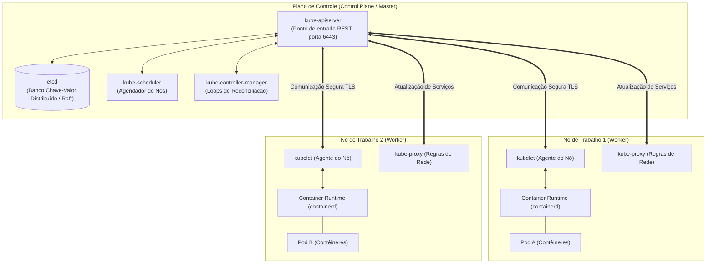
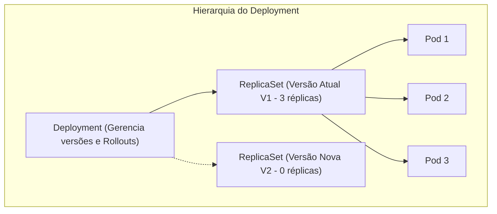
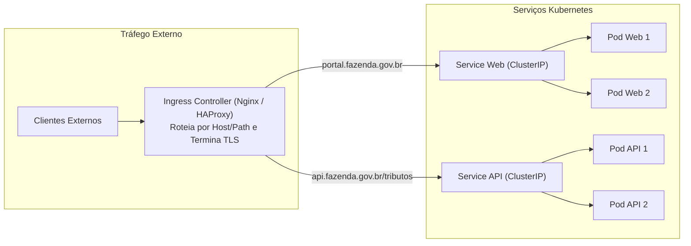
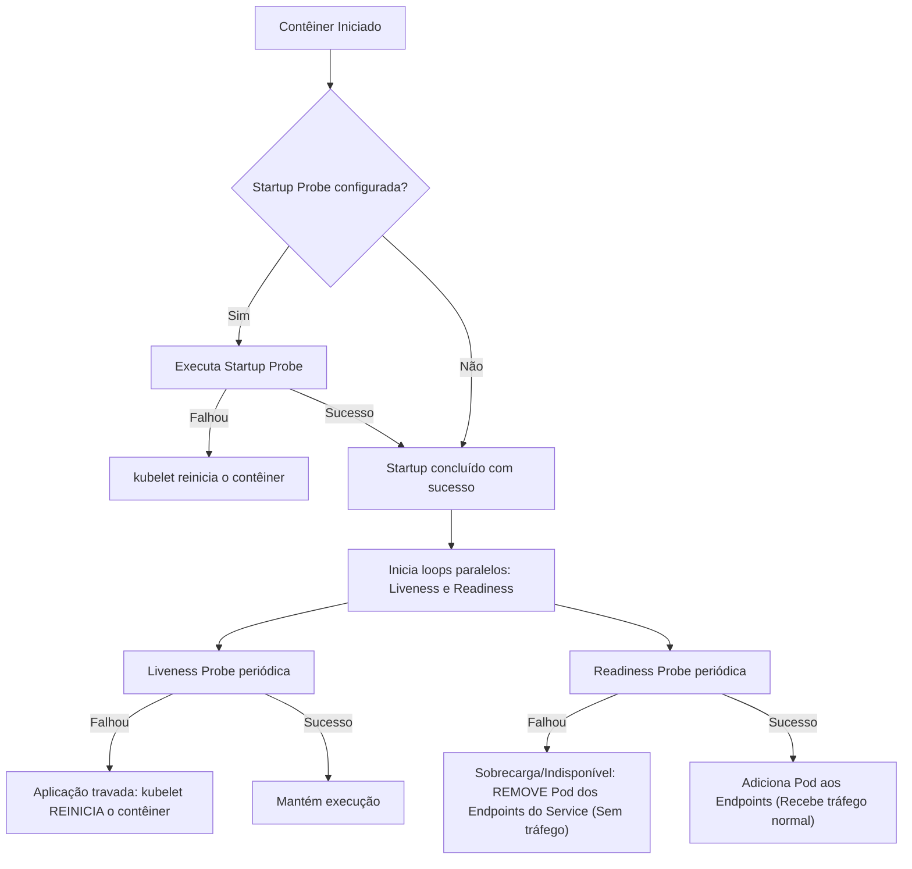

# 04 - Orquestração com Kubernetes e Gestão de Ambientes

> **Matéria:** DevOps, Plataforma de Desenvolvimento e Engenharia de Entrega  
> **Cargo:** B02 – Técnico de Controle Externo – Especialidade: Tecnologia da Informação  
> **Arquivo:** `04_orquestracao_com_kubernetes_e_gestao_de_ambientes.md`  


---


## 📌 Ementa / Itens do Edital
- Orquestração de contêineres com Kubernetes (K8s)
- Arquitetura de clusters Kubernetes (Plano de Controle / Control Plane e Nós de Trabalho / Worker Nodes)
- Objetos fundamentais: Pods, Deployments, ReplicaSets, StatefulSets, DaemonSets, Services e Ingress
- Mecanismos de configuração, persistência e governança: ConfigMaps, Secrets, Namespaces, PV e PVC
- Probes de integridade e ciclo de vida: Liveness, Readiness e Startup Probes
- Estratégias de implantação (Rolling Update, Recreate, Blue-Green, Canary)
- Gestão e segregação de ambientes: Desenvolvimento, Homologação e Produção (Paridade Dev/Prod)

---

## 🧭 Sumário

1. [Arquitetura do Kubernetes: Control Plane vs. Worker Nodes](#1-arquitetura-do-kubernetes-control-plane-vs-worker-nodes)
    1. [Componentes do Plano de Controle (Control Plane)](#11-componentes-do-plano-de-controle-control-plane)
    2. [Componentes dos Nós de Execução (Worker Nodes)](#12-componentes-dos-nos-de-execucao-worker-nodes)
    3. [O Loop de Reconciliação Contínua e o Estado Desejado](#13-o-loop-de-reconciliacao-continua-e-o-estado-desejado)
    4. [Teste 203](#Teste-203)
    5. [Teste 204](#Teste-204)
    6. [Teste 205](#Teste-205)
2. [Workloads e Controladores: Qual Objeto Escolher?](#2-workloads-e-controladores-qual-objeto-escolher)
    1. [Pods: A Menor Unidade Implantável](#21-pods-a-menor-unidade-implantavel)
    2. [Deployment e ReplicaSet: Gerenciamento Declarativo para Aplicações Stateless](#22-deployment-e-replicaset-gerenciamento-declarativo-para-aplicacoes-stateless)
    3. [StatefulSet: Identidade Estável e Volumes para Cargas Stateful](#23-statefulset-identidade-estavel-e-volumes-para-cargas-stateful)
    4. [DaemonSet: Instância Única por Nó de Infraestrutura](#24-daemonset-instancia-unica-por-no-de-infraestrutura)
    5. [Job e CronJob: Tarefas em Lote e Rotinas Agendadas](#25-job-e-cronjob-tarefas-em-lote-e-rotinas-agendadas)
    6. [Teste 206](#Teste-206)
    7. [Teste 207](#Teste-207)
    8. [Teste 208](#Teste-208)
3. [Serviços de Rede (Services) e Roteamento de Borda (Ingress)](#3-servicos-de-rede-services-e-roteamento-de-borda-ingress)
    1. [Tipos de Services: ClusterIP, NodePort, LoadBalancer e ExternalName](#31-tipos-de-services-clusterip-nodeport-loadbalancer-e-externalname)
    2. [O Objeto Ingress e Controladores de Roteamento de Camada 7](#32-o-objeto-ingress-e-controladores-de-roteamento-de-camada-7)
    3. [Teste 209](#Teste-209)
    4. [Teste 210](#Teste-210)
4. [Ciclo de Vida, Resiliência e Probes de Integridade](#4-ciclo-de-vida-resiliencia-e-probes-de-integridade)
    1. [Liveness Probe vs. Readiness Probe vs. Startup Probe](#41-liveness-probe-vs-readiness-probe-vs-startup-probe)
    2. [Tabela Comparativa de Comportamento em Caso de Falha](#42-tabela-comparativa-de-comportamento-em-caso-de-falha)
    3. [Teste 211](#Teste-211)
5. [Governança, Armazenamento e Segregação de Ambientes](#5-governanca-armazenamento-e-segregacao-de-ambientes)
    1. [ConfigMaps e Secrets: Injeção Desacoplada de Configurações](#51-configmaps-e-secrets-injecao-desacoplada-de-configuracoes)
    2. [Persistência: PersistentVolume (PV), PersistentVolumeClaim (PVC) e StorageClass](#52-persistencia-persistentvolume-pv-persistentvolumeclaim-pvc-e-storageclass)
    3. [Segregação de Ambientes e Paridade Dev/Prod (Twelve-Factor App)](#53-segregacao-de-ambientes-e-paridade-devprod-twelve-factor-app)
    4. [Teste 212](#Teste-212)
    5. [Teste 213](#Teste-213)
6. [🌐 Fontes Oficiais e Referências Bibliográficas](#fontes-oficiais-e-referencias-bibliograficas)

---

## 1. Arquitetura do Kubernetes: Control Plane vs. Worker Nodes

O Kubernetes (K8s) é a plataforma líder da indústria para orquestração declarativa de contêineres em ambientes distribuídos e elásticos. Concebido a partir da experiência do Google com seus sistemas internos (Borg e Omega) e posteriormente doado à *Cloud Native Computing Foundation* (CNCF), o Kubernetes opera sob o paradigma do **estado desejado (*declarative reconciliation*)**: o operador define as metas do cluster em manifestos YAML e a plataforma atua ininterruptamente para assegurar que o **estado real** coincida com o **estado declarado**.



### 1.1 Componentes do Plano de Controle (Control Plane)

O Plano de Controle é responsável por tomar decisões globais sobre o cluster (como agendamento de recursos), detectar e responder a eventos (como inicializar um novo Pod quando as réplicas de um Deployment não são atendidas):

1. **`kube-apiserver`:** É o coração e a porta de entrada de todo o cluster. Expõe a API REST do Kubernetes em HTTPS (porta padrão 6443). Todos os clientes externos (como a CLI `kubectl` ou esteiras de CI/CD) e todos os nós internos comunicam-se **exclusivamente com ele**. É o único componente autorizado a realizar operações diretas de leitura e gravação no banco de dados distribuído `etcd`.
2. **`etcd`:** Armazena o estado completo de configuração, segredos, metadados e objetos do cluster. Trata-se de um banco de dados relacional distribuído chave-valor altamente consistente que utiliza o algoritmo de consenso Raft. Fazer backup regular do `etcd` equivale a garantir a recuperação completa de desastres (*Disaster Recovery*) de todo o cluster K8s.
3. **`kube-scheduler`:** Responsável por analisar Pods recém-criados que ainda não possuem um nó atribuído e selecionar o nó de trabalho ideal para executá-los. Considera restrições de hardware (CPU e RAM solicitadas), regras de afinidade e anti-afinidade (*nodeAffinity*, *podAntiAffinity*), tolerâncias a manchas (*taints & tolerations*) e disponibilidade de portas.
4. **`kube-controller-manager`:** Executa os controladores internos em processos de segundo plano. Cada controlador é um loop contínuo de reconciliação que compara o estado real observado via API Server com o estado desejado (ex.: *Node Controller* para nós que falham, *Deployment Controller* para substituição de versões, *EndpointSlice Controller* para roteamento de rede).
5. **`cloud-controller-manager`:** Módulo opcional que integra a lógica do Kubernetes com as APIs dos provedores de nuvem pública (AWS, Azure, Google Cloud), provisionando dinamicamente balanceadores de carga, rotas e discos gerenciados.

### 1.2 Componentes dos Nós de Execução (Worker Nodes)

Os Nós de Trabalho (*Worker Nodes*) são os servidores físicos ou máquinas virtuais encarregados de executar as cargas de trabalho reais da organização:

1. **`kubelet`:** O agente de gerenciamento instalado em cada nó do cluster. Ele consome as especificações do Pod (*PodSpecs*) enviadas pelo `kube-apiserver` e interage com o runtime local de contêineres via *Container Runtime Interface* (CRI) para garantir que os contêineres descritos sejam criados, permaneçam em execução e estejam saudáveis. Ele também supervisiona o resultado das *probes* de integridade e reporta o status do nó ao Control Plane.
2. **`kube-proxy`:** Componente de rede distribuído executado em cada nó de trabalho. Mantém as regras de rede (usando tabelas `iptables` ou módulos `IPVS` do Linux), viabilizando a abstração de *Service* e implementando o balanceamento de conexões TCP/UDP entre as réplicas ativas dos Pods.
3. **Container Runtime:** O software responsável pela execução física dos contêineres (como `containerd` ou `CRI-O`). Opera em conformidade com os padrões da OCI (*Open Container Initiative*).

> ⭐ **IMPORTANTE / REGRA DE OURO:**  
> Nenhum componente do cluster comunica-se diretamente com o `etcd`, com exceção do **`kube-apiserver`**. O `kube-scheduler`, o `controller-manager` e os agentes `kubelet` consultam e atualizam o estado do cluster **sempre e obrigatoriamente através do `kube-apiserver`**.

### 1.3 O Loop de Reconciliação Contínua e o Estado Desejado

O ciclo de vida do Kubernetes baseia-se em um mecanismo ininterrupto:
$$\text{Observar Estado Real} \longrightarrow \text{Comparar com Estado Desejado} \longrightarrow \text{Executar Ação Corretiva}$$
Se um desenvolvedor define `replicas: 4` em um manifesto e um nó físico desliga subitamente (derrubando 2 Pods), o *Controller Manager* detecta que o estado real caiu para 2 réplicas e comanda o *kube-scheduler* a despachar 2 novos Pods em nós sadios remanescentes, restaurando a capacidade desejada sem qualquer intervenção humana (*Self-Healing*).

---

### Teste 203
**(FGV – TRT 16ª – 2022 – Analista Judiciário (Área Administrativa - Tecnologia da Informação))**
Christo e Jeanne-Claude foi um casal de artistas plásticos que se notabilizou por um trabalho muito próximo à arquitetura e com forte componente social, que aparecia na execução de seus projetos, que sempre envolviam a comunidade onde as obras eram instaladas. Alguns aspectos presentes em sua obra, evidenciados nas fotos, são apresentados nas opções a seguir, à exceção de um. Assinale-o.

* **A)** A escala de suas obras.
* **B)** A intervenção em ambientes naturais.
* **C)** A repetição de elementos.
* **D)** O caráter arquitetônico de sua linguagem.
* **E)** O fazer performático.

---

> **Comentário Detalhado:**
>
> - **A)** **Incorreta.** A opção apresenta proposição em desacordo com os fundamentos teóricos e técnicos do tópico ao afirmar que "A escala de suas obras". De acordo com a teoria estudada em *1.2 Componentes dos Nós de Execução (Worker Nodes)*, nenhum componente do cluster comunica-se diretamente com o `etcd`, com exceção do `kube-apiserver`.
> - **B)** **Incorreta.** A opção apresenta proposição em desacordo com os fundamentos teóricos e técnicos do tópico ao afirmar que "A intervenção em ambientes naturais". De acordo com a teoria estudada em *1.3 O Loop de Reconciliação Contínua e o Estado Desejado*, se um desenvolvedor define `replicas: 4` em um manifesto e um nó físico desliga subitamente (derrubando 2 Pods), o *Controller Manager* detecta que o estado real caiu para 2 réplicas e comanda o *kube-scheduler* a despachar 2 novos Pods em nós sadios remanescentes, restaurando a capacidade desejada sem qualquer intervenção humana (*Self-Healing*).
> - **C)** **Incorreta.** A opção apresenta proposição em desacordo com os fundamentos teóricos e técnicos do tópico ao afirmar que "A repetição de elementos". De acordo com a teoria estudada em *1.2 Componentes dos Nós de Execução (Worker Nodes)*, `kube-proxy`: Componente de rede distribuído executado em cada nó de trabalho.
> - **D)** **Incorreta.** A opção apresenta proposição em desacordo com os fundamentos teóricos e técnicos do tópico ao afirmar que "O caráter arquitetônico de sua linguagem". De acordo com a teoria estudada em *1.2 Componentes dos Nós de Execução (Worker Nodes)*, o `kube-scheduler`, o `controller-manager` e os agentes `kubelet` consultam e atualizam o estado do cluster sempre e obrigatoriamente através do `kube-apiserver`.
> - **E)** **Correta.** Conforme fundamentado na seção *1.1 Componentes do Plano de Controle (Control Plane)* deste guia, fazer backup regular do `etcd` equivale a garantir a recuperação completa de desastres (*Disaster Recovery*) de todo o cluster K8s. Dessa forma, está plenamente correta a assertiva da banca (FGV – TRT 16ª/2022) ao estabelecer que "O fazer performático".
>
> **Gabarito: E**

---

### Teste 204
**(FGV – TJ/MT – 2024 – Analista Judiciario Tecnologia Da Informacao)**
A Inteligência Artificial (IA) tem sido um campo de pesquisa e inovação que evoluiu bastante ao longo das décadas, e geralmente é dividida em IA fraca e IA forte, conceitos que se referem ao nível de “inteligência” que a IA consegue simular ou alcançar. Em relação ao conceito de Inteligência Artificial (IA), assinale a afirmativa que descreve corretamente a diferença entre IA forte e IA fraca.

* **A)** IA forte é um sistema que simula a inteligência humana em tarefas específicas, enquanto IA fraca consegue aprender e entender contextos complexos, como um ser humano.
* **B)** IA fraca se refere a sistemas que replicam com exatidão a consciência humana, enquanto IA forte realiza tarefas automatizadas sem a necessidade de consciência.
* **C)** IA forte é caracterizada pela capacidade de adquirir consciência e compreensão geral, enquanto IA fraca é projetada para executar tarefas específicas sem consciência.
* **D)** IA fraca é um sistema totalmente autônomo, que toma decisões complexas de forma independente, enquanto IA forte precisa da intervenção humana para operar.
* **E)** IA forte e IA fraca não têm diferença quanto à forma de processamento de informações; a distinção está apenas na potência do hardware que utilizam.

---

> **Comentário Detalhado:**
>
> - **A)** **Incorreta.** A opção apresenta proposição em desacordo com os fundamentos teóricos e técnicos do tópico ao afirmar que "IA forte é um sistema que simula a inteligência humana em tarefas específicas, enquanto IA fraca consegue aprender...". De acordo com a teoria estudada em *1.3 O Loop de Reconciliação Contínua e o Estado Desejado*, se um desenvolvedor define `replicas: 4` em um manifesto e um nó físico desliga subitamente (derrubando 2 Pods), o *Controller Manager* detecta que o estado real caiu para 2 réplicas e comanda o *kube-scheduler* a despachar 2 novos Pods em nós sadios remanescentes, restaurando a capacidade desejada sem qualquer intervenção humana (*Self-Healing*).
> - **B)** **Incorreta.** A opção apresenta proposição em desacordo com os fundamentos teóricos e técnicos do tópico ao afirmar que "IA fraca se refere a sistemas que replicam com exatidão a consciência humana, enquanto IA forte realiza tarefas...". De acordo com a teoria estudada em *1.2 Componentes dos Nós de Execução (Worker Nodes)*, os Nós de Trabalho (*Worker Nodes*) são os servidores físicos ou máquinas virtuais encarregados de executar as cargas de trabalho reais da organização.
> - **C)** **Correta.** Conforme fundamentado na seção *2.1 Pods: A Menor Unidade Implantável* deste guia, padrão Sidecar: Um contêiner primário executa a lógica de negócio (ex.: API Node.js), enquanto contêineres secundários (*sidecars*) realizam tarefas de apoio (ex.: agente Envoy de Service Mesh ou agente de envio de logs). Dessa forma, está plenamente correta a assertiva da banca (FGV – TJ/MT/2024) ao estabelecer que "IA forte é caracterizada pela capacidade de adquirir consciência e compreensão geral, enquanto IA fraca é...".
> - **D)** **Incorreta.** A opção apresenta proposição em desacordo com os fundamentos teóricos e técnicos do tópico ao afirmar que "IA fraca é um sistema totalmente autônomo, que toma decisões complexas de forma independente, enquanto IA forte...". De acordo com a teoria estudada em *1.1 Componentes do Plano de Controle (Control Plane)*, o Plano de Controle é responsável por tomar decisões globais sobre o cluster (como agendamento de recursos), detectar e responder a eventos (como inicializar um novo Pod quando as réplicas de um Deployment não são atendidas).
> - **E)** **Incorreta.** A opção incorre em restrição indevida ao limitar o escopo conceitual ao afirmar que "IA forte e IA fraca não têm diferença quanto à forma de processamento de informações; a distinção está apenas na...". De acordo com a teoria estudada em *1.1 Componentes do Plano de Controle (Control Plane)*, considera restrições de hardware (CPU e RAM solicitadas), regras de afinidade e anti-afinidade (*nodeAffinity*, *podAntiAffinity*), tolerâncias a manchas (*taints & tolerations*) e disponibilidade de portas.
>
> **Gabarito: C**

---

### Teste 205
**(FGV – TJ/AP – 2023 – Analista Judiciario Apoio Especializado Tecnologia Da Informacao Desenvolvimento De Sistemas)**
A analista Ana administra o cluster Kubernetes do TJAP. Ana percebeu que o nó ANode do cluster está recusando a criação de containers de forma indevida. Para mitigar o problema, Ana deve verificar no ANode o status do agente do Kubernetes que é executado em cada nó, sendo responsável pela garantia da execução dos containers em um pod do Kubernetes. Ana deve verificar no ANode o status do:

* **A)** kubectl;
* **B)** kubelet;
* **C)** kadvisor;
* **D)** kube-apiserver;
* **E)** kube-scheduler.

---

> **Comentário Detalhado:**
>
> - **A)** **Incorreta.** A opção apresenta proposição em desacordo com os fundamentos teóricos e técnicos do tópico ao afirmar que "kubectl". De acordo com a teoria estudada em *1.2 Componentes dos Nós de Execução (Worker Nodes)*, o `kube-scheduler`, o `controller-manager` e os agentes `kubelet` consultam e atualizam o estado do cluster sempre e obrigatoriamente através do `kube-apiserver`.
> - **B)** **Correta.** Conforme fundamentado na seção *1.2 Componentes dos Nós de Execução (Worker Nodes)* deste guia, `kubelet`: O agente de gerenciamento instalado em cada nó do cluster. Dessa forma, está plenamente correta a assertiva da banca (FGV – TJ/AP/2023) ao estabelecer que "kubelet".
> - **C)** **Incorreta.** A opção apresenta proposição em desacordo com os fundamentos teóricos e técnicos do tópico ao afirmar que "kadvisor". De acordo com a teoria estudada em *4. Ciclo de Vida, Resiliência e Probes de Integridade*, o agente `kubelet` utiliza três sondas de monitoramento (*probes*) para acompanhar a integridade física e funcional dos contêineres.
> - **D)** **Incorreta.** A opção apresenta proposição em desacordo com os fundamentos teóricos e técnicos do tópico ao afirmar que "kube-apiserver". De acordo com a teoria estudada em *1.2 Componentes dos Nós de Execução (Worker Nodes)*, ele consome as especificações do Pod (*PodSpecs*) enviadas pelo `kube-apiserver` e interage com o runtime local de contêineres via *Container Runtime Interface* (CRI) para garantir que os contêineres descritos sejam criados, permaneçam em execução e estejam saudáveis.
> - **E)** **Incorreta.** A opção apresenta proposição em desacordo com os fundamentos teóricos e técnicos do tópico ao afirmar que "kube-scheduler". De acordo com a teoria estudada em *1.1 Componentes do Plano de Controle (Control Plane)*, `kube-scheduler`: Responsável por analisar Pods recém-criados que ainda não possuem um nó atribuído e selecionar o nó de trabalho ideal para executá-los.
>
> **Gabarito: B**

---

## 2. Workloads e Controladores: Qual Objeto Escolher?

O Kubernetes não executa contêineres diretamente de forma isolada; ele os encapsula em abstrações funcionais denominadas *Workloads*.



### 2.1 Pods: A Menor Unidade Implantável

O **Pod** é a menor e mais básica unidade gerenciável do modelo de objetos do Kubernetes:

- Um Pod encapsula **um ou mais contêineres estreitamente acoplados** que compartilham recursos de baixo nível:
    1. **Network Namespace Compartilhado:** Todos os contêineres do mesmo Pod compartilham o mesmo endereço IP e a mesma tabela de portas. Eles podem se comunicar internamente via `localhost` com altíssima performance.
    2. **Volumes Compartilhados:** Podem montar os mesmos diretórios de dados locais.

- **Padrão Sidecar:** Um contêiner primário executa a lógica de negócio (ex.: API Node.js), enquanto contêineres secundários (*sidecars*) realizam tarefas de apoio (ex.: agente Envoy de Service Mesh ou agente de envio de logs).
- **Efemeridade Crítica:** Pods são descartáveis e mortais. Eles nunca devem ser instanciados de forma avulsa em produção; devem ser sempre gerenciados por controladores de carga de trabalho.

### 2.2 Deployment e ReplicaSet: Gerenciamento Declarativo para Aplicações Stateless

- **`ReplicaSet`:** Controlador encarregado de manter um número fixo e estável de réplicas de Pods rodando a qualquer momento, utilizando seletores de rótulos (*Labels and Selectors*).
- **`Deployment`:** Abstração de nível superior que gerencia os `ReplicaSets` de forma declarativa:
    - Permite realizar atualizações sem tempo de inatividade (*RollingUpdate*);
    - Controla o ritmo de rollout através das diretivas `maxSurge` (quantos Pods extras podem ser criados acima da meta) e `maxUnavailable` (quantos Pods podem ficar indisponíveis durante a transição);
    - Possibilita pausar, retomar e reverter versões instantaneamente (`kubectl rollout undo deployment/<nome>`).
    - **Uso ideal:** Aplicações web sem estado (*stateless*), microsserviços REST, APIs de processamento assíncrono.

### 2.3 StatefulSet: Identidade Estável e Volumes para Cargas Stateful

Projetado para aplicações que demandam persistência de dados e ordenação estrita:

- **Identidade de Rede Estável:** Cada Pod recebe um nome ordinal determinístico que persiste mesmo se o Pod for recriado (ex.: `postgres-0`, `postgres-1`, `postgres-2`).
- **Volumes Dedicados via `volumeClaimTemplates`:** Cada réplica recebe seu próprio disco persistente individual; se o `postgres-1` morrer e renascer em outro nó, o Kubernetes reanexa exatamente o mesmo disco à nova réplica.
- **Inicialização e Parada Ordenada:** Pods sobem sequencialmente (0, depois 1, depois 2) e são encerrados na ordem inversa (2, depois 1, depois 0).
- **Uso ideal:** Bancos de dados distribuídos (PostgreSQL com replicação, MongoDB, Cassandra), sistemas de mensageria (Apache Kafka, RabbitMQ).

### 2.4 DaemonSet: Instância Única por Nó de Infraestrutura

- Garante que **exatamente uma cópia de um determinado Pod seja executada em todos os nós de trabalho** do cluster.
- Se novos nós forem adicionados ao cluster (por autoscaling de infraestrutura), o *DaemonSet* automaticamente agenda uma réplica do Pod no nó recém-adicionado. Se um nó for removido, o Pod é destruído.
- **Uso ideal:** Daemons de infraestrutura, coletores de logs (Fluentd, Logstash), agentes de monitoramento de métricas (Prometheus Node Exporter) e plugins de rede CNI (Calico, Flannel).

### 2.5 Job e CronJob: Tarefas em Lote e Rotinas Agendadas

- **`Job`:** Cria um ou mais Pods e assegura que eles executem até o término bem-sucedido (código de saída zero). Ao concluir a tarefa, o Pod é encerrado e não é reiniciado pelo kubelet. Indicado para migrações de schema de banco de dados e relatórios pontuais.
- **`CronJob`:** Gerencia a execução periódica de `Jobs` com base em uma tabela temporal padrão (sintaxe cron de 5 campos, ex.: `0 2 * * *` para rodar diariamente às 02h). Indicado para rotinas de backup noturno e limpezas de cache.

---

### Teste 206
**(FGV – TCE/SC – 2026 – Auditor Fiscal de Controle Externo - Ciências Atuariais)**
A qualidade da base de dados é fundamental para a fidedignidade da avaliação atuarial nos regimes próprios de previdência social e nas entidades fechadas de previdência complementar. O processo contempla identificar deficiências cadastrais, reduzir distorções em variáveis e eliminar inconsistências que diminuem a precisão dos cálculos das provisões matemáticas. Entre as opções a seguir, assinale a que representa a técnica ou prática que não deve ser utilizada no tratamento de dados.

* **A)** Análise de outliers nos proventos: identificação de valores de benefícios que extrapolam o teto do regime, visando verificar se houve erro de exportação nos dados ou se existe algum direito adquirido específico.
* **B)** Expurgo de registros de participantes “sem vínculo”: eliminação de registros de participantes que não possuem data de desligamento, mas que pararam de contribuir, sem a ocorrência de institutos como o benefício proporcional diferido.
* **C)** Imputação de salários/contribuições: preenchimento de meses sem registro de contribuição utilizando a média dos últimos salários ou a evolução salarial prevista no plano de cargos e salários do ente.
* **D)** Padronização de variáveis categóricas: ajuste de campos como “estado civil” e “sexo” para uma padronização, garantindo que as premissas de reversão em aposentadoria e pensão sejam automatizadas e calculadas corretamente.
* **E)** Saneamento de inconsistências temporais: identificação e correção de datas conflitantes, como data de admissão posterior à data de início do benefício ou data de nascimento inconsistente com a idade de entrada no regime de origem.

---

> **Comentário Detalhado:**
>
> - **A)** **Incorreta.** A opção apresenta proposição em desacordo com os fundamentos teóricos e técnicos do tópico ao afirmar que "Análise de outliers nos proventos: identificação de valores de benefícios que extrapolam o teto do regime, visando...". De acordo com a teoria estudada em *1.1 Componentes do Plano de Controle (Control Plane)*, é o único componente autorizado a realizar operações diretas de leitura e gravação no banco de dados distribuído `etcd`.
> - **B)** **Incorreta.** A opção apresenta proposição em desacordo com os fundamentos teóricos e técnicos do tópico ao afirmar que "Expurgo de registros de participantes “sem vínculo”: eliminação de registros de participantes que não possuem data...". De acordo com a teoria estudada em *1.1 Componentes do Plano de Controle (Control Plane)*, `kube-scheduler`: Responsável por analisar Pods recém-criados que ainda não possuem um nó atribuído e selecionar o nó de trabalho ideal para executá-los.
> - **C)** **Correta.** Conforme fundamentado na seção *2.2 Deployment e ReplicaSet: Gerenciamento Declarativo para Aplicações Stateless* deste guia, `ReplicaSet`: Controlador encarregado de manter um número fixo e estável de réplicas de Pods rodando a qualquer momento, utilizando seletores de rótulos (*Labels and Selectors*). Dessa forma, está plenamente correta a assertiva da banca (FGV – TCE/SC/2026) ao estabelecer que "Imputação de salários/contribuições: preenchimento de meses sem registro de contribuição utilizando a média dos...".
> - **D)** **Incorreta.** A opção apresenta proposição em desacordo com os fundamentos teóricos e técnicos do tópico ao afirmar que "Padronização de variáveis categóricas: ajuste de campos como “estado civil” e “sexo” para uma padronização...". De acordo com a teoria estudada em *2.5 Job e CronJob: Tarefas em Lote e Rotinas Agendadas*, `CronJob`: Gerencia a execução periódica de `Jobs` com base em uma tabela temporal padrão (sintaxe cron de 5 campos, ex.: `0 2 * * *` para rodar diariamente às 02h). Indicado para rotinas de backup noturno e limpezas de cache.
> - **E)** **Incorreta.** A opção apresenta proposição em desacordo com os fundamentos teóricos e técnicos do tópico ao afirmar que "Saneamento de inconsistências temporais: identificação e correção de datas conflitantes, como data de admissão...". De acordo com a teoria estudada em *1.1 Componentes do Plano de Controle (Control Plane)*, `kube-apiserver`: É o coração e a porta de entrada de todo o cluster. Expõe a API REST do Kubernetes em HTTPS (porta padrão 6443).
>
> **Gabarito: C**

---

### Teste 207
**(FGV – TCE/SC – 2026 – Auditor Fiscal de Controle Externo - Ciências da Computação, Sistemas de Informação...)**
O TCE-SC está a implementar um assistente virtual para auxiliar os auditores na consulta de normas jurídicas complexas. Para evitar alucinações do modelo de linguagem (LLM) e garantir que as respostas sejam baseadas estritamente no repositório de resoluções do Tribunal, a equipe técnica optou pela arquitetura Retrieval-Augmented Generation (RAG). No fluxo de funcionamento de um sistema RAG, o papel fundamental do Vector Database é

* **A)** armazenar as representações matemáticas dos documentos para permitir a busca por similaridade semântica.
* **B)** realizar a tradução juramentada dos termos técnicos para linguagem natural.
* **C)** armazenar o código-fonte do modelo pré-treinado para ajuste fino.
* **D)** substituir completamente o LLM na geração do texto final da resposta.
* **E)** gerir o histórico de conversas do usuário em formato de texto estruturado JSON.

---

> **Comentário Detalhado:**
>
> - **A)** **Correta.** Conforme fundamentado na seção *3.2 O Objeto Ingress e Controladores de Roteamento de Camada 7* deste guia, funcionalidades: Roteamento baseado em nomes de domínio (*Virtual Hosting* baseado em SNI, ex.: `portal.tce.go.gov.br` vs `auditoria.tce.go.gov.br`), roteamento baseado em caminhos de URL (ex.: `/api/v1/auth` vs `/api/v1/certidoes`) e terminação centralizada de criptografia TLS/SSL. Dessa forma, está plenamente correta a assertiva da banca (FGV – TCE/SC/2026) ao estabelecer que "armazenar as representações matemáticas dos documentos para permitir a busca por similaridade semântica".
> - **B)** **Incorreta.** A opção apresenta proposição em desacordo com os fundamentos teóricos e técnicos do tópico ao afirmar que "realizar a tradução juramentada dos termos técnicos para linguagem natural". De acordo com a teoria estudada em *2.2 Deployment e ReplicaSet: Gerenciamento Declarativo para Aplicações Stateless*, permite realizar atualizações sem tempo de inatividade (*RollingUpdate*).
> - **C)** **Incorreta.** A opção apresenta proposição em desacordo com os fundamentos teóricos e técnicos do tópico ao afirmar que "armazenar o código-fonte do modelo pré-treinado para ajuste fino". De acordo com a teoria estudada em *5.1 ConfigMaps e Secrets: Injeção Desacoplada de Configurações*, em cumprimento ao Fator III da metodologia *Twelve-Factor App* (*Store config in the environment*), parâmetros de configuração e credenciais nunca devem estar fixados (*hardcoded*) dentro do código-fonte ou da imagem Docker.
> - **D)** **Incorreta.** A opção apresenta proposição em desacordo com os fundamentos teóricos e técnicos do tópico ao afirmar que "substituir completamente o LLM na geração do texto final da resposta". De acordo com a teoria estudada em *5.1 ConfigMaps e Secrets: Injeção Desacoplada de Configurações*, `ConfigMap`: Armazena dados de configuração não sensíveis em texto claro (variáveis de ambiente, URLs de serviços externos, arquivos de configuração completos como `nginx.conf`).
> - **E)** **Incorreta.** A opção apresenta proposição em desacordo com os fundamentos teóricos e técnicos do tópico ao afirmar que "gerir o histórico de conversas do usuário em formato de texto estruturado JSON". De acordo com a teoria estudada em *3.1 Tipos de Services: ClusterIP, NodePort, LoadBalancer e ExternalName*, cria um IP virtual acessível estritamente de dentro do cluster.
>
> **Gabarito: A**

---

### Teste 208
**(FGV – TJ/DFT – 2022 – Analista Judiciario Suporte Em Tecnologia Da Informacao)**
A analista Ana precisa implantar o pod LogPod no cluster de Kubernetes KCluster do TJDFT de forma que todos os nós elegíveis do KCluster executem uma cópia do LogPod. Para que o KCluster apresente uma cópia do LogPod em cada nó elegível, de forma automática, Ana deve implantar o LogPod utilizando o recurso do Kubernetes:

* **A)** ReplicationController;
* **B)** ReplicaSet;
* **C)** StatefulSet;
* **D)** DaemonSet;
* **E)** EndpointSlice.

---

> **Comentário Detalhado:**
>
> - **A)** **Incorreta.** A opção apresenta proposição em desacordo com os fundamentos teóricos e técnicos do tópico ao afirmar que "ReplicationController". De acordo com a teoria estudada em *2.4 DaemonSet: Instância Única por Nó de Infraestrutura*, se novos nós forem adicionados ao cluster (por autoscaling de infraestrutura), o *DaemonSet* automaticamente agenda uma réplica do Pod no nó recém-adicionado. Se um nó for removido, o Pod é destruído.
> - **B)** **Incorreta.** A opção apresenta proposição em desacordo com os fundamentos teóricos e técnicos do tópico ao afirmar que "ReplicaSet". De acordo com a teoria estudada em *2.2 Deployment e ReplicaSet: Gerenciamento Declarativo para Aplicações Stateless*, `ReplicaSet`: Controlador encarregado de manter um número fixo e estável de réplicas de Pods rodando a qualquer momento, utilizando seletores de rótulos (*Labels and Selectors*).
> - **C)** **Incorreta.** A opção apresenta proposição em desacordo com os fundamentos teóricos e técnicos do tópico ao afirmar que "StatefulSet". De acordo com a teoria estudada em *2.3 StatefulSet: Identidade Estável e Volumes para Cargas Stateful*, identidade de Rede Estável: Cada Pod recebe um nome ordinal determinístico que persiste mesmo se o Pod for recriado (ex.: `postgres-0`, `postgres-1`, `postgres-2`).
> - **D)** **Correta.** Conforme fundamentado na seção *2.4 DaemonSet: Instância Única por Nó de Infraestrutura* deste guia, garante que exatamente uma cópia de um determinado Pod seja executada em todos os nós de trabalho do cluster. Dessa forma, está plenamente correta a assertiva da banca (FGV – TJ/DFT/2022) ao estabelecer que "DaemonSet".
> - **E)** **Incorreta.** A opção apresenta proposição em desacordo com os fundamentos teóricos e técnicos do tópico ao afirmar que "EndpointSlice". De acordo com a teoria estudada em *1.1 Componentes do Plano de Controle (Control Plane)*, cada controlador é um loop contínuo de reconciliação que compara o estado real observado via API Server com o estado desejado (ex.: *Node Controller* para nós que falham, *Deployment Controller* para substituição de versões, *EndpointSlice Controller* para roteamento de rede).
>
> **Gabarito: D**

---

## 3. Serviços de Rede (Services) e Roteamento de Borda (Ingress)

Como os Pods são efêmeros e seus IPs são dinâmicos e voláteis, sistemas corporativos exigem pontos de acesso estáveis para comunicação.



### 3.1 Tipos de Services: ClusterIP, NodePort, LoadBalancer e ExternalName

O objeto **`Service`** provê um endereço IP virtual fixo (*VIP*) e um registro DNS imutável para um conjunto de Pods selecionados via *labels*:

1. **`ClusterIP` (Padrão):**
    - Cria um IP virtual acessível **estritamente de dentro do cluster**.
    - É o padrão ouro para comunicação interna entre microsserviços (comunicação leste-oeste).

2. **`NodePort`:**
    - Abre uma porta estática de alto nível (por padrão entre as faixas **30000 e 32767**) em todas as interfaces de rede de **todos os nós do cluster**.
    - Qualquer cliente que enviar tráfego para `<IP_Qualquer_No>:<NodePort>` é balanceado e direcionado aos Pods do serviço.

3. **`LoadBalancer`:**
    - Estende o tipo `NodePort` ao solicitar automaticamente a criação de um balanceador de carga externo gerenciado no provedor de nuvem pública (AWS NLB, Azure Load Balancer).
    - O balanceador da nuvem recebe o tráfego externo e o despacha para os nós do Kubernetes.

4. **`ExternalName`:**
    - Não utiliza seletores nem endereços IP virtuais; atua como um redirecionamento interno de DNS mapeando o serviço para um nome externo (registro CNAME), como `database.orgao.gov.br`.

### 3.2 O Objeto Ingress e Controladores de Roteamento de Camada 7

Enquanto criar múltiplos serviços do tipo `LoadBalancer` gera custos financeiros elevados e aloca dezenas de IPs públicos, o **`Ingress`** atua como um roteador de borda consolidado na Camada 7 (HTTP/HTTPS):

- **Funcionalidades:** Roteamento baseado em nomes de domínio (*Virtual Hosting* baseado em SNI, ex.: `portal.tce.go.gov.br` vs `auditoria.tce.go.gov.br`), roteamento baseado em caminhos de URL (ex.: `/api/v1/auth` vs `/api/v1/certidoes`) e **terminação centralizada de criptografia TLS/SSL**.
- **Ingress Controller:** O objeto `Ingress` é apenas um manifesto declarativo de regras. Ele exige a presença de um **Ingress Controller** ativo no cluster (como NGINX Ingress Controller, Traefik, HAProxy ou Kong) para interceptar o tráfego e aplicar o roteamento.

---

### Teste 209
**(FGV – TJ/BA – 2015 – Analista Judiciario Tecnologia Da Informacao)**
Há suspeita de um loop de roteamento na rede. Tal suspeita pode ser reforçada se, ao se monitorar a rede, forem detectados:

* **A)** pacotes ICMP do tipo Time Exceeded;
* **B)** pacotes ARP originados de máquina externas;
* **C)** pacotes UDP contendo consultas recursivas para servidores DNS internos;
* **D)** pacotes TCP com endereços origem e destino iguais entre si;
* **E)** pacotes IGMP e multicast com pruning.

---

> **Comentário Detalhado:**
>
> - **A)** **Correta.** Conforme fundamentado na seção *3.2 O Objeto Ingress e Controladores de Roteamento de Camada 7* deste guia, enquanto criar múltiplos serviços do tipo `LoadBalancer` gera custos financeiros elevados e aloca dezenas de IPs públicos, o `Ingress` atua como um roteador de borda consolidado na Camada 7 (HTTP/HTTPS). Dessa forma, está plenamente correta a assertiva da banca (FGV – TJ/BA/2015) ao estabelecer que "pacotes ICMP do tipo Time Exceeded".
> - **B)** **Incorreta.** A opção apresenta proposição em desacordo com os fundamentos teóricos e técnicos do tópico ao afirmar que "pacotes ARP originados de máquina externas". De acordo com a teoria estudada em *4.2 Tabela Comparativa de Comportamento em Caso de Falha*, tipo de Sonda: Propósito Essencial — Ação do Kubernetes em Caso de Falha Contínua — Impacto no Tráfego de Rede.
> - **C)** **Incorreta.** A opção apresenta proposição em desacordo com os fundamentos teóricos e técnicos do tópico ao afirmar que "pacotes UDP contendo consultas recursivas para servidores DNS internos". De acordo com a teoria estudada em *1.2 Componentes dos Nós de Execução (Worker Nodes)*, mantém as regras de rede (usando tabelas `iptables` ou módulos `IPVS` do Linux), viabilizando a abstração de *Service* e implementando o balanceamento de conexões TCP/UDP entre as réplicas ativas dos Pods.
> - **D)** **Incorreta.** A opção apresenta proposição em desacordo com os fundamentos teóricos e técnicos do tópico ao afirmar que "pacotes TCP com endereços origem e destino iguais entre si". De acordo com a teoria estudada em *3.1 Tipos de Services: ClusterIP, NodePort, LoadBalancer e ExternalName*, não utiliza seletores nem endereços IP virtuais; atua como um redirecionamento interno de DNS mapeando o serviço para um nome externo (registro CNAME), como `database.orgao.gov.br`.
> - **E)** **Incorreta.** A opção apresenta proposição em desacordo com os fundamentos teóricos e técnicos do tópico ao afirmar que "pacotes IGMP e multicast com pruning". De acordo com a teoria estudada em *3.1 Tipos de Services: ClusterIP, NodePort, LoadBalancer e ExternalName*, estende o tipo `NodePort` ao solicitar automaticamente a criação de um balanceador de carga externo gerenciado no provedor de nuvem pública (AWS NLB, Azure Load Balancer).
>
> **Gabarito: A**

---

### Teste 210
**(FGV – TCE/SC – 2026 – Auditor Fiscal de Controle Externo - Engenharia Elétrica)**
Um sistema elétrico de potência é basicamente formado pela geração, transmissão, subtransmissão e distribuição. Sobre esses elementos, é correto afirmar que

* **A)** o sistema de transmissão de uma rede interconectada é caracterizado por operar em malhas estritamente radiais para evitar a circulação de correntes de regime transitório.
* **B)** a subtransmissão é definida exclusivamente pelo seu nível de tensão intermediário, sendo funcionalmente idêntica à transmissão de longa distância, com a única diferença de que opera em anéis fechados.
* **C)** a subtransmissão atua como uma interface de "amortecimento" e capilaridade, recebendo energia do sistema de transmissão em altas tensões e redistribuindo-a para subestações de distribuição.
* **D)** o sistema de distribuição primária diferencia-se da subtransmissão por ser o único segmento do sistema que permite a conexão de cargas industriais de grande porte.
* **E)** no segmento de geração, o uso de transformadores elevadores nas subestações associadas às usinas tem como objetivo principal o isolamento galvânico entre o gerador e a rede.

---

> **Comentário Detalhado:**
>
> - **A)** **Incorreta.** A opção apresenta proposição em desacordo com os fundamentos teóricos e técnicos do tópico ao afirmar que "o sistema de transmissão de uma rede interconectada é caracterizado por operar em malhas estritamente radiais para...". De acordo com a teoria estudada em *5.3 Segregação de Ambientes e Paridade Dev/Prod (Twelve-Factor App)*, exige o uso obrigatório de `ResourceQuota` (para limitar o teto de CPU e RAM de desenvolvimento e evitar que testes sobrecarreguem a produção), `LimitRange` e `NetworkPolicies` (regras de firewall interno impedindo comunicação entre namespaces).
> - **B)** **Incorreta.** A opção incorre em restrição indevida ao limitar o escopo conceitual ao afirmar que "a subtransmissão é definida exclusivamente pelo seu nível de tensão intermediário, sendo funcionalmente idêntica à...". De acordo com a teoria estudada em *1. Arquitetura do Kubernetes: Control Plane vs. Worker Nodes*, concebido a partir da experiência do Google com seus sistemas internos (Borg e Omega) e posteriormente doado à *Cloud Native Computing Foundation* (CNCF), o Kubernetes opera sob o paradigma do estado desejado (*declarative reconciliation*): o operador define as metas do cluster em manifestos YAML e a plataforma atua ininterruptamente para assegurar que o estado real coincida com o estado declarado.
> - **C)** **Correta.** Conforme fundamentado na seção *1.2 Componentes dos Nós de Execução (Worker Nodes)* deste guia, ele consome as especificações do Pod (*PodSpecs*) enviadas pelo `kube-apiserver` e interage com o runtime local de contêineres via *Container Runtime Interface* (CRI) para garantir que os contêineres descritos sejam criados, permaneçam em execução e estejam saudáveis. Dessa forma, está plenamente correta a assertiva da banca (FGV – TCE/SC/2026) ao estabelecer que "a subtransmissão atua como uma interface de "amortecimento" e capilaridade, recebendo energia do sistema de...".
> - **D)** **Incorreta.** A opção apresenta proposição em desacordo com os fundamentos teóricos e técnicos do tópico ao afirmar que "o sistema de distribuição primária diferencia-se da subtransmissão por ser o único segmento do sistema que permite...". De acordo com a teoria estudada em *3.1 Tipos de Services: ClusterIP, NodePort, LoadBalancer e ExternalName*, não utiliza seletores nem endereços IP virtuais; atua como um redirecionamento interno de DNS mapeando o serviço para um nome externo (registro CNAME), como `database.orgao.gov.br`.
> - **E)** **Incorreta.** A opção apresenta proposição em desacordo com os fundamentos teóricos e técnicos do tópico ao afirmar que "no segmento de geração, o uso de transformadores elevadores nas subestações associadas às usinas tem como objetivo...". De acordo com a teoria estudada em *4.1 Liveness Probe vs. Readiness Probe vs. Startup Probe*, objetivo: Detectar se a aplicação está pronta para receber tráfego de rede dos clientes.
>
> **Gabarito: C**

---

## 4. Ciclo de Vida, Resiliência e Probes de Integridade

O agente `kubelet` utiliza três sondas de monitoramento (*probes*) para acompanhar a integridade física e funcional dos contêineres:



### 4.1 Liveness Probe vs. Readiness Probe vs. Startup Probe

1. **`livenessProbe` (Sonda de Sobrevivência):**
    - **Objetivo:** Detectar se a aplicação interna entrou em estado de falha fatal irrecuperável (ex.: *deadlock* de threads, vazamento catastrófico de memória ou loop infinito).
    - **Consequência da Falha:** O `kubelet` **encerra o contêiner imediatamente e o reinicia** de acordo com a política de reinício (*restartPolicy*).

2. **`readinessProbe` (Sonda de Prontidão):**
    - **Objetivo:** Detectar se a aplicação está **pronta para receber tráfego de rede** dos clientes.
    - **Consequência da Falha:** O contêiner **NÃO é reiniciado**! O Kubernetes apenas **remove temporariamente o endereço IP do Pod da lista de Endpoints do Service**, impedindo que requisições de usuários sejam enviadas a um Pod que está ocupado ou aquecendo caches.

3. **`startupProbe` (Sonda de Inicialização):**
    - **Objetivo:** Proteger aplicações legadas que demoram vários minutos para inicializar (ex.: monólitos corporativos em Java/Spring).
    - **Mecanismo:** Desativa as verificações de Liveness e Readiness até que a aplicação complete seu boot inicial, prevenindo que o kubelet mate prematuramente um contêiner que apenas estava inicializando seus módulos internos.

### 4.2 Tabela Comparativa de Comportamento em Caso de Falha

| Tipo de Sonda | Propósito Essencial | Ação do Kubernetes em Caso de Falha Contínua | Impacto no Tráfego de Rede |
| :--- | :--- | :--- | :--- |
| **`livenessProbe`** | Verificar se a aplicação está viva e operante. | **REINICIA o contêiner** (emite `SIGTERM` e `SIGKILL`). | O Pod fica temporariamente indisponível até o reinício. |
| **`readinessProbe`** | Verificar se a aplicação pode atender requisições agora. | **NÃO reinicia o contêiner**. | **Remove o Pod dos Endpoints do Service** (zero tráfego). |
| **`startupProbe`** | Proteger o tempo de boot inicial de sistemas lentos. | **REINICIA o contêiner** somente se o tempo limite de boot expirar. | O Pod não recebe tráfego até passar na sonda. |

> 🚨 **ALERTA DE PROVA / PEGADINHA FCC:**  
> A pegadinha clássica da FCC em questões sobre probes é inverter as consequências de falha:
>
> - Afirmar que a falha da **readinessProbe** causa a destruição ou reinicialização do contêiner (**FALSO!** A readiness apenas remove o Pod do balanceador do Service).
> - O reinício compulsório ocorre na falha contínua da **livenessProbe**!

---

### Teste 211
**(CEBRASPE – TRT/10 – 2013 – Analista Judiciario Tecnologia Da Informacao)**
A consistência, uma propriedade que deve ser garantida em um sistema de gerenciamento de banco de dados, ocorre em situações em que todas as ações de uma unidade de trabalho são efetivadas (commit) sem que haja falha na unidade de trabalho. Caso haja falha, é realizado roll back.

* **C)** Certo
* **E)** Errado

---

> **Comentário Detalhado:**
>
> - **C)** **Incorreta.** A marcação como **Certo** não procede, pois o enunciado apresenta proposição em desacordo com os fundamentos teóricos e técnicos do tópico ao afirmar que "A consistência, uma propriedade que deve ser garantida em um sistema de gerenciamento de banco de dados...". De acordo com a teoria estudada em *2.1 Pods: A Menor Unidade Implantável*, efemeridade Crítica: Pods são descartáveis e mortais. Eles nunca devem ser instanciados de forma avulsa em produção; devem ser sempre gerenciados por controladores de carga de trabalho.
> - **E)** **Correta.** O item está **Errado** (gabarito oficial: **E**). Conforme fundamentado na seção *4.2 Tabela Comparativa de Comportamento em Caso de Falha* deste guia, o reinício compulsório ocorre na falha contínua da livenessProbe!. Portanto, a assertiva examinada pela banca (CEBRASPE – TRT/10/2013) viola os preceitos técnicos do tópico.
>
> **Gabarito: E**

---

## 5. Governança, Armazenamento e Segregação de Ambientes

### 5.1 ConfigMaps e Secrets: Injeção Desacoplada de Configurações

Em cumprimento ao Fator III da metodologia *Twelve-Factor App* (*Store config in the environment*), parâmetros de configuração e credenciais nunca devem estar fixados (*hardcoded*) dentro do código-fonte ou da imagem Docker:

- **`ConfigMap`:** Armazena dados de configuração não sensíveis em texto claro (variáveis de ambiente, URLs de serviços externos, arquivos de configuração completos como `nginx.conf`). Podem ser injetados no contêiner como variáveis de ambiente ou montados como arquivos em volumes virtuais.
- **`Secret`:** Armazena dados estritamente sensíveis (senhas de banco de dados, chaves privadas SSH, tokens JWT, certificados digitais TLS). Por padrão no Kubernetes vanilla, os dados são armazenados no `etcd` e codificados em Base64 (exigindo a habilitação de criptografia em repouso no `etcd` para segurança corporativa plena).

### 5.2 Persistência: PersistentVolume (PV), PersistentVolumeClaim (PVC) e StorageClass

O Kubernetes implementa um padrão desacoplado entre administradores de infraestrutura e desenvolvedores para gerenciar armazenamento de dados:

```mermaid
flowchart LR
    ADMIN["Administrador / Cloud Provider"] -->|Provisiona storage físico| PV["PersistentVolume (PV)"]
    DEV["Desenvolvedor"] -->|Solicita 100Gi ReadWriteOnce| PVC["PersistentVolumeClaim (PVC)"]
    PVC -.->|Vinculação Automática (Binding)| PV
    POD["Pod (StatefulSet / Deployment)"] -->|Consome o storage| PVC
```

- **`PersistentVolume` (PV):** O recurso de armazenamento real provisionado no cluster (disco SAN, volume AWS EBS, export NFS). Representa a oferta de capacidade física.
- **`PersistentVolumeClaim` (PVC):** A solicitação formal de armazenamento feita por um desenvolvedor (especificando tamanho em gigabytes e modo de acesso, como `ReadWriteOnce` ou `ReadWriteMany`). O Kubernetes vincula automaticamente o PVC a um PV compatível.
- **`StorageClass`:** Permite o provisionamento dinâmico de volumes. Quando um PVC referencia uma StorageClass, o Kubernetes aciona a API do provedor de infraestrutura para criar o disco físico sob demanda, dispensando o provisionamento manual prévio de PVs.

### 5.3 Segregação de Ambientes e Paridade Dev/Prod (Twelve-Factor App)

A gestão profissional de múltiplos ambientes (Desenvolvimento, Homologação/Staging e Produção) exige conformidade com as boas práticas de governança:

1. **Paridade entre Ambientes (Fator X do Twelve-Factor App):** As ferramentas, bibliotecas e sistemas de retaguarda (bancos de dados, mensageria) devem ser estritamente idênticos em todos os estágios. Não se deve utilizar SQLite em desenvolvimento e PostgreSQL em produção; utilize o mesmo PostgreSQL conteinerizado em todos os ambientes.
2. **Modelos de Isolamento Multi-Ambiente:**
    - **Soft Multi-Tenancy (Namespaces Compartilhados no mesmo Cluster):** Ambientes separados logicamente por `Namespaces` dentro de um único cluster. Exige o uso obrigatório de **`ResourceQuota`** (para limitar o teto de CPU e RAM de desenvolvimento e evitar que testes sobrecarreguem a produção), **`LimitRange`** e **`NetworkPolicies`** (regras de firewall interno impedindo comunicação entre namespaces).
    - **Hard Multi-Tenancy (Clusters Físicos Dedicados):** Padrão recomendado para órgãos do setor público como o TCE-GO. Mantêm-se clusters fisicamente isolados para Produção e Não-Produção, eliminando qualquer risco de contaminação cruzada, vazamento de dados fiscais ou exaustão de plano de controle.

---

### Teste 212
**(FCC – TRT 14ª – 2016 – Analista Judiciário - Apoio Especializado - Tecnologia da Informação)**
Dentre as atividades que um homologador de sistemas deve realizar em um processo de homologação de sistemas novos, inclui-se

* **A)** implantar o sistema no ambiente de produção do cliente, bloqueando módulos com eventuais erros.
* **B)** classificar os requisitos como funcionais e não funcionais.
* **C)** desenvolver, apresentando ao cliente, o protótipo das principais funcionalidades do sistema.
* **D)** elaborar um documento com a lista de requisitos que podem ser descartados sem comprometer o funcionamento do sistema.
* **E)** elaborar o documento de problemas encontrados durante os testes, encaminhando-o ao responsável pelo desenvolvi- mento do sistema.

---

> **Comentário Detalhado:**
>
> - **A)** **Incorreta.** A opção apresenta proposição em desacordo com os fundamentos teóricos e técnicos do tópico ao afirmar que "implantar o sistema no ambiente de produção do cliente, bloqueando módulos com eventuais erros". De acordo com a teoria estudada em *5.3 Segregação de Ambientes e Paridade Dev/Prod (Twelve-Factor App)*, a gestão profissional de múltiplos ambientes (Desenvolvimento, Homologação/Staging e Produção) exige conformidade com as boas práticas de governança.
> - **B)** **Incorreta.** A opção apresenta proposição em desacordo com os fundamentos teóricos e técnicos do tópico ao afirmar que "classificar os requisitos como funcionais e não funcionais". De acordo com a teoria estudada em *2. Workloads e Controladores: Qual Objeto Escolher?*, o Kubernetes não executa contêineres diretamente de forma isolada; ele os encapsula em abstrações funcionais denominadas *Workloads*.
> - **C)** **Incorreta.** A opção apresenta proposição em desacordo com os fundamentos teóricos e técnicos do tópico ao afirmar que "desenvolver, apresentando ao cliente, o protótipo das principais funcionalidades do sistema". De acordo com a teoria estudada em *2.2 Deployment e ReplicaSet: Gerenciamento Declarativo para Aplicações Stateless*, controla o ritmo de rollout através das diretivas `maxSurge` (quantos Pods extras podem ser criados acima da meta) e `maxUnavailable` (quantos Pods podem ficar indisponíveis durante a transição).
> - **D)** **Incorreta.** A opção apresenta proposição em desacordo com os fundamentos teóricos e técnicos do tópico ao afirmar que "elaborar um documento com a lista de requisitos que podem ser descartados sem comprometer o funcionamento do...". De acordo com a teoria estudada em *5.1 ConfigMaps e Secrets: Injeção Desacoplada de Configurações*, podem ser injetados no contêiner como variáveis de ambiente ou montados como arquivos em volumes virtuais.
> - **E)** **Correta.** Conforme fundamentado na seção *5.3 Segregação de Ambientes e Paridade Dev/Prod (Twelve-Factor App)* deste guia, exige o uso obrigatório de `ResourceQuota` (para limitar o teto de CPU e RAM de desenvolvimento e evitar que testes sobrecarreguem a produção), `LimitRange` e `NetworkPolicies` (regras de firewall interno impedindo comunicação entre namespaces). Dessa forma, está plenamente correta a assertiva da banca (FCC – TRT 14ª/2016) ao estabelecer que "elaborar o documento de problemas encontrados durante os testes, encaminhando-o ao responsável pelo desenvolvi-...".
>
> **Gabarito: E**

---

### Teste 213
**(FCC – TRT 6ª – 2012 – Analista Judiciário - Apoio Especializado/Tecnologia da Informação)**
Com relação ao ciclo de vida do produto, segundo o PMBOK, considere: I. Geralmente o ciclo de vida de um projeto está contido em um ou mais ciclos de vida do produto. O ciclo de vida do produto consiste em fases do produto, geralmente sequenciais e não sobrepostas, determinadas pela necessidade de produção e controle da organização, sendo que a última fase do ciclo de vida de um produto é a entrega para o cliente final. II. Vários aspectos do ciclo de vida do produto prestam-se à execução como projetos, por exemplo, a realização de um es- tudo de viabilidade, a condução de pesquisas de mercado, a execução de campanhas publicitárias, a instalação de um produto, realização de dinâmicas de grupo e de avaliações de produtos em mercados de teste. Em cada um destes exem- plos, o ciclo de vida do projeto difere do ciclo de vida do produto. III. Quando a saída do projeto está relacionada a um produto, existem muitas relações possíveis. Por exemplo, o desenvolvimento de um novo produto pode ser um projeto em si. Ao mesmo tempo, um produto existente pode se beneficiar de um projeto para o acréscimo de novas funções ou características. Está correto o que se afirma em

* **A)** II e III, apenas.
* **B)** I, II e III.
* **C)** I e III, apenas.
* **D)** I, apenas.
* **E)** III, apenas.

---

> **Comentário Detalhado:**
>
> - **A)** **Correta.** Conforme fundamentado na seção *5.1 ConfigMaps e Secrets: Injeção Desacoplada de Configurações* deste guia, em cumprimento ao Fator III da metodologia *Twelve-Factor App* (*Store config in the environment*), parâmetros de configuração e credenciais nunca devem estar fixados (*hardcoded*) dentro do código-fonte ou da imagem Docker. Dessa forma, está plenamente correta a assertiva da banca (FCC – TRT 6ª/2012) ao estabelecer que "II e III, apenas".
> - **B)** **Incorreta.** A opção apresenta proposição em desacordo com os fundamentos teóricos e técnicos do tópico ao afirmar que "I, II e III". De acordo com a teoria estudada em *5.3 Segregação de Ambientes e Paridade Dev/Prod (Twelve-Factor App)*, a gestão profissional de múltiplos ambientes (Desenvolvimento, Homologação/Staging e Produção) exige conformidade com as boas práticas de governança.
> - **C)** **Incorreta.** A opção incorre em restrição indevida ao limitar o escopo conceitual ao afirmar que "I e III, apenas". De acordo com a teoria estudada em *5.3 Segregação de Ambientes e Paridade Dev/Prod (Twelve-Factor App)*, não se deve utilizar SQLite em desenvolvimento e PostgreSQL em produção; utilize o mesmo PostgreSQL conteinerizado em todos os ambientes.
> - **D)** **Incorreta.** A opção incorre em restrição indevida ao limitar o escopo conceitual ao afirmar que "I, apenas". De acordo com a teoria estudada em *5.3 Segregação de Ambientes e Paridade Dev/Prod (Twelve-Factor App)*, exige o uso obrigatório de `ResourceQuota` (para limitar o teto de CPU e RAM de desenvolvimento e evitar que testes sobrecarreguem a produção), `LimitRange` e `NetworkPolicies` (regras de firewall interno impedindo comunicação entre namespaces).
> - **E)** **Incorreta.** A opção incorre em restrição indevida ao limitar o escopo conceitual ao afirmar que "III, apenas". De acordo com a teoria estudada em *2.5 Job e CronJob: Tarefas em Lote e Rotinas Agendadas*, `Job`: Cria um ou mais Pods e assegura que eles executem até o término bem-sucedido (código de saída zero). Ao concluir a tarefa, o Pod é encerrado e não é reiniciado pelo kubelet. Indicado para migrações de schema de banco de dados e relatórios pontuais.
>
> **Gabarito: A**

---

## 🌐 Fontes Oficiais e Referências Bibliográficas

* [Kubernetes Official Documentation - Componentes da Arquitetura](https://kubernetes.io/pt-br/docs/concepts/overview/components/) - Control Plane (API Server, etcd, Scheduler, Controller Manager) e Node (kubelet, kube-proxy, runtime).
* [Kubernetes Official Documentation - Workloads e Deployments](https://kubernetes.io/docs/concepts/workloads/controllers/deployment/) - Gestão declarativa de Pods, ReplicaSets, Rolling Updates e Rollbacks.
* [Kubernetes Official Documentation - Services e Ingress](https://kubernetes.io/pt-br/docs/concepts/services-networking/service/) - Comunicação de rede (ClusterIP, NodePort, LoadBalancer) e roteamento HTTP/HTTPS via Ingress.
* [Kubernetes Official Documentation - Configure Liveness, Readiness and Startup Probes](https://kubernetes.io/docs/tasks/configure-pod-container/configure-liveness-readiness-startup-probes/) - Monitoramento de integridade e prontidão operacional dos contêineres.
* [Kubernetes Official Documentation - Persistent Volumes](https://kubernetes.io/pt-br/docs/concepts/storage/persistent-volumes/) - Gestão de armazenamento persistente com PV, PVC e StorageClass.
* BURNS, Brendan; BEDA, Joe; HIGHTOWER, Kelsey. **Kubernetes: Up and Running: Dive into the Future of Infrastructure**. 3. ed. Sebastopol: O'Reilly Media, 2022. (Cap. 4 - Pods; Cap. 5 - Services; Cap. 9 - Deployments).
* SAYFAN, Gigi. **Mastering Kubernetes**. 4. ed. Birmingham: Packt Publishing, 2022. (Cap. 2 - Arquitetura de Alto Nível; Cap. 6 - Rede e Armazenamento).
* LUKSA, Marko. **Kubernetes em Ação**. Rio de Janeiro: Alta Books, 2019. (Cap. 6 e 7 - Volumes, ConfigMaps e Secrets).
