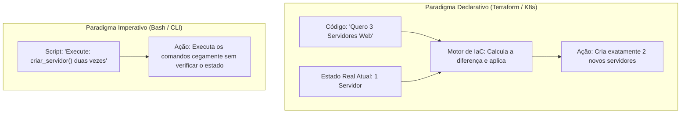
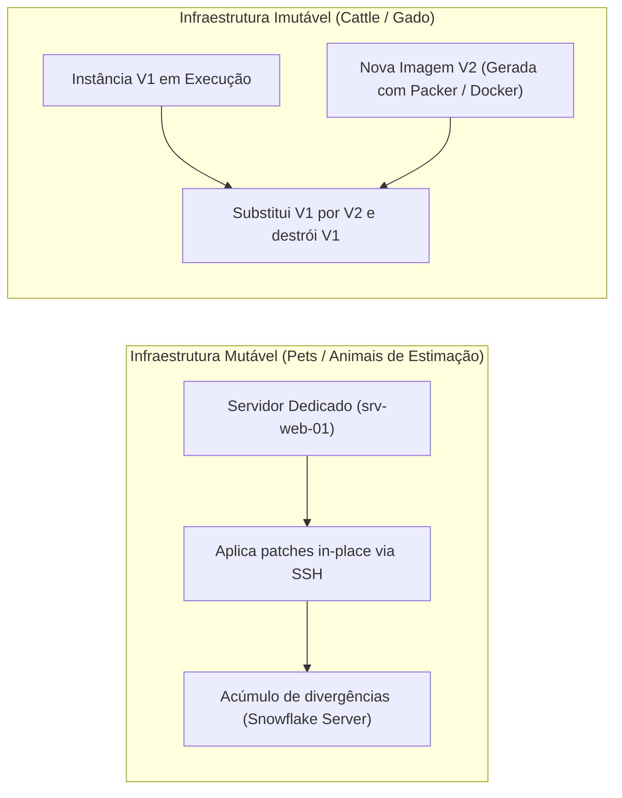
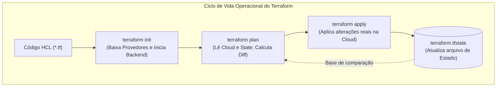
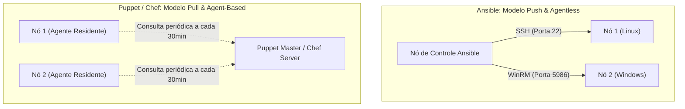

# 05 - Infraestrutura como Código (IaC) e Gerenciamento de Configuração

> **Matéria:** DevOps, Plataforma de Desenvolvimento e Engenharia de Entrega  
> **Cargo:** B02 – Técnico de Controle Externo – Especialidade: Tecnologia da Informação  
> **Arquivo:** `05_infraestrutura_como_codigo_iac_e_gerenciamento_de_configuracao.md`  

---

## 📌 Ementa / Itens do Edital
- Conceitos de Infraestrutura como Código (IaC - Infrastructure as Code)
- Abordagens: Declarativa vs. Imperativa / Procedural
- Infraestrutura Imutável vs. Mutável (Paradigma Pets vs. Cattle)
- Idempotência e controle de desvio de estado (Configuration Drift)
- Ferramentas de provisionamento declarativo: Terraform e OpenTofu
- Ferramentas de gerenciamento de configuração: Ansible, Puppet e Chef (Arquitetura Push vs. Pull, Agentless vs. Agent-based)

---

## 🧭 Sumário

1. [Fundamentos de Infraestrutura como Código (IaC)](#1-fundamentos-de-infraestrutura-como-codigo-iac)
    1. [Definição, Propósito e Benefícios de Engenharia](#11-definicao-proposito-e-beneficios-de-engenharia)
    2. [Paradigma Declarativo (O Quê) vs. Imperativo (Como)](#12-paradigma-declarativo-o-que-vs-imperativo-como)
    3. [O Princípio da Idempotência e Desvio de Configuração (Configuration Drift)](#13-o-principio-da-idempotencia-e-desvio-de-configuracao-configuration-drift)
    4. [Infraestrutura Mutável vs. Imutável (Pets vs. Cattle)](#14-infraestrutura-mutavel-vs-imutavel-pets-vs-cattle)
    5. [Teste 214](#Teste-214)
    6. [Teste 215](#Teste-215)
    7. [Teste 216](#Teste-216)
2. [Provisionamento Declarativo com Terraform e OpenTofu](#2-provisionamento-declarativo-com-terraform-e-opentofu)
    1. [Estrutura e Blocos Fundamentais da Linguagem HCL](#21-estrutura-e-blocos-fundamentais-da-linguagem-hcl)
    2. [O Arquivo de Estado (terraform.tfstate), Remote Backend e State Locking](#22-o-arquivo-de-estado-terraformtfstate-remote-backend-e-state-locking)
    3. [Ciclo Operacional da CLI: init, validate, plan, apply e destroy](#23-ciclo-operacional-da-cli-init-validate-plan-apply-e-destroy)
    4. [Teste 217](#Teste-217)
    5. [Teste 218](#Teste-218)
    6. [Teste 219](#Teste-219)
3. [Gerenciamento Automatizado de Configuração: Ansible vs. Puppet vs. Chef](#3-gerenciamento-automatizado-de-configuracao-ansible-vs-puppet-vs-chef)
    1. [Modelos Arquiteturais: Push vs. Pull e Agentless vs. Agent-Based](#31-modelos-arquiteturais-push-vs-pull-e-agentless-vs-agent-based)
    2. [Matriz Comparativa Detalhada: Ansible vs. Puppet vs. Chef](#32-matriz-comparativa-detalhada-ansible-vs-puppet-vs-chef)
    3. [Anatomia Operacional do Ansible: Inventário, Playbooks, Módulos, Handlers e Roles](#33-anatomia-operacional-do-ansible-inventario-playbooks-modulos-handlers-e-roles)
    4. [Sinergia Arquitetural: Terraform no Provisionamento + Ansible na Configuração](#34-sinergia-arquitetural-terraform-no-provisionamento-ansible-na-configuracao)
    5. [Teste 220](#Teste-220)
    6. [Teste 221](#Teste-221)
    7. [Teste 222](#Teste-222)
    8. [Teste 223](#Teste-223)
4. [🌐 Fontes Oficiais e Referências Bibliográficas](#fontes-oficiais-e-referencias-bibliograficas)

---

## 1. Fundamentos de Infraestrutura como Código (IaC)

A Infraestrutura como Código (*Infrastructure as Code - IaC*) é a prática de engenharia que substitui o provisionamento manual e artesanal de recursos computacionais (telas interativas de consoles de nuvem, assistentes gráficos e comandos isolados no terminal) por **arquivos descritivos de configuração legíveis por máquina e versionados em sistemas de controle de versão (como o Git)**.



### 1.1 Definição, Propósito e Benefícios de Engenharia

O propósito primordial da IaC é aplicar os mesmos rigores e benefícios do desenvolvimento de software ao gerenciamento de infraestrutura de TI:

- **Reprodutibilidade e Consistência:** Permite recriar ambientes completos de homologação, testes e produção com total fidelidade a partir de um único comando, erradicando o problema do "na minha máquina funciona".
- **Rastreabilidade e Auditoria:** Cada modificação em redes, regras de firewall ou servidores fica registrada no histórico de commits do Git, documentando quem alterou, quando alterou e qual foi a justificativa técnica.
- **Automação via Pipelines de CI/CD:** A infraestrutura pode ser validada por linters estáticos, testes de segurança e submetida a aprovações por pares antes de ser aplicada compulsoriamente por runners automatizados (*GitOps*).

### 1.2 Paradigma Declarativo (O Quê) vs. Imperativo (Como)

As linguagens e ferramentas de IaC dividem-se em dois paradigmas fundamentais:

- **Paradigma Declarativo (O Quê / *Desired State*):**
    - O operador define o **estado final almejado da infraestrutura** (ex.: *"devem existir 3 máquinas virtuais com 8GB de RAM na sub-rede privada"*).
    - O motor da ferramenta de IaC é responsável por consultar o estado atual da nuvem, compará-lo com o código, deduzir a diferença matemática (*delta*) e orquestrar a execução estrita das ações necessárias para atingir a meta.
    - Se 1 máquina já existir, o motor cria apenas 2. Se as 3 já existirem, o motor não faz nada.
    - **Exemplos Canônicos:** Terraform, OpenTofu, AWS CloudFormation, manifestos do Kubernetes.
- **Paradigma Imperativo / Procedural (Como / *Execution Steps*):**
    - O operador programa a **sequência cronológica e explícita de passos e comandos** que o sistema deve executar para erguer a infraestrutura (ex.: *"passo 1: chame a API de criar VM; passo 2: pause por 30 segundos; passo 3: anexe o disco"*).
    - A ferramenta executa as instruções cegamente. Se o script falhar na metade, o ambiente fica em estado inconsistente (*partially applied*), exigindo scripts corretivos ou intervenções manuais.
    - **Exemplos Canônicos:** Shell Scripts (Bash/PowerShell), AWS CLI, chamadas via SDK Python (Boto3).

### 1.3 O Princípio da Idempotência e Desvio de Configuração (Configuration Drift)

Dois conceitos são cobrados com rigor terminológico pela FCC:

#### Idempotência
Uma operação é dita **idempotente** se a sua execução repetida múltiplas vezes sobre um mesmo sistema produz **exatamente o mesmo resultado final da primeira execução**, sem gerar efeitos colaterais indesejados, duplicações de recursos ou erros de execução.

- *Na prática:* Se você executar `terraform apply` ou rodar um *Playbook* do Ansible dez vezes consecutivas sobre uma infraestrutura estável sem alterar o código, a ferramenta validará que o estado real já coincide com o estado desejado e reportará **zero alterações** (`0 to add, 0 to change, 0 to destroy` ou `changed=0`).

#### Desvio de Configuração (*Configuration Drift*)
O desvio de configuração manifesta-se quando recursos de produção são modificados manualmente "fora de banda" (*out-of-band*), por exemplo:

- Um administrador conecta via console web da nuvem ou via terminal SSH e altera manualmente uma porta de firewall ou a quantidade de memória de uma instância sem refletir essa mudança no repositório Git.
- **Impacto:** O ambiente real diverge da especificação formal do código versionado.
- **Correção Automatizada:** Na execução seguinte de planejamento (`terraform plan`), o motor compara o estado real com o código, detecta a divergência e propõe a reversão compulsória da alteração manual, restaurando a conformidade institucional.

### 1.4 Infraestrutura Mutável vs. Imutável (Pets vs. Cattle)

O debate arquitetural entre sistemas mutáveis e imutáveis é consagrado na metáfora de Randy Bias: *"Pets vs. Cattle"* (Animais de Estimação vs. Gado).



| Critério de Análise | Infraestrutura Mutável (*Pets*) | Infraestrutura Imutável (*Cattle*) |
| :--- | :--- | :--- |
| **Mecanismo de Atualização** | Atualizações no local (*in-place*), instalando patches e compilando código diretamente na máquina em execução. | **Destruição da instância antiga** e subida de uma nova instância pré-construída com a imagem atualizada. |
| **Identidade dos Servidores** | Servidores únicos, com nomes próprios e manutenção artesanal (*animais de estimação*). | Servidores anônimos, descartáveis, idênticos e substituíveis (*cabeças de gado*). |
| **Patologia / Risco Típico** | **Servidores "Snowflake":** Instâncias artesanais com configurações acumuladas que ninguém sabe reproduzir do zero. | Tempo e pipeline necessários para compilar e homologar a imagem antes do deploy. |
| **Facilidade de Rollback** | Complexa e arriscada (exige scripts de desinstalação reversos). | **Instantânea e segura:** Basta apontar o balanceador para a imagem anterior testada. |
| **Tecnologias Viabilizadoras** | Ansible, Puppet, Chef, scripts Bash in-place. | Packer, Docker, Terraform, Kubernetes, AMIs de nuvem. |

---

### Teste 001
**(FGV – TJ/SC – 2026 – Analista Administrativo)**
Um Analista de Tecnologia da Informação do Tribunal de Justiça de Santa Catarina foi encarregado de adequar os sistemas corporativos às exigências da Lei Geral de Proteção de Dados Pessoais (LGPD). Para reduzir os riscos decorrentes de eventual incidente de segurança envolvendo dados processuais e administrativos, ele adotou duas ações distintas: 1. aplicou um algoritmo para transformar o campo "Informação Sigilosa" em um código cifrado, de modo que o conteúdo original somente possa ser acessado mediante o uso da chave apropriada; e 2. no campo "Nome da Parte", substituiu as identidades reais por códigos alfanuméricos aleatórios, mantendo a tabela de correspondência entre os códigos e as identidades em ambiente segregado e seguro, permitindo que equipes de estatística e inteligência de dados realizem análises sem identificar diretamente os indivíduos, embora a associação possa ser restabelecida pelo Tribunal quando necessário. As técnicas aplicadas pelo analista nas ações 1 e 2 são, respectivamente,

* **A)** Hash Robusto e Pseudonimização.
* **B)** Criptografia Assimétrica e Pseudonimização.
* **C)** Criptografia Simétrica e Anonimização Irreversível.
* **D)** Esteganografia e Tokenização de Sessão.
* **E)** Codificação de Base64 e Criptografia de Chave Única.

---

> **Comentário Detalhado:**
>
> - **A)** **Incorreta.** A opção apresenta proposição em desacordo com os fundamentos teóricos e técnicos do tópico ao afirmar que "Hash Robusto e Pseudonimização". De acordo com a teoria estudada em *1.1 Definição, Propósito e Benefícios de Engenharia*, automação via Pipelines de CI/CD: A infraestrutura pode ser validada por linters estáticos, testes de segurança e submetida a aprovações por pares antes de ser aplicada compulsoriamente por runners automatizados ( GitOps ).
> - **B)** **Correta.** Conforme fundamentado na seção *2.2 O Arquivo de Estado (terraform.tfstate), Remote Backend e State Locking* deste guia, remote Backend: Em times profissionais e órgãos públicos, o arquivo .tfstate nunca deve ser versionado no Git local (pois pode conter senhas em texto claro e causará conflitos insolúveis). Ele deve ser armazenado em um repositório remoto seguro com criptografia em repouso (ex.: Amazon S3, Google Cloud Storage, Terraform Cloud). Dessa forma, está plenamente correta a assertiva da banca (FGV – TJ/SC/2026) ao estabelecer que "Criptografia Assimétrica e Pseudonimização".
> - **C)** **Incorreta.** A opção apresenta proposição em desacordo com os fundamentos teóricos e técnicos do tópico ao afirmar que "Criptografia Simétrica e Anonimização Irreversível". De acordo com a teoria estudada em *1.2 Paradigma Declarativo (O Quê) vs. Imperativo (Como)*, o motor da ferramenta de IaC é responsável por consultar o estado atual da nuvem, compará lo com o código, deduzir a diferença matemática ( delta ) e orquestrar a execução estrita das ações necessárias para atingir a meta.
> - **D)** **Incorreta.** A opção apresenta proposição em desacordo com os fundamentos teóricos e técnicos do tópico ao afirmar que "Esteganografia e Tokenização de Sessão". De acordo com a teoria estudada em *1.4 Infraestrutura Mutável vs. Imutável (Pets vs. Cattle)*, mecanismo de Atualização: Atualizações no local ( in place ), instalando patches e compilando código diretamente na máquina em execução. — Destruição da instância antiga e subida de uma nova instância pré construída com a imagem atualizada.
> - **E)** **Incorreta.** A opção apresenta proposição em desacordo com os fundamentos teóricos e técnicos do tópico ao afirmar que "Codificação de Base64 e Criptografia de Chave Única". De acordo com a teoria estudada em *1. Fundamentos de Infraestrutura como Código (IaC)*, iMP CODE["Script: 'Execute: criar servidor() duas vezes'"].
>
> **Gabarito: B**

---


### Teste 002
**(FGV – TJ/SC – 2026 – Analista Administrativo)**
Embora se apresente como momento final do ciclo administrativo, o controle desempenha funções que extrapolam a mera verificação de resultados, sendo dotado de objetivos múltiplos que orientam sua aplicação na rotina das organizações. A respeito dos objetivos principais do controle como função administrativa, analise os itens a seguir. I. A regulação das atividades, voltada a mantê-las dentro dos padrões estabelecidos, assegurando que os resultados se mantenham na amplitude de variação compreendida entre os limites máximo e mínimo previamente definidos. II. A substituição integral das funções de planejamento, organização e direção sempre que se identificarem desvios entre os resultados obtidos e os padrões estabelecidos. III. A prevenção de novas falhas ou erros, na medida em que, ao corrigir os problemas detectados, o controle aponta os meios de evitar sua recorrência futura, contribuindo para o aprimoramento gradativo do processo administrativo. Está correto o que se apresenta em

* **A)** I, II e III.
* **B)** I e II, apenas.
* **C)** I e III, apenas.
* **D)** II e III, apenas.
* **E)** III, apenas.

---

> **Comentário Detalhado:**
>
> - **A)** **Incorreta.** A opção apresenta proposição em desacordo com os fundamentos teóricos e técnicos do tópico ao afirmar que "I, II e III". De acordo com a teoria estudada em *2.1 Estrutura e Blocos Fundamentais da Linguagem HCL*, module : Pacote de configurações HCL autocontidas e parametrizadas que funcionam como funções reutilizáveis em múltiplos ambientes.
> - **B)** **Incorreta.** A opção incorre em restrição indevida ao limitar o escopo conceitual ao afirmar que "I e II, apenas". De acordo com a teoria estudada em *2.3 Ciclo Operacional da CLI: init, validate, plan, apply e destroy*, terraform validate : Realiza a análise estática da sintaxe HCL e checa a consistência interna das variáveis sem consultar as APIs dos provedores.
> - **C)** **Correta.** Conforme fundamentado na seção *Idempotência* deste guia, uma operação é dita idempotente se a sua execução repetida múltiplas vezes sobre um mesmo sistema produz exatamente o mesmo resultado final da primeira execução, sem gerar efeitos colaterais indesejados, duplicações de recursos ou erros de execução. Dessa forma, está plenamente correta a assertiva da banca (FGV – TJ/SC/2026) ao estabelecer que "I e III, apenas".
> - **D)** **Incorreta.** A opção incorre em restrição indevida ao limitar o escopo conceitual ao afirmar que "II e III, apenas". De acordo com a teoria estudada em *2.3 Ciclo Operacional da CLI: init, validate, plan, apply e destroy*, terraform plan : Executa o planejamento especulativo: consulta a nuvem real, compara com o .tfstate e com o código HCL, exibindo a prévia exata do que será criado ( + ), alterado ( ~ ) ou destruído ( ), sem realizar modificações reais.
> - **E)** **Incorreta.** A opção incorre em restrição indevida ao limitar o escopo conceitual ao afirmar que "III, apenas". De acordo com a teoria estudada em *1.2 Paradigma Declarativo (O Quê) vs. Imperativo (Como)*, o operador define o estado final almejado da infraestrutura (ex.: "devem existir 3 máquinas virtuais com 8GB de RAM na sub rede privada" ).
>
> **Gabarito: C**

---


### Teste 003
**(FGV – TJ/SC – 2026 – Analista Administrativo)**
Na empresa ABC, a equipe responsável pela implantação de um novo sistema de gestão documental encontra-se em momento crítico do projeto: o plano-base já foi estruturado e aprovado, e a equipe executa as atividades de trabalho voltadas à produção das entregas. Nessa etapa, o gerente de projeto monitora continuamente o progresso para assegurar que o trabalho permaneça dentro da programação e do orçamento, que o escopo seja integralmente atendido conforme as especificações e que eventuais mudanças sejam documentadas, aprovadas e incorporadas a um plano-base atualizado. Considerando o ciclo de vida genérico do projeto, a fase descrita corresponde à de

* **A)** iniciação.
* **B)** planejamento.
* **C)** realização.
* **D)** encerramento.
* **E)** avaliação.

---

> **Comentário Detalhado:**
>
> - **A)** **Incorreta.** A opção apresenta proposição em desacordo com os fundamentos teóricos e técnicos do tópico ao afirmar que "iniciação". De acordo com a teoria estudada em *2.3 Ciclo Operacional da CLI: init, validate, plan, apply e destroy*, terraform destroy : Destrói de forma controlada todos os recursos gerenciados por aquele projeto específico de IaC.
> - **B)** **Incorreta.** A opção apresenta proposição em desacordo com os fundamentos teóricos e técnicos do tópico ao afirmar que "planejamento". De acordo com a teoria estudada em *2.3 Ciclo Operacional da CLI: init, validate, plan, apply e destroy*, terraform plan : Executa o planejamento especulativo: consulta a nuvem real, compara com o .tfstate e com o código HCL, exibindo a prévia exata do que será criado ( + ), alterado ( ~ ) ou destruído ( ), sem realizar modificações reais.
> - **C)** **Correta.** Conforme fundamentado na seção *2.3 Ciclo Operacional da CLI: init, validate, plan, apply e destroy* deste guia, terraform apply : Aplica efetivamente as alterações na nuvem com base no plano aprovado e atualiza o arquivo de estado. Dessa forma, está plenamente correta a assertiva da banca (FGV – TJ/SC/2026) ao estabelecer que "realização".
> - **D)** **Incorreta.** A opção apresenta proposição em desacordo com os fundamentos teóricos e técnicos do tópico ao afirmar que "encerramento". De acordo com a teoria estudada em *3.4 Sinergia Arquitetural: Terraform no Provisionamento + Ansible na Configuração*, ansible: Atua na camada de Configuração do Sistema. Uma vez provisionadas as instâncias, o Ansible conecta se a elas via SSH para endurecer o sistema operacional ( hardening ), instalar utilitários, configurar usuários e preparar os nós para as cargas de trabalho corporativas.
> - **E)** **Incorreta.** A opção apresenta proposição em desacordo com os fundamentos teóricos e técnicos do tópico ao afirmar que "avaliação". De acordo com a teoria estudada em *2. Provisionamento Declarativo com Terraform e OpenTofu*, subgraph Terraform Flow["Ciclo de Vida Operacional do Terraform"].
>
> **Gabarito: C**

---


### Teste 004
**(FGV – TJ/SC – 2026 – Analista Administrativo)**
Na empresa ABC, a área de Gestão de Pessoas consolidou os resultados do ciclo anual de avaliação de desempenho. Após a etapa de consolidação, o gestor de uma equipe é convocado pelo especialista da área para receber subsídios estruturados sobre cada um de seus liderados, de modo a conduzir, ao longo do próximo ciclo, sessões individuais de orientação profissional, com utilização de técnicas de coaching e mentoring adaptadas a cada perfil identificado. Considerando as razões pelas quais as organizações avaliam o desempenho de seus talentos, a finalidade da avaliação a que essa entrega de subsídios está diretamente associada é denominada

* **A)** recompensa.
* **B)** retroação.
* **C)** aconselhamento.
* **D)** percepção.
* **E)** potencial de desenvolvimento.

---

> **Comentário Detalhado:**
>
> - **A)** **Incorreta.** A opção apresenta proposição em desacordo com os fundamentos teóricos e técnicos do tópico ao afirmar que "recompensa". De acordo com a teoria estudada em *2.1 Estrutura e Blocos Fundamentais da Linguagem HCL*, output : Valores de retorno exportados após a execução (ex.: IP público de um balanceador, ID de uma VPC).
> - **B)** **Incorreta.** A opção apresenta proposição em desacordo com os fundamentos teóricos e técnicos do tópico ao afirmar que "retroação". De acordo com a teoria estudada em *🌐 Fontes Oficiais e Referências Bibliográficas*, bRICKEY, Scott. Terraform: Up & Running: Writing Infrastructure as Code. 3. ed. Sebastopol: O'Reilly Media, 2022. (Cap. 2 e 3 Sintaxe HCL e Gestão de Estado).
> - **C)** **Correta.** Conforme fundamentado na seção *1.4 Infraestrutura Mutável vs. Imutável (Pets vs. Cattle)* deste guia, mecanismo de Atualização: Atualizações no local ( in place ), instalando patches e compilando código diretamente na máquina em execução. — Destruição da instância antiga e subida de uma nova instância pré construída com a imagem atualizada. Dessa forma, está plenamente correta a assertiva da banca (FGV – TJ/SC/2026) ao estabelecer que "aconselhamento".
> - **D)** **Incorreta.** A opção apresenta proposição em desacordo com os fundamentos teóricos e técnicos do tópico ao afirmar que "percepção". De acordo com a teoria estudada em *2. Provisionamento Declarativo com Terraform e OpenTofu*, subgraph Terraform Flow["Ciclo de Vida Operacional do Terraform"].
> - **E)** **Incorreta.** A opção apresenta proposição em desacordo com os fundamentos teóricos e técnicos do tópico ao afirmar que "potencial de desenvolvimento". De acordo com a teoria estudada em *1.1 Definição, Propósito e Benefícios de Engenharia*, o propósito primordial da IaC é aplicar os mesmos rigores e benefícios do desenvolvimento de software ao gerenciamento de infraestrutura de TI.
>
> **Gabarito: C**

---


### Teste 005
**(FGV – TJ/SC – 2026 – Analista Administrativo)**
A empresa ABC encomendou uma análise de sua cultura organizacional, comparando-a aos modelos identificados por William G. Ouchi. O diagnóstico revelou os seguintes traços: emprego de longo prazo; avaliação lenta e qualitativa; trajetória de carreira moderadamente abrangente; controle implícito e informal; tomada de decisão em grupo e consensual; responsabilidade individual; e preocupação holística com as pessoas. Considerando os sete pontos de comparação desenvolvidos por Ouchi, o diagnóstico apresentado caracteriza a empresa ABC como empresa

* **A)** norte-americana típica.
* **B)** norte-americana Tipo Z.
* **C)** japonesa típica.
* **D)** norte-americana Tipo J.
* **E)** híbrida transacional. Administração de Materiais e Logística

---

> **Comentário Detalhado:**
>
> - **A)** **Incorreta.** A opção apresenta proposição em desacordo com os fundamentos teóricos e técnicos do tópico ao afirmar que "norte americana típica". De acordo com a teoria estudada em *2.3 Ciclo Operacional da CLI: init, validate, plan, apply e destroy*, terraform validate : Realiza a análise estática da sintaxe HCL e checa a consistência interna das variáveis sem consultar as APIs dos provedores.
> - **B)** **Correta.** Conforme fundamentado na seção *2. Provisionamento Declarativo com Terraform e OpenTofu* deste guia, sTATE . |Base de comparação| PLAN. Dessa forma, está plenamente correta a assertiva da banca (FGV – TJ/SC/2026) ao estabelecer que "norte americana Tipo Z".
> - **C)** **Incorreta.** A opção apresenta proposição em desacordo com os fundamentos teóricos e técnicos do tópico ao afirmar que "japonesa típica". De acordo com a teoria estudada em *3.1 Modelos Arquiteturais: Push vs. Pull e Agentless vs. Agent-Based*, modelo Push (Empurrado) vs. Pull (Puxado).
> - **D)** **Incorreta.** A opção apresenta proposição em desacordo com os fundamentos teóricos e técnicos do tópico ao afirmar que "norte americana Tipo J". De acordo com a teoria estudada em *3.1 Modelos Arquiteturais: Push vs. Pull e Agentless vs. Agent-Based*, push (Ansible): O servidor central de controle toma a iniciativa ativa: conecta se aos nós de destino e empurra os comandos e scripts de configuração sob demanda do operador.
> - **E)** **Incorreta.** A opção apresenta proposição em desacordo com os fundamentos teóricos e técnicos do tópico ao afirmar que "híbrida transacional. Administração de Materiais e Logística". De acordo com a teoria estudada em *2.2 O Arquivo de Estado (terraform.tfstate), Remote Backend e State Locking*, a Função do terraform.tfstate : É o coração transacional do Terraform. Ele mapeia os identificadores declarados no código HCL com os identificadores reais gerados nas APIs da nuvem (ex.: mapeia o recurso aws vpc.rede tce ao identificador físico vpc 0123456789abcdef0 ), além de armazenar metadados e dependências.
>
> **Gabarito: B**

---


### Teste 006
**(FGV – TJ/SC – 2026 – Analista Administrativo)**
A gestão de materiais compreende diversos setores, cada um com responsabilidades específicas que, articuladas, asseguram o adequado fluxo de insumos, a guarda física, a reposição e a distribuição dos bens necessários à atividade-fim. A correta compreensão das atribuições de cada setor é essencial para o desempenho eficiente da cadeia de suprimentos. Considere a situação hipotética a seguir. Em determinada organização, foram identificadas três ocorrências em um mesmo dia de operação: I. acompanhamento do nível de mercadorias disponíveis e do investimento financeiro a elas vinculado; II. negociação com fornecedor estrangeiro, com observância da legislação aduaneira pertinente, para aquisição de insumos produtivos; III. guarda física dos materiais entregues pelos fornecedores e destinados a atender à produção. Conforme a estrutura clássica de organização do departamento de materiais, as ocorrências I, II e III estão afetas, respectivamente, aos setores de

* **A)** compras, importação e almoxarifado.
* **B)** controle de estoques, importação e almoxarifado.
* **C)** controle de estoques, compras e PCP.
* **D)** PCP, importação e transportes e distribuição.
* **E)** almoxarifado, compras e controle de estoques.

---

> **Comentário Detalhado:**
>
> - **A)** **Incorreta.** A opção apresenta proposição em desacordo com os fundamentos teóricos e técnicos do tópico ao afirmar que "compras, importação e almoxarifado". De acordo com a teoria estudada em *1.4 Infraestrutura Mutável vs. Imutável (Pets vs. Cattle)*, patologia / Risco Típico: Servidores "Snowflake": Instâncias artesanais com configurações acumuladas que ninguém sabe reproduzir do zero. — Tempo e pipeline necessários para compilar e homologar a imagem antes do deploy.
> - **B)** **Correta.** Conforme fundamentado na seção *Idempotência* deste guia, uma operação é dita idempotente se a sua execução repetida múltiplas vezes sobre um mesmo sistema produz exatamente o mesmo resultado final da primeira execução, sem gerar efeitos colaterais indesejados, duplicações de recursos ou erros de execução. Dessa forma, está plenamente correta a assertiva da banca (FGV – TJ/SC/2026) ao estabelecer que "controle de estoques, importação e almoxarifado".
> - **C)** **Incorreta.** A opção apresenta proposição em desacordo com os fundamentos teóricos e técnicos do tópico ao afirmar que "controle de estoques, compras e PCP". De acordo com a teoria estudada em *2.1 Estrutura e Blocos Fundamentais da Linguagem HCL*, key = "producao/infra.tfstate".
> - **D)** **Incorreta.** A opção apresenta proposição em desacordo com os fundamentos teóricos e técnicos do tópico ao afirmar que "PCP, importação e transportes e distribuição". De acordo com a teoria estudada em *3.3 Anatomia Operacional do Ansible: Inventário, Playbooks, Módulos, Handlers e Roles*, facts (Fatos do Sistema): O Ansible coleta automaticamente no início da execução um dicionário detalhado de metadados do nó gerenciado (endereços IP, interfaces, capacidade de memória RAM, versão do Kernel, distribuição Linux).
> - **E)** **Incorreta.** A opção apresenta proposição em desacordo com os fundamentos teóricos e técnicos do tópico ao afirmar que "almoxarifado, compras e controle de estoques". De acordo com a teoria estudada em *1.1 Definição, Propósito e Benefícios de Engenharia*, reprodutibilidade e Consistência: Permite recriar ambientes completos de homologação, testes e produção com total fidelidade a partir de um único comando, erradicando o problema do "na minha máquina funciona".
>
> **Gabarito: B**

---


### Teste 007
**(FGV – TJ/SC – 2026 – Analista Administrativo)**
O Portal da Transparência do governo federal brasileiro, criado em 2004, constitui hoje a mais popular e premiada solução de transparência do governo brasileiro, cuja finalidade é franquear informações on-line sobre a máquina estatal no país. Sua trajetória se insere no ciclo de reformas para a transparência na América Latina, impulsionado pelo discurso da boa governança e pela associação entre opacidade estatal e práticas corruptas. Sobre o Portal da Transparência como instrumento de controle social, é correto afirmar que

* **A)** constitui instrumento de transparência passiva, pois condiciona o acesso às informações sobre a máquina estatal à apresentação de requerimento prévio pelo cidadão interessado.
* **B)** foi desenvolvido pelo Tribunal de Contas da União, no exercício de suas competências constitucionais de fiscalização contábil, financeira e orçamentária da Administração Pública Federal.
* **C)** representa instrumento de transparência ativa que franqueia, em formato on-line, informações sobre receitas, despesas, salários e contratos, fortalecendo simultaneamente o controle social e o controle governamental.
* **D)** corresponde ao canal eletrônico de divulgação periódica do Relatório Resumido de Execução Orçamentária e do Relatório de Gestão Fiscal, em ciclos quadrimestrais de prestação de contas dirigidos primariamente aos órgãos de controle externo.
* **E)** opera como sistema eletrônico destinado ao recebimento e ao processamento de pedidos individuais de acesso à informação dirigidos aos órgãos e entidades da Administração Pública federal, com posterior encaminhamento das respostas aos requerentes.

---

> **Comentário Detalhado:**
>
> - **A)** **Incorreta.** A opção apresenta proposição em desacordo com os fundamentos teóricos e técnicos do tópico ao afirmar que "constitui instrumento de transparência passiva, pois condiciona o acesso às informações sobre a máquina estatal à...". De acordo com a teoria estudada em *1. Fundamentos de Infraestrutura como Código (IaC)*, a Infraestrutura como Código ( Infrastructure as Code IaC ) é a prática de engenharia que substitui o provisionamento manual e artesanal de recursos computacionais (telas interativas de consoles de nuvem, assistentes gráficos e comandos isolados no terminal) por arquivos descritivos de configuração legíveis por máquina e versionados em sistemas de controle de versão (como o Git).
> - **B)** **Incorreta.** A opção apresenta proposição em desacordo com os fundamentos teóricos e técnicos do tópico ao afirmar que "foi desenvolvido pelo Tribunal de Contas da União, no exercício de suas competências constitucionais de...". De acordo com a teoria estudada em *2. Provisionamento Declarativo com Terraform e OpenTofu*, o Terraform (desenvolvido pela HashiCorp) e seu fork comunitário de código aberto OpenTofu (mantido sob a governança da Linux Foundation ) são as plataformas líderes para provisionamento declarativo multi nuvem e multi provedor.
> - **C)** **Correta.** Conforme fundamentado na seção *2.1 Estrutura e Blocos Fundamentais da Linguagem HCL* deste guia, data : Fontes de dados ( Data Sources ) utilizadas para consultar informações sobre recursos pré existentes na infraestrutura que foram criados fora do escopo do manifesto atual. Dessa forma, está plenamente correta a assertiva da banca (FGV – TJ/SC/2026) ao estabelecer que "representa instrumento de transparência ativa que franqueia, em formato on line, informações sobre receitas...".
> - **D)** **Incorreta.** A opção apresenta proposição em desacordo com os fundamentos teóricos e técnicos do tópico ao afirmar que "corresponde ao canal eletrônico de divulgação periódica do Relatório Resumido de Execução Orçamentária e do...". De acordo com a teoria estudada em *2.2 O Arquivo de Estado (terraform.tfstate), Remote Backend e State Locking*, remote Backend: Em times profissionais e órgãos públicos, o arquivo .tfstate nunca deve ser versionado no Git local (pois pode conter senhas em texto claro e causará conflitos insolúveis). Ele deve ser armazenado em um repositório remoto seguro com criptografia em repouso (ex.: Amazon S3, Google Cloud Storage, Terraform Cloud).
> - **E)** **Incorreta.** A opção apresenta proposição em desacordo com os fundamentos teóricos e técnicos do tópico ao afirmar que "opera como sistema eletrônico destinado ao recebimento e ao processamento de pedidos individuais de acesso à...". De acordo com a teoria estudada em *2.2 O Arquivo de Estado (terraform.tfstate), Remote Backend e State Locking*, state Locking (Bloqueio de Estado): Mecanismo de controle de concorrência que impede que dois operadores ou pipelines de CI/CD executem terraform apply simultaneamente sobre a mesma infraestrutura, o que provocaria corrupção catastrófica de dados. No AWS S3, o locking é implementado através de tabelas no Amazon DynamoDB.
>
> **Gabarito: C**

---


### Teste 008
**(FGV – TCE/GO – 2024 – Analista de Controle Externo - Ciências Contábeis)**
A NBASP 400 - Princípios de Auditoria de Conformidade estabelece diretrizes fundamentais para a realização de auditorias destinadas a verificar se as operações estão em conformidade com leis, regulamentos e normas aplicáveis. Nesse contexto, analise os itens a seguir: I. A auditoria de conformidade é a avaliação independente para determinar se um dado objeto está em conformidade com normas aplicáveis identificadas como critérios. II. As auditorias de conformidade são realizadas para avaliar se atividades, transações orçamentárias e informações cumprem, em todos os aspectos relevantes, as normas que regem a entidade auditada. III. A auditoria de conformidade é frequentemente parte integrante do mandato de uma Entidade Fiscalizadora Superior para a auditoria de entidades do setor público. Está correto o que se afirma em

* **A)** I, apenas.
* **B)** I e II, apenas.
* **C)** I e III, apenas.
* **D)** II e III, apenas.
* **E)** I, II e III.

---

> **Comentário Detalhado:**
>
> - **A)** **Incorreta.** A opção incorre em restrição indevida ao limitar o escopo conceitual ao afirmar que "I, apenas". De acordo com a teoria estudada em *1.1 Definição, Propósito e Benefícios de Engenharia*, rastreabilidade e Auditoria: Cada modificação em redes, regras de firewall ou servidores fica registrada no histórico de commits do Git, documentando quem alterou, quando alterou e qual foi a justificativa técnica.
> - **B)** **Incorreta.** A opção incorre em restrição indevida ao limitar o escopo conceitual ao afirmar que "I e II, apenas". De acordo com a teoria estudada em *Desvio de Configuração (Configuration Drift)*, correção Automatizada: Na execução seguinte de planejamento ( terraform plan ), o motor compara o estado real com o código, detecta a divergência e propõe a reversão compulsória da alteração manual, restaurando a conformidade institucional.
> - **C)** **Correta.** Conforme fundamentado na seção *2.1 Estrutura e Blocos Fundamentais da Linguagem HCL* deste guia, data : Fontes de dados ( Data Sources ) utilizadas para consultar informações sobre recursos pré existentes na infraestrutura que foram criados fora do escopo do manifesto atual. Dessa forma, está plenamente correta a assertiva da banca (FGV – TCE/GO/2024) ao estabelecer que "I e III, apenas".
> - **D)** **Incorreta.** A opção incorre em restrição indevida ao limitar o escopo conceitual ao afirmar que "II e III, apenas". De acordo com a teoria estudada em *1. Fundamentos de Infraestrutura como Código (IaC)*, iMP ACT["Ação: Executa os comandos cegamente sem verificar o estado"].
> - **E)** **Incorreta.** A opção apresenta proposição em desacordo com os fundamentos teóricos e técnicos do tópico ao afirmar que "I, II e III". De acordo com a teoria estudada em *2.3 Ciclo Operacional da CLI: init, validate, plan, apply e destroy*, terraform validate : Realiza a análise estática da sintaxe HCL e checa a consistência interna das variáveis sem consultar as APIs dos provedores.
>
> **Gabarito: C**

---


### Teste 009
**(FGV – TCE/GO – 2024 – Analista de Controle Externo - Ciências Contábeis)**
Mara, de nacionalidade brasileira, casou com Stevenson, de nacionalidade holandesa, e passou a viver na Áustria. Com o objetivo de facilitar sua integração no país em que residia, não como requisito para a fruição de direitos civis, Mara decidiu se naturalizar austríaca. Após alguns anos, Mara consultou a legislação vigente com o objetivo de verificar a possibilidade de vir a perder à nacionalidade brasileira, tendo concluído corretamente que

* **A)** ao casar com Stevenson, em razão do jus nuptias, ela adquiriu a nacionalidade holandesa, perdendo a brasileira;
* **B)** ao se naturalizar austríaca, nas circunstâncias indicadas, ela perdeu a nacionalidade brasileira;
* **C)** não será possível a realização do desiderato de Mara, pois se tornará apátrida, o que é vedado;
* **D)** a nacionalidade, por estar integrada aos direitos da personalidade, é irrenunciável;
* **E)** ela terá que fazer pedido expresso à autoridade brasileira.

---

> **Comentário Detalhado:**
>
> - **A)** **Incorreta.** A opção apresenta proposição em desacordo com os fundamentos teóricos e técnicos do tópico ao afirmar que "ao casar com Stevenson, em razão do jus nuptias, ela adquiriu a nacionalidade holandesa, perdendo a brasileira". De acordo com a teoria estudada em *2.1 Estrutura e Blocos Fundamentais da Linguagem HCL*, output : Valores de retorno exportados após a execução (ex.: IP público de um balanceador, ID de uma VPC).
> - **B)** **Incorreta.** A opção apresenta proposição em desacordo com os fundamentos teóricos e técnicos do tópico ao afirmar que "ao se naturalizar austríaca, nas circunstâncias indicadas, ela perdeu a nacionalidade brasileira". De acordo com a teoria estudada em *3.2 Matriz Comparativa Detalhada: Ansible vs. Puppet vs. Chef*, requisito no Destino: Python instalado e servidor SSH/WinRM ativo — Agente Puppet instalado e em execução — Agente Chef Client instalado e em execução.
> - **C)** **Incorreta.** A opção apresenta proposição em desacordo com os fundamentos teóricos e técnicos do tópico ao afirmar que "não será possível a realização do desiderato de Mara, pois se tornará apátrida, o que é vedado". De acordo com a teoria estudada em *2.2 O Arquivo de Estado (terraform.tfstate), Remote Backend e State Locking*, remote Backend: Em times profissionais e órgãos públicos, o arquivo .tfstate nunca deve ser versionado no Git local (pois pode conter senhas em texto claro e causará conflitos insolúveis). Ele deve ser armazenado em um repositório remoto seguro com criptografia em repouso (ex.: Amazon S3, Google Cloud Storage, Terraform Cloud).
> - **D)** **Incorreta.** A opção apresenta proposição em desacordo com os fundamentos teóricos e técnicos do tópico ao afirmar que "a nacionalidade, por estar integrada aos direitos da personalidade, é irrenunciável". De acordo com a teoria estudada em *3.1 Modelos Arquiteturais: Push vs. Pull e Agentless vs. Agent-Based*, pull (Puppet e Chef): Os nós clientes possuem agentes residentes executando em segundo plano que consultam periodicamente o servidor mestre (ex.: a cada 30 minutos) para verificar se há novas diretivas e aplicar correções locais.
> - **E)** **Correta.** Conforme fundamentado na seção *1. Fundamentos de Infraestrutura como Código (IaC)* deste guia, iMP ACT["Ação: Executa os comandos cegamente sem verificar o estado"]. Dessa forma, está plenamente correta a assertiva da banca (FGV – TCE/GO/2024) ao estabelecer que "ela terá que fazer pedido expresso à autoridade brasileira".
>
> **Gabarito: E**

---


### Teste 010
**(FGV – TCE/GO – 2024 – Analista de Controle Externo - Ciências Contábeis)**
Uma sociedade empresária mantém títulos para fins de negociação imediata. Os fluxos de caixa advindos da venda desses títulos são classificados como

* **A)** equivalentes de caixa.
* **B)** atividade financeira.
* **C)** atividade operacional.
* **D)** atividade de investimento.
* **E)** atividade de financiamento.

---

> **Comentário Detalhado:**
>
> - **A)** **Incorreta.** A opção apresenta proposição em desacordo com os fundamentos teóricos e técnicos do tópico ao afirmar que "equivalentes de caixa". De acordo com a teoria estudada em *2.3 Ciclo Operacional da CLI: init, validate, plan, apply e destroy*, terraform init : Inicializa o diretório de trabalho, baixa os plugins dos provedores necessários ( providers ) e conecta ao backend de estado configurado.
> - **B)** **Incorreta.** A opção apresenta proposição em desacordo com os fundamentos teóricos e técnicos do tópico ao afirmar que "atividade financeira". De acordo com a teoria estudada em *2.3 Ciclo Operacional da CLI: init, validate, plan, apply e destroy*, terraform validate : Realiza a análise estática da sintaxe HCL e checa a consistência interna das variáveis sem consultar as APIs dos provedores.
> - **C)** **Correta.** Conforme fundamentado na seção *2. Provisionamento Declarativo com Terraform e OpenTofu* deste guia, subgraph Terraform Flow["Ciclo de Vida Operacional do Terraform"]. Dessa forma, está plenamente correta a assertiva da banca (FGV – TCE/GO/2024) ao estabelecer que "atividade operacional".
> - **D)** **Incorreta.** A opção apresenta proposição em desacordo com os fundamentos teóricos e técnicos do tópico ao afirmar que "atividade de investimento". De acordo com a teoria estudada em *2.3 Ciclo Operacional da CLI: init, validate, plan, apply e destroy*, terraform plan : Executa o planejamento especulativo: consulta a nuvem real, compara com o .tfstate e com o código HCL, exibindo a prévia exata do que será criado ( + ), alterado ( ~ ) ou destruído ( ), sem realizar modificações reais.
> - **E)** **Incorreta.** A opção apresenta proposição em desacordo com os fundamentos teóricos e técnicos do tópico ao afirmar que "atividade de financiamento". De acordo com a teoria estudada em *2.3 Ciclo Operacional da CLI: init, validate, plan, apply e destroy*, terraform apply : Aplica efetivamente as alterações na nuvem com base no plano aprovado e atualiza o arquivo de estado.
>
> **Gabarito: C**

---


### Teste 011
**(FGV – TCE/GO – 2024 – Analista de Controle Externo - Ciências Contábeis)**
De acordo com a NBC Estrutura Conceitual- Estrutura Conceitual para Elaboração e Divulgação de Informação Contábil de Propósito Geral pelas Entidades do Setor Público, no Relatório Contábil de Propósito Geral das Entidades do Setor Público, a informação é selecionada para exposição ou para evidenciação. Em relação à informação evidenciada nas notas explicativas às demonstrações contábeis, analise as afirmativas a seguir: I. É necessária para a compreensão dos usuários das demonstrações contábeis; II. Fornece informação que apresenta as demonstrações contábeis no contexto da entidade e o seu ambiente operacional; III. É complementar à informação exposta nas demonstrações contábeis, de modo que não tem relação com ela. Está correto o que se afirma em

* **A)** I, somente.
* **B)** I e II, somente.
* **C)** I e III, somente.
* **D)** II e III, somente.
* **E)** I, II e III.

---

> **Comentário Detalhado:**
>
> - **A)** **Incorreta.** A opção incorre em restrição indevida ao limitar o escopo conceitual ao afirmar que "I, somente". De acordo com a teoria estudada em *3.4 Sinergia Arquitetural: Terraform no Provisionamento + Ansible na Configuração*, ansible: Atua na camada de Configuração do Sistema. Uma vez provisionadas as instâncias, o Ansible conecta se a elas via SSH para endurecer o sistema operacional ( hardening ), instalar utilitários, configurar usuários e preparar os nós para as cargas de trabalho corporativas.
> - **B)** **Correta.** Conforme fundamentado na seção *2.3 Ciclo Operacional da CLI: init, validate, plan, apply e destroy* deste guia, terraform validate : Realiza a análise estática da sintaxe HCL e checa a consistência interna das variáveis sem consultar as APIs dos provedores. Dessa forma, está plenamente correta a assertiva da banca (FGV – TCE/GO/2024) ao estabelecer que "I e II, somente".
> - **C)** **Incorreta.** A opção incorre em restrição indevida ao limitar o escopo conceitual ao afirmar que "I e III, somente". De acordo com a teoria estudada em *1.2 Paradigma Declarativo (O Quê) vs. Imperativo (Como)*, a ferramenta executa as instruções cegamente. Se o script falhar na metade, o ambiente fica em estado inconsistente ( partially applied ), exigindo scripts corretivos ou intervenções manuais.
> - **D)** **Incorreta.** A opção incorre em restrição indevida ao limitar o escopo conceitual ao afirmar que "II e III, somente". De acordo com a teoria estudada em *Desvio de Configuração (Configuration Drift)*, impacto: O ambiente real diverge da especificação formal do código versionado.
> - **E)** **Incorreta.** A opção apresenta proposição em desacordo com os fundamentos teóricos e técnicos do tópico ao afirmar que "I, II e III". De acordo com a teoria estudada em *1.1 Definição, Propósito e Benefícios de Engenharia*, o propósito primordial da IaC é aplicar os mesmos rigores e benefícios do desenvolvimento de software ao gerenciamento de infraestrutura de TI.
>
> **Gabarito: B**

---


### Teste 012
**(FGV – TCE/GO – 2024 – Analista de Controle Externo - Ciências Contábeis)**
De acordo com a Lei Complementar 101/200, além de obedecer às demais normas de contabilidade pública, a escrituração das contas públicas observará

* **A)** as receitas e despesas previdenciárias serão apresentadas na demonstração das variações patrimoniais elaborada.
* **B)** a despesa e a assunção de compromisso serão registradas segundo o regime de caixa, não sendo utilizado o regime de competência.
* **C)** a demonstração das variações patrimoniais dará destaque à origem e ao destino dos recursos provenientes de financiamentos de terceiros.
* **D)** a disponibilidade de caixa constará de registro próprio, de modo que os recursos vinculados a órgão, fundo ou despesa obrigatória fiquem identificados e escriturados de forma individualizada.
* **E)** as operações de crédito e as inscrições em Restos a Pagar serão escrituradas de modo a evidenciar o montante e a variação da dívida pública no período anterior, detalhando, pelo menos, a data e o montante específico.

---

> **Comentário Detalhado:**
>
> - **A)** **Incorreta.** A opção apresenta proposição em desacordo com os fundamentos teóricos e técnicos do tópico ao afirmar que "as receitas e despesas previdenciárias serão apresentadas na demonstração das variações patrimoniais elaborada". De acordo com a teoria estudada em *2.1 Estrutura e Blocos Fundamentais da Linguagem HCL*, terraform {} : Configurações globais do próprio motor, requisitos de versões mínimas e declaração do Backend de armazenamento do estado.
> - **B)** **Incorreta.** A opção apresenta proposição em desacordo com os fundamentos teóricos e técnicos do tópico ao afirmar que "a despesa e a assunção de compromisso serão registradas segundo o regime de caixa, não sendo utilizado o regime de...". De acordo com a teoria estudada em *3.1 Modelos Arquiteturais: Push vs. Pull e Agentless vs. Agent-Based*, agentless (Ansible): Não requer a instalação de nenhum software, daemon ou agente proprietário nos nós gerenciados. Utiliza protocolos de comunicação remota já existentes no próprio sistema operacional hospedeiro: SSH (porta 22) para sistemas Linux/Unix e WinRM (porta 5986) para sistemas Windows. Requer apenas o interpretador Python instalado nos nós alvo.
> - **C)** **Incorreta.** A opção apresenta proposição em desacordo com os fundamentos teóricos e técnicos do tópico ao afirmar que "a demonstração das variações patrimoniais dará destaque à origem e ao destino dos recursos provenientes de...". De acordo com a teoria estudada em *1. Fundamentos de Infraestrutura como Código (IaC)*, a Infraestrutura como Código ( Infrastructure as Code IaC ) é a prática de engenharia que substitui o provisionamento manual e artesanal de recursos computacionais (telas interativas de consoles de nuvem, assistentes gráficos e comandos isolados no terminal) por arquivos descritivos de configuração legíveis por máquina e versionados em sistemas de controle de versão (como o Git).
> - **D)** **Correta.** Conforme fundamentado na seção *2.3 Ciclo Operacional da CLI: init, validate, plan, apply e destroy* deste guia, terraform destroy : Destrói de forma controlada todos os recursos gerenciados por aquele projeto específico de IaC. Dessa forma, está plenamente correta a assertiva da banca (FGV – TCE/GO/2024) ao estabelecer que "a disponibilidade de caixa constará de registro próprio, de modo que os recursos vinculados a órgão, fundo ou...".
> - **E)** **Incorreta.** A opção apresenta proposição em desacordo com os fundamentos teóricos e técnicos do tópico ao afirmar que "as operações de crédito e as inscrições em Restos a Pagar serão escrituradas de modo a evidenciar o montante e a...". De acordo com a teoria estudada em *2.1 Estrutura e Blocos Fundamentais da Linguagem HCL*, data : Fontes de dados ( Data Sources ) utilizadas para consultar informações sobre recursos pré existentes na infraestrutura que foram criados fora do escopo do manifesto atual.
>
> **Gabarito: D**

---


### Teste 013
**(FGV – TCE/GO – 2024 – Analista de Controle Externo - Ciências Contábeis)**
De acordo com a norma NBC TSP 34 – Custos no Setor Público, Obrigatoriedade do Sistema de Custos, as informações de custo devem ser confiáveis e úteis para os processos de planejamento, tomada de decisão, monitoramento, avaliação de desempenho, transparência, prestação de contas e responsabilização. Ao mesmo tempo, devem ser evitados

* **A)** exatidão e refinamentos desnecessários dos dados.
* **B)** detalhamentos e divulgação externa.
* **C)** rastreamento da informação que não é essencial.
* **D)** uso de diferentes métodos de custeio e bases de mensuração.
* **E)** mapeamento e documentação da forma como foram obtidos os resultados. Análise das Demonstrações Contábeis

---

> **Comentário Detalhado:**
>
> - **A)** **Correta.** Conforme fundamentado na seção *2.1 Estrutura e Blocos Fundamentais da Linguagem HCL* deste guia, data : Fontes de dados ( Data Sources ) utilizadas para consultar informações sobre recursos pré existentes na infraestrutura que foram criados fora do escopo do manifesto atual. Dessa forma, está plenamente correta a assertiva da banca (FGV – TCE/GO/2024) ao estabelecer que "exatidão e refinamentos desnecessários dos dados".
> - **B)** **Incorreta.** A opção apresenta proposição em desacordo com os fundamentos teóricos e técnicos do tópico ao afirmar que "detalhamentos e divulgação externa". De acordo com a teoria estudada em *2.2 O Arquivo de Estado (terraform.tfstate), Remote Backend e State Locking*, state Locking (Bloqueio de Estado): Mecanismo de controle de concorrência que impede que dois operadores ou pipelines de CI/CD executem terraform apply simultaneamente sobre a mesma infraestrutura, o que provocaria corrupção catastrófica de dados. No AWS S3, o locking é implementado através de tabelas no Amazon DynamoDB.
> - **C)** **Incorreta.** A opção apresenta proposição em desacordo com os fundamentos teóricos e técnicos do tópico ao afirmar que "rastreamento da informação que não é essencial". De acordo com a teoria estudada em *2.1 Estrutura e Blocos Fundamentais da Linguagem HCL*, resource : Bloco primordial que declara os componentes que devem ser criados e mantidos no provedor (ex.: VPCs, instâncias EC2, bancos RDS).
> - **D)** **Incorreta.** A opção apresenta proposição em desacordo com os fundamentos teóricos e técnicos do tópico ao afirmar que "uso de diferentes métodos de custeio e bases de mensuração". De acordo com a teoria estudada em *1.4 Infraestrutura Mutável vs. Imutável (Pets vs. Cattle)*, patologia / Risco Típico: Servidores "Snowflake": Instâncias artesanais com configurações acumuladas que ninguém sabe reproduzir do zero. — Tempo e pipeline necessários para compilar e homologar a imagem antes do deploy.
> - **E)** **Incorreta.** A opção apresenta proposição em desacordo com os fundamentos teóricos e técnicos do tópico ao afirmar que "mapeamento e documentação da forma como foram obtidos os resultados. Análise das Demonstrações Contábeis". De acordo com a teoria estudada em *2.3 Ciclo Operacional da CLI: init, validate, plan, apply e destroy*, terraform validate : Realiza a análise estática da sintaxe HCL e checa a consistência interna das variáveis sem consultar as APIs dos provedores.
>
> **Gabarito: A**

---


### Teste 014
**(FGV – TCE/GO – 2024 – Analista de Controle Externo - Controle Externo)**
O Referencial Estratégico das Organizações é uma bússola que orienta as ações e decisões, fornecendo uma visão clara dos objetivos e direcionamentos a serem seguidos para alcançar o sucesso. Sobre o Referencial Estratégico das Organizações, analise os itens a seguir: I. Objetivos e metas são os resultados desejados. II. Key performance indicators (KPIs) são informações para avaliar até que ponto os objetivos estão sendo atingidos e se os cursos de ação escolhidos são apropriados. III. Avaliação é o processo de determinar se a realização dos objetivos está alcançando os efeitos pretendidos. Está correto o que se afirma em

* **A)** I, apenas.
* **B)** I e II, apenas.
* **C)** I e III, apenas.
* **D)** II e III, apenas.
* **E)** I, II e III.

---

> **Comentário Detalhado:**
>
> - **A)** **Incorreta.** A opção incorre em restrição indevida ao limitar o escopo conceitual ao afirmar que "I, apenas". De acordo com a teoria estudada em *Idempotência*, uma operação é dita idempotente se a sua execução repetida múltiplas vezes sobre um mesmo sistema produz exatamente o mesmo resultado final da primeira execução, sem gerar efeitos colaterais indesejados, duplicações de recursos ou erros de execução.
> - **B)** **Incorreta.** A opção incorre em restrição indevida ao limitar o escopo conceitual ao afirmar que "I e II, apenas". De acordo com a teoria estudada em *1. Fundamentos de Infraestrutura como Código (IaC)*, dEC ACT["Ação: Cria exatamente 2 novos servidores"].
> - **C)** **Correta.** Conforme fundamentado na seção *1.2 Paradigma Declarativo (O Quê) vs. Imperativo (Como)* deste guia, o motor da ferramenta de IaC é responsável por consultar o estado atual da nuvem, compará lo com o código, deduzir a diferença matemática ( delta ) e orquestrar a execução estrita das ações necessárias para atingir a meta. Dessa forma, está plenamente correta a assertiva da banca (FGV – TCE/GO/2024) ao estabelecer que "I e III, apenas".
> - **D)** **Incorreta.** A opção incorre em restrição indevida ao limitar o escopo conceitual ao afirmar que "II e III, apenas". De acordo com a teoria estudada em *1. Fundamentos de Infraestrutura como Código (IaC)*, iMP ACT["Ação: Executa os comandos cegamente sem verificar o estado"].
> - **E)** **Incorreta.** A opção apresenta proposição em desacordo com os fundamentos teóricos e técnicos do tópico ao afirmar que "I, II e III". De acordo com a teoria estudada em *2.1 Estrutura e Blocos Fundamentais da Linguagem HCL*, key = "producao/infra.tfstate".
>
> **Gabarito: C**

---


### Teste 015
**(FGV – TCE/GO – 2024 – Analista de Controle Externo - Engenharia)**
Um engenheiro elabora um laudo para avaliação de um imóvel urbano utilizando um modelo de regressão linear e, para tanto, dispõe de 20 dados de mercado que serão efetivamente utilizados no estudo. Sabendo que o engenheiro deseja que a aplicação do modelo atinja grau III de fundamentação no laudo, o número máximo de variáveis independentes que deverá ser utilizado nesse modelo de regressão linear é

* **A)** 1
* **B)** 2
* **C)** 3
* **D)** 4
* **E)** 5

---

> **Comentário Detalhado:**
>
> - **A)** **Incorreta.** A opção apresenta proposição em desacordo com os fundamentos teóricos e técnicos do tópico ao afirmar que "1". De acordo com a teoria estudada em *2.3 Ciclo Operacional da CLI: init, validate, plan, apply e destroy*, terraform validate : Realiza a análise estática da sintaxe HCL e checa a consistência interna das variáveis sem consultar as APIs dos provedores.
> - **B)** **Correta.** Conforme fundamentado na seção *1.1 Definição, Propósito e Benefícios de Engenharia* deste guia, automação via Pipelines de CI/CD: A infraestrutura pode ser validada por linters estáticos, testes de segurança e submetida a aprovações por pares antes de ser aplicada compulsoriamente por runners automatizados ( GitOps ). Dessa forma, está plenamente correta a assertiva da banca (FGV – TCE/GO/2024) ao estabelecer que "2".
> - **C)** **Incorreta.** A opção apresenta proposição em desacordo com os fundamentos teóricos e técnicos do tópico ao afirmar que "3". De acordo com a teoria estudada em *2.1 Estrutura e Blocos Fundamentais da Linguagem HCL*, data : Fontes de dados ( Data Sources ) utilizadas para consultar informações sobre recursos pré existentes na infraestrutura que foram criados fora do escopo do manifesto atual.
> - **D)** **Incorreta.** A opção apresenta proposição em desacordo com os fundamentos teóricos e técnicos do tópico ao afirmar que "4". De acordo com a teoria estudada em *2.2 O Arquivo de Estado (terraform.tfstate), Remote Backend e State Locking*, state Locking (Bloqueio de Estado): Mecanismo de controle de concorrência que impede que dois operadores ou pipelines de CI/CD executem terraform apply simultaneamente sobre a mesma infraestrutura, o que provocaria corrupção catastrófica de dados. No AWS S3, o locking é implementado através de tabelas no Amazon DynamoDB.
> - **E)** **Incorreta.** A opção apresenta proposição em desacordo com os fundamentos teóricos e técnicos do tópico ao afirmar que "5". De acordo com a teoria estudada em *2.3 Ciclo Operacional da CLI: init, validate, plan, apply e destroy*, terraform apply : Aplica efetivamente as alterações na nuvem com base no plano aprovado e atualiza o arquivo de estado.
>
> **Gabarito: B**

---


### Teste 016
**(FCC – TCE/GO – 2009 – Analista de Controle Externo - Gestão de Conhecimento)**
O verbo indicado entre parênteses deverá flexionar-se configurar diferenciações raciais. numa forma do singular para preencher corretamente a Os homens agrupam-se socialmente, e as semelhanças lacuna da frase: e diferenças que estabelecem entre si decorrem de processos

* **A)** Aquele a quem ...... (sensibilizar) os fatos do noticiá- históricos, sempre culturais, jamais naturais. Fundamentalmen- rio deve poupar-se de acompanhá-los todos os dias. te, um indivíduo pertence a determinada etnia porque acredita
* **B)** Não ...... (dever) mover a ninguém as esperanças ou a crença em que o mundo se torne mais discreto e nisso, e tal crença é compartilhada pelos demais indivíduos que silencioso. compõem o mesmo grupo.
* **C)** Em qualquer notícia que provenha do nosso íntimo A existência de vários grupos étnicos no interior das não mais ...... (haver) de se ocultar as verdades que fingimos desconhecer. mesmas fronteiras nacionais é uma situação comum, pois as populações humanas não são homogêneas, em razão das mi-
* **D)** As pessoas a quem ...... (impor) a TV, diuturnamen- te, notícias de toda espécie perdem a capacidade de grações no decorrer da história. Mas as diferenças étnicas, em discriminar o que é ou não importante. diversos casos, são manipuladas para acirrar conflitos de fundo
* **E)** As novidades que dentro de mim se ...... (mascarar) político ou econômico. O próprio conceito de raça humana, há só se revelarão mediante uma análise introspectiva. _________________________________________________________ muito não admitido pela antropologia moderna, serviu (e por

---

> **Comentário Detalhado:**
>
> - **A)** **Incorreta.** A opção apresenta vedação ou negativa absoluta incompatível com a regra aplicável ao afirmar que "Aquele a quem ...... (sensibilizar) os fatos do noticiá históricos, sempre culturais, jamais naturais...". De acordo com a teoria estudada em *3.3 Anatomia Operacional do Ansible: Inventário, Playbooks, Módulos, Handlers e Roles*, facts (Fatos do Sistema): O Ansible coleta automaticamente no início da execução um dicionário detalhado de metadados do nó gerenciado (endereços IP, interfaces, capacidade de memória RAM, versão do Kernel, distribuição Linux).
> - **B)** **Incorreta.** A opção apresenta proposição em desacordo com os fundamentos teóricos e técnicos do tópico ao afirmar que "Não ...... (dever) mover a ninguém as esperanças ou a crença em que o mundo se torne mais discreto e nisso, e tal...". De acordo com a teoria estudada em *1.4 Infraestrutura Mutável vs. Imutável (Pets vs. Cattle)*, patologia / Risco Típico: Servidores "Snowflake": Instâncias artesanais com configurações acumuladas que ninguém sabe reproduzir do zero. — Tempo e pipeline necessários para compilar e homologar a imagem antes do deploy.
> - **C)** **Incorreta.** A opção promove generalização excessiva que desconsidera as condições técnicas e normativas ao afirmar que "Em qualquer notícia que provenha do nosso íntimo A existência de vários grupos étnicos no interior das não mais...". De acordo com a teoria estudada em *3. Gerenciamento Automatizado de Configuração: Ansible vs. Puppet vs. Chef*, enquanto o Terraform se especializa em provisionar a infraestrutura básica (redes, instâncias virtuais, balanceadores), as ferramentas de gerenciamento de configuração especializam se em configurar o interior dos sistemas operacionais (instalar pacotes, aplicar patches de segurança, gerenciar arquivos de configuração e orquestrar serviços).
> - **D)** **Correta.** Conforme fundamentado na seção *2.2 O Arquivo de Estado (terraform.tfstate), Remote Backend e State Locking* deste guia, remote Backend: Em times profissionais e órgãos públicos, o arquivo .tfstate nunca deve ser versionado no Git local (pois pode conter senhas em texto claro e causará conflitos insolúveis). Ele deve ser armazenado em um repositório remoto seguro com criptografia em repouso (ex.: Amazon S3, Google Cloud Storage, Terraform Cloud). Dessa forma, está plenamente correta a assertiva da banca (FCC – TCE/GO/2009) ao estabelecer que "As pessoas a quem ...... (impor) a TV, diuturnamen te, notícias de toda espécie perdem a capacidade de grações no...".
> - **E)** **Incorreta.** A opção apresenta proposição em desacordo com os fundamentos teóricos e técnicos do tópico ao afirmar que "As novidades que dentro de mim se ...... (mascarar) político ou econômico. O próprio conceito de raça humana, há...". De acordo com a teoria estudada em *2.3 Ciclo Operacional da CLI: init, validate, plan, apply e destroy*, terraform validate : Realiza a análise estática da sintaxe HCL e checa a consistência interna das variáveis sem consultar as APIs dos provedores.
>
> **Gabarito: D**

---


### Teste 017
**(FCC – TCE/GO – 2009 – Analista de Controle Externo - Gestão de Conhecimento)**
Está plenamente adequada a correlação entre os tempos vezes ainda serve) de pretexto para justificar as mais cruéis e modos verbais na frase: manifestações de preconceito, violência e barbárie.

* **A)** às variações genéticas que vêm caracterizando, ao nós, novidades que pedem calma e silêncio para se longo da História, os mais diferentes agrupamentos haverem dado a conhecer. humanos.
* **B)** a critérios de identificação pelos quais se reconhe- ção caso ficássemos concentrados em nós mesmos. cem grupos humanos, com base em alguns atributos
* **C)** a alguns fatores biológicos pelos quais os homens senhores da nossa consciência crítica. se distinguem uns dos outros, como a cor da pele ou _________________________________________________________ traços fisionômicos.
* **D)** Só terá sido possível fruir esse estado de contempla-
* **E)** Por mais que nos informemos, o real sentido das compartilhados. notícias só se revela quando somos inteiramente

---

> **Comentário Detalhado:**
>
> - **A)** **Incorreta.** A opção apresenta proposição em desacordo com os fundamentos teóricos e técnicos do tópico ao afirmar que "às variações genéticas que vêm caracterizando, ao nós, novidades que pedem calma e silêncio para se longo da...". De acordo com a teoria estudada em *Idempotência*, na prática: Se você executar terraform apply ou rodar um Playbook do Ansible dez vezes consecutivas sobre uma infraestrutura estável sem alterar o código, a ferramenta validará que o estado real já coincide com o estado desejado e reportará zero alterações ( 0 to add, 0 to change, 0 to destroy ou changed=0 ).
> - **B)** **Incorreta.** A opção apresenta proposição em desacordo com os fundamentos teóricos e técnicos do tópico ao afirmar que "a critérios de identificação pelos quais se reconhe ção caso ficássemos concentrados em nós mesmos. cem grupos...". De acordo com a teoria estudada em *1.1 Definição, Propósito e Benefícios de Engenharia*, o propósito primordial da IaC é aplicar os mesmos rigores e benefícios do desenvolvimento de software ao gerenciamento de infraestrutura de TI.
> - **C)** **Incorreta.** A opção apresenta proposição em desacordo com os fundamentos teóricos e técnicos do tópico ao afirmar que "a alguns fatores biológicos pelos quais os homens senhores da nossa consciência crítica. se distinguem uns dos...". De acordo com a teoria estudada em *Desvio de Configuração (Configuration Drift)*, impacto: O ambiente real diverge da especificação formal do código versionado.
> - **D)** **Incorreta.** A opção apresenta proposição em desacordo com os fundamentos teóricos e técnicos do tópico ao afirmar que "Só terá sido possível fruir esse estado de contempla". De acordo com a teoria estudada em *Desvio de Configuração (Configuration Drift)*, correção Automatizada: Na execução seguinte de planejamento ( terraform plan ), o motor compara o estado real com o código, detecta a divergência e propõe a reversão compulsória da alteração manual, restaurando a conformidade institucional.
> - **E)** **Correta.** Conforme fundamentado na seção *1. Fundamentos de Infraestrutura como Código (IaC)* deste guia, dEC REAL["Estado Real Atual: 1 Servidor"]. Dessa forma, está plenamente correta a assertiva da banca (FCC – TCE/GO/2009) ao estabelecer que "Por mais que nos informemos, o real sentido das compartilhados. notícias só se revela quando somos inteiramente".
>
> **Gabarito: E**

---


### Teste 018
**(FCC – TCE/GO – 2009 – Analista de Controle Externo - Gestão de Conhecimento)**
A política de indexação em uma biblioteca deve ser entendida como uma filosofia pertinente aos objetivos da própria biblioteca e não apenas como uma operação técnica. Nesse sentido, a política de indexação deve servir como um guia para a tomada de decisões e, assim, levar em conta basicamente os seguintes fatores:

* **A)** técnicas de indexação, linguagens documentárias e domínios tratados.
* **B)** procedimentos a serem seguidos durante a indexação, capacitação do indexador e relação custo/benefício.
* **C)** características da organização, identificação dos usuários e infraestrutura.
* **D)** nível de cobertura de assuntos, escolha do sistema e metodologia de indexação.
* **E)** planejamento das atividades, análise documentária e avaliação do sistema. _________________________________________________________

---

> **Comentário Detalhado:**
>
> - **A)** **Incorreta.** A opção apresenta proposição em desacordo com os fundamentos teóricos e técnicos do tópico ao afirmar que "técnicas de indexação, linguagens documentárias e domínios tratados". De acordo com a teoria estudada em *1.2 Paradigma Declarativo (O Quê) vs. Imperativo (Como)*, as linguagens e ferramentas de IaC dividem se em dois paradigmas fundamentais.
> - **B)** **Incorreta.** A opção apresenta proposição em desacordo com os fundamentos teóricos e técnicos do tópico ao afirmar que "procedimentos a serem seguidos durante a indexação, capacitação do indexador e relação custo/benefício". De acordo com a teoria estudada em *1.2 Paradigma Declarativo (O Quê) vs. Imperativo (Como)*, o operador programa a sequência cronológica e explícita de passos e comandos que o sistema deve executar para erguer a infraestrutura (ex.: "passo 1: chame a API de criar VM; passo 2: pause por 30 segundos; passo 3: anexe o disco" ).
> - **C)** **Correta.** Conforme fundamentado na seção *3.4 Sinergia Arquitetural: Terraform no Provisionamento + Ansible na Configuração* deste guia, ansible: Atua na camada de Configuração do Sistema. Uma vez provisionadas as instâncias, o Ansible conecta se a elas via SSH para endurecer o sistema operacional ( hardening ), instalar utilitários, configurar usuários e preparar os nós para as cargas de trabalho corporativas. Dessa forma, está plenamente correta a assertiva da banca (FCC – TCE/GO/2009) ao estabelecer que "características da organização, identificação dos usuários e infraestrutura".
> - **D)** **Incorreta.** A opção apresenta proposição em desacordo com os fundamentos teóricos e técnicos do tópico ao afirmar que "nível de cobertura de assuntos, escolha do sistema e metodologia de indexação". De acordo com a teoria estudada em *Idempotência*, uma operação é dita idempotente se a sua execução repetida múltiplas vezes sobre um mesmo sistema produz exatamente o mesmo resultado final da primeira execução, sem gerar efeitos colaterais indesejados, duplicações de recursos ou erros de execução.
> - **E)** **Incorreta.** A opção apresenta proposição em desacordo com os fundamentos teóricos e técnicos do tópico ao afirmar que "planejamento das atividades, análise documentária e avaliação do sistema". De acordo com a teoria estudada em *Desvio de Configuração (Configuration Drift)*, correção Automatizada: Na execução seguinte de planejamento ( terraform plan ), o motor compara o estado real com o código, detecta a divergência e propõe a reversão compulsória da alteração manual, restaurando a conformidade institucional.
>
> **Gabarito: C**

---


### Teste 019
**(FCC – TCE/GO – 2009 – Analista de Controle Externo - Gestão de Conhecimento)**
Em geral, a dinâmica do processo de referência (o publicado. atendimento ao usuário propriamente dito) inclui duas fases: uma relacionada à natureza do problema do usuário

* **A)** a negociação da questão, o processo de busca, a expressamente proibida. resposta e a solução do problema. _________________________________________________________
* **B)** a pergunta, a negociação, a busca da informação e 80. Considere a referência bibliográfica abaixo: a renegociação. OLIVEIRA, Marlene; MATHEUS, Renato Fabiano;
* **C)** a formulação da questão, a entrevista, a estratégia CASTRO, Júlio Vítor Rodrigues de; RIBAS, Guilherme; de busca e a busca. SALES, Rodney Givisiez Sales. Os grupos de pesquisa
* **D)** o processo de comunicação, a questão, a pesquisa em Ciência da Informação: análise de redes sociais como e as fontes de informação. ferramentas de apoio para estudo epistemológico. In: POBLACIÓN, Dinah Aguiar; MUGNAINI, Rogério;
* **E)** o problema, a necessidade de informação, a questão RAMOS, Lúcia Maria S. V. Costa (org.) Redes sociais e inicial e a questão negociada. colaborativas em informação científica. São Paulo: _________________________________________________________ Angellara Editora, 2009. p. 531-551.

---

> **Comentário Detalhado:**
>
> - **A)** **Incorreta.** A opção apresenta proposição em desacordo com os fundamentos teóricos e técnicos do tópico ao afirmar que "a negociação da questão, o processo de busca, a expressamente proibida. resposta e a solução do problema". De acordo com a teoria estudada em *1.1 Definição, Propósito e Benefícios de Engenharia*, reprodutibilidade e Consistência: Permite recriar ambientes completos de homologação, testes e produção com total fidelidade a partir de um único comando, erradicando o problema do "na minha máquina funciona".
> - **B)** **Incorreta.** A opção apresenta proposição em desacordo com os fundamentos teóricos e técnicos do tópico ao afirmar que "a pergunta, a negociação, a busca da informação e 80. Considere a referência bibliográfica abaixo: a renegociação...". De acordo com a teoria estudada em *3.3 Anatomia Operacional do Ansible: Inventário, Playbooks, Módulos, Handlers e Roles*, playbooks: Manifestos em YAML que definem as "jogadas" ( plays ), associando grupos do inventário a uma sequência de tarefas ( tasks ).
> - **C)** **Correta.** Conforme fundamentado na seção *3.2 Matriz Comparativa Detalhada: Ansible vs. Puppet vs. Chef* deste guia, modelo de Execução: Push (Nó de controle despacha tarefas) — Pull (Nó cliente busca configurações) — Pull (Nó cliente busca configurações). Dessa forma, está plenamente correta a assertiva da banca (FCC – TCE/GO/2009) ao estabelecer que "a formulação da questão, a entrevista, a estratégia CASTRO, Júlio Vítor Rodrigues de; RIBAS, Guilherme; de busca e...".
> - **D)** **Incorreta.** A opção apresenta proposição em desacordo com os fundamentos teóricos e técnicos do tópico ao afirmar que "o processo de comunicação, a questão, a pesquisa em Ciência da Informação: análise de redes sociais como e as...". De acordo com a teoria estudada em *3.4 Sinergia Arquitetural: Terraform no Provisionamento + Ansible na Configuração*, terraform: Atua na camada de Infraestrutura. Cria VPCs, sub redes, gateways de internet, grupos de segurança, discos e instancia as máquinas virtuais ou clusters Kubernetes.
> - **E)** **Incorreta.** A opção apresenta proposição em desacordo com os fundamentos teóricos e técnicos do tópico ao afirmar que "o problema, a necessidade de informação, a questão RAMOS, Lúcia Maria S. V. Costa (org.) Redes sociais e inicial e...". De acordo com a teoria estudada em *🌐 Fontes Oficiais e Referências Bibliográficas*, mORRIS, Kief. Infraestrutura como Código: Gerenciamento Dinâmico de Sistemas na Era da Nuvem. 2. ed. São Paulo: Novatec, 2021. (Cap. 2 Princípios de IaC; Cap. 5 Idempotência e Convergência).
>
> **Gabarito: C**

---


### Teste 020
**(FCC – TCE/GO – 2009 – Analista de Controle Externo - Gestão de Conhecimento)**
Segundo a literatura especializada, um método bastante não-convencionais. utilizado para avaliação de coleções é a verificação de _________________________________________________________ listas. O inconveniente da utilização desse método no Brasil é que 92. A política de desenvolvimento de acervos de diapositivos (slides) deve considerar, além da adequação aos

* **A)** interesse concreto pelo material e disponibilidade de material complementar (fitas ou textos explicativos).
* **B)** tamanho do slide e qualidade do projetor disponível.
* **C)** os responsáveis pelas bibliotecas têm dificuldade para relacionar o material constante de determinada
* **D)** os bibliotecários têm familiaridade apenas com as
* **E)** aquelas listas disponíveis no mercado não têm tanta 93. Uma atenção especial deve ser dada à seleção de bases relação com a realidade brasileira como seria de dados online ao elaborar a política de desenvolvimento desejável. e avaliação de acervos. Nesse caso, deve-se atentar para _________________________________________________________ a diferença entre o acesso a uma base de dados online e outra em CD-ROM, uma vez que

---

> **Comentário Detalhado:**
>
> - **A)** **Incorreta.** A opção apresenta proposição em desacordo com os fundamentos teóricos e técnicos do tópico ao afirmar que "interesse concreto pelo material e disponibilidade de material complementar (fitas ou textos explicativos)". De acordo com a teoria estudada em *1.2 Paradigma Declarativo (O Quê) vs. Imperativo (Como)*, o operador programa a sequência cronológica e explícita de passos e comandos que o sistema deve executar para erguer a infraestrutura (ex.: "passo 1: chame a API de criar VM; passo 2: pause por 30 segundos; passo 3: anexe o disco" ).
> - **B)** **Incorreta.** A opção apresenta proposição em desacordo com os fundamentos teóricos e técnicos do tópico ao afirmar que "tamanho do slide e qualidade do projetor disponível". De acordo com a teoria estudada em *2.2 O Arquivo de Estado (terraform.tfstate), Remote Backend e State Locking*, a Função do terraform.tfstate : É o coração transacional do Terraform. Ele mapeia os identificadores declarados no código HCL com os identificadores reais gerados nas APIs da nuvem (ex.: mapeia o recurso aws vpc.rede tce ao identificador físico vpc 0123456789abcdef0 ), além de armazenar metadados e dependências.
> - **C)** **Incorreta.** A opção apresenta proposição em desacordo com os fundamentos teóricos e técnicos do tópico ao afirmar que "os responsáveis pelas bibliotecas têm dificuldade para relacionar o material constante de determinada". De acordo com a teoria estudada em *2.1 Estrutura e Blocos Fundamentais da Linguagem HCL*, provider : Módulos de plugins responsáveis por traduzir as instruções HCL em chamadas REST para as APIs dos provedores de destino (AWS, Azure, Google Cloud, VMware, Kubernetes).
> - **D)** **Correta.** Conforme fundamentado na seção *1.1 Definição, Propósito e Benefícios de Engenharia* deste guia, o propósito primordial da IaC é aplicar os mesmos rigores e benefícios do desenvolvimento de software ao gerenciamento de infraestrutura de TI. Dessa forma, está plenamente correta a assertiva da banca (FCC – TCE/GO/2009) ao estabelecer que "os bibliotecários têm familiaridade apenas com as".
> - **E)** **Incorreta.** A opção apresenta proposição em desacordo com os fundamentos teóricos e técnicos do tópico ao afirmar que "aquelas listas disponíveis no mercado não têm tanta 93. Uma atenção especial deve ser dada à seleção de bases...". De acordo com a teoria estudada em *2.2 O Arquivo de Estado (terraform.tfstate), Remote Backend e State Locking*, remote Backend: Em times profissionais e órgãos públicos, o arquivo .tfstate nunca deve ser versionado no Git local (pois pode conter senhas em texto claro e causará conflitos insolúveis). Ele deve ser armazenado em um repositório remoto seguro com criptografia em repouso (ex.: Amazon S3, Google Cloud Storage, Terraform Cloud).
>
> **Gabarito: D**

---


### Teste 021
**(FCC – TCE/GO – 2009 – Analista de Controle Externo - Gestão de Conhecimento)**
A aquisição cooperativa consiste na _________________________________________________________

* **A)** o processamento do material comparado com o mesmo processamento se fosse adquirido por compra.
* **B)** o tempo necessário para recebimento do material comparado com o mesmo tempo se fosse adquirido por compra.
* **C)** o tempo necessário para realização dos contatos visando o estabelecimento da permuta.
* **D)** o aumento da carga de trabalho devido à ampliação do número de títulos permutados.
* **E)** a cultura da organização. _________________________________________________________

---

> **Comentário Detalhado:**
>
> - **A)** **Incorreta.** A opção apresenta proposição em desacordo com os fundamentos teóricos e técnicos do tópico ao afirmar que "o processamento do material comparado com o mesmo processamento se fosse adquirido por compra". De acordo com a teoria estudada em *1. Fundamentos de Infraestrutura como Código (IaC)*, a Infraestrutura como Código ( Infrastructure as Code IaC ) é a prática de engenharia que substitui o provisionamento manual e artesanal de recursos computacionais (telas interativas de consoles de nuvem, assistentes gráficos e comandos isolados no terminal) por arquivos descritivos de configuração legíveis por máquina e versionados em sistemas de controle de versão (como o Git).
> - **B)** **Incorreta.** A opção apresenta proposição em desacordo com os fundamentos teóricos e técnicos do tópico ao afirmar que "o tempo necessário para recebimento do material comparado com o mesmo tempo se fosse adquirido por compra". De acordo com a teoria estudada em *1. Fundamentos de Infraestrutura como Código (IaC)*, subgraph Paradigma Declarativo["Paradigma Declarativo (Terraform / K8s)"].
> - **C)** **Correta.** Conforme fundamentado na seção *1.4 Infraestrutura Mutável vs. Imutável (Pets vs. Cattle)* deste guia, patologia / Risco Típico: Servidores "Snowflake": Instâncias artesanais com configurações acumuladas que ninguém sabe reproduzir do zero. — Tempo e pipeline necessários para compilar e homologar a imagem antes do deploy. Dessa forma, está plenamente correta a assertiva da banca (FCC – TCE/GO/2009) ao estabelecer que "o tempo necessário para realização dos contatos visando o estabelecimento da permuta".
> - **D)** **Incorreta.** A opção apresenta proposição em desacordo com os fundamentos teóricos e técnicos do tópico ao afirmar que "o aumento da carga de trabalho devido à ampliação do número de títulos permutados". De acordo com a teoria estudada em *2.3 Ciclo Operacional da CLI: init, validate, plan, apply e destroy*, terraform init : Inicializa o diretório de trabalho, baixa os plugins dos provedores necessários ( providers ) e conecta ao backend de estado configurado.
> - **E)** **Incorreta.** A opção apresenta proposição em desacordo com os fundamentos teóricos e técnicos do tópico ao afirmar que "a cultura da organização". De acordo com a teoria estudada em *1. Fundamentos de Infraestrutura como Código (IaC)*, dEC CODE["Código: 'Quero 3 Servidores Web'"].
>
> **Gabarito: C**

---


### Teste 022
**(FGV – TCE/GO – 2024 – Analista de Controle Externo - Jurídica)**
Bárbara, servidora pública estável, após o preenchimento dos respectivos requisitos, pleiteou a sua aposentadoria junto ao órgão de origem, obtendo o deferimento do benefício, que começou então a ser pago, sendo certo que a concessão de tal aposentadoria foi submetida à apreciação para fins de registro perante o respectivo Tribunal de Contas, no exercício da atribuição prevista no Art. 71, III, da CRFB/88. Diante da aludida situação hipotética, considerando que não há vícios no deferimento do pedido realizado por Bárbara e que o aludido registro ainda está pendente de apreciação pela Corte de Contas, à luz dos requisitos de formalização dos atos administrativos, notadamente os planos da perfeição, validade e eficácia, diante da orientação do Supremo Tribunal Federal, é correto afirmar que a aludida aposentadoria está

* **A)** perfeita, válida e eficaz.
* **B)** imperfeita, válida e ineficaz.
* **C)** perfeita, inválida e ineficaz.
* **D)** imperfeita, válida e eficaz.
* **E)** perfeita, válida e ineficaz.

---

> **Comentário Detalhado:**
>
> - **A)** **Incorreta.** A opção apresenta proposição em desacordo com os fundamentos teóricos e técnicos do tópico ao afirmar que "perfeita, válida e eficaz". De acordo com a teoria estudada em *Idempotência*, na prática: Se você executar terraform apply ou rodar um Playbook do Ansible dez vezes consecutivas sobre uma infraestrutura estável sem alterar o código, a ferramenta validará que o estado real já coincide com o estado desejado e reportará zero alterações ( 0 to add, 0 to change, 0 to destroy ou changed=0 ).
> - **B)** **Incorreta.** A opção apresenta proposição em desacordo com os fundamentos teóricos e técnicos do tópico ao afirmar que "imperfeita, válida e ineficaz". De acordo com a teoria estudada em *2.1 Estrutura e Blocos Fundamentais da Linguagem HCL*, terraform {} : Configurações globais do próprio motor, requisitos de versões mínimas e declaração do Backend de armazenamento do estado.
> - **C)** **Incorreta.** A opção apresenta proposição em desacordo com os fundamentos teóricos e técnicos do tópico ao afirmar que "perfeita, inválida e ineficaz". De acordo com a teoria estudada em *2.1 Estrutura e Blocos Fundamentais da Linguagem HCL*, output : Valores de retorno exportados após a execução (ex.: IP público de um balanceador, ID de uma VPC).
> - **D)** **Correta.** Conforme fundamentado na seção *1.1 Definição, Propósito e Benefícios de Engenharia* deste guia, automação via Pipelines de CI/CD: A infraestrutura pode ser validada por linters estáticos, testes de segurança e submetida a aprovações por pares antes de ser aplicada compulsoriamente por runners automatizados ( GitOps ). Dessa forma, está plenamente correta a assertiva da banca (FGV – TCE/GO/2024) ao estabelecer que "imperfeita, válida e eficaz".
> - **E)** **Incorreta.** A opção apresenta proposição em desacordo com os fundamentos teóricos e técnicos do tópico ao afirmar que "perfeita, válida e ineficaz". De acordo com a teoria estudada em *3.1 Modelos Arquiteturais: Push vs. Pull e Agentless vs. Agent-Based*, agent Based (Puppet e Chef): Exige a instalação, configuração e manutenção de um agente residente proprietário ( Puppet Agent ou Chef Client ) em cada nó gerenciado, além de infraestrutura de certificados digitais TLS (PKI dedicada) para autenticar os nós junto ao servidor central.
>
> **Gabarito: D**

---


### Teste 023
**(FGV – TCE/GO – 2024 – Analista de Controle Externo - Tecnologia da Informação)**
Considere um banco de dados relacional de um tribunal, na qual nenhum usuário, a menos do DBA, possua algum privilégio sobre. O DBA concedeu direito de criação de tabelas ao usuário USR_0010, que, por sua vez, criou as tabelas DADOS_PROCESSO e DADOS_PARTE. Logo após a criação, o usuário USR_0010 executou os seguintes comandos da DCL (Data Control Language) da linguagem SQL no sistema gerenciador de banco de dados, referentes aos usuários USR_0011 e USR_0100: GRANT SELECT, UPDATE ON DADO_PARTE TO USR_0011; GRANT SELECT ON DADOS_PARTE TO USR_0100; GRANT SELECT, INSERT, DELETE, UPDATE ON DADOS_PROCESSO TO USR_0011; GRANT SELECT, UPDATE ON DADOS_PROCESSO TO USR_0100 WITH GRANT OPTION; Na sequência, o usuário USR_0100 executou o seguinte comando: GRANT UPDATE ON DADOS_PROCESSO TO USR_00101; Por fim, o DBA executou o comando: REVOKE UPDATE ON DADOS_PROCESSO FROM USR_0100; Considerando esse cenário, qual situação é válida para as permissões referentes às tabelas DADOS_PROCESSO e DADOS_PARTE?

* **A)** O usuário USR_0011 tem direito de inserção na tabela DADOS_PARTE.
* **B)** O usuário USR_0100 tem direito de atualização na tabela DADOS_PROCESSO, mas sem direito de propagação.
* **C)** O usuário USR_0100 tem direito de consulta na tabela DADOS_PROCESSO, com direito de propagação.
* **D)** O usuário USR_0101 tem direito de atualização na tabela DADOS_PROCESSO.
* **E)** O usuário USR_0101 tem direito de consulta na tabela DADOS_PROCESSO.

---

> **Comentário Detalhado:**
>
> - **A)** **Incorreta.** A opção apresenta proposição em desacordo com os fundamentos teóricos e técnicos do tópico ao afirmar que "O usuário USR 0011 tem direito de inserção na tabela DADOS PARTE". De acordo com a teoria estudada em *2.3 Ciclo Operacional da CLI: init, validate, plan, apply e destroy*, terraform plan : Executa o planejamento especulativo: consulta a nuvem real, compara com o .tfstate e com o código HCL, exibindo a prévia exata do que será criado ( + ), alterado ( ~ ) ou destruído ( ), sem realizar modificações reais.
> - **B)** **Incorreta.** A opção apresenta proposição em desacordo com os fundamentos teóricos e técnicos do tópico ao afirmar que "O usuário USR 0100 tem direito de atualização na tabela DADOS PROCESSO, mas sem direito de propagação". De acordo com a teoria estudada em *1.4 Infraestrutura Mutável vs. Imutável (Pets vs. Cattle)*, mecanismo de Atualização: Atualizações no local ( in place ), instalando patches e compilando código diretamente na máquina em execução. — Destruição da instância antiga e subida de uma nova instância pré construída com a imagem atualizada.
> - **C)** **Correta.** Conforme fundamentado na seção *1.2 Paradigma Declarativo (O Quê) vs. Imperativo (Como)* deste guia, o operador programa a sequência cronológica e explícita de passos e comandos que o sistema deve executar para erguer a infraestrutura (ex.: "passo 1: chame a API de criar VM; passo 2: pause por 30 segundos; passo 3: anexe o disco" ). Dessa forma, está plenamente correta a assertiva da banca (FGV – TCE/GO/2024) ao estabelecer que "O usuário USR 0100 tem direito de consulta na tabela DADOS PROCESSO, com direito de propagação".
> - **D)** **Incorreta.** A opção apresenta proposição em desacordo com os fundamentos teóricos e técnicos do tópico ao afirmar que "O usuário USR 0101 tem direito de atualização na tabela DADOS PROCESSO". De acordo com a teoria estudada em *3. Gerenciamento Automatizado de Configuração: Ansible vs. Puppet vs. Chef*, p NODE1 . |"Consulta periódica a cada 30min"| P SRV.
> - **E)** **Incorreta.** A opção apresenta proposição em desacordo com os fundamentos teóricos e técnicos do tópico ao afirmar que "O usuário USR 0101 tem direito de consulta na tabela DADOS PROCESSO". De acordo com a teoria estudada em *3. Gerenciamento Automatizado de Configuração: Ansible vs. Puppet vs. Chef*, p NODE2 . |"Consulta periódica a cada 30min"| P SRV.
>
> **Gabarito: C**

---


### Teste 024
**(FGV – TCE/GO – 2024 – Analista de Controle Externo - Tecnologia da Informação)**
Em relação às tecnologias de segurança de rede e protocolos de comunicação segura, analise as afirmações abaixo: I. VPN (Virtual Private Network) e VPN-SSL (Virtual Private Network - Secure Sockets Layer) são tecnologias que permitem a criação de conexões seguras e criptografadas através de redes públicas, mas VPN-SSL especificamente utiliza o protocolo SSL; II. SSL (Secure Sockets Layer) é um protocolo criptográfico projetado exclusivamente para navegação web não funcionando com VPNs; III. A renegociação segura durante o handshake no protocolo TLS é um processo que permite que as partes já conectadas concordem em novos parâmetros de segurança sem necessidade de encerrar a conexão existente. Está correto o que se afirma em

* **A)** I, apenas.
* **B)** II, apenas.
* **C)** I e III, apenas.
* **D)** II e III, apenas.
* **E)** I, II e III.

---

> **Comentário Detalhado:**
>
> - **A)** **Incorreta.** A opção incorre em restrição indevida ao limitar o escopo conceitual ao afirmar que "I, apenas". De acordo com a teoria estudada em *3.2 Matriz Comparativa Detalhada: Ansible vs. Puppet vs. Chef*, protocolo de Transporte: SSH padrão (Linux) e WinRM (Windows) — HTTPS com certificados TLS (PKI dedicada) — HTTPS com certificados TLS e API REST.
> - **B)** **Incorreta.** A opção incorre em restrição indevida ao limitar o escopo conceitual ao afirmar que "II, apenas". De acordo com a teoria estudada em *3. Gerenciamento Automatizado de Configuração: Ansible vs. Puppet vs. Chef*, enquanto o Terraform se especializa em provisionar a infraestrutura básica (redes, instâncias virtuais, balanceadores), as ferramentas de gerenciamento de configuração especializam se em configurar o interior dos sistemas operacionais (instalar pacotes, aplicar patches de segurança, gerenciar arquivos de configuração e orquestrar serviços).
> - **C)** **Correta.** Conforme fundamentado na seção *3.1 Modelos Arquiteturais: Push vs. Pull e Agentless vs. Agent-Based* deste guia, agentless (Ansible): Não requer a instalação de nenhum software, daemon ou agente proprietário nos nós gerenciados. Utiliza protocolos de comunicação remota já existentes no próprio sistema operacional hospedeiro: SSH (porta 22) para sistemas Linux/Unix e WinRM (porta 5986) para sistemas Windows. Requer apenas o interpretador Python instalado nos nós alvo. Dessa forma, está plenamente correta a assertiva da banca (FGV – TCE/GO/2024) ao estabelecer que "I e III, apenas".
> - **D)** **Incorreta.** A opção incorre em restrição indevida ao limitar o escopo conceitual ao afirmar que "II e III, apenas". De acordo com a teoria estudada em *3.4 Sinergia Arquitetural: Terraform no Provisionamento + Ansible na Configuração*, terraform: Atua na camada de Infraestrutura. Cria VPCs, sub redes, gateways de internet, grupos de segurança, discos e instancia as máquinas virtuais ou clusters Kubernetes.
> - **E)** **Incorreta.** A opção apresenta proposição em desacordo com os fundamentos teóricos e técnicos do tópico ao afirmar que "I, II e III". De acordo com a teoria estudada em *1. Fundamentos de Infraestrutura como Código (IaC)*, dEC ACT["Ação: Cria exatamente 2 novos servidores"].
>
> **Gabarito: C**

---


### Teste 025
**(FGV – TCE/GO – 2024 – Analista de Controle Externo - Tecnologia da Informação)**
A inteligência artificial generativa (IA generativa) é um campo da inteligência artificial que se concentra na capacidade de criar novos conteúdos e ideias de forma autônoma. Em vez de simplesmente responder a comandos ou fornecer respostas predefinidas, uma IA generativa tem a capacidade de gerar conteúdos originais em uma variedade de formas, como texto, imagens, áudio e vídeo. São exemplos de categorias amplas de modelos de IA generativa

* **A)** Autocodificadores variacionais e Multilayer Perceptrons.
* **B)** Transformadores e Algoritmos de retropropagação.
* **C)** Autocodificadores variacionais e Redes Adversariais.
* **D)** Algoritmos de retropropagação e ChatGPT.
* **E)** Gemini e Multilayer Perceptrons. Aquisição de Bens e Serviços de TI

---

> **Comentário Detalhado:**
>
> - **A)** **Incorreta.** A opção apresenta proposição em desacordo com os fundamentos teóricos e técnicos do tópico ao afirmar que "Autocodificadores variacionais e Multilayer Perceptrons". De acordo com a teoria estudada em *3. Gerenciamento Automatizado de Configuração: Ansible vs. Puppet vs. Chef*, enquanto o Terraform se especializa em provisionar a infraestrutura básica (redes, instâncias virtuais, balanceadores), as ferramentas de gerenciamento de configuração especializam se em configurar o interior dos sistemas operacionais (instalar pacotes, aplicar patches de segurança, gerenciar arquivos de configuração e orquestrar serviços).
> - **B)** **Incorreta.** A opção apresenta proposição em desacordo com os fundamentos teóricos e técnicos do tópico ao afirmar que "Transformadores e Algoritmos de retropropagação". De acordo com a teoria estudada em *3.4 Sinergia Arquitetural: Terraform no Provisionamento + Ansible na Configuração*, terraform: Atua na camada de Infraestrutura. Cria VPCs, sub redes, gateways de internet, grupos de segurança, discos e instancia as máquinas virtuais ou clusters Kubernetes.
> - **C)** **Correta.** Conforme fundamentado na seção *1.1 Definição, Propósito e Benefícios de Engenharia* deste guia, rastreabilidade e Auditoria: Cada modificação em redes, regras de firewall ou servidores fica registrada no histórico de commits do Git, documentando quem alterou, quando alterou e qual foi a justificativa técnica. Dessa forma, está plenamente correta a assertiva da banca (FGV – TCE/GO/2024) ao estabelecer que "Autocodificadores variacionais e Redes Adversariais".
> - **D)** **Incorreta.** A opção apresenta proposição em desacordo com os fundamentos teóricos e técnicos do tópico ao afirmar que "Algoritmos de retropropagação e ChatGPT". De acordo com a teoria estudada em *1.2 Paradigma Declarativo (O Quê) vs. Imperativo (Como)*, o operador programa a sequência cronológica e explícita de passos e comandos que o sistema deve executar para erguer a infraestrutura (ex.: "passo 1: chame a API de criar VM; passo 2: pause por 30 segundos; passo 3: anexe o disco" ).
> - **E)** **Incorreta.** A opção apresenta proposição em desacordo com os fundamentos teóricos e técnicos do tópico ao afirmar que "Gemini e Multilayer Perceptrons. Aquisição de Bens e Serviços de TI". De acordo com a teoria estudada em *3.3 Anatomia Operacional do Ansible: Inventário, Playbooks, Módulos, Handlers e Roles*, handlers (Gatilhos Condicionais): Tarefas especiais que só são executadas se alguma tarefa anterior tiver efetivamente modificado o estado do nó ( changed=true ) e emitido um evento via diretiva notify . Se a tarefa não causou alteração (status ok ), o handler não é disparado, evitando reinicializações desnecessárias de serviços em produção.
>
> **Gabarito: C**

---


### Teste 026
**(CEBRASPE – STJ – 2024 – Analista Judiciário - Apoio Especializado - Suporte em Tecnologia da Informação)**
Os controles e objetivos de controle a serem implementados para mitigar os riscos devem ser adotados em alinhamento aos termos da subseção avaliação de riscos de segurança da informação.

* **C)** Certo
* **E)** Errado

---

> **Comentário Detalhado:**
>
> - **C)** **Incorreta.** A proposição apresenta proposição em desacordo com os fundamentos teóricos e técnicos do tópico ao afirmar que "Os controles e objetivos de controle a serem implementados para mitigar os riscos devem ser adotados em...". De acordo com a teoria em *1.1 Definição, Propósito e Benefícios de Engenharia*, automação via Pipelines de CI/CD: A infraestrutura pode ser validada por linters estáticos, testes de segurança e submetida a aprovações por pares antes de ser aplicada compulsoriamente por runners automatizados ( GitOps ).
> - **E)** **Correta.** O item está **Errado** (gabarito oficial: **E**), pois contraria a disciplina teórica aplicável.
>
> **Gabarito: E**

---


### Teste 027
**(CEBRASPE – STJ – 2024 – Analista Judiciário - Apoio Especializado - Suporte em Tecnologia da Informação)**
O framework de segurança da informação e segurança cibernética MITRE ATT&CK oferece as seguintes aplicações práticas: melhoramento do entendimento das ameaças, testes de penetração, priorização de ameaças e riscos, melhoria dos controles de segurança, caça a ameaças e resposta a incidentes, avaliação de soluções de segurança, pesquisa e desenvolvimento.

* **C)** Certo
* **E)** Errado

---

> **Comentário Detalhado:**
>
> - **C)** **Correta.** O item está **Certo**. Conforme fundamentado na seção *1.1 Definição, Propósito e Benefícios de Engenharia*, automação via Pipelines de CI/CD: A infraestrutura pode ser validada por linters estáticos, testes de segurança e submetida a aprovações por pares antes de ser aplicada compulsoriamente por runners automatizados ( GitOps ). Dessa forma, está plenamente correta a assertiva da banca (CEBRASPE – STJ/2024) ao afirmar que "O framework de segurança da informação e segurança cibernética MITRE ATT&CK oferece as seguintes aplicações...".
> - **E)** **Incorreta.** A assertiva não incorre em erro conceitual, guardando conformidade com a teoria estudada.
>
> **Gabarito: C**

---


### Teste 028
**(FGV – TJ/AP – 2023 – Analista Judiciario Apoio Especializado Tecnologia Da Informacao Banco De Dados)**
Ao estudar ponto específico de edital para concurso público atinente à organização administrativa, notadamente com relação à descentralização, Ofélia observou que, dentre as entidades dotadas de personalidade jurídica de direito privado que integram a Administração Pública indireta, é correto apontar:

* **A)** as autarquias;
* **B)** as prefeituras;
* **C)** as associações públicas;
* **D)** os tribunais de contas;
* **E)** as sociedades de economia mista.

---

> **Comentário Detalhado:**
>
> - **A)** **Incorreta.** A opção apresenta proposição em desacordo com os fundamentos teóricos e técnicos do tópico ao afirmar que "as autarquias". De acordo com a teoria estudada em *2.3 Ciclo Operacional da CLI: init, validate, plan, apply e destroy*, terraform destroy : Destrói de forma controlada todos os recursos gerenciados por aquele projeto específico de IaC.
> - **B)** **Incorreta.** A opção apresenta proposição em desacordo com os fundamentos teóricos e técnicos do tópico ao afirmar que "as prefeituras". De acordo com a teoria estudada em *1. Fundamentos de Infraestrutura como Código (IaC)*, a Infraestrutura como Código ( Infrastructure as Code IaC ) é a prática de engenharia que substitui o provisionamento manual e artesanal de recursos computacionais (telas interativas de consoles de nuvem, assistentes gráficos e comandos isolados no terminal) por arquivos descritivos de configuração legíveis por máquina e versionados em sistemas de controle de versão (como o Git).
> - **C)** **Incorreta.** A opção apresenta proposição em desacordo com os fundamentos teóricos e técnicos do tópico ao afirmar que "as associações públicas". De acordo com a teoria estudada em *1. Fundamentos de Infraestrutura como Código (IaC)*, subgraph Paradigma Declarativo["Paradigma Declarativo (Terraform / K8s)"].
> - **D)** **Incorreta.** A opção apresenta proposição em desacordo com os fundamentos teóricos e técnicos do tópico ao afirmar que "os tribunais de contas". De acordo com a teoria estudada em *1. Fundamentos de Infraestrutura como Código (IaC)*, dEC CODE["Código: 'Quero 3 Servidores Web'"].
> - **E)** **Correta.** Conforme fundamentado na seção *1.4 Infraestrutura Mutável vs. Imutável (Pets vs. Cattle)* deste guia, facilidade de Rollback: Complexa e arriscada (exige scripts de desinstalação reversos). — Instantânea e segura: Basta apontar o balanceador para a imagem anterior testada. Dessa forma, está plenamente correta a assertiva da banca (FGV – TJ/AP/2023) ao estabelecer que "as sociedades de economia mista".
>
> **Gabarito: E**

---


### Teste 029
**(FGV – TJ/AP – 2023 – Analista Judiciario Apoio Especializado Tecnologia Da Informacao Banco De Dados)**
A técnica de modelagem de dados que impacta negativamente no desempenho das consultas de uma base multidimensional, pois aumenta a quantidade de joins, é a:

* **A)** criação de chaves substitutas;
* **B)** conformidade das dimensões;
* **C)** não aditividade dos fatos;
* **D)** degeneração das dimensões;
* **E)** normalização das dimensões.

---

> **Comentário Detalhado:**
>
> - **A)** **Incorreta.** A opção apresenta proposição em desacordo com os fundamentos teóricos e técnicos do tópico ao afirmar que "criação de chaves substitutas". De acordo com a teoria estudada em *1.1 Definição, Propósito e Benefícios de Engenharia*, rastreabilidade e Auditoria: Cada modificação em redes, regras de firewall ou servidores fica registrada no histórico de commits do Git, documentando quem alterou, quando alterou e qual foi a justificativa técnica.
> - **B)** **Incorreta.** A opção apresenta proposição em desacordo com os fundamentos teóricos e técnicos do tópico ao afirmar que "conformidade das dimensões". De acordo com a teoria estudada em *Desvio de Configuração (Configuration Drift)*, correção Automatizada: Na execução seguinte de planejamento ( terraform plan ), o motor compara o estado real com o código, detecta a divergência e propõe a reversão compulsória da alteração manual, restaurando a conformidade institucional.
> - **C)** **Incorreta.** A opção apresenta proposição em desacordo com os fundamentos teóricos e técnicos do tópico ao afirmar que "não aditividade dos fatos". De acordo com a teoria estudada em *3.3 Anatomia Operacional do Ansible: Inventário, Playbooks, Módulos, Handlers e Roles*, facts (Fatos do Sistema): O Ansible coleta automaticamente no início da execução um dicionário detalhado de metadados do nó gerenciado (endereços IP, interfaces, capacidade de memória RAM, versão do Kernel, distribuição Linux).
> - **D)** **Incorreta.** A opção apresenta proposição em desacordo com os fundamentos teóricos e técnicos do tópico ao afirmar que "degeneração das dimensões". De acordo com a teoria estudada em *2.2 O Arquivo de Estado (terraform.tfstate), Remote Backend e State Locking*, remote Backend: Em times profissionais e órgãos públicos, o arquivo .tfstate nunca deve ser versionado no Git local (pois pode conter senhas em texto claro e causará conflitos insolúveis). Ele deve ser armazenado em um repositório remoto seguro com criptografia em repouso (ex.: Amazon S3, Google Cloud Storage, Terraform Cloud).
> - **E)** **Correta.** Conforme fundamentado na seção *Desvio de Configuração (Configuration Drift)* deste guia, um administrador conecta via console web da nuvem ou via terminal SSH e altera manualmente uma porta de firewall ou a quantidade de memória de uma instância sem refletir essa mudança no repositório Git. Dessa forma, está plenamente correta a assertiva da banca (FGV – TJ/AP/2023) ao estabelecer que "normalização das dimensões".
>
> **Gabarito: E**

---


### Teste 030
**(FGV – TJ/AP – 2023 – Analista Judiciario Apoio Especializado Tecnologia Da Informacao Desenvolvimento De Sistemas)**
Observe a seguinte requisição em Hypertext Transfer Protocol (HTTP) feita a uma Application Programming Interface (API) RESTful: PUT http://webservice.tjapp/recursos/1 A respectiva resposta HTTP da API RESTful apresentou o código de status 204. Os dados apresentados acima indicam que a API RESTful processou a solicitação de:

* **A)** obtenção de um recurso de forma bem-sucedida;
* **B)** atualização de um recurso de forma malsucedida;
* **C)** criação de um novo recurso de forma malsucedida;
* **D)** atualização de um recurso de forma bem-sucedida;
* **E)** criação de um novo recurso de forma bem-sucedida.

---

> **Comentário Detalhado:**
>
> - **A)** **Incorreta.** A opção apresenta proposição em desacordo com os fundamentos teóricos e técnicos do tópico ao afirmar que "obtenção de um recurso de forma bem sucedida". De acordo com a teoria estudada em *2.3 Ciclo Operacional da CLI: init, validate, plan, apply e destroy*, terraform destroy : Destrói de forma controlada todos os recursos gerenciados por aquele projeto específico de IaC.
> - **B)** **Incorreta.** A opção apresenta proposição em desacordo com os fundamentos teóricos e técnicos do tópico ao afirmar que "atualização de um recurso de forma malsucedida". De acordo com a teoria estudada em *2.2 O Arquivo de Estado (terraform.tfstate), Remote Backend e State Locking*, a Função do terraform.tfstate : É o coração transacional do Terraform. Ele mapeia os identificadores declarados no código HCL com os identificadores reais gerados nas APIs da nuvem (ex.: mapeia o recurso aws vpc.rede tce ao identificador físico vpc 0123456789abcdef0 ), além de armazenar metadados e dependências.
> - **C)** **Incorreta.** A opção apresenta proposição em desacordo com os fundamentos teóricos e técnicos do tópico ao afirmar que "criação de um novo recurso de forma malsucedida". De acordo com a teoria estudada em *2.1 Estrutura e Blocos Fundamentais da Linguagem HCL*, data : Fontes de dados ( Data Sources ) utilizadas para consultar informações sobre recursos pré existentes na infraestrutura que foram criados fora do escopo do manifesto atual.
> - **D)** **Correta.** Conforme fundamentado na seção *1.4 Infraestrutura Mutável vs. Imutável (Pets vs. Cattle)* deste guia, mecanismo de Atualização: Atualizações no local ( in place ), instalando patches e compilando código diretamente na máquina em execução. — Destruição da instância antiga e subida de uma nova instância pré construída com a imagem atualizada. Dessa forma, está plenamente correta a assertiva da banca (FGV – TJ/AP/2023) ao estabelecer que "atualização de um recurso de forma bem sucedida".
> - **E)** **Incorreta.** A opção apresenta proposição em desacordo com os fundamentos teóricos e técnicos do tópico ao afirmar que "criação de um novo recurso de forma bem sucedida". De acordo com a teoria estudada em *1. Fundamentos de Infraestrutura como Código (IaC)*, a Infraestrutura como Código ( Infrastructure as Code IaC ) é a prática de engenharia que substitui o provisionamento manual e artesanal de recursos computacionais (telas interativas de consoles de nuvem, assistentes gráficos e comandos isolados no terminal) por arquivos descritivos de configuração legíveis por máquina e versionados em sistemas de controle de versão (como o Git).
>
> **Gabarito: D**

---


### Teste 031
**(FGV – TJ/AP – 2023 – Analista Judiciario Apoio Especializado Tecnologia Da Informacao Seguranca Da Informacao)**
O diretor do órgão público X instaurou o processo de auditoria interna visando verificar a conformidade de seus processos e atividades com os requisitos legais e regulatórios definidos para os órgãos públicos, bem como com sua própria política interna de segurança da informação. A equipe de auditoria foi formalmente estabelecida para dar legalidade a essa tarefa. Durante a auditoria, a equipe identificou algumas vulnerabilidades nos processos e controles de segurança, atividade constante da etapa de:

* **A)** testes e procedimentos de auditoria;
* **B)** scanner de redes;
* **C)** teste de penetração;
* **D)** coleta de informações;
* **E)** avaliação de riscos.

---

> **Comentário Detalhado:**
>
> - **A)** **Incorreta.** A opção apresenta proposição em desacordo com os fundamentos teóricos e técnicos do tópico ao afirmar que "testes e procedimentos de auditoria". De acordo com a teoria estudada em *1.1 Definição, Propósito e Benefícios de Engenharia*, rastreabilidade e Auditoria: Cada modificação em redes, regras de firewall ou servidores fica registrada no histórico de commits do Git, documentando quem alterou, quando alterou e qual foi a justificativa técnica.
> - **B)** **Incorreta.** A opção apresenta proposição em desacordo com os fundamentos teóricos e técnicos do tópico ao afirmar que "scanner de redes". De acordo com a teoria estudada em *3. Gerenciamento Automatizado de Configuração: Ansible vs. Puppet vs. Chef*, enquanto o Terraform se especializa em provisionar a infraestrutura básica (redes, instâncias virtuais, balanceadores), as ferramentas de gerenciamento de configuração especializam se em configurar o interior dos sistemas operacionais (instalar pacotes, aplicar patches de segurança, gerenciar arquivos de configuração e orquestrar serviços).
> - **C)** **Incorreta.** A opção apresenta proposição em desacordo com os fundamentos teóricos e técnicos do tópico ao afirmar que "teste de penetração". De acordo com a teoria estudada em *Desvio de Configuração (Configuration Drift)*, correção Automatizada: Na execução seguinte de planejamento ( terraform plan ), o motor compara o estado real com o código, detecta a divergência e propõe a reversão compulsória da alteração manual, restaurando a conformidade institucional.
> - **D)** **Incorreta.** A opção apresenta proposição em desacordo com os fundamentos teóricos e técnicos do tópico ao afirmar que "coleta de informações". De acordo com a teoria estudada em *2.1 Estrutura e Blocos Fundamentais da Linguagem HCL*, data : Fontes de dados ( Data Sources ) utilizadas para consultar informações sobre recursos pré existentes na infraestrutura que foram criados fora do escopo do manifesto atual.
> - **E)** **Correta.** Conforme fundamentado na seção *2.2 O Arquivo de Estado (terraform.tfstate), Remote Backend e State Locking* deste guia, remote Backend: Em times profissionais e órgãos públicos, o arquivo .tfstate nunca deve ser versionado no Git local (pois pode conter senhas em texto claro e causará conflitos insolúveis). Ele deve ser armazenado em um repositório remoto seguro com criptografia em repouso (ex.: Amazon S3, Google Cloud Storage, Terraform Cloud). Dessa forma, está plenamente correta a assertiva da banca (FGV – TJ/AP/2023) ao estabelecer que "avaliação de riscos".
>
> **Gabarito: E**

---


### Teste 032
**(FGV – TJ/AP – 2023 – Analista Judiciario Apoio Especializado Tecnologia Da Informacao Seguranca Da Informacao)**
Em um Sistema de Continuidade de Negócios (SCN), a organização deve considerar vários aspectos internos e externos ao órgão para determinar as consequências das paralisações das suas atividades, definindo planos de recuperação em caso de incidentes, permitindo a sua operação durante o momento de crise e no retorno à normalidade. O SCN envolve vários processos e planos formalmente estabelecidos. O estabelecimento dos prazos priorizados dentro do período máximo tolerável de interrupção para a retomada das atividades suspensas a uma capacidade mínima aceitável é definido no(a):

* **A)** procedimento de continuidade de negócios;
* **B)** processo de análise de impacto nos negócios;
* **C)** plano de continuidade de negócios;
* **D)** processo de avaliação de riscos;
* **E)** seleção de estratégias e soluções.

---

> **Comentário Detalhado:**
>
> - **A)** **Incorreta.** A opção apresenta proposição em desacordo com os fundamentos teóricos e técnicos do tópico ao afirmar que "procedimento de continuidade de negócios". De acordo com a teoria estudada em *2.3 Ciclo Operacional da CLI: init, validate, plan, apply e destroy*, terraform validate : Realiza a análise estática da sintaxe HCL e checa a consistência interna das variáveis sem consultar as APIs dos provedores.
> - **B)** **Correta.** Conforme fundamentado na seção *Desvio de Configuração (Configuration Drift)* deste guia, impacto: O ambiente real diverge da especificação formal do código versionado. Dessa forma, está plenamente correta a assertiva da banca (FGV – TJ/AP/2023) ao estabelecer que "processo de análise de impacto nos negócios".
> - **C)** **Incorreta.** A opção apresenta proposição em desacordo com os fundamentos teóricos e técnicos do tópico ao afirmar que "plano de continuidade de negócios". De acordo com a teoria estudada em *2.3 Ciclo Operacional da CLI: init, validate, plan, apply e destroy*, terraform apply : Aplica efetivamente as alterações na nuvem com base no plano aprovado e atualiza o arquivo de estado.
> - **D)** **Incorreta.** A opção apresenta proposição em desacordo com os fundamentos teóricos e técnicos do tópico ao afirmar que "processo de avaliação de riscos". De acordo com a teoria estudada em *Idempotência*, uma operação é dita idempotente se a sua execução repetida múltiplas vezes sobre um mesmo sistema produz exatamente o mesmo resultado final da primeira execução, sem gerar efeitos colaterais indesejados, duplicações de recursos ou erros de execução.
> - **E)** **Incorreta.** A opção apresenta proposição em desacordo com os fundamentos teóricos e técnicos do tópico ao afirmar que "seleção de estratégias e soluções". De acordo com a teoria estudada em *1.2 Paradigma Declarativo (O Quê) vs. Imperativo (Como)*, o operador programa a sequência cronológica e explícita de passos e comandos que o sistema deve executar para erguer a infraestrutura (ex.: "passo 1: chame a API de criar VM; passo 2: pause por 30 segundos; passo 3: anexe o disco" ).
>
> **Gabarito: B**

---


### Teste 033
**(CEBRASPE – TRF/6 – 2025 – Analista Judiciario Apoio Especializado Tecnologia Da Informacao)**
A crescente adoção de soluções tecnológicas baseadas em inteligência artificial pelos tribunais brasileiros, a diversidade das ferramentas e a falta de uniformidade nas soluções adotadas têm incluído complexidade aos processos de avaliação de consistência e de comparabilidade dos resultados.

* **C)** Certo
* **E)** Errado

---

> **Comentário Detalhado:**
>
> - **C)** **Correta.** O item está **Certo**. Conforme fundamentado na seção *1.1 Definição, Propósito e Benefícios de Engenharia*, reprodutibilidade e Consistência: Permite recriar ambientes completos de homologação, testes e produção com total fidelidade a partir de um único comando, erradicando o problema do "na minha máquina funciona". Dessa forma, está plenamente correta a assertiva da banca (CEBRASPE – TRF/6/2025) ao afirmar que "A crescente adoção de soluções tecnológicas baseadas em inteligência artificial pelos tribunais brasileiros...".
> - **E)** **Incorreta.** A assertiva não incorre em erro conceitual, guardando conformidade com a teoria estudada.
>
> **Gabarito: C**

---


### Teste 034
**(FCC – TRT 23ª – 2016 – Analista Judiciário - Apoio Especializado - Tecnologia da Informação)**
Um Analista de Sistemas necessita utilizar alguns padrões de projeto para solucionar determinados problemas. De acordo com as Categorias de Padrões do Gang of Four − GoF, ele vai utilizar um padrão de cada uma das três categorias, pela ordem, a saber: − Padrões de Criação − Padrões Estruturais − Padrões Comportamentais Em relação a essas três categorias, os padrões são, respectivamente,

* **A)** Concepção e Elaboração.
* **B)** Elaboração e Construção.
* **C)** Transição e Construção.
* **D)** Implementação e Transição.
* **E)** Implantação e Implementação.

---

> **Comentário Detalhado:**
>
> - **A)** **Incorreta.** A opção apresenta proposição em desacordo com os fundamentos teóricos e técnicos do tópico ao afirmar que "Concepção e Elaboração". De acordo com a teoria estudada em *1.4 Infraestrutura Mutável vs. Imutável (Pets vs. Cattle)*, o debate arquitetural entre sistemas mutáveis e imutáveis é consagrado na metáfora de Randy Bias: "Pets vs. Cattle" (Animais de Estimação vs. Gado).
> - **B)** **Incorreta.** A opção apresenta proposição em desacordo com os fundamentos teóricos e técnicos do tópico ao afirmar que "Elaboração e Construção". De acordo com a teoria estudada em *2.3 Ciclo Operacional da CLI: init, validate, plan, apply e destroy*, terraform destroy : Destrói de forma controlada todos os recursos gerenciados por aquele projeto específico de IaC.
> - **C)** **Incorreta.** A opção apresenta proposição em desacordo com os fundamentos teóricos e técnicos do tópico ao afirmar que "Transição e Construção". De acordo com a teoria estudada em *3.2 Matriz Comparativa Detalhada: Ansible vs. Puppet vs. Chef*, protocolo de Transporte: SSH padrão (Linux) e WinRM (Windows) — HTTPS com certificados TLS (PKI dedicada) — HTTPS com certificados TLS e API REST.
> - **D)** **Incorreta.** A opção apresenta proposição em desacordo com os fundamentos teóricos e técnicos do tópico ao afirmar que "Implementação e Transição". De acordo com a teoria estudada em *3.3 Anatomia Operacional do Ansible: Inventário, Playbooks, Módulos, Handlers e Roles*, arquivo de Inventário ( inventory ): Mapeia os endereços IP ou nomes de domínio dos servidores alvo agrupados por categorias lógicas (formato INI ou YAML).
> - **E)** **Correta.** Conforme fundamentado na seção *1. Fundamentos de Infraestrutura como Código (IaC)* deste guia, a Infraestrutura como Código ( Infrastructure as Code IaC ) é a prática de engenharia que substitui o provisionamento manual e artesanal de recursos computacionais (telas interativas de consoles de nuvem, assistentes gráficos e comandos isolados no terminal) por arquivos descritivos de configuração legíveis por máquina e versionados em sistemas de controle de versão (como o Git). Dessa forma, está plenamente correta a assertiva da banca (FCC – TRT 23ª/2016) ao estabelecer que "Implantação e Implementação".
>
> **Gabarito: E**

---


### Teste 035
**(FCC – TRT 23ª – 2016 – Analista Judiciário - Apoio Especializado - Tecnologia da Informação)**
Um Analista do TRT23 deve estabelecer o sistema de gestão de segurança do Tribunal baseado na norma ABNT NBR ISO/IEC 27001:2013. Na fase de planejamento, os objetivos de segurança devem ser

* **A)** independentes da política de segurança da informação.
* **B)** mantidos em segredo pela alta direção da organização.
* **C)** fixos e imutáveis para possibilitar a avaliação de desempenho.
* **D)** distintos ao plano de negócio da organização.
* **E)** elaborados considerando os tratamentos de riscos.

---

> **Comentário Detalhado:**
>
> - **A)** **Correta.** Conforme fundamentado na seção *1.1 Definição, Propósito e Benefícios de Engenharia* deste guia, automação via Pipelines de CI/CD: A infraestrutura pode ser validada por linters estáticos, testes de segurança e submetida a aprovações por pares antes de ser aplicada compulsoriamente por runners automatizados ( GitOps ). Dessa forma, está plenamente correta a assertiva da banca (FCC – TRT 23ª/2016) ao estabelecer que "independentes da política de segurança da informação".
> - **B)** **Incorreta.** A opção apresenta proposição em desacordo com os fundamentos teóricos e técnicos do tópico ao afirmar que "mantidos em segredo pela alta direção da organização". De acordo com a teoria estudada em *2.1 Estrutura e Blocos Fundamentais da Linguagem HCL*, resource : Bloco primordial que declara os componentes que devem ser criados e mantidos no provedor (ex.: VPCs, instâncias EC2, bancos RDS).
> - **C)** **Incorreta.** A opção apresenta proposição em desacordo com os fundamentos teóricos e técnicos do tópico ao afirmar que "fixos e imutáveis para possibilitar a avaliação de desempenho". De acordo com a teoria estudada em *1.4 Infraestrutura Mutável vs. Imutável (Pets vs. Cattle)*, o debate arquitetural entre sistemas mutáveis e imutáveis é consagrado na metáfora de Randy Bias: "Pets vs. Cattle" (Animais de Estimação vs. Gado).
> - **D)** **Incorreta.** A opção apresenta proposição em desacordo com os fundamentos teóricos e técnicos do tópico ao afirmar que "distintos ao plano de negócio da organização". De acordo com a teoria estudada em *3. Gerenciamento Automatizado de Configuração: Ansible vs. Puppet vs. Chef*, enquanto o Terraform se especializa em provisionar a infraestrutura básica (redes, instâncias virtuais, balanceadores), as ferramentas de gerenciamento de configuração especializam se em configurar o interior dos sistemas operacionais (instalar pacotes, aplicar patches de segurança, gerenciar arquivos de configuração e orquestrar serviços).
> - **E)** **Incorreta.** A opção apresenta proposição em desacordo com os fundamentos teóricos e técnicos do tópico ao afirmar que "elaborados considerando os tratamentos de riscos". De acordo com a teoria estudada em *3.4 Sinergia Arquitetural: Terraform no Provisionamento + Ansible na Configuração*, terraform: Atua na camada de Infraestrutura. Cria VPCs, sub redes, gateways de internet, grupos de segurança, discos e instancia as máquinas virtuais ou clusters Kubernetes.
>
> **Gabarito: A**

---


### Teste 036
**(FCC – TRT 6ª – 2012 – Analista Judiciário - Apoio Especializado/Tecnologia da Informação)**
O processo de monitoramento de programas de governo pressupõe

* **A)** o acompanhamento contábil da implantação do programa, com relatórios semanais.
* **B)** uma checagem diária das condições formais da organização, em termos de qualificação dos recursos humanos.
* **C)** o acompanhamento contínuo, cotidiano, por parte de gestores e gerentes, do desenvolvimento dos programas e políticas em relação a seus objetivos e metas.
* **D)** avaliações executadas por instituições externas, com pesquisas que procurem responder a perguntas específicas.
* **E)** a construção de indicadores, produzidos regularmente com base em diferentes fontes de dados, que dão aos gestores informações sobre o desempenho de programas.

---

> **Comentário Detalhado:**
>
> - **A)** **Incorreta.** A opção apresenta proposição em desacordo com os fundamentos teóricos e técnicos do tópico ao afirmar que "o acompanhamento contábil da implantação do programa, com relatórios semanais". De acordo com a teoria estudada em *1.2 Paradigma Declarativo (O Quê) vs. Imperativo (Como)*, o operador programa a sequência cronológica e explícita de passos e comandos que o sistema deve executar para erguer a infraestrutura (ex.: "passo 1: chame a API de criar VM; passo 2: pause por 30 segundos; passo 3: anexe o disco" ).
> - **B)** **Incorreta.** A opção apresenta proposição em desacordo com os fundamentos teóricos e técnicos do tópico ao afirmar que "uma checagem diária das condições formais da organização, em termos de qualificação dos recursos humanos". De acordo com a teoria estudada em *2. Provisionamento Declarativo com Terraform e OpenTofu*, sTATE . |Base de comparação| PLAN.
> - **C)** **Incorreta.** A opção apresenta proposição em desacordo com os fundamentos teóricos e técnicos do tópico ao afirmar que "o acompanhamento contínuo, cotidiano, por parte de gestores e gerentes, do desenvolvimento dos programas e...". De acordo com a teoria estudada em *1.1 Definição, Propósito e Benefícios de Engenharia*, o propósito primordial da IaC é aplicar os mesmos rigores e benefícios do desenvolvimento de software ao gerenciamento de infraestrutura de TI.
> - **D)** **Incorreta.** A opção apresenta proposição em desacordo com os fundamentos teóricos e técnicos do tópico ao afirmar que "avaliações executadas por instituições externas, com pesquisas que procurem responder a perguntas específicas". De acordo com a teoria estudada em *3.3 Anatomia Operacional do Ansible: Inventário, Playbooks, Módulos, Handlers e Roles*, handlers (Gatilhos Condicionais): Tarefas especiais que só são executadas se alguma tarefa anterior tiver efetivamente modificado o estado do nó ( changed=true ) e emitido um evento via diretiva notify . Se a tarefa não causou alteração (status ok ), o handler não é disparado, evitando reinicializações desnecessárias de serviços em produção.
> - **E)** **Correta.** Conforme fundamentado na seção *2.1 Estrutura e Blocos Fundamentais da Linguagem HCL* deste guia, data : Fontes de dados ( Data Sources ) utilizadas para consultar informações sobre recursos pré existentes na infraestrutura que foram criados fora do escopo do manifesto atual. Dessa forma, está plenamente correta a assertiva da banca (FCC – TRT 6ª/2012) ao estabelecer que "a construção de indicadores, produzidos regularmente com base em diferentes fontes de dados, que dão aos gestores...".
>
> **Gabarito: E**

---


### Teste 037
**(FCC – TRT 6ª – 2012 – Analista Judiciário - Apoio Especializado/Tecnologia da Informação)**
Convém que o documento da política de segurança da informação declare o comprometimento da direção e estabeleça o enfoque da organização para gerenciar a segurança da informação. É INCORRETO dizer que o documento da política deva conter

* **A)** uma breve explanação das políticas, princípios, normas e requisitos de conformidade de segurança da informação específicos para a organização.
* **B)** uma definição de segurança da informação, suas metas globais, escopo e importância da segurança da informação como um mecanismo que habilita o compartilhamento da informação.
* **C)** uma declaração do comprometimento da direção, apoiando as metas e princípios da segurança da informação, alinhada com os objetivos e estratégias do negócio.
* **D)** referências à documentação que possam apoiar a política, por exemplo, políticas e procedimentos de segurança mais detalhados de sistemas de informação específicos ou regras de segurança que os usuários devam seguir.
* **E)** uma estrutura para coibir os objetivos de controle, incluindo a estrutura de análise/avaliação e gerenciamento de risco, em conformidade com a legislação e com requisitos regulamentares e contratuais.

---

> **Comentário Detalhado:**
>
> - **A)** **Correta.** Conforme fundamentado na seção *3. Gerenciamento Automatizado de Configuração: Ansible vs. Puppet vs. Chef* deste guia, enquanto o Terraform se especializa em provisionar a infraestrutura básica (redes, instâncias virtuais, balanceadores), as ferramentas de gerenciamento de configuração especializam se em configurar o interior dos sistemas operacionais (instalar pacotes, aplicar patches de segurança, gerenciar arquivos de configuração e orquestrar serviços). Dessa forma, está plenamente correta a assertiva da banca (FCC – TRT 6ª/2012) ao estabelecer que "uma breve explanação das políticas, princípios, normas e requisitos de conformidade de segurança da informação...".
> - **B)** **Incorreta.** A opção apresenta proposição em desacordo com os fundamentos teóricos e técnicos do tópico ao afirmar que "uma definição de segurança da informação, suas metas globais, escopo e importância da segurança da informação como...". De acordo com a teoria estudada em *2.1 Estrutura e Blocos Fundamentais da Linguagem HCL*, terraform {} : Configurações globais do próprio motor, requisitos de versões mínimas e declaração do Backend de armazenamento do estado.
> - **C)** **Incorreta.** A opção apresenta proposição em desacordo com os fundamentos teóricos e técnicos do tópico ao afirmar que "uma declaração do comprometimento da direção, apoiando as metas e princípios da segurança da informação, alinhada...". De acordo com a teoria estudada em *1.1 Definição, Propósito e Benefícios de Engenharia*, automação via Pipelines de CI/CD: A infraestrutura pode ser validada por linters estáticos, testes de segurança e submetida a aprovações por pares antes de ser aplicada compulsoriamente por runners automatizados ( GitOps ).
> - **D)** **Incorreta.** A opção apresenta proposição em desacordo com os fundamentos teóricos e técnicos do tópico ao afirmar que "referências à documentação que possam apoiar a política, por exemplo, políticas e procedimentos de segurança mais...". De acordo com a teoria estudada em *🌐 Fontes Oficiais e Referências Bibliográficas*, mORRIS, Kief. Infraestrutura como Código: Gerenciamento Dinâmico de Sistemas na Era da Nuvem. 2. ed. São Paulo: Novatec, 2021. (Cap. 2 Princípios de IaC; Cap. 5 Idempotência e Convergência).
> - **E)** **Incorreta.** A opção apresenta proposição em desacordo com os fundamentos teóricos e técnicos do tópico ao afirmar que "uma estrutura para coibir os objetivos de controle, incluindo a estrutura de análise/avaliação e gerenciamento de...". De acordo com a teoria estudada em *Desvio de Configuração (Configuration Drift)*, correção Automatizada: Na execução seguinte de planejamento ( terraform plan ), o motor compara o estado real com o código, detecta a divergência e propõe a reversão compulsória da alteração manual, restaurando a conformidade institucional.
>
> **Gabarito: A**

---


### Teste 038
**(FCC – TRT 6ª – 2012 – Analista Judiciário - Apoio Especializado/Tecnologia da Informação)**
Existem diversos modelos CMMI disponíveis, gerados a partir do CMMI Framework. Em consequência disso, é preciso estar preparado para decidir qual modelo CMMI melhor atende às necessidades de melhoria de processos de uma organização específica. É possível selecionar uma representação, contínua ou em estágios, e determinar as áreas de conhecimento que serão incluídas no modelo que essa organização irá utilizar. Sobre essas representações, considere: I. Oferecerá uma sequência comprovada de melhorias, começando com práticas básicas de gerenciamento e progredindo por um caminho pré-definido e comprovado de níveis sucessivos, cada um servindo como base para o próximo. II. Oferecerá uma classificação única que resume os resultados de avaliações e permite comparações entre organizações. III. Possibilitará comparações dentro e entre organizações em uma área de processo em termos de área de processo ou pela comparação de resultados através do uso de estágios equivalentes. IV. Permitirá comparação dentro da organização e entre organizações pelo uso de níveis de maturidade. V. Permitirá selecionar a sequência de melhorias que melhor atende aos objetivos de negócios e reduz as áreas de risco da organização. Os itens apresentados referem-se, respectivamente, às representações

* **A)** AP 2.0 e AP 3.0.
* **B)** AP 1.0 e AP 1.1.
* **C)** AP 1.0 e AP 2.0.
* **D)** AP 1.1 e AP 2.1.
* **E)** AP 2.1 e AP 3.1.

---

> **Comentário Detalhado:**
>
> - **A)** **Incorreta.** A opção apresenta proposição em desacordo com os fundamentos teóricos e técnicos do tópico ao afirmar que "AP 2.0 e AP 3.0". De acordo com a teoria estudada em *2. Provisionamento Declarativo com Terraform e OpenTofu*, sTATE . |Base de comparação| PLAN.
> - **B)** **Incorreta.** A opção apresenta proposição em desacordo com os fundamentos teóricos e técnicos do tópico ao afirmar que "AP 1.0 e AP 1.1". De acordo com a teoria estudada em *3.1 Modelos Arquiteturais: Push vs. Pull e Agentless vs. Agent-Based*, modelo Push (Empurrado) vs. Pull (Puxado).
> - **C)** **Incorreta.** A opção apresenta proposição em desacordo com os fundamentos teóricos e técnicos do tópico ao afirmar que "AP 1.0 e AP 2.0". De acordo com a teoria estudada em *1.4 Infraestrutura Mutável vs. Imutável (Pets vs. Cattle)*, patologia / Risco Típico: Servidores "Snowflake": Instâncias artesanais com configurações acumuladas que ninguém sabe reproduzir do zero. — Tempo e pipeline necessários para compilar e homologar a imagem antes do deploy.
> - **D)** **Correta.** Conforme fundamentado na seção *1.1 Definição, Propósito e Benefícios de Engenharia* deste guia, reprodutibilidade e Consistência: Permite recriar ambientes completos de homologação, testes e produção com total fidelidade a partir de um único comando, erradicando o problema do "na minha máquina funciona". Dessa forma, está plenamente correta a assertiva da banca (FCC – TRT 6ª/2012) ao estabelecer que "AP 1.1 e AP 2.1".
> - **E)** **Incorreta.** A opção apresenta proposição em desacordo com os fundamentos teóricos e técnicos do tópico ao afirmar que "AP 2.1 e AP 3.1". De acordo com a teoria estudada em *1.2 Paradigma Declarativo (O Quê) vs. Imperativo (Como)*, o operador programa a sequência cronológica e explícita de passos e comandos que o sistema deve executar para erguer a infraestrutura (ex.: "passo 1: chame a API de criar VM; passo 2: pause por 30 segundos; passo 3: anexe o disco" ).
>
> **Gabarito: D**

---


### Teste 039
**(FCC – TRT 9ª – 2015 – Analista Judiciário - Apoio Especializado - Tecnologia da Informação)**
Quando se utiliza a UML para modelar software há dois tipos de modelos de projeto possíveis: os modelos estruturais e os modelos dinâmicos. São adequados para serem usados na criação do modelo dinâmico, os diagramas de

* **A)** Pacotes e de Classes.
* **B)** Sequência e de Máquina de estados.
* **C)** Componentes e de Deployment.
* **D)** Classes e de Objetos.
* **E)** Estrutura composta e de Objetos.

---

> **Comentário Detalhado:**
>
> - **A)** **Incorreta.** A opção apresenta proposição em desacordo com os fundamentos teóricos e técnicos do tópico ao afirmar que "Pacotes e de Classes". De acordo com a teoria estudada em *3. Gerenciamento Automatizado de Configuração: Ansible vs. Puppet vs. Chef*, enquanto o Terraform se especializa em provisionar a infraestrutura básica (redes, instâncias virtuais, balanceadores), as ferramentas de gerenciamento de configuração especializam se em configurar o interior dos sistemas operacionais (instalar pacotes, aplicar patches de segurança, gerenciar arquivos de configuração e orquestrar serviços).
> - **B)** **Correta.** Conforme fundamentado na seção *1.2 Paradigma Declarativo (O Quê) vs. Imperativo (Como)* deste guia, o operador programa a sequência cronológica e explícita de passos e comandos que o sistema deve executar para erguer a infraestrutura (ex.: "passo 1: chame a API de criar VM; passo 2: pause por 30 segundos; passo 3: anexe o disco" ). Dessa forma, está plenamente correta a assertiva da banca (FCC – TRT 9ª/2015) ao estabelecer que "Sequência e de Máquina de estados".
> - **C)** **Incorreta.** A opção apresenta proposição em desacordo com os fundamentos teóricos e técnicos do tópico ao afirmar que "Componentes e de Deployment". De acordo com a teoria estudada em *2.1 Estrutura e Blocos Fundamentais da Linguagem HCL*, resource : Bloco primordial que declara os componentes que devem ser criados e mantidos no provedor (ex.: VPCs, instâncias EC2, bancos RDS).
> - **D)** **Incorreta.** A opção apresenta proposição em desacordo com os fundamentos teóricos e técnicos do tópico ao afirmar que "Classes e de Objetos". De acordo com a teoria estudada em *3.3 Anatomia Operacional do Ansible: Inventário, Playbooks, Módulos, Handlers e Roles*, playbooks: Manifestos em YAML que definem as "jogadas" ( plays ), associando grupos do inventário a uma sequência de tarefas ( tasks ).
> - **E)** **Incorreta.** A opção apresenta proposição em desacordo com os fundamentos teóricos e técnicos do tópico ao afirmar que "Estrutura composta e de Objetos". De acordo com a teoria estudada em *1. Fundamentos de Infraestrutura como Código (IaC)*, a Infraestrutura como Código ( Infrastructure as Code IaC ) é a prática de engenharia que substitui o provisionamento manual e artesanal de recursos computacionais (telas interativas de consoles de nuvem, assistentes gráficos e comandos isolados no terminal) por arquivos descritivos de configuração legíveis por máquina e versionados em sistemas de controle de versão (como o Git).
>
> **Gabarito: B**

---


### Teste 040
**(FCC – TRT 9ª – 2015 – Analista Judiciário - Apoio Especializado - Tecnologia da Informação)**
A visão estática do RUP, uma variação do UP (Unified Process), prioriza as atividades que ocorrem durante o processo de desenvolvimento. Na descrição do RUP, estas atividades são chamadas de workflows. No workflow

* **A)** Gerenciamento de Configuração e Mudança os atores que interagem com o sistema são identificados e os casos de uso são desenvolvidos para modelar os requisitos do sistema.
* **B)** Meio Ambiente os processos de negócio são modelados por meio de casos de uso de negócios.
* **C)** Análise e Projeto um modelo de projeto é criado e documentado com modelos de arquitetura, modelos de componentes, modelos de objetos e modelos de sequência.
* **D)** Gerenciamento de Projeto, um dos principais do RUP, os componentes do sistema são implementados e estruturados em subsistemas de implementação.
* **E)** Modelagem de Negócios são disponibilizadas as ferramentas apropriadas para a equipe de desenvolvimento implementar o modelo de projeto do software.

---

> **Comentário Detalhado:**
>
> - **A)** **Incorreta.** A opção apresenta proposição em desacordo com os fundamentos teóricos e técnicos do tópico ao afirmar que "Gerenciamento de Configuração e Mudança os atores que interagem com o sistema são identificados e os casos de uso...". De acordo com a teoria estudada em *1.2 Paradigma Declarativo (O Quê) vs. Imperativo (Como)*, o operador programa a sequência cronológica e explícita de passos e comandos que o sistema deve executar para erguer a infraestrutura (ex.: "passo 1: chame a API de criar VM; passo 2: pause por 30 segundos; passo 3: anexe o disco" ).
> - **B)** **Incorreta.** A opção apresenta proposição em desacordo com os fundamentos teóricos e técnicos do tópico ao afirmar que "Meio Ambiente os processos de negócio são modelados por meio de casos de uso de negócios". De acordo com a teoria estudada em *2.3 Ciclo Operacional da CLI: init, validate, plan, apply e destroy*, terraform validate : Realiza a análise estática da sintaxe HCL e checa a consistência interna das variáveis sem consultar as APIs dos provedores.
> - **C)** **Correta.** Conforme fundamentado na seção *3.1 Modelos Arquiteturais: Push vs. Pull e Agentless vs. Agent-Based* deste guia, modelo Push (Empurrado) vs. Pull (Puxado). Dessa forma, está plenamente correta a assertiva da banca (FCC – TRT 9ª/2015) ao estabelecer que "Análise e Projeto um modelo de projeto é criado e documentado com modelos de arquitetura, modelos de componentes...".
> - **D)** **Incorreta.** A opção apresenta proposição em desacordo com os fundamentos teóricos e técnicos do tópico ao afirmar que "Gerenciamento de Projeto, um dos principais do RUP, os componentes do sistema são implementados e estruturados em...". De acordo com a teoria estudada em *3.1 Modelos Arquiteturais: Push vs. Pull e Agentless vs. Agent-Based*, agentless (Ansible): Não requer a instalação de nenhum software, daemon ou agente proprietário nos nós gerenciados. Utiliza protocolos de comunicação remota já existentes no próprio sistema operacional hospedeiro: SSH (porta 22) para sistemas Linux/Unix e WinRM (porta 5986) para sistemas Windows. Requer apenas o interpretador Python instalado nos nós alvo.
> - **E)** **Incorreta.** A opção apresenta proposição em desacordo com os fundamentos teóricos e técnicos do tópico ao afirmar que "Modelagem de Negócios são disponibilizadas as ferramentas apropriadas para a equipe de desenvolvimento implementar...". De acordo com a teoria estudada em *1.1 Definição, Propósito e Benefícios de Engenharia*, o propósito primordial da IaC é aplicar os mesmos rigores e benefícios do desenvolvimento de software ao gerenciamento de infraestrutura de TI.
>
> **Gabarito: C**

---


### Teste 041
**(FCC – TRT 9ª – 2015 – Analista Judiciário - Apoio Especializado - Tecnologia da Informação)**
Um usuário do sistema operacional Linux executou o seguinte comando no prompt de um terminal shell. $ ls >> list O resultado da execução desse comando é a

* **A)** apresentação da listagem do conteúdo do diretório list no terminal.
* **B)** apresentação, no terminal, dos arquivos e diretórios que contém o termo list.
* **C)** listagem de comparação entre o conteúdo do diretório atual e do arquivo list.
* **D)** cópia do conteúdo do diretório atual para o diretório list.
* **E)** criação do arquivo list que contém a listagem do diretório atual.

---

> **Comentário Detalhado:**
>
> - **A)** **Incorreta.** A opção apresenta proposição em desacordo com os fundamentos teóricos e técnicos do tópico ao afirmar que "apresentação da listagem do conteúdo do diretório list no terminal". De acordo com a teoria estudada em *1. Fundamentos de Infraestrutura como Código (IaC)*, a Infraestrutura como Código ( Infrastructure as Code IaC ) é a prática de engenharia que substitui o provisionamento manual e artesanal de recursos computacionais (telas interativas de consoles de nuvem, assistentes gráficos e comandos isolados no terminal) por arquivos descritivos de configuração legíveis por máquina e versionados em sistemas de controle de versão (como o Git).
> - **B)** **Incorreta.** A opção apresenta proposição em desacordo com os fundamentos teóricos e técnicos do tópico ao afirmar que "apresentação, no terminal, dos arquivos e diretórios que contém o termo list". De acordo com a teoria estudada em *Desvio de Configuração (Configuration Drift)*, um administrador conecta via console web da nuvem ou via terminal SSH e altera manualmente uma porta de firewall ou a quantidade de memória de uma instância sem refletir essa mudança no repositório Git.
> - **C)** **Incorreta.** A opção apresenta proposição em desacordo com os fundamentos teóricos e técnicos do tópico ao afirmar que "listagem de comparação entre o conteúdo do diretório atual e do arquivo list". De acordo com a teoria estudada em *1.2 Paradigma Declarativo (O Quê) vs. Imperativo (Como)*, o motor da ferramenta de IaC é responsável por consultar o estado atual da nuvem, compará lo com o código, deduzir a diferença matemática ( delta ) e orquestrar a execução estrita das ações necessárias para atingir a meta.
> - **D)** **Incorreta.** A opção apresenta proposição em desacordo com os fundamentos teóricos e técnicos do tópico ao afirmar que "cópia do conteúdo do diretório atual para o diretório list". De acordo com a teoria estudada em *1. Fundamentos de Infraestrutura como Código (IaC)*, dEC REAL["Estado Real Atual: 1 Servidor"].
> - **E)** **Correta.** Conforme fundamentado na seção *2.3 Ciclo Operacional da CLI: init, validate, plan, apply e destroy* deste guia, terraform init : Inicializa o diretório de trabalho, baixa os plugins dos provedores necessários ( providers ) e conecta ao backend de estado configurado. Dessa forma, está plenamente correta a assertiva da banca (FCC – TRT 9ª/2015) ao estabelecer que "criação do arquivo list que contém a listagem do diretório atual".
>
> **Gabarito: E**

---


### Teste 042
**(FCC – TRT 9ª – 2015 – Analista Judiciário - Apoio Especializado - Tecnologia da Informação)**
Seguindo as boas práticas preconizadas pelo COBIT 5, um Analista da área de TI elencou as seguintes perguntas: − Como posso saber se as operações de um parceiro comercial são seguras e confiáveis? − Como posso saber se a organização cumpre as regras e regulamentos aplicáveis? − Como posso saber se a organização mantém um sistema eficiente de controle interno? − Os parceiros comerciais têm a cadeia de informações entre eles sob controle? De acordo com o COBIT 5, estas perguntas

* **A)** são dirigidas às partes interessadas externas. Estão relacionadas aos objetivos corporativos, versam sobre governança e gestão de TI da organização e servem como entrada para a cascata de objetivos.
* **B)** visam unificar a criação de valor para as diversas partes interessadas de uma organização. Gestão de contratos é negociar e decidir entre os interesses de valor das diferentes partes interessadas externas.
* **C)** indicam que o sistema de governança de TI deve considerar apenas as partes interessadas externas ao tomar decisões sobre a avaliação dos recursos, benefícios e riscos.
* **D)** referem-se às necessidades das partes interessadas internas e norteiam a cascata de objetivos do COBIT 5, que é o mecanismo de tradução das necessidades dos stakeholders em objetivos corporativos amplos e gerais.
* **E)** refletem a cascata de objetivos, que deve ser seguida à risca, pois contém o mapeamento universal entre os objetivos corporativos e os objetivos de TI e entre os objetivos de TI e os habilitadores do COBIT 5.

---

> **Comentário Detalhado:**
>
> - **A)** **Correta.** Conforme fundamentado na seção *2. Provisionamento Declarativo com Terraform e OpenTofu* deste guia, o Terraform (desenvolvido pela HashiCorp) e seu fork comunitário de código aberto OpenTofu (mantido sob a governança da Linux Foundation ) são as plataformas líderes para provisionamento declarativo multi nuvem e multi provedor. Dessa forma, está plenamente correta a assertiva da banca (FCC – TRT 9ª/2015) ao estabelecer que "são dirigidas às partes interessadas externas. Estão relacionadas aos objetivos corporativos, versam sobre...".
> - **B)** **Incorreta.** A opção apresenta proposição em desacordo com os fundamentos teóricos e técnicos do tópico ao afirmar que "visam unificar a criação de valor para as diversas partes interessadas de uma organização. Gestão de contratos é...". De acordo com a teoria estudada em *2.1 Estrutura e Blocos Fundamentais da Linguagem HCL*, variable : Parâmetros de entrada que tornam o código flexível e reutilizável.
> - **C)** **Incorreta.** A opção incorre em restrição indevida ao limitar o escopo conceitual ao afirmar que "indicam que o sistema de governança de TI deve considerar apenas as partes interessadas externas ao tomar decisões...". De acordo com a teoria estudada em *1.2 Paradigma Declarativo (O Quê) vs. Imperativo (Como)*, o operador programa a sequência cronológica e explícita de passos e comandos que o sistema deve executar para erguer a infraestrutura (ex.: "passo 1: chame a API de criar VM; passo 2: pause por 30 segundos; passo 3: anexe o disco" ).
> - **D)** **Incorreta.** A opção apresenta proposição em desacordo com os fundamentos teóricos e técnicos do tópico ao afirmar que "referem se às necessidades das partes interessadas internas e norteiam a cascata de objetivos do COBIT 5, que é o...". De acordo com a teoria estudada em *1.4 Infraestrutura Mutável vs. Imutável (Pets vs. Cattle)*, mecanismo de Atualização: Atualizações no local ( in place ), instalando patches e compilando código diretamente na máquina em execução. — Destruição da instância antiga e subida de uma nova instância pré construída com a imagem atualizada.
> - **E)** **Incorreta.** A opção apresenta proposição em desacordo com os fundamentos teóricos e técnicos do tópico ao afirmar que "refletem a cascata de objetivos, que deve ser seguida à risca, pois contém o mapeamento universal entre os...". De acordo com a teoria estudada em *2.2 O Arquivo de Estado (terraform.tfstate), Remote Backend e State Locking*, remote Backend: Em times profissionais e órgãos públicos, o arquivo .tfstate nunca deve ser versionado no Git local (pois pode conter senhas em texto claro e causará conflitos insolúveis). Ele deve ser armazenado em um repositório remoto seguro com criptografia em repouso (ex.: Amazon S3, Google Cloud Storage, Terraform Cloud).
>
> **Gabarito: A**

---


### Teste 043
**(FGV – TRT da 24º Região – 2025 – Analista Judiciário - Área Administrativa - Contabilidade)**
A gestão de resultados nos serviços públicos busca eficiência, transparência e atendimento às demandas sociais por meio de monitoramento e avaliação contínuos. Assinale a opção que apresenta, corretamente, itens da agenda para a estruturação da gestão de resultados na produção de serviços públicos.

* **A)** Foco nos resultados e políticas públicas formuladas a partir de processo de organização governamental.
* **B)** Caráter centralizado da tomada de decisão e flexibilização de recursos com cobrança de responsabilidade de gestores.
* **C)** Utilização de planejamento estratégico nas organizações públicas e otimização dos processos administrativos.
* **D)** Mudanças metodológicas no processo de formulação do orçamento privado e sistemas de monitoramento da gestão, prestação de contas e avaliação.
* **E)** Desenvolvimento de indicadores que permitam medir o insumo da ação governamental e indicar os desvios para introdução de medidas preventivas.

---

> **Comentário Detalhado:**
>
> - **A)** **Incorreta.** A opção apresenta proposição em desacordo com os fundamentos teóricos e técnicos do tópico ao afirmar que "Foco nos resultados e políticas públicas formuladas a partir de processo de organização governamental". De acordo com a teoria estudada em *1.1 Definição, Propósito e Benefícios de Engenharia*, reprodutibilidade e Consistência: Permite recriar ambientes completos de homologação, testes e produção com total fidelidade a partir de um único comando, erradicando o problema do "na minha máquina funciona".
> - **B)** **Incorreta.** A opção apresenta proposição em desacordo com os fundamentos teóricos e técnicos do tópico ao afirmar que "Caráter centralizado da tomada de decisão e flexibilização de recursos com cobrança de responsabilidade de gestores". De acordo com a teoria estudada em *Desvio de Configuração (Configuration Drift)*, o desvio de configuração manifesta se quando recursos de produção são modificados manualmente "fora de banda" ( out of band ), por exemplo.
> - **C)** **Correta.** Conforme fundamentado na seção *Desvio de Configuração (Configuration Drift)* deste guia, correção Automatizada: Na execução seguinte de planejamento ( terraform plan ), o motor compara o estado real com o código, detecta a divergência e propõe a reversão compulsória da alteração manual, restaurando a conformidade institucional. Dessa forma, está plenamente correta a assertiva da banca (FGV – TRT da 24º Região/2025) ao estabelecer que "Utilização de planejamento estratégico nas organizações públicas e otimização dos processos administrativos".
> - **D)** **Incorreta.** A opção apresenta proposição em desacordo com os fundamentos teóricos e técnicos do tópico ao afirmar que "Mudanças metodológicas no processo de formulação do orçamento privado e sistemas de monitoramento da gestão...". De acordo com a teoria estudada em *🌐 Fontes Oficiais e Referências Bibliográficas*, bRICKEY, Scott. Terraform: Up & Running: Writing Infrastructure as Code. 3. ed. Sebastopol: O'Reilly Media, 2022. (Cap. 2 e 3 Sintaxe HCL e Gestão de Estado).
> - **E)** **Incorreta.** A opção apresenta proposição em desacordo com os fundamentos teóricos e técnicos do tópico ao afirmar que "Desenvolvimento de indicadores que permitam medir o insumo da ação governamental e indicar os desvios para...". De acordo com a teoria estudada em *1.1 Definição, Propósito e Benefícios de Engenharia*, o propósito primordial da IaC é aplicar os mesmos rigores e benefícios do desenvolvimento de software ao gerenciamento de infraestrutura de TI.
>
> **Gabarito: C**

---


### Teste 044
**(FGV – TRT da 24º Região – 2025 – Analista Judiciário - Área Administrativa - Contabilidade)**
A gestão de desempenho compreende planejamento, organização, supervisão e controle para entregar excelentes resultados. Assinale a opção que apresenta, corretamente, os processos da gestão de desempenho e respectivas funções típicas.

* **A)** Planejamento: fixação de objetivos e definição de planos. Organização: implementação e infraestrutura de trabalho. Supervisão: comunicação e orientação para equipe. Controle: indicadores de desempenho e criação de valor.
* **B)** Planejamento: criação de valor. Organização: alocação de recursos. Supervisão: fixação de objetivos. Controle: implementação de sistemas de informação.
* **C)** Planejamento: definição de metas e planos de trabalho. Organização: execução de tarefas e controle de resultados. Supervisão: análise de competências. Controle: comunicação com a equipe.
* **D)** Planejamento: avaliação de competências. Organização: gestão de pessoas. Supervisão: avaliação de resultados. Controle: treinamento e desenvolvimento.
* **E)** Planejamento: distribuição de tarefas. Organização: análise de indicadores. Supervisão: criação de métricas. Controle: gestão de sistemas de informação.

---

> **Comentário Detalhado:**
>
> - **A)** **Correta.** Conforme fundamentado na seção *Desvio de Configuração (Configuration Drift)* deste guia, correção Automatizada: Na execução seguinte de planejamento ( terraform plan ), o motor compara o estado real com o código, detecta a divergência e propõe a reversão compulsória da alteração manual, restaurando a conformidade institucional. Dessa forma, está plenamente correta a assertiva da banca (FGV – TRT da 24º Região/2025) ao estabelecer que "Planejamento: fixação de objetivos e definição de planos. Organização: implementação e infraestrutura de trabalho...".
> - **B)** **Incorreta.** A opção apresenta proposição em desacordo com os fundamentos teóricos e técnicos do tópico ao afirmar que "Planejamento: criação de valor. Organização: alocação de recursos. Supervisão: fixação de objetivos. Controle...". De acordo com a teoria estudada em *1. Fundamentos de Infraestrutura como Código (IaC)*, a Infraestrutura como Código ( Infrastructure as Code IaC ) é a prática de engenharia que substitui o provisionamento manual e artesanal de recursos computacionais (telas interativas de consoles de nuvem, assistentes gráficos e comandos isolados no terminal) por arquivos descritivos de configuração legíveis por máquina e versionados em sistemas de controle de versão (como o Git).
> - **C)** **Incorreta.** A opção apresenta proposição em desacordo com os fundamentos teóricos e técnicos do tópico ao afirmar que "Planejamento: definição de metas e planos de trabalho. Organização: execução de tarefas e controle de resultados...". De acordo com a teoria estudada em *3.2 Matriz Comparativa Detalhada: Ansible vs. Puppet vs. Chef*, modelo de Execução: Push (Nó de controle despacha tarefas) — Pull (Nó cliente busca configurações) — Pull (Nó cliente busca configurações).
> - **D)** **Incorreta.** A opção apresenta proposição em desacordo com os fundamentos teóricos e técnicos do tópico ao afirmar que "Planejamento: avaliação de competências. Organização: gestão de pessoas. Supervisão: avaliação de resultados...". De acordo com a teoria estudada em *1.1 Definição, Propósito e Benefícios de Engenharia*, o propósito primordial da IaC é aplicar os mesmos rigores e benefícios do desenvolvimento de software ao gerenciamento de infraestrutura de TI.
> - **E)** **Incorreta.** A opção apresenta proposição em desacordo com os fundamentos teóricos e técnicos do tópico ao afirmar que "Planejamento: distribuição de tarefas. Organização: análise de indicadores. Supervisão: criação de métricas...". De acordo com a teoria estudada em *3.1 Modelos Arquiteturais: Push vs. Pull e Agentless vs. Agent-Based*, agentless (Ansible): Não requer a instalação de nenhum software, daemon ou agente proprietário nos nós gerenciados. Utiliza protocolos de comunicação remota já existentes no próprio sistema operacional hospedeiro: SSH (porta 22) para sistemas Linux/Unix e WinRM (porta 5986) para sistemas Windows. Requer apenas o interpretador Python instalado nos nós alvo.
>
> **Gabarito: A**

---


### Teste 045
**(FGV – TRT da 24º Região – 2025 – Analista Judiciário - Área Administrativa - Contabilidade)**
Assinale a opção que indica uma conta de natureza devedora.

* **A)** Depreciação acumulada.
* **B)** Provisão para contingências.
* **C)** Receita recebida antecipadamente.
* **D)** Gastos na emissão de valores patrimoniais.
* **E)** Perdas estimadas com crédito de liquidação duvidosa.

---

> **Comentário Detalhado:**
>
> - **A)** **Incorreta.** A opção apresenta proposição em desacordo com os fundamentos teóricos e técnicos do tópico ao afirmar que "Depreciação acumulada". De acordo com a teoria estudada em *1. Fundamentos de Infraestrutura como Código (IaC)*, a Infraestrutura como Código ( Infrastructure as Code IaC ) é a prática de engenharia que substitui o provisionamento manual e artesanal de recursos computacionais (telas interativas de consoles de nuvem, assistentes gráficos e comandos isolados no terminal) por arquivos descritivos de configuração legíveis por máquina e versionados em sistemas de controle de versão (como o Git).
> - **B)** **Incorreta.** A opção apresenta proposição em desacordo com os fundamentos teóricos e técnicos do tópico ao afirmar que "Provisão para contingências". De acordo com a teoria estudada em *1. Fundamentos de Infraestrutura como Código (IaC)*, subgraph Paradigma Declarativo["Paradigma Declarativo (Terraform / K8s)"].
> - **C)** **Incorreta.** A opção apresenta proposição em desacordo com os fundamentos teóricos e técnicos do tópico ao afirmar que "Receita recebida antecipadamente". De acordo com a teoria estudada em *1. Fundamentos de Infraestrutura como Código (IaC)*, dEC CODE["Código: 'Quero 3 Servidores Web'"].
> - **D)** **Correta.** Conforme fundamentado na seção *2.1 Estrutura e Blocos Fundamentais da Linguagem HCL* deste guia, output : Valores de retorno exportados após a execução (ex.: IP público de um balanceador, ID de uma VPC). Dessa forma, está plenamente correta a assertiva da banca (FGV – TRT da 24º Região/2025) ao estabelecer que "Gastos na emissão de valores patrimoniais".
> - **E)** **Incorreta.** A opção apresenta proposição em desacordo com os fundamentos teóricos e técnicos do tópico ao afirmar que "Perdas estimadas com crédito de liquidação duvidosa". De acordo com a teoria estudada em *1. Fundamentos de Infraestrutura como Código (IaC)*, dEC ENGINE["Motor de IaC: Calcula a diferença e aplica"].
>
> **Gabarito: D**

---


### Teste 046
**(FGV – TRT da 24º Região – 2025 – Analista Judiciário - Área Administrativa - Contabilidade)**
De acordo com a Lei de Acesso à Informação (Lei nº 12.527/2011), informação sigilosa é aquele submetida temporariamente à restrição de acesso público devido à(ao)

* **A)** sua abrangência nacional.
* **B)** seu alto custo de obtenção.
* **C)** sua associação com pessoas influentes no país.
* **D)** sua importância e destaque na econômica nacional.
* **E)** sua imprescindibilidade para a segurança da sociedade e do Estado.

---

> **Comentário Detalhado:**
>
> - **A)** **Incorreta.** A opção apresenta proposição em desacordo com os fundamentos teóricos e técnicos do tópico ao afirmar que "sua abrangência nacional". De acordo com a teoria estudada em *3. Gerenciamento Automatizado de Configuração: Ansible vs. Puppet vs. Chef*, enquanto o Terraform se especializa em provisionar a infraestrutura básica (redes, instâncias virtuais, balanceadores), as ferramentas de gerenciamento de configuração especializam se em configurar o interior dos sistemas operacionais (instalar pacotes, aplicar patches de segurança, gerenciar arquivos de configuração e orquestrar serviços).
> - **B)** **Incorreta.** A opção apresenta proposição em desacordo com os fundamentos teóricos e técnicos do tópico ao afirmar que "seu alto custo de obtenção". De acordo com a teoria estudada em *3.4 Sinergia Arquitetural: Terraform no Provisionamento + Ansible na Configuração*, terraform: Atua na camada de Infraestrutura. Cria VPCs, sub redes, gateways de internet, grupos de segurança, discos e instancia as máquinas virtuais ou clusters Kubernetes.
> - **C)** **Incorreta.** A opção apresenta proposição em desacordo com os fundamentos teóricos e técnicos do tópico ao afirmar que "sua associação com pessoas influentes no país". De acordo com a teoria estudada em *1. Fundamentos de Infraestrutura como Código (IaC)*, a Infraestrutura como Código ( Infrastructure as Code IaC ) é a prática de engenharia que substitui o provisionamento manual e artesanal de recursos computacionais (telas interativas de consoles de nuvem, assistentes gráficos e comandos isolados no terminal) por arquivos descritivos de configuração legíveis por máquina e versionados em sistemas de controle de versão (como o Git).
> - **D)** **Incorreta.** A opção apresenta proposição em desacordo com os fundamentos teóricos e técnicos do tópico ao afirmar que "sua importância e destaque na econômica nacional". De acordo com a teoria estudada em *1. Fundamentos de Infraestrutura como Código (IaC)*, subgraph Paradigma Declarativo["Paradigma Declarativo (Terraform / K8s)"].
> - **E)** **Correta.** Conforme fundamentado na seção *1.1 Definição, Propósito e Benefícios de Engenharia* deste guia, automação via Pipelines de CI/CD: A infraestrutura pode ser validada por linters estáticos, testes de segurança e submetida a aprovações por pares antes de ser aplicada compulsoriamente por runners automatizados ( GitOps ). Dessa forma, está plenamente correta a assertiva da banca (FGV – TRT da 24º Região/2025) ao estabelecer que "sua imprescindibilidade para a segurança da sociedade e do Estado".
>
> **Gabarito: E**

---


### Teste 047
**(FGV – TRT da 24º Região – 2025 – Analista Judiciário - Área Administrativa - Contabilidade)**
Uma entidade do setor público planeja realizar um trabalho de grande complexidade técnica. Para isso, deseja contratar um profissional técnico de notória especialização para compor a comissão de avaliação de critérios de técnica. Nesse caso, de acordo com a Lei nº 14.133/2021, a licitação é

* **A)** dispensável.
* **B)** obrigatória, em qualquer modalidade.
* **C)** obrigatória, na modalidade concurso.
* **D)** obrigatória, na modalidade concorrência.
* **E)** obrigatória, na modalidade diálogo competitivo.

---

> **Comentário Detalhado:**
>
> - **A)** **Correta.** Conforme fundamentado na seção *1.1 Definição, Propósito e Benefícios de Engenharia* deste guia, rastreabilidade e Auditoria: Cada modificação em redes, regras de firewall ou servidores fica registrada no histórico de commits do Git, documentando quem alterou, quando alterou e qual foi a justificativa técnica. Dessa forma, está plenamente correta a assertiva da banca (FGV – TRT da 24º Região/2025) ao estabelecer que "dispensável".
> - **B)** **Incorreta.** A opção promove generalização excessiva que desconsidera as condições técnicas e normativas ao afirmar que "obrigatória, em qualquer modalidade". De acordo com a teoria estudada em *2.3 Ciclo Operacional da CLI: init, validate, plan, apply e destroy*, terraform plan : Executa o planejamento especulativo: consulta a nuvem real, compara com o .tfstate e com o código HCL, exibindo a prévia exata do que será criado ( + ), alterado ( ~ ) ou destruído ( ), sem realizar modificações reais.
> - **C)** **Incorreta.** A opção apresenta proposição em desacordo com os fundamentos teóricos e técnicos do tópico ao afirmar que "obrigatória, na modalidade concurso". De acordo com a teoria estudada em *🌐 Fontes Oficiais e Referências Bibliográficas*, mORRIS, Kief. Infraestrutura como Código: Gerenciamento Dinâmico de Sistemas na Era da Nuvem. 2. ed. São Paulo: Novatec, 2021. (Cap. 2 Princípios de IaC; Cap. 5 Idempotência e Convergência).
> - **D)** **Incorreta.** A opção apresenta proposição em desacordo com os fundamentos teóricos e técnicos do tópico ao afirmar que "obrigatória, na modalidade concorrência". De acordo com a teoria estudada em *2.2 O Arquivo de Estado (terraform.tfstate), Remote Backend e State Locking*, state Locking (Bloqueio de Estado): Mecanismo de controle de concorrência que impede que dois operadores ou pipelines de CI/CD executem terraform apply simultaneamente sobre a mesma infraestrutura, o que provocaria corrupção catastrófica de dados. No AWS S3, o locking é implementado através de tabelas no Amazon DynamoDB.
> - **E)** **Incorreta.** A opção apresenta proposição em desacordo com os fundamentos teóricos e técnicos do tópico ao afirmar que "obrigatória, na modalidade diálogo competitivo". De acordo com a teoria estudada em *2.3 Ciclo Operacional da CLI: init, validate, plan, apply e destroy*, terraform init : Inicializa o diretório de trabalho, baixa os plugins dos provedores necessários ( providers ) e conecta ao backend de estado configurado.
>
> **Gabarito: A**

---


### Teste 048
**(FGV – TRT da 24º Região – 2025 – Analista Judiciário - Área Administrativa - Sem Especialidade)**
A gestão de pessoas no setor público envolve processos integrados de recrutamento, seleção, capacitação, desenvolvimento, avaliação de desempenho e gestão de carreiras, com foco na valorização dos servidores e na melhoria da qualidade dos serviços prestados à sociedade. Assinale a opção que apresenta corretamente uma das bases fundamentais da gestão do desempenho no setor público.

* **A)** Concentra-se exclusivamente na avaliação de resultados, sem considerar o planejamento ou o apoio ao servidor.
* **B)** A revisão do desempenho não deve conter feedbacks ao servidor, para preservar a imparcialidade da avaliação.
* **C)** O foco está apenas no cumprimento das metas organizacionais, não sendo necessário alinhar objetivos departamentais.
* **D)** A definição de objetivos departamentais ocorre após a avaliação de desempenho, para garantir o cumprimento dos planos de desenvolvimento.
* **E)** A condução do desempenho envolve ações como apoio e supervisão, coaching e mentoring, com o objetivo de promover o desenvolvimento contínuo do servidor.

---

> **Comentário Detalhado:**
>
> - **A)** **Incorreta.** A opção incorre em restrição indevida ao limitar o escopo conceitual ao afirmar que "Concentra se exclusivamente na avaliação de resultados, sem considerar o planejamento ou o apoio ao servidor". De acordo com a teoria estudada em *1.2 Paradigma Declarativo (O Quê) vs. Imperativo (Como)*, o motor da ferramenta de IaC é responsável por consultar o estado atual da nuvem, compará lo com o código, deduzir a diferença matemática ( delta ) e orquestrar a execução estrita das ações necessárias para atingir a meta.
> - **B)** **Incorreta.** A opção apresenta proposição em desacordo com os fundamentos teóricos e técnicos do tópico ao afirmar que "A revisão do desempenho não deve conter feedbacks ao servidor, para preservar a imparcialidade da avaliação". De acordo com a teoria estudada em *2.2 O Arquivo de Estado (terraform.tfstate), Remote Backend e State Locking*, remote Backend: Em times profissionais e órgãos públicos, o arquivo .tfstate nunca deve ser versionado no Git local (pois pode conter senhas em texto claro e causará conflitos insolúveis). Ele deve ser armazenado em um repositório remoto seguro com criptografia em repouso (ex.: Amazon S3, Google Cloud Storage, Terraform Cloud).
> - **C)** **Incorreta.** A opção incorre em restrição indevida ao limitar o escopo conceitual ao afirmar que "O foco está apenas no cumprimento das metas organizacionais, não sendo necessário alinhar objetivos departamentais". De acordo com a teoria estudada em *1. Fundamentos de Infraestrutura como Código (IaC)*, dEC REAL["Estado Real Atual: 1 Servidor"].
> - **D)** **Incorreta.** A opção apresenta proposição em desacordo com os fundamentos teóricos e técnicos do tópico ao afirmar que "A definição de objetivos departamentais ocorre após a avaliação de desempenho, para garantir o cumprimento dos...". De acordo com a teoria estudada em *2.1 Estrutura e Blocos Fundamentais da Linguagem HCL*, output : Valores de retorno exportados após a execução (ex.: IP público de um balanceador, ID de uma VPC).
> - **E)** **Correta.** Conforme fundamentado na seção *1.1 Definição, Propósito e Benefícios de Engenharia* deste guia, o propósito primordial da IaC é aplicar os mesmos rigores e benefícios do desenvolvimento de software ao gerenciamento de infraestrutura de TI. Dessa forma, está plenamente correta a assertiva da banca (FGV – TRT da 24º Região/2025) ao estabelecer que "A condução do desempenho envolve ações como apoio e supervisão, coaching e mentoring, com o objetivo de promover o...".
>
> **Gabarito: E**

---


### Teste 049
**(FGV – TRT da 24º Região – 2025 – Analista Judiciário - Área Administrativa - Sem Especialidade)**
A classificação sistemática de materiais no âmbito da Gestão de Materiais e Patrimônio garante a organização, otimiza o controle e facilita a tomada de decisões estratégicas para o uso adequado de recursos. Assinale a opção que apresenta corretamente os materiais que estão sendo processados ao longo das diversas seções que compõem o processo produtivo.

* **A)** Matérias-primas.
* **B)** Materiais em vias.
* **C)** Produtos acabados.
* **D)** Materiais componentes.
* **E)** Materiais semiacabados.

---

> **Comentário Detalhado:**
>
> - **A)** **Incorreta.** A opção apresenta proposição em desacordo com os fundamentos teóricos e técnicos do tópico ao afirmar que "Matérias primas". De acordo com a teoria estudada em *Idempotência*, uma operação é dita idempotente se a sua execução repetida múltiplas vezes sobre um mesmo sistema produz exatamente o mesmo resultado final da primeira execução, sem gerar efeitos colaterais indesejados, duplicações de recursos ou erros de execução.
> - **B)** **Correta.** Conforme fundamentado na seção *1. Fundamentos de Infraestrutura como Código (IaC)* deste guia, a Infraestrutura como Código ( Infrastructure as Code IaC ) é a prática de engenharia que substitui o provisionamento manual e artesanal de recursos computacionais (telas interativas de consoles de nuvem, assistentes gráficos e comandos isolados no terminal) por arquivos descritivos de configuração legíveis por máquina e versionados em sistemas de controle de versão (como o Git). Dessa forma, está plenamente correta a assertiva da banca (FGV – TRT da 24º Região/2025) ao estabelecer que "Materiais em vias".
> - **C)** **Incorreta.** A opção apresenta proposição em desacordo com os fundamentos teóricos e técnicos do tópico ao afirmar que "Produtos acabados". De acordo com a teoria estudada em *Desvio de Configuração (Configuration Drift)*, o desvio de configuração manifesta se quando recursos de produção são modificados manualmente "fora de banda" ( out of band ), por exemplo.
> - **D)** **Incorreta.** A opção apresenta proposição em desacordo com os fundamentos teóricos e técnicos do tópico ao afirmar que "Materiais componentes". De acordo com a teoria estudada em *2.1 Estrutura e Blocos Fundamentais da Linguagem HCL*, resource : Bloco primordial que declara os componentes que devem ser criados e mantidos no provedor (ex.: VPCs, instâncias EC2, bancos RDS).
> - **E)** **Incorreta.** A opção apresenta proposição em desacordo com os fundamentos teóricos e técnicos do tópico ao afirmar que "Materiais semiacabados". De acordo com a teoria estudada em *🌐 Fontes Oficiais e Referências Bibliográficas*, bRICKEY, Scott. Terraform: Up & Running: Writing Infrastructure as Code. 3. ed. Sebastopol: O'Reilly Media, 2022. (Cap. 2 e 3 Sintaxe HCL e Gestão de Estado).
>
> **Gabarito: B**

---


### Teste 050
**(FGV – TRT da 24º Região – 2025 – Analista Judiciário - Área Administrativa - Sem Especialidade)**
A previsão é a etapa da receita orçamentária que implica em planejar e estimar a arrecadação das receitas orçamentárias que constarão na proposta orçamentária. Em relação a ela, analise o que se afirma a seguir. I. Alterações na legislação. II. Variação do índice de preços. III. Crescimento econômico. De acordo com a Lei de Responsabilidade Fiscal (Lei Complementar n.° 101/2000), as previsões de receita considerarão os efeitos do que se afirma em

* **A)** I, apenas.
* **B)** I e II, apenas.
* **C)** I e III, apenas.
* **D)** II e III, apenas.
* **E)** I, II e III.

---

> **Comentário Detalhado:**
>
> - **A)** **Incorreta.** A opção incorre em restrição indevida ao limitar o escopo conceitual ao afirmar que "I, apenas". De acordo com a teoria estudada em *Idempotência*, na prática: Se você executar terraform apply ou rodar um Playbook do Ansible dez vezes consecutivas sobre uma infraestrutura estável sem alterar o código, a ferramenta validará que o estado real já coincide com o estado desejado e reportará zero alterações ( 0 to add, 0 to change, 0 to destroy ou changed=0 ).
> - **B)** **Incorreta.** A opção incorre em restrição indevida ao limitar o escopo conceitual ao afirmar que "I e II, apenas". De acordo com a teoria estudada em *2.3 Ciclo Operacional da CLI: init, validate, plan, apply e destroy*, terraform validate : Realiza a análise estática da sintaxe HCL e checa a consistência interna das variáveis sem consultar as APIs dos provedores.
> - **C)** **Incorreta.** A opção incorre em restrição indevida ao limitar o escopo conceitual ao afirmar que "I e III, apenas". De acordo com a teoria estudada em *2. Provisionamento Declarativo com Terraform e OpenTofu*, pLAN APPLY["terraform apply<br/ (Aplica alterações reais na Cloud)"].
> - **D)** **Incorreta.** A opção incorre em restrição indevida ao limitar o escopo conceitual ao afirmar que "II e III, apenas". De acordo com a teoria estudada em *2.3 Ciclo Operacional da CLI: init, validate, plan, apply e destroy*, terraform apply : Aplica efetivamente as alterações na nuvem com base no plano aprovado e atualiza o arquivo de estado.
> - **E)** **Correta.** Conforme fundamentado na seção *Idempotência* deste guia, uma operação é dita idempotente se a sua execução repetida múltiplas vezes sobre um mesmo sistema produz exatamente o mesmo resultado final da primeira execução, sem gerar efeitos colaterais indesejados, duplicações de recursos ou erros de execução. Dessa forma, está plenamente correta a assertiva da banca (FGV – TRT da 24º Região/2025) ao estabelecer que "I, II e III".
>
> **Gabarito: E**

---


### Teste 051
**(FGV – TRT 16ª – 2022 – Analista Judiciário (Área Administrativa - Tecnologia da Informação))**
A sociedade empresária Alfa recebeu dados cadastrais de um consumidor. Ato contínuo, decidiu que esses atos seriam avaliados, para determinados fins da atividade empresarial, por João, pessoa natural. Considerando a sistemática estabelecida pela Lei nº 13.709/2018, é correto afirmar que Alfa deve ser considerada

* **A)** controladora, enquanto João é o operador, que realiza uma atividade de tratamento.
* **B)** operadora, enquanto João é o controlador, que realiza uma atividade de tratamento.
* **C)** repassadora, enquanto João é o controlador da avaliação, que realiza uma atividade de tratamento.
* **D)** operadora, enquanto João é o controlador, sendo que ambos realizaram uma atividade de tratamento.
* **E)** receptora, enquanto João é o destinatário, sendo que não há atividade de tratamento por nenhum dos dois.

---

> **Comentário Detalhado:**
>
> - **A)** **Correta.** Conforme fundamentado na seção *1.2 Paradigma Declarativo (O Quê) vs. Imperativo (Como)* deste guia, o operador programa a sequência cronológica e explícita de passos e comandos que o sistema deve executar para erguer a infraestrutura (ex.: "passo 1: chame a API de criar VM; passo 2: pause por 30 segundos; passo 3: anexe o disco" ). Dessa forma, está plenamente correta a assertiva da banca (FGV – TRT 16ª/2022) ao estabelecer que "controladora, enquanto João é o operador, que realiza uma atividade de tratamento".
> - **B)** **Incorreta.** A opção apresenta proposição em desacordo com os fundamentos teóricos e técnicos do tópico ao afirmar que "operadora, enquanto João é o controlador, que realiza uma atividade de tratamento". De acordo com a teoria estudada em *2.3 Ciclo Operacional da CLI: init, validate, plan, apply e destroy*, terraform validate : Realiza a análise estática da sintaxe HCL e checa a consistência interna das variáveis sem consultar as APIs dos provedores.
> - **C)** **Incorreta.** A opção apresenta proposição em desacordo com os fundamentos teóricos e técnicos do tópico ao afirmar que "repassadora, enquanto João é o controlador da avaliação, que realiza uma atividade de tratamento". De acordo com a teoria estudada em *3. Gerenciamento Automatizado de Configuração: Ansible vs. Puppet vs. Chef*, enquanto o Terraform se especializa em provisionar a infraestrutura básica (redes, instâncias virtuais, balanceadores), as ferramentas de gerenciamento de configuração especializam se em configurar o interior dos sistemas operacionais (instalar pacotes, aplicar patches de segurança, gerenciar arquivos de configuração e orquestrar serviços).
> - **D)** **Incorreta.** A opção apresenta proposição em desacordo com os fundamentos teóricos e técnicos do tópico ao afirmar que "operadora, enquanto João é o controlador, sendo que ambos realizaram uma atividade de tratamento". De acordo com a teoria estudada em *1.2 Paradigma Declarativo (O Quê) vs. Imperativo (Como)*, o operador define o estado final almejado da infraestrutura (ex.: "devem existir 3 máquinas virtuais com 8GB de RAM na sub rede privada" ).
> - **E)** **Incorreta.** A opção apresenta proposição em desacordo com os fundamentos teóricos e técnicos do tópico ao afirmar que "receptora, enquanto João é o destinatário, sendo que não há atividade de tratamento por nenhum dos dois". De acordo com a teoria estudada em *2.2 O Arquivo de Estado (terraform.tfstate), Remote Backend e State Locking*, state Locking (Bloqueio de Estado): Mecanismo de controle de concorrência que impede que dois operadores ou pipelines de CI/CD executem terraform apply simultaneamente sobre a mesma infraestrutura, o que provocaria corrupção catastrófica de dados. No AWS S3, o locking é implementado através de tabelas no Amazon DynamoDB.
>
> **Gabarito: A**

---


### Teste 052
**(FGV – TRT 16ª – 2022 – Analista Judiciário (Área Administrativa - Tecnologia da Informação))**
Pedro, pessoa com deficiência, após concluir a educação básica, almejava ingressar em uma instituição de ensino superior (IES). Ao se inteirar dos seus direitos, visando à participação no processo seletivo, foi-lhe informado que a Lei nº 13.146/2015 lhe assegurava: (1) disponibilização de provas em formatos acessíveis, para atendimento às suas necessidades especiais; (2) disponibilização, de ofício, pela IES, de recursos de acessibilidade, permitindo que ele possa escolher, entre essas opções, aquela que mais se aproxima da satisfação de suas necessidades; (3) dilação de tempo, em 20%, no exame de seleção, a ser oferecida a todas as pessoas com deficiência, incluindo Pedro; e (4) adoção de critérios de avaliação das provas escritas, discursivas ou de redação, que considerem a singularidade linguística de Pedro no domínio da escrita da língua portuguesa. À luz das informações fornecidas a Pedro, é correto afirmar que

* **A)** todas estão corretas.
* **B)** apenas as informações 1 e 4 estão corretas.
* **C)** apenas as informações 2 e 3 estão corretas.
* **D)** apenas as informações 1, 3 e 4 estão corretas.
* **E)** apenas as informações 2, 3 e 4 estão corretas.

---

> **Comentário Detalhado:**
>
> - **A)** **Incorreta.** A opção apresenta proposição em desacordo com os fundamentos teóricos e técnicos do tópico ao afirmar que "todas estão corretas". De acordo com a teoria estudada em *1.4 Infraestrutura Mutável vs. Imutável (Pets vs. Cattle)*, patologia / Risco Típico: Servidores "Snowflake": Instâncias artesanais com configurações acumuladas que ninguém sabe reproduzir do zero. — Tempo e pipeline necessários para compilar e homologar a imagem antes do deploy.
> - **B)** **Correta.** Conforme fundamentado na seção *2.1 Estrutura e Blocos Fundamentais da Linguagem HCL* deste guia, data : Fontes de dados ( Data Sources ) utilizadas para consultar informações sobre recursos pré existentes na infraestrutura que foram criados fora do escopo do manifesto atual. Dessa forma, está plenamente correta a assertiva da banca (FGV – TRT 16ª/2022) ao estabelecer que "apenas as informações 1 e 4 estão corretas".
> - **C)** **Incorreta.** A opção incorre em restrição indevida ao limitar o escopo conceitual ao afirmar que "apenas as informações 2 e 3 estão corretas". De acordo com a teoria estudada em *1.1 Definição, Propósito e Benefícios de Engenharia*, automação via Pipelines de CI/CD: A infraestrutura pode ser validada por linters estáticos, testes de segurança e submetida a aprovações por pares antes de ser aplicada compulsoriamente por runners automatizados ( GitOps ).
> - **D)** **Incorreta.** A opção incorre em restrição indevida ao limitar o escopo conceitual ao afirmar que "apenas as informações 1, 3 e 4 estão corretas". De acordo com a teoria estudada em *1. Fundamentos de Infraestrutura como Código (IaC)*, a Infraestrutura como Código ( Infrastructure as Code IaC ) é a prática de engenharia que substitui o provisionamento manual e artesanal de recursos computacionais (telas interativas de consoles de nuvem, assistentes gráficos e comandos isolados no terminal) por arquivos descritivos de configuração legíveis por máquina e versionados em sistemas de controle de versão (como o Git).
> - **E)** **Incorreta.** A opção incorre em restrição indevida ao limitar o escopo conceitual ao afirmar que "apenas as informações 2, 3 e 4 estão corretas". De acordo com a teoria estudada em *Idempotência*, uma operação é dita idempotente se a sua execução repetida múltiplas vezes sobre um mesmo sistema produz exatamente o mesmo resultado final da primeira execução, sem gerar efeitos colaterais indesejados, duplicações de recursos ou erros de execução.
>
> **Gabarito: B**

---


### Teste 053
**(FGV – TRT 16ª – 2022 – Analista Judiciário (Área Administrativa - Tecnologia da Informação))**
O RPM Package Manager é um sistema executado em várias distribuições Linux e UNIX. O conjunto completo de modos básicos de operação do RPM é

* **A)** consulta, atualização e instalação de pacotes.
* **B)** instalação, atualização, criação e depuração de pacotes.
* **C)** valoração, reinstalação, consulta e desinstalação de pacotes.
* **D)** instalação, desinstalação, valoração, consulta, monitoramento e depuração de pacotes.
* **E)** criação, instalação, desinstalação, atualização, consulta e verificação de pacotes.

---

> **Comentário Detalhado:**
>
> - **A)** **Incorreta.** A opção apresenta proposição em desacordo com os fundamentos teóricos e técnicos do tópico ao afirmar que "consulta, atualização e instalação de pacotes". De acordo com a teoria estudada em *1.4 Infraestrutura Mutável vs. Imutável (Pets vs. Cattle)*, mecanismo de Atualização: Atualizações no local ( in place ), instalando patches e compilando código diretamente na máquina em execução. — Destruição da instância antiga e subida de uma nova instância pré construída com a imagem atualizada.
> - **B)** **Incorreta.** A opção apresenta proposição em desacordo com os fundamentos teóricos e técnicos do tópico ao afirmar que "instalação, atualização, criação e depuração de pacotes". De acordo com a teoria estudada em *1.4 Infraestrutura Mutável vs. Imutável (Pets vs. Cattle)*, facilidade de Rollback: Complexa e arriscada (exige scripts de desinstalação reversos). — Instantânea e segura: Basta apontar o balanceador para a imagem anterior testada.
> - **C)** **Incorreta.** A opção apresenta proposição em desacordo com os fundamentos teóricos e técnicos do tópico ao afirmar que "valoração, reinstalação, consulta e desinstalação de pacotes". De acordo com a teoria estudada em *3. Gerenciamento Automatizado de Configuração: Ansible vs. Puppet vs. Chef*, enquanto o Terraform se especializa em provisionar a infraestrutura básica (redes, instâncias virtuais, balanceadores), as ferramentas de gerenciamento de configuração especializam se em configurar o interior dos sistemas operacionais (instalar pacotes, aplicar patches de segurança, gerenciar arquivos de configuração e orquestrar serviços).
> - **D)** **Incorreta.** A opção apresenta proposição em desacordo com os fundamentos teóricos e técnicos do tópico ao afirmar que "instalação, desinstalação, valoração, consulta, monitoramento e depuração de pacotes". De acordo com a teoria estudada em *3.1 Modelos Arquiteturais: Push vs. Pull e Agentless vs. Agent-Based*, agent Based (Puppet e Chef): Exige a instalação, configuração e manutenção de um agente residente proprietário ( Puppet Agent ou Chef Client ) em cada nó gerenciado, além de infraestrutura de certificados digitais TLS (PKI dedicada) para autenticar os nós junto ao servidor central.
> - **E)** **Correta.** Conforme fundamentado na seção *3.1 Modelos Arquiteturais: Push vs. Pull e Agentless vs. Agent-Based* deste guia, agentless (Ansible): Não requer a instalação de nenhum software, daemon ou agente proprietário nos nós gerenciados. Utiliza protocolos de comunicação remota já existentes no próprio sistema operacional hospedeiro: SSH (porta 22) para sistemas Linux/Unix e WinRM (porta 5986) para sistemas Windows. Requer apenas o interpretador Python instalado nos nós alvo. Dessa forma, está plenamente correta a assertiva da banca (FGV – TRT 16ª/2022) ao estabelecer que "criação, instalação, desinstalação, atualização, consulta e verificação de pacotes".
>
> **Gabarito: E**

---


### Teste 054
**(FGV – TRT 1ª – 2024 – Analista Judiciário - Área Administrativa)**
A figura abaixo mostra uma matriz do tipo “Nine Box” com parte das saídas de uma avaliação de desempenho com foco em competências realizada em certa organização. O gráfico mostra as entregas confrontadas com as capacidades (conhecimento/habilidades) de cinco profissionais (A, B, C, D e E), com a seguinte escala: 1 (não atende); 2 (em desenvolvimento); 3 a 5 (atende) e 6 (supera). A diretora de RH da organização está analisando esses resultados para propor possíveis ações de gestão de pessoas. Em relação aos profissionais, os dados da matriz indicam as seguintes situações e possibilidades de ação adequadas:

* **A)** A é um profissional pouco experiente: indicar para treinamento comportamental;
* **B)** B supera as exigências de capacitação, mas tem entregas insatisfatórias: reavaliar a área ou posição de atuação;
* **C)** C é um profissional com capacitação e entrega adequadas: requer orientação imediata do líder em relação às expectativas de entrega e deve priorizar a complementação técnica;
* **D)** D e E mostram excelente entrega: indicar para promoção;
* **E)** A e B atendem parcialmente aos requisitos: atribuir mais desafios com vistas a assumir atribuições mais complexas.

---

> **Comentário Detalhado:**
>
> - **A)** **Incorreta.** A opção apresenta proposição em desacordo com os fundamentos teóricos e técnicos do tópico ao afirmar que "A é um profissional pouco experiente: indicar para treinamento comportamental". De acordo com a teoria estudada em *1.2 Paradigma Declarativo (O Quê) vs. Imperativo (Como)*, o motor da ferramenta de IaC é responsável por consultar o estado atual da nuvem, compará lo com o código, deduzir a diferença matemática ( delta ) e orquestrar a execução estrita das ações necessárias para atingir a meta.
> - **B)** **Correta.** Conforme fundamentado na seção *1.1 Definição, Propósito e Benefícios de Engenharia* deste guia, o propósito primordial da IaC é aplicar os mesmos rigores e benefícios do desenvolvimento de software ao gerenciamento de infraestrutura de TI. Dessa forma, está plenamente correta a assertiva da banca (FGV – TRT 1ª/2024) ao estabelecer que "B supera as exigências de capacitação, mas tem entregas insatisfatórias: reavaliar a área ou posição de atuação".
> - **C)** **Incorreta.** A opção apresenta proposição em desacordo com os fundamentos teóricos e técnicos do tópico ao afirmar que "C é um profissional com capacitação e entrega adequadas: requer orientação imediata do líder em relação às...". De acordo com a teoria estudada em *2.2 O Arquivo de Estado (terraform.tfstate), Remote Backend e State Locking*, remote Backend: Em times profissionais e órgãos públicos, o arquivo .tfstate nunca deve ser versionado no Git local (pois pode conter senhas em texto claro e causará conflitos insolúveis). Ele deve ser armazenado em um repositório remoto seguro com criptografia em repouso (ex.: Amazon S3, Google Cloud Storage, Terraform Cloud).
> - **D)** **Incorreta.** A opção apresenta proposição em desacordo com os fundamentos teóricos e técnicos do tópico ao afirmar que "D e E mostram excelente entrega: indicar para promoção". De acordo com a teoria estudada em *1. Fundamentos de Infraestrutura como Código (IaC)*, dEC ACT["Ação: Cria exatamente 2 novos servidores"].
> - **E)** **Incorreta.** A opção apresenta proposição em desacordo com os fundamentos teóricos e técnicos do tópico ao afirmar que "A e B atendem parcialmente aos requisitos: atribuir mais desafios com vistas a assumir atribuições mais complexas". De acordo com a teoria estudada em *2.1 Estrutura e Blocos Fundamentais da Linguagem HCL*, terraform {} : Configurações globais do próprio motor, requisitos de versões mínimas e declaração do Backend de armazenamento do estado.
>
> **Gabarito: B**

---


### Teste 055
**(FGV – TRT 1ª – 2024 – Analista Judiciário - Área Administrativa)**
Um servidor, recém-empossado e lotado na Secretaria de Planejamento e Finanças de um ente estadual, foi designado para revisar o Anexo de Metas Fiscais do projeto de Lei de Diretrizes Orçamentárias (LDO) para o exercício de 2025, antes que este fosse submetido à apreciação do Assembleia Legislativa do estado. Ao analisar o quadro de metas anuais, em valores correntes e constantes, o servidor considerou inconsistente a inclusão de metas relativas:

* **A)** a despesas primárias ou não financeiras;
* **B)** à evolução do patrimônio líquido;
* **C)** ao montante da dívida pública consolidada;
* **D)** aos dois exercícios seguintes àquele a que o projeto se refere;
* **E)** a receitas e despesas totais do exercício.

---

> **Comentário Detalhado:**
>
> - **A)** **Incorreta.** A opção apresenta proposição em desacordo com os fundamentos teóricos e técnicos do tópico ao afirmar que "a despesas primárias ou não financeiras". De acordo com a teoria estudada em *1.1 Definição, Propósito e Benefícios de Engenharia*, automação via Pipelines de CI/CD: A infraestrutura pode ser validada por linters estáticos, testes de segurança e submetida a aprovações por pares antes de ser aplicada compulsoriamente por runners automatizados ( GitOps ).
> - **B)** **Correta.** Conforme fundamentado na seção *1.2 Paradigma Declarativo (O Quê) vs. Imperativo (Como)* deste guia, a ferramenta executa as instruções cegamente. Se o script falhar na metade, o ambiente fica em estado inconsistente ( partially applied ), exigindo scripts corretivos ou intervenções manuais. Dessa forma, está plenamente correta a assertiva da banca (FGV – TRT 1ª/2024) ao estabelecer que "à evolução do patrimônio líquido".
> - **C)** **Incorreta.** A opção apresenta proposição em desacordo com os fundamentos teóricos e técnicos do tópico ao afirmar que "ao montante da dívida pública consolidada". De acordo com a teoria estudada em *Desvio de Configuração (Configuration Drift)*, correção Automatizada: Na execução seguinte de planejamento ( terraform plan ), o motor compara o estado real com o código, detecta a divergência e propõe a reversão compulsória da alteração manual, restaurando a conformidade institucional.
> - **D)** **Incorreta.** A opção apresenta proposição em desacordo com os fundamentos teóricos e técnicos do tópico ao afirmar que "aos dois exercícios seguintes àquele a que o projeto se refere". De acordo com a teoria estudada em *2.3 Ciclo Operacional da CLI: init, validate, plan, apply e destroy*, terraform destroy : Destrói de forma controlada todos os recursos gerenciados por aquele projeto específico de IaC.
> - **E)** **Incorreta.** A opção apresenta proposição em desacordo com os fundamentos teóricos e técnicos do tópico ao afirmar que "a receitas e despesas totais do exercício". De acordo com a teoria estudada em *1.4 Infraestrutura Mutável vs. Imutável (Pets vs. Cattle)*, patologia / Risco Típico: Servidores "Snowflake": Instâncias artesanais com configurações acumuladas que ninguém sabe reproduzir do zero. — Tempo e pipeline necessários para compilar e homologar a imagem antes do deploy.
>
> **Gabarito: B**

---


### Teste 056
**(FGV – TRT 1ª – 2024 – Analista Judiciário - Área Administrativa)**
No último dia útil do mês, o contador responsável pela gestão de pessoal inicia o processamento da folha de pagamentos para reconhecimento do direito adquirido pelos servidores do recebimento do salário de dezembro, a ser pago no quinto dia útil do mês subsequente. A partir do Plano de Contas Aplicado ao Setor Público (PCASP), o reconhecimento da transação, no último dia útil do mês, apresentará reflexo nas seguintes classes:

* **A)** 1 (Ativo) e 2 (Passivo);
* **B)** 7 (Controles Devedores) e 8 (Controles Credores);
* **C)** 2 (Passivo) e 3 (Variações Patrimoniais Diminutivas);
* **D)** 1 (Ativo) e 4 (Variações Patrimoniais Aumentativas);
* **E)** 5 (Controles da Aprovação do Planejamento e Orçamento) e 6 (Controles da Execução do Planejamento e Orçamento).

---

> **Comentário Detalhado:**
>
> - **A)** **Incorreta.** A opção apresenta proposição em desacordo com os fundamentos teóricos e técnicos do tópico ao afirmar que "1 (Ativo) e 2 (Passivo)". De acordo com a teoria estudada em *3.2 Matriz Comparativa Detalhada: Ansible vs. Puppet vs. Chef*, requisito no Destino: Python instalado e servidor SSH/WinRM ativo — Agente Puppet instalado e em execução — Agente Chef Client instalado e em execução.
> - **B)** **Incorreta.** A opção apresenta proposição em desacordo com os fundamentos teóricos e técnicos do tópico ao afirmar que "7 (Controles Devedores) e 8 (Controles Credores)". De acordo com a teoria estudada em *1.2 Paradigma Declarativo (O Quê) vs. Imperativo (Como)*, o motor da ferramenta de IaC é responsável por consultar o estado atual da nuvem, compará lo com o código, deduzir a diferença matemática ( delta ) e orquestrar a execução estrita das ações necessárias para atingir a meta.
> - **C)** **Correta.** Conforme fundamentado na seção *1.1 Definição, Propósito e Benefícios de Engenharia* deste guia, reprodutibilidade e Consistência: Permite recriar ambientes completos de homologação, testes e produção com total fidelidade a partir de um único comando, erradicando o problema do "na minha máquina funciona". Dessa forma, está plenamente correta a assertiva da banca (FGV – TRT 1ª/2024) ao estabelecer que "2 (Passivo) e 3 (Variações Patrimoniais Diminutivas)".
> - **D)** **Incorreta.** A opção apresenta proposição em desacordo com os fundamentos teóricos e técnicos do tópico ao afirmar que "1 (Ativo) e 4 (Variações Patrimoniais Aumentativas)". De acordo com a teoria estudada em *1.1 Definição, Propósito e Benefícios de Engenharia*, automação via Pipelines de CI/CD: A infraestrutura pode ser validada por linters estáticos, testes de segurança e submetida a aprovações por pares antes de ser aplicada compulsoriamente por runners automatizados ( GitOps ).
> - **E)** **Incorreta.** A opção apresenta proposição em desacordo com os fundamentos teóricos e técnicos do tópico ao afirmar que "5 (Controles da Aprovação do Planejamento e Orçamento) e 6 (Controles da Execução do Planejamento e Orçamento)". De acordo com a teoria estudada em *Desvio de Configuração (Configuration Drift)*, correção Automatizada: Na execução seguinte de planejamento ( terraform plan ), o motor compara o estado real com o código, detecta a divergência e propõe a reversão compulsória da alteração manual, restaurando a conformidade institucional.
>
> **Gabarito: C**

---


### Teste 057
**(FGV – TRF/1 – 2024 – Analista Judiciario Area Apoio Especializado Especialidade Suporte Em Tecnologia Da Informacao)**
O Art. 2º da Emenda Constitucional nº X, com o objetivo de aperfeiçoar o controle da qualidade dos direitos prestacionais oferecidos à coletividade, determinou a criação, por lei complementar, de um conselho nacional de natureza interfederativa, que seria responsável pelo referido controle. Extrai-se do Art. 2º da Emenda Constitucional nº X uma norma de eficácia:

* **A)** plena;
* **B)** contida;
* **C)** limitada, de princípio institutivo;
* **D)** limitada, de natureza programática;
* **E)** restringível, mas de exigência imediata.

---

> **Comentário Detalhado:**
>
> - **A)** **Incorreta.** A opção apresenta proposição em desacordo com os fundamentos teóricos e técnicos do tópico ao afirmar que "plena". De acordo com a teoria estudada em *🌐 Fontes Oficiais e Referências Bibliográficas*, terraform Official Documentation Terraform Core Concepts and CLI Ciclo de vida: init, plan, apply, destroy e princípio da idempotência declarativa.
> - **B)** **Incorreta.** A opção apresenta proposição em desacordo com os fundamentos teóricos e técnicos do tópico ao afirmar que "contida". De acordo com a teoria estudada em *1.2 Paradigma Declarativo (O Quê) vs. Imperativo (Como)*, o motor da ferramenta de IaC é responsável por consultar o estado atual da nuvem, compará lo com o código, deduzir a diferença matemática ( delta ) e orquestrar a execução estrita das ações necessárias para atingir a meta.
> - **C)** **Correta.** Conforme fundamentado na seção *1.3 O Princípio da Idempotência e Desvio de Configuração (Configuration Drift)* deste guia, dois conceitos são cobrados com rigor terminológico pela FCC. Dessa forma, está plenamente correta a assertiva da banca (FGV – TRF/1/2024) ao estabelecer que "limitada, de princípio institutivo".
> - **D)** **Incorreta.** A opção apresenta proposição em desacordo com os fundamentos teóricos e técnicos do tópico ao afirmar que "limitada, de natureza programática". De acordo com a teoria estudada em *1. Fundamentos de Infraestrutura como Código (IaC)*, a Infraestrutura como Código ( Infrastructure as Code IaC ) é a prática de engenharia que substitui o provisionamento manual e artesanal de recursos computacionais (telas interativas de consoles de nuvem, assistentes gráficos e comandos isolados no terminal) por arquivos descritivos de configuração legíveis por máquina e versionados em sistemas de controle de versão (como o Git).
> - **E)** **Incorreta.** A opção apresenta proposição em desacordo com os fundamentos teóricos e técnicos do tópico ao afirmar que "restringível, mas de exigência imediata". De acordo com a teoria estudada em *3.2 Matriz Comparativa Detalhada: Ansible vs. Puppet vs. Chef*, curva de Aprendizado: Baixa e imediata — Moderada — Alta (exige fluência em Ruby).
>
> **Gabarito: C**

---


### Teste 058
**(FGV – TRF/1 – 2024 – Analista Judiciario Area Apoio Especializado Especialidade Suporte Em Tecnologia Da Informacao)**
De acordo com a ITIL 4, para criar valor, uma organização deve fazer mais do que simplesmente fornecer um serviço. Deve também cooperar com os consumidores nas relações de serviço. Assim, existem interações entre prestador de serviços e consumidores para criação de valor. O gerenciamento de relacionamento de serviços:

* **A)** são as atividades conjuntas realizadas por um prestador de serviços e um consumidor de serviços para garantir a cocriação contínua de valor com base em ofertas de serviços acordadas e disponíveis;
* **B)** é a cooperação entre um provedor de serviços e um consumidor de serviços, incluindo a prestação de serviços e o consumo de serviço;
* **C)** são ações implementadas por uma terceira parte, que elabora os relatórios de desempenho dos serviços prestados, assim como as sugestões dadas pelo consumidor para melhoria dos serviços;
* **D)** é uma das práticas realizadas pelo prestador de serviço, para garantir a cocriação contínua de valor com base no feedback dado pelo consumidor sobre o desempenho dos serviços prestados;
* **E)** inclui as ações implementadas para melhoria do relacionamento entre fornecedores e consumidores.

---

> **Comentário Detalhado:**
>
> - **A)** **Correta.** Conforme fundamentado na seção *3. Gerenciamento Automatizado de Configuração: Ansible vs. Puppet vs. Chef* deste guia, enquanto o Terraform se especializa em provisionar a infraestrutura básica (redes, instâncias virtuais, balanceadores), as ferramentas de gerenciamento de configuração especializam se em configurar o interior dos sistemas operacionais (instalar pacotes, aplicar patches de segurança, gerenciar arquivos de configuração e orquestrar serviços). Dessa forma, está plenamente correta a assertiva da banca (FGV – TRF/1/2024) ao estabelecer que "são as atividades conjuntas realizadas por um prestador de serviços e um consumidor de serviços para garantir a...".
> - **B)** **Incorreta.** A opção apresenta proposição em desacordo com os fundamentos teóricos e técnicos do tópico ao afirmar que "é a cooperação entre um provedor de serviços e um consumidor de serviços, incluindo a prestação de serviços e o...". De acordo com a teoria estudada em *3.3 Anatomia Operacional do Ansible: Inventário, Playbooks, Módulos, Handlers e Roles*, notify: Reiniciar Servico Nginx.
> - **C)** **Incorreta.** A opção apresenta proposição em desacordo com os fundamentos teóricos e técnicos do tópico ao afirmar que "são ações implementadas por uma terceira parte, que elabora os relatórios de desempenho dos serviços prestados...". De acordo com a teoria estudada em *3.3 Anatomia Operacional do Ansible: Inventário, Playbooks, Módulos, Handlers e Roles*, handlers (Gatilhos Condicionais): Tarefas especiais que só são executadas se alguma tarefa anterior tiver efetivamente modificado o estado do nó ( changed=true ) e emitido um evento via diretiva notify . Se a tarefa não causou alteração (status ok ), o handler não é disparado, evitando reinicializações desnecessárias de serviços em produção.
> - **D)** **Incorreta.** A opção apresenta proposição em desacordo com os fundamentos teóricos e técnicos do tópico ao afirmar que "é uma das práticas realizadas pelo prestador de serviço, para garantir a cocriação contínua de valor com base no...". De acordo com a teoria estudada em *3.3 Anatomia Operacional do Ansible: Inventário, Playbooks, Módulos, Handlers e Roles*, name: Garantir que o Nginx esteja instalado.
> - **E)** **Incorreta.** A opção apresenta proposição em desacordo com os fundamentos teóricos e técnicos do tópico ao afirmar que "inclui as ações implementadas para melhoria do relacionamento entre fornecedores e consumidores". De acordo com a teoria estudada em *1.2 Paradigma Declarativo (O Quê) vs. Imperativo (Como)*, o motor da ferramenta de IaC é responsável por consultar o estado atual da nuvem, compará lo com o código, deduzir a diferença matemática ( delta ) e orquestrar a execução estrita das ações necessárias para atingir a meta.
>
> **Gabarito: A**

---


### Teste 059
**(FGV – TRF/1 – 2024 – Analista Judiciario Area Apoio Especializado Especialidade Tecnologia Da Informacao)**
Você é um administrador de rede responsável por garantir a segurança das comunicações entre vários escritórios de uma empresa global. Para proteger os dados que trafegam pela internet entre esses escritórios, você decide implementar o IPsec para criar uma VPN. Durante uma sessão de treinamento para a equipe de TI, você explica como o IPsec funciona e menciona que, antes de enviar datagramas IPsec entre duas entidades da rede, é necessário estabelecer uma conexão lógica de rede denominada:

* **A)** Conexão Segura;
* **B)** Canal de Confiança;
* **C)** Associação de Rede;
* **D)** Sessão de Segurança;
* **E)** Associação de Segurança.

---

> **Comentário Detalhado:**
>
> - **A)** **Incorreta.** A opção apresenta proposição em desacordo com os fundamentos teóricos e técnicos do tópico ao afirmar que "Conexão Segura". De acordo com a teoria estudada em *1.4 Infraestrutura Mutável vs. Imutável (Pets vs. Cattle)*, facilidade de Rollback: Complexa e arriscada (exige scripts de desinstalação reversos). — Instantânea e segura: Basta apontar o balanceador para a imagem anterior testada.
> - **B)** **Correta.** Conforme fundamentado na seção *1. Fundamentos de Infraestrutura como Código (IaC)* deste guia, iMP CODE["Script: 'Execute: criar servidor() duas vezes'"]. Dessa forma, está plenamente correta a assertiva da banca (FGV – TRF/1/2024) ao estabelecer que "Canal de Confiança".
> - **C)** **Incorreta.** A opção apresenta proposição em desacordo com os fundamentos teóricos e técnicos do tópico ao afirmar que "Associação de Rede". De acordo com a teoria estudada em *1.2 Paradigma Declarativo (O Quê) vs. Imperativo (Como)*, o operador define o estado final almejado da infraestrutura (ex.: "devem existir 3 máquinas virtuais com 8GB de RAM na sub rede privada" ).
> - **D)** **Incorreta.** A opção apresenta proposição em desacordo com os fundamentos teóricos e técnicos do tópico ao afirmar que "Sessão de Segurança". De acordo com a teoria estudada em *1.1 Definição, Propósito e Benefícios de Engenharia*, automação via Pipelines de CI/CD: A infraestrutura pode ser validada por linters estáticos, testes de segurança e submetida a aprovações por pares antes de ser aplicada compulsoriamente por runners automatizados ( GitOps ).
> - **E)** **Incorreta.** A opção apresenta proposição em desacordo com os fundamentos teóricos e técnicos do tópico ao afirmar que "Associação de Segurança". De acordo com a teoria estudada em *3.4 Sinergia Arquitetural: Terraform no Provisionamento + Ansible na Configuração*, terraform: Atua na camada de Infraestrutura. Cria VPCs, sub redes, gateways de internet, grupos de segurança, discos e instancia as máquinas virtuais ou clusters Kubernetes.
>
> **Gabarito: B**

---


### Teste 060
**(FGV – TJ/RR – 2024 – Analista Judiciario Gestao E Governanca De Tecnologia Da Informacao)**
Observe o seguinte texto: Em maio de 1985, cientistas alertaram para a existência de um buraco na camada de ozônio em cima da Antártida numa revista científica. Essa camada protege animais, plantas e homens das radiações solares. A descoberta foi divulgada pelos pesquisadores Joe Farman, Brian Gardiner e Jonathan Shanklin. O buraco está relacionado ao acúmulo de gases CFCs (usados em sistemas de refrigeração e de ar- condicionado e em solventes industriais). Para reverter a situação, foi firmado em 1987 o Protocolo de Montreal, em que os países se comprometeram a substituir os CFCs. A expectativa dos cientistas e que em 2080 a camada de ozônio da Antártida volte aos níveis de 1950. Assinale a observação correta sobre esse pequeno texto.

* **A)** Uma data importante é lembrada nesse texto e o autor emprega uma linguagem de caráter subjetivo para isso.
* **B)** O texto, por sua estrutura e conteúdo deve ser incluído entre os de caráter didático.
* **C)** O texto termina com um apelo à intimidação dos cientistas envolvidos no fato noticiado.
* **D)** A variação linguística empregada no texto é a popular, para mais fácil comunicação com os leitores.
* **E)** Para comprovar a veracidade dos fatos informados, o autor apelou para depoimentos de autoridades.

---

> **Comentário Detalhado:**
>
> - **A)** **Incorreta.** A opção apresenta proposição em desacordo com os fundamentos teóricos e técnicos do tópico ao afirmar que "Uma data importante é lembrada nesse texto e o autor emprega uma linguagem de caráter subjetivo para isso". De acordo com a teoria estudada em *2.1 Estrutura e Blocos Fundamentais da Linguagem HCL*, data : Fontes de dados ( Data Sources ) utilizadas para consultar informações sobre recursos pré existentes na infraestrutura que foram criados fora do escopo do manifesto atual.
> - **B)** **Incorreta.** A opção apresenta proposição em desacordo com os fundamentos teóricos e técnicos do tópico ao afirmar que "O texto, por sua estrutura e conteúdo deve ser incluído entre os de caráter didático". De acordo com a teoria estudada em *2.2 O Arquivo de Estado (terraform.tfstate), Remote Backend e State Locking*, remote Backend: Em times profissionais e órgãos públicos, o arquivo .tfstate nunca deve ser versionado no Git local (pois pode conter senhas em texto claro e causará conflitos insolúveis). Ele deve ser armazenado em um repositório remoto seguro com criptografia em repouso (ex.: Amazon S3, Google Cloud Storage, Terraform Cloud).
> - **C)** **Incorreta.** A opção apresenta proposição em desacordo com os fundamentos teóricos e técnicos do tópico ao afirmar que "O texto termina com um apelo à intimidação dos cientistas envolvidos no fato noticiado". De acordo com a teoria estudada em *1.4 Infraestrutura Mutável vs. Imutável (Pets vs. Cattle)*, o debate arquitetural entre sistemas mutáveis e imutáveis é consagrado na metáfora de Randy Bias: "Pets vs. Cattle" (Animais de Estimação vs. Gado).
> - **D)** **Incorreta.** A opção apresenta proposição em desacordo com os fundamentos teóricos e técnicos do tópico ao afirmar que "A variação linguística empregada no texto é a popular, para mais fácil comunicação com os leitores". De acordo com a teoria estudada em *3.1 Modelos Arquiteturais: Push vs. Pull e Agentless vs. Agent-Based*, agentless (Ansible): Não requer a instalação de nenhum software, daemon ou agente proprietário nos nós gerenciados. Utiliza protocolos de comunicação remota já existentes no próprio sistema operacional hospedeiro: SSH (porta 22) para sistemas Linux/Unix e WinRM (porta 5986) para sistemas Windows. Requer apenas o interpretador Python instalado nos nós alvo.
> - **E)** **Correta.** Conforme fundamentado na seção *3.3 Anatomia Operacional do Ansible: Inventário, Playbooks, Módulos, Handlers e Roles* deste guia, facts (Fatos do Sistema): O Ansible coleta automaticamente no início da execução um dicionário detalhado de metadados do nó gerenciado (endereços IP, interfaces, capacidade de memória RAM, versão do Kernel, distribuição Linux). Dessa forma, está plenamente correta a assertiva da banca (FGV – TJ/RR/2024) ao estabelecer que "Para comprovar a veracidade dos fatos informados, o autor apelou para depoimentos de autoridades".
>
> **Gabarito: E**

---


### Teste 061
**(FGV – TJ/RR – 2024 – Analista Judiciario Gestao E Governanca De Tecnologia Da Informacao)**
Mentalidade de risco, na ISO 9001, é a habilidade de identificar fatores que possam levar a desvios em relação aos objetivos dos processos e do próprio Sistema de Gestão de Qualidade, assim como de adotar as medidas cabíveis para prevenir que esses desvios aconteçam. Diante do exposto, avalie se os princípios da gestão de risco incluem: I. Estabelecimento do Contexto. II. Identificação dos Riscos. III. Análise dos Riscos. IV. Avaliação dos Riscos. Estão corretos os itens

* **A)** I e II, apenas.
* **B)** III e IV, apenas.
* **C)** I, II e III, apenas.
* **D)** II, III e IV, apenas.
* **E)** I, II, III e IV.

---

> **Comentário Detalhado:**
>
> - **A)** **Incorreta.** A opção incorre em restrição indevida ao limitar o escopo conceitual ao afirmar que "I e II, apenas". De acordo com a teoria estudada em *1.4 Infraestrutura Mutável vs. Imutável (Pets vs. Cattle)*, patologia / Risco Típico: Servidores "Snowflake": Instâncias artesanais com configurações acumuladas que ninguém sabe reproduzir do zero. — Tempo e pipeline necessários para compilar e homologar a imagem antes do deploy.
> - **B)** **Incorreta.** A opção incorre em restrição indevida ao limitar o escopo conceitual ao afirmar que "III e IV, apenas". De acordo com a teoria estudada em *1.2 Paradigma Declarativo (O Quê) vs. Imperativo (Como)*, o operador programa a sequência cronológica e explícita de passos e comandos que o sistema deve executar para erguer a infraestrutura (ex.: "passo 1: chame a API de criar VM; passo 2: pause por 30 segundos; passo 3: anexe o disco" ).
> - **C)** **Incorreta.** A opção incorre em restrição indevida ao limitar o escopo conceitual ao afirmar que "I, II e III, apenas". De acordo com a teoria estudada em *Idempotência*, uma operação é dita idempotente se a sua execução repetida múltiplas vezes sobre um mesmo sistema produz exatamente o mesmo resultado final da primeira execução, sem gerar efeitos colaterais indesejados, duplicações de recursos ou erros de execução.
> - **D)** **Incorreta.** A opção incorre em restrição indevida ao limitar o escopo conceitual ao afirmar que "II, III e IV, apenas". De acordo com a teoria estudada em *2.3 Ciclo Operacional da CLI: init, validate, plan, apply e destroy*, terraform validate : Realiza a análise estática da sintaxe HCL e checa a consistência interna das variáveis sem consultar as APIs dos provedores.
> - **E)** **Correta.** Conforme fundamentado na seção *3.1 Modelos Arquiteturais: Push vs. Pull e Agentless vs. Agent-Based* deste guia, agentless (Ansible): Não requer a instalação de nenhum software, daemon ou agente proprietário nos nós gerenciados. Utiliza protocolos de comunicação remota já existentes no próprio sistema operacional hospedeiro: SSH (porta 22) para sistemas Linux/Unix e WinRM (porta 5986) para sistemas Windows. Requer apenas o interpretador Python instalado nos nós alvo. Dessa forma, está plenamente correta a assertiva da banca (FGV – TJ/RR/2024) ao estabelecer que "I, II, III e IV".
>
> **Gabarito: E**

---


### Teste 062
**(FGV – TJ/RR – 2024 – Analista Judiciario Gestao E Governanca De Tecnologia Da Informacao)**
Os Guias de Contratações Sustentáveis devem observar a legislação vigente e as normas técnicas para aferição e garantia da aplicação dos requisitos mínimos de qualidade, utilidade, resistência, segurança e acessibilidade dos materiais utilizados de acordo com as orientações dos seguintes órgãos competentes, à exceção de um. Assinale-o.

* **A)** Agência Nacional de Saúde Suplementar (ANS).
* **B)** Instituto Brasileiro do Meio Ambiente e Recursos (Ibama).
* **C)** Associação Brasileira de Normas Técnicas (ABNT NBR).
* **D)** Sistema Brasileiro de Avaliação de Conformidade (SBAC).
* **E)** Agência Nacional do Petróleo (ANP).

---

> **Comentário Detalhado:**
>
> - **A)** **Correta.** Conforme fundamentado na seção *1.2 Paradigma Declarativo (O Quê) vs. Imperativo (Como)* deste guia, o operador define o estado final almejado da infraestrutura (ex.: "devem existir 3 máquinas virtuais com 8GB de RAM na sub rede privada" ). Dessa forma, está plenamente correta a assertiva da banca (FGV – TJ/RR/2024) ao estabelecer que "Agência Nacional de Saúde Suplementar (ANS)".
> - **B)** **Incorreta.** A opção apresenta proposição em desacordo com os fundamentos teóricos e técnicos do tópico ao afirmar que "Instituto Brasileiro do Meio Ambiente e Recursos (Ibama)". De acordo com a teoria estudada em *1.2 Paradigma Declarativo (O Quê) vs. Imperativo (Como)*, a ferramenta executa as instruções cegamente. Se o script falhar na metade, o ambiente fica em estado inconsistente ( partially applied ), exigindo scripts corretivos ou intervenções manuais.
> - **C)** **Incorreta.** A opção apresenta proposição em desacordo com os fundamentos teóricos e técnicos do tópico ao afirmar que "Associação Brasileira de Normas Técnicas (ABNT NBR)". De acordo com a teoria estudada em *1.1 Definição, Propósito e Benefícios de Engenharia*, automação via Pipelines de CI/CD: A infraestrutura pode ser validada por linters estáticos, testes de segurança e submetida a aprovações por pares antes de ser aplicada compulsoriamente por runners automatizados ( GitOps ).
> - **D)** **Incorreta.** A opção apresenta proposição em desacordo com os fundamentos teóricos e técnicos do tópico ao afirmar que "Sistema Brasileiro de Avaliação de Conformidade (SBAC)". De acordo com a teoria estudada em *Desvio de Configuração (Configuration Drift)*, correção Automatizada: Na execução seguinte de planejamento ( terraform plan ), o motor compara o estado real com o código, detecta a divergência e propõe a reversão compulsória da alteração manual, restaurando a conformidade institucional.
> - **E)** **Incorreta.** A opção apresenta proposição em desacordo com os fundamentos teóricos e técnicos do tópico ao afirmar que "Agência Nacional do Petróleo (ANP)". De acordo com a teoria estudada em *2.1 Estrutura e Blocos Fundamentais da Linguagem HCL*, terraform {} : Configurações globais do próprio motor, requisitos de versões mínimas e declaração do Backend de armazenamento do estado.
>
> **Gabarito: A**

---


### Teste 063
**(FGV – TJ/RR – 2024 – Analista Judiciario Gestao E Governanca De Tecnologia Da Informacao)**
A mineração de dados está inserida no processo de descoberta de conhecimento em bases de dados, empregando diversas técnicas e métodos na execução de diferentes tarefas. Assinale a opção que contém apenas tarefas de mineração de dados.

* **A)** Árvore de Decisão e Análise de Associação.
* **B)** Classificação e Análise de Associação.
* **C)** Classificação e Redes Neurais.
* **D)** Floresta Aleatória e k Vizinhos mais Próximos.
* **E)** Regressão e k-Médias.

---

> **Comentário Detalhado:**
>
> - **A)** **Incorreta.** A opção apresenta proposição em desacordo com os fundamentos teóricos e técnicos do tópico ao afirmar que "Árvore de Decisão e Análise de Associação". De acordo com a teoria estudada em *3.2 Matriz Comparativa Detalhada: Ansible vs. Puppet vs. Chef*, modelo de Execução: Push (Nó de controle despacha tarefas) — Pull (Nó cliente busca configurações) — Pull (Nó cliente busca configurações).
> - **B)** **Correta.** Conforme fundamentado na seção *2.3 Ciclo Operacional da CLI: init, validate, plan, apply e destroy* deste guia, terraform validate : Realiza a análise estática da sintaxe HCL e checa a consistência interna das variáveis sem consultar as APIs dos provedores. Dessa forma, está plenamente correta a assertiva da banca (FGV – TJ/RR/2024) ao estabelecer que "Classificação e Análise de Associação".
> - **C)** **Incorreta.** A opção apresenta proposição em desacordo com os fundamentos teóricos e técnicos do tópico ao afirmar que "Classificação e Redes Neurais". De acordo com a teoria estudada em *1.1 Definição, Propósito e Benefícios de Engenharia*, rastreabilidade e Auditoria: Cada modificação em redes, regras de firewall ou servidores fica registrada no histórico de commits do Git, documentando quem alterou, quando alterou e qual foi a justificativa técnica.
> - **D)** **Incorreta.** A opção apresenta proposição em desacordo com os fundamentos teóricos e técnicos do tópico ao afirmar que "Floresta Aleatória e k Vizinhos mais Próximos". De acordo com a teoria estudada em *1.2 Paradigma Declarativo (O Quê) vs. Imperativo (Como)*, o motor da ferramenta de IaC é responsável por consultar o estado atual da nuvem, compará lo com o código, deduzir a diferença matemática ( delta ) e orquestrar a execução estrita das ações necessárias para atingir a meta.
> - **E)** **Incorreta.** A opção apresenta proposição em desacordo com os fundamentos teóricos e técnicos do tópico ao afirmar que "Regressão e k Médias". De acordo com a teoria estudada em *Idempotência*, uma operação é dita idempotente se a sua execução repetida múltiplas vezes sobre um mesmo sistema produz exatamente o mesmo resultado final da primeira execução, sem gerar efeitos colaterais indesejados, duplicações de recursos ou erros de execução.
>
> **Gabarito: B**

---


### Teste 064
**(FGV – TJ/RR – 2024 – Analista Judiciario Infraestrutura De Tecnologia Da Informacao)**
A criptografia é o estudo e a prática de técnicas que envolvem a criação de algoritmos matemáticos para transformar dados em formatos indecifráveis para pessoas não autorizadas e, assim, proteger informações sensíveis durante sua transmissão ou armazenamento. Nesse contexto, a prevenção contra a modificação ou destruição imprópria de informação de forma não autorizada está relacionada ao contexto de

* **A)** autenticidade.
* **B)** responsabilização.
* **C)** confidencialidade.
* **D)** disponibilidade.
* **E)** integridade.

---

> **Comentário Detalhado:**
>
> - **A)** **Incorreta.** A opção apresenta proposição em desacordo com os fundamentos teóricos e técnicos do tópico ao afirmar que "autenticidade". De acordo com a teoria estudada em *1.1 Definição, Propósito e Benefícios de Engenharia*, rastreabilidade e Auditoria: Cada modificação em redes, regras de firewall ou servidores fica registrada no histórico de commits do Git, documentando quem alterou, quando alterou e qual foi a justificativa técnica.
> - **B)** **Incorreta.** A opção apresenta proposição em desacordo com os fundamentos teóricos e técnicos do tópico ao afirmar que "responsabilização". De acordo com a teoria estudada em *1.4 Infraestrutura Mutável vs. Imutável (Pets vs. Cattle)*, mecanismo de Atualização: Atualizações no local ( in place ), instalando patches e compilando código diretamente na máquina em execução. — Destruição da instância antiga e subida de uma nova instância pré construída com a imagem atualizada.
> - **C)** **Incorreta.** A opção apresenta proposição em desacordo com os fundamentos teóricos e técnicos do tópico ao afirmar que "confidencialidade". De acordo com a teoria estudada em *1. Fundamentos de Infraestrutura como Código (IaC)*, a Infraestrutura como Código ( Infrastructure as Code IaC ) é a prática de engenharia que substitui o provisionamento manual e artesanal de recursos computacionais (telas interativas de consoles de nuvem, assistentes gráficos e comandos isolados no terminal) por arquivos descritivos de configuração legíveis por máquina e versionados em sistemas de controle de versão (como o Git).
> - **D)** **Incorreta.** A opção apresenta proposição em desacordo com os fundamentos teóricos e técnicos do tópico ao afirmar que "disponibilidade". De acordo com a teoria estudada em *Idempotência*, na prática: Se você executar terraform apply ou rodar um Playbook do Ansible dez vezes consecutivas sobre uma infraestrutura estável sem alterar o código, a ferramenta validará que o estado real já coincide com o estado desejado e reportará zero alterações ( 0 to add, 0 to change, 0 to destroy ou changed=0 ).
> - **E)** **Correta.** Conforme fundamentado na seção *2.1 Estrutura e Blocos Fundamentais da Linguagem HCL* deste guia, data : Fontes de dados ( Data Sources ) utilizadas para consultar informações sobre recursos pré existentes na infraestrutura que foram criados fora do escopo do manifesto atual. Dessa forma, está plenamente correta a assertiva da banca (FGV – TJ/RR/2024) ao estabelecer que "integridade".
>
> **Gabarito: E**

---


### Teste 065
**(FGV – TJ/RR – 2024 – Analista Judiciario Infraestrutura De Tecnologia Da Informacao)**
Os modelos de Controle de Acesso Obrigatório (Mandatory Access Control - MAC) e Controle de Acesso Discricionário (Discretionary Access Control - DAC) são amplamente utilizados em sistemas de segurança da informação para gerenciar o acesso a dados e recursos. Cada um tem suas características próprias, que os tornam mais adequados para diferentes tipos de ambientes e níveis de segurança. No entanto, a escolha entre MAC e DAC depende das necessidades específicas de controle e gerenciamento de permissões em um determinado contexto. Diante do exposto, assinale a opção que diferencia corretamente os modelos MAC e DAC.

* **A)** O MAC permite que os administradores do sistema definam permissões detalhadas para cada usuário, enquanto no DAC as permissões são automaticamente atribuídas com base nas regras do sistema.
* **B)** No modelo MAC, o controle de permissões é centralizado e determinado por políticas de segurança rígidas, enquanto no modelo DAC as permissões são definidas pelo proprietário do recurso, permitindo uma maior flexibilidade.
* **C)** O modelo DAC impõe regras de segurança mais restritivas e inalteráveis que o MAC, sendo geralmente aplicado em ambientes de alta segurança com dados sensíveis.
* **D)** O MAC utiliza permissões dinâmicas baseadas nas necessidades de cada usuário, enquanto o DAC segue um conjunto fixo de políticas definidas no momento da criação dos recursos.
* **E)** Tanto o MAC quanto o DAC compartilham o mesmo princípio de que as permissões são gerenciadas pelos próprios usuários, mas o MAC se concentra em ambientes corporativos, enquanto o DAC é usado em sistemas pessoais.

---

> **Comentário Detalhado:**
>
> - **A)** **Incorreta.** A opção apresenta proposição em desacordo com os fundamentos teóricos e técnicos do tópico ao afirmar que "O MAC permite que os administradores do sistema definam permissões detalhadas para cada usuário, enquanto no DAC...". De acordo com a teoria estudada em *3.1 Modelos Arquiteturais: Push vs. Pull e Agentless vs. Agent-Based*, agentless (Ansible): Não requer a instalação de nenhum software, daemon ou agente proprietário nos nós gerenciados. Utiliza protocolos de comunicação remota já existentes no próprio sistema operacional hospedeiro: SSH (porta 22) para sistemas Linux/Unix e WinRM (porta 5986) para sistemas Windows. Requer apenas o interpretador Python instalado nos nós alvo.
> - **B)** **Correta.** Conforme fundamentado na seção *3. Gerenciamento Automatizado de Configuração: Ansible vs. Puppet vs. Chef* deste guia, enquanto o Terraform se especializa em provisionar a infraestrutura básica (redes, instâncias virtuais, balanceadores), as ferramentas de gerenciamento de configuração especializam se em configurar o interior dos sistemas operacionais (instalar pacotes, aplicar patches de segurança, gerenciar arquivos de configuração e orquestrar serviços). Dessa forma, está plenamente correta a assertiva da banca (FGV – TJ/RR/2024) ao estabelecer que "No modelo MAC, o controle de permissões é centralizado e determinado por políticas de segurança rígidas, enquanto...".
> - **C)** **Incorreta.** A opção apresenta proposição em desacordo com os fundamentos teóricos e técnicos do tópico ao afirmar que "O modelo DAC impõe regras de segurança mais restritivas e inalteráveis que o MAC, sendo geralmente aplicado em...". De acordo com a teoria estudada em *2.1 Estrutura e Blocos Fundamentais da Linguagem HCL*, data : Fontes de dados ( Data Sources ) utilizadas para consultar informações sobre recursos pré existentes na infraestrutura que foram criados fora do escopo do manifesto atual.
> - **D)** **Incorreta.** A opção apresenta proposição em desacordo com os fundamentos teóricos e técnicos do tópico ao afirmar que "O MAC utiliza permissões dinâmicas baseadas nas necessidades de cada usuário, enquanto o DAC segue um conjunto...". De acordo com a teoria estudada em *1. Fundamentos de Infraestrutura como Código (IaC)*, a Infraestrutura como Código ( Infrastructure as Code IaC ) é a prática de engenharia que substitui o provisionamento manual e artesanal de recursos computacionais (telas interativas de consoles de nuvem, assistentes gráficos e comandos isolados no terminal) por arquivos descritivos de configuração legíveis por máquina e versionados em sistemas de controle de versão (como o Git).
> - **E)** **Incorreta.** A opção apresenta proposição em desacordo com os fundamentos teóricos e técnicos do tópico ao afirmar que "Tanto o MAC quanto o DAC compartilham o mesmo princípio de que as permissões são gerenciadas pelos próprios...". De acordo com a teoria estudada em *1.1 Definição, Propósito e Benefícios de Engenharia*, reprodutibilidade e Consistência: Permite recriar ambientes completos de homologação, testes e produção com total fidelidade a partir de um único comando, erradicando o problema do "na minha máquina funciona".
>
> **Gabarito: B**

---


### Teste 066
**(FGV – TJ/RR – 2024 – Analista Judiciario Infraestrutura De Tecnologia Da Informacao)**
PostgreSQL 16 suporta tanto Views (Visões) quanto Materialized Views (Visões Materializadas). Considere as seguintes afirmações relacionadas a esses conceitos. I. Tanto uma Materialized View como uma View são apenas cópias virtuais, sem que haja um armazenamento físico dos dados (resultados da consulta). II. O comando REFRESH MATERIALIZED VIEW nome_da_visao_materializada; substitui completamente o conteúdo da Materialized View, descartando os dados antigos. III. A utilização da cláusula WITH NO DATA, no comando de criação de uma Materialized View, faz com que sua estrutura seja criada, mas sem preenchê-la, isto é, sem popular com dados no momento da criação. Está correto o que se afirma em

* **A)** I, apenas.
* **B)** I e II, apenas.
* **C)** I e III, apenas.
* **D)** II e III, apenas.
* **E)** I, II e III.

---

> **Comentário Detalhado:**
>
> - **A)** **Incorreta.** A opção incorre em restrição indevida ao limitar o escopo conceitual ao afirmar que "I, apenas". De acordo com a teoria estudada em *2.1 Estrutura e Blocos Fundamentais da Linguagem HCL*, terraform {} : Configurações globais do próprio motor, requisitos de versões mínimas e declaração do Backend de armazenamento do estado.
> - **B)** **Incorreta.** A opção incorre em restrição indevida ao limitar o escopo conceitual ao afirmar que "I e II, apenas". De acordo com a teoria estudada em *1.1 Definição, Propósito e Benefícios de Engenharia*, reprodutibilidade e Consistência: Permite recriar ambientes completos de homologação, testes e produção com total fidelidade a partir de um único comando, erradicando o problema do "na minha máquina funciona".
> - **C)** **Incorreta.** A opção incorre em restrição indevida ao limitar o escopo conceitual ao afirmar que "I e III, apenas". De acordo com a teoria estudada em *1.2 Paradigma Declarativo (O Quê) vs. Imperativo (Como)*, se 1 máquina já existir, o motor cria apenas 2. Se as 3 já existirem, o motor não faz nada.
> - **D)** **Correta.** Conforme fundamentado na seção *2.1 Estrutura e Blocos Fundamentais da Linguagem HCL* deste guia, data : Fontes de dados ( Data Sources ) utilizadas para consultar informações sobre recursos pré existentes na infraestrutura que foram criados fora do escopo do manifesto atual. Dessa forma, está plenamente correta a assertiva da banca (FGV – TJ/RR/2024) ao estabelecer que "II e III, apenas".
> - **E)** **Incorreta.** A opção apresenta proposição em desacordo com os fundamentos teóricos e técnicos do tópico ao afirmar que "I, II e III". De acordo com a teoria estudada em *1.3 O Princípio da Idempotência e Desvio de Configuração (Configuration Drift)*, dois conceitos são cobrados com rigor terminológico pela FCC.
>
> **Gabarito: D**

---


### Teste 067
**(CEBRASPE – STF – 2008 – Analista Judiciario Suporte Em Tecnologia Da Informacao)**
A criação de cargos de juiz da justiça estadual depende de simples resolução do tribunal de justiça.

* **C)** Certo
* **E)** Errado

---

> **Comentário Detalhado:**
>
> - **C)** **Incorreta.** A proposição apresenta proposição em desacordo com os fundamentos teóricos e técnicos do tópico ao afirmar que "A criação de cargos de juiz da justiça estadual depende de simples resolução do tribunal de justiça". De acordo com a teoria em *1. Fundamentos de Infraestrutura como Código (IaC)*, a Infraestrutura como Código ( Infrastructure as Code IaC ) é a prática de engenharia que substitui o provisionamento manual e artesanal de recursos computacionais (telas interativas de consoles de nuvem, assistentes gráficos e comandos isolados no terminal) por arquivos descritivos de configuração legíveis por máquina e versionados em sistemas de controle de versão (como o Git).
> - **E)** **Correta.** O item está **Errado** (gabarito oficial: **E**), pois contraria a disciplina teórica aplicável.
>
> **Gabarito: E**

---


### Teste 068
**(CEBRASPE – STJ – 2015 – Analista Judiciario Suporte Em Tecnologia Da Informacao)**
De acordo com a norma ISO 38500, os desenvolvimentos em TI devem ser submetidos a uma avaliação focada na realidade atual do negócio de modo a oferecer suporte ao referido negócio.

* **C)** Certo
* **E)** Errado

---

> **Comentário Detalhado:**
>
> - **C)** **Incorreta.** A proposição apresenta proposição em desacordo com os fundamentos teóricos e técnicos do tópico ao afirmar que "De acordo com a norma ISO 38500, os desenvolvimentos em TI devem ser submetidos a uma avaliação focada na...". De acordo com a teoria em *2.1 Estrutura e Blocos Fundamentais da Linguagem HCL*, resource : Bloco primordial que declara os componentes que devem ser criados e mantidos no provedor (ex.: VPCs, instâncias EC2, bancos RDS).
> - **E)** **Correta.** O item está **Errado** (gabarito oficial: **E**), pois contraria a disciplina teórica aplicável.
>
> **Gabarito: E**

---


### Teste 069
**(CEBRASPE – STJ – 2015 – Analista Judiciario Suporte Em Tecnologia Da Informacao)**
A aplicação do modelo de avaliação de capacidades de processos do COBIT 5 é insuficiente para fornecer um quadro completo a respeito da governança de uma organização.

* **C)** Certo
* **E)** Errado

---

> **Comentário Detalhado:**
>
> - **C)** **Correta.** O item está **Certo**. Conforme fundamentado na seção *2. Provisionamento Declarativo com Terraform e OpenTofu*, o Terraform (desenvolvido pela HashiCorp) e seu fork comunitário de código aberto OpenTofu (mantido sob a governança da Linux Foundation ) são as plataformas líderes para provisionamento declarativo multi nuvem e multi provedor. Dessa forma, está plenamente correta a assertiva da banca (CEBRASPE – STJ/2015) ao afirmar que "A aplicação do modelo de avaliação de capacidades de processos do COBIT 5 é insuficiente para fornecer um...".
> - **E)** **Incorreta.** A assertiva não incorre em erro conceitual, guardando conformidade com a teoria estudada.
>
> **Gabarito: C**

---


### Teste 070
**(CEBRASPE – STJ – 2015 – Analista Judiciario Suporte Em Tecnologia Da Informacao)**
Conforme disposto na norma ISO 27004, na avaliação da efetividade de um sistema de gerenciamento da segurança da informação, a fase de interpretação dos valores medidos identifica lacunas entre os valores de linha base e os valores efetivamente medidos.

* **C)** Certo
* **E)** Errado

---

> **Comentário Detalhado:**
>
> - **C)** **Correta.** O item está **Certo**. Conforme fundamentado na seção *2.3 Ciclo Operacional da CLI: init, validate, plan, apply e destroy*, terraform apply : Aplica efetivamente as alterações na nuvem com base no plano aprovado e atualiza o arquivo de estado. Dessa forma, está plenamente correta a assertiva da banca (CEBRASPE – STJ/2015) ao afirmar que "Conforme disposto na norma ISO 27004, na avaliação da efetividade de um sistema de gerenciamento da segurança...".
> - **E)** **Incorreta.** A assertiva não incorre em erro conceitual, guardando conformidade com a teoria estudada.
>
> **Gabarito: C**

---


### Teste 071
**(CEBRASPE – STJ – 2015 – Analista Judiciario Suporte Em Tecnologia Da Informacao)**
As características da computação na nuvem incluem a elasticidade, que consiste na capacidade de adicionar ou remover recursos para lidar com a variação de demanda.

* **C)** Certo
* **E)** Errado

---

> **Comentário Detalhado:**
>
> - **C)** **Correta.** O item está **Certo**. Conforme fundamentado na seção *1. Fundamentos de Infraestrutura como Código (IaC)*, a Infraestrutura como Código ( Infrastructure as Code IaC ) é a prática de engenharia que substitui o provisionamento manual e artesanal de recursos computacionais (telas interativas de consoles de nuvem, assistentes gráficos e comandos isolados no terminal) por arquivos descritivos de configuração legíveis por máquina e versionados em sistemas de controle de versão (como o Git). Dessa forma, está plenamente correta a assertiva da banca (CEBRASPE – STJ/2015) ao afirmar que "As características da computação na nuvem incluem a elasticidade, que consiste na capacidade de adicionar ou...".
> - **E)** **Incorreta.** A assertiva não incorre em erro conceitual, guardando conformidade com a teoria estudada.
>
> **Gabarito: C**

---


### Teste 072
**(CEBRASPE – STJ – 2015 – Analista Judiciario Suporte Em Tecnologia Da Informacao)**
O serviço de mensagens fornecido pelo HornetQ para o JBoss permite a criação de sistemas fracamente acoplados.

* **C)** Certo
* **E)** Errado

---

> **Comentário Detalhado:**
>
> - **C)** **Correta.** O item está **Certo**. Conforme fundamentado na seção *1.1 Definição, Propósito e Benefícios de Engenharia*, reprodutibilidade e Consistência: Permite recriar ambientes completos de homologação, testes e produção com total fidelidade a partir de um único comando, erradicando o problema do "na minha máquina funciona". Dessa forma, está plenamente correta a assertiva da banca (CEBRASPE – STJ/2015) ao afirmar que "O serviço de mensagens fornecido pelo HornetQ para o JBoss permite a criação de sistemas fracamente acoplados".
> - **E)** **Incorreta.** A assertiva não incorre em erro conceitual, guardando conformidade com a teoria estudada.
>
> **Gabarito: C**

---


### Teste 073
**(CEBRASPE – TJ/DFT – 2015 – Analista Judiciario Suporte Em Tecnologia Da Informacao)**
A violência contra os segmentos mais vulneráveis (idosos, crianças, negros, mulheres, deficientes, população indígena e LGBT) ecoa na sociedade pelas vozes que incitam o ódio sob 10 o manto de pretensa imunidade. No cenário de exclusão e violência, é preciso radicalizar a política de ampliação do acesso à justiça. Para 13 tanto, não basta a inclusão no sistema da maioria excluída. Há consenso de que o acesso à justiça não se limita ao direito de acessar o Judiciário. Para que a promoção da justiça seja tarefa 16 de todos, é necessário romper os limites das liturgias forenses e levar a justiça onde o conflito está, ou seja, na vida, na casa e na rua. Nesse sentido, a política de universalização do acesso 19 à justiça deve contemplar dois eixos de atuação: o de proteção dos direitos violados (inclusive quando o órgão violador é o próprio Estado) e o de prevenção da violência, por meio do 22 envolvimento da sociedade na formulação de uma política que assegure direitos e promova a paz. No primeiro eixo, é preciso coragem para a adoção de 25 políticas públicas no âmbito penal com franco apelo popular: firmeza no combate à tortura e à violência policial, reestruturação da política penitenciária e fortalecimento da 28 defensoria pública para assegurar a proteção dos direitos humanos. Não é aceitável que o Brasil pretenda consolidar sua democracia praticando um direito penal patrimonialista e 31 revanchista que olha para o passado, julga e pune, sob a pretensão de que a privação da liberdade vai “reeducar” o indivíduo a viver em sociedade.

* **C)** Certo
* **E)** Errado

---

> **Comentário Detalhado:**
>
> - **C)** **Incorreta.** A proposição apresenta proposição em desacordo com os fundamentos teóricos e técnicos do tópico ao afirmar que "A violência contra os segmentos mais vulneráveis (idosos, crianças, negros, mulheres, deficientes, população...". De acordo com a teoria em *1.2 Paradigma Declarativo (O Quê) vs. Imperativo (Como)*, o operador programa a sequência cronológica e explícita de passos e comandos que o sistema deve executar para erguer a infraestrutura (ex.: "passo 1: chame a API de criar VM; passo 2: pause por 30 segundos; passo 3: anexe o disco" ).
> - **E)** **Correta.** O item está **Errado** (gabarito oficial: **E**), pois contraria a disciplina teórica aplicável.
>
> **Gabarito: E**

---


### Teste 074
**(CEBRASPE – TJ/DFT – 2015 – Analista Judiciario Suporte Em Tecnologia Da Informacao)**
A oração “radicalizar a política de ampliação do acesso à justiça” (R.12) e o termo “consenso” (R.14) exercem a mesma função sintática nos períodos em que ocorrem.

* **C)** Certo
* **E)** Errado

---

> **Comentário Detalhado:**
>
> - **C)** **Incorreta.** A proposição apresenta proposição em desacordo com os fundamentos teóricos e técnicos do tópico ao afirmar que "A oração “radicalizar a política de ampliação do acesso à justiça” (R.12) e o termo “consenso” (R.14) exercem...". De acordo com a teoria em *2.2 O Arquivo de Estado (terraform.tfstate), Remote Backend e State Locking*, a Função do terraform.tfstate : É o coração transacional do Terraform. Ele mapeia os identificadores declarados no código HCL com os identificadores reais gerados nas APIs da nuvem (ex.: mapeia o recurso aws vpc.rede tce ao identificador físico vpc 0123456789abcdef0 ), além de armazenar metadados e dependências.
> - **E)** **Correta.** O item está **Errado** (gabarito oficial: **E**), pois contraria a disciplina teórica aplicável.
>
> **Gabarito: E**

---


### Teste 075
**(CEBRASPE – TJ/DFT – 2015 – Analista Judiciario Suporte Em Tecnologia Da Informacao)**
A TPP insere-se no amplo contexto de uma economia crescentemente globalizada, realidade que, alimentada pela contínua ampliação da capacidade produtiva e alicerçada nas inovações tecnológicas que o desenvolvimento científico tem propiciado constantemente, é assinalada, entre outros elementos, pela extraordinária expansão do comércio e pelo elevado grau de competitividade.

* **C)** Certo
* **E)** Errado

---

> **Comentário Detalhado:**
>
> - **C)** **Correta.** O item está **Certo**. Conforme fundamentado na seção *1.1 Definição, Propósito e Benefícios de Engenharia*, o propósito primordial da IaC é aplicar os mesmos rigores e benefícios do desenvolvimento de software ao gerenciamento de infraestrutura de TI. Dessa forma, está plenamente correta a assertiva da banca (CEBRASPE – TJ/DFT/2015) ao afirmar que "A TPP insere se no amplo contexto de uma economia crescentemente globalizada, realidade que, alimentada pela...".
> - **E)** **Incorreta.** A assertiva não incorre em erro conceitual, guardando conformidade com a teoria estudada.
>
> **Gabarito: C**

---


### Teste 076
**(CEBRASPE – TJ/DFT – 2015 – Analista Judiciario Suporte Em Tecnologia Da Informacao)**
Os processos de iniciação, entre eles, o desenvolvimento do termo de abertura do projeto, devem ser realizados no padrão tático-estratégico e embutidos no nível de controle do projeto, visto que, antes de se iniciar o projeto, há a necessidade de que os requisitos de alto nível sejam elucidados e o controle macro do projeto seja realizado também por parte dos gestores da organização.

* **C)** Certo
* **E)** Errado

---

> **Comentário Detalhado:**
>
> - **C)** **Incorreta.** A proposição apresenta proposição em desacordo com os fundamentos teóricos e técnicos do tópico ao afirmar que "Os processos de iniciação, entre eles, o desenvolvimento do termo de abertura do projeto, devem ser...". De acordo com a teoria em *1.1 Definição, Propósito e Benefícios de Engenharia*, automação via Pipelines de CI/CD: A infraestrutura pode ser validada por linters estáticos, testes de segurança e submetida a aprovações por pares antes de ser aplicada compulsoriamente por runners automatizados ( GitOps ).
> - **E)** **Correta.** O item está **Errado** (gabarito oficial: **E**), pois contraria a disciplina teórica aplicável.
>
> **Gabarito: E**

---


### Teste 077
**(CEBRASPE – TJ/DFT – 2015 – Analista Judiciario Suporte Em Tecnologia Da Informacao)**
Na implementação do HTTP versão 2 sobre o protocolo TLS 1.2, é mandatório desabilitar a renegociação da conexão.

* **C)** Certo
* **E)** Errado

---

> **Comentário Detalhado:**
>
> - **C)** **Correta.** O item está **Certo**. Conforme fundamentado na seção *3.2 Matriz Comparativa Detalhada: Ansible vs. Puppet vs. Chef*, protocolo de Transporte: SSH padrão (Linux) e WinRM (Windows) — HTTPS com certificados TLS (PKI dedicada) — HTTPS com certificados TLS e API REST. Dessa forma, está plenamente correta a assertiva da banca (CEBRASPE – TJ/DFT/2015) ao afirmar que "Na implementação do HTTP versão 2 sobre o protocolo TLS 1.2, é mandatório desabilitar a renegociação da...".
> - **E)** **Incorreta.** A assertiva não incorre em erro conceitual, guardando conformidade com a teoria estudada.
>
> **Gabarito: C**

---


### Teste 078
**(FGV – TJ/DFT – 2022 – Analista Judiciario Suporte Em Tecnologia Da Informacao)**
Os analistas de Tecnologia da Informação de uma instituição estão planejando modernizar o Centro de Dados da organização. Para isso, estão avaliando os indicadores de disponibilidade de sistemas e componentes, pois os indicadores são importantes para cálculos de desempenho e planejamento da manutenção. Um dos componentes em avaliação possui o tempo médio de operação sem falhas de 500 horas e o tempo médio de reparo é de 5 horas. Com base nessas informações, é correto afirmar que:

* **A)** o MTTF é de 5 horas;
* **B)** o MTBF é de 100 horas;
* **C)** o MTBF é de 500 horas;
* **D)** a disponibilidade do componente é de 90%;
* **E)** a disponibilidade do componente é de 95%.

---

> **Comentário Detalhado:**
>
> - **A)** **Incorreta.** A opção apresenta proposição em desacordo com os fundamentos teóricos e técnicos do tópico ao afirmar que "o MTTF é de 5 horas". De acordo com a teoria estudada em *Idempotência*, uma operação é dita idempotente se a sua execução repetida múltiplas vezes sobre um mesmo sistema produz exatamente o mesmo resultado final da primeira execução, sem gerar efeitos colaterais indesejados, duplicações de recursos ou erros de execução.
> - **B)** **Incorreta.** A opção apresenta proposição em desacordo com os fundamentos teóricos e técnicos do tópico ao afirmar que "o MTBF é de 100 horas". De acordo com a teoria estudada em *1.4 Infraestrutura Mutável vs. Imutável (Pets vs. Cattle)*, patologia / Risco Típico: Servidores "Snowflake": Instâncias artesanais com configurações acumuladas que ninguém sabe reproduzir do zero. — Tempo e pipeline necessários para compilar e homologar a imagem antes do deploy.
> - **C)** **Correta.** Conforme fundamentado na seção *2.1 Estrutura e Blocos Fundamentais da Linguagem HCL* deste guia, data : Fontes de dados ( Data Sources ) utilizadas para consultar informações sobre recursos pré existentes na infraestrutura que foram criados fora do escopo do manifesto atual. Dessa forma, está plenamente correta a assertiva da banca (FGV – TJ/DFT/2022) ao estabelecer que "o MTBF é de 500 horas".
> - **D)** **Incorreta.** A opção apresenta proposição em desacordo com os fundamentos teóricos e técnicos do tópico ao afirmar que "a disponibilidade do componente é de 90%". De acordo com a teoria estudada em *Desvio de Configuração (Configuration Drift)*, correção Automatizada: Na execução seguinte de planejamento ( terraform plan ), o motor compara o estado real com o código, detecta a divergência e propõe a reversão compulsória da alteração manual, restaurando a conformidade institucional.
> - **E)** **Incorreta.** A opção apresenta proposição em desacordo com os fundamentos teóricos e técnicos do tópico ao afirmar que "a disponibilidade do componente é de 95%". De acordo com a teoria estudada em *1.4 Infraestrutura Mutável vs. Imutável (Pets vs. Cattle)*, identidade dos Servidores: Servidores únicos, com nomes próprios e manutenção artesanal ( animais de estimação ). — Servidores anônimos, descartáveis, idênticos e substituíveis ( cabeças de gado ).
>
> **Gabarito: C**

---


### Teste 079
**(FGV – TJ/BA – 2015 – Analista Judiciario Tecnologia Da Informacao)**
O Guia PMBOK® descreve a natureza dos processos de gerenciamento de projetos em termos da integração entre os processos, suas interações e seus objetivos. Os processos de gerenciamento de projetos são agrupados em cinco categorias conhecidas como grupos de processos de gerenciamento de projetos (ou grupos de processos). Relacione cada um dos grupos de processos de gerenciamento de projetos com as características apresentadas a seguir: 1. Grupo de processos de iniciação. 2. Grupo de processos de planejamento. 3. Grupo de processos de execução. 4. Grupo de processos de monitoramento e controle. 5. Grupo de processos de encerramento. ( ) processos necessários para definir o escopo do projeto, refinar os objetivos e definir a linha de ação necessária para alcançar os objetivos para os quais o projeto foi criado; ( ) processos realizados para executar o trabalho definido no plano de gerenciamento do projeto para satisfazer as especificações do projeto; ( ) processos exigidos para acompanhar, analisar e controlar o progresso e desempenho do projeto, identificar quaisquer áreas nas quais serão necessárias mudanças no plano, e iniciar as mudanças correspondentes; ( ) processos executados para finalizar todas as atividades de todos os grupos de processos, visando encerrar formalmente o projeto ou fase; ( ) processos executados para definir um novo projeto ou uma nova fase de um projeto existente através da obtenção de autorização para iniciar o projeto ou fase. A relação correta, de cima para baixo, é:

* **A)** 3, 2, 5, 1 e 4;
* **B)** 2, 3, 4, 5 e 1;
* **C)** 3, 2, 4, 1 e 5;
* **D)** 2, 3, 5, 4 e 1;
* **E)** 3, 2, 1, 5 e 4.

---

> **Comentário Detalhado:**
>
> - **A)** **Incorreta.** A opção apresenta proposição em desacordo com os fundamentos teóricos e técnicos do tópico ao afirmar que "3, 2, 5, 1 e 4". De acordo com a teoria estudada em *1.2 Paradigma Declarativo (O Quê) vs. Imperativo (Como)*, o motor da ferramenta de IaC é responsável por consultar o estado atual da nuvem, compará lo com o código, deduzir a diferença matemática ( delta ) e orquestrar a execução estrita das ações necessárias para atingir a meta.
> - **B)** **Correta.** Conforme fundamentado na seção *3.3 Anatomia Operacional do Ansible: Inventário, Playbooks, Módulos, Handlers e Roles* deste guia, arquivo de Inventário ( inventory ): Mapeia os endereços IP ou nomes de domínio dos servidores alvo agrupados por categorias lógicas (formato INI ou YAML). Dessa forma, está plenamente correta a assertiva da banca (FGV – TJ/BA/2015) ao estabelecer que "2, 3, 4, 5 e 1".
> - **C)** **Incorreta.** A opção apresenta proposição em desacordo com os fundamentos teóricos e técnicos do tópico ao afirmar que "3, 2, 4, 1 e 5". De acordo com a teoria estudada em *2.3 Ciclo Operacional da CLI: init, validate, plan, apply e destroy*, terraform plan : Executa o planejamento especulativo: consulta a nuvem real, compara com o .tfstate e com o código HCL, exibindo a prévia exata do que será criado ( + ), alterado ( ~ ) ou destruído ( ), sem realizar modificações reais.
> - **D)** **Incorreta.** A opção apresenta proposição em desacordo com os fundamentos teóricos e técnicos do tópico ao afirmar que "2, 3, 5, 4 e 1". De acordo com a teoria estudada em *Desvio de Configuração (Configuration Drift)*, correção Automatizada: Na execução seguinte de planejamento ( terraform plan ), o motor compara o estado real com o código, detecta a divergência e propõe a reversão compulsória da alteração manual, restaurando a conformidade institucional.
> - **E)** **Incorreta.** A opção apresenta proposição em desacordo com os fundamentos teóricos e técnicos do tópico ao afirmar que "3, 2, 1, 5 e 4". De acordo com a teoria estudada em *1.4 Infraestrutura Mutável vs. Imutável (Pets vs. Cattle)*, mecanismo de Atualização: Atualizações no local ( in place ), instalando patches e compilando código diretamente na máquina em execução. — Destruição da instância antiga e subida de uma nova instância pré construída com a imagem atualizada.
>
> **Gabarito: B**

---


### Teste 080
**(FGV – TJ/BA – 2015 – Analista Judiciario Tecnologia Da Informacao)**
Um padrão de projeto (do inglês design pattern) é uma solução reutilizável para problemas que ocorrem com frequência dentro de um determinado contexto de um projeto de sistema de software orientado a objetos, e que ganhou popularidade com o catálogo denominado Padrões GoF ('Gang of Four') que define e organiza essas soluções reutilizáveis em 3 famílias conforme o propósito de cada solução. Os padrões de projetos denominados Composite, Factory Method e Memento, que fazem parte desse catálogo, pertencem, respectivamente, às famílias:

* **A)** padrão de criação, padrão estrutural e padrão comportamental;
* **B)** padrão estrutural, padrão comportamental e padrão de criação;
* **C)** padrão comportamental, padrão estrutural e padrão de criação;
* **D)** padrão estrutural, padrão de criação e padrão comportamental;
* **E)** padrão de criação, padrão comportamental e padrão estrutural.

---

> **Comentário Detalhado:**
>
> - **A)** **Incorreta.** A opção apresenta proposição em desacordo com os fundamentos teóricos e técnicos do tópico ao afirmar que "padrão de criação, padrão estrutural e padrão comportamental". De acordo com a teoria estudada em *1.1 Definição, Propósito e Benefícios de Engenharia*, o propósito primordial da IaC é aplicar os mesmos rigores e benefícios do desenvolvimento de software ao gerenciamento de infraestrutura de TI.
> - **B)** **Incorreta.** A opção apresenta proposição em desacordo com os fundamentos teóricos e técnicos do tópico ao afirmar que "padrão estrutural, padrão comportamental e padrão de criação". De acordo com a teoria estudada em *3.1 Modelos Arquiteturais: Push vs. Pull e Agentless vs. Agent-Based*, agentless (Ansible): Não requer a instalação de nenhum software, daemon ou agente proprietário nos nós gerenciados. Utiliza protocolos de comunicação remota já existentes no próprio sistema operacional hospedeiro: SSH (porta 22) para sistemas Linux/Unix e WinRM (porta 5986) para sistemas Windows. Requer apenas o interpretador Python instalado nos nós alvo.
> - **C)** **Incorreta.** A opção apresenta proposição em desacordo com os fundamentos teóricos e técnicos do tópico ao afirmar que "padrão comportamental, padrão estrutural e padrão de criação". De acordo com a teoria estudada em *1.2 Paradigma Declarativo (O Quê) vs. Imperativo (Como)*, o operador define o estado final almejado da infraestrutura (ex.: "devem existir 3 máquinas virtuais com 8GB de RAM na sub rede privada" ).
> - **D)** **Correta.** Conforme fundamentado na seção *3.2 Matriz Comparativa Detalhada: Ansible vs. Puppet vs. Chef* deste guia, protocolo de Transporte: SSH padrão (Linux) e WinRM (Windows) — HTTPS com certificados TLS (PKI dedicada) — HTTPS com certificados TLS e API REST. Dessa forma, está plenamente correta a assertiva da banca (FGV – TJ/BA/2015) ao estabelecer que "padrão estrutural, padrão de criação e padrão comportamental".
> - **E)** **Incorreta.** A opção apresenta proposição em desacordo com os fundamentos teóricos e técnicos do tópico ao afirmar que "padrão de criação, padrão comportamental e padrão estrutural". De acordo com a teoria estudada em *1.1 Definição, Propósito e Benefícios de Engenharia*, reprodutibilidade e Consistência: Permite recriar ambientes completos de homologação, testes e produção com total fidelidade a partir de um único comando, erradicando o problema do "na minha máquina funciona".
>
> **Gabarito: D**

---


### Teste 081
**(FGV – TJ/MT – 2024 – Analista Judiciario Tecnologia Da Informacao)**
Caio, após tomar posse no cargo de analista no Tribunal de Justiça do Estado Alfa, constatou a importância prática da Lei de Introdução às Normas do Direito Brasileiro, em razão de uma atuação legislativa pujante, dando azo à criação de um número elevado de novas leis todos os anos. Nesse cenário, considerando as disposições da Lei de Introdução às Normas do Direito Brasileiro, as seguintes afirmativas estão corretas, à exceção de uma. Assinale-a.

* **A)** Lei nova que estabeleça disposições gerais ou especiais a par das já existentes, não revoga nem modifica a lei anterior.
* **B)** Salvo disposição contrária, a lei começa a vigorar em todo o país quarenta e cinco dias depois de oficialmente publicada.
* **C)** A lei revogada se restaura quando a lei revogadora perder a vigência, salvo disposição em sentido contrário.
* **D)** Não se destinando à vigência temporária, a lei terá vigor até que outra a modifique ou revogue.
* **E)** As correções a texto de lei já em vigor consideram-se lei nova.

---

> **Comentário Detalhado:**
>
> - **A)** **Incorreta.** A opção apresenta proposição em desacordo com os fundamentos teóricos e técnicos do tópico ao afirmar que "Lei nova que estabeleça disposições gerais ou especiais a par das já existentes, não revoga nem modifica a lei...". De acordo com a teoria estudada em *3.3 Anatomia Operacional do Ansible: Inventário, Playbooks, Módulos, Handlers e Roles*, handlers (Gatilhos Condicionais): Tarefas especiais que só são executadas se alguma tarefa anterior tiver efetivamente modificado o estado do nó ( changed=true ) e emitido um evento via diretiva notify . Se a tarefa não causou alteração (status ok ), o handler não é disparado, evitando reinicializações desnecessárias de serviços em produção.
> - **B)** **Incorreta.** A opção apresenta proposição em desacordo com os fundamentos teóricos e técnicos do tópico ao afirmar que "Salvo disposição contrária, a lei começa a vigorar em todo o país quarenta e cinco dias depois de oficialmente...". De acordo com a teoria estudada em *Idempotência*, na prática: Se você executar terraform apply ou rodar um Playbook do Ansible dez vezes consecutivas sobre uma infraestrutura estável sem alterar o código, a ferramenta validará que o estado real já coincide com o estado desejado e reportará zero alterações ( 0 to add, 0 to change, 0 to destroy ou changed=0 ).
> - **C)** **Correta.** Conforme fundamentado na seção *1. Fundamentos de Infraestrutura como Código (IaC)* deste guia, a Infraestrutura como Código ( Infrastructure as Code IaC ) é a prática de engenharia que substitui o provisionamento manual e artesanal de recursos computacionais (telas interativas de consoles de nuvem, assistentes gráficos e comandos isolados no terminal) por arquivos descritivos de configuração legíveis por máquina e versionados em sistemas de controle de versão (como o Git). Dessa forma, está plenamente correta a assertiva da banca (FGV – TJ/MT/2024) ao estabelecer que "A lei revogada se restaura quando a lei revogadora perder a vigência, salvo disposição em sentido contrário".
> - **D)** **Incorreta.** A opção apresenta proposição em desacordo com os fundamentos teóricos e técnicos do tópico ao afirmar que "Não se destinando à vigência temporária, a lei terá vigor até que outra a modifique ou revogue". De acordo com a teoria estudada em *2.1 Estrutura e Blocos Fundamentais da Linguagem HCL*, output : Valores de retorno exportados após a execução (ex.: IP público de um balanceador, ID de uma VPC).
> - **E)** **Incorreta.** A opção apresenta proposição em desacordo com os fundamentos teóricos e técnicos do tópico ao afirmar que "As correções a texto de lei já em vigor consideram se lei nova". De acordo com a teoria estudada em *3.1 Modelos Arquiteturais: Push vs. Pull e Agentless vs. Agent-Based*, pull (Puppet e Chef): Os nós clientes possuem agentes residentes executando em segundo plano que consultam periodicamente o servidor mestre (ex.: a cada 30 minutos) para verificar se há novas diretivas e aplicar correções locais.
>
> **Gabarito: C**

---


### Teste 082
**(FGV – TJ/MT – 2024 – Analista Judiciario Tecnologia Da Informacao)**
No contexto do PMBOK, um guia de práticas para o gerenciamento de projetos, um dos cinco grupos de processos se destaca por incluir atividades destinadas a acompanhar e medir o progresso do projeto, garantindo que as metas sejam cumpridas de acordo com o planejado. O texto se refere ao grupo de processos de

* **A)** iniciação.
* **B)** planejamento.
* **C)** execução.
* **D)** monitoramento e controle.
* **E)** encerramento.

---

> **Comentário Detalhado:**
>
> - **A)** **Incorreta.** A opção apresenta proposição em desacordo com os fundamentos teóricos e técnicos do tópico ao afirmar que "iniciação". De acordo com a teoria estudada em *2.3 Ciclo Operacional da CLI: init, validate, plan, apply e destroy*, terraform destroy : Destrói de forma controlada todos os recursos gerenciados por aquele projeto específico de IaC.
> - **B)** **Incorreta.** A opção apresenta proposição em desacordo com os fundamentos teóricos e técnicos do tópico ao afirmar que "planejamento". De acordo com a teoria estudada em *Desvio de Configuração (Configuration Drift)*, correção Automatizada: Na execução seguinte de planejamento ( terraform plan ), o motor compara o estado real com o código, detecta a divergência e propõe a reversão compulsória da alteração manual, restaurando a conformidade institucional.
> - **C)** **Incorreta.** A opção apresenta proposição em desacordo com os fundamentos teóricos e técnicos do tópico ao afirmar que "execução". De acordo com a teoria estudada em *1.2 Paradigma Declarativo (O Quê) vs. Imperativo (Como)*, o motor da ferramenta de IaC é responsável por consultar o estado atual da nuvem, compará lo com o código, deduzir a diferença matemática ( delta ) e orquestrar a execução estrita das ações necessárias para atingir a meta.
> - **D)** **Correta.** Conforme fundamentado na seção *2.2 O Arquivo de Estado (terraform.tfstate), Remote Backend e State Locking* deste guia, remote Backend: Em times profissionais e órgãos públicos, o arquivo .tfstate nunca deve ser versionado no Git local (pois pode conter senhas em texto claro e causará conflitos insolúveis). Ele deve ser armazenado em um repositório remoto seguro com criptografia em repouso (ex.: Amazon S3, Google Cloud Storage, Terraform Cloud). Dessa forma, está plenamente correta a assertiva da banca (FGV – TJ/MT/2024) ao estabelecer que "monitoramento e controle".
> - **E)** **Incorreta.** A opção apresenta proposição em desacordo com os fundamentos teóricos e técnicos do tópico ao afirmar que "encerramento". De acordo com a teoria estudada em *3.3 Anatomia Operacional do Ansible: Inventário, Playbooks, Módulos, Handlers e Roles*, playbooks: Manifestos em YAML que definem as "jogadas" ( plays ), associando grupos do inventário a uma sequência de tarefas ( tasks ).
>
> **Gabarito: D**

---


### Teste 083
**(FGV – TJ/MT – 2024 – Analista Judiciario Tecnologia Da Informacao)**
A ISO/IEC 27002 é uma norma que complementa a ISO/IEC 27001 e descreve as melhores práticas para implementar controles de segurança da informação. Ela oferece orientações sobre como aplicar esses controles, mas de forma não prescritiva. Em relação à abordagem da ISO/IEC 27002, é correto afirmar que

* **A)** fornece uma lista rígida e obrigatória de controles a serem seguidos pelas empresas para obter a certificação ISO/IEC 27001.
* **B)** apresenta diretrizes para a implementação de controles, permitindo flexibilidade de acordo com as necessidades específicas da organização.
* **C)** define um conjunto de requisitos legais que as empresas devem cumprir para proteger dados pessoais.
* **D)** especifica processos detalhados de auditoria interna para verificar a conformidade com a segurança da informação.
* **E)** foca exclusivamente na criação de políticas de segurança para prevenir ataques cibernéticos.

---

> **Comentário Detalhado:**
>
> - **A)** **Incorreta.** A opção apresenta proposição em desacordo com os fundamentos teóricos e técnicos do tópico ao afirmar que "fornece uma lista rígida e obrigatória de controles a serem seguidos pelas empresas para obter a certificação...". De acordo com a teoria estudada em *1.1 Definição, Propósito e Benefícios de Engenharia*, o propósito primordial da IaC é aplicar os mesmos rigores e benefícios do desenvolvimento de software ao gerenciamento de infraestrutura de TI.
> - **B)** **Correta.** Conforme fundamentado na seção *3. Gerenciamento Automatizado de Configuração: Ansible vs. Puppet vs. Chef* deste guia, enquanto o Terraform se especializa em provisionar a infraestrutura básica (redes, instâncias virtuais, balanceadores), as ferramentas de gerenciamento de configuração especializam se em configurar o interior dos sistemas operacionais (instalar pacotes, aplicar patches de segurança, gerenciar arquivos de configuração e orquestrar serviços). Dessa forma, está plenamente correta a assertiva da banca (FGV – TJ/MT/2024) ao estabelecer que "apresenta diretrizes para a implementação de controles, permitindo flexibilidade de acordo com as necessidades...".
> - **C)** **Incorreta.** A opção apresenta proposição em desacordo com os fundamentos teóricos e técnicos do tópico ao afirmar que "define um conjunto de requisitos legais que as empresas devem cumprir para proteger dados pessoais". De acordo com a teoria estudada em *1.2 Paradigma Declarativo (O Quê) vs. Imperativo (Como)*, o operador define o estado final almejado da infraestrutura (ex.: "devem existir 3 máquinas virtuais com 8GB de RAM na sub rede privada" ).
> - **D)** **Incorreta.** A opção apresenta proposição em desacordo com os fundamentos teóricos e técnicos do tópico ao afirmar que "especifica processos detalhados de auditoria interna para verificar a conformidade com a segurança da informação". De acordo com a teoria estudada em *1.1 Definição, Propósito e Benefícios de Engenharia*, automação via Pipelines de CI/CD: A infraestrutura pode ser validada por linters estáticos, testes de segurança e submetida a aprovações por pares antes de ser aplicada compulsoriamente por runners automatizados ( GitOps ).
> - **E)** **Incorreta.** A opção incorre em restrição indevida ao limitar o escopo conceitual ao afirmar que "foca exclusivamente na criação de políticas de segurança para prevenir ataques cibernéticos". De acordo com a teoria estudada em *3.4 Sinergia Arquitetural: Terraform no Provisionamento + Ansible na Configuração*, terraform: Atua na camada de Infraestrutura. Cria VPCs, sub redes, gateways de internet, grupos de segurança, discos e instancia as máquinas virtuais ou clusters Kubernetes.
>
> **Gabarito: B**

---


### Teste 084
**(CEBRASPE – TRT/10 – 2013 – Analista Judiciario Tecnologia Da Informacao)**
O ciclo de vida de um software, entre outras características, está relacionado aos estágios de concepção, projeto, criação e implementação.

* **C)** Certo
* **E)** Errado

---

> **Comentário Detalhado:**
>
> - **C)** **Correta.** O item está **Certo**. Conforme fundamentado na seção *2.3 Ciclo Operacional da CLI: init, validate, plan, apply e destroy*, terraform destroy : Destrói de forma controlada todos os recursos gerenciados por aquele projeto específico de IaC. Dessa forma, está plenamente correta a assertiva da banca (CEBRASPE – TRT/10/2013) ao afirmar que "O ciclo de vida de um software, entre outras características, está relacionado aos estágios de concepção...".
> - **E)** **Incorreta.** A assertiva não incorre em erro conceitual, guardando conformidade com a teoria estudada.
>
> **Gabarito: C**

---


### Teste 085
**(CEBRASPE – TRT/10 – 2013 – Analista Judiciario Tecnologia Da Informacao)**
A avaliação de riscos, uma atividade do processo de gestão de riscos, inclui a identificação e a análise dos riscos, as quais geram saídas para o tratamento desses riscos.

* **C)** Certo
* **E)** Errado

---

> **Comentário Detalhado:**
>
> - **C)** **Correta.** O item está **Certo**. Conforme fundamentado na seção *2.3 Ciclo Operacional da CLI: init, validate, plan, apply e destroy*, terraform validate : Realiza a análise estática da sintaxe HCL e checa a consistência interna das variáveis sem consultar as APIs dos provedores. Dessa forma, está plenamente correta a assertiva da banca (CEBRASPE – TRT/10/2013) ao afirmar que "A avaliação de riscos, uma atividade do processo de gestão de riscos, inclui a identificação e a análise dos...".
> - **E)** **Incorreta.** A assertiva não incorre em erro conceitual, guardando conformidade com a teoria estudada.
>
> **Gabarito: C**

---


### Teste 086
**(CEBRASPE – TRT/10 – 2013 – Analista Judiciario Tecnologia Da Informacao)**
A criação da estrutura analítica do projeto, o sequenciamento de atividades e a estimativa de recursos para o projeto são atividades do grupo de processos de planejamento.

* **C)** Certo
* **E)** Errado

---

> **Comentário Detalhado:**
>
> - **C)** **Correta.** O item está **Certo**. Conforme fundamentado na seção *2.3 Ciclo Operacional da CLI: init, validate, plan, apply e destroy*, terraform destroy : Destrói de forma controlada todos os recursos gerenciados por aquele projeto específico de IaC. Dessa forma, está plenamente correta a assertiva da banca (CEBRASPE – TRT/10/2013) ao afirmar que "A criação da estrutura analítica do projeto, o sequenciamento de atividades e a estimativa de recursos para o...".
> - **E)** **Incorreta.** A assertiva não incorre em erro conceitual, guardando conformidade com a teoria estudada.
>
> **Gabarito: C**

---


### Teste 087
**(CEBRASPE – TRT/10 – 2013 – Analista Judiciario Tecnologia Da Informacao)**
Princípios Fundamentais do Trabalho e da Agenda do Trabalho Decente da Organização Internacional do Trabalho (OIT). Um requisito básico para que o crescimento 7 econômico dos países se traduza em menos pobreza e maior bem-estar e justiça social é melhorar as condições de vida das mulheres, dos negros e de outros grupos discriminados da 10 sociedade; outro é aumentar sua possibilidade de acesso a empregos capazes de garantir uma vida digna para si próprios e para suas famílias. A pobreza está diretamente relacionada 13 aos níveis e padrões de emprego, assim como às desigualdades e à discriminação existentes na sociedade. Além disso, as diferentes formas de discriminação estão fortemente associadas 16 aos fenômenos de exclusão social que dão origem à pobreza e são responsáveis pelos diversos tipos de vulnerabilidade e pela criação de barreiras adicionais que impedem as pessoas e 19 grupos discriminados de superar situações de pobreza. A erradicação da pobreza vem sendo considerada uma das maiores prioridades para a construção de sociedades mais 22 justas, assim como vem aumentando o reconhecimento de que as causas e condições de pobreza são diferentes para homens e mulheres, negros e brancos. Por isso, estão sendo realizados 25 esforços para que as necessidades das mulheres e negros sejam consideradas de forma explícita e efetiva nas estratégias de redução da pobreza e nas políticas de geração de emprego e 28 renda. Internet: <www.oit.org.br> (com adaptações).

* **C)** Certo
* **E)** Errado

---

> **Comentário Detalhado:**
>
> - **C)** **Incorreta.** A proposição apresenta proposição em desacordo com os fundamentos teóricos e técnicos do tópico ao afirmar que "Princípios Fundamentais do Trabalho e da Agenda do Trabalho Decente da Organização Internacional do Trabalho...". De acordo com a teoria em *3.4 Sinergia Arquitetural: Terraform no Provisionamento + Ansible na Configuração*, terraform: Atua na camada de Infraestrutura. Cria VPCs, sub redes, gateways de internet, grupos de segurança, discos e instancia as máquinas virtuais ou clusters Kubernetes.
> - **E)** **Correta.** O item está **Errado** (gabarito oficial: **E**), pois contraria a disciplina teórica aplicável.
>
> **Gabarito: E**

---


### Teste 088
**(CEBRASPE – TRT/10 – 2013 – Analista Judiciario Tecnologia Da Informacao)**
Em “dão origem à pobreza e são responsáveis pelos diversos tipos de vulnerabilidade e pela criação de barreiras adicionais” (R.16-18), o emprego das formas verbais no plural justifica-se pela concordância com “as diferentes formas de discriminação” (R.14-15).

* **C)** Certo
* **E)** Errado

---

> **Comentário Detalhado:**
>
> - **C)** **Incorreta.** A proposição apresenta proposição em desacordo com os fundamentos teóricos e técnicos do tópico ao afirmar que "Em “dão origem à pobreza e são responsáveis pelos diversos tipos de vulnerabilidade e pela criação de...". De acordo com a teoria em *2.1 Estrutura e Blocos Fundamentais da Linguagem HCL*, provider : Módulos de plugins responsáveis por traduzir as instruções HCL em chamadas REST para as APIs dos provedores de destino (AWS, Azure, Google Cloud, VMware, Kubernetes).
> - **E)** **Correta.** O item está **Errado** (gabarito oficial: **E**), pois contraria a disciplina teórica aplicável.
>
> **Gabarito: E**

---


### Teste 089
**(CEBRASPE – TRT/10 – 2013 – Analista Judiciario Tecnologia Da Informacao)**
A economia solidária vem-se apresentando como uma alternativa inovadora de geração de trabalho e renda e uma resposta favorável às demandas de inclusão social no país. Ela 4 compreende uma diversidade de práticas econômicas e sociais organizadas sob a forma de cooperativas, associações, clubes de troca, empresas de autogestão e redes de cooperação — que 7 realizam atividades de produção de bens, prestação de serviços, finanças, trocas, comércio justo e consumo solidário. A Secretaria Nacional de Economia Solidária, do

* **C)** Certo
* **E)** Errado

---

> **Comentário Detalhado:**
>
> - **C)** **Correta.** O item está **Certo**. Conforme fundamentado na seção *3. Gerenciamento Automatizado de Configuração: Ansible vs. Puppet vs. Chef*, enquanto o Terraform se especializa em provisionar a infraestrutura básica (redes, instâncias virtuais, balanceadores), as ferramentas de gerenciamento de configuração especializam se em configurar o interior dos sistemas operacionais (instalar pacotes, aplicar patches de segurança, gerenciar arquivos de configuração e orquestrar serviços). Dessa forma, está plenamente correta a assertiva da banca (CEBRASPE – TRT/10/2013) ao afirmar que "A economia solidária vem se apresentando como uma alternativa inovadora de geração de trabalho e renda e uma...".
> - **E)** **Incorreta.** A assertiva não incorre em erro conceitual, guardando conformidade com a teoria estudada.
>
> **Gabarito: C**

---


### Teste 090
**(CEBRASPE – TRT/10 – 2013 – Analista Judiciario Tecnologia Da Informacao)**
O emprego das formas verbais “vem elaborando” (R.11) e “tem realizado” (R.14), que denotam tempo continuado, associado ao das expressões temporais “desde sua criação, em 2003” (R.10-11) e “desde 2007” (R.14), evidencia a intenção do autor do texto de sinalizar o caráter produtivo do trabalho realizado pela Secretaria Nacional de Economia Solidária.

* **C)** Certo
* **E)** Errado

---

> **Comentário Detalhado:**
>
> - **C)** **Correta.** O item está **Certo**. Conforme fundamentado na seção *1.4 Infraestrutura Mutável vs. Imutável (Pets vs. Cattle)*, patologia / Risco Típico: Servidores "Snowflake": Instâncias artesanais com configurações acumuladas que ninguém sabe reproduzir do zero. — Tempo e pipeline necessários para compilar e homologar a imagem antes do deploy. Dessa forma, está plenamente correta a assertiva da banca (CEBRASPE – TRT/10/2013) ao afirmar que "O emprego das formas verbais “vem elaborando” (R.11) e “tem realizado” (R.14), que denotam tempo continuado...".
> - **E)** **Incorreta.** A assertiva não incorre em erro conceitual, guardando conformidade com a teoria estudada.
>
> **Gabarito: C**

---


### Teste 091
**(CEBRASPE – TRT/10 – 2013 – Analista Judiciario Tecnologia Da Informacao)**
As medidas objetivas, tais como índices de produtividade, questionários de percepção e indicadores referentes a resultados quantitativos, constituem as principais métricas de avaliação de desempenho nas organizações, pois eliminam a subjetividade.

* **C)** Certo
* **E)** Errado

---

> **Comentário Detalhado:**
>
> - **C)** **Incorreta.** A proposição apresenta proposição em desacordo com os fundamentos teóricos e técnicos do tópico ao afirmar que "As medidas objetivas, tais como índices de produtividade, questionários de percepção e indicadores referentes...". De acordo com a teoria em *2.2 O Arquivo de Estado (terraform.tfstate), Remote Backend e State Locking*, remote Backend: Em times profissionais e órgãos públicos, o arquivo .tfstate nunca deve ser versionado no Git local (pois pode conter senhas em texto claro e causará conflitos insolúveis). Ele deve ser armazenado em um repositório remoto seguro com criptografia em repouso (ex.: Amazon S3, Google Cloud Storage, Terraform Cloud).
> - **E)** **Correta.** O item está **Errado** (gabarito oficial: **E**), pois contraria a disciplina teórica aplicável.
>
> **Gabarito: E**

---


### Teste 092
**(FCC – TRT 11ª – 2017 – Analista Judiciário - Tecnologia da Informação)**
Considere a imagem abaixo, que mostra uma arquitetura de armazenamento baseada em informações. Nessa arquitetura, as lacunas I e II são preenchidas, correta e respectivamente, com

* **A)** será necessária a criação de uma tabela entre Advogado e Processo e o relacionamento N:N dará lugar a dois relacionamentos 1:N.
* **B)** a chave primária da tabela Processo deverá ser chave estrangeira na tabela Advogado.
* **C)** a chave primária da tabela Advogado deverá ser chave estrangeira na tabela Processo.
* **D)** ambas as tabelas (Processo e Advogado) deverão ter chave primária composta.
* **E)** a tabela Advogado deverá ter um campo para especificar o tipo de atuação do advogado em cada processo (defesa ou acusação).

---

> **Comentário Detalhado:**
>
> - **A)** **Incorreta.** A opção apresenta proposição em desacordo com os fundamentos teóricos e técnicos do tópico ao afirmar que "será necessária a criação de uma tabela entre Advogado e Processo e o relacionamento N:N dará lugar a dois...". De acordo com a teoria estudada em *1.2 Paradigma Declarativo (O Quê) vs. Imperativo (Como)*, as linguagens e ferramentas de IaC dividem se em dois paradigmas fundamentais.
> - **B)** **Correta.** Conforme fundamentado na seção *1.1 Definição, Propósito e Benefícios de Engenharia* deste guia, automação via Pipelines de CI/CD: A infraestrutura pode ser validada por linters estáticos, testes de segurança e submetida a aprovações por pares antes de ser aplicada compulsoriamente por runners automatizados ( GitOps ). Dessa forma, está plenamente correta a assertiva da banca (FCC – TRT 11ª/2017) ao estabelecer que "a chave primária da tabela Processo deverá ser chave estrangeira na tabela Advogado".
> - **C)** **Incorreta.** A opção apresenta proposição em desacordo com os fundamentos teóricos e técnicos do tópico ao afirmar que "a chave primária da tabela Advogado deverá ser chave estrangeira na tabela Processo". De acordo com a teoria estudada em *2.1 Estrutura e Blocos Fundamentais da Linguagem HCL*, resource : Bloco primordial que declara os componentes que devem ser criados e mantidos no provedor (ex.: VPCs, instâncias EC2, bancos RDS).
> - **D)** **Incorreta.** A opção apresenta proposição em desacordo com os fundamentos teóricos e técnicos do tópico ao afirmar que "ambas as tabelas (Processo e Advogado) deverão ter chave primária composta". De acordo com a teoria estudada em *2.2 O Arquivo de Estado (terraform.tfstate), Remote Backend e State Locking*, state Locking (Bloqueio de Estado): Mecanismo de controle de concorrência que impede que dois operadores ou pipelines de CI/CD executem terraform apply simultaneamente sobre a mesma infraestrutura, o que provocaria corrupção catastrófica de dados. No AWS S3, o locking é implementado através de tabelas no Amazon DynamoDB.
> - **E)** **Incorreta.** A opção apresenta proposição em desacordo com os fundamentos teóricos e técnicos do tópico ao afirmar que "a tabela Advogado deverá ter um campo para especificar o tipo de atuação do advogado em cada processo (defesa ou...". De acordo com a teoria estudada em *2.2 O Arquivo de Estado (terraform.tfstate), Remote Backend e State Locking*, remote Backend: Em times profissionais e órgãos públicos, o arquivo .tfstate nunca deve ser versionado no Git local (pois pode conter senhas em texto claro e causará conflitos insolúveis). Ele deve ser armazenado em um repositório remoto seguro com criptografia em repouso (ex.: Amazon S3, Google Cloud Storage, Terraform Cloud).
>
> **Gabarito: B**

---


### Teste 093
**(FCC – TRT 11ª – 2017 – Analista Judiciário - Tecnologia da Informação)**
Considere que Analistas do TRT estejam utilizando as melhores práticas do guia PMBOK 5a edição. Para realizarem o Gerenciamento da Integração do Projeto, os Analistas estão trabalhando em um processo responsável pelo acompanhamento, análise e registro do progresso para atender aos objetivos de desempenho definidos no plano de gerenciamento do projeto. Este processo lida com dois aspectos: I. É executado do início ao término do projeto e inclui a coleta, medição e distribuição das informações de desempenho e a avaliação das medições e tendências para efetuar melhorias no processo. Realizado de forma contínua, fornece à equipe de gerenciamento uma compreensão clara da saúde do projeto, identificando quaisquer áreas que possam requerer atenção especial. II. Inclui a determinação de ações corretivas ou preventivas, ou o replanejamento e acompanhamento dos planos de ação para determinar se as ações tomadas resolveram o problema de desempenho. O processo e os aspectos I e II, no qual os Analistas estão trabalhando, são correta e respectivamente,

* **A)** Planejar o gerenciamento do escopo − planejamento − avaliação.
* **B)** Estimar os recursos das atividades − medição − controle.
* **C)** Monitorar e controlar o trabalho do projeto − monitoramento − controle.
* **D)** Orientar e gerenciar o trabalho do projeto − medição − correção.
* **E)** Desenvolver o plano de gerenciamento do projeto − planejamento − correção.

---

> **Comentário Detalhado:**
>
> - **A)** **Incorreta.** A opção apresenta proposição em desacordo com os fundamentos teóricos e técnicos do tópico ao afirmar que "Planejar o gerenciamento do escopo − planejamento − avaliação". De acordo com a teoria estudada em *2.1 Estrutura e Blocos Fundamentais da Linguagem HCL*, data : Fontes de dados ( Data Sources ) utilizadas para consultar informações sobre recursos pré existentes na infraestrutura que foram criados fora do escopo do manifesto atual.
> - **B)** **Incorreta.** A opção apresenta proposição em desacordo com os fundamentos teóricos e técnicos do tópico ao afirmar que "Estimar os recursos das atividades − medição − controle". De acordo com a teoria estudada em *3.3 Anatomia Operacional do Ansible: Inventário, Playbooks, Módulos, Handlers e Roles*, facts (Fatos do Sistema): O Ansible coleta automaticamente no início da execução um dicionário detalhado de metadados do nó gerenciado (endereços IP, interfaces, capacidade de memória RAM, versão do Kernel, distribuição Linux).
> - **C)** **Correta.** Conforme fundamentado na seção *2.3 Ciclo Operacional da CLI: init, validate, plan, apply e destroy* deste guia, terraform destroy : Destrói de forma controlada todos os recursos gerenciados por aquele projeto específico de IaC. Dessa forma, está plenamente correta a assertiva da banca (FCC – TRT 11ª/2017) ao estabelecer que "Monitorar e controlar o trabalho do projeto − monitoramento − controle".
> - **D)** **Incorreta.** A opção apresenta proposição em desacordo com os fundamentos teóricos e técnicos do tópico ao afirmar que "Orientar e gerenciar o trabalho do projeto − medição − correção". De acordo com a teoria estudada em *3. Gerenciamento Automatizado de Configuração: Ansible vs. Puppet vs. Chef*, enquanto o Terraform se especializa em provisionar a infraestrutura básica (redes, instâncias virtuais, balanceadores), as ferramentas de gerenciamento de configuração especializam se em configurar o interior dos sistemas operacionais (instalar pacotes, aplicar patches de segurança, gerenciar arquivos de configuração e orquestrar serviços).
> - **E)** **Incorreta.** A opção apresenta proposição em desacordo com os fundamentos teóricos e técnicos do tópico ao afirmar que "Desenvolver o plano de gerenciamento do projeto − planejamento − correção". De acordo com a teoria estudada em *Desvio de Configuração (Configuration Drift)*, correção Automatizada: Na execução seguinte de planejamento ( terraform plan ), o motor compara o estado real com o código, detecta a divergência e propõe a reversão compulsória da alteração manual, restaurando a conformidade institucional.
>
> **Gabarito: C**

---


### Teste 094
**(FCC – TRT 13ª – 2014 – Analista Judiciário - Tecnologia da Informação)**
O Balanced Scorecard − BSC, cujos mentores são Robert Kaplan e David Norton, é

* **A)** diagnóstico; definição de metas; monitoramento; avaliação.
* **B)** planejamento; execução; controle/verificação; ação avaliativa/corretiva.
* **C)** priorização; definição de objetivos, capacitação; ação avaliativa/corretiva.
* **D)** planejamento; desenvolvimento; capacitação; ava- liação.
* **E)** programação; direcionamento; controle/verificação; avaliação de resultados. _________________________________________________________

---

> **Comentário Detalhado:**
>
> - **A)** **Incorreta.** A opção apresenta proposição em desacordo com os fundamentos teóricos e técnicos do tópico ao afirmar que "diagnóstico; definição de metas; monitoramento; avaliação". De acordo com a teoria estudada em *1. Fundamentos de Infraestrutura como Código (IaC)*, iMP ACT["Ação: Executa os comandos cegamente sem verificar o estado"].
> - **B)** **Incorreta.** A opção apresenta proposição em desacordo com os fundamentos teóricos e técnicos do tópico ao afirmar que "planejamento; execução; controle/verificação; ação avaliativa/corretiva". De acordo com a teoria estudada em *Desvio de Configuração (Configuration Drift)*, correção Automatizada: Na execução seguinte de planejamento ( terraform plan ), o motor compara o estado real com o código, detecta a divergência e propõe a reversão compulsória da alteração manual, restaurando a conformidade institucional.
> - **C)** **Correta.** Conforme fundamentado na seção *1. Fundamentos de Infraestrutura como Código (IaC)* deste guia, dEC ACT["Ação: Cria exatamente 2 novos servidores"]. Dessa forma, está plenamente correta a assertiva da banca (FCC – TRT 13ª/2014) ao estabelecer que "priorização; definição de objetivos, capacitação; ação avaliativa/corretiva".
> - **D)** **Incorreta.** A opção apresenta proposição em desacordo com os fundamentos teóricos e técnicos do tópico ao afirmar que "planejamento; desenvolvimento; capacitação; ava liação". De acordo com a teoria estudada em *1.1 Definição, Propósito e Benefícios de Engenharia*, o propósito primordial da IaC é aplicar os mesmos rigores e benefícios do desenvolvimento de software ao gerenciamento de infraestrutura de TI.
> - **E)** **Incorreta.** A opção apresenta proposição em desacordo com os fundamentos teóricos e técnicos do tópico ao afirmar que "programação; direcionamento; controle/verificação; avaliação de resultados". De acordo com a teoria estudada em *1.1 Definição, Propósito e Benefícios de Engenharia*, reprodutibilidade e Consistência: Permite recriar ambientes completos de homologação, testes e produção com total fidelidade a partir de um único comando, erradicando o problema do "na minha máquina funciona".
>
> **Gabarito: C**

---


### Teste 095
**(FCC – TRT 13ª – 2014 – Analista Judiciário - Tecnologia da Informação)**
O Project Management Institute − PMI tornou-se referên- cia como uma das principais associações profissionais em gerenciamento de projetos. O PMBOK é uma das prin- cipais publicações do instituto e envolve nove áreas do co- nhecimento, dentre as quais,

* **A)** a pesquisa de satisfação do cliente.
* **B)** a certificação de qualidade.
* **C)** as ferramentas de auditoria.
* **D)** o gerenciamento de escopo.
* **E)** o mapeamento estratégico. _________________________________________________________

---

> **Comentário Detalhado:**
>
> - **A)** **Incorreta.** A opção apresenta proposição em desacordo com os fundamentos teóricos e técnicos do tópico ao afirmar que "a pesquisa de satisfação do cliente". De acordo com a teoria estudada em *3.2 Matriz Comparativa Detalhada: Ansible vs. Puppet vs. Chef*, modelo de Execução: Push (Nó de controle despacha tarefas) — Pull (Nó cliente busca configurações) — Pull (Nó cliente busca configurações).
> - **B)** **Incorreta.** A opção apresenta proposição em desacordo com os fundamentos teóricos e técnicos do tópico ao afirmar que "a certificação de qualidade". De acordo com a teoria estudada em *🌐 Fontes Oficiais e Referências Bibliográficas*, terraform Official Documentation State Management Gerenciamento do arquivo de estado (terraform.tfstate), state locking e backends remotos.
> - **C)** **Incorreta.** A opção apresenta proposição em desacordo com os fundamentos teóricos e técnicos do tópico ao afirmar que "as ferramentas de auditoria". De acordo com a teoria estudada em *3. Gerenciamento Automatizado de Configuração: Ansible vs. Puppet vs. Chef*, enquanto o Terraform se especializa em provisionar a infraestrutura básica (redes, instâncias virtuais, balanceadores), as ferramentas de gerenciamento de configuração especializam se em configurar o interior dos sistemas operacionais (instalar pacotes, aplicar patches de segurança, gerenciar arquivos de configuração e orquestrar serviços).
> - **D)** **Correta.** Conforme fundamentado na seção *2.1 Estrutura e Blocos Fundamentais da Linguagem HCL* deste guia, data : Fontes de dados ( Data Sources ) utilizadas para consultar informações sobre recursos pré existentes na infraestrutura que foram criados fora do escopo do manifesto atual. Dessa forma, está plenamente correta a assertiva da banca (FCC – TRT 13ª/2014) ao estabelecer que "o gerenciamento de escopo".
> - **E)** **Incorreta.** A opção apresenta proposição em desacordo com os fundamentos teóricos e técnicos do tópico ao afirmar que "o mapeamento estratégico". De acordo com a teoria estudada em *1.1 Definição, Propósito e Benefícios de Engenharia*, o propósito primordial da IaC é aplicar os mesmos rigores e benefícios do desenvolvimento de software ao gerenciamento de infraestrutura de TI.
>
> **Gabarito: D**

---


### Teste 096
**(FGV – TRT/13 – 2022 – Analista Judiciario Tecnologia Da Informacao)**
A norma ABNT NBR 27001:2013 especifica os requisitos para estabelecer, implementar, manter e melhorar continuamente um sistema de gestão da segurança da informação dentro do contexto da organização. De acordo com essa norma, a organização deve definir e aplicar um processo de avaliação de riscos de segurança da informação que

* **A)** assegure a materialização dos riscos de segurança.
* **B)** incluam os critérios de aceitação do risco.
* **C)** proíba a distinção do grau de criticidade para tratar o risco.
* **D)** desabone aqueles que identificam os responsáveis dos riscos.
* **E)** produza resultados padronizados e incomparáveis.

---

> **Comentário Detalhado:**
>
> - **A)** **Incorreta.** A opção apresenta proposição em desacordo com os fundamentos teóricos e técnicos do tópico ao afirmar que "assegure a materialização dos riscos de segurança". De acordo com a teoria estudada em *3. Gerenciamento Automatizado de Configuração: Ansible vs. Puppet vs. Chef*, enquanto o Terraform se especializa em provisionar a infraestrutura básica (redes, instâncias virtuais, balanceadores), as ferramentas de gerenciamento de configuração especializam se em configurar o interior dos sistemas operacionais (instalar pacotes, aplicar patches de segurança, gerenciar arquivos de configuração e orquestrar serviços).
> - **B)** **Correta.** Conforme fundamentado na seção *1.4 Infraestrutura Mutável vs. Imutável (Pets vs. Cattle)* deste guia, patologia / Risco Típico: Servidores "Snowflake": Instâncias artesanais com configurações acumuladas que ninguém sabe reproduzir do zero. — Tempo e pipeline necessários para compilar e homologar a imagem antes do deploy. Dessa forma, está plenamente correta a assertiva da banca (FGV – TRT/13/2022) ao estabelecer que "incluam os critérios de aceitação do risco".
> - **C)** **Incorreta.** A opção apresenta proposição em desacordo com os fundamentos teóricos e técnicos do tópico ao afirmar que "proíba a distinção do grau de criticidade para tratar o risco". De acordo com a teoria estudada em *1.2 Paradigma Declarativo (O Quê) vs. Imperativo (Como)*, o operador programa a sequência cronológica e explícita de passos e comandos que o sistema deve executar para erguer a infraestrutura (ex.: "passo 1: chame a API de criar VM; passo 2: pause por 30 segundos; passo 3: anexe o disco" ).
> - **D)** **Incorreta.** A opção apresenta proposição em desacordo com os fundamentos teóricos e técnicos do tópico ao afirmar que "desabone aqueles que identificam os responsáveis dos riscos". De acordo com a teoria estudada em *2.1 Estrutura e Blocos Fundamentais da Linguagem HCL*, provider : Módulos de plugins responsáveis por traduzir as instruções HCL em chamadas REST para as APIs dos provedores de destino (AWS, Azure, Google Cloud, VMware, Kubernetes).
> - **E)** **Incorreta.** A opção apresenta proposição em desacordo com os fundamentos teóricos e técnicos do tópico ao afirmar que "produza resultados padronizados e incomparáveis". De acordo com a teoria estudada em *1.1 Definição, Propósito e Benefícios de Engenharia*, o propósito primordial da IaC é aplicar os mesmos rigores e benefícios do desenvolvimento de software ao gerenciamento de infraestrutura de TI.
>
> **Gabarito: B**

---


### Teste 097
**(FGV – TRT/13 – 2022 – Analista Judiciario Tecnologia Da Informacao)**
No contexto da implementação de tecnologias para data mining e apresentação de dados, a sigla ETL refere-se

* **A)** ao processamento de transações on line em ambientes de produção.
* **B)** ao processo de identificação de dados e relacionamentos numa interface de exploração de dados.
* **C)** aos processos de criação de índices full text.
* **D)** aos processos de extração, transformação e carga de dados.
* **E)** às manobras para visualização de dados sobre cubos dimensionais.

---

> **Comentário Detalhado:**
>
> - **A)** **Incorreta.** A opção apresenta proposição em desacordo com os fundamentos teóricos e técnicos do tópico ao afirmar que "ao processamento de transações on line em ambientes de produção". De acordo com a teoria estudada em *1.1 Definição, Propósito e Benefícios de Engenharia*, reprodutibilidade e Consistência: Permite recriar ambientes completos de homologação, testes e produção com total fidelidade a partir de um único comando, erradicando o problema do "na minha máquina funciona".
> - **B)** **Incorreta.** A opção apresenta proposição em desacordo com os fundamentos teóricos e técnicos do tópico ao afirmar que "ao processo de identificação de dados e relacionamentos numa interface de exploração de dados". De acordo com a teoria estudada em *2.2 O Arquivo de Estado (terraform.tfstate), Remote Backend e State Locking*, state Locking (Bloqueio de Estado): Mecanismo de controle de concorrência que impede que dois operadores ou pipelines de CI/CD executem terraform apply simultaneamente sobre a mesma infraestrutura, o que provocaria corrupção catastrófica de dados. No AWS S3, o locking é implementado através de tabelas no Amazon DynamoDB.
> - **C)** **Incorreta.** A opção apresenta proposição em desacordo com os fundamentos teóricos e técnicos do tópico ao afirmar que "aos processos de criação de índices full text". De acordo com a teoria estudada em *1.4 Infraestrutura Mutável vs. Imutável (Pets vs. Cattle)*, tecnologias Viabilizadoras: Ansible, Puppet, Chef, scripts Bash in place. — Packer, Docker, Terraform, Kubernetes, AMIs de nuvem.
> - **D)** **Correta.** Conforme fundamentado na seção *2.1 Estrutura e Blocos Fundamentais da Linguagem HCL* deste guia, data : Fontes de dados ( Data Sources ) utilizadas para consultar informações sobre recursos pré existentes na infraestrutura que foram criados fora do escopo do manifesto atual. Dessa forma, está plenamente correta a assertiva da banca (FGV – TRT/13/2022) ao estabelecer que "aos processos de extração, transformação e carga de dados".
> - **E)** **Incorreta.** A opção apresenta proposição em desacordo com os fundamentos teóricos e técnicos do tópico ao afirmar que "às manobras para visualização de dados sobre cubos dimensionais". De acordo com a teoria estudada em *1. Fundamentos de Infraestrutura como Código (IaC)*, a Infraestrutura como Código ( Infrastructure as Code IaC ) é a prática de engenharia que substitui o provisionamento manual e artesanal de recursos computacionais (telas interativas de consoles de nuvem, assistentes gráficos e comandos isolados no terminal) por arquivos descritivos de configuração legíveis por máquina e versionados em sistemas de controle de versão (como o Git).
>
> **Gabarito: D**

---


### Teste 098
**(FGV – TRT/13 – 2022 – Analista Judiciario Tecnologia Da Informacao)**
Numa instalação Oracle 11g, o comando SHUTDOWN para uma instância de banco de dados correntemente ativa, admite as seguintes variações sintáticas, à exceção de uma. Assinale-a.

* **A)** ABORT.
* **B)** DISMOUNT.
* **C)** IMMEDIATE.
* **D)** NORMAL.
* **E)** TRANSACTIONAL.

---

> **Comentário Detalhado:**
>
> - **A)** **Incorreta.** A opção apresenta proposição em desacordo com os fundamentos teóricos e técnicos do tópico ao afirmar que "ABORT". De acordo com a teoria estudada em *Desvio de Configuração (Configuration Drift)*, um administrador conecta via console web da nuvem ou via terminal SSH e altera manualmente uma porta de firewall ou a quantidade de memória de uma instância sem refletir essa mudança no repositório Git.
> - **B)** **Correta.** Conforme fundamentado na seção *1.1 Definição, Propósito e Benefícios de Engenharia* deste guia, reprodutibilidade e Consistência: Permite recriar ambientes completos de homologação, testes e produção com total fidelidade a partir de um único comando, erradicando o problema do "na minha máquina funciona". Dessa forma, está plenamente correta a assertiva da banca (FGV – TRT/13/2022) ao estabelecer que "DISMOUNT".
> - **C)** **Incorreta.** A opção apresenta proposição em desacordo com os fundamentos teóricos e técnicos do tópico ao afirmar que "IMMEDIATE". De acordo com a teoria estudada em *1.4 Infraestrutura Mutável vs. Imutável (Pets vs. Cattle)*, c OLD["Instância V1 em Execução"].
> - **D)** **Incorreta.** A opção apresenta proposição em desacordo com os fundamentos teóricos e técnicos do tópico ao afirmar que "NORMAL". De acordo com a teoria estudada em *1.4 Infraestrutura Mutável vs. Imutável (Pets vs. Cattle)*, mecanismo de Atualização: Atualizações no local ( in place ), instalando patches e compilando código diretamente na máquina em execução. — Destruição da instância antiga e subida de uma nova instância pré construída com a imagem atualizada.
> - **E)** **Incorreta.** A opção apresenta proposição em desacordo com os fundamentos teóricos e técnicos do tópico ao afirmar que "TRANSACTIONAL". De acordo com a teoria estudada em *3.1 Modelos Arquiteturais: Push vs. Pull e Agentless vs. Agent-Based*, push (Ansible): O servidor central de controle toma a iniciativa ativa: conecta se aos nós de destino e empurra os comandos e scripts de configuração sob demanda do operador.
>
> **Gabarito: B**

---


### Teste 099
**(FCC – TRT 15ª – 2015 – Analista Judiciário - Tecnologia da Informação)**
O denominado Ciclo PDCA, também conhecido como Ciclo da Melhoria Contínua,

* **A)** analisa os processos com vistas a realizá-los de maneira otimizada, envolvendo as etapas de planejamento, execução, controle e avaliação.
* **B)** é um instrumento de gerenciamento de projetos, que contempla planejamento, desenvolvimento, controle e atualização.
* **C)** consiste em uma metodologia de avaliação de desempenho individual, vinculada a um projeto de constante desenvolvimento e aprimoramento.
* **D)** corresponde a método de gestão corporativa com dinâmicas de capacitação e aprendizagem.
* **E)** é um programa de excelência em gestão pública introduzido no âmbito da reforma voltada à implantação do modelo gerencial.

---

> **Comentário Detalhado:**
>
> - **A)** **Incorreta.** A opção apresenta proposição em desacordo com os fundamentos teóricos e técnicos do tópico ao afirmar que "analisa os processos com vistas a realizá los de maneira otimizada, envolvendo as etapas de planejamento...". De acordo com a teoria estudada em *1.4 Infraestrutura Mutável vs. Imutável (Pets vs. Cattle)*, mecanismo de Atualização: Atualizações no local ( in place ), instalando patches e compilando código diretamente na máquina em execução. — Destruição da instância antiga e subida de uma nova instância pré construída com a imagem atualizada.
> - **B)** **Correta.** Conforme fundamentado na seção *1.1 Definição, Propósito e Benefícios de Engenharia* deste guia, o propósito primordial da IaC é aplicar os mesmos rigores e benefícios do desenvolvimento de software ao gerenciamento de infraestrutura de TI. Dessa forma, está plenamente correta a assertiva da banca (FCC – TRT 15ª/2015) ao estabelecer que "é um instrumento de gerenciamento de projetos, que contempla planejamento, desenvolvimento, controle e atualização".
> - **C)** **Incorreta.** A opção apresenta proposição em desacordo com os fundamentos teóricos e técnicos do tópico ao afirmar que "consiste em uma metodologia de avaliação de desempenho individual, vinculada a um projeto de constante...". De acordo com a teoria estudada em *2.3 Ciclo Operacional da CLI: init, validate, plan, apply e destroy*, terraform destroy : Destrói de forma controlada todos os recursos gerenciados por aquele projeto específico de IaC.
> - **D)** **Incorreta.** A opção apresenta proposição em desacordo com os fundamentos teóricos e técnicos do tópico ao afirmar que "corresponde a método de gestão corporativa com dinâmicas de capacitação e aprendizagem". De acordo com a teoria estudada em *2.3 Ciclo Operacional da CLI: init, validate, plan, apply e destroy*, terraform plan : Executa o planejamento especulativo: consulta a nuvem real, compara com o .tfstate e com o código HCL, exibindo a prévia exata do que será criado ( + ), alterado ( ~ ) ou destruído ( ), sem realizar modificações reais.
> - **E)** **Incorreta.** A opção apresenta proposição em desacordo com os fundamentos teóricos e técnicos do tópico ao afirmar que "é um programa de excelência em gestão pública introduzido no âmbito da reforma voltada à implantação do modelo...". De acordo com a teoria estudada em *3. Gerenciamento Automatizado de Configuração: Ansible vs. Puppet vs. Chef*, subgraph Push Agentless["Ansible: Modelo Push & Agentless"].
>
> **Gabarito: B**

---


### Teste 100
**(FCC – TRT 15ª – 2015 – Analista Judiciário - Tecnologia da Informação)**
Os padrões de projeto tornam mais fácil reutilizar projetos e arquiteturas bem sucedidas. Atualmente existem diversos padrões de projetos conforme abaixo: I. Fornece uma interface para a criação de famílias de objetos relacionados ou dependentes sem especificar suas classes concretas. II. Converte a interface de uma classe em outra interface esperada pelos clientes permitindo que certas classes trabalhem em conjunto, pois de outra forma, seria impossível por causa de suas interfaces incompatíveis. III. Fornece uma maneira de acessar sequencialmente os elementos de uma agregação de objetos sem expor sua representação subjacente. Os padrões de projeto apresentados em I, II e III são, respectivamente,

* **A)** Façade, Builder e Mediator.
* **B)** Abstract Factory, Adapter e Iterator.
* **C)** Façade, Adapter e Interpreter.
* **D)** Singleton, Builder e Mediator.
* **E)** Abstract Factory, Prototype e Iterator.

---

> **Comentário Detalhado:**
>
> - **A)** **Incorreta.** A opção apresenta proposição em desacordo com os fundamentos teóricos e técnicos do tópico ao afirmar que "Façade, Builder e Mediator". De acordo com a teoria estudada em *2.1 Estrutura e Blocos Fundamentais da Linguagem HCL*, variable : Parâmetros de entrada que tornam o código flexível e reutilizável.
> - **B)** **Incorreta.** A opção apresenta proposição em desacordo com os fundamentos teóricos e técnicos do tópico ao afirmar que "Abstract Factory, Adapter e Iterator". De acordo com a teoria estudada em *2.2 O Arquivo de Estado (terraform.tfstate), Remote Backend e State Locking*, remote Backend: Em times profissionais e órgãos públicos, o arquivo .tfstate nunca deve ser versionado no Git local (pois pode conter senhas em texto claro e causará conflitos insolúveis). Ele deve ser armazenado em um repositório remoto seguro com criptografia em repouso (ex.: Amazon S3, Google Cloud Storage, Terraform Cloud).
> - **C)** **Incorreta.** A opção apresenta proposição em desacordo com os fundamentos teóricos e técnicos do tópico ao afirmar que "Façade, Adapter e Interpreter". De acordo com a teoria estudada em *3.1 Modelos Arquiteturais: Push vs. Pull e Agentless vs. Agent-Based*, pull (Puppet e Chef): Os nós clientes possuem agentes residentes executando em segundo plano que consultam periodicamente o servidor mestre (ex.: a cada 30 minutos) para verificar se há novas diretivas e aplicar correções locais.
> - **D)** **Correta.** Conforme fundamentado na seção *2.3 Ciclo Operacional da CLI: init, validate, plan, apply e destroy* deste guia, terraform destroy : Destrói de forma controlada todos os recursos gerenciados por aquele projeto específico de IaC. Dessa forma, está plenamente correta a assertiva da banca (FCC – TRT 15ª/2015) ao estabelecer que "Singleton, Builder e Mediator".
> - **E)** **Incorreta.** A opção apresenta proposição em desacordo com os fundamentos teóricos e técnicos do tópico ao afirmar que "Abstract Factory, Prototype e Iterator". De acordo com a teoria estudada em *3.3 Anatomia Operacional do Ansible: Inventário, Playbooks, Módulos, Handlers e Roles*, facts (Fatos do Sistema): O Ansible coleta automaticamente no início da execução um dicionário detalhado de metadados do nó gerenciado (endereços IP, interfaces, capacidade de memória RAM, versão do Kernel, distribuição Linux).
>
> **Gabarito: D**

---


### Teste 101
**(FCC – TRT 16ª – 2014 – Analista Judiciário - Tecnologia da Informação)**
Um Sistema Operacional (SO) realiza o gerenciamento I , que inclui o fornecimento do sistema de arquivos para a representação de arquivos e diretórios e o gerenciamento do  espaço em dispositivos com grande capacidade de armazenamento de dados. II , que são a unidade básica de trabalho do SO. Isso inclui a sua criação, sua exclusão e o fornecimento de mecanismos  para a sua comunicação e sincronização. III , controlando que partes estão sendo usadas e por quem. Além disso, é responsável pela alocação e liberação dinâmica  de seu espaço. As lacunas I, II e III são, correta e respectivamente, preenchidas por:

* **A)** de armazenamento - de processos - de memória
* **B)** em memória secundária - de serviços - em memória principal
* **C)** de arquivos - de barramentos - de discos
* **D)** de discos - de threads - de cache
* **E)** de I/O - de tempos de CPU - de RAM

---

> **Comentário Detalhado:**
>
> - **A)** **Correta.** Conforme fundamentado na seção *3.3 Anatomia Operacional do Ansible: Inventário, Playbooks, Módulos, Handlers e Roles* deste guia, facts (Fatos do Sistema): O Ansible coleta automaticamente no início da execução um dicionário detalhado de metadados do nó gerenciado (endereços IP, interfaces, capacidade de memória RAM, versão do Kernel, distribuição Linux). Dessa forma, está plenamente correta a assertiva da banca (FCC – TRT 16ª/2014) ao estabelecer que "de armazenamento de processos de memória".
> - **B)** **Incorreta.** A opção apresenta proposição em desacordo com os fundamentos teóricos e técnicos do tópico ao afirmar que "em memória secundária de serviços em memória principal". De acordo com a teoria estudada em *3. Gerenciamento Automatizado de Configuração: Ansible vs. Puppet vs. Chef*, enquanto o Terraform se especializa em provisionar a infraestrutura básica (redes, instâncias virtuais, balanceadores), as ferramentas de gerenciamento de configuração especializam se em configurar o interior dos sistemas operacionais (instalar pacotes, aplicar patches de segurança, gerenciar arquivos de configuração e orquestrar serviços).
> - **C)** **Incorreta.** A opção apresenta proposição em desacordo com os fundamentos teóricos e técnicos do tópico ao afirmar que "de arquivos de barramentos de discos". De acordo com a teoria estudada em *2.1 Estrutura e Blocos Fundamentais da Linguagem HCL*, terraform {} : Configurações globais do próprio motor, requisitos de versões mínimas e declaração do Backend de armazenamento do estado.
> - **D)** **Incorreta.** A opção apresenta proposição em desacordo com os fundamentos teóricos e técnicos do tópico ao afirmar que "de discos de threads de cache". De acordo com a teoria estudada em *Desvio de Configuração (Configuration Drift)*, um administrador conecta via console web da nuvem ou via terminal SSH e altera manualmente uma porta de firewall ou a quantidade de memória de uma instância sem refletir essa mudança no repositório Git.
> - **E)** **Incorreta.** A opção apresenta proposição em desacordo com os fundamentos teóricos e técnicos do tópico ao afirmar que "de I/O de tempos de CPU de RAM". De acordo com a teoria estudada em *1.2 Paradigma Declarativo (O Quê) vs. Imperativo (Como)*, o operador define o estado final almejado da infraestrutura (ex.: "devem existir 3 máquinas virtuais com 8GB de RAM na sub rede privada" ).
>
> **Gabarito: A**

---


### Teste 102
**(FCC – TRT 16ª – 2014 – Analista Judiciário - Tecnologia da Informação)**
Considere as definições abaixo. I. Uma “constelação” é definida como uma coleção de componentes que são usados para construir modelos, materiais de treinamento e documentos relacionados à avaliação para uma área de interesse. Por exemplo, aquisição, desenvolvimento, serviços. II. Uma de suas metas é definir e aprimorar um modelo de melhoria e avaliação de processo de software, visando preferencialmente às micro, pequenas e médias empresas, de forma a atender as suas necessidades de negócio e ser reconhecido nacional e internacionalmente como um modelo aplicável à indústria de software. As definições I e II referem-se, respectivamente, ao

* **A)** MPS.BR e ao CMMI.
* **B)** PMBoK e ao CobiT.
* **C)** CMMI e ao MPS.BR.
* **D)** CobiT e ao MPS.BR.
* **E)** PMBoK e ao CMMI.

---

> **Comentário Detalhado:**
>
> - **A)** **Incorreta.** A opção apresenta proposição em desacordo com os fundamentos teóricos e técnicos do tópico ao afirmar que "MPS.BR e ao CMMI". De acordo com a teoria estudada em *2.1 Estrutura e Blocos Fundamentais da Linguagem HCL*, resource : Bloco primordial que declara os componentes que devem ser criados e mantidos no provedor (ex.: VPCs, instâncias EC2, bancos RDS).
> - **B)** **Incorreta.** A opção apresenta proposição em desacordo com os fundamentos teóricos e técnicos do tópico ao afirmar que "PMBoK e ao CobiT". De acordo com a teoria estudada em *3.1 Modelos Arquiteturais: Push vs. Pull e Agentless vs. Agent-Based*, agentless (Ansible): Não requer a instalação de nenhum software, daemon ou agente proprietário nos nós gerenciados. Utiliza protocolos de comunicação remota já existentes no próprio sistema operacional hospedeiro: SSH (porta 22) para sistemas Linux/Unix e WinRM (porta 5986) para sistemas Windows. Requer apenas o interpretador Python instalado nos nós alvo.
> - **C)** **Correta.** Conforme fundamentado na seção *1.1 Definição, Propósito e Benefícios de Engenharia* deste guia, o propósito primordial da IaC é aplicar os mesmos rigores e benefícios do desenvolvimento de software ao gerenciamento de infraestrutura de TI. Dessa forma, está plenamente correta a assertiva da banca (FCC – TRT 16ª/2014) ao estabelecer que "CMMI e ao MPS.BR".
> - **D)** **Incorreta.** A opção apresenta proposição em desacordo com os fundamentos teóricos e técnicos do tópico ao afirmar que "CobiT e ao MPS.BR". De acordo com a teoria estudada em *3.1 Modelos Arquiteturais: Push vs. Pull e Agentless vs. Agent-Based*, modelo Push (Empurrado) vs. Pull (Puxado).
> - **E)** **Incorreta.** A opção apresenta proposição em desacordo com os fundamentos teóricos e técnicos do tópico ao afirmar que "PMBoK e ao CMMI". De acordo com a teoria estudada em *Desvio de Configuração (Configuration Drift)*, o desvio de configuração manifesta se quando recursos de produção são modificados manualmente "fora de banda" ( out of band ), por exemplo.
>
> **Gabarito: C**

---


### Teste 103
**(FCC – TRT 24ª – 2017 – Analista Judiciário - Tecnologia da Informação)**
A norma NBR ISO/IEC 38500:2009 fornece uma estrutura de princípios para que dirigentes possam utilizá-los na avaliação, gerenciamento e monitoramento do uso da TI em suas organizações. A norma indica seis princípios da boa governança cor- porativa de TI que são aplicáveis à maioria das organizações, que são:

* **A)** Estratégia, Planejamento, Conformidade, Capacitação, Comprometimento, Melhoria Continuada.
* **B)** Responsabilidade, Estratégia, Aquisição, Desempenho, Conformidade e Comportamento Humano.
* **C)** Responsabilidade, Estratégia, Planejamento, Monitoramento, Conformidade e Comportamento Humano.
* **D)** Estratégia, Projeto, Desenvolvimento, Implantação, Transição e Monitoramento Contínuo.
* **E)** Estratégia, Responsabilidade, Compliance, Capacitação Continua, Monitoramento e Comprometimento.

---

> **Comentário Detalhado:**
>
> - **A)** **Incorreta.** A opção apresenta proposição em desacordo com os fundamentos teóricos e técnicos do tópico ao afirmar que "Estratégia, Planejamento, Conformidade, Capacitação, Comprometimento, Melhoria Continuada". De acordo com a teoria estudada em *Desvio de Configuração (Configuration Drift)*, correção Automatizada: Na execução seguinte de planejamento ( terraform plan ), o motor compara o estado real com o código, detecta a divergência e propõe a reversão compulsória da alteração manual, restaurando a conformidade institucional.
> - **B)** **Incorreta.** A opção apresenta proposição em desacordo com os fundamentos teóricos e técnicos do tópico ao afirmar que "Responsabilidade, Estratégia, Aquisição, Desempenho, Conformidade e Comportamento Humano". De acordo com a teoria estudada em *2. Provisionamento Declarativo com Terraform e OpenTofu*, o Terraform (desenvolvido pela HashiCorp) e seu fork comunitário de código aberto OpenTofu (mantido sob a governança da Linux Foundation ) são as plataformas líderes para provisionamento declarativo multi nuvem e multi provedor.
> - **C)** **Incorreta.** A opção apresenta proposição em desacordo com os fundamentos teóricos e técnicos do tópico ao afirmar que "Responsabilidade, Estratégia, Planejamento, Monitoramento, Conformidade e Comportamento Humano". De acordo com a teoria estudada em *2.3 Ciclo Operacional da CLI: init, validate, plan, apply e destroy*, terraform plan : Executa o planejamento especulativo: consulta a nuvem real, compara com o .tfstate e com o código HCL, exibindo a prévia exata do que será criado ( + ), alterado ( ~ ) ou destruído ( ), sem realizar modificações reais.
> - **D)** **Incorreta.** A opção apresenta proposição em desacordo com os fundamentos teóricos e técnicos do tópico ao afirmar que "Estratégia, Projeto, Desenvolvimento, Implantação, Transição e Monitoramento Contínuo". De acordo com a teoria estudada em *1.1 Definição, Propósito e Benefícios de Engenharia*, o propósito primordial da IaC é aplicar os mesmos rigores e benefícios do desenvolvimento de software ao gerenciamento de infraestrutura de TI.
> - **E)** **Correta.** Conforme fundamentado na seção *🌐 Fontes Oficiais e Referências Bibliográficas* deste guia, mORRIS, Kief. Infraestrutura como Código: Gerenciamento Dinâmico de Sistemas na Era da Nuvem. 2. ed. São Paulo: Novatec, 2021. (Cap. 2 Princípios de IaC; Cap. 5 Idempotência e Convergência). Dessa forma, está plenamente correta a assertiva da banca (FCC – TRT 24ª/2017) ao estabelecer que "Estratégia, Responsabilidade, Compliance, Capacitação Continua, Monitoramento e Comprometimento".
>
> **Gabarito: E**

---


### Teste 104
**(FCC – TRT 3ª – 2015 – Analista Judiciário - Tecnologia da Informação)**
Um analista de TI está utilizando as recomendações da norma ABNT NBR ISO/IEC 27005:2011 para realizar o tratamento de riscos dentro do processo de gestão de riscos de segurança da informação. Nesse contexto, a norma recomenda que

* **A)** as opções de tratamento do risco sejam selecionadas apenas com base no resultado do processo de avaliação de riscos e no custo esperado para implementações dessas opções.
* **B)** as quatro opções para tratamento do risco sejam aplicadas de forma mutuamente exclusiva, ou seja, não combinadas.
* **C)** as opções de tratamento do risco sejam consideradas levando-se em conta como o risco é percebido pelas partes afeta- das e as formas mais apropriadas de comunicação com estas partes.
* **D)** as consequências adversas do risco sejam reduzidas ao mínimo possível de acordo com critérios absolutos, como a proba- bilidade do risco, pois riscos mais prováveis devem ser os primeiros a serem considerados.
* **E)** um plano de tratamento de riscos seja definido identificando os riscos mais prováveis, as formas de tratar estes riscos, independente das prioridades, e os prazos de execução das ações de tratamento de risco indicadas.

---

> **Comentário Detalhado:**
>
> - **A)** **Incorreta.** A opção incorre em restrição indevida ao limitar o escopo conceitual ao afirmar que "as opções de tratamento do risco sejam selecionadas apenas com base no resultado do processo de avaliação de...". De acordo com a teoria estudada em *Idempotência*, uma operação é dita idempotente se a sua execução repetida múltiplas vezes sobre um mesmo sistema produz exatamente o mesmo resultado final da primeira execução, sem gerar efeitos colaterais indesejados, duplicações de recursos ou erros de execução.
> - **B)** **Incorreta.** A opção apresenta proposição em desacordo com os fundamentos teóricos e técnicos do tópico ao afirmar que "as quatro opções para tratamento do risco sejam aplicadas de forma mutuamente exclusiva, ou seja, não combinadas". De acordo com a teoria estudada em *2.3 Ciclo Operacional da CLI: init, validate, plan, apply e destroy*, terraform destroy : Destrói de forma controlada todos os recursos gerenciados por aquele projeto específico de IaC.
> - **C)** **Correta.** Conforme fundamentado na seção *1.4 Infraestrutura Mutável vs. Imutável (Pets vs. Cattle)* deste guia, patologia / Risco Típico: Servidores "Snowflake": Instâncias artesanais com configurações acumuladas que ninguém sabe reproduzir do zero. — Tempo e pipeline necessários para compilar e homologar a imagem antes do deploy. Dessa forma, está plenamente correta a assertiva da banca (FCC – TRT 3ª/2015) ao estabelecer que "as opções de tratamento do risco sejam consideradas levando se em conta como o risco é percebido pelas partes...".
> - **D)** **Incorreta.** A opção apresenta proposição em desacordo com os fundamentos teóricos e técnicos do tópico ao afirmar que "as consequências adversas do risco sejam reduzidas ao mínimo possível de acordo com critérios absolutos, como a...". De acordo com a teoria estudada em *2.2 O Arquivo de Estado (terraform.tfstate), Remote Backend e State Locking*, remote Backend: Em times profissionais e órgãos públicos, o arquivo .tfstate nunca deve ser versionado no Git local (pois pode conter senhas em texto claro e causará conflitos insolúveis). Ele deve ser armazenado em um repositório remoto seguro com criptografia em repouso (ex.: Amazon S3, Google Cloud Storage, Terraform Cloud).
> - **E)** **Incorreta.** A opção apresenta proposição em desacordo com os fundamentos teóricos e técnicos do tópico ao afirmar que "um plano de tratamento de riscos seja definido identificando os riscos mais prováveis, as formas de tratar estes...". De acordo com a teoria estudada em *1.2 Paradigma Declarativo (O Quê) vs. Imperativo (Como)*, o motor da ferramenta de IaC é responsável por consultar o estado atual da nuvem, compará lo com o código, deduzir a diferença matemática ( delta ) e orquestrar a execução estrita das ações necessárias para atingir a meta.
>
> **Gabarito: C**

---


### Teste 105
**(FCC – TRT 3ª – 2015 – Analista Judiciário - Tecnologia da Informação)**
No que diz respeito ao objetivo da Norma ABNT NBR ISO/IEC 38500:2009, considere: I. Estabelecer as regras e princípios de Tecnologia da Informação − TI na organização, com respeito à formação dos padrões das estruturas de dados, de arquiteturas de rede e de metadados corporativos no âmbito técnico-operacional. II. Fornecer uma estrutura de princípios para os dirigentes usarem na avaliação, gerenciamento e monitoramento do uso da tecnologia da informação em suas organizações. III. Informar e orientar os envolvidos no projeto e na implementação de gerenciamento de políticas, processos e estruturas que suportam a governança. Está correto o que consta APENAS em

* **A)** II.
* **B)** I e II.
* **C)** II e III.
* **D)** I.
* **E)** III.

---

> **Comentário Detalhado:**
>
> - **A)** **Incorreta.** A opção apresenta proposição em desacordo com os fundamentos teóricos e técnicos do tópico ao afirmar que "II". De acordo com a teoria estudada em *🌐 Fontes Oficiais e Referências Bibliográficas*, mORRIS, Kief. Infraestrutura como Código: Gerenciamento Dinâmico de Sistemas na Era da Nuvem. 2. ed. São Paulo: Novatec, 2021. (Cap. 2 Princípios de IaC; Cap. 5 Idempotência e Convergência).
> - **B)** **Incorreta.** A opção apresenta proposição em desacordo com os fundamentos teóricos e técnicos do tópico ao afirmar que "I e II". De acordo com a teoria estudada em *2.3 Ciclo Operacional da CLI: init, validate, plan, apply e destroy*, terraform destroy : Destrói de forma controlada todos os recursos gerenciados por aquele projeto específico de IaC.
> - **C)** **Correta.** Conforme fundamentado na seção *2.2 O Arquivo de Estado (terraform.tfstate), Remote Backend e State Locking* deste guia, a Função do terraform.tfstate : É o coração transacional do Terraform. Ele mapeia os identificadores declarados no código HCL com os identificadores reais gerados nas APIs da nuvem (ex.: mapeia o recurso aws vpc.rede tce ao identificador físico vpc 0123456789abcdef0 ), além de armazenar metadados e dependências. Dessa forma, está plenamente correta a assertiva da banca (FCC – TRT 3ª/2015) ao estabelecer que "II e III".
> - **D)** **Incorreta.** A opção apresenta proposição em desacordo com os fundamentos teóricos e técnicos do tópico ao afirmar que "I". De acordo com a teoria estudada em *1.1 Definição, Propósito e Benefícios de Engenharia*, rastreabilidade e Auditoria: Cada modificação em redes, regras de firewall ou servidores fica registrada no histórico de commits do Git, documentando quem alterou, quando alterou e qual foi a justificativa técnica.
> - **E)** **Incorreta.** A opção apresenta proposição em desacordo com os fundamentos teóricos e técnicos do tópico ao afirmar que "III". De acordo com a teoria estudada em *2.1 Estrutura e Blocos Fundamentais da Linguagem HCL*, data : Fontes de dados ( Data Sources ) utilizadas para consultar informações sobre recursos pré existentes na infraestrutura que foram criados fora do escopo do manifesto atual.
>
> **Gabarito: C**

---


### Teste 106
**(FCC – TRT 3ª – 2015 – Analista Judiciário - Tecnologia da Informação)**
Quanto ao desempenho da organização, a Norma ABNT NBR ISO/IEC 38500:2009 estabelece que

* **A)** o princípio de governança de TI é a caracterização adequada dos padrões de TI utilizados pela organização. Quanto mais rígidos forem esses padrões tanto mais seguras serão as informações processadas, mais sustentável será o negócio e maior será o desempenho de TI no atendimento das necessidades de negócio.
* **B)** a apropriada governança corporativa de TI possibilita o aumento do desempenho dos equipamentos, consequentemente minimizando os custos de utilização dos recursos de hardware, software e mão de obra, seja própria ou de terceiros contratados, o que aumenta a continuidade e sustentabilidade do negócio.
* **C)** a correta operação dos equipamentos ajuda a aumentar a durabilidade dos ativos de TI, aumentando o período de depreciação o que, ao longo do tempo, minimiza os custos de aquisição, além de auxiliar no desempenho quanto ao processamento das informações e, também, aumentar a segurança dos dados processados.
* **D)** a apropriada governança corporativa de TI ajuda os dirigentes a garantir que o uso da TI contribua positivamente para o bom desempenho da organização, através de continuidade e sustentabilidade do negócio, alinhamento da TI com as necessidades do negócio e correta implementação e operação dos ativos de TI, entre outros.
* **E)** as regras e princípios corporativos já estabilizados na organização não devem gerar dependência no restabelecimento da ordem e governança corporativos. Eles devem, sim, ser utilizados como princípios orientadores na formação inicial das regras de governança de TI até o momento da implantação definitiva da nova arquitetura de negócios e, depois, descartados.

---

> **Comentário Detalhado:**
>
> - **A)** **Incorreta.** A opção apresenta proposição em desacordo com os fundamentos teóricos e técnicos do tópico ao afirmar que "o princípio de governança de TI é a caracterização adequada dos padrões de TI utilizados pela organização. Quanto...". De acordo com a teoria estudada em *1.3 O Princípio da Idempotência e Desvio de Configuração (Configuration Drift)*, dois conceitos são cobrados com rigor terminológico pela FCC.
> - **B)** **Incorreta.** A opção apresenta proposição em desacordo com os fundamentos teóricos e técnicos do tópico ao afirmar que "a apropriada governança corporativa de TI possibilita o aumento do desempenho dos equipamentos, consequentemente...". De acordo com a teoria estudada em *1.1 Definição, Propósito e Benefícios de Engenharia*, o propósito primordial da IaC é aplicar os mesmos rigores e benefícios do desenvolvimento de software ao gerenciamento de infraestrutura de TI.
> - **C)** **Incorreta.** A opção apresenta proposição em desacordo com os fundamentos teóricos e técnicos do tópico ao afirmar que "a correta operação dos equipamentos ajuda a aumentar a durabilidade dos ativos de TI, aumentando o período de...". De acordo com a teoria estudada em *2.1 Estrutura e Blocos Fundamentais da Linguagem HCL*, data : Fontes de dados ( Data Sources ) utilizadas para consultar informações sobre recursos pré existentes na infraestrutura que foram criados fora do escopo do manifesto atual.
> - **D)** **Correta.** Conforme fundamentado na seção *Idempotência* deste guia, uma operação é dita idempotente se a sua execução repetida múltiplas vezes sobre um mesmo sistema produz exatamente o mesmo resultado final da primeira execução, sem gerar efeitos colaterais indesejados, duplicações de recursos ou erros de execução. Dessa forma, está plenamente correta a assertiva da banca (FCC – TRT 3ª/2015) ao estabelecer que "a apropriada governança corporativa de TI ajuda os dirigentes a garantir que o uso da TI contribua positivamente...".
> - **E)** **Incorreta.** A opção apresenta proposição em desacordo com os fundamentos teóricos e técnicos do tópico ao afirmar que "as regras e princípios corporativos já estabilizados na organização não devem gerar dependência no...". De acordo com a teoria estudada em *2.1 Estrutura e Blocos Fundamentais da Linguagem HCL*, resource : Bloco primordial que declara os componentes que devem ser criados e mantidos no provedor (ex.: VPCs, instâncias EC2, bancos RDS).
>
> **Gabarito: D**

---


### Teste 107
**(FCC – TRT 3ª – 2015 – Analista Judiciário - Tecnologia da Informação)**
Na BPMN, considere: I. Mecanismo visual que permite agrupar as atividades, com fins de documentação ou análise. II. Provê informações sobre as entradas e saídas de uma atividade. III. Liga artefatos (anotações, objetos de dados, grupos) a outros elementos do mapa do processo. Trata-se, respectivamente, de

* **A)** Atividade, Evento e Linha de Sequência.
* **B)** Grupo, Objeto de Dados e Associação.
* **C)** Tarefa, Objeto de Dados e Linha de Sequência.
* **D)** Fase, Evento e Associação.
* **E)** Atividade, Grupo e Linha de Mensagem.

---

> **Comentário Detalhado:**
>
> - **A)** **Incorreta.** A opção apresenta proposição em desacordo com os fundamentos teóricos e técnicos do tópico ao afirmar que "Atividade, Evento e Linha de Sequência". De acordo com a teoria estudada em *2.2 O Arquivo de Estado (terraform.tfstate), Remote Backend e State Locking*, state Locking (Bloqueio de Estado): Mecanismo de controle de concorrência que impede que dois operadores ou pipelines de CI/CD executem terraform apply simultaneamente sobre a mesma infraestrutura, o que provocaria corrupção catastrófica de dados. No AWS S3, o locking é implementado através de tabelas no Amazon DynamoDB.
> - **B)** **Correta.** Conforme fundamentado na seção *2.1 Estrutura e Blocos Fundamentais da Linguagem HCL* deste guia, data : Fontes de dados ( Data Sources ) utilizadas para consultar informações sobre recursos pré existentes na infraestrutura que foram criados fora do escopo do manifesto atual. Dessa forma, está plenamente correta a assertiva da banca (FCC – TRT 3ª/2015) ao estabelecer que "Grupo, Objeto de Dados e Associação".
> - **C)** **Incorreta.** A opção apresenta proposição em desacordo com os fundamentos teóricos e técnicos do tópico ao afirmar que "Tarefa, Objeto de Dados e Linha de Sequência". De acordo com a teoria estudada em *3.3 Anatomia Operacional do Ansible: Inventário, Playbooks, Módulos, Handlers e Roles*, playbooks: Manifestos em YAML que definem as "jogadas" ( plays ), associando grupos do inventário a uma sequência de tarefas ( tasks ).
> - **D)** **Incorreta.** A opção apresenta proposição em desacordo com os fundamentos teóricos e técnicos do tópico ao afirmar que "Fase, Evento e Associação". De acordo com a teoria estudada em *3.3 Anatomia Operacional do Ansible: Inventário, Playbooks, Módulos, Handlers e Roles*, handlers (Gatilhos Condicionais): Tarefas especiais que só são executadas se alguma tarefa anterior tiver efetivamente modificado o estado do nó ( changed=true ) e emitido um evento via diretiva notify . Se a tarefa não causou alteração (status ok ), o handler não é disparado, evitando reinicializações desnecessárias de serviços em produção.
> - **E)** **Incorreta.** A opção apresenta proposição em desacordo com os fundamentos teóricos e técnicos do tópico ao afirmar que "Atividade, Grupo e Linha de Mensagem". De acordo com a teoria estudada em *1.1 Definição, Propósito e Benefícios de Engenharia*, reprodutibilidade e Consistência: Permite recriar ambientes completos de homologação, testes e produção com total fidelidade a partir de um único comando, erradicando o problema do "na minha máquina funciona".
>
> **Gabarito: B**

---


### Teste 108
**(FCC – TRT 4ª – 2015 – Analista Judiciário - Tecnologia Da Informação)**
Considere que uma organização tenha implantado o Modelo de Referência MPS para Software (MR-MPS-SW) e tenha atingido o nível de maturidade B. Neste nível, denominado

* **A)** Em Otimização, todos os processos dos níveis de maturidade anteriores (G ao C) foram cumpridos. Este nível não possui processos específicos.
* **B)** Gerenciado Quantitativamente, o processo de Gerência de Projetos sofre sua segunda evolução, sendo acrescentados novos resultados para atender aos objetivos de gerenciamento quantitativo. Este nível não possui processos específicos.
* **C)** Parcialmente Definido, todos os processos dos níveis de maturidade anteriores (G ao C) foram cumpridos e são acrescidos os processos Avaliação e Melhoria do Processo Organizacional, Definição do Processo Organizacional, Gerência de Recursos Humanos e Gerência de Reutilização.
* **D)** Em Otimização, o processo Gerência de Projetos sofre sua primeira evolução, retratando seu novo propósito: gerenciar o projeto com base no processo definido para o projeto e nos planos integrados.
* **E)** Gerenciado Quantitativamente, todos os processos dos níveis de maturidade anteriores (F ao C) foram cumpridos e são acrescidos os processos Avaliação e Melhoria do Processo Organizacional, Definição do Processo Organizacional, Gerência de Recursos Humanos e Gerência de Reutilização.

---

> **Comentário Detalhado:**
>
> - **A)** **Incorreta.** A opção apresenta proposição em desacordo com os fundamentos teóricos e técnicos do tópico ao afirmar que "Em Otimização, todos os processos dos níveis de maturidade anteriores (G ao C) foram cumpridos. Este nível não...". De acordo com a teoria estudada em *1. Fundamentos de Infraestrutura como Código (IaC)*, dEC ACT["Ação: Cria exatamente 2 novos servidores"].
> - **B)** **Correta.** Conforme fundamentado na seção *3.3 Anatomia Operacional do Ansible: Inventário, Playbooks, Módulos, Handlers e Roles* deste guia, módulos Idempotentes: Funções especializadas que realizam as modificações de baixo nível ( apt , package , service , systemd , copy , template , file ). Dessa forma, está plenamente correta a assertiva da banca (FCC – TRT 4ª/2015) ao estabelecer que "Gerenciado Quantitativamente, o processo de Gerência de Projetos sofre sua segunda evolução, sendo acrescentados...".
> - **C)** **Incorreta.** A opção apresenta proposição em desacordo com os fundamentos teóricos e técnicos do tópico ao afirmar que "Parcialmente Definido, todos os processos dos níveis de maturidade anteriores (G ao C) foram cumpridos e são...". De acordo com a teoria estudada em *1.1 Definição, Propósito e Benefícios de Engenharia*, o propósito primordial da IaC é aplicar os mesmos rigores e benefícios do desenvolvimento de software ao gerenciamento de infraestrutura de TI.
> - **D)** **Incorreta.** A opção apresenta proposição em desacordo com os fundamentos teóricos e técnicos do tópico ao afirmar que "Em Otimização, o processo Gerência de Projetos sofre sua primeira evolução, retratando seu novo propósito...". De acordo com a teoria estudada em *3. Gerenciamento Automatizado de Configuração: Ansible vs. Puppet vs. Chef*, enquanto o Terraform se especializa em provisionar a infraestrutura básica (redes, instâncias virtuais, balanceadores), as ferramentas de gerenciamento de configuração especializam se em configurar o interior dos sistemas operacionais (instalar pacotes, aplicar patches de segurança, gerenciar arquivos de configuração e orquestrar serviços).
> - **E)** **Incorreta.** A opção apresenta proposição em desacordo com os fundamentos teóricos e técnicos do tópico ao afirmar que "Gerenciado Quantitativamente, todos os processos dos níveis de maturidade anteriores (F ao C) foram cumpridos e...". De acordo com a teoria estudada em *3.3 Anatomia Operacional do Ansible: Inventário, Playbooks, Módulos, Handlers e Roles*, roles (Papéis Modulares): Estrutura padronizada de diretórios ( tasks/ , handlers/ , templates/ , defaults/ , vars/ ) que organiza pacotes de automação para reutilização em larga escala.
>
> **Gabarito: B**

---


### Teste 109
**(FCC – TRT 4ª – 2015 – Analista Judiciário - Tecnologia Da Informação)**
Considere que um Analista do Tribunal Regional do Trabalho ficou com a tarefa de definir um processo de tratamento dos riscos de segurança da informação de acordo com a Norma NBR ISO/IEC 27001:2013. Uma ação correta é:

* **A)** Selecionar, de forma apropriada, as opções de tratamento dos riscos de segurança da informação, levando em consideração os resultados da avaliação do risco.
* **B)** Determinar quais os controles e objetivos de controle definidos pela Norma serão utilizados, sem a inclusão de controles adicionais não listados, como recomendado.
* **C)** Elaborar, cautelosamente, uma declaração de aplicabilidade que contenha os controles necessários e sua justificativa, já que a Norma recomenda que não haja exclusão de controles.
* **D)** Preparar um plano para tratamento dos riscos residuais de segurança da informação, obtendo a aprovação da alta gerência e dos técnicos de TI.
* **E)** Não reter a informação documentada relativa ao processo de tratamento dos riscos de segurança da informação no Trecho 1 Trecho 2 SQL> BEGIN SQL> DECLARE 2 FOR cont IN 1..3 LOOP 2 done BOOLEAN; 3 DBMS_OUTPUT.PUT_LINE 3 BEGIN 4 ('Dentro do loop, cont = ' || 4 FOR cont IN 1..50 LOOP TO_CHAR(cont)); 5 IF done THEN 5 END LOOP; 6 GOTO end_loop;

---

> **Comentário Detalhado:**
>
> - **A)** **Correta.** Conforme fundamentado na seção *1.1 Definição, Propósito e Benefícios de Engenharia* deste guia, automação via Pipelines de CI/CD: A infraestrutura pode ser validada por linters estáticos, testes de segurança e submetida a aprovações por pares antes de ser aplicada compulsoriamente por runners automatizados ( GitOps ). Dessa forma, está plenamente correta a assertiva da banca (FCC – TRT 4ª/2015) ao estabelecer que "Selecionar, de forma apropriada, as opções de tratamento dos riscos de segurança da informação, levando em...".
> - **B)** **Incorreta.** A opção apresenta proposição em desacordo com os fundamentos teóricos e técnicos do tópico ao afirmar que "Determinar quais os controles e objetivos de controle definidos pela Norma serão utilizados, sem a inclusão de...". De acordo com a teoria estudada em *1.4 Infraestrutura Mutável vs. Imutável (Pets vs. Cattle)*, patologia / Risco Típico: Servidores "Snowflake": Instâncias artesanais com configurações acumuladas que ninguém sabe reproduzir do zero. — Tempo e pipeline necessários para compilar e homologar a imagem antes do deploy.
> - **C)** **Incorreta.** A opção apresenta proposição em desacordo com os fundamentos teóricos e técnicos do tópico ao afirmar que "Elaborar, cautelosamente, uma declaração de aplicabilidade que contenha os controles necessários e sua...". De acordo com a teoria estudada em *2.3 Ciclo Operacional da CLI: init, validate, plan, apply e destroy*, terraform init : Inicializa o diretório de trabalho, baixa os plugins dos provedores necessários ( providers ) e conecta ao backend de estado configurado.
> - **D)** **Incorreta.** A opção apresenta proposição em desacordo com os fundamentos teóricos e técnicos do tópico ao afirmar que "Preparar um plano para tratamento dos riscos residuais de segurança da informação, obtendo a aprovação da alta...". De acordo com a teoria estudada em *3.4 Sinergia Arquitetural: Terraform no Provisionamento + Ansible na Configuração*, ansible: Atua na camada de Configuração do Sistema. Uma vez provisionadas as instâncias, o Ansible conecta se a elas via SSH para endurecer o sistema operacional ( hardening ), instalar utilitários, configurar usuários e preparar os nós para as cargas de trabalho corporativas.
> - **E)** **Incorreta.** A opção apresenta proposição em desacordo com os fundamentos teóricos e técnicos do tópico ao afirmar que "Não reter a informação documentada relativa ao processo de tratamento dos riscos de segurança da informação no...". De acordo com a teoria estudada em *3. Gerenciamento Automatizado de Configuração: Ansible vs. Puppet vs. Chef*, enquanto o Terraform se especializa em provisionar a infraestrutura básica (redes, instâncias virtuais, balanceadores), as ferramentas de gerenciamento de configuração especializam se em configurar o interior dos sistemas operacionais (instalar pacotes, aplicar patches de segurança, gerenciar arquivos de configuração e orquestrar serviços).
>
> **Gabarito: A**

---


### Teste 110
**(FGV – TCE/PA – 2024 – Auditor de Controle Externo - Administrativa - Administração)**
Assinale a frase em que não está presente qualquer processo de abreviação vocabular ou textual.

* **A)** Expressei-me clara e calmamente.
* **B)** Foram abordados os micro e macroproblemas do país.
* **C)** Os EUA participaram da conferência sobre o clima.
* **D)** Os países anglo-saxônicos são bem desenvolvidos.
* **E)** Os animais e os humanos participam do mesmo mundo.

---

> **Comentário Detalhado:**
>
> - **A)** **Incorreta.** A opção apresenta proposição em desacordo com os fundamentos teóricos e técnicos do tópico ao afirmar que "Expressei me clara e calmamente". De acordo com a teoria estudada em *1.4 Infraestrutura Mutável vs. Imutável (Pets vs. Cattle)*, subgraph Pets["Infraestrutura Mutável (Pets / Animais de Estimação)"].
> - **B)** **Incorreta.** A opção apresenta proposição em desacordo com os fundamentos teóricos e técnicos do tópico ao afirmar que "Foram abordados os micro e macroproblemas do país". De acordo com a teoria estudada em *1.4 Infraestrutura Mutável vs. Imutável (Pets vs. Cattle)*, identidade dos Servidores: Servidores únicos, com nomes próprios e manutenção artesanal ( animais de estimação ). — Servidores anônimos, descartáveis, idênticos e substituíveis ( cabeças de gado ).
> - **C)** **Incorreta.** A opção apresenta proposição em desacordo com os fundamentos teóricos e técnicos do tópico ao afirmar que "Os EUA participaram da conferência sobre o clima". De acordo com a teoria estudada em *1. Fundamentos de Infraestrutura como Código (IaC)*, a Infraestrutura como Código ( Infrastructure as Code IaC ) é a prática de engenharia que substitui o provisionamento manual e artesanal de recursos computacionais (telas interativas de consoles de nuvem, assistentes gráficos e comandos isolados no terminal) por arquivos descritivos de configuração legíveis por máquina e versionados em sistemas de controle de versão (como o Git).
> - **D)** **Incorreta.** A opção apresenta proposição em desacordo com os fundamentos teóricos e técnicos do tópico ao afirmar que "Os países anglo saxônicos são bem desenvolvidos". De acordo com a teoria estudada em *1. Fundamentos de Infraestrutura como Código (IaC)*, subgraph Paradigma Declarativo["Paradigma Declarativo (Terraform / K8s)"].
> - **E)** **Correta.** Conforme fundamentado na seção *1.4 Infraestrutura Mutável vs. Imutável (Pets vs. Cattle)* deste guia, o debate arquitetural entre sistemas mutáveis e imutáveis é consagrado na metáfora de Randy Bias: "Pets vs. Cattle" (Animais de Estimação vs. Gado). Dessa forma, está plenamente correta a assertiva da banca (FGV – TCE/PA/2024) ao estabelecer que "Os animais e os humanos participam do mesmo mundo".
>
> **Gabarito: E**

---


### Teste 111
**(FGV – TCE/PA – 2024 – Auditor de Controle Externo - Administrativa - Administração)**
Entre os conceitos delimitados na Lei nº 14.133/2021, existe aquele que se refere à peça técnica com todos os subsídios necessários à elaboração do projeto básico, que deve conter, no mínimo, os elementos elencados na mencionada norma, dentre os quais, a demonstração e justificativa do programa de necessidades, avaliação de demanda do público-alvo, motivação técnico-econômico-social do empreendimento, visão global dos investimentos e definições relacionadas ao nível de serviço desejado. O texto refere-se ao

* **A)** anteprojeto.
* **B)** projeto referido.
* **C)** projeto embrionário.
* **D)** projeto executivo.
* **E)** projeto de implementação.

---

> **Comentário Detalhado:**
>
> - **A)** **Correta.** Conforme fundamentado na seção *2.2 O Arquivo de Estado (terraform.tfstate), Remote Backend e State Locking* deste guia, remote Backend: Em times profissionais e órgãos públicos, o arquivo .tfstate nunca deve ser versionado no Git local (pois pode conter senhas em texto claro e causará conflitos insolúveis). Ele deve ser armazenado em um repositório remoto seguro com criptografia em repouso (ex.: Amazon S3, Google Cloud Storage, Terraform Cloud). Dessa forma, está plenamente correta a assertiva da banca (FGV – TCE/PA/2024) ao estabelecer que "anteprojeto".
> - **B)** **Incorreta.** A opção apresenta proposição em desacordo com os fundamentos teóricos e técnicos do tópico ao afirmar que "projeto referido". De acordo com a teoria estudada em *2.3 Ciclo Operacional da CLI: init, validate, plan, apply e destroy*, terraform destroy : Destrói de forma controlada todos os recursos gerenciados por aquele projeto específico de IaC.
> - **C)** **Incorreta.** A opção apresenta proposição em desacordo com os fundamentos teóricos e técnicos do tópico ao afirmar que "projeto embrionário". De acordo com a teoria estudada em *1.1 Definição, Propósito e Benefícios de Engenharia*, rastreabilidade e Auditoria: Cada modificação em redes, regras de firewall ou servidores fica registrada no histórico de commits do Git, documentando quem alterou, quando alterou e qual foi a justificativa técnica.
> - **D)** **Incorreta.** A opção apresenta proposição em desacordo com os fundamentos teóricos e técnicos do tópico ao afirmar que "projeto executivo". De acordo com a teoria estudada em *1.2 Paradigma Declarativo (O Quê) vs. Imperativo (Como)*, o operador programa a sequência cronológica e explícita de passos e comandos que o sistema deve executar para erguer a infraestrutura (ex.: "passo 1: chame a API de criar VM; passo 2: pause por 30 segundos; passo 3: anexe o disco" ).
> - **E)** **Incorreta.** A opção apresenta proposição em desacordo com os fundamentos teóricos e técnicos do tópico ao afirmar que "projeto de implementação". De acordo com a teoria estudada em *1.3 O Princípio da Idempotência e Desvio de Configuração (Configuration Drift)*, dois conceitos são cobrados com rigor terminológico pela FCC.
>
> **Gabarito: A**

---


### Teste 112
**(FGV – TCE/PA – 2024 – Auditor de Controle Externo - Administrativa - Administração)**
O processo de diferenciação é a segmentação das operações de uma organização em áreas especializadas, como resposta ao crescimento e à complexidade. Inclui a divisão do trabalho, a criação de estruturas funcionais e departamentalização, e a diversificação de produtos e serviços. Assinale a opção que apresenta a vantagem de agrupar todas as funções em torno de determinada tecnologia, conjunto de produtos ou grupo de clientes.

* **A)** Diferenciação ocupacional.
* **B)** Descentralização geográfica.
* **C)** Diferenciação por tecnologia.
* **D)** Departamentalização.
* **E)** Diferenciação por nível hierárquico.

---

> **Comentário Detalhado:**
>
> - **A)** **Incorreta.** A opção apresenta proposição em desacordo com os fundamentos teóricos e técnicos do tópico ao afirmar que "Diferenciação ocupacional". De acordo com a teoria estudada em *3.1 Modelos Arquiteturais: Push vs. Pull e Agentless vs. Agent-Based*, pull (Puppet e Chef): Os nós clientes possuem agentes residentes executando em segundo plano que consultam periodicamente o servidor mestre (ex.: a cada 30 minutos) para verificar se há novas diretivas e aplicar correções locais.
> - **B)** **Incorreta.** A opção apresenta proposição em desacordo com os fundamentos teóricos e técnicos do tópico ao afirmar que "Descentralização geográfica". De acordo com a teoria estudada em *2.1 Estrutura e Blocos Fundamentais da Linguagem HCL*, module : Pacote de configurações HCL autocontidas e parametrizadas que funcionam como funções reutilizáveis em múltiplos ambientes.
> - **C)** **Incorreta.** A opção apresenta proposição em desacordo com os fundamentos teóricos e técnicos do tópico ao afirmar que "Diferenciação por tecnologia". De acordo com a teoria estudada em *2.3 Ciclo Operacional da CLI: init, validate, plan, apply e destroy*, terraform init : Inicializa o diretório de trabalho, baixa os plugins dos provedores necessários ( providers ) e conecta ao backend de estado configurado.
> - **D)** **Correta.** Conforme fundamentado na seção *3.3 Anatomia Operacional do Ansible: Inventário, Playbooks, Módulos, Handlers e Roles* deste guia, módulos Idempotentes: Funções especializadas que realizam as modificações de baixo nível ( apt , package , service , systemd , copy , template , file ). Dessa forma, está plenamente correta a assertiva da banca (FGV – TCE/PA/2024) ao estabelecer que "Departamentalização".
> - **E)** **Incorreta.** A opção apresenta proposição em desacordo com os fundamentos teóricos e técnicos do tópico ao afirmar que "Diferenciação por nível hierárquico". De acordo com a teoria estudada em *3. Gerenciamento Automatizado de Configuração: Ansible vs. Puppet vs. Chef*, enquanto o Terraform se especializa em provisionar a infraestrutura básica (redes, instâncias virtuais, balanceadores), as ferramentas de gerenciamento de configuração especializam se em configurar o interior dos sistemas operacionais (instalar pacotes, aplicar patches de segurança, gerenciar arquivos de configuração e orquestrar serviços).
>
> **Gabarito: D**

---


### Teste 113
**(FGV – TCE/PA – 2024 – Auditor de Controle Externo - Administrativa - Administração)**
A mudança organizacional envolve toda a organização e segue passos progressivos: identificação do problema, análise das causas, formulação de estratégias e avaliação. A pesquisa-ação combina pesquisa e ação para gerenciar mudanças planejadas, seguindo cinco etapas: diagnóstico, análise, retroação, ação e avaliação. Na etapa de retroação o agente de mudança

* **A)** envolve ativamente as pessoas na identificação do problema e na criação da solução.
* **B)** identifica o problema ou necessidade de mudança dentro da organização.
* **C)** investiga as causas subjacentes ao problema identificado, utilizando métodos de pesquisa.
* **D)** implementa estratégias e intervenções planejadas para resolver o problema.
* **E)** monitora os resultados das ações implementadas.

---

> **Comentário Detalhado:**
>
> - **A)** **Correta.** Conforme fundamentado na seção *1.1 Definição, Propósito e Benefícios de Engenharia* deste guia, reprodutibilidade e Consistência: Permite recriar ambientes completos de homologação, testes e produção com total fidelidade a partir de um único comando, erradicando o problema do "na minha máquina funciona". Dessa forma, está plenamente correta a assertiva da banca (FGV – TCE/PA/2024) ao estabelecer que "envolve ativamente as pessoas na identificação do problema e na criação da solução".
> - **B)** **Incorreta.** A opção apresenta proposição em desacordo com os fundamentos teóricos e técnicos do tópico ao afirmar que "identifica o problema ou necessidade de mudança dentro da organização". De acordo com a teoria estudada em *Desvio de Configuração (Configuration Drift)*, um administrador conecta via console web da nuvem ou via terminal SSH e altera manualmente uma porta de firewall ou a quantidade de memória de uma instância sem refletir essa mudança no repositório Git.
> - **C)** **Incorreta.** A opção apresenta proposição em desacordo com os fundamentos teóricos e técnicos do tópico ao afirmar que "investiga as causas subjacentes ao problema identificado, utilizando métodos de pesquisa". De acordo com a teoria estudada em *1.2 Paradigma Declarativo (O Quê) vs. Imperativo (Como)*, o operador programa a sequência cronológica e explícita de passos e comandos que o sistema deve executar para erguer a infraestrutura (ex.: "passo 1: chame a API de criar VM; passo 2: pause por 30 segundos; passo 3: anexe o disco" ).
> - **D)** **Incorreta.** A opção apresenta proposição em desacordo com os fundamentos teóricos e técnicos do tópico ao afirmar que "implementa estratégias e intervenções planejadas para resolver o problema". De acordo com a teoria estudada em *1.2 Paradigma Declarativo (O Quê) vs. Imperativo (Como)*, a ferramenta executa as instruções cegamente. Se o script falhar na metade, o ambiente fica em estado inconsistente ( partially applied ), exigindo scripts corretivos ou intervenções manuais.
> - **E)** **Incorreta.** A opção apresenta proposição em desacordo com os fundamentos teóricos e técnicos do tópico ao afirmar que "monitora os resultados das ações implementadas". De acordo com a teoria estudada em *1.2 Paradigma Declarativo (O Quê) vs. Imperativo (Como)*, o motor da ferramenta de IaC é responsável por consultar o estado atual da nuvem, compará lo com o código, deduzir a diferença matemática ( delta ) e orquestrar a execução estrita das ações necessárias para atingir a meta.
>
> **Gabarito: A**

---


### Teste 114
**(FGV – TCE/PA – 2024 – Auditor de Controle Externo - Administrativa - Administração)**
A Constituição Federal de 1988, nos artigos 37 ao 41, estabelece os princípios e diretrizes para a administração pública, abrangendo as esferas federal, estadual e municipal. Esses artigos também tratam dos direitos e deveres dos servidores públicos, garantindo a transparência, eficiência e legalidade na gestão pública. Com relação aos direitos e deveres dos servidores públicos, avalie as afirmativas a seguir. I. É permitida a incorporação de vantagens de caráter temporário ou vinculadas ao exercício de função de confiança ou de cargo em comissão à remuneração do cargo efetivo. II. É garantido ao servidor público civil o direito à livre associação sindical. III. O direito de greve será exercido nos termos e nos limites definidos em lei específica. Está correto o que se afirma em

* **A)** I, apenas.
* **B)** I e II, apenas.
* **C)** I e III, apenas.
* **D)** II e III, apenas.
* **E)** I, II e III.

---

> **Comentário Detalhado:**
>
> - **A)** **Incorreta.** A opção incorre em restrição indevida ao limitar o escopo conceitual ao afirmar que "I, apenas". De acordo com a teoria estudada em *1. Fundamentos de Infraestrutura como Código (IaC)*, dEC ACT["Ação: Cria exatamente 2 novos servidores"].
> - **B)** **Incorreta.** A opção incorre em restrição indevida ao limitar o escopo conceitual ao afirmar que "I e II, apenas". De acordo com a teoria estudada em *1.1 Definição, Propósito e Benefícios de Engenharia*, rastreabilidade e Auditoria: Cada modificação em redes, regras de firewall ou servidores fica registrada no histórico de commits do Git, documentando quem alterou, quando alterou e qual foi a justificativa técnica.
> - **C)** **Incorreta.** A opção incorre em restrição indevida ao limitar o escopo conceitual ao afirmar que "I e III, apenas". De acordo com a teoria estudada em *1.4 Infraestrutura Mutável vs. Imutável (Pets vs. Cattle)*, identidade dos Servidores: Servidores únicos, com nomes próprios e manutenção artesanal ( animais de estimação ). — Servidores anônimos, descartáveis, idênticos e substituíveis ( cabeças de gado ).
> - **D)** **Correta.** Conforme fundamentado na seção *1. Fundamentos de Infraestrutura como Código (IaC)* deste guia, dEC CODE["Código: 'Quero 3 Servidores Web'"]. Dessa forma, está plenamente correta a assertiva da banca (FGV – TCE/PA/2024) ao estabelecer que "II e III, apenas".
> - **E)** **Incorreta.** A opção apresenta proposição em desacordo com os fundamentos teóricos e técnicos do tópico ao afirmar que "I, II e III". De acordo com a teoria estudada em *1.4 Infraestrutura Mutável vs. Imutável (Pets vs. Cattle)*, patologia / Risco Típico: Servidores "Snowflake": Instâncias artesanais com configurações acumuladas que ninguém sabe reproduzir do zero. — Tempo e pipeline necessários para compilar e homologar a imagem antes do deploy.
>
> **Gabarito: D**

---


### Teste 115
**(FGV – TCE/PA – 2024 – Auditor de Controle Externo - Administrativa - Ciência de Dados)**
Para assegurar que o SGSI esteja em conformidade com a norma ABNT NBR ISO/IEC 27001:2022, a organização deve

* **A)** focar na tecnologia, sem considerar o contexto da organização.
* **B)** envolver a alta administração e definir políticas claras de segurança da informação.
* **C)** implementar controles de segurança sem a necessidade de avaliação de riscos.
* **D)** evitar o monitoramento contínuo e a avaliação de desempenho do SGSI.
* **E)** ignorar a necessidade de melhorias contínuas após a implementação inicial.

---

> **Comentário Detalhado:**
>
> - **A)** **Incorreta.** A opção apresenta proposição em desacordo com os fundamentos teóricos e técnicos do tópico ao afirmar que "focar na tecnologia, sem considerar o contexto da organização". De acordo com a teoria estudada em *1.1 Definição, Propósito e Benefícios de Engenharia*, automação via Pipelines de CI/CD: A infraestrutura pode ser validada por linters estáticos, testes de segurança e submetida a aprovações por pares antes de ser aplicada compulsoriamente por runners automatizados ( GitOps ).
> - **B)** **Correta.** Conforme fundamentado na seção *3.2 Matriz Comparativa Detalhada: Ansible vs. Puppet vs. Chef* deste guia, curva de Aprendizado: Baixa e imediata — Moderada — Alta (exige fluência em Ruby). Dessa forma, está plenamente correta a assertiva da banca (FGV – TCE/PA/2024) ao estabelecer que "envolver a alta administração e definir políticas claras de segurança da informação".
> - **C)** **Incorreta.** A opção apresenta proposição em desacordo com os fundamentos teóricos e técnicos do tópico ao afirmar que "implementar controles de segurança sem a necessidade de avaliação de riscos". De acordo com a teoria estudada em *3. Gerenciamento Automatizado de Configuração: Ansible vs. Puppet vs. Chef*, enquanto o Terraform se especializa em provisionar a infraestrutura básica (redes, instâncias virtuais, balanceadores), as ferramentas de gerenciamento de configuração especializam se em configurar o interior dos sistemas operacionais (instalar pacotes, aplicar patches de segurança, gerenciar arquivos de configuração e orquestrar serviços).
> - **D)** **Incorreta.** A opção apresenta proposição em desacordo com os fundamentos teóricos e técnicos do tópico ao afirmar que "evitar o monitoramento contínuo e a avaliação de desempenho do SGSI". De acordo com a teoria estudada em *3.4 Sinergia Arquitetural: Terraform no Provisionamento + Ansible na Configuração*, terraform: Atua na camada de Infraestrutura. Cria VPCs, sub redes, gateways de internet, grupos de segurança, discos e instancia as máquinas virtuais ou clusters Kubernetes.
> - **E)** **Incorreta.** A opção apresenta proposição em desacordo com os fundamentos teóricos e técnicos do tópico ao afirmar que "ignorar a necessidade de melhorias contínuas após a implementação inicial". De acordo com a teoria estudada em *2.1 Estrutura e Blocos Fundamentais da Linguagem HCL*, output : Valores de retorno exportados após a execução (ex.: IP público de um balanceador, ID de uma VPC).
>
> **Gabarito: B**

---


### Teste 116
**(FGV – TCE/PA – 2024 – Auditor de Controle Externo - Administrativa - Ciência de Dados)**
SGBD é a sigla para Sistema de Gerenciamento de Banco de Dados. Trata-se de um software que permite a criação, manipulação e administração de bancos de dados. Como um ecossistema completo para gerenciamento dos dados, muitos recursos são implementados nos SGBDs, sendo um dos mais importantes os chamados índices. Em um Sistema de Gerenciamento de Banco de Dados (SGBD), os índices são utilizados para

* **A)** armazenar dados sensíveis de forma criptografada.
* **B)** melhorar o desempenho das consultas ao permitir acesso rápido aos registros.
* **C)** controlar as permissões de acesso aos dados por meio de políticas de segurança.
* **D)** efetuar cópias de segurança (backups) automáticos dos dados do banco.
* **E)** executar operações de migração de esquema entre diferentes versões do SGBD.

---

> **Comentário Detalhado:**
>
> - **A)** **Incorreta.** A opção apresenta proposição em desacordo com os fundamentos teóricos e técnicos do tópico ao afirmar que "armazenar dados sensíveis de forma criptografada". De acordo com a teoria estudada em *2.1 Estrutura e Blocos Fundamentais da Linguagem HCL*, data : Fontes de dados ( Data Sources ) utilizadas para consultar informações sobre recursos pré existentes na infraestrutura que foram criados fora do escopo do manifesto atual.
> - **B)** **Correta.** Conforme fundamentado na seção *Idempotência* deste guia, uma operação é dita idempotente se a sua execução repetida múltiplas vezes sobre um mesmo sistema produz exatamente o mesmo resultado final da primeira execução, sem gerar efeitos colaterais indesejados, duplicações de recursos ou erros de execução. Dessa forma, está plenamente correta a assertiva da banca (FGV – TCE/PA/2024) ao estabelecer que "melhorar o desempenho das consultas ao permitir acesso rápido aos registros".
> - **C)** **Incorreta.** A opção apresenta proposição em desacordo com os fundamentos teóricos e técnicos do tópico ao afirmar que "controlar as permissões de acesso aos dados por meio de políticas de segurança". De acordo com a teoria estudada em *2.2 O Arquivo de Estado (terraform.tfstate), Remote Backend e State Locking*, state Locking (Bloqueio de Estado): Mecanismo de controle de concorrência que impede que dois operadores ou pipelines de CI/CD executem terraform apply simultaneamente sobre a mesma infraestrutura, o que provocaria corrupção catastrófica de dados. No AWS S3, o locking é implementado através de tabelas no Amazon DynamoDB.
> - **D)** **Incorreta.** A opção apresenta proposição em desacordo com os fundamentos teóricos e técnicos do tópico ao afirmar que "efetuar cópias de segurança (backups) automáticos dos dados do banco". De acordo com a teoria estudada em *3. Gerenciamento Automatizado de Configuração: Ansible vs. Puppet vs. Chef*, enquanto o Terraform se especializa em provisionar a infraestrutura básica (redes, instâncias virtuais, balanceadores), as ferramentas de gerenciamento de configuração especializam se em configurar o interior dos sistemas operacionais (instalar pacotes, aplicar patches de segurança, gerenciar arquivos de configuração e orquestrar serviços).
> - **E)** **Incorreta.** A opção apresenta proposição em desacordo com os fundamentos teóricos e técnicos do tópico ao afirmar que "executar operações de migração de esquema entre diferentes versões do SGBD". De acordo com a teoria estudada em *1.2 Paradigma Declarativo (O Quê) vs. Imperativo (Como)*, o operador programa a sequência cronológica e explícita de passos e comandos que o sistema deve executar para erguer a infraestrutura (ex.: "passo 1: chame a API de criar VM; passo 2: pause por 30 segundos; passo 3: anexe o disco" ).
>
> **Gabarito: B**

---


### Teste 117
**(FGV – TCE/PA – 2024 – Auditor de Controle Externo - Administrativa - Ciência de Dados)**
No contexto de SGBD (Sistema de Gerenciamento de Banco de Dados) e de gerenciamento de banco de dados, relacionamento é um importante conceito para garantir o correto funcionamento de um sistema que se utiliza de banco de dados, em relação à sua modelagem. Em um Sistema de Gerenciamento de Banco de Dados (SGBD), um relacionamento refere-se a

* **A)** um conjunto de operações matemáticas aplicadas aos dados para gerar novos valores.
* **B)** uma estrutura hierárquica utilizada para organizar os dados em múltiplos níveis.
* **C)** uma associação entre tabelas que define como os dados estão interligados.
* **D)** um método para compactar e armazenar os dados de forma eficiente em disco.
* **E)** um algoritmo usado para distribuir os dados em diferentes servidores de banco de dados.

---

> **Comentário Detalhado:**
>
> - **A)** **Incorreta.** A opção apresenta proposição em desacordo com os fundamentos teóricos e técnicos do tópico ao afirmar que "um conjunto de operações matemáticas aplicadas aos dados para gerar novos valores". De acordo com a teoria estudada em *Idempotência*, uma operação é dita idempotente se a sua execução repetida múltiplas vezes sobre um mesmo sistema produz exatamente o mesmo resultado final da primeira execução, sem gerar efeitos colaterais indesejados, duplicações de recursos ou erros de execução.
> - **B)** **Incorreta.** A opção apresenta proposição em desacordo com os fundamentos teóricos e técnicos do tópico ao afirmar que "uma estrutura hierárquica utilizada para organizar os dados em múltiplos níveis". De acordo com a teoria estudada em *2.1 Estrutura e Blocos Fundamentais da Linguagem HCL*, data : Fontes de dados ( Data Sources ) utilizadas para consultar informações sobre recursos pré existentes na infraestrutura que foram criados fora do escopo do manifesto atual.
> - **C)** **Correta.** Conforme fundamentado na seção *2.2 O Arquivo de Estado (terraform.tfstate), Remote Backend e State Locking* deste guia, state Locking (Bloqueio de Estado): Mecanismo de controle de concorrência que impede que dois operadores ou pipelines de CI/CD executem terraform apply simultaneamente sobre a mesma infraestrutura, o que provocaria corrupção catastrófica de dados. No AWS S3, o locking é implementado através de tabelas no Amazon DynamoDB. Dessa forma, está plenamente correta a assertiva da banca (FGV – TCE/PA/2024) ao estabelecer que "uma associação entre tabelas que define como os dados estão interligados".
> - **D)** **Incorreta.** A opção apresenta proposição em desacordo com os fundamentos teóricos e técnicos do tópico ao afirmar que "um método para compactar e armazenar os dados de forma eficiente em disco". De acordo com a teoria estudada em *1.2 Paradigma Declarativo (O Quê) vs. Imperativo (Como)*, o operador programa a sequência cronológica e explícita de passos e comandos que o sistema deve executar para erguer a infraestrutura (ex.: "passo 1: chame a API de criar VM; passo 2: pause por 30 segundos; passo 3: anexe o disco" ).
> - **E)** **Incorreta.** A opção apresenta proposição em desacordo com os fundamentos teóricos e técnicos do tópico ao afirmar que "um algoritmo usado para distribuir os dados em diferentes servidores de banco de dados". De acordo com a teoria estudada em *1.2 Paradigma Declarativo (O Quê) vs. Imperativo (Como)*, o operador define o estado final almejado da infraestrutura (ex.: "devem existir 3 máquinas virtuais com 8GB de RAM na sub rede privada" ).
>
> **Gabarito: C**

---


### Teste 118
**(FGV – TCE/PA – 2024 – Auditor de Controle Externo - Administrativa - Ciência de Dados)**
O DMBOK é estruturado em torno de onze (11) áreas de conhecimento do Framework de Gerenciamento de Dados DAMA-DMBOK. Essas áreas descrevem o escopo e o contexto de diversos conjuntos de atividades de gerenciamento de dados, e nelas estão incorporados os objetivos e princípios fundamentais do gerenciamento de dados. A área do conhecimento que inclui a reconciliação e a manutenção contínuas dos dados críticos, compartilhados e essenciais para permitir o uso consistente entre sistemas da versão mais precisa, oportuna e relevante da verdade sobre entidades empresariais essenciais é a

* **A)** Governança de Dados.
* **B)** Segurança de Dados.
* **C)** Referência e Dados Mestres.
* **D)** Integração e Interoperabilidade de Dados.
* **E)** Data Warehouse e Business Intelligence.

---

> **Comentário Detalhado:**
>
> - **A)** **Incorreta.** A opção apresenta proposição em desacordo com os fundamentos teóricos e técnicos do tópico ao afirmar que "Governança de Dados". De acordo com a teoria estudada em *2.2 O Arquivo de Estado (terraform.tfstate), Remote Backend e State Locking*, state Locking (Bloqueio de Estado): Mecanismo de controle de concorrência que impede que dois operadores ou pipelines de CI/CD executem terraform apply simultaneamente sobre a mesma infraestrutura, o que provocaria corrupção catastrófica de dados. No AWS S3, o locking é implementado através de tabelas no Amazon DynamoDB.
> - **B)** **Incorreta.** A opção apresenta proposição em desacordo com os fundamentos teóricos e técnicos do tópico ao afirmar que "Segurança de Dados". De acordo com a teoria estudada em *3. Gerenciamento Automatizado de Configuração: Ansible vs. Puppet vs. Chef*, enquanto o Terraform se especializa em provisionar a infraestrutura básica (redes, instâncias virtuais, balanceadores), as ferramentas de gerenciamento de configuração especializam se em configurar o interior dos sistemas operacionais (instalar pacotes, aplicar patches de segurança, gerenciar arquivos de configuração e orquestrar serviços).
> - **C)** **Correta.** Conforme fundamentado na seção *2.1 Estrutura e Blocos Fundamentais da Linguagem HCL* deste guia, data : Fontes de dados ( Data Sources ) utilizadas para consultar informações sobre recursos pré existentes na infraestrutura que foram criados fora do escopo do manifesto atual. Dessa forma, está plenamente correta a assertiva da banca (FGV – TCE/PA/2024) ao estabelecer que "Referência e Dados Mestres".
> - **D)** **Incorreta.** A opção apresenta proposição em desacordo com os fundamentos teóricos e técnicos do tópico ao afirmar que "Integração e Interoperabilidade de Dados". De acordo com a teoria estudada em *🌐 Fontes Oficiais e Referências Bibliográficas*, mORRIS, Kief. Infraestrutura como Código: Gerenciamento Dinâmico de Sistemas na Era da Nuvem. 2. ed. São Paulo: Novatec, 2021. (Cap. 2 Princípios de IaC; Cap. 5 Idempotência e Convergência).
> - **E)** **Incorreta.** A opção apresenta proposição em desacordo com os fundamentos teóricos e técnicos do tópico ao afirmar que "Data Warehouse e Business Intelligence". De acordo com a teoria estudada em *1. Fundamentos de Infraestrutura como Código (IaC)*, a Infraestrutura como Código ( Infrastructure as Code IaC ) é a prática de engenharia que substitui o provisionamento manual e artesanal de recursos computacionais (telas interativas de consoles de nuvem, assistentes gráficos e comandos isolados no terminal) por arquivos descritivos de configuração legíveis por máquina e versionados em sistemas de controle de versão (como o Git).
>
> **Gabarito: C**

---


### Teste 119
**(FGV – TCE/PA – 2024 – Auditor de Controle Externo - Administrativa - Ciência de Dados)**
Associe os conceitos a seguir às respectivas características. 1. Data Lake 2. Data Mart ( ) Surgiu como uma alternativa aos armazéns de dados tradicionais, permitindo o armazenamento de grandes volumes de dados de qualquer tipo e tamanho. ( ) São criados para tornar os dados mais facilmente acessíveis para geração de relatórios, além de fornecer um estágio adicional de transformação além das tubulações ETL iniciais. ( ) Tipo de armazenamento de dados frequentemente usado para suportar camadas de apresentação do ambiente de data warehouse. ( ) Fornece um local central de armazenamento para dados brutos, com o mínimo de transformação, se houver. A associação correta, na ordem dada, é:

* **A)** 1 – 2 – 2 – 1.
* **B)** 1 – 2 – 1 – 2.
* **C)** 2 – 2 – 1 – 1.
* **D)** 1 – 1 – 2 – 2.
* **E)** 2 – 1 – 1 – 2.

---

> **Comentário Detalhado:**
>
> - **A)** **Correta.** Conforme fundamentado na seção *2.1 Estrutura e Blocos Fundamentais da Linguagem HCL* deste guia, data : Fontes de dados ( Data Sources ) utilizadas para consultar informações sobre recursos pré existentes na infraestrutura que foram criados fora do escopo do manifesto atual. Dessa forma, está plenamente correta a assertiva da banca (FGV – TCE/PA/2024) ao estabelecer que "1 – 2 – 2 – 1".
> - **B)** **Incorreta.** A opção apresenta proposição em desacordo com os fundamentos teóricos e técnicos do tópico ao afirmar que "1 – 2 – 1 – 2". De acordo com a teoria estudada em *3.1 Modelos Arquiteturais: Push vs. Pull e Agentless vs. Agent-Based*, agent Based (Puppet e Chef): Exige a instalação, configuração e manutenção de um agente residente proprietário ( Puppet Agent ou Chef Client ) em cada nó gerenciado, além de infraestrutura de certificados digitais TLS (PKI dedicada) para autenticar os nós junto ao servidor central.
> - **C)** **Incorreta.** A opção apresenta proposição em desacordo com os fundamentos teóricos e técnicos do tópico ao afirmar que "2 – 2 – 1 – 1". De acordo com a teoria estudada em *1.3 O Princípio da Idempotência e Desvio de Configuração (Configuration Drift)*, dois conceitos são cobrados com rigor terminológico pela FCC.
> - **D)** **Incorreta.** A opção apresenta proposição em desacordo com os fundamentos teóricos e técnicos do tópico ao afirmar que "1 – 1 – 2 – 2". De acordo com a teoria estudada em *1.2 Paradigma Declarativo (O Quê) vs. Imperativo (Como)*, a ferramenta executa as instruções cegamente. Se o script falhar na metade, o ambiente fica em estado inconsistente ( partially applied ), exigindo scripts corretivos ou intervenções manuais.
> - **E)** **Incorreta.** A opção apresenta proposição em desacordo com os fundamentos teóricos e técnicos do tópico ao afirmar que "2 – 1 – 1 – 2". De acordo com a teoria estudada em *Desvio de Configuração (Configuration Drift)*, impacto: O ambiente real diverge da especificação formal do código versionado.
>
> **Gabarito: A**

---


### Teste 120
**(FGV – TCE/PA – 2024 – Auditor de Controle Externo - Administrativa - Ciência de Dados)**
Com relação aos conceitos de dado, informação e conhecimento, avalie as afirmativas a seguir. I. Os dados são itens elementares, são cadeias de símbolos e não possuem significado. II. São exemplos de conhecimento: tendência de vendas de um produto A em uma região B; relação entre o aumento ou queda do preço de uma ação X, na bolsa de valores, e a variação do câmbio. III. As informações correspondem ao dado processado, com significado e um contexto indefinido. Está correto o que se afirma em

* **A)** I, apenas.
* **B)** I e III, apenas.
* **C)** I e II, apenas.
* **D)** II, apenas.
* **E)** I, II e III.

---

> **Comentário Detalhado:**
>
> - **A)** **Incorreta.** A opção incorre em restrição indevida ao limitar o escopo conceitual ao afirmar que "I, apenas". De acordo com a teoria estudada em *1.3 O Princípio da Idempotência e Desvio de Configuração (Configuration Drift)*, dois conceitos são cobrados com rigor terminológico pela FCC.
> - **B)** **Incorreta.** A opção incorre em restrição indevida ao limitar o escopo conceitual ao afirmar que "I e III, apenas". De acordo com a teoria estudada em *1. Fundamentos de Infraestrutura como Código (IaC)*, dEC ACT["Ação: Cria exatamente 2 novos servidores"].
> - **C)** **Correta.** Conforme fundamentado na seção *2.1 Estrutura e Blocos Fundamentais da Linguagem HCL* deste guia, data : Fontes de dados ( Data Sources ) utilizadas para consultar informações sobre recursos pré existentes na infraestrutura que foram criados fora do escopo do manifesto atual. Dessa forma, está plenamente correta a assertiva da banca (FGV – TCE/PA/2024) ao estabelecer que "I e II, apenas".
> - **D)** **Incorreta.** A opção incorre em restrição indevida ao limitar o escopo conceitual ao afirmar que "II, apenas". De acordo com a teoria estudada em *1. Fundamentos de Infraestrutura como Código (IaC)*, iMP ACT["Ação: Executa os comandos cegamente sem verificar o estado"].
> - **E)** **Incorreta.** A opção apresenta proposição em desacordo com os fundamentos teóricos e técnicos do tópico ao afirmar que "I, II e III". De acordo com a teoria estudada em *1.2 Paradigma Declarativo (O Quê) vs. Imperativo (Como)*, exemplos Canônicos: Terraform, OpenTofu, AWS CloudFormation, manifestos do Kubernetes.
>
> **Gabarito: C**

---


### Teste 121
**(FGV – TCE/PA – 2024 – Auditor de Controle Externo - Administrativa - Contabilidade)**
Uma entidade do setor público elaborou a sua Demonstração das Variações Patrimoniais. Nela, estavam apresentadas todas as variações patrimoniais aumentativas e diminutivas do período, em conformidade às normas contábeis. No entanto, na determinação das políticas contábeis com impacto nas variações patrimoniais aumentativas, optou-se por utilizar políticas contábeis que resultassem em maior valor, com o intuito de apresentar um superávit alto e, como consequência, uma melhor avaliação da administração da entidade. Em relação à aplicação da característica qualitativa da representação fidedigna, é correto afirmar que a informação

* **A)** é fidedigna, uma vez que é completa.
* **B)** é fidedigna, uma vez que é livre de erros.
* **C)** é fidedigna, uma vez que é completa e livre de erros.
* **D)** não é fidedigna, uma vez que não é neutra, apesar de completa.
* **E)** não é fidedigna, uma vez que não é neutra, completa e nem livre de erros.

---

> **Comentário Detalhado:**
>
> - **A)** **Incorreta.** A opção apresenta proposição em desacordo com os fundamentos teóricos e técnicos do tópico ao afirmar que "é fidedigna, uma vez que é completa". De acordo com a teoria estudada em *Desvio de Configuração (Configuration Drift)*, correção Automatizada: Na execução seguinte de planejamento ( terraform plan ), o motor compara o estado real com o código, detecta a divergência e propõe a reversão compulsória da alteração manual, restaurando a conformidade institucional.
> - **B)** **Incorreta.** A opção apresenta proposição em desacordo com os fundamentos teóricos e técnicos do tópico ao afirmar que "é fidedigna, uma vez que é livre de erros". De acordo com a teoria estudada em *Idempotência*, uma operação é dita idempotente se a sua execução repetida múltiplas vezes sobre um mesmo sistema produz exatamente o mesmo resultado final da primeira execução, sem gerar efeitos colaterais indesejados, duplicações de recursos ou erros de execução.
> - **C)** **Incorreta.** A opção apresenta proposição em desacordo com os fundamentos teóricos e técnicos do tópico ao afirmar que "é fidedigna, uma vez que é completa e livre de erros". De acordo com a teoria estudada em *1. Fundamentos de Infraestrutura como Código (IaC)*, a Infraestrutura como Código ( Infrastructure as Code IaC ) é a prática de engenharia que substitui o provisionamento manual e artesanal de recursos computacionais (telas interativas de consoles de nuvem, assistentes gráficos e comandos isolados no terminal) por arquivos descritivos de configuração legíveis por máquina e versionados em sistemas de controle de versão (como o Git).
> - **D)** **Correta.** Conforme fundamentado na seção *Desvio de Configuração (Configuration Drift)* deste guia, impacto: O ambiente real diverge da especificação formal do código versionado. Dessa forma, está plenamente correta a assertiva da banca (FGV – TCE/PA/2024) ao estabelecer que "não é fidedigna, uma vez que não é neutra, apesar de completa".
> - **E)** **Incorreta.** A opção apresenta proposição em desacordo com os fundamentos teóricos e técnicos do tópico ao afirmar que "não é fidedigna, uma vez que não é neutra, completa e nem livre de erros". De acordo com a teoria estudada em *1. Fundamentos de Infraestrutura como Código (IaC)*, subgraph Paradigma Declarativo["Paradigma Declarativo (Terraform / K8s)"].
>
> **Gabarito: D**

---


### Teste 122
**(FGV – TCE/PA – 2024 – Auditor de Controle Externo - Administrativa - Contabilidade)**
Uma entidade do setor público tem participação, sem controle pleno ou compartilhado, no capital social da Cia A e da Cia B, sendo que a entidade somente exerce influência significativa na Cia B. Os métodos de avaliação do investimento na Cia A e na Cia B, nas demonstrações contábeis da entidade do setor público são, respectivamente,

* **A)** o custo de aquisição e o valor justo.
* **B)** o valor justo e a equivalência patrimonial.
* **C)** a equivalência patrimonial e o valor justo.
* **D)** a equivalência patrimonial e o custo de aquisição.
* **E)** o custo de aquisição e a equivalência patrimonial.

---

> **Comentário Detalhado:**
>
> - **A)** **Incorreta.** A opção apresenta proposição em desacordo com os fundamentos teóricos e técnicos do tópico ao afirmar que "o custo de aquisição e o valor justo". De acordo com a teoria estudada em *1. Fundamentos de Infraestrutura como Código (IaC)*, subgraph Paradigma Declarativo["Paradigma Declarativo (Terraform / K8s)"].
> - **B)** **Incorreta.** A opção apresenta proposição em desacordo com os fundamentos teóricos e técnicos do tópico ao afirmar que "o valor justo e a equivalência patrimonial". De acordo com a teoria estudada em *1. Fundamentos de Infraestrutura como Código (IaC)*, dEC CODE["Código: 'Quero 3 Servidores Web'"].
> - **C)** **Incorreta.** A opção apresenta proposição em desacordo com os fundamentos teóricos e técnicos do tópico ao afirmar que "a equivalência patrimonial e o valor justo". De acordo com a teoria estudada em *1. Fundamentos de Infraestrutura como Código (IaC)*, dEC ENGINE["Motor de IaC: Calcula a diferença e aplica"].
> - **D)** **Incorreta.** A opção apresenta proposição em desacordo com os fundamentos teóricos e técnicos do tópico ao afirmar que "a equivalência patrimonial e o custo de aquisição". De acordo com a teoria estudada em *1. Fundamentos de Infraestrutura como Código (IaC)*, dEC REAL["Estado Real Atual: 1 Servidor"].
> - **E)** **Correta.** Conforme fundamentado na seção *1. Fundamentos de Infraestrutura como Código (IaC)* deste guia, a Infraestrutura como Código ( Infrastructure as Code IaC ) é a prática de engenharia que substitui o provisionamento manual e artesanal de recursos computacionais (telas interativas de consoles de nuvem, assistentes gráficos e comandos isolados no terminal) por arquivos descritivos de configuração legíveis por máquina e versionados em sistemas de controle de versão (como o Git). Dessa forma, está plenamente correta a assertiva da banca (FGV – TCE/PA/2024) ao estabelecer que "o custo de aquisição e a equivalência patrimonial".
>
> **Gabarito: E**

---


### Teste 123
**(FGV – TCE/PA – 2024 – Auditor de Controle Externo - Administrativa - Contabilidade)**
Em 01/12/2023, uma entidade do setor público adquiriu um terreno por R$200.000. A entidade mantém o terreno para uso futuro ainda não definido. Após o reconhecimento inicial, a entidade escolheu como política contábil o modelo do custo. Em 31/12/2023, o valor justo do terreno foi estimado em R$240.000. Na data, a diferença entre o montante do valor justo e do custo histórico deve ser reconhecida pela entidade como

* **A)** Outras receitas.
* **B)** Receita financeira.
* **C)** Receita operacional.
* **D)** Ajuste de avaliação patrimonial.
* **E)** sem reconhecimento.

---

> **Comentário Detalhado:**
>
> - **A)** **Incorreta.** A opção apresenta proposição em desacordo com os fundamentos teóricos e técnicos do tópico ao afirmar que "Outras receitas". De acordo com a teoria estudada em *1.1 Definição, Propósito e Benefícios de Engenharia*, rastreabilidade e Auditoria: Cada modificação em redes, regras de firewall ou servidores fica registrada no histórico de commits do Git, documentando quem alterou, quando alterou e qual foi a justificativa técnica.
> - **B)** **Incorreta.** A opção apresenta proposição em desacordo com os fundamentos teóricos e técnicos do tópico ao afirmar que "Receita financeira". De acordo com a teoria estudada em *1. Fundamentos de Infraestrutura como Código (IaC)*, dEC ENGINE["Motor de IaC: Calcula a diferença e aplica"].
> - **C)** **Incorreta.** A opção apresenta proposição em desacordo com os fundamentos teóricos e técnicos do tópico ao afirmar que "Receita operacional". De acordo com a teoria estudada em *1.2 Paradigma Declarativo (O Quê) vs. Imperativo (Como)*, o motor da ferramenta de IaC é responsável por consultar o estado atual da nuvem, compará lo com o código, deduzir a diferença matemática ( delta ) e orquestrar a execução estrita das ações necessárias para atingir a meta.
> - **D)** **Incorreta.** A opção apresenta proposição em desacordo com os fundamentos teóricos e técnicos do tópico ao afirmar que "Ajuste de avaliação patrimonial". De acordo com a teoria estudada em *1.2 Paradigma Declarativo (O Quê) vs. Imperativo (Como)*, o operador programa a sequência cronológica e explícita de passos e comandos que o sistema deve executar para erguer a infraestrutura (ex.: "passo 1: chame a API de criar VM; passo 2: pause por 30 segundos; passo 3: anexe o disco" ).
> - **E)** **Correta.** Conforme fundamentado na seção *2.2 O Arquivo de Estado (terraform.tfstate), Remote Backend e State Locking* deste guia, remote Backend: Em times profissionais e órgãos públicos, o arquivo .tfstate nunca deve ser versionado no Git local (pois pode conter senhas em texto claro e causará conflitos insolúveis). Ele deve ser armazenado em um repositório remoto seguro com criptografia em repouso (ex.: Amazon S3, Google Cloud Storage, Terraform Cloud). Dessa forma, está plenamente correta a assertiva da banca (FGV – TCE/PA/2024) ao estabelecer que "sem reconhecimento".
>
> **Gabarito: E**

---


### Teste 124
**(FGV – TCE/PA – 2024 – Auditor de Controle Externo - Administrativa - Contabilidade)**
Em relação ao Balanço Patrimonial de uma sociedade empresária, assinale a afirmativa correta.

* **A)** A variação da receita e da despesa impactam, diretamente, o ativo.
* **B)** A soma do passivo circulante e não circulante deve ser igual ao total do patrimônio líquido.
* **C)** A obtenção de empréstimo bancário implica no aumento do passivo não circulante.
* **D)** Sempre que o ativo aumenta, há aumento, também, no passivo ou no patrimônio líquido.
* **E)** Na estrutura de ativo circulante e de passivo circulante há contas com diferentes níveis de liquidez.

---

> **Comentário Detalhado:**
>
> - **A)** **Incorreta.** A opção apresenta proposição em desacordo com os fundamentos teóricos e técnicos do tópico ao afirmar que "A variação da receita e da despesa impactam, diretamente, o ativo". De acordo com a teoria estudada em *1.4 Infraestrutura Mutável vs. Imutável (Pets vs. Cattle)*, mecanismo de Atualização: Atualizações no local ( in place ), instalando patches e compilando código diretamente na máquina em execução. — Destruição da instância antiga e subida de uma nova instância pré construída com a imagem atualizada.
> - **B)** **Incorreta.** A opção apresenta proposição em desacordo com os fundamentos teóricos e técnicos do tópico ao afirmar que "A soma do passivo circulante e não circulante deve ser igual ao total do patrimônio líquido". De acordo com a teoria estudada em *2.2 O Arquivo de Estado (terraform.tfstate), Remote Backend e State Locking*, remote Backend: Em times profissionais e órgãos públicos, o arquivo .tfstate nunca deve ser versionado no Git local (pois pode conter senhas em texto claro e causará conflitos insolúveis). Ele deve ser armazenado em um repositório remoto seguro com criptografia em repouso (ex.: Amazon S3, Google Cloud Storage, Terraform Cloud).
> - **C)** **Incorreta.** A opção apresenta proposição em desacordo com os fundamentos teóricos e técnicos do tópico ao afirmar que "A obtenção de empréstimo bancário implica no aumento do passivo não circulante". De acordo com a teoria estudada em *2.1 Estrutura e Blocos Fundamentais da Linguagem HCL*, o código é estruturado na linguagem HashiCorp Configuration Language (HCL) através de blocos declarativos coesos.
> - **D)** **Incorreta.** A opção promove generalização excessiva que desconsidera as condições técnicas e normativas ao afirmar que "Sempre que o ativo aumenta, há aumento, também, no passivo ou no patrimônio líquido". De acordo com a teoria estudada em *2.1 Estrutura e Blocos Fundamentais da Linguagem HCL*, backend "s3" { Remote Backend Seguro.
> - **E)** **Correta.** Conforme fundamentado na seção *3.2 Matriz Comparativa Detalhada: Ansible vs. Puppet vs. Chef* deste guia, requisito no Destino: Python instalado e servidor SSH/WinRM ativo — Agente Puppet instalado e em execução — Agente Chef Client instalado e em execução. Dessa forma, está plenamente correta a assertiva da banca (FGV – TCE/PA/2024) ao estabelecer que "Na estrutura de ativo circulante e de passivo circulante há contas com diferentes níveis de liquidez".
>
> **Gabarito: E**

---


### Teste 125
**(FGV – TCE/PA – 2024 – Auditor de Controle Externo - Administrativa - Contabilidade)**
Com relação à gestão de custos no setor público, avalie se as afirmativas a seguir são verdadeiras (V) ou falsas (F). ( ) A gestão de custos no setor público é voltada à administração dos insumos, com ênfase na melhoria da alocação dos recursos e à identificação e mensuração das entregas, com ênfase na avaliação de desempenho. ( ) A informação de custos deve ser útil para subsidiar a avaliação das políticas públicas, apresentando os resultados alcançados, consubstanciados em relatórios contendo seus indicadores de desempenho. ( ) Os gestores operacionais são os responsáveis por prover efetivo apoio à geração da informação de custos, além de responsabilizar os funcionários do departamento de custos pela qualidade dos dados e pelo uso das informações nos processos decisórios. De acordo com a NBC TSP 34 – Custos no Setor Público, as afirmativas são, respectivamente,

* **A)** V – V – F.
* **B)** V – F – V.
* **C)** F – V – V.
* **D)** V – F – F.
* **E)** F – V – F.

---

> **Comentário Detalhado:**
>
> - **A)** **Correta.** Conforme fundamentado na seção *2.1 Estrutura e Blocos Fundamentais da Linguagem HCL* deste guia, data : Fontes de dados ( Data Sources ) utilizadas para consultar informações sobre recursos pré existentes na infraestrutura que foram criados fora do escopo do manifesto atual. Dessa forma, está plenamente correta a assertiva da banca (FGV – TCE/PA/2024) ao estabelecer que "V – V – F".
> - **B)** **Incorreta.** A opção apresenta proposição em desacordo com os fundamentos teóricos e técnicos do tópico ao afirmar que "V – F – V". De acordo com a teoria estudada em *2.2 O Arquivo de Estado (terraform.tfstate), Remote Backend e State Locking*, remote Backend: Em times profissionais e órgãos públicos, o arquivo .tfstate nunca deve ser versionado no Git local (pois pode conter senhas em texto claro e causará conflitos insolúveis). Ele deve ser armazenado em um repositório remoto seguro com criptografia em repouso (ex.: Amazon S3, Google Cloud Storage, Terraform Cloud).
> - **C)** **Incorreta.** A opção apresenta proposição em desacordo com os fundamentos teóricos e técnicos do tópico ao afirmar que "F – V – V". De acordo com a teoria estudada em *1.2 Paradigma Declarativo (O Quê) vs. Imperativo (Como)*, o operador programa a sequência cronológica e explícita de passos e comandos que o sistema deve executar para erguer a infraestrutura (ex.: "passo 1: chame a API de criar VM; passo 2: pause por 30 segundos; passo 3: anexe o disco" ).
> - **D)** **Incorreta.** A opção apresenta proposição em desacordo com os fundamentos teóricos e técnicos do tópico ao afirmar que "V – F – F". De acordo com a teoria estudada em *1.1 Definição, Propósito e Benefícios de Engenharia*, automação via Pipelines de CI/CD: A infraestrutura pode ser validada por linters estáticos, testes de segurança e submetida a aprovações por pares antes de ser aplicada compulsoriamente por runners automatizados ( GitOps ).
> - **E)** **Incorreta.** A opção apresenta proposição em desacordo com os fundamentos teóricos e técnicos do tópico ao afirmar que "F – V – F". De acordo com a teoria estudada em *1. Fundamentos de Infraestrutura como Código (IaC)*, a Infraestrutura como Código ( Infrastructure as Code IaC ) é a prática de engenharia que substitui o provisionamento manual e artesanal de recursos computacionais (telas interativas de consoles de nuvem, assistentes gráficos e comandos isolados no terminal) por arquivos descritivos de configuração legíveis por máquina e versionados em sistemas de controle de versão (como o Git).
>
> **Gabarito: A**

---


### Teste 126
**(FGV – TCE/PA – 2024 – Auditor de Controle Externo - Administrativa - Direito)**
De acordo com a Lei Complementar nº 101/2000 (Lei de Responsabilidade Fiscal), o mecanismo segundo o qual se determina o contingenciamento da despesa quando a receita não se realizar exatamente como originariamente prevista denomina-se

* **A)** abertura de crédito adicional.
* **B)** reaplicação dos investimentos.
* **C)** autorização de nova despesa.
* **D)** avaliação orçamentária.
* **E)** limitação de empenho.

---

> **Comentário Detalhado:**
>
> - **A)** **Incorreta.** A opção apresenta proposição em desacordo com os fundamentos teóricos e técnicos do tópico ao afirmar que "abertura de crédito adicional". De acordo com a teoria estudada em *Idempotência*, uma operação é dita idempotente se a sua execução repetida múltiplas vezes sobre um mesmo sistema produz exatamente o mesmo resultado final da primeira execução, sem gerar efeitos colaterais indesejados, duplicações de recursos ou erros de execução.
> - **B)** **Incorreta.** A opção apresenta proposição em desacordo com os fundamentos teóricos e técnicos do tópico ao afirmar que "reaplicação dos investimentos". De acordo com a teoria estudada em *1.4 Infraestrutura Mutável vs. Imutável (Pets vs. Cattle)*, mecanismo de Atualização: Atualizações no local ( in place ), instalando patches e compilando código diretamente na máquina em execução. — Destruição da instância antiga e subida de uma nova instância pré construída com a imagem atualizada.
> - **C)** **Incorreta.** A opção apresenta proposição em desacordo com os fundamentos teóricos e técnicos do tópico ao afirmar que "autorização de nova despesa". De acordo com a teoria estudada em *1.4 Infraestrutura Mutável vs. Imutável (Pets vs. Cattle)*, c NEW["Nova Imagem V2 (Gerada com Packer / Docker)"].
> - **D)** **Incorreta.** A opção apresenta proposição em desacordo com os fundamentos teóricos e técnicos do tópico ao afirmar que "avaliação orçamentária". De acordo com a teoria estudada em *2.3 Ciclo Operacional da CLI: init, validate, plan, apply e destroy*, terraform plan : Executa o planejamento especulativo: consulta a nuvem real, compara com o .tfstate e com o código HCL, exibindo a prévia exata do que será criado ( + ), alterado ( ~ ) ou destruído ( ), sem realizar modificações reais.
> - **E)** **Correta.** Conforme fundamentado na seção *1. Fundamentos de Infraestrutura como Código (IaC)* deste guia, dEC ACT["Ação: Cria exatamente 2 novos servidores"]. Dessa forma, está plenamente correta a assertiva da banca (FGV – TCE/PA/2024) ao estabelecer que "limitação de empenho".
>
> **Gabarito: E**

---


### Teste 127
**(FGV – TCE/PA – 2024 – Auditor de Controle Externo - Administrativa - Direito)**
A renúncia de receita, conforme estabelecido pela Lei de Responsabilidade Fiscal (Lei Complementar nº 101/2000), deverá estar acompanhada de estimativa do impacto orçamentário- financeiro no exercício em que deva iniciar sua vigência e nos dois seguintes, atender ao disposto na lei de diretrizes orçamentárias e a pelo menos uma das seguintes condições (i) demonstração pelo proponente de que a renúncia foi considerada na estimativa de receita da lei orçamentária, e de que não afetará as metas de resultados fiscais previstas no anexo próprio da lei de diretrizes orçamentárias; OU (ii) estar acompanhada de medidas de compensação, no período acima mencionado, por meio do aumento de receita, proveniente da elevação de alíquotas, ampliação da base de cálculo, majoração ou criação de tributo ou contribuição. As condições acima para a concessão ou ampliação de incentivo ou benefício de natureza tributária da qual decorra renúncia de receita, por expressa disposição legal, não se aplicam

* **A)** ao cancelamento de débito cujo montante seja inferior ao dos respectivos custos de cobrança.
* **B)** à anistia.
* **C)** à remissão.
* **D)** ao crédito presumido.
* **E)** à concessão de isenção em caráter não geral.

---

> **Comentário Detalhado:**
>
> - **A)** **Correta.** Conforme fundamentado na seção *Desvio de Configuração (Configuration Drift)* deste guia, impacto: O ambiente real diverge da especificação formal do código versionado. Dessa forma, está plenamente correta a assertiva da banca (FGV – TCE/PA/2024) ao estabelecer que "ao cancelamento de débito cujo montante seja inferior ao dos respectivos custos de cobrança".
> - **B)** **Incorreta.** A opção apresenta proposição em desacordo com os fundamentos teóricos e técnicos do tópico ao afirmar que "à anistia". De acordo com a teoria estudada em *1.2 Paradigma Declarativo (O Quê) vs. Imperativo (Como)*, as linguagens e ferramentas de IaC dividem se em dois paradigmas fundamentais.
> - **C)** **Incorreta.** A opção apresenta proposição em desacordo com os fundamentos teóricos e técnicos do tópico ao afirmar que "à remissão". De acordo com a teoria estudada em *1.3 O Princípio da Idempotência e Desvio de Configuração (Configuration Drift)*, dois conceitos são cobrados com rigor terminológico pela FCC.
> - **D)** **Incorreta.** A opção apresenta proposição em desacordo com os fundamentos teóricos e técnicos do tópico ao afirmar que "ao crédito presumido". De acordo com a teoria estudada em *2. Provisionamento Declarativo com Terraform e OpenTofu*, sTATE . |Base de comparação| PLAN.
> - **E)** **Incorreta.** A opção apresenta proposição em desacordo com os fundamentos teóricos e técnicos do tópico ao afirmar que "à concessão de isenção em caráter não geral". De acordo com a teoria estudada em *2.1 Estrutura e Blocos Fundamentais da Linguagem HCL*, terraform {} : Configurações globais do próprio motor, requisitos de versões mínimas e declaração do Backend de armazenamento do estado.
>
> **Gabarito: A**

---


### Teste 128
**(FGV – TCE/PA – 2024 – Auditor de Controle Externo - Administrativa - Direito)**
De acordo com a NBC TSP Estrutura Conceitual- Estrutura Conceitual para Elaboração e Divulgação de Informação Contábil de Propósito Geral pelas Entidades do Setor Público, as informações sobre a situação patrimonial, sobre o desempenho e sobre os fluxos de caixa do governo ou outra entidade do setor público são normalmente apresentadas nas demonstrações contábeis. Relacione a informação com a sua respectiva explicação: 1-Situação patrimonial 2-Desempenho 3-Fluxos de caixa ( ) contribui para as avaliações do desempenho e da liquidez e da solvência da entidade e indica como a entidade arrecadou e utilizou os recursos durante o período. ( ) possibilita aos usuários identificar os recursos da entidade e as demandas sobre esses recursos na data de divulgação do relatório. ( ) orienta as avaliações de questões, como, por exemplo, se a entidade adquiriu recursos com economicidade e os utilizou com eficácia e eficiência para atingir os seus objetivos de prestação de serviços. Assinale a opção que mostra a relação correta, na ordem apresentada.

* **A)** 1 – 3 – 2.
* **B)** 2 – 1 – 3.
* **C)** 2 – 3 – 1.
* **D)** 3 – 1 – 2.
* **E)** 3 – 2 – 1.

---

> **Comentário Detalhado:**
>
> - **A)** **Incorreta.** A opção apresenta proposição em desacordo com os fundamentos teóricos e técnicos do tópico ao afirmar que "1 – 3 – 2". De acordo com a teoria estudada em *Desvio de Configuração (Configuration Drift)*, o desvio de configuração manifesta se quando recursos de produção são modificados manualmente "fora de banda" ( out of band ), por exemplo.
> - **B)** **Incorreta.** A opção apresenta proposição em desacordo com os fundamentos teóricos e técnicos do tópico ao afirmar que "2 – 1 – 3". De acordo com a teoria estudada em *1.2 Paradigma Declarativo (O Quê) vs. Imperativo (Como)*, o motor da ferramenta de IaC é responsável por consultar o estado atual da nuvem, compará lo com o código, deduzir a diferença matemática ( delta ) e orquestrar a execução estrita das ações necessárias para atingir a meta.
> - **C)** **Incorreta.** A opção apresenta proposição em desacordo com os fundamentos teóricos e técnicos do tópico ao afirmar que "2 – 3 – 1". De acordo com a teoria estudada em *1.1 Definição, Propósito e Benefícios de Engenharia*, o propósito primordial da IaC é aplicar os mesmos rigores e benefícios do desenvolvimento de software ao gerenciamento de infraestrutura de TI.
> - **D)** **Correta.** Conforme fundamentado na seção *2.1 Estrutura e Blocos Fundamentais da Linguagem HCL* deste guia, data : Fontes de dados ( Data Sources ) utilizadas para consultar informações sobre recursos pré existentes na infraestrutura que foram criados fora do escopo do manifesto atual. Dessa forma, está plenamente correta a assertiva da banca (FGV – TCE/PA/2024) ao estabelecer que "3 – 1 – 2".
> - **E)** **Incorreta.** A opção apresenta proposição em desacordo com os fundamentos teóricos e técnicos do tópico ao afirmar que "3 – 2 – 1". De acordo com a teoria estudada em *1.1 Definição, Propósito e Benefícios de Engenharia*, reprodutibilidade e Consistência: Permite recriar ambientes completos de homologação, testes e produção com total fidelidade a partir de um único comando, erradicando o problema do "na minha máquina funciona".
>
> **Gabarito: D**

---


### Teste 129
**(FGV – TCE/PA – 2024 – Auditor de Controle Externo - Administrativa - Direito)**
Em relação a avaliação e mensuração dos créditos e obrigações de uma entidade do setor público, é correto afirmar que

* **A)** os riscos de recebimento de direitos são reconhecidos em apenas em conta de resultado.
* **B)** as atualizações e os ajustes apurados são contabilizados apenas em contas patrimoniais retificadoras.
* **C)** os direitos, os títulos de crédito e as obrigações prefixadas são mantidas pelo custo histórico.
* **D)** os direitos, os títulos de crédito e as obrigações pós-fixadas são ajustados, considerando-se os encargos incorridos e que irão incorrer.
* **E)** o valor reconhecido como provisão deve corresponder à melhor estimativa de desembolso necessário para liquidar, ou extinguir, a obrigação presente na data das demonstrações contábeis.

---

> **Comentário Detalhado:**
>
> - **A)** **Incorreta.** A opção incorre em restrição indevida ao limitar o escopo conceitual ao afirmar que "os riscos de recebimento de direitos são reconhecidos em apenas em conta de resultado". De acordo com a teoria estudada em *Idempotência*, uma operação é dita idempotente se a sua execução repetida múltiplas vezes sobre um mesmo sistema produz exatamente o mesmo resultado final da primeira execução, sem gerar efeitos colaterais indesejados, duplicações de recursos ou erros de execução.
> - **B)** **Incorreta.** A opção incorre em restrição indevida ao limitar o escopo conceitual ao afirmar que "as atualizações e os ajustes apurados são contabilizados apenas em contas patrimoniais retificadoras". De acordo com a teoria estudada em *1.4 Infraestrutura Mutável vs. Imutável (Pets vs. Cattle)*, mecanismo de Atualização: Atualizações no local ( in place ), instalando patches e compilando código diretamente na máquina em execução. — Destruição da instância antiga e subida de uma nova instância pré construída com a imagem atualizada.
> - **C)** **Incorreta.** A opção apresenta proposição em desacordo com os fundamentos teóricos e técnicos do tópico ao afirmar que "os direitos, os títulos de crédito e as obrigações prefixadas são mantidas pelo custo histórico". De acordo com a teoria estudada em *1.1 Definição, Propósito e Benefícios de Engenharia*, rastreabilidade e Auditoria: Cada modificação em redes, regras de firewall ou servidores fica registrada no histórico de commits do Git, documentando quem alterou, quando alterou e qual foi a justificativa técnica.
> - **D)** **Incorreta.** A opção apresenta proposição em desacordo com os fundamentos teóricos e técnicos do tópico ao afirmar que "os direitos, os títulos de crédito e as obrigações pós fixadas são ajustados, considerando se os encargos...". De acordo com a teoria estudada em *2.1 Estrutura e Blocos Fundamentais da Linguagem HCL*, data : Fontes de dados ( Data Sources ) utilizadas para consultar informações sobre recursos pré existentes na infraestrutura que foram criados fora do escopo do manifesto atual.
> - **E)** **Correta.** Conforme fundamentado na seção *1.2 Paradigma Declarativo (O Quê) vs. Imperativo (Como)* deste guia, o operador programa a sequência cronológica e explícita de passos e comandos que o sistema deve executar para erguer a infraestrutura (ex.: "passo 1: chame a API de criar VM; passo 2: pause por 30 segundos; passo 3: anexe o disco" ). Dessa forma, está plenamente correta a assertiva da banca (FGV – TCE/PA/2024) ao estabelecer que "o valor reconhecido como provisão deve corresponder à melhor estimativa de desembolso necessário para liquidar, ou...".
>
> **Gabarito: E**

---


### Teste 130
**(FGV – TCE/PA – 2024 – Auditor de Controle Externo - Administrativa - Engenharia Telecomunicação)**
Com relação aos processos atinentes à Gestão de Riscos, analise as afirmativas a seguir. I. O processo de gestão de riscos deve ser parte integrante da tomada de decisão, incorporado na estrutura, operações e processos da organização, e aplicado nos níveis estratégicos, táticos e operacionais. II. A gestão de riscos é melhorada continuamente por meio do aprendizado e experiências. III. O propósito da gestão de riscos é a criação e proteção de valor. Ela melhora o desempenho, encoraja a inovação e apoia o alcance de objetivos. Está correto o que se afirma em

* **A)** I, apenas.
* **B)** II e III, apenas.
* **C)** I e III, apenas.
* **D)** I e II, apenas.
* **E)** I, II e III. Realização

---

> **Comentário Detalhado:**
>
> - **A)** **Incorreta.** A opção incorre em restrição indevida ao limitar o escopo conceitual ao afirmar que "I, apenas". De acordo com a teoria estudada em *2.2 O Arquivo de Estado (terraform.tfstate), Remote Backend e State Locking*, remote Backend: Em times profissionais e órgãos públicos, o arquivo .tfstate nunca deve ser versionado no Git local (pois pode conter senhas em texto claro e causará conflitos insolúveis). Ele deve ser armazenado em um repositório remoto seguro com criptografia em repouso (ex.: Amazon S3, Google Cloud Storage, Terraform Cloud).
> - **B)** **Incorreta.** A opção incorre em restrição indevida ao limitar o escopo conceitual ao afirmar que "II e III, apenas". De acordo com a teoria estudada em *2.1 Estrutura e Blocos Fundamentais da Linguagem HCL*, resource : Bloco primordial que declara os componentes que devem ser criados e mantidos no provedor (ex.: VPCs, instâncias EC2, bancos RDS).
> - **C)** **Incorreta.** A opção incorre em restrição indevida ao limitar o escopo conceitual ao afirmar que "I e III, apenas". De acordo com a teoria estudada em *1.2 Paradigma Declarativo (O Quê) vs. Imperativo (Como)*, o operador programa a sequência cronológica e explícita de passos e comandos que o sistema deve executar para erguer a infraestrutura (ex.: "passo 1: chame a API de criar VM; passo 2: pause por 30 segundos; passo 3: anexe o disco" ).
> - **D)** **Incorreta.** A opção incorre em restrição indevida ao limitar o escopo conceitual ao afirmar que "I e II, apenas". De acordo com a teoria estudada em *1.1 Definição, Propósito e Benefícios de Engenharia*, o propósito primordial da IaC é aplicar os mesmos rigores e benefícios do desenvolvimento de software ao gerenciamento de infraestrutura de TI.
> - **E)** **Correta.** Conforme fundamentado na seção *1.1 Definição, Propósito e Benefícios de Engenharia* deste guia, automação via Pipelines de CI/CD: A infraestrutura pode ser validada por linters estáticos, testes de segurança e submetida a aprovações por pares antes de ser aplicada compulsoriamente por runners automatizados ( GitOps ). Dessa forma, está plenamente correta a assertiva da banca (FGV – TCE/PA/2024) ao estabelecer que "I, II e III. Realização".
>
> **Gabarito: E**

---


### Teste 131
**(FGV – TCE/PA – 2024 – Auditor de Controle Externo - Administrativa - Gestão Governamental)**
Um objetivo consagrado no Código de Ética e Disciplina dos Servidores do Tribunal de Contas do Estado do Pará (Resolução nº 18.523/2013), é o de

* **A)** fomentar a utilização de informação privilegiada após o exercício do cargo, para que o respectivo servidor possa obter dela vantagem.
* **B)** impor o sigilo de todas as informações que tramitam perante o Tribunal de Contas, diante da relevância das situações analisadas pelo órgão de controle, no exercício de suas atribuições constitucionais.
* **C)** propiciar, no campo ético, regras específicas sobre o conflito de interesses públicos e privados, de modo fazer prevalecer esses últimos sobre aqueles anteriormente mencionados.
* **D)** assegurar aos servidores do Tribunal de Contas a preservação de sua imagem, ainda que seu comportamento seja contrário as normas éticas estabelecidas pela aludida norma.
* **E)** tornar transparentes as regras éticas de conduta dos servidores do Tribunal de Contas, para que a sociedade possa aferir sua integridade e a lisura do processo de apreciação das contas públicas.

---

> **Comentário Detalhado:**
>
> - **A)** **Incorreta.** A opção apresenta proposição em desacordo com os fundamentos teóricos e técnicos do tópico ao afirmar que "fomentar a utilização de informação privilegiada após o exercício do cargo, para que o respectivo servidor possa...". De acordo com a teoria estudada em *1. Fundamentos de Infraestrutura como Código (IaC)*, dEC CODE["Código: 'Quero 3 Servidores Web'"].
> - **B)** **Incorreta.** A opção apresenta proposição em desacordo com os fundamentos teóricos e técnicos do tópico ao afirmar que "impor o sigilo de todas as informações que tramitam perante o Tribunal de Contas, diante da relevância das...". De acordo com a teoria estudada em *1. Fundamentos de Infraestrutura como Código (IaC)*, dEC ACT["Ação: Cria exatamente 2 novos servidores"].
> - **C)** **Incorreta.** A opção apresenta proposição em desacordo com os fundamentos teóricos e técnicos do tópico ao afirmar que "propiciar, no campo ético, regras específicas sobre o conflito de interesses públicos e privados, de modo fazer...". De acordo com a teoria estudada em *1.4 Infraestrutura Mutável vs. Imutável (Pets vs. Cattle)*, identidade dos Servidores: Servidores únicos, com nomes próprios e manutenção artesanal ( animais de estimação ). — Servidores anônimos, descartáveis, idênticos e substituíveis ( cabeças de gado ).
> - **D)** **Incorreta.** A opção apresenta proposição em desacordo com os fundamentos teóricos e técnicos do tópico ao afirmar que "assegurar aos servidores do Tribunal de Contas a preservação de sua imagem, ainda que seu comportamento seja...". De acordo com a teoria estudada em *1.4 Infraestrutura Mutável vs. Imutável (Pets vs. Cattle)*, patologia / Risco Típico: Servidores "Snowflake": Instâncias artesanais com configurações acumuladas que ninguém sabe reproduzir do zero. — Tempo e pipeline necessários para compilar e homologar a imagem antes do deploy.
> - **E)** **Correta.** Conforme fundamentado na seção *1.1 Definição, Propósito e Benefícios de Engenharia* deste guia, rastreabilidade e Auditoria: Cada modificação em redes, regras de firewall ou servidores fica registrada no histórico de commits do Git, documentando quem alterou, quando alterou e qual foi a justificativa técnica. Dessa forma, está plenamente correta a assertiva da banca (FGV – TCE/PA/2024) ao estabelecer que "tornar transparentes as regras éticas de conduta dos servidores do Tribunal de Contas, para que a sociedade possa...".
>
> **Gabarito: E**

---


### Teste 132
**(FGV – TCE/PA – 2024 – Auditor de Controle Externo - Administrativa - Gestão Governamental)**
Entre os conceitos delimitados pela Lei Geral de Proteção de Dados Pessoais – LGPD (Lei nº 13.709/2018), temos aquele que enuncia o seguinte: “utilização de meios técnicos razoáveis e disponíveis no momento do tratamento, por meio dos quais um dado perde a possibilidade de associação, direta ou indireta, a um indivíduo”. Tal conceito é o de

* **A)** consentimento.
* **B)** bloqueio.
* **C)** anonimização.
* **D)** eliminação.
* **E)** uso compartilhado de dados.

---

> **Comentário Detalhado:**
>
> - **A)** **Incorreta.** A opção apresenta proposição em desacordo com os fundamentos teóricos e técnicos do tópico ao afirmar que "consentimento". De acordo com a teoria estudada em *2.1 Estrutura e Blocos Fundamentais da Linguagem HCL*, data : Fontes de dados ( Data Sources ) utilizadas para consultar informações sobre recursos pré existentes na infraestrutura que foram criados fora do escopo do manifesto atual.
> - **B)** **Incorreta.** A opção apresenta proposição em desacordo com os fundamentos teóricos e técnicos do tópico ao afirmar que "bloqueio". De acordo com a teoria estudada em *2.2 O Arquivo de Estado (terraform.tfstate), Remote Backend e State Locking*, state Locking (Bloqueio de Estado): Mecanismo de controle de concorrência que impede que dois operadores ou pipelines de CI/CD executem terraform apply simultaneamente sobre a mesma infraestrutura, o que provocaria corrupção catastrófica de dados. No AWS S3, o locking é implementado através de tabelas no Amazon DynamoDB.
> - **C)** **Correta.** Conforme fundamentado na seção *1.3 O Princípio da Idempotência e Desvio de Configuração (Configuration Drift)* deste guia, dois conceitos são cobrados com rigor terminológico pela FCC. Dessa forma, está plenamente correta a assertiva da banca (FGV – TCE/PA/2024) ao estabelecer que "anonimização".
> - **D)** **Incorreta.** A opção apresenta proposição em desacordo com os fundamentos teóricos e técnicos do tópico ao afirmar que "eliminação". De acordo com a teoria estudada em *1. Fundamentos de Infraestrutura como Código (IaC)*, a Infraestrutura como Código ( Infrastructure as Code IaC ) é a prática de engenharia que substitui o provisionamento manual e artesanal de recursos computacionais (telas interativas de consoles de nuvem, assistentes gráficos e comandos isolados no terminal) por arquivos descritivos de configuração legíveis por máquina e versionados em sistemas de controle de versão (como o Git).
> - **E)** **Incorreta.** A opção apresenta proposição em desacordo com os fundamentos teóricos e técnicos do tópico ao afirmar que "uso compartilhado de dados". De acordo com a teoria estudada em *1. Fundamentos de Infraestrutura como Código (IaC)*, subgraph Paradigma Declarativo["Paradigma Declarativo (Terraform / K8s)"].
>
> **Gabarito: C**

---


### Teste 133
**(FGV – TCE/PA – 2024 – Auditor de Controle Externo - Administrativa - Gestão Governamental)**
Com relação às informações fornecidas pelas demonstrações contábeis, de acordo com a NBC TSP 11 – Apresentação das Demonstrações Contábeis, avalie se as afirmativas a seguir são verdadeiras (V) ou falsas (F). ( ) As demonstrações contábeis fornecem aos usuários informações sobre recursos e obrigações da entidade na data das demonstrações contábeis e sobre o fluxo dos recursos no período a que se refere as demonstrações. ( ) As entidades devem apresentar informações adicionais para auxiliar às decisões do Governo relacionadas à alocação de recursos, na forma de indicadores contábeis e financeiros. ( ) As informações fornecidas pelas demonstrações contábeis são úteis para os usuários na realização de avaliações sobre a capacidade de a entidade continuar a fornecer bens e serviços a certo nível e a quantidade necessária de recursos que devem ser fornecidos à entidade no futuro para que ela possa continuar a cumprir com suas obrigações de fornecer bens e serviços. As afirmativas são, respectivamente,

* **A)** F – F – V.
* **B)** V – V – F.
* **C)** V – F – V.
* **D)** F – V – F.
* **E)** F – V – V.

---

> **Comentário Detalhado:**
>
> - **A)** **Incorreta.** A opção apresenta proposição em desacordo com os fundamentos teóricos e técnicos do tópico ao afirmar que "F – F – V". De acordo com a teoria estudada em *2.3 Ciclo Operacional da CLI: init, validate, plan, apply e destroy*, terraform destroy : Destrói de forma controlada todos os recursos gerenciados por aquele projeto específico de IaC.
> - **B)** **Incorreta.** A opção apresenta proposição em desacordo com os fundamentos teóricos e técnicos do tópico ao afirmar que "V – V – F". De acordo com a teoria estudada em *2.1 Estrutura e Blocos Fundamentais da Linguagem HCL*, resource : Bloco primordial que declara os componentes que devem ser criados e mantidos no provedor (ex.: VPCs, instâncias EC2, bancos RDS).
> - **C)** **Correta.** Conforme fundamentado na seção *2.1 Estrutura e Blocos Fundamentais da Linguagem HCL* deste guia, data : Fontes de dados ( Data Sources ) utilizadas para consultar informações sobre recursos pré existentes na infraestrutura que foram criados fora do escopo do manifesto atual. Dessa forma, está plenamente correta a assertiva da banca (FGV – TCE/PA/2024) ao estabelecer que "V – F – V".
> - **D)** **Incorreta.** A opção apresenta proposição em desacordo com os fundamentos teóricos e técnicos do tópico ao afirmar que "F – V – F". De acordo com a teoria estudada em *Desvio de Configuração (Configuration Drift)*, um administrador conecta via console web da nuvem ou via terminal SSH e altera manualmente uma porta de firewall ou a quantidade de memória de uma instância sem refletir essa mudança no repositório Git.
> - **E)** **Incorreta.** A opção apresenta proposição em desacordo com os fundamentos teóricos e técnicos do tópico ao afirmar que "F – V – V". De acordo com a teoria estudada em *1.2 Paradigma Declarativo (O Quê) vs. Imperativo (Como)*, o operador define o estado final almejado da infraestrutura (ex.: "devem existir 3 máquinas virtuais com 8GB de RAM na sub rede privada" ).
>
> **Gabarito: C**

---


### Teste 134
**(FGV – TCE/PA – 2024 – Auditor de Controle Externo - Administrativa - Gestão Governamental)**
De acordo com Lei 10180/20021, integram o Sistema de Planejamento e de Orçamento Federal o Ministério do Planejamento, Orçamento e Gestão, como órgão central, os órgãos setoriais e os órgãos específicos. Em relação às competências das unidades responsáveis pelas atividades de orçamento, analise o que se afirma a seguir: I. estabelecer classificações orçamentárias, tendo em vista as necessidades de sua harmonização com o planejamento e o controle. II. elaborar e supervisionar a execução de planos e programas nacionais e setoriais de desenvolvimento econômico e social. III. assegurar que as unidades administrativas responsáveis pela execução dos programas, projetos e atividades da Administração Pública Federal mantenham rotinas de acompanhamento e avaliação da sua programação. São competências das unidades responsáveis pelas atividades de orçamento o que se afirma em

* **A)** I, somente.
* **B)** I e II, somente.
* **C)** I e III, somente.
* **D)** II e III, somente.
* **E)** I, II e III.

---

> **Comentário Detalhado:**
>
> - **A)** **Correta.** Conforme fundamentado na seção *Desvio de Configuração (Configuration Drift)* deste guia, correção Automatizada: Na execução seguinte de planejamento ( terraform plan ), o motor compara o estado real com o código, detecta a divergência e propõe a reversão compulsória da alteração manual, restaurando a conformidade institucional. Dessa forma, está plenamente correta a assertiva da banca (FGV – TCE/PA/2024) ao estabelecer que "I, somente".
> - **B)** **Incorreta.** A opção incorre em restrição indevida ao limitar o escopo conceitual ao afirmar que "I e II, somente". De acordo com a teoria estudada em *Idempotência*, uma operação é dita idempotente se a sua execução repetida múltiplas vezes sobre um mesmo sistema produz exatamente o mesmo resultado final da primeira execução, sem gerar efeitos colaterais indesejados, duplicações de recursos ou erros de execução.
> - **C)** **Incorreta.** A opção incorre em restrição indevida ao limitar o escopo conceitual ao afirmar que "I e III, somente". De acordo com a teoria estudada em *1.1 Definição, Propósito e Benefícios de Engenharia*, o propósito primordial da IaC é aplicar os mesmos rigores e benefícios do desenvolvimento de software ao gerenciamento de infraestrutura de TI.
> - **D)** **Incorreta.** A opção incorre em restrição indevida ao limitar o escopo conceitual ao afirmar que "II e III, somente". De acordo com a teoria estudada em *3.3 Anatomia Operacional do Ansible: Inventário, Playbooks, Módulos, Handlers e Roles*, facts (Fatos do Sistema): O Ansible coleta automaticamente no início da execução um dicionário detalhado de metadados do nó gerenciado (endereços IP, interfaces, capacidade de memória RAM, versão do Kernel, distribuição Linux).
> - **E)** **Incorreta.** A opção apresenta proposição em desacordo com os fundamentos teóricos e técnicos do tópico ao afirmar que "I, II e III". De acordo com a teoria estudada em *1.2 Paradigma Declarativo (O Quê) vs. Imperativo (Como)*, o operador programa a sequência cronológica e explícita de passos e comandos que o sistema deve executar para erguer a infraestrutura (ex.: "passo 1: chame a API de criar VM; passo 2: pause por 30 segundos; passo 3: anexe o disco" ).
>
> **Gabarito: A**

---


### Teste 135
**(FGV – TCE/PA – 2024 – Auditor de Controle Externo - Administrativa - Gestão Governamental)**
De acordo com a NBC TSP 13 – Apresentação de Informação Orçamentária nas Demonstrações Contábeis, o orçamento aprovado apresenta as receitas estimadas para o período orçamentário anual, com base

* **A)** nos demonstrativos do período anterior e na expectativa de variações do resultado.
* **B)** na política externa exercida nos anos anteriores e na previsão de impacto no resultado.
* **C)** no orçamento do período anterior e atualização pela taxa real da inflação neste período.
* **D)** no orçamento do período anterior e atualização pela taxa estimada da inflação para o período seguinte.
* **E)** nos planos atuais e nas condições econômicas previstas durante o referido período orçamentário.

---

> **Comentário Detalhado:**
>
> - **A)** **Incorreta.** A opção apresenta proposição em desacordo com os fundamentos teóricos e técnicos do tópico ao afirmar que "nos demonstrativos do período anterior e na expectativa de variações do resultado". De acordo com a teoria estudada em *Idempotência*, uma operação é dita idempotente se a sua execução repetida múltiplas vezes sobre um mesmo sistema produz exatamente o mesmo resultado final da primeira execução, sem gerar efeitos colaterais indesejados, duplicações de recursos ou erros de execução.
> - **B)** **Incorreta.** A opção apresenta proposição em desacordo com os fundamentos teóricos e técnicos do tópico ao afirmar que "na política externa exercida nos anos anteriores e na previsão de impacto no resultado". De acordo com a teoria estudada em *Desvio de Configuração (Configuration Drift)*, impacto: O ambiente real diverge da especificação formal do código versionado.
> - **C)** **Incorreta.** A opção apresenta proposição em desacordo com os fundamentos teóricos e técnicos do tópico ao afirmar que "no orçamento do período anterior e atualização pela taxa real da inflação neste período". De acordo com a teoria estudada em *1.4 Infraestrutura Mutável vs. Imutável (Pets vs. Cattle)*, mecanismo de Atualização: Atualizações no local ( in place ), instalando patches e compilando código diretamente na máquina em execução. — Destruição da instância antiga e subida de uma nova instância pré construída com a imagem atualizada.
> - **D)** **Incorreta.** A opção apresenta proposição em desacordo com os fundamentos teóricos e técnicos do tópico ao afirmar que "no orçamento do período anterior e atualização pela taxa estimada da inflação para o período seguinte". De acordo com a teoria estudada em *1.4 Infraestrutura Mutável vs. Imutável (Pets vs. Cattle)*, facilidade de Rollback: Complexa e arriscada (exige scripts de desinstalação reversos). — Instantânea e segura: Basta apontar o balanceador para a imagem anterior testada.
> - **E)** **Correta.** Conforme fundamentado na seção *2.3 Ciclo Operacional da CLI: init, validate, plan, apply e destroy* deste guia, terraform apply : Aplica efetivamente as alterações na nuvem com base no plano aprovado e atualiza o arquivo de estado. Dessa forma, está plenamente correta a assertiva da banca (FGV – TCE/PA/2024) ao estabelecer que "nos planos atuais e nas condições econômicas previstas durante o referido período orçamentário".
>
> **Gabarito: E**

---


### Teste 136
**(FGV – TCE/PA – 2024 – Auditor de Controle Externo - Administrativa - Gestão Governamental)**
Na atualidade, há modalidades de auditoria inerentes ao controle do primeiro setor (...) capazes de ensejar melhores resultados, tanto para o órgão fiscalizador, como para o fiscalizado, em face da avaliação do grau de eficiência, eficácia e economicidade de determinado programa de governo. (GUERRA, Evandro Martins. Controle Externo da Administração Pública. Ed, Forum, 2019, p. 303) A modalidade de auditoria a que se refere o texto é

* **A)** o levantamento.
* **B)** o operacional.
* **C)** a regularidade.
* **D)** a financeira.
* **E)** a contábil.

---

> **Comentário Detalhado:**
>
> - **A)** **Incorreta.** A opção apresenta proposição em desacordo com os fundamentos teóricos e técnicos do tópico ao afirmar que "o levantamento". De acordo com a teoria estudada em *1.2 Paradigma Declarativo (O Quê) vs. Imperativo (Como)*, o operador programa a sequência cronológica e explícita de passos e comandos que o sistema deve executar para erguer a infraestrutura (ex.: "passo 1: chame a API de criar VM; passo 2: pause por 30 segundos; passo 3: anexe o disco" ).
> - **B)** **Correta.** Conforme fundamentado na seção *1.1 Definição, Propósito e Benefícios de Engenharia* deste guia, rastreabilidade e Auditoria: Cada modificação em redes, regras de firewall ou servidores fica registrada no histórico de commits do Git, documentando quem alterou, quando alterou e qual foi a justificativa técnica. Dessa forma, está plenamente correta a assertiva da banca (FGV – TCE/PA/2024) ao estabelecer que "o operacional".
> - **C)** **Incorreta.** A opção apresenta proposição em desacordo com os fundamentos teóricos e técnicos do tópico ao afirmar que "a regularidade". De acordo com a teoria estudada em *2. Provisionamento Declarativo com Terraform e OpenTofu*, subgraph Terraform Flow["Ciclo de Vida Operacional do Terraform"].
> - **D)** **Incorreta.** A opção apresenta proposição em desacordo com os fundamentos teóricos e técnicos do tópico ao afirmar que "a financeira". De acordo com a teoria estudada em *2.3 Ciclo Operacional da CLI: init, validate, plan, apply e destroy*, terraform init : Inicializa o diretório de trabalho, baixa os plugins dos provedores necessários ( providers ) e conecta ao backend de estado configurado.
> - **E)** **Incorreta.** A opção apresenta proposição em desacordo com os fundamentos teóricos e técnicos do tópico ao afirmar que "a contábil". De acordo com a teoria estudada em *2.3 Ciclo Operacional da CLI: init, validate, plan, apply e destroy*, terraform validate : Realiza a análise estática da sintaxe HCL e checa a consistência interna das variáveis sem consultar as APIs dos provedores.
>
> **Gabarito: B**

---


### Teste 137
**(FGV – TCE/PA – 2024 – Auditor de Controle Externo - Administrativa - Gestão Governamental)**
Na avaliação de políticas públicas espera-se um estudo de relação causal entre o objetivo e o resultado proposto pelo programa, ou mesmo entre a proposta defendida e o impacto social esperado. (...) Na classificação dos estudos da avaliação de políticas públicas, “o primeiro consiste no levantamento das necessidades e estudos de factibilidade que irão orientar a formulação e o desenvolvimento do programa. Inclui a definição de seus objetivos, âmbito de aplicação, caracterização de beneficiários e de suas necessidades. (CHRISPINO, Álvaro. Introdução ao estudo das políticas públicas. Ed. FGV, 2016, p. 134-136). O texto se refere à classificação dos estudos da avaliação de políticas públicas denominada

* **A)** Ex ante.
* **B)** Processual.
* **C)** Instrumental.
* **D)** Somativa.
* **E)** Corretiva.

---

> **Comentário Detalhado:**
>
> - **A)** **Correta.** Conforme fundamentado na seção *1.1 Definição, Propósito e Benefícios de Engenharia* deste guia, o propósito primordial da IaC é aplicar os mesmos rigores e benefícios do desenvolvimento de software ao gerenciamento de infraestrutura de TI. Dessa forma, está plenamente correta a assertiva da banca (FGV – TCE/PA/2024) ao estabelecer que "Ex ante".
> - **B)** **Incorreta.** A opção apresenta proposição em desacordo com os fundamentos teóricos e técnicos do tópico ao afirmar que "Processual". De acordo com a teoria estudada em *1.2 Paradigma Declarativo (O Quê) vs. Imperativo (Como)*, o operador programa a sequência cronológica e explícita de passos e comandos que o sistema deve executar para erguer a infraestrutura (ex.: "passo 1: chame a API de criar VM; passo 2: pause por 30 segundos; passo 3: anexe o disco" ).
> - **C)** **Incorreta.** A opção apresenta proposição em desacordo com os fundamentos teóricos e técnicos do tópico ao afirmar que "Instrumental". De acordo com a teoria estudada em *Idempotência*, uma operação é dita idempotente se a sua execução repetida múltiplas vezes sobre um mesmo sistema produz exatamente o mesmo resultado final da primeira execução, sem gerar efeitos colaterais indesejados, duplicações de recursos ou erros de execução.
> - **D)** **Incorreta.** A opção apresenta proposição em desacordo com os fundamentos teóricos e técnicos do tópico ao afirmar que "Somativa". De acordo com a teoria estudada em *Desvio de Configuração (Configuration Drift)*, impacto: O ambiente real diverge da especificação formal do código versionado.
> - **E)** **Incorreta.** A opção apresenta proposição em desacordo com os fundamentos teóricos e técnicos do tópico ao afirmar que "Corretiva". De acordo com a teoria estudada em *1.1 Definição, Propósito e Benefícios de Engenharia*, reprodutibilidade e Consistência: Permite recriar ambientes completos de homologação, testes e produção com total fidelidade a partir de um único comando, erradicando o problema do "na minha máquina funciona".
>
> **Gabarito: A**

---


### Teste 138
**(FGV – TCE/PI – 2025 – Auditor de Controle Externo - Controle Externo - Específica de Área Comum)**
O neocorporativismo é um sistema de intermediação de interesses em que as organizações são limitadas, e o Estado lhes dá o monopólio da representação em troca de alguma influência sobre nomeações no parlamento. Assinale a opção que apresenta requisitos para o estabelecimento do neocorporativismo.

* **A)** Um governo pró-trabalhismo, centralização dos grupos de interesse e monopólio da representação.
* **B)** Centralização dos grupos de interesse, pluralismo irrestrito e participação mínima do Executivo.
* **C)** Descentralização dos grupos de interesse e abertura total para o pluralismo político.
* **D)** Ausência de monopólio na representação e governo neoliberal.
* **E)** Um governo antissindical e representação fragmentada.

---

> **Comentário Detalhado:**
>
> - **A)** **Correta.** Conforme fundamentado na seção *3.3 Anatomia Operacional do Ansible: Inventário, Playbooks, Módulos, Handlers e Roles* deste guia, playbooks: Manifestos em YAML que definem as "jogadas" ( plays ), associando grupos do inventário a uma sequência de tarefas ( tasks ). Dessa forma, está plenamente correta a assertiva da banca (FGV – TCE/PI/2025) ao estabelecer que "Um governo pró trabalhismo, centralização dos grupos de interesse e monopólio da representação".
> - **B)** **Incorreta.** A opção apresenta proposição em desacordo com os fundamentos teóricos e técnicos do tópico ao afirmar que "Centralização dos grupos de interesse, pluralismo irrestrito e participação mínima do Executivo". De acordo com a teoria estudada em *3.4 Sinergia Arquitetural: Terraform no Provisionamento + Ansible na Configuração*, terraform: Atua na camada de Infraestrutura. Cria VPCs, sub redes, gateways de internet, grupos de segurança, discos e instancia as máquinas virtuais ou clusters Kubernetes.
> - **C)** **Incorreta.** A opção apresenta proposição em desacordo com os fundamentos teóricos e técnicos do tópico ao afirmar que "Descentralização dos grupos de interesse e abertura total para o pluralismo político". De acordo com a teoria estudada em *1.1 Definição, Propósito e Benefícios de Engenharia*, reprodutibilidade e Consistência: Permite recriar ambientes completos de homologação, testes e produção com total fidelidade a partir de um único comando, erradicando o problema do "na minha máquina funciona".
> - **D)** **Incorreta.** A opção apresenta proposição em desacordo com os fundamentos teóricos e técnicos do tópico ao afirmar que "Ausência de monopólio na representação e governo neoliberal". De acordo com a teoria estudada em *1.2 Paradigma Declarativo (O Quê) vs. Imperativo (Como)*, o operador programa a sequência cronológica e explícita de passos e comandos que o sistema deve executar para erguer a infraestrutura (ex.: "passo 1: chame a API de criar VM; passo 2: pause por 30 segundos; passo 3: anexe o disco" ).
> - **E)** **Incorreta.** A opção apresenta proposição em desacordo com os fundamentos teóricos e técnicos do tópico ao afirmar que "Um governo antissindical e representação fragmentada". De acordo com a teoria estudada em *Idempotência*, uma operação é dita idempotente se a sua execução repetida múltiplas vezes sobre um mesmo sistema produz exatamente o mesmo resultado final da primeira execução, sem gerar efeitos colaterais indesejados, duplicações de recursos ou erros de execução.
>
> **Gabarito: A**

---


### Teste 139
**(FGV – TCE/PI – 2025 – Auditor de Controle Externo - Controle Externo - Específica de Área Comum)**
Relacione os procedimentos da Contabilidade Aplicada ao Setor Público (CASP) a seguir às respectivas afirmativas. 1. Orçamentário. 2. Patrimonial. 3. Fiscal. ( ) Os princípios e as normas contábeis voltadas para o reconhecimento, a mensuração e a evidenciação dos ativos e passivos e de suas variações, devem ser atendidos. ( ) Compreende a apuração e a evidenciação, por meio da contabilidade, dos indicadores estabelecidos pela LRF. Entre os objetivos de seus relatórios está o de analisar o equilíbrio das contas públicas. ( ) Os procedimentos contábeis visam melhorar a qualidade e a consistência das informações prestadas a toda a sociedade, de modo a possibilitar o exercício da cidadania no processo de fiscalização da arrecadação das receitas e da execução das despesas. Assinale a opção que apresenta a relação correta, segundo a ordem apresentada.

* **A)** 1 – 2 – 3.
* **B)** 2 – 3 – 1.
* **C)** 3 – 1 – 2.
* **D)** 1 – 3 – 2.
* **E)** 2 – 1 – 3.

---

> **Comentário Detalhado:**
>
> - **A)** **Incorreta.** A opção apresenta proposição em desacordo com os fundamentos teóricos e técnicos do tópico ao afirmar que "1 – 2 – 3". De acordo com a teoria estudada em *2.1 Estrutura e Blocos Fundamentais da Linguagem HCL*, resource : Bloco primordial que declara os componentes que devem ser criados e mantidos no provedor (ex.: VPCs, instâncias EC2, bancos RDS).
> - **B)** **Correta.** Conforme fundamentado na seção *1.1 Definição, Propósito e Benefícios de Engenharia* deste guia, automação via Pipelines de CI/CD: A infraestrutura pode ser validada por linters estáticos, testes de segurança e submetida a aprovações por pares antes de ser aplicada compulsoriamente por runners automatizados ( GitOps ). Dessa forma, está plenamente correta a assertiva da banca (FGV – TCE/PI/2025) ao estabelecer que "2 – 3 – 1".
> - **C)** **Incorreta.** A opção apresenta proposição em desacordo com os fundamentos teóricos e técnicos do tópico ao afirmar que "3 – 1 – 2". De acordo com a teoria estudada em *1.1 Definição, Propósito e Benefícios de Engenharia*, reprodutibilidade e Consistência: Permite recriar ambientes completos de homologação, testes e produção com total fidelidade a partir de um único comando, erradicando o problema do "na minha máquina funciona".
> - **D)** **Incorreta.** A opção apresenta proposição em desacordo com os fundamentos teóricos e técnicos do tópico ao afirmar que "1 – 3 – 2". De acordo com a teoria estudada em *1.2 Paradigma Declarativo (O Quê) vs. Imperativo (Como)*, o operador define o estado final almejado da infraestrutura (ex.: "devem existir 3 máquinas virtuais com 8GB de RAM na sub rede privada" ).
> - **E)** **Incorreta.** A opção apresenta proposição em desacordo com os fundamentos teóricos e técnicos do tópico ao afirmar que "2 – 1 – 3". De acordo com a teoria estudada em *2.1 Estrutura e Blocos Fundamentais da Linguagem HCL*, data : Fontes de dados ( Data Sources ) utilizadas para consultar informações sobre recursos pré existentes na infraestrutura que foram criados fora do escopo do manifesto atual.
>
> **Gabarito: B**

---


### Teste 140
**(FGV – TCE/PI – 2025 – Auditor de Controle Externo - Controle Externo - Específica de Área Comum)**
Com relação ao Orçamento-Programa, avalie as afirmativas a seguir e assinale (V) para a verdadeira e (F) para a falsa. ( ) O Orçamento-Programa está ligado à ideia de planejamento. Assim, o orçamento deve considerar os objetivos que o governo pretende alcançar, durante um período determinado de tempo. ( ) O Orçamento-Programa tem como característica marcante a avaliação da eficiência, da eficácia e da efetividade das ações governamentais. ( ) No Orçamento-Programa as decisões orçamentárias são tomadas tendo em vista as necessidades das unidades organizacionais. As afirmativas são, respectivamente,

* **A)** V – V – V.
* **B)** V – V – F.
* **C)** F – V – V.
* **D)** V – F – V.
* **E)** F – V – F.

---

> **Comentário Detalhado:**
>
> - **A)** **Incorreta.** A opção apresenta proposição em desacordo com os fundamentos teóricos e técnicos do tópico ao afirmar que "V – V – V". De acordo com a teoria estudada em *1.2 Paradigma Declarativo (O Quê) vs. Imperativo (Como)*, o motor da ferramenta de IaC é responsável por consultar o estado atual da nuvem, compará lo com o código, deduzir a diferença matemática ( delta ) e orquestrar a execução estrita das ações necessárias para atingir a meta.
> - **B)** **Correta.** Conforme fundamentado na seção *1.2 Paradigma Declarativo (O Quê) vs. Imperativo (Como)* deste guia, o operador programa a sequência cronológica e explícita de passos e comandos que o sistema deve executar para erguer a infraestrutura (ex.: "passo 1: chame a API de criar VM; passo 2: pause por 30 segundos; passo 3: anexe o disco" ). Dessa forma, está plenamente correta a assertiva da banca (FGV – TCE/PI/2025) ao estabelecer que "V – V – F".
> - **C)** **Incorreta.** A opção apresenta proposição em desacordo com os fundamentos teóricos e técnicos do tópico ao afirmar que "F – V – V". De acordo com a teoria estudada em *1.4 Infraestrutura Mutável vs. Imutável (Pets vs. Cattle)*, patologia / Risco Típico: Servidores "Snowflake": Instâncias artesanais com configurações acumuladas que ninguém sabe reproduzir do zero. — Tempo e pipeline necessários para compilar e homologar a imagem antes do deploy.
> - **D)** **Incorreta.** A opção apresenta proposição em desacordo com os fundamentos teóricos e técnicos do tópico ao afirmar que "V – F – V". De acordo com a teoria estudada em *Desvio de Configuração (Configuration Drift)*, correção Automatizada: Na execução seguinte de planejamento ( terraform plan ), o motor compara o estado real com o código, detecta a divergência e propõe a reversão compulsória da alteração manual, restaurando a conformidade institucional.
> - **E)** **Incorreta.** A opção apresenta proposição em desacordo com os fundamentos teóricos e técnicos do tópico ao afirmar que "F – V – F". De acordo com a teoria estudada em *2.2 O Arquivo de Estado (terraform.tfstate), Remote Backend e State Locking*, remote Backend: Em times profissionais e órgãos públicos, o arquivo .tfstate nunca deve ser versionado no Git local (pois pode conter senhas em texto claro e causará conflitos insolúveis). Ele deve ser armazenado em um repositório remoto seguro com criptografia em repouso (ex.: Amazon S3, Google Cloud Storage, Terraform Cloud).
>
> **Gabarito: B**

---


### Teste 141
**(FGV – TCE/PI – 2025 – Auditor de Controle Externo - Controle Externo - Específica de Área Comum)**
No parecer de uma avaliação atuarial, um Atuário afirma que “...o déficit decorre de fatores decorrentes de oscilações econômicas e flutuações momentâneas nos retornos dos ativos, mas não reflete um desequilíbrio no modelo atuarial ou nas premissas do plano. Com a normalização das condições de mercado e a recuperação dos investimentos, espera-se que o plano retorne ao equilíbrio...” Nesse caso, a melhor definição para a situação do resultado do plano é de

* **A)** desequilíbrio atuarial conjuntural.
* **B)** desequilíbrio atuarial estrutural.
* **C)** desequilíbrio atuarial financeiro.
* **D)** equilíbrio atuarial.
* **E)** especulação financeira.

---

> **Comentário Detalhado:**
>
> - **A)** **Correta.** Conforme fundamentado na seção *Idempotência* deste guia, uma operação é dita idempotente se a sua execução repetida múltiplas vezes sobre um mesmo sistema produz exatamente o mesmo resultado final da primeira execução, sem gerar efeitos colaterais indesejados, duplicações de recursos ou erros de execução. Dessa forma, está plenamente correta a assertiva da banca (FGV – TCE/PI/2025) ao estabelecer que "desequilíbrio atuarial conjuntural".
> - **B)** **Incorreta.** A opção apresenta proposição em desacordo com os fundamentos teóricos e técnicos do tópico ao afirmar que "desequilíbrio atuarial estrutural". De acordo com a teoria estudada em *1.1 Definição, Propósito e Benefícios de Engenharia*, o propósito primordial da IaC é aplicar os mesmos rigores e benefícios do desenvolvimento de software ao gerenciamento de infraestrutura de TI.
> - **C)** **Incorreta.** A opção apresenta proposição em desacordo com os fundamentos teóricos e técnicos do tópico ao afirmar que "desequilíbrio atuarial financeiro". De acordo com a teoria estudada em *1.1 Definição, Propósito e Benefícios de Engenharia*, reprodutibilidade e Consistência: Permite recriar ambientes completos de homologação, testes e produção com total fidelidade a partir de um único comando, erradicando o problema do "na minha máquina funciona".
> - **D)** **Incorreta.** A opção apresenta proposição em desacordo com os fundamentos teóricos e técnicos do tópico ao afirmar que "equilíbrio atuarial". De acordo com a teoria estudada em *1.1 Definição, Propósito e Benefícios de Engenharia*, rastreabilidade e Auditoria: Cada modificação em redes, regras de firewall ou servidores fica registrada no histórico de commits do Git, documentando quem alterou, quando alterou e qual foi a justificativa técnica.
> - **E)** **Incorreta.** A opção apresenta proposição em desacordo com os fundamentos teóricos e técnicos do tópico ao afirmar que "especulação financeira". De acordo com a teoria estudada em *1.1 Definição, Propósito e Benefícios de Engenharia*, automação via Pipelines de CI/CD: A infraestrutura pode ser validada por linters estáticos, testes de segurança e submetida a aprovações por pares antes de ser aplicada compulsoriamente por runners automatizados ( GitOps ).
>
> **Gabarito: A**

---


### Teste 142
**(FGV – TCE/PI – 2025 – Auditor de Controle Externo - Controle Externo - Específica de Área Comum)**
Analise a tabela a seguir. Plano de amortização do déficit atuarial: Ano Alíquota mensal (%) Aporte anual (R$) 2024 35,00 0,00 2025 35,00 0,00 2026 35,00 0,00 2027 35,00 0,00 2028 35,00 0,00 Essa tabela representa uma seção importante do seguinte documento oficial, publicado por um regime próprio de previdência social no ano de 2024:

* **A)** auditoria atuarial.
* **B)** demonstrativo de resultados da avaliação atuarial.
* **C)** fluxo de caixa atuarial.
* **D)** nota técnica atuarial.
* **E)** teste de aderência estatística.

---

> **Comentário Detalhado:**
>
> - **A)** **Incorreta.** A opção apresenta proposição em desacordo com os fundamentos teóricos e técnicos do tópico ao afirmar que "auditoria atuarial". De acordo com a teoria estudada em *1.1 Definição, Propósito e Benefícios de Engenharia*, rastreabilidade e Auditoria: Cada modificação em redes, regras de firewall ou servidores fica registrada no histórico de commits do Git, documentando quem alterou, quando alterou e qual foi a justificativa técnica.
> - **B)** **Correta.** Conforme fundamentado na seção *2.3 Ciclo Operacional da CLI: init, validate, plan, apply e destroy* deste guia, terraform validate : Realiza a análise estática da sintaxe HCL e checa a consistência interna das variáveis sem consultar as APIs dos provedores. Dessa forma, está plenamente correta a assertiva da banca (FGV – TCE/PI/2025) ao estabelecer que "demonstrativo de resultados da avaliação atuarial".
> - **C)** **Incorreta.** A opção apresenta proposição em desacordo com os fundamentos teóricos e técnicos do tópico ao afirmar que "fluxo de caixa atuarial". De acordo com a teoria estudada em *2.1 Estrutura e Blocos Fundamentais da Linguagem HCL*, terraform {} : Configurações globais do próprio motor, requisitos de versões mínimas e declaração do Backend de armazenamento do estado.
> - **D)** **Incorreta.** A opção apresenta proposição em desacordo com os fundamentos teóricos e técnicos do tópico ao afirmar que "nota técnica atuarial". De acordo com a teoria estudada em *3.2 Matriz Comparativa Detalhada: Ansible vs. Puppet vs. Chef*, dimensão Técnica: Ansible — Puppet — Chef.
> - **E)** **Incorreta.** A opção apresenta proposição em desacordo com os fundamentos teóricos e técnicos do tópico ao afirmar que "teste de aderência estatística". De acordo com a teoria estudada em *2.3 Ciclo Operacional da CLI: init, validate, plan, apply e destroy*, terraform apply : Aplica efetivamente as alterações na nuvem com base no plano aprovado e atualiza o arquivo de estado.
>
> **Gabarito: B**

---


### Teste 143
**(FGV – TCE/PI – 2025 – Auditor de Controle Externo - Controle Externo - Específica de Área Comum)**
Entre os atributos da informação de custos está a especificidade. De acordo com este atributo, as informações de custos devem ser elaboradas de acordo com

* **A)** a relação custo/benefício.
* **B)** o momento adequado à tomada de decisão.
* **C)** a evidenciação do uso dos recursos públicos.
* **D)** o nível de detalhamento definido previamente.
* **E)** a finalidade específica pretendida pelos usuários.

---

> **Comentário Detalhado:**
>
> - **A)** **Incorreta.** A opção apresenta proposição em desacordo com os fundamentos teóricos e técnicos do tópico ao afirmar que "a relação custo/benefício". De acordo com a teoria estudada em *2.1 Estrutura e Blocos Fundamentais da Linguagem HCL*, resource : Bloco primordial que declara os componentes que devem ser criados e mantidos no provedor (ex.: VPCs, instâncias EC2, bancos RDS).
> - **B)** **Incorreta.** A opção apresenta proposição em desacordo com os fundamentos teóricos e técnicos do tópico ao afirmar que "o momento adequado à tomada de decisão". De acordo com a teoria estudada em *1.2 Paradigma Declarativo (O Quê) vs. Imperativo (Como)*, o operador define o estado final almejado da infraestrutura (ex.: "devem existir 3 máquinas virtuais com 8GB de RAM na sub rede privada" ).
> - **C)** **Incorreta.** A opção apresenta proposição em desacordo com os fundamentos teóricos e técnicos do tópico ao afirmar que "a evidenciação do uso dos recursos públicos". De acordo com a teoria estudada em *2.2 O Arquivo de Estado (terraform.tfstate), Remote Backend e State Locking*, remote Backend: Em times profissionais e órgãos públicos, o arquivo .tfstate nunca deve ser versionado no Git local (pois pode conter senhas em texto claro e causará conflitos insolúveis). Ele deve ser armazenado em um repositório remoto seguro com criptografia em repouso (ex.: Amazon S3, Google Cloud Storage, Terraform Cloud).
> - **D)** **Incorreta.** A opção apresenta proposição em desacordo com os fundamentos teóricos e técnicos do tópico ao afirmar que "o nível de detalhamento definido previamente". De acordo com a teoria estudada em *3.3 Anatomia Operacional do Ansible: Inventário, Playbooks, Módulos, Handlers e Roles*, módulos Idempotentes: Funções especializadas que realizam as modificações de baixo nível ( apt , package , service , systemd , copy , template , file ).
> - **E)** **Correta.** Conforme fundamentado na seção *3.4 Sinergia Arquitetural: Terraform no Provisionamento + Ansible na Configuração* deste guia, ansible: Atua na camada de Configuração do Sistema. Uma vez provisionadas as instâncias, o Ansible conecta se a elas via SSH para endurecer o sistema operacional ( hardening ), instalar utilitários, configurar usuários e preparar os nós para as cargas de trabalho corporativas. Dessa forma, está plenamente correta a assertiva da banca (FGV – TCE/PI/2025) ao estabelecer que "a finalidade específica pretendida pelos usuários".
>
> **Gabarito: E**

---


### Teste 144
**(FGV – TCE/PA – 2024 – Auditor de Controle Externo - Fiscalização - Ciências Atuariais)**
Em uma avaliação atuarial, o valor presente atuarial foi calculado, em milhões de R$, chegando-se a: - Aposentadorias a conceder: 500; - Aposentadorias concedidas: 400; - Pensões a conceder: 300; - Pensões concedidas: 200; - Contribuições de ativos, aposentados e pensionistas: 100. Se todos os benefícios são financiados pelo regime financeiro de capitalização pelo método Agregado, o valor do ativo garantidor, em milhões de R$, que leva ao equilíbrio atuarial é

* **A)** 700.
* **B)** 800.
* **C)** 1.100.
* **D)** 1.300.
* **E)** 1.400.

---

> **Comentário Detalhado:**
>
> - **A)** **Incorreta.** A opção apresenta proposição em desacordo com os fundamentos teóricos e técnicos do tópico ao afirmar que "700". De acordo com a teoria estudada em *1.1 Definição, Propósito e Benefícios de Engenharia*, reprodutibilidade e Consistência: Permite recriar ambientes completos de homologação, testes e produção com total fidelidade a partir de um único comando, erradicando o problema do "na minha máquina funciona".
> - **B)** **Incorreta.** A opção apresenta proposição em desacordo com os fundamentos teóricos e técnicos do tópico ao afirmar que "800". De acordo com a teoria estudada em *1.1 Definição, Propósito e Benefícios de Engenharia*, rastreabilidade e Auditoria: Cada modificação em redes, regras de firewall ou servidores fica registrada no histórico de commits do Git, documentando quem alterou, quando alterou e qual foi a justificativa técnica.
> - **C)** **Incorreta.** A opção apresenta proposição em desacordo com os fundamentos teóricos e técnicos do tópico ao afirmar que "1.100". De acordo com a teoria estudada em *1.1 Definição, Propósito e Benefícios de Engenharia*, automação via Pipelines de CI/CD: A infraestrutura pode ser validada por linters estáticos, testes de segurança e submetida a aprovações por pares antes de ser aplicada compulsoriamente por runners automatizados ( GitOps ).
> - **D)** **Correta.** Conforme fundamentado na seção *1.1 Definição, Propósito e Benefícios de Engenharia* deste guia, o propósito primordial da IaC é aplicar os mesmos rigores e benefícios do desenvolvimento de software ao gerenciamento de infraestrutura de TI. Dessa forma, está plenamente correta a assertiva da banca (FGV – TCE/PA/2024) ao estabelecer que "1.300".
> - **E)** **Incorreta.** A opção apresenta proposição em desacordo com os fundamentos teóricos e técnicos do tópico ao afirmar que "1.400". De acordo com a teoria estudada em *3.2 Matriz Comparativa Detalhada: Ansible vs. Puppet vs. Chef*, requisito no Destino: Python instalado e servidor SSH/WinRM ativo — Agente Puppet instalado e em execução — Agente Chef Client instalado e em execução.
>
> **Gabarito: D**

---


### Teste 145
**(FGV – TCE/PA – 2024 – Auditor de Controle Externo - Fiscalização - Ciências Atuariais)**
A Lei 9.717, de 27/11/1998, que dispõe sobre regras dos regimes próprios dos servidores públicos, afirma que obrigatoriamente será realizada

* **A)** auditoria atuarial anual.
* **B)** avaliação atuarial anual.
* **C)** avaliação atuarial e auditoria atuarial.
* **D)** avaliação atuarial anual e auditoria atuarial a cada dois anos.
* **E)** avaliação atuarial a cada dois anos e auditoria atuarial a cada cinco anos.

---

> **Comentário Detalhado:**
>
> - **A)** **Incorreta.** A opção apresenta proposição em desacordo com os fundamentos teóricos e técnicos do tópico ao afirmar que "auditoria atuarial anual". De acordo com a teoria estudada em *1.4 Infraestrutura Mutável vs. Imutável (Pets vs. Cattle)*, identidade dos Servidores: Servidores únicos, com nomes próprios e manutenção artesanal ( animais de estimação ). — Servidores anônimos, descartáveis, idênticos e substituíveis ( cabeças de gado ).
> - **B)** **Correta.** Conforme fundamentado na seção *1.1 Definição, Propósito e Benefícios de Engenharia* deste guia, rastreabilidade e Auditoria: Cada modificação em redes, regras de firewall ou servidores fica registrada no histórico de commits do Git, documentando quem alterou, quando alterou e qual foi a justificativa técnica. Dessa forma, está plenamente correta a assertiva da banca (FGV – TCE/PA/2024) ao estabelecer que "avaliação atuarial anual".
> - **C)** **Incorreta.** A opção apresenta proposição em desacordo com os fundamentos teóricos e técnicos do tópico ao afirmar que "avaliação atuarial e auditoria atuarial". De acordo com a teoria estudada em *1. Fundamentos de Infraestrutura como Código (IaC)*, dEC CODE["Código: 'Quero 3 Servidores Web'"].
> - **D)** **Incorreta.** A opção apresenta proposição em desacordo com os fundamentos teóricos e técnicos do tópico ao afirmar que "avaliação atuarial anual e auditoria atuarial a cada dois anos". De acordo com a teoria estudada em *1.2 Paradigma Declarativo (O Quê) vs. Imperativo (Como)*, as linguagens e ferramentas de IaC dividem se em dois paradigmas fundamentais.
> - **E)** **Incorreta.** A opção apresenta proposição em desacordo com os fundamentos teóricos e técnicos do tópico ao afirmar que "avaliação atuarial a cada dois anos e auditoria atuarial a cada cinco anos". De acordo com a teoria estudada em *1.3 O Princípio da Idempotência e Desvio de Configuração (Configuration Drift)*, dois conceitos são cobrados com rigor terminológico pela FCC.
>
> **Gabarito: B**

---


### Teste 146
**(FGV – TCE/PA – 2024 – Auditor de Controle Externo - Fiscalização - Contabilidade)**
Em uma entidade do setor público, no Quadro das Contas de Compensação no Balanço Patrimonial, são considerados atos potenciais ativos, de acordo com o Manual de Contabilidade Aplicada ao Setor Público (MCASP):

* **A)** garantias e contragarantias recebidas.
* **B)** obrigações conveniadas e contratuais.
* **C)** demandas judiciais e contas a pagar.
* **D)** variações patrimoniais diminutivas pagas antecipadamente.
* **E)** variações patrimoniais aumentativas recebidas

---

> **Comentário Detalhado:**
>
> - **A)** **Correta.** Conforme fundamentado na seção *1.1 Definição, Propósito e Benefícios de Engenharia* deste guia, automação via Pipelines de CI/CD: A infraestrutura pode ser validada por linters estáticos, testes de segurança e submetida a aprovações por pares antes de ser aplicada compulsoriamente por runners automatizados ( GitOps ). Dessa forma, está plenamente correta a assertiva da banca (FGV – TCE/PA/2024) ao estabelecer que "garantias e contragarantias recebidas".
> - **B)** **Incorreta.** A opção apresenta proposição em desacordo com os fundamentos teóricos e técnicos do tópico ao afirmar que "obrigações conveniadas e contratuais". De acordo com a teoria estudada em *1. Fundamentos de Infraestrutura como Código (IaC)*, a Infraestrutura como Código ( Infrastructure as Code IaC ) é a prática de engenharia que substitui o provisionamento manual e artesanal de recursos computacionais (telas interativas de consoles de nuvem, assistentes gráficos e comandos isolados no terminal) por arquivos descritivos de configuração legíveis por máquina e versionados em sistemas de controle de versão (como o Git).
> - **C)** **Incorreta.** A opção apresenta proposição em desacordo com os fundamentos teóricos e técnicos do tópico ao afirmar que "demandas judiciais e contas a pagar". De acordo com a teoria estudada em *Desvio de Configuração (Configuration Drift)*, correção Automatizada: Na execução seguinte de planejamento ( terraform plan ), o motor compara o estado real com o código, detecta a divergência e propõe a reversão compulsória da alteração manual, restaurando a conformidade institucional.
> - **D)** **Incorreta.** A opção apresenta proposição em desacordo com os fundamentos teóricos e técnicos do tópico ao afirmar que "variações patrimoniais diminutivas pagas antecipadamente". De acordo com a teoria estudada em *1. Fundamentos de Infraestrutura como Código (IaC)*, subgraph Paradigma Declarativo["Paradigma Declarativo (Terraform / K8s)"].
> - **E)** **Incorreta.** A opção apresenta proposição em desacordo com os fundamentos teóricos e técnicos do tópico ao afirmar que "variações patrimoniais aumentativas recebidas". De acordo com a teoria estudada em *1. Fundamentos de Infraestrutura como Código (IaC)*, dEC CODE["Código: 'Quero 3 Servidores Web'"].
>
> **Gabarito: A**

---


### Teste 147
**(FGV – TCE/PA – 2024 – Auditor de Controle Externo - Fiscalização - Contabilidade)**
Em 02/01/2023, uma sociedade empresária contratou um pintor renomado para pintar um quadro de seu presidente, para colocar em sua sala. O custo do quadro foi de R$50.000. Em 31/12/2023, o presidente deixou a empresa e se mudou para outro país, de modo que o quadro foi retirado. Na data, a sociedade empresária constatou que não havia mercado para a venda do quadro. Assinale a opção que indica o procedimento contábil da sociedade empresária em suas demonstrações contábeis:

* **A)** baixar o ativo, com contrapartida no resultado.
* **B)** baixar o ativo, com contrapartida em ajustes de avaliação patrimonial.
* **C)** reclassificar o ativo, de imobilizado para investimentos.
* **D)** reclassificar o ativo, de imobilizado para realizável a longo prazo.
* **E)** aumentar a vida útil estimada e diminuir o valor residual do ativo.

---

> **Comentário Detalhado:**
>
> - **A)** **Correta.** Conforme fundamentado na seção *Idempotência* deste guia, uma operação é dita idempotente se a sua execução repetida múltiplas vezes sobre um mesmo sistema produz exatamente o mesmo resultado final da primeira execução, sem gerar efeitos colaterais indesejados, duplicações de recursos ou erros de execução. Dessa forma, está plenamente correta a assertiva da banca (FGV – TCE/PA/2024) ao estabelecer que "baixar o ativo, com contrapartida no resultado".
> - **B)** **Incorreta.** A opção apresenta proposição em desacordo com os fundamentos teóricos e técnicos do tópico ao afirmar que "baixar o ativo, com contrapartida em ajustes de avaliação patrimonial". De acordo com a teoria estudada em *3.2 Matriz Comparativa Detalhada: Ansible vs. Puppet vs. Chef*, requisito no Destino: Python instalado e servidor SSH/WinRM ativo — Agente Puppet instalado e em execução — Agente Chef Client instalado e em execução.
> - **C)** **Incorreta.** A opção apresenta proposição em desacordo com os fundamentos teóricos e técnicos do tópico ao afirmar que "reclassificar o ativo, de imobilizado para investimentos". De acordo com a teoria estudada em *2.1 Estrutura e Blocos Fundamentais da Linguagem HCL*, data : Fontes de dados ( Data Sources ) utilizadas para consultar informações sobre recursos pré existentes na infraestrutura que foram criados fora do escopo do manifesto atual.
> - **D)** **Incorreta.** A opção apresenta proposição em desacordo com os fundamentos teóricos e técnicos do tópico ao afirmar que "reclassificar o ativo, de imobilizado para realizável a longo prazo". De acordo com a teoria estudada em *1. Fundamentos de Infraestrutura como Código (IaC)*, a Infraestrutura como Código ( Infrastructure as Code IaC ) é a prática de engenharia que substitui o provisionamento manual e artesanal de recursos computacionais (telas interativas de consoles de nuvem, assistentes gráficos e comandos isolados no terminal) por arquivos descritivos de configuração legíveis por máquina e versionados em sistemas de controle de versão (como o Git).
> - **E)** **Incorreta.** A opção apresenta proposição em desacordo com os fundamentos teóricos e técnicos do tópico ao afirmar que "aumentar a vida útil estimada e diminuir o valor residual do ativo". De acordo com a teoria estudada em *2. Provisionamento Declarativo com Terraform e OpenTofu*, subgraph Terraform Flow["Ciclo de Vida Operacional do Terraform"].
>
> **Gabarito: A**

---


### Teste 148
**(FGV – TCE/PA – 2024 – Auditor de Controle Externo - Fiscalização - Contabilidade)**
De acordo com a NBC TSP 34– Custos no Setor Público, no processo de desenvolvimento de modelos de gerenciamento de custos, é recomendável a observância de diretrizes que representam etapas a serem percorridas pela entidade. Nesse sentido, a etapa cujo objetivo é identificar e segregar os custos a serem mensurados é denominada

* **A)** Gestão.
* **B)** Estruturação.
* **C)** Planejamento.
* **D)** Implantação.
* **E)** Evidenciação.

---

> **Comentário Detalhado:**
>
> - **A)** **Incorreta.** A opção apresenta proposição em desacordo com os fundamentos teóricos e técnicos do tópico ao afirmar que "Gestão". De acordo com a teoria estudada em *🌐 Fontes Oficiais e Referências Bibliográficas*, bRICKEY, Scott. Terraform: Up & Running: Writing Infrastructure as Code. 3. ed. Sebastopol: O'Reilly Media, 2022. (Cap. 2 e 3 Sintaxe HCL e Gestão de Estado).
> - **B)** **Correta.** Conforme fundamentado na seção *1.1 Definição, Propósito e Benefícios de Engenharia* deste guia, o propósito primordial da IaC é aplicar os mesmos rigores e benefícios do desenvolvimento de software ao gerenciamento de infraestrutura de TI. Dessa forma, está plenamente correta a assertiva da banca (FGV – TCE/PA/2024) ao estabelecer que "Estruturação".
> - **C)** **Incorreta.** A opção apresenta proposição em desacordo com os fundamentos teóricos e técnicos do tópico ao afirmar que "Planejamento". De acordo com a teoria estudada em *Desvio de Configuração (Configuration Drift)*, correção Automatizada: Na execução seguinte de planejamento ( terraform plan ), o motor compara o estado real com o código, detecta a divergência e propõe a reversão compulsória da alteração manual, restaurando a conformidade institucional.
> - **D)** **Incorreta.** A opção apresenta proposição em desacordo com os fundamentos teóricos e técnicos do tópico ao afirmar que "Implantação". De acordo com a teoria estudada em *3.1 Modelos Arquiteturais: Push vs. Pull e Agentless vs. Agent-Based*, modelo Push (Empurrado) vs. Pull (Puxado).
> - **E)** **Incorreta.** A opção apresenta proposição em desacordo com os fundamentos teóricos e técnicos do tópico ao afirmar que "Evidenciação". De acordo com a teoria estudada em *3.1 Modelos Arquiteturais: Push vs. Pull e Agentless vs. Agent-Based*, push (Ansible): O servidor central de controle toma a iniciativa ativa: conecta se aos nós de destino e empurra os comandos e scripts de configuração sob demanda do operador.
>
> **Gabarito: B**

---


### Teste 149
**(FGV – TCE/SC – 2026 – Auditor Fiscal de Controle Externo - Administração)**
Observe a introdução de um artigo jurídico: O artigo analisa a evolução das funções dos Tribunais de Contas (TCs) no contexto das exigências contemporâneas de governança pública. Tradicionalmente voltados à fiscalização contábil e orçamentária, os TCs expandiram suas atribuições para abarcar novas funções como educadora, indutora e articuladora, respondendo às mudanças normativas e sociais. As novas funções encontram embasamento nos compromissos constitucionais de maximizar os direitos fundamentais e os objetivos da República, como a promoção da transparência e a eficácia da gestão pública. Além disso, a inclusão do monitoramento e avaliação de políticas públicas nas leis orçamentárias reforça a necessidade de um controle externo mais proativo e integrado. Segundo esse segmento introdutório, o interesse maior do artigo é

* **A)** analisar as funções tradicionais dos TCs.
* **B)** anunciar futuras funções dos TCs.
* **C)** indicar mudanças sociais que vão provocar alterações nos TCs.
* **D)** mostrar e justificar a evolução das funções dos TCs.
* **E)** denunciar modificações indevidas nos TCs. ATENÇÃO: use o texto a seguir para responder às duas próximas questões.

---

> **Comentário Detalhado:**
>
> - **A)** **Incorreta.** A opção apresenta proposição em desacordo com os fundamentos teóricos e técnicos do tópico ao afirmar que "analisar as funções tradicionais dos TCs". De acordo com a teoria estudada em *3.3 Anatomia Operacional do Ansible: Inventário, Playbooks, Módulos, Handlers e Roles*, módulos Idempotentes: Funções especializadas que realizam as modificações de baixo nível ( apt , package , service , systemd , copy , template , file ).
> - **B)** **Incorreta.** A opção apresenta proposição em desacordo com os fundamentos teóricos e técnicos do tópico ao afirmar que "anunciar futuras funções dos TCs". De acordo com a teoria estudada em *2. Provisionamento Declarativo com Terraform e OpenTofu*, o Terraform (desenvolvido pela HashiCorp) e seu fork comunitário de código aberto OpenTofu (mantido sob a governança da Linux Foundation ) são as plataformas líderes para provisionamento declarativo multi nuvem e multi provedor.
> - **C)** **Incorreta.** A opção apresenta proposição em desacordo com os fundamentos teóricos e técnicos do tópico ao afirmar que "indicar mudanças sociais que vão provocar alterações nos TCs". De acordo com a teoria estudada em *Idempotência*, na prática: Se você executar terraform apply ou rodar um Playbook do Ansible dez vezes consecutivas sobre uma infraestrutura estável sem alterar o código, a ferramenta validará que o estado real já coincide com o estado desejado e reportará zero alterações ( 0 to add, 0 to change, 0 to destroy ou changed=0 ).
> - **D)** **Correta.** Conforme fundamentado na seção *2.1 Estrutura e Blocos Fundamentais da Linguagem HCL* deste guia, module : Pacote de configurações HCL autocontidas e parametrizadas que funcionam como funções reutilizáveis em múltiplos ambientes. Dessa forma, está plenamente correta a assertiva da banca (FGV – TCE/SC/2026) ao estabelecer que "mostrar e justificar a evolução das funções dos TCs".
> - **E)** **Incorreta.** A opção apresenta proposição em desacordo com os fundamentos teóricos e técnicos do tópico ao afirmar que "denunciar modificações indevidas nos TCs. ATENÇÃO: use o texto a seguir para responder às duas próximas questões". De acordo com a teoria estudada em *1. Fundamentos de Infraestrutura como Código (IaC)*, iMP CODE["Script: 'Execute: criar servidor() duas vezes'"].
>
> **Gabarito: D**

---


### Teste 150
**(FGV – TCE/SC – 2026 – Auditor Fiscal de Controle Externo - Administração)**
Durante atividade fiscalizatória exercida regularmente pela autoridade pública competente, descobriu-se que a empresa pública Alfa, integrante da Administração Indireta do Estado Beta, estava em descumprimento a um requisito de transparência previsto na legislação de regência. Nesse cenário, os requisitos de transparência apresentados a seguir estão elencados na Lei nº 13.303/2016, à exceção de um. Assinale-o.

* **A)** Elaboração de carta anual, subscrita pelos membros do Conselho de Administração, com a explicitação dos compromissos de consecução de objetivos de políticas públicas pela empresa pública, pela sociedade de economia mista e por suas subsidiárias, em atendimento ao interesse coletivo ou ao imperativo de segurança nacional que justificou a autorização para suas respectivas criações, com definição clara dos recursos a serem empregados para esse fim, bem como dos impactos econômico-financeiros da consecução desses objetivos, mensuráveis por meio de indicadores objetivos.
* **B)** Divulgação tempestiva e atualizada de informações relevantes, em especial as relativas a atividades desenvolvidas, estrutura de controle, fatores de risco, dados econômico-financeiros, comentários dos administradores sobre o desempenho, políticas e práticas de governança corporativa e descrição da composição e da remuneração da administração.
* **C)** Elaboração e divulgação da política de transações com partes relacionadas, em conformidade com os requisitos de competitividade, conformidade, transparência, equidade e comutatividade, que deverá ser revista, no mínimo, semestralmente e aprovada pelo Conselho Fiscal.
* **D)** Divulgação, em nota explicativa às demonstrações financeiras, dos dados operacionais e financeiros das atividades relacionadas à consecução dos fins de interesse coletivo ou de segurança nacional.
* **E)** Elaboração e divulgação de política de divulgação de informações, em conformidade com a legislação em vigor e com as melhores práticas.

---

> **Comentário Detalhado:**
>
> - **A)** **Incorreta.** A opção apresenta proposição em desacordo com os fundamentos teóricos e técnicos do tópico ao afirmar que "Elaboração de carta anual, subscrita pelos membros do Conselho de Administração, com a explicitação dos...". De acordo com a teoria estudada em *1.1 Definição, Propósito e Benefícios de Engenharia*, automação via Pipelines de CI/CD: A infraestrutura pode ser validada por linters estáticos, testes de segurança e submetida a aprovações por pares antes de ser aplicada compulsoriamente por runners automatizados ( GitOps ).
> - **B)** **Incorreta.** A opção apresenta proposição em desacordo com os fundamentos teóricos e técnicos do tópico ao afirmar que "Divulgação tempestiva e atualizada de informações relevantes, em especial as relativas a atividades desenvolvidas...". De acordo com a teoria estudada em *2.1 Estrutura e Blocos Fundamentais da Linguagem HCL*, data : Fontes de dados ( Data Sources ) utilizadas para consultar informações sobre recursos pré existentes na infraestrutura que foram criados fora do escopo do manifesto atual.
> - **C)** **Correta.** Conforme fundamentado na seção *2.1 Estrutura e Blocos Fundamentais da Linguagem HCL* deste guia, terraform {} : Configurações globais do próprio motor, requisitos de versões mínimas e declaração do Backend de armazenamento do estado. Dessa forma, está plenamente correta a assertiva da banca (FGV – TCE/SC/2026) ao estabelecer que "Elaboração e divulgação da política de transações com partes relacionadas, em conformidade com os requisitos de...".
> - **D)** **Incorreta.** A opção apresenta proposição em desacordo com os fundamentos teóricos e técnicos do tópico ao afirmar que "Divulgação, em nota explicativa às demonstrações financeiras, dos dados operacionais e financeiros das atividades...". De acordo com a teoria estudada em *3. Gerenciamento Automatizado de Configuração: Ansible vs. Puppet vs. Chef*, enquanto o Terraform se especializa em provisionar a infraestrutura básica (redes, instâncias virtuais, balanceadores), as ferramentas de gerenciamento de configuração especializam se em configurar o interior dos sistemas operacionais (instalar pacotes, aplicar patches de segurança, gerenciar arquivos de configuração e orquestrar serviços).
> - **E)** **Incorreta.** A opção apresenta proposição em desacordo com os fundamentos teóricos e técnicos do tópico ao afirmar que "Elaboração e divulgação de política de divulgação de informações, em conformidade com a legislação em vigor e com...". De acordo com a teoria estudada em *Desvio de Configuração (Configuration Drift)*, correção Automatizada: Na execução seguinte de planejamento ( terraform plan ), o motor compara o estado real com o código, detecta a divergência e propõe a reversão compulsória da alteração manual, restaurando a conformidade institucional.
>
> **Gabarito: C**

---


### Teste 151
**(FGV – TCE/SC – 2026 – Auditor Fiscal de Controle Externo - Administração)**
No TCE-SC, a Diretoria-Geral de Controle Externo (DGCE) é o órgão competente para realização de atividades fiscalizatórias, sendo composto, dentre outros, por Auditores Fiscais de Controle Externo, carreira essencial e exclusiva de Estado, competindo-lhe privativamente as atribuições relacionadas ao exercício das competências constitucionais e legais do Tribunal de Contas. Nesse contexto, é correto afirmar que, nos termos da Resolução TC-149-2019, uma competência da DGCE é

* **A)** promover pesquisas, seminários, debates, palestras e similares e concursos, com intuito de criar, incentivar e disseminar novas técnicas de gestão e controle da coisa pública.
* **B)** propor e estimular a realização de pesquisas, seminários e outros eventos sobre assuntos relativos ao exercício da cidadania e sua importância em participar da fiscalização e avaliação das ações da Administração Pública.
* **C)** propor a elaboração do Plano de Ação do Controle Externo, considerando os objetivos estratégicos do Tribunal de Contas e fatores como risco, relevância e oportunidade, bem como supervisionar a sua execução.
* **D)** propor e definir critérios junto às unidades do Tribunal de Contas no encaminhamento, exame da demanda e comunicação do resultado da averiguação e das providências requeridas, para garantir ao cidadão o retorno de orientação, informação ou resposta.
* **E)** receber e registrar comunicações contendo informações relevantes sobre atos administrativos e de gestão praticados por órgãos e entidades da Administração Pública, aptos a subsidiar os procedimentos de controle externo, sem prejuízo da autuação, quando for o caso, de processo de denúncia ou representação junto ao Tribunal de Contas.

---

> **Comentário Detalhado:**
>
> - **A)** **Incorreta.** A opção apresenta proposição em desacordo com os fundamentos teóricos e técnicos do tópico ao afirmar que "promover pesquisas, seminários, debates, palestras e similares e concursos, com intuito de criar, incentivar e...". De acordo com a teoria estudada em *3.1 Modelos Arquiteturais: Push vs. Pull e Agentless vs. Agent-Based*, pull (Puppet e Chef): Os nós clientes possuem agentes residentes executando em segundo plano que consultam periodicamente o servidor mestre (ex.: a cada 30 minutos) para verificar se há novas diretivas e aplicar correções locais.
> - **B)** **Incorreta.** A opção apresenta proposição em desacordo com os fundamentos teóricos e técnicos do tópico ao afirmar que "propor e estimular a realização de pesquisas, seminários e outros eventos sobre assuntos relativos ao exercício da...". De acordo com a teoria estudada em *1.2 Paradigma Declarativo (O Quê) vs. Imperativo (Como)*, o motor da ferramenta de IaC é responsável por consultar o estado atual da nuvem, compará lo com o código, deduzir a diferença matemática ( delta ) e orquestrar a execução estrita das ações necessárias para atingir a meta.
> - **C)** **Correta.** Conforme fundamentado na seção *1.4 Infraestrutura Mutável vs. Imutável (Pets vs. Cattle)* deste guia, patologia / Risco Típico: Servidores "Snowflake": Instâncias artesanais com configurações acumuladas que ninguém sabe reproduzir do zero. — Tempo e pipeline necessários para compilar e homologar a imagem antes do deploy. Dessa forma, está plenamente correta a assertiva da banca (FGV – TCE/SC/2026) ao estabelecer que "propor a elaboração do Plano de Ação do Controle Externo, considerando os objetivos estratégicos do Tribunal de...".
> - **D)** **Incorreta.** A opção apresenta proposição em desacordo com os fundamentos teóricos e técnicos do tópico ao afirmar que "propor e definir critérios junto às unidades do Tribunal de Contas no encaminhamento, exame da demanda e...". De acordo com a teoria estudada em *Idempotência*, uma operação é dita idempotente se a sua execução repetida múltiplas vezes sobre um mesmo sistema produz exatamente o mesmo resultado final da primeira execução, sem gerar efeitos colaterais indesejados, duplicações de recursos ou erros de execução.
> - **E)** **Incorreta.** A opção apresenta proposição em desacordo com os fundamentos teóricos e técnicos do tópico ao afirmar que "receber e registrar comunicações contendo informações relevantes sobre atos administrativos e de gestão praticados...". De acordo com a teoria estudada em *1. Fundamentos de Infraestrutura como Código (IaC)*, dEC ACT["Ação: Cria exatamente 2 novos servidores"].
>
> **Gabarito: C**

---


### Teste 152
**(FGV – TCE/SC – 2026 – Auditor Fiscal de Controle Externo - Administração)**
A avaliação de desempenho supera o papel de simples instrumento avaliativo e passa a funcionar como mecanismo de retroação voltado ao autodesenvolvimento do servidor. Nessa concepção ampliada, a retroação não se restringe a uma única dimensão de análise, mas abrange um conjunto integrado de competências necessárias ao exercício profissional. Essa abordagem caracteriza-se por

* **A)** atuar como instrumento multidimensional de retroação, articulando quatro categorias de competências — pessoais, tecnológicas, metodológicas e sociais — para que o servidor identifique lacunas e direcione seu próprio crescimento profissional.
* **B)** restringir-se à aferição de metas quantitativas, por serem os únicos indicadores objetivos capazes de fornecer retroação precisa sobre o desempenho individual.
* **C)** focalizar as competências técnicas exigidas pelo cargo, consideradas a principal referência para ajustes de desempenho no curto prazo.
* **D)** limitar a retroação aos comportamentos observáveis e previamente descritos em padrões de conduta, excluindo dimensões não mensuráveis do desenvolvimento profissional.
* **E)** valorizar prioritariamente as competências adquiridas em programas formais de capacitação, por serem aquelas passíveis de mensuração objetiva e comparação entre servidores.

---

> **Comentário Detalhado:**
>
> - **A)** **Correta.** Conforme fundamentado na seção *3.3 Anatomia Operacional do Ansible: Inventário, Playbooks, Módulos, Handlers e Roles* deste guia, arquivo de Inventário ( inventory ): Mapeia os endereços IP ou nomes de domínio dos servidores alvo agrupados por categorias lógicas (formato INI ou YAML). Dessa forma, está plenamente correta a assertiva da banca (FGV – TCE/SC/2026) ao estabelecer que "atuar como instrumento multidimensional de retroação, articulando quatro categorias de competências — pessoais...".
> - **B)** **Incorreta.** A opção apresenta proposição em desacordo com os fundamentos teóricos e técnicos do tópico ao afirmar que "restringir se à aferição de metas quantitativas, por serem os únicos indicadores objetivos capazes de fornecer...". De acordo com a teoria estudada em *1.4 Infraestrutura Mutável vs. Imutável (Pets vs. Cattle)*, identidade dos Servidores: Servidores únicos, com nomes próprios e manutenção artesanal ( animais de estimação ). — Servidores anônimos, descartáveis, idênticos e substituíveis ( cabeças de gado ).
> - **C)** **Incorreta.** A opção apresenta proposição em desacordo com os fundamentos teóricos e técnicos do tópico ao afirmar que "focalizar as competências técnicas exigidas pelo cargo, consideradas a principal referência para ajustes de...". De acordo com a teoria estudada em *1. Fundamentos de Infraestrutura como Código (IaC)*, dEC REAL["Estado Real Atual: 1 Servidor"].
> - **D)** **Incorreta.** A opção apresenta proposição em desacordo com os fundamentos teóricos e técnicos do tópico ao afirmar que "limitar a retroação aos comportamentos observáveis e previamente descritos em padrões de conduta, excluindo...". De acordo com a teoria estudada em *1.1 Definição, Propósito e Benefícios de Engenharia*, o propósito primordial da IaC é aplicar os mesmos rigores e benefícios do desenvolvimento de software ao gerenciamento de infraestrutura de TI.
> - **E)** **Incorreta.** A opção apresenta proposição em desacordo com os fundamentos teóricos e técnicos do tópico ao afirmar que "valorizar prioritariamente as competências adquiridas em programas formais de capacitação, por serem aquelas...". De acordo com a teoria estudada em *2. Provisionamento Declarativo com Terraform e OpenTofu*, sTATE . |Base de comparação| PLAN.
>
> **Gabarito: A**

---


### Teste 153
**(FGV – TCE/SC – 2026 – Auditor Fiscal de Controle Externo - Administração)**
A empresa Sigma Serviços S.A. conduziu um programa interno de capacitação de entrevistadores com o objetivo de elevar a qualidade de seus processos seletivos e reduzir a influência de distorções cognitivas na avaliação dos candidatos. Durante os encontros, foram discutidas práticas que comprometiam a objetividade da entrevista, entre elas a tendência de o entrevistador formar uma impressão global do candidato a partir de características isoladas, generalizando sua avaliação de forma indevida. Com base nas boas práticas de condução de entrevistas de seleção descritas pela literatura especializada, uma recomendação essencial ao entrevistador é a de

* **A)** evitar a tendência de classificar globalmente o candidato, prevenindo o efeito halo de generalização na avaliação.
* **B)** compartilhar opiniões pessoais sobre temas relevantes ao cargo para criar proximidade e facilitar o estabelecimento do rapport com o candidato.
* **C)** utilizar perguntas do tipo armadilha para verificar a capacidade de o candidato lidar com situações de pressão e contradição durante a entrevista.
* **D)** formular questões fechadas que restrinjam as respostas do candidato a informações objetivas, garantindo maior controle sobre o tempo de cada entrevista.
* **E)** realizar anotações detalhadas e contínuas ao longo de toda a entrevista para assegurar o registro fiel das respostas fornecidas pelo candidato.

---

> **Comentário Detalhado:**
>
> - **A)** **Correta.** Conforme fundamentado na seção *1.1 Definição, Propósito e Benefícios de Engenharia* deste guia, reprodutibilidade e Consistência: Permite recriar ambientes completos de homologação, testes e produção com total fidelidade a partir de um único comando, erradicando o problema do "na minha máquina funciona". Dessa forma, está plenamente correta a assertiva da banca (FGV – TCE/SC/2026) ao estabelecer que "evitar a tendência de classificar globalmente o candidato, prevenindo o efeito halo de generalização na avaliação".
> - **B)** **Incorreta.** A opção apresenta proposição em desacordo com os fundamentos teóricos e técnicos do tópico ao afirmar que "compartilhar opiniões pessoais sobre temas relevantes ao cargo para criar proximidade e facilitar o...". De acordo com a teoria estudada em *1.2 Paradigma Declarativo (O Quê) vs. Imperativo (Como)*, o operador programa a sequência cronológica e explícita de passos e comandos que o sistema deve executar para erguer a infraestrutura (ex.: "passo 1: chame a API de criar VM; passo 2: pause por 30 segundos; passo 3: anexe o disco" ).
> - **C)** **Incorreta.** A opção apresenta proposição em desacordo com os fundamentos teóricos e técnicos do tópico ao afirmar que "utilizar perguntas do tipo armadilha para verificar a capacidade de o candidato lidar com situações de pressão e...". De acordo com a teoria estudada em *1. Fundamentos de Infraestrutura como Código (IaC)*, iMP ACT["Ação: Executa os comandos cegamente sem verificar o estado"].
> - **D)** **Incorreta.** A opção apresenta proposição em desacordo com os fundamentos teóricos e técnicos do tópico ao afirmar que "formular questões fechadas que restrinjam as respostas do candidato a informações objetivas, garantindo maior...". De acordo com a teoria estudada em *1.4 Infraestrutura Mutável vs. Imutável (Pets vs. Cattle)*, patologia / Risco Típico: Servidores "Snowflake": Instâncias artesanais com configurações acumuladas que ninguém sabe reproduzir do zero. — Tempo e pipeline necessários para compilar e homologar a imagem antes do deploy.
> - **E)** **Incorreta.** A opção apresenta proposição em desacordo com os fundamentos teóricos e técnicos do tópico ao afirmar que "realizar anotações detalhadas e contínuas ao longo de toda a entrevista para assegurar o registro fiel das...". De acordo com a teoria estudada em *2.3 Ciclo Operacional da CLI: init, validate, plan, apply e destroy*, terraform plan : Executa o planejamento especulativo: consulta a nuvem real, compara com o .tfstate e com o código HCL, exibindo a prévia exata do que será criado ( + ), alterado ( ~ ) ou destruído ( ), sem realizar modificações reais.
>
> **Gabarito: A**

---


### Teste 154
**(FGV – TCE/SC – 2026 – Auditor Fiscal de Controle Externo - Ciências Atuariais)**
No contexto dos Regimes Próprios de Previdência Social (RPPS) e das Entidades Fechadas de Previdência Complementar (EFPC), a avaliação atuarial é o instrumento fundamental para garantir o equilíbrio do plano de custeio e de benefícios no longo prazo. Considerando as atribuições legais e técnicas do atuário, uma atividade de sua competência exclusiva no processo de avaliação e manutenção da solvência do plano de previdência é

* **A)** auditar os processos de governança corporativa e controles internos, emitindo relatórios de conformidade sobre a execução financeira e orçamentária perante o Conselho Fiscal e o Conselho Deliberativo.
* **B)** elaborar estudos de adequação e aderência de hipóteses demográficas, biométricas, econômicas e financeiras, bem como efetuar o cálculo das provisões e reservas matemáticas, para garantir o custeio equilibrado do plano de benefícios.
* **C)** executar a análise macroeconômica do mercado financeiro e de capitais, para a seleção de ativos de renda fixa e variável, visando à superação da meta atuarial de rentabilidade na carteira de investimentos.
* **D)** realizar a escrituração dos fatos patrimoniais e elaborar as demonstrações econômico-financeiras, como o Balanço Patrimonial e a Demonstração do Resultado Abrangente.
* **E)** realizar a gestão administrativa da entidade, definindo as políticas de recursos tecnológicos e a estrutura organizacional necessária para o adequado funcionamento estratégico, tático e operacional.

---

> **Comentário Detalhado:**
>
> - **A)** **Incorreta.** A opção apresenta proposição em desacordo com os fundamentos teóricos e técnicos do tópico ao afirmar que "auditar os processos de governança corporativa e controles internos, emitindo relatórios de conformidade sobre a...". De acordo com a teoria estudada em *Desvio de Configuração (Configuration Drift)*, correção Automatizada: Na execução seguinte de planejamento ( terraform plan ), o motor compara o estado real com o código, detecta a divergência e propõe a reversão compulsória da alteração manual, restaurando a conformidade institucional.
> - **B)** **Correta.** Conforme fundamentado na seção *3.3 Anatomia Operacional do Ansible: Inventário, Playbooks, Módulos, Handlers e Roles* deste guia, name: Garantir que o Nginx esteja instalado. Dessa forma, está plenamente correta a assertiva da banca (FGV – TCE/SC/2026) ao estabelecer que "elaborar estudos de adequação e aderência de hipóteses demográficas, biométricas, econômicas e financeiras, bem...".
> - **C)** **Incorreta.** A opção apresenta proposição em desacordo com os fundamentos teóricos e técnicos do tópico ao afirmar que "executar a análise macroeconômica do mercado financeiro e de capitais, para a seleção de ativos de renda fixa e...". De acordo com a teoria estudada em *2.3 Ciclo Operacional da CLI: init, validate, plan, apply e destroy*, terraform apply : Aplica efetivamente as alterações na nuvem com base no plano aprovado e atualiza o arquivo de estado.
> - **D)** **Incorreta.** A opção apresenta proposição em desacordo com os fundamentos teóricos e técnicos do tópico ao afirmar que "realizar a escrituração dos fatos patrimoniais e elaborar as demonstrações econômico financeiras, como o Balanço...". De acordo com a teoria estudada em *3.1 Modelos Arquiteturais: Push vs. Pull e Agentless vs. Agent-Based*, pull (Puppet e Chef): Os nós clientes possuem agentes residentes executando em segundo plano que consultam periodicamente o servidor mestre (ex.: a cada 30 minutos) para verificar se há novas diretivas e aplicar correções locais.
> - **E)** **Incorreta.** A opção apresenta proposição em desacordo com os fundamentos teóricos e técnicos do tópico ao afirmar que "realizar a gestão administrativa da entidade, definindo as políticas de recursos tecnológicos e a estrutura...". De acordo com a teoria estudada em *2.3 Ciclo Operacional da CLI: init, validate, plan, apply e destroy*, terraform plan : Executa o planejamento especulativo: consulta a nuvem real, compara com o .tfstate e com o código HCL, exibindo a prévia exata do que será criado ( + ), alterado ( ~ ) ou destruído ( ), sem realizar modificações reais.
>
> **Gabarito: B**

---


### Teste 155
**(FGV – TCE/SC – 2026 – Auditor Fiscal de Controle Externo - Ciências Atuariais)**
Em uma avaliação atuarial, o valor presente atuarial foi calculado (em R$ milhões), chegando-se aos números a seguir, devidamente acompanhados pela respectiva escolha do regime financeiro de capitalização (CAP) ou do regime financeiro de capitais de cobertura (RCC). Regime R$ Benefícios Concedidos Financeiro (milhões) Aposentadoria programada (normal e CAP 500 especial) Pensão revertida de aposentadoria CAP 50 programada (normal e especial) Aposentadoria por Invalidez CAP 20 Pensão revertida de aposentadoria CAP 10 por Invalidez Pensão por morte de servidor em CAP 50 atividade Regime R$ Benefícios a Conceder Financeiro (milhões) Aposentadoria programada (normal e CAP 1.200 especial) Pensão revertida de aposentadoria CAP 300 programada (normal e especial) Aposentadoria por invalidez RCC 200 Pensão revertida de aposentadoria RCC 150 por Invalidez Pensão por morte de servidor em RCC 200 atividade Se o valor do ativo garantidor (em R$ milhões) é de 1.500, e o valor presente atuarial das contribuições é de 1.000, o resultado atuarial apurado é um

* **A)** déficit de 1.130.
* **B)** déficit de 180.
* **C)** superávit de 20.
* **D)** superávit de 370.
* **E)** superávit de 920.

---

> **Comentário Detalhado:**
>
> - **A)** **Correta.** Conforme fundamentado na seção *3.2 Matriz Comparativa Detalhada: Ansible vs. Puppet vs. Chef* deste guia, requisito no Destino: Python instalado e servidor SSH/WinRM ativo — Agente Puppet instalado e em execução — Agente Chef Client instalado e em execução. Dessa forma, está plenamente correta a assertiva da banca (FGV – TCE/SC/2026) ao estabelecer que "déficit de 1.130".
> - **B)** **Incorreta.** A opção apresenta proposição em desacordo com os fundamentos teóricos e técnicos do tópico ao afirmar que "déficit de 180". De acordo com a teoria estudada em *Idempotência*, uma operação é dita idempotente se a sua execução repetida múltiplas vezes sobre um mesmo sistema produz exatamente o mesmo resultado final da primeira execução, sem gerar efeitos colaterais indesejados, duplicações de recursos ou erros de execução.
> - **C)** **Incorreta.** A opção apresenta proposição em desacordo com os fundamentos teóricos e técnicos do tópico ao afirmar que "superávit de 20". De acordo com a teoria estudada em *1.1 Definição, Propósito e Benefícios de Engenharia*, o propósito primordial da IaC é aplicar os mesmos rigores e benefícios do desenvolvimento de software ao gerenciamento de infraestrutura de TI.
> - **D)** **Incorreta.** A opção apresenta proposição em desacordo com os fundamentos teóricos e técnicos do tópico ao afirmar que "superávit de 370". De acordo com a teoria estudada em *1.1 Definição, Propósito e Benefícios de Engenharia*, reprodutibilidade e Consistência: Permite recriar ambientes completos de homologação, testes e produção com total fidelidade a partir de um único comando, erradicando o problema do "na minha máquina funciona".
> - **E)** **Incorreta.** A opção apresenta proposição em desacordo com os fundamentos teóricos e técnicos do tópico ao afirmar que "superávit de 920". De acordo com a teoria estudada em *1.1 Definição, Propósito e Benefícios de Engenharia*, rastreabilidade e Auditoria: Cada modificação em redes, regras de firewall ou servidores fica registrada no histórico de commits do Git, documentando quem alterou, quando alterou e qual foi a justificativa técnica.
>
> **Gabarito: A**

---


### Teste 156
**(FGV – TCE/SC – 2026 – Auditor Fiscal de Controle Externo - Ciências Atuariais)**
O Demonstrativo de Resultados da Avaliação Atuarial (DRAA) de 2026 detalha a evolução dos compromissos atuariais de um regime próprio com plano de benefícios estruturado sob o regime de capitalização. Os valores, referentes ao triênio 2024-2026, estão expressos em milhões de reais e foram atualizados para a moeda de 2026, conforme a tabela abaixo: 2026 2025 2024 Ativos Garantidores 714 652 639 Benefícios Futuros (benefícios 1.088 927 835 concedidos) Contribuições Futuras (benefícios 410 374 344 concedidos) Provisão para Benefícios Concedidos ? ? ? Benefícios Futuros (benefícios a 2.458 1.949 1.745 conceder) Contribuições Futuras (benefícios a 1.346 1.054 911 conceder) Provisão para Benefícios a Conceder ? ? ? Compensação Financeira a Receber 106 83 48 Compensação Financeira a Pagar 0 0 0 Resultado Atuarial ? ? ? A partir dos números apresentados nos três últimos anos, a melhor interpretação para a situação atuarial do plano, relacionada aos resultados atuariais, é

* **A)** déficit conjuntural.
* **B)** déficit estrutural.
* **C)** equilíbrio atuarial.
* **D)** superávit conjuntural.
* **E)** superávit estrutural.

---

> **Comentário Detalhado:**
>
> - **A)** **Incorreta.** A opção apresenta proposição em desacordo com os fundamentos teóricos e técnicos do tópico ao afirmar que "déficit conjuntural". De acordo com a teoria estudada em *Idempotência*, uma operação é dita idempotente se a sua execução repetida múltiplas vezes sobre um mesmo sistema produz exatamente o mesmo resultado final da primeira execução, sem gerar efeitos colaterais indesejados, duplicações de recursos ou erros de execução.
> - **B)** **Incorreta.** A opção apresenta proposição em desacordo com os fundamentos teóricos e técnicos do tópico ao afirmar que "déficit estrutural". De acordo com a teoria estudada em *1.1 Definição, Propósito e Benefícios de Engenharia*, o propósito primordial da IaC é aplicar os mesmos rigores e benefícios do desenvolvimento de software ao gerenciamento de infraestrutura de TI.
> - **C)** **Incorreta.** A opção apresenta proposição em desacordo com os fundamentos teóricos e técnicos do tópico ao afirmar que "equilíbrio atuarial". De acordo com a teoria estudada em *1.1 Definição, Propósito e Benefícios de Engenharia*, rastreabilidade e Auditoria: Cada modificação em redes, regras de firewall ou servidores fica registrada no histórico de commits do Git, documentando quem alterou, quando alterou e qual foi a justificativa técnica.
> - **D)** **Incorreta.** A opção apresenta proposição em desacordo com os fundamentos teóricos e técnicos do tópico ao afirmar que "superávit conjuntural". De acordo com a teoria estudada em *1.1 Definição, Propósito e Benefícios de Engenharia*, automação via Pipelines de CI/CD: A infraestrutura pode ser validada por linters estáticos, testes de segurança e submetida a aprovações por pares antes de ser aplicada compulsoriamente por runners automatizados ( GitOps ).
> - **E)** **Correta.** Conforme fundamentado na seção *1.1 Definição, Propósito e Benefícios de Engenharia* deste guia, reprodutibilidade e Consistência: Permite recriar ambientes completos de homologação, testes e produção com total fidelidade a partir de um único comando, erradicando o problema do "na minha máquina funciona". Dessa forma, está plenamente correta a assertiva da banca (FGV – TCE/SC/2026) ao estabelecer que "superávit estrutural".
>
> **Gabarito: E**

---


### Teste 157
**(FGV – TCE/SC – 2026 – Auditor Fiscal de Controle Externo - Ciências Contábeis)**
Um auditor realizou diversos testes de detalhes para obter evidência de auditoria suficiente e apropriada de que não existem distorções relevantes no nível das afirmações sobre a entidade auditada. Nesse sentido, assinale a opção que indica uma técnica de auditoria e um exemplo que corresponde a ela, de acordo com o Manual de Auditoria Financeira.

* **A)** Confirmação: análises e conciliações de contas e/ou saldos.
* **B)** Recálculo: conferência de valores consolidados e eliminação de transações intergrupo, quando apropriada.
* **C)** Análises: exame de relatórios da auditoria interna sobre a confiabilidade das contas.
* **D)** Inspeção: verificação do correto lançamento na contabilidade de transações selecionadas.
* **E)** Indagação: verificação de que o balanço de abertura do ano em curso corresponde ao balanço de encerramento do ano anterior.

---

> **Comentário Detalhado:**
>
> - **A)** **Incorreta.** A opção apresenta proposição em desacordo com os fundamentos teóricos e técnicos do tópico ao afirmar que "Confirmação: análises e conciliações de contas e/ou saldos". De acordo com a teoria estudada em *1.1 Definição, Propósito e Benefícios de Engenharia*, rastreabilidade e Auditoria: Cada modificação em redes, regras de firewall ou servidores fica registrada no histórico de commits do Git, documentando quem alterou, quando alterou e qual foi a justificativa técnica.
> - **B)** **Correta.** Conforme fundamentado na seção *2.1 Estrutura e Blocos Fundamentais da Linguagem HCL* deste guia, output : Valores de retorno exportados após a execução (ex.: IP público de um balanceador, ID de uma VPC). Dessa forma, está plenamente correta a assertiva da banca (FGV – TCE/SC/2026) ao estabelecer que "Recálculo: conferência de valores consolidados e eliminação de transações intergrupo, quando apropriada".
> - **C)** **Incorreta.** A opção apresenta proposição em desacordo com os fundamentos teóricos e técnicos do tópico ao afirmar que "Análises: exame de relatórios da auditoria interna sobre a confiabilidade das contas". De acordo com a teoria estudada em *2.3 Ciclo Operacional da CLI: init, validate, plan, apply e destroy*, terraform validate : Realiza a análise estática da sintaxe HCL e checa a consistência interna das variáveis sem consultar as APIs dos provedores.
> - **D)** **Incorreta.** A opção apresenta proposição em desacordo com os fundamentos teóricos e técnicos do tópico ao afirmar que "Inspeção: verificação do correto lançamento na contabilidade de transações selecionadas". De acordo com a teoria estudada em *Desvio de Configuração (Configuration Drift)*, o desvio de configuração manifesta se quando recursos de produção são modificados manualmente "fora de banda" ( out of band ), por exemplo.
> - **E)** **Incorreta.** A opção apresenta proposição em desacordo com os fundamentos teóricos e técnicos do tópico ao afirmar que "Indagação: verificação de que o balanço de abertura do ano em curso corresponde ao balanço de encerramento do ano...". De acordo com a teoria estudada em *1.4 Infraestrutura Mutável vs. Imutável (Pets vs. Cattle)*, facilidade de Rollback: Complexa e arriscada (exige scripts de desinstalação reversos). — Instantânea e segura: Basta apontar o balanceador para a imagem anterior testada.
>
> **Gabarito: B**

---


### Teste 158
**(FGV – TCE/SC – 2026 – Auditor Fiscal de Controle Externo - Ciências Contábeis)**
A administração pública e uma organização da sociedade civil realizaram uma parceria em regime de mútua cooperação para a consecução de finalidades de interesse público e recíproco, mediante a execução de atividades ou de projetos previamente estabelecidos em planos de trabalho inseridos em termos de colaboração, conforme a Lei nº 13.019/2014. A organização da sociedade civil apresentou a sua prestação de contas com elementos que permitiram ao gestor da parceria avaliar o seu andamento. Os dados financeiros foram analisados com o intuito principal de

* **A)** verificar o grau de produtividade.
* **B)** detectar possíveis casos de fraudes ou erros.
* **C)** avaliar a variação dos elementos patrimoniais.
* **D)** estabelecer o nexo de causalidade entre a receita e a despesa realizada.
* **E)** comparar as remunerações oferecidas com aquelas praticadas pelo mercado.

---

> **Comentário Detalhado:**
>
> - **A)** **Incorreta.** A opção apresenta proposição em desacordo com os fundamentos teóricos e técnicos do tópico ao afirmar que "verificar o grau de produtividade". De acordo com a teoria estudada em *1. Fundamentos de Infraestrutura como Código (IaC)*, iMP ACT["Ação: Executa os comandos cegamente sem verificar o estado"].
> - **B)** **Incorreta.** A opção apresenta proposição em desacordo com os fundamentos teóricos e técnicos do tópico ao afirmar que "detectar possíveis casos de fraudes ou erros". De acordo com a teoria estudada em *Idempotência*, uma operação é dita idempotente se a sua execução repetida múltiplas vezes sobre um mesmo sistema produz exatamente o mesmo resultado final da primeira execução, sem gerar efeitos colaterais indesejados, duplicações de recursos ou erros de execução.
> - **C)** **Incorreta.** A opção apresenta proposição em desacordo com os fundamentos teóricos e técnicos do tópico ao afirmar que "avaliar a variação dos elementos patrimoniais". De acordo com a teoria estudada em *Desvio de Configuração (Configuration Drift)*, correção Automatizada: Na execução seguinte de planejamento ( terraform plan ), o motor compara o estado real com o código, detecta a divergência e propõe a reversão compulsória da alteração manual, restaurando a conformidade institucional.
> - **D)** **Correta.** Conforme fundamentado na seção *1.2 Paradigma Declarativo (O Quê) vs. Imperativo (Como)* deste guia, o motor da ferramenta de IaC é responsável por consultar o estado atual da nuvem, compará lo com o código, deduzir a diferença matemática ( delta ) e orquestrar a execução estrita das ações necessárias para atingir a meta. Dessa forma, está plenamente correta a assertiva da banca (FGV – TCE/SC/2026) ao estabelecer que "estabelecer o nexo de causalidade entre a receita e a despesa realizada".
> - **E)** **Incorreta.** A opção apresenta proposição em desacordo com os fundamentos teóricos e técnicos do tópico ao afirmar que "comparar as remunerações oferecidas com aquelas praticadas pelo mercado". De acordo com a teoria estudada em *1.4 Infraestrutura Mutável vs. Imutável (Pets vs. Cattle)*, c OLD["Instância V1 em Execução"].
>
> **Gabarito: D**

---


### Teste 159
**(FGV – TCE/SC – 2026 – Auditor Fiscal de Controle Externo - Ciências da Computação, Sistemas de Informação...)**
Um auditor analisa a eficiência da entrega de serviços de TI no Tribunal e foca na forma como a organização cria valor para os seus usuários finais. No ITIL 4, o conceito que descreve o conjunto de componentes e atividades da organização que trabalham juntos para facilitar a criação de valor por meio de serviços de TI é

* **A)** o Ciclo de Vida do Serviço.
* **B)** a Gestão de Mudanças.
* **C)** o Sistema de Valor de Serviço (SVS).
* **D)** a Central de Serviços (Service Desk).
* **E)** o Acordo de Nível de Serviço (SLA).

---

> **Comentário Detalhado:**
>
> - **A)** **Incorreta.** A opção apresenta proposição em desacordo com os fundamentos teóricos e técnicos do tópico ao afirmar que "o Ciclo de Vida do Serviço". De acordo com a teoria estudada em *2. Provisionamento Declarativo com Terraform e OpenTofu*, subgraph Terraform Flow["Ciclo de Vida Operacional do Terraform"].
> - **B)** **Incorreta.** A opção apresenta proposição em desacordo com os fundamentos teóricos e técnicos do tópico ao afirmar que "a Gestão de Mudanças". De acordo com a teoria estudada em *3.3 Anatomia Operacional do Ansible: Inventário, Playbooks, Módulos, Handlers e Roles*, notify: Reiniciar Servico Nginx.
> - **C)** **Correta.** Conforme fundamentado na seção *3.4 Sinergia Arquitetural: Terraform no Provisionamento + Ansible na Configuração* deste guia, ansible: Atua na camada de Configuração do Sistema. Uma vez provisionadas as instâncias, o Ansible conecta se a elas via SSH para endurecer o sistema operacional ( hardening ), instalar utilitários, configurar usuários e preparar os nós para as cargas de trabalho corporativas. Dessa forma, está plenamente correta a assertiva da banca (FGV – TCE/SC/2026) ao estabelecer que "o Sistema de Valor de Serviço (SVS)".
> - **D)** **Incorreta.** A opção apresenta proposição em desacordo com os fundamentos teóricos e técnicos do tópico ao afirmar que "a Central de Serviços (Service Desk)". De acordo com a teoria estudada em *3. Gerenciamento Automatizado de Configuração: Ansible vs. Puppet vs. Chef*, enquanto o Terraform se especializa em provisionar a infraestrutura básica (redes, instâncias virtuais, balanceadores), as ferramentas de gerenciamento de configuração especializam se em configurar o interior dos sistemas operacionais (instalar pacotes, aplicar patches de segurança, gerenciar arquivos de configuração e orquestrar serviços).
> - **E)** **Incorreta.** A opção apresenta proposição em desacordo com os fundamentos teóricos e técnicos do tópico ao afirmar que "o Acordo de Nível de Serviço (SLA)". De acordo com a teoria estudada em *3.3 Anatomia Operacional do Ansible: Inventário, Playbooks, Módulos, Handlers e Roles*, módulos Idempotentes: Funções especializadas que realizam as modificações de baixo nível ( apt , package , service , systemd , copy , template , file ).
>
> **Gabarito: C**

---


### Teste 160
**(FGV – TCE/SC – 2026 – Auditor Fiscal de Controle Externo - Ciências da Computação, Sistemas de Informação...)**
Um Auditor de Controle Externo precisa processar grandes volumes de dados de georreferenciação de obras públicas em Santa Catarina. Para otimizar o tempo, ele utiliza o paradigma MapReduce. Na fase de MAP desse paradigma, a ação principal executada nos blocos de dados distribuídos é

* **A)** consolidar todos os resultados parciais num único servidor central.
* **B)** filtrar e ordenar os dados por meio de funções de agregação final.
* **C)** transformar os dados de entrada em pares de chave-valor.
* **D)** eliminar permanentemente os dados duplicados na base de origem.
* **E)** realizar o backup dos dados em nós de redundância.

---

> **Comentário Detalhado:**
>
> - **A)** **Incorreta.** A opção apresenta proposição em desacordo com os fundamentos teóricos e técnicos do tópico ao afirmar que "consolidar todos os resultados parciais num único servidor central". De acordo com a teoria estudada em *3.1 Modelos Arquiteturais: Push vs. Pull e Agentless vs. Agent-Based*, push (Ansible): O servidor central de controle toma a iniciativa ativa: conecta se aos nós de destino e empurra os comandos e scripts de configuração sob demanda do operador.
> - **B)** **Incorreta.** A opção apresenta proposição em desacordo com os fundamentos teóricos e técnicos do tópico ao afirmar que "filtrar e ordenar os dados por meio de funções de agregação final". De acordo com a teoria estudada em *1.2 Paradigma Declarativo (O Quê) vs. Imperativo (Como)*, o operador define o estado final almejado da infraestrutura (ex.: "devem existir 3 máquinas virtuais com 8GB de RAM na sub rede privada" ).
> - **C)** **Correta.** Conforme fundamentado na seção *2.1 Estrutura e Blocos Fundamentais da Linguagem HCL* deste guia, data : Fontes de dados ( Data Sources ) utilizadas para consultar informações sobre recursos pré existentes na infraestrutura que foram criados fora do escopo do manifesto atual. Dessa forma, está plenamente correta a assertiva da banca (FGV – TCE/SC/2026) ao estabelecer que "transformar os dados de entrada em pares de chave valor".
> - **D)** **Incorreta.** A opção apresenta proposição em desacordo com os fundamentos teóricos e técnicos do tópico ao afirmar que "eliminar permanentemente os dados duplicados na base de origem". De acordo com a teoria estudada em *2.2 O Arquivo de Estado (terraform.tfstate), Remote Backend e State Locking*, state Locking (Bloqueio de Estado): Mecanismo de controle de concorrência que impede que dois operadores ou pipelines de CI/CD executem terraform apply simultaneamente sobre a mesma infraestrutura, o que provocaria corrupção catastrófica de dados. No AWS S3, o locking é implementado através de tabelas no Amazon DynamoDB.
> - **E)** **Incorreta.** A opção apresenta proposição em desacordo com os fundamentos teóricos e técnicos do tópico ao afirmar que "realizar o backup dos dados em nós de redundância". De acordo com a teoria estudada em *2.1 Estrutura e Blocos Fundamentais da Linguagem HCL*, variable : Parâmetros de entrada que tornam o código flexível e reutilizável.
>
> **Gabarito: C**

---


### Teste 161
**(FGV – TCE/SC – 2026 – Auditor Fiscal de Controle Externo - Economia)**
Considere as seguintes afirmativas Em relação à análise de risco de mercado, avalie cada afirmativa a seguir e assinale (V), se for verdadeira, e (F), se for falsa. ( ) O Valor em Risco (VaR) estima um limite potencial de perda de uma carteira, para dado horizonte de tempo e nível de confiança, em condições normais de mercado.. ( ) Os testes de estresse são úteis para avaliar perdas potenciais em situações extremas, inclusive fora do padrão histórico usual, complementando as limitações do VaR. ( ) A análise de cenários difere do teste de estresse porque se restringe a pequenas variações em fatores de risco, não contemplando choques severos e combinados. As afirmativas são, respectivamente,

* **A)** F – F – V.
* **B)** F – V – F.
* **C)** F – V – V.
* **D)** V – F – F.
* **E)** V – V – F.

---

> **Comentário Detalhado:**
>
> - **A)** **Incorreta.** A opção apresenta proposição em desacordo com os fundamentos teóricos e técnicos do tópico ao afirmar que "F – F – V". De acordo com a teoria estudada em *1.1 Definição, Propósito e Benefícios de Engenharia*, rastreabilidade e Auditoria: Cada modificação em redes, regras de firewall ou servidores fica registrada no histórico de commits do Git, documentando quem alterou, quando alterou e qual foi a justificativa técnica.
> - **B)** **Incorreta.** A opção apresenta proposição em desacordo com os fundamentos teóricos e técnicos do tópico ao afirmar que "F – V – F". De acordo com a teoria estudada em *1.1 Definição, Propósito e Benefícios de Engenharia*, reprodutibilidade e Consistência: Permite recriar ambientes completos de homologação, testes e produção com total fidelidade a partir de um único comando, erradicando o problema do "na minha máquina funciona".
> - **C)** **Correta.** Conforme fundamentado na seção *1.4 Infraestrutura Mutável vs. Imutável (Pets vs. Cattle)* deste guia, patologia / Risco Típico: Servidores "Snowflake": Instâncias artesanais com configurações acumuladas que ninguém sabe reproduzir do zero. — Tempo e pipeline necessários para compilar e homologar a imagem antes do deploy. Dessa forma, está plenamente correta a assertiva da banca (FGV – TCE/SC/2026) ao estabelecer que "F – V – V".
> - **D)** **Incorreta.** A opção apresenta proposição em desacordo com os fundamentos teóricos e técnicos do tópico ao afirmar que "V – F – F". De acordo com a teoria estudada em *1.1 Definição, Propósito e Benefícios de Engenharia*, automação via Pipelines de CI/CD: A infraestrutura pode ser validada por linters estáticos, testes de segurança e submetida a aprovações por pares antes de ser aplicada compulsoriamente por runners automatizados ( GitOps ).
> - **E)** **Incorreta.** A opção apresenta proposição em desacordo com os fundamentos teóricos e técnicos do tópico ao afirmar que "V – V – F". De acordo com a teoria estudada em *Desvio de Configuração (Configuration Drift)*, o desvio de configuração manifesta se quando recursos de produção são modificados manualmente "fora de banda" ( out of band ), por exemplo.
>
> **Gabarito: C**

---


### Teste 162
**(FGV – TCE/SC – 2026 – Auditor Fiscal de Controle Externo - Engenharia Civil)**
Em uma edificação de estrutura metálica, um engenheiro precisa selecionar perfis laminados para dois elementos estruturais: uma viga submetida predominantemente à flexão em torno do eixo de maior inércia, e um pilar submetido principalmente à compressão axial, o que exige elevada estabilidade à flambagem em ambos os eixos principais. A associação mais adequada entre os elementos estruturais e os perfis empregados é:

* **A)** viga em perfil I; pilar em perfil H.
* **B)** viga em perfil H; pilar em perfil I.
* **C)** viga em perfil I; pilar em perfil C.
* **D)** viga em perfil C; pilar em perfil I.
* **E)** viga em perfil H; pilar em perfil C.

---

> **Comentário Detalhado:**
>
> - **A)** **Correta.** Conforme fundamentado na seção *1.1 Definição, Propósito e Benefícios de Engenharia* deste guia, automação via Pipelines de CI/CD: A infraestrutura pode ser validada por linters estáticos, testes de segurança e submetida a aprovações por pares antes de ser aplicada compulsoriamente por runners automatizados ( GitOps ). Dessa forma, está plenamente correta a assertiva da banca (FGV – TCE/SC/2026) ao estabelecer que "viga em perfil I; pilar em perfil H".
> - **B)** **Incorreta.** A opção apresenta proposição em desacordo com os fundamentos teóricos e técnicos do tópico ao afirmar que "viga em perfil H; pilar em perfil I". De acordo com a teoria estudada em *1.2 Paradigma Declarativo (O Quê) vs. Imperativo (Como)*, as linguagens e ferramentas de IaC dividem se em dois paradigmas fundamentais.
> - **C)** **Incorreta.** A opção apresenta proposição em desacordo com os fundamentos teóricos e técnicos do tópico ao afirmar que "viga em perfil I; pilar em perfil C". De acordo com a teoria estudada em *1.3 O Princípio da Idempotência e Desvio de Configuração (Configuration Drift)*, dois conceitos são cobrados com rigor terminológico pela FCC.
> - **D)** **Incorreta.** A opção apresenta proposição em desacordo com os fundamentos teóricos e técnicos do tópico ao afirmar que "viga em perfil C; pilar em perfil I". De acordo com a teoria estudada em *1.4 Infraestrutura Mutável vs. Imutável (Pets vs. Cattle)*, facilidade de Rollback: Complexa e arriscada (exige scripts de desinstalação reversos). — Instantânea e segura: Basta apontar o balanceador para a imagem anterior testada.
> - **E)** **Incorreta.** A opção apresenta proposição em desacordo com os fundamentos teóricos e técnicos do tópico ao afirmar que "viga em perfil H; pilar em perfil C". De acordo com a teoria estudada em *2.2 O Arquivo de Estado (terraform.tfstate), Remote Backend e State Locking*, state Locking (Bloqueio de Estado): Mecanismo de controle de concorrência que impede que dois operadores ou pipelines de CI/CD executem terraform apply simultaneamente sobre a mesma infraestrutura, o que provocaria corrupção catastrófica de dados. No AWS S3, o locking é implementado através de tabelas no Amazon DynamoDB.
>
> **Gabarito: A**

---


### Teste 163
**(FGV – TCE/SC – 2026 – Auditor Fiscal de Controle Externo - Engenharia Civil)**
Durante a execução de uma obra pública de ampliação de uma escola municipal, o fiscal do contrato verificou que a empresa contratada estava executando um serviço com especificações diferentes das previstas no projeto executivo e na planilha contratual. Além disso, parte dos serviços executados não havia sido registrada no diário de obras. Nesse contexto, a atuação mais adequada do fiscal da obra é

* **A)** autorizar verbalmente a alteração dos serviços, desde que não haja acréscimo financeiro ao contrato.
* **B)** suspender definitivamente o contrato administrativo, independentemente de manifestação da autoridade competente.
* **C)** permitir a continuidade dos serviços, desde que a empresa contratada apresente justificativa técnica ao final da execução da obra.
* **D)** registrar a ocorrência no diário de obras, notificar formalmente a contratada para correção das irregularidades e comunicar o fato à autoridade competente.
* **E)** aprovar os serviços executados em desacordo com o projeto, desde que a contratada se comprometa a corrigir eventuais falhas após o recebimento definitivo da obra.

---

> **Comentário Detalhado:**
>
> - **A)** **Incorreta.** A opção apresenta proposição em desacordo com os fundamentos teóricos e técnicos do tópico ao afirmar que "autorizar verbalmente a alteração dos serviços, desde que não haja acréscimo financeiro ao contrato". De acordo com a teoria estudada em *3.3 Anatomia Operacional do Ansible: Inventário, Playbooks, Módulos, Handlers e Roles*, handlers (Gatilhos Condicionais): Tarefas especiais que só são executadas se alguma tarefa anterior tiver efetivamente modificado o estado do nó ( changed=true ) e emitido um evento via diretiva notify . Se a tarefa não causou alteração (status ok ), o handler não é disparado, evitando reinicializações desnecessárias de serviços em produção.
> - **B)** **Incorreta.** A opção apresenta proposição em desacordo com os fundamentos teóricos e técnicos do tópico ao afirmar que "suspender definitivamente o contrato administrativo, independentemente de manifestação da autoridade competente". De acordo com a teoria estudada em *1.1 Definição, Propósito e Benefícios de Engenharia*, rastreabilidade e Auditoria: Cada modificação em redes, regras de firewall ou servidores fica registrada no histórico de commits do Git, documentando quem alterou, quando alterou e qual foi a justificativa técnica.
> - **C)** **Incorreta.** A opção apresenta proposição em desacordo com os fundamentos teóricos e técnicos do tópico ao afirmar que "permitir a continuidade dos serviços, desde que a empresa contratada apresente justificativa técnica ao final da...". De acordo com a teoria estudada em *Idempotência*, uma operação é dita idempotente se a sua execução repetida múltiplas vezes sobre um mesmo sistema produz exatamente o mesmo resultado final da primeira execução, sem gerar efeitos colaterais indesejados, duplicações de recursos ou erros de execução.
> - **D)** **Correta.** Conforme fundamentado na seção *Desvio de Configuração (Configuration Drift)* deste guia, correção Automatizada: Na execução seguinte de planejamento ( terraform plan ), o motor compara o estado real com o código, detecta a divergência e propõe a reversão compulsória da alteração manual, restaurando a conformidade institucional. Dessa forma, está plenamente correta a assertiva da banca (FGV – TCE/SC/2026) ao estabelecer que "registrar a ocorrência no diário de obras, notificar formalmente a contratada para correção das irregularidades e...".
> - **E)** **Incorreta.** A opção apresenta proposição em desacordo com os fundamentos teóricos e técnicos do tópico ao afirmar que "aprovar os serviços executados em desacordo com o projeto, desde que a contratada se comprometa a corrigir...". De acordo com a teoria estudada em *2.3 Ciclo Operacional da CLI: init, validate, plan, apply e destroy*, terraform destroy : Destrói de forma controlada todos os recursos gerenciados por aquele projeto específico de IaC.
>
> **Gabarito: D**

---


### Teste 164
**(FGV – TCE/SC – 2026 – Auditor Fiscal De Controle Externo Engenharia Sanitaria)**
Durante uma revisão tarifária periódica dos serviços de abastecimento de água e esgotamento sanitário, a entidade reguladora verificou um aumento dos custos operacionais da concessionária, decorrente tanto de fatores externos quanto de ineficiências operacionais apontadas em auditorias anteriores. Ao mesmo tempo, estudos indicaram aumento da dificuldade de pagamento das tarifas por parte de usuários de baixa renda. Nesse contexto, a medida regulatória mais compatível com os princípios da modicidade tarifária e do equilíbrio econômico- financeiro é

* **A)** reconhecer custos extraordinários da prestação e excluir custos associados à operação regular do serviço.
* **B)** adotar estrutura tarifária uniforme entre localidades atendidas, com supressão de mecanismos compensatórios entre sistemas integrados.
* **C)** recompor todos os custos apresentados pela concessionária, incluindo despesas decorrentes de ineficiências operacionais identificadas pela regulação.
* **D)** vincular os reajustes tarifários à variação inflacionária acumulada no período, sem considerar alterações na estrutura operacional da concessão.
* **E)** distinguir custos eficientes de ineficiências operacionais, conciliando sustentabilidade econômico-financeira da prestação com redução de impactos tarifários excessivos sobre os usuários.

---

> **Comentário Detalhado:**
>
> - **A)** **Incorreta.** A opção apresenta proposição em desacordo com os fundamentos teóricos e técnicos do tópico ao afirmar que "reconhecer custos extraordinários da prestação e excluir custos associados à operação regular do serviço". De acordo com a teoria estudada em *3.4 Sinergia Arquitetural: Terraform no Provisionamento + Ansible na Configuração*, ansible: Atua na camada de Configuração do Sistema. Uma vez provisionadas as instâncias, o Ansible conecta se a elas via SSH para endurecer o sistema operacional ( hardening ), instalar utilitários, configurar usuários e preparar os nós para as cargas de trabalho corporativas.
> - **B)** **Incorreta.** A opção apresenta proposição em desacordo com os fundamentos teóricos e técnicos do tópico ao afirmar que "adotar estrutura tarifária uniforme entre localidades atendidas, com supressão de mecanismos compensatórios entre...". De acordo com a teoria estudada em *🌐 Fontes Oficiais e Referências Bibliográficas*, mORRIS, Kief. Infraestrutura como Código: Gerenciamento Dinâmico de Sistemas na Era da Nuvem. 2. ed. São Paulo: Novatec, 2021. (Cap. 2 Princípios de IaC; Cap. 5 Idempotência e Convergência).
> - **C)** **Incorreta.** A opção apresenta proposição em desacordo com os fundamentos teóricos e técnicos do tópico ao afirmar que "recompor todos os custos apresentados pela concessionária, incluindo despesas decorrentes de ineficiências...". De acordo com a teoria estudada em *1.4 Infraestrutura Mutável vs. Imutável (Pets vs. Cattle)*, patologia / Risco Típico: Servidores "Snowflake": Instâncias artesanais com configurações acumuladas que ninguém sabe reproduzir do zero. — Tempo e pipeline necessários para compilar e homologar a imagem antes do deploy.
> - **D)** **Incorreta.** A opção apresenta proposição em desacordo com os fundamentos teóricos e técnicos do tópico ao afirmar que "vincular os reajustes tarifários à variação inflacionária acumulada no período, sem considerar alterações na...". De acordo com a teoria estudada em *2.3 Ciclo Operacional da CLI: init, validate, plan, apply e destroy*, terraform apply : Aplica efetivamente as alterações na nuvem com base no plano aprovado e atualiza o arquivo de estado.
> - **E)** **Correta.** Conforme fundamentado na seção *3. Gerenciamento Automatizado de Configuração: Ansible vs. Puppet vs. Chef* deste guia, enquanto o Terraform se especializa em provisionar a infraestrutura básica (redes, instâncias virtuais, balanceadores), as ferramentas de gerenciamento de configuração especializam se em configurar o interior dos sistemas operacionais (instalar pacotes, aplicar patches de segurança, gerenciar arquivos de configuração e orquestrar serviços). Dessa forma, está plenamente correta a assertiva da banca (FGV – TCE/SC/2026) ao estabelecer que "distinguir custos eficientes de ineficiências operacionais, conciliando sustentabilidade econômico financeira da...".
>
> **Gabarito: E**

---


### Teste 165
**(FGV – TCE/SC – 2026 – Auditor Fiscal De Controle Externo Engenharia Sanitaria)**
Uma entidade reguladora analisava a política tarifária de um serviço regionalizado de abastecimento de água e esgotamento sanitário após identificar o crescimento da inadimplência em Municípios de baixa renda e o aumento do consumo per capita em áreas de alto padrão econômico. Durante a discussão regulatória, foram propostas as seguintes medidas: • adoção de estrutura tarifária com faixas crescentes de consumo; • previsão de tarifa social para usuários economicamente vulneráveis; • criação de tarifa uniforme desvinculada do volume consumido; • incorporação de mecanismos voltados à recuperação eficiente dos custos da prestação. À luz da Lei nº 11.445/2007, a proposta mais compatível com os objetivos econômicos e sociais da regulação tarifária é

* **A)** estruturar a cobrança de modo a compatibilizar recuperação eficiente dos custos, modicidade tarifária e desestímulo ao consumo excessivo de recursos.
* **B)** limitar a política tarifária à cobertura dos custos operacionais imediatos da prestação, excluindo incentivos relacionados à expansão e eficiência do serviço.
* **C)** desvincular a estrutura tarifária da capacidade de pagamento dos usuários, priorizando neutralidade arrecadatória entre categorias de consumo.
* **D)** restringir subsídios tarifários a situações financiadas exclusivamente por recursos orçamentários externos à estrutura tarifária.
* **E)** substituir mecanismos de progressividade tarifária por cobrança uniforme, reduzindo distorções distributivas entre usuários.

---

> **Comentário Detalhado:**
>
> - **A)** **Correta.** Conforme fundamentado na seção *2.1 Estrutura e Blocos Fundamentais da Linguagem HCL* deste guia, data : Fontes de dados ( Data Sources ) utilizadas para consultar informações sobre recursos pré existentes na infraestrutura que foram criados fora do escopo do manifesto atual. Dessa forma, está plenamente correta a assertiva da banca (FGV – TCE/SC/2026) ao estabelecer que "estruturar a cobrança de modo a compatibilizar recuperação eficiente dos custos, modicidade tarifária e...".
> - **B)** **Incorreta.** A opção apresenta proposição em desacordo com os fundamentos teóricos e técnicos do tópico ao afirmar que "limitar a política tarifária à cobertura dos custos operacionais imediatos da prestação, excluindo incentivos...". De acordo com a teoria estudada em *3.3 Anatomia Operacional do Ansible: Inventário, Playbooks, Módulos, Handlers e Roles*, notify: Reiniciar Servico Nginx.
> - **C)** **Incorreta.** A opção apresenta proposição em desacordo com os fundamentos teóricos e técnicos do tópico ao afirmar que "desvincular a estrutura tarifária da capacidade de pagamento dos usuários, priorizando neutralidade arrecadatória...". De acordo com a teoria estudada em *3.4 Sinergia Arquitetural: Terraform no Provisionamento + Ansible na Configuração*, ansible: Atua na camada de Configuração do Sistema. Uma vez provisionadas as instâncias, o Ansible conecta se a elas via SSH para endurecer o sistema operacional ( hardening ), instalar utilitários, configurar usuários e preparar os nós para as cargas de trabalho corporativas.
> - **D)** **Incorreta.** A opção incorre em restrição indevida ao limitar o escopo conceitual ao afirmar que "restringir subsídios tarifários a situações financiadas exclusivamente por recursos orçamentários externos à...". De acordo com a teoria estudada em *2.1 Estrutura e Blocos Fundamentais da Linguagem HCL*, output : Valores de retorno exportados após a execução (ex.: IP público de um balanceador, ID de uma VPC).
> - **E)** **Incorreta.** A opção apresenta proposição em desacordo com os fundamentos teóricos e técnicos do tópico ao afirmar que "substituir mecanismos de progressividade tarifária por cobrança uniforme, reduzindo distorções distributivas entre...". De acordo com a teoria estudada em *1. Fundamentos de Infraestrutura como Código (IaC)*, a Infraestrutura como Código ( Infrastructure as Code IaC ) é a prática de engenharia que substitui o provisionamento manual e artesanal de recursos computacionais (telas interativas de consoles de nuvem, assistentes gráficos e comandos isolados no terminal) por arquivos descritivos de configuração legíveis por máquina e versionados em sistemas de controle de versão (como o Git).
>
> **Gabarito: A**

---


### Teste 166
**(FGV – TCE/SC – 2026 – Auditor Fiscal De Controle Externo Engenharia Sanitaria)**
Segundo a Instrução Normativa nº 1, de 22 de maio de 2024, da Agência Nacional de Águas e Saneamento Básico, o levantamento de campo realizado durante o inventário físico dos ativos vinculados aos serviços de abastecimento de água e esgotamento sanitário deve permitir a verificação do estado operacional e de conservação dos bens inventariados. Durante auditoria promovida pela entidade reguladora, verificou- se que uma concessionária apresentou inventário patrimonial com apenas a descrição contábil resumida dos ativos, sem registros fotográficos, informações georreferenciadas ou identificação detalhada das instalações operacionais. À luz da Instrução Normativa nº 1/2024, a principal inconsistência do procedimento adotado pela concessionária foi a

* **A)** ausência de segregação tarifária entre ativos operacionais e administrativos.
* **B)** realização de inventário físico antes da conclusão do processo de revisão tarifária ordinária.
* **C)** utilização de dados contábeis em substituição à avaliação econômico-financeira da concessão.
* **D)** falta de elementos mínimos de verificação física e identificação operacional dos ativos inventariados.
* **E)** inclusão de ativos vinculados ao sistema de esgotamento sanitário no mesmo cadastro do sistema de abastecimento de água.

---

> **Comentário Detalhado:**
>
> - **A)** **Incorreta.** A opção apresenta proposição em desacordo com os fundamentos teóricos e técnicos do tópico ao afirmar que "ausência de segregação tarifária entre ativos operacionais e administrativos". De acordo com a teoria estudada em *3. Gerenciamento Automatizado de Configuração: Ansible vs. Puppet vs. Chef*, enquanto o Terraform se especializa em provisionar a infraestrutura básica (redes, instâncias virtuais, balanceadores), as ferramentas de gerenciamento de configuração especializam se em configurar o interior dos sistemas operacionais (instalar pacotes, aplicar patches de segurança, gerenciar arquivos de configuração e orquestrar serviços).
> - **B)** **Incorreta.** A opção apresenta proposição em desacordo com os fundamentos teóricos e técnicos do tópico ao afirmar que "realização de inventário físico antes da conclusão do processo de revisão tarifária ordinária". De acordo com a teoria estudada em *2.2 O Arquivo de Estado (terraform.tfstate), Remote Backend e State Locking*, a Função do terraform.tfstate : É o coração transacional do Terraform. Ele mapeia os identificadores declarados no código HCL com os identificadores reais gerados nas APIs da nuvem (ex.: mapeia o recurso aws vpc.rede tce ao identificador físico vpc 0123456789abcdef0 ), além de armazenar metadados e dependências.
> - **C)** **Incorreta.** A opção apresenta proposição em desacordo com os fundamentos teóricos e técnicos do tópico ao afirmar que "utilização de dados contábeis em substituição à avaliação econômico financeira da concessão". De acordo com a teoria estudada em *2.1 Estrutura e Blocos Fundamentais da Linguagem HCL*, data : Fontes de dados ( Data Sources ) utilizadas para consultar informações sobre recursos pré existentes na infraestrutura que foram criados fora do escopo do manifesto atual.
> - **D)** **Correta.** Conforme fundamentado na seção *3.3 Anatomia Operacional do Ansible: Inventário, Playbooks, Módulos, Handlers e Roles* deste guia, handlers (Gatilhos Condicionais): Tarefas especiais que só são executadas se alguma tarefa anterior tiver efetivamente modificado o estado do nó ( changed=true ) e emitido um evento via diretiva notify . Se a tarefa não causou alteração (status ok ), o handler não é disparado, evitando reinicializações desnecessárias de serviços em produção. Dessa forma, está plenamente correta a assertiva da banca (FGV – TCE/SC/2026) ao estabelecer que "falta de elementos mínimos de verificação física e identificação operacional dos ativos inventariados".
> - **E)** **Incorreta.** A opção apresenta proposição em desacordo com os fundamentos teóricos e técnicos do tópico ao afirmar que "inclusão de ativos vinculados ao sistema de esgotamento sanitário no mesmo cadastro do sistema de abastecimento de...". De acordo com a teoria estudada em *3.3 Anatomia Operacional do Ansible: Inventário, Playbooks, Módulos, Handlers e Roles*, facts (Fatos do Sistema): O Ansible coleta automaticamente no início da execução um dicionário detalhado de metadados do nó gerenciado (endereços IP, interfaces, capacidade de memória RAM, versão do Kernel, distribuição Linux).
>
> **Gabarito: D**

---


### Teste 167
**(FGV – TCE/SC – 2026 – Auditor Fiscal De Controle Externo Engenharia Sanitaria)**
Um determinado tipo de licença ambiental caracteriza-se por realizar, em uma única etapa, o atestado de viabilidade da instalação, da ampliação e da operação de atividade ou de empreendimento, a aprovação de ações de controle e monitoramento ambiental, e o estabelecimento de condicionantes ambientais para a instalação e a operação da atividade ou empreendimento e, quando necessário, para a sua desativação. A sigla adotada para a referida licença é

* **A)** LAE.
* **B)** LAU.
* **C)** LOC.
* **D)** PCA.
* **E)** RCE.

---

> **Comentário Detalhado:**
>
> - **A)** **Incorreta.** A opção apresenta proposição em desacordo com os fundamentos teóricos e técnicos do tópico ao afirmar que "LAE". De acordo com a teoria estudada em *Idempotência*, uma operação é dita idempotente se a sua execução repetida múltiplas vezes sobre um mesmo sistema produz exatamente o mesmo resultado final da primeira execução, sem gerar efeitos colaterais indesejados, duplicações de recursos ou erros de execução.
> - **B)** **Correta.** Conforme fundamentado na seção *1.2 Paradigma Declarativo (O Quê) vs. Imperativo (Como)* deste guia, o motor da ferramenta de IaC é responsável por consultar o estado atual da nuvem, compará lo com o código, deduzir a diferença matemática ( delta ) e orquestrar a execução estrita das ações necessárias para atingir a meta. Dessa forma, está plenamente correta a assertiva da banca (FGV – TCE/SC/2026) ao estabelecer que "LAU".
> - **C)** **Incorreta.** A opção apresenta proposição em desacordo com os fundamentos teóricos e técnicos do tópico ao afirmar que "LOC". De acordo com a teoria estudada em *2.3 Ciclo Operacional da CLI: init, validate, plan, apply e destroy*, terraform plan : Executa o planejamento especulativo: consulta a nuvem real, compara com o .tfstate e com o código HCL, exibindo a prévia exata do que será criado ( + ), alterado ( ~ ) ou destruído ( ), sem realizar modificações reais.
> - **D)** **Incorreta.** A opção apresenta proposição em desacordo com os fundamentos teóricos e técnicos do tópico ao afirmar que "PCA". De acordo com a teoria estudada em *3.1 Modelos Arquiteturais: Push vs. Pull e Agentless vs. Agent-Based*, agentless (Ansible): Não requer a instalação de nenhum software, daemon ou agente proprietário nos nós gerenciados. Utiliza protocolos de comunicação remota já existentes no próprio sistema operacional hospedeiro: SSH (porta 22) para sistemas Linux/Unix e WinRM (porta 5986) para sistemas Windows. Requer apenas o interpretador Python instalado nos nós alvo.
> - **E)** **Incorreta.** A opção apresenta proposição em desacordo com os fundamentos teóricos e técnicos do tópico ao afirmar que "RCE". De acordo com a teoria estudada em *3.1 Modelos Arquiteturais: Push vs. Pull e Agentless vs. Agent-Based*, agent Based (Puppet e Chef): Exige a instalação, configuração e manutenção de um agente residente proprietário ( Puppet Agent ou Chef Client ) em cada nó gerenciado, além de infraestrutura de certificados digitais TLS (PKI dedicada) para autenticar os nós junto ao servidor central.
>
> **Gabarito: B**

---


### Teste 168
**(FGV – TRT/DA – 2025 – Tecnico Judiciario Area Administrativa Agente Da Policia Judicial)**
Para que a vigilância de áreas internas e externas seja efetiva, é necessário seguir o seguinte roteiro: identificação de riscos, mitigação de riscos e elaboração de plano de contingência. Assinale a opção que apresenta duas ações que contribuem com a identificação de riscos.

* **A)** Avaliação da edificação e vulnerabilidade do acervo.
* **B)** Guarda do acervo com critérios de seguranças e identificação de serviços de emergência.
* **C)** Vulnerabilidade do acervo e treinamento de equipes.
* **D)** Métodos de recuperação dos acervos e avaliação do sistema de combate a incêndio.
* **E)** Utilização de diário de ocorrências e manutenção da edificação.

---

> **Comentário Detalhado:**
>
> - **A)** **Correta.** Conforme fundamentado na seção *1.2 Paradigma Declarativo (O Quê) vs. Imperativo (Como)* deste guia, o motor da ferramenta de IaC é responsável por consultar o estado atual da nuvem, compará lo com o código, deduzir a diferença matemática ( delta ) e orquestrar a execução estrita das ações necessárias para atingir a meta. Dessa forma, está plenamente correta a assertiva da banca (FGV – TRT/DA/2025) ao estabelecer que "Avaliação da edificação e vulnerabilidade do acervo".
> - **B)** **Incorreta.** A opção apresenta proposição em desacordo com os fundamentos teóricos e técnicos do tópico ao afirmar que "Guarda do acervo com critérios de seguranças e identificação de serviços de emergência". De acordo com a teoria estudada em *3. Gerenciamento Automatizado de Configuração: Ansible vs. Puppet vs. Chef*, enquanto o Terraform se especializa em provisionar a infraestrutura básica (redes, instâncias virtuais, balanceadores), as ferramentas de gerenciamento de configuração especializam se em configurar o interior dos sistemas operacionais (instalar pacotes, aplicar patches de segurança, gerenciar arquivos de configuração e orquestrar serviços).
> - **C)** **Incorreta.** A opção apresenta proposição em desacordo com os fundamentos teóricos e técnicos do tópico ao afirmar que "Vulnerabilidade do acervo e treinamento de equipes". De acordo com a teoria estudada em *1. Fundamentos de Infraestrutura como Código (IaC)*, iMP CODE["Script: 'Execute: criar servidor() duas vezes'"].
> - **D)** **Incorreta.** A opção apresenta proposição em desacordo com os fundamentos teóricos e técnicos do tópico ao afirmar que "Métodos de recuperação dos acervos e avaliação do sistema de combate a incêndio". De acordo com a teoria estudada em *1.2 Paradigma Declarativo (O Quê) vs. Imperativo (Como)*, o operador programa a sequência cronológica e explícita de passos e comandos que o sistema deve executar para erguer a infraestrutura (ex.: "passo 1: chame a API de criar VM; passo 2: pause por 30 segundos; passo 3: anexe o disco" ).
> - **E)** **Incorreta.** A opção apresenta proposição em desacordo com os fundamentos teóricos e técnicos do tópico ao afirmar que "Utilização de diário de ocorrências e manutenção da edificação". De acordo com a teoria estudada em *1.4 Infraestrutura Mutável vs. Imutável (Pets vs. Cattle)*, identidade dos Servidores: Servidores únicos, com nomes próprios e manutenção artesanal ( animais de estimação ). — Servidores anônimos, descartáveis, idênticos e substituíveis ( cabeças de gado ).
>
> **Gabarito: A**

---


### Teste 169
**(FGV – TRT/DA – 2025 – Tecnico Judiciario Area Administrativa Sem Especialidade)**
A gestão de resultados na produção de serviços públicos visa aumentar a eficiência, a eficácia e a qualidade das políticas e ações governamentais, garantindo que os recursos públicos sejam utilizados de forma estratégica para gerar impacto positivo e valor para a sociedade. Assinale a opção que apresenta, corretamente, o fluxo lógico de um modelo de gestão de resultados.

* **A)** O modelo inicia-se com o monitoramento do desempenho, seguido da definição dos objetivos estratégicos, indicadores de desempenho e metas, culminando com a formulação da missão da organização.
* **B)** O diagnóstico do ambiente ocorre antes da definição da missão, permitindo que os objetivos estratégicos sejam adaptados conforme o monitoramento de desempenho.
* **C)** A missão da organização é o ponto de partida do modelo, orientando o diagnóstico do ambiente, a definição de objetivos estratégicos, a criação de indicadores e metas, o monitoramento do desempenho e os planos de ação.
* **D)** Os planos de ação são definidos antes do diagnóstico do ambiente, sendo revisados posteriormente com base nos indicadores de desempenho e metas estabelecidos.
* **E)** O modelo segue uma lógica circular, sem início ou fim definidos, focando exclusivamente no monitoramento do desempenho como eixo central do processo.

---

> **Comentário Detalhado:**
>
> - **A)** **Incorreta.** A opção apresenta proposição em desacordo com os fundamentos teóricos e técnicos do tópico ao afirmar que "O modelo inicia se com o monitoramento do desempenho, seguido da definição dos objetivos estratégicos, indicadores...". De acordo com a teoria estudada em *1.1 Definição, Propósito e Benefícios de Engenharia*, reprodutibilidade e Consistência: Permite recriar ambientes completos de homologação, testes e produção com total fidelidade a partir de um único comando, erradicando o problema do "na minha máquina funciona".
> - **B)** **Incorreta.** A opção apresenta proposição em desacordo com os fundamentos teóricos e técnicos do tópico ao afirmar que "O diagnóstico do ambiente ocorre antes da definição da missão, permitindo que os objetivos estratégicos sejam...". De acordo com a teoria estudada em *1.1 Definição, Propósito e Benefícios de Engenharia*, automação via Pipelines de CI/CD: A infraestrutura pode ser validada por linters estáticos, testes de segurança e submetida a aprovações por pares antes de ser aplicada compulsoriamente por runners automatizados ( GitOps ).
> - **C)** **Correta.** Conforme fundamentado na seção *Desvio de Configuração (Configuration Drift)* deste guia, impacto: O ambiente real diverge da especificação formal do código versionado. Dessa forma, está plenamente correta a assertiva da banca (FGV – TRT/DA/2025) ao estabelecer que "A missão da organização é o ponto de partida do modelo, orientando o diagnóstico do ambiente, a definição de...".
> - **D)** **Incorreta.** A opção apresenta proposição em desacordo com os fundamentos teóricos e técnicos do tópico ao afirmar que "Os planos de ação são definidos antes do diagnóstico do ambiente, sendo revisados posteriormente com base nos...". De acordo com a teoria estudada em *1. Fundamentos de Infraestrutura como Código (IaC)*, dEC ACT["Ação: Cria exatamente 2 novos servidores"].
> - **E)** **Incorreta.** A opção incorre em restrição indevida ao limitar o escopo conceitual ao afirmar que "O modelo segue uma lógica circular, sem início ou fim definidos, focando exclusivamente no monitoramento do...". De acordo com a teoria estudada em *1. Fundamentos de Infraestrutura como Código (IaC)*, iMP ACT["Ação: Executa os comandos cegamente sem verificar o estado"].
>
> **Gabarito: C**

---


### Teste 170
**(FGV – TRT/DA – 2025 – Tecnico Judiciario Area Administrativa Sem Especialidade)**
O planejamento estratégico é um processo organizacional de adaptação por meio da aprovação, da tomada de decisão e da avaliação. Assinale a opção que apresenta, corretamente, o conceito de planejamento estratégico.

* **A)** O planejamento estratégico é voltado exclusivamente para a solução dos problemas atuais, desconsiderando as necessidades futuras da organização.
* **B)** O planejamento estratégico não envolve a organização como um todo, focando apenas nas áreas de maior prioridade para a empresa, sem considerar os recursos e capacidades de outros setores.
* **C)** O planejamento estratégico é o processo que busca estabelecer um consenso entre os envolvidos, atendendo às necessidades de todos os stakeholders de forma equilibrada.
* **D)** O planejamento estratégico não se adapta às mudanças ambientais, sendo rígido e inflexível em sua execução ao longo do tempo.
* **E)** O planejamento estratégico se limita a um processo de definição de metas de curto prazo, sem considerar as tendências e demandas futuras do mercado.

---

> **Comentário Detalhado:**
>
> - **A)** **Incorreta.** A opção incorre em restrição indevida ao limitar o escopo conceitual ao afirmar que "O planejamento estratégico é voltado exclusivamente para a solução dos problemas atuais, desconsiderando as...". De acordo com a teoria estudada em *2.3 Ciclo Operacional da CLI: init, validate, plan, apply e destroy*, terraform plan : Executa o planejamento especulativo: consulta a nuvem real, compara com o .tfstate e com o código HCL, exibindo a prévia exata do que será criado ( + ), alterado ( ~ ) ou destruído ( ), sem realizar modificações reais.
> - **B)** **Incorreta.** A opção incorre em restrição indevida ao limitar o escopo conceitual ao afirmar que "O planejamento estratégico não envolve a organização como um todo, focando apenas nas áreas de maior prioridade...". De acordo com a teoria estudada em *2.3 Ciclo Operacional da CLI: init, validate, plan, apply e destroy*, terraform destroy : Destrói de forma controlada todos os recursos gerenciados por aquele projeto específico de IaC.
> - **C)** **Correta.** Conforme fundamentado na seção *Desvio de Configuração (Configuration Drift)* deste guia, correção Automatizada: Na execução seguinte de planejamento ( terraform plan ), o motor compara o estado real com o código, detecta a divergência e propõe a reversão compulsória da alteração manual, restaurando a conformidade institucional. Dessa forma, está plenamente correta a assertiva da banca (FGV – TRT/DA/2025) ao estabelecer que "O planejamento estratégico é o processo que busca estabelecer um consenso entre os envolvidos, atendendo às...".
> - **D)** **Incorreta.** A opção apresenta proposição em desacordo com os fundamentos teóricos e técnicos do tópico ao afirmar que "O planejamento estratégico não se adapta às mudanças ambientais, sendo rígido e inflexível em sua execução ao...". De acordo com a teoria estudada em *3.2 Matriz Comparativa Detalhada: Ansible vs. Puppet vs. Chef*, modelo de Execução: Push (Nó de controle despacha tarefas) — Pull (Nó cliente busca configurações) — Pull (Nó cliente busca configurações).
> - **E)** **Incorreta.** A opção apresenta proposição em desacordo com os fundamentos teóricos e técnicos do tópico ao afirmar que "O planejamento estratégico se limita a um processo de definição de metas de curto prazo, sem considerar as...". De acordo com a teoria estudada em *1.1 Definição, Propósito e Benefícios de Engenharia*, o propósito primordial da IaC é aplicar os mesmos rigores e benefícios do desenvolvimento de software ao gerenciamento de infraestrutura de TI.
>
> **Gabarito: C**

---


### Teste 171
**(FGV – TRT/DA – 2025 – Tecnico Judiciario Area Administrativa Sem Especialidade)**
A governança pública organizacional envolve a aplicação de práticas de liderança, estratégia e controle para que os gestores e as partes interessadas possam avaliar, direcionar e monitorar a atuação da organização pública, com o objetivo de melhorar os resultados entregues aos cidadãos, especialmente em serviços e políticas públicas. Assinale a opção que apresenta, corretamente, a diferença entre governança e gestão.

* **A)** A governança concentra-se em planejar e executar atividades, enquanto a gestão é voltada para avaliar e monitorar a eficácia organizacional.
* **B)** A governança foca em aspectos como eficácia e eficiência, enquanto a gestão ocupa-se da estratégia e do planejamento organizacional.
* **C)** A governança está relacionada à avaliação, à direção e ao monitoramento em prol da efetividade, enquanto a gestão envolve planejar, executar e controlar as atividades organizacionais visando à eficiência.
* **D)** A gestão é responsável por avaliar a eficácia econômica e monitorar as atividades, enquanto a governança trata de planejar e controlar os recursos.
* **E)** A governança e a gestão são processos idênticos, sem distinção clara entre suas funções dentro da organização.

---

> **Comentário Detalhado:**
>
> - **A)** **Incorreta.** A opção apresenta proposição em desacordo com os fundamentos teóricos e técnicos do tópico ao afirmar que "A governança concentra se em planejar e executar atividades, enquanto a gestão é voltada para avaliar e monitorar...". De acordo com a teoria estudada em *🌐 Fontes Oficiais e Referências Bibliográficas*, bRICKEY, Scott. Terraform: Up & Running: Writing Infrastructure as Code. 3. ed. Sebastopol: O'Reilly Media, 2022. (Cap. 2 e 3 Sintaxe HCL e Gestão de Estado).
> - **B)** **Incorreta.** A opção apresenta proposição em desacordo com os fundamentos teóricos e técnicos do tópico ao afirmar que "A governança foca em aspectos como eficácia e eficiência, enquanto a gestão ocupa se da estratégia e do...". De acordo com a teoria estudada em *3. Gerenciamento Automatizado de Configuração: Ansible vs. Puppet vs. Chef*, enquanto o Terraform se especializa em provisionar a infraestrutura básica (redes, instâncias virtuais, balanceadores), as ferramentas de gerenciamento de configuração especializam se em configurar o interior dos sistemas operacionais (instalar pacotes, aplicar patches de segurança, gerenciar arquivos de configuração e orquestrar serviços).
> - **C)** **Correta.** Conforme fundamentado na seção *2. Provisionamento Declarativo com Terraform e OpenTofu* deste guia, o Terraform (desenvolvido pela HashiCorp) e seu fork comunitário de código aberto OpenTofu (mantido sob a governança da Linux Foundation ) são as plataformas líderes para provisionamento declarativo multi nuvem e multi provedor. Dessa forma, está plenamente correta a assertiva da banca (FGV – TRT/DA/2025) ao estabelecer que "A governança está relacionada à avaliação, à direção e ao monitoramento em prol da efetividade, enquanto a gestão...".
> - **D)** **Incorreta.** A opção apresenta proposição em desacordo com os fundamentos teóricos e técnicos do tópico ao afirmar que "A gestão é responsável por avaliar a eficácia econômica e monitorar as atividades, enquanto a governança trata de...". De acordo com a teoria estudada em *1.2 Paradigma Declarativo (O Quê) vs. Imperativo (Como)*, o motor da ferramenta de IaC é responsável por consultar o estado atual da nuvem, compará lo com o código, deduzir a diferença matemática ( delta ) e orquestrar a execução estrita das ações necessárias para atingir a meta.
> - **E)** **Incorreta.** A opção apresenta proposição em desacordo com os fundamentos teóricos e técnicos do tópico ao afirmar que "A governança e a gestão são processos idênticos, sem distinção clara entre suas funções dentro da organização". De acordo com a teoria estudada em *1.4 Infraestrutura Mutável vs. Imutável (Pets vs. Cattle)*, identidade dos Servidores: Servidores únicos, com nomes próprios e manutenção artesanal ( animais de estimação ). — Servidores anônimos, descartáveis, idênticos e substituíveis ( cabeças de gado ).
>
> **Gabarito: C**

---


## 2. Provisionamento Declarativo com Terraform e OpenTofu

O **Terraform** (desenvolvido pela HashiCorp) e seu fork comunitário de código aberto **OpenTofu** (mantido sob a governança da *Linux Foundation*) são as plataformas líderes para provisionamento declarativo multi-nuvem e multi-provedor.



### 2.1 Estrutura e Blocos Fundamentais da Linguagem HCL

O código é estruturado na linguagem *HashiCorp Configuration Language* (HCL) através de blocos declarativos coesos:

```hcl
terraform {
  required_version = ">= 1.5.0"
  required_providers {
    aws = {
      source  = "hashicorp/aws"
      version = "~> 5.0"
    }
  }
  backend "s3" { # Remote Backend Seguro
    bucket         = "tce-terraform-state"
    key            = "producao/infra.tfstate"
    region         = "us-east-1"
    dynamodb_table = "tce-lock-table" # State Locking
  }
}

provider "aws" {
  region = var.regiao_padrao
}

resource "aws_vpc" "rede_tce" {
  cidr_block           = "10.0.0.0/16"
  enable_dns_hostnames = true
  tags = {
    Name = "vpc-fiscalizacao-tce"
  }
}

output "vpc_id" {
  value       = aws_vpc.rede_tce.id
  description = "ID da VPC gerada pelo provedor"
}
```

- **`terraform {}`:** Configurações globais do próprio motor, requisitos de versões mínimas e declaração do *Backend* de armazenamento do estado.
- **`provider`:** Módulos de plugins responsáveis por traduzir as instruções HCL em chamadas REST para as APIs dos provedores de destino (AWS, Azure, Google Cloud, VMware, Kubernetes).
- **`resource`:** Bloco primordial que declara os componentes que devem ser criados e mantidos no provedor (ex.: VPCs, instâncias EC2, bancos RDS).
- **`data`:** Fontes de dados (*Data Sources*) utilizadas para consultar informações sobre recursos pré-existentes na infraestrutura que foram criados fora do escopo do manifesto atual.
- **`variable`:** Parâmetros de entrada que tornam o código flexível e reutilizável.
- **`output`:** Valores de retorno exportados após a execução (ex.: IP público de um balanceador, ID de uma VPC).
- **`module`:** Pacote de configurações HCL autocontidas e parametrizadas que funcionam como funções reutilizáveis em múltiplos ambientes.

### 2.2 O Arquivo de Estado (terraform.tfstate), Remote Backend e State Locking

- **A Função do `terraform.tfstate`:** É o coração transacional do Terraform. Ele mapeia os identificadores declarados no código HCL com os identificadores reais gerados nas APIs da nuvem (ex.: mapeia o recurso `aws_vpc.rede_tce` ao identificador físico `vpc-0123456789abcdef0`), além de armazenar metadados e dependências.
- **Remote Backend:** Em times profissionais e órgãos públicos, o arquivo `.tfstate` **nunca deve ser versionado no Git local** (pois pode conter senhas em texto claro e causará conflitos insolúveis). Ele deve ser armazenado em um repositório remoto seguro com criptografia em repouso (ex.: Amazon S3, Google Cloud Storage, Terraform Cloud).
- **State Locking (Bloqueio de Estado):** Mecanismo de controle de concorrência que impede que dois operadores ou pipelines de CI/CD executem `terraform apply` simultaneamente sobre a mesma infraestrutura, o que provocaria corrupção catastrófica de dados. No AWS S3, o locking é implementado através de tabelas no **Amazon DynamoDB**.

### 2.3 Ciclo Operacional da CLI: init, validate, plan, apply e destroy

1. **`terraform init`:** Inicializa o diretório de trabalho, baixa os plugins dos provedores necessários (`providers`) e conecta ao *backend* de estado configurado.
2. **`terraform validate`:** Realiza a análise estática da sintaxe HCL e checa a consistência interna das variáveis sem consultar as APIs dos provedores.
3. **`terraform plan`:** Executa o planejamento especulativo: consulta a nuvem real, compara com o `.tfstate` e com o código HCL, exibindo a prévia exata do que será criado (`+`), alterado (`~`) ou destruído (`-`), **sem realizar modificações reais**.
4. **`terraform apply`:** Aplica efetivamente as alterações na nuvem com base no plano aprovado e atualiza o arquivo de estado.
5. **`terraform destroy`:** Destrói de forma controlada todos os recursos gerenciados por aquele projeto específico de IaC.

---

## 3. Gerenciamento Automatizado de Configuração: Ansible vs. Puppet vs. Chef

Enquanto o Terraform se especializa em **provisionar a infraestrutura básica** (redes, instâncias virtuais, balanceadores), as ferramentas de gerenciamento de configuração especializam-se em **configurar o interior dos sistemas operacionais** (instalar pacotes, aplicar patches de segurança, gerenciar arquivos de configuração e orquestrar serviços).



### 3.1 Modelos Arquiteturais: Push vs. Pull e Agentless vs. Agent-Based

- **Modelo Push (Empurrado) vs. Pull (Puxado):**
    - **Push (Ansible):** O servidor central de controle toma a iniciativa ativa: conecta-se aos nós de destino e empurra os comandos e scripts de configuração sob demanda do operador.
    - **Pull (Puppet e Chef):** Os nós clientes possuem agentes residentes executando em segundo plano que consultam periodicamente o servidor mestre (ex.: a cada 30 minutos) para verificar se há novas diretivas e aplicar correções locais.
- **Agentless (Sem Agente) vs. Agent-Based (Baseado em Agente):**
    - **Agentless (Ansible):** Não requer a instalação de nenhum software, daemon ou agente proprietário nos nós gerenciados. Utiliza protocolos de comunicação remota já existentes no próprio sistema operacional hospedeiro: **SSH** (porta 22) para sistemas Linux/Unix e **WinRM** (porta 5986) para sistemas Windows. Requer apenas o interpretador Python instalado nos nós-alvo.
    - **Agent-Based (Puppet e Chef):** Exige a instalação, configuração e manutenção de um agente residente proprietário (*Puppet Agent* ou *Chef Client*) em cada nó gerenciado, além de infraestrutura de certificados digitais TLS (PKI dedicada) para autenticar os nós junto ao servidor central.

### 3.2 Matriz Comparativa Detalhada: Ansible vs. Puppet vs. Chef

| Dimensão Técnica | Ansible | Puppet | Chef |
| :--- | :--- | :--- | :--- |
| **Arquitetura de Agentes** | **Agentless (Sem Agente)** | **Agent-based (Baseado em Agente)** | **Agent-based (Baseado em Agente)** |
| **Modelo de Execução** | **Push** (Nó de controle despacha tarefas) | **Pull** (Nó cliente busca configurações) | **Pull** (Nó cliente busca configurações) |
| **Protocolo de Transporte** | **SSH** padrão (Linux) e **WinRM** (Windows) | HTTPS com certificados TLS (PKI dedicada) | HTTPS com certificados TLS e API REST |
| **Linguagem de Definição** | **YAML** + Templates Jinja2 | DSL declarativa própria (*Puppet Language*) | **Ruby puro** (*Cookbooks* e *Recipes*) |
| **Curva de Aprendizado** | Baixa e imediata | Moderada | Alta (exige fluência em Ruby) |
| **Requisito no Destino** | Python instalado e servidor SSH/WinRM ativo | Agente Puppet instalado e em execução | Agente Chef Client instalado e em execução |

### 3.3 Anatomia Operacional do Ansible: Inventário, Playbooks, Módulos, Handlers e Roles

1. **Arquivo de Inventário (`inventory`):** Mapeia os endereços IP ou nomes de domínio dos servidores-alvo agrupados por categorias lógicas (formato INI ou YAML):

```ini
[webservers]
10.0.1.10
10.0.1.11

[dbservers]
10.0.2.20
```

2. **Playbooks:** Manifestos em YAML que definem as "jogadas" (*plays*), associando grupos do inventário a uma sequência de tarefas (*tasks*):

```yaml
- name: Configurar Servidor Web Corporativo
  hosts: webservers
  become: true
  tasks:
    - name: Garantir que o Nginx esteja instalado
      apt:
        name: nginx
        state: present

    - name: Atualizar o arquivo de configuracao
      template:
        src: nginx.conf.j2
        dest: /etc/nginx/nginx.conf
      notify: Reiniciar Servico Nginx

  handlers:
    - name: Reiniciar Servico Nginx
      service:
        name: nginx
        state: restarted
```

3. **Módulos Idempotentes:** Funções especializadas que realizam as modificações de baixo nível (`apt`, `package`, `service`, `systemd`, `copy`, `template`, `file`).
4. **Handlers (Gatilhos Condicionais):** Tarefas especiais que **só são executadas se alguma tarefa anterior tiver efetivamente modificado o estado do nó (`changed=true`)** e emitido um evento via diretiva `notify`. Se a tarefa não causou alteração (status `ok`), o handler não é disparado, evitando reinicializações desnecessárias de serviços em produção.
5. **Facts (Fatos do Sistema):** O Ansible coleta automaticamente no início da execução um dicionário detalhado de metadados do nó gerenciado (endereços IP, interfaces, capacidade de memória RAM, versão do Kernel, distribuição Linux).
6. **Roles (Papéis Modulares):** Estrutura padronizada de diretórios (`tasks/`, `handlers/`, `templates/`, `defaults/`, `vars/`) que organiza pacotes de automação para reutilização em larga escala.

### 3.4 Sinergia Arquitetural: Terraform no Provisionamento + Ansible na Configuração

A prática de ponta em engenharia de plataforma e DevOps preconiza a combinação harmônica das duas ferramentas:

- **Terraform:** Atua na camada de **Infraestrutura**. Cria VPCs, sub-redes, gateways de internet, grupos de segurança, discos e instancia as máquinas virtuais ou clusters Kubernetes.
- **Ansible:** Atua na camada de **Configuração do Sistema**. Uma vez provisionadas as instâncias, o Ansible conecta-se a elas via SSH para endurecer o sistema operacional (*hardening*), instalar utilitários, configurar usuários e preparar os nós para as cargas de trabalho corporativas.

---

## 🌐 Fontes Oficiais e Referências Bibliográficas

* [Terraform Official Documentation - State Management](https://developer.hashicorp.com/terraform/language/state) - Gerenciamento do arquivo de estado (terraform.tfstate), state locking e backends remotos.
* [Terraform Official Documentation - Terraform Core Concepts and CLI](https://developer.hashicorp.com/terraform/intro) - Ciclo de vida: init, plan, apply, destroy e princípio da idempotência declarativa.
* [Ansible Official Documentation - Playbooks and Architecture](https://docs.ansible.com/ansible/latest/playbook_guide/playbooks_intro.html) - Automação agentless via SSH, módulos nativos, inventários dinâmicos e handlers.
* [OpenTelemetry Official Documentation - Observability Signals](https://opentelemetry.io/docs/concepts/signals/) - Coleta unificada de telemetria em ambientes de infraestrutura provisionados.
* BRICKEY, Scott. **Terraform: Up & Running: Writing Infrastructure as Code**. 3. ed. Sebastopol: O'Reilly Media, 2022. (Cap. 2 e 3 - Sintaxe HCL e Gestão de Estado).
* MORRIS, Kief. **Infraestrutura como Código: Gerenciamento Dinâmico de Sistemas na Era da Nuvem**. 2. ed. São Paulo: Novatec, 2021. (Cap. 2 - Princípios de IaC; Cap. 5 - Idempotência e Convergência).
* HALL, Joseph. **Ansible Configuration Management**. 2. ed. Birmingham: Packt Publishing, 2016. (Cap. 3 - Playbooks, Roles e Automação de Tarefas).
