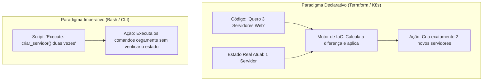
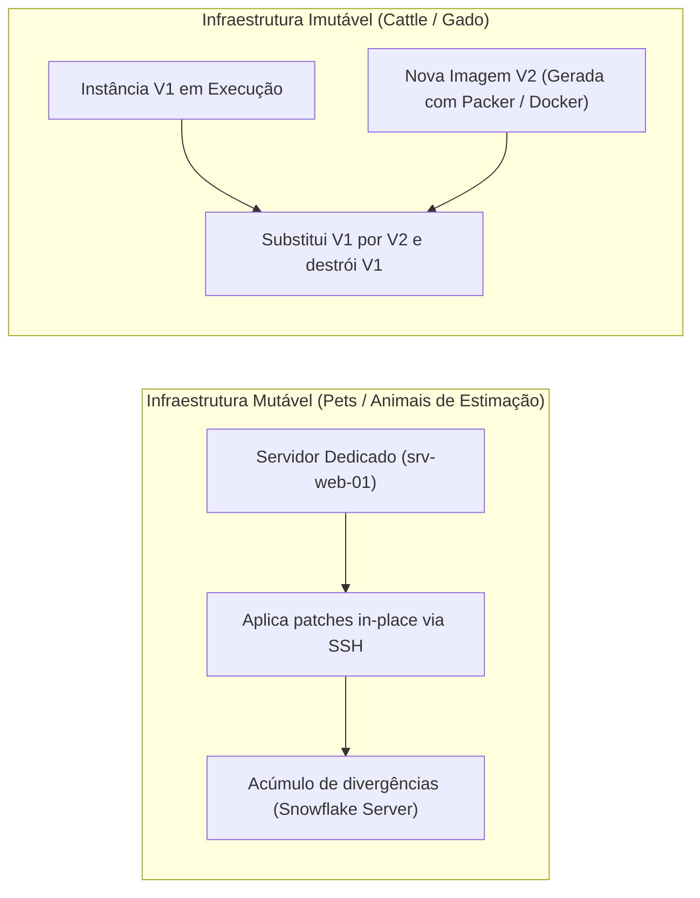
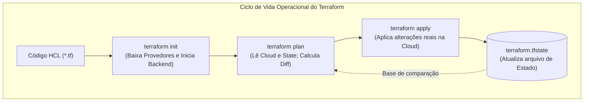
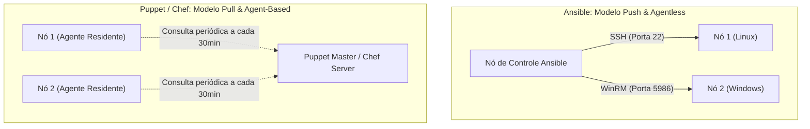

# 05 - Infraestrutura como Código (IaC) e Gerenciamento de Configuração

> **Matéria:** DevOps, Plataforma de Desenvolvimento e Engenharia de Entrega  
> **Cargo:** B02 – Técnico de Controle Externo – Especialidade: Tecnologia da Informação  
> **Arquivo:** `05_infraestrutura_como_codigo_iac_e_gerenciamento_de_configuracao.md`  


---


## 📌 Ementa / Itens do Edital
- Conceitos de Infraestrutura como Código (IaC - Infrastructure as Code)
- Abordagens: Declarativa vs. Imperativa / Procedural
- Infraestrutura Imutável vs. Mutável (Paradigma Pets vs. Cattle)
- Idempotência e controle de desvio de estado (Configuration Drift)
- Ferramentas de provisionamento declarativo: Terraform e OpenTofu
- Ferramentas de gerenciamento de configuração: Ansible, Puppet e Chef (Arquitetura Push vs. Pull, Agentless vs. Agent-based)

---

## 🧭 Sumário

1. [Fundamentos de Infraestrutura como Código (IaC)](#1-fundamentos-de-infraestrutura-como-codigo-iac)
    1. [Definição, Propósito e Benefícios de Engenharia](#11-definicao-proposito-e-beneficios-de-engenharia)
    2. [Paradigma Declarativo (O Quê) vs. Imperativo (Como)](#12-paradigma-declarativo-o-que-vs-imperativo-como)
    3. [O Princípio da Idempotência e Desvio de Configuração (Configuration Drift)](#13-o-principio-da-idempotencia-e-desvio-de-configuracao-configuration-drift)
    4. [Infraestrutura Mutável vs. Imutável (Pets vs. Cattle)](#14-infraestrutura-mutavel-vs-imutavel-pets-vs-cattle)
    5. [Teste 214](#Teste-214)
    6. [Teste 215](#Teste-215)
    7. [Teste 216](#Teste-216)
2. [Provisionamento Declarativo com Terraform e OpenTofu](#2-provisionamento-declarativo-com-terraform-e-opentofu)
    1. [Estrutura e Blocos Fundamentais da Linguagem HCL](#21-estrutura-e-blocos-fundamentais-da-linguagem-hcl)
    2. [O Arquivo de Estado (terraform.tfstate), Remote Backend e State Locking](#22-o-arquivo-de-estado-terraformtfstate-remote-backend-e-state-locking)
    3. [Ciclo Operacional da CLI: init, validate, plan, apply e destroy](#23-ciclo-operacional-da-cli-init-validate-plan-apply-e-destroy)
    4. [Teste 217](#Teste-217)
    5. [Teste 218](#Teste-218)
    6. [Teste 219](#Teste-219)
3. [Gerenciamento Automatizado de Configuração: Ansible vs. Puppet vs. Chef](#3-gerenciamento-automatizado-de-configuracao-ansible-vs-puppet-vs-chef)
    1. [Modelos Arquiteturais: Push vs. Pull e Agentless vs. Agent-Based](#31-modelos-arquiteturais-push-vs-pull-e-agentless-vs-agent-based)
    2. [Matriz Comparativa Detalhada: Ansible vs. Puppet vs. Chef](#32-matriz-comparativa-detalhada-ansible-vs-puppet-vs-chef)
    3. [Anatomia Operacional do Ansible: Inventário, Playbooks, Módulos, Handlers e Roles](#33-anatomia-operacional-do-ansible-inventario-playbooks-modulos-handlers-e-roles)
    4. [Sinergia Arquitetural: Terraform no Provisionamento + Ansible na Configuração](#34-sinergia-arquitetural-terraform-no-provisionamento-ansible-na-configuracao)
    5. [Teste 220](#Teste-220)
    6. [Teste 221](#Teste-221)
    7. [Teste 222](#Teste-222)
    8. [Teste 223](#Teste-223)
4. [🌐 Fontes Oficiais e Referências Bibliográficas](#fontes-oficiais-e-referencias-bibliograficas)

---

## 1. Fundamentos de Infraestrutura como Código (IaC)

A Infraestrutura como Código (*Infrastructure as Code - IaC*) é a prática de engenharia que substitui o provisionamento manual e artesanal de recursos computacionais (telas interativas de consoles de nuvem, assistentes gráficos e comandos isolados no terminal) por **arquivos descritivos de configuração legíveis por máquina e versionados em sistemas de controle de versão (como o Git)**.



### 1.1 Definição, Propósito e Benefícios de Engenharia

O propósito primordial da IaC é aplicar os mesmos rigores e benefícios do desenvolvimento de software ao gerenciamento de infraestrutura de TI:

- **Reprodutibilidade e Consistência:** Permite recriar ambientes completos de homologação, testes e produção com total fidelidade a partir de um único comando, erradicando o problema do "na minha máquina funciona".
- **Rastreabilidade e Auditoria:** Cada modificação em redes, regras de firewall ou servidores fica registrada no histórico de commits do Git, documentando quem alterou, quando alterou e qual foi a justificativa técnica.
- **Automação via Pipelines de CI/CD:** A infraestrutura pode ser validada por linters estáticos, testes de segurança e submetida a aprovações por pares antes de ser aplicada compulsoriamente por runners automatizados (*GitOps*).

### 1.2 Paradigma Declarativo (O Quê) vs. Imperativo (Como)

As linguagens e ferramentas de IaC dividem-se em dois paradigmas fundamentais:

- **Paradigma Declarativo (O Quê / *Desired State*):**
    - O operador define o **estado final almejado da infraestrutura** (ex.: *"devem existir 3 máquinas virtuais com 8GB de RAM na sub-rede privada"*).
    - O motor da ferramenta de IaC é responsável por consultar o estado atual da nuvem, compará-lo com o código, deduzir a diferença matemática (*delta*) e orquestrar a execução estrita das ações necessárias para atingir a meta.
    - Se 1 máquina já existir, o motor cria apenas 2. Se as 3 já existirem, o motor não faz nada.
    - **Exemplos Canônicos:** Terraform, OpenTofu, AWS CloudFormation, manifestos do Kubernetes.
- **Paradigma Imperativo / Procedural (Como / *Execution Steps*):**
    - O operador programa a **sequência cronológica e explícita de passos e comandos** que o sistema deve executar para erguer a infraestrutura (ex.: *"passo 1: chame a API de criar VM; passo 2: pause por 30 segundos; passo 3: anexe o disco"*).
    - A ferramenta executa as instruções cegamente. Se o script falhar na metade, o ambiente fica em estado inconsistente (*partially applied*), exigindo scripts corretivos ou intervenções manuais.
    - **Exemplos Canônicos:** Shell Scripts (Bash/PowerShell), AWS CLI, chamadas via SDK Python (Boto3).

### 1.3 O Princípio da Idempotência e Desvio de Configuração (Configuration Drift)

Dois conceitos são cobrados com rigor terminológico pela FCC:

#### Idempotência
Uma operação é dita **idempotente** se a sua execução repetida múltiplas vezes sobre um mesmo sistema produz **exatamente o mesmo resultado final da primeira execução**, sem gerar efeitos colaterais indesejados, duplicações de recursos ou erros de execução.

- *Na prática:* Se você executar `terraform apply` ou rodar um *Playbook* do Ansible dez vezes consecutivas sobre uma infraestrutura estável sem alterar o código, a ferramenta validará que o estado real já coincide com o estado desejado e reportará **zero alterações** (`0 to add, 0 to change, 0 to destroy` ou `changed=0`).

#### Desvio de Configuração (*Configuration Drift*)
O desvio de configuração manifesta-se quando recursos de produção são modificados manualmente "fora de banda" (*out-of-band*), por exemplo:

- Um administrador conecta via console web da nuvem ou via terminal SSH e altera manualmente uma porta de firewall ou a quantidade de memória de uma instância sem refletir essa mudança no repositório Git.
- **Impacto:** O ambiente real diverge da especificação formal do código versionado.
- **Correção Automatizada:** Na execução seguinte de planejamento (`terraform plan`), o motor compara o estado real com o código, detecta a divergência e propõe a reversão compulsória da alteração manual, restaurando a conformidade institucional.

### 1.4 Infraestrutura Mutável vs. Imutável (Pets vs. Cattle)

O debate arquitetural entre sistemas mutáveis e imutáveis é consagrado na metáfora de Randy Bias: *"Pets vs. Cattle"* (Animais de Estimação vs. Gado).



| Critério de Análise | Infraestrutura Mutável (*Pets*) | Infraestrutura Imutável (*Cattle*) |
| :--- | :--- | :--- |
| **Mecanismo de Atualização** | Atualizações no local (*in-place*), instalando patches e compilando código diretamente na máquina em execução. | **Destruição da instância antiga** e subida de uma nova instância pré-construída com a imagem atualizada. |
| **Identidade dos Servidores** | Servidores únicos, com nomes próprios e manutenção artesanal (*animais de estimação*). | Servidores anônimos, descartáveis, idênticos e substituíveis (*cabeças de gado*). |
| **Patologia / Risco Típico** | **Servidores "Snowflake":** Instâncias artesanais com configurações acumuladas que ninguém sabe reproduzir do zero. | Tempo e pipeline necessários para compilar e homologar a imagem antes do deploy. |
| **Facilidade de Rollback** | Complexa e arriscada (exige scripts de desinstalação reversos). | **Instantânea e segura:** Basta apontar o balanceador para a imagem anterior testada. |
| **Tecnologias Viabilizadoras** | Ansible, Puppet, Chef, scripts Bash in-place. | Packer, Docker, Terraform, Kubernetes, AMIs de nuvem. |

---

### Teste 214
**(FCC – TRT 23ª – 2016 – Analista Judiciário - Apoio Especializado - Tecnologia da Informação)**
Um Analista editou o arquivo domain.xml, deixando um fragmento do código com a seguinte configuração: <server-groups> <server-group name="grupo-apps" profile="ha"> <jvm name="default"> <heap size="1303m" max-size="1303m"/> <permgen max-size="256m"/> </jvm> <socket-binding-group ref="ha-sockets"/> </server-group> </server-groups> Trata-se de configurações

* **A)** <h:inputText/> e <h:inputSecret/>
* **B)** <form:inputText/> e <form:inputPassword/>
* **C)** <html:inputField/> e <html:inputHidden/>
* **D)** <h:inputTextarea> e <h:inputPassword/>
* **E)** <h:inputField> e <h:inputHidden/>

---

> **Comentário Detalhado:**
>
> - **A)** **Incorreta.** A opção apresenta proposição em desacordo com os fundamentos teóricos e técnicos do tópico ao afirmar que "`<h:inputText/>` e `<h:inputSecret/>`". De acordo com a teoria estudada em *Desvio de Configuração (Configuration Drift)*, impacto: O ambiente real diverge da especificação formal do código versionado.
> - **B)** **Incorreta.** A opção apresenta proposição em desacordo com os fundamentos teóricos e técnicos do tópico ao afirmar que "`<form:inputText/>` e `<form:inputPassword/>`". De acordo com a teoria estudada em *Desvio de Configuração (Configuration Drift)*, correção Automatizada: Na execução seguinte de planejamento (`terraform plan`), o motor compara o estado real com o código, detecta a divergência e propõe a reversão compulsória da alteração manual, restaurando a conformidade institucional.
> - **C)** **Correta.** Conforme fundamentado na seção *1. Fundamentos de Infraestrutura como Código (IaC)* deste guia, a Infraestrutura como Código (*Infrastructure as Code - IaC*) é a prática de engenharia que substitui o provisionamento manual e artesanal de recursos computacionais (telas interativas de consoles de nuvem, assistentes gráficos e comandos isolados no terminal) por arquivos descritivos de configuração legíveis por máquina e versionados em sistemas de controle de versão (como o Git). Dessa forma, está plenamente correta a assertiva da banca (FCC – TRT 23ª/2016) ao estabelecer que "`<html:inputField/>` e `<html:inputHidden/>`".
> - **D)** **Incorreta.** A opção apresenta proposição em desacordo com os fundamentos teóricos e técnicos do tópico ao afirmar que "`<h:inputTextarea>` e `<h:inputPassword/>`". De acordo com a teoria estudada em *1.4 Infraestrutura Mutável vs. Imutável (Pets vs. Cattle)*, patologia / Risco Típico: Servidores "Snowflake": Instâncias artesanais com configurações acumuladas que ninguém sabe reproduzir do zero. — Tempo e pipeline necessários para compilar e homologar a imagem antes do deploy.
> - **E)** **Incorreta.** A opção apresenta proposição em desacordo com os fundamentos teóricos e técnicos do tópico ao afirmar que "`<h:inputField>` e `<h:inputHidden/>`". De acordo com a teoria estudada em *2.2 O Arquivo de Estado (terraform.tfstate), Remote Backend e State Locking*, ele mapeia os identificadores declarados no código HCL com os identificadores reais gerados nas APIs da nuvem (ex.: mapeia o recurso `aws_vpc.rede_tce` ao identificador físico `vpc-0123456789abcdef0`), além de armazenar metadados e dependências.
>
> **Gabarito: C**

---

### Teste 215
**(FGV – TCE/PA – 2024 – Auditor de Controle Externo - Administrativa - Engenharia Mecânica)**
A figura a seguir apresenta um circuito elétrico trifásico  e o circuito equivalente na configuração Y. Na configuração Y, as resistências R , R e R valem, 1 2 3 respectivamente,

* **A)** 5, 20 e 10
* **B)** 5, 10 e 4
* **C)** 20, 10 e 4
* **D)** 20, 4 e 10
* **E)** 20, 5 e 4

---

> **Comentário Detalhado:**
>
> - **A)** **Incorreta.** A opção apresenta proposição em desacordo com os fundamentos teóricos e técnicos do tópico ao afirmar que "5, 20 e 10". De acordo com a teoria estudada em *1.3 O Princípio da Idempotência e Desvio de Configuração (Configuration Drift)*, dois conceitos são cobrados com rigor terminológico pela FCC.
> - **B)** **Incorreta.** A opção apresenta proposição em desacordo com os fundamentos teóricos e técnicos do tópico ao afirmar que "5, 10 e 4". De acordo com a teoria estudada em *Desvio de Configuração (Configuration Drift)*, o desvio de configuração manifesta-se quando recursos de produção são modificados manualmente "fora de banda" (*out-of-band*), por exemplo.
> - **C)** **Incorreta.** A opção apresenta proposição em desacordo com os fundamentos teóricos e técnicos do tópico ao afirmar que "20, 10 e 4". De acordo com a teoria estudada em *Desvio de Configuração (Configuration Drift)*, um administrador conecta via console web da nuvem ou via terminal SSH e altera manualmente uma porta de firewall ou a quantidade de memória de uma instância sem refletir essa mudança no repositório Git.
> - **D)** **Incorreta.** A opção apresenta proposição em desacordo com os fundamentos teóricos e técnicos do tópico ao afirmar que "20, 4 e 10". De acordo com a teoria estudada em *Desvio de Configuração (Configuration Drift)*, impacto: O ambiente real diverge da especificação formal do código versionado.
> - **E)** **Correta.** Conforme fundamentado na seção *1. Fundamentos de Infraestrutura como Código (IaC)* deste guia, a Infraestrutura como Código (*Infrastructure as Code - IaC*) é a prática de engenharia que substitui o provisionamento manual e artesanal de recursos computacionais (telas interativas de consoles de nuvem, assistentes gráficos e comandos isolados no terminal) por arquivos descritivos de configuração legíveis por máquina e versionados em sistemas de controle de versão (como o Git). Dessa forma, está plenamente correta a assertiva da banca (FGV – TCE/PA/2024) ao estabelecer que "20, 5 e 4".
>
> **Gabarito: E**

---

### Teste 216
**(FCC – TRT 14ª – 2016 – Analista Judiciário - Apoio Especializado - Tecnologia da Informação)**
Como uma instância de JBoss é uma configuração em execução, ao ser instalado, ele vem com diferentes configurações e cada uma delas é localizada no diretório JBOSS_DIST/jboss-as/server. Em linha de comando no Linux, para iniciar o JBoss com o conjunto de arquivo de configuração mínimo utiliza-se o comando

* **A)** run.sh -x compact
* **B)** run.sh -c minimal
* **C)** start.sh -a compact
* **D)** start.sh -x 0
* **E)** run.sh -a minimal

---

> **Comentário Detalhado:**
>
> - **A)** **Incorreta.** A opção apresenta proposição em desacordo com os fundamentos teóricos e técnicos do tópico ao afirmar que "run.sh -x compact". De acordo com a teoria estudada em *1.4 Infraestrutura Mutável vs. Imutável (Pets vs. Cattle)*, mecanismo de Atualização: Atualizações no local (*in-place*), instalando patches e compilando código diretamente na máquina em execução. — Destruição da instância antiga e subida de uma nova instância pré-construída com a imagem atualizada.
> - **B)** **Incorreta.** A opção apresenta proposição em desacordo com os fundamentos teóricos e técnicos do tópico ao afirmar que "run.sh -c minimal". De acordo com a teoria estudada em *Desvio de Configuração (Configuration Drift)*, um administrador conecta via console web da nuvem ou via terminal SSH e altera manualmente uma porta de firewall ou a quantidade de memória de uma instância sem refletir essa mudança no repositório Git.
> - **C)** **Incorreta.** A opção apresenta proposição em desacordo com os fundamentos teóricos e técnicos do tópico ao afirmar que "start.sh -a compact". De acordo com a teoria estudada em *1.1 Definição, Propósito e Benefícios de Engenharia*, reprodutibilidade e Consistência: Permite recriar ambientes completos de homologação, testes e produção com total fidelidade a partir de um único comando, erradicando o problema do "na minha máquina funciona".
> - **D)** **Correta.** Conforme fundamentado na seção *3.1 Modelos Arquiteturais: Push vs. Pull e Agentless vs. Agent-Based* deste guia, utiliza protocolos de comunicação remota já existentes no próprio sistema operacional hospedeiro: SSH (porta 22) para sistemas Linux/Unix e WinRM (porta 5986) para sistemas Windows. Requer apenas o interpretador Python instalado nos nós-alvo. Dessa forma, está plenamente correta a assertiva da banca (FCC – TRT 14ª/2016) ao estabelecer que "start.sh -x 0".
> - **E)** **Incorreta.** A opção apresenta proposição em desacordo com os fundamentos teóricos e técnicos do tópico ao afirmar que "run.sh -a minimal". De acordo com a teoria estudada em *3.2 Matriz Comparativa Detalhada: Ansible vs. Puppet vs. Chef*, requisito no Destino: Python instalado e servidor SSH/WinRM ativo — Agente Puppet instalado e em execução — Agente Chef Client instalado e em execução.
>
> **Gabarito: D**

---

## 2. Provisionamento Declarativo com Terraform e OpenTofu

O **Terraform** (desenvolvido pela HashiCorp) e seu fork comunitário de código aberto **OpenTofu** (mantido sob a governança da *Linux Foundation*) são as plataformas líderes para provisionamento declarativo multi-nuvem e multi-provedor.



### 2.1 Estrutura e Blocos Fundamentais da Linguagem HCL

O código é estruturado na linguagem *HashiCorp Configuration Language* (HCL) através de blocos declarativos coesos:

```hcl
terraform {
  required_version = ">= 1.5.0"
  required_providers {
    aws = {
      source  = "hashicorp/aws"
      version = "~> 5.0"
    }
  }
  backend "s3" { # Remote Backend Seguro
    bucket         = "tce-terraform-state"
    key            = "producao/infra.tfstate"
    region         = "us-east-1"
    dynamodb_table = "tce-lock-table" # State Locking
  }
}

provider "aws" {
  region = var.regiao_padrao
}

resource "aws_vpc" "rede_tce" {
  cidr_block           = "10.0.0.0/16"
  enable_dns_hostnames = true
  tags = {
    Name = "vpc-fiscalizacao-tce"
  }
}

output "vpc_id" {
  value       = aws_vpc.rede_tce.id
  description = "ID da VPC gerada pelo provedor"
}
```

- **`terraform {}`:** Configurações globais do próprio motor, requisitos de versões mínimas e declaração do *Backend* de armazenamento do estado.
- **`provider`:** Módulos de plugins responsáveis por traduzir as instruções HCL em chamadas REST para as APIs dos provedores de destino (AWS, Azure, Google Cloud, VMware, Kubernetes).
- **`resource`:** Bloco primordial que declara os componentes que devem ser criados e mantidos no provedor (ex.: VPCs, instâncias EC2, bancos RDS).
- **`data`:** Fontes de dados (*Data Sources*) utilizadas para consultar informações sobre recursos pré-existentes na infraestrutura que foram criados fora do escopo do manifesto atual.
- **`variable`:** Parâmetros de entrada que tornam o código flexível e reutilizável.
- **`output`:** Valores de retorno exportados após a execução (ex.: IP público de um balanceador, ID de uma VPC).
- **`module`:** Pacote de configurações HCL autocontidas e parametrizadas que funcionam como funções reutilizáveis em múltiplos ambientes.

### 2.2 O Arquivo de Estado (terraform.tfstate), Remote Backend e State Locking

- **A Função do `terraform.tfstate`:** É o coração transacional do Terraform. Ele mapeia os identificadores declarados no código HCL com os identificadores reais gerados nas APIs da nuvem (ex.: mapeia o recurso `aws_vpc.rede_tce` ao identificador físico `vpc-0123456789abcdef0`), além de armazenar metadados e dependências.
- **Remote Backend:** Em times profissionais e órgãos públicos, o arquivo `.tfstate` **nunca deve ser versionado no Git local** (pois pode conter senhas em texto claro e causará conflitos insolúveis). Ele deve ser armazenado em um repositório remoto seguro com criptografia em repouso (ex.: Amazon S3, Google Cloud Storage, Terraform Cloud).
- **State Locking (Bloqueio de Estado):** Mecanismo de controle de concorrência que impede que dois operadores ou pipelines de CI/CD executem `terraform apply` simultaneamente sobre a mesma infraestrutura, o que provocaria corrupção catastrófica de dados. No AWS S3, o locking é implementado através de tabelas no **Amazon DynamoDB**.

### 2.3 Ciclo Operacional da CLI: init, validate, plan, apply e destroy

1. **`terraform init`:** Inicializa o diretório de trabalho, baixa os plugins dos provedores necessários (`providers`) e conecta ao *backend* de estado configurado.
2. **`terraform validate`:** Realiza a análise estática da sintaxe HCL e checa a consistência interna das variáveis sem consultar as APIs dos provedores.
3. **`terraform plan`:** Executa o planejamento especulativo: consulta a nuvem real, compara com o `.tfstate` e com o código HCL, exibindo a prévia exata do que será criado (`+`), alterado (`~`) ou destruído (`-`), **sem realizar modificações reais**.
4. **`terraform apply`:** Aplica efetivamente as alterações na nuvem com base no plano aprovado e atualiza o arquivo de estado.
5. **`terraform destroy`:** Destrói de forma controlada todos os recursos gerenciados por aquele projeto específico de IaC.

---

### Teste 217
**(FCC – TRT 6ª – 2012 – Analista Judiciário - Apoio Especializado/Tecnologia da Informação)**
O processo de monitoramento de programas de governo pressupõe

* **A)** o acompanhamento contábil da implantação do programa, com relatórios semanais.
* **B)** uma checagem diária das condições formais da organização, em termos de qualificação dos recursos humanos.
* **C)** o acompanhamento contínuo, cotidiano, por parte de gestores e gerentes, do desenvolvimento dos programas e políticas em relação a seus objetivos e metas.
* **D)** avaliações executadas por instituições externas, com pesquisas que procurem responder a perguntas específicas.
* **E)** a construção de indicadores, produzidos regularmente com base em diferentes fontes de dados, que dão aos gestores informações sobre o desempenho de programas.

---

> **Comentário Detalhado:**
>
> - **A)** **Incorreta.** A opção apresenta proposição em desacordo com os fundamentos teóricos e técnicos do tópico ao afirmar que "o acompanhamento contábil da implantação do programa, com relatórios semanais". De acordo com a teoria estudada em *2.3 Ciclo Operacional da CLI: init, validate, plan, apply e destroy*, `terraform apply`: Aplica efetivamente as alterações na nuvem com base no plano aprovado e atualiza o arquivo de estado.
> - **B)** **Incorreta.** A opção apresenta proposição em desacordo com os fundamentos teóricos e técnicos do tópico ao afirmar que "uma checagem diária das condições formais da organização, em termos de qualificação dos recursos humanos". De acordo com a teoria estudada em *2.2 O Arquivo de Estado (terraform.tfstate), Remote Backend e State Locking*, state Locking (Bloqueio de Estado): Mecanismo de controle de concorrência que impede que dois operadores ou pipelines de CI/CD executem `terraform apply` simultaneamente sobre a mesma infraestrutura, o que provocaria corrupção catastrófica de dados.
> - **C)** **Incorreta.** A opção apresenta proposição em desacordo com os fundamentos teóricos e técnicos do tópico ao afirmar que "o acompanhamento contínuo, cotidiano, por parte de gestores e gerentes, do desenvolvimento dos programas e...". De acordo com a teoria estudada em *1.1 Definição, Propósito e Benefícios de Engenharia*, o propósito primordial da IaC é aplicar os mesmos rigores e benefícios do desenvolvimento de software ao gerenciamento de infraestrutura de TI.
> - **D)** **Incorreta.** A opção apresenta proposição em desacordo com os fundamentos teóricos e técnicos do tópico ao afirmar que "avaliações executadas por instituições externas, com pesquisas que procurem responder a perguntas específicas". De acordo com a teoria estudada em *3.3 Anatomia Operacional do Ansible: Inventário, Playbooks, Módulos, Handlers e Roles*, handlers (Gatilhos Condicionais): Tarefas especiais que só são executadas se alguma tarefa anterior tiver efetivamente modificado o estado do nó (`changed=true`) e emitido um evento via diretiva `notify`.
> - **E)** **Correta.** Conforme fundamentado na seção *2.1 Estrutura e Blocos Fundamentais da Linguagem HCL* deste guia, `data`: Fontes de dados (*Data Sources*) utilizadas para consultar informações sobre recursos pré-existentes na infraestrutura que foram criados fora do escopo do manifesto atual. Dessa forma, está plenamente correta a assertiva da banca (FCC – TRT 6ª/2012) ao estabelecer que "a construção de indicadores, produzidos regularmente com base em diferentes fontes de dados, que dão aos gestores...".
>
> **Gabarito: E**

---

### Teste 218
**(FGV – TJ/MT – 2024 – Analista Judiciario Tecnologia Da Informacao)**
No método Kanban, uma das práticas centrais ajuda a identificar gargalos e promover a eficiência ao limitar a quantidade de trabalho em progresso. O texto acima se refere à seguinte prática do Kanban:

* **A)** dividir o trabalho em iterações fixas.
* **B)** estabelecer metas rígidas de entrega.
* **C)** realizar reuniões diárias de acompanhamento.
* **D)** aumentar o número de colunas no quadro Kanban.
* **E)** limitar o WIP (Work in Progress).

---

> **Comentário Detalhado:**
>
> - **A)** **Incorreta.** A opção apresenta proposição em desacordo com os fundamentos teóricos e técnicos do tópico ao afirmar que "dividir o trabalho em iterações fixas". De acordo com a teoria estudada em *2.3 Ciclo Operacional da CLI: init, validate, plan, apply e destroy*, `terraform init`: Inicializa o diretório de trabalho, baixa os plugins dos provedores necessários (`providers`) e conecta ao *backend* de estado configurado.
> - **B)** **Incorreta.** A opção apresenta proposição em desacordo com os fundamentos teóricos e técnicos do tópico ao afirmar que "estabelecer metas rígidas de entrega". De acordo com a teoria estudada em *Desvio de Configuração (Configuration Drift)*, um administrador conecta via console web da nuvem ou via terminal SSH e altera manualmente uma porta de firewall ou a quantidade de memória de uma instância sem refletir essa mudança no repositório Git.
> - **C)** **Incorreta.** A opção apresenta proposição em desacordo com os fundamentos teóricos e técnicos do tópico ao afirmar que "realizar reuniões diárias de acompanhamento". De acordo com a teoria estudada em *2.3 Ciclo Operacional da CLI: init, validate, plan, apply e destroy*, `terraform plan`: Executa o planejamento especulativo: consulta a nuvem real, compara com o `.tfstate` e com o código HCL, exibindo a prévia exata do que será criado (`+`), alterado (`~`) ou destruído (`-`), sem realizar modificações reais.
> - **D)** **Incorreta.** A opção apresenta proposição em desacordo com os fundamentos teóricos e técnicos do tópico ao afirmar que "aumentar o número de colunas no quadro Kanban". De acordo com a teoria estudada em *3.4 Sinergia Arquitetural: Terraform no Provisionamento + Ansible na Configuração*, uma vez provisionadas as instâncias, o Ansible conecta-se a elas via SSH para endurecer o sistema operacional (*hardening*), instalar utilitários, configurar usuários e preparar os nós para as cargas de trabalho corporativas.
> - **E)** **Correta.** Conforme fundamentado na seção *2.2 O Arquivo de Estado (terraform.tfstate), Remote Backend e State Locking* deste guia, remote Backend: Em times profissionais e órgãos públicos, o arquivo `.tfstate` nunca deve ser versionado no Git local (pois pode conter senhas em texto claro e causará conflitos insolúveis). Dessa forma, está plenamente correta a assertiva da banca (FGV – TJ/MT/2024) ao estabelecer que "limitar o WIP (Work in Progress)".
>
> **Gabarito: E**

---

### Teste 219
**(FCC – TRT 6ª – 2012 – Analista Judiciário - Apoio Especializado/Tecnologia da Informação)**
O termo malware é uma denominação genérica para designar software projetado para causar danos a quem o executa. Software assim pode ganhar acesso a um computador através dos seguintes meios, EXCETO

* **A)** um arquivo .mp3 que infecta o sistema ao ser tocado.
* **B)** um arquivo .doc que infecta o sistema ao ser aberto no editor.
* **C)** uma extensão do navegador que infecta o sistema ao ser executada.
* **D)** um programa executável que infecta o sistema ao ser executado.
* **E)** uma arquivo .xls que infecta o sistema ao ser aberto.

---

> **Comentário Detalhado:**
>
> - **A)** **Incorreta.** A opção apresenta proposição em desacordo com os fundamentos teóricos e técnicos do tópico ao afirmar que "um arquivo .mp3 que infecta o sistema ao ser tocado". De acordo com a teoria estudada em *2.2 O Arquivo de Estado (terraform.tfstate), Remote Backend e State Locking*, remote Backend: Em times profissionais e órgãos públicos, o arquivo `.tfstate` nunca deve ser versionado no Git local (pois pode conter senhas em texto claro e causará conflitos insolúveis).
> - **B)** **Incorreta.** A opção apresenta proposição em desacordo com os fundamentos teóricos e técnicos do tópico ao afirmar que "um arquivo .doc que infecta o sistema ao ser aberto no editor". De acordo com a teoria estudada em *2.2 O Arquivo de Estado (terraform.tfstate), Remote Backend e State Locking*, ele deve ser armazenado em um repositório remoto seguro com criptografia em repouso (ex.: Amazon S3, Google Cloud Storage, Terraform Cloud).
> - **C)** **Incorreta.** A opção apresenta proposição em desacordo com os fundamentos teóricos e técnicos do tópico ao afirmar que "uma extensão do navegador que infecta o sistema ao ser executada". De acordo com a teoria estudada em *1.1 Definição, Propósito e Benefícios de Engenharia*, automação via Pipelines de CI/CD: A infraestrutura pode ser validada por linters estáticos, testes de segurança e submetida a aprovações por pares antes de ser aplicada compulsoriamente por runners automatizados (*GitOps*).
> - **D)** **Correta.** Conforme fundamentado na seção *1.2 Paradigma Declarativo (O Quê) vs. Imperativo (Como)* deste guia, o operador programa a sequência cronológica e explícita de passos e comandos que o sistema deve executar para erguer a infraestrutura (ex.: *"passo 1: chame a API de criar VM; passo 2: pause por 30 segundos; passo 3: anexe o disco"*). Dessa forma, está plenamente correta a assertiva da banca (FCC – TRT 6ª/2012) ao estabelecer que "um programa executável que infecta o sistema ao ser executado".
> - **E)** **Incorreta.** A opção apresenta proposição em desacordo com os fundamentos teóricos e técnicos do tópico ao afirmar que "uma arquivo .xls que infecta o sistema ao ser aberto". De acordo com a teoria estudada em *2. Provisionamento Declarativo com Terraform e OpenTofu*, o Terraform (desenvolvido pela HashiCorp) e seu fork comunitário de código aberto OpenTofu (mantido sob a governança da *Linux Foundation*) são as plataformas líderes para provisionamento declarativo multi-nuvem e multi-provedor.
>
> **Gabarito: D**

---

## 3. Gerenciamento Automatizado de Configuração: Ansible vs. Puppet vs. Chef

Enquanto o Terraform se especializa em **provisionar a infraestrutura básica** (redes, instâncias virtuais, balanceadores), as ferramentas de gerenciamento de configuração especializam-se em **configurar o interior dos sistemas operacionais** (instalar pacotes, aplicar patches de segurança, gerenciar arquivos de configuração e orquestrar serviços).



### 3.1 Modelos Arquiteturais: Push vs. Pull e Agentless vs. Agent-Based

- **Modelo Push (Empurrado) vs. Pull (Puxado):**
    - **Push (Ansible):** O servidor central de controle toma a iniciativa ativa: conecta-se aos nós de destino e empurra os comandos e scripts de configuração sob demanda do operador.
    - **Pull (Puppet e Chef):** Os nós clientes possuem agentes residentes executando em segundo plano que consultam periodicamente o servidor mestre (ex.: a cada 30 minutos) para verificar se há novas diretivas e aplicar correções locais.
- **Agentless (Sem Agente) vs. Agent-Based (Baseado em Agente):**
    - **Agentless (Ansible):** Não requer a instalação de nenhum software, daemon ou agente proprietário nos nós gerenciados. Utiliza protocolos de comunicação remota já existentes no próprio sistema operacional hospedeiro: **SSH** (porta 22) para sistemas Linux/Unix e **WinRM** (porta 5986) para sistemas Windows. Requer apenas o interpretador Python instalado nos nós-alvo.
    - **Agent-Based (Puppet e Chef):** Exige a instalação, configuração e manutenção de um agente residente proprietário (*Puppet Agent* ou *Chef Client*) em cada nó gerenciado, além de infraestrutura de certificados digitais TLS (PKI dedicada) para autenticar os nós junto ao servidor central.

### 3.2 Matriz Comparativa Detalhada: Ansible vs. Puppet vs. Chef

| Dimensão Técnica | Ansible | Puppet | Chef |
| :--- | :--- | :--- | :--- |
| **Arquitetura de Agentes** | **Agentless (Sem Agente)** | **Agent-based (Baseado em Agente)** | **Agent-based (Baseado em Agente)** |
| **Modelo de Execução** | **Push** (Nó de controle despacha tarefas) | **Pull** (Nó cliente busca configurações) | **Pull** (Nó cliente busca configurações) |
| **Protocolo de Transporte** | **SSH** padrão (Linux) e **WinRM** (Windows) | HTTPS com certificados TLS (PKI dedicada) | HTTPS com certificados TLS e API REST |
| **Linguagem de Definição** | **YAML** + Templates Jinja2 | DSL declarativa própria (*Puppet Language*) | **Ruby puro** (*Cookbooks* e *Recipes*) |
| **Curva de Aprendizado** | Baixa e imediata | Moderada | Alta (exige fluência em Ruby) |
| **Requisito no Destino** | Python instalado e servidor SSH/WinRM ativo | Agente Puppet instalado e em execução | Agente Chef Client instalado e em execução |

### 3.3 Anatomia Operacional do Ansible: Inventário, Playbooks, Módulos, Handlers e Roles

1. **Arquivo de Inventário (`inventory`):** Mapeia os endereços IP ou nomes de domínio dos servidores-alvo agrupados por categorias lógicas (formato INI ou YAML):

```ini
[webservers]
10.0.1.10
10.0.1.11

[dbservers]
10.0.2.20
```

2. **Playbooks:** Manifestos em YAML que definem as "jogadas" (*plays*), associando grupos do inventário a uma sequência de tarefas (*tasks*):

```yaml
- name: Configurar Servidor Web Corporativo
  hosts: webservers
  become: true
  tasks:
    - name: Garantir que o Nginx esteja instalado
      apt:
        name: nginx
        state: present

    - name: Atualizar o arquivo de configuracao
      template:
        src: nginx.conf.j2
        dest: /etc/nginx/nginx.conf
      notify: Reiniciar Servico Nginx

  handlers:
    - name: Reiniciar Servico Nginx
      service:
        name: nginx
        state: restarted
```

3. **Módulos Idempotentes:** Funções especializadas que realizam as modificações de baixo nível (`apt`, `package`, `service`, `systemd`, `copy`, `template`, `file`).
4. **Handlers (Gatilhos Condicionais):** Tarefas especiais que **só são executadas se alguma tarefa anterior tiver efetivamente modificado o estado do nó (`changed=true`)** e emitido um evento via diretiva `notify`. Se a tarefa não causou alteração (status `ok`), o handler não é disparado, evitando reinicializações desnecessárias de serviços em produção.
5. **Facts (Fatos do Sistema):** O Ansible coleta automaticamente no início da execução um dicionário detalhado de metadados do nó gerenciado (endereços IP, interfaces, capacidade de memória RAM, versão do Kernel, distribuição Linux).
6. **Roles (Papéis Modulares):** Estrutura padronizada de diretórios (`tasks/`, `handlers/`, `templates/`, `defaults/`, `vars/`) que organiza pacotes de automação para reutilização em larga escala.

### 3.4 Sinergia Arquitetural: Terraform no Provisionamento + Ansible na Configuração

A prática de ponta em engenharia de plataforma e DevOps preconiza a combinação harmônica das duas ferramentas:

- **Terraform:** Atua na camada de **Infraestrutura**. Cria VPCs, sub-redes, gateways de internet, grupos de segurança, discos e instancia as máquinas virtuais ou clusters Kubernetes.
- **Ansible:** Atua na camada de **Configuração do Sistema**. Uma vez provisionadas as instâncias, o Ansible conecta-se a elas via SSH para endurecer o sistema operacional (*hardening*), instalar utilitários, configurar usuários e preparar os nós para as cargas de trabalho corporativas.

---

### Teste 220
**(CEBRASPE – STJ – 2024 – Analista Judiciário - Apoio Especializado - Suporte em Tecnologia da Informação)**
As práticas de gerenciamento de serviço do ITIL v4 incluem gerenciamento de infraestrutura e de plataforma. Em relação ao gerenciamento de projetos e à modelagem de processos de negócio, julgue os itens que se seguem.

* **C)** Certo
* **E)** Errado

---

> **Comentário Detalhado:**
>
> - **C)** **Incorreta.** A marcação como **Certo** não procede, pois o enunciado apresenta proposição em desacordo com os fundamentos teóricos e técnicos do tópico ao afirmar que "As práticas de gerenciamento de serviço do ITIL v4 incluem gerenciamento de infraestrutura e de plataforma...". De acordo com a teoria estudada em *1.1 Definição, Propósito e Benefícios de Engenharia*, o propósito primordial da IaC é aplicar os mesmos rigores e benefícios do desenvolvimento de software ao gerenciamento de infraestrutura de TI.
> - **E)** **Correta.** O item está **Errado** (gabarito oficial: **E**). Conforme fundamentado na seção *3. Gerenciamento Automatizado de Configuração: Ansible vs. Puppet vs. Chef* deste guia, enquanto o Terraform se especializa em provisionar a infraestrutura básica (redes, instâncias virtuais, balanceadores), as ferramentas de gerenciamento de configuração especializam-se em configurar o interior dos sistemas operacionais (instalar pacotes, aplicar patches de segurança, gerenciar arquivos de configuração e orquestrar serviços). Portanto, a assertiva examinada pela banca (CEBRASPE – STJ/2024) viola os preceitos técnicos do tópico.
>
> **Gabarito: E**

---

### Teste 221
**(FGV – TRF/1 – 2024 – Analista Judiciario Area Apoio Especializado Especialidade Tecnologia Da Informacao)**
A empresa "CompraCerta", uma nova plataforma de e- commerce, está implementando SSL (Secure Sockets Layer) para garantir a segurança das transações entre seus clientes e servidores. Em relação aos aspectos técnicos do SSL, é correto afirmar que:

* **A)** o SSL é um protocolo único projetado para fazer uso do TCP de modo a prover um serviço fim a fim seguro e confiável;
* **B)** entre qualquer par de participantes (aplicações como HTTP no cliente e no servidor), pode haver apenas uma conexão segura;
* **C)** o Protocolo de Apresentação SSL consiste em uma série de mensagens trocadas entre cliente e servidor. Pode-se considerar que essa troca possui sete fases;
* **D)** na operação global do protocolo de registro SSL, a primeira etapa é fragmentação. Cada mensagem de camada superior é fragmentada em blocos de 214 bytes (16.384 bytes) ou menos;
* **E)** a etapa final de processamento do Protocolo de Registro SSL é anexar um cabeçalho ao início da mensagem, consistindo nos campos: tipo de conteúdo, versão principal, comprimento comprimido e handshake.

---

> **Comentário Detalhado:**
>
> - **A)** **Incorreta.** A opção apresenta proposição em desacordo com os fundamentos teóricos e técnicos do tópico ao afirmar que "o SSL é um protocolo único projetado para fazer uso do TCP de modo a prover um serviço fim a fim seguro e confiável". De acordo com a teoria estudada em *3.2 Matriz Comparativa Detalhada: Ansible vs. Puppet vs. Chef*, modelo de Execução: Push (Nó de controle despacha tarefas) — Pull (Nó cliente busca configurações) — Pull (Nó cliente busca configurações).
> - **B)** **Incorreta.** A opção incorre em restrição indevida ao limitar o escopo conceitual ao afirmar que "entre qualquer par de participantes (aplicações como HTTP no cliente e no servidor), pode haver apenas uma conexão...". De acordo com a teoria estudada em *3.2 Matriz Comparativa Detalhada: Ansible vs. Puppet vs. Chef*, protocolo de Transporte: SSH padrão (Linux) e WinRM (Windows) — HTTPS com certificados TLS (PKI dedicada) — HTTPS com certificados TLS e API REST.
> - **C)** **Correta.** Conforme fundamentado na seção *3.1 Modelos Arquiteturais: Push vs. Pull e Agentless vs. Agent-Based* deste guia, pull (Puppet e Chef): Os nós clientes possuem agentes residentes executando em segundo plano que consultam periodicamente o servidor mestre (ex.: a cada 30 minutos) para verificar se há novas diretivas e aplicar correções locais. Dessa forma, está plenamente correta a assertiva da banca (FGV – TRF/1/2024) ao estabelecer que "o Protocolo de Apresentação SSL consiste em uma série de mensagens trocadas entre cliente e servidor. Pode-se...".
> - **D)** **Incorreta.** A opção apresenta proposição em desacordo com os fundamentos teóricos e técnicos do tópico ao afirmar que "na operação global do protocolo de registro SSL, a primeira etapa é fragmentação. Cada mensagem de camada superior...". De acordo com a teoria estudada em *Idempotência*, uma operação é dita idempotente se a sua execução repetida múltiplas vezes sobre um mesmo sistema produz exatamente o mesmo resultado final da primeira execução, sem gerar efeitos colaterais indesejados, duplicações de recursos ou erros de execução.
> - **E)** **Incorreta.** A opção apresenta proposição em desacordo com os fundamentos teóricos e técnicos do tópico ao afirmar que "a etapa final de processamento do Protocolo de Registro SSL é anexar um cabeçalho ao início da mensagem...". De acordo com a teoria estudada em *3.3 Anatomia Operacional do Ansible: Inventário, Playbooks, Módulos, Handlers e Roles*, facts (Fatos do Sistema): O Ansible coleta automaticamente no início da execução um dicionário detalhado de metadados do nó gerenciado (endereços IP, interfaces, capacidade de memória RAM, versão do Kernel, distribuição Linux).
>
> **Gabarito: C**

---

### Teste 222
**(CEBRASPE – STJ – 2015 – Analista Judiciario Suporte Em Tecnologia Da Informacao)**
As trocas de mensagens no padrão Gigabit Ethernet ocorrem ponto a ponto, e não multiponto como no padrão Ethernet original. Em qualquer configuração desse padrão, cada cabo conecta exatamente dois dispositivos.

* **C)** Certo
* **E)** Errado

---

> **Comentário Detalhado:**
>
> - **C)** **Correta.** O item está **Certo**. Conforme fundamentado na seção *3.1 Modelos Arquiteturais: Push vs. Pull e Agentless vs. Agent-Based* deste guia, push (Ansible): O servidor central de controle toma a iniciativa ativa: conecta-se aos nós de destino e empurra os comandos e scripts de configuração sob demanda do operador. Dessa forma, está plenamente correta a proposição da banca (CEBRASPE – STJ/2015) ao afirmar que "As trocas de mensagens no padrão Gigabit Ethernet ocorrem ponto a ponto, e não multiponto como no padrão...".
> - **E)** **Incorreta.** A marcação como **Errado** não procede, visto que a assertiva guarda integral conformidade com a teoria estudada em *3.4 Sinergia Arquitetural: Terraform no Provisionamento + Ansible na Configuração*, segundo a qual uma vez provisionadas as instâncias, o Ansible conecta-se a elas via SSH para endurecer o sistema operacional (*hardening*), instalar utilitários, configurar usuários e preparar os nós para as cargas de trabalho corporativas.
>
> **Gabarito: C**

---

### Teste 223
**(FGV – TJ/AP – 2023 – Analista Judiciario Apoio Especializado Tecnologia Da Informacao Telecomunicacoes)**
As tabelas abaixo apresentam o resumo da configuração de dois equipamentos comutadores (Switch): SW1 e SW2. Nelas, é possível identificar as VLAN (Virtual LAN) e as portas dos respectivos comutadores em que os seis Computadores Pessoais (PC 1, PC 2, PC 3, PC 4, PC 5 e PC 6) dessa rede estão conectados. As portas de número 10 interligam os comutadores e estão configuradas em modo de Tronco de VLAN (Protocolo IEEE 802.1q), permitindo a passagem de qualquer pacote deste tipo de protocolo. SW1 SW2 Switch VLAN Porta PC Switch VLAN Porta PC 10 01 PC 1 10 01 - 10 02 - 10 02 PC 4 10 03 PC 2 10 03 - 20 04 - 20 04 PC 5 20 05 - 20 05 - 01 02 20 06 - 20 06 PC 6 30 07 PC 3 30 07 - 30 08 - 30 08 - 30 09 - 30 09 - TRK 10 SW2 TRK 10 SW1 Os computadores pessoais que irão receber o pacote ARP (Address Resolution Protocol) enviado pelo PC 1 são:

* **A)** PC 2 e PC 3, somente;
* **B)** PC 2 e PC 4, somente;
* **C)** PC 4 e PC 6, somente;
* **D)** PC 2, PC 4 e PC 5, somente;
* **E)** PC 2, PC 3, PC 4, PC 5 e PC 6.

---

> **Comentário Detalhado:**
>
> - **A)** **Incorreta.** A opção incorre em restrição indevida ao limitar o escopo conceitual ao afirmar que "PC 2 e PC 3, somente". De acordo com a teoria estudada em *Desvio de Configuração (Configuration Drift)*, um administrador conecta via console web da nuvem ou via terminal SSH e altera manualmente uma porta de firewall ou a quantidade de memória de uma instância sem refletir essa mudança no repositório Git.
> - **B)** **Correta.** Conforme fundamentado na seção *3.2 Matriz Comparativa Detalhada: Ansible vs. Puppet vs. Chef* deste guia, protocolo de Transporte: SSH padrão (Linux) e WinRM (Windows) — HTTPS com certificados TLS (PKI dedicada) — HTTPS com certificados TLS e API REST. Dessa forma, está plenamente correta a assertiva da banca (FGV – TJ/AP/2023) ao estabelecer que "PC 2 e PC 4, somente".
> - **C)** **Incorreta.** A opção incorre em restrição indevida ao limitar o escopo conceitual ao afirmar que "PC 4 e PC 6, somente". De acordo com a teoria estudada em *3.1 Modelos Arquiteturais: Push vs. Pull e Agentless vs. Agent-Based*, utiliza protocolos de comunicação remota já existentes no próprio sistema operacional hospedeiro: SSH (porta 22) para sistemas Linux/Unix e WinRM (porta 5986) para sistemas Windows. Requer apenas o interpretador Python instalado nos nós-alvo.
> - **D)** **Incorreta.** A opção incorre em restrição indevida ao limitar o escopo conceitual ao afirmar que "PC 2, PC 4 e PC 5, somente". De acordo com a teoria estudada em *1.3 O Princípio da Idempotência e Desvio de Configuração (Configuration Drift)*, dois conceitos são cobrados com rigor terminológico pela FCC.
> - **E)** **Incorreta.** A opção apresenta proposição em desacordo com os fundamentos teóricos e técnicos do tópico ao afirmar que "PC 2, PC 3, PC 4, PC 5 e PC 6". De acordo com a teoria estudada em *2.1 Estrutura e Blocos Fundamentais da Linguagem HCL*, `module`: Pacote de configurações HCL autocontidas e parametrizadas que funcionam como funções reutilizáveis em múltiplos ambientes.
>
> **Gabarito: B**

---

## 🌐 Fontes Oficiais e Referências Bibliográficas

* [Terraform Official Documentation - State Management](https://developer.hashicorp.com/terraform/language/state) - Gerenciamento do arquivo de estado (terraform.tfstate), state locking e backends remotos.
* [Terraform Official Documentation - Terraform Core Concepts and CLI](https://developer.hashicorp.com/terraform/intro) - Ciclo de vida: init, plan, apply, destroy e princípio da idempotência declarativa.
* [Ansible Official Documentation - Playbooks and Architecture](https://docs.ansible.com/ansible/latest/playbook_guide/playbooks_intro.html) - Automação agentless via SSH, módulos nativos, inventários dinâmicos e handlers.
* [OpenTelemetry Official Documentation - Observability Signals](https://opentelemetry.io/docs/concepts/signals/) - Coleta unificada de telemetria em ambientes de infraestrutura provisionados.
* BRICKEY, Scott. **Terraform: Up & Running: Writing Infrastructure as Code**. 3. ed. Sebastopol: O'Reilly Media, 2022. (Cap. 2 e 3 - Sintaxe HCL e Gestão de Estado).
* MORRIS, Kief. **Infraestrutura como Código: Gerenciamento Dinâmico de Sistemas na Era da Nuvem**. 2. ed. São Paulo: Novatec, 2021. (Cap. 2 - Princípios de IaC; Cap. 5 - Idempotência e Convergência).
* HALL, Joseph. **Ansible Configuration Management**. 2. ed. Birmingham: Packt Publishing, 2016. (Cap. 3 - Playbooks, Roles e Automação de Tarefas).
