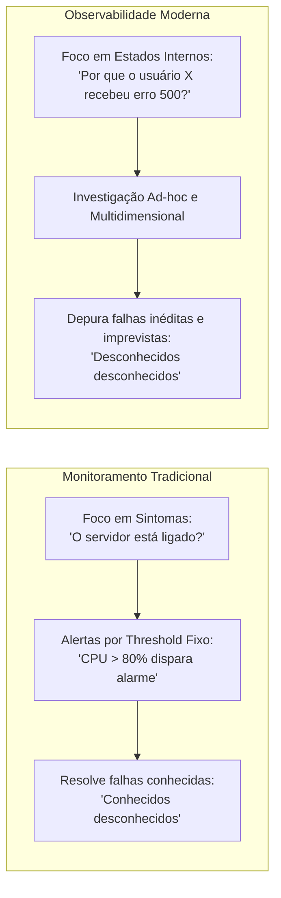
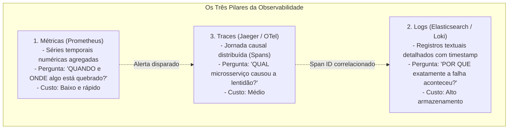
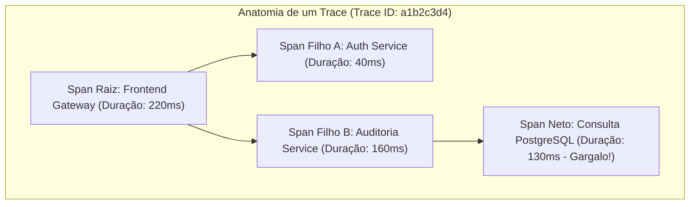
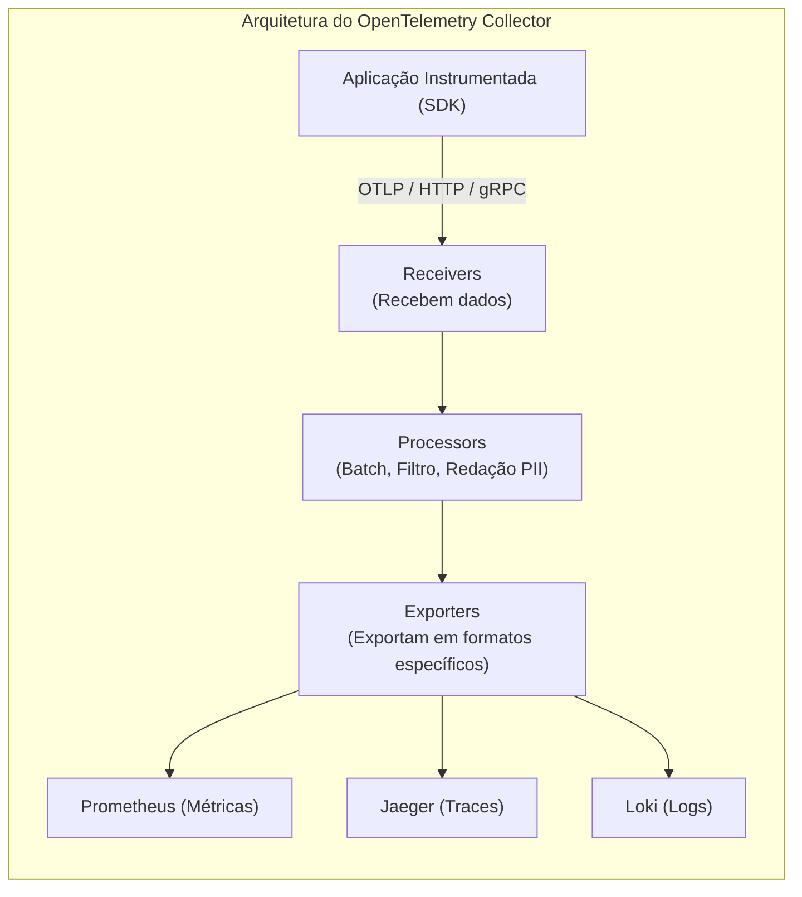
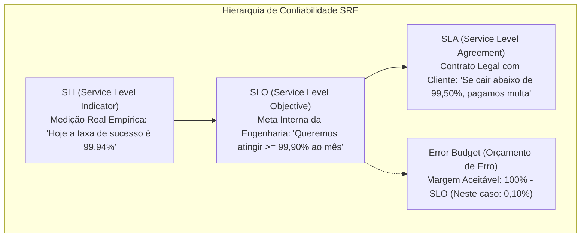

# 06 - Observabilidade, Monitoramento e Telemetria

> **Matéria:** DevOps, Plataforma de Desenvolvimento e Engenharia de Entrega  
> **Cargo:** B02 – Técnico de Controle Externo – Especialidade: Tecnologia da Informação  
> **Arquivo:** `06_observabilidade_monitoramento_e_telemetria.md`  


---


## 📌 Ementa / Itens do Edital
- Conceitos de Monitoramento Tradicional vs. Observabilidade
- Os Quatro Sinais Dourados do Google SRE (Latência, Tráfego, Erros e Saturação)
- Os Três Pilares da Observabilidade: Métricas, Logs Estruturados e Rastreamento Distribuído (Traces)
- Padrão OpenTelemetry (OTel), instrumentação e propagação de contexto
- Engenharia de Confiabilidade de Sites (SRE): SLI, SLO, SLA e Orçamento de Erro (Error Budget)
- Métricas DORA (DevOps Research and Assessment) e gestão de incidentes

---

## 🧭 Sumário

1. [Monitoramento Tradicional vs. Observabilidade Moderna](#1-monitoramento-tradicional-vs-observabilidade-moderna)
    1. [Transição de Sintomas para Estados Internos](#11-transicao-de-sintomas-para-estados-internos)
    2. [Os Quatro Sinais Dourados do Google SRE (Four Golden Signals)](#12-os-quatro-sinais-dourados-do-google-sre-four-golden-signals)
    3. [Metodologias Complementares: USE (Brendan Gregg) e RED (Tom Wilkie)](#13-metodologias-complementares-use-brendan-gregg-e-red-tom-wilkie)
    4. [Teste 224](#Teste-224)
    5. [Teste 225](#Teste-225)
    6. [Teste 226](#Teste-226)
2. [Os Três Pilares da Observabilidade](#2-os-tres-pilares-da-observabilidade)
    1. [Métricas (Metrics) e Tipos Primários no Prometheus (Counter, Gauge, Histogram, Summary)](#21-metricas-metrics-e-tipos-primarios-no-prometheus-counter-gauge-histogram-summary)
    2. [Logs Estruturados (Structured Logging) e Pilhas de Agregação (ELK, EFK, Loki)](#22-logs-estruturados-structured-logging-e-pilhas-de-agregacao-elk-efk-loki)
    3. [Rastreamento Distribuído (Distributed Tracing): Traces, Spans e Identificadores Globais](#23-rastreamento-distribuido-distributed-tracing-traces-spans-e-identificadores-globais)
    4. [Tabela Comparativa de Propósitos e Custos dos Três Pilares](#24-tabela-comparativa-de-propositos-e-custos-dos-tres-pilares)
    5. [Teste 227](#Teste-227)
    6. [Teste 228](#Teste-228)
    7. [Teste 229](#Teste-229)
3. [O Padrão Aberto OpenTelemetry (OTel)](#3-o-padrao-aberto-opentelemetry-otel)
    1. [Arquitetura Unificada: OTel API, OTel SDK e OTel Collector](#31-arquitetura-unificada-otel-api-otel-sdk-e-otel-collector)
    2. [Propagação de Contexto W3C Trace Context (traceparent e tracestate)](#32-propagacao-de-contexto-w3c-trace-context-traceparent-e-tracestate)
    3. [Teste 230](#Teste-230)
4. [Engenharia de Confiabilidade SRE: O Triângulo SLI, SLO, SLA e Error Budgets](#4-engenharia-de-confiabilidade-sre-o-triangulo-sli-slo-sla-e-error-budgets)
    1. [Distinção Formal entre SLI, SLO e SLA](#41-distincao-formal-entre-sli-slo-e-sla)
    2. [O Orçamento de Erro (Error Budget) como Equilíbrio entre Inovação e Confiabilidade](#42-o-orcamento-de-erro-error-budget-como-equilibrio-entre-inovacao-e-confiabilidade)
    3. [Teste 231](#Teste-231)
    4. [Teste 232](#Teste-232)
5. [Métricas DORA e Desempenho Operacional em Engenharia](#5-metricas-dora-e-desempenho-operacional-em-engenharia)
    1. [As Quatro Dimensões DORA: Throughput vs. Stability](#51-as-quatro-dimensoes-dora-throughput-vs-stability)
    2. [Teste 233](#Teste-233)
6. [🌐 Fontes Oficiais e Referências Bibliográficas](#fontes-oficiais-e-referencias-bibliograficas)

---

## 1. Monitoramento Tradicional vs. Observabilidade Moderna

Em infraestruturas tradicionais monolíticas e hospedadas em datacenters físicos, a gerência de operações baseava-se em **monitoramento reativo**: checagens periódicas via ping (*heartbeats* ICMP) e disparos de alertas fundamentados em limiares estáticos (*thresholds*, ex.: disparar e-mail de alerta quando o consumo de CPU da VM ultrapassar 80%).

Com a emergência de arquiteturas distribuídas nativas em nuvem (*cloud native*), milhares de microsserviços efêmeros, orquestração de contêineres e funções serverless, essa abordagem mostrou-se insuficiente. O sistema pode estar com todos os servidores operando em 30% de CPU e, ainda assim, milhares de cidadãos enfrentarem erros HTTP 500 intermitentes devido a travamentos de conexões em banco de dados ou falhas de comunicação em malhas de rede.



### 1.1 Transição de Sintomas para Estados Internos

- **Definição Matemática e Canônica:** Originária da Teoria do Controle Linear formalizada por Rudolf E. Kálmán (1960) e consolidada na computação por Charity Majors:
  > *"Um sistema é observável se o seu estado interno puder ser integralmente inferido a partir do conhecimento de suas saídas externas expostas."*
- **A Fronteira Conceitual:**
    - **Monitoramento Tradicional:** Informa **quando** algo está quebrado (*"O sistema está fora do ar?"*). Presta-se a diagnosticar problemas previsíveis cujas causas já são familiares à equipe (*known unknowns*).
    - **Observabilidade:** Permite entender **por que** algo quebrou (*"Por que a transação do usuário X demorou 12 segundos e gerou falha na emissão da certidão?"*). Viabiliza a investigação aberta e multidimensional de problemas inéditos e imprevistos decorrentes do comportamento caótico de sistemas distribuídos (*unknown unknowns*).

### 1.2 Os Quatro Sinais Dourados do Google SRE (Four Golden Signals)

No seminal *Google Site Reliability Engineering Book*, a equipe de confiabilidade do Google catalogou os quatro pilares essenciais de telemetria para qualquer serviço voltado ao usuário:

1. **Latência (*Latency*):** O tempo decorrido para processar e responder a uma requisição.
    - **Regra de Ouro:** É imperativo **separar a latência das requisições bem-sucedidas da latência das requisições com erro**. Frequentemente, uma falha de autenticação ou erro de rota retorna imediatamente em 3 ms com código HTTP 500; agregar essa resposta rápida à média geral mascararia a lentidão real das requisições legítimas que estão demorando 4 segundos para carregar dados.

2. **Tráfego (*Traffic*):** A medição da demanda imposta ao sistema. Em serviços web e APIs REST, afere-se tipicamente pelo número de requisições HTTP por segundo (RPS); em serviços de banco de dados, pelo volume de transações por segundo (TPS); em redes de streaming, pela quantidade de conexões ativas ou vazão de dados em megabits por segundo.
3. **Erros (*Errors*):** A taxa de requisições que falharam. Divide-se em:
    - *Erros Explícitos:* Respostas com códigos de erro HTTP 5xx (500, 502, 503), timeouts de soquete ou falhas de conexão recusada.
    - *Erros Implícitos:* Requisições que retornam código HTTP 200 (OK), mas cujo conteúdo transporta uma mensagem de falha funcional (ex.: resposta com `{"status": "erro", "mensagem": "falha na comunicação com a Receita Federal"}`).

4. **Saturação (*Saturation*):** Quão "cheio" está o sistema. Mede a fração utilizada de um recurso computacional finito e restrito (ex.: percentual de ocupação da memória RAM física, esgotamento do pool de threads do Tomcat, taxa de utilização de discos SSD ou filas de espera em conexões com bancos relacionais). À medida que a saturação se aproxima de 100%, o sistema degrada subitamente seu desempenho.

> 🚨 **ALERTA DE PROVA / PEGADINHA FCC:**  
> A FCC adora cobrar os Quatro Sinais Dourados do Google SRE. Memorize a sigla **L-T-E-S**: **L**atência, **T**ráfego, **E**rros e **S**aturação.  
> As alternativas incorretas costumam substituir "Saturação" por "Segurança", "Simplicidade" ou "Sincronização" para induzir o candidato ao erro.

### 1.3 Metodologias Complementares: USE (Brendan Gregg) e RED (Tom Wilkie)

Além dos Quatro Sinais Dourados, destacam-se duas metodologias amplamente cobradas em avaliações de arquitetura:

- **Método USE (Brendan Gregg - Foco em Recursos e Infraestrutura):** Para cada recurso de hardware/sistema (CPU, disco, barramento de rede), analisa-se:
    - **U (Utilization):** Percentual médio de tempo em que o recurso esteve ocupado.
    - **S (Saturation):** Volume de trabalho pendente na fila aguardando processamento.
    - **E (Errors):** Contagem de erros de hardware ou de driver associados ao recurso.
- **Método RED (Tom Wilkie - Foco em Microsserviços e Requisições):** Adequado para avaliar serviços que processam chamadas de rede:
    - **R (Rate):** Taxa de requisições por segundo.
    - **E (Errors):** Quantidade ou taxa de requisições que falharam.
    - **D (Duration):** Duração/tempo gasto pelas requisições (latência).

---

### Teste 224
**(FGV – TRT/DA – 2025 – Analista Judiciario Area Apoio Especializado Tecnologia Da Informacao)**
Carlos necessita instalar o Grafana (versão 11.6) em um servidor de um tribunal para criar dashboards interativos e monitorar métricas de sistemas, aplicações e infraestruturas em tempo real. Com relação aos requisitos mínimos de hardware e software para que uma instalação seja bem-sucedida, analise as afirmativas a seguir. I. A instalação do Grafana é suportada pelos fabricantes dos seguintes sistemas operacionais: Debian ou Ubuntu, RHEL ou Fedora, SUSE ou openSUSE, Mac OS e Windows. II. A recomendação mínima de hardware é de pelo menos 1.204 MB de memória RAM e CPU com nó mínimo 2 núcleos. III. O Grafana requer um sistema gerenciador de banco de dados (SGBD) para armazenar os dados de configuração, de usuários e seus dashboards; ele suporta os seguintes SGBDs: SQLite 3, MySQL 8.0 ou superior e PostgreSQL 12 ou superior. Está correto o que se afirma em

* **A)** I, apenas.
* **B)** II, apenas.
* **C)** III, apenas.
* **D)** I e III, apenas.
* **E)** II e III, apenas.

---

> **Comentário Detalhado:**
>
> - **A)** **Incorreta.** A opção incorre em restrição indevida ao limitar o escopo conceitual ao afirmar que "I, apenas". De acordo com a teoria estudada em *1. Monitoramento Tradicional vs. Observabilidade Moderna*, o sistema pode estar com todos os servidores operando em 30% de CPU e, ainda assim, milhares de cidadãos enfrentarem erros HTTP 500 intermitentes devido a travamentos de conexões em banco de dados ou falhas de comunicação em malhas de rede.
> - **B)** **Incorreta.** A opção incorre em restrição indevida ao limitar o escopo conceitual ao afirmar que "II, apenas". De acordo com a teoria estudada em *1.2 Os Quatro Sinais Dourados do Google SRE (Four Golden Signals)*, mede a fração utilizada de um recurso computacional finito e restrito (ex.: percentual de ocupação da memória RAM física, esgotamento do pool de threads do Tomcat, taxa de utilização de discos SSD ou filas de espera em conexões com bancos relacionais). À medida que a saturação se aproxima de 100%, o sistema degrada subitamente seu desempenho.
> - **C)** **Incorreta.** A opção incorre em restrição indevida ao limitar o escopo conceitual ao afirmar que "III, apenas". De acordo com a teoria estudada em *5.1 As Quatro Dimensões DORA: Throughput vs. Stability*, lead Time for Changes (LTTC): Velocidade (*Throughput*) — O tempo transcorrido desde o primeiro commit no controle de versão até a entrada efetiva em produção. — Menos de 1 hora.
> - **D)** **Correta.** Conforme fundamentado na seção *2.1 Métricas (Metrics) e Tipos Primários no Prometheus (Counter, Gauge, Histogram, Summary)* deste guia, usado para representar o estado momentâneo de um recurso variável: quantidade de memória RAM livre em bytes, temperatura da CPU, número de conexões ativas no pool do banco de dados ou contagem de réplicas de Pods rodando. Dessa forma, está plenamente correta a assertiva da banca (FGV – TRT/DA/2025) ao estabelecer que "I e III, apenas".
> - **E)** **Incorreta.** A opção incorre em restrição indevida ao limitar o escopo conceitual ao afirmar que "II e III, apenas". De acordo com a teoria estudada em *2.4 Tabela Comparativa de Propósitos e Custos dos Três Pilares*, métricas: "Quando e onde algo está quebrado?" — Numérica, agregada e contínua (*Time Series*). — Muito Baixo (ótima relação custo/benefício para retenção longa). — Prometheus, Datadog, InfluxDB, Grafana.
>
> **Gabarito: D**

---

### Teste 225
**(FGV – TJ/MT – 2024 – Analista Judiciario Tecnologia Da Informacao)**
A Inteligência Artificial (IA) tem sido um campo de pesquisa e inovação que evoluiu bastante ao longo das décadas, e geralmente é dividida em IA fraca e IA forte, conceitos que se referem ao nível de “inteligência” que a IA consegue simular ou alcançar. Em relação ao conceito de Inteligência Artificial (IA), assinale a afirmativa que descreve corretamente a diferença entre IA forte e IA fraca.

* **A)** IA forte é um sistema que simula a inteligência humana em tarefas específicas, enquanto IA fraca consegue aprender e entender contextos complexos, como um ser humano.
* **B)** IA fraca se refere a sistemas que replicam com exatidão a consciência humana, enquanto IA forte realiza tarefas automatizadas sem a necessidade de consciência.
* **C)** IA forte é caracterizada pela capacidade de adquirir consciência e compreensão geral, enquanto IA fraca é projetada para executar tarefas específicas sem consciência.
* **D)** IA fraca é um sistema totalmente autônomo, que toma decisões complexas de forma independente, enquanto IA forte precisa da intervenção humana para operar.
* **E)** IA forte e IA fraca não têm diferença quanto à forma de processamento de informações; a distinção está apenas na potência do hardware que utilizam.

---

> **Comentário Detalhado:**
>
> - **A)** **Incorreta.** A opção apresenta proposição em desacordo com os fundamentos teóricos e técnicos do tópico ao afirmar que "IA forte é um sistema que simula a inteligência humana em tarefas específicas, enquanto IA fraca consegue aprender...". De acordo com a teoria estudada em *1.1 Transição de Sintomas para Estados Internos*, *"Um sistema é observável se o seu estado interno puder ser integralmente inferido a partir do conhecimento de suas saídas externas expostas."*.
> - **B)** **Incorreta.** A opção apresenta proposição em desacordo com os fundamentos teóricos e técnicos do tópico ao afirmar que "IA fraca se refere a sistemas que replicam com exatidão a consciência humana, enquanto IA forte realiza tarefas...". De acordo com a teoria estudada em *1.1 Transição de Sintomas para Estados Internos*, viabiliza a investigação aberta e multidimensional de problemas inéditos e imprevistos decorrentes do comportamento caótico de sistemas distribuídos (*unknown unknowns*).
> - **C)** **Correta.** Conforme fundamentado na seção *4.2 O Orçamento de Erro (Error Budget) como Equilíbrio entre Inovação e Confiabilidade* deste guia, parte do princípio de que 100% de disponibilidade é um objetivo equivocado e economicamente inviável. Exigir 100% paralisa a capacidade da equipe de inovar e lançar novas funcionalidades, pois qualquer deploy carrega risco residual. Dessa forma, está plenamente correta a assertiva da banca (FGV – TJ/MT/2024) ao estabelecer que "IA forte é caracterizada pela capacidade de adquirir consciência e compreensão geral, enquanto IA fraca é...".
> - **D)** **Incorreta.** A opção apresenta proposição em desacordo com os fundamentos teóricos e técnicos do tópico ao afirmar que "IA fraca é um sistema totalmente autônomo, que toma decisões complexas de forma independente, enquanto IA forte...". De acordo com a teoria estudada em *1.2 Os Quatro Sinais Dourados do Google SRE (Four Golden Signals)*, frequentemente, uma falha de autenticação ou erro de rota retorna imediatamente em 3 ms com código HTTP 500; agregar essa resposta rápida à média geral mascararia a lentidão real das requisições legítimas que estão demorando 4 segundos para carregar dados.
> - **E)** **Incorreta.** A opção incorre em restrição indevida ao limitar o escopo conceitual ao afirmar que "IA forte e IA fraca não têm diferença quanto à forma de processamento de informações; a distinção está apenas na...". De acordo com a teoria estudada em *4.1 Distinção Formal entre SLI, SLO e SLA*, essa diferença matemática cria uma zona de amortecimento (*buffer de segurança*) que permite à equipe técnica detectar falhas, agir e restaurar o serviço antes que o descumprimento atinja o limite do SLA e gere multas financeiras para a organização.
>
> **Gabarito: C**

---

### Teste 226
**(FCC – TRT 3ª – 2015 – Analista Judiciário - Tecnologia da Informação)**
As versões Ext2, Ext3 e Ext4 do sistemas de arquivos utilizados no Red Hat Linux apresentam a inclusão de novos recursos e a ampliação da capacidade de armazenamento no decorrer da evolução. O que de fato diferencia o Ext2 do Ext3 é a inclusão

* **A)** da capacidade de formatar e gerenciar adequadamente mídias removíveis como pen drives e cartões SD.
* **B)** do recurso de alocação do mesmo dado em blocos múltiplos para aumentar a velocidade de acesso ao dado.
* **C)** da alocação postergada, o que reduz a quantidade de acessos físicos ao disco, reduzindo o tempo de acesso.
* **D)** do journaling, que aumenta a confiabilidade e elimina a necessidade da checagem do sistema de arquivos após uma parada repentina.
* **E)** da checagem rápida FSCK sem que haja a necessidade de checar a tabela de alocação.

---

> **Comentário Detalhado:**
>
> - **A)** **Incorreta.** A opção apresenta proposição em desacordo com os fundamentos teóricos e técnicos do tópico ao afirmar que "da capacidade de formatar e gerenciar adequadamente mídias removíveis como pen drives e cartões SD". De acordo com a teoria estudada em *4.2 O Orçamento de Erro (Error Budget) como Equilíbrio entre Inovação e Confiabilidade*, parte do princípio de que 100% de disponibilidade é um objetivo equivocado e economicamente inviável. Exigir 100% paralisa a capacidade da equipe de inovar e lançar novas funcionalidades, pois qualquer deploy carrega risco residual.
> - **B)** **Incorreta.** A opção apresenta proposição em desacordo com os fundamentos teóricos e técnicos do tópico ao afirmar que "do recurso de alocação do mesmo dado em blocos múltiplos para aumentar a velocidade de acesso ao dado". De acordo com a teoria estudada em *5.1 As Quatro Dimensões DORA: Throughput vs. Stability*, deployment Frequency (DF): Velocidade (*Throughput*) — Com que frequência a organização implanta com sucesso alterações em produção. — Múltiplos deploys por dia (sob demanda contínua).
> - **C)** **Incorreta.** A opção apresenta proposição em desacordo com os fundamentos teóricos e técnicos do tópico ao afirmar que "da alocação postergada, o que reduz a quantidade de acessos físicos ao disco, reduzindo o tempo de acesso". De acordo com a teoria estudada em *2.2 Logs Estruturados (Structured Logging) e Pilhas de Agregação (ELK, EFK, Loki)*, em vez de indexar o texto integral de cada log (o que consome gigabytes de RAM e disco), o Loki indexa apenas os metadados e rótulos (*labels*), armazenando o texto comprimido em buckets de armazenamento de objetos (como Amazon S3 ou MinIO).
> - **D)** **Correta.** Conforme fundamentado na seção *4.2 O Orçamento de Erro (Error Budget) como Equilíbrio entre Inovação e Confiabilidade* deste guia, a equipe de engenharia inteira é mobilizada para trabalhar em confiabilidade: refatoração de código frágil, automação de testes, melhorias de observabilidade e fortalecimento de pipelines, até que o sistema recupere sua margem de estabilidade. Dessa forma, está plenamente correta a assertiva da banca (FCC – TRT 3ª/2015) ao estabelecer que "do journaling, que aumenta a confiabilidade e elimina a necessidade da checagem do sistema de arquivos após uma...".
> - **E)** **Incorreta.** A opção apresenta proposição em desacordo com os fundamentos teóricos e técnicos do tópico ao afirmar que "da checagem rápida FSCK sem que haja a necessidade de checar a tabela de alocação". De acordo com a teoria estudada em *1.2 Os Quatro Sinais Dourados do Google SRE (Four Golden Signals)*, frequentemente, uma falha de autenticação ou erro de rota retorna imediatamente em 3 ms com código HTTP 500; agregar essa resposta rápida à média geral mascararia a lentidão real das requisições legítimas que estão demorando 4 segundos para carregar dados.
>
> **Gabarito: D**

---

## 2. Os Três Pilares da Observabilidade

A observabilidade moderna estrutura-se sobre a convergência de três tipos de dados de telemetria independentes, porém rigorosamente complementares: **Métricas, Logs e Rastreamento Distribuído (*Traces*)**.



### 2.1 Métricas (Metrics) e Tipos Primários no Prometheus (Counter, Gauge, Histogram, Summary)

As **métricas** são valores numéricos atômicos agregados ao longo do tempo (*Time Series*), enriquecidos com pares chave-valor denominados rótulos (*labels*). Exemplo no Prometheus: `http_requests_total{method="POST", handler="/pagamento", status="500"}`.

O modelo de dados do **Prometheus** (padrão ouro para Kubernetes) estabelece quatro tipos canônicos de métricas:

1. **Counter (Contador):**
    - É uma métrica cumulativa monotônica cujo valor **apenas sobe** (ou é reiniciado em zero quando a aplicação reinicia).
    - **Nunca decresce** sob condições normais de operação.
    - Usado para contar o número total de requisições atendidas, o total de erros registrados ou bytes transmitidos. No PromQL, utiliza-se a função `rate(http_requests_total[5m])` para derivar a taxa de requisições por segundo.

2. **Gauge (Medidor):**
    - É um valor numérico instantâneo que **pode subir e descer livremente** ao longo do tempo.
    - Usado para representar o estado momentâneo de um recurso variável: quantidade de memória RAM livre em bytes, temperatura da CPU, número de conexões ativas no pool do banco de dados ou contagem de réplicas de Pods rodando.

3. **Histogram (Histograma):**
    - Amostra observações (geralmente latências de requisições ou tamanhos de payloads) e as conta em **baldes de tamanho configurável (*buckets*)**.
    - Expõe automaticamente métricas auxiliares: contagem total de observações (`_count`) e soma total dos valores (`_sum`).
    - É a estrutura fundamental para calcular estatisticamente os **percentis de latência ($p50, p90, p95, p99$)** no lado do servidor com a função `histogram_quantile()`.

4. **Summary (Sumário):**
    - Semelhante ao histograma, mas calcula os percentis diretamente na própria aplicação instrumentada (no cliente) sobre uma janela de tempo deslizante, expondo os quantis já prontos. Não permite agregação matemática de percentis entre múltiplas instâncias no servidor.

### 2.2 Logs Estruturados (Structured Logging) e Pilhas de Agregação (ELK, EFK, Loki)

Os **logs** são registros textuais cronológicos e imutáveis de eventos discretos que ocorreram em um ponto específico no tempo dentro de uma aplicação:

- **A Importância dos Logs Estruturados em JSON:** Em vez de emitir strings desordenadas (`[INFO] O usuario 123 logou`), as aplicações modernas devem emitir logs estruturados em objetos JSON:

```json
{
  "timestamp": "2027-04-15T14:32:00.123Z",
  "level": "ERROR",
  "service": "auditoria-fiscal",
  "message": "Falha na comunicacao com base de dados tributaria",
  "user_id": "usr-8891",
  "trace_id": "4bf92f3577b34da6a3ce929d0e0e4736",
  "span_id": "00f067aa0ba902b7",
  "error_details": "ConnectionTimeoutException: database unreachable"
}
```

  A inclusão de campos como `trace_id` viabiliza a correlação cruzada imediata entre o log e o rastreamento distribuído correspondente.

- **Pilhas de Agregação de Logs:**
    - **Stack ELK (Elasticsearch, Logstash, Kibana):** O Logstash coleta e processa os logs; o Elasticsearch atua como mecanismo de busca e indexação distribuída em texto integral; o Kibana provê os dashboards visuais de consulta.
    - **Stack EFK (Elasticsearch, Fluentd/Fluent Bit, Kibana):** Substitui o Logstash pelo **Fluent Bit** (leitor de logs levíssimo em C instalado como `DaemonSet` em cada nó do Kubernetes) para enviar os logs dos contêineres para o Elasticsearch.
    - **Grafana Loki:** Abordagem moderna e econômica inspirada no Prometheus. Em vez de indexar o texto integral de cada log (o que consome gigabytes de RAM e disco), o Loki indexa apenas os metadados e rótulos (*labels*), armazenando o texto comprimido em buckets de armazenamento de objetos (como Amazon S3 ou MinIO).

### 2.3 Rastreamento Distribuído (Distributed Tracing): Traces, Spans e Identificadores Globais

Em arquiteturas de microsserviços, uma única ação do usuário desencadeia uma cascata de dezenas de chamadas assíncronas entre serviços distribuídos. O **Rastreamento Distribuído (*Distributed Tracing*)** reconstrói o grafo causal e temporal de ponta a ponta dessa transação.



- **Trace (Rastreio):** O grafo acíclico direcionado completo da jornada de uma requisição pelo ecossistema de software. É identificado por um identificador global único chamado **`Trace ID`** (número hexadecimal de 128 bits).
- **Span (Segmento):** A unidade atômica básica de trabalho executada por um serviço individual durante o processamento do Trace. Um Span encapsula:
    - **`Span ID`:** Identificador único daquela operação local (64 bits);
    - **`Parent Span ID`:** O identificador do Span que o invocou (se for o primeiro da cadeia, é o *Root Span*);
    - **Timestamps:** Horário exato de início e fim da operação (permitindo calcular a duração e latência);
    - **Tags / Atributos:** Metadados estruturados (ex.: `http.method: POST`, `db.statement: SELECT * FROM notas_fiscais`);
    - **Eventos:** Anotações temporais com mensagens ou erros de exceção ocorridos durante a execução do span.

### 2.4 Tabela Comparativa de Propósitos e Custos dos Três Pilares

| Pilar | Pergunta que Responde | Granularidade dos Dados | Custo de Armazenamento e Processamento | Ferramentas de Referência |
| :--- | :--- | :--- | :--- | :--- |
| **Métricas** | **"Quando e onde algo está quebrado?"** | Numérica, agregada e contínua (*Time Series*). | **Muito Baixo** (ótima relação custo/benefício para retenção longa). | Prometheus, Datadog, InfluxDB, Grafana |
| **Logs** | **"Por que exatamente o erro aconteceu?"** | Textual individualizada por evento discreto. | **Muito Alto** (exige compressão e descarte programado por TTL). | Stack ELK, Fluent Bit, Grafana Loki |
| **Traces** | **"Qual serviço no fluxo causou o atraso ou falha?"** | Grafo hierárquico causal de transação distribuída. | **Médio** (requer uso de amostragem/*sampling* em alta escala). | Jaeger, Zipkin, OpenTelemetry |

---

### Teste 227
**(FGV – TJ/RR – 2024 – Analista Judiciario Gestao E Governanca De Tecnologia Da Informacao)**
Em relação aos eventos e aos artefatos do framework Scrum, analise as afirmativas a seguir. I. O backlog do produto é um documento preenchido antes do início do projeto e que não sofre alterações mesmo que os desejos do cliente mudem ao longo do tempo. II. A reunião diária, daily Scrum, é um evento de curta duração que permite identificar impedimentos, melhorar as comunicações, promover rápida tomada de decisões e reduzir a necessidade de outras reuniões ao longo do dia. III. A reunião de revisão da Sprint é um evento em que são definidas as histórias de usuário que serão trabalhadas naquela Sprint. Está correto o que se afirma em

* **A)** I, apenas.
* **B)** II, apenas.
* **C)** III, apenas.
* **D)** I e II, apenas.
* **E)** II e III, apenas.

---

> **Comentário Detalhado:**
>
> - **A)** **Incorreta.** A opção incorre em restrição indevida ao limitar o escopo conceitual ao afirmar que "I, apenas". De acordo com a teoria estudada em *2.1 Métricas (Metrics) e Tipos Primários no Prometheus (Counter, Gauge, Histogram, Summary)*, semelhante ao histograma, mas calcula os percentis diretamente na própria aplicação instrumentada (no cliente) sobre uma janela de tempo deslizante, expondo os quantis já prontos.
> - **B)** **Correta.** Conforme fundamentado na seção *2.3 Rastreamento Distribuído (Distributed Tracing): Traces, Spans e Identificadores Globais* deste guia, timestamps: Horário exato de início e fim da operação (permitindo calcular a duração e latência). Dessa forma, está plenamente correta a assertiva da banca (FGV – TJ/RR/2024) ao estabelecer que "II, apenas".
> - **C)** **Incorreta.** A opção incorre em restrição indevida ao limitar o escopo conceitual ao afirmar que "III, apenas". De acordo com a teoria estudada em *2.1 Métricas (Metrics) e Tipos Primários no Prometheus (Counter, Gauge, Histogram, Summary)*, as métricas são valores numéricos atômicos agregados ao longo do tempo (*Time Series*), enriquecidos com pares chave-valor denominados rótulos (*labels*). Exemplo no Prometheus: `http_requests_total{method="POST", handler="/pagamento", status="500"}`.
> - **D)** **Incorreta.** A opção incorre em restrição indevida ao limitar o escopo conceitual ao afirmar que "I e II, apenas". De acordo com a teoria estudada em *2.1 Métricas (Metrics) e Tipos Primários no Prometheus (Counter, Gauge, Histogram, Summary)*, é um valor numérico instantâneo que pode subir e descer livremente ao longo do tempo.
> - **E)** **Incorreta.** A opção incorre em restrição indevida ao limitar o escopo conceitual ao afirmar que "II e III, apenas". De acordo com a teoria estudada em *4.1 Distinção Formal entre SLI, SLO e SLA*, essa diferença matemática cria uma zona de amortecimento (*buffer de segurança*) que permite à equipe técnica detectar falhas, agir e restaurar o serviço antes que o descumprimento atinja o limite do SLA e gere multas financeiras para a organização.
>
> **Gabarito: B**

---

### Teste 228
**(FGV – TCE/PA – 2024 – Auditor de Controle Externo - Administrativa - Engenharia Telecomunicação)**
Para o encaminhamento de datagramas IPv4 (Internet Protocol versão 4) dentro de Sistemas Autônomos na Internet, são empregados dois protocolos de roteamento: o protocolo RIP (Routing Information Protocol) e o protocolo OSPF (Open Shortest Path First). Com relação a esses protocolos de roteamento, avalie as afirmativas a seguir. I. O protocolo OSPF usa o algoritmo de Dijkstra para calcular as melhores rotas entre a origem e o destino de um datagrama, tendo como informações um banco de dados dos estados de enlaces da topologia do sistema autônomo. II. O protocolo RIP utiliza o algoritmo de roteamento vetor distância, enviando mensagens regulares entre os roteadores para difundir informações sobre largura de banda dos enlaces. III. O protocolo OSPF possui um tempo de convergência menor que o protocolo RIP. O tempo de convergência é o período decorrido até que os roteadores completem a execução de uma reação a queda de um determinado roteador, escolhendo outro caminho disponível para os destinos afetados. Está correto o que se afirma em

* **A)** I, apenas.
* **B)** I e II, apenas.
* **C)** I e III apenas.
* **D)** II e III, apenas.
* **E)** I, II e III.

---

> **Comentário Detalhado:**
>
> - **A)** **Incorreta.** A opção incorre em restrição indevida ao limitar o escopo conceitual ao afirmar que "I, apenas". De acordo com a teoria estudada em *2.3 Rastreamento Distribuído (Distributed Tracing): Traces, Spans e Identificadores Globais*, eventos: Anotações temporais com mensagens ou erros de exceção ocorridos durante a execução do span.
> - **B)** **Incorreta.** A opção incorre em restrição indevida ao limitar o escopo conceitual ao afirmar que "I e II, apenas". De acordo com a teoria estudada em *2.2 Logs Estruturados (Structured Logging) e Pilhas de Agregação (ELK, EFK, Loki)*, os logs são registros textuais cronológicos e imutáveis de eventos discretos que ocorreram em um ponto específico no tempo dentro de uma aplicação.
> - **C)** **Correta.** Conforme fundamentado na seção *3.1 Arquitetura Unificada: OTel API, OTel SDK e OTel Collector* deste guia, oTel SDK: A implementação concreta da API. Gerencia filas de memória, suporte a amostragem (*sampling*), empacotamento em lotes e conversão dos dados de telemetria no protocolo nativo OTLP (*OpenTelemetry Protocol*) via gRPC ou HTTP. Dessa forma, está plenamente correta a assertiva da banca (FGV – TCE/PA/2024) ao estabelecer que "I e III apenas".
> - **D)** **Incorreta.** A opção incorre em restrição indevida ao limitar o escopo conceitual ao afirmar que "II e III, apenas". De acordo com a teoria estudada em *1. Monitoramento Tradicional vs. Observabilidade Moderna*, o sistema pode estar com todos os servidores operando em 30% de CPU e, ainda assim, milhares de cidadãos enfrentarem erros HTTP 500 intermitentes devido a travamentos de conexões em banco de dados ou falhas de comunicação em malhas de rede.
> - **E)** **Incorreta.** A opção apresenta proposição em desacordo com os fundamentos teóricos e técnicos do tópico ao afirmar que "I, II e III". De acordo com a teoria estudada em *2. Os Três Pilares da Observabilidade*, a observabilidade moderna estrutura-se sobre a convergência de três tipos de dados de telemetria independentes, porém rigorosamente complementares: Métricas, Logs e Rastreamento Distribuído (*Traces*).
>
> **Gabarito: C**

---

### Teste 229
**(FGV – TCE/PA – 2024 – Auditor de Controle Externo - Administrativa - Engenharia Telecomunicação)**
As antenas desempenham um papel essencial nos sistemas de telecomunicações, sendo responsáveis pela emissão e recepção de sinais eletromagnéticos. Para descrever seu desempenho, são considerados diversos parâmetros e características, como ganho, diretividade, largura de feixe, polarização, impedância e VSWR. Neste contexto, analise as seguintes afirmações sobre antenas: I. Uma antena isotrópica é aquela que transmite em todas as direções com a mesma potência. II. VSWR é uma medida da eficiência de transmissão da antena. Um VSWR baixo indica que a maior parte da energia do sinal é transmitida, enquanto um VSWR alto indica refletância, resultando em perdas de energia. III. A diretividade refere-se à habilidade da antena de concentrar energia em uma direção específica. É relacionada ao ganho, mas considera também o padrão de radiação da antena. Está correto o que se afirma em:

* **A)** I, apenas.
* **B)** I e II, apenas.
* **C)** I e III, apenas.
* **D)** II e III, apenas.
* **E)** I, II e III.

---

> **Comentário Detalhado:**
>
> - **A)** **Incorreta.** A opção incorre em restrição indevida ao limitar o escopo conceitual ao afirmar que "I, apenas". De acordo com a teoria estudada em *3.2 Propagação de Contexto W3C Trace Context (traceparent e tracestate)*, cabeçalho `traceparent`: Estrutura compacta transmitida na requisição.
> - **B)** **Incorreta.** A opção incorre em restrição indevida ao limitar o escopo conceitual ao afirmar que "I e II, apenas". De acordo com a teoria estudada em *3.2 Propagação de Contexto W3C Trace Context (traceparent e tracestate)*, `01`: Flags de rastreamento (onde `01` indica que a requisição foi selecionada para amostragem/gravação).
> - **C)** **Incorreta.** A opção incorre em restrição indevida ao limitar o escopo conceitual ao afirmar que "I e III, apenas". De acordo com a teoria estudada em *2.4 Tabela Comparativa de Propósitos e Custos dos Três Pilares*, métricas: "Quando e onde algo está quebrado?" — Numérica, agregada e contínua (*Time Series*). — Muito Baixo (ótima relação custo/benefício para retenção longa). — Prometheus, Datadog, InfluxDB, Grafana.
> - **D)** **Incorreta.** A opção incorre em restrição indevida ao limitar o escopo conceitual ao afirmar que "II e III, apenas". De acordo com a teoria estudada em *2.4 Tabela Comparativa de Propósitos e Custos dos Três Pilares*, logs: "Por que exatamente o erro aconteceu?" — Textual individualizada por evento discreto. — Muito Alto (exige compressão e descarte programado por TTL). — Stack ELK, Fluent Bit, Grafana Loki.
> - **E)** **Correta.** Conforme fundamentado na seção *1.2 Os Quatro Sinais Dourados do Google SRE (Four Golden Signals)* deste guia, mede a fração utilizada de um recurso computacional finito e restrito (ex.: percentual de ocupação da memória RAM física, esgotamento do pool de threads do Tomcat, taxa de utilização de discos SSD ou filas de espera em conexões com bancos relacionais). À medida que a saturação se aproxima de 100%, o sistema degrada subitamente seu desempenho. Dessa forma, está plenamente correta a assertiva da banca (FGV – TCE/PA/2024) ao estabelecer que "I, II e III".
>
> **Gabarito: E**

---

## 3. O Padrão Aberto OpenTelemetry (OTel)

Historicamente, as equipes de TI ficavam presas a bibliotecas proprietárias de telemetria específicas de cada fabricante (*Vendor Lock-in*). Para sanar essa fragmentação, a CNCF fundiu os projetos abertos *OpenTracing* e *OpenCensus*, criando o **OpenTelemetry (OTel)** como o padrão aberto e unificado da indústria para instrumentação de software.



### 3.1 Arquitetura Unificada: OTel API, OTel SDK e OTel Collector

O ecossistema OpenTelemetry organiza-se em três camadas estritamente desacopladas:

1. **OTel API:** A camada de abstração com a qual o código da aplicação interage. Define as interfaces para criar métricas, traces e logs. O código da aplicação instrumentado contra a API OTel **não depende de nenhum backend específico** e compila sem referenciar ferramentas de terceiros.
2. **OTel SDK:** A implementação concreta da API. Gerencia filas de memória, suporte a amostragem (*sampling*), empacotamento em lotes e conversão dos dados de telemetria no protocolo nativo **OTLP (*OpenTelemetry Protocol*)** via gRPC ou HTTP.
3. **OTel Collector:** Um serviço proxy independente que atua como centralizador de telemetria. É composto por um pipeline de três estágios lineares:
    - **Receivers:** Portas de entrada configuráveis que recebem dados de telemetria em múltiplos protocolos (OTLP, Jaeger, Zipkin, Prometheus).
    - **Processors:** Tratam os dados em trânsito (agrupamento em lotes para economia de rede, amostragem estatística, filtragem de métricas e **ofuscação/redação de dados sensíveis e PII** protegidos pela LGPD).
    - **Exporters:** Traduzem e despacham a telemetria processada para os destinos de persistência configurados (Prometheus para métricas, Jaeger para traces, Elasticsearch para logs).

### 3.2 Propagação de Contexto W3C Trace Context (traceparent e tracestate)

Para que o `Trace ID` seja preservado quando uma chamada cruza a fronteira de um microsserviço para outro via HTTP ou filas de mensageria, o OpenTelemetry utiliza a especificação padronizada **W3C Trace Context**:

- **Cabeçalho `traceparent`:** Estrutura compacta transmitida na requisição:
  `traceparent: 00-4bf92f3577b34da6a3ce929d0e0e4736-00f067aa0ba902b7-01`
    - `00`: Versão da especificação W3C.
    - `4bf92f3577b34da6a3ce929d0e0e4736`: O **`Trace ID`** global compartilhado por todos os serviços.
    - `00f067aa0ba902b7`: O **`Parent Span ID`** da operação que originou o disparo.
    - `01`: Flags de rastreamento (onde `01` indica que a requisição foi selecionada para amostragem/gravação).

---

### Teste 230
**(FGV – TJ/BA – 2015 – Analista Judiciario Tecnologia Da Informacao)**
A utilização de interfaces em projetos de software orientados a objetivo promove a separação de aspectos internos e externos de um objeto, impedindo o acesso direto aos detalhes de seu funcionamento interno. Esse mecanismo de separação também contribui para que o software seja construído como um conjunto de componentes que realizam seu trabalho de forma independente. O uso desse mecanismo em projetos de sistemas de software é um exemplo de:

* **A)** abstração;
* **B)** encapsulamento;
* **C)** herança;
* **D)** proteção de código;
* **E)** polimorfismo.

---

> **Comentário Detalhado:**
>
> - **A)** **Incorreta.** A opção apresenta proposição em desacordo com os fundamentos teóricos e técnicos do tópico ao afirmar que "abstração". De acordo com a teoria estudada em *3.1 Arquitetura Unificada: OTel API, OTel SDK e OTel Collector*, oTel API: A camada de abstração com a qual o código da aplicação interage. Define as interfaces para criar métricas, traces e logs.
> - **B)** **Correta.** Conforme fundamentado na seção *3. O Padrão Aberto OpenTelemetry (OTel)* deste guia, para sanar essa fragmentação, a CNCF fundiu os projetos abertos *OpenTracing* e *OpenCensus*, criando o OpenTelemetry (OTel) como o padrão aberto e unificado da indústria para instrumentação de software. Dessa forma, está plenamente correta a assertiva da banca (FGV – TJ/BA/2015) ao estabelecer que "encapsulamento".
> - **C)** **Incorreta.** A opção apresenta proposição em desacordo com os fundamentos teóricos e técnicos do tópico ao afirmar que "herança". De acordo com a teoria estudada em *1.1 Transição de Sintomas para Estados Internos*, viabiliza a investigação aberta e multidimensional de problemas inéditos e imprevistos decorrentes do comportamento caótico de sistemas distribuídos (*unknown unknowns*).
> - **D)** **Incorreta.** A opção apresenta proposição em desacordo com os fundamentos teóricos e técnicos do tópico ao afirmar que "proteção de código". De acordo com a teoria estudada em *3.1 Arquitetura Unificada: OTel API, OTel SDK e OTel Collector*, o código da aplicação instrumentado contra a API OTel não depende de nenhum backend específico e compila sem referenciar ferramentas de terceiros.
> - **E)** **Incorreta.** A opção apresenta proposição em desacordo com os fundamentos teóricos e técnicos do tópico ao afirmar que "polimorfismo". De acordo com a teoria estudada em *1.1 Transição de Sintomas para Estados Internos*, *"Um sistema é observável se o seu estado interno puder ser integralmente inferido a partir do conhecimento de suas saídas externas expostas."*.
>
> **Gabarito: B**

---

## 4. Engenharia de Confiabilidade SRE: O Triângulo SLI, SLO, SLA e Error Budgets

O modelo de confiabilidade do Google SRE substitui debates subjetivos sobre qualidade por acordos matemáticos e operacionais claros.



### 4.1 Distinção Formal entre SLI, SLO e SLA

1. **SLI (*Service Level Indicator* - Indicador de Nível de Serviço):**
    - É a **medida quantitativa real e empírica observada em produção em tempo real**.
    - É calculado como uma razão percentual de eventos aceitáveis sobre o total de eventos válidos:
     $$\text{SLI} = \frac{\text{Número de Requisições com Sucesso (Status < 500)}}{\text{Total de Requisições Válidas}} \times 100\%$$
    - *Exemplo:* "Nas últimas 24 horas, o SLI de disponibilidade medido foi de 99,94%".

2. **SLO (*Service Level Objective* - Objetivo de Nível de Serviço):**
    - É a **meta interna almejada pela equipe de engenharia e operações**.
    - Define o nível de qualidade que o serviço deve manter para que os usuários finais estejam plenamente satisfeitos.
    - *Exemplo:* "Nosso SLO é que 99,90% das requisições respondam em menos de 300 ms em qualquer janela móvel de 30 dias".

3. **SLA (*Service Level Agreement* - Acordo de Nível de Serviço):**
    - É o **contrato formal, jurídico ou comercial celebrado com os clientes externos ou cidadãos**.
    - Estabelece as obrigações do provedor e as **consequências formais (penalidades financeiras, ressarcimentos ou sanções contratuais)** caso o nível de serviço seja violado.

> ⭐ **REGRA DE OURO DA FCC / RELAÇÃO ENTRE SLO E SLA:**  
> O **SLA é sempre MAIS TOLERANTE (menos restritivo) que o SLO interno**!  
> Exemplo clássico:  
>
> - **SLO interno da engenharia:** $99{,}9\%$ de disponibilidade.  
> - **SLA comercial do contrato:** $99{,}5\%$ de disponibilidade.  
> Essa diferença matemática cria uma zona de amortecimento (*buffer de segurança*) que permite à equipe técnica detectar falhas, agir e restaurar o serviço antes que o descumprimento atinja o limite do SLA e gere multas financeiras para a organização.

### 4.2 O Orçamento de Erro (Error Budget) como Equilíbrio entre Inovação e Confiabilidade

O conceito mais transformador do SRE é o **Orçamento de Erro (*Error Budget*)**:

- Parte do princípio de que **100% de disponibilidade é um objetivo equivocado e economicamente inviável**. Exigir 100% paralisa a capacidade da equipe de inovar e lançar novas funcionalidades, pois qualquer deploy carrega risco residual.
- O Error Budget é definido matematicamente como a margem de falha tolerada pelo SLO:
  $$\text{Error Budget} = 100\% - \text{SLO}$$
    - Se o SLO estabelecido é de $99{,}9\%$ ao mês, o Orçamento de Erro é de $0{,}1\%$.

**A Política Operacional de Conflito Dev vs. Ops:**

- **Saldo Positivo no Error Budget:** A equipe de desenvolvimento possui "crédito de risco" para acelerar deploys, experimentar novas funcionalidades e aceitar pequenos incidentes controlados.
- **Orçamento de Erro Esgotado (Saldo Zerado ou Negativo):** Quando incidentes recentes consomem todo o orçamento de erro daquele mês, **todos os novos lançamentos de funcionalidades são compulsoriamente suspensos (*freeze de inovação*)**. A equipe de engenharia inteira é mobilizada para trabalhar em confiabilidade: refatoração de código frágil, automação de testes, melhorias de observabilidade e fortalecimento de pipelines, até que o sistema recupere sua margem de estabilidade.

---

### Teste 231
**(FGV – TCE/PA – 2024 – Auditor de Controle Externo - Administrativa - Engenharia Civil)**
Com base na Lei nº 14.133/2021, avalie se as afirmativas a seguir são verdadeiras (V) ou falsas (F). ( ) A licitação é inexigível quando for inviável a competição, nos casos em que os serviços só possam ser fornecidos por um produtor. ( ) No caso de obras e serviços de engenharia , o limite estabelecido para dispensa de licitação em obras de engenharia é de R$200mil. ( ) A licitação pode ser dispensada em contratações que tenham como objeto produtos para pesquisa e desenvolvimento, respeitado o limite estabelecido por lei. As afirmativas são, respectivamente,

* **A)** F – V – F.
* **B)** F – V – V.
* **C)** V – V – F.
* **D)** V – F – F.
* **E)** V – F – V.

---

> **Comentário Detalhado:**
>
> - **A)** **Incorreta.** A opção apresenta proposição em desacordo com os fundamentos teóricos e técnicos do tópico ao afirmar que "F – V – F". De acordo com a teoria estudada em *4.1 Distinção Formal entre SLI, SLO e SLA*, essa diferença matemática cria uma zona de amortecimento (*buffer de segurança*) que permite à equipe técnica detectar falhas, agir e restaurar o serviço antes que o descumprimento atinja o limite do SLA e gere multas financeiras para a organização.
> - **B)** **Incorreta.** A opção apresenta proposição em desacordo com os fundamentos teóricos e técnicos do tópico ao afirmar que "F – V – V". De acordo com a teoria estudada em *4.2 O Orçamento de Erro (Error Budget) como Equilíbrio entre Inovação e Confiabilidade*, parte do princípio de que 100% de disponibilidade é um objetivo equivocado e economicamente inviável. Exigir 100% paralisa a capacidade da equipe de inovar e lançar novas funcionalidades, pois qualquer deploy carrega risco residual.
> - **C)** **Incorreta.** A opção apresenta proposição em desacordo com os fundamentos teóricos e técnicos do tópico ao afirmar que "V – V – F". De acordo com a teoria estudada em *4.2 O Orçamento de Erro (Error Budget) como Equilíbrio entre Inovação e Confiabilidade*, se o SLO estabelecido é de $99{,}9\%$ ao mês, o Orçamento de Erro é de $0{,}1\%$.
> - **D)** **Incorreta.** A opção apresenta proposição em desacordo com os fundamentos teóricos e técnicos do tópico ao afirmar que "V – F – F". De acordo com a teoria estudada em *4.2 O Orçamento de Erro (Error Budget) como Equilíbrio entre Inovação e Confiabilidade*, saldo Positivo no Error Budget: A equipe de desenvolvimento possui "crédito de risco" para acelerar deploys, experimentar novas funcionalidades e aceitar pequenos incidentes controlados.
> - **E)** **Correta.** Conforme fundamentado na seção *4.1 Distinção Formal entre SLI, SLO e SLA* deste guia, estabelece as obrigações do provedor e as consequências formais (penalidades financeiras, ressarcimentos ou sanções contratuais) caso o nível de serviço seja violado. Dessa forma, está plenamente correta a assertiva da banca (FGV – TCE/PA/2024) ao estabelecer que "V – F – V".
>
> **Gabarito: E**

---

### Teste 232
**(FGV – TCE/GO – 2024 – Analista de Controle Externo - Tecnologia da Informação)**
Avalie as seguintes afirmativas no contexto de práticas e metodologias de deploy em desenvolvimento mobile: I. A aplicação de Continuous Integration (CI) em aplicativos mobile responsivos é uma prática que visa a fusão e teste do código apenas ao final de cada sprint; II. Continuous Delivery (CD) é parte da filosofia "Mobile First" e permite que toda mudança de código seja automaticamente disponibilizada para os usuários finais, sem a necessidade de aprovação das equipes de operações; III. DevSecOps é a integração da segurança no processo de desenvolvimento de software desde o início sem comprometer a velocidade de entrega. Está correto o que se afirma em

* **A)** I, apenas.
* **B)** II e III, apenas.
* **C)** III, apenas.
* **D)** I, II e III.
* **E)** I e II, apenas. Redes de Computadores e Sistemas Operacionais Redes de Computadores

---

> **Comentário Detalhado:**
>
> - **A)** **Incorreta.** A opção incorre em restrição indevida ao limitar o escopo conceitual ao afirmar que "I, apenas". De acordo com a teoria estudada em *4.2 O Orçamento de Erro (Error Budget) como Equilíbrio entre Inovação e Confiabilidade*, parte do princípio de que 100% de disponibilidade é um objetivo equivocado e economicamente inviável. Exigir 100% paralisa a capacidade da equipe de inovar e lançar novas funcionalidades, pois qualquer deploy carrega risco residual.
> - **B)** **Incorreta.** A opção incorre em restrição indevida ao limitar o escopo conceitual ao afirmar que "II e III, apenas". De acordo com a teoria estudada em *4.1 Distinção Formal entre SLI, SLO e SLA*, essa diferença matemática cria uma zona de amortecimento (*buffer de segurança*) que permite à equipe técnica detectar falhas, agir e restaurar o serviço antes que o descumprimento atinja o limite do SLA e gere multas financeiras para a organização.
> - **C)** **Correta.** Conforme fundamentado na seção *4.1 Distinção Formal entre SLI, SLO e SLA* deste guia, define o nível de qualidade que o serviço deve manter para que os usuários finais estejam plenamente satisfeitos. Dessa forma, está plenamente correta a assertiva da banca (FGV – TCE/GO/2024) ao estabelecer que "III, apenas".
> - **D)** **Incorreta.** A opção apresenta proposição em desacordo com os fundamentos teóricos e técnicos do tópico ao afirmar que "I, II e III". De acordo com a teoria estudada em *5.1 As Quatro Dimensões DORA: Throughput vs. Stability*, lead Time for Changes (LTTC): Velocidade (*Throughput*) — O tempo transcorrido desde o primeiro commit no controle de versão até a entrada efetiva em produção. — Menos de 1 hora.
> - **E)** **Incorreta.** A opção incorre em restrição indevida ao limitar o escopo conceitual ao afirmar que "I e II, apenas. Redes de Computadores e Sistemas Operacionais Redes de Computadores". De acordo com a teoria estudada em *4. Engenharia de Confiabilidade SRE: O Triângulo SLI, SLO, SLA e Error Budgets*, o modelo de confiabilidade do Google SRE substitui debates subjetivos sobre qualidade por acordos matemáticos e operacionais claros.
>
> **Gabarito: C**

---

## 5. Métricas DORA e Desempenho Operacional em Engenharia

Desenvolvido pelo grupo *DevOps Research and Assessment* (DORA / Google Cloud), este framework científico consolidou os quatro indicadores universais para avaliar o desempenho de entrega e estabilidade de software:

### 5.1 As Quatro Dimensões DORA: Throughput vs. Stability

| Métrica DORA | Eixo Operacional | O que ela Mede | Nível de Alta Performance (Elite) |
| :--- | :--- | :--- | :--- |
| **Deployment Frequency (DF)** | **Velocidade (*Throughput*)** | Com que frequência a organização implanta com sucesso alterações em produção. | **Múltiplos deploys por dia** (sob demanda contínua). |
| **Lead Time for Changes (LTTC)** | **Velocidade (*Throughput*)** | O tempo transcorrido desde o primeiro commit no controle de versão até a entrada efetiva em produção. | **Menos de 1 hora**. |
| **Change Failure Rate (CFR)** | **Estabilidade (*Stability*)** | O percentual de implantações em produção que resultam em falha operacional imediata (exigindo hotfix ou rollback). | **0% a 15%** de falhas. |
| **Time to Restore Service (MTTR)** | **Estabilidade (*Stability*)** | O tempo médio decorrido para restabelecer a operação plena quando ocorre uma degradação ou indisponibilidade em produção. | **Menos de 1 hora**. |

---

### Teste 233
**(CEBRASPE – TRT/10 – 2013 – Analista Judiciario Tecnologia Da Informacao)**
A engenharia de software engloba processos, métodos e ferramentas. Um de seus focos é a produção de software de alta qualidade a custos adequados.

* **C)** Certo
* **E)** Errado

---

> **Comentário Detalhado:**
>
> - **C)** **Correta.** O item está **Certo**. Conforme fundamentado na seção *2.4 Tabela Comparativa de Propósitos e Custos dos Três Pilares* deste guia, pilar: Pergunta que Responde — Granularidade dos Dados — Custo de Armazenamento e Processamento — Ferramentas de Referência. Dessa forma, está plenamente correta a proposição da banca (CEBRASPE – TRT/10/2013) ao afirmar que "A engenharia de software engloba processos, métodos e ferramentas. Um de seus focos é a produção de software...".
> - **E)** **Incorreta.** A marcação como **Errado** não procede, visto que a assertiva guarda integral conformidade com a teoria estudada em *2.4 Tabela Comparativa de Propósitos e Custos dos Três Pilares*, segundo a qual traces: "Qual serviço no fluxo causou o atraso ou falha?" — Grafo hierárquico causal de transação distribuída. — Médio (requer uso de amostragem/*sampling* em alta escala). — Jaeger, Zipkin, OpenTelemetry.
>
> **Gabarito: C**

---

## 🌐 Fontes Oficiais e Referências Bibliográficas

* [OpenTelemetry Official Documentation - Core Concepts](https://opentelemetry.io/docs/concepts/signals/) - Os três pilares fundamentais da observabilidade moderna: Métricas, Logs estruturados e Traces distribuídos.
* [Prometheus Official Documentation - Metric Types](https://prometheus.io/docs/concepts/metric_types/) - Tipologia de séries temporais: Counter, Gauge, Histogram e Summary.
* [Google SRE Book - Service Level Objectives (SLI, SLO, SLA)](https://sre.google/sre-book/service-level-objectives/) - Engenharia de confiabilidade de sites, cálculo de orçamentos de erro (*error budgets*) e acordos de nível de serviço.
* [DORA - Four Keys Metrics and Continuous Delivery](https://dora.dev/guides/dora-metrics-four-keys/) - Monitoramento contínuo de tempo de restauração e taxa de falhas operacionais.
* BEYER, Betsy et al. **Site Reliability Engineering: How Google Runs Production Systems**. Sebastopol: O'Reilly Media, 2016. (Cap. 4 - Service Level Objectives; Cap. 6 - Monitoring Distributed Systems).
* MAJORS, Charity; FONG-JONES, Liz; MIRANDA, George. **Observabilidade em Engenharia de Software**. São Paulo: Novatec, 2023. (Cap. 2 a 4 - Tracing Distribuído e Telemetria em Sistemas Complexos).
* TURNBULL, James. **The Art of Monitoring**. Nova York: James Turnbull, 2016. (Cap. 3 e 4 - Métricas de Séries Temporais e Alertas Inteligentes).
