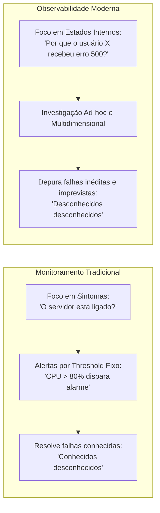
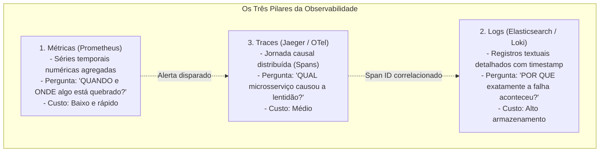
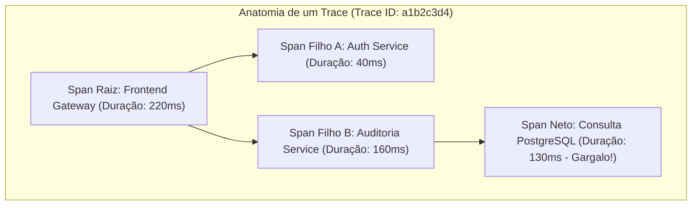
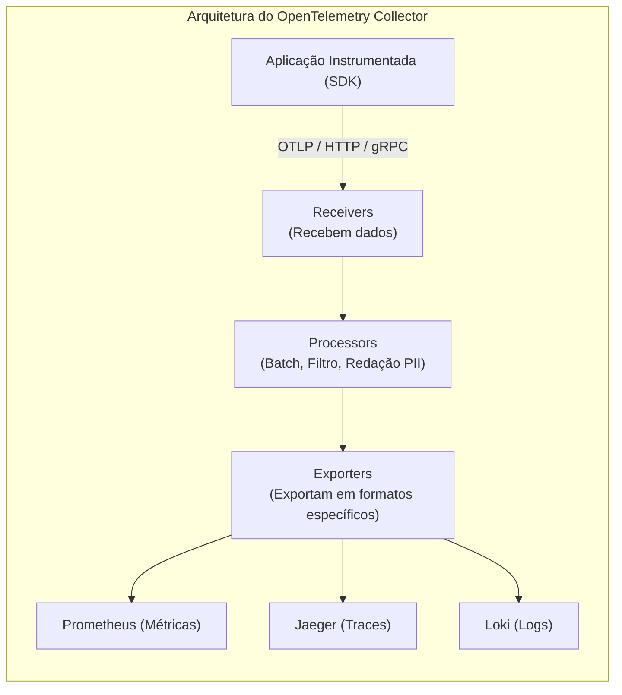
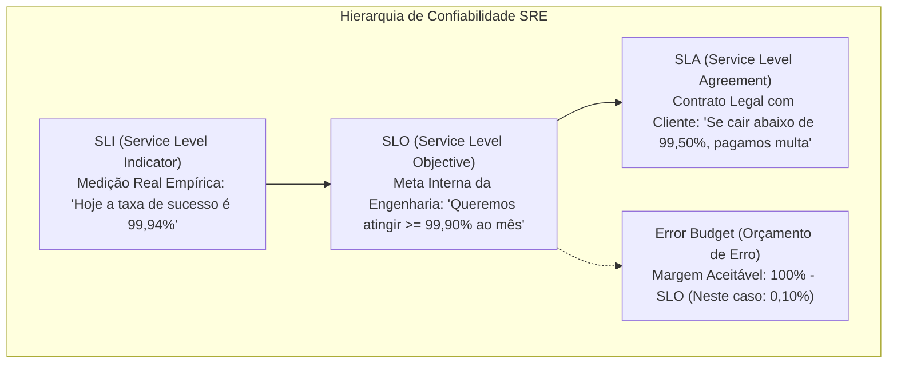

# 06 - Observabilidade, Monitoramento e Telemetria

> **Matéria:** DevOps, Plataforma de Desenvolvimento e Engenharia de Entrega  
> **Cargo:** B02 – Técnico de Controle Externo – Especialidade: Tecnologia da Informação  
> **Arquivo:** `06_observabilidade_monitoramento_e_telemetria.md`  


---


## 📌 Ementa / Itens do Edital
- Conceitos de Monitoramento Tradicional vs. Observabilidade
- Os Quatro Sinais Dourados do Google SRE (Latência, Tráfego, Erros e Saturação)
- Os Três Pilares da Observabilidade: Métricas, Logs Estruturados e Rastreamento Distribuído (Traces)
- Padrão OpenTelemetry (OTel), instrumentação e propagação de contexto
- Engenharia de Confiabilidade de Sites (SRE): SLI, SLO, SLA e Orçamento de Erro (Error Budget)
- Métricas DORA (DevOps Research and Assessment) e gestão de incidentes

---

## 🧭 Sumário

1. [Monitoramento Tradicional vs. Observabilidade Moderna](#1-monitoramento-tradicional-vs-observabilidade-moderna)
    1. [Transição de Sintomas para Estados Internos](#11-transicao-de-sintomas-para-estados-internos)
    2. [Os Quatro Sinais Dourados do Google SRE (Four Golden Signals)](#12-os-quatro-sinais-dourados-do-google-sre-four-golden-signals)
    3. [Metodologias Complementares: USE (Brendan Gregg) e RED (Tom Wilkie)](#13-metodologias-complementares-use-brendan-gregg-e-red-tom-wilkie)
    4. [Teste 224](#Teste-224)
    5. [Teste 225](#Teste-225)
    6. [Teste 226](#Teste-226)
2. [Os Três Pilares da Observabilidade](#2-os-tres-pilares-da-observabilidade)
    1. [Métricas (Metrics) e Tipos Primários no Prometheus (Counter, Gauge, Histogram, Summary)](#21-metricas-metrics-e-tipos-primarios-no-prometheus-counter-gauge-histogram-summary)
    2. [Logs Estruturados (Structured Logging) e Pilhas de Agregação (ELK, EFK, Loki)](#22-logs-estruturados-structured-logging-e-pilhas-de-agregacao-elk-efk-loki)
    3. [Rastreamento Distribuído (Distributed Tracing): Traces, Spans e Identificadores Globais](#23-rastreamento-distribuido-distributed-tracing-traces-spans-e-identificadores-globais)
    4. [Tabela Comparativa de Propósitos e Custos dos Três Pilares](#24-tabela-comparativa-de-propositos-e-custos-dos-tres-pilares)
    5. [Teste 227](#Teste-227)
    6. [Teste 228](#Teste-228)
    7. [Teste 229](#Teste-229)
3. [O Padrão Aberto OpenTelemetry (OTel)](#3-o-padrao-aberto-opentelemetry-otel)
    1. [Arquitetura Unificada: OTel API, OTel SDK e OTel Collector](#31-arquitetura-unificada-otel-api-otel-sdk-e-otel-collector)
    2. [Propagação de Contexto W3C Trace Context (traceparent e tracestate)](#32-propagacao-de-contexto-w3c-trace-context-traceparent-e-tracestate)
    3. [Teste 230](#Teste-230)
4. [Engenharia de Confiabilidade SRE: O Triângulo SLI, SLO, SLA e Error Budgets](#4-engenharia-de-confiabilidade-sre-o-triangulo-sli-slo-sla-e-error-budgets)
    1. [Distinção Formal entre SLI, SLO e SLA](#41-distincao-formal-entre-sli-slo-e-sla)
    2. [O Orçamento de Erro (Error Budget) como Equilíbrio entre Inovação e Confiabilidade](#42-o-orcamento-de-erro-error-budget-como-equilibrio-entre-inovacao-e-confiabilidade)
    3. [Teste 231](#Teste-231)
    4. [Teste 232](#Teste-232)
5. [Métricas DORA e Desempenho Operacional em Engenharia](#5-metricas-dora-e-desempenho-operacional-em-engenharia)
    1. [As Quatro Dimensões DORA: Throughput vs. Stability](#51-as-quatro-dimensoes-dora-throughput-vs-stability)
    2. [Teste 233](#Teste-233)
6. [🌐 Fontes Oficiais e Referências Bibliográficas](#fontes-oficiais-e-referencias-bibliograficas)

---

## 1. Monitoramento Tradicional vs. Observabilidade Moderna

Em infraestruturas tradicionais monolíticas e hospedadas em datacenters físicos, a gerência de operações baseava-se em **monitoramento reativo**: checagens periódicas via ping (*heartbeats* ICMP) e disparos de alertas fundamentados em limiares estáticos (*thresholds*, ex.: disparar e-mail de alerta quando o consumo de CPU da VM ultrapassar 80%).

Com a emergência de arquiteturas distribuídas nativas em nuvem (*cloud native*), milhares de microsserviços efêmeros, orquestração de contêineres e funções serverless, essa abordagem mostrou-se insuficiente. O sistema pode estar com todos os servidores operando em 30% de CPU e, ainda assim, milhares de cidadãos enfrentarem erros HTTP 500 intermitentes devido a travamentos de conexões em banco de dados ou falhas de comunicação em malhas de rede.



### 1.1 Transição de Sintomas para Estados Internos

- **Definição Matemática e Canônica:** Originária da Teoria do Controle Linear formalizada por Rudolf E. Kálmán (1960) e consolidada na computação por Charity Majors:
  > *"Um sistema é observável se o seu estado interno puder ser integralmente inferido a partir do conhecimento de suas saídas externas expostas."*
- **A Fronteira Conceitual:**
    - **Monitoramento Tradicional:** Informa **quando** algo está quebrado (*"O sistema está fora do ar?"*). Presta-se a diagnosticar problemas previsíveis cujas causas já são familiares à equipe (*known unknowns*).
    - **Observabilidade:** Permite entender **por que** algo quebrou (*"Por que a transação do usuário X demorou 12 segundos e gerou falha na emissão da certidão?"*). Viabiliza a investigação aberta e multidimensional de problemas inéditos e imprevistos decorrentes do comportamento caótico de sistemas distribuídos (*unknown unknowns*).

### 1.2 Os Quatro Sinais Dourados do Google SRE (Four Golden Signals)

No seminal *Google Site Reliability Engineering Book*, a equipe de confiabilidade do Google catalogou os quatro pilares essenciais de telemetria para qualquer serviço voltado ao usuário:

1. **Latência (*Latency*):** O tempo decorrido para processar e responder a uma requisição.
    - **Regra de Ouro:** É imperativo **separar a latência das requisições bem-sucedidas da latência das requisições com erro**. Frequentemente, uma falha de autenticação ou erro de rota retorna imediatamente em 3 ms com código HTTP 500; agregar essa resposta rápida à média geral mascararia a lentidão real das requisições legítimas que estão demorando 4 segundos para carregar dados.

2. **Tráfego (*Traffic*):** A medição da demanda imposta ao sistema. Em serviços web e APIs REST, afere-se tipicamente pelo número de requisições HTTP por segundo (RPS); em serviços de banco de dados, pelo volume de transações por segundo (TPS); em redes de streaming, pela quantidade de conexões ativas ou vazão de dados em megabits por segundo.
3. **Erros (*Errors*):** A taxa de requisições que falharam. Divide-se em:
    - *Erros Explícitos:* Respostas com códigos de erro HTTP 5xx (500, 502, 503), timeouts de soquete ou falhas de conexão recusada.
    - *Erros Implícitos:* Requisições que retornam código HTTP 200 (OK), mas cujo conteúdo transporta uma mensagem de falha funcional (ex.: resposta com `{"status": "erro", "mensagem": "falha na comunicação com a Receita Federal"}`).

4. **Saturação (*Saturation*):** Quão "cheio" está o sistema. Mede a fração utilizada de um recurso computacional finito e restrito (ex.: percentual de ocupação da memória RAM física, esgotamento do pool de threads do Tomcat, taxa de utilização de discos SSD ou filas de espera em conexões com bancos relacionais). À medida que a saturação se aproxima de 100%, o sistema degrada subitamente seu desempenho.

> 🚨 **ALERTA DE PROVA / PEGADINHA FCC:**  
> A FCC adora cobrar os Quatro Sinais Dourados do Google SRE. Memorize a sigla **L-T-E-S**: **L**atência, **T**ráfego, **E**rros e **S**aturação.  
> As alternativas incorretas costumam substituir "Saturação" por "Segurança", "Simplicidade" ou "Sincronização" para induzir o candidato ao erro.

### 1.3 Metodologias Complementares: USE (Brendan Gregg) e RED (Tom Wilkie)

Além dos Quatro Sinais Dourados, destacam-se duas metodologias amplamente cobradas em avaliações de arquitetura:

- **Método USE (Brendan Gregg - Foco em Recursos e Infraestrutura):** Para cada recurso de hardware/sistema (CPU, disco, barramento de rede), analisa-se:
    - **U (Utilization):** Percentual médio de tempo em que o recurso esteve ocupado.
    - **S (Saturation):** Volume de trabalho pendente na fila aguardando processamento.
    - **E (Errors):** Contagem de erros de hardware ou de driver associados ao recurso.
- **Método RED (Tom Wilkie - Foco em Microsserviços e Requisições):** Adequado para avaliar serviços que processam chamadas de rede:
    - **R (Rate):** Taxa de requisições por segundo.
    - **E (Errors):** Quantidade ou taxa de requisições que falharam.
    - **D (Duration):** Duração/tempo gasto pelas requisições (latência).

---

### Teste 224
**(CEBRASPE – TJ-RJ – Analista Judiciario Grupo Tecnologia da Informacao Analista de Infraestrutura de Tic – 2021)**
A fim de melhorar o desempenho do sistema, deseja-se realizar ajustes em um servidor Windows Server 2012 e nos seus respectivos serviços, tendo como principais papéis configurados os servidores web e de arquivos. Durante os trabalhos preliminares, verificou-se um baixo uso de processamento, memória, banda de rede e discos; além de filas cheias de requisições ou de trabalhos dos serviços web e de compartilhamento de arquivos. Com base nas informações precedentes, julgue os seguintes itens, considerados para a situação em questão. I Segmentação de papéis em máquinas próprias, a fim de diminuir a concorrência por recursos computacionais do servidor, memória, processamento e banda de rede. II Aumento do valor no parâmetro de quantidade máxima de threads por fila, para melhoria no atendimento das requisições no servidor de arquivos. III Ativar ou manter cache do serviço de informação da Internet (IIS), com o objetivo de diminuir o tempo de resposta das requisições. IV Diminuir o tamanho do arquivo pagefiles.sys, forçando o uso da memória RAM e aumentando o atendimento dos serviços de compartilhamento de arquivos e web. Estão certos apenas os itens

* **A)** I e II.
* **B)** I e IV.
* **C)** II e III.
* **D)** I, III e IV.
* **E)** II, III e IV.

---

> **Comentário Detalhado:**
>
> - **A)** **Incorreta.** A opção apresenta proposição em desacordo com os fundamentos teóricos e técnicos do tópico ao afirmar que "I e II". De acordo com a teoria estudada em *1.2 Os Quatro Sinais Dourados do Google SRE (Four Golden Signals)*, em serviços web e APIs REST, afere-se tipicamente pelo número de requisições HTTP por segundo (RPS); em serviços de banco de dados, pelo volume de transações por segundo (TPS); em redes de streaming, pela quantidade de conexões ativas ou vazão de dados em megabits por segundo.
> - **B)** **Incorreta.** A opção apresenta proposição em desacordo com os fundamentos teóricos e técnicos do tópico ao afirmar que "I e IV". De acordo com a teoria estudada em *1. Monitoramento Tradicional vs. Observabilidade Moderna*, o sistema pode estar com todos os servidores operando em 30% de CPU e, ainda assim, milhares de cidadãos enfrentarem erros HTTP 500 intermitentes devido a travamentos de conexões em banco de dados ou falhas de comunicação em malhas de rede.
> - **C)** **Correta.** Conforme fundamentado na seção *1.2 Os Quatro Sinais Dourados do Google SRE (Four Golden Signals)* deste guia, mede a fração utilizada de um recurso computacional finito e restrito (ex.: percentual de ocupação da memória RAM física, esgotamento do pool de threads do Tomcat, taxa de utilização de discos SSD ou filas de espera em conexões com bancos relacionais). À medida que a saturação se aproxima de 100%, o sistema degrada subitamente seu desempenho. Dessa forma, está plenamente correta a assertiva da banca (CEBRASPE – TJ-RJ/2021) ao estabelecer que "II e III".
> - **D)** **Incorreta.** A opção apresenta proposição em desacordo com os fundamentos teóricos e técnicos do tópico ao afirmar que "I, III e IV". De acordo com a teoria estudada em *1.2 Os Quatro Sinais Dourados do Google SRE (Four Golden Signals)*, frequentemente, uma falha de autenticação ou erro de rota retorna imediatamente em 3 ms com código HTTP 500; agregar essa resposta rápida à média geral mascararia a lentidão real das requisições legítimas que estão demorando 4 segundos para carregar dados.
> - **E)** **Incorreta.** A opção apresenta proposição em desacordo com os fundamentos teóricos e técnicos do tópico ao afirmar que "II, III e IV". De acordo com a teoria estudada em *2.1 Métricas (Metrics) e Tipos Primários no Prometheus (Counter, Gauge, Histogram, Summary)*, usado para representar o estado momentâneo de um recurso variável: quantidade de memória RAM livre em bytes, temperatura da CPU, número de conexões ativas no pool do banco de dados ou contagem de réplicas de Pods rodando.
>
> **Gabarito: C**

---

### Teste 225
**(FGV – TJ-AP – Analista Judiciario Apoio Especializado Tecnologia da Informacao Seguranca da Informacao – 2023)**
A Internet é uma rede de computadores que interconecta centenas de milhões de dispositivos de computação ao redor do mundo. Cada vez mais sistemas finais modernos da Internet, como TVs, laptops, consoles para jogos, telefones celulares, webcams, automóveis, dispositivos de sensoriamento ambiental, quadros de imagens, e sistemas internos elétricos e de segurança, estão sendo conectados à rede. Assim, a estratégia de atribuição de endereços da Internet é conhecida como roteamento interdomínio sem classes (Classless Inter-Domain Routing — CIDR). Nesse contexto, a máscara de rede/sub-rede de uma rede IPv4 CIDR /29 é:

* **A)** 255.255.240.0
* **B)** 255.255.255.240
* **C)** 255.255.255.192
* **D)** 255.255.255.224
* **E)** 255.255.255.248

---

> **Comentário Detalhado:**
>
> - **A)** **Incorreta.** A opção apresenta proposição em desacordo com os fundamentos teóricos e técnicos do tópico ao afirmar que "255.255.240.0". De acordo com a teoria estudada em *1.1 Transição de Sintomas para Estados Internos*, definição Matemática e Canônica: Originária da Teoria do Controle Linear formalizada por Rudolf E. Kálmán (1960) e consolidada na computação por Charity Majors.
> - **B)** **Incorreta.** A opção apresenta proposição em desacordo com os fundamentos teóricos e técnicos do tópico ao afirmar que "255.255.255.240". De acordo com a teoria estudada em *1.1 Transição de Sintomas para Estados Internos*, viabiliza a investigação aberta e multidimensional de problemas inéditos e imprevistos decorrentes do comportamento caótico de sistemas distribuídos (*unknown unknowns*).
> - **C)** **Incorreta.** A opção apresenta proposição em desacordo com os fundamentos teóricos e técnicos do tópico ao afirmar que "255.255.255.192". De acordo com a teoria estudada em *1.2 Os Quatro Sinais Dourados do Google SRE (Four Golden Signals)*, frequentemente, uma falha de autenticação ou erro de rota retorna imediatamente em 3 ms com código HTTP 500; agregar essa resposta rápida à média geral mascararia a lentidão real das requisições legítimas que estão demorando 4 segundos para carregar dados.
> - **D)** **Incorreta.** A opção apresenta proposição em desacordo com os fundamentos teóricos e técnicos do tópico ao afirmar que "255.255.255.224". De acordo com a teoria estudada em *1.2 Os Quatro Sinais Dourados do Google SRE (Four Golden Signals)*, as alternativas incorretas costumam substituir "Saturação" por "Segurança", "Simplicidade" ou "Sincronização" para induzir o candidato ao erro.
> - **E)** **Correta.** Conforme fundamentado na seção *1. Monitoramento Tradicional vs. Observabilidade Moderna* deste guia, o sistema pode estar com todos os servidores operando em 30% de CPU e, ainda assim, milhares de cidadãos enfrentarem erros HTTP 500 intermitentes devido a travamentos de conexões em banco de dados ou falhas de comunicação em malhas de rede. Dessa forma, está plenamente correta a assertiva da banca (FGV – TJ-AP/2023) ao estabelecer que "255.255.255.248".
>
> **Gabarito: E**

---

### Teste 226
**(FCC – TRT-9 – Analista Judiciario Apoio Especializado Tecnologia da Informacao – 2015)**
A Qualidade de Serviço (QoS) de uma rede é determinada de acordo com alguns parâmetros definidos no estabelecimento específico da qualidade. Dentre os parâmetros, normalmente, é considerado a latência da rede que representa

* **A)** o tempo médio entre ciclos de falhas na rede.
* **B)** a taxa média de envio de pacotes em forma de rajadas.
* **C)** o tempo de atraso total na entrega dos dados transmitidos.
* **D)** a faixa de variação do tempo de espera na fila de transmissão.
* **E)** o índice de colisões por quantidade de dados transmitidos.

---

> **Comentário Detalhado:**
>
> - **A)** **Incorreta.** A opção apresenta proposição em desacordo com os fundamentos teóricos e técnicos do tópico ao afirmar que "o tempo médio entre ciclos de falhas na rede". De acordo com a teoria estudada em *1. Monitoramento Tradicional vs. Observabilidade Moderna*, o sistema pode estar com todos os servidores operando em 30% de CPU e, ainda assim, milhares de cidadãos enfrentarem erros HTTP 500 intermitentes devido a travamentos de conexões em banco de dados ou falhas de comunicação em malhas de rede.
> - **B)** **Incorreta.** A opção apresenta proposição em desacordo com os fundamentos teóricos e técnicos do tópico ao afirmar que "a taxa média de envio de pacotes em forma de rajadas". De acordo com a teoria estudada em *1.2 Os Quatro Sinais Dourados do Google SRE (Four Golden Signals)*, frequentemente, uma falha de autenticação ou erro de rota retorna imediatamente em 3 ms com código HTTP 500; agregar essa resposta rápida à média geral mascararia a lentidão real das requisições legítimas que estão demorando 4 segundos para carregar dados.
> - **C)** **Correta.** Conforme fundamentado na seção *2.1 Métricas (Metrics) e Tipos Primários no Prometheus (Counter, Gauge, Histogram, Summary)* deste guia, usado para contar o número total de requisições atendidas, o total de erros registrados ou bytes transmitidos. No PromQL, utiliza-se a função `rate(http_requests_total[5m])` para derivar a taxa de requisições por segundo. Dessa forma, está plenamente correta a assertiva da banca (FCC – TRT-9/2015) ao estabelecer que "o tempo de atraso total na entrega dos dados transmitidos".
> - **D)** **Incorreta.** A opção apresenta proposição em desacordo com os fundamentos teóricos e técnicos do tópico ao afirmar que "a faixa de variação do tempo de espera na fila de transmissão". De acordo com a teoria estudada em *2.1 Métricas (Metrics) e Tipos Primários no Prometheus (Counter, Gauge, Histogram, Summary)*, as métricas são valores numéricos atômicos agregados ao longo do tempo (*Time Series*), enriquecidos com pares chave-valor denominados rótulos (*labels*). Exemplo no Prometheus: `http_requests_total{method="POST", handler="/pagamento", status="500"}`.
> - **E)** **Incorreta.** A opção apresenta proposição em desacordo com os fundamentos teóricos e técnicos do tópico ao afirmar que "o índice de colisões por quantidade de dados transmitidos". De acordo com a teoria estudada em *1.2 Os Quatro Sinais Dourados do Google SRE (Four Golden Signals)*, em serviços web e APIs REST, afere-se tipicamente pelo número de requisições HTTP por segundo (RPS); em serviços de banco de dados, pelo volume de transações por segundo (TPS); em redes de streaming, pela quantidade de conexões ativas ou vazão de dados em megabits por segundo.
>
> **Gabarito: C**

---

## 2. Os Três Pilares da Observabilidade

A observabilidade moderna estrutura-se sobre a convergência de três tipos de dados de telemetria independentes, porém rigorosamente complementares: **Métricas, Logs e Rastreamento Distribuído (*Traces*)**.



### 2.1 Métricas (Metrics) e Tipos Primários no Prometheus (Counter, Gauge, Histogram, Summary)

As **métricas** são valores numéricos atômicos agregados ao longo do tempo (*Time Series*), enriquecidos com pares chave-valor denominados rótulos (*labels*). Exemplo no Prometheus: `http_requests_total{method="POST", handler="/pagamento", status="500"}`.

O modelo de dados do **Prometheus** (padrão ouro para Kubernetes) estabelece quatro tipos canônicos de métricas:

1. **Counter (Contador):**
    - É uma métrica cumulativa monotônica cujo valor **apenas sobe** (ou é reiniciado em zero quando a aplicação reinicia).
    - **Nunca decresce** sob condições normais de operação.
    - Usado para contar o número total de requisições atendidas, o total de erros registrados ou bytes transmitidos. No PromQL, utiliza-se a função `rate(http_requests_total[5m])` para derivar a taxa de requisições por segundo.

2. **Gauge (Medidor):**
    - É um valor numérico instantâneo que **pode subir e descer livremente** ao longo do tempo.
    - Usado para representar o estado momentâneo de um recurso variável: quantidade de memória RAM livre em bytes, temperatura da CPU, número de conexões ativas no pool do banco de dados ou contagem de réplicas de Pods rodando.

3. **Histogram (Histograma):**
    - Amostra observações (geralmente latências de requisições ou tamanhos de payloads) e as conta em **baldes de tamanho configurável (*buckets*)**.
    - Expõe automaticamente métricas auxiliares: contagem total de observações (`_count`) e soma total dos valores (`_sum`).
    - É a estrutura fundamental para calcular estatisticamente os **percentis de latência ($p50, p90, p95, p99$)** no lado do servidor com a função `histogram_quantile()`.

4. **Summary (Sumário):**
    - Semelhante ao histograma, mas calcula os percentis diretamente na própria aplicação instrumentada (no cliente) sobre uma janela de tempo deslizante, expondo os quantis já prontos. Não permite agregação matemática de percentis entre múltiplas instâncias no servidor.

### 2.2 Logs Estruturados (Structured Logging) e Pilhas de Agregação (ELK, EFK, Loki)

Os **logs** são registros textuais cronológicos e imutáveis de eventos discretos que ocorreram em um ponto específico no tempo dentro de uma aplicação:

- **A Importância dos Logs Estruturados em JSON:** Em vez de emitir strings desordenadas (`[INFO] O usuario 123 logou`), as aplicações modernas devem emitir logs estruturados em objetos JSON:

```json
{
  "timestamp": "2027-04-15T14:32:00.123Z",
  "level": "ERROR",
  "service": "auditoria-fiscal",
  "message": "Falha na comunicacao com base de dados tributaria",
  "user_id": "usr-8891",
  "trace_id": "4bf92f3577b34da6a3ce929d0e0e4736",
  "span_id": "00f067aa0ba902b7",
  "error_details": "ConnectionTimeoutException: database unreachable"
}
```

  A inclusão de campos como `trace_id` viabiliza a correlação cruzada imediata entre o log e o rastreamento distribuído correspondente.

- **Pilhas de Agregação de Logs:**
    - **Stack ELK (Elasticsearch, Logstash, Kibana):** O Logstash coleta e processa os logs; o Elasticsearch atua como mecanismo de busca e indexação distribuída em texto integral; o Kibana provê os dashboards visuais de consulta.
    - **Stack EFK (Elasticsearch, Fluentd/Fluent Bit, Kibana):** Substitui o Logstash pelo **Fluent Bit** (leitor de logs levíssimo em C instalado como `DaemonSet` em cada nó do Kubernetes) para enviar os logs dos contêineres para o Elasticsearch.
    - **Grafana Loki:** Abordagem moderna e econômica inspirada no Prometheus. Em vez de indexar o texto integral de cada log (o que consome gigabytes de RAM e disco), o Loki indexa apenas os metadados e rótulos (*labels*), armazenando o texto comprimido em buckets de armazenamento de objetos (como Amazon S3 ou MinIO).

### 2.3 Rastreamento Distribuído (Distributed Tracing): Traces, Spans e Identificadores Globais

Em arquiteturas de microsserviços, uma única ação do usuário desencadeia uma cascata de dezenas de chamadas assíncronas entre serviços distribuídos. O **Rastreamento Distribuído (*Distributed Tracing*)** reconstrói o grafo causal e temporal de ponta a ponta dessa transação.



- **Trace (Rastreio):** O grafo acíclico direcionado completo da jornada de uma requisição pelo ecossistema de software. É identificado por um identificador global único chamado **`Trace ID`** (número hexadecimal de 128 bits).
- **Span (Segmento):** A unidade atômica básica de trabalho executada por um serviço individual durante o processamento do Trace. Um Span encapsula:
    - **`Span ID`:** Identificador único daquela operação local (64 bits);
    - **`Parent Span ID`:** O identificador do Span que o invocou (se for o primeiro da cadeia, é o *Root Span*);
    - **Timestamps:** Horário exato de início e fim da operação (permitindo calcular a duração e latência);
    - **Tags / Atributos:** Metadados estruturados (ex.: `http.method: POST`, `db.statement: SELECT * FROM notas_fiscais`);
    - **Eventos:** Anotações temporais com mensagens ou erros de exceção ocorridos durante a execução do span.

### 2.4 Tabela Comparativa de Propósitos e Custos dos Três Pilares

| Pilar | Pergunta que Responde | Granularidade dos Dados | Custo de Armazenamento e Processamento | Ferramentas de Referência |
| :--- | :--- | :--- | :--- | :--- |
| **Métricas** | **"Quando e onde algo está quebrado?"** | Numérica, agregada e contínua (*Time Series*). | **Muito Baixo** (ótima relação custo/benefício para retenção longa). | Prometheus, Datadog, InfluxDB, Grafana |
| **Logs** | **"Por que exatamente o erro aconteceu?"** | Textual individualizada por evento discreto. | **Muito Alto** (exige compressão e descarte programado por TTL). | Stack ELK, Fluent Bit, Grafana Loki |
| **Traces** | **"Qual serviço no fluxo causou o atraso ou falha?"** | Grafo hierárquico causal de transação distribuída. | **Médio** (requer uso de amostragem/*sampling* em alta escala). | Jaeger, Zipkin, OpenTelemetry |

---

### Teste 227
**(CEBRASPE – TRT-8 – Analista Judiciario Area Apoio Especializado Tecnologia da Informacao – 2022)**
Mecanismos de pesquisa e de visualização de dados de aplicações web são fornecidos, respectivamente, pelas ferramentas

* **A)** Elasticsearch e Zabbix.
* **B)** Elasticsearch e Prometheus.
* **C)** Kibana e Prometheus.
* **D)** Prometheus e Zabbix.
* **E)** Elasticsearch e Kibana.

---

> **Comentário Detalhado:**
>
> - **A)** **Incorreta.** A opção apresenta proposição em desacordo com os fundamentos teóricos e técnicos do tópico ao afirmar que "Elasticsearch e Zabbix". De acordo com a teoria estudada em *2.2 Logs Estruturados (Structured Logging) e Pilhas de Agregação (ELK, EFK, Loki)*, stack EFK (Elasticsearch, Fluentd/Fluent Bit, Kibana): Substitui o Logstash pelo Fluent Bit (leitor de logs levíssimo em C instalado como `DaemonSet` em cada nó do Kubernetes) para enviar os logs dos contêineres para o Elasticsearch.
> - **B)** **Incorreta.** A opção apresenta proposição em desacordo com os fundamentos teóricos e técnicos do tópico ao afirmar que "Elasticsearch e Prometheus". De acordo com a teoria estudada em *3.1 Arquitetura Unificada: OTel API, OTel SDK e OTel Collector*, exporters: Traduzem e despacham a telemetria processada para os destinos de persistência configurados (Prometheus para métricas, Jaeger para traces, Elasticsearch para logs).
> - **C)** **Incorreta.** A opção apresenta proposição em desacordo com os fundamentos teóricos e técnicos do tópico ao afirmar que "Kibana e Prometheus". De acordo com a teoria estudada em *2.1 Métricas (Metrics) e Tipos Primários no Prometheus (Counter, Gauge, Histogram, Summary)*, o modelo de dados do Prometheus (padrão ouro para Kubernetes) estabelece quatro tipos canônicos de métricas.
> - **D)** **Incorreta.** A opção apresenta proposição em desacordo com os fundamentos teóricos e técnicos do tópico ao afirmar que "Prometheus e Zabbix". De acordo com a teoria estudada em *2.1 Métricas (Metrics) e Tipos Primários no Prometheus (Counter, Gauge, Histogram, Summary)*, usado para representar o estado momentâneo de um recurso variável: quantidade de memória RAM livre em bytes, temperatura da CPU, número de conexões ativas no pool do banco de dados ou contagem de réplicas de Pods rodando.
> - **E)** **Correta.** Conforme fundamentado na seção *2.2 Logs Estruturados (Structured Logging) e Pilhas de Agregação (ELK, EFK, Loki)* deste guia, stack ELK (Elasticsearch, Logstash, Kibana): O Logstash coleta e processa os logs; o Elasticsearch atua como mecanismo de busca e indexação distribuída em texto integral; o Kibana provê os dashboards visuais de consulta. Dessa forma, está plenamente correta a assertiva da banca (CEBRASPE – TRT-8/2022) ao estabelecer que "Elasticsearch e Kibana".
>
> **Gabarito: E**

---

### Teste 228
**(FUMARC – TRT-3 – Analista Judiciario Apoio Especializado Tecnologia da Informacao – 2022)**
Analise as afirmativas a seguir sobre tecnologias utilizadas para monitoramento de ambientes tecnológicos. I – Prometheus é um banco de dados de série temporal dimensional que extrai métricas de instâncias de aplicativos periodicamente com base na descoberta de serviço. II – Kibana é uma ferramenta de visualização e exploração de dados usada para log e análise de séries temporais, monitoramento de aplicações e casos de uso de inteligência operacional. III – Elasticsearch é um coletor de dados de código aberto que unifica coleções de dados para uma melhor compreensão dos dados e foi escrito na linguagem de programação Ruby. Está CORRETO o que se afirma em:

* **A)** I, II e III.
* **B)** I, apenas.
* **C)** I e II, apenas.
* **D)** I e III, apenas.
* **E)** II e III, apenas.

---

> **Comentário Detalhado:**
>
> - **A)** **Incorreta.** A opção apresenta proposição em desacordo com os fundamentos teóricos e técnicos do tópico ao afirmar que "I, II e III". De acordo com a teoria estudada em *2.1 Métricas (Metrics) e Tipos Primários no Prometheus (Counter, Gauge, Histogram, Summary)*, não permite agregação matemática de percentis entre múltiplas instâncias no servidor.
> - **B)** **Incorreta.** A opção incorre em restrição indevida ao limitar o escopo conceitual ao afirmar que "I, apenas". De acordo com a teoria estudada em *2.1 Métricas (Metrics) e Tipos Primários no Prometheus (Counter, Gauge, Histogram, Summary)*, as métricas são valores numéricos atômicos agregados ao longo do tempo (*Time Series*), enriquecidos com pares chave-valor denominados rótulos (*labels*). Exemplo no Prometheus: `http_requests_total{method="POST", handler="/pagamento", status="500"}`.
> - **C)** **Correta.** Conforme fundamentado na seção *2.1 Métricas (Metrics) e Tipos Primários no Prometheus (Counter, Gauge, Histogram, Summary)* deste guia, usado para representar o estado momentâneo de um recurso variável: quantidade de memória RAM livre em bytes, temperatura da CPU, número de conexões ativas no pool do banco de dados ou contagem de réplicas de Pods rodando. Dessa forma, está plenamente correta a assertiva da banca (FUMARC – TRT-3/2022) ao estabelecer que "I e II, apenas".
> - **D)** **Incorreta.** A opção incorre em restrição indevida ao limitar o escopo conceitual ao afirmar que "I e III, apenas". De acordo com a teoria estudada em *2.4 Tabela Comparativa de Propósitos e Custos dos Três Pilares*, métricas: "Quando e onde algo está quebrado?" — Numérica, agregada e contínua (*Time Series*). — Muito Baixo (ótima relação custo/benefício para retenção longa). — Prometheus, Datadog, InfluxDB, Grafana.
> - **E)** **Incorreta.** A opção incorre em restrição indevida ao limitar o escopo conceitual ao afirmar que "II e III, apenas". De acordo com a teoria estudada em *1. Monitoramento Tradicional vs. Observabilidade Moderna*, o sistema pode estar com todos os servidores operando em 30% de CPU e, ainda assim, milhares de cidadãos enfrentarem erros HTTP 500 intermitentes devido a travamentos de conexões em banco de dados ou falhas de comunicação em malhas de rede.
>
> **Gabarito: C**

---

### Teste 229
**(FGV – TRT-16 – Analista Judiciario Area Administrativa Tecnologia da Informacao – 2022)**
A ferramenta de desenvolvimento e depuração, utilizada no Kibana 7.0, que permite que um analista faça parser de dados não estruturados presentes em diferentes tipos de arquivos de logs de servidores web ou de banco de dados se denomina

* **A)** logprofiler.
* **B)** logstach.
* **C)** timelion.
* **D)** beats.
* **E)** grok.

---

> **Comentário Detalhado:**
>
> - **A)** **Incorreta.** A opção apresenta proposição em desacordo com os fundamentos teóricos e técnicos do tópico ao afirmar que "logprofiler". De acordo com a teoria estudada em *2.2 Logs Estruturados (Structured Logging) e Pilhas de Agregação (ELK, EFK, Loki)*, stack EFK (Elasticsearch, Fluentd/Fluent Bit, Kibana): Substitui o Logstash pelo Fluent Bit (leitor de logs levíssimo em C instalado como `DaemonSet` em cada nó do Kubernetes) para enviar os logs dos contêineres para o Elasticsearch.
> - **B)** **Incorreta.** A opção apresenta proposição em desacordo com os fundamentos teóricos e técnicos do tópico ao afirmar que "logstach". De acordo com a teoria estudada em *1. Monitoramento Tradicional vs. Observabilidade Moderna*, o sistema pode estar com todos os servidores operando em 30% de CPU e, ainda assim, milhares de cidadãos enfrentarem erros HTTP 500 intermitentes devido a travamentos de conexões em banco de dados ou falhas de comunicação em malhas de rede.
> - **C)** **Incorreta.** A opção apresenta proposição em desacordo com os fundamentos teóricos e técnicos do tópico ao afirmar que "timelion". De acordo com a teoria estudada em *1.2 Os Quatro Sinais Dourados do Google SRE (Four Golden Signals)*, em serviços web e APIs REST, afere-se tipicamente pelo número de requisições HTTP por segundo (RPS); em serviços de banco de dados, pelo volume de transações por segundo (TPS); em redes de streaming, pela quantidade de conexões ativas ou vazão de dados em megabits por segundo.
> - **D)** **Incorreta.** A opção apresenta proposição em desacordo com os fundamentos teóricos e técnicos do tópico ao afirmar que "beats". De acordo com a teoria estudada em *2.1 Métricas (Metrics) e Tipos Primários no Prometheus (Counter, Gauge, Histogram, Summary)*, usado para representar o estado momentâneo de um recurso variável: quantidade de memória RAM livre em bytes, temperatura da CPU, número de conexões ativas no pool do banco de dados ou contagem de réplicas de Pods rodando.
> - **E)** **Correta.** Conforme fundamentado na seção *2.2 Logs Estruturados (Structured Logging) e Pilhas de Agregação (ELK, EFK, Loki)* deste guia, stack ELK (Elasticsearch, Logstash, Kibana): O Logstash coleta e processa os logs; o Elasticsearch atua como mecanismo de busca e indexação distribuída em texto integral; o Kibana provê os dashboards visuais de consulta. Dessa forma, está plenamente correta a assertiva da banca (FGV – TRT-16/2022) ao estabelecer que "grok".
>
> **Gabarito: E**

---

## 3. O Padrão Aberto OpenTelemetry (OTel)

Historicamente, as equipes de TI ficavam presas a bibliotecas proprietárias de telemetria específicas de cada fabricante (*Vendor Lock-in*). Para sanar essa fragmentação, a CNCF fundiu os projetos abertos *OpenTracing* e *OpenCensus*, criando o **OpenTelemetry (OTel)** como o padrão aberto e unificado da indústria para instrumentação de software.



### 3.1 Arquitetura Unificada: OTel API, OTel SDK e OTel Collector

O ecossistema OpenTelemetry organiza-se em três camadas estritamente desacopladas:

1. **OTel API:** A camada de abstração com a qual o código da aplicação interage. Define as interfaces para criar métricas, traces e logs. O código da aplicação instrumentado contra a API OTel **não depende de nenhum backend específico** e compila sem referenciar ferramentas de terceiros.
2. **OTel SDK:** A implementação concreta da API. Gerencia filas de memória, suporte a amostragem (*sampling*), empacotamento em lotes e conversão dos dados de telemetria no protocolo nativo **OTLP (*OpenTelemetry Protocol*)** via gRPC ou HTTP.
3. **OTel Collector:** Um serviço proxy independente que atua como centralizador de telemetria. É composto por um pipeline de três estágios lineares:
    - **Receivers:** Portas de entrada configuráveis que recebem dados de telemetria em múltiplos protocolos (OTLP, Jaeger, Zipkin, Prometheus).
    - **Processors:** Tratam os dados em trânsito (agrupamento em lotes para economia de rede, amostragem estatística, filtragem de métricas e **ofuscação/redação de dados sensíveis e PII** protegidos pela LGPD).
    - **Exporters:** Traduzem e despacham a telemetria processada para os destinos de persistência configurados (Prometheus para métricas, Jaeger para traces, Elasticsearch para logs).

### 3.2 Propagação de Contexto W3C Trace Context (traceparent e tracestate)

Para que o `Trace ID` seja preservado quando uma chamada cruza a fronteira de um microsserviço para outro via HTTP ou filas de mensageria, o OpenTelemetry utiliza a especificação padronizada **W3C Trace Context**:

- **Cabeçalho `traceparent`:** Estrutura compacta transmitida na requisição:
  `traceparent: 00-4bf92f3577b34da6a3ce929d0e0e4736-00f067aa0ba902b7-01`
    - `00`: Versão da especificação W3C.
    - `4bf92f3577b34da6a3ce929d0e0e4736`: O **`Trace ID`** global compartilhado por todos os serviços.
    - `00f067aa0ba902b7`: O **`Parent Span ID`** da operação que originou o disparo.
    - `01`: Flags de rastreamento (onde `01` indica que a requisição foi selecionada para amostragem/gravação).

---

### Teste 230
**(FGV – TRT-13 – Analista Judiciario Tecnologia da Informacao – 2022)**
Sobre a ferramenta de monitoramento Prometheus, analise as afirmativas a seguir. I. Armazena fundamentalmente todos os dados como séries temporais. II. Possui uma linguagem para consulta das métricas armazenadas denominada PromQL. III. Coleta métricas através do protocolo HTTP. Está correto o que se afirma em

* **A)** I, apenas.
* **B)** II, apenas.
* **C)** III, apenas.
* **D)** I e II, apenas.
* **E)** I, II e III.

---

> **Comentário Detalhado:**
>
> - **A)** **Incorreta.** A opção incorre em restrição indevida ao limitar o escopo conceitual ao afirmar que "I, apenas". De acordo com a teoria estudada em *2.1 Métricas (Metrics) e Tipos Primários no Prometheus (Counter, Gauge, Histogram, Summary)*, usado para contar o número total de requisições atendidas, o total de erros registrados ou bytes transmitidos. No PromQL, utiliza-se a função `rate(http_requests_total[5m])` para derivar a taxa de requisições por segundo.
> - **B)** **Correta.** Conforme fundamentado na seção *3.1 Arquitetura Unificada: OTel API, OTel SDK e OTel Collector* deste guia, oTel SDK: A implementação concreta da API. Gerencia filas de memória, suporte a amostragem (*sampling*), empacotamento em lotes e conversão dos dados de telemetria no protocolo nativo OTLP (*OpenTelemetry Protocol*) via gRPC ou HTTP. Dessa forma, está plenamente correta a assertiva da banca (FGV – TRT-13/2022) ao estabelecer que "II, apenas".
> - **C)** **Incorreta.** A opção incorre em restrição indevida ao limitar o escopo conceitual ao afirmar que "III, apenas". De acordo com a teoria estudada em *2.1 Métricas (Metrics) e Tipos Primários no Prometheus (Counter, Gauge, Histogram, Summary)*, as métricas são valores numéricos atômicos agregados ao longo do tempo (*Time Series*), enriquecidos com pares chave-valor denominados rótulos (*labels*). Exemplo no Prometheus: `http_requests_total{method="POST", handler="/pagamento", status="500"}`.
> - **D)** **Incorreta.** A opção incorre em restrição indevida ao limitar o escopo conceitual ao afirmar que "I e II, apenas". De acordo com a teoria estudada em *2.2 Logs Estruturados (Structured Logging) e Pilhas de Agregação (ELK, EFK, Loki)*, stack ELK (Elasticsearch, Logstash, Kibana): O Logstash coleta e processa os logs; o Elasticsearch atua como mecanismo de busca e indexação distribuída em texto integral; o Kibana provê os dashboards visuais de consulta.
> - **E)** **Incorreta.** A opção apresenta proposição em desacordo com os fundamentos teóricos e técnicos do tópico ao afirmar que "I, II e III". De acordo com a teoria estudada em *1. Monitoramento Tradicional vs. Observabilidade Moderna*, o sistema pode estar com todos os servidores operando em 30% de CPU e, ainda assim, milhares de cidadãos enfrentarem erros HTTP 500 intermitentes devido a travamentos de conexões em banco de dados ou falhas de comunicação em malhas de rede.
>
> **Gabarito: B**

---

## 4. Engenharia de Confiabilidade SRE: O Triângulo SLI, SLO, SLA e Error Budgets

O modelo de confiabilidade do Google SRE substitui debates subjetivos sobre qualidade por acordos matemáticos e operacionais claros.



### 4.1 Distinção Formal entre SLI, SLO e SLA

1. **SLI (*Service Level Indicator* - Indicador de Nível de Serviço):**
    - É a **medida quantitativa real e empírica observada em produção em tempo real**.
    - É calculado como uma razão percentual de eventos aceitáveis sobre o total de eventos válidos:
     $$\text{SLI} = \frac{\text{Número de Requisições com Sucesso (Status < 500)}}{\text{Total de Requisições Válidas}} \times 100\%$$
    - *Exemplo:* "Nas últimas 24 horas, o SLI de disponibilidade medido foi de 99,94%".

2. **SLO (*Service Level Objective* - Objetivo de Nível de Serviço):**
    - É a **meta interna almejada pela equipe de engenharia e operações**.
    - Define o nível de qualidade que o serviço deve manter para que os usuários finais estejam plenamente satisfeitos.
    - *Exemplo:* "Nosso SLO é que 99,90% das requisições respondam em menos de 300 ms em qualquer janela móvel de 30 dias".

3. **SLA (*Service Level Agreement* - Acordo de Nível de Serviço):**
    - É o **contrato formal, jurídico ou comercial celebrado com os clientes externos ou cidadãos**.
    - Estabelece as obrigações do provedor e as **consequências formais (penalidades financeiras, ressarcimentos ou sanções contratuais)** caso o nível de serviço seja violado.

> ⭐ **REGRA DE OURO DA FCC / RELAÇÃO ENTRE SLO E SLA:**  
> O **SLA é sempre MAIS TOLERANTE (menos restritivo) que o SLO interno**!  
> Exemplo clássico:  
>
> - **SLO interno da engenharia:** $99{,}9\%$ de disponibilidade.  
> - **SLA comercial do contrato:** $99{,}5\%$ de disponibilidade.  
> Essa diferença matemática cria uma zona de amortecimento (*buffer de segurança*) que permite à equipe técnica detectar falhas, agir e restaurar o serviço antes que o descumprimento atinja o limite do SLA e gere multas financeiras para a organização.

### 4.2 O Orçamento de Erro (Error Budget) como Equilíbrio entre Inovação e Confiabilidade

O conceito mais transformador do SRE é o **Orçamento de Erro (*Error Budget*)**:

- Parte do princípio de que **100% de disponibilidade é um objetivo equivocado e economicamente inviável**. Exigir 100% paralisa a capacidade da equipe de inovar e lançar novas funcionalidades, pois qualquer deploy carrega risco residual.
- O Error Budget é definido matematicamente como a margem de falha tolerada pelo SLO:
  $$\text{Error Budget} = 100\% - \text{SLO}$$
    - Se o SLO estabelecido é de $99{,}9\%$ ao mês, o Orçamento de Erro é de $0{,}1\%$.

**A Política Operacional de Conflito Dev vs. Ops:**

- **Saldo Positivo no Error Budget:** A equipe de desenvolvimento possui "crédito de risco" para acelerar deploys, experimentar novas funcionalidades e aceitar pequenos incidentes controlados.
- **Orçamento de Erro Esgotado (Saldo Zerado ou Negativo):** Quando incidentes recentes consomem todo o orçamento de erro daquele mês, **todos os novos lançamentos de funcionalidades são compulsoriamente suspensos (*freeze de inovação*)**. A equipe de engenharia inteira é mobilizada para trabalhar em confiabilidade: refatoração de código frágil, automação de testes, melhorias de observabilidade e fortalecimento de pipelines, até que o sistema recupere sua margem de estabilidade.

---

### Teste 231
**(FGV – TRT-13 – Analista Judiciario Tecnologia da Informacao – 2022)**
A plataforma Elasticsearch integra diversos produtos compondo a Elastic Stack, cada um desses produtos possui funcionalidades bem definidas. O produto nativo da Stack que permite a visualização de dados é

* **A)** dashviewer.
* **B)** inforgram.
* **C)** tableau.
* **D)** kibana.
* **E)** x-pack.

---

> **Comentário Detalhado:**
>
> - **A)** **Incorreta.** A opção apresenta proposição em desacordo com os fundamentos teóricos e técnicos do tópico ao afirmar que "dashviewer". De acordo com a teoria estudada em *2.2 Logs Estruturados (Structured Logging) e Pilhas de Agregação (ELK, EFK, Loki)*, stack ELK (Elasticsearch, Logstash, Kibana): O Logstash coleta e processa os logs; o Elasticsearch atua como mecanismo de busca e indexação distribuída em texto integral; o Kibana provê os dashboards visuais de consulta.
> - **B)** **Incorreta.** A opção apresenta proposição em desacordo com os fundamentos teóricos e técnicos do tópico ao afirmar que "inforgram". De acordo com a teoria estudada em *2.2 Logs Estruturados (Structured Logging) e Pilhas de Agregação (ELK, EFK, Loki)*, stack EFK (Elasticsearch, Fluentd/Fluent Bit, Kibana): Substitui o Logstash pelo Fluent Bit (leitor de logs levíssimo em C instalado como `DaemonSet` em cada nó do Kubernetes) para enviar os logs dos contêineres para o Elasticsearch.
> - **C)** **Incorreta.** A opção apresenta proposição em desacordo com os fundamentos teóricos e técnicos do tópico ao afirmar que "tableau". De acordo com a teoria estudada em *3.1 Arquitetura Unificada: OTel API, OTel SDK e OTel Collector*, oTel SDK: A implementação concreta da API. Gerencia filas de memória, suporte a amostragem (*sampling*), empacotamento em lotes e conversão dos dados de telemetria no protocolo nativo OTLP (*OpenTelemetry Protocol*) via gRPC ou HTTP.
> - **D)** **Incorreta.** A opção apresenta proposição em desacordo com os fundamentos teóricos e técnicos do tópico ao afirmar que "kibana". De acordo com a teoria estudada em *4.1 Distinção Formal entre SLI, SLO e SLA*, essa diferença matemática cria uma zona de amortecimento (*buffer de segurança*) que permite à equipe técnica detectar falhas, agir e restaurar o serviço antes que o descumprimento atinja o limite do SLA e gere multas financeiras para a organização.
> - **E)** **Correta.** Conforme fundamentado na seção *4.2 O Orçamento de Erro (Error Budget) como Equilíbrio entre Inovação e Confiabilidade* deste guia, saldo Positivo no Error Budget: A equipe de desenvolvimento possui "crédito de risco" para acelerar deploys, experimentar novas funcionalidades e aceitar pequenos incidentes controlados. Dessa forma, está plenamente correta a assertiva da banca (FGV – TRT-13/2022) ao estabelecer que "x-pack".
>
> **Gabarito: E**

---

### Teste 232
**(FGV – TJ-DFT – Analista Judiciario Suporte Em Tecnologia da Informacao – 2022)**
A equipe de virtualização de um órgão público administra um cluster VMware composto por 6 hosts esx. Nesse cluster há um sistema de missão crítica que requer alto índice de disponibilidade. Para assegurar a disponibilidade desse sistema, a equipe de virtualização criou 2 máquinas virtuais idênticas e configurou-as para estarem sempre hospedadas em hosts esx diferentes. O recurso que assegura a configuração aplicada nas máquinas virtuais é o:

* **A)** vCenter high availability;
* **B)** fault tolerance;
* **C)** cluster DRS;
* **D)** distributed power management;
* **E)** vMotion.

---

> **Comentário Detalhado:**
>
> - **A)** **Incorreta.** A opção apresenta proposição em desacordo com os fundamentos teóricos e técnicos do tópico ao afirmar que "vCenter high availability". De acordo com a teoria estudada em *4.2 O Orçamento de Erro (Error Budget) como Equilíbrio entre Inovação e Confiabilidade*, a equipe de engenharia inteira é mobilizada para trabalhar em confiabilidade: refatoração de código frágil, automação de testes, melhorias de observabilidade e fortalecimento de pipelines, até que o sistema recupere sua margem de estabilidade.
> - **B)** **Correta.** Conforme fundamentado na seção *4.2 O Orçamento de Erro (Error Budget) como Equilíbrio entre Inovação e Confiabilidade* deste guia, parte do princípio de que 100% de disponibilidade é um objetivo equivocado e economicamente inviável. Exigir 100% paralisa a capacidade da equipe de inovar e lançar novas funcionalidades, pois qualquer deploy carrega risco residual. Dessa forma, está plenamente correta a assertiva da banca (FGV – TJ-DFT/2022) ao estabelecer que "fault tolerance".
> - **C)** **Incorreta.** A opção apresenta proposição em desacordo com os fundamentos teóricos e técnicos do tópico ao afirmar que "cluster DRS". De acordo com a teoria estudada em *1.2 Os Quatro Sinais Dourados do Google SRE (Four Golden Signals)*, mede a fração utilizada de um recurso computacional finito e restrito (ex.: percentual de ocupação da memória RAM física, esgotamento do pool de threads do Tomcat, taxa de utilização de discos SSD ou filas de espera em conexões com bancos relacionais). À medida que a saturação se aproxima de 100%, o sistema degrada subitamente seu desempenho.
> - **D)** **Incorreta.** A opção apresenta proposição em desacordo com os fundamentos teóricos e técnicos do tópico ao afirmar que "distributed power management". De acordo com a teoria estudada em *2.3 Rastreamento Distribuído (Distributed Tracing): Traces, Spans e Identificadores Globais*, em arquiteturas de microsserviços, uma única ação do usuário desencadeia uma cascata de dezenas de chamadas assíncronas entre serviços distribuídos.
> - **E)** **Incorreta.** A opção apresenta proposição em desacordo com os fundamentos teóricos e técnicos do tópico ao afirmar que "vMotion". De acordo com a teoria estudada em *4.1 Distinção Formal entre SLI, SLO e SLA*, o SLA é sempre MAIS TOLERANTE (menos restritivo) que o SLO interno!.
>
> **Gabarito: B**

---

## 5. Métricas DORA e Desempenho Operacional em Engenharia

Desenvolvido pelo grupo *DevOps Research and Assessment* (DORA / Google Cloud), este framework científico consolidou os quatro indicadores universais para avaliar o desempenho de entrega e estabilidade de software:

### 5.1 As Quatro Dimensões DORA: Throughput vs. Stability

| Métrica DORA | Eixo Operacional | O que ela Mede | Nível de Alta Performance (Elite) |
| :--- | :--- | :--- | :--- |
| **Deployment Frequency (DF)** | **Velocidade (*Throughput*)** | Com que frequência a organização implanta com sucesso alterações em produção. | **Múltiplos deploys por dia** (sob demanda contínua). |
| **Lead Time for Changes (LTTC)** | **Velocidade (*Throughput*)** | O tempo transcorrido desde o primeiro commit no controle de versão até a entrada efetiva em produção. | **Menos de 1 hora**. |
| **Change Failure Rate (CFR)** | **Estabilidade (*Stability*)** | O percentual de implantações em produção que resultam em falha operacional imediata (exigindo hotfix ou rollback). | **0% a 15%** de falhas. |
| **Time to Restore Service (MTTR)** | **Estabilidade (*Stability*)** | O tempo médio decorrido para restabelecer a operação plena quando ocorre uma degradação ou indisponibilidade em produção. | **Menos de 1 hora**. |

---

### Teste 233
**(FCC – TRT-14 – Analista Judiciario Apoio Especializado Tecnologia da Informacao – 2016)**
Ao escrever testes funcionais, um Analista precisa utilizar um controle de espera para que uma ação seja disparada depois de alguma outra ação. No Selenium WebDriver, um Analista pode optar pela utilização de um controle de espera

* **A)** implícito, como o Thread.sleep(), que determina um tempo fixo que alguma ação no teste precisa esperar antes de ser executada. Se este tempo for ultrapassado, o teste não falhará.
* **B)** explícito, como o Thread.sleep(). Se a ação estiver pronta para ser executada antes do tempo fixado, o teste continuará.
* **C)** explícito, como o WebDriver.manage().timeouts(), que permite esperar por um certo elemento na tela por um tempo de espera mínimo. Se este tempo for ultrapassado, o teste falhará.
* **D)** implícito, cujo valor padrão é 0. Este tempo deve ser baixo, para evitar que o Selenium fique esperando por um elemento na tela antes de acusar um erro de tempo de espera excedido.
* **E)** explícito, cujo valor padrão é 10. Seu valor não deve ser baixo para evitar problemas em controle de tempo entre ações no teste.

---

> **Comentário Detalhado:**
>
> - **A)** **Incorreta.** A opção apresenta proposição em desacordo com os fundamentos teóricos e técnicos do tópico ao afirmar que "implícito, como o Thread.sleep(), que determina um tempo fixo que alguma ação no teste precisa esperar antes de...". De acordo com a teoria estudada em *1.2 Os Quatro Sinais Dourados do Google SRE (Four Golden Signals)*, mede a fração utilizada de um recurso computacional finito e restrito (ex.: percentual de ocupação da memória RAM física, esgotamento do pool de threads do Tomcat, taxa de utilização de discos SSD ou filas de espera em conexões com bancos relacionais). À medida que a saturação se aproxima de 100%, o sistema degrada subitamente seu desempenho.
> - **B)** **Incorreta.** A opção apresenta proposição em desacordo com os fundamentos teóricos e técnicos do tópico ao afirmar que "explícito, como o Thread.sleep(). Se a ação estiver pronta para ser executada antes do tempo fixado, o teste...". De acordo com a teoria estudada em *2.1 Métricas (Metrics) e Tipos Primários no Prometheus (Counter, Gauge, Histogram, Summary)*, é uma métrica cumulativa monotônica cujo valor apenas sobe (ou é reiniciado em zero quando a aplicação reinicia).
> - **C)** **Incorreta.** A opção apresenta proposição em desacordo com os fundamentos teóricos e técnicos do tópico ao afirmar que "explícito, como o WebDriver.manage().timeouts(), que permite esperar por um certo elemento na tela por um tempo de...". De acordo com a teoria estudada em *4.1 Distinção Formal entre SLI, SLO e SLA*, essa diferença matemática cria uma zona de amortecimento (*buffer de segurança*) que permite à equipe técnica detectar falhas, agir e restaurar o serviço antes que o descumprimento atinja o limite do SLA e gere multas financeiras para a organização.
> - **D)** **Correta.** Conforme fundamentado na seção *2.1 Métricas (Metrics) e Tipos Primários no Prometheus (Counter, Gauge, Histogram, Summary)* deste guia, é um valor numérico instantâneo que pode subir e descer livremente ao longo do tempo. Dessa forma, está plenamente correta a assertiva da banca (FCC – TRT-14/2016) ao estabelecer que "implícito, cujo valor padrão é 0. Este tempo deve ser baixo, para evitar que o Selenium fique esperando por um...".
> - **E)** **Incorreta.** A opção apresenta proposição em desacordo com os fundamentos teóricos e técnicos do tópico ao afirmar que "explícito, cujo valor padrão é 10. Seu valor não deve ser baixo para evitar problemas em controle de tempo entre...". De acordo com a teoria estudada em *2.1 Métricas (Metrics) e Tipos Primários no Prometheus (Counter, Gauge, Histogram, Summary)*, as métricas são valores numéricos atômicos agregados ao longo do tempo (*Time Series*), enriquecidos com pares chave-valor denominados rótulos (*labels*). Exemplo no Prometheus: `http_requests_total{method="POST", handler="/pagamento", status="500"}`.
>
> **Gabarito: D**

---

## 🌐 Fontes Oficiais e Referências Bibliográficas

* [OpenTelemetry Official Documentation - Core Concepts](https://opentelemetry.io/docs/concepts/signals/) - Os três pilares fundamentais da observabilidade moderna: Métricas, Logs estruturados e Traces distribuídos.
* [Prometheus Official Documentation - Metric Types](https://prometheus.io/docs/concepts/metric_types/) - Tipologia de séries temporais: Counter, Gauge, Histogram e Summary.
* [Google SRE Book - Service Level Objectives (SLI, SLO, SLA)](https://sre.google/sre-book/service-level-objectives/) - Engenharia de confiabilidade de sites, cálculo de orçamentos de erro (*error budgets*) e acordos de nível de serviço.
* [DORA - Four Keys Metrics and Continuous Delivery](https://dora.dev/guides/dora-metrics-four-keys/) - Monitoramento contínuo de tempo de restauração e taxa de falhas operacionais.
* BEYER, Betsy et al. **Site Reliability Engineering: How Google Runs Production Systems**. Sebastopol: O'Reilly Media, 2016. (Cap. 4 - Service Level Objectives; Cap. 6 - Monitoring Distributed Systems).
* MAJORS, Charity; FONG-JONES, Liz; MIRANDA, George. **Observabilidade em Engenharia de Software**. São Paulo: Novatec, 2023. (Cap. 2 a 4 - Tracing Distribuído e Telemetria em Sistemas Complexos).
* TURNBULL, James. **The Art of Monitoring**. Nova York: James Turnbull, 2016. (Cap. 3 e 4 - Métricas de Séries Temporais e Alertas Inteligentes).
