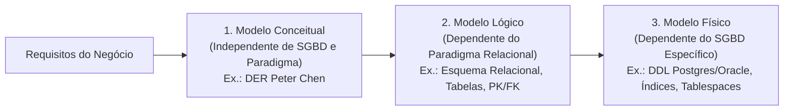
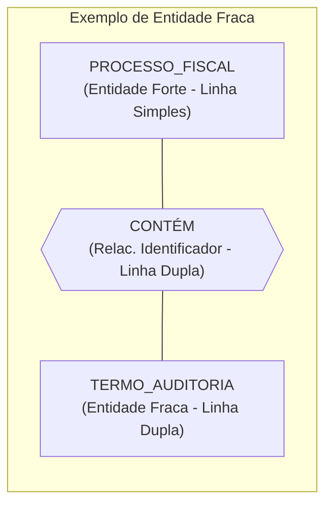
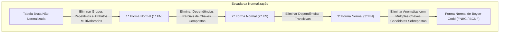
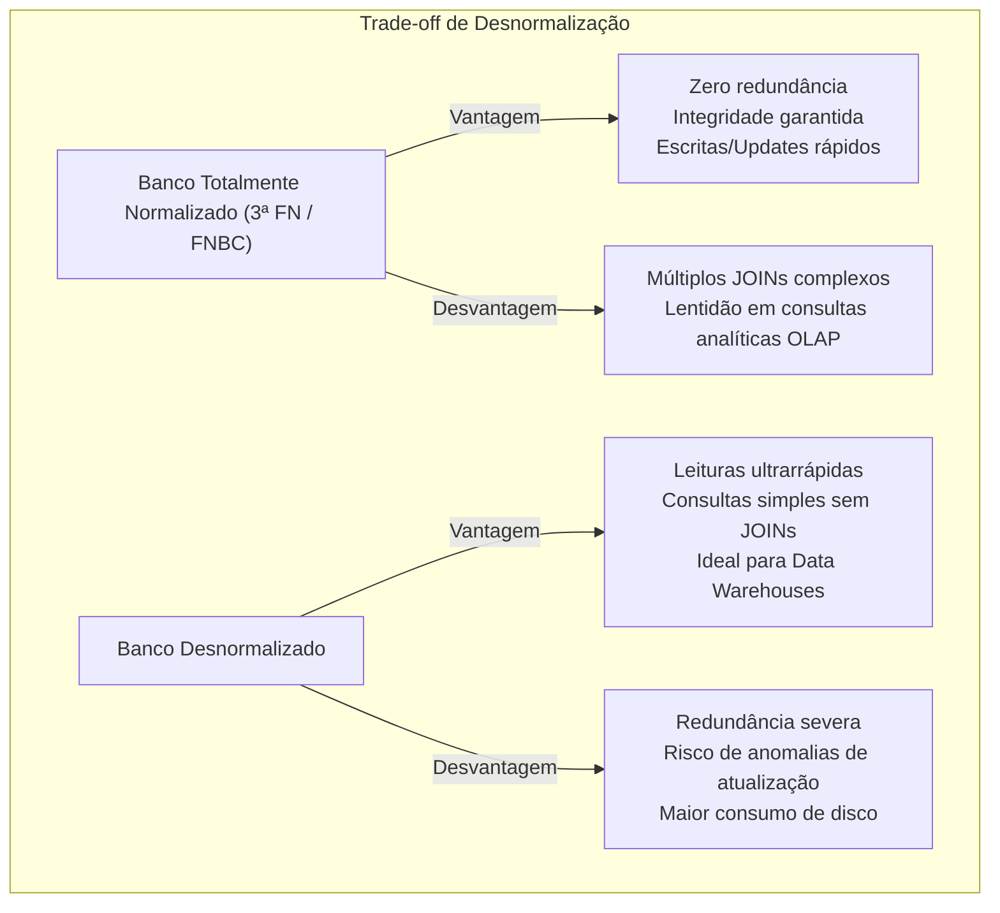

# 01 - Modelagem de Dados, MER e Normalização

> **Matéria:** Banco de Dados  
> **Cargo:** B02 – Técnico de Controle Externo – Especialidade: Tecnologia da Informação  
> **Arquivo:** `01_modelagem_de_dados_mer_e_normalizacao.md`  

---

## 📌 Ementa / Itens do Edital
- Modelagem conceitual, lógica e física de dados
- Modelo Entidade-Relacionamento (MER) e Diagrama Entidade-Relacionamento (DER)
- Álgebra Relacional (operações fundamentais e derivadas)
- Dependências funcionais e Formas Normais (1ª FN, 2ª FN, 3ª FN e BCNF)
- Processo de Desnormalização de dados

---

## 🧭 Sumário

1. [As Três Fases do Projeto de Banco de Dados](#1-as-tres-fases-do-projeto-de-banco-de-dados)
    1. [Modelo Conceitual: Semântica e Independência de Tecnologia](#11-modelo-conceitual-semantica-e-independencia-de-tecnologia)
    2. [Modelo Lógico: Dependência do Paradigma Relacional](#12-modelo-logico-dependencia-do-paradigma-relacional)
    3. [Modelo Físico: Implementação e Otimização no SGBD](#13-modelo-fisico-implementacao-e-otimizacao-no-sgbd)
    4. [Tabela Comparativa dos Níveis de Abstração](#14-tabela-comparativa-dos-niveis-de-abstracao)
    5. [Teste 234](#Teste-234)
2. [Modelo Entidade-Relacionamento (MER / DER de Peter Chen)](#2-modelo-entidade-relacionamento-mer-der-de-peter-chen)
    1. [Entidades Fortes (Regulares) vs. Entidades Fracas](#21-entidades-fortes-regulares-vs-entidades-fracas)
    2. [Tipologia e Representação Gráfica dos Atributos](#22-tipologia-e-representacao-grafica-dos-atributos)
    3. [Relacionamentos, Cardinalidade e Participação (Total vs. Parcial)](#23-relacionamentos-cardinalidade-e-participacao-total-vs-parcial)
    4. [Teste 235](#Teste-235)
    5. [Teste 236](#Teste-236)
    6. [Teste 237](#Teste-237)
3. [Álgebra Relacional: Operações Formais e Consultas](#3-algebra-relacional-operacoes-formais-e-consultas)
    1. [As Seis Operações Fundamentais](#31-as-seis-operacoes-fundamentais)
    2. [Operações Derivadas: Junção Natural, Theta Join, Equijunção, Interseção e Divisão Relacional](#32-operacoes-derivadas-juncao-natural-theta-join-equijuncao-intersecao-e-divisao-relacional)
    3. [Teste 238](#Teste-238)
    4. [Teste 239](#Teste-239)
4. [Teoria da Normalização e Formas Normais (Codd)](#4-teoria-da-normalizacao-e-formas-normais-codd)
    1. [Dependências Funcionais: Total, Parcial e Transitiva](#41-dependencias-funcionais-total-parcial-e-transitiva)
    2. [A Escada da Normalização: 1ª FN, 2ª FN e 3ª FN](#42-a-escada-da-normalizacao-1a-fn-2a-fn-e-3a-fn)
    3. [Forma Normal de Boyce-Codd (FNBC / BCNF) vs. 3ª FN](#43-forma-normal-de-boyce-codd-fnbc-bcnf-vs-3a-fn)
    4. [Teste 240](#Teste-240)
    5. [Teste 241](#Teste-241)
    6. [Teste 242](#Teste-242)
    7. [Teste 243](#Teste-243)
5. [Processo de Desnormalização de Dados](#5-processo-de-desnormalizacao-de-dados)
    1. [Motivações e Trade-offs: OLTP vs. OLAP / Data Warehouses](#51-motivacoes-e-trade-offs-oltp-vs-olap-data-warehouses)
    2. [Técnicas Comuns e Riscos de Integridade](#52-tecnicas-comuns-e-riscos-de-integridade)
    3. [Teste 244](#Teste-244)
6. [🌐 Fontes Oficiais e Referências Bibliográficas](#fontes-oficiais-e-referencias-bibliograficas)

---

## 1. As Três Fases do Projeto de Banco de Dados

O projeto e a modelagem de dados para sistemas de gestão pública e auditoria fiscal evoluem ao longo de **três níveis sucessivos de abstração**, garantindo que a semântica das regras de negócio do Estado seja preservada independentemente dos detalhes físicos de armazenamento em disco.

### 1.1 Modelo Conceitual: Semântica e Independência de Tecnologia
- **Escopo e Foco:** É o modelo de mais alto nível de abstração. Captura as entidades do mundo real, seus atributos fundamentais e como elas se relacionam, espelhando fielmente os requisitos do negócio sem qualquer preocupação tecnológica.
- **Independência Absoluta:** É **totalmente independente do software de SGBD** (PostgreSQL, Oracle) e até mesmo do paradigma lógico adotado (Relacional, Documentos, Grafos).
- **Notação Canônica:** O Diagrama Entidade-Relacionamento (DER) clássico de Peter Chen ou modelagens conceituais equivalentes.
- **Restrição Crítica:** O modelo conceitual **NÃO possui chaves estrangeiras (FKs)**, não define índices e não estipula tipos de dados de implementação (como `VARCHAR`, `INTEGER` ou `BLOB`).

### 1.2 Modelo Lógico: Dependência do Paradigma Relacional
- **Escopo e Foco:** Traduz o modelo conceitual para as estruturas do paradigma de banco de dados escolhido (quase universalmente o **Modelo Relacional** de Edgar F. Codd).
- **Mapeamento de Abstrações:** Entidades tornam-se **tabelas (relações)**, atributos tornam-se **colunas (atributos relacionais)**, instâncias tornam-se **tuplas (linhas)** e relacionamentos tornam-se **chaves estrangeiras (Foreign Keys - FK)** ou novas tabelas associativas (no caso de relacionamentos $N:M$).
- **Aplicação da Normalização:** É no modelo lógico que se aplicam formalmente as regras de normalização (1ª FN, 2ª FN, 3ª FN e FNBC) para expurgar anomalias de atualização e redundâncias desnecessárias.
- **Independência de Software:** Permanece independente de um SGBD específico (o mesmo modelo lógico atende ao PostgreSQL, Oracle Database ou SQL Server).

### 1.3 Modelo Físico: Implementação e Otimização no SGBD
- **Escopo e Foco:** Representa a implementação concreta e de mais baixo nível, altamente dependente dos recursos internos, dialeto SQL e mecanismos de armazenamento do SGBD corporativo contratado.
- **Elementos Físicos:** Scripts DDL (`CREATE TABLE`), definição precisa dos tipos de dados de baixo nível (`NUMERIC(15,2)`, `TIMESTAMPTZ`, `VARCHAR2`), definição de métodos de acesso e estruturas de **índices** (`B-Tree`, `Hash`, `GIN`, `GiST`, `BRIN`), estratégias de **particionamento de tabelas** (por lista, alcance ou hash), alocação de **tablespaces** e parâmetros de blocos de disco.
- **Decisões de Engenharia:** Avaliação de desnormalização deliberada para acelerar relatórios de grande porte e definição de restrições de integridade física (*constraints*).

### 1.4 Tabela Comparativa dos Níveis de Abstração

| Dimensão de Comparação | Modelo Conceitual | Modelo Lógico | Modelo Físico |
| :--- | :--- | :--- | :--- |
| **Público-Alvo Principal** | Analistas de negócio, auditores e usuários | Arquitetos de software e Administradores de Dados (DA) | Administradores de Banco de Dados (DBAs) e Engenheiros de Infra |
| **Independência de SGBD** | **Total** (independe de SGBD e de paradigma) | **Independente do SGBD**, dependente do paradigma relacional | **Totalmente dependente** do SGBD específico (PostgreSQL, Oracle) |
| **Estruturas Centrais** | Entidades, Atributos, Relacionamentos, Cardinalidade | Tabelas, Colunas, Chaves Primárias (PK), Chaves Estrangeiras (FK) | DDL SQL, Índices físicos, Tablespaces, Particionamento, Storage |
| **Momento da Normalização** | Não se aplica formalmente (define semântica) | **Etapa central de normalização** (1ª FN até Boyce-Codd) | Otimizações e eventual desnormalização controlada |

> 🚨 **ALERTA DE PROVA / FCC:**  
> A FCC adora cobrar a fronteira entre os modelos:
>
> - O **Modelo Conceitual** NÃO possui chaves estrangeiras nem tipos de dados de sistema operacional.
> - A introdução formal de **chaves estrangeiras (FKs)** ocorre estritamente na transição para o **Modelo Lógico**.
> - Estruturas de aceleração física como **índices B-Tree, particionamento e tablespaces** pertencem com exclusividade ao **Modelo Físico**.

---

### Teste 001
**(FGV – TCE/GO – 2024 – Analista de Controle Externo - Tecnologia da Informação)**
A integração de dados desempenha um papel crucial na gestão da informação em organizações. No contexto dos processos de ETL (Extract, Transform, Load), cada etapa desempenha funções específicas. Assinale a opção que descreve corretamente o processo de Transformação (T) no ETL.

* **A)** Etapa em que os dados são carregados em um data warehouse para armazenamento.
* **B)** Fase em que os dados são extraídos de diferentes fontes de dados.
* **C)** Momento em que os dados são preparados para serem apresentados aos usuários finais.
* **D)** Parte do processo em que os dados são indexados espacialmente para otimizar consultas futuras.
* **E)** Passo no qual os dados são limpos, filtrados, agregados ou modificados de acordo com os requisitos de negócios.

---

> **Comentário Detalhado:**
>
> - **A)** **Incorreta.** A opção apresenta proposição em desacordo com os fundamentos teóricos e técnicos do tópico ao afirmar que "Etapa em que os dados são carregados em um data warehouse para armazenamento". De acordo com a teoria estudada em *1. As Três Fases do Projeto de Banco de Dados*, o projeto e a modelagem de dados para sistemas de gestão pública e auditoria fiscal evoluem ao longo de três níveis sucessivos de abstração, garantindo que a semântica das regras de negócio do Estado seja preservada independentemente dos detalhes físicos de armazenamento em disco.
> - **B)** **Incorreta.** A opção apresenta proposição em desacordo com os fundamentos teóricos e técnicos do tópico ao afirmar que "Fase em que os dados são extraídos de diferentes fontes de dados". De acordo com a teoria estudada em *1.1 Modelo Conceitual: Semântica e Independência de Tecnologia*, escopo e Foco: É o modelo de mais alto nível de abstração. Captura as entidades do mundo real, seus atributos fundamentais e como elas se relacionam, espelhando fielmente os requisitos do negócio sem qualquer preocupação tecnológica.
> - **C)** **Incorreta.** A opção apresenta proposição em desacordo com os fundamentos teóricos e técnicos do tópico ao afirmar que "Momento em que os dados são preparados para serem apresentados aos usuários finais". De acordo com a teoria estudada em *1.4 Tabela Comparativa dos Níveis de Abstração*, público Alvo Principal: Analistas de negócio, auditores e usuários — Arquitetos de software e Administradores de Dados (DA) — Administradores de Banco de Dados (DBAs) e Engenheiros de Infra.
> - **D)** **Incorreta.** A opção apresenta proposição em desacordo com os fundamentos teóricos e técnicos do tópico ao afirmar que "Parte do processo em que os dados são indexados espacialmente para otimizar consultas futuras". De acordo com a teoria estudada em *5. Processo de Desnormalização de Dados*, n |Desvantagem| ND1["Múltiplos JOINs complexos<br/ Lentidão em consultas analíticas OLAP"].
> - **E)** **Correta.** Conforme fundamentado na seção *1. As Três Fases do Projeto de Banco de Dados* deste guia, a["Requisitos do Negócio"] B["1. Modelo Conceitual<br/ (Independente de SGBD e Paradigma)<br/ Ex.: DER Peter Chen"]. Dessa forma, está plenamente correta a assertiva da banca (FGV – TCE/GO/2024) ao estabelecer que "Passo no qual os dados são limpos, filtrados, agregados ou modificados de acordo com os requisitos de negócios".
>
> **Gabarito: E**

---

### Teste 002
**(FGV – TJ/AP – 2023 – Analista Judiciario Apoio Especializado Tecnologia Da Informacao Banco De Dados)**
O componente arquitetural de um ambiente de Data Warehouse usado para armazenar temporariamente os dados durante a sua transformação é o(a):

* **A)** log;
* **B)** data mining;
* **C)** stage area;
* **D)** repositório de metadados;
* **E)** cubo de dados.

---

> **Comentário Detalhado:**
>
> - **A)** **Incorreta.** A opção apresenta proposição em desacordo com os fundamentos teóricos e técnicos do tópico ao afirmar que "log". De acordo com a teoria estudada em *5.1 Motivações e Trade-offs: OLTP vs. OLAP / Data Warehouses*, sistemas Analíticos (OLAP Online Analytical Processing / Data Warehouses): Priorizam o desempenho em leitura massiva e agregação de dados. Em esquemas como o Star Schema (Esquema em Estrela), desnormalizam se as tabelas de dimensões para eliminar junções caras ( JOINs ) de centenas de milhões de linhas.
> - **B)** **Incorreta.** A opção apresenta proposição em desacordo com os fundamentos teóricos e técnicos do tópico ao afirmar que "data mining". De acordo com a teoria estudada em *2.2 Tipologia e Representação Gráfica dos Atributos*, monovalorado: Armazena exatamente um valor para cada instância da entidade. — Elipse padrão de linha simples — Data Nascimento , Data Emissao.
> - **C)** **Correta.** Conforme fundamentado na seção *5. Processo de Desnormalização de Dados* deste guia, d |Vantagem| DV1["Leituras ultrarrápidas<br/ Consultas simples sem JOINs<br/ Ideal para Data Warehouses"]. Dessa forma, está plenamente correta a assertiva da banca (FGV – TJ/AP/2023) ao estabelecer que "stage area".
> - **D)** **Incorreta.** A opção apresenta proposição em desacordo com os fundamentos teóricos e técnicos do tópico ao afirmar que "repositório de metadados". De acordo com a teoria estudada em *5.2 Técnicas Comuns e Riscos de Integridade*, replicação de Colunas de Consulta Frequente: Armazenar o NomeFornecedor diretamente na tabela de Empenho.
> - **E)** **Incorreta.** A opção apresenta proposição em desacordo com os fundamentos teóricos e técnicos do tópico ao afirmar que "cubo de dados". De acordo com a teoria estudada em *1. As Três Fases do Projeto de Banco de Dados*, o projeto e a modelagem de dados para sistemas de gestão pública e auditoria fiscal evoluem ao longo de três níveis sucessivos de abstração, garantindo que a semântica das regras de negócio do Estado seja preservada independentemente dos detalhes físicos de armazenamento em disco.
>
> **Gabarito: C**

---

### Teste 003
**(FCC – TRT 14ª – 2016 – Analista Judiciário - Apoio Especializado - Tecnologia da Informação)**
No Oracle 11g há uma instrução que permite atualizar, inserir ou remover linhas condicionalmente em uma tabela, evitando o uso de várias instruções DML. Esta instrução é especialmente útil nas aplicações em ambientes de Data Warehouse, nas quais é preciso trabalhar com dados provenientes de várias origens. Trata-se da instrução

* **A)** SWITCH.
* **B)** TRUNCATE.
* **C)** MERGE.
* **D)** IFCOMMAND.
* **E)** EXEC.

---

> **Comentário Detalhado:**
>
> - **A)** **Incorreta.** A opção apresenta proposição em desacordo com os fundamentos teóricos e técnicos do tópico ao afirmar que "SWITCH". De acordo com a teoria estudada em *1.4 Tabela Comparativa dos Níveis de Abstração*, independência de SGBD: Total (independe de SGBD e de paradigma) — Independente do SGBD, dependente do paradigma relacional — Totalmente dependente do SGBD específico (PostgreSQL, Oracle).
> - **B)** **Incorreta.** A opção apresenta proposição em desacordo com os fundamentos teóricos e técnicos do tópico ao afirmar que "TRUNCATE". De acordo com a teoria estudada em *1. As Três Fases do Projeto de Banco de Dados*, c D["3. Modelo Físico<br/ (Dependente do SGBD Específico)<br/ Ex.: DDL Postgres/Oracle, Índices, Tablespaces"].
> - **C)** **Incorreta.** A opção apresenta proposição em desacordo com os fundamentos teóricos e técnicos do tópico ao afirmar que "MERGE". De acordo com a teoria estudada em *5.2 Técnicas Comuns e Riscos de Integridade*, risco Crítico de Inconsistência: Atualizar o nome do fornecedor exige atualizar milhões de registros duplicados; se uma atualização falhar pela metade, o banco de dados entra em estado inconsistente.
> - **D)** **Correta.** Conforme fundamentado na seção *5.1 Motivações e Trade-offs: OLTP vs. OLAP / Data Warehouses* deste guia, sistemas Analíticos (OLAP Online Analytical Processing / Data Warehouses): Priorizam o desempenho em leitura massiva e agregação de dados. Em esquemas como o Star Schema (Esquema em Estrela), desnormalizam se as tabelas de dimensões para eliminar junções caras ( JOINs ) de centenas de milhões de linhas. Dessa forma, está plenamente correta a assertiva da banca (FCC – TRT 14ª/2016) ao estabelecer que "IFCOMMAND".
> - **E)** **Incorreta.** A opção apresenta proposição em desacordo com os fundamentos teóricos e técnicos do tópico ao afirmar que "EXEC". De acordo com a teoria estudada em *5.1 Motivações e Trade-offs: OLTP vs. OLAP / Data Warehouses*, sistemas Transacionais (OLTP Online Transaction Processing): Exigem alta normalização (3ª FN / FNBC) para garantir escrita rápida, bloqueio granular de linhas e integridade referencial sem risco de anomalias.
>
> **Gabarito: D**

---

### Teste 004
**(FCC – TRT 23ª – 2016 – Analista Judiciário - Apoio Especializado - Tecnologia da Informação)**
Na abordagem Star Schema, usada para modelar data warehouses, os fatos são representados na tabela de fatos, que normalmente

* **A)** o tempo decorrido entre as iterações de um processo recursivo.
* **B)** as interações entre as atividades, no tempo.
* **C)** os casos de uso de cada objeto.
* **D)** os períodos de ativação do objeto.
* **E)** as etapas em que o objeto estará inativo.

---

> **Comentário Detalhado:**
>
> - **A)** **Correta.** Conforme fundamentado na seção *5.1 Motivações e Trade-offs: OLTP vs. OLAP / Data Warehouses* deste guia, sistemas Analíticos (OLAP Online Analytical Processing / Data Warehouses): Priorizam o desempenho em leitura massiva e agregação de dados. Em esquemas como o Star Schema (Esquema em Estrela), desnormalizam se as tabelas de dimensões para eliminar junções caras ( JOINs ) de centenas de milhões de linhas. Dessa forma, está plenamente correta a assertiva da banca (FCC – TRT 23ª/2016) ao estabelecer que "o tempo decorrido entre as iterações de um processo recursivo".
> - **B)** **Incorreta.** A opção apresenta proposição em desacordo com os fundamentos teóricos e técnicos do tópico ao afirmar que "as interações entre as atividades, no tempo". De acordo com a teoria estudada em *5. Processo de Desnormalização de Dados*, d |Vantagem| DV1["Leituras ultrarrápidas<br/ Consultas simples sem JOINs<br/ Ideal para Data Warehouses"].
> - **C)** **Incorreta.** A opção apresenta proposição em desacordo com os fundamentos teóricos e técnicos do tópico ao afirmar que "os casos de uso de cada objeto". De acordo com a teoria estudada em *2.1 Entidades Fortes (Regulares) vs. Entidades Fracas*, d["PROCESSO FISCAL<br/ (Entidade Forte Linha Simples)"] RelId{{"CONTÉM<br/ (Relac. Identificador Linha Dupla)"}}.
> - **D)** **Incorreta.** A opção apresenta proposição em desacordo com os fundamentos teóricos e técnicos do tópico ao afirmar que "os períodos de ativação do objeto". De acordo com a teoria estudada em *5. Processo de Desnormalização de Dados*, a desnormalização consiste na introdução deliberada, planejada e controlada de redundância em um esquema de banco de dados físico previamente normalizado.
> - **E)** **Incorreta.** A opção apresenta proposição em desacordo com os fundamentos teóricos e técnicos do tópico ao afirmar que "as etapas em que o objeto estará inativo". De acordo com a teoria estudada em *4.2 A Escada da Normalização: 1ª FN, 2ª FN e 3ª FN*, regra de Ouro em Provas: A violação da 2ª FN só pode ocorrer se a chave primária for composta (possuir 2 ou mais atributos). Se a chave primária for simples (apenas 1 atributo), estando na 1ª FN ela estará automaticamente na 2ª FN!.
>
> **Gabarito: A**

---

### Teste 005
**(FGV – TRF/1 – 2024 – Analista Judiciario Area Apoio Especializado Especialidade Suporte Em Tecnologia Da Informacao)**
Pedro está implementando um banco de dados a partir de um projeto lógico que recebeu dos desenvolvedores de Sistemas de Informação do Tribunal. No projeto, há relacionamentos entre diversas tabelas. No SQL, para implementar os relacionamentos de modo a prevenir que alguma transação de banco de dados destrua os relacionamentos entre as tabelas, Pedro deve utilizar a cláusula:

* **A)** CHECK
* **B)** UNION
* **C)** DEFAULT
* **D)** ORDER BY
* **E)** FOREIGN KEY

---

> **Comentário Detalhado:**
>
> - **A)** **Incorreta.** A opção apresenta proposição em desacordo com os fundamentos teóricos e técnicos do tópico ao afirmar que "CHECK". De acordo com a teoria estudada em *1. As Três Fases do Projeto de Banco de Dados*, b C["2. Modelo Lógico<br/ (Dependente do Paradigma Relacional)<br/ Ex.: Esquema Relacional, Tabelas, PK/FK"].
> - **B)** **Incorreta.** A opção apresenta proposição em desacordo com os fundamentos teóricos e técnicos do tópico ao afirmar que "UNION". De acordo com a teoria estudada em *1. As Três Fases do Projeto de Banco de Dados*, o projeto e a modelagem de dados para sistemas de gestão pública e auditoria fiscal evoluem ao longo de três níveis sucessivos de abstração, garantindo que a semântica das regras de negócio do Estado seja preservada independentemente dos detalhes físicos de armazenamento em disco.
> - **C)** **Incorreta.** A opção apresenta proposição em desacordo com os fundamentos teóricos e técnicos do tópico ao afirmar que "DEFAULT". De acordo com a teoria estudada em *1.4 Tabela Comparativa dos Níveis de Abstração*, estruturas Centrais: Entidades, Atributos, Relacionamentos, Cardinalidade — Tabelas, Colunas, Chaves Primárias (PK), Chaves Estrangeiras (FK) — DDL SQL, Índices físicos, Tablespaces, Particionamento, Storage.
> - **D)** **Incorreta.** A opção apresenta proposição em desacordo com os fundamentos teóricos e técnicos do tópico ao afirmar que "ORDER BY". De acordo com a teoria estudada em *3.1 As Seis Operações Fundamentais*, seleção ($\sigma {\text{condição}}(R)$): Filtra linhas (tuplas) que satisfazem a um predicado lógico booleano. É um operador unário que atua no eixo horizontal. Corresponde à cláusula WHERE do SQL.
> - **E)** **Correta.** Conforme fundamentado na seção *1.2 Modelo Lógico: Dependência do Paradigma Relacional* deste guia, mapeamento de Abstrações: Entidades tornam se tabelas (relações), atributos tornam se colunas (atributos relacionais), instâncias tornam se tuplas (linhas) e relacionamentos tornam se chaves estrangeiras (Foreign Keys FK) ou novas tabelas associativas (no caso de relacionamentos $N:M$). Dessa forma, está plenamente correta a assertiva da banca (FGV – TRF/1/2024) ao estabelecer que "FOREIGN KEY".
>
> **Gabarito: E**

---

### Teste 006
**(FCC – TRT 24ª – 2017 – Analista Judiciário - Tecnologia da Informação)**
Uma das formas de apresentação de um banco de dados multidimensional é através do modelo estrela. No centro de um mode- lo estrela encontra-se a tabela de

* **A)** fatos, cuja chave primária deve ser simples.
* **B)** fatos e, ao seu redor, as tabelas de dimensões.
* **C)** dimensão e, ao seu redor, as tabelas de fatos.
* **D)** dimensão, cuja chave primária deve ser composta.
* **E)** núcleo e, ao seu redor, as tabelas de nível.

---

> **Comentário Detalhado:**
>
> - **A)** **Incorreta.** A opção apresenta proposição em desacordo com os fundamentos teóricos e técnicos do tópico ao afirmar que "fatos, cuja chave primária deve ser simples". De acordo com a teoria estudada em *4.2 A Escada da Normalização: 1ª FN, 2ª FN e 3ª FN*, regra de Ouro em Provas: A violação da 2ª FN só pode ocorrer se a chave primária for composta (possuir 2 ou mais atributos). Se a chave primária for simples (apenas 1 atributo), estando na 1ª FN ela estará automaticamente na 2ª FN!.
> - **B)** **Incorreta.** A opção apresenta proposição em desacordo com os fundamentos teóricos e técnicos do tópico ao afirmar que "fatos e, ao seu redor, as tabelas de dimensões". De acordo com a teoria estudada em *5.1 Motivações e Trade-offs: OLTP vs. OLAP / Data Warehouses*, sistemas Analíticos (OLAP Online Analytical Processing / Data Warehouses): Priorizam o desempenho em leitura massiva e agregação de dados. Em esquemas como o Star Schema (Esquema em Estrela), desnormalizam se as tabelas de dimensões para eliminar junções caras ( JOINs ) de centenas de milhões de linhas.
> - **C)** **Incorreta.** A opção apresenta proposição em desacordo com os fundamentos teóricos e técnicos do tópico ao afirmar que "dimensão e, ao seu redor, as tabelas de fatos". De acordo com a teoria estudada em *4.2 A Escada da Normalização: 1ª FN, 2ª FN e 3ª FN*, regra: A relação deve estar na 1ª FN e todo atributo não chave deve depender totalmente da chave primária, eliminando qualquer dependência funcional parcial.
> - **D)** **Correta.** Conforme fundamentado na seção *4.1 Dependências Funcionais: Total, Parcial e Transitiva* deste guia, dependência Funcional Parcial: Ocorre quando um atributo não chave depende de apenas uma parte de uma chave primária composta (isto é, existe $A \subset X$ tal que $A \rightarrow Y$). Dessa forma, está plenamente correta a assertiva da banca (FCC – TRT 24ª/2017) ao estabelecer que "dimensão, cuja chave primária deve ser composta".
> - **E)** **Incorreta.** A opção apresenta proposição em desacordo com os fundamentos teóricos e técnicos do tópico ao afirmar que "núcleo e, ao seu redor, as tabelas de nível". De acordo com a teoria estudada em *4.2 A Escada da Normalização: 1ª FN, 2ª FN e 3ª FN*, regra: A relação deve estar na 2ª FN e nenhum atributo não chave pode depender transitivamente da chave primária.
>
> **Gabarito: D**

---

## 2. Modelo Entidade-Relacionamento (MER / DER de Peter Chen)

Publicado em 1976 por Peter Pin-Shan Chen, o Modelo Entidade-Relacionamento tornou-se a ferramenta semântica universal para representação conceitual de esquemas de dados.

### 2.1 Entidades Fortes (Regulares) vs. Entidades Fracas

- **Entidade Forte (Regular):**
    - Possui existência autônoma e independente no mundo real.
    - Possui ao menos um atributo identificador próprio (chave primária) que distingue univocamente cada uma de suas instâncias.
    - Representação gráfica de Chen: **Retângulo de linha simples**.
- **Entidade Fraca:**
    - Sua existência depende obrigatoriamente da existência de outra entidade (denominada entidade proprietária ou dominante). Se a entidade proprietária for removida, a entidade fraca deixa de fazer sentido.
    - Não possui chave primária completa própria; possui apenas um **discriminador** ou **chave parcial**, que identifica a ocorrência apenas no escopo da sua entidade dominante.
    - Sua identificação plena é formada pela junção: $\text{Chave da Entidade Forte} + \text{Chave Parcial}$.
    - Representação gráfica de Chen: **Retângulo de linha dupla**.
- **Relacionamento Identificador:**
    - É o relacionamento formal que vincula a entidade fraca à sua entidade forte proprietária.
    - Representação gráfica de Chen: **Losango de linha dupla**.

### 2.2 Tipologia e Representação Gráfica dos Atributos

No modelo clássico de Chen, os atributos são expressos por elipses conectadas às entidades:

| Tipo de Atributo | Definição Teórica Rigorosa | Representação Gráfica (Chen) | Exemplo Prático |
| :--- | :--- | :--- | :--- |
| **Simples (Atômico)** | Não divisível em partes menores dotadas de significado próprio. | Elipse com linha simples | `CPF`, `Matrícula`, `Idade` |
| **Composto** | Pode ser desmembrado em múltiplos subatributos autônomos. | Elipse ramificada em subelipses | `Endereço` (`Logradouro`, `Número`, `CEP`) |
| **Monovalorado** | Armazena exatamente um valor para cada instância da entidade. | Elipse padrão de linha simples | `Data_Nascimento`, `Data_Emissao` |
| **Multivalorado** | Pode assumir múltiplos valores simultâneos para a mesma entidade. | Elipse com **linha dupla** | `Telefones`, `E-mails`, `CNAEs_Secundarios` |
| **Determinante (Identificador)**| Identifica univocamente a instância da entidade forte. | Elipse com texto **sublinhado contínuo** | `<u>NumContrato</u>`, `<u>IdProcesso</u>` |
| **Discriminador (Chave Parcial)**| Identifica a entidade fraca apenas dentro do escopo da forte. | Elipse com texto **sublinhado tracejado** | `Num_Sequencial_Termo` |
| **Derivado** | Valor calculado dinamicamente a partir de outros atributos persistidos. | Elipse com **borda tracejada/pontilhada** | `Idade` (calculada de `Data_Nasc`) |

### 2.3 Relacionamentos, Cardinalidade e Participação (Total vs. Parcial)

- **Grau do Relacionamento:** Quantidade de entidades participantes (Binário = 2 entidades; Ternário = 3 entidades; Unário / Auto-relacionamento = a mesma entidade se relaciona consigo mesma, como `FUNCIONARIO gerencia FUNCIONARIO`).
- **Razão de Cardinalidade:** Especifica o número máximo de ocorrências de relacionamento nas quais uma entidade pode participar:
    - $1:1$ (Um para Um);
    - $1:N$ (Um para Muitos);
    - $N:M$ (Muitos para Muitos - na conversão lógica, exige compulsoriamente a criação de uma tabela associativa intermediária).
- **Participação Total (Dependência de Existência):** Toda entidade do conjunto de entidades **obrigatoriamente deve participar** de ao menos uma instância do relacionamento. É representada graficamente por uma **linha dupla** que liga a entidade ao losango. Na notação $(mín, máx)$, expressa-se com $mín \ge 1$.
- **Participação Parcial:** A participação é opcional (algumas instâncias podem não participar do relacionamento). Representada por uma **linha simples**. Na notação $(mín, máx)$, expressa-se com $mín = 0$.

> 🚨 **ALERTA DE PROVA / PEGADINHA FCC:**  
> Cuidado com a notação de cardinalidade:
>
> - Na notação clássica de Chen com cardinalidade nas pontas ($1$ e $N$), o valor representa a cardinalidade máxima permitida.
> - Na notação de pares de limites $(mín, máx)$, se $mín = 0$, a participação é **parcial**; se $mín = 1$, a participação é **total**. Além disso, na notação $(min, max)$, os limites ficam posicionados **adjacentes à entidade que possui aquela restrição**!

---

### Teste 007
**(FGV – TJ/SC – 2026 – Analista Administrativo)**
A diretoria da empresa ABC tem se preocupado com o desempenho de uma equipe específica. Após análise diagnóstica, a área de Gestão de Pessoas elaborou relatório no qual conclui que o desempenho no trabalho não depende exclusivamente do esforço individual ou do interesse do colaborador em realizar suas atribuições, mas resulta da combinação de três fatores: o desejo do funcionário de fazer bem o trabalho, sua capacidade efetiva de executá-lo e a disponibilidade dos materiais, recursos, equipamentos e informações necessários à execução das tarefas. O relatório destaca, ainda, que a deficiência em qualquer um desses três fatores prejudicará o desempenho. Considerando o modelo apresentado, os três fatores que, conjuntamente, determinam o desempenho no trabalho são

* **A)** liderança, comunicação e cultura.
* **B)** competência, comprometimento e clima.
* **C)** treinamento, supervisão e recompensa.
* **D)** motivação, habilidade e ambiente.
* **E)** engajamento, autonomia e feedback.

---

> **Comentário Detalhado:**
>
> - **A)** **Incorreta.** A opção apresenta proposição em desacordo com os fundamentos teóricos e técnicos do tópico ao afirmar que "liderança, comunicação e cultura". De acordo com a teoria estudada em *1. As Três Fases do Projeto de Banco de Dados*, o projeto e a modelagem de dados para sistemas de gestão pública e auditoria fiscal evoluem ao longo de três níveis sucessivos de abstração, garantindo que a semântica das regras de negócio do Estado seja preservada independentemente dos detalhes físicos de armazenamento em disco.
> - **B)** **Incorreta.** A opção apresenta proposição em desacordo com os fundamentos teóricos e técnicos do tópico ao afirmar que "competência, comprometimento e clima". De acordo com a teoria estudada em *2.3 Relacionamentos, Cardinalidade e Participação (Total vs. Parcial)*, grau do Relacionamento: Quantidade de entidades participantes (Binário = 2 entidades; Ternário = 3 entidades; Unário / Auto relacionamento = a mesma entidade se relaciona consigo mesma, como FUNCIONARIO gerencia FUNCIONARIO ).
> - **C)** **Incorreta.** A opção apresenta proposição em desacordo com os fundamentos teóricos e técnicos do tópico ao afirmar que "treinamento, supervisão e recompensa". De acordo com a teoria estudada em *2.3 Relacionamentos, Cardinalidade e Participação (Total vs. Parcial)*, razão de Cardinalidade: Especifica o número máximo de ocorrências de relacionamento nas quais uma entidade pode participar.
> - **D)** **Correta.** Conforme fundamentado na seção *2.1 Entidades Fortes (Regulares) vs. Entidades Fracas* deste guia, sua existência depende obrigatoriamente da existência de outra entidade (denominada entidade proprietária ou dominante). Se a entidade proprietária for removida, a entidade fraca deixa de fazer sentido. Dessa forma, está plenamente correta a assertiva da banca (FGV – TJ/SC/2026) ao estabelecer que "motivação, habilidade e ambiente".
> - **E)** **Incorreta.** A opção apresenta proposição em desacordo com os fundamentos teóricos e técnicos do tópico ao afirmar que "engajamento, autonomia e feedback". De acordo com a teoria estudada em *1.1 Modelo Conceitual: Semântica e Independência de Tecnologia*, escopo e Foco: É o modelo de mais alto nível de abstração. Captura as entidades do mundo real, seus atributos fundamentais e como elas se relacionam, espelhando fielmente os requisitos do negócio sem qualquer preocupação tecnológica.
>
> **Gabarito: D**

---

### Teste 008
**(FGV – TCE/GO – 2024 – Analista de Controle Externo - Tecnologia da Informação)**
Uma empresa de TI está considerando a terceirização de algumas de suas funções de TI para melhorar a eficiência e reduzir custos. Assinale a opção que descreve corretamente uma etapa crítica que tem que ser abordada antes de implementar a terceirização de TI.

* **A)** Reduzir o quadro de pessoal interno para garantir economias de custo substanciais antes de firmar qualquer contrato de terceirização.
* **B)** Implementar uma ferramenta de software que automatize completamente os processos de TI.
* **C)** Conduzir uma análise detalhada das necessidades da empresa e do impacto da terceirização no atual ambiente de TI e nos funcionários envolvidos.
* **D)** Aumentar os investimentos em infraestrutura de TI para permitir a melhor gestão de empresas terceirizadas com capacidades tecnológicas avançadas.
* **E)** Focar nas tendências de mercado.

---

> **Comentário Detalhado:**
>
> - **A)** **Incorreta.** A opção promove generalização excessiva que desconsidera as condições técnicas e normativas ao afirmar que "Reduzir o quadro de pessoal interno para garantir economias de custo substanciais antes de firmar qualquer...". De acordo com a teoria estudada em *3.1 As Seis Operações Fundamentais*, qualquer consulta relacional teórica pode ser expressa combinando as seis operações primitivas.
> - **B)** **Incorreta.** A opção apresenta proposição em desacordo com os fundamentos teóricos e técnicos do tópico ao afirmar que "Implementar uma ferramenta de software que automatize completamente os processos de TI". De acordo com a teoria estudada em *2. Modelo Entidade-Relacionamento (MER / DER de Peter Chen)*, publicado em 1976 por Peter Pin Shan Chen, o Modelo Entidade Relacionamento tornou se a ferramenta semântica universal para representação conceitual de esquemas de dados.
> - **C)** **Correta.** Conforme fundamentado na seção *4. Teoria da Normalização e Formas Normais (Codd)* deste guia, a teoria da normalização, concebida por Edgar F. Codd, consiste em uma técnica formal de análise de esquemas relacionais com base em suas Dependências Funcionais (DF) e chaves primárias. Seu objetivo é minimizar a redundância de dados e erradicar as anomalias de inserção, exclusão e alteração. Dessa forma, está plenamente correta a assertiva da banca (FGV – TCE/GO/2024) ao estabelecer que "Conduzir uma análise detalhada das necessidades da empresa e do impacto da terceirização no atual ambiente de TI e...".
> - **D)** **Incorreta.** A opção apresenta proposição em desacordo com os fundamentos teóricos e técnicos do tópico ao afirmar que "Aumentar os investimentos em infraestrutura de TI para permitir a melhor gestão de empresas terceirizadas com...". De acordo com a teoria estudada em *1. As Três Fases do Projeto de Banco de Dados*, o projeto e a modelagem de dados para sistemas de gestão pública e auditoria fiscal evoluem ao longo de três níveis sucessivos de abstração, garantindo que a semântica das regras de negócio do Estado seja preservada independentemente dos detalhes físicos de armazenamento em disco.
> - **E)** **Incorreta.** A opção apresenta proposição em desacordo com os fundamentos teóricos e técnicos do tópico ao afirmar que "Focar nas tendências de mercado". De acordo com a teoria estudada em *2.3 Relacionamentos, Cardinalidade e Participação (Total vs. Parcial)*, participação Parcial: A participação é opcional (algumas instâncias podem não participar do relacionamento). Representada por uma linha simples. Na notação $(mín, máx)$, expressa se com $mín = 0$.
>
> **Gabarito: C**

---

### Teste 009
**(FGV – TCE/GO – 2024 – Analista de Controle Externo - Tecnologia da Informação)**
Uma instituição federal está em processo de modernização de seu sistema de informações e necessita adquirir novos servidores de alta capacidade. O setor de TI realizou estudos preliminares e definiu especificações técnicas detalhadas que apenas uma marca específica de servidores atende. Considerando a Lei nº 14.133/2021, o setor de compras, para a aquisição destes servidores, deve

* **A)** realizar licitação na modalidade concorrência, permitindo a participação de várias marcas para assegurar a obtenção de propostas competitivas.
* **B)** efetuar uma dispensa de licitação, uma vez que a especificação detalhada restringe a aquisição à marca única, caracterizando fornecedor exclusivo.
* **C)** proceder com a inexigibilidade de licitação devido à especificação técnica que justifica a escolha de uma única marca, evitando a competição.
* **D)** solicitar autorização judicial para adquirir diretamente do fornecedor sem necessidade de licitação, dado o caráter exclusivo da especificação.
* **E)** realizar um pregão eletrônico com indicação de marca no edital para garantir a compatibilidade com o sistema atual da instituição.

---

> **Comentário Detalhado:**
>
> - **A)** **Incorreta.** A opção apresenta proposição em desacordo com os fundamentos teóricos e técnicos do tópico ao afirmar que "realizar licitação na modalidade concorrência, permitindo a participação de várias marcas para assegurar a...". De acordo com a teoria estudada em *2.3 Relacionamentos, Cardinalidade e Participação (Total vs. Parcial)*, razão de Cardinalidade: Especifica o número máximo de ocorrências de relacionamento nas quais uma entidade pode participar.
> - **B)** **Incorreta.** A opção afasta requisito ou relação estrutural exigida pela matéria ao afirmar que "efetuar uma dispensa de licitação, uma vez que a especificação detalhada restringe a aquisição à marca única...". De acordo com a teoria estudada em *5.2 Técnicas Comuns e Riscos de Integridade*, risco Crítico de Inconsistência: Atualizar o nome do fornecedor exige atualizar milhões de registros duplicados; se uma atualização falhar pela metade, o banco de dados entra em estado inconsistente.
> - **C)** **Correta.** Conforme fundamentado na seção *5.2 Técnicas Comuns e Riscos de Integridade* deste guia, junção Pré calculada: Mesclar duas tabelas $1:N$ em uma única tabela para evitar consultas com JOIN. Dessa forma, está plenamente correta a assertiva da banca (FGV – TCE/GO/2024) ao estabelecer que "proceder com a inexigibilidade de licitação devido à especificação técnica que justifica a escolha de uma única...".
> - **D)** **Incorreta.** A opção apresenta proposição em desacordo com os fundamentos teóricos e técnicos do tópico ao afirmar que "solicitar autorização judicial para adquirir diretamente do fornecedor sem necessidade de licitação, dado o...". De acordo com a teoria estudada em *5.2 Técnicas Comuns e Riscos de Integridade*, replicação de Colunas de Consulta Frequente: Armazenar o NomeFornecedor diretamente na tabela de Empenho.
> - **E)** **Incorreta.** A opção apresenta proposição em desacordo com os fundamentos teóricos e técnicos do tópico ao afirmar que "realizar um pregão eletrônico com indicação de marca no edital para garantir a compatibilidade com o sistema atual...". De acordo com a teoria estudada em *1.4 Tabela Comparativa dos Níveis de Abstração*, o Modelo Conceitual NÃO possui chaves estrangeiras nem tipos de dados de sistema operacional.
>
> **Gabarito: C**

---

### Teste 010
**(CEBRASPE – TRF 6ª – 2025 – Analista Judiciário - Apoio Especializado - Governança e Gestão de Tecnologia da Informação)**
Uma tabela está na 3.ª forma normal (3NF) se todos os atributos dependerem diretamente da chave primária.

* **C)** Certo
* **E)** Errado

---

> **Comentário Detalhado:**
>
> - **C)** **Incorreta.** A proposição apresenta proposição em desacordo com os fundamentos teóricos e técnicos do tópico ao afirmar que "Uma tabela está na 3.ª forma normal (3NF) se todos os atributos dependerem diretamente da chave primária". De acordo com a teoria em *4. Teoria da Normalização e Formas Normais (Codd)*, a["Tabela Bruta Não Normalizada"] |Eliminar Grupos Repetitivos e Atributos Multivalorados| B["1ª Forma Normal (1ª FN)"].
> - **E)** **Correta.** O item está **Errado** (gabarito oficial: **E**), pois contraria a disciplina teórica aplicável.
>
> **Gabarito: E**

---

### Teste 011
**(CEBRASPE – STJ – 2024 – Analista Judiciário - Apoio Especializado - Suporte em Tecnologia da Informação)**
A gestão de incidentes é considerada um componente crítico da estratégia de gerenciamento de riscos das organizações porque, com tal gestão, é possível reduzir o tempo de inatividade e minimizar os impactos negativos causados por acidentes cibernéticos.

* **C)** Certo
* **E)** Errado

---

> **Comentário Detalhado:**
>
> - **C)** **Correta.** O item está **Certo**. Conforme fundamentado na seção *5.2 Técnicas Comuns e Riscos de Integridade*, risco Crítico de Inconsistência: Atualizar o nome do fornecedor exige atualizar milhões de registros duplicados; se uma atualização falhar pela metade, o banco de dados entra em estado inconsistente. Dessa forma, está plenamente correta a assertiva da banca (CEBRASPE – STJ/2024) ao afirmar que "A gestão de incidentes é considerada um componente crítico da estratégia de gerenciamento de riscos das...".
> - **E)** **Incorreta.** A assertiva não incorre em erro conceitual, guardando conformidade com a teoria estudada.
>
> **Gabarito: C**

---

### Teste 012
**(CEBRASPE – STJ – 2024 – Analista Judiciário - Apoio Especializado - Suporte em Tecnologia da Informação)**
Quando uma tabela está na terceira forma normal (3FN), toda coluna que não é chave depende diretamente da chave primária, sem dependências indiretas.

* **C)** Certo
* **E)** Errado

---

> **Comentário Detalhado:**
>
> - **C)** **Correta.** O item está **Certo**. Conforme fundamentado na seção *4.1 Dependências Funcionais: Total, Parcial e Transitiva*, dependência Funcional Parcial: Ocorre quando um atributo não chave depende de apenas uma parte de uma chave primária composta (isto é, existe $A \subset X$ tal que $A \rightarrow Y$). Dessa forma, está plenamente correta a assertiva da banca (CEBRASPE – STJ/2024) ao afirmar que "Quando uma tabela está na terceira forma normal (3FN), toda coluna que não é chave depende diretamente da...".
> - **E)** **Incorreta.** A assertiva não incorre em erro conceitual, guardando conformidade com a teoria estudada.
>
> **Gabarito: C**

---

### Teste 013
**(FGV – TJ/AP – 2023 – Analista Judiciario Apoio Especializado Tecnologia Da Informacao Banco De Dados)**
O Tribunal de Justiça do Amapá (TJAP) identificou que não havia um documento de Política para Segurança da Informação e resolveu elaborá-lo. Para atender esse objetivo, fez uso da Norma 27002:2013, que orienta a organização a definir uma política de segurança que seja aprovada pela direção. Para a elaboração do documento, a norma orienta que sejam contemplados requisitos oriundos da(s):

* **A)** normas da família 27000, atribuição de responsabilidades gerais e específicas para o gerenciamento da segurança;
* **B)** definições de segurança da informação, objetivos e princípios para orientar todas as atividades de segurança;
* **C)** definição do controle de acesso, segurança física e do ambiente e proteção contra malware;
* **D)** transferência de informação, segurança nas comunicações, proteção e privacidade da informação de identificação pessoal;
* **E)** estratégia de negócios, regulamentações, legislação e contratos e ambiente de ameaça da segurança da informação, atual e futuro.

---

> **Comentário Detalhado:**
>
> - **A)** **Incorreta.** A opção apresenta proposição em desacordo com os fundamentos teóricos e técnicos do tópico ao afirmar que "normas da família 27000, atribuição de responsabilidades gerais e específicas para o gerenciamento da segurança". De acordo com a teoria estudada em *1. As Três Fases do Projeto de Banco de Dados*, a["Requisitos do Negócio"] B["1. Modelo Conceitual<br/ (Independente de SGBD e Paradigma)<br/ Ex.: DER Peter Chen"].
> - **B)** **Incorreta.** A opção apresenta proposição em desacordo com os fundamentos teóricos e técnicos do tópico ao afirmar que "definições de segurança da informação, objetivos e princípios para orientar todas as atividades de segurança". De acordo com a teoria estudada em *3. Álgebra Relacional: Operações Formais e Consultas*, a A3["Produto Cartesiano: R &times; S<br/ (Todas as Combinações)"].
> - **C)** **Incorreta.** A opção apresenta proposição em desacordo com os fundamentos teóricos e técnicos do tópico ao afirmar que "definição do controle de acesso, segurança física e do ambiente e proteção contra malware". De acordo com a teoria estudada em *1.4 Tabela Comparativa dos Níveis de Abstração*, estruturas de aceleração física como índices B Tree, particionamento e tablespaces pertencem com exclusividade ao Modelo Físico.
> - **D)** **Incorreta.** A opção apresenta proposição em desacordo com os fundamentos teóricos e técnicos do tópico ao afirmar que "transferência de informação, segurança nas comunicações, proteção e privacidade da informação de identificação...". De acordo com a teoria estudada em *2.1 Entidades Fortes (Regulares) vs. Entidades Fracas*, sua identificação plena é formada pela junção: $\text{Chave da Entidade Forte} + \text{Chave Parcial}$.
> - **E)** **Correta.** Conforme fundamentado na seção *4. Teoria da Normalização e Formas Normais (Codd)* deste guia, a teoria da normalização, concebida por Edgar F. Codd, consiste em uma técnica formal de análise de esquemas relacionais com base em suas Dependências Funcionais (DF) e chaves primárias. Seu objetivo é minimizar a redundância de dados e erradicar as anomalias de inserção, exclusão e alteração. Dessa forma, está plenamente correta a assertiva da banca (FGV – TJ/AP/2023) ao estabelecer que "estratégia de negócios, regulamentações, legislação e contratos e ambiente de ameaça da segurança da informação...".
>
> **Gabarito: E**

---

### Teste 014
**(FGV – TJ/AP – 2023 – Analista Judiciario Apoio Especializado Tecnologia Da Informacao Seguranca Da Informacao)**
Considere as seguintes competências da Autoridade Nacional de Proteção de Dados (ANPD):  monitorar e realizar análise do mercado e do desenvolvimento de novas tecnologias que possam gerar impactos na proteção de dados e privacidade;  editar e publicar estudos e notas técnicas informativas realizadas pela Autoridade;  conscientizar e orientar sobre desenvolvimento de tecnologias relevantes para a proteção de dados, privacidade e segurança da informação; e  acompanhar e participar das discussões técnicas em fóruns internacionais de matérias relacionadas a tecnologias utilizadas na proteção e no tratamento de dados pessoais e privacidade. O elemento da estrutura organizacional da ANPD que possui as competências apresentadas é:

* **A)** Coordenação-geral de administração;
* **B)** Coordenação-geral de normatização;
* **C)** Coordenação-geral de tecnologia e pesquisa;
* **D)** Conselho nacional de proteção de dados pessoais e da privacidade;
* **E)** Coordenação-geral de relações institucionais e internacionais.

---

> **Comentário Detalhado:**
>
> - **A)** **Incorreta.** A opção apresenta proposição em desacordo com os fundamentos teóricos e técnicos do tópico ao afirmar que "Coordenação geral de administração". De acordo com a teoria estudada em *1.1 Modelo Conceitual: Semântica e Independência de Tecnologia*, escopo e Foco: É o modelo de mais alto nível de abstração. Captura as entidades do mundo real, seus atributos fundamentais e como elas se relacionam, espelhando fielmente os requisitos do negócio sem qualquer preocupação tecnológica.
> - **B)** **Incorreta.** A opção apresenta proposição em desacordo com os fundamentos teóricos e técnicos do tópico ao afirmar que "Coordenação geral de normatização". De acordo com a teoria estudada em *1.1 Modelo Conceitual: Semântica e Independência de Tecnologia*, independência Absoluta: É totalmente independente do software de SGBD (PostgreSQL, Oracle) e até mesmo do paradigma lógico adotado (Relacional, Documentos, Grafos).
> - **C)** **Correta.** Conforme fundamentado na seção *1.1 Modelo Conceitual: Semântica e Independência de Tecnologia* deste guia, restrição Crítica: O modelo conceitual NÃO possui chaves estrangeiras (FKs), não define índices e não estipula tipos de dados de implementação (como VARCHAR , INTEGER ou BLOB ). Dessa forma, está plenamente correta a assertiva da banca (FGV – TJ/AP/2023) ao estabelecer que "Coordenação geral de tecnologia e pesquisa".
> - **D)** **Incorreta.** A opção apresenta proposição em desacordo com os fundamentos teóricos e técnicos do tópico ao afirmar que "Conselho nacional de proteção de dados pessoais e da privacidade". De acordo com a teoria estudada em *4. Teoria da Normalização e Formas Normais (Codd)*, a teoria da normalização, concebida por Edgar F. Codd, consiste em uma técnica formal de análise de esquemas relacionais com base em suas Dependências Funcionais (DF) e chaves primárias. Seu objetivo é minimizar a redundância de dados e erradicar as anomalias de inserção, exclusão e alteração.
> - **E)** **Incorreta.** A opção apresenta proposição em desacordo com os fundamentos teóricos e técnicos do tópico ao afirmar que "Coordenação geral de relações institucionais e internacionais". De acordo com a teoria estudada em *1.2 Modelo Lógico: Dependência do Paradigma Relacional*, mapeamento de Abstrações: Entidades tornam se tabelas (relações), atributos tornam se colunas (atributos relacionais), instâncias tornam se tuplas (linhas) e relacionamentos tornam se chaves estrangeiras (Foreign Keys FK) ou novas tabelas associativas (no caso de relacionamentos $N:M$).
>
> **Gabarito: C**

---

### Teste 015
**(FGV – TJ/AP – 2023 – Analista Judiciario Apoio Especializado Tecnologia Da Informacao Telecomunicacoes)**
Com relação ao sistema de nomes de domínio (Domain Name System ̶ DNS), analise as afirmativas a seguir, considerando V para a(s) verdadeira(s) e F para a(s) falsa(s). ( ) DNS é um protocolo localizado na camada 6 do modelo OSI (Open Systems Interconnection), pois resolve endereços de aplicações do tipo http. ( ) O domínio .com.br é um domínio de primeiro nível. ( ) A capacidade de um determinado domínio em aceitar correio eletrônico deve estar indicado nos registros de recursos do domínio. A sequência correta é:

* **A)** F, F e F;
* **B)** F, F e V;
* **C)** V, F e F;
* **D)** V, F e V;
* **E)** V, V e F.

---

> **Comentário Detalhado:**
>
> - **A)** **Incorreta.** A opção apresenta proposição em desacordo com os fundamentos teóricos e técnicos do tópico ao afirmar que "F, F e F". De acordo com a teoria estudada em *4.2 A Escada da Normalização: 1ª FN, 2ª FN e 3ª FN*, regra: A relação deve estar na 2ª FN e nenhum atributo não chave pode depender transitivamente da chave primária.
> - **B)** **Correta.** Conforme fundamentado na seção *4.2 A Escada da Normalização: 1ª FN, 2ª FN e 3ª FN* deste guia, regra: A relação deve estar na 1ª FN e todo atributo não chave deve depender totalmente da chave primária, eliminando qualquer dependência funcional parcial. Dessa forma, está plenamente correta a assertiva da banca (FGV – TJ/AP/2023) ao estabelecer que "F, F e V".
> - **C)** **Incorreta.** A opção apresenta proposição em desacordo com os fundamentos teóricos e técnicos do tópico ao afirmar que "V, F e F". De acordo com a teoria estudada em *4.3 Forma Normal de Boyce-Codd (FNBC / BCNF) vs. 3ª FN*, toda relação que está na FNBC está automaticamente na 3ª FN. A recíproca não é verdadeira.
> - **D)** **Incorreta.** A opção apresenta proposição em desacordo com os fundamentos teóricos e técnicos do tópico ao afirmar que "V, F e V". De acordo com a teoria estudada em *1.1 Modelo Conceitual: Semântica e Independência de Tecnologia*, escopo e Foco: É o modelo de mais alto nível de abstração. Captura as entidades do mundo real, seus atributos fundamentais e como elas se relacionam, espelhando fielmente os requisitos do negócio sem qualquer preocupação tecnológica.
> - **E)** **Incorreta.** A opção apresenta proposição em desacordo com os fundamentos teóricos e técnicos do tópico ao afirmar que "V, V e F". De acordo com a teoria estudada em *1.4 Tabela Comparativa dos Níveis de Abstração*, o Modelo Conceitual NÃO possui chaves estrangeiras nem tipos de dados de sistema operacional.
>
> **Gabarito: B**

---

### Teste 016
**(FCC – TRT 23ª – 2016 – Analista Judiciário - Apoio Especializado - Tecnologia da Informação)**
Mantendo-se a correção gramatical e, em linhas gerais, o sentido original, uma redação alternativa para um segmen- to do texto está em:

* **A)** O narrador de O silenceiro, escrito pelo argentino Antonio di Benedetto, encontra-se entre os que seguem a ideia de que, com o progresso, as cidades foram transformadas em confusas aglomerações.
* **B)** Ganhando existência própria, os barulhos − elemen- tos inextricáveis da cidade −, intrometem-se no coti- diano desse homem.
* **C)** À espera do barulho e à ideia de que certamente se repetirá o narrador despedaça-se ante sua visão.
* **D)** Gradativamente incorporados à vida: os aparelhos, os sinais, as linguagens e os sons consomem-nos a atenção, os gestos e a capacidade de lhes entender.
* **E)** Impregnado de complexidade, o processo que con- vencionamos chamar pelo nome de progresso, ao qual se sobrepõe ideias de avanço torna a organi- zação da vida cada vez mais tortuosa. _________________________________________________________

---

> **Comentário Detalhado:**
>
> - **A)** **Correta.** Conforme fundamentado na seção *2.1 Entidades Fortes (Regulares) vs. Entidades Fracas* deste guia, sua existência depende obrigatoriamente da existência de outra entidade (denominada entidade proprietária ou dominante). Se a entidade proprietária for removida, a entidade fraca deixa de fazer sentido. Dessa forma, está plenamente correta a assertiva da banca (FCC – TRT 23ª/2016) ao estabelecer que "O narrador de O silenceiro, escrito pelo argentino Antonio di Benedetto, encontra se entre os que seguem a ideia...".
> - **B)** **Incorreta.** A opção apresenta proposição em desacordo com os fundamentos teóricos e técnicos do tópico ao afirmar que "Ganhando existência própria, os barulhos − elemen tos inextricáveis da cidade −, intrometem se no coti diano desse...". De acordo com a teoria estudada em *2.1 Entidades Fortes (Regulares) vs. Entidades Fracas*, não possui chave primária completa própria; possui apenas um discriminador ou chave parcial, que identifica a ocorrência apenas no escopo da sua entidade dominante.
> - **C)** **Incorreta.** A opção apresenta proposição em desacordo com os fundamentos teóricos e técnicos do tópico ao afirmar que "À espera do barulho e à ideia de que certamente se repetirá o narrador despedaça se ante sua visão". De acordo com a teoria estudada em *2.2 Tipologia e Representação Gráfica dos Atributos*, determinante (Identificador): Identifica univocamente a instância da entidade forte. — Elipse com texto sublinhado contínuo — <u NumContrato</u , <u IdProcesso</u.
> - **D)** **Incorreta.** A opção apresenta proposição em desacordo com os fundamentos teóricos e técnicos do tópico ao afirmar que "Gradativamente incorporados à vida: os aparelhos, os sinais, as linguagens e os sons consomem nos a atenção, os...". De acordo com a teoria estudada em *2.2 Tipologia e Representação Gráfica dos Atributos*, discriminador (Chave Parcial): Identifica a entidade fraca apenas dentro do escopo da forte. — Elipse com texto sublinhado tracejado — Num Sequencial Termo.
> - **E)** **Incorreta.** A opção apresenta proposição em desacordo com os fundamentos teóricos e técnicos do tópico ao afirmar que "Impregnado de complexidade, o processo que con vencionamos chamar pelo nome de progresso, ao qual se sobrepõe...". De acordo com a teoria estudada em *1.1 Modelo Conceitual: Semântica e Independência de Tecnologia*, escopo e Foco: É o modelo de mais alto nível de abstração. Captura as entidades do mundo real, seus atributos fundamentais e como elas se relacionam, espelhando fielmente os requisitos do negócio sem qualquer preocupação tecnológica.
>
> **Gabarito: A**

---

### Teste 017
**(FCC – TRT 23ª – 2016 – Analista Judiciário - Apoio Especializado - Tecnologia da Informação)**
Considerando o serviço de acesso às páginas web de forma segura com certificação, autenticação e privacidade e analisando as camadas hierárquicas do conjunto de protocolos TCP/IP, os recursos de segurança são providos pelos protocolos da camada de

* **A)** Transporte.
* **B)** Rede.
* **C)** Aplicação.
* **D)** Inter-redes.
* **E)** Enlace.

---

> **Comentário Detalhado:**
>
> - **A)** **Correta.** Conforme fundamentado na seção *2.3 Relacionamentos, Cardinalidade e Participação (Total vs. Parcial)* deste guia, participação Total (Dependência de Existência): Toda entidade do conjunto de entidades obrigatoriamente deve participar de ao menos uma instância do relacionamento. É representada graficamente por uma linha dupla que liga a entidade ao losango. Na notação $(mín, máx)$, expressa se com $mín \ge 1$. Dessa forma, está plenamente correta a assertiva da banca (FCC – TRT 23ª/2016) ao estabelecer que "Transporte".
> - **B)** **Incorreta.** A opção apresenta proposição em desacordo com os fundamentos teóricos e técnicos do tópico ao afirmar que "Rede". De acordo com a teoria estudada em *4.1 Dependências Funcionais: Total, Parcial e Transitiva*, dada uma relação $R$, diz se que o conjunto de atributos $X$ determina funcionalmente o atributo $Y$ ($X \rightarrow Y$) se, e somente se, para quaisquer duas tuplas $t 1, t 2 \in R$, sempre que $t 1[X] = t 2[X]$, obrigatoriamente $t 1[Y] = t 2[Y]$. O lado esquerdo ($X$) é chamado de determinante e o direito ($Y$) de dependente.
> - **C)** **Incorreta.** A opção apresenta proposição em desacordo com os fundamentos teóricos e técnicos do tópico ao afirmar que "Aplicação". De acordo com a teoria estudada em *1.2 Modelo Lógico: Dependência do Paradigma Relacional*, aplicação da Normalização: É no modelo lógico que se aplicam formalmente as regras de normalização (1ª FN, 2ª FN, 3ª FN e FNBC) para expurgar anomalias de atualização e redundâncias desnecessárias.
> - **D)** **Incorreta.** A opção apresenta proposição em desacordo com os fundamentos teóricos e técnicos do tópico ao afirmar que "Inter redes". De acordo com a teoria estudada em *4. Teoria da Normalização e Formas Normais (Codd)*, a["Tabela Bruta Não Normalizada"] |Eliminar Grupos Repetitivos e Atributos Multivalorados| B["1ª Forma Normal (1ª FN)"].
> - **E)** **Incorreta.** A opção apresenta proposição em desacordo com os fundamentos teóricos e técnicos do tópico ao afirmar que "Enlace". De acordo com a teoria estudada em *4. Teoria da Normalização e Formas Normais (Codd)*, b |Eliminar Dependências Parciais de Chaves Compostas| C["2ª Forma Normal (2ª FN)"].
>
> **Gabarito: A**

---

### Teste 018
**(FCC – TRT 6ª – 2012 – Analista Judiciário - Apoio Especializado/Tecnologia da Informação)**
De acordo com o ITIL v3, uma das características de um processo é

* **A)** possuir um conjunto de capacidades organizacionais especializadas para proporcionar valor aos clientes na forma de serviços.
* **B)** definir papéis, autoridades associadas e responsabilidade para um desempenho específico e seus resultados.
* **C)** responder a um evento específico.
* **D)** ser autossuficiente, com capacidades e recursos necessários para o seu desempenho e eventuais resultados.
* **E)** definir papéis e prover estrutura e estabilidade para as organizações.

---

> **Comentário Detalhado:**
>
> - **A)** **Incorreta.** A opção apresenta proposição em desacordo com os fundamentos teóricos e técnicos do tópico ao afirmar que "possuir um conjunto de capacidades organizacionais especializadas para proporcionar valor aos clientes na forma de...". De acordo com a teoria estudada em *2.3 Relacionamentos, Cardinalidade e Participação (Total vs. Parcial)*, participação Total (Dependência de Existência): Toda entidade do conjunto de entidades obrigatoriamente deve participar de ao menos uma instância do relacionamento. É representada graficamente por uma linha dupla que liga a entidade ao losango. Na notação $(mín, máx)$, expressa se com $mín \ge 1$.
> - **B)** **Correta.** Conforme fundamentado na seção *5.1 Motivações e Trade-offs: OLTP vs. OLAP / Data Warehouses* deste guia, sistemas Analíticos (OLAP Online Analytical Processing / Data Warehouses): Priorizam o desempenho em leitura massiva e agregação de dados. Em esquemas como o Star Schema (Esquema em Estrela), desnormalizam se as tabelas de dimensões para eliminar junções caras ( JOINs ) de centenas de milhões de linhas. Dessa forma, está plenamente correta a assertiva da banca (FCC – TRT 6ª/2012) ao estabelecer que "definir papéis, autoridades associadas e responsabilidade para um desempenho específico e seus resultados".
> - **C)** **Incorreta.** A opção apresenta proposição em desacordo com os fundamentos teóricos e técnicos do tópico ao afirmar que "responder a um evento específico". De acordo com a teoria estudada em *3.2 Operações Derivadas: Junção Natural, Theta Join, Equijunção, Interseção e Divisão Relacional*, divisão Relacional ($R \div S$): Operação fundamental para responder a consultas que envolvem o quantificador universal "para todos" ($\forall$) — por exemplo, "encontrar os auditores que fiscalizaram TODOS os municípios do estado de Goiás".
> - **D)** **Incorreta.** A opção apresenta proposição em desacordo com os fundamentos teóricos e técnicos do tópico ao afirmar que "ser autossuficiente, com capacidades e recursos necessários para o seu desempenho e eventuais resultados". De acordo com a teoria estudada em *2.2 Tipologia e Representação Gráfica dos Atributos*, composto: Pode ser desmembrado em múltiplos subatributos autônomos. — Elipse ramificada em subelipses — Endereço ( Logradouro , Número , CEP ).
> - **E)** **Incorreta.** A opção apresenta proposição em desacordo com os fundamentos teóricos e técnicos do tópico ao afirmar que "definir papéis e prover estrutura e estabilidade para as organizações". De acordo com a teoria estudada em *1. As Três Fases do Projeto de Banco de Dados*, c D["3. Modelo Físico<br/ (Dependente do SGBD Específico)<br/ Ex.: DDL Postgres/Oracle, Índices, Tablespaces"].
>
> **Gabarito: B**

---

### Teste 019
**(FCC – TRT 9ª – 2015 – Analista Judiciário - Apoio Especializado - Tecnologia da Informação)**
Os modelos de qualidade de software CMMI 1.3 e MPS.BR têm em comum o fato de que ambos

* **A)** funcionam como um guia para a melhoria dos processos da organização, visando a melhoria da qualidade e produtividade de software e serviços correlatos.
* **B)** estão divididos em 5 níveis de maturidade que atestam o grau de evolução em que uma organização se encontra.
* **C)** começam no nível 1 – Inicial em que os processos são caóticos e inexistem padrões.
* **D)** foram criados visando atender às necessidades organizações de médio e pequeno porte.
* **E)** denominam “Otimizado” o último nível de capacidade, atestando que existe uma melhoria contínua dos processos da Conforme Edital do Concurso, Capítulo XI, itens: “5. Será atribuída nota ZERO à Prova Discursiva de Conhecimentos Específicos que: a) fugir à modalidade de texto solicitada e/ou ao tema proposto; b) apresentar texto sob forma não articulada verbalmente (apenas com desenhos, números e palavras soltas ou em versos) ou qualquer fragmento de texto escrito fora do local apropriado; c) for assinada fora do local apropriado; d) apresentar qualquer sinal que, de alguma forma, possibilite a identificação do candidato; e) for escrita a lápis, em parte ou na sua hipótese alguma o rascunho elaborado pelo candidato será considerado na correção da Prova Discursiva − Redação pela Banca Examinadora. 7. Na Prova Discursiva − Redação deverão ser rigorosamente observados os limites mínimo de 20 (vinte) linhas e máximo de 30 (trinta) linhas, sob pena de perda de pontos a serem atribuídos à Redação. 8. A Prova Discursiva − Redação terá caráter eliminatório e classificatório e será avaliada na escala de 0 (zero) a 100 (cem) pontos, considerando-se habilitado o candidato que nela obtiver nota igual ou superior a 50 (cinquenta).” Observação: − NÃO é necessária a colocação de título na Prova Discursiva de Conhecimentos Específicos. Epicuro havia percebido que as leis não educam: que não eram feitas para serem propriamente obedecidas, mas para garantir, sobretudo, a possibilidade de punição. Ele se deu conta, por um lado, de que a educação e as necessidades básicas do ser humano deveriam ser gerenciadas pela pólis (Estado); por outro lado, viu que era preciso, de algum modo, isolar para educar, porém, sem reclusão, porque a virtude do caráter político não se reduz, afinal, a um modelo ou teoria, tampouco ao recinto de uma instituição ou de uma pólis. (Adaptado de: SPINELLI, Miguel. Epicuro e as bases do epicurismo, São Paulo, Paulus, 2013, p. 8) Com base no excerto acima, escreva uma dissertação justificando amplamente seu ponto de vista.

---

> **Comentário Detalhado:**
>
> - **A)** **Correta.** Conforme fundamentado na seção *1.1 Modelo Conceitual: Semântica e Independência de Tecnologia* deste guia, independência Absoluta: É totalmente independente do software de SGBD (PostgreSQL, Oracle) e até mesmo do paradigma lógico adotado (Relacional, Documentos, Grafos). Dessa forma, está plenamente correta a assertiva da banca (FCC – TRT 9ª/2015) ao estabelecer que "funcionam como um guia para a melhoria dos processos da organização, visando a melhoria da qualidade e...".
> - **B)** **Incorreta.** A opção apresenta proposição em desacordo com os fundamentos teóricos e técnicos do tópico ao afirmar que "estão divididos em 5 níveis de maturidade que atestam o grau de evolução em que uma organização se encontra". De acordo com a teoria estudada em *1.4 Tabela Comparativa dos Níveis de Abstração*, público Alvo Principal: Analistas de negócio, auditores e usuários — Arquitetos de software e Administradores de Dados (DA) — Administradores de Banco de Dados (DBAs) e Engenheiros de Infra.
> - **C)** **Incorreta.** A opção apresenta proposição em desacordo com os fundamentos teóricos e técnicos do tópico ao afirmar que "começam no nível 1 – Inicial em que os processos são caóticos e inexistem padrões". De acordo com a teoria estudada em *1.2 Modelo Lógico: Dependência do Paradigma Relacional*, independência de Software: Permanece independente de um SGBD específico (o mesmo modelo lógico atende ao PostgreSQL, Oracle Database ou SQL Server).
> - **D)** **Incorreta.** A opção apresenta proposição em desacordo com os fundamentos teóricos e técnicos do tópico ao afirmar que "foram criados visando atender às necessidades organizações de médio e pequeno porte". De acordo com a teoria estudada em *1.4 Tabela Comparativa dos Níveis de Abstração*, a FCC adora cobrar a fronteira entre os modelos.
> - **E)** **Incorreta.** A opção incorre em restrição indevida ao limitar o escopo conceitual ao afirmar que "denominam “Otimizado” o último nível de capacidade, atestando que existe uma melhoria contínua dos processos da...". De acordo com a teoria estudada em *5.1 Motivações e Trade-offs: OLTP vs. OLAP / Data Warehouses*, sistemas Transacionais (OLTP Online Transaction Processing): Exigem alta normalização (3ª FN / FNBC) para garantir escrita rápida, bloqueio granular de linhas e integridade referencial sem risco de anomalias.
>
> **Gabarito: A**

---

### Teste 020
**(FGV – TRT da 24º Região – 2025 – Analista Judiciário - Área Administrativa - Contabilidade)**
O governo de um ente da Federação recebeu a transferência de um edifício de escritórios do governo federal, localizado em Brasília, e passou a alugá-lo a terceiros, a preços de mercado. Em relação a esse edifício, assinale a afirmativa correta.

* **A)** É classificado como ativo imobilizado.
* **B)** Deve ser depreciado mensalmente, de modo linear.
* **C)** Representa uma aquisição por meio de transação com contraprestação.
* **D)** O valor justo na data da aquisição é considerado como custo do ativo.
* **E)** Após o reconhecimento inicial, deve-se adotar o modelo do custo para mensuração.

---

> **Comentário Detalhado:**
>
> - **A)** **Incorreta.** A opção apresenta proposição em desacordo com os fundamentos teóricos e técnicos do tópico ao afirmar que "É classificado como ativo imobilizado". De acordo com a teoria estudada em *2.2 Tipologia e Representação Gráfica dos Atributos*, derivado: Valor calculado dinamicamente a partir de outros atributos persistidos. — Elipse com borda tracejada/pontilhada — Idade (calculada de Data Nasc ).
> - **B)** **Incorreta.** A opção apresenta proposição em desacordo com os fundamentos teóricos e técnicos do tópico ao afirmar que "Deve ser depreciado mensalmente, de modo linear". De acordo com a teoria estudada em *2.2 Tipologia e Representação Gráfica dos Atributos*, composto: Pode ser desmembrado em múltiplos subatributos autônomos. — Elipse ramificada em subelipses — Endereço ( Logradouro , Número , CEP ).
> - **C)** **Incorreta.** A opção apresenta proposição em desacordo com os fundamentos teóricos e técnicos do tópico ao afirmar que "Representa uma aquisição por meio de transação com contraprestação". De acordo com a teoria estudada em *2.3 Relacionamentos, Cardinalidade e Participação (Total vs. Parcial)*, na notação clássica de Chen com cardinalidade nas pontas ($1$ e $N$), o valor representa a cardinalidade máxima permitida.
> - **D)** **Correta.** Conforme fundamentado na seção *2.2 Tipologia e Representação Gráfica dos Atributos* deste guia, monovalorado: Armazena exatamente um valor para cada instância da entidade. — Elipse padrão de linha simples — Data Nascimento , Data Emissao. Dessa forma, está plenamente correta a assertiva da banca (FGV – TRT da 24º Região/2025) ao estabelecer que "O valor justo na data da aquisição é considerado como custo do ativo".
> - **E)** **Incorreta.** A opção apresenta proposição em desacordo com os fundamentos teóricos e técnicos do tópico ao afirmar que "Após o reconhecimento inicial, deve se adotar o modelo do custo para mensuração". De acordo com a teoria estudada em *4.2 A Escada da Normalização: 1ª FN, 2ª FN e 3ª FN*, regra: A relação deve estar na 1ª FN e todo atributo não chave deve depender totalmente da chave primária, eliminando qualquer dependência funcional parcial.
>
> **Gabarito: D**

---

### Teste 021
**(FGV – TRT 1ª – 2024 – Analista Judiciário - Área Administrativa)**
Marcelo é gerente de uma equipe de seis pessoas. Recentemente, ele recebeu os resultados de uma pesquisa sobre percepções e expectativas no trabalho realizada junto a sua equipe. A pesquisa foi realizada pela área de recursos humanos, devido aos sinais de forte desmotivação e falta de empenho da equipe na realização do trabalho. Os resultados da pesquisa indicaram que os membros da equipe consideram que: seu trabalho é repetitivo, exigindo que apliquem sempre as mesmas capacidades; e eles não recebem feedback claro e adequado sobre seu trabalho. Marcelo gostaria de realizar mudanças no trabalho da equipe que permitissem estimular a motivação dos membros. Na situação descrita, com base no modelo das características do trabalho (MCT) de Hackman e Oldham, é adequado adotar, respectivamente, as seguintes iniciativas:

* **A)** expansão vertical dos cargos; rotação de cargos;
* **B)** formação de unidades naturais de trabalho; estabelecimento de relação com os clientes;
* **C)** combinação de tarefas; formação de unidades naturais de trabalho;
* **D)** expansão vertical dos cargos; expansão vertical dos cargos;
* **E)** estabelecimento de relação com os clientes; estabelecimento de relação com os clientes.

---

> **Comentário Detalhado:**
>
> - **A)** **Incorreta.** A opção apresenta proposição em desacordo com os fundamentos teóricos e técnicos do tópico ao afirmar que "expansão vertical dos cargos; rotação de cargos". De acordo com a teoria estudada em *3.1 As Seis Operações Fundamentais*, projeção ($\pi {\text{lista\ atributos}}(R)$): Filtra colunas (atributos) selecionadas, descartando as demais. É um operador unário que atua no eixo vertical. Propriedade Mandatória: A projeção matemática elimina compulsoriamente tuplas duplicadas do resultado final (dado que relações são conjuntos puros). Corresponde a SELECT DISTINCT no SQL.
> - **B)** **Incorreta.** A opção apresenta proposição em desacordo com os fundamentos teóricos e técnicos do tópico ao afirmar que "formação de unidades naturais de trabalho; estabelecimento de relação com os clientes". De acordo com a teoria estudada em *3.1 As Seis Operações Fundamentais*, produto Cartesiano ($R \times S$): Operador binário que combina cada tupla da relação $R$ com todas as tuplas da relação $S$. Se $R$ possui $n 1$ tuplas e grau $k 1$, e $S$ possui $n 2$ tuplas e grau $k 2$, o produto $R \times S$ terá exatamente $n 1 \cdot n 2$ tuplas e grau $k 1 + k 2$.
> - **C)** **Incorreta.** A opção apresenta proposição em desacordo com os fundamentos teóricos e técnicos do tópico ao afirmar que "combinação de tarefas; formação de unidades naturais de trabalho". De acordo com a teoria estudada em *3.1 As Seis Operações Fundamentais*, diferença de Conjuntos ($R S$): Retorna as tuplas que existem na relação $R$, mas que não estão presentes na relação $S$. Também exige compatibilidade de união.
> - **D)** **Incorreta.** A opção apresenta proposição em desacordo com os fundamentos teóricos e técnicos do tópico ao afirmar que "expansão vertical dos cargos; expansão vertical dos cargos". De acordo com a teoria estudada em *3.1 As Seis Operações Fundamentais*, renomeação ($\rho {S}(R)$ ou $\rho {S(A 1, A 2, \dots)}(R)$): Altera o nome da relação resultante ou rebatiza seus atributos, permitindo desambiguar colunas em junções recursivas.
> - **E)** **Correta.** Conforme fundamentado na seção *4.1 Dependências Funcionais: Total, Parcial e Transitiva* deste guia, dada uma relação $R$, diz se que o conjunto de atributos $X$ determina funcionalmente o atributo $Y$ ($X \rightarrow Y$) se, e somente se, para quaisquer duas tuplas $t 1, t 2 \in R$, sempre que $t 1[X] = t 2[X]$, obrigatoriamente $t 1[Y] = t 2[Y]$. O lado esquerdo ($X$) é chamado de determinante e o direito ($Y$) de dependente. Dessa forma, está plenamente correta a assertiva da banca (FGV – TRT 1ª/2024) ao estabelecer que "estabelecimento de relação com os clientes; estabelecimento de relação com os clientes".
>
> **Gabarito: E**

---

### Teste 022
**(FGV – TRT/DA – 2025 – Analista Judiciario Area Apoio Especializado Tecnologia Da Informacao)**
O padrão de verificação de segurança de aplicativos OWASP (versão 4.0.3) indica diversos tipos de verificações que devem ser consideradas no desenvolvimento e manutenção de aplicações seguras. Com relação à verificação 7 que diz respeito ao tratamento e registro de erros em logs, analise as afirmativas a seguir. I. Deve-se proteger logs de alta qualidade, seguindo as leis ou diretrizes locais de privacidade de dados, pois, geralmente, eles contêm dados sensíveis. II. Não se deve coletar ou registrar informações confidenciais nos logs, a menos que seja especificamente necessário. III. Deve-se garantir que todas as informações registradas nos logs sejam tratadas com segurança e protegidas de acordo com a LGPD. IV. Deve-se garantir que os logs não sejam armazenados para sempre, mas tenham uma vida útil o mais longa possível. Está correto o que se afirma em

* **A)** III e IV, apenas.
* **B)** II e IV, apenas.
* **C)** II e III, apenas.
* **D)** I e III, apenas.
* **E)** I e II, apenas.

---

> **Comentário Detalhado:**
>
> - **A)** **Incorreta.** A opção incorre em restrição indevida ao limitar o escopo conceitual ao afirmar que "III e IV, apenas". De acordo com a teoria estudada em *3.1 As Seis Operações Fundamentais*, união ($R \cup S$): Combina todas as tuplas de $R$ e $S$. Exige compulsoriamente compatibilidade de união: $R$ e $S$ devem ter o mesmo grau (mesmo número de atributos) e os tipos dos atributos correspondentes devem pertencer a domínios compatíveis.
> - **B)** **Incorreta.** A opção incorre em restrição indevida ao limitar o escopo conceitual ao afirmar que "II e IV, apenas". De acordo com a teoria estudada em *5.1 Motivações e Trade-offs: OLTP vs. OLAP / Data Warehouses*, sistemas Transacionais (OLTP Online Transaction Processing): Exigem alta normalização (3ª FN / FNBC) para garantir escrita rápida, bloqueio granular de linhas e integridade referencial sem risco de anomalias.
> - **C)** **Incorreta.** A opção incorre em restrição indevida ao limitar o escopo conceitual ao afirmar que "II e III, apenas". De acordo com a teoria estudada em *2.3 Relacionamentos, Cardinalidade e Participação (Total vs. Parcial)*, participação Total (Dependência de Existência): Toda entidade do conjunto de entidades obrigatoriamente deve participar de ao menos uma instância do relacionamento. É representada graficamente por uma linha dupla que liga a entidade ao losango. Na notação $(mín, máx)$, expressa se com $mín \ge 1$.
> - **D)** **Incorreta.** A opção incorre em restrição indevida ao limitar o escopo conceitual ao afirmar que "I e III, apenas". De acordo com a teoria estudada em *4.3 Forma Normal de Boyce-Codd (FNBC / BCNF) vs. 3ª FN*, a Forma Normal de Boyce Codd (FNBC) é uma versão mais estrita da 3ª FN criada por Raymond F. Boyce e Edgar F. Codd para lidar com anomalias sutis que surgem quando uma tabela possui múltiplas chaves candidatas compostas que se sobrepõem (compartilham atributos entre si).
> - **E)** **Correta.** Conforme fundamentado na seção *4.1 Dependências Funcionais: Total, Parcial e Transitiva* deste guia, dada uma relação $R$, diz se que o conjunto de atributos $X$ determina funcionalmente o atributo $Y$ ($X \rightarrow Y$) se, e somente se, para quaisquer duas tuplas $t 1, t 2 \in R$, sempre que $t 1[X] = t 2[X]$, obrigatoriamente $t 1[Y] = t 2[Y]$. O lado esquerdo ($X$) é chamado de determinante e o direito ($Y$) de dependente. Dessa forma, está plenamente correta a assertiva da banca (FGV – TRT/DA/2025) ao estabelecer que "I e II, apenas".
>
> **Gabarito: E**

---

### Teste 023
**(FGV – TJ/RR – 2024 – Analista Judiciario Gestao E Governanca De Tecnologia Da Informacao)**
Considerando a norma ABNT NBR ISO/IEC 27701:2019 (versão corrigida: 2020), que apresenta requisitos e diretrizes quanto à gestão da privacidade da informação nas organizações, analise as afirmativas a seguir. I. Convém que a organização designe um ponto de contato para ser usado pelo cliente, em relação ao tratamento de dados pessoais. II. Convém que a organização assegure que o uso de dispositivos móveis não conduza a um comprometimento de dados pessoais. III. Convém que a organização forneça informações para o cliente em relação às circunstâncias em que ela usa a criptografia para proteger os dados pessoais que ela trata. Encontra-se presente na referida norma o que se afirma em

* **A)** I, apenas.
* **B)** I e II, apenas.
* **C)** I e III, apenas.
* **D)** II e III, apenas.
* **E)** I, II e III.

---

> **Comentário Detalhado:**
>
> - **A)** **Incorreta.** A opção incorre em restrição indevida ao limitar o escopo conceitual ao afirmar que "I, apenas". De acordo com a teoria estudada em *4. Teoria da Normalização e Formas Normais (Codd)*, a teoria da normalização, concebida por Edgar F. Codd, consiste em uma técnica formal de análise de esquemas relacionais com base em suas Dependências Funcionais (DF) e chaves primárias. Seu objetivo é minimizar a redundância de dados e erradicar as anomalias de inserção, exclusão e alteração.
> - **B)** **Incorreta.** A opção incorre em restrição indevida ao limitar o escopo conceitual ao afirmar que "I e II, apenas". De acordo com a teoria estudada em *1. As Três Fases do Projeto de Banco de Dados*, a["Requisitos do Negócio"] B["1. Modelo Conceitual<br/ (Independente de SGBD e Paradigma)<br/ Ex.: DER Peter Chen"].
> - **C)** **Incorreta.** A opção incorre em restrição indevida ao limitar o escopo conceitual ao afirmar que "I e III, apenas". De acordo com a teoria estudada em *2.2 Tipologia e Representação Gráfica dos Atributos*, composto: Pode ser desmembrado em múltiplos subatributos autônomos. — Elipse ramificada em subelipses — Endereço ( Logradouro , Número , CEP ).
> - **D)** **Incorreta.** A opção incorre em restrição indevida ao limitar o escopo conceitual ao afirmar que "II e III, apenas". De acordo com a teoria estudada em *4.3 Forma Normal de Boyce-Codd (FNBC / BCNF) vs. 3ª FN*, a Forma Normal de Boyce Codd (FNBC) é uma versão mais estrita da 3ª FN criada por Raymond F. Boyce e Edgar F. Codd para lidar com anomalias sutis que surgem quando uma tabela possui múltiplas chaves candidatas compostas que se sobrepõem (compartilham atributos entre si).
> - **E)** **Correta.** Conforme fundamentado na seção *1. As Três Fases do Projeto de Banco de Dados* deste guia, o projeto e a modelagem de dados para sistemas de gestão pública e auditoria fiscal evoluem ao longo de três níveis sucessivos de abstração, garantindo que a semântica das regras de negócio do Estado seja preservada independentemente dos detalhes físicos de armazenamento em disco. Dessa forma, está plenamente correta a assertiva da banca (FGV – TJ/RR/2024) ao estabelecer que "I, II e III".
>
> **Gabarito: E**

---

### Teste 024
**(CEBRASPE – TJ/DFT – 2015 – Analista Judiciario Suporte Em Tecnologia Da Informacao)**
A capacidade de estender tipos de dados básicos é uma das características dos bancos de dados objeto relacional.

* **C)** Certo
* **E)** Errado

---

> **Comentário Detalhado:**
>
> - **C)** **Correta.** O item está **Certo**. Conforme fundamentado na seção *1.1 Modelo Conceitual: Semântica e Independência de Tecnologia*, restrição Crítica: O modelo conceitual NÃO possui chaves estrangeiras (FKs), não define índices e não estipula tipos de dados de implementação (como VARCHAR , INTEGER ou BLOB ). Dessa forma, está plenamente correta a assertiva da banca (CEBRASPE – TJ/DFT/2015) ao afirmar que "A capacidade de estender tipos de dados básicos é uma das características dos bancos de dados objeto...".
> - **E)** **Incorreta.** A assertiva não incorre em erro conceitual, guardando conformidade com a teoria estudada.
>
> **Gabarito: C**

---

### Teste 025
**(FGV – TJ/DFT – 2022 – Analista Judiciario Suporte Em Tecnologia Da Informacao)**
No contexto do MySQL, analise as afirmativas a seguir a respeito da carga de dados (Bulk Data Loading) para tabelas InnoDB. I. No caso da existência de restrições (constraints) do tipo UNIQUE, é possível suspender temporariamente a verificação com o comando SET unique_checks=1. II. Tabelas InnoDB utilizam índices clusterizados, o que normalmente torna mais rápida a carga de dados dispostos na mesma ordem da chave primária (primary key). III. Na carga de arquivos muito grandes, a shell do MySQL oferece serviços de importação rápida por meio do utilitário util.importTable(). Está correto somente o que se afirma em:

* **A)** II;
* **B)** III;
* **C)** I e II;
* **D)** I e III;
* **E)** II e III.

---

> **Comentário Detalhado:**
>
> - **A)** **Incorreta.** A opção apresenta proposição em desacordo com os fundamentos teóricos e técnicos do tópico ao afirmar que "II". De acordo com a teoria estudada em *5.1 Motivações e Trade-offs: OLTP vs. OLAP / Data Warehouses*, sistemas Analíticos (OLAP Online Analytical Processing / Data Warehouses): Priorizam o desempenho em leitura massiva e agregação de dados. Em esquemas como o Star Schema (Esquema em Estrela), desnormalizam se as tabelas de dimensões para eliminar junções caras ( JOINs ) de centenas de milhões de linhas.
> - **B)** **Incorreta.** A opção apresenta proposição em desacordo com os fundamentos teóricos e técnicos do tópico ao afirmar que "III". De acordo com a teoria estudada em *5.1 Motivações e Trade-offs: OLTP vs. OLAP / Data Warehouses*, sistemas Transacionais (OLTP Online Transaction Processing): Exigem alta normalização (3ª FN / FNBC) para garantir escrita rápida, bloqueio granular de linhas e integridade referencial sem risco de anomalias.
> - **C)** **Incorreta.** A opção apresenta proposição em desacordo com os fundamentos teóricos e técnicos do tópico ao afirmar que "I e II". De acordo com a teoria estudada em *1.2 Modelo Lógico: Dependência do Paradigma Relacional*, mapeamento de Abstrações: Entidades tornam se tabelas (relações), atributos tornam se colunas (atributos relacionais), instâncias tornam se tuplas (linhas) e relacionamentos tornam se chaves estrangeiras (Foreign Keys FK) ou novas tabelas associativas (no caso de relacionamentos $N:M$).
> - **D)** **Incorreta.** A opção apresenta proposição em desacordo com os fundamentos teóricos e técnicos do tópico ao afirmar que "I e III". De acordo com a teoria estudada em *2.1 Entidades Fortes (Regulares) vs. Entidades Fracas*, possui ao menos um atributo identificador próprio (chave primária) que distingue univocamente cada uma de suas instâncias.
> - **E)** **Correta.** Conforme fundamentado na seção *4.2 A Escada da Normalização: 1ª FN, 2ª FN e 3ª FN* deste guia, regra de Ouro em Provas: A violação da 2ª FN só pode ocorrer se a chave primária for composta (possuir 2 ou mais atributos). Se a chave primária for simples (apenas 1 atributo), estando na 1ª FN ela estará automaticamente na 2ª FN!. Dessa forma, está plenamente correta a assertiva da banca (FGV – TJ/DFT/2022) ao estabelecer que "II e III".
>
> **Gabarito: E**

---

### Teste 026
**(FGV – TJ/MT – 2024 – Analista Judiciario Tecnologia Da Informacao)**
A Inteligência Artificial (IA) tem sido um campo de pesquisa e inovação que evoluiu bastante ao longo das décadas, e geralmente é dividida em IA fraca e IA forte, conceitos que se referem ao nível de “inteligência” que a IA consegue simular ou alcançar. Em relação ao conceito de Inteligência Artificial (IA), assinale a afirmativa que descreve corretamente a diferença entre IA forte e IA fraca.

* **A)** IA forte é um sistema que simula a inteligência humana em tarefas específicas, enquanto IA fraca consegue aprender e entender contextos complexos, como um ser humano.
* **B)** IA fraca se refere a sistemas que replicam com exatidão a consciência humana, enquanto IA forte realiza tarefas automatizadas sem a necessidade de consciência.
* **C)** IA forte é caracterizada pela capacidade de adquirir consciência e compreensão geral, enquanto IA fraca é projetada para executar tarefas específicas sem consciência.
* **D)** IA fraca é um sistema totalmente autônomo, que toma decisões complexas de forma independente, enquanto IA forte precisa da intervenção humana para operar.
* **E)** IA forte e IA fraca não têm diferença quanto à forma de processamento de informações; a distinção está apenas na potência do hardware que utilizam.

---

> **Comentário Detalhado:**
>
> - **A)** **Incorreta.** A opção apresenta proposição em desacordo com os fundamentos teóricos e técnicos do tópico ao afirmar que "IA forte é um sistema que simula a inteligência humana em tarefas específicas, enquanto IA fraca consegue aprender...". De acordo com a teoria estudada em *2.2 Tipologia e Representação Gráfica dos Atributos*, discriminador (Chave Parcial): Identifica a entidade fraca apenas dentro do escopo da forte. — Elipse com texto sublinhado tracejado — Num Sequencial Termo.
> - **B)** **Incorreta.** A opção apresenta proposição em desacordo com os fundamentos teóricos e técnicos do tópico ao afirmar que "IA fraca se refere a sistemas que replicam com exatidão a consciência humana, enquanto IA forte realiza tarefas...". De acordo com a teoria estudada em *1. As Três Fases do Projeto de Banco de Dados*, o projeto e a modelagem de dados para sistemas de gestão pública e auditoria fiscal evoluem ao longo de três níveis sucessivos de abstração, garantindo que a semântica das regras de negócio do Estado seja preservada independentemente dos detalhes físicos de armazenamento em disco.
> - **C)** **Correta.** Conforme fundamentado na seção *2.1 Entidades Fortes (Regulares) vs. Entidades Fracas* deste guia, é o relacionamento formal que vincula a entidade fraca à sua entidade forte proprietária. Dessa forma, está plenamente correta a assertiva da banca (FGV – TJ/MT/2024) ao estabelecer que "IA forte é caracterizada pela capacidade de adquirir consciência e compreensão geral, enquanto IA fraca é...".
> - **D)** **Incorreta.** A opção apresenta proposição em desacordo com os fundamentos teóricos e técnicos do tópico ao afirmar que "IA fraca é um sistema totalmente autônomo, que toma decisões complexas de forma independente, enquanto IA forte...". De acordo com a teoria estudada em *1.1 Modelo Conceitual: Semântica e Independência de Tecnologia*, independência Absoluta: É totalmente independente do software de SGBD (PostgreSQL, Oracle) e até mesmo do paradigma lógico adotado (Relacional, Documentos, Grafos).
> - **E)** **Incorreta.** A opção incorre em restrição indevida ao limitar o escopo conceitual ao afirmar que "IA forte e IA fraca não têm diferença quanto à forma de processamento de informações; a distinção está apenas na...". De acordo com a teoria estudada em *4.3 Forma Normal de Boyce-Codd (FNBC / BCNF) vs. 3ª FN*, diferença Crucial: Na FNBC, elimina se a condição de escape do atributo primo da 3ª FN. Mesmo que $A$ faça parte de uma chave candidata, se o determinante $X$ não for superchave, a relação viola a FNBC.
>
> **Gabarito: C**

---

### Teste 027
**(FCC – TRT 13ª – 2014 – Analista Judiciário - Tecnologia da Informação)**
Observe as seguintes considerações do modelo de maturidade do processo Cobit 4.1, Definir um Plano Estratégico de TI: I. O planejamento estratégico de TI é uma prática padrão cujas exceções são detectadas pela Direção. É uma função da Direção com nível sênior de responsabilidade. A Direção é capaz de monitorar o processo de planejamento estratégico de TI, tomar decisões baseadas nesse processo e medir sua efetividade. Os planejamentos de TI, de curto e longo prazos, são cascateados de cima para baixo na organização, com atualizações quando necessário. A estratégia de TI e a estratégia global da organização estão se tornando gradativamente mais coordenadas por abordar processos de negócio, capacidades de valor agregado e alavancar o uso de aplicativos e tecnologias na reengenharia dos processos de negócios. Há um processo bem definido para determinar o uso dos recursos internos e externos no desenvolvimento de sistema e operações. II. O planejamento estratégico de TI é compartilhado com a Direção do Negócio conforme a necessidade. A atualização dos planos de TI acontece em resposta aos pedidos da Direção. As decisões estratégicas são tomadas projeto a projeto, sem consistência com uma estratégia corporativa. Os riscos e benefícios do usuário nas principais decisões estratégicas são determinados de forma intuitiva. As considerações I e II referem-se, respectivamente, aos níveis

* **A)** Interface.
* **B)** Pacote.
* **C)** Caso de uso.
* **D)** Máquina de estados.
* **E)** Classes.

---

> **Comentário Detalhado:**
>
> - **A)** **Incorreta.** A opção apresenta proposição em desacordo com os fundamentos teóricos e técnicos do tópico ao afirmar que "Interface". De acordo com a teoria estudada em *1. As Três Fases do Projeto de Banco de Dados*, o projeto e a modelagem de dados para sistemas de gestão pública e auditoria fiscal evoluem ao longo de três níveis sucessivos de abstração, garantindo que a semântica das regras de negócio do Estado seja preservada independentemente dos detalhes físicos de armazenamento em disco.
> - **B)** **Incorreta.** A opção apresenta proposição em desacordo com os fundamentos teóricos e técnicos do tópico ao afirmar que "Pacote". De acordo com a teoria estudada em *1.1 Modelo Conceitual: Semântica e Independência de Tecnologia*, escopo e Foco: É o modelo de mais alto nível de abstração. Captura as entidades do mundo real, seus atributos fundamentais e como elas se relacionam, espelhando fielmente os requisitos do negócio sem qualquer preocupação tecnológica.
> - **C)** **Correta.** Conforme fundamentado na seção *1.2 Modelo Lógico: Dependência do Paradigma Relacional* deste guia, mapeamento de Abstrações: Entidades tornam se tabelas (relações), atributos tornam se colunas (atributos relacionais), instâncias tornam se tuplas (linhas) e relacionamentos tornam se chaves estrangeiras (Foreign Keys FK) ou novas tabelas associativas (no caso de relacionamentos $N:M$). Dessa forma, está plenamente correta a assertiva da banca (FCC – TRT 13ª/2014) ao estabelecer que "Caso de uso".
> - **D)** **Incorreta.** A opção apresenta proposição em desacordo com os fundamentos teóricos e técnicos do tópico ao afirmar que "Máquina de estados". De acordo com a teoria estudada em *2.2 Tipologia e Representação Gráfica dos Atributos*, monovalorado: Armazena exatamente um valor para cada instância da entidade. — Elipse padrão de linha simples — Data Nascimento , Data Emissao.
> - **E)** **Incorreta.** A opção apresenta proposição em desacordo com os fundamentos teóricos e técnicos do tópico ao afirmar que "Classes". De acordo com a teoria estudada em *1.4 Tabela Comparativa dos Níveis de Abstração*, o Modelo Conceitual NÃO possui chaves estrangeiras nem tipos de dados de sistema operacional.
>
> **Gabarito: C**

---

### Teste 028
**(FGV – TRT/13 – 2022 – Analista Judiciario Tecnologia Da Informacao)**
Considere o script a seguir. SELECT * FROM FT_SEARCH('xxxxxx', 0, 0); Assinale a lista de implementações de bancos de dados que admitem nativamente a sintaxe usada acima.

* **A)** H2 e PostgreSQL, somente.
* **B)** H2, somente.
* **C)** Oracle e PostgreSQL, somente.
* **D)** Oracle, somente.
* **E)** PostgreSQL, somente.

---

> **Comentário Detalhado:**
>
> - **A)** **Incorreta.** A opção incorre em restrição indevida ao limitar o escopo conceitual ao afirmar que "H2 e PostgreSQL, somente". De acordo com a teoria estudada em *1.1 Modelo Conceitual: Semântica e Independência de Tecnologia*, independência Absoluta: É totalmente independente do software de SGBD (PostgreSQL, Oracle) e até mesmo do paradigma lógico adotado (Relacional, Documentos, Grafos).
> - **B)** **Correta.** Conforme fundamentado na seção *3.1 As Seis Operações Fundamentais* deste guia, projeção ($\pi {\text{lista\ atributos}}(R)$): Filtra colunas (atributos) selecionadas, descartando as demais. É um operador unário que atua no eixo vertical. Propriedade Mandatória: A projeção matemática elimina compulsoriamente tuplas duplicadas do resultado final (dado que relações são conjuntos puros). Corresponde a SELECT DISTINCT no SQL. Dessa forma, está plenamente correta a assertiva da banca (FGV – TRT/13/2022) ao estabelecer que "H2, somente".
> - **C)** **Incorreta.** A opção incorre em restrição indevida ao limitar o escopo conceitual ao afirmar que "Oracle e PostgreSQL, somente". De acordo com a teoria estudada em *1.2 Modelo Lógico: Dependência do Paradigma Relacional*, independência de Software: Permanece independente de um SGBD específico (o mesmo modelo lógico atende ao PostgreSQL, Oracle Database ou SQL Server).
> - **D)** **Incorreta.** A opção incorre em restrição indevida ao limitar o escopo conceitual ao afirmar que "Oracle, somente". De acordo com a teoria estudada em *1. As Três Fases do Projeto de Banco de Dados*, c D["3. Modelo Físico<br/ (Dependente do SGBD Específico)<br/ Ex.: DDL Postgres/Oracle, Índices, Tablespaces"].
> - **E)** **Incorreta.** A opção incorre em restrição indevida ao limitar o escopo conceitual ao afirmar que "PostgreSQL, somente". De acordo com a teoria estudada em *1.4 Tabela Comparativa dos Níveis de Abstração*, independência de SGBD: Total (independe de SGBD e de paradigma) — Independente do SGBD, dependente do paradigma relacional — Totalmente dependente do SGBD específico (PostgreSQL, Oracle).
>
> **Gabarito: B**

---

### Teste 029
**(FCC – TRT 15ª – 2015 – Analista Judiciário - Tecnologia da Informação)**
Considere, abaixo, a recomendação estabelecida no item Aceitação de sistemas da NBR ISO/IEC 17799: Convém que sejam estabelecidos critérios de aceitação de novos sistemas, atualizações e novas versões e que sejam efetuados testes apropriados dos sistemas antes da sua aceitação. Convém que os gestores garantam que os requisitos e critérios para aceitação de novos sistemas estejam claramente definidos, acordados, documentados e testados. NÃO se trata de controle pertinente ao assunto da recomendação:

* **A)** requisitos de desempenho e de demanda de capacidade computacional.
* **B)** recuperação de erros, procedimentos de reinicialização e planos de contingência.
* **C)** identificação das aplicações críticas e sensíveis que devem ser processadas internamente.
* **D)** elaboração e teste de procedimentos operacionais para o estabelecimento de padrões.
* **E)** concordância sobre o conjunto de controles de segurança utilizados.

---

> **Comentário Detalhado:**
>
> - **A)** **Incorreta.** A opção apresenta proposição em desacordo com os fundamentos teóricos e técnicos do tópico ao afirmar que "requisitos de desempenho e de demanda de capacidade computacional". De acordo com a teoria estudada em *5.1 Motivações e Trade-offs: OLTP vs. OLAP / Data Warehouses*, sistemas Analíticos (OLAP Online Analytical Processing / Data Warehouses): Priorizam o desempenho em leitura massiva e agregação de dados. Em esquemas como o Star Schema (Esquema em Estrela), desnormalizam se as tabelas de dimensões para eliminar junções caras ( JOINs ) de centenas de milhões de linhas.
> - **B)** **Incorreta.** A opção apresenta proposição em desacordo com os fundamentos teóricos e técnicos do tópico ao afirmar que "recuperação de erros, procedimentos de reinicialização e planos de contingência". De acordo com a teoria estudada em *2.2 Tipologia e Representação Gráfica dos Atributos*, composto: Pode ser desmembrado em múltiplos subatributos autônomos. — Elipse ramificada em subelipses — Endereço ( Logradouro , Número , CEP ).
> - **C)** **Correta.** Conforme fundamentado na seção *2.1 Entidades Fortes (Regulares) vs. Entidades Fracas* deste guia, sua identificação plena é formada pela junção: $\text{Chave da Entidade Forte} + \text{Chave Parcial}$. Dessa forma, está plenamente correta a assertiva da banca (FCC – TRT 15ª/2015) ao estabelecer que "identificação das aplicações críticas e sensíveis que devem ser processadas internamente".
> - **D)** **Incorreta.** A opção apresenta proposição em desacordo com os fundamentos teóricos e técnicos do tópico ao afirmar que "elaboração e teste de procedimentos operacionais para o estabelecimento de padrões". De acordo com a teoria estudada em *3.1 As Seis Operações Fundamentais*, qualquer consulta relacional teórica pode ser expressa combinando as seis operações primitivas.
> - **E)** **Incorreta.** A opção apresenta proposição em desacordo com os fundamentos teóricos e técnicos do tópico ao afirmar que "concordância sobre o conjunto de controles de segurança utilizados". De acordo com a teoria estudada em *2.3 Relacionamentos, Cardinalidade e Participação (Total vs. Parcial)*, participação Total (Dependência de Existência): Toda entidade do conjunto de entidades obrigatoriamente deve participar de ao menos uma instância do relacionamento. É representada graficamente por uma linha dupla que liga a entidade ao losango. Na notação $(mín, máx)$, expressa se com $mín \ge 1$.
>
> **Gabarito: C**

---

### Teste 030
**(FCC – TRT 24ª – 2017 – Analista Judiciário - Tecnologia da Informação)**
O guia do COBIT 5 traz considerações acerca dos modelos de capacidade x maturidade, sobre os quais é correto afirmar que

* **A)** Mudanças.
* **B)** Suporte Técnico.
* **C)** Liberação e Implementação.
* **D)** Configuração.
* **E)** Incidentes e Requisições de Serviço.

---

> **Comentário Detalhado:**
>
> - **A)** **Incorreta.** A opção apresenta proposição em desacordo com os fundamentos teóricos e técnicos do tópico ao afirmar que "Mudanças". De acordo com a teoria estudada em *1.4 Tabela Comparativa dos Níveis de Abstração*, a FCC adora cobrar a fronteira entre os modelos.
> - **B)** **Incorreta.** A opção apresenta proposição em desacordo com os fundamentos teóricos e técnicos do tópico ao afirmar que "Suporte Técnico". De acordo com a teoria estudada em *2. Modelo Entidade-Relacionamento (MER / DER de Peter Chen)*, publicado em 1976 por Peter Pin Shan Chen, o Modelo Entidade Relacionamento tornou se a ferramenta semântica universal para representação conceitual de esquemas de dados.
> - **C)** **Incorreta.** A opção apresenta proposição em desacordo com os fundamentos teóricos e técnicos do tópico ao afirmar que "Liberação e Implementação". De acordo com a teoria estudada em *1.1 Modelo Conceitual: Semântica e Independência de Tecnologia*, restrição Crítica: O modelo conceitual NÃO possui chaves estrangeiras (FKs), não define índices e não estipula tipos de dados de implementação (como VARCHAR , INTEGER ou BLOB ).
> - **D)** **Correta.** Conforme fundamentado na seção *2.3 Relacionamentos, Cardinalidade e Participação (Total vs. Parcial)* deste guia, razão de Cardinalidade: Especifica o número máximo de ocorrências de relacionamento nas quais uma entidade pode participar. Dessa forma, está plenamente correta a assertiva da banca (FCC – TRT 24ª/2017) ao estabelecer que "Configuração".
> - **E)** **Incorreta.** A opção apresenta proposição em desacordo com os fundamentos teóricos e técnicos do tópico ao afirmar que "Incidentes e Requisições de Serviço". De acordo com a teoria estudada em *2.1 Entidades Fortes (Regulares) vs. Entidades Fracas*, possui existência autônoma e independente no mundo real.
>
> **Gabarito: D**

---

### Teste 031
**(FCC – TRT 4ª – 2015 – Analista Judiciário - Tecnologia Da Informação)**
Para determinar o tamanho do software, de acordo com a AFP, devem ser seguidos procedimentos de contagem compostos por várias etapas. Na etapa de contagem das funções de transação, são definidas as Entradas Externas (EE), Saídas Externas (SE) e Consultas Externas (CE). Dentre os exemplos de CE estão

* **A)** os dados passados entre online e batch dentro das fronteiras da mesma aplicação.
* **B)** as informações provenientes de cálculos ou procedimentos para obtenção de dados derivados.
* **C)** as mensagens de erros ou de confirmação associadas às EE, SE ou CE.
* **D)** os relatórios de vendas semanais que requerem o uso de algoritmos e cálculos.
* **E)** as operações de recuperação de e-mail de uma mailbox.

---

> **Comentário Detalhado:**
>
> - **A)** **Incorreta.** A opção apresenta proposição em desacordo com os fundamentos teóricos e técnicos do tópico ao afirmar que "os dados passados entre online e batch dentro das fronteiras da mesma aplicação". De acordo com a teoria estudada em *5.1 Motivações e Trade-offs: OLTP vs. OLAP / Data Warehouses*, sistemas Analíticos (OLAP Online Analytical Processing / Data Warehouses): Priorizam o desempenho em leitura massiva e agregação de dados. Em esquemas como o Star Schema (Esquema em Estrela), desnormalizam se as tabelas de dimensões para eliminar junções caras ( JOINs ) de centenas de milhões de linhas.
> - **B)** **Incorreta.** A opção apresenta proposição em desacordo com os fundamentos teóricos e técnicos do tópico ao afirmar que "as informações provenientes de cálculos ou procedimentos para obtenção de dados derivados". De acordo com a teoria estudada em *5.2 Técnicas Comuns e Riscos de Integridade*, campos Totalizadores / Derivados Persistidos: Adicionar uma coluna ValorTotalNota na tabela mestre para evitar calcular SUM() de itens a cada requisição.
> - **C)** **Incorreta.** A opção apresenta proposição em desacordo com os fundamentos teóricos e técnicos do tópico ao afirmar que "as mensagens de erros ou de confirmação associadas às EE, SE ou CE". De acordo com a teoria estudada em *4.2 A Escada da Normalização: 1ª FN, 2ª FN e 3ª FN*, regra: Todos os domínios de atributos devem conter apenas valores atômicos e indivisíveis. Proíbe se a presença de atributos multivalorados, atributos compostos e grupos repetitivos (como campos contendo listas separadas por vírgula ou tabelas aninhadas).
> - **D)** **Incorreta.** A opção apresenta proposição em desacordo com os fundamentos teóricos e técnicos do tópico ao afirmar que "os relatórios de vendas semanais que requerem o uso de algoritmos e cálculos". De acordo com a teoria estudada em *3.1 As Seis Operações Fundamentais*, qualquer consulta relacional teórica pode ser expressa combinando as seis operações primitivas.
> - **E)** **Correta.** Conforme fundamentado na seção *3.1 As Seis Operações Fundamentais* deste guia, diferença de Conjuntos ($R S$): Retorna as tuplas que existem na relação $R$, mas que não estão presentes na relação $S$. Também exige compatibilidade de união. Dessa forma, está plenamente correta a assertiva da banca (FCC – TRT 4ª/2015) ao estabelecer que "as operações de recuperação de e mail de uma mailbox".
>
> **Gabarito: E**

---

### Teste 032
**(FGV – TCE/PA – 2024 – Auditor de Controle Externo - Administrativa - Administração)**
“Para além de promover o interesse público, essa diretriz demonstra a importância da antecipação das necessidades da sociedade e da superação das limitações orçamentárias – especialmente a partir de práticas inovadoras. A ideia de que a atuação pública deve se pautar pela busca de soluções integradas, inovadoras e personalizadas já se tornou uma premissa em diversos países do mundo, que reconhecem e tentam lidar com demandas cada vez mais complexas por parte de quem financia o Estado”. (BRASIL, GPGP, 2018) O trecho acima foi retirado do Guia da Política de Governança Pública, elaborado pelo Governo Federal. Assinale o princípio de governança que corresponde ao preceito contido no excerto.

* **A)** Accountability.
* **B)** Efetividade.
* **C)** Capacidade de resposta.
* **D)** Integridade.
* **E)** Participação social.

---

> **Comentário Detalhado:**
>
> - **A)** **Incorreta.** A opção apresenta proposição em desacordo com os fundamentos teóricos e técnicos do tópico ao afirmar que "Accountability". De acordo com a teoria estudada em *1.1 Modelo Conceitual: Semântica e Independência de Tecnologia*, escopo e Foco: É o modelo de mais alto nível de abstração. Captura as entidades do mundo real, seus atributos fundamentais e como elas se relacionam, espelhando fielmente os requisitos do negócio sem qualquer preocupação tecnológica.
> - **B)** **Incorreta.** A opção apresenta proposição em desacordo com os fundamentos teóricos e técnicos do tópico ao afirmar que "Efetividade". De acordo com a teoria estudada em *2. Modelo Entidade-Relacionamento (MER / DER de Peter Chen)*, publicado em 1976 por Peter Pin Shan Chen, o Modelo Entidade Relacionamento tornou se a ferramenta semântica universal para representação conceitual de esquemas de dados.
> - **C)** **Correta.** Conforme fundamentado na seção *4.3 Forma Normal de Boyce-Codd (FNBC / BCNF) vs. 3ª FN* deste guia, a Forma Normal de Boyce Codd (FNBC) é uma versão mais estrita da 3ª FN criada por Raymond F. Boyce e Edgar F. Codd para lidar com anomalias sutis que surgem quando uma tabela possui múltiplas chaves candidatas compostas que se sobrepõem (compartilham atributos entre si). Dessa forma, está plenamente correta a assertiva da banca (FGV – TCE/PA/2024) ao estabelecer que "Capacidade de resposta".
> - **D)** **Incorreta.** A opção apresenta proposição em desacordo com os fundamentos teóricos e técnicos do tópico ao afirmar que "Integridade". De acordo com a teoria estudada em *5. Processo de Desnormalização de Dados*, n |Vantagem| NV1["Zero redundância<br/ Integridade garantida<br/ Escritas/Updates rápidos"].
> - **E)** **Incorreta.** A opção apresenta proposição em desacordo com os fundamentos teóricos e técnicos do tópico ao afirmar que "Participação social". De acordo com a teoria estudada em *2.3 Relacionamentos, Cardinalidade e Participação (Total vs. Parcial)*, na notação de pares de limites $(mín, máx)$, se $mín = 0$, a participação é parcial; se $mín = 1$, a participação é total. Além disso, na notação $(min, max)$, os limites ficam posicionados adjacentes à entidade que possui aquela restrição!.
>
> **Gabarito: C**

---

### Teste 033
**(FGV – TCE/PA – 2024 – Auditor de Controle Externo - Administrativa - Administração)**
A liderança é a capacidade de influenciar e guiar indivíduos ou equipes para alcançar objetivos comuns. Envolve comunicação eficaz, tomada de decisão, empatia e a habilidade de motivar e inspirar os outros. Assinale a opção que apresenta o tipo de liderança em que o líder deixa o grupo à vontade e não participa das decisões.

* **A)** Autocrática.
* **B)** Liberal.
* **C)** Democrática.
* **D)** Transacional.
* **E)** Situacional.

---

> **Comentário Detalhado:**
>
> - **A)** **Incorreta.** A opção apresenta proposição em desacordo com os fundamentos teóricos e técnicos do tópico ao afirmar que "Autocrática". De acordo com a teoria estudada em *2.1 Entidades Fortes (Regulares) vs. Entidades Fracas*, sua existência depende obrigatoriamente da existência de outra entidade (denominada entidade proprietária ou dominante). Se a entidade proprietária for removida, a entidade fraca deixa de fazer sentido.
> - **B)** **Correta.** Conforme fundamentado na seção *3.2 Operações Derivadas: Junção Natural, Theta Join, Equijunção, Interseção e Divisão Relacional* deste guia, junção Natural ($R \bowtie S$): Executa uma equijunção automática baseada em todos os atributos que compartilham o mesmo nome e tipo em $R$ e $S$, projetando as colunas comuns uma única vez no resultado. Dessa forma, está plenamente correta a assertiva da banca (FGV – TCE/PA/2024) ao estabelecer que "Liberal".
> - **C)** **Incorreta.** A opção apresenta proposição em desacordo com os fundamentos teóricos e técnicos do tópico ao afirmar que "Democrática". De acordo com a teoria estudada em *2.2 Tipologia e Representação Gráfica dos Atributos*, derivado: Valor calculado dinamicamente a partir de outros atributos persistidos. — Elipse com borda tracejada/pontilhada — Idade (calculada de Data Nasc ).
> - **D)** **Incorreta.** A opção apresenta proposição em desacordo com os fundamentos teóricos e técnicos do tópico ao afirmar que "Transacional". De acordo com a teoria estudada em *5.2 Técnicas Comuns e Riscos de Integridade*, junção Pré calculada: Mesclar duas tabelas $1:N$ em uma única tabela para evitar consultas com JOIN.
> - **E)** **Incorreta.** A opção apresenta proposição em desacordo com os fundamentos teóricos e técnicos do tópico ao afirmar que "Situacional". De acordo com a teoria estudada em *5.2 Técnicas Comuns e Riscos de Integridade*, campos Totalizadores / Derivados Persistidos: Adicionar uma coluna ValorTotalNota na tabela mestre para evitar calcular SUM() de itens a cada requisição.
>
> **Gabarito: B**

---

### Teste 034
**(FGV – TCE/PA – 2024 – Auditor de Controle Externo - Administrativa - Ciência de Dados)**
O modelo conceitual de um banco de dados prevê uma entidade denominada funcionário. Para fins de pagamento, é necessário cadastrar dados dos dependentes, caso haja, sem limite superior de quantidade. Para manter o modelo relacional na primeira forma normal, avalie se as seguintes abordagens devem ser propostas: I. Replicar, na mesma tabela, o registro do funcionário para cada dependente cadastrado. II. Criar uma tabela com os dados de cada dependente, vinculada por um atributo aos dados do funcionário. III. Registrar no campo correspondente um vetor com os dados dos dependentes. Está correto o que se afirma em

* **A)** I e II, apenas.
* **B)** I e III, apenas.
* **C)** II e III, apenas.
* **D)** I, apenas
* **E)** II, apenas.

---

> **Comentário Detalhado:**
>
> - **A)** **Incorreta.** A opção incorre em restrição indevida ao limitar o escopo conceitual ao afirmar que "I e II, apenas". De acordo com a teoria estudada em *1. As Três Fases do Projeto de Banco de Dados*, b C["2. Modelo Lógico<br/ (Dependente do Paradigma Relacional)<br/ Ex.: Esquema Relacional, Tabelas, PK/FK"].
> - **B)** **Incorreta.** A opção incorre em restrição indevida ao limitar o escopo conceitual ao afirmar que "I e III, apenas". De acordo com a teoria estudada em *1.2 Modelo Lógico: Dependência do Paradigma Relacional*, escopo e Foco: Traduz o modelo conceitual para as estruturas do paradigma de banco de dados escolhido (quase universalmente o Modelo Relacional de Edgar F. Codd).
> - **C)** **Incorreta.** A opção incorre em restrição indevida ao limitar o escopo conceitual ao afirmar que "II e III, apenas". De acordo com a teoria estudada em *2. Modelo Entidade-Relacionamento (MER / DER de Peter Chen)*, publicado em 1976 por Peter Pin Shan Chen, o Modelo Entidade Relacionamento tornou se a ferramenta semântica universal para representação conceitual de esquemas de dados.
> - **D)** **Incorreta.** A opção incorre em restrição indevida ao limitar o escopo conceitual ao afirmar que "I, apenas". De acordo com a teoria estudada em *1. As Três Fases do Projeto de Banco de Dados*, c D["3. Modelo Físico<br/ (Dependente do SGBD Específico)<br/ Ex.: DDL Postgres/Oracle, Índices, Tablespaces"].
> - **E)** **Correta.** Conforme fundamentado na seção *2.3 Relacionamentos, Cardinalidade e Participação (Total vs. Parcial)* deste guia, grau do Relacionamento: Quantidade de entidades participantes (Binário = 2 entidades; Ternário = 3 entidades; Unário / Auto relacionamento = a mesma entidade se relaciona consigo mesma, como FUNCIONARIO gerencia FUNCIONARIO ). Dessa forma, está plenamente correta a assertiva da banca (FGV – TCE/PA/2024) ao estabelecer que "II, apenas".
>
> **Gabarito: E**

---

### Teste 035
**(FGV – TCE/PA – 2024 – Auditor de Controle Externo - Administrativa - Ciência de Dados)**
Com relação aos bancos de dados NoSQL orientados a documentos, avalie se as afirmativas a seguir são verdadeiras (V) ou falsas (F). ( ) Utilizam um modelo de dados flexível, e permitem o armazenado de dados em formatos como JSON e BSON. ( ) São comumente mais escaláveis verticalmente do que bancos de dados relacionais, permitindo dessa forma a distribuição de dados entre múltiplos servidores. ( ) Nesse tipo de banco de dados, a normalização dos dados é frequentemente utilizada para melhorar a consistência dos dados e evitar redundância. As afirmativas são, respectivamente,

* **A)** V – V – F.
* **B)** V – V – V.
* **C)** V – F – F.
* **D)** F – F – V.
* **E)** F – V – F

---

> **Comentário Detalhado:**
>
> - **A)** **Incorreta.** A opção apresenta proposição em desacordo com os fundamentos teóricos e técnicos do tópico ao afirmar que "V – V – F". De acordo com a teoria estudada em *5. Processo de Desnormalização de Dados*, a desnormalização consiste na introdução deliberada, planejada e controlada de redundância em um esquema de banco de dados físico previamente normalizado.
> - **B)** **Incorreta.** A opção apresenta proposição em desacordo com os fundamentos teóricos e técnicos do tópico ao afirmar que "V – V – V". De acordo com a teoria estudada em *3.1 As Seis Operações Fundamentais*, renomeação ($\rho {S}(R)$ ou $\rho {S(A 1, A 2, \dots)}(R)$): Altera o nome da relação resultante ou rebatiza seus atributos, permitindo desambiguar colunas em junções recursivas.
> - **C)** **Correta.** Conforme fundamentado na seção *4. Teoria da Normalização e Formas Normais (Codd)* deste guia, a teoria da normalização, concebida por Edgar F. Codd, consiste em uma técnica formal de análise de esquemas relacionais com base em suas Dependências Funcionais (DF) e chaves primárias. Seu objetivo é minimizar a redundância de dados e erradicar as anomalias de inserção, exclusão e alteração. Dessa forma, está plenamente correta a assertiva da banca (FGV – TCE/PA/2024) ao estabelecer que "V – F – F".
> - **D)** **Incorreta.** A opção apresenta proposição em desacordo com os fundamentos teóricos e técnicos do tópico ao afirmar que "F – F – V". De acordo com a teoria estudada em *1.1 Modelo Conceitual: Semântica e Independência de Tecnologia*, independência Absoluta: É totalmente independente do software de SGBD (PostgreSQL, Oracle) e até mesmo do paradigma lógico adotado (Relacional, Documentos, Grafos).
> - **E)** **Incorreta.** A opção apresenta proposição em desacordo com os fundamentos teóricos e técnicos do tópico ao afirmar que "F – V – F". De acordo com a teoria estudada em *1. As Três Fases do Projeto de Banco de Dados*, a["Requisitos do Negócio"] B["1. Modelo Conceitual<br/ (Independente de SGBD e Paradigma)<br/ Ex.: DER Peter Chen"].
>
> **Gabarito: C**

---

### Teste 036
**(FGV – TCE/PA – 2024 – Auditor de Controle Externo - Administrativa - Direito)**
Um dos princípios constitucionais que regula a Seguridade Social é a seletividade e distributividade, ou seja, em algumas hipóteses a Lei restringirá o recebimento de benefícios previdenciários às pessoas de baixa renda, assim definidas em Lei. Das opções abaixo indicadas, marque aquela que, de acordo com a Constituição Federal, contempla dois benefícios previdenciários que observam esse princípio.

* **A)** Aposentadoria especial e Auxílio-reclusão.
* **B)** Auxílio-acidente e Salário-família.
* **C)** Salário maternidade e Pensão por morte.
* **D)** Auxílio-acidente e Aposentadoria especial.
* **E)** Salário-família e Auxílio-reclusão.

---

> **Comentário Detalhado:**
>
> - **A)** **Incorreta.** A opção apresenta proposição em desacordo com os fundamentos teóricos e técnicos do tópico ao afirmar que "Aposentadoria especial e Auxílio reclusão". De acordo com a teoria estudada em *2. Modelo Entidade-Relacionamento (MER / DER de Peter Chen)*, publicado em 1976 por Peter Pin Shan Chen, o Modelo Entidade Relacionamento tornou se a ferramenta semântica universal para representação conceitual de esquemas de dados.
> - **B)** **Incorreta.** A opção apresenta proposição em desacordo com os fundamentos teóricos e técnicos do tópico ao afirmar que "Auxílio acidente e Salário família". De acordo com a teoria estudada em *2.1 Entidades Fortes (Regulares) vs. Entidades Fracas*, possui existência autônoma e independente no mundo real.
> - **C)** **Incorreta.** A opção apresenta proposição em desacordo com os fundamentos teóricos e técnicos do tópico ao afirmar que "Salário maternidade e Pensão por morte". De acordo com a teoria estudada em *2.1 Entidades Fortes (Regulares) vs. Entidades Fracas*, possui ao menos um atributo identificador próprio (chave primária) que distingue univocamente cada uma de suas instâncias.
> - **D)** **Incorreta.** A opção apresenta proposição em desacordo com os fundamentos teóricos e técnicos do tópico ao afirmar que "Auxílio acidente e Aposentadoria especial". De acordo com a teoria estudada em *2.1 Entidades Fortes (Regulares) vs. Entidades Fracas*, representação gráfica de Chen: Retângulo de linha simples.
> - **E)** **Correta.** Conforme fundamentado na seção *2.3 Relacionamentos, Cardinalidade e Participação (Total vs. Parcial)* deste guia, participação Parcial: A participação é opcional (algumas instâncias podem não participar do relacionamento). Representada por uma linha simples. Na notação $(mín, máx)$, expressa se com $mín = 0$. Dessa forma, está plenamente correta a assertiva da banca (FGV – TCE/PA/2024) ao estabelecer que "Salário família e Auxílio reclusão".
>
> **Gabarito: E**

---

### Teste 037
**(FGV – TCE/PA – 2024 – Auditor de Controle Externo - Administrativa - Engenharia Telecomunicação)**
Os firewalls desempenham um papel fundamental na proteção dos dados sigilosos que trafegam na rede corporativa de um órgão público. Há diversos tipos, como firewall filtro de pacotes, firewall em estado de conexão e firewall em nível de aplicação. O firewall filtro de pacotes

* **A)** permite detectar diversas ameaças à rede, como por exemplo: spam, phishing e spyware.
* **B)** permite distinguir entre os diferentes tipos de tráfego HTTP.
* **C)** mapeia todos os pacotes que entram e saem da rede interna, relacionando-os às conexões TCP/IP ativas.
* **D)** inspeciona apenas os endereços IP e as portas TCP/UDP dos pacotes que entram e saem de uma rede interna, descartando aqueles que não atendem aos critérios estabelecidos pelo administrador de rede.
* **E)** torna possível o envio de tráfego encriptado, garantindo assim a confidencialidade das informações e a privacidade dos dados.

---

> **Comentário Detalhado:**
>
> - **A)** **Incorreta.** A opção apresenta proposição em desacordo com os fundamentos teóricos e técnicos do tópico ao afirmar que "permite detectar diversas ameaças à rede, como por exemplo: spam, phishing e spyware". De acordo com a teoria estudada em *3.2 Operações Derivadas: Junção Natural, Theta Join, Equijunção, Interseção e Divisão Relacional*, divisão Relacional ($R \div S$): Operação fundamental para responder a consultas que envolvem o quantificador universal "para todos" ($\forall$) — por exemplo, "encontrar os auditores que fiscalizaram TODOS os municípios do estado de Goiás".
> - **B)** **Incorreta.** A opção apresenta proposição em desacordo com os fundamentos teóricos e técnicos do tópico ao afirmar que "permite distinguir entre os diferentes tipos de tráfego HTTP". De acordo com a teoria estudada em *1.1 Modelo Conceitual: Semântica e Independência de Tecnologia*, restrição Crítica: O modelo conceitual NÃO possui chaves estrangeiras (FKs), não define índices e não estipula tipos de dados de implementação (como VARCHAR , INTEGER ou BLOB ).
> - **C)** **Incorreta.** A opção apresenta proposição em desacordo com os fundamentos teóricos e técnicos do tópico ao afirmar que "mapeia todos os pacotes que entram e saem da rede interna, relacionando os às conexões TCP/IP ativas". De acordo com a teoria estudada em *1.4 Tabela Comparativa dos Níveis de Abstração*, o Modelo Conceitual NÃO possui chaves estrangeiras nem tipos de dados de sistema operacional.
> - **D)** **Correta.** Conforme fundamentado na seção *3.1 As Seis Operações Fundamentais* deste guia, projeção ($\pi {\text{lista\ atributos}}(R)$): Filtra colunas (atributos) selecionadas, descartando as demais. É um operador unário que atua no eixo vertical. Propriedade Mandatória: A projeção matemática elimina compulsoriamente tuplas duplicadas do resultado final (dado que relações são conjuntos puros). Corresponde a SELECT DISTINCT no SQL. Dessa forma, está plenamente correta a assertiva da banca (FGV – TCE/PA/2024) ao estabelecer que "inspeciona apenas os endereços IP e as portas TCP/UDP dos pacotes que entram e saem de uma rede interna...".
> - **E)** **Incorreta.** A opção apresenta proposição em desacordo com os fundamentos teóricos e técnicos do tópico ao afirmar que "torna possível o envio de tráfego encriptado, garantindo assim a confidencialidade das informações e a...". De acordo com a teoria estudada em *1. As Três Fases do Projeto de Banco de Dados*, o projeto e a modelagem de dados para sistemas de gestão pública e auditoria fiscal evoluem ao longo de três níveis sucessivos de abstração, garantindo que a semântica das regras de negócio do Estado seja preservada independentemente dos detalhes físicos de armazenamento em disco.
>
> **Gabarito: D**

---

### Teste 038
**(FGV – TCE/PA – 2024 – Auditor de Controle Externo - Administrativa - Gestão Governamental)**
Permite que os cidadãos estejam no centro das decisões e ações da administração pública, ajudando a combater a corrupção e os desvios de conduta, abrindo espaço para soluções e práticas inovadoras na gestão pública, e aumentando a capacidade de respostas tempestiva aos eventuais problemas. (BRASIL, GPGP, 2018) Com base no trecho do Guia da Política de Governança Pública, elaborado pelo Governo Federal, assinale o princípio de governança que corresponde ao preceito contido no excerto acima.

* **A)** Accountability.
* **B)** Integridade.
* **C)** Confiabilidade.
* **D)** Participação Social.
* **E)** Transparência.

---

> **Comentário Detalhado:**
>
> - **A)** **Incorreta.** A opção apresenta proposição em desacordo com os fundamentos teóricos e técnicos do tópico ao afirmar que "Accountability". De acordo com a teoria estudada em *5.1 Motivações e Trade-offs: OLTP vs. OLAP / Data Warehouses*, sistemas Transacionais (OLTP Online Transaction Processing): Exigem alta normalização (3ª FN / FNBC) para garantir escrita rápida, bloqueio granular de linhas e integridade referencial sem risco de anomalias.
> - **B)** **Correta.** Conforme fundamentado na seção *5. Processo de Desnormalização de Dados* deste guia, n |Vantagem| NV1["Zero redundância<br/ Integridade garantida<br/ Escritas/Updates rápidos"]. Dessa forma, está plenamente correta a assertiva da banca (FGV – TCE/PA/2024) ao estabelecer que "Integridade".
> - **C)** **Incorreta.** A opção apresenta proposição em desacordo com os fundamentos teóricos e técnicos do tópico ao afirmar que "Confiabilidade". De acordo com a teoria estudada em *5.2 Técnicas Comuns e Riscos de Integridade*, junção Pré calculada: Mesclar duas tabelas $1:N$ em uma única tabela para evitar consultas com JOIN.
> - **D)** **Incorreta.** A opção apresenta proposição em desacordo com os fundamentos teóricos e técnicos do tópico ao afirmar que "Participação Social". De acordo com a teoria estudada em *2.3 Relacionamentos, Cardinalidade e Participação (Total vs. Parcial)*, grau do Relacionamento: Quantidade de entidades participantes (Binário = 2 entidades; Ternário = 3 entidades; Unário / Auto relacionamento = a mesma entidade se relaciona consigo mesma, como FUNCIONARIO gerencia FUNCIONARIO ).
> - **E)** **Incorreta.** A opção apresenta proposição em desacordo com os fundamentos teóricos e técnicos do tópico ao afirmar que "Transparência". De acordo com a teoria estudada em *5.2 Técnicas Comuns e Riscos de Integridade*, campos Totalizadores / Derivados Persistidos: Adicionar uma coluna ValorTotalNota na tabela mestre para evitar calcular SUM() de itens a cada requisição.
>
> **Gabarito: B**

---

### Teste 039
**(FGV – TCE/PI – 2025 – Auditor de Controle Externo - Controle Externo - Específica de Área Comum)**
Em relação à seleção das bases de mensuração de ativos e passivos, de acordo com a NBC TSP Estrutura Conceitual – estrutura conceitual para elaboração e divulgação de informação contábil de propósito geral pelas entidades do setor público, considere os itens a seguir. I. O custo dos serviços prestados no período, em termos históricos ou atuais. II. A capacidade operacional, que representa a capacidade da entidade em dar suporte à prestação de serviços no futuro por meio de recursos físicos e outros. III. A capacidade financeira, que representa a capacidade da entidade em financiar as suas próprias atividades. A seleção da base de mensuração para ativos e passivos contribui para satisfazer aos objetivos da elaboração e divulgação da informação contábil pelas entidades do setor público, ao fornecer a informação que possibilita aos usuários avaliarem o(s) item(ns)

* **A)** I, apenas.
* **B)** I e II, apenas.
* **C)** I e III, apenas.
* **D)** II e III, apenas.
* **E)** I, II e III.

---

> **Comentário Detalhado:**
>
> - **A)** **Incorreta.** A opção incorre em restrição indevida ao limitar o escopo conceitual ao afirmar que "I, apenas". De acordo com a teoria estudada em *2. Modelo Entidade-Relacionamento (MER / DER de Peter Chen)*, publicado em 1976 por Peter Pin Shan Chen, o Modelo Entidade Relacionamento tornou se a ferramenta semântica universal para representação conceitual de esquemas de dados.
> - **B)** **Incorreta.** A opção incorre em restrição indevida ao limitar o escopo conceitual ao afirmar que "I e II, apenas". De acordo com a teoria estudada em *2.2 Tipologia e Representação Gráfica dos Atributos*, derivado: Valor calculado dinamicamente a partir de outros atributos persistidos. — Elipse com borda tracejada/pontilhada — Idade (calculada de Data Nasc ).
> - **C)** **Incorreta.** A opção incorre em restrição indevida ao limitar o escopo conceitual ao afirmar que "I e III, apenas". De acordo com a teoria estudada em *2.3 Relacionamentos, Cardinalidade e Participação (Total vs. Parcial)*, na notação clássica de Chen com cardinalidade nas pontas ($1$ e $N$), o valor representa a cardinalidade máxima permitida.
> - **D)** **Incorreta.** A opção incorre em restrição indevida ao limitar o escopo conceitual ao afirmar que "II e III, apenas". De acordo com a teoria estudada em *1.4 Tabela Comparativa dos Níveis de Abstração*, estruturas Centrais: Entidades, Atributos, Relacionamentos, Cardinalidade — Tabelas, Colunas, Chaves Primárias (PK), Chaves Estrangeiras (FK) — DDL SQL, Índices físicos, Tablespaces, Particionamento, Storage.
> - **E)** **Correta.** Conforme fundamentado na seção *1.4 Tabela Comparativa dos Níveis de Abstração* deste guia, o Modelo Conceitual NÃO possui chaves estrangeiras nem tipos de dados de sistema operacional. Dessa forma, está plenamente correta a assertiva da banca (FGV – TCE/PI/2025) ao estabelecer que "I, II e III".
>
> **Gabarito: E**

---

### Teste 040
**(FGV – TCE/PA – 2024 – Auditor de Controle Externo - Fiscalização - Ciências Atuariais)**
Quanto aos métodos de financiamento, é correto afirmar que

* **A)** no método Idade Normal de Entrada, as contribuições são calculadas com base na idade do participante no momento da adesão ao plano, garantindo que as contribuições sejam suficientes para cobrir os benefícios futuros, levando em consideração a expectativa de vida e outros fatores atuariais relevantes. Com isso, não há exigência de reservas atuariais.
* **B)** o método Crédito Unitário Projetado é utilizado para determinar o custo dos benefícios futuros com base nas projeções de salários e tempo de serviço dos participantes, ajustando as contribuições ao longo do tempo para assegurar o equilíbrio financeiro do plano de previdência. Desta forma, as contribuições são calculadas com base no serviço projetado, mas não no passado.
* **C)** o método Crédito Unitário Projetado difere do método Crédito Unitário por considerar os efeitos da projeção da inflação futura e, consequentemente, o fator de capacidade.
* **D)** o método Prêmio Nivelado Individual é um método de financiamento onde as contribuições são uniformemente niveladas ao longo do tempo, independentemente da idade ou do tempo de serviço do participante, facilitando a gestão do plano de previdência e uma arrecadação mais constante.
* **E)** o método Agregado é um método de financiamento onde as contribuições dos participantes são somadas e comparadas com os benefícios totais projetados, ajustando-se as contribuições ao longo do tempo para manter o equilíbrio financeiro do plano, portanto, sem considerar o ativo garantidor do plano.

---

> **Comentário Detalhado:**
>
> - **A)** **Incorreta.** A opção apresenta proposição em desacordo com os fundamentos teóricos e técnicos do tópico ao afirmar que "no método Idade Normal de Entrada, as contribuições são calculadas com base na idade do participante no momento da...". De acordo com a teoria estudada em *2.2 Tipologia e Representação Gráfica dos Atributos*, derivado: Valor calculado dinamicamente a partir de outros atributos persistidos. — Elipse com borda tracejada/pontilhada — Idade (calculada de Data Nasc ).
> - **B)** **Incorreta.** A opção apresenta proposição em desacordo com os fundamentos teóricos e técnicos do tópico ao afirmar que "o método Crédito Unitário Projetado é utilizado para determinar o custo dos benefícios futuros com base nas...". De acordo com a teoria estudada em *4.3 Forma Normal de Boyce-Codd (FNBC / BCNF) vs. 3ª FN*, a Forma Normal de Boyce Codd (FNBC) é uma versão mais estrita da 3ª FN criada por Raymond F. Boyce e Edgar F. Codd para lidar com anomalias sutis que surgem quando uma tabela possui múltiplas chaves candidatas compostas que se sobrepõem (compartilham atributos entre si).
> - **C)** **Incorreta.** A opção apresenta proposição em desacordo com os fundamentos teóricos e técnicos do tópico ao afirmar que "o método Crédito Unitário Projetado difere do método Crédito Unitário por considerar os efeitos da projeção da...". De acordo com a teoria estudada em *4.1 Dependências Funcionais: Total, Parcial e Transitiva*, dependência Funcional Transitiva: Ocorre quando $X \rightarrow Y$ e $Y \rightarrow Z$, onde $Y$ não é superchave e $Y \not\rightarrow X$. Consequentemente, $X$ determina $Z$ indiretamente através de $Y$.
> - **D)** **Correta.** Conforme fundamentado na seção *1. As Três Fases do Projeto de Banco de Dados* deste guia, o projeto e a modelagem de dados para sistemas de gestão pública e auditoria fiscal evoluem ao longo de três níveis sucessivos de abstração, garantindo que a semântica das regras de negócio do Estado seja preservada independentemente dos detalhes físicos de armazenamento em disco. Dessa forma, está plenamente correta a assertiva da banca (FGV – TCE/PA/2024) ao estabelecer que "o método Prêmio Nivelado Individual é um método de financiamento onde as contribuições são uniformemente niveladas...".
> - **E)** **Incorreta.** A opção apresenta proposição em desacordo com os fundamentos teóricos e técnicos do tópico ao afirmar que "o método Agregado é um método de financiamento onde as contribuições dos participantes são somadas e comparadas...". De acordo com a teoria estudada em *2.3 Relacionamentos, Cardinalidade e Participação (Total vs. Parcial)*, grau do Relacionamento: Quantidade de entidades participantes (Binário = 2 entidades; Ternário = 3 entidades; Unário / Auto relacionamento = a mesma entidade se relaciona consigo mesma, como FUNCIONARIO gerencia FUNCIONARIO ).
>
> **Gabarito: D**

---

### Teste 041
**(FGV – TCE/PA – 2024 – Auditor de Controle Externo - Fiscalização - Ciências Atuariais)**
Quanto ao plano de custeio atuarial e sua viabilidade, é incorreto afirmar que

* **A)** a viabilidade orçamentária de um plano de previdência é avaliada considerando a capacidade do plano de arrecadar contribuições suficientes, obter retornos de investimentos adequados e manter um equilíbrio atuarial que garanta o pagamento dos benefícios prometidos, assegurando a solvência e a sustentabilidade financeira a longo prazo.
* **B)** o custo normal em um plano refere-se às contribuições necessárias para financiar os benefícios futuros acumulados durante o período de serviço corrente dos participantes, garantindo que as reservas sejam suficientes para cobrir essas obrigações ao longo do tempo.
* **C)** o custo suplementar em um plano é necessário quando existem déficits atuariais, exigindo contribuições adicionais para garantir a solvência e o equilíbrio financeiro, e assegurando que os benefícios prometidos possam ser pagos.
* **D)** o plano de equacionamento do déficit atuarial é desenvolvido para estabelecer medidas específicas para corrigir déficits identificados em um plano de previdência, incluindo ajustes nas contribuições, mudanças nas premissas atuariais ou modificações nos benefícios, assegurando a solvência e a sustentabilidade do plano a longo prazo.
* **E)** o plano de equacionamento do déficit atuarial deve garantir não somente a solvência do plano, mas também preservar a viabilidade financeira, fiscal e orçamentária do ente público federativo patrocinador.

---

> **Comentário Detalhado:**
>
> - **A)** **Correta.** Conforme fundamentado na seção *1. As Três Fases do Projeto de Banco de Dados* deste guia, o projeto e a modelagem de dados para sistemas de gestão pública e auditoria fiscal evoluem ao longo de três níveis sucessivos de abstração, garantindo que a semântica das regras de negócio do Estado seja preservada independentemente dos detalhes físicos de armazenamento em disco. Dessa forma, está plenamente correta a assertiva da banca (FGV – TCE/PA/2024) ao estabelecer que "a viabilidade orçamentária de um plano de previdência é avaliada considerando a capacidade do plano de arrecadar...".
> - **B)** **Incorreta.** A opção apresenta proposição em desacordo com os fundamentos teóricos e técnicos do tópico ao afirmar que "o custo normal em um plano refere se às contribuições necessárias para financiar os benefícios futuros acumulados...". De acordo com a teoria estudada em *2.3 Relacionamentos, Cardinalidade e Participação (Total vs. Parcial)*, grau do Relacionamento: Quantidade de entidades participantes (Binário = 2 entidades; Ternário = 3 entidades; Unário / Auto relacionamento = a mesma entidade se relaciona consigo mesma, como FUNCIONARIO gerencia FUNCIONARIO ).
> - **C)** **Incorreta.** A opção apresenta proposição em desacordo com os fundamentos teóricos e técnicos do tópico ao afirmar que "o custo suplementar em um plano é necessário quando existem déficits atuariais, exigindo contribuições adicionais...". De acordo com a teoria estudada em *2.2 Tipologia e Representação Gráfica dos Atributos*, composto: Pode ser desmembrado em múltiplos subatributos autônomos. — Elipse ramificada em subelipses — Endereço ( Logradouro , Número , CEP ).
> - **D)** **Incorreta.** A opção apresenta proposição em desacordo com os fundamentos teóricos e técnicos do tópico ao afirmar que "o plano de equacionamento do déficit atuarial é desenvolvido para estabelecer medidas específicas para corrigir...". De acordo com a teoria estudada em *2. Modelo Entidade-Relacionamento (MER / DER de Peter Chen)*, publicado em 1976 por Peter Pin Shan Chen, o Modelo Entidade Relacionamento tornou se a ferramenta semântica universal para representação conceitual de esquemas de dados.
> - **E)** **Incorreta.** A opção incorre em restrição indevida ao limitar o escopo conceitual ao afirmar que "o plano de equacionamento do déficit atuarial deve garantir não somente a solvência do plano, mas também preservar...". De acordo com a teoria estudada em *2.1 Entidades Fortes (Regulares) vs. Entidades Fracas*, d["PROCESSO FISCAL<br/ (Entidade Forte Linha Simples)"] RelId{{"CONTÉM<br/ (Relac. Identificador Linha Dupla)"}}.
>
> **Gabarito: A**

---

### Teste 042
**(FGV – TCE/SC – 2026 – Auditor Fiscal de Controle Externo - Ciências Contábeis)**
Um ente público arrecada os seus tributos por intermédio de um agente arrecadador. Inicialmente, quando o montante é recebido pelo agente arrecadador, ele reconhece uma receita. Já quando o montante é transferido para o ente público, o agente arrecadador reconhece uma despesa, e o ente público, uma receita. De acordo com a NBC TSP 01– RECEITA DE TRANSAÇÃO SEM CONTRAPRESTAÇÃO, o procedimento é considerado

* **A)** correto, uma vez que o reconhecimento da receita deve seguir a ordem financeira dos fatos.
* **B)** correto, uma vez que as duas entidades prestam serviços, de acordo com a definição da receita.
* **C)** incorreto, uma vez que a receita deve ser reconhecida pelo ente público, apenas.
* **D)** incorreto, uma vez que a receita deve ser reconhecida pelo ente arrecadador, apenas.
* **E)** incorreto, uma vez que a receita deve ser reconhecida de modo concomitante pelas duas entidades.

---

> **Comentário Detalhado:**
>
> - **A)** **Incorreta.** A opção apresenta proposição em desacordo com os fundamentos teóricos e técnicos do tópico ao afirmar que "correto, uma vez que o reconhecimento da receita deve seguir a ordem financeira dos fatos". De acordo com a teoria estudada em *2.3 Relacionamentos, Cardinalidade e Participação (Total vs. Parcial)*, participação Total (Dependência de Existência): Toda entidade do conjunto de entidades obrigatoriamente deve participar de ao menos uma instância do relacionamento. É representada graficamente por uma linha dupla que liga a entidade ao losango. Na notação $(mín, máx)$, expressa se com $mín \ge 1$.
> - **B)** **Incorreta.** A opção apresenta proposição em desacordo com os fundamentos teóricos e técnicos do tópico ao afirmar que "correto, uma vez que as duas entidades prestam serviços, de acordo com a definição da receita". De acordo com a teoria estudada em *4.2 A Escada da Normalização: 1ª FN, 2ª FN e 3ª FN*, definição Formal de Codd: Para toda dependência funcional não trivial $X \rightarrow A$.
> - **C)** **Correta.** Conforme fundamentado na seção *2.2 Tipologia e Representação Gráfica dos Atributos* deste guia, composto: Pode ser desmembrado em múltiplos subatributos autônomos. — Elipse ramificada em subelipses — Endereço ( Logradouro , Número , CEP ). Dessa forma, está plenamente correta a assertiva da banca (FGV – TCE/SC/2026) ao estabelecer que "incorreto, uma vez que a receita deve ser reconhecida pelo ente público, apenas".
> - **D)** **Incorreta.** A opção incorre em restrição indevida ao limitar o escopo conceitual ao afirmar que "incorreto, uma vez que a receita deve ser reconhecida pelo ente arrecadador, apenas". De acordo com a teoria estudada em *3.1 As Seis Operações Fundamentais*, qualquer consulta relacional teórica pode ser expressa combinando as seis operações primitivas.
> - **E)** **Incorreta.** A opção apresenta proposição em desacordo com os fundamentos teóricos e técnicos do tópico ao afirmar que "incorreto, uma vez que a receita deve ser reconhecida de modo concomitante pelas duas entidades". De acordo com a teoria estudada em *3. Álgebra Relacional: Operações Formais e Consultas*, a Álgebra Relacional é uma linguagem de consulta formal procedimental concebida por Edgar F. Codd. Suas operações manipulam uma ou duas relações como entrada e produzem uma nova relação como saída (propriedade de fechamento da álgebra relacional).
>
> **Gabarito: C**

---

### Teste 043
**(FGV – TCE/SC – 2026 – Auditor Fiscal de Controle Externo - Direito)**
João Rico possui dívidas tributárias com três entes federados, a saber, dívida de tributos federais no valor de R$ 100.000,00; dívidas com o Estado Alfa de R$ 60.000,00; e dívidas com o Município Beta de R$ 40.000,00. As dívidas não estão prescritas e estão sendo cobradas por cada um desses entes federados. Ocorre que os únicos bens penhoráveis de João Rico alcançam apenas R$ 30.000,00, valor esse que foi efetivamente penhorado. Diante desse cenário e à luz da interpretação vinculante do Supremo Tribunal Federal acerca do concurso de preferências de créditos tributários entre pessoas jurídicas de direito público, assinale a afirmativa correta.

* **A)** O valor penhorado será dividido igualitariamente entre União, Estado Alfa e Município Beta, cabendo R$ 10.000,00 a cada um.
* **B)** A União, que é credora do correspondente a 50% do valor total da dívida, deve receber R$ 15.000,00, devendo o Estado Alfa receber R$ 9.000,00 e o Município Beta, R$ 6.000,00.
* **C)** A União, que é credora do correspondente a 50% do valor total da dívida, deve receber R$ 15.000,00, devendo os R$ 15.000 restantes serem igualmente rateados entre o Estado Alfa e o Município Beta.
* **D)** A União tem preferência legal sobre os demais entes, recebendo integralmente o valor penhorado de R$ 30.000,00, nada restando para o Estado Alfa e o Município Beta.
* **E)** Por presunção de menor capacidade econômica do ente municipal, quita-se primeiro a dívida municipal, devendo o Município Beta receber integralmente o valor penhorado de R$ 30.000,00, nada restando para o Estado Alfa e a União.

---

> **Comentário Detalhado:**
>
> - **A)** **Incorreta.** A opção apresenta proposição em desacordo com os fundamentos teóricos e técnicos do tópico ao afirmar que "O valor penhorado será dividido igualitariamente entre União, Estado Alfa e Município Beta, cabendo R$ 10.000,00 a...". De acordo com a teoria estudada em *2.3 Relacionamentos, Cardinalidade e Participação (Total vs. Parcial)*, participação Total (Dependência de Existência): Toda entidade do conjunto de entidades obrigatoriamente deve participar de ao menos uma instância do relacionamento. É representada graficamente por uma linha dupla que liga a entidade ao losango. Na notação $(mín, máx)$, expressa se com $mín \ge 1$.
> - **B)** **Correta.** Conforme fundamentado na seção *2.3 Relacionamentos, Cardinalidade e Participação (Total vs. Parcial)* deste guia, na notação clássica de Chen com cardinalidade nas pontas ($1$ e $N$), o valor representa a cardinalidade máxima permitida. Dessa forma, está plenamente correta a assertiva da banca (FGV – TCE/SC/2026) ao estabelecer que "A União, que é credora do correspondente a 50% do valor total da dívida, deve receber R$ 15.000,00, devendo o...".
> - **C)** **Incorreta.** A opção apresenta proposição em desacordo com os fundamentos teóricos e técnicos do tópico ao afirmar que "A União, que é credora do correspondente a 50% do valor total da dívida, deve receber R$ 15.000,00, devendo os R$...". De acordo com a teoria estudada em *2.2 Tipologia e Representação Gráfica dos Atributos*, monovalorado: Armazena exatamente um valor para cada instância da entidade. — Elipse padrão de linha simples — Data Nascimento , Data Emissao.
> - **D)** **Incorreta.** A opção apresenta proposição em desacordo com os fundamentos teóricos e técnicos do tópico ao afirmar que "A União tem preferência legal sobre os demais entes, recebendo integralmente o valor penhorado de R$ 30.000,00...". De acordo com a teoria estudada em *2.2 Tipologia e Representação Gráfica dos Atributos*, derivado: Valor calculado dinamicamente a partir de outros atributos persistidos. — Elipse com borda tracejada/pontilhada — Idade (calculada de Data Nasc ).
> - **E)** **Incorreta.** A opção apresenta proposição em desacordo com os fundamentos teóricos e técnicos do tópico ao afirmar que "Por presunção de menor capacidade econômica do ente municipal, quita se primeiro a dívida municipal, devendo o...". De acordo com a teoria estudada em *3.1 As Seis Operações Fundamentais*, diferença de Conjuntos ($R S$): Retorna as tuplas que existem na relação $R$, mas que não estão presentes na relação $S$. Também exige compatibilidade de união.
>
> **Gabarito: B**

---

### Teste 044
**(FGV – TCE/SC – 2026 – Auditor Fiscal de Controle Externo - Direito)**
João da Silva ajuizou ação em face do Instituto Nacional do Seguro Social (INSS), autarquia federal vinculada à União, postulando a concessão de benefício de aposentadoria por incapacidade permanente, com pagamento das prestações em atraso desde a data do requerimento administrativo indeferido. A sentença julgou o pedido procedente, fixando como termo inicial o mês do requerimento administrativo, estabelecendo a renda mensal inicial do benefício com base no salário de benefício já apurado pelo INSS e determinando a incidência de correção monetária e juros de mora conforme os índices legalmente previstos. A condenação em parcelas atrasadas, apurável mediante simples cálculos aritméticos com base nos parâmetros da sentença, estimava-se em aproximadamente 380 salários-mínimos, não havendo necessidade de liquidação autônoma ou atividade cognitiva complementar para sua quantificação. O INSS, em sede de impugnação ao cumprimento de sentença promovido por João da Silva, sustentou que a sentença deveria ter sido submetida ao duplo grau obrigatório de jurisdição por força da remessa necessária. Considerando o disposto na legislação processual civil e o entendimento fixado pelo Superior Tribunal de Justiça sob o regime dos recursos repetitivos, é correto afirmar que a sentença em referência

* **A)** não está sujeita à remessa necessária, pois a condenação imposta ao INSS não ultrapassa 500 salários-mínimos, limite a partir do qual a remessa necessária é exigível nas demandas que envolvam autarquias federais, nos termos do art. 496, § 3º, I, do CPC/2015.
* **B)** está sujeita à remessa necessária, uma vez que o valor da condenação supera 100 salários-mínimos, limite a partir do qual a remessa necessária é exigível nas demandas que envolvam autarquias federais, nos termos do art. 496, § 3º, I, do CPC/2015.
* **C)** está sujeita à remessa necessária, pois as condenações impostas ao INSS em demandas previdenciárias são, por sua própria natureza, materialmente ilíquidas, pois dependem da aferição de competências, salários de contribuição e índices de atualização variáveis, razão pela qual se submetem invariavelmente à remessa necessária.
* **D)** não está sujeita à remessa necessária, pois, havendo parâmetros suficientes fixados no decisum que permitam a apuração imediata da condenação por simples cálculos aritméticos, e sendo possível estimar que o valor não excederá o limite de 1.000 salários-mínimos previsto no art. 496, § 3º, I, do CPC/2015, resta afastado o duplo grau obrigatório de jurisdição.
* **E)** não está sujeita à remessa necessária, pelo fato de o valor da condenação ser inferior ao limite estabelecido no art. 496, § 3º, I, do CPC/2015, sendo irrelevante, para esse fim, a análise da complexidade exigida na fase de liquidação ou a existência de parâmetros suficientes na sentença para a apuração do quantum debeatur.

---

> **Comentário Detalhado:**
>
> - **A)** **Incorreta.** A opção apresenta proposição em desacordo com os fundamentos teóricos e técnicos do tópico ao afirmar que "não está sujeita à remessa necessária, pois a condenação imposta ao INSS não ultrapassa 500 salários mínimos...". De acordo com a teoria estudada em *2.2 Tipologia e Representação Gráfica dos Atributos*, derivado: Valor calculado dinamicamente a partir de outros atributos persistidos. — Elipse com borda tracejada/pontilhada — Idade (calculada de Data Nasc ).
> - **B)** **Incorreta.** A opção apresenta proposição em desacordo com os fundamentos teóricos e técnicos do tópico ao afirmar que "está sujeita à remessa necessária, uma vez que o valor da condenação supera 100 salários mínimos, limite a partir...". De acordo com a teoria estudada em *3.1 As Seis Operações Fundamentais*, união ($R \cup S$): Combina todas as tuplas de $R$ e $S$. Exige compulsoriamente compatibilidade de união: $R$ e $S$ devem ter o mesmo grau (mesmo número de atributos) e os tipos dos atributos correspondentes devem pertencer a domínios compatíveis.
> - **C)** **Incorreta.** A opção apresenta proposição em desacordo com os fundamentos teóricos e técnicos do tópico ao afirmar que "está sujeita à remessa necessária, pois as condenações impostas ao INSS em demandas previdenciárias são, por sua...". De acordo com a teoria estudada em *2.3 Relacionamentos, Cardinalidade e Participação (Total vs. Parcial)*, grau do Relacionamento: Quantidade de entidades participantes (Binário = 2 entidades; Ternário = 3 entidades; Unário / Auto relacionamento = a mesma entidade se relaciona consigo mesma, como FUNCIONARIO gerencia FUNCIONARIO ).
> - **D)** **Correta.** Conforme fundamentado na seção *2.2 Tipologia e Representação Gráfica dos Atributos* deste guia, monovalorado: Armazena exatamente um valor para cada instância da entidade. — Elipse padrão de linha simples — Data Nascimento , Data Emissao. Dessa forma, está plenamente correta a assertiva da banca (FGV – TCE/SC/2026) ao estabelecer que "não está sujeita à remessa necessária, pois, havendo parâmetros suficientes fixados no decisum que permitam a...".
> - **E)** **Incorreta.** A opção apresenta proposição em desacordo com os fundamentos teóricos e técnicos do tópico ao afirmar que "não está sujeita à remessa necessária, pelo fato de o valor da condenação ser inferior ao limite estabelecido no...". De acordo com a teoria estudada em *4. Teoria da Normalização e Formas Normais (Codd)*, a teoria da normalização, concebida por Edgar F. Codd, consiste em uma técnica formal de análise de esquemas relacionais com base em suas Dependências Funcionais (DF) e chaves primárias. Seu objetivo é minimizar a redundância de dados e erradicar as anomalias de inserção, exclusão e alteração.
>
> **Gabarito: D**

---

### Teste 045
**(FGV – TCE/SC – 2026 – Auditor Fiscal de Controle Externo - Direito)**
Com o advento da Emenda Constitucional nº 103/19, diversas alterações relevantes tomaram lugar na previdência social brasileira, incluindo os regimes próprios de servidores públicos. Nesse sentido, é correto afirmar que

* **A)** a referida Emenda Constitucional estabeleceu que Estados e Municípios devem aderir aos mesmos requisitos de elegibilidade da União Federal para fins de aposentadorias e pensões.
* **B)** a reforma previdenciária apontada impediu os afastamentos por saúde ou incapacidade dos servidores, tendo em vista que tais coberturas deixam de se qualificar como previdenciárias.
* **C)** o aporte patronal continua sendo obrigatório, como anteriormente previsto, de forma a servidores e Ente Público verterem contribuições à manutenção do sistema protetivo.
* **D)** deixa de existir a possibilidade de aposentadorias antecipadas em virtude de atividades com prejuízo a saúde e integridade física, ressalvadas as pessoas com deficiência.
* **E)** as contribuições de servidores inativos deixam de existir, salvo se o sistema previdenciário local ingressar em déficit atuarial, devidamente justificado.

---

> **Comentário Detalhado:**
>
> - **A)** **Incorreta.** A opção apresenta proposição em desacordo com os fundamentos teóricos e técnicos do tópico ao afirmar que "a referida Emenda Constitucional estabeleceu que Estados e Municípios devem aderir aos mesmos requisitos de...". De acordo com a teoria estudada em *3.1 As Seis Operações Fundamentais*, união ($R \cup S$): Combina todas as tuplas de $R$ e $S$. Exige compulsoriamente compatibilidade de união: $R$ e $S$ devem ter o mesmo grau (mesmo número de atributos) e os tipos dos atributos correspondentes devem pertencer a domínios compatíveis.
> - **B)** **Incorreta.** A opção apresenta proposição em desacordo com os fundamentos teóricos e técnicos do tópico ao afirmar que "a reforma previdenciária apontada impediu os afastamentos por saúde ou incapacidade dos servidores, tendo em vista...". De acordo com a teoria estudada em *3.2 Operações Derivadas: Junção Natural, Theta Join, Equijunção, Interseção e Divisão Relacional*, se $R$ possui esquema $(A, B)$ e $S$ possui esquema $(B)$, a divisão $R \div S$ produz uma relação de esquema $(A)$ contendo as tuplas $t$ tais que, para toda tupla $s \in S$, o par ordenado $(t, s)$ existe na relação $R$.
> - **C)** **Correta.** Conforme fundamentado na seção *1.4 Tabela Comparativa dos Níveis de Abstração* deste guia, o Modelo Conceitual NÃO possui chaves estrangeiras nem tipos de dados de sistema operacional. Dessa forma, está plenamente correta a assertiva da banca (FGV – TCE/SC/2026) ao estabelecer que "o aporte patronal continua sendo obrigatório, como anteriormente previsto, de forma a servidores e Ente Público...".
> - **D)** **Incorreta.** A opção apresenta proposição em desacordo com os fundamentos teóricos e técnicos do tópico ao afirmar que "deixa de existir a possibilidade de aposentadorias antecipadas em virtude de atividades com prejuízo a saúde e...". De acordo com a teoria estudada em *2.1 Entidades Fortes (Regulares) vs. Entidades Fracas*, sua existência depende obrigatoriamente da existência de outra entidade (denominada entidade proprietária ou dominante). Se a entidade proprietária for removida, a entidade fraca deixa de fazer sentido.
> - **E)** **Incorreta.** A opção apresenta proposição em desacordo com os fundamentos teóricos e técnicos do tópico ao afirmar que "as contribuições de servidores inativos deixam de existir, salvo se o sistema previdenciário local ingressar em...". De acordo com a teoria estudada em *4. Teoria da Normalização e Formas Normais (Codd)*, a["Tabela Bruta Não Normalizada"] |Eliminar Grupos Repetitivos e Atributos Multivalorados| B["1ª Forma Normal (1ª FN)"].
>
> **Gabarito: C**

---

## 3. Álgebra Relacional: Operações Formais e Consultas

A Álgebra Relacional é uma linguagem de consulta formal procedimental concebida por Edgar F. Codd. Suas operações manipulam uma ou duas relações como entrada e produzem uma nova relação como saída (propriedade de **fechamento da álgebra relacional**).

```mermaid
flowchart TD
    subgraph Operacoes_Algebricas["Álgebra Relacional"]
        A["Operações Fundamentais"] --> A1["Seleção: &sigma;_cond(R)<br/>(Filtra Tuplas/Linhas)"]
        A --> A2["Projeção: &pi;_cols(R)<br/>(Filtra Atributos/Colunas)"]
        A --> A3["Produto Cartesiano: R &times; S<br/>(Todas as Combinações)"]
        A --> A4["União: R &cup; S<br/>(Compatibilidade de Esquema)"]
        A --> A5["Diferença: R - S<br/>(Presentes em R, ausentes em S)"]
        A --> A6["Renomeação: &rho;_S(R)<br/>(Muda Rótulos)"]
        B["Operações Derivadas"] --> B1["Junção Natural: R &#x22C8; S"]
        B --> B2["Theta Join: R &#x22C8;_&theta; S"]
        B --> B3["Interseção: R &cap; S = R - (R - S)"]
        B --> B4["Divisão: R &divide; S (Universal)"]
    end
```

### 3.1 As Seis Operações Fundamentais

Qualquer consulta relacional teórica pode ser expressa combinando as seis operações primitivas:

1. **Seleção ($\sigma_{\text{condição}}(R)$):** Filtra linhas (tuplas) que satisfazem a um predicado lógico booleano. É um operador unário que atua no eixo **horizontal**. Corresponde à cláusula `WHERE` do SQL.
2. **Projeção ($\pi_{\text{lista\_atributos}}(R)$):** Filtra colunas (atributos) selecionadas, descartando as demais. É um operador unário que atua no eixo **vertical**. **Propriedade Mandatória:** A projeção matemática **elimina compulsoriamente tuplas duplicadas** do resultado final (dado que relações são conjuntos puros). Corresponde a `SELECT DISTINCT` no SQL.
3. **Produto Cartesiano ($R \times S$):** Operador binário que combina cada tupla da relação $R$ com todas as tuplas da relação $S$. Se $R$ possui $n_1$ tuplas e grau $k_1$, e $S$ possui $n_2$ tuplas e grau $k_2$, o produto $R \times S$ terá exatamente $n_1 \cdot n_2$ tuplas e grau $k_1 + k_2$.
4. **União ($R \cup S$):** Combina todas as tuplas de $R$ e $S$. Exige compulsoriamente **compatibilidade de união**: $R$ e $S$ devem ter o mesmo grau (mesmo número de atributos) e os tipos dos atributos correspondentes devem pertencer a domínios compatíveis.
5. **Diferença de Conjuntos ($R - S$):** Retorna as tuplas que existem na relação $R$, mas que **não estão presentes** na relação $S$. Também exige compatibilidade de união.
6. **Renomeação ($\rho_{S}(R)$ ou $\rho_{S(A_1, A_2, \dots)}(R)$):** Altera o nome da relação resultante ou rebatiza seus atributos, permitindo desambiguar colunas em junções recursivas.

### 3.2 Operações Derivadas: Junção Natural, Theta Join, Equijunção, Interseção e Divisão Relacional

São operações construídas a partir da composição das primitivas fundamentais:

- **Theta Join ($R \bowtie_{\theta} S$):** Combina o produto cartesiano com uma condição de seleção: $\sigma_{\theta}(R \times S)$. Se a condição $\theta$ envolver apenas testes de igualdade ($=$), denomina-se **Equijunção**.
- **Junção Natural ($R \bowtie S$):** Executa uma equijunção automática baseada em todos os atributos que compartilham o mesmo nome e tipo em $R$ e $S$, projetando as colunas comuns uma única vez no resultado:
  $$R \bowtie S = \pi_{\text{esquema\_unificado}}(\sigma_{R.A_1 = S.A_1 \land \dots \land R.A_m = S.A_m}(R \times S))$$
- **Interseção ($R \cap S$):** Retorna as tuplas presentes simultaneamente em $R$ e $S$. Derivável pela diferença: $R \cap S = R - (R - S)$.
- **Divisão Relacional ($R \div S$):** Operação fundamental para responder a consultas que envolvem o **quantificador universal "para todos" ($\forall$)** — por exemplo, *"encontrar os auditores que fiscalizaram TODOS os municípios do estado de Goiás"*.
    - Se $R$ possui esquema $(A, B)$ e $S$ possui esquema $(B)$, a divisão $R \div S$ produz uma relação de esquema $(A)$ contendo as tuplas $t$ tais que, para toda tupla $s \in S$, o par ordenado $(t, s)$ existe na relação $R$.

---

## 4. Teoria da Normalização e Formas Normais (Codd)

A teoria da normalização, concebida por Edgar F. Codd, consiste em uma técnica formal de análise de esquemas relacionais com base em suas **Dependências Funcionais (DF)** e chaves primárias. Seu objetivo é minimizar a redundância de dados e erradicar as anomalias de inserção, exclusão e alteração.

### 4.1 Dependências Funcionais: Total, Parcial e Transitiva

Dada uma relação $R$, diz-se que o conjunto de atributos $X$ determina funcionalmente o atributo $Y$ ($X \rightarrow Y$) se, e somente se, para quaisquer duas tuplas $t_1, t_2 \in R$, sempre que $t_1[X] = t_2[X]$, obrigatoriamente $t_1[Y] = t_2[Y]$. O lado esquerdo ($X$) é chamado de **determinante** e o direito ($Y$) de **dependente**.

- **Dependência Funcional Total:** Ocorre quando $Y$ depende funcionalmente de $X$ e não depende de nenhum subconjunto próprio de $X$.
- **Dependência Funcional Parcial:** Ocorre quando um atributo não-chave depende de apenas uma parte de uma chave primária composta (isto é, existe $A \subset X$ tal que $A \rightarrow Y$).
- **Dependência Funcional Transitiva:** Ocorre quando $X \rightarrow Y$ e $Y \rightarrow Z$, onde $Y$ não é superchave e $Y \not\rightarrow X$. Consequentemente, $X$ determina $Z$ indiretamente através de $Y$.

### 4.2 A Escada da Normalização: 1ª FN, 2ª FN e 3ª FN

1. **Primeira Forma Normal (1ª FN):**
    - **Regra:** Todos os domínios de atributos devem conter **apenas valores atômicos e indivisíveis**. Proíbe-se a presença de atributos multivalorados, atributos compostos e grupos repetitivos (como campos contendo listas separadas por vírgula ou tabelas aninhadas).

2. **Segunda Forma Normal (2ª FN):**
    - **Regra:** A relação deve estar na **1ª FN** e todo atributo não-chave deve depender **totalmente da chave primária**, eliminando qualquer dependência funcional parcial.
    - **Regra de Ouro em Provas:** A violação da 2ª FN só pode ocorrer se a chave primária for **composta** (possuir 2 ou mais atributos). Se a chave primária for simples (apenas 1 atributo), estando na 1ª FN ela estará **automaticamente na 2ª FN**!

3. **Terceira Forma Normal (3ª FN):**
    - **Regra:** A relação deve estar na **2ª FN** e nenhum atributo não-chave pode depender transitivamente da chave primária.
    - **Definição Formal de Codd:** Para toda dependência funcional não-trivial $X \rightarrow A$:
        1. $X$ é uma superchave; **OU**
        2. $A$ é um atributo primo (faz parte de ao menos uma chave candidata).

### 4.3 Forma Normal de Boyce-Codd (FNBC / BCNF) vs. 3ª FN

A **Forma Normal de Boyce-Codd (FNBC)** é uma versão mais estrita da 3ª FN criada por Raymond F. Boyce e Edgar F. Codd para lidar com anomalias sutis que surgem quando uma tabela possui **múltiplas chaves candidatas compostas que se sobrepõem** (compartilham atributos entre si):

- **Regra Inflexível da FNBC:** Uma relação $R$ está na FNBC se, e somente se, para **toda** dependência funcional não-trivial $X \rightarrow A$, **$X$ for obrigatoriamente uma superchave**.
- **Diferença Crucial:** Na FNBC, **elimina-se a condição de escape do atributo primo da 3ª FN**. Mesmo que $A$ faça parte de uma chave candidata, se o determinante $X$ não for superchave, a relação viola a FNBC.
- Toda relação que está na FNBC está automaticamente na 3ª FN. A recíproca não é verdadeira.

---

## 5. Processo de Desnormalização de Dados

A **desnormalização** consiste na introdução deliberada, planejada e controlada de redundância em um esquema de banco de dados físico previamente normalizado.

### 5.1 Motivações e Trade-offs: OLTP vs. OLAP / Data Warehouses

- **Sistemas Transacionais (OLTP - Online Transaction Processing):** Exigem alta normalização (3ª FN / FNBC) para garantir escrita rápida, bloqueio granular de linhas e integridade referencial sem risco de anomalias.
- **Sistemas Analíticos (OLAP - Online Analytical Processing / Data Warehouses):** Priorizam o desempenho em **leitura massiva** e agregação de dados. Em esquemas como o *Star Schema* (Esquema em Estrela), desnormalizam-se as tabelas de dimensões para eliminar junções caras (`JOINs`) de centenas de milhões de linhas.

### 5.2 Técnicas Comuns e Riscos de Integridade

- **Técnicas de Desnormalização:**
    1. *Junção Pré-calculada:* Mesclar duas tabelas $1:N$ em uma única tabela para evitar consultas com `JOIN`.
    2. *Campos Totalizadores / Derivados Persistidos:* Adicionar uma coluna `ValorTotalNota` na tabela mestre para evitar calcular `SUM()` de itens a cada requisição.
    3. *Replicação de Colunas de Consulta Frequente:* Armazenar o `NomeFornecedor` diretamente na tabela de `Empenho`.

- **Riscos e Trade-offs:**
    - Redundância severa e aumento do consumo de armazenamento em disco;
    - **Risco Crítico de Inconsistência:** Atualizar o nome do fornecedor exige atualizar milhões de registros duplicados; se uma atualização falhar pela metade, o banco de dados entra em estado inconsistente.

---

