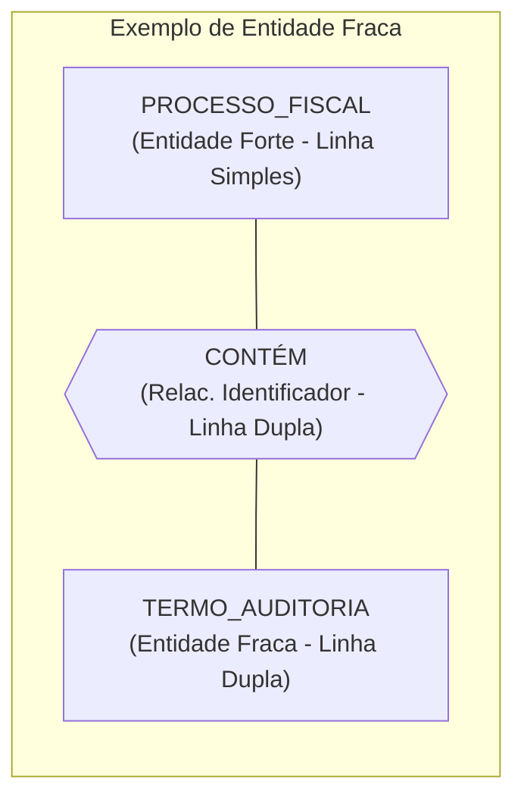
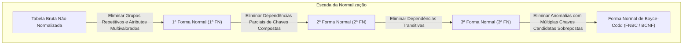
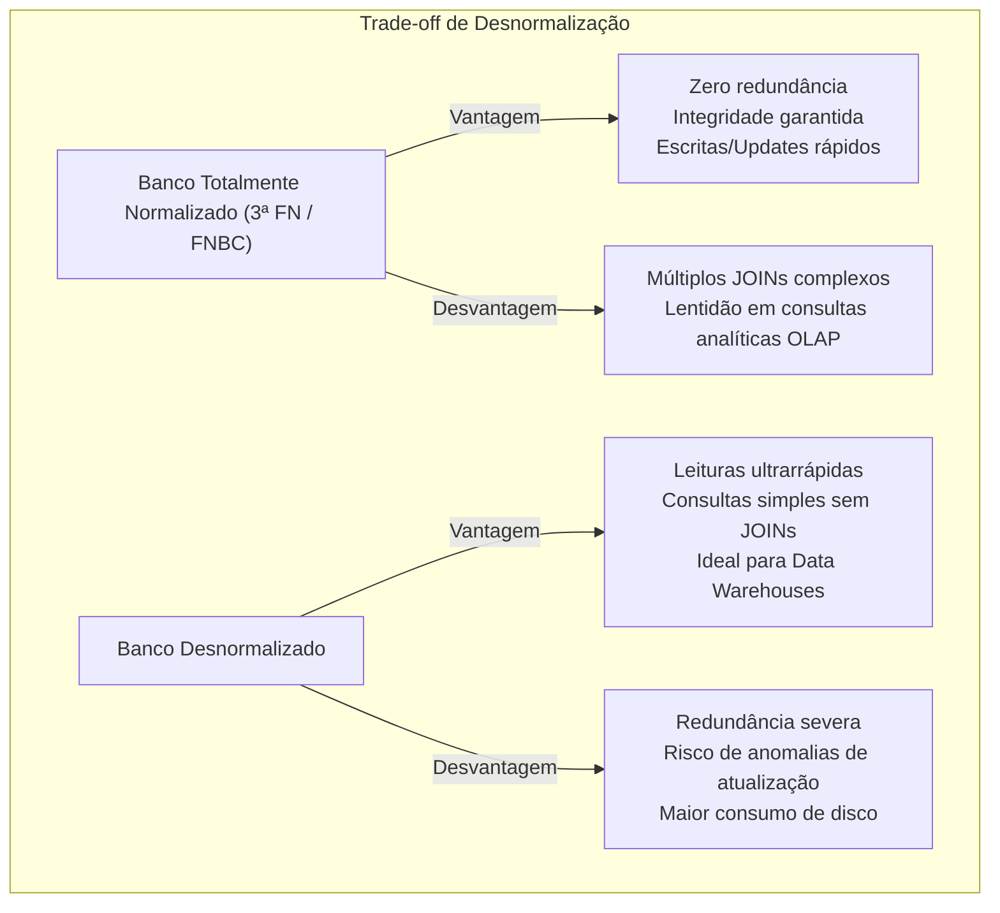

# 01 - Modelagem de Dados, MER e Normalização

> **Matéria:** Banco de Dados  
> **Cargo:** B02 – Técnico de Controle Externo – Especialidade: Tecnologia da Informação  
> **Arquivo:** `01_modelagem_de_dados_mer_e_normalizacao.md`  

---

## 📌 Ementa / Itens do Edital
- Modelagem conceitual, lógica e física de dados
- Modelo Entidade-Relacionamento (MER) e Diagrama Entidade-Relacionamento (DER)
- Álgebra Relacional (operações fundamentais e derivadas)
- Dependências funcionais e Formas Normais (1ª FN, 2ª FN, 3ª FN e BCNF)
- Processo de Desnormalização de dados

---

## 🧭 Sumário

1. [As Três Fases do Projeto de Banco de Dados](#1-as-tres-fases-do-projeto-de-banco-de-dados)
    1. [Modelo Conceitual: Semântica e Independência de Tecnologia](#11-modelo-conceitual-semantica-e-independencia-de-tecnologia)
    2. [Modelo Lógico: Dependência do Paradigma Relacional](#12-modelo-logico-dependencia-do-paradigma-relacional)
    3. [Modelo Físico: Implementação e Otimização no SGBD](#13-modelo-fisico-implementacao-e-otimizacao-no-sgbd)
    4. [Tabela Comparativa dos Níveis de Abstração](#14-tabela-comparativa-dos-niveis-de-abstracao)
    5. [Teste 234](#Teste-234)
2. [Modelo Entidade-Relacionamento (MER / DER de Peter Chen)](#2-modelo-entidade-relacionamento-mer-der-de-peter-chen)
    1. [Entidades Fortes (Regulares) vs. Entidades Fracas](#21-entidades-fortes-regulares-vs-entidades-fracas)
    2. [Tipologia e Representação Gráfica dos Atributos](#22-tipologia-e-representacao-grafica-dos-atributos)
    3. [Relacionamentos, Cardinalidade e Participação (Total vs. Parcial)](#23-relacionamentos-cardinalidade-e-participacao-total-vs-parcial)
    4. [Teste 235](#Teste-235)
    5. [Teste 236](#Teste-236)
    6. [Teste 237](#Teste-237)
3. [Álgebra Relacional: Operações Formais e Consultas](#3-algebra-relacional-operacoes-formais-e-consultas)
    1. [As Seis Operações Fundamentais](#31-as-seis-operacoes-fundamentais)
    2. [Operações Derivadas: Junção Natural, Theta Join, Equijunção, Interseção e Divisão Relacional](#32-operacoes-derivadas-juncao-natural-theta-join-equijuncao-intersecao-e-divisao-relacional)
    3. [Teste 238](#Teste-238)
    4. [Teste 239](#Teste-239)
4. [Teoria da Normalização e Formas Normais (Codd)](#4-teoria-da-normalizacao-e-formas-normais-codd)
    1. [Dependências Funcionais: Total, Parcial e Transitiva](#41-dependencias-funcionais-total-parcial-e-transitiva)
    2. [A Escada da Normalização: 1ª FN, 2ª FN e 3ª FN](#42-a-escada-da-normalizacao-1a-fn-2a-fn-e-3a-fn)
    3. [Forma Normal de Boyce-Codd (FNBC / BCNF) vs. 3ª FN](#43-forma-normal-de-boyce-codd-fnbc-bcnf-vs-3a-fn)
    4. [Teste 240](#Teste-240)
    5. [Teste 241](#Teste-241)
    6. [Teste 242](#Teste-242)
    7. [Teste 243](#Teste-243)
5. [Processo de Desnormalização de Dados](#5-processo-de-desnormalizacao-de-dados)
    1. [Motivações e Trade-offs: OLTP vs. OLAP / Data Warehouses](#51-motivacoes-e-trade-offs-oltp-vs-olap-data-warehouses)
    2. [Técnicas Comuns e Riscos de Integridade](#52-tecnicas-comuns-e-riscos-de-integridade)
    3. [Teste 244](#Teste-244)
6. [🌐 Fontes Oficiais e Referências Bibliográficas](#fontes-oficiais-e-referencias-bibliograficas)

---

## 1. As Três Fases do Projeto de Banco de Dados

O projeto e a modelagem de dados para sistemas de gestão pública e auditoria fiscal evoluem ao longo de **três níveis sucessivos de abstração**, garantindo que a semântica das regras de negócio do Estado seja preservada independentemente dos detalhes físicos de armazenamento em disco.

### 1.1 Modelo Conceitual: Semântica e Independência de Tecnologia
- **Escopo e Foco:** É o modelo de mais alto nível de abstração. Captura as entidades do mundo real, seus atributos fundamentais e como elas se relacionam, espelhando fielmente os requisitos do negócio sem qualquer preocupação tecnológica.
- **Independência Absoluta:** É **totalmente independente do software de SGBD** (PostgreSQL, Oracle) e até mesmo do paradigma lógico adotado (Relacional, Documentos, Grafos).
- **Notação Canônica:** O Diagrama Entidade-Relacionamento (DER) clássico de Peter Chen ou modelagens conceituais equivalentes.
- **Restrição Crítica:** O modelo conceitual **NÃO possui chaves estrangeiras (FKs)**, não define índices e não estipula tipos de dados de implementação (como `VARCHAR`, `INTEGER` ou `BLOB`).

### 1.2 Modelo Lógico: Dependência do Paradigma Relacional
- **Escopo e Foco:** Traduz o modelo conceitual para as estruturas do paradigma de banco de dados escolhido (quase universalmente o **Modelo Relacional** de Edgar F. Codd).
- **Mapeamento de Abstrações:** Entidades tornam-se **tabelas (relações)**, atributos tornam-se **colunas (atributos relacionais)**, instâncias tornam-se **tuplas (linhas)** e relacionamentos tornam-se **chaves estrangeiras (Foreign Keys - FK)** ou novas tabelas associativas (no caso de relacionamentos $N:M$).
- **Aplicação da Normalização:** É no modelo lógico que se aplicam formalmente as regras de normalização (1ª FN, 2ª FN, 3ª FN e FNBC) para expurgar anomalias de atualização e redundâncias desnecessárias.
- **Independência de Software:** Permanece independente de um SGBD específico (o mesmo modelo lógico atende ao PostgreSQL, Oracle Database ou SQL Server).

### 1.3 Modelo Físico: Implementação e Otimização no SGBD
- **Escopo e Foco:** Representa a implementação concreta e de mais baixo nível, altamente dependente dos recursos internos, dialeto SQL e mecanismos de armazenamento do SGBD corporativo contratado.
- **Elementos Físicos:** Scripts DDL (`CREATE TABLE`), definição precisa dos tipos de dados de baixo nível (`NUMERIC(15,2)`, `TIMESTAMPTZ`, `VARCHAR2`), definição de métodos de acesso e estruturas de **índices** (`B-Tree`, `Hash`, `GIN`, `GiST`, `BRIN`), estratégias de **particionamento de tabelas** (por lista, alcance ou hash), alocação de **tablespaces** e parâmetros de blocos de disco.
- **Decisões de Engenharia:** Avaliação de desnormalização deliberada para acelerar relatórios de grande porte e definição de restrições de integridade física (*constraints*).

### 1.4 Tabela Comparativa dos Níveis de Abstração

| Dimensão de Comparação | Modelo Conceitual | Modelo Lógico | Modelo Físico |
| :--- | :--- | :--- | :--- |
| **Público-Alvo Principal** | Analistas de negócio, auditores e usuários | Arquitetos de software e Administradores de Dados (DA) | Administradores de Banco de Dados (DBAs) e Engenheiros de Infra |
| **Independência de SGBD** | **Total** (independe de SGBD e de paradigma) | **Independente do SGBD**, dependente do paradigma relacional | **Totalmente dependente** do SGBD específico (PostgreSQL, Oracle) |
| **Estruturas Centrais** | Entidades, Atributos, Relacionamentos, Cardinalidade | Tabelas, Colunas, Chaves Primárias (PK), Chaves Estrangeiras (FK) | DDL SQL, Índices físicos, Tablespaces, Particionamento, Storage |
| **Momento da Normalização** | Não se aplica formalmente (define semântica) | **Etapa central de normalização** (1ª FN até Boyce-Codd) | Otimizações e eventual desnormalização controlada |

> 🚨 **ALERTA DE PROVA / FCC:**  
> A FCC adora cobrar a fronteira entre os modelos:
>
> - O **Modelo Conceitual** NÃO possui chaves estrangeiras nem tipos de dados de sistema operacional.
> - A introdução formal de **chaves estrangeiras (FKs)** ocorre estritamente na transição para o **Modelo Lógico**.
> - Estruturas de aceleração física como **índices B-Tree, particionamento e tablespaces** pertencem com exclusividade ao **Modelo Físico**.

---

### Teste 234
**(FCC – TRT-6 – Analista Judiciario Apoio Especializado Tecnologia da Informacao – 2012)**
Um banco de dados relacional é um banco de dados projetado segundo o chamado modelo relacional, que é um modelo de banco de dados baseado na lógica de predicados de primeira ordem. O objetivo do modelo é o de proporcionar uma linguagem declarativa para a descrição tanto dos dados como de consultas a seu respeito, de maneira que o usuário declara tanto a informação contida no banco de dados como a informação que dele deseja extrair, deixando a cargo do sistema gerenciador do banco de dados a tarefa de estabelecer estruturas de armazenamento de dados bem como os procedimentos de recuperação destes dados para responder consultas. O modelo relacional foi proposto formalmente há mais de 40 anos. O texto acima está

* **A)** incorreto, porque o modelo relacional é baseado na lógica de predicados de segunda ordem.
* **B)** correto.
* **C)** incorreto, porque o modelo relacional não conduz naturalmente a uma linguagem declarativa de descrição de dados ou consultas.
* **D)** incorreto, porque nos bancos de dados relacionais, a tarefa de descrever os procedimentos de recuperação dos dados para a resposta a consultas é tarefa do usuário.
* **E)** incorreto, porque o modelo relacional foi proposto há menos de 30 anos.

---

> **Comentário Detalhado:**
>
> - **A)** **Incorreta.** A opção apresenta proposição em desacordo com os fundamentos teóricos e técnicos do tópico ao afirmar que "incorreto, porque o modelo relacional é baseado na lógica de predicados de segunda ordem". De acordo com a teoria estudada em *1.2 Modelo Lógico: Dependência do Paradigma Relacional*, aplicação da Normalização: É no modelo lógico que se aplicam formalmente as regras de normalização (1ª FN, 2ª FN, 3ª FN e FNBC) para expurgar anomalias de atualização e redundâncias desnecessárias.
> - **B)** **Correta.** Conforme fundamentado na seção *1.2 Modelo Lógico: Dependência do Paradigma Relacional* deste guia, escopo e Foco: Traduz o modelo conceitual para as estruturas do paradigma de banco de dados escolhido (quase universalmente o Modelo Relacional de Edgar F. Codd). Dessa forma, está plenamente correta a assertiva da banca (FCC – TRT-6/2012) ao estabelecer que "correto".
> - **C)** **Incorreta.** A opção apresenta proposição em desacordo com os fundamentos teóricos e técnicos do tópico ao afirmar que "incorreto, porque o modelo relacional não conduz naturalmente a uma linguagem declarativa de descrição de dados ou...". De acordo com a teoria estudada em *3. Álgebra Relacional: Operações Formais e Consultas*, a Álgebra Relacional é uma linguagem de consulta formal procedimental concebida por Edgar F. Codd. Suas operações manipulam uma ou duas relações como entrada e produzem uma nova relação como saída (propriedade de fechamento da álgebra relacional).
> - **D)** **Incorreta.** A opção apresenta proposição em desacordo com os fundamentos teóricos e técnicos do tópico ao afirmar que "incorreto, porque nos bancos de dados relacionais, a tarefa de descrever os procedimentos de recuperação dos dados...". De acordo com a teoria estudada em *3.2 Operações Derivadas: Junção Natural, Theta Join, Equijunção, Interseção e Divisão Relacional*, divisão Relacional (\$R \div S\$): Operação fundamental para responder a consultas que envolvem o quantificador universal "para todos" (\$\forall\$) — por exemplo, *"encontrar os auditores que fiscalizaram TODOS os municípios do estado de Goiás"*.
> - **E)** **Incorreta.** A opção apresenta proposição em desacordo com os fundamentos teóricos e técnicos do tópico ao afirmar que "incorreto, porque o modelo relacional foi proposto há menos de 30 anos". De acordo com a teoria estudada em *1.1 Modelo Conceitual: Semântica e Independência de Tecnologia*, independência Absoluta: É totalmente independente do software de SGBD (PostgreSQL, Oracle) e até mesmo do paradigma lógico adotado (Relacional, Documentos, Grafos).
>
> **Gabarito: B**

---

## 2. Modelo Entidade-Relacionamento (MER / DER de Peter Chen)

Publicado em 1976 por Peter Pin-Shan Chen, o Modelo Entidade-Relacionamento tornou-se a ferramenta semântica universal para representação conceitual de esquemas de dados.

### 2.1 Entidades Fortes (Regulares) vs. Entidades Fracas

- **Entidade Forte (Regular):**
    - Possui existência autônoma e independente no mundo real.
    - Possui ao menos um atributo identificador próprio (chave primária) que distingue univocamente cada uma de suas instâncias.
    - Representação gráfica de Chen: **Retângulo de linha simples**.
- **Entidade Fraca:**
    - Sua existência depende obrigatoriamente da existência de outra entidade (denominada entidade proprietária ou dominante). Se a entidade proprietária for removida, a entidade fraca deixa de fazer sentido.
    - Não possui chave primária completa própria; possui apenas um **discriminador** ou **chave parcial**, que identifica a ocorrência apenas no escopo da sua entidade dominante.
    - Sua identificação plena é formada pela junção: $\text{Chave da Entidade Forte} + \text{Chave Parcial}$.
    - Representação gráfica de Chen: **Retângulo de linha dupla**.
- **Relacionamento Identificador:**
    - É o relacionamento formal que vincula a entidade fraca à sua entidade forte proprietária.
    - Representação gráfica de Chen: **Losango de linha dupla**.

### 2.2 Tipologia e Representação Gráfica dos Atributos

No modelo clássico de Chen, os atributos são expressos por elipses conectadas às entidades:

| Tipo de Atributo | Definição Teórica Rigorosa | Representação Gráfica (Chen) | Exemplo Prático |
| :--- | :--- | :--- | :--- |
| **Simples (Atômico)** | Não divisível em partes menores dotadas de significado próprio. | Elipse com linha simples | `CPF`, `Matrícula`, `Idade` |
| **Composto** | Pode ser desmembrado em múltiplos subatributos autônomos. | Elipse ramificada em subelipses | `Endereço` (`Logradouro`, `Número`, `CEP`) |
| **Monovalorado** | Armazena exatamente um valor para cada instância da entidade. | Elipse padrão de linha simples | `Data_Nascimento`, `Data_Emissao` |
| **Multivalorado** | Pode assumir múltiplos valores simultâneos para a mesma entidade. | Elipse com **linha dupla** | `Telefones`, `E-mails`, `CNAEs_Secundarios` |
| **Determinante (Identificador)**| Identifica univocamente a instância da entidade forte. | Elipse com texto **sublinhado contínuo** | `<u>NumContrato</u>`, `<u>IdProcesso</u>` |
| **Discriminador (Chave Parcial)**| Identifica a entidade fraca apenas dentro do escopo da forte. | Elipse com texto **sublinhado tracejado** | `Num_Sequencial_Termo` |
| **Derivado** | Valor calculado dinamicamente a partir de outros atributos persistidos. | Elipse com **borda tracejada/pontilhada** | `Idade` (calculada de `Data_Nasc`) |

### 2.3 Relacionamentos, Cardinalidade e Participação (Total vs. Parcial)

- **Grau do Relacionamento:** Quantidade de entidades participantes (Binário = 2 entidades; Ternário = 3 entidades; Unário / Auto-relacionamento = a mesma entidade se relaciona consigo mesma, como `FUNCIONARIO gerencia FUNCIONARIO`).
- **Razão de Cardinalidade:** Especifica o número máximo de ocorrências de relacionamento nas quais uma entidade pode participar:
    - $1:1$ (Um para Um);
    - $1:N$ (Um para Muitos);
    - $N:M$ (Muitos para Muitos - na conversão lógica, exige compulsoriamente a criação de uma tabela associativa intermediária).
- **Participação Total (Dependência de Existência):** Toda entidade do conjunto de entidades **obrigatoriamente deve participar** de ao menos uma instância do relacionamento. É representada graficamente por uma **linha dupla** que liga a entidade ao losango. Na notação $(mín, máx)$, expressa-se com $mín \ge 1$.
- **Participação Parcial:** A participação é opcional (algumas instâncias podem não participar do relacionamento). Representada por uma **linha simples**. Na notação $(mín, máx)$, expressa-se com $mín = 0$.

> 🚨 **ALERTA DE PROVA / PEGADINHA FCC:**  
> Cuidado com a notação de cardinalidade:
>
> - Na notação clássica de Chen com cardinalidade nas pontas ($1$ e $N$), o valor representa a cardinalidade máxima permitida.
> - Na notação de pares de limites $(mín, máx)$, se $mín = 0$, a participação é **parcial**; se $mín = 1$, a participação é **total**. Além disso, na notação $(min, max)$, os limites ficam posicionados **adjacentes à entidade que possui aquela restrição**!

---

### Teste 235
**(FCC – TRT-3 – Analista Judiciario Tecnologia da Informacao – 2015)**
Participando do projeto de modelagem de um banco de dados utilizando o MER, um analista de TI identificou na modelagem lógica duas entidades ligadas entre si em um relacionamento muitos-para-muitos (n:m): a entidade Processo e a entidade Advogado, cujos atributos são apresentados abaixo. Processo (NumeroProcesso, Ano, NumeroVara, NumeroTribunalOrigem) Advogado (NumeroOABAdvogado, Nome, Telefone) Cada advogado pode estar relacionado a vários processos diferentes, ora com status de advogado de acusação, ora com status de advogado de defesa, e cada processo, pode ter vários advogados de acusação e/ou de defesa. Nestas condições, para criar as tabelas no banco de dados real este relacionamento n:m terá que ser desmembrado em dois relacionamentos 1:n com uma tabela de ligação contendo os campos

* **A)** CodigoLigacao, StatusAdvogadoProcesso, Data, com chave primária composta pelo campo CodigoLigacao.
* **B)** NumeroProcesso, NumeroOABAdvogado e StatusAdvogadoProcesso, com chave primária composta pelos campos NumeroProcesso e NumeroOABAdvogado.
* **C)** NumeroProcesso e NumeroOABAdvogado, apenas, com ambos os campos sendo chave primária e estrangeira ao mesmo tempo.
* **D)** CodigoLigacao, NumeroProcesso, NumeroOABAdvogado e StatusAdvogadoProcesso, com chave primária composta pelo campo CodigoLigacao e chave estrangeira formada pelos campos NumeroProcesso e NumeroOABAdvogado.
* **E)** NumeroProcesso, NumeroOABAdvogado e StatusAdvogadoProcesso, com chave primária composta pelos campos NumeroProcesso e NumeroOABAdvogado e chave estrangeira formada pelo campo StatusAdvogadoProcesso.

---

> **Comentário Detalhado:**
>
> - **A)** **Incorreta.** A opção apresenta proposição em desacordo com os fundamentos teóricos e técnicos do tópico ao afirmar que "CodigoLigacao, StatusAdvogadoProcesso, Data, com chave primária composta pelo campo CodigoLigacao". De acordo com a teoria estudada em *4.1 Dependências Funcionais: Total, Parcial e Transitiva*, dependência Funcional Parcial: Ocorre quando um atributo não-chave depende de apenas uma parte de uma chave primária composta (isto é, existe \$A \subset X\$ tal que \$A \rightarrow Y\$).
> - **B)** **Correta.** Conforme fundamentado na seção *4.2 A Escada da Normalização: 1ª FN, 2ª FN e 3ª FN* deste guia, regra de Ouro em Provas: A violação da 2ª FN só pode ocorrer se a chave primária for composta (possuir 2 ou mais atributos). Se a chave primária for simples (apenas 1 atributo), estando na 1ª FN ela estará automaticamente na 2ª FN!. Dessa forma, está plenamente correta a assertiva da banca (FCC – TRT-3/2015) ao estabelecer que "NumeroProcesso, NumeroOABAdvogado e StatusAdvogadoProcesso, com chave primária composta pelos campos...".
> - **C)** **Incorreta.** A opção incorre em restrição indevida ao limitar o escopo conceitual ao afirmar que "NumeroProcesso e NumeroOABAdvogado, apenas, com ambos os campos sendo chave primária e estrangeira ao mesmo tempo". De acordo com a teoria estudada em *4.2 A Escada da Normalização: 1ª FN, 2ª FN e 3ª FN*, regra: Todos os domínios de atributos devem conter apenas valores atômicos e indivisíveis. Proíbe-se a presença de atributos multivalorados, atributos compostos e grupos repetitivos (como campos contendo listas separadas por vírgula ou tabelas aninhadas).
> - **D)** **Incorreta.** A opção apresenta proposição em desacordo com os fundamentos teóricos e técnicos do tópico ao afirmar que "CodigoLigacao, NumeroProcesso, NumeroOABAdvogado e StatusAdvogadoProcesso, com chave primária composta pelo campo...". De acordo com a teoria estudada em *2.1 Entidades Fortes (Regulares) vs. Entidades Fracas*, sua identificação plena é formada pela junção: \$\text{Chave da Entidade Forte} + \text{Chave Parcial}\$.
> - **E)** **Incorreta.** A opção apresenta proposição em desacordo com os fundamentos teóricos e técnicos do tópico ao afirmar que "NumeroProcesso, NumeroOABAdvogado e StatusAdvogadoProcesso, com chave primária composta pelos campos...". De acordo com a teoria estudada em *4.2 A Escada da Normalização: 1ª FN, 2ª FN e 3ª FN*, regra: A relação deve estar na 2ª FN e nenhum atributo não-chave pode depender transitivamente da chave primária.
>
> **Gabarito: B**

---

### Teste 236
**(FCC – TRT-2 – Analista Judiciário - Tecnologia da Informação – 2014)**
Em alguns casos, dois ou mais valores de atributos em um modelo de Entidade-Relacionamento estão relacionados. Por exemplo, os atributos `Idade` e `Data_Nascimento` de um Auditor de Controle Externo. Para uma entidade `AUDITOR` em particular, o valor de `Idade` pode ser determinado pela data corrente do sistema e pelo valor de `Data_Nascimento` persistido. 

Portanto, segundo a teoria formal do MER concebida por Peter Chen, o atributo `Idade` é denominado atributo [ I ], ao passo que `Data_Nascimento` é denominado atributo [ II ].

As lacunas [ I ] e [ II ] são, correta e respectivamente, preenchidas por:

* **A)** armazenado — derivado.
* **B)** derivado — armazenado (ou básico).
* **C)** multivalorado — monovalorado.
* **D)** identificador — composto.
* **E)** determinante — discriminador.

---

> **Comentário Detalhado:**
>
> - **A)** Incorreta. A ordem está invertida: `Idade` é calculado, logo é derivado, não armazenado.
> - **B)** **CORRETA.** Na notação clássica de Peter Chen:
>   - **Atributo Derivado:** É aquele cujo valor não precisa ser persistido fisicamente na base, pois pode ser computado dinamicamente a partir de outro(s) atributo(s) ou do relógio do sistema. Graficamente é representado por uma elipse de contorno tracejado/pontilhado.
>   - **Atributo Armazenado (ou Base):** É o dado primitivo persistido no disco a partir do qual derivações são calculadas.
> - **C)** Incorreta. Ambos são atributos monovalorados (uma pessoa tem uma única data de nascimento e uma única idade em um dado momento).
> - **D)** Incorreta. Identificador é chave primária; `Idade` não identifica unicamente um servidor.
> - **E)** Incorreta. Determinante e discriminador referem-se a chaves primárias e parciais de entidades fortes e fracas.
> 
> **Gabarito: B**

---

### Teste 237
**(FCC – TRT-1 – Analista Judiciario Tecnologia da Informacao – 2014)**
No modelo entidade-relacionamento utilizado para modelar Bancos de Dados relacionais, quando se indica que há um conjunto de relacionamentos do tipo muitos para muitos entre 2 conjuntos de entidades A e B, significa que

* **A)** uma entidade do conjunto A está sempre associada a mais de uma entidade de conjunto B e vice-versa.
* **B)** uma entidade do conjunto A pode estar associada a várias entidades do conjunto B e vice-versa.
* **C)** os conjuntos de entidades A e B possuem, cada um deles, número igual de atributos.
* **D)** os conjuntos de entidades A e B possuem diversos atributos com a possibilidade de terem valores nulos.
* **E)** uma entidade do conjunto B está associada a apenas uma entidade do conjunto A, mas uma entidade do conjunto A está associada a várias entidades do conjunto B.

---

> **Comentário Detalhado:**
>
> - **A)** **Incorreta.** A opção promove generalização excessiva que desconsidera as condições técnicas e normativas ao afirmar que "uma entidade do conjunto A está sempre associada a mais de uma entidade de conjunto B e vice-versa". De acordo com a teoria estudada em *4.1 Dependências Funcionais: Total, Parcial e Transitiva*, dada uma relação \$R$, diz-se que o conjunto de atributos \$X\$ determina funcionalmente o atributo \$Y\$ (\$X \rightarrow Y\$) se, e somente se, para quaisquer duas tuplas \$t_1, t_2 \in R$, sempre que \$t_1[X] = t_2[X]\$, obrigatoriamente \$t_1[Y] = t_2[Y]\$.
> - **B)** **Correta.** Conforme fundamentado na seção *2.3 Relacionamentos, Cardinalidade e Participação (Total vs. Parcial)* deste guia, participação Total (Dependência de Existência): Toda entidade do conjunto de entidades obrigatoriamente deve participar de ao menos uma instância do relacionamento. É representada graficamente por uma linha dupla que liga a entidade ao losango. Dessa forma, está plenamente correta a assertiva da banca (FCC – TRT-1/2014) ao estabelecer que "uma entidade do conjunto A pode estar associada a várias entidades do conjunto B e vice-versa".
> - **C)** **Incorreta.** A opção apresenta proposição em desacordo com os fundamentos teóricos e técnicos do tópico ao afirmar que "os conjuntos de entidades A e B possuem, cada um deles, número igual de atributos". De acordo com a teoria estudada em *2.3 Relacionamentos, Cardinalidade e Participação (Total vs. Parcial)*, razão de Cardinalidade: Especifica o número máximo de ocorrências de relacionamento nas quais uma entidade pode participar.
> - **D)** **Incorreta.** A opção apresenta proposição em desacordo com os fundamentos teóricos e técnicos do tópico ao afirmar que "os conjuntos de entidades A e B possuem diversos atributos com a possibilidade de terem valores nulos". De acordo com a teoria estudada em *2.2 Tipologia e Representação Gráfica dos Atributos*, multivalorado: Pode assumir múltiplos valores simultâneos para a mesma entidade. — Elipse com linha dupla — `Telefones`, `E-mails`, `CNAEs_Secundarios`.
> - **E)** **Incorreta.** A opção incorre em restrição indevida ao limitar o escopo conceitual ao afirmar que "uma entidade do conjunto B está associada a apenas uma entidade do conjunto A, mas uma entidade do conjunto A está...". De acordo com a teoria estudada em *2.3 Relacionamentos, Cardinalidade e Participação (Total vs. Parcial)*, grau do Relacionamento: Quantidade de entidades participantes (Binário = 2 entidades; Ternário = 3 entidades; Unário / Auto-relacionamento = a mesma entidade se relaciona consigo mesma, como `FUNCIONARIO gerencia FUNCIONARIO`).
>
> **Gabarito: B**

---

## 3. Álgebra Relacional: Operações Formais e Consultas

A Álgebra Relacional é uma linguagem de consulta formal procedimental concebida por Edgar F. Codd. Suas operações manipulam uma ou duas relações como entrada e produzem uma nova relação como saída (propriedade de **fechamento da álgebra relacional**).

```mermaid
flowchart TD
    subgraph Operacoes_Algebricas["Álgebra Relacional"]
        A["Operações Fundamentais"] --> A1["Seleção: &sigma;_cond(R)<br/>(Filtra Tuplas/Linhas)"]
        A --> A2["Projeção: &pi;_cols(R)<br/>(Filtra Atributos/Colunas)"]
        A --> A3["Produto Cartesiano: R &times; S<br/>(Todas as Combinações)"]
        A --> A4["União: R &cup; S<br/>(Compatibilidade de Esquema)"]
        A --> A5["Diferença: R - S<br/>(Presentes em R, ausentes em S)"]
        A --> A6["Renomeação: &rho;_S(R)<br/>(Muda Rótulos)"]
        B["Operações Derivadas"] --> B1["Junção Natural: R &#x22C8; S"]
        B --> B2["Theta Join: R &#x22C8;_&theta; S"]
        B --> B3["Interseção: R &cap; S = R - (R - S)"]
        B --> B4["Divisão: R &divide; S (Universal)"]
    end
```

### 3.1 As Seis Operações Fundamentais

Qualquer consulta relacional teórica pode ser expressa combinando as seis operações primitivas:

1. **Seleção ($\sigma_{\text{condição}}(R)$):** Filtra linhas (tuplas) que satisfazem a um predicado lógico booleano. É um operador unário que atua no eixo **horizontal**. Corresponde à cláusula `WHERE` do SQL.
2. **Projeção ($\pi_{\text{lista\_atributos}}(R)$):** Filtra colunas (atributos) selecionadas, descartando as demais. É um operador unário que atua no eixo **vertical**. **Propriedade Mandatória:** A projeção matemática **elimina compulsoriamente tuplas duplicadas** do resultado final (dado que relações são conjuntos puros). Corresponde a `SELECT DISTINCT` no SQL.
3. **Produto Cartesiano ($R \times S$):** Operador binário que combina cada tupla da relação $R$ com todas as tuplas da relação $S$. Se $R$ possui $n_1$ tuplas e grau $k_1$, e $S$ possui $n_2$ tuplas e grau $k_2$, o produto $R \times S$ terá exatamente $n_1 \cdot n_2$ tuplas e grau $k_1 + k_2$.
4. **União ($R \cup S$):** Combina todas as tuplas de $R$ e $S$. Exige compulsoriamente **compatibilidade de união**: $R$ e $S$ devem ter o mesmo grau (mesmo número de atributos) e os tipos dos atributos correspondentes devem pertencer a domínios compatíveis.
5. **Diferença de Conjuntos ($R - S$):** Retorna as tuplas que existem na relação $R$, mas que **não estão presentes** na relação $S$. Também exige compatibilidade de união.
6. **Renomeação ($\rho_{S}(R)$ ou $\rho_{S(A_1, A_2, \dots)}(R)$):** Altera o nome da relação resultante ou rebatiza seus atributos, permitindo desambiguar colunas em junções recursivas.

### 3.2 Operações Derivadas: Junção Natural, Theta Join, Equijunção, Interseção e Divisão Relacional

São operações construídas a partir da composição das primitivas fundamentais:

- **Theta Join ($R \bowtie_{\theta} S$):** Combina o produto cartesiano com uma condição de seleção: $\sigma_{\theta}(R \times S)$. Se a condição $\theta$ envolver apenas testes de igualdade ($=$), denomina-se **Equijunção**.
- **Junção Natural ($R \bowtie S$):** Executa uma equijunção automática baseada em todos os atributos que compartilham o mesmo nome e tipo em $R$ e $S$, projetando as colunas comuns uma única vez no resultado:
  $$R \bowtie S = \pi_{\text{esquema\_unificado}}(\sigma_{R.A_1 = S.A_1 \land \dots \land R.A_m = S.A_m}(R \times S))$$
- **Interseção ($R \cap S$):** Retorna as tuplas presentes simultaneamente em $R$ e $S$. Derivável pela diferença: $R \cap S = R - (R - S)$.
- **Divisão Relacional ($R \div S$):** Operação fundamental para responder a consultas que envolvem o **quantificador universal "para todos" ($\forall$)** — por exemplo, *"encontrar os auditores que fiscalizaram TODOS os municípios do estado de Goiás"*.
    - Se $R$ possui esquema $(A, B)$ e $S$ possui esquema $(B)$, a divisão $R \div S$ produz uma relação de esquema $(A)$ contendo as tuplas $t$ tais que, para toda tupla $s \in S$, o par ordenado $(t, s)$ existe na relação $R$.

---

### Teste 238
**(FCC – TRT-3 – Analista Judiciario Tecnologia da Informacao – 2015)**
No modelo de dados multidimensional existem as operações suportadas pelas ferramentas OLAP para permitir a análise dos dados. Com relação a estas operações, considere os dados abaixo. Tabela 1: Volume de produção (em milhares) 2014 1o trimestre 2o trimestre 3o trimestre 4o trimestre Região Sudeste MG 89 107 99 100 SP 120 138 120 120 Tabela 2: Volume de produção (em milhares) 1o trimestre 2014 Janeiro Fevereiro Março Região Sudeste MG 30 30 29 SP 40 30 50 Para movimentar a visão dos dados ao longo de níveis hierárquicos da dimensão tempo, saindo do que consta na Tabela 2 para o que consta na Tabela 1, um analista de TI deve utilizar a operação OLAP

* **A)** drill down.
* **B)** drill across.
* **C)** pivot.
* **D)** roll up.
* **E)** drill throught.

---

> **Comentário Detalhado:**
>
> - **A)** **Incorreta.** A opção apresenta proposição em desacordo com os fundamentos teóricos e técnicos do tópico ao afirmar que "drill down". De acordo com a teoria estudada em *3.1 As Seis Operações Fundamentais*, diferença de Conjuntos (\$R - S\$): Retorna as tuplas que existem na relação \$R$, mas que não estão presentes na relação \$S\$. Também exige compatibilidade de união.
> - **B)** **Incorreta.** A opção apresenta proposição em desacordo com os fundamentos teóricos e técnicos do tópico ao afirmar que "drill across". De acordo com a teoria estudada em *1. As Três Fases do Projeto de Banco de Dados*, o projeto e a modelagem de dados para sistemas de gestão pública e auditoria fiscal evoluem ao longo de três níveis sucessivos de abstração, garantindo que a semântica das regras de negócio do Estado seja preservada independentemente dos detalhes físicos de armazenamento em disco.
> - **C)** **Incorreta.** A opção apresenta proposição em desacordo com os fundamentos teóricos e técnicos do tópico ao afirmar que "pivot". De acordo com a teoria estudada em *1.4 Tabela Comparativa dos Níveis de Abstração*, o Modelo Conceitual NÃO possui chaves estrangeiras nem tipos de dados de sistema operacional.
> - **D)** **Correta.** Conforme fundamentado na seção *1.4 Tabela Comparativa dos Níveis de Abstração* deste guia, dimensão de Comparação: Modelo Conceitual — Modelo Lógico — Modelo Físico. Dessa forma, está plenamente correta a assertiva da banca (FCC – TRT-3/2015) ao estabelecer que "roll up".
> - **E)** **Incorreta.** A opção apresenta proposição em desacordo com os fundamentos teóricos e técnicos do tópico ao afirmar que "drill throught". De acordo com a teoria estudada em *3.2 Operações Derivadas: Junção Natural, Theta Join, Equijunção, Interseção e Divisão Relacional*, divisão Relacional (\$R \div S\$): Operação fundamental para responder a consultas que envolvem o quantificador universal "para todos" (\$\forall\$) — por exemplo, *"encontrar os auditores que fiscalizaram TODOS os municípios do estado de Goiás"*.
>
> **Gabarito: D**

---

### Teste 239
**(FGV – TCE-PA – Auditor de Controle Externo Administrativa Ciencia de Dados – 2024)**
No contexto de SGBD (Sistema de Gerenciamento de Banco de Dados) e de gerenciamento de banco de dados, relacionamento é um importante conceito para garantir o correto funcionamento de um sistema que se utiliza de banco de dados, em relação à sua modelagem. Em um Sistema de Gerenciamento de Banco de Dados (SGBD), um relacionamento refere-se a

* **A)** um conjunto de operações matemáticas aplicadas aos dados para gerar novos valores.
* **B)** uma estrutura hierárquica utilizada para organizar os dados em múltiplos níveis.
* **C)** uma associação entre tabelas que define como os dados estão interligados.
* **D)** um método para compactar e armazenar os dados de forma eficiente em disco.
* **E)** um algoritmo usado para distribuir os dados em diferentes servidores de banco de dados.

---

> **Comentário Detalhado:**
>
> - **A)** **Incorreta.** A opção apresenta proposição em desacordo com os fundamentos teóricos e técnicos do tópico ao afirmar que "um conjunto de operações matemáticas aplicadas aos dados para gerar novos valores". De acordo com a teoria estudada em *3.1 As Seis Operações Fundamentais*, diferença de Conjuntos (\$R - S\$): Retorna as tuplas que existem na relação \$R$, mas que não estão presentes na relação \$S\$. Também exige compatibilidade de união.
> - **B)** **Incorreta.** A opção apresenta proposição em desacordo com os fundamentos teóricos e técnicos do tópico ao afirmar que "uma estrutura hierárquica utilizada para organizar os dados em múltiplos níveis". De acordo com a teoria estudada em *1. As Três Fases do Projeto de Banco de Dados*, o projeto e a modelagem de dados para sistemas de gestão pública e auditoria fiscal evoluem ao longo de três níveis sucessivos de abstração, garantindo que a semântica das regras de negócio do Estado seja preservada independentemente dos detalhes físicos de armazenamento em disco.
> - **C)** **Correta.** Conforme fundamentado na seção *1.1 Modelo Conceitual: Semântica e Independência de Tecnologia* deste guia, restrição Crítica: O modelo conceitual NÃO possui chaves estrangeiras (FKs), não define índices e não estipula tipos de dados de implementação (como `VARCHAR`, `INTEGER` ou `BLOB`). Dessa forma, está plenamente correta a assertiva da banca (FGV – TCE-PA/2024) ao estabelecer que "uma associação entre tabelas que define como os dados estão interligados".
> - **D)** **Incorreta.** A opção apresenta proposição em desacordo com os fundamentos teóricos e técnicos do tópico ao afirmar que "um método para compactar e armazenar os dados de forma eficiente em disco". De acordo com a teoria estudada em *1.4 Tabela Comparativa dos Níveis de Abstração*, o Modelo Conceitual NÃO possui chaves estrangeiras nem tipos de dados de sistema operacional.
> - **E)** **Incorreta.** A opção apresenta proposição em desacordo com os fundamentos teóricos e técnicos do tópico ao afirmar que "um algoritmo usado para distribuir os dados em diferentes servidores de banco de dados". De acordo com a teoria estudada em *1.2 Modelo Lógico: Dependência do Paradigma Relacional*, escopo e Foco: Traduz o modelo conceitual para as estruturas do paradigma de banco de dados escolhido (quase universalmente o Modelo Relacional de Edgar F. Codd).
>
> **Gabarito: C**

---

## 4. Teoria da Normalização e Formas Normais (Codd)

A teoria da normalização, concebida por Edgar F. Codd, consiste em uma técnica formal de análise de esquemas relacionais com base em suas **Dependências Funcionais (DF)** e chaves primárias. Seu objetivo é minimizar a redundância de dados e erradicar as anomalias de inserção, exclusão e alteração.

### 4.1 Dependências Funcionais: Total, Parcial e Transitiva

Dada uma relação $R$, diz-se que o conjunto de atributos $X$ determina funcionalmente o atributo $Y$ ($X \rightarrow Y$) se, e somente se, para quaisquer duas tuplas $t_1, t_2 \in R$, sempre que $t_1[X] = t_2[X]$, obrigatoriamente $t_1[Y] = t_2[Y]$. O lado esquerdo ($X$) é chamado de **determinante** e o direito ($Y$) de **dependente**.

- **Dependência Funcional Total:** Ocorre quando $Y$ depende funcionalmente de $X$ e não depende de nenhum subconjunto próprio de $X$.
- **Dependência Funcional Parcial:** Ocorre quando um atributo não-chave depende de apenas uma parte de uma chave primária composta (isto é, existe $A \subset X$ tal que $A \rightarrow Y$).
- **Dependência Funcional Transitiva:** Ocorre quando $X \rightarrow Y$ e $Y \rightarrow Z$, onde $Y$ não é superchave e $Y \not\rightarrow X$. Consequentemente, $X$ determina $Z$ indiretamente através de $Y$.

### 4.2 A Escada da Normalização: 1ª FN, 2ª FN e 3ª FN

1. **Primeira Forma Normal (1ª FN):**
    - **Regra:** Todos os domínios de atributos devem conter **apenas valores atômicos e indivisíveis**. Proíbe-se a presença de atributos multivalorados, atributos compostos e grupos repetitivos (como campos contendo listas separadas por vírgula ou tabelas aninhadas).

2. **Segunda Forma Normal (2ª FN):**
    - **Regra:** A relação deve estar na **1ª FN** e todo atributo não-chave deve depender **totalmente da chave primária**, eliminando qualquer dependência funcional parcial.
    - **Regra de Ouro em Provas:** A violação da 2ª FN só pode ocorrer se a chave primária for **composta** (possuir 2 ou mais atributos). Se a chave primária for simples (apenas 1 atributo), estando na 1ª FN ela estará **automaticamente na 2ª FN**!

3. **Terceira Forma Normal (3ª FN):**
    - **Regra:** A relação deve estar na **2ª FN** e nenhum atributo não-chave pode depender transitivamente da chave primária.
    - **Definição Formal de Codd:** Para toda dependência funcional não-trivial $X \rightarrow A$:
        1. $X$ é uma superchave; **OU**
        2. $A$ é um atributo primo (faz parte de ao menos uma chave candidata).

### 4.3 Forma Normal de Boyce-Codd (FNBC / BCNF) vs. 3ª FN

A **Forma Normal de Boyce-Codd (FNBC)** é uma versão mais estrita da 3ª FN criada por Raymond F. Boyce e Edgar F. Codd para lidar com anomalias sutis que surgem quando uma tabela possui **múltiplas chaves candidatas compostas que se sobrepõem** (compartilham atributos entre si):

- **Regra Inflexível da FNBC:** Uma relação $R$ está na FNBC se, e somente se, para **toda** dependência funcional não-trivial $X \rightarrow A$, **$X$ for obrigatoriamente uma superchave**.
- **Diferença Crucial:** Na FNBC, **elimina-se a condição de escape do atributo primo da 3ª FN**. Mesmo que $A$ faça parte de uma chave candidata, se o determinante $X$ não for superchave, a relação viola a FNBC.
- Toda relação que está na FNBC está automaticamente na 3ª FN. A recíproca não é verdadeira.

---

### Teste 240
**(CEBRASPE – TJ-RJ – Analista Judiciario Grupo Tecnologia da Informacao Analista de Projetos – 2021)**
No que concerne à modelagem de dados relacionais, assinale a opção correspondente à forma normal que estabelece que, em uma relação, toda dependência funcional não trivial e irredutível à esquerda tenha uma chave candidata como determinante.

* **A)** primeira forma normal
* **B)** segunda forma normal
* **C)** terceira forma normal
* **D)** forma normal de Boyce/Codd
* **E)** quarta forma normal

---

> **Comentário Detalhado:**
>
> - **A)** **Incorreta.** A opção apresenta proposição em desacordo com os fundamentos teóricos e técnicos do tópico ao afirmar que "primeira forma normal". De acordo com a teoria estudada em *4.3 Forma Normal de Boyce-Codd (FNBC / BCNF) vs. 3ª FN*, diferença Crucial: Na FNBC, elimina-se a condição de escape do atributo primo da 3ª FN. Mesmo que \$A\$ faça parte de uma chave candidata, se o determinante \$X\$ não for superchave, a relação viola a FNBC.
> - **B)** **Incorreta.** A opção apresenta proposição em desacordo com os fundamentos teóricos e técnicos do tópico ao afirmar que "segunda forma normal". De acordo com a teoria estudada em *4.3 Forma Normal de Boyce-Codd (FNBC / BCNF) vs. 3ª FN*, toda relação que está na FNBC está automaticamente na 3ª FN. A recíproca não é verdadeira.
> - **C)** **Incorreta.** A opção apresenta proposição em desacordo com os fundamentos teóricos e técnicos do tópico ao afirmar que "terceira forma normal". De acordo com a teoria estudada em *4.3 Forma Normal de Boyce-Codd (FNBC / BCNF) vs. 3ª FN*, a Forma Normal de Boyce-Codd (FNBC) é uma versão mais estrita da 3ª FN criada por Raymond F. Boyce e Edgar F.
> - **D)** **Correta.** Conforme fundamentado na seção *4.3 Forma Normal de Boyce-Codd (FNBC / BCNF) vs. 3ª FN* deste guia, regra Inflexível da FNBC: Uma relação \$R$ está na FNBC se, e somente se, para toda dependência funcional não-trivial \$X \rightarrow A\$, \$X\$ for obrigatoriamente uma superchave. Dessa forma, está plenamente correta a assertiva da banca (CEBRASPE – TJ-RJ/2021) ao estabelecer que "forma normal de Boyce/Codd".
> - **E)** **Incorreta.** A opção apresenta proposição em desacordo com os fundamentos teóricos e técnicos do tópico ao afirmar que "quarta forma normal". De acordo com a teoria estudada em *4.3 Forma Normal de Boyce-Codd (FNBC / BCNF) vs. 3ª FN*, codd para lidar com anomalias sutis que surgem quando uma tabela possui múltiplas chaves candidatas compostas que se sobrepõem (compartilham atributos entre si).
>
> **Gabarito: D**

---

### Teste 241
**(FCC – TRT-16 – Analista Judiciario Tecnologia da Informacao – 2014)**
Em um consultório médico as consultas são agendadas de forma que um cliente não possa realizar mais do que uma consulta com o mesmo médico na mesma data, porém, pode passar em consulta com outros médicos. O modelo Entidade-Relacionamento do banco de dados do consultório é apresentado a seguir: Medico_has_Cliente idMed: INTEGER (FK) idCli: INTEGER (FK) DataConsulta: DATE atende consulta HoraConsulta: TIME Medico idMed: INTEGER Nome: VARCHAR(50) Telefone: VARCHAR(15) CRM: VARCHAR(15) Especialidade: VARCHAR(60) Cliente idCli: INTEGER Nome: VARCHAR(50) Telefone: VARCHAR(15) É correto afirmar que

* **A)** a tabela Cliente não está na Primeira Forma Normal.
* **B)** o campo idMed é chave estrangeira na tabela Medico e chave primária na tabela Medico_has_Cliente.
* **C)** a tabela Medico_has_Cliente não está na Segunda Forma Normal.
* **D)** a chave primária da tabela Medico_has_Cliente deve ser apenas DataConsulta.
* **E)** a tabela Medico_has_Cliente não é necessária. Deve-se ligar as tabelas Medico e Cliente em um relacionamento de grau 1:n.

---

> **Comentário Detalhado:**
>
> - **A)** **Incorreta.** A opção apresenta proposição em desacordo com os fundamentos teóricos e técnicos do tópico ao afirmar que "a tabela Cliente não está na Primeira Forma Normal". De acordo com a teoria estudada em *4.3 Forma Normal de Boyce-Codd (FNBC / BCNF) vs. 3ª FN*, a Forma Normal de Boyce-Codd (FNBC) é uma versão mais estrita da 3ª FN criada por Raymond F. Boyce e Edgar F.
> - **B)** **Incorreta.** A opção apresenta proposição em desacordo com os fundamentos teóricos e técnicos do tópico ao afirmar que "o campo idMed é chave estrangeira na tabela Medico e chave primária na tabela Medico_has_Cliente". De acordo com a teoria estudada em *4.3 Forma Normal de Boyce-Codd (FNBC / BCNF) vs. 3ª FN*, diferença Crucial: Na FNBC, elimina-se a condição de escape do atributo primo da 3ª FN. Mesmo que \$A\$ faça parte de uma chave candidata, se o determinante \$X\$ não for superchave, a relação viola a FNBC.
> - **C)** **Correta.** Conforme fundamentado na seção *4.3 Forma Normal de Boyce-Codd (FNBC / BCNF) vs. 3ª FN* deste guia, codd para lidar com anomalias sutis que surgem quando uma tabela possui múltiplas chaves candidatas compostas que se sobrepõem (compartilham atributos entre si). Dessa forma, está plenamente correta a assertiva da banca (FCC – TRT-16/2014) ao estabelecer que "a tabela Medico_has_Cliente não está na Segunda Forma Normal".
> - **D)** **Incorreta.** A opção incorre em restrição indevida ao limitar o escopo conceitual ao afirmar que "a chave primária da tabela Medico_has_Cliente deve ser apenas DataConsulta". De acordo com a teoria estudada em *4.2 A Escada da Normalização: 1ª FN, 2ª FN e 3ª FN*, regra: A relação deve estar na 2ª FN e nenhum atributo não-chave pode depender transitivamente da chave primária.
> - **E)** **Incorreta.** A opção apresenta proposição em desacordo com os fundamentos teóricos e técnicos do tópico ao afirmar que "a tabela Medico_has_Cliente não é necessária. Deve-se ligar as tabelas Medico e Cliente em um relacionamento de...". De acordo com a teoria estudada em *2.3 Relacionamentos, Cardinalidade e Participação (Total vs. Parcial)*, grau do Relacionamento: Quantidade de entidades participantes (Binário = 2 entidades; Ternário = 3 entidades; Unário / Auto-relacionamento = a mesma entidade se relaciona consigo mesma, como `FUNCIONARIO gerencia FUNCIONARIO`).
>
> **Gabarito: C**

---

### Teste 242
**(FGV – TCE-PA – Auditor de Controle Externo Administrativa Ciencia de Dados – 2024)**
O modelo conceitual de um banco de dados prevê uma entidade denominada funcionário. Para fins de pagamento, é necessário cadastrar dados dos dependentes, caso haja, sem limite superior de quantidade. Para manter o modelo relacional na primeira forma normal, avalie se as seguintes abordagens devem ser propostas: I. Replicar, na mesma tabela, o registro do funcionário para cada dependente cadastrado. II. Criar uma tabela com os dados de cada dependente, vinculada por um atributo aos dados do funcionário. III. Registrar no campo correspondente um vetor com os dados dos dependentes. Está correto o que se afirma em

* **A)** I e II, apenas.
* **B)** I e III, apenas.
* **C)** II e III, apenas.
* **D)** I, apenas
* **E)** II, apenas.

---

> **Comentário Detalhado:**
>
> - **A)** **Incorreta.** A opção incorre em restrição indevida ao limitar o escopo conceitual ao afirmar que "I e II, apenas". De acordo com a teoria estudada em *1.2 Modelo Lógico: Dependência do Paradigma Relacional*, escopo e Foco: Traduz o modelo conceitual para as estruturas do paradigma de banco de dados escolhido (quase universalmente o Modelo Relacional de Edgar F. Codd).
> - **B)** **Incorreta.** A opção incorre em restrição indevida ao limitar o escopo conceitual ao afirmar que "I e III, apenas". De acordo com a teoria estudada em *4.3 Forma Normal de Boyce-Codd (FNBC / BCNF) vs. 3ª FN*, diferença Crucial: Na FNBC, elimina-se a condição de escape do atributo primo da 3ª FN. Mesmo que \$A\$ faça parte de uma chave candidata, se o determinante \$X\$ não for superchave, a relação viola a FNBC.
> - **C)** **Incorreta.** A opção incorre em restrição indevida ao limitar o escopo conceitual ao afirmar que "II e III, apenas". De acordo com a teoria estudada em *4.3 Forma Normal de Boyce-Codd (FNBC / BCNF) vs. 3ª FN*, codd para lidar com anomalias sutis que surgem quando uma tabela possui múltiplas chaves candidatas compostas que se sobrepõem (compartilham atributos entre si).
> - **D)** **Incorreta.** A opção incorre em restrição indevida ao limitar o escopo conceitual ao afirmar que "I, apenas". De acordo com a teoria estudada em *1.4 Tabela Comparativa dos Níveis de Abstração*, o Modelo Conceitual NÃO possui chaves estrangeiras nem tipos de dados de sistema operacional.
> - **E)** **Correta.** Conforme fundamentado na seção *2.3 Relacionamentos, Cardinalidade e Participação (Total vs. Parcial)* deste guia, grau do Relacionamento: Quantidade de entidades participantes (Binário = 2 entidades; Ternário = 3 entidades; Unário / Auto-relacionamento = a mesma entidade se relaciona consigo mesma, como `FUNCIONARIO gerencia FUNCIONARIO`). Dessa forma, está plenamente correta a assertiva da banca (FGV – TCE-PA/2024) ao estabelecer que "II, apenas".
>
> **Gabarito: E**

---

### Teste 243
**(FGV – TJ-AP – Analista Judiciario Apoio Especializado Tecnologia da Informacao Banco de Dados – 2023)**
Considere uma tabela relacional com atributos (colunas) A, B, C, D e E, na qual as dependências funcionais conhecidas são: A -> B A -> C A -> D D -> E O comando de criação dessa tabela é mostrado a seguir. create table X(A int, B int, C int, D int, E int, constraint K1 unique (A), constraint K2 unique (D) ) De acordo com as formas normais Primeira, Segunda, Terceira e Boyce-Codd, a dependência funcional adicional necessária e suficiente para a validade desse esquema é:

* **A)** A -> E;
* **B)** A, D -> E;
* **C)** D -> A;
* **D)** D -> B, C, D;
* **E)** E -> A.

---

> **Comentário Detalhado:**
>
> - **A)** **Incorreta.** A opção apresenta proposição em desacordo com os fundamentos teóricos e técnicos do tópico ao afirmar que "A -> E". De acordo com a teoria estudada em *4.1 Dependências Funcionais: Total, Parcial e Transitiva*, dependência Funcional Total: Ocorre quando \$Y\$ depende funcionalmente de \$X\$ e não depende de nenhum subconjunto próprio de \$X\$.
> - **B)** **Incorreta.** A opção apresenta proposição em desacordo com os fundamentos teóricos e técnicos do tópico ao afirmar que "A, D -> E". De acordo com a teoria estudada em *4.1 Dependências Funcionais: Total, Parcial e Transitiva*, dependência Funcional Parcial: Ocorre quando um atributo não-chave depende de apenas uma parte de uma chave primária composta (isto é, existe \$A \subset X\$ tal que \$A \rightarrow Y\$).
> - **C)** **Correta.** Conforme fundamentado na seção *4. Teoria da Normalização e Formas Normais (Codd)* deste guia, a teoria da normalização, concebida por Edgar F. Codd, consiste em uma técnica formal de análise de esquemas relacionais com base em suas Dependências Funcionais (DF) e chaves primárias. Dessa forma, está plenamente correta a assertiva da banca (FGV – TJ-AP/2023) ao estabelecer que "D -> A".
> - **D)** **Incorreta.** A opção apresenta proposição em desacordo com os fundamentos teóricos e técnicos do tópico ao afirmar que "D -> B, C, D". De acordo com a teoria estudada em *4.1 Dependências Funcionais: Total, Parcial e Transitiva*, dependência Funcional Transitiva: Ocorre quando \$X \rightarrow Y\$ e \$Y \rightarrow Z\$, onde \$Y\$ não é superchave e \$Y \not\rightarrow X\$. Consequentemente, \$X\$ determina \$Z\$ indiretamente através de \$Y\$.
> - **E)** **Incorreta.** A opção apresenta proposição em desacordo com os fundamentos teóricos e técnicos do tópico ao afirmar que "E -> A". De acordo com a teoria estudada em *4.3 Forma Normal de Boyce-Codd (FNBC / BCNF) vs. 3ª FN*, regra Inflexível da FNBC: Uma relação \$R$ está na FNBC se, e somente se, para toda dependência funcional não-trivial \$X \rightarrow A\$, \$X\$ for obrigatoriamente uma superchave.
>
> **Gabarito: C**

---

## 5. Processo de Desnormalização de Dados

A **desnormalização** consiste na introdução deliberada, planejada e controlada de redundância em um esquema de banco de dados físico previamente normalizado.

### 5.1 Motivações e Trade-offs: OLTP vs. OLAP / Data Warehouses

- **Sistemas Transacionais (OLTP - Online Transaction Processing):** Exigem alta normalização (3ª FN / FNBC) para garantir escrita rápida, bloqueio granular de linhas e integridade referencial sem risco de anomalias.
- **Sistemas Analíticos (OLAP - Online Analytical Processing / Data Warehouses):** Priorizam o desempenho em **leitura massiva** e agregação de dados. Em esquemas como o *Star Schema* (Esquema em Estrela), desnormalizam-se as tabelas de dimensões para eliminar junções caras (`JOINs`) de centenas de milhões de linhas.

### 5.2 Técnicas Comuns e Riscos de Integridade

- **Técnicas de Desnormalização:**
    1. *Junção Pré-calculada:* Mesclar duas tabelas $1:N$ em uma única tabela para evitar consultas com `JOIN`.
    2. *Campos Totalizadores / Derivados Persistidos:* Adicionar uma coluna `ValorTotalNota` na tabela mestre para evitar calcular `SUM()` de itens a cada requisição.
    3. *Replicação de Colunas de Consulta Frequente:* Armazenar o `NomeFornecedor` diretamente na tabela de `Empenho`.

- **Riscos e Trade-offs:**
    - Redundância severa e aumento do consumo de armazenamento em disco;
    - **Risco Crítico de Inconsistência:** Atualizar o nome do fornecedor exige atualizar milhões de registros duplicados; se uma atualização falhar pela metade, o banco de dados entra em estado inconsistente.

---

### Teste 244
**(FGV – TCE-PA – Auditor de Controle Externo Administrativa Ciencia de Dados – 2024)**
Sobre banco de dado NoSQL orientado a grafos, avalie se as afirmativas a seguir são falsas (F) ou verdadeiras (V). I. Se compararmos com um banco de dados relacional, os nós de um grafo correspondem às colunas de uma tabela. II. As operações de junção nesse tipo de banco são frequentemente mais eficientes do que em bancos de dados relacionais, pois utilizam chaves estrangeiras para realizar o relacionamento entre os nós. III. Diferentemente dos outros tipos de banco de dados NoSQL, bancos orientados a grafos não são próprios para se trabalhar com um grande volume de dados. As afirmativas são, respectivamente,

* **A)** V – F – F.
* **B)** F – V – F.
* **C)** F – F – V.
* **D)** V – F – V.
* **E)** F – F – F.

---

> **Comentário Detalhado:**
>
> - **A)** **Incorreta.** A opção apresenta proposição em desacordo com os fundamentos teóricos e técnicos do tópico ao afirmar que "V – F – F". De acordo com a teoria estudada em *1.4 Tabela Comparativa dos Níveis de Abstração*, o Modelo Conceitual NÃO possui chaves estrangeiras nem tipos de dados de sistema operacional.
> - **B)** **Incorreta.** A opção apresenta proposição em desacordo com os fundamentos teóricos e técnicos do tópico ao afirmar que "F – V – F". De acordo com a teoria estudada em *3.2 Operações Derivadas: Junção Natural, Theta Join, Equijunção, Interseção e Divisão Relacional*, junção Natural (\$R \bowtie S\$): Executa uma equijunção automática baseada em todos os atributos que compartilham o mesmo nome e tipo em \$R$ e \$S\$, projetando as colunas comuns uma única vez no resultado.
> - **C)** **Incorreta.** A opção apresenta proposição em desacordo com os fundamentos teóricos e técnicos do tópico ao afirmar que "F – F – V". De acordo com a teoria estudada em *1.1 Modelo Conceitual: Semântica e Independência de Tecnologia*, restrição Crítica: O modelo conceitual NÃO possui chaves estrangeiras (FKs), não define índices e não estipula tipos de dados de implementação (como `VARCHAR`, `INTEGER` ou `BLOB`).
> - **D)** **Incorreta.** A opção apresenta proposição em desacordo com os fundamentos teóricos e técnicos do tópico ao afirmar que "V – F – V". De acordo com a teoria estudada em *1.4 Tabela Comparativa dos Níveis de Abstração*, estruturas Centrais: Entidades, Atributos, Relacionamentos, Cardinalidade — Tabelas, Colunas, Chaves Primárias (PK), Chaves Estrangeiras (FK) — DDL SQL, Índices físicos, Tablespaces, Particionamento, Storage.
> - **E)** **Correta.** Conforme fundamentado na seção *1.2 Modelo Lógico: Dependência do Paradigma Relacional* deste guia, mapeamento de Abstrações: Entidades tornam-se tabelas (relações), atributos tornam-se colunas (atributos relacionais), instâncias tornam-se tuplas (linhas) e relacionamentos tornam-se chaves estrangeiras (Foreign Keys - FK) ou novas tabelas associativas (no caso de relacionamentos \$N:M\$). Dessa forma, está plenamente correta a assertiva da banca (FGV – TCE-PA/2024) ao estabelecer que "F – F – F".
>
> **Gabarito: E**

---

