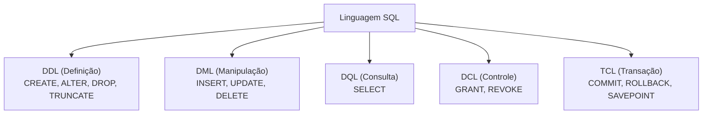
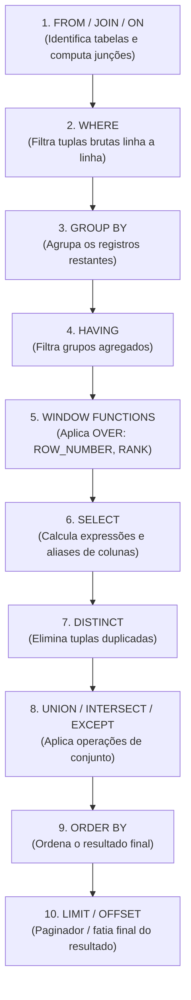

# 02 - Linguagem SQL e Objetos de Banco

> **Matéria:** Banco de Dados  
> **Cargo:** B02 – Técnico de Controle Externo – Especialidade: Tecnologia da Informação  
> **Arquivo:** `02_linguagem_sql_ddl_dml_dql_tcl_e_dcl.md`  

---

## 📌 Ementa / Itens do Edital
- Linguagem SQL (ANSI e extensões procedurais)
- Subconjuntos da SQL: DDL, DML, DQL, DCL e TCL
- Consultas avançadas: Junções (Joins), Agrupamentos, Subconsultas, CTEs e Funções de Janela
- Objetos de banco de dados: Views (padrão e materializadas), Procedures, Functions e Triggers

---

## 🧭 Sumário

1. [Subconjuntos da Linguagem SQL](#1-subconjuntos-da-linguagem-sql)
    1. [Classificação ANSI: DDL, DML, DQL, DCL e TCL](#11-classificacao-ansi-ddl-dml-dql-dcl-e-tcl)
    2. [O Duelo Clássico: DROP vs. TRUNCATE vs. DELETE](#12-o-duelo-classico-drop-vs-truncate-vs-delete)
    3. [Restrições de Integridade (Constraints) e Ações de Chave Estrangeira](#13-restricoes-de-integridade-constraints-e-acoes-de-chave-estrangeira)
    4. [Teste 245](#Teste-245)
    5. [Teste 246](#Teste-246)
    6. [Teste 247](#Teste-247)
2. [Ordem Lógica de Execução da Consulta SQL (DQL)](#2-ordem-logica-de-execucao-da-consulta-sql-dql)
    1. [Ordem Léxica (Escrita) vs. Ordem Lógica (Processamento)](#21-ordem-lexica-escrita-vs-ordem-logica-processamento)
    2. [O Conflito WHERE vs. HAVING e a Ilegalidade de Aliases](#22-o-conflito-where-vs-having-e-a-ilegalidade-de-aliases)
    3. [Teste 248](#Teste-248)
3. [Consultas Avançadas: Junções, Operadores de Conjunto e Subconsultas](#3-consultas-avancadas-juncoes-operadores-de-conjunto-e-subconsultas)
    1. [Junções (INNER, LEFT, RIGHT, FULL OUTER e CROSS JOIN)](#31-juncoes-inner-left-right-full-outer-e-cross-join)
    2. [Operadores de Conjunto (UNION vs. UNION ALL, INTERSECT, EXCEPT)](#32-operadores-de-conjunto-union-vs-union-all-intersect-except)
    3. [Lógica Ternária (Three-Valued Logic) e a Armadilha do NOT IN com NULL](#33-logica-ternaria-three-valued-logic-e-a-armadilha-do-not-in-com-null)
    4. [Common Table Expressions (CTEs) e Recursividade (WITH RECURSIVE)](#34-common-table-expressions-ctes-e-recursividade-with-recursive)
    5. [Teste 249](#Teste-249)
    6. [Teste 250](#Teste-250)
    7. [Teste 251](#Teste-251)
    8. [Teste 252](#Teste-252)
4. [Funções Analíticas de Janela (Window Functions)](#4-funcoes-analiticas-de-janela-window-functions)
    1. [Sintaxe Geral e Cláusula OVER (PARTITION BY .. ORDER BY ..)](#41-sintaxe-geral-e-clausula-over-partition-by-order-by)
    2. [Funções de Ranking: ROW_NUMBER(), RANK() e DENSE_RANK()](#42-funcoes-de-ranking-rownumber-rank-e-denserank)
    3. [Funções de Deslocamento: LEAD() e LAG()](#43-funcoes-de-deslocamento-lead-e-lag)
    4. [Teste 253](#Teste-253)
    5. [Teste 254](#Teste-254)
5. [Objetos Programáveis de Banco de Dados](#5-objetos-programaveis-de-banco-de-dados)
    1. [Visões: View Padrão vs. View Materializada (Materialized View)](#51-visoes-view-padrao-vs-view-materializada-materialized-view)
    2. [Stored Procedures vs. User-Defined Functions (UDF)](#52-stored-procedures-vs-user-defined-functions-udf)
    3. [Gatilhos (Triggers): Eventos, Momentos (BEFORE, AFTER, INSTEAD OF) e Pseudorregistros OLD/NEW](#53-gatilhos-triggers-eventos-momentos-before-after-instead-of-e-pseudorregistros-oldnew)
    4. [Teste 255](#Teste-255)
6. [🌐 Fontes Oficiais e Referências Bibliográficas](#fontes-oficiais-e-referencias-bibliograficas)

---

## 1. Subconjuntos da Linguagem SQL

A linguagem SQL (*Structured Query Language*), padronizada internacionalmente pela norma ISO/IEC 9075, é subdividida em conjuntos de comandos com finalidades operacionais distintas:



### 1.1 Classificação ANSI: DDL, DML, DQL, DCL e TCL

| Subconjunto | Denominação | Comandos Primários | Finalidade Operacional |
| :--- | :--- | :--- | :--- |
| **DDL** | *Data Definition Language* | `CREATE`, `ALTER`, `DROP`, `TRUNCATE`, `RENAME` | Criação, modificação estrutural e exclusão física de objetos no catálogo de dados (tabelas, esquemas, índices, visões). |
| **DML** | *Data Manipulation Language* | `INSERT`, `UPDATE`, `DELETE`, `MERGE` | Inserção, alteração e remoção de registros/tuplas dentro de tabelas existentes. |
| **DQL** | *Data Query Language* | `SELECT` | Consulta e recuperação de dados estruturados (frequentemente agrupada como subconjunto da DML). |
| **DCL** | *Data Control Language* | `GRANT`, `REVOKE` | Gestão de privilégios de acesso, concessão e revogação de permissões a usuários e papéis (*roles*). |
| **TCL** | *Transaction Control Language* | `COMMIT`, `ROLLBACK`, `SAVEPOINT` | Gerenciamento de blocos de transações atômicas, garantindo as propriedades ACID. |

### 1.2 O Duelo Clássico: DROP vs. TRUNCATE vs. DELETE

Um dos tópicos de maior incidência em provas da FCC para cargos de Tecnologia da Informação envolve a comparação detalhada entre as operações de remoção:

| Dimensão de Análise | `DELETE` | `TRUNCATE TABLE` | `DROP TABLE` |
| :--- | :--- | :--- | :--- |
| **Classificação Formal** | **DML** (*Manipulação*) | **DDL** (*Definição*) | **DDL** (*Definição*) |
| **Escopo de Remoção** | Linhas filtradas (`WHERE`) ou todas as linhas da tabela. | **Todas as linhas da tabela** incondicionalmente. | A **tabela inteira** (estrutura, dados e metadados no catálogo). |
| **Sobrecarga de Log (WAL/Redo)** | **Alto overhead:** Registra cada linha excluída individualmente no log de transações. | **Mínimo overhead:** Registra apenas a desalocação das páginas/extensões no disco. | **Mínimo overhead:** Registra a remoção do objeto do catálogo de dados. |
| **Velocidade de Execução** | Lento em grandes volumes de dados (milhões de linhas). | **Extremamente rápido** (quase instantâneo). | Instantâneo. |
| **Disparo de Triggers** | Dispara triggers de `DELETE` (`FOR EACH ROW` e `STATEMENT`). | **NÃO dispara** triggers de linha (`FOR EACH ROW`). | Não dispara triggers DML. |
| **Comportamento Transacional** | Suporta `ROLLBACK` em qualquer SGBD compatível com ACID. | Reversível no PostgreSQL/SQL Server; no Oracle efetua **COMMIT implícito**. | Reversível no PostgreSQL; no Oracle efetua **COMMIT implícito**. |
| **Reinício de Sequences (Identity)**| **Não reinicia** contadores de auto-incremento. | **Reinicia** os contadores de identidade para o valor inicial padrão. | A tabela deixa de existir fisicamente. |

> 🚨 **ALERTA DE PROVA / PEGADINHA FCC:**  
> A FCC adora elaborar enunciados afirmando que:
>
> 1. *"O comando TRUNCATE é uma operação DML porque manipula dados de linhas."* $\rightarrow$ **ERRADO!** O `TRUNCATE` é formalmente classificado como **DDL**, pois opera desalocando páginas físicas de armazenamento no catálogo de dados.
> 2. *"O comando TRUNCATE aciona gatilhos de auditoria FOR EACH ROW para registrar quem apagou cada linha."* $\rightarrow$ **ERRADO!** O `TRUNCATE` ignora completamente gatilhos de nível de linha!

### 1.3 Restrições de Integridade (Constraints) e Ações de Chave Estrangeira

As restrições de integridade garantem a consistência lógica dos dados no banco:

- **`PRIMARY KEY`:** Garante unicidade e impede valores nulos (`UNIQUE` + `NOT NULL`). Cada tabela pode conter apenas uma chave primária.
- **`FOREIGN KEY` (Integridade Referencial):** Impõe que o valor da coluna exista previamente na chave primária da tabela referenciada.
    - **Ações Referenciais em Deleção/Atualização (`ON DELETE` / `ON UPDATE`):**
    - `RESTRICT` / `NO ACTION`: Bloqueia e rejeita a operação no pai caso existam registros filhos dependentes (comportamento padrão).
    - `CASCADE`: Propaga a alteração/exclusão automaticamente aos filhos (se o contrato for apagado, todos os seus aditivos são apagados).
    - `SET NULL`: Atualiza o campo da chave estrangeira dos filhos para `NULL` quando o pai é excluído (exige que a coluna aceite nulos).
    - `SET DEFAULT`: Preenche a chave estrangeira dos filhos com o valor padrão configurado.
- **`UNIQUE`:** Impede valores duplicados, mas permite a inserção de valores nulos (`NULL`), exceto se combinado com `NOT NULL`.
- **`CHECK`:** Valida predicados booleanos customizados antes de persistir a tupla (ex.: `CHECK (valor_empenho > 0)`).

---

### Teste 001
**(FGV – TJ/AP – 2023 – Analista Judiciario Apoio Especializado Tecnologia Da Informacao Banco De Dados)**
João, administrador de Banco de Dados Oracle, deverá criar índices para melhorar o desempenho de consultas complexas sobre processos judiciais. Para isso, deverá escolher a estrutura que facilita a busca rápida de informações em operações de junção e intervalo, como: SELECT parte.nome, movimento.descricao, movimento.data FROM parte JOIN movimento ON parte.processoID = movimento.processoID WHERE parte.processoID BETWEEN 10 AND 20; Para tanto, João criou um índice específico na coluna “processoID” da tabela “movimento”: CREATE INDEX idx_movimento_processoID ON movimento(processoID); Após a execução do script apresentado, o tipo de índice criado por João é:

* **A)** bitmap;
* **B)** hashing;
* **C)** espacial;
* **D)** árvore B;
* **E)** sequencial.

---

> **Comentário Detalhado:**
>
> - **A)** **Incorreta.** A opção apresenta proposição em desacordo com os fundamentos teóricos e técnicos do tópico ao afirmar que "bitmap". De acordo com a teoria estudada em *1.2 O Duelo Clássico: DROP vs. TRUNCATE vs. DELETE*, escopo de Remoção: Linhas filtradas ( WHERE ) ou todas as linhas da tabela. — Todas as linhas da tabela incondicionalmente. — A tabela inteira (estrutura, dados e metadados no catálogo).
> - **B)** **Incorreta.** A opção apresenta proposição em desacordo com os fundamentos teóricos e técnicos do tópico ao afirmar que "hashing". De acordo com a teoria estudada em *3.2 Operadores de Conjunto (UNION vs. UNION ALL, INTERSECT, EXCEPT)*, uNION : Combina os resultados de duas consultas com compatibilidade de esquema e executa um algoritmo interno de ordenação/hashing para eliminar compulsoriamente linhas duplicadas.
> - **C)** **Incorreta.** A opção apresenta proposição em desacordo com os fundamentos teóricos e técnicos do tópico ao afirmar que "espacial". De acordo com a teoria estudada em *2.2 O Conflito WHERE vs. HAVING e a Ilegalidade de Aliases*, como a cláusula WHERE (etapa 2) é processada muito antes da cláusula SELECT (etapa 6), qualquer apelido de coluna ( alias ) criado no SELECT ainda não existe no catálogo de símbolos durante a avaliação do WHERE.
> - **D)** **Correta.** Conforme fundamentado na seção *1.1 Classificação ANSI: DDL, DML, DQL, DCL e TCL* deste guia, dDL: Data Definition Language — CREATE , ALTER , DROP , TRUNCATE , RENAME — Criação, modificação estrutural e exclusão física de objetos no catálogo de dados (tabelas, esquemas, índices, visões). Dessa forma, está plenamente correta a assertiva da banca (FGV – TJ/AP/2023) ao estabelecer que "árvore B".
> - **E)** **Incorreta.** A opção apresenta proposição em desacordo com os fundamentos teóricos e técnicos do tópico ao afirmar que "sequencial". De acordo com a teoria estudada em *4.2 Funções de Ranking: ROW_NUMBER(), RANK() e DENSE_RANK()*, rOW NUMBER() : Atribui um número inteiro sequencial e estritamente exclusivo a cada linha da partição (1, 2, 3, 4..). Desconsidera empates.
>
> **Gabarito: D**

---


### Teste 002
**(FGV – TJ/AP – 2023 – Analista Judiciario Apoio Especializado Tecnologia Da Informacao Banco De Dados)**
No contexto de administração de conexões no Oracle, Database Link é um objeto do esquema que permite que usuários acessem objetos em bancos de dados diferentes. Observe o seguinte script: ---conexão no banco de dados staging CONNECT staging@staging CREATE PUBLIC DATABASE LINK "PRD_PROCESSO" CONNECT TO staging IDENTIFIED BY <PWD> USING 'PRD_PROCESSO'; SELECT nome FROM processo.tbl_usuario@prd_processo WHERE cpf = 99988877766; Após a execução do script acima, a instrução SELECT:

* **A)** retornará o nome do usuário com o CPF 99988877766 da tabela “tbl_usuario” do banco de dados “prd_processo”;
* **B)** retornará o nome do usuário com o CPF 99988877766 da tabela “tbl_usuario” do banco de dados “prd_processo”, se o usuário “processo” existir no banco de dados “staging”;
* **C)** retornará o nome do usuário com o CPF 99988877766 da tabela “tbl_usuario” do banco de dados “prd_processo”, se existir sinônimo público para a tabela “tbl_usuario” no banco de dados “prd_processo”;
* **D)** não retornará o nome do usuário com o CPF 99988877766 da tabela “tbl_usuario” do banco de dados “prd_processo”, porque o Database Link deve ser criado no banco de dados remoto especificado em USING 'PRD_PROCESSO';
* **E)** não retornará o nome do usuário com o CPF 99988877766 da tabela “tbl_usuario” do banco de dados “prd_processo”, porque a instrução deve ser executada com o usuário “staging” na cláusula FROM staging.tbl_usuario@prd_processo.

---

> **Comentário Detalhado:**
>
> - **A)** **Correta.** Conforme fundamentado na seção *5.3 Gatilhos (Triggers): Eventos, Momentos (BEFORE, AFTER, INSTEAD OF) e Pseudorregistros OLD/NEW* deste guia, gatilhos ( Triggers ) são blocos de código procedurais executados automaticamente pelo motor de banco de dados quando eventos DML específicos ocorrem em uma tabela. Dessa forma, está plenamente correta a assertiva da banca (FGV – TJ/AP/2023) ao estabelecer que "retornará o nome do usuário com o CPF 99988877766 da tabela “tbl usuario” do banco de dados “prd processo”".
> - **B)** **Incorreta.** A opção apresenta proposição em desacordo com os fundamentos teóricos e técnicos do tópico ao afirmar que "retornará o nome do usuário com o CPF 99988877766 da tabela “tbl usuario” do banco de dados “prd processo”, se o...". De acordo com a teoria estudada em *1.3 Restrições de Integridade (Constraints) e Ações de Chave Estrangeira*, as restrições de integridade garantem a consistência lógica dos dados no banco.
> - **C)** **Incorreta.** A opção apresenta proposição em desacordo com os fundamentos teóricos e técnicos do tópico ao afirmar que "retornará o nome do usuário com o CPF 99988877766 da tabela “tbl usuario” do banco de dados “prd processo”, se...". De acordo com a teoria estudada em *5.1 Visões: View Padrão vs. View Materializada (Materialized View)*, trade off: Os dados ficam estáticos/defasados até que um comando de atualização explícito seja disparado: REFRESH MATERIALIZED VIEW nome da view;.
> - **D)** **Incorreta.** A opção apresenta proposição em desacordo com os fundamentos teóricos e técnicos do tópico ao afirmar que "não retornará o nome do usuário com o CPF 99988877766 da tabela “tbl usuario” do banco de dados “prd processo”...". De acordo com a teoria estudada em *5.2 Stored Procedures vs. User-Defined Functions (UDF)*, efeitos Colaterais: Permite alterar esquemas e dados via DDL e DML livremente. — Deve evitar efeitos colaterais para manter a integridade referencial.
> - **E)** **Incorreta.** A opção apresenta proposição em desacordo com os fundamentos teóricos e técnicos do tópico ao afirmar que "não retornará o nome do usuário com o CPF 99988877766 da tabela “tbl usuario” do banco de dados “prd processo”...". De acordo com a teoria estudada em *3.3 Lógica Ternária (Three-Valued Logic) e a Armadilha do NOT IN com NULL*, considere a consulta: SELECT nome FROM cliente WHERE id NOT IN (SELECT id cliente FROM divida).
>
> **Gabarito: A**

---


### Teste 003
**(FGV – TJ/AP – 2023 – Analista Judiciario Apoio Especializado Tecnologia Da Informacao Banco De Dados)**
João, administrador de banco de dados MySQL, deverá realizar, periodicamente, o backup lógico completo do banco de dados "tjap_db". Para isso, João deverá utilizar o comando:

* **A)** backup -u root -p tjap_db > backup.sql;
* **B)** mydump -u root -p tjap_db > backup.sql;
* **C)** mybackup -u root -p tjap_db > backup.sql;
* **D)** mysqldump -u root -p tjap_db > backup.sql;
* **E)** select * from tjap_db into outfile backup.sql;

---

> **Comentário Detalhado:**
>
> - **A)** **Incorreta.** A opção apresenta proposição em desacordo com os fundamentos teóricos e técnicos do tópico ao afirmar que "backup u root p tjap db backup.sql". De acordo com a teoria estudada em *1.3 Restrições de Integridade (Constraints) e Ações de Chave Estrangeira*, as restrições de integridade garantem a consistência lógica dos dados no banco.
> - **B)** **Incorreta.** A opção apresenta proposição em desacordo com os fundamentos teóricos e técnicos do tópico ao afirmar que "mydump u root p tjap db backup.sql". De acordo com a teoria estudada em *5.1 Visões: View Padrão vs. View Materializada (Materialized View)*, não armazena dados físicos em disco; representa apenas uma consulta SQL gravada no dicionário de dados do SGBD.
> - **C)** **Incorreta.** A opção apresenta proposição em desacordo com os fundamentos teóricos e técnicos do tópico ao afirmar que "mybackup u root p tjap db backup.sql". De acordo com a teoria estudada em *1.2 O Duelo Clássico: DROP vs. TRUNCATE vs. DELETE*, "O comando TRUNCATE é uma operação DML porque manipula dados de linhas." $\rightarrow$ ERRADO! O TRUNCATE é formalmente classificado como DDL, pois opera desalocando páginas físicas de armazenamento no catálogo de dados.
> - **D)** **Correta.** Conforme fundamentado na seção *5.2 Stored Procedures vs. User-Defined Functions (UDF)* deste guia, invocação: Comando explícito CALL procedure name(args); — Invocada inline em comandos SQL: SELECT func(x) FROM tab. Dessa forma, está plenamente correta a assertiva da banca (FGV – TJ/AP/2023) ao estabelecer que "mysqldump u root p tjap db backup.sql".
> - **E)** **Incorreta.** A opção apresenta proposição em desacordo com os fundamentos teóricos e técnicos do tópico ao afirmar que "select from tjap db into outfile backup.sql". De acordo com a teoria estudada em *2.2 O Conflito WHERE vs. HAVING e a Ilegalidade de Aliases*, código Inválido: SELECT salario 1.1 AS novo salario FROM servidor WHERE novo salario 5000; (Gera erro de coluna inexistente!).
>
> **Gabarito: D**

---


### Teste 004
**(FGV – TJ/AP – 2023 – Analista Judiciario Apoio Especializado Tecnologia Da Informacao Banco De Dados)**
Observe a estrutura da tabela “Cliente” abaixo: CREATE TABLE cliente ( cliente_ID NUMBER(12) PRIMARY KEY, cidade VARCHAR2(50) NOT NULL, limite_credito NUMBER(13,2) DEFAULT 0 ); Com o objetivo de gerar um relatório que mostre o limite de crédito médio para clientes em “Sao Paulo” e “Belo Horizonte”, a consulta a ser executada é:

* **A)** SELECT cidade, AVG(NVL(limite_credito,0)) FROM cliente WHERE cidade IN ('SAO PAULO','BELO HORIZONTE');
* **B)** SELECT cidade, AVG(limite_credito) FROM cliente WHERE cidade IN ('SAO PAULO','BELO HORIZONTE') GROUP BY cidade;
* **C)** SELECT cidade, AVG(limite_credito) FROM cliente WHERE cidade IN ('SAO PAULO','BELO HORIZONTE') GROUP BY cliente_ID;
* **D)** SELECT cidade, AVG(limite_credito) FROM cliente WHERE cidade IN ('SAO PAULO','BELO HORIZONTE') GROUP BY cidade, limite_credito;
* **E)** SELECT cidade, AVG(limite_credito) FROM cliente WHERE cidade IN ('SAO PAULO','BELO HORIZONTE') GROUP BY limite_credito, cidade;

---

> **Comentário Detalhado:**
>
> - **A)** **Incorreta.** A opção apresenta proposição em desacordo com os fundamentos teóricos e técnicos do tópico ao afirmar que "SELECT cidade, AVG(NVL(limite credito,0)) FROM cliente WHERE cidade IN ('SAO PAULO','BELO HORIZONTE')". De acordo com a teoria estudada em *2.2 O Conflito WHERE vs. HAVING e a Ilegalidade de Aliases*, código Inválido: SELECT salario 1.1 AS novo salario FROM servidor WHERE novo salario 5000; (Gera erro de coluna inexistente!).
> - **B)** **Correta.** Conforme fundamentado na seção *3.3 Lógica Ternária (Three-Valued Logic) e a Armadilha do NOT IN com NULL* deste guia, considere a consulta: SELECT nome FROM cliente WHERE id NOT IN (SELECT id cliente FROM divida). Dessa forma, está plenamente correta a assertiva da banca (FGV – TJ/AP/2023) ao estabelecer que "SELECT cidade, AVG(limite credito) FROM cliente WHERE cidade IN ('SAO PAULO','BELO HORIZONTE') GROUP BY cidade".
> - **C)** **Incorreta.** A opção apresenta proposição em desacordo com os fundamentos teóricos e técnicos do tópico ao afirmar que "SELECT cidade, AVG(limite credito) FROM cliente WHERE cidade IN ('SAO PAULO','BELO HORIZONTE') GROUP BY cliente ID". De acordo com a teoria estudada em *3.3 Lógica Ternária (Three-Valued Logic) e a Armadilha do NOT IN com NULL*, se a tabela divida contiver ao menos UM único registro cujo id cliente seja NULL , a subconsulta retornará o valor NULL.
> - **D)** **Incorreta.** A opção apresenta proposição em desacordo com os fundamentos teóricos e técnicos do tópico ao afirmar que "SELECT cidade, AVG(limite credito) FROM cliente WHERE cidade IN ('SAO PAULO','BELO HORIZONTE') GROUP BY cidade...". De acordo com a teoria estudada em *2. Ordem Lógica de Execução da Consulta SQL (DQL)*, p1["1. FROM / JOIN / ON<br/ (Identifica tabelas e computa junções)"] P2["2. WHERE<br/ (Filtra tuplas brutas linha a linha)"].
> - **E)** **Incorreta.** A opção apresenta proposição em desacordo com os fundamentos teóricos e técnicos do tópico ao afirmar que "SELECT cidade, AVG(limite credito) FROM cliente WHERE cidade IN ('SAO PAULO','BELO HORIZONTE') GROUP BY limite...". De acordo com a teoria estudada em *1.3 Restrições de Integridade (Constraints) e Ações de Chave Estrangeira*, pRIMARY KEY : Garante unicidade e impede valores nulos ( UNIQUE + NOT NULL ). Cada tabela pode conter apenas uma chave primária.
>
> **Gabarito: B**

---


### Teste 005
**(FGV – TJ/AP – 2023 – Analista Judiciario Apoio Especializado Tecnologia Da Informacao Banco De Dados)**
João, administrador de banco de dados, deverá projetar um banco de dados Oracle de registro de alunos que contenha várias tabelas para armazenar informações acadêmicas:  A tabela “Aluno” armazena informações sobre alunos.  A tabela “Notas_Aluno” armazena informações sobre as notas do aluno.  Ambas as tabelas têm uma coluna chamada “Aluno_ID”.  A coluna “Aluno_ID” na tabela “Aluno” é uma chave primária. João deverá criar a chave estrangeira na coluna “aluno_ID” da tabela “Notas_Aluno” para relacionar-se com a coluna “aluno_ID” da tabela “Aluno”. Para isso, João deverá utilizar o seguinte comando:

* **A)** CREATE TABLE notas_aluno (aluno_ID NUMBER(12), media_notas NUMBER(4,3), CONSTRAINT aluno_ID_fk REFERENCES aluno(aluno_ID));
* **B)** CREATE TABLE notas_aluno (aluno_ID NUMBER(12), media_notas NUMBER(4,3), CONSTRAINT FOREIGN KEY (aluno_ID) REFERENCES aluno (aluno_ID));
* **C)** CREATE TABLE notas_aluno (aluno_ID NUMBER(12), media_notas NUMBER(4,3), aluno_ID_fk FOREIGN KEY (aluno_ID) REFERENCES aluno(aluno_ID));
* **D)** CREATE TABLE notas_aluno (aluno_ID NUMBER(12), media_notas NUMBER(4,3), CONSTRAINT aluno_ID_fk FOREIGN KEY (aluno_ID) REFERENCES aluno(aluno_ID));
* **E)** CREATE TABLE notas_aluno (aluno_ID NUMBER(12), media_notas NUMBER(4,3), CONSTRAINT aluno_ID_fk REFERENCES (aluno_ID) FOREIGN KEY aluno(aluno_ID));

---

> **Comentário Detalhado:**
>
> - **A)** **Incorreta.** A opção apresenta proposição em desacordo com os fundamentos teóricos e técnicos do tópico ao afirmar que "CREATE TABLE notas aluno (aluno ID NUMBER(12), media notas NUMBER(4,3), CONSTRAINT aluno ID fk REFERENCES...". De acordo com a teoria estudada em *1.3 Restrições de Integridade (Constraints) e Ações de Chave Estrangeira*, pRIMARY KEY : Garante unicidade e impede valores nulos ( UNIQUE + NOT NULL ). Cada tabela pode conter apenas uma chave primária.
> - **B)** **Incorreta.** A opção apresenta proposição em desacordo com os fundamentos teóricos e técnicos do tópico ao afirmar que "CREATE TABLE notas aluno (aluno ID NUMBER(12), media notas NUMBER(4,3), CONSTRAINT FOREIGN KEY (aluno ID)...". De acordo com a teoria estudada em *1.1 Classificação ANSI: DDL, DML, DQL, DCL e TCL*, dDL: Data Definition Language — CREATE , ALTER , DROP , TRUNCATE , RENAME — Criação, modificação estrutural e exclusão física de objetos no catálogo de dados (tabelas, esquemas, índices, visões).
> - **C)** **Incorreta.** A opção apresenta proposição em desacordo com os fundamentos teóricos e técnicos do tópico ao afirmar que "CREATE TABLE notas aluno (aluno ID NUMBER(12), media notas NUMBER(4,3), aluno ID fk FOREIGN KEY (aluno ID)...". De acordo com a teoria estudada em *1. Subconjuntos da Linguagem SQL*, sQL DDL["DDL (Definição)<br/ CREATE, ALTER, DROP, TRUNCATE"].
> - **D)** **Correta.** Conforme fundamentado na seção *1.3 Restrições de Integridade (Constraints) e Ações de Chave Estrangeira* deste guia, fOREIGN KEY (Integridade Referencial): Impõe que o valor da coluna exista previamente na chave primária da tabela referenciada. Dessa forma, está plenamente correta a assertiva da banca (FGV – TJ/AP/2023) ao estabelecer que "CREATE TABLE notas aluno (aluno ID NUMBER(12), media notas NUMBER(4,3), CONSTRAINT aluno ID fk FOREIGN KEY (aluno...".
> - **E)** **Incorreta.** A opção apresenta proposição em desacordo com os fundamentos teóricos e técnicos do tópico ao afirmar que "CREATE TABLE notas aluno (aluno ID NUMBER(12), media notas NUMBER(4,3), CONSTRAINT aluno ID fk REFERENCES (aluno...". De acordo com a teoria estudada em *1.3 Restrições de Integridade (Constraints) e Ações de Chave Estrangeira*, as restrições de integridade garantem a consistência lógica dos dados no banco.
>
> **Gabarito: D**

---


### Teste 006
**(CEBRASPE – TRF/6 – 2025 – Analista Judiciario Apoio Especializado Tecnologia Da Informacao)**
A arquitetura de bancos de dados cliente-servidor é caracterizada pela divisão do processamento entre sistemas, e sua implementação requer soluções de software que possibilitem confirmar transações, desfazer transações e disponibilizar linguagens de consultas. SELECT * FROM Produtos WHERE Preco > 0.00;

* **C)** Certo
* **E)** Errado

---

> **Comentário Detalhado:**
>
> - **C)** **Correta.** O item está **Certo**. Conforme fundamentado na seção *2.2 O Conflito WHERE vs. HAVING e a Ilegalidade de Aliases*, código Inválido: SELECT salario 1.1 AS novo salario FROM servidor WHERE novo salario 5000; (Gera erro de coluna inexistente!). Dessa forma, está plenamente correta a assertiva da banca (CEBRASPE – TRF/6/2025) ao afirmar que "A arquitetura de bancos de dados cliente servidor é caracterizada pela divisão do processamento entre...".
> - **E)** **Incorreta.** A assertiva não incorre em erro conceitual, guardando conformidade com a teoria estudada.
>
> **Gabarito: C**

---


### Teste 007
**(FCC – TRT 14ª – 2016 – Analista Judiciário - Apoio Especializado - Tecnologia da Informação)**
Uma tabela de um banco de dados Oracle chamada funcionarios possui os campos id, nome e salario. Um Analista deseja realizar uma consulta nesta tabela, que exiba o id, o nome dos funcionários, o salário e o salário acrescido de 12,5%. O salário com o acréscimo deverá ser mostrado como um número inteiro e a coluna deverá ser nomeada Salário Reajustado. A instrução SQL que deverá ser digitada pelo Analista é

* **A)** SELECT id, nome, salario, TO_INT(salario * 1.125,0) AS "Salário Reajustado" FROM funcionarios;
* **B)** SELECT id, nome, salario, ARRED(salario * 1.125) AS "Salário Reajustado" FROM funcionarios;
* **C)** SELECT id, nome, salario, ROUND(salario * 1.125, 0) "Salário Reajustado" FROM funcionarios;
* **D)** SELECT id, nome, salario, TRUNC(salario * 1.125) 'Salário Reajustado' FROM funcionarios;
* **E)** SELECT id, nome, salario, TO_INTEGER(salario * 1.125) AS "Salário Reajustado" FROM funcionarios;

---

> **Comentário Detalhado:**
>
> - **A)** **Correta.** Conforme fundamentado na seção *3.3 Lógica Ternária (Three-Valued Logic) e a Armadilha do NOT IN com NULL* deste guia, considere a consulta: SELECT nome FROM cliente WHERE id NOT IN (SELECT id cliente FROM divida). Dessa forma, está plenamente correta a assertiva da banca (FCC – TRT 14ª/2016) ao estabelecer que "SELECT id, nome, salario, TO INT(salario 1.125,0) AS "Salário Reajustado" FROM funcionarios".
> - **B)** **Incorreta.** A opção apresenta proposição em desacordo com os fundamentos teóricos e técnicos do tópico ao afirmar que "SELECT id, nome, salario, ARRED(salario 1.125) AS "Salário Reajustado" FROM funcionarios". De acordo com a teoria estudada em *2.2 O Conflito WHERE vs. HAVING e a Ilegalidade de Aliases*, código Inválido: SELECT salario 1.1 AS novo salario FROM servidor WHERE novo salario 5000; (Gera erro de coluna inexistente!).
> - **C)** **Incorreta.** A opção apresenta proposição em desacordo com os fundamentos teóricos e técnicos do tópico ao afirmar que "SELECT id, nome, salario, ROUND(salario 1.125, 0) "Salário Reajustado" FROM funcionarios". De acordo com a teoria estudada em *5.1 Visões: View Padrão vs. View Materializada (Materialized View)*, trade off: Os dados ficam estáticos/defasados até que um comando de atualização explícito seja disparado: REFRESH MATERIALIZED VIEW nome da view;.
> - **D)** **Incorreta.** A opção apresenta proposição em desacordo com os fundamentos teóricos e técnicos do tópico ao afirmar que "SELECT id, nome, salario, TRUNC(salario 1.125) 'Salário Reajustado' FROM funcionarios". De acordo com a teoria estudada em *5.2 Stored Procedures vs. User-Defined Functions (UDF)*, invocação: Comando explícito CALL procedure name(args); — Invocada inline em comandos SQL: SELECT func(x) FROM tab.
> - **E)** **Incorreta.** A opção apresenta proposição em desacordo com os fundamentos teóricos e técnicos do tópico ao afirmar que "SELECT id, nome, salario, TO INTEGER(salario 1.125) AS "Salário Reajustado" FROM funcionarios". De acordo com a teoria estudada em *4.2 Funções de Ranking: ROW_NUMBER(), RANK() e DENSE_RANK()*, considere quatro servidores avaliados por salário dentro de uma partição: Ana (10.000), Carlos (10.000), Beatriz (10.000) e Daniel (8.000).
>
> **Gabarito: A**

---


### Teste 008
**(FCC – TRT 23ª – 2016 – Analista Judiciário - Apoio Especializado - Tecnologia da Informação)**
Para utilizar o OpenSource Selenium, um Analista deve conhecer suas atuais e principais ferramentas. Uma delas é a que permite distribuir os testes em múltiplas máquinas, reduzindo assim o tempo gasto na execução de uma suíte de testes. É ideal para escalonar suítes de testes grandes ou que devem ser executadas em múltiplos ambientes. Essa ferramenta é o Selenium

* **A)** SELECT.
* **B)** RC.
* **C)** IDE.
* **D)** TYPE.
* **E)** GRID.

---

> **Comentário Detalhado:**
>
> - **A)** **Correta.** Conforme fundamentado na seção *5.1 Visões: View Padrão vs. View Materializada (Materialized View)* deste guia, a cada execução de um SELECT contra a View, o otimizador expande a consulta subjacente e varre as tabelas base em tempo real. Dessa forma, está plenamente correta a assertiva da banca (FCC – TRT 23ª/2016) ao estabelecer que "SELECT".
> - **B)** **Incorreta.** A opção apresenta proposição em desacordo com os fundamentos teóricos e técnicos do tópico ao afirmar que "RC". De acordo com a teoria estudada em *2. Ordem Lógica de Execução da Consulta SQL (DQL)*, ao escrever uma consulta com a cláusula SELECT , a ordem sintática da escrita (ordem léxica) é muito diferente da ordem lógica de processamento adotada pelo otimizador de consultas do SGBD.
> - **C)** **Incorreta.** A opção apresenta proposição em desacordo com os fundamentos teóricos e técnicos do tópico ao afirmar que "IDE". De acordo com a teoria estudada em *2. Ordem Lógica de Execução da Consulta SQL (DQL)*, p5 P6["6. SELECT<br/ (Calcula expressões e aliases de colunas)"].
> - **D)** **Incorreta.** A opção apresenta proposição em desacordo com os fundamentos teóricos e técnicos do tópico ao afirmar que "TYPE". De acordo com a teoria estudada em *1. Subconjuntos da Linguagem SQL*, sQL DQL["DQL (Consulta)<br/ SELECT"].
> - **E)** **Incorreta.** A opção apresenta proposição em desacordo com os fundamentos teóricos e técnicos do tópico ao afirmar que "GRID". De acordo com a teoria estudada em *1.1 Classificação ANSI: DDL, DML, DQL, DCL e TCL*, dQL: Data Query Language — SELECT — Consulta e recuperação de dados estruturados (frequentemente agrupada como subconjunto da DML).
>
> **Gabarito: A**

---


### Teste 009
**(CEBRASPE – STF – 2008 – Analista Judiciario Suporte Em Tecnologia Da Informacao)**
As características do atributo CEP — numérico, seqüencial e não repetido — permitem utilizá-lo como chave primária em um banco de dados destinado ao cadastro de clientes de uma loja.

* **C)** Certo
* **E)** Errado

---

> **Comentário Detalhado:**
>
> - **C)** **Incorreta.** A proposição apresenta proposição em desacordo com os fundamentos teóricos e técnicos do tópico ao afirmar que "As características do atributo CEP — numérico, seqüencial e não repetido — permitem utilizá lo como chave...". De acordo com a teoria em *1.3 Restrições de Integridade (Constraints) e Ações de Chave Estrangeira*, as restrições de integridade garantem a consistência lógica dos dados no banco.
> - **E)** **Correta.** O item está **Errado** (gabarito oficial: **E**), pois contraria a disciplina teórica aplicável.
>
> **Gabarito: E**

---


### Teste 010
**(CEBRASPE – STF – 2013 – Analista Judiciario Suporte Em Tecnologia Da Informacao)**
No modelo entidade/relacionamento, deve-se incluir a chave estrangeira (chave primária) de uma entidade como campo da outra para modelar o relacionamento entre elas.

* **C)** Certo
* **E)** Errado

---

> **Comentário Detalhado:**
>
> - **C)** **Incorreta.** A proposição apresenta proposição em desacordo com os fundamentos teóricos e técnicos do tópico ao afirmar que "No modelo entidade/relacionamento, deve se incluir a chave estrangeira (chave primária) de uma entidade como...". De acordo com a teoria em *1.3 Restrições de Integridade (Constraints) e Ações de Chave Estrangeira*, sET NULL : Atualiza o campo da chave estrangeira dos filhos para NULL quando o pai é excluído (exige que a coluna aceite nulos).
> - **E)** **Correta.** O item está **Errado** (gabarito oficial: **E**), pois contraria a disciplina teórica aplicável.
>
> **Gabarito: E**

---


### Teste 011
**(FGV – TJ/BA – 2015 – Analista Judiciario Tecnologia Da Informacao)**
O comando switch da linguagem de programação C é, na linguagem Visual Basic .NET, semelhante ao comando:

* **A)** Select Case;
* **B)** Exit;
* **C)** For Each;
* **D)** Goto;
* **E)** Continue.

---

> **Comentário Detalhado:**
>
> - **A)** **Correta.** Conforme fundamentado na seção *1. Subconjuntos da Linguagem SQL* deste guia, sQL DQL["DQL (Consulta)<br/ SELECT"]. Dessa forma, está plenamente correta a assertiva da banca (FGV – TJ/BA/2015) ao estabelecer que "Select Case".
> - **B)** **Incorreta.** A opção apresenta proposição em desacordo com os fundamentos teóricos e técnicos do tópico ao afirmar que "Exit". De acordo com a teoria estudada em *5.2 Stored Procedures vs. User-Defined Functions (UDF)*, invocação: Comando explícito CALL procedure name(args); — Invocada inline em comandos SQL: SELECT func(x) FROM tab.
> - **C)** **Incorreta.** A opção apresenta proposição em desacordo com os fundamentos teóricos e técnicos do tópico ao afirmar que "For Each". De acordo com a teoria estudada em *1.2 O Duelo Clássico: DROP vs. TRUNCATE vs. DELETE*, "O comando TRUNCATE aciona gatilhos de auditoria FOR EACH ROW para registrar quem apagou cada linha." $\rightarrow$ ERRADO! O TRUNCATE ignora completamente gatilhos de nível de linha!.
> - **D)** **Incorreta.** A opção apresenta proposição em desacordo com os fundamentos teóricos e técnicos do tópico ao afirmar que "Goto". De acordo com a teoria estudada em *1.1 Classificação ANSI: DDL, DML, DQL, DCL e TCL*, dQL: Data Query Language — SELECT — Consulta e recuperação de dados estruturados (frequentemente agrupada como subconjunto da DML).
> - **E)** **Incorreta.** A opção apresenta proposição em desacordo com os fundamentos teóricos e técnicos do tópico ao afirmar que "Continue". De acordo com a teoria estudada em *2. Ordem Lógica de Execução da Consulta SQL (DQL)*, ao escrever uma consulta com a cláusula SELECT , a ordem sintática da escrita (ordem léxica) é muito diferente da ordem lógica de processamento adotada pelo otimizador de consultas do SGBD.
>
> **Gabarito: A**

---


### Teste 012
**(FGV – TJ/BA – 2015 – Analista Judiciario Tecnologia Da Informacao)**
Analise o diagrama ER apresentado a seguir. Na implementação relacional desse modelo, é necessário que:

* **A)** o relacionamento entre T1 e T2 seja modificado, pois não é possível implementá-lo como descrito;
* **B)** o atributo C1 da tabela T1 seja declarado como uma chave estrangeira que referencia a tabela T2;
* **C)** o atributo C da tabela T2 seja declarado com a propriedade unique (com valores nulos ignorados);
* **D)** o atributo A2 da tabela T2 aceite valores nulos;
* **E)** o atributo C da tabela T2 seja declarado com a propriedade not null.

---

> **Comentário Detalhado:**
>
> - **A)** **Incorreta.** A opção apresenta proposição em desacordo com os fundamentos teóricos e técnicos do tópico ao afirmar que "o relacionamento entre T1 e T2 seja modificado, pois não é possível implementá lo como descrito". De acordo com a teoria estudada em *1.3 Restrições de Integridade (Constraints) e Ações de Chave Estrangeira*, uNIQUE : Impede valores duplicados, mas permite a inserção de valores nulos ( NULL ), exceto se combinado com NOT NULL.
> - **B)** **Incorreta.** A opção apresenta proposição em desacordo com os fundamentos teóricos e técnicos do tópico ao afirmar que "o atributo C1 da tabela T1 seja declarado como uma chave estrangeira que referencia a tabela T2". De acordo com a teoria estudada em *1.3 Restrições de Integridade (Constraints) e Ações de Chave Estrangeira*, sET NULL : Atualiza o campo da chave estrangeira dos filhos para NULL quando o pai é excluído (exige que a coluna aceite nulos).
> - **C)** **Correta.** Conforme fundamentado na seção *1.3 Restrições de Integridade (Constraints) e Ações de Chave Estrangeira* deste guia, pRIMARY KEY : Garante unicidade e impede valores nulos ( UNIQUE + NOT NULL ). Cada tabela pode conter apenas uma chave primária. Dessa forma, está plenamente correta a assertiva da banca (FGV – TJ/BA/2015) ao estabelecer que "o atributo C da tabela T2 seja declarado com a propriedade unique (com valores nulos ignorados)".
> - **D)** **Incorreta.** A opção apresenta proposição em desacordo com os fundamentos teóricos e técnicos do tópico ao afirmar que "o atributo A2 da tabela T2 aceite valores nulos". De acordo com a teoria estudada em *3.1 Junções (INNER, LEFT, RIGHT, FULL OUTER e CROSS JOIN)*, lEFT OUTER JOIN (ou LEFT JOIN ): Retorna todas as tuplas da tabela à esquerda ( FROM ), combinando com as tuplas da tabela à direita. Caso não haja correspondência na tabela da direita, os atributos da direita são preenchidos com valores nulos ( NULL ).
> - **E)** **Incorreta.** A opção apresenta proposição em desacordo com os fundamentos teóricos e técnicos do tópico ao afirmar que "o atributo C da tabela T2 seja declarado com a propriedade not null". De acordo com a teoria estudada em *3.3 Lógica Ternária (Three-Valued Logic) e a Armadilha do NOT IN com NULL*, solução Recomendada: Utilizar sempre a construção com NOT EXISTS correlacionado, imune a valores nulos.
>
> **Gabarito: C**

---


### Teste 013
**(CEBRASPE – TRT/10 – 2013 – Analista Judiciario Tecnologia Da Informacao)**
Os índices são chaves secundárias utilizadas para acessar uma tabela mediante forma diferente da utilizada por uma chave primária.

* **C)** Certo
* **E)** Errado

---

> **Comentário Detalhado:**
>
> - **C)** **Correta.** O item está **Certo**. Conforme fundamentado na seção *1.3 Restrições de Integridade (Constraints) e Ações de Chave Estrangeira*, pRIMARY KEY : Garante unicidade e impede valores nulos ( UNIQUE + NOT NULL ). Cada tabela pode conter apenas uma chave primária. Dessa forma, está plenamente correta a assertiva da banca (CEBRASPE – TRT/10/2013) ao afirmar que "Os índices são chaves secundárias utilizadas para acessar uma tabela mediante forma diferente da utilizada...".
> - **E)** **Incorreta.** A assertiva não incorre em erro conceitual, guardando conformidade com a teoria estudada.
>
> **Gabarito: C**

---


### Teste 014
**(FCC – TRT 2ª – 2014 – Analista Judiciário - Tecnologia da Informação)**
No banco de dados MySQL, uma das maneiras de se efetuar uma consulta na qual uma determinada coluna de uma tabela seja igual ao valor máximo de uma coluna de outra tabela é

* **A)** SELECT * FROM t1 WHERE colunaX = (SELECT MAX(colunaY) FROM t2);
* **B)** SELECT * FROM t1 WHERE COALESCE(t1.colunaY, t2colunaY);
* **C)** SELECT colunaX from t1 IN MAX(SELECT colunaY from t2);
* **D)** SELECT CASE WHEN colunaX = (SELECT colunaY from t2) AS c WHERE c = colunaX;
* **E)** SELECT colunaX, colunaY from t1 WHER colunaX = colunaY;

---

> **Comentário Detalhado:**
>
> - **A)** **Correta.** Conforme fundamentado na seção *2.2 O Conflito WHERE vs. HAVING e a Ilegalidade de Aliases* deste guia, código Inválido: SELECT salario 1.1 AS novo salario FROM servidor WHERE novo salario 5000; (Gera erro de coluna inexistente!). Dessa forma, está plenamente correta a assertiva da banca (FCC – TRT 2ª/2014) ao estabelecer que "SELECT FROM t1 WHERE colunaX = (SELECT MAX(colunaY) FROM t2)".
> - **B)** **Incorreta.** A opção apresenta proposição em desacordo com os fundamentos teóricos e técnicos do tópico ao afirmar que "SELECT FROM t1 WHERE COALESCE(t1.colunaY, t2colunaY)". De acordo com a teoria estudada em *3.3 Lógica Ternária (Three-Valued Logic) e a Armadilha do NOT IN com NULL*, considere a consulta: SELECT nome FROM cliente WHERE id NOT IN (SELECT id cliente FROM divida).
> - **C)** **Incorreta.** A opção apresenta proposição em desacordo com os fundamentos teóricos e técnicos do tópico ao afirmar que "SELECT colunaX from t1 IN MAX(SELECT colunaY from t2)". De acordo com a teoria estudada em *2. Ordem Lógica de Execução da Consulta SQL (DQL)*, p1["1. FROM / JOIN / ON<br/ (Identifica tabelas e computa junções)"] P2["2. WHERE<br/ (Filtra tuplas brutas linha a linha)"].
> - **D)** **Incorreta.** A opção apresenta proposição em desacordo com os fundamentos teóricos e técnicos do tópico ao afirmar que "SELECT CASE WHEN colunaX = (SELECT colunaY from t2) AS c WHERE c = colunaX". De acordo com a teoria estudada em *2.2 O Conflito WHERE vs. HAVING e a Ilegalidade de Aliases*, como a cláusula WHERE (etapa 2) é processada muito antes da cláusula SELECT (etapa 6), qualquer apelido de coluna ( alias ) criado no SELECT ainda não existe no catálogo de símbolos durante a avaliação do WHERE.
> - **E)** **Incorreta.** A opção apresenta proposição em desacordo com os fundamentos teóricos e técnicos do tópico ao afirmar que "SELECT colunaX, colunaY from t1 WHER colunaX = colunaY". De acordo com a teoria estudada em *5.2 Stored Procedures vs. User-Defined Functions (UDF)*, invocação: Comando explícito CALL procedure name(args); — Invocada inline em comandos SQL: SELECT func(x) FROM tab.
>
> **Gabarito: A**

---


### Teste 015
**(FGV – TCE/SC – 2026 – Auditor Fiscal de Controle Externo - Administração)**
O Auditor está operando um banco de dados relacional que contém a tabela CONTRATOS. Ele precisa contar quantos contratos ativos existem para o município de ‘Florianópolis’. O comando SQL que executa essa tarefa corretamente é

* **A)** SELECT SUM(contratos) FROM Contratos WHERE municipio = ‘Florianópolis’;
* **B)** SELECT COUNT(*) FROM Contratos WHERE municipio = ‘Florianópolis’;
* **C)** SELECT DISTINCT(*) FROM Contratos WHERE municipio = ‘Florianópolis’;
* **D)** SELECT ALL FROM Contratos GROUP BY municipio;
* **E)** SELECT SEARCH contratos WHERE municipio = ‘Florianópolis’;

---

> **Comentário Detalhado:**
>
> - **A)** **Incorreta.** A opção apresenta proposição em desacordo com os fundamentos teóricos e técnicos do tópico ao afirmar que "SELECT SUM(contratos) FROM Contratos WHERE municipio = ‘Florianópolis’". De acordo com a teoria estudada em *3.3 Lógica Ternária (Three-Valued Logic) e a Armadilha do NOT IN com NULL*, considere a consulta: SELECT nome FROM cliente WHERE id NOT IN (SELECT id cliente FROM divida).
> - **B)** **Correta.** Conforme fundamentado na seção *2.2 O Conflito WHERE vs. HAVING e a Ilegalidade de Aliases* deste guia, código Inválido: SELECT salario 1.1 AS novo salario FROM servidor WHERE novo salario 5000; (Gera erro de coluna inexistente!). Dessa forma, está plenamente correta a assertiva da banca (FGV – TCE/SC/2026) ao estabelecer que "SELECT COUNT( ) FROM Contratos WHERE municipio = ‘Florianópolis’".
> - **C)** **Incorreta.** A opção apresenta proposição em desacordo com os fundamentos teóricos e técnicos do tópico ao afirmar que "SELECT DISTINCT( ) FROM Contratos WHERE municipio = ‘Florianópolis’". De acordo com a teoria estudada em *5.2 Stored Procedures vs. User-Defined Functions (UDF)*, invocação: Comando explícito CALL procedure name(args); — Invocada inline em comandos SQL: SELECT func(x) FROM tab.
> - **D)** **Incorreta.** A opção apresenta proposição em desacordo com os fundamentos teóricos e técnicos do tópico ao afirmar que "SELECT ALL FROM Contratos GROUP BY municipio". De acordo com a teoria estudada em *3.4 Common Table Expressions (CTEs) e Recursividade (WITH RECURSIVE)*, sELECT auditor id, COUNT( ) AS total.
> - **E)** **Incorreta.** A opção apresenta proposição em desacordo com os fundamentos teóricos e técnicos do tópico ao afirmar que "SELECT SEARCH contratos WHERE municipio = ‘Florianópolis’". De acordo com a teoria estudada em *2. Ordem Lógica de Execução da Consulta SQL (DQL)*, p1["1. FROM / JOIN / ON<br/ (Identifica tabelas e computa junções)"] P2["2. WHERE<br/ (Filtra tuplas brutas linha a linha)"].
>
> **Gabarito: B**

---


## 2. Ordem Lógica de Execução da Consulta SQL (DQL)

Ao escrever uma consulta com a cláusula `SELECT`, a ordem sintática da escrita (ordem léxica) é muito diferente da **ordem lógica de processamento** adotada pelo otimizador de consultas do SGBD:



### 2.1 Ordem Léxica (Escrita) vs. Ordem Lógica (Processamento)

A ordem lógica executada pelo motor relacional é rigorosamente:

1. **`FROM` e `JOIN / ON`:** Identifica as relações de entrada e calcula produtos cartesianos e junções;
2. **`WHERE`:** Aplica filtros booleanos linha a linha antes de qualquer agregação;
3. **`GROUP BY`:** Agrupa as linhas restantes em blocos lógicos baseados nas chaves de agrupamento;
4. **`HAVING`:** Aplica filtros booleanos sobre os grupos agregados gerados;
5. **`WINDOW` (Funções de Janela):** Computa partições e ordenações analíticas (`OVER`);
6. **`SELECT`:** Avalia as expressões da lista de projeção e atribui apelidos de colunas (*aliases*);
7. **`DISTINCT`:** Elimina tuplas que apresentem valores rigorosamente idênticos na projeção;
8. **`UNION / INTERSECT / EXCEPT`:** Executa operações de conjuntos de linhas;
9. **`ORDER BY`:** Ordena as tuplas resultantes para exibição;
10. **`LIMIT / OFFSET`:** Extrai a fatia dimensional delimitada para paginação.

### 2.2 O Conflito WHERE vs. HAVING e a Ilegalidade de Aliases

Compreender essa cronologia lógica resolve duas das questões mais frequentes da FCC:

1. **Ilegalidade de Aliases no `WHERE`:**  
   Como a cláusula `WHERE` (etapa 2) é processada **muito antes da cláusula `SELECT`** (etapa 6), qualquer apelido de coluna (*alias*) criado no `SELECT` ainda não existe no catálogo de símbolos durante a avaliação do `WHERE`.  
   *Código Inválido:* `SELECT salario * 1.1 AS novo_salario FROM servidor WHERE novo_salario > 5000;` *(Gera erro de coluna inexistente!)*.
2. **`WHERE` vs. `HAVING`:**  
    - O **`WHERE`** filtra registros **individuais** antes da formação dos grupos e **rejeita terminantemente funções agregadas** (ex.: `WHERE SUM(valor) > 100` é sintaticamente inválido).
    - O **`HAVING`** filtra **grupos agregados** já sumarizados pelo `GROUP BY` e aceita funções agregadas (ex.: `HAVING SUM(valor) > 100`).

---

## 3. Consultas Avançadas: Junções, Operadores de Conjunto e Subconsultas

### 3.1 Junções (INNER, LEFT, RIGHT, FULL OUTER e CROSS JOIN)

- **`INNER JOIN`:** Retorna exclusivamente as tuplas que possuem correspondência em ambas as tabelas com base na condição de junção (`ON`). Linhas sem correspondência são sumariamente descartadas.
- **`LEFT OUTER JOIN` (ou `LEFT JOIN`):** Retorna todas as tuplas da tabela à esquerda (`FROM`), combinando com as tuplas da tabela à direita. Caso não haja correspondência na tabela da direita, os atributos da direita são preenchidos com valores nulos (`NULL`).
- **`RIGHT OUTER JOIN` (ou `RIGHT JOIN`):** Comportamento inverso do LEFT JOIN: preserva todas as tuplas da tabela da direita, preenchendo com `NULL` as ausências da tabela da esquerda.
- **`FULL OUTER JOIN`:** Preserva todas as tuplas de ambas as tabelas. Quando não há correspondência mútua, preenche com `NULL` os atributos correspondentes.
- **`CROSS JOIN`:** Produz o produto cartesiano irrestrito entre as tabelas (cada linha da primeira tabela é combinada com todas as linhas da segunda).

### 3.2 Operadores de Conjunto (UNION vs. UNION ALL, INTERSECT, EXCEPT)

- **`UNION` vs. `UNION ALL`:**
    - **`UNION`:** Combina os resultados de duas consultas com compatibilidade de esquema e executa um algoritmo interno de ordenação/hashing para **eliminar compulsoriamente linhas duplicadas**.
    - **`UNION ALL`:** Apenas concatena as duas listas de tuplas, **preservando todas as duplicatas intactas**. Possui desempenho computacional dramaticamente superior ao `UNION`.
- **`INTERSECT`:** Retorna apenas as tuplas que constam simultaneamente em ambas as consultas, eliminando duplicatas.
- **`EXCEPT` (ou `MINUS` no Oracle):** Retorna as tuplas da primeira consulta que não estão presentes na segunda consulta.

### 3.3 Lógica Ternária (Three-Valued Logic) e a Armadilha do NOT IN com NULL

Em SQL, qualquer comparação direta com valor nulo (`coluna = NULL` ou `coluna != NULL`) avalia como **`UNKNOWN`** (*Desconhecido*), e não como `TRUE` nem `FALSE`. Para testar nulos, deve-se usar estritamente `IS NULL` ou `IS NOT NULL`.

> 🚨 **ALERTA DE PROVA / PEGADINHA FCC:**  
> A armadilha clássica da FCC em subconsultas:  
> Considere a consulta: `SELECT nome FROM cliente WHERE id NOT IN (SELECT id_cliente FROM divida);`  
>
> - Se a tabela `divida` contiver **ao menos UM único registro cujo `id_cliente` seja `NULL`**, a subconsulta retornará o valor `NULL`.  
> - Como o predicado desdobra-se em: `id != 1 AND id != 2 AND id != NULL`, e qualquer comparação com `NULL` resulta em `UNKNOWN`, a expressão inteira avaliará como `UNKNOWN` para todas as linhas!  
> - **Resultado Catastrófico:** A consulta retornará **ZERO LINHAS (conjunto vazio)**!  
> - **Solução Recomendada:** Utilizar sempre a construção com **`NOT EXISTS`** correlacionado, imune a valores nulos.

### 3.4 Common Table Expressions (CTEs) e Recursividade (WITH RECURSIVE)

As Expressões de Tabela Comuns (*CTEs*) são conjuntos de resultados temporários nomeados declarados através da cláusula `WITH`:

```sql
WITH AuditoriasRecentes AS (
    SELECT auditor_id, COUNT(*) AS total
    FROM fiscalizacao
    WHERE data_inspecao >= '2026-01-01'
    GROUP BY auditor_id
)
SELECT a.nome, ar.total
FROM auditor a
JOIN AuditoriasRecentes ar ON a.id = ar.auditor_id;
```

- **`WITH RECURSIVE`:** Permite que a CTE faça referência a si mesma, viabilizando consultas em estruturas hierárquicas e em grafos (como organogramas empresariais ou árvores de dependência de processos).

---

## 4. Funções Analíticas de Janela (Window Functions)

Diferente da cláusula `GROUP BY` (que colapsa múltiplas linhas em um único registro agregado por partição), as **funções de janela (*Window Functions*)** realizam cálculos agregados e analíticos **sem colapsar as tuplas**, preservando a identidade e o detalhe de cada linha individual.

### 4.1 Sintaxe Geral e Cláusula OVER (PARTITION BY .. ORDER BY ..)

```sql
FUNCAO_ANALITICA() OVER (
    PARTITION BY coluna_agrupamento
    ORDER BY coluna_ordenacao DESC
    ROWS BETWEEN UNBOUNDED PRECEDING AND CURRENT ROW
)
```

- **`PARTITION BY`:** Divide o conjunto de resultados em janelas lógicas independentes (equivalente ao agrupamento, sem colapsar linhas).
- **`ORDER BY`:** Define a ordem de processamento das tuplas dentro de cada partição.
- **`Frame Specification` (`ROWS / RANGE`):** Delimita o subconjunto deslizante de linhas que compõem o cálculo da janela (ex.: médias móveis).

### 4.2 Funções de Ranking: ROW_NUMBER(), RANK() e DENSE_RANK()

Considere quatro servidores avaliados por salário dentro de uma partição: Ana (10.000), Carlos (10.000), Beatriz (10.000) e Daniel (8.000):

| Servidor | Salário | `ROW_NUMBER()` | `RANK()` | `DENSE_RANK()` |
| :--- | :---: | :---: | :---: | :---: |
| Ana | 10.000 | **1** | **1** | **1** |
| Beatriz | 10.000 | **2** | **1** | **1** |
| Carlos | 10.000 | **3** | **1** | **1** |
| Daniel | 8.000 | **4** | **4** *(Pula 2 e 3)* | **2** *(Não pula números)* |

- **`ROW_NUMBER()`:** Atribui um número inteiro sequencial e estritamente exclusivo a cada linha da partição (1, 2, 3, 4..). Desconsidera empates.
- **`RANK()`:** Atribui a mesma posição a valores empatados, porém **pula números na sequência** proporcionalmente ao tamanho do empate (deixa lacunas no ranking).
- **`DENSE_RANK()`:** Atribui a mesma posição a valores empatados, porém **NÃO pula números na sequência**; a numeração subsequente continua estritamente consecutiva (ranking denso sem lacunas).

### 4.3 Funções de Deslocamento: LEAD() e LAG()

Permitem acessar dados de linhas vizinhas na mesma partição sem necessidade de efetuar auto-junções (*self-joins*) lentas:

- **`LAG(coluna, N, valor_padrao)`:** Retorna o valor da coluna correspondente a $N$ linhas **anteriores** à linha corrente.
- **`LEAD(coluna, N, valor_padrao)`:** Retorna o valor da coluna correspondente a $N$ linhas **posteriores** à linha corrente.

---

## 5. Objetos Programáveis de Banco de Dados

### 5.1 Visões: View Padrão vs. View Materializada (Materialized View)

- **View Padrão (Virtual View):**
    - Não armazena dados físicos em disco; representa apenas uma consulta SQL gravada no dicionário de dados do SGBD.
    - A cada execução de um `SELECT` contra a View, o otimizador expande a consulta subjacente e varre as tabelas base em tempo real.
    - Vantagens: Dados sempre 100% atualizados; atua como camada de segurança e abstração (ocultando colunas confidenciais).
- **View Materializada (*Materialized View*):**
    - O resultado da consulta é **gravado e persistido fisicamente em disco** como uma tabela real.
    - Proporciona leituras de altíssima velocidade em consultas analíticas pesadas com múltiplos `JOINs` e agregações complexas.
    - **Trade-off:** Os dados ficam estáticos/defasados até que um comando de atualização explícito seja disparado: `REFRESH MATERIALIZED VIEW nome_da_view;`.

### 5.2 Stored Procedures vs. User-Defined Functions (UDF)

| Dimensão Técnica | Stored Procedure | User-Defined Function (UDF) |
| :--- | :--- | :--- |
| **Invocação** | Comando explícito `CALL procedure_name(args);` | Invocada inline em comandos SQL: `SELECT func(x) FROM tab;` |
| **Retorno Obrigatório** | **Não possui retorno obrigatório** (utiliza parâmetros `OUT`/`INOUT`). | **Exige compulsoriamente a cláusula `RETURNS`** (escalar ou tabela). |
| **Controle Transacional** | **Pode executar `COMMIT` e `ROLLBACK` internamente.** | **Proibido gerenciar transações** dentro da função. |
| **Efeitos Colaterais** | Permite alterar esquemas e dados via DDL e DML livremente. | Deve evitar efeitos colaterais para manter a integridade referencial. |

### 5.3 Gatilhos (Triggers): Eventos, Momentos (BEFORE, AFTER, INSTEAD OF) e Pseudorregistros OLD/NEW

Gatilhos (*Triggers*) são blocos de código procedurais executados automaticamente pelo motor de banco de dados quando eventos DML específicos ocorrem em uma tabela:

#### Pseudorregistros de Contexto:
- **`OLD`:** Representa o estado da linha **antes** da modificação.
    - No `INSERT`: É nulo/indefinido (não existia linha prévia).
    - No `UPDATE`: Contém os valores originais da linha.
    - No `DELETE`: Contém os valores da linha que está sendo removida.
- **`NEW`:** Representa o estado da linha **após** a modificação proposta.
    - No `INSERT`: Contém os valores da nova linha a ser inserida.
    - No `UPDATE`: Contém os novos valores propostos.
    - No `DELETE`: É nulo/indefinido (a linha deixará de existir).

#### Momentos de Disparo (*Timing*):
- **`BEFORE`:** Executado antes que a modificação seja persistida no disco. Ideal para **validação de dados**, enriquecimento de campos e integridade de negócio. Permite alterar os valores de `NEW` antes da gravação.
- **`AFTER`:** Executado após a modificação ser gravada no disco. Ideal para **gravação em tabelas de auditoria** e disparos de notificações assíncronas.
- **`INSTEAD OF`:** Intercepta a instrução DML e executa a rotina do gatilho no lugar da operação original. É a solução canônica para permitir operações de `INSERT`, `UPDATE` e `DELETE` em **visões (Views) complexas não-atualizáveis**.

---

