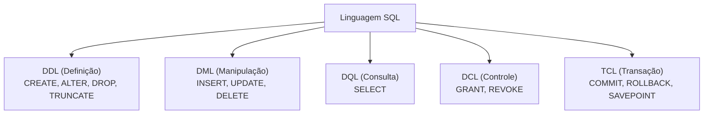
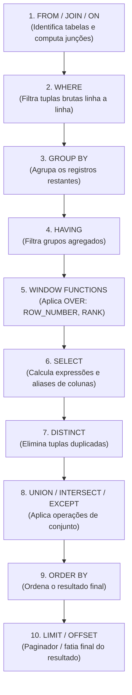

# 02 - Linguagem SQL e Objetos de Banco

> **Matéria:** Banco de Dados  
> **Cargo:** B02 – Técnico de Controle Externo – Especialidade: Tecnologia da Informação  
> **Arquivo:** `02_linguagem_sql_ddl_dml_dql_tcl_e_dcl.md`  


---


## 📌 Ementa / Itens do Edital
- Linguagem SQL (ANSI e extensões procedurais)
- Subconjuntos da SQL: DDL, DML, DQL, DCL e TCL
- Consultas avançadas: Junções (Joins), Agrupamentos, Subconsultas, CTEs e Funções de Janela
- Objetos de banco de dados: Views (padrão e materializadas), Procedures, Functions e Triggers

---

## 🧭 Sumário

1. [Subconjuntos da Linguagem SQL](#1-subconjuntos-da-linguagem-sql)
    1. [Classificação ANSI: DDL, DML, DQL, DCL e TCL](#11-classificacao-ansi-ddl-dml-dql-dcl-e-tcl)
    2. [O Duelo Clássico: DROP vs. TRUNCATE vs. DELETE](#12-o-duelo-classico-drop-vs-truncate-vs-delete)
    3. [Restrições de Integridade (Constraints) e Ações de Chave Estrangeira](#13-restricoes-de-integridade-constraints-e-acoes-de-chave-estrangeira)
    4. [Teste 245](#Teste-245)
    5. [Teste 246](#Teste-246)
    6. [Teste 247](#Teste-247)
2. [Ordem Lógica de Execução da Consulta SQL (DQL)](#2-ordem-logica-de-execucao-da-consulta-sql-dql)
    1. [Ordem Léxica (Escrita) vs. Ordem Lógica (Processamento)](#21-ordem-lexica-escrita-vs-ordem-logica-processamento)
    2. [O Conflito WHERE vs. HAVING e a Ilegalidade de Aliases](#22-o-conflito-where-vs-having-e-a-ilegalidade-de-aliases)
    3. [Teste 248](#Teste-248)
3. [Consultas Avançadas: Junções, Operadores de Conjunto e Subconsultas](#3-consultas-avancadas-juncoes-operadores-de-conjunto-e-subconsultas)
    1. [Junções (INNER, LEFT, RIGHT, FULL OUTER e CROSS JOIN)](#31-juncoes-inner-left-right-full-outer-e-cross-join)
    2. [Operadores de Conjunto (UNION vs. UNION ALL, INTERSECT, EXCEPT)](#32-operadores-de-conjunto-union-vs-union-all-intersect-except)
    3. [Lógica Ternária (Three-Valued Logic) e a Armadilha do NOT IN com NULL](#33-logica-ternaria-three-valued-logic-e-a-armadilha-do-not-in-com-null)
    4. [Common Table Expressions (CTEs) e Recursividade (WITH RECURSIVE)](#34-common-table-expressions-ctes-e-recursividade-with-recursive)
    5. [Teste 249](#Teste-249)
    6. [Teste 250](#Teste-250)
    7. [Teste 251](#Teste-251)
    8. [Teste 252](#Teste-252)
4. [Funções Analíticas de Janela (Window Functions)](#4-funcoes-analiticas-de-janela-window-functions)
    1. [Sintaxe Geral e Cláusula OVER (PARTITION BY .. ORDER BY ..)](#41-sintaxe-geral-e-clausula-over-partition-by-order-by)
    2. [Funções de Ranking: ROW_NUMBER(), RANK() e DENSE_RANK()](#42-funcoes-de-ranking-rownumber-rank-e-denserank)
    3. [Funções de Deslocamento: LEAD() e LAG()](#43-funcoes-de-deslocamento-lead-e-lag)
    4. [Teste 253](#Teste-253)
    5. [Teste 254](#Teste-254)
5. [Objetos Programáveis de Banco de Dados](#5-objetos-programaveis-de-banco-de-dados)
    1. [Visões: View Padrão vs. View Materializada (Materialized View)](#51-visoes-view-padrao-vs-view-materializada-materialized-view)
    2. [Stored Procedures vs. User-Defined Functions (UDF)](#52-stored-procedures-vs-user-defined-functions-udf)
    3. [Gatilhos (Triggers): Eventos, Momentos (BEFORE, AFTER, INSTEAD OF) e Pseudorregistros OLD/NEW](#53-gatilhos-triggers-eventos-momentos-before-after-instead-of-e-pseudorregistros-oldnew)
    4. [Teste 255](#Teste-255)
6. [🌐 Fontes Oficiais e Referências Bibliográficas](#fontes-oficiais-e-referencias-bibliograficas)

---

## 1. Subconjuntos da Linguagem SQL

A linguagem SQL (*Structured Query Language*), padronizada internacionalmente pela norma ISO/IEC 9075, é subdividida em conjuntos de comandos com finalidades operacionais distintas:



### 1.1 Classificação ANSI: DDL, DML, DQL, DCL e TCL

| Subconjunto | Denominação | Comandos Primários | Finalidade Operacional |
| :--- | :--- | :--- | :--- |
| **DDL** | *Data Definition Language* | `CREATE`, `ALTER`, `DROP`, `TRUNCATE`, `RENAME` | Criação, modificação estrutural e exclusão física de objetos no catálogo de dados (tabelas, esquemas, índices, visões). |
| **DML** | *Data Manipulation Language* | `INSERT`, `UPDATE`, `DELETE`, `MERGE` | Inserção, alteração e remoção de registros/tuplas dentro de tabelas existentes. |
| **DQL** | *Data Query Language* | `SELECT` | Consulta e recuperação de dados estruturados (frequentemente agrupada como subconjunto da DML). |
| **DCL** | *Data Control Language* | `GRANT`, `REVOKE` | Gestão de privilégios de acesso, concessão e revogação de permissões a usuários e papéis (*roles*). |
| **TCL** | *Transaction Control Language* | `COMMIT`, `ROLLBACK`, `SAVEPOINT` | Gerenciamento de blocos de transações atômicas, garantindo as propriedades ACID. |

### 1.2 O Duelo Clássico: DROP vs. TRUNCATE vs. DELETE

Um dos tópicos de maior incidência em provas da FCC para cargos de Tecnologia da Informação envolve a comparação detalhada entre as operações de remoção:

| Dimensão de Análise | `DELETE` | `TRUNCATE TABLE` | `DROP TABLE` |
| :--- | :--- | :--- | :--- |
| **Classificação Formal** | **DML** (*Manipulação*) | **DDL** (*Definição*) | **DDL** (*Definição*) |
| **Escopo de Remoção** | Linhas filtradas (`WHERE`) ou todas as linhas da tabela. | **Todas as linhas da tabela** incondicionalmente. | A **tabela inteira** (estrutura, dados e metadados no catálogo). |
| **Sobrecarga de Log (WAL/Redo)** | **Alto overhead:** Registra cada linha excluída individualmente no log de transações. | **Mínimo overhead:** Registra apenas a desalocação das páginas/extensões no disco. | **Mínimo overhead:** Registra a remoção do objeto do catálogo de dados. |
| **Velocidade de Execução** | Lento em grandes volumes de dados (milhões de linhas). | **Extremamente rápido** (quase instantâneo). | Instantâneo. |
| **Disparo de Triggers** | Dispara triggers de `DELETE` (`FOR EACH ROW` e `STATEMENT`). | **NÃO dispara** triggers de linha (`FOR EACH ROW`). | Não dispara triggers DML. |
| **Comportamento Transacional** | Suporta `ROLLBACK` em qualquer SGBD compatível com ACID. | Reversível no PostgreSQL/SQL Server; no Oracle efetua **COMMIT implícito**. | Reversível no PostgreSQL; no Oracle efetua **COMMIT implícito**. |
| **Reinício de Sequences (Identity)**| **Não reinicia** contadores de auto-incremento. | **Reinicia** os contadores de identidade para o valor inicial padrão. | A tabela deixa de existir fisicamente. |

> 🚨 **ALERTA DE PROVA / PEGADINHA FCC:**  
> A FCC adora elaborar enunciados afirmando que:
>
> 1. *"O comando TRUNCATE é uma operação DML porque manipula dados de linhas."* $\rightarrow$ **ERRADO!** O `TRUNCATE` é formalmente classificado como **DDL**, pois opera desalocando páginas físicas de armazenamento no catálogo de dados.
> 2. *"O comando TRUNCATE aciona gatilhos de auditoria FOR EACH ROW para registrar quem apagou cada linha."* $\rightarrow$ **ERRADO!** O `TRUNCATE` ignora completamente gatilhos de nível de linha!

### 1.3 Restrições de Integridade (Constraints) e Ações de Chave Estrangeira

As restrições de integridade garantem a consistência lógica dos dados no banco:

- **`PRIMARY KEY`:** Garante unicidade e impede valores nulos (`UNIQUE` + `NOT NULL`). Cada tabela pode conter apenas uma chave primária.
- **`FOREIGN KEY` (Integridade Referencial):** Impõe que o valor da coluna exista previamente na chave primária da tabela referenciada.
    - **Ações Referenciais em Deleção/Atualização (`ON DELETE` / `ON UPDATE`):**
    - `RESTRICT` / `NO ACTION`: Bloqueia e rejeita a operação no pai caso existam registros filhos dependentes (comportamento padrão).
    - `CASCADE`: Propaga a alteração/exclusão automaticamente aos filhos (se o contrato for apagado, todos os seus aditivos são apagados).
    - `SET NULL`: Atualiza o campo da chave estrangeira dos filhos para `NULL` quando o pai é excluído (exige que a coluna aceite nulos).
    - `SET DEFAULT`: Preenche a chave estrangeira dos filhos com o valor padrão configurado.
- **`UNIQUE`:** Impede valores duplicados, mas permite a inserção de valores nulos (`NULL`), exceto se combinado com `NOT NULL`.
- **`CHECK`:** Valida predicados booleanos customizados antes de persistir a tupla (ex.: `CHECK (valor_empenho > 0)`).

---

### Teste 245
**(FGV – TRT 16ª – 2022 – Analista Judiciário (Área Administrativa - Tecnologia da Informação))**
A ferramenta Zabbix 6 é amplamente usada para monitoramento de redes; sua instalação e configuração requer pacotes de terceiros. Com relação aos seus requisitos de instalação, analise os itens a seguir. I. O Zabbix é construído em torno de servidores web, servidores de banco de dados e da linguagem de script Python. II. Os servidores de bancos de dados suportados, por padrão, são MySQL, PostreSQL ou MS SQL Server. III. O frontend do Zabbix é suportado, por padrão, por servidores Web Apache. Está correto o que se afirma em

* **A)** I, II e III.
* **B)** I apenas.
* **C)** II apenas.
* **D)** III apenas.
* **E)** II e III, apenas.

---

> **Comentário Detalhado:**
>
> - **A)** **Incorreta.** A opção apresenta proposição em desacordo com os fundamentos teóricos e técnicos do tópico ao afirmar que "I, II e III". De acordo com a teoria estudada em *1.2 O Duelo Clássico: DROP vs. TRUNCATE vs. DELETE*, comportamento Transacional: Suporta `ROLLBACK` em qualquer SGBD compatível com ACID. — Reversível no PostgreSQL/SQL Server; no Oracle efetua COMMIT implícito. — Reversível no PostgreSQL; no Oracle efetua COMMIT implícito.
> - **B)** **Incorreta.** A opção incorre em restrição indevida ao limitar o escopo conceitual ao afirmar que "I apenas". De acordo com a teoria estudada em *1.3 Restrições de Integridade (Constraints) e Ações de Chave Estrangeira*, as restrições de integridade garantem a consistência lógica dos dados no banco.
> - **C)** **Incorreta.** A opção incorre em restrição indevida ao limitar o escopo conceitual ao afirmar que "II apenas". De acordo com a teoria estudada em *5.1 Visões: View Padrão vs. View Materializada (Materialized View)*, não armazena dados físicos em disco; representa apenas uma consulta SQL gravada no dicionário de dados do SGBD.
> - **D)** **Correta.** Conforme fundamentado na seção *1. Subconjuntos da Linguagem SQL* deste guia, a linguagem SQL (*Structured Query Language*), padronizada internacionalmente pela norma ISO/IEC 9075, é subdividida em conjuntos de comandos com finalidades operacionais distintas. Dessa forma, está plenamente correta a assertiva da banca (FGV – TRT 16ª/2022) ao estabelecer que "III apenas".
> - **E)** **Incorreta.** A opção incorre em restrição indevida ao limitar o escopo conceitual ao afirmar que "II e III, apenas". De acordo com a teoria estudada em *1.2 O Duelo Clássico: DROP vs. TRUNCATE vs. DELETE*, dimensão de Análise: `DELETE` — `TRUNCATE TABLE` — `DROP TABLE`.
>
> **Gabarito: D**

---

### Teste 246
**(FGV – TCE/SC – 2026 – Auditor Fiscal de Controle Externo - Ciências da Computação, Sistemas de Informação...)**
Um Auditor do TCE-SC está analisando uma base de dados de pagamentos governamentais para identificar possíveis duplicidades. Ele precisa criar uma consulta que retorne apenas os pagamentos cujo valor seja superior à média de pagamentos daquele mesmo órgão no mês correspondente. Para realizar essa análise de forma otimizada, legível, utilizando o SQL Server (T-SQL), o recurso de linguagem, entre os apresentados a seguir, mais indicado para isolar a lógica da média por órgão antes da consulta principal, é

* **A)** utilizar uma VIEW temporária indexada.
* **B)** utilizar uma Common Table Expression.
* **C)** aplicar um CROSS JOIN entre a tabela de pagamentos e a de órgãos.
* **D)** criar um CURSOR para iterar sobre cada linha da tabela.
* **E)** utilizar a função DATEDIFF dentro de um WHERE simples.

---

> **Comentário Detalhado:**
>
> - **A)** **Incorreta.** A opção apresenta proposição em desacordo com os fundamentos teóricos e técnicos do tópico ao afirmar que "utilizar uma VIEW temporária indexada". De acordo com a teoria estudada em *3.4 Common Table Expressions (CTEs) e Recursividade (WITH RECURSIVE)*, `WITH RECURSIVE`: Permite que a CTE faça referência a si mesma, viabilizando consultas em estruturas hierárquicas e em grafos (como organogramas empresariais ou árvores de dependência de processos).
> - **B)** **Correta.** Conforme fundamentado na seção *3.4 Common Table Expressions (CTEs) e Recursividade (WITH RECURSIVE)* deste guia, as Expressões de Tabela Comuns (*CTEs*) são conjuntos de resultados temporários nomeados declarados através da cláusula `WITH`. Dessa forma, está plenamente correta a assertiva da banca (FGV – TCE/SC/2026) ao estabelecer que "utilizar uma Common Table Expression".
> - **C)** **Incorreta.** A opção apresenta proposição em desacordo com os fundamentos teóricos e técnicos do tópico ao afirmar que "aplicar um CROSS JOIN entre a tabela de pagamentos e a de órgãos". De acordo com a teoria estudada em *3.1 Junções (INNER, LEFT, RIGHT, FULL OUTER e CROSS JOIN)*, `LEFT OUTER JOIN` (ou `LEFT JOIN`): Retorna todas as tuplas da tabela à esquerda (`FROM`), combinando com as tuplas da tabela à direita. Caso não haja correspondência na tabela da direita, os atributos da direita são preenchidos com valores nulos (`NULL`).
> - **D)** **Incorreta.** A opção apresenta proposição em desacordo com os fundamentos teóricos e técnicos do tópico ao afirmar que "criar um CURSOR para iterar sobre cada linha da tabela". De acordo com a teoria estudada em *1.2 O Duelo Clássico: DROP vs. TRUNCATE vs. DELETE*, dimensão de Análise: `DELETE` — `TRUNCATE TABLE` — `DROP TABLE`.
> - **E)** **Incorreta.** A opção apresenta proposição em desacordo com os fundamentos teóricos e técnicos do tópico ao afirmar que "utilizar a função DATEDIFF dentro de um WHERE simples". De acordo com a teoria estudada em *5.2 Stored Procedures vs. User-Defined Functions (UDF)*, controle Transacional: Pode executar `COMMIT` e `ROLLBACK` internamente. — Proibido gerenciar transações dentro da função.
>
> **Gabarito: B**

---

### Teste 247
**(FGV – TCE/GO – 2024 – Analista de Controle Externo - Tecnologia da Informação)**
Considere um banco de dados relacional de um tribunal, na qual nenhum usuário, a menos do DBA, possua algum privilégio sobre. O DBA concedeu direito de criação de tabelas ao usuário USR_0010, que, por sua vez, criou as tabelas DADOS_PROCESSO e DADOS_PARTE. Logo após a criação, o usuário USR_0010 executou os seguintes comandos da DCL (Data Control Language) da linguagem SQL no sistema gerenciador de banco de dados, referentes aos usuários USR_0011 e USR_0100: GRANT SELECT, UPDATE ON DADO_PARTE TO USR_0011; GRANT SELECT ON DADOS_PARTE TO USR_0100; GRANT SELECT, INSERT, DELETE, UPDATE ON DADOS_PROCESSO TO USR_0011; GRANT SELECT, UPDATE ON DADOS_PROCESSO TO USR_0100 WITH GRANT OPTION; Na sequência, o usuário USR_0100 executou o seguinte comando: GRANT UPDATE ON DADOS_PROCESSO TO USR_00101; Por fim, o DBA executou o comando: REVOKE UPDATE ON DADOS_PROCESSO FROM USR_0100; Considerando esse cenário, qual situação é válida para as permissões referentes às tabelas DADOS_PROCESSO e DADOS_PARTE?

* **A)** O usuário USR_0011 tem direito de inserção na tabela DADOS_PARTE.
* **B)** O usuário USR_0100 tem direito de atualização na tabela DADOS_PROCESSO, mas sem direito de propagação.
* **C)** O usuário USR_0100 tem direito de consulta na tabela DADOS_PROCESSO, com direito de propagação.
* **D)** O usuário USR_0101 tem direito de atualização na tabela DADOS_PROCESSO.
* **E)** O usuário USR_0101 tem direito de consulta na tabela DADOS_PROCESSO.

---

> **Comentário Detalhado:**
>
> - **A)** **Incorreta.** A opção apresenta proposição em desacordo com os fundamentos teóricos e técnicos do tópico ao afirmar que "O usuário USR_0011 tem direito de inserção na tabela DADOS_PARTE". De acordo com a teoria estudada em *1.1 Classificação ANSI: DDL, DML, DQL, DCL e TCL*, dML: *Data Manipulation Language* — `INSERT`, `UPDATE`, `DELETE`, `MERGE` — Inserção, alteração e remoção de registros/tuplas dentro de tabelas existentes.
> - **B)** **Incorreta.** A opção apresenta proposição em desacordo com os fundamentos teóricos e técnicos do tópico ao afirmar que "O usuário USR_0100 tem direito de atualização na tabela DADOS_PROCESSO, mas sem direito de propagação". De acordo com a teoria estudada em *1.1 Classificação ANSI: DDL, DML, DQL, DCL e TCL*, dQL: *Data Query Language* — `SELECT` — Consulta e recuperação de dados estruturados (frequentemente agrupada como subconjunto da DML).
> - **C)** **Correta.** Conforme fundamentado na seção *1.1 Classificação ANSI: DDL, DML, DQL, DCL e TCL* deste guia, dCL: *Data Control Language* — `GRANT`, `REVOKE` — Gestão de privilégios de acesso, concessão e revogação de permissões a usuários e papéis (*roles*). Dessa forma, está plenamente correta a assertiva da banca (FGV – TCE/GO/2024) ao estabelecer que "O usuário USR_0100 tem direito de consulta na tabela DADOS_PROCESSO, com direito de propagação".
> - **D)** **Incorreta.** A opção apresenta proposição em desacordo com os fundamentos teóricos e técnicos do tópico ao afirmar que "O usuário USR_0101 tem direito de atualização na tabela DADOS_PROCESSO". De acordo com a teoria estudada em *1.1 Classificação ANSI: DDL, DML, DQL, DCL e TCL*, dDL: *Data Definition Language* — `CREATE`, `ALTER`, `DROP`, `TRUNCATE`, `RENAME` — Criação, modificação estrutural e exclusão física de objetos no catálogo de dados (tabelas, esquemas, índices, visões).
> - **E)** **Incorreta.** A opção apresenta proposição em desacordo com os fundamentos teóricos e técnicos do tópico ao afirmar que "O usuário USR_0101 tem direito de consulta na tabela DADOS_PROCESSO". De acordo com a teoria estudada em *5.1 Visões: View Padrão vs. View Materializada (Materialized View)*, não armazena dados físicos em disco; representa apenas uma consulta SQL gravada no dicionário de dados do SGBD.
>
> **Gabarito: C**

---

## 2. Ordem Lógica de Execução da Consulta SQL (DQL)

Ao escrever uma consulta com a cláusula `SELECT`, a ordem sintática da escrita (ordem léxica) é muito diferente da **ordem lógica de processamento** adotada pelo otimizador de consultas do SGBD:



### 2.1 Ordem Léxica (Escrita) vs. Ordem Lógica (Processamento)

A ordem lógica executada pelo motor relacional é rigorosamente:

1. **`FROM` e `JOIN / ON`:** Identifica as relações de entrada e calcula produtos cartesianos e junções;
2. **`WHERE`:** Aplica filtros booleanos linha a linha antes de qualquer agregação;
3. **`GROUP BY`:** Agrupa as linhas restantes em blocos lógicos baseados nas chaves de agrupamento;
4. **`HAVING`:** Aplica filtros booleanos sobre os grupos agregados gerados;
5. **`WINDOW` (Funções de Janela):** Computa partições e ordenações analíticas (`OVER`);
6. **`SELECT`:** Avalia as expressões da lista de projeção e atribui apelidos de colunas (*aliases*);
7. **`DISTINCT`:** Elimina tuplas que apresentem valores rigorosamente idênticos na projeção;
8. **`UNION / INTERSECT / EXCEPT`:** Executa operações de conjuntos de linhas;
9. **`ORDER BY`:** Ordena as tuplas resultantes para exibição;
10. **`LIMIT / OFFSET`:** Extrai a fatia dimensional delimitada para paginação.

### 2.2 O Conflito WHERE vs. HAVING e a Ilegalidade de Aliases

Compreender essa cronologia lógica resolve duas das questões mais frequentes da FCC:

1. **Ilegalidade de Aliases no `WHERE`:**  
   Como a cláusula `WHERE` (etapa 2) é processada **muito antes da cláusula `SELECT`** (etapa 6), qualquer apelido de coluna (*alias*) criado no `SELECT` ainda não existe no catálogo de símbolos durante a avaliação do `WHERE`.  
   *Código Inválido:* `SELECT salario * 1.1 AS novo_salario FROM servidor WHERE novo_salario > 5000;` *(Gera erro de coluna inexistente!)*.
2. **`WHERE` vs. `HAVING`:**  
    - O **`WHERE`** filtra registros **individuais** antes da formação dos grupos e **rejeita terminantemente funções agregadas** (ex.: `WHERE SUM(valor) > 100` é sintaticamente inválido).
    - O **`HAVING`** filtra **grupos agregados** já sumarizados pelo `GROUP BY` e aceita funções agregadas (ex.: `HAVING SUM(valor) > 100`).

---

### Teste 248
**(FGV – TRT/DA – 2025 – Analista Judiciario Area Apoio Especializado Tecnologia Da Informacao)**
O PostgreSQL é um SGBD gratuito de código aberto que suporta consultas relacionais em linguagem SQL. Com relação ao SQL do PostgreSQL, analise as afirmativas a seguir. I. A cláusula GROUP BY agrupa linhas com os mesmos valores em linhas de resumo, sendo frequentemente usada com funções de agregação como, por exemplo, COUNT( ), MAX( ), MIN( ), SUM( ) e AVG( ), para agrupar um conjunto de resultados de uma ou mais colunas. II. O operador HAVING foi adicionado ao SQL porque o WHERE não pode ser usado com funções de agregação, as quais são frequentemente usadas com a cláusula GROUP BY. Ao adicionar o HAVING é possível escrever condições similares às das cláusulas WHERE. III. A expressão CASE testa condições e retorna um valor quando a primeira condição é atendida (como uma instrução if-then- else); quando a condição seja verdadeira, ele parará a leitura e retornará o resultado, mas, se nenhuma condição for verdadeira, ele retornará o valor da cláusula ELSE. Caso não houver nenhum ELSE e nenhuma condição for verdadeira, ele retornará o valor NULL. Está correto o que se afirma em

* **A)** I e II, apenas.
* **B)** I e III, apenas.
* **C)** II e III, apenas.
* **D)** I e IV, apenas.
* **E)** III e IV, apenas.

---

> **Comentário Detalhado:**
>
> - **A)** **Incorreta.** A opção incorre em restrição indevida ao limitar o escopo conceitual ao afirmar que "I e II, apenas". De acordo com a teoria estudada em *2. Ordem Lógica de Execução da Consulta SQL (DQL)*, ao escrever uma consulta com a cláusula `SELECT`, a ordem sintática da escrita (ordem léxica) é muito diferente da ordem lógica de processamento adotada pelo otimizador de consultas do SGBD.
> - **B)** **Correta.** Conforme fundamentado na seção *2.2 O Conflito WHERE vs. HAVING e a Ilegalidade de Aliases* deste guia, o `HAVING` filtra grupos agregados já sumarizados pelo `GROUP BY` e aceita funções agregadas (ex.: `HAVING SUM(valor) > 100`). Dessa forma, está plenamente correta a assertiva da banca (FGV – TRT/DA/2025) ao estabelecer que "I e III, apenas".
> - **C)** **Incorreta.** A opção incorre em restrição indevida ao limitar o escopo conceitual ao afirmar que "II e III, apenas". De acordo com a teoria estudada em *2.2 O Conflito WHERE vs. HAVING e a Ilegalidade de Aliases*, o `WHERE` filtra registros individuais antes da formação dos grupos e rejeita terminantemente funções agregadas (ex.: `WHERE SUM(valor) > 100` é sintaticamente inválido).
> - **D)** **Incorreta.** A opção incorre em restrição indevida ao limitar o escopo conceitual ao afirmar que "I e IV, apenas". De acordo com a teoria estudada em *1.2 O Duelo Clássico: DROP vs. TRUNCATE vs. DELETE*, comportamento Transacional: Suporta `ROLLBACK` em qualquer SGBD compatível com ACID. — Reversível no PostgreSQL/SQL Server; no Oracle efetua COMMIT implícito. — Reversível no PostgreSQL; no Oracle efetua COMMIT implícito.
> - **E)** **Incorreta.** A opção incorre em restrição indevida ao limitar o escopo conceitual ao afirmar que "III e IV, apenas". De acordo com a teoria estudada em *3.3 Lógica Ternária (Three-Valued Logic) e a Armadilha do NOT IN com NULL*, resultado Catastrófico: A consulta retornará ZERO LINHAS (conjunto vazio)!.
>
> **Gabarito: B**

---

## 3. Consultas Avançadas: Junções, Operadores de Conjunto e Subconsultas

### 3.1 Junções (INNER, LEFT, RIGHT, FULL OUTER e CROSS JOIN)

- **`INNER JOIN`:** Retorna exclusivamente as tuplas que possuem correspondência em ambas as tabelas com base na condição de junção (`ON`). Linhas sem correspondência são sumariamente descartadas.
- **`LEFT OUTER JOIN` (ou `LEFT JOIN`):** Retorna todas as tuplas da tabela à esquerda (`FROM`), combinando com as tuplas da tabela à direita. Caso não haja correspondência na tabela da direita, os atributos da direita são preenchidos com valores nulos (`NULL`).
- **`RIGHT OUTER JOIN` (ou `RIGHT JOIN`):** Comportamento inverso do LEFT JOIN: preserva todas as tuplas da tabela da direita, preenchendo com `NULL` as ausências da tabela da esquerda.
- **`FULL OUTER JOIN`:** Preserva todas as tuplas de ambas as tabelas. Quando não há correspondência mútua, preenche com `NULL` os atributos correspondentes.
- **`CROSS JOIN`:** Produz o produto cartesiano irrestrito entre as tabelas (cada linha da primeira tabela é combinada com todas as linhas da segunda).

### 3.2 Operadores de Conjunto (UNION vs. UNION ALL, INTERSECT, EXCEPT)

- **`UNION` vs. `UNION ALL`:**
    - **`UNION`:** Combina os resultados de duas consultas com compatibilidade de esquema e executa um algoritmo interno de ordenação/hashing para **eliminar compulsoriamente linhas duplicadas**.
    - **`UNION ALL`:** Apenas concatena as duas listas de tuplas, **preservando todas as duplicatas intactas**. Possui desempenho computacional dramaticamente superior ao `UNION`.
- **`INTERSECT`:** Retorna apenas as tuplas que constam simultaneamente em ambas as consultas, eliminando duplicatas.
- **`EXCEPT` (ou `MINUS` no Oracle):** Retorna as tuplas da primeira consulta que não estão presentes na segunda consulta.

### 3.3 Lógica Ternária (Three-Valued Logic) e a Armadilha do NOT IN com NULL

Em SQL, qualquer comparação direta com valor nulo (`coluna = NULL` ou `coluna != NULL`) avalia como **`UNKNOWN`** (*Desconhecido*), e não como `TRUE` nem `FALSE`. Para testar nulos, deve-se usar estritamente `IS NULL` ou `IS NOT NULL`.

> 🚨 **ALERTA DE PROVA / PEGADINHA FCC:**  
> A armadilha clássica da FCC em subconsultas:  
> Considere a consulta: `SELECT nome FROM cliente WHERE id NOT IN (SELECT id_cliente FROM divida);`  
>
> - Se a tabela `divida` contiver **ao menos UM único registro cujo `id_cliente` seja `NULL`**, a subconsulta retornará o valor `NULL`.  
> - Como o predicado desdobra-se em: `id != 1 AND id != 2 AND id != NULL`, e qualquer comparação com `NULL` resulta em `UNKNOWN`, a expressão inteira avaliará como `UNKNOWN` para todas as linhas!  
> - **Resultado Catastrófico:** A consulta retornará **ZERO LINHAS (conjunto vazio)**!  
> - **Solução Recomendada:** Utilizar sempre a construção com **`NOT EXISTS`** correlacionado, imune a valores nulos.

### 3.4 Common Table Expressions (CTEs) e Recursividade (WITH RECURSIVE)

As Expressões de Tabela Comuns (*CTEs*) são conjuntos de resultados temporários nomeados declarados através da cláusula `WITH`:

```sql
WITH AuditoriasRecentes AS (
    SELECT auditor_id, COUNT(*) AS total
    FROM fiscalizacao
    WHERE data_inspecao >= '2026-01-01'
    GROUP BY auditor_id
)
SELECT a.nome, ar.total
FROM auditor a
JOIN AuditoriasRecentes ar ON a.id = ar.auditor_id;
```

- **`WITH RECURSIVE`:** Permite que a CTE faça referência a si mesma, viabilizando consultas em estruturas hierárquicas e em grafos (como organogramas empresariais ou árvores de dependência de processos).

---

### Teste 249
**(CEBRASPE – STF – 2013 – Analista Judiciario Suporte Em Tecnologia Da Informacao)**
No SQL Server, o uso de variáveis de tabela permite aumentar o desempenho de determinadas consultas.

* **C)** Certo
* **E)** Errado

---

> **Comentário Detalhado:**
>
> - **C)** **Incorreta.** A marcação como **Certo** não procede, pois o enunciado apresenta proposição em desacordo com os fundamentos teóricos e técnicos do tópico ao afirmar que "No SQL Server, o uso de variáveis de tabela permite aumentar o desempenho de determinadas consultas". De acordo com a teoria estudada em *3.4 Common Table Expressions (CTEs) e Recursividade (WITH RECURSIVE)*, `WITH RECURSIVE`: Permite que a CTE faça referência a si mesma, viabilizando consultas em estruturas hierárquicas e em grafos (como organogramas empresariais ou árvores de dependência de processos).
> - **E)** **Correta.** O item está **Errado** (gabarito oficial: **E**). Conforme fundamentado na seção *1.2 O Duelo Clássico: DROP vs. TRUNCATE vs. DELETE* deste guia, comportamento Transacional: Suporta `ROLLBACK` em qualquer SGBD compatível com ACID. — Reversível no PostgreSQL/SQL Server; no Oracle efetua COMMIT implícito. — Reversível no PostgreSQL; no Oracle efetua COMMIT implícito. Portanto, a assertiva examinada pela banca (CEBRASPE – STF/2013) viola os preceitos técnicos do tópico.
>
> **Gabarito: E**

---

### Teste 250
**(FGV – TCE/SC – 2026 – Auditor Fiscal de Controle Externo - Administração)**
O Auditor está operando um banco de dados relacional que contém a tabela CONTRATOS. Ele precisa contar quantos contratos ativos existem para o município de ‘Florianópolis’. O comando SQL que executa essa tarefa corretamente é

* **A)** SELECT SUM(contratos) FROM Contratos WHERE municipio = ‘Florianópolis’;
* **B)** SELECT COUNT(*) FROM Contratos WHERE municipio = ‘Florianópolis’;
* **C)** SELECT DISTINCT(*) FROM Contratos WHERE municipio = ‘Florianópolis’;
* **D)** SELECT ALL FROM Contratos GROUP BY municipio;
* **E)** SELECT SEARCH contratos WHERE municipio = ‘Florianópolis’;

---

> **Comentário Detalhado:**
>
> - **A)** **Incorreta.** A opção apresenta proposição em desacordo com os fundamentos teóricos e técnicos do tópico ao afirmar que "SELECT SUM(contratos) FROM Contratos WHERE municipio = ‘Florianópolis’". De acordo com a teoria estudada em *2.2 O Conflito WHERE vs. HAVING e a Ilegalidade de Aliases*, *Código Inválido:* `SELECT salario * 1.1 AS novo_salario FROM servidor WHERE novo_salario > 5000;` *(Gera erro de coluna inexistente!)*.
> - **B)** **Correta.** Conforme fundamentado na seção *3.3 Lógica Ternária (Three-Valued Logic) e a Armadilha do NOT IN com NULL* deste guia, considere a consulta: `SELECT nome FROM cliente WHERE id NOT IN (SELECT id_cliente FROM divida);`. Dessa forma, está plenamente correta a assertiva da banca (FGV – TCE/SC/2026) ao estabelecer que "SELECT COUNT(*) FROM Contratos WHERE municipio = ‘Florianópolis’".
> - **C)** **Incorreta.** A opção apresenta proposição em desacordo com os fundamentos teóricos e técnicos do tópico ao afirmar que "SELECT DISTINCT(*) FROM Contratos WHERE municipio = ‘Florianópolis’". De acordo com a teoria estudada em *5.2 Stored Procedures vs. User-Defined Functions (UDF)*, invocação: Comando explícito `CALL procedure_name(args);` — Invocada inline em comandos SQL: `SELECT func(x) FROM tab;`.
> - **D)** **Incorreta.** A opção apresenta proposição em desacordo com os fundamentos teóricos e técnicos do tópico ao afirmar que "SELECT ALL FROM Contratos GROUP BY municipio". De acordo com a teoria estudada em *2.2 O Conflito WHERE vs. HAVING e a Ilegalidade de Aliases*, o `HAVING` filtra grupos agregados já sumarizados pelo `GROUP BY` e aceita funções agregadas (ex.: `HAVING SUM(valor) > 100`).
> - **E)** **Incorreta.** A opção apresenta proposição em desacordo com os fundamentos teóricos e técnicos do tópico ao afirmar que "SELECT SEARCH contratos WHERE municipio = ‘Florianópolis’". De acordo com a teoria estudada em *2.2 O Conflito WHERE vs. HAVING e a Ilegalidade de Aliases*, como a cláusula `WHERE` (etapa 2) é processada muito antes da cláusula `SELECT` (etapa 6), qualquer apelido de coluna (*alias*) criado no `SELECT` ainda não existe no catálogo de símbolos durante a avaliação do `WHERE`.
>
> **Gabarito: B**

---

### Teste 251
**(CEBRASPE – STJ – 2015 – Analista Judiciario Suporte Em Tecnologia Da Informacao)**
O uso de stored procedures, que são consultas previamente compiladas e armazenadas em um servidor sob a forma de procedimentos, é um meio de reduzir o custo de comunicação e de compilações SQL em banco de dados do tipo cliente-servidor.

* **C)** Certo
* **E)** Errado

---

> **Comentário Detalhado:**
>
> - **C)** **Correta.** O item está **Certo**. Conforme fundamentado na seção *5.2 Stored Procedures vs. User-Defined Functions (UDF)* deste guia, invocação: Comando explícito `CALL procedure_name(args);` — Invocada inline em comandos SQL: `SELECT func(x) FROM tab;`. Dessa forma, está plenamente correta a proposição da banca (CEBRASPE – STJ/2015) ao afirmar que "O uso de stored procedures, que são consultas previamente compiladas e armazenadas em um servidor sob a forma...".
> - **E)** **Incorreta.** A marcação como **Errado** não procede, visto que a assertiva guarda integral conformidade com a teoria estudada em *5.2 Stored Procedures vs. User-Defined Functions (UDF)*, segundo a qual efeitos Colaterais: Permite alterar esquemas e dados via DDL e DML livremente. — Deve evitar efeitos colaterais para manter a integridade referencial.
>
> **Gabarito: C**

---

### Teste 252
**(FGV – TJ/AP – 2023 – Analista Judiciario Apoio Especializado Tecnologia Da Informacao Banco De Dados)**
João, administrador de banco de dados MySQL, deverá realizar, periodicamente, o backup lógico completo do banco de dados "tjap_db". Para isso, João deverá utilizar o comando:

* **A)** backup -u root -p tjap_db > backup.sql;
* **B)** mydump -u root -p tjap_db > backup.sql;
* **C)** mybackup -u root -p tjap_db > backup.sql;
* **D)** mysqldump -u root -p tjap_db > backup.sql;
* **E)** select * from tjap_db into outfile backup.sql;

---

> **Comentário Detalhado:**
>
> - **A)** **Incorreta.** A opção apresenta proposição em desacordo com os fundamentos teóricos e técnicos do tópico ao afirmar que "backup -u root -p tjap_db > backup.sql". De acordo com a teoria estudada em *5.1 Visões: View Padrão vs. View Materializada (Materialized View)*, não armazena dados físicos em disco; representa apenas uma consulta SQL gravada no dicionário de dados do SGBD.
> - **B)** **Incorreta.** A opção apresenta proposição em desacordo com os fundamentos teóricos e técnicos do tópico ao afirmar que "mydump -u root -p tjap_db > backup.sql". De acordo com a teoria estudada em *3.3 Lógica Ternária (Three-Valued Logic) e a Armadilha do NOT IN com NULL*, em SQL, qualquer comparação direta com valor nulo (`coluna = NULL` ou `coluna != NULL`) avalia como `UNKNOWN` (*Desconhecido*), e não como `TRUE` nem `FALSE`. Para testar nulos, deve-se usar estritamente `IS NULL` ou `IS NOT NULL`.
> - **C)** **Incorreta.** A opção apresenta proposição em desacordo com os fundamentos teóricos e técnicos do tópico ao afirmar que "mybackup -u root -p tjap_db > backup.sql". De acordo com a teoria estudada em *1. Subconjuntos da Linguagem SQL*, a linguagem SQL (*Structured Query Language*), padronizada internacionalmente pela norma ISO/IEC 9075, é subdividida em conjuntos de comandos com finalidades operacionais distintas.
> - **D)** **Correta.** Conforme fundamentado na seção *5.2 Stored Procedures vs. User-Defined Functions (UDF)* deste guia, invocação: Comando explícito `CALL procedure_name(args);` — Invocada inline em comandos SQL: `SELECT func(x) FROM tab;`. Dessa forma, está plenamente correta a assertiva da banca (FGV – TJ/AP/2023) ao estabelecer que "mysqldump -u root -p tjap_db > backup.sql".
> - **E)** **Incorreta.** A opção apresenta proposição em desacordo com os fundamentos teóricos e técnicos do tópico ao afirmar que "select * from tjap_db into outfile backup.sql". De acordo com a teoria estudada em *3.3 Lógica Ternária (Three-Valued Logic) e a Armadilha do NOT IN com NULL*, considere a consulta: `SELECT nome FROM cliente WHERE id NOT IN (SELECT id_cliente FROM divida);`.
>
> **Gabarito: D**

---

## 4. Funções Analíticas de Janela (Window Functions)

Diferente da cláusula `GROUP BY` (que colapsa múltiplas linhas em um único registro agregado por partição), as **funções de janela (*Window Functions*)** realizam cálculos agregados e analíticos **sem colapsar as tuplas**, preservando a identidade e o detalhe de cada linha individual.

### 4.1 Sintaxe Geral e Cláusula OVER (PARTITION BY .. ORDER BY ..)

```sql
FUNCAO_ANALITICA() OVER (
    PARTITION BY coluna_agrupamento
    ORDER BY coluna_ordenacao DESC
    ROWS BETWEEN UNBOUNDED PRECEDING AND CURRENT ROW
)
```

- **`PARTITION BY`:** Divide o conjunto de resultados em janelas lógicas independentes (equivalente ao agrupamento, sem colapsar linhas).
- **`ORDER BY`:** Define a ordem de processamento das tuplas dentro de cada partição.
- **`Frame Specification` (`ROWS / RANGE`):** Delimita o subconjunto deslizante de linhas que compõem o cálculo da janela (ex.: médias móveis).

### 4.2 Funções de Ranking: ROW_NUMBER(), RANK() e DENSE_RANK()

Considere quatro servidores avaliados por salário dentro de uma partição: Ana (10.000), Carlos (10.000), Beatriz (10.000) e Daniel (8.000):

| Servidor | Salário | `ROW_NUMBER()` | `RANK()` | `DENSE_RANK()` |
| :--- | :---: | :---: | :---: | :---: |
| Ana | 10.000 | **1** | **1** | **1** |
| Beatriz | 10.000 | **2** | **1** | **1** |
| Carlos | 10.000 | **3** | **1** | **1** |
| Daniel | 8.000 | **4** | **4** *(Pula 2 e 3)* | **2** *(Não pula números)* |

- **`ROW_NUMBER()`:** Atribui um número inteiro sequencial e estritamente exclusivo a cada linha da partição (1, 2, 3, 4..). Desconsidera empates.
- **`RANK()`:** Atribui a mesma posição a valores empatados, porém **pula números na sequência** proporcionalmente ao tamanho do empate (deixa lacunas no ranking).
- **`DENSE_RANK()`:** Atribui a mesma posição a valores empatados, porém **NÃO pula números na sequência**; a numeração subsequente continua estritamente consecutiva (ranking denso sem lacunas).

### 4.3 Funções de Deslocamento: LEAD() e LAG()

Permitem acessar dados de linhas vizinhas na mesma partição sem necessidade de efetuar auto-junções (*self-joins*) lentas:

- **`LAG(coluna, N, valor_padrao)`:** Retorna o valor da coluna correspondente a $N$ linhas **anteriores** à linha corrente.
- **`LEAD(coluna, N, valor_padrao)`:** Retorna o valor da coluna correspondente a $N$ linhas **posteriores** à linha corrente.

---

### Teste 253
**(FGV – TCE/SC – 2026 – Auditor Fiscal de Controle Externo - Administração)**
Um Auditor está montando um fluxo de dados que extrai informações de um banco de dados SQL, de notas fiscais eletrônicas em formato JSON e de relatórios em PDF com texto livre. Assinale a opção que indica a classificação desses três tipos de dados, respectivamente.

* **A)** Estruturados, Semiestruturados e Não Estruturados.
* **B)** Não Estruturados, Estruturados e Semiestruturados.
* **C)** Semiestruturados, Estruturados e Não Estruturados.
* **D)** Estruturados, Não Estruturados e Semiestruturados.
* **E)** Todos são classificados como Estruturados após o processo de ETL.

---

> **Comentário Detalhado:**
>
> - **A)** **Correta.** Conforme fundamentado na seção *1.1 Classificação ANSI: DDL, DML, DQL, DCL e TCL* deste guia, dQL: *Data Query Language* — `SELECT` — Consulta e recuperação de dados estruturados (frequentemente agrupada como subconjunto da DML). Dessa forma, está plenamente correta a assertiva da banca (FGV – TCE/SC/2026) ao estabelecer que "Estruturados, Semiestruturados e Não Estruturados".
> - **B)** **Incorreta.** A opção apresenta proposição em desacordo com os fundamentos teóricos e técnicos do tópico ao afirmar que "Não Estruturados, Estruturados e Semiestruturados". De acordo com a teoria estudada em *1.3 Restrições de Integridade (Constraints) e Ações de Chave Estrangeira*, as restrições de integridade garantem a consistência lógica dos dados no banco.
> - **C)** **Incorreta.** A opção apresenta proposição em desacordo com os fundamentos teóricos e técnicos do tópico ao afirmar que "Semiestruturados, Estruturados e Não Estruturados". De acordo com a teoria estudada em *5.3 Gatilhos (Triggers): Eventos, Momentos (BEFORE, AFTER, INSTEAD OF) e Pseudorregistros OLD/NEW*, gatilhos (*Triggers*) são blocos de código procedurais executados automaticamente pelo motor de banco de dados quando eventos DML específicos ocorrem em uma tabela.
> - **D)** **Incorreta.** A opção apresenta proposição em desacordo com os fundamentos teóricos e técnicos do tópico ao afirmar que "Estruturados, Não Estruturados e Semiestruturados". De acordo com a teoria estudada em *5.1 Visões: View Padrão vs. View Materializada (Materialized View)*, não armazena dados físicos em disco; representa apenas uma consulta SQL gravada no dicionário de dados do SGBD.
> - **E)** **Incorreta.** A opção apresenta proposição em desacordo com os fundamentos teóricos e técnicos do tópico ao afirmar que "Todos são classificados como Estruturados após o processo de ETL". De acordo com a teoria estudada em *Pseudorregistros de Contexto:*, `NEW`: Representa o estado da linha após a modificação proposta.
>
> **Gabarito: A**

---

### Teste 254
**(FCC – TRT 14ª – 2016 – Analista Judiciário - Apoio Especializado - Tecnologia da Informação)**
Uma tabela de um banco de dados Oracle chamada funcionarios possui os campos id, nome e salario. Um Analista deseja realizar uma consulta nesta tabela, que exiba o id, o nome dos funcionários, o salário e o salário acrescido de 12,5%. O salário com o acréscimo deverá ser mostrado como um número inteiro e a coluna deverá ser nomeada Salário Reajustado. A instrução SQL que deverá ser digitada pelo Analista é

* **A)** SELECT id, nome, salario, TO_INT(salario * 1.125,0) AS "Salário Reajustado" FROM funcionarios;
* **B)** SELECT id, nome, salario, ARRED(salario * 1.125) AS "Salário Reajustado" FROM funcionarios;
* **C)** SELECT id, nome, salario, ROUND(salario * 1.125, 0) "Salário Reajustado" FROM funcionarios;
* **D)** SELECT id, nome, salario, TRUNC(salario * 1.125) 'Salário Reajustado' FROM funcionarios;
* **E)** SELECT id, nome, salario, TO_INTEGER(salario * 1.125) AS "Salário Reajustado" FROM funcionarios;

---

> **Comentário Detalhado:**
>
> - **A)** **Correta.** Conforme fundamentado na seção *3.3 Lógica Ternária (Three-Valued Logic) e a Armadilha do NOT IN com NULL* deste guia, considere a consulta: `SELECT nome FROM cliente WHERE id NOT IN (SELECT id_cliente FROM divida);`. Dessa forma, está plenamente correta a assertiva da banca (FCC – TRT 14ª/2016) ao estabelecer que "SELECT id, nome, salario, TO_INT(salario * 1.125,0) AS "Salário Reajustado" FROM funcionarios".
> - **B)** **Incorreta.** A opção apresenta proposição em desacordo com os fundamentos teóricos e técnicos do tópico ao afirmar que "SELECT id, nome, salario, ARRED(salario * 1.125) AS "Salário Reajustado" FROM funcionarios". De acordo com a teoria estudada em *2.2 O Conflito WHERE vs. HAVING e a Ilegalidade de Aliases*, *Código Inválido:* `SELECT salario * 1.1 AS novo_salario FROM servidor WHERE novo_salario > 5000;` *(Gera erro de coluna inexistente!)*.
> - **C)** **Incorreta.** A opção apresenta proposição em desacordo com os fundamentos teóricos e técnicos do tópico ao afirmar que "SELECT id, nome, salario, ROUND(salario * 1.125, 0) "Salário Reajustado" FROM funcionarios". De acordo com a teoria estudada em *5.2 Stored Procedures vs. User-Defined Functions (UDF)*, invocação: Comando explícito `CALL procedure_name(args);` — Invocada inline em comandos SQL: `SELECT func(x) FROM tab;`.
> - **D)** **Incorreta.** A opção apresenta proposição em desacordo com os fundamentos teóricos e técnicos do tópico ao afirmar que "SELECT id, nome, salario, TRUNC(salario * 1.125) 'Salário Reajustado' FROM funcionarios". De acordo com a teoria estudada em *5.1 Visões: View Padrão vs. View Materializada (Materialized View)*, trade-off: Os dados ficam estáticos/defasados até que um comando de atualização explícito seja disparado: `REFRESH MATERIALIZED VIEW nome_da_view;`.
> - **E)** **Incorreta.** A opção apresenta proposição em desacordo com os fundamentos teóricos e técnicos do tópico ao afirmar que "SELECT id, nome, salario, TO_INTEGER(salario * 1.125) AS "Salário Reajustado" FROM funcionarios". De acordo com a teoria estudada em *4.2 Funções de Ranking: ROW_NUMBER(), RANK() e DENSE_RANK()*, considere quatro servidores avaliados por salário dentro de uma partição: Ana (10.000), Carlos (10.000), Beatriz (10.000) e Daniel (8.000).
>
> **Gabarito: A**

---

## 5. Objetos Programáveis de Banco de Dados

### 5.1 Visões: View Padrão vs. View Materializada (Materialized View)

- **View Padrão (Virtual View):**
    - Não armazena dados físicos em disco; representa apenas uma consulta SQL gravada no dicionário de dados do SGBD.
    - A cada execução de um `SELECT` contra a View, o otimizador expande a consulta subjacente e varre as tabelas base em tempo real.
    - Vantagens: Dados sempre 100% atualizados; atua como camada de segurança e abstração (ocultando colunas confidenciais).
- **View Materializada (*Materialized View*):**
    - O resultado da consulta é **gravado e persistido fisicamente em disco** como uma tabela real.
    - Proporciona leituras de altíssima velocidade em consultas analíticas pesadas com múltiplos `JOINs` e agregações complexas.
    - **Trade-off:** Os dados ficam estáticos/defasados até que um comando de atualização explícito seja disparado: `REFRESH MATERIALIZED VIEW nome_da_view;`.

### 5.2 Stored Procedures vs. User-Defined Functions (UDF)

| Dimensão Técnica | Stored Procedure | User-Defined Function (UDF) |
| :--- | :--- | :--- |
| **Invocação** | Comando explícito `CALL procedure_name(args);` | Invocada inline em comandos SQL: `SELECT func(x) FROM tab;` |
| **Retorno Obrigatório** | **Não possui retorno obrigatório** (utiliza parâmetros `OUT`/`INOUT`). | **Exige compulsoriamente a cláusula `RETURNS`** (escalar ou tabela). |
| **Controle Transacional** | **Pode executar `COMMIT` e `ROLLBACK` internamente.** | **Proibido gerenciar transações** dentro da função. |
| **Efeitos Colaterais** | Permite alterar esquemas e dados via DDL e DML livremente. | Deve evitar efeitos colaterais para manter a integridade referencial. |

### 5.3 Gatilhos (Triggers): Eventos, Momentos (BEFORE, AFTER, INSTEAD OF) e Pseudorregistros OLD/NEW

Gatilhos (*Triggers*) são blocos de código procedurais executados automaticamente pelo motor de banco de dados quando eventos DML específicos ocorrem em uma tabela:

#### Pseudorregistros de Contexto:
- **`OLD`:** Representa o estado da linha **antes** da modificação.
    - No `INSERT`: É nulo/indefinido (não existia linha prévia).
    - No `UPDATE`: Contém os valores originais da linha.
    - No `DELETE`: Contém os valores da linha que está sendo removida.
- **`NEW`:** Representa o estado da linha **após** a modificação proposta.
    - No `INSERT`: Contém os valores da nova linha a ser inserida.
    - No `UPDATE`: Contém os novos valores propostos.
    - No `DELETE`: É nulo/indefinido (a linha deixará de existir).

#### Momentos de Disparo (*Timing*):
- **`BEFORE`:** Executado antes que a modificação seja persistida no disco. Ideal para **validação de dados**, enriquecimento de campos e integridade de negócio. Permite alterar os valores de `NEW` antes da gravação.
- **`AFTER`:** Executado após a modificação ser gravada no disco. Ideal para **gravação em tabelas de auditoria** e disparos de notificações assíncronas.
- **`INSTEAD OF`:** Intercepta a instrução DML e executa a rotina do gatilho no lugar da operação original. É a solução canônica para permitir operações de `INSERT`, `UPDATE` e `DELETE` em **visões (Views) complexas não-atualizáveis**.

---

### Teste 255
**(FGV – TJ/RR – 2024 – Analista Judiciario Infraestrutura De Tecnologia Da Informacao)**
O administrador de banco de dados MySQL de um certo tribunal precisa restaurar o banco de dados MySQL, chamado "tjdb", usando o arquivo de backup nomeado backup_tjdb.sql". Para isso ele deve acessar o usuário root, usando a senha apropriada. Um comando que poderia ser usado é

* **A)** mysql -u root -p tjdb > backup_tjdb.sql
* **B)** mysql -u root -p -D tjdb < backup_tjdb.sql
* **C)** mysql -u root -p -D tjdb > backup_tjdb.sql
* **D)** mysql -u root -p -h tjdb < backup_tjdb.sql
* **E)** mysql -u root -p -D tjdb backup_tjdb.sql

---

> **Comentário Detalhado:**
>
> - **A)** **Incorreta.** A opção apresenta proposição em desacordo com os fundamentos teóricos e técnicos do tópico ao afirmar que "mysql -u root -p tjdb > backup_tjdb.sql". De acordo com a teoria estudada em *3.3 Lógica Ternária (Three-Valued Logic) e a Armadilha do NOT IN com NULL*, em SQL, qualquer comparação direta com valor nulo (`coluna = NULL` ou `coluna != NULL`) avalia como `UNKNOWN` (*Desconhecido*), e não como `TRUE` nem `FALSE`. Para testar nulos, deve-se usar estritamente `IS NULL` ou `IS NOT NULL`.
> - **B)** **Correta.** Conforme fundamentado na seção *5.2 Stored Procedures vs. User-Defined Functions (UDF)* deste guia, invocação: Comando explícito `CALL procedure_name(args);` — Invocada inline em comandos SQL: `SELECT func(x) FROM tab;`. Dessa forma, está plenamente correta a assertiva da banca (FGV – TJ/RR/2024) ao estabelecer que "mysql -u root -p -D tjdb < backup_tjdb.sql".
> - **C)** **Incorreta.** A opção apresenta proposição em desacordo com os fundamentos teóricos e técnicos do tópico ao afirmar que "mysql -u root -p -D tjdb > backup_tjdb.sql". De acordo com a teoria estudada em *5.1 Visões: View Padrão vs. View Materializada (Materialized View)*, não armazena dados físicos em disco; representa apenas uma consulta SQL gravada no dicionário de dados do SGBD.
> - **D)** **Incorreta.** A opção apresenta proposição em desacordo com os fundamentos teóricos e técnicos do tópico ao afirmar que "mysql -u root -p -h tjdb < backup_tjdb.sql". De acordo com a teoria estudada em *1. Subconjuntos da Linguagem SQL*, a linguagem SQL (*Structured Query Language*), padronizada internacionalmente pela norma ISO/IEC 9075, é subdividida em conjuntos de comandos com finalidades operacionais distintas.
> - **E)** **Incorreta.** A opção apresenta proposição em desacordo com os fundamentos teóricos e técnicos do tópico ao afirmar que "mysql -u root -p -D tjdb backup_tjdb.sql". De acordo com a teoria estudada em *1.2 O Duelo Clássico: DROP vs. TRUNCATE vs. DELETE*, comportamento Transacional: Suporta `ROLLBACK` em qualquer SGBD compatível com ACID. — Reversível no PostgreSQL/SQL Server; no Oracle efetua COMMIT implícito. — Reversível no PostgreSQL; no Oracle efetua COMMIT implícito.
>
> **Gabarito: B**

---

