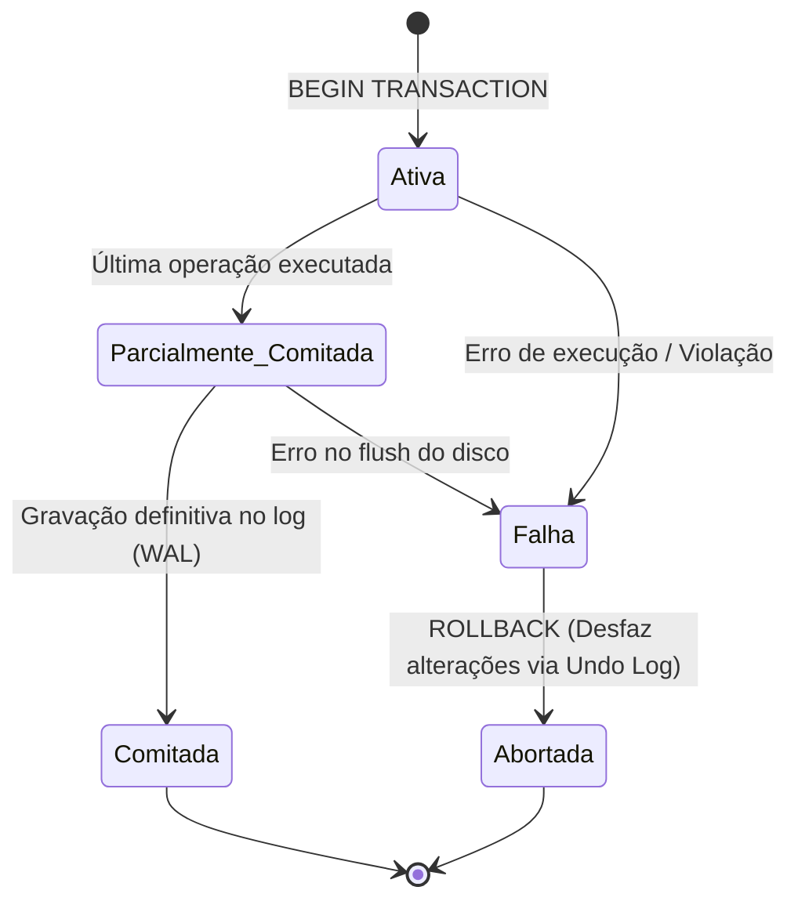
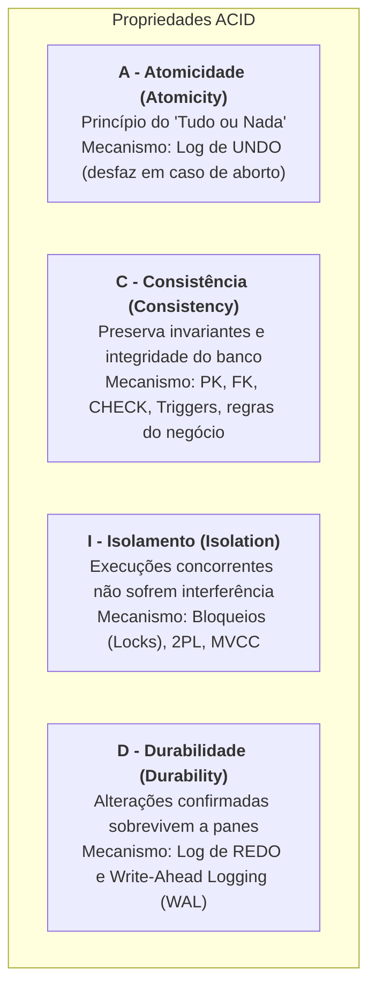
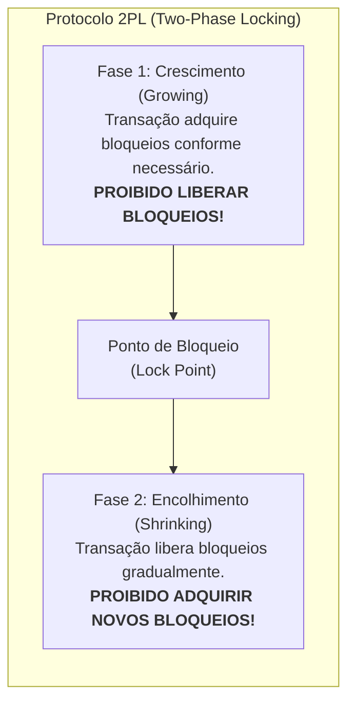
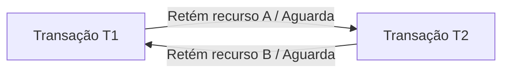

# 03 - Transações, Propriedades ACID e Concorrência

> **Matéria:** Banco de Dados  
> **Cargo:** B02 – Técnico de Controle Externo – Especialidade: Tecnologia da Informação  
> **Arquivo:** `03_transacoes_propriedades_acid_e_concorrencia.md`  

---

## 📌 Ementa / Itens do Edital
- Conceito de Transação de banco de dados
- As quatro propriedades fundamentais: ACID (Atomicidade, Consistência, Isolamento, Durabilidade)
- Comandos de controle transacional: COMMIT, ROLLBACK e SAVEPOINT
- Anomalias de concorrência (Leitura Suja, Leitura Não Repetível, Leitura Fantasma, Atualização Perdida)
- Níveis de Isolamento ANSI SQL
- Mecanismos de controle de concorrência: Bloqueios (Locks), 2PL, MVCC e Deadlocks

---

## 🧭 Sumário

1. [O Conceito Formal de Transação e o Modelo ACID](#1-o-conceito-formal-de-transacao-e-o-modelo-acid)
    1. [Ciclo de Vida e Estados de uma Transação](#11-ciclo-de-vida-e-estados-de-uma-transacao)
    2. [As Quatro Propriedades Fundamentais: ACID](#12-as-quatro-propriedades-fundamentais-acid)
    3. [Mecanismos Internos: Undo Log, Redo Log e Write-Ahead Logging (WAL)](#13-mecanismos-internos-undo-log-redo-log-e-write-ahead-logging-wal)
    4. [Teste 256](#Teste-256)
    5. [Teste 257](#Teste-257)
2. [Comandos de Controle Transacional (TCL)](#2-comandos-de-controle-transacional-tcl)
    1. [COMMIT, ROLLBACK e Gestão de SAVEPOINTs](#21-commit-rollback-e-gestao-de-savepoints)
    2. [Teste 258](#Teste-258)
3. [Fenômenos e Anomalias de Concorrência](#3-fenomenos-e-anomalias-de-concorrencia)
    1. [Leitura Suja (Dirty Read)](#31-leitura-suja-dirty-read)
    2. [Leitura Não Repetível (Non-Repeatable Read)](#32-leitura-nao-repetivel-non-repeatable-read)
    3. [Leitura Fantasma (Phantom Read)](#33-leitura-fantasma-phantom-read)
    4. [Atualização Perdida (Lost Update)](#34-atualizacao-perdida-lost-update)
    5. [Teste 259](#Teste-259)
4. [Níveis de Isolamento ANSI SQL-92](#4-niveis-de-isolamento-ansi-sql-92)
    1. [Matriz de Isolamento vs. Fenômenos Admitidos](#41-matriz-de-isolamento-vs-fenomenos-admitidos)
    2. [Snapshot Isolation (Isolamento por Instantâneo)](#42-snapshot-isolation-isolamento-por-instantaneo)
    3. [Teste 260](#Teste-260)
    4. [Teste 261](#Teste-261)
5. [Técnicas de Controle de Concorrência](#5-tecnicas-de-controle-de-concorrencia)
    1. [Bloqueios (Locks) e Matriz de Compatibilidade (Shared vs. Exclusive)](#51-bloqueios-locks-e-matriz-de-compatibilidade-shared-vs-exclusive)
    2. [Protocolo de Bloqueio em Duas Fases (2PL - Two-Phase Locking): Básico, Estrito e Rigoroso](#52-protocolo-de-bloqueio-em-duas-fases-2pl-two-phase-locking-basico-estrito-e-rigoroso)
    3. [Controle Multiversão de Concorrência (MVCC)](#53-controle-multiversao-de-concorrencia-mvcc)
    4. [Impasses (Deadlocks): Detecção via Wait-For Graph e Resolução por Transação Vítima](#54-impasses-deadlocks-deteccao-via-wait-for-graph-e-resolucao-por-transacao-vitima)
    5. [Teste 262](#Teste-262)
    6. [Teste 263](#Teste-263)
    7. [Teste 264](#Teste-264)
    8. [Teste 265](#Teste-265)
    9. [Teste 266](#Teste-266)
6. [🌐 Fontes Oficiais e Referências Bibliográficas](#fontes-oficiais-e-referencias-bibliograficas)

---

## 1. O Conceito Formal de Transação e o Modelo ACID

Uma **transação** de banco de dados é uma unidade lógica e atômica de processamento que agrupa uma ou mais instruções SQL (leitura e escrita) que devem ser executadas de modo estritamente indivisível. No contexto de auditoria e controle externo no setor público, uma transação típica é a liquidação de uma despesa orçamentária: o sistema deve simultaneamente debitar o saldo do empenho e creditar a conta bancária do fornecedor. Se apenas uma das ações ocorrer, o banco de dados entrará em colapso fiscal.

### 1.1 Ciclo de Vida e Estados de uma Transação

Durante sua existência, uma transação transita por estados formais bem definidos na teoria de sistemas relacionais:

- **Ativa (*Active*):** O estado inicial. A transação está sendo executada pela aplicação.
- **Parcialmente Comitada (*Partially Committed*):** A última instrução SQL foi processada na memória RAM, mas os dados ainda não foram gravados permanentemente no log em disco.
- **Comitada (*Committed*):** Todas as alterações foram confirmadas e gravadas no log transacional em armazenamento persistente (*Write-Ahead Logging*). A transação foi concluída com sucesso.
- **Falha (*Failed*):** Ocorre quando uma instrução viola uma restrição de integridade ou o sistema sofre interrupção antes da conclusão definitiva.
- **Abortada (*Aborted*):** O SGBD executa o comando `ROLLBACK`, desfazendo todas as modificações parciais já executadas e restaurando a base de dados ao estado exato anterior ao início da transação.

### 1.2 As Quatro Propriedades Fundamentais: ACID

Para que a integridade dos dados seja inviolável mesmo diante de falhas de hardware, interrupções de energia elétrica e concorrência massiva de usuários, o SGBD deve garantir integralmente as propriedades do acrônimo **ACID** (Jim Gray e Andreas Reuter):

1. **A - Atomicidade (*Atomicity*):**
    - Princípio do **"tudo ou nada"** (*all-or-nothing*). Todas as operações que compõem a transação são consolidadas em conjunto no banco de dados, ou nenhuma delas produzirá efeito algum. Não existe efetivação parcial de transação.

2. **C - Consistência (*Consistency*):**
    - Garante que a transação conduz o banco de dados de um **estado válido para outro estado igualmente válido**. A transação não pode violar nenhuma regra de integridade declarativa (chaves primárias, chaves estrangeiras, restrições `CHECK`, valores `NOT NULL`) ou procedimental (gatilhos e regras de negócio).

3. **I - Isolamento (*Isolation*):**
    - Assegura que a execução concomitante de múltiplas transações seja invisível entre si. Os efeitos intermediários e temporários de uma transação não comitada não podem ser observados por outras transações concorrentes. O resultado final deve equivaler a uma execução estritamente sequencial (*serializável*).

4. **D - Durabilidade (*Durability*):**
    - Garante que, uma vez que a transação foi confirmada com sucesso (`COMMIT`), suas modificações tornam-se **permanentes e indeléveis**. As alterações não serão perdidas sob nenhuma hipótese, resistindo até mesmo a falhas catastróficas de energia física ou travamentos no sistema operacional da máquina servidora.

### 1.3 Mecanismos Internos: Undo Log, Redo Log e Write-Ahead Logging (WAL)

- **Undo Log (Segmentos de Rollback):** Registra os valores **anteriores** à modificação. Se uma transação falhar ou for cancelada, o SGBD lê o Undo Log para restaurar os dados originais (garantindo a **Atomicidade**).
- **Redo Log / WAL (*Write-Ahead Logging*):** Registra os **novos** valores gerados pela transação.
    - **A Regra Inviolável do WAL:** O registro de log que descreve a alteração **deve ser gravado fisicamente em disco síncrono ANTES** que as páginas de dados correspondentes sejam descarregadas da memória RAM para os arquivos de dados (*datafiles*).
    - Isso garante a **Durabilidade**: se faltar energia imediatamente após o commit, o SGBD lê o Redo Log no boot de recuperação (*Crash Recovery*) e reaplica (*redo*) as alterações nas tabelas.

---

### Teste 256
**(FGV – TCE/PA – 2024 – Auditor de Controle Externo - Administrativa - Ciência de Dados)**
Diferentemente do armazenamento feito em sistema de arquivos, o armazenamento em sistemas de banco de dados ou SGBD possui características especiais que garantem um funcionamento superior em relação à outras formas de armazenamento. Nesse contexto, as propriedades fundamentais garantidas pelo conceito ACID em sistemas de banco de dados são:

* **A)** Atomicidade, Complexidade, Integridade, Durabilidade.
* **B)** Atividade, Consistência, Inovação, Durabilidade.
* **C)** Atomicidade, Consistência, Isolamento, Durabilidade.
* **D)** Autenticidade, Conformidade, Integridade, Desempenho.
* **E)** Automação, Convergência, Interoperabilidade, Desempenho.

---

> **Comentário Detalhado:**
>
> - **A)** **Incorreta.** A opção apresenta proposição em desacordo com os fundamentos teóricos e técnicos do tópico ao afirmar que "Atomicidade, Complexidade, Integridade, Durabilidade". De acordo com a teoria estudada em *1.2 As Quatro Propriedades Fundamentais: ACID*, para que a integridade dos dados seja inviolável mesmo diante de falhas de hardware, interrupções de energia elétrica e concorrência massiva de usuários, o SGBD deve garantir integralmente as propriedades do acrônimo ACID (Jim Gray e Andreas Reuter).
> - **B)** **Incorreta.** A opção apresenta proposição em desacordo com os fundamentos teóricos e técnicos do tópico ao afirmar que "Atividade, Consistência, Inovação, Durabilidade". De acordo com a teoria estudada em *1.3 Mecanismos Internos: Undo Log, Redo Log e Write-Ahead Logging (WAL)*, isso garante a Durabilidade: se faltar energia imediatamente após o commit, o SGBD lê o Redo Log no boot de recuperação (*Crash Recovery*) e reaplica (*redo*) as alterações nas tabelas.
> - **C)** **Correta.** Conforme fundamentado na seção *1.3 Mecanismos Internos: Undo Log, Redo Log e Write-Ahead Logging (WAL)* deste guia, undo Log (Segmentos de Rollback): Registra os valores anteriores à modificação. Se uma transação falhar ou for cancelada, o SGBD lê o Undo Log para restaurar os dados originais (garantindo a Atomicidade). Dessa forma, está plenamente correta a assertiva da banca (FGV – TCE/PA/2024) ao estabelecer que "Atomicidade, Consistência, Isolamento, Durabilidade".
> - **D)** **Incorreta.** A opção apresenta proposição em desacordo com os fundamentos teóricos e técnicos do tópico ao afirmar que "Autenticidade, Conformidade, Integridade, Desempenho". De acordo com a teoria estudada em *1.2 As Quatro Propriedades Fundamentais: ACID*, a transação não pode violar nenhuma regra de integridade declarativa (chaves primárias, chaves estrangeiras, restrições `CHECK`, valores `NOT NULL`) ou procedimental (gatilhos e regras de negócio).
> - **E)** **Incorreta.** A opção apresenta proposição em desacordo com os fundamentos teóricos e técnicos do tópico ao afirmar que "Automação, Convergência, Interoperabilidade, Desempenho". De acordo com a teoria estudada em *1. O Conceito Formal de Transação e o Modelo ACID*, no contexto de auditoria e controle externo no setor público, uma transação típica é a liquidação de uma despesa orçamentária: o sistema deve simultaneamente debitar o saldo do empenho e creditar a conta bancária do fornecedor.
>
> **Gabarito: C**

---

### Teste 257
**(FGV – TJ/AP – 2023 – Analista Judiciario Apoio Especializado Tecnologia Da Informacao Banco De Dados)**
João, administrador de banco de dados, deverá configurar a inicialização de uma instância do Banco de Dados Oracle. Para isso, deverá considerar que somente poderá executar o “shutdown” da instância após o “rollback” das transações não submetidas a “commit”. Para tanto, como João não precisa aguardar a conclusão de todas as transações, ele deverá executar o modo de “shutdown”:

* **A)** abort;
* **B)** mount;
* **C)** nomount;
* **D)** immediate;
* **E)** transactional.

---

> **Comentário Detalhado:**
>
> - **A)** **Incorreta.** A opção apresenta proposição em desacordo com os fundamentos teóricos e técnicos do tópico ao afirmar que "abort". De acordo com a teoria estudada em *1.2 As Quatro Propriedades Fundamentais: ACID*, princípio do "tudo ou nada" (*all-or-nothing*). Todas as operações que compõem a transação são consolidadas em conjunto no banco de dados, ou nenhuma delas produzirá efeito algum. Não existe efetivação parcial de transação.
> - **B)** **Incorreta.** A opção apresenta proposição em desacordo com os fundamentos teóricos e técnicos do tópico ao afirmar que "mount". De acordo com a teoria estudada em *5.2 Protocolo de Bloqueio em Duas Fases (2PL - Two-Phase Locking): Básico, Estrito e Rigoroso*, rigorous 2PL (2PL Rigoroso): Todos os bloqueios (tanto compartilhados - S quanto exclusivos - X) devem ser mantidos até o `COMMIT` ou `ROLLBACK`. É a variante mais utilizada na prática por garantir serializabilidade estrita.
> - **C)** **Incorreta.** A opção apresenta proposição em desacordo com os fundamentos teóricos e técnicos do tópico ao afirmar que "nomount". De acordo com a teoria estudada em *1.1 Ciclo de Vida e Estados de uma Transação*, abortada (*Aborted*): O SGBD executa o comando `ROLLBACK`, desfazendo todas as modificações parciais já executadas e restaurando a base de dados ao estado exato anterior ao início da transação.
> - **D)** **Correta.** Conforme fundamentado na seção *1. O Conceito Formal de Transação e o Modelo ACID* deste guia, uma transação de banco de dados é uma unidade lógica e atômica de processamento que agrupa uma ou mais instruções SQL (leitura e escrita) que devem ser executadas de modo estritamente indivisível. Dessa forma, está plenamente correta a assertiva da banca (FGV – TJ/AP/2023) ao estabelecer que "immediate".
> - **E)** **Incorreta.** A opção apresenta proposição em desacordo com os fundamentos teóricos e técnicos do tópico ao afirmar que "transactional". De acordo com a teoria estudada em *2.1 COMMIT, ROLLBACK e Gestão de SAVEPOINTs*, `ROLLBACK TO SAVEPOINT nome_ponto`: Reverte as operações executadas apenas após o marco especificado, mantendo preservadas as instruções anteriores ao savepoint.
>
> **Gabarito: D**

---

## 2. Comandos de Controle Transacional (TCL)

A linguagem SQL provê comandos dedicados para controlar as fronteiras transacionais:

### 2.1 COMMIT, ROLLBACK e Gestão de SAVEPOINTs

- **`COMMIT`:** Finaliza a transação com sucesso, gravando definitivamente todas as alterações pendentes no log transacional e liberando todos os bloqueios (*locks*) de recursos retidos.
- **`ROLLBACK`:** Cancela integralmente a transação, desfazendo todas as operações pendentes desde o `BEGIN TRANSACTION` e restaurando a base ao estado inicial.
- **`SAVEPOINT nome_ponto`:** Estabelece um **marco intermediário de salvamento** dentro de uma transação aberta.
- **`ROLLBACK TO SAVEPOINT nome_ponto`:** Reverte as operações executadas **apenas após o marco especificado**, mantendo preservadas as instruções anteriores ao savepoint. **Atenção:** O comando `ROLLBACK TO SAVEPOINT` **NÃO encerra a transação**; ela permanece aberta aguardando novas instruções ou a finalização formal com `COMMIT` ou `ROLLBACK` total.

---

### Teste 258
**(FGV – TCE/PA – 2024 – Auditor de Controle Externo - Administrativa - Engenharia Mecânica)**
Os combustíveis líquidos aplicados na indústria apresentam diversas propriedades que os distinguem entre si. Quando se aplica uma chama escorvadora sobre a superfície líquida do combustível, a temperatura na qual ocorre uma combustão transitória é denominada

* **A)** ponto de fulgor.
* **B)** ponto de ignição.
* **C)** ponto de fluidez.
* **D)** viscosidade sob calor.
* **E)** Ponto de autoignição.

---

> **Comentário Detalhado:**
>
> - **A)** **Correta.** Conforme fundamentado na seção *2.1 COMMIT, ROLLBACK e Gestão de SAVEPOINTs* deste guia, `SAVEPOINT nome_ponto`: Estabelece um marco intermediário de salvamento dentro de uma transação aberta. Dessa forma, está plenamente correta a assertiva da banca (FGV – TCE/PA/2024) ao estabelecer que "ponto de fulgor".
> - **B)** **Incorreta.** A opção apresenta proposição em desacordo com os fundamentos teóricos e técnicos do tópico ao afirmar que "ponto de ignição". De acordo com a teoria estudada em *2.1 COMMIT, ROLLBACK e Gestão de SAVEPOINTs*, `ROLLBACK TO SAVEPOINT nome_ponto`: Reverte as operações executadas apenas após o marco especificado, mantendo preservadas as instruções anteriores ao savepoint.
> - **C)** **Incorreta.** A opção apresenta proposição em desacordo com os fundamentos teóricos e técnicos do tópico ao afirmar que "ponto de fluidez". De acordo com a teoria estudada em *1.1 Ciclo de Vida e Estados de uma Transação*, falha (*Failed*): Ocorre quando uma instrução viola uma restrição de integridade ou o sistema sofre interrupção antes da conclusão definitiva.
> - **D)** **Incorreta.** A opção apresenta proposição em desacordo com os fundamentos teóricos e técnicos do tópico ao afirmar que "viscosidade sob calor". De acordo com a teoria estudada em *1.2 As Quatro Propriedades Fundamentais: ACID*, as alterações não serão perdidas sob nenhuma hipótese, resistindo até mesmo a falhas catastróficas de energia física ou travamentos no sistema operacional da máquina servidora.
> - **E)** **Incorreta.** A opção apresenta proposição em desacordo com os fundamentos teóricos e técnicos do tópico ao afirmar que "Ponto de autoignição". De acordo com a teoria estudada em *3.1 Leitura Suja (Dirty Read)*, definição: Ocorre quando uma transação $T_1$ modifica uma linha no buffer, a transação $T_2$ lê esse valor ainda não comitado, e logo em seguida a transação $T_1$ sofre um `ROLLBACK`.
>
> **Gabarito: A**

---

## 3. Fenômenos e Anomalias de Concorrência

Quando múltiplas transações concorrem pelo acesso aos mesmos dados sem controle de concorrência estrito, quatro anomalias clássicas podem se manifestar:

### 3.1 Leitura Suja (Dirty Read)
- **Definição:** Ocorre quando uma transação $T_1$ modifica uma linha no buffer, a transação $T_2$ lê esse valor ainda **não comitado**, e logo em seguida a transação $T_1$ sofre um **`ROLLBACK`**.
- **Impacto:** A transação $T_2$ tomou decisões de negócio baseando-se em um dado ilegítimo que nunca existiu formalmente no banco de dados.

### 3.2 Leitura Não Repetível (Non-Repeatable Read)
- **Definição:** Ocorre quando a transação $T_1$ consulta uma linha específica. Em seguida, a transação $T_2$ altera ou apaga essa exata linha e executa **`COMMIT`**. Posteriormente, a transação $T_1$ relê a mesma linha e encontra valores divergentes ou constata que ela foi removida.
- **Impacto:** Consultas idênticas sobre a mesma linha dentro do mesmo escopo transacional retornam valores distintos.

### 3.3 Leitura Fantasma (Phantom Read)
- **Definição:** Ocorre quando a transação $T_1$ executa uma consulta filtrando um intervalo de dados (ex.: `SELECT * FROM contratos WHERE valor > 500000`) e recupera 10 tuplas. Em seguida, a transação $T_2$ insere novas linhas que atendem a esse predicado e executa **`COMMIT`**. Quando $T_1$ reexecuta a mesma consulta de intervalo, obtém 12 tuplas.
- **Impacto:** Surgem novos registros ("fantasmas") que satisfazem a condição de busca no curso da mesma transação.

### 3.4 Atualização Perdida (Lost Update)
- **Definição:** Duas transações ($T_1$ e $T_2$) leem simultaneamente a mesma tupla (ex.: saldo = 100). Ambas realizam cálculos locais independentes ($T_1$ soma 50; $T_2$ subtrai 30) e gravam os novos valores. A gravação mais tardia sobrescreve a anterior sem considerar seu cálculo, perdendo uma das atualizações.

---

### Teste 259
**(CEBRASPE – TRF/6 – 2025 – Analista Judiciario Apoio Especializado Tecnologia Da Informacao)**
Entre os dados exportáveis do Microsoft Outlook para um arquivo .pst estão emails e seus anexos, informações de calendário, propriedades de pastas, regras de mensagens e listas de remetentes bloqueados.

* **C)** Certo
* **E)** Errado

---

> **Comentário Detalhado:**
>
> - **C)** **Correta.** O item está **Certo**. Conforme fundamentado na seção *1.2 As Quatro Propriedades Fundamentais: ACID* deste guia, a transação não pode violar nenhuma regra de integridade declarativa (chaves primárias, chaves estrangeiras, restrições `CHECK`, valores `NOT NULL`) ou procedimental (gatilhos e regras de negócio). Dessa forma, está plenamente correta a proposição da banca (CEBRASPE – TRF/6/2025) ao afirmar que "Entre os dados exportáveis do Microsoft Outlook para um arquivo .pst estão emails e seus anexos, informações...".
> - **E)** **Incorreta.** A marcação como **Errado** não procede, visto que a assertiva guarda integral conformidade com a teoria estudada em *1.2 As Quatro Propriedades Fundamentais: ACID*, segundo a qual para que a integridade dos dados seja inviolável mesmo diante de falhas de hardware, interrupções de energia elétrica e concorrência massiva de usuários, o SGBD deve garantir integralmente as propriedades do acrônimo ACID (Jim Gray e Andreas Reuter).
>
> **Gabarito: C**

---

## 4. Níveis de Isolamento ANSI SQL-92

A norma ANSI/ISO SQL-92 estabelece quatro níveis canônicos de isolamento transacional, regulados pela tolerância ou bloqueio formal às anomalias de concorrência:

### 4.1 Matriz de Isolamento vs. Fenômenos Admitidos

| Nível de Isolamento | Leitura Suja (*Dirty Read*) | Leitura Não Repetível (*Non-Repeatable Read*) | Leitura Fantasma (*Phantom Read*) | Mecanismo Típico de Implementação |
| :--- | :---: | :---: | :---: | :--- |
| **`READ UNCOMMITTED`** | ❌ **Permite** | ❌ **Permite** | ❌ **Permite** | Leituras sem bloqueios; não gera snapshots. |
| **`READ COMMITTED`** | ✅ **Previne** | ❌ **Permite** | ❌ **Permite** | Lê apenas dados já comitados. Cada instrução `SELECT` tira um novo snapshot. *(Padrão em PostgreSQL e Oracle)* |
| **`REPEATABLE READ`** | ✅ **Previne** | ✅ **Previne** | ❌ **Permite** *(no ANSI)* | Lê o snapshot gerado no instante em que a primeira instrução da transação iniciou. *(Padrão no MySQL InnoDB)* |
| **`SERIALIZABLE`** | ✅ **Previne** | ✅ **Previne** | ✅ **Previne** | Bloqueios de predicado / Range Locks ou SSI (*Serializable Snapshot Isolation*). Simula execução serial estrita. |

> 🚨 **ALERTA DE PROVA / PEGADINHA FCC:**  
>
> 1. *"Qual o nível de isolamento MÍNIMO que impede Leitura Não Repetível?"* $\rightarrow$ **`REPEATABLE READ`**.
> 2. No PostgreSQL, a implementação prática do nível `REPEATABLE READ` via MVCC impede também leituras fantasmas; contudo, nas questões teóricas da FCC baseadas estritamente no **padrão ANSI SQL-92**, o candidato deve assinalar que o `REPEATABLE READ` **admite Leitura Fantasma**!
> 3. O único nível do padrão ANSI que previne **todos os três fenômenos** é o **`SERIALIZABLE`**.

### 4.2 Snapshot Isolation (Isolamento por Instantâneo)

Implementado em motores que utilizam controle de concorrência multiversão (MVCC):

- No início da transação, o SGBD captura uma "fotografia" lógica (*snapshot*) do banco baseada no número de transação (*Transaction ID - XID*).
- Todas as consultas daquela transação enxergam estritamente o estado dos dados consolidado no momento do snapshot, impedindo Leituras Não Repetíveis e Leituras Fantasmas sem a necessidade de adquirir bloqueios pesados de leitura.

---

### Teste 260
**(FGV – TCE/PA – 2024 – Auditor de Controle Externo - Administrativa - Ciência de Dados)**
Um banco de dados projetado para apoiar a tarefa de alocação automática de analistas para os processos recém inseridos no sistema. O modelo relacional especificado e implementado restringe a alocação de processos apenas a analistas disponíveis no departamento. Caso haja tentativa de inserção de nome fora da lista de valores já registrados, a transação não será completada, ou seja, nenhum valor será inserido. Selecione a alternativa que contém duas propriedades de transação aplicáveis ao cenário acima.

* **A)** Atomicidade e Consistência.
* **B)** Consistência e Durabilidade.
* **C)** Durabilidade e Segurança.
* **D)** Isolamento e Segurança.
* **E)** Isolamento e Consistência.

---

> **Comentário Detalhado:**
>
> - **A)** **Correta.** Conforme fundamentado na seção *1.3 Mecanismos Internos: Undo Log, Redo Log e Write-Ahead Logging (WAL)* deste guia, undo Log (Segmentos de Rollback): Registra os valores anteriores à modificação. Se uma transação falhar ou for cancelada, o SGBD lê o Undo Log para restaurar os dados originais (garantindo a Atomicidade). Dessa forma, está plenamente correta a assertiva da banca (FGV – TCE/PA/2024) ao estabelecer que "Atomicidade e Consistência".
> - **B)** **Incorreta.** A opção apresenta proposição em desacordo com os fundamentos teóricos e técnicos do tópico ao afirmar que "Consistência e Durabilidade". De acordo com a teoria estudada em *1.3 Mecanismos Internos: Undo Log, Redo Log e Write-Ahead Logging (WAL)*, isso garante a Durabilidade: se faltar energia imediatamente após o commit, o SGBD lê o Redo Log no boot de recuperação (*Crash Recovery*) e reaplica (*redo*) as alterações nas tabelas.
> - **C)** **Incorreta.** A opção apresenta proposição em desacordo com os fundamentos teóricos e técnicos do tópico ao afirmar que "Durabilidade e Segurança". De acordo com a teoria estudada em *1. O Conceito Formal de Transação e o Modelo ACID*, uma transação de banco de dados é uma unidade lógica e atômica de processamento que agrupa uma ou mais instruções SQL (leitura e escrita) que devem ser executadas de modo estritamente indivisível.
> - **D)** **Incorreta.** A opção apresenta proposição em desacordo com os fundamentos teóricos e técnicos do tópico ao afirmar que "Isolamento e Segurança". De acordo com a teoria estudada em *4.2 Snapshot Isolation (Isolamento por Instantâneo)*, implementado em motores que utilizam controle de concorrência multiversão (MVCC).
> - **E)** **Incorreta.** A opção apresenta proposição em desacordo com os fundamentos teóricos e técnicos do tópico ao afirmar que "Isolamento e Consistência". De acordo com a teoria estudada em *4.2 Snapshot Isolation (Isolamento por Instantâneo)*, no início da transação, o SGBD captura uma "fotografia" lógica (*snapshot*) do banco baseada no número de transação (*Transaction ID - XID*).
>
> **Gabarito: A**

---

### Teste 261
**(FGV – TCE/PA – 2024 – Auditor de Controle Externo - Administrativa - Engenharia Civil)**
Um pavimento de estrada é classificado como sendo flexível. Desta forma, pode-se dizer que duas das propriedades físicas desse pavimento são

* **A)** elevada atividade química e permeabilidade.
* **B)** elevada atividade química e impermeabilidade.
* **C)** Inércia química e baixa sensibilidade à temperatura.
* **D)** inércia química e grande sensibilidade à temperatura.
* **E)** permeabilidade e grande sensibilidade à temperatura.

---

> **Comentário Detalhado:**
>
> - **A)** **Incorreta.** A opção apresenta proposição em desacordo com os fundamentos teóricos e técnicos do tópico ao afirmar que "elevada atividade química e permeabilidade". De acordo com a teoria estudada em *5.2 Protocolo de Bloqueio em Duas Fases (2PL - Two-Phase Locking): Básico, Estrito e Rigoroso*, *Fase de Crescimento (*Growing Phase*):* A transação pode adquirir quantos bloqueios precisar, mas é terminantemente proibida de liberar qualquer bloqueio.
> - **B)** **Incorreta.** A opção apresenta proposição em desacordo com os fundamentos teóricos e técnicos do tópico ao afirmar que "elevada atividade química e impermeabilidade". De acordo com a teoria estudada em *5.2 Protocolo de Bloqueio em Duas Fases (2PL - Two-Phase Locking): Básico, Estrito e Rigoroso*, *Fase de Encolhimento (*Shrinking Phase*):* A transação pode liberar bloqueios já utilizados, mas é terminantemente proibida de adquirir novos bloqueios.
> - **C)** **Incorreta.** A opção apresenta proposição em desacordo com os fundamentos teóricos e técnicos do tópico ao afirmar que "Inércia química e baixa sensibilidade à temperatura". De acordo com a teoria estudada em *1.1 Ciclo de Vida e Estados de uma Transação*, ativa (*Active*): O estado inicial. A transação está sendo executada pela aplicação.
> - **D)** **Correta.** Conforme fundamentado na seção *1.2 As Quatro Propriedades Fundamentais: ACID* deste guia, a transação não pode violar nenhuma regra de integridade declarativa (chaves primárias, chaves estrangeiras, restrições `CHECK`, valores `NOT NULL`) ou procedimental (gatilhos e regras de negócio). Dessa forma, está plenamente correta a assertiva da banca (FGV – TCE/PA/2024) ao estabelecer que "inércia química e grande sensibilidade à temperatura".
> - **E)** **Incorreta.** A opção apresenta proposição em desacordo com os fundamentos teóricos e técnicos do tópico ao afirmar que "permeabilidade e grande sensibilidade à temperatura". De acordo com a teoria estudada em *5.1 Bloqueios (Locks) e Matriz de Compatibilidade (Shared vs. Exclusive)*, bloqueio Exclusivo (Exclusive Lock - X): Solicitado para operações de modificação (`INSERT`, `UPDATE`, `DELETE`). Apenas uma transação pode reter o bloqueio exclusivo; nenhuma outra transação pode obter bloqueio S ou X sobre a mesma linha até sua liberação.
>
> **Gabarito: D**

---

## 5. Técnicas de Controle de Concorrência

### 5.1 Bloqueios (Locks) e Matriz de Compatibilidade (Shared vs. Exclusive)

O controle pessimista de concorrência baseia-se na alocação de travas (*locks*) sobre tuplas, páginas ou tabelas:

- **Bloqueio Compartilhado (Shared Lock - S):** Solicitado para operações de leitura (`SELECT`). Múltiplas transações podem reter simultaneamente bloqueios compartilhados sobre o mesmo registro.
- **Bloqueio Exclusivo (Exclusive Lock - X):** Solicitado para operações de modificação (`INSERT`, `UPDATE`, `DELETE`). Apenas uma transação pode reter o bloqueio exclusivo; nenhuma outra transação pode obter bloqueio S ou X sobre a mesma linha até sua liberação.

| Bloqueio Solicitado \ Bloqueio Existente | Shared (S) | Exclusive (X) |
| :---: | :---: | :---: |
| **Shared (S)** | ✅ **Compatível** (Permitido) | ❌ Conflito (Aguarda liberação) |
| **Exclusive (X)** | ❌ Conflito (Aguarda liberação) | ❌ Conflito (Aguarda liberação) |

### 5.2 Protocolo de Bloqueio em Duas Fases (2PL - Two-Phase Locking): Básico, Estrito e Rigoroso

O protocolo **2PL** é o algoritmo matemático que garante a **serializabilidade** das escalas de execução concorrente:

- **Regra Fundamental do 2PL Básico:** A transação possui duas fases estanques:
    1. *Fase de Crescimento (*Growing Phase*):* A transação pode adquirir quantos bloqueios precisar, mas **é terminantemente proibida de liberar qualquer bloqueio**.
    2. *Fase de Encolhimento (*Shrinking Phase*):* A transação pode liberar bloqueios já utilizados, mas **é terminantemente proibida de adquirir novos bloqueios**.

- **Strict 2PL (2PL Estrito):** Todos os bloqueios **exclusivos (X)** devem ser mantidos até o fim definitivo da transação (`COMMIT` ou `ROLLBACK`). Evita abortos em cascata (*cascadeless schedules*).
- **Rigorous 2PL (2PL Rigoroso):** Todos os bloqueios (tanto **compartilhados - S** quanto **exclusivos - X**) devem ser mantidos até o `COMMIT` ou `ROLLBACK`. É a variante mais utilizada na prática por garantir serializabilidade estrita.

> 🚨 **ALERTA DE PROVA / PEGADINHA FCC:**  
> O protocolo 2PL garante a **serializabilidade**, mas **NÃO evita impasses (*deadlocks*)**! Transações operando sob o 2PL básico podem sofrer deadlocks frequentemente.

### 5.3 Controle Multiversão de Concorrência (MVCC)

Adotado nativamente por PostgreSQL e Oracle:

- **Princípio:** *"Leitores nunca bloqueiam escritores, e escritores nunca bloqueiam leitores."*
- **Mecanismo:** Ao atualizar uma linha, o SGBD não sobrescreve os dados no mesmo local; ele cria uma **nova versão física da tupla** contendo metadados de cabeçalho:
    - No PostgreSQL: `xmin` (ID da transação criadora) e `xmax` (ID da transação que apagou ou gerou versão superior).
    - Leitores consultam versões visíveis compatíveis com o seu instante temporal (*snapshot*), garantindo alto rendimento de leitura e escrita concorrentes.

### 5.4 Impasses (Deadlocks): Detecção via Wait-For Graph e Resolução por Transação Vítima

Um **deadlock** ocorre quando duas ou mais transações entram em estado de bloqueio mútuo e circular: a transação $T_1$ retém o recurso $A$ e aguarda o recurso $B$, enquanto a transação $T_2$ retém o recurso $B$ e aguarda o recurso $A$. Nenhuma das transações consegue prosseguir.

- **Detecção via Wait-For Graph (Grafo de Espera):** O SGBD constrói dinamicamente um grafo direcionado onde os nós são transações e as arestas indicam dependências de espera. **A detecção de um ciclo no grafo sinaliza formalmente um deadlock**.
- **Resolução via Transação Vítima:** Ao detectar o ciclo, o SGBD seleciona uma **transação vítima** (com base em critérios de menor custo computacional ou menor volume de dados alterados), aborta sua execução compulsoriamente via `ROLLBACK` forçado e devolve o erro à aplicação cliente.
- **Técnicas de Prevenção por Timestamps:**
    - *Wait-Die (Não-preemptivo):* Se a transação mais antiga solicitar recurso retido pela mais nova, ela espera (*wait*); se a mais nova solicitar recurso retido pela mais antiga, a mais nova morre (*die/rollback*).
    - *Wound-Wait (Preemptivo):* Se a transação mais antiga solicitar recurso retido pela mais nova, ela fere e aborta a mais nova (*wound/preempt*); se a mais nova solicitar da mais antiga, ela espera (*wait*).

---

### Teste 262
**(FGV – TCE/PA – 2024 – Auditor de Controle Externo - Administrativa - Engenharia Civil)**
Uma das propriedades físicas de um solo é o grau de saturação. Em uma amostra, essa propriedade pode ser medida como a razão entre o volume ocupado pela água e

* **A)** a soma dos volumes de água e solo.
* **B)** a soma dos volumes de água e ar.
* **C)** o volume de solo.
* **D)** o volume de ar.
* **E)** o volume total.

---

> **Comentário Detalhado:**
>
> - **A)** **Incorreta.** A opção apresenta proposição em desacordo com os fundamentos teóricos e técnicos do tópico ao afirmar que "a soma dos volumes de água e solo". De acordo com a teoria estudada em *5.4 Impasses (Deadlocks): Detecção via Wait-For Graph e Resolução por Transação Vítima*, resolução via Transação Vítima: Ao detectar o ciclo, o SGBD seleciona uma transação vítima (com base em critérios de menor custo computacional ou menor volume de dados alterados), aborta sua execução compulsoriamente via `ROLLBACK` forçado e devolve o erro à aplicação cliente.
> - **B)** **Correta.** Conforme fundamentado na seção *3.4 Atualização Perdida (Lost Update)* deste guia, definição: Duas transações ($T_1$ e $T_2$) leem simultaneamente a mesma tupla (ex.: saldo = 100). Ambas realizam cálculos locais independentes ($T_1$ soma 50; $T_2$ subtrai 30) e gravam os novos valores. Dessa forma, está plenamente correta a assertiva da banca (FGV – TCE/PA/2024) ao estabelecer que "a soma dos volumes de água e ar".
> - **C)** **Incorreta.** A opção apresenta proposição em desacordo com os fundamentos teóricos e técnicos do tópico ao afirmar que "o volume de solo". De acordo com a teoria estudada em *1.2 As Quatro Propriedades Fundamentais: ACID*, a transação não pode violar nenhuma regra de integridade declarativa (chaves primárias, chaves estrangeiras, restrições `CHECK`, valores `NOT NULL`) ou procedimental (gatilhos e regras de negócio).
> - **D)** **Incorreta.** A opção apresenta proposição em desacordo com os fundamentos teóricos e técnicos do tópico ao afirmar que "o volume de ar". De acordo com a teoria estudada em *1.2 As Quatro Propriedades Fundamentais: ACID*, assegura que a execução concomitante de múltiplas transações seja invisível entre si. Os efeitos intermediários e temporários de uma transação não comitada não podem ser observados por outras transações concorrentes.
> - **E)** **Incorreta.** A opção apresenta proposição em desacordo com os fundamentos teóricos e técnicos do tópico ao afirmar que "o volume total". De acordo com a teoria estudada em *2.1 COMMIT, ROLLBACK e Gestão de SAVEPOINTs*, atenção: O comando `ROLLBACK TO SAVEPOINT` NÃO encerra a transação; ela permanece aberta aguardando novas instruções ou a finalização formal com `COMMIT` ou `ROLLBACK` total.
>
> **Gabarito: B**

---

### Teste 263
**(FGV – TCE/PA – 2024 – Auditor de Controle Externo - Administrativa - Engenharia Mecânica)**
Entre os materiais utilizados na indústria, encontram-se os chamados materiais “compósitos”, que se constituem da combinação de dois ou mais diferentes materiais, que não dissolvem um no outro, e que resultam em propriedades não verificadas nos constituintes individuais. Assinale a opção que apresenta dois exemplos de materiais compósitos.

* **A)** Polímeros e semicondutores.
* **B)** Ferro fundido e cobre.
* **C)** Magnésio e titânio.
* **D)** Concreto e asfalto.
* **E)** Alumina e silícia.

---

> **Comentário Detalhado:**
>
> - **A)** **Incorreta.** A opção apresenta proposição em desacordo com os fundamentos teóricos e técnicos do tópico ao afirmar que "Polímeros e semicondutores". De acordo com a teoria estudada em *5.2 Protocolo de Bloqueio em Duas Fases (2PL - Two-Phase Locking): Básico, Estrito e Rigoroso*, *Fase de Encolhimento (*Shrinking Phase*):* A transação pode liberar bloqueios já utilizados, mas é terminantemente proibida de adquirir novos bloqueios.
> - **B)** **Incorreta.** A opção apresenta proposição em desacordo com os fundamentos teóricos e técnicos do tópico ao afirmar que "Ferro fundido e cobre". De acordo com a teoria estudada em *5.2 Protocolo de Bloqueio em Duas Fases (2PL - Two-Phase Locking): Básico, Estrito e Rigoroso*, rigorous 2PL (2PL Rigoroso): Todos os bloqueios (tanto compartilhados - S quanto exclusivos - X) devem ser mantidos até o `COMMIT` ou `ROLLBACK`. É a variante mais utilizada na prática por garantir serializabilidade estrita.
> - **C)** **Incorreta.** A opção apresenta proposição em desacordo com os fundamentos teóricos e técnicos do tópico ao afirmar que "Magnésio e titânio". De acordo com a teoria estudada em *5.4 Impasses (Deadlocks): Detecção via Wait-For Graph e Resolução por Transação Vítima*, um deadlock ocorre quando duas ou mais transações entram em estado de bloqueio mútuo e circular: a transação $T_1$ retém o recurso $A$ e aguarda o recurso $B$, enquanto a transação $T_2$ retém o recurso $B$ e aguarda o recurso $A$.
> - **D)** **Correta.** Conforme fundamentado na seção *1.2 As Quatro Propriedades Fundamentais: ACID* deste guia, garante que a transação conduz o banco de dados de um estado válido para outro estado igualmente válido. Dessa forma, está plenamente correta a assertiva da banca (FGV – TCE/PA/2024) ao estabelecer que "Concreto e asfalto".
> - **E)** **Incorreta.** A opção apresenta proposição em desacordo com os fundamentos teóricos e técnicos do tópico ao afirmar que "Alumina e silícia". De acordo com a teoria estudada em *5.4 Impasses (Deadlocks): Detecção via Wait-For Graph e Resolução por Transação Vítima*, *Wait-Die (Não-preemptivo):* Se a transação mais antiga solicitar recurso retido pela mais nova, ela espera (*wait*); se a mais nova solicitar recurso retido pela mais antiga, a mais nova morre (*die/rollback*).
>
> **Gabarito: D**

---

### Teste 264
**(FGV – TRF/1 – 2024 – Analista Judiciario Area Apoio Especializado Especialidade Tecnologia Da Informacao)**
João editou o documento ListaNomes.odt com informações sensíveis e quer enviá-lo para Maria com segurança utilizando uma senha. No LibreOffice, para definir uma senha para Maria abrir o documento ListaNomes.odt, João deve executar:

* **A)** Formatar/Congelar Documento
* **B)** Ferramenta/Proteger Documento
* **C)** Geral/Segurança/Definir Senha
* **D)** Editar/Registrar Alterações
* **E)** Propriedades/Segurança/Proteger

---

> **Comentário Detalhado:**
>
> - **A)** **Incorreta.** A opção apresenta proposição em desacordo com os fundamentos teóricos e técnicos do tópico ao afirmar que "Formatar/Congelar Documento". De acordo com a teoria estudada em *1.2 As Quatro Propriedades Fundamentais: ACID*, para que a integridade dos dados seja inviolável mesmo diante de falhas de hardware, interrupções de energia elétrica e concorrência massiva de usuários, o SGBD deve garantir integralmente as propriedades do acrônimo ACID (Jim Gray e Andreas Reuter).
> - **B)** **Incorreta.** A opção apresenta proposição em desacordo com os fundamentos teóricos e técnicos do tópico ao afirmar que "Ferramenta/Proteger Documento". De acordo com a teoria estudada em *1.2 As Quatro Propriedades Fundamentais: ACID*, o resultado final deve equivaler a uma execução estritamente sequencial (*serializável*).
> - **C)** **Correta.** Conforme fundamentado na seção *1. O Conceito Formal de Transação e o Modelo ACID* deste guia, no contexto de auditoria e controle externo no setor público, uma transação típica é a liquidação de uma despesa orçamentária: o sistema deve simultaneamente debitar o saldo do empenho e creditar a conta bancária do fornecedor. Dessa forma, está plenamente correta a assertiva da banca (FGV – TRF/1/2024) ao estabelecer que "Geral/Segurança/Definir Senha".
> - **D)** **Incorreta.** A opção apresenta proposição em desacordo com os fundamentos teóricos e técnicos do tópico ao afirmar que "Editar/Registrar Alterações". De acordo com a teoria estudada em *1.1 Ciclo de Vida e Estados de uma Transação*, comitada (*Committed*): Todas as alterações foram confirmadas e gravadas no log transacional em armazenamento persistente (*Write-Ahead Logging*). A transação foi concluída com sucesso.
> - **E)** **Incorreta.** A opção apresenta proposição em desacordo com os fundamentos teóricos e técnicos do tópico ao afirmar que "Propriedades/Segurança/Proteger". De acordo com a teoria estudada em *1.2 As Quatro Propriedades Fundamentais: ACID*, princípio do "tudo ou nada" (*all-or-nothing*). Todas as operações que compõem a transação são consolidadas em conjunto no banco de dados, ou nenhuma delas produzirá efeito algum. Não existe efetivação parcial de transação.
>
> **Gabarito: C**

---

### Teste 265
**(FGV – TRF/1 – 2024 – Analista Judiciario Area Apoio Especializado Especialidade Suporte Em Tecnologia Da Informacao)**
Ana identificou que, em seu banco de dados, ocorria muita demora na execução de algumas transações específicas, que chegavam até a falhar algumas vezes. Ao efetuar uma análise, viu que não havia controle nas transações ocorridas. Como forma de garantir seus schedules estritos, Ana implementou um bloqueio em 2 fases rigoroso. Esse bloqueio implementado por Ana fará com que:

* **A)** uma transação bloqueie todos os itens que ela acessa antes que a transação inicie a execução;
* **B)** seja executado um downgrade do bloqueio ao se emitir uma operação read_lock(X), mesmo com a transação ainda em execução;
* **C)** uma transação T não libere nenhum de seus bloqueios exclusivos (gravação) até depois de confirmar ou abortar;
* **D)** seja gerado um rótulo de tempo, que será usado para garantir a serialização das transações;
* **E)** uma transação T não libere nenhum de seus bloqueios (exclusivo ou compartilhado) até depois de confirmar ou abortar.

---

> **Comentário Detalhado:**
>
> - **A)** **Incorreta.** A opção apresenta proposição em desacordo com os fundamentos teóricos e técnicos do tópico ao afirmar que "uma transação bloqueie todos os itens que ela acessa antes que a transação inicie a execução". De acordo com a teoria estudada em *5.1 Bloqueios (Locks) e Matriz de Compatibilidade (Shared vs. Exclusive)*, bloqueio Exclusivo (Exclusive Lock - X): Solicitado para operações de modificação (`INSERT`, `UPDATE`, `DELETE`). Apenas uma transação pode reter o bloqueio exclusivo; nenhuma outra transação pode obter bloqueio S ou X sobre a mesma linha até sua liberação.
> - **B)** **Incorreta.** A opção apresenta proposição em desacordo com os fundamentos teóricos e técnicos do tópico ao afirmar que "seja executado um downgrade do bloqueio ao se emitir uma operação read_lock(X), mesmo com a transação ainda em...". De acordo com a teoria estudada em *5.2 Protocolo de Bloqueio em Duas Fases (2PL - Two-Phase Locking): Básico, Estrito e Rigoroso*, strict 2PL (2PL Estrito): Todos os bloqueios exclusivos (X) devem ser mantidos até o fim definitivo da transação (`COMMIT` ou `ROLLBACK`). Evita abortos em cascata (*cascadeless schedules*).
> - **C)** **Incorreta.** A opção apresenta proposição em desacordo com os fundamentos teóricos e técnicos do tópico ao afirmar que "uma transação T não libere nenhum de seus bloqueios exclusivos (gravação) até depois de confirmar ou abortar". De acordo com a teoria estudada em *5.2 Protocolo de Bloqueio em Duas Fases (2PL - Two-Phase Locking): Básico, Estrito e Rigoroso*, rigorous 2PL (2PL Rigoroso): Todos os bloqueios (tanto compartilhados - S quanto exclusivos - X) devem ser mantidos até o `COMMIT` ou `ROLLBACK`. É a variante mais utilizada na prática por garantir serializabilidade estrita.
> - **D)** **Incorreta.** A opção apresenta proposição em desacordo com os fundamentos teóricos e técnicos do tópico ao afirmar que "seja gerado um rótulo de tempo, que será usado para garantir a serialização das transações". De acordo com a teoria estudada em *5.2 Protocolo de Bloqueio em Duas Fases (2PL - Two-Phase Locking): Básico, Estrito e Rigoroso*, o protocolo 2PL garante a serializabilidade, mas NÃO evita impasses (*deadlocks*)! Transações operando sob o 2PL básico podem sofrer deadlocks frequentemente.
> - **E)** **Correta.** Conforme fundamentado na seção *5.1 Bloqueios (Locks) e Matriz de Compatibilidade (Shared vs. Exclusive)* deste guia, bloqueio Compartilhado (Shared Lock - S): Solicitado para operações de leitura (`SELECT`). Múltiplas transações podem reter simultaneamente bloqueios compartilhados sobre o mesmo registro. Dessa forma, está plenamente correta a assertiva da banca (FGV – TRF/1/2024) ao estabelecer que "uma transação T não libere nenhum de seus bloqueios (exclusivo ou compartilhado) até depois de confirmar ou abortar".
>
> **Gabarito: E**

---

### Teste 266
**(FGV – TCE/PA – 2024 – Auditor de Controle Externo - Administrativa - Engenharia Civil)**
A NBR 7190:2021 especifica que as propriedades de resistência da madeira correspondem a peças classe 1 de umidade, ou seja, a norma considera peças com teor de umidade de equilíbrio de 12%. Desse modo, uma madeira com resistência última à tração igual a 10,0MPa caracterizada a 20% de umidade deve ter sua resistência, para fins de utilização da NBR 7190:2021, corrigida para

* **A)** 7,6MPa.
* **B)** 12,4MPa.
* **C)** 14,8MPa.
* **D)** 16,7MPa.
* **E)** 19,2MPa.

---

> **Comentário Detalhado:**
>
> - **A)** **Incorreta.** A opção apresenta proposição em desacordo com os fundamentos teóricos e técnicos do tópico ao afirmar que "7,6MPa". De acordo com a teoria estudada em *1.2 As Quatro Propriedades Fundamentais: ACID*, o resultado final deve equivaler a uma execução estritamente sequencial (*serializável*).
> - **B)** **Correta.** Conforme fundamentado na seção *1.2 As Quatro Propriedades Fundamentais: ACID* deste guia, para que a integridade dos dados seja inviolável mesmo diante de falhas de hardware, interrupções de energia elétrica e concorrência massiva de usuários, o SGBD deve garantir integralmente as propriedades do acrônimo ACID (Jim Gray e Andreas Reuter). Dessa forma, está plenamente correta a assertiva da banca (FGV – TCE/PA/2024) ao estabelecer que "12,4MPa".
> - **C)** **Incorreta.** A opção apresenta proposição em desacordo com os fundamentos teóricos e técnicos do tópico ao afirmar que "14,8MPa". De acordo com a teoria estudada em *1. O Conceito Formal de Transação e o Modelo ACID*, uma transação de banco de dados é uma unidade lógica e atômica de processamento que agrupa uma ou mais instruções SQL (leitura e escrita) que devem ser executadas de modo estritamente indivisível.
> - **D)** **Incorreta.** A opção apresenta proposição em desacordo com os fundamentos teóricos e técnicos do tópico ao afirmar que "16,7MPa". De acordo com a teoria estudada em *1.1 Ciclo de Vida e Estados de uma Transação*, parcialmente Comitada (*Partially Committed*): A última instrução SQL foi processada na memória RAM, mas os dados ainda não foram gravados permanentemente no log em disco.
> - **E)** **Incorreta.** A opção apresenta proposição em desacordo com os fundamentos teóricos e técnicos do tópico ao afirmar que "19,2MPa". De acordo com a teoria estudada em *3.2 Leitura Não Repetível (Non-Repeatable Read)*, definição: Ocorre quando a transação $T_1$ consulta uma linha específica. Em seguida, a transação $T_2$ altera ou apaga essa exata linha e executa `COMMIT`.
>
> **Gabarito: B**

---

## 🌐 Fontes Oficiais e Referências Bibliográficas

* [PostgreSQL 17 Official Documentation - Concurrency Control and MVCC](https://www.postgresql.org/docs/current/mvcc.html) - Controle de concorrência multiversão, níveis de isolamento (Read Committed, Repeatable Read, Serializable).
* [PostgreSQL 17 Official Documentation - Write-Ahead Logging (WAL)](https://www.postgresql.org/docs/current/wal-intro.html) - Registro em log prévio para garantia de durabilidade (D) e atomicidade (A) em transações ACID.
* [Oracle Database 19c Documentation - Transactions and Concurrency](https://docs.oracle.com/en/database/oracle/oracle-database/19/cncpt/transactions.html) - Bloqueios, serializabilidade, Savepoints e controle de transações concorrentes.
* [Martin Kleppmann - Transactions and Isolation Levels in Distributed Systems](https://martinfowler.com/articles/patterns-of-distributed-systems/) - Análise formal das anomalias de concorrência (Dirty Read, Non-repeatable Read, Phantom Read e Write Skew).
* SILBERSCHATZ, Abraham; KORTH, Henry F.; SUDARSHAN, S. **Sistema de Banco de Dados**. 7. ed. Rio de Janeiro: GEN LTC, 2020. (Cap. 17 - Transações; Cap. 18 - Controle de Concorrência; Cap. 19 - Sistema de Recuperação).
* ELMASRI, Ramez; NAVATHE, Shamkant B. **Sistemas de Banco de Dados**. 7. ed. São Paulo: Pearson, 2019. (Cap. 20 - Conceitos de Processamento de Transações; Cap. 21 - Técnicas de Controle de Concorrência).
* KLEPPMANN, Martin. **Projetando Aplicações Intensivas em Dados: As Ideias Confiáveis por Trás de Sistemas Escaláveis**. São Paulo: Novatec, 2018. (Cap. 7 - Transações e Níveis de Isolamento).
