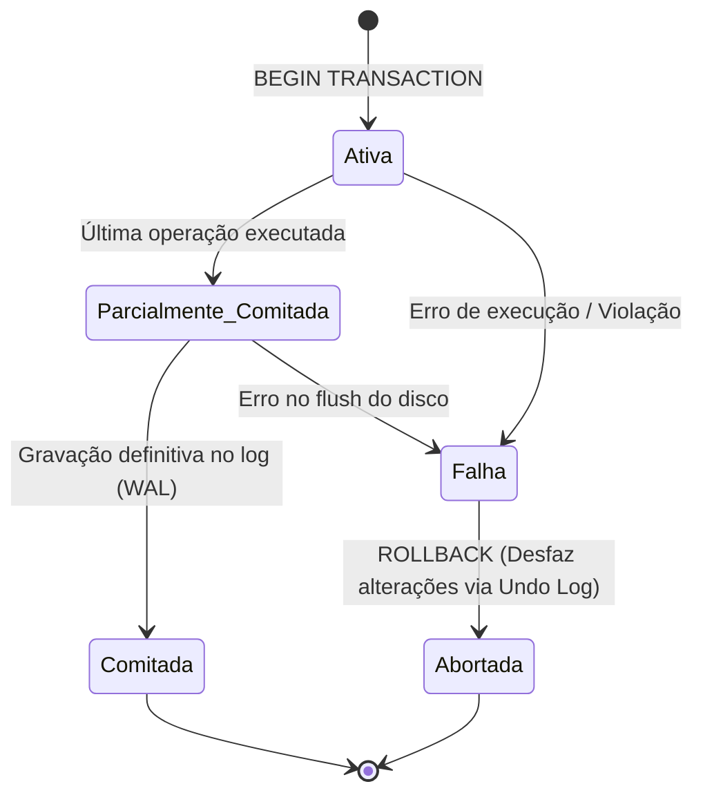
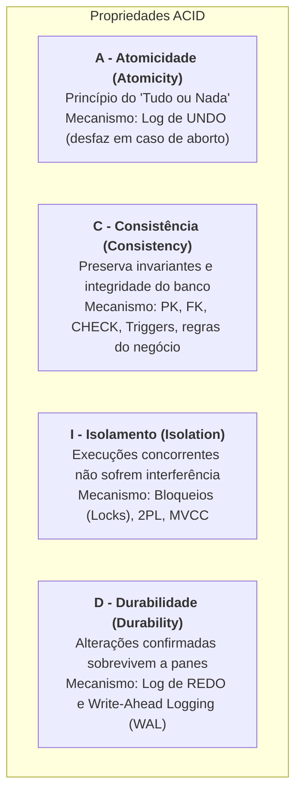
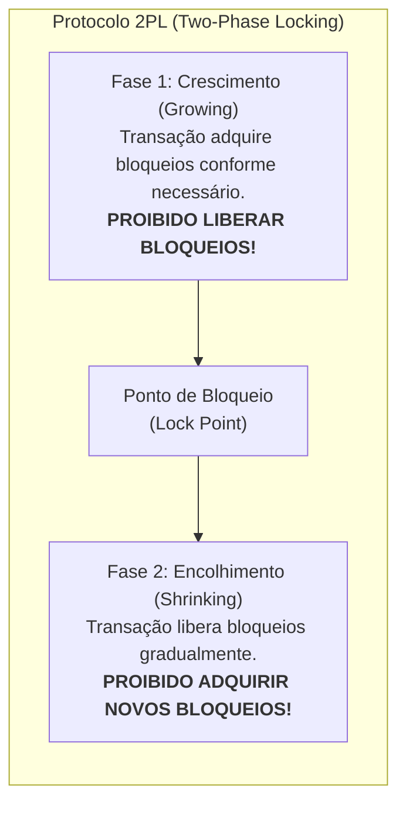
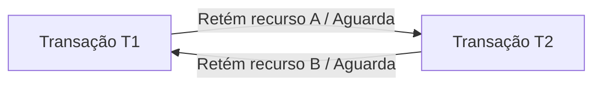

# 03 - Transações, Propriedades ACID e Concorrência

> **Matéria:** Banco de Dados  
> **Cargo:** B02 – Técnico de Controle Externo – Especialidade: Tecnologia da Informação  
> **Arquivo:** `03_transacoes_propriedades_acid_e_concorrencia.md`  

---

## 📌 Ementa / Itens do Edital
- Conceito de Transação de banco de dados
- As quatro propriedades fundamentais: ACID (Atomicidade, Consistência, Isolamento, Durabilidade)
- Comandos de controle transacional: COMMIT, ROLLBACK e SAVEPOINT
- Anomalias de concorrência (Leitura Suja, Leitura Não Repetível, Leitura Fantasma, Atualização Perdida)
- Níveis de Isolamento ANSI SQL
- Mecanismos de controle de concorrência: Bloqueios (Locks), 2PL, MVCC e Deadlocks

---

## 🧭 Sumário

1. [O Conceito Formal de Transação e o Modelo ACID](#1-o-conceito-formal-de-transacao-e-o-modelo-acid)
    1. [Ciclo de Vida e Estados de uma Transação](#11-ciclo-de-vida-e-estados-de-uma-transacao)
    2. [As Quatro Propriedades Fundamentais: ACID](#12-as-quatro-propriedades-fundamentais-acid)
    3. [Mecanismos Internos: Undo Log, Redo Log e Write-Ahead Logging (WAL)](#13-mecanismos-internos-undo-log-redo-log-e-write-ahead-logging-wal)
    4. [Teste 256](#Teste-256)
    5. [Teste 257](#Teste-257)
2. [Comandos de Controle Transacional (TCL)](#2-comandos-de-controle-transacional-tcl)
    1. [COMMIT, ROLLBACK e Gestão de SAVEPOINTs](#21-commit-rollback-e-gestao-de-savepoints)
    2. [Teste 258](#Teste-258)
3. [Fenômenos e Anomalias de Concorrência](#3-fenomenos-e-anomalias-de-concorrencia)
    1. [Leitura Suja (Dirty Read)](#31-leitura-suja-dirty-read)
    2. [Leitura Não Repetível (Non-Repeatable Read)](#32-leitura-nao-repetivel-non-repeatable-read)
    3. [Leitura Fantasma (Phantom Read)](#33-leitura-fantasma-phantom-read)
    4. [Atualização Perdida (Lost Update)](#34-atualizacao-perdida-lost-update)
    5. [Teste 259](#Teste-259)
4. [Níveis de Isolamento ANSI SQL-92](#4-niveis-de-isolamento-ansi-sql-92)
    1. [Matriz de Isolamento vs. Fenômenos Admitidos](#41-matriz-de-isolamento-vs-fenomenos-admitidos)
    2. [Snapshot Isolation (Isolamento por Instantâneo)](#42-snapshot-isolation-isolamento-por-instantaneo)
    3. [Teste 260](#Teste-260)
    4. [Teste 261](#Teste-261)
5. [Técnicas de Controle de Concorrência](#5-tecnicas-de-controle-de-concorrencia)
    1. [Bloqueios (Locks) e Matriz de Compatibilidade (Shared vs. Exclusive)](#51-bloqueios-locks-e-matriz-de-compatibilidade-shared-vs-exclusive)
    2. [Protocolo de Bloqueio em Duas Fases (2PL - Two-Phase Locking): Básico, Estrito e Rigoroso](#52-protocolo-de-bloqueio-em-duas-fases-2pl-two-phase-locking-basico-estrito-e-rigoroso)
    3. [Controle Multiversão de Concorrência (MVCC)](#53-controle-multiversao-de-concorrencia-mvcc)
    4. [Impasses (Deadlocks): Detecção via Wait-For Graph e Resolução por Transação Vítima](#54-impasses-deadlocks-deteccao-via-wait-for-graph-e-resolucao-por-transacao-vitima)
    5. [Teste 262](#Teste-262)
    6. [Teste 263](#Teste-263)
    7. [Teste 264](#Teste-264)
    8. [Teste 265](#Teste-265)
    9. [Teste 266](#Teste-266)
6. [🌐 Fontes Oficiais e Referências Bibliográficas](#fontes-oficiais-e-referencias-bibliograficas)

---

## 1. O Conceito Formal de Transação e o Modelo ACID

Uma **transação** de banco de dados é uma unidade lógica e atômica de processamento que agrupa uma ou mais instruções SQL (leitura e escrita) que devem ser executadas de modo estritamente indivisível. No contexto de auditoria e controle externo no setor público, uma transação típica é a liquidação de uma despesa orçamentária: o sistema deve simultaneamente debitar o saldo do empenho e creditar a conta bancária do fornecedor. Se apenas uma das ações ocorrer, o banco de dados entrará em colapso fiscal.

### 1.1 Ciclo de Vida e Estados de uma Transação

Durante sua existência, uma transação transita por estados formais bem definidos na teoria de sistemas relacionais:

- **Ativa (*Active*):** O estado inicial. A transação está sendo executada pela aplicação.
- **Parcialmente Comitada (*Partially Committed*):** A última instrução SQL foi processada na memória RAM, mas os dados ainda não foram gravados permanentemente no log em disco.
- **Comitada (*Committed*):** Todas as alterações foram confirmadas e gravadas no log transacional em armazenamento persistente (*Write-Ahead Logging*). A transação foi concluída com sucesso.
- **Falha (*Failed*):** Ocorre quando uma instrução viola uma restrição de integridade ou o sistema sofre interrupção antes da conclusão definitiva.
- **Abortada (*Aborted*):** O SGBD executa o comando `ROLLBACK`, desfazendo todas as modificações parciais já executadas e restaurando a base de dados ao estado exato anterior ao início da transação.

### 1.2 As Quatro Propriedades Fundamentais: ACID

Para que a integridade dos dados seja inviolável mesmo diante de falhas de hardware, interrupções de energia elétrica e concorrência massiva de usuários, o SGBD deve garantir integralmente as propriedades do acrônimo **ACID** (Jim Gray e Andreas Reuter):

1. **A - Atomicidade (*Atomicity*):**
    - Princípio do **"tudo ou nada"** (*all-or-nothing*). Todas as operações que compõem a transação são consolidadas em conjunto no banco de dados, ou nenhuma delas produzirá efeito algum. Não existe efetivação parcial de transação.

2. **C - Consistência (*Consistency*):**
    - Garante que a transação conduz o banco de dados de um **estado válido para outro estado igualmente válido**. A transação não pode violar nenhuma regra de integridade declarativa (chaves primárias, chaves estrangeiras, restrições `CHECK`, valores `NOT NULL`) ou procedimental (gatilhos e regras de negócio).

3. **I - Isolamento (*Isolation*):**
    - Assegura que a execução concomitante de múltiplas transações seja invisível entre si. Os efeitos intermediários e temporários de uma transação não comitada não podem ser observados por outras transações concorrentes. O resultado final deve equivaler a uma execução estritamente sequencial (*serializável*).

4. **D - Durabilidade (*Durability*):**
    - Garante que, uma vez que a transação foi confirmada com sucesso (`COMMIT`), suas modificações tornam-se **permanentes e indeléveis**. As alterações não serão perdidas sob nenhuma hipótese, resistindo até mesmo a falhas catastróficas de energia física ou travamentos no sistema operacional da máquina servidora.

### 1.3 Mecanismos Internos: Undo Log, Redo Log e Write-Ahead Logging (WAL)

- **Undo Log (Segmentos de Rollback):** Registra os valores **anteriores** à modificação. Se uma transação falhar ou for cancelada, o SGBD lê o Undo Log para restaurar os dados originais (garantindo a **Atomicidade**).
- **Redo Log / WAL (*Write-Ahead Logging*):** Registra os **novos** valores gerados pela transação.
    - **A Regra Inviolável do WAL:** O registro de log que descreve a alteração **deve ser gravado fisicamente em disco síncrono ANTES** que as páginas de dados correspondentes sejam descarregadas da memória RAM para os arquivos de dados (*datafiles*).
    - Isso garante a **Durabilidade**: se faltar energia imediatamente após o commit, o SGBD lê o Redo Log no boot de recuperação (*Crash Recovery*) e reaplica (*redo*) as alterações nas tabelas.

---

### Teste 001
**(FGV – TJ/SC – 2026 – Analista Administrativo)**
As parcerias público-privadas (PPPs) constituem estratégia governamental destinada a viabilizar empreendimentos e serviços públicos por meio da articulação entre a Administração Pública e o setor privado, apresentando potencial para superar limitações estruturais do setor estatal. A respeito das vantagens das PPPs para a Administração Pública, analise as afirmativas a seguir. I. Viabilizam empreendimentos que, sob a ótica estritamente financeira, não seriam sustentáveis apenas com a cobrança de tarifa dos usuários, ao admitir contraprestação do parceiro público ao parceiro privado. II. Geram complementaridade às capacidades e aos recursos do governo, mediante a aprendizagem de novas habilidades, o acesso a ferramentas de gestão da informação e o desenvolvimento de capacidade gerencial. III. Devem ser concebidas pelos gestores como mecanismo de viabilização de aportes financeiros privados, dispensando a busca de eficiência no uso de recursos públicos. Está correto o que se afirma em

* **A)** I, II e III.
* **B)** I e II, apenas.
* **C)** I e III, apenas.
* **D)** II e III, apenas.
* **E)** I, apenas.

---

> **Comentário Detalhado:**
>
> - **A)** **Incorreta.** A opção apresenta proposição em desacordo com os fundamentos teóricos e técnicos do tópico ao afirmar que "I, II e III". De acordo com a teoria estudada em *1.2 As Quatro Propriedades Fundamentais: ACID*, assegura que a execução concomitante de múltiplas transações seja invisível entre si. Os efeitos intermediários e temporários de uma transação não comitada não podem ser observados por outras transações concorrentes. O resultado final deve equivaler a uma execução estritamente sequencial ( serializável ).
> - **B)** **Correta.** Conforme fundamentado na seção *1. O Conceito Formal de Transação e o Modelo ACID* deste guia, uma transação de banco de dados é uma unidade lógica e atômica de processamento que agrupa uma ou mais instruções SQL (leitura e escrita) que devem ser executadas de modo estritamente indivisível. No contexto de auditoria e controle externo no setor público, uma transação típica é a liquidação de uma despesa orçamentária: o sistema deve simultaneamente debitar o saldo do empenho e creditar a conta bancária do fornecedor. Se apenas uma das ações ocorrer, o banco de dados entrará em colapso fiscal. Dessa forma, está plenamente correta a assertiva da banca (FGV – TJ/SC/2026) ao estabelecer que "I e II, apenas".
> - **C)** **Incorreta.** A opção incorre em restrição indevida ao limitar o escopo conceitual ao afirmar que "I e III, apenas". De acordo com a teoria estudada em *2.1 COMMIT, ROLLBACK e Gestão de SAVEPOINTs*, cOMMIT : Finaliza a transação com sucesso, gravando definitivamente todas as alterações pendentes no log transacional e liberando todos os bloqueios ( locks ) de recursos retidos.
> - **D)** **Incorreta.** A opção incorre em restrição indevida ao limitar o escopo conceitual ao afirmar que "II e III, apenas". De acordo com a teoria estudada em *2.1 COMMIT, ROLLBACK e Gestão de SAVEPOINTs*, rOLLBACK TO SAVEPOINT nome ponto : Reverte as operações executadas apenas após o marco especificado, mantendo preservadas as instruções anteriores ao savepoint. Atenção: O comando ROLLBACK TO SAVEPOINT NÃO encerra a transação; ela permanece aberta aguardando novas instruções ou a finalização formal com COMMIT ou ROLLBACK total.
> - **E)** **Incorreta.** A opção incorre em restrição indevida ao limitar o escopo conceitual ao afirmar que "I, apenas". De acordo com a teoria estudada em *5.2 Protocolo de Bloqueio em Duas Fases (2PL - Two-Phase Locking): Básico, Estrito e Rigoroso*, strict 2PL (2PL Estrito): Todos os bloqueios exclusivos (X) devem ser mantidos até o fim definitivo da transação ( COMMIT ou ROLLBACK ). Evita abortos em cascata ( cascadeless schedules ).
>
> **Gabarito: B**

---

### Teste 002
**(FGV – TJ/SC – 2026 – Analista Administrativo)**
O neoweberianismo é um paradigma de reforma da Administração Pública que surge no início dos anos 2000, no contexto continental europeu, como alternativa ao gerencialismo. Ao longo das primeiras décadas do século XXI, evoluiu de tipo ideal a modelo normativo, consolidando-se como referência paradigmática voltada a mitigar problemas decorrentes do neoliberalismo e das reformas gerenciais, notadamente o esvaziamento do Estado e sua incapacidade para enfrentar problemas sociais complexos e crises econômicas. Sobre a caracterização do Estado Neoweberiano como modelo de reforma administrativa, é correto afirmar que

* **A)** constitui aprofundamento da New Public Management (NPM), promovendo o esvaziamento do Estado, a redução de seus papéis centrais e a generalização da lógica de mercado como mecanismo predominante de coordenação.
* **B)** consiste em atualização do modelo burocrático weberiano clássico, mediante incorporação de tecnologias digitais aos procedimentos internos, mantendo a orientação processual centrada no cumprimento de normas.
* **C)** corresponde a paradigma puramente gerencial, fundado na substituição da burocracia estatal por arranjos contratuais flexíveis e por mecanismos de mercado, em ruptura com a tradição weberiana.
* **D)** adota a lógica reticular da Nova Governança Pública (NPG) como mecanismo predominante de coordenação institucional, deslocando a hierarquia estatal para função subsidiária na articulação entre atores públicos e privados.
* **E)** caracteriza-se como modelo híbrido, que articula legados burocráticos clássicos com aprendizados da NPM e da NPG, traduzindo-se em um arranjo institucional que preserva a coordenação estatal e simultaneamente incorpora lógicas de resultados e de participação cidadã. Administração Financeira e Orçamentária

---

> **Comentário Detalhado:**
>
> - **A)** **Incorreta.** A opção apresenta proposição em desacordo com os fundamentos teóricos e técnicos do tópico ao afirmar que "constitui aprofundamento da New Public Management (NPM), promovendo o esvaziamento do Estado, a redução de seus...". De acordo com a teoria estudada em *1.2 As Quatro Propriedades Fundamentais: ACID*, c["<b C Consistência (Consistency)</b <br/ Preserva invariantes e integridade do banco<br/ Mecanismo: PK, FK, CHECK, Triggers, regras do negócio"].
> - **B)** **Incorreta.** A opção apresenta proposição em desacordo com os fundamentos teóricos e técnicos do tópico ao afirmar que "consiste em atualização do modelo burocrático weberiano clássico, mediante incorporação de tecnologias digitais...". De acordo com a teoria estudada em *3.4 Atualização Perdida (Lost Update)*, definição: Duas transações ($T 1$ e $T 2$) leem simultaneamente a mesma tupla (ex.: saldo = 100). Ambas realizam cálculos locais independentes ($T 1$ soma 50; $T 2$ subtrai 30) e gravam os novos valores. A gravação mais tardia sobrescreve a anterior sem considerar seu cálculo, perdendo uma das atualizações.
> - **C)** **Incorreta.** A opção apresenta proposição em desacordo com os fundamentos teóricos e técnicos do tópico ao afirmar que "corresponde a paradigma puramente gerencial, fundado na substituição da burocracia estatal por arranjos...". De acordo com a teoria estudada em *1.3 Mecanismos Internos: Undo Log, Redo Log e Write-Ahead Logging (WAL)*, undo Log (Segmentos de Rollback): Registra os valores anteriores à modificação. Se uma transação falhar ou for cancelada, o SGBD lê o Undo Log para restaurar os dados originais (garantindo a Atomicidade).
> - **D)** **Incorreta.** A opção apresenta proposição em desacordo com os fundamentos teóricos e técnicos do tópico ao afirmar que "adota a lógica reticular da Nova Governança Pública (NPG) como mecanismo predominante de coordenação...". De acordo com a teoria estudada em *5.3 Controle Multiversão de Concorrência (MVCC)*, mecanismo: Ao atualizar uma linha, o SGBD não sobrescreve os dados no mesmo local; ele cria uma nova versão física da tupla contendo metadados de cabeçalho.
> - **E)** **Correta.** Conforme fundamentado na seção *1. O Conceito Formal de Transação e o Modelo ACID* deste guia, uma transação de banco de dados é uma unidade lógica e atômica de processamento que agrupa uma ou mais instruções SQL (leitura e escrita) que devem ser executadas de modo estritamente indivisível. No contexto de auditoria e controle externo no setor público, uma transação típica é a liquidação de uma despesa orçamentária: o sistema deve simultaneamente debitar o saldo do empenho e creditar a conta bancária do fornecedor. Se apenas uma das ações ocorrer, o banco de dados entrará em colapso fiscal. Dessa forma, está plenamente correta a assertiva da banca (FGV – TJ/SC/2026) ao estabelecer que "caracteriza se como modelo híbrido, que articula legados burocráticos clássicos com aprendizados da NPM e da NPG...".
>
> **Gabarito: E**

---

### Teste 003
**(FGV – TCE/GO – 2024 – Analista de Controle Externo - Controle Externo)**
A evolução da Administração Pública, do modelo racional-legal ao paradigma pós-burocrático, reflete uma transição de estruturas hierárquicas e procedimentos formais para abordagens mais flexíveis, participativas e orientadas para resultados. Sobre o modelo racional-legal de administração pública, assinale a afirmação correta.

* **A)** Procura otimizar a eficiência.
* **B)** Pretende gerar valor público.
* **C)** Busca uma maior integração com o mercado.
* **D)** Visa maior capacidade de idealizar políticas públicas.
* **E)** Promove uma abordagem participativa em rede.

---

> **Comentário Detalhado:**
>
> - **A)** **Incorreta.** A opção apresenta proposição em desacordo com os fundamentos teóricos e técnicos do tópico ao afirmar que "Procura otimizar a eficiência". De acordo com a teoria estudada em *1. O Conceito Formal de Transação e o Modelo ACID*, uma transação de banco de dados é uma unidade lógica e atômica de processamento que agrupa uma ou mais instruções SQL (leitura e escrita) que devem ser executadas de modo estritamente indivisível. No contexto de auditoria e controle externo no setor público, uma transação típica é a liquidação de uma despesa orçamentária: o sistema deve simultaneamente debitar o saldo do empenho e creditar a conta bancária do fornecedor. Se apenas uma das ações ocorrer, o banco de dados entrará em colapso fiscal.
> - **B)** **Incorreta.** A opção apresenta proposição em desacordo com os fundamentos teóricos e técnicos do tópico ao afirmar que "Pretende gerar valor público". De acordo com a teoria estudada em *3.1 Leitura Suja (Dirty Read)*, definição: Ocorre quando uma transação $T 1$ modifica uma linha no buffer, a transação $T 2$ lê esse valor ainda não comitado, e logo em seguida a transação $T 1$ sofre um ROLLBACK.
> - **C)** **Correta.** Conforme fundamentado na seção *3.3 Leitura Fantasma (Phantom Read)* deste guia, impacto: Surgem novos registros ("fantasmas") que satisfazem a condição de busca no curso da mesma transação. Dessa forma, está plenamente correta a assertiva da banca (FGV – TCE/GO/2024) ao estabelecer que "Busca uma maior integração com o mercado".
> - **D)** **Incorreta.** A opção apresenta proposição em desacordo com os fundamentos teóricos e técnicos do tópico ao afirmar que "Visa maior capacidade de idealizar políticas públicas". De acordo com a teoria estudada em *1.1 Ciclo de Vida e Estados de uma Transação*, durante sua existência, uma transação transita por estados formais bem definidos na teoria de sistemas relacionais.
> - **E)** **Incorreta.** A opção apresenta proposição em desacordo com os fundamentos teóricos e técnicos do tópico ao afirmar que "Promove uma abordagem participativa em rede". De acordo com a teoria estudada em *3.4 Atualização Perdida (Lost Update)*, definição: Duas transações ($T 1$ e $T 2$) leem simultaneamente a mesma tupla (ex.: saldo = 100). Ambas realizam cálculos locais independentes ($T 1$ soma 50; $T 2$ subtrai 30) e gravam os novos valores. A gravação mais tardia sobrescreve a anterior sem considerar seu cálculo, perdendo uma das atualizações.
>
> **Gabarito: C**

---

### Teste 004
**(FGV – TCE/GO – 2024 – Analista de Controle Externo - Tecnologia da Informação)**
O IPSec é um conjunto de protocolos desenvolvidos pelo IETF para oferecer segurança para um pacote no nível de rede. Com relação ao IPSec, assinale V para afirmativa verdadeira e F para a falsa. ( ) O IPSec no modo túnel não protege o cabeçalho IP enquanto no modo de transporte, protege o pacote inteiro. ( ) O protocolo ESP fornece somente autenticação de fonte e integridade de dados, enquanto o protocolo AH fornece, também, privacidade, além da autenticação e integridade. ( ) O IPSec oferece suporte tanto ao IPv4 quanto o IPv6, porém, apenas no IPv6 o ESP e o AH fazem parte do cabeçalho de extensão. As afirmativas são, respectivamente,

* **A)** V – V – V.
* **B)** F – V – F.
* **C)** F – F – F.
* **D)** F – F – V.
* **E)** V – F – V.

---

> **Comentário Detalhado:**
>
> - **A)** **Incorreta.** A opção apresenta proposição em desacordo com os fundamentos teóricos e técnicos do tópico ao afirmar que "V – V – V". De acordo com a teoria estudada em *1. O Conceito Formal de Transação e o Modelo ACID*, uma transação de banco de dados é uma unidade lógica e atômica de processamento que agrupa uma ou mais instruções SQL (leitura e escrita) que devem ser executadas de modo estritamente indivisível. No contexto de auditoria e controle externo no setor público, uma transação típica é a liquidação de uma despesa orçamentária: o sistema deve simultaneamente debitar o saldo do empenho e creditar a conta bancária do fornecedor. Se apenas uma das ações ocorrer, o banco de dados entrará em colapso fiscal.
> - **B)** **Incorreta.** A opção apresenta proposição em desacordo com os fundamentos teóricos e técnicos do tópico ao afirmar que "F – V – F". De acordo com a teoria estudada em *1.2 As Quatro Propriedades Fundamentais: ACID*, princípio do "tudo ou nada" ( all or nothing ). Todas as operações que compõem a transação são consolidadas em conjunto no banco de dados, ou nenhuma delas produzirá efeito algum. Não existe efetivação parcial de transação.
> - **C)** **Incorreta.** A opção apresenta proposição em desacordo com os fundamentos teóricos e técnicos do tópico ao afirmar que "F – F – F". De acordo com a teoria estudada em *1.2 As Quatro Propriedades Fundamentais: ACID*, para que a integridade dos dados seja inviolável mesmo diante de falhas de hardware, interrupções de energia elétrica e concorrência massiva de usuários, o SGBD deve garantir integralmente as propriedades do acrônimo ACID (Jim Gray e Andreas Reuter).
> - **D)** **Correta.** Conforme fundamentado na seção *5.2 Protocolo de Bloqueio em Duas Fases (2PL - Two-Phase Locking): Básico, Estrito e Rigoroso* deste guia, rigorous 2PL (2PL Rigoroso): Todos os bloqueios (tanto compartilhados S quanto exclusivos X) devem ser mantidos até o COMMIT ou ROLLBACK . É a variante mais utilizada na prática por garantir serializabilidade estrita. Dessa forma, está plenamente correta a assertiva da banca (FGV – TCE/GO/2024) ao estabelecer que "F – F – V".
> - **E)** **Incorreta.** A opção apresenta proposição em desacordo com os fundamentos teóricos e técnicos do tópico ao afirmar que "V – F – V". De acordo com a teoria estudada em *1.2 As Quatro Propriedades Fundamentais: ACID*, garante que a transação conduz o banco de dados de um estado válido para outro estado igualmente válido. A transação não pode violar nenhuma regra de integridade declarativa (chaves primárias, chaves estrangeiras, restrições CHECK , valores NOT NULL ) ou procedimental (gatilhos e regras de negócio).
>
> **Gabarito: D**

---

### Teste 005
**(CEBRASPE – TRF 6ª – 2025 – Analista Judiciário - Apoio Especializado - Governança e Gestão de Tecnologia da Informação)**
O COBIT 2019 tem, entre outras, a privacidade de dados e a segurança cibernética como áreas de foco.

* **C)** Certo
* **E)** Errado

---

> **Comentário Detalhado:**
>
> - **C)** **Correta.** O item está **Certo**. Conforme fundamentado na seção *🌐 Fontes Oficiais e Referências Bibliográficas*, eLMASRI, Ramez; NAVATHE, Shamkant B. Sistemas de Banco de Dados. 7. ed. São Paulo: Pearson, 2019. (Cap. 20 Conceitos de Processamento de Transações; Cap. 21 Técnicas de Controle de Concorrência). Dessa forma, está plenamente correta a assertiva da banca (CEBRASPE – TRF 6ª/2025) ao afirmar que "O COBIT 2019 tem, entre outras, a privacidade de dados e a segurança cibernética como áreas de foco".
> - **E)** **Incorreta.** A assertiva não incorre em erro conceitual, guardando conformidade com a teoria estudada.
>
> **Gabarito: C**

---

### Teste 006
**(CEBRASPE – STJ – 2024 – Analista Judiciário - Apoio Especializado - Suporte em Tecnologia da Informação)**
Na segurança da informação, a autenticidade é conceituada como a propriedade pela qual se assegura que a informação não foi modificada ou destruída de maneira não autorizada ou acidental.

* **C)** Certo
* **E)** Errado

---

> **Comentário Detalhado:**
>
> - **C)** **Incorreta.** A proposição apresenta proposição em desacordo com os fundamentos teóricos e técnicos do tópico ao afirmar que "Na segurança da informação, a autenticidade é conceituada como a propriedade pela qual se assegura que a...". De acordo com a teoria em *1.2 As Quatro Propriedades Fundamentais: ACID*, assegura que a execução concomitante de múltiplas transações seja invisível entre si. Os efeitos intermediários e temporários de uma transação não comitada não podem ser observados por outras transações concorrentes. O resultado final deve equivaler a uma execução estritamente sequencial ( serializável ).
> - **E)** **Correta.** O item está **Errado** (gabarito oficial: **E**), pois contraria a disciplina teórica aplicável.
>
> **Gabarito: E**

---

### Teste 007
**(CEBRASPE – STJ – 2024 – Analista Judiciário - Apoio Especializado - Suporte em Tecnologia da Informação)**
Em Big Data, uma das propriedades ACID é a atomicidade, que garante que todas as alterações sejam efetivadas no banco de dados, sem atualização parcial da transação.

* **C)** Certo
* **E)** Errado

---

> **Comentário Detalhado:**
>
> - **C)** **Correta.** O item está **Certo**. Conforme fundamentado na seção *1.2 As Quatro Propriedades Fundamentais: ACID*, princípio do "tudo ou nada" ( all or nothing ). Todas as operações que compõem a transação são consolidadas em conjunto no banco de dados, ou nenhuma delas produzirá efeito algum. Não existe efetivação parcial de transação. Dessa forma, está plenamente correta a assertiva da banca (CEBRASPE – STJ/2024) ao afirmar que "Em Big Data, uma das propriedades ACID é a atomicidade, que garante que todas as alterações sejam efetivadas...".
> - **E)** **Incorreta.** A assertiva não incorre em erro conceitual, guardando conformidade com a teoria estudada.
>
> **Gabarito: C**

---

### Teste 008
**(FGV – TJ/AP – 2023 – Analista Judiciario Apoio Especializado Tecnologia Da Informacao Banco De Dados)**
O mecanismo de recuperação de banco de dados precisa garantir que uma transação possa ser desfeita. Para execução do rollback em cascata são necessárias entradas de log do(s) valor(es):

* **A)** novo;
* **B)** antigo;
* **C)** antigo e novo;
* **D)** write-ahead;
* **E)** undo/redo.

---

> **Comentário Detalhado:**
>
> - **A)** **Incorreta.** A opção apresenta proposição em desacordo com os fundamentos teóricos e técnicos do tópico ao afirmar que "novo". De acordo com a teoria estudada em *4.1 Matriz de Isolamento vs. Fenômenos Admitidos*, rEAD COMMITTED : ✅ Previne — ❌ Permite — ❌ Permite — Lê apenas dados já comitados. Cada instrução SELECT tira um novo snapshot. (Padrão em PostgreSQL e Oracle).
> - **B)** **Correta.** Conforme fundamentado na seção *5.2 Protocolo de Bloqueio em Duas Fases (2PL - Two-Phase Locking): Básico, Estrito e Rigoroso* deste guia, strict 2PL (2PL Estrito): Todos os bloqueios exclusivos (X) devem ser mantidos até o fim definitivo da transação ( COMMIT ou ROLLBACK ). Evita abortos em cascata ( cascadeless schedules ). Dessa forma, está plenamente correta a assertiva da banca (FGV – TJ/AP/2023) ao estabelecer que "antigo".
> - **C)** **Incorreta.** A opção apresenta proposição em desacordo com os fundamentos teóricos e técnicos do tópico ao afirmar que "antigo e novo". De acordo com a teoria estudada em *1. O Conceito Formal de Transação e o Modelo ACID*, uma transação de banco de dados é uma unidade lógica e atômica de processamento que agrupa uma ou mais instruções SQL (leitura e escrita) que devem ser executadas de modo estritamente indivisível. No contexto de auditoria e controle externo no setor público, uma transação típica é a liquidação de uma despesa orçamentária: o sistema deve simultaneamente debitar o saldo do empenho e creditar a conta bancária do fornecedor. Se apenas uma das ações ocorrer, o banco de dados entrará em colapso fiscal.
> - **D)** **Incorreta.** A opção apresenta proposição em desacordo com os fundamentos teóricos e técnicos do tópico ao afirmar que "write ahead". De acordo com a teoria estudada em *1.3 Mecanismos Internos: Undo Log, Redo Log e Write-Ahead Logging (WAL)*, a Regra Inviolável do WAL: O registro de log que descreve a alteração deve ser gravado fisicamente em disco síncrono ANTES que as páginas de dados correspondentes sejam descarregadas da memória RAM para os arquivos de dados ( datafiles ).
> - **E)** **Incorreta.** A opção apresenta proposição em desacordo com os fundamentos teóricos e técnicos do tópico ao afirmar que "undo/redo". De acordo com a teoria estudada em *1.3 Mecanismos Internos: Undo Log, Redo Log e Write-Ahead Logging (WAL)*, undo Log (Segmentos de Rollback): Registra os valores anteriores à modificação. Se uma transação falhar ou for cancelada, o SGBD lê o Undo Log para restaurar os dados originais (garantindo a Atomicidade).
>
> **Gabarito: B**

---

### Teste 009
**(FGV – TJ/AP – 2023 – Analista Judiciario Apoio Especializado Tecnologia Da Informacao Telecomunicacoes)**
O administrador de rede de uma empresa deseja configurar uma rede de computadores com capacidade para comportar até vinte computadores pessoais, quatro impressoras de rede, quatro câmeras de monitoramento IP, três servidores de rede e um gateway da rede, conforme apresentado na tabela abaixo. Máquina Quantidade Computadores pessoais 20 Impressoras de rede 04 Câmeras de monitoramento IP 04 Servidores de rede 03 Gateway da rede 01 A rede IPv4 com a menor capacidade de hospedar os dispositivos, mas que comporte as necessidades apresentadas, é:

* **A)** 192.168.1.0/24;
* **B)** 192.168.1.0/25;
* **C)** 192.168.1.0/26;
* **D)** 192.168.1.0/27;
* **E)** 192.168.1.0/28.

---

> **Comentário Detalhado:**
>
> - **A)** **Incorreta.** A opção apresenta proposição em desacordo com os fundamentos teóricos e técnicos do tópico ao afirmar que "192.168.1.0/24". De acordo com a teoria estudada em *4.1 Matriz de Isolamento vs. Fenômenos Admitidos*, o único nível do padrão ANSI que previne todos os três fenômenos é o SERIALIZABLE.
> - **B)** **Incorreta.** A opção apresenta proposição em desacordo com os fundamentos teóricos e técnicos do tópico ao afirmar que "192.168.1.0/25". De acordo com a teoria estudada em *5.4 Impasses (Deadlocks): Detecção via Wait-For Graph e Resolução por Transação Vítima*, resolução via Transação Vítima: Ao detectar o ciclo, o SGBD seleciona uma transação vítima (com base em critérios de menor custo computacional ou menor volume de dados alterados), aborta sua execução compulsoriamente via ROLLBACK forçado e devolve o erro à aplicação cliente.
> - **C)** **Correta.** Conforme fundamentado na seção *1.2 As Quatro Propriedades Fundamentais: ACID* deste guia, garante que, uma vez que a transação foi confirmada com sucesso ( COMMIT ), suas modificações tornam se permanentes e indeléveis. As alterações não serão perdidas sob nenhuma hipótese, resistindo até mesmo a falhas catastróficas de energia física ou travamentos no sistema operacional da máquina servidora. Dessa forma, está plenamente correta a assertiva da banca (FGV – TJ/AP/2023) ao estabelecer que "192.168.1.0/26".
> - **D)** **Incorreta.** A opção apresenta proposição em desacordo com os fundamentos teóricos e técnicos do tópico ao afirmar que "192.168.1.0/27". De acordo com a teoria estudada em *1.2 As Quatro Propriedades Fundamentais: ACID*, para que a integridade dos dados seja inviolável mesmo diante de falhas de hardware, interrupções de energia elétrica e concorrência massiva de usuários, o SGBD deve garantir integralmente as propriedades do acrônimo ACID (Jim Gray e Andreas Reuter).
> - **E)** **Incorreta.** A opção apresenta proposição em desacordo com os fundamentos teóricos e técnicos do tópico ao afirmar que "192.168.1.0/28". De acordo com a teoria estudada em *1.2 As Quatro Propriedades Fundamentais: ACID*, subgraph ACID["Propriedades ACID"].
>
> **Gabarito: C**

---

### Teste 010
**(FCC – TRT 14ª – 2016 – Analista Judiciário - Apoio Especializado - Tecnologia da Informação)**
Uma organização atingiu o nível 1 de capacidade de processo do COBIT 5. Isso significa dizer que

* **A)** o atributo de desempenho do processo foi amplamente atingido; o processo está sendo realizado com sucesso e os resultados esperados estão sendo obtidos pela organização.
* **B)** não há uma diferença significativa entre a capacidade de processo nível 1 e os níveis de capacidade mais altos.
* **C)** houve um engano, pois o COBIT 5 trabalha com níveis de maturidade e não com níveis de capacidade.
* **D)** todos os cinco atributos de desempenho dos dois processos foram amplamente atingidos; a organização progride com sucesso e os resultados esperados estão sendo obtidos.
* **E)** a organização atingiu o nível de capacidade Processo Gerenciado e seus produtos de trabalho estão adequadamente estabelecidos, controlados e mantidos.

---

> **Comentário Detalhado:**
>
> - **A)** **Correta.** Conforme fundamentado na seção *1.1 Ciclo de Vida e Estados de uma Transação* deste guia, ativa ( Active ): O estado inicial. A transação está sendo executada pela aplicação. Dessa forma, está plenamente correta a assertiva da banca (FCC – TRT 14ª/2016) ao estabelecer que "o atributo de desempenho do processo foi amplamente atingido; o processo está sendo realizado com sucesso e os...".
> - **B)** **Incorreta.** A opção apresenta proposição em desacordo com os fundamentos teóricos e técnicos do tópico ao afirmar que "não há uma diferença significativa entre a capacidade de processo nível 1 e os níveis de capacidade mais altos". De acordo com a teoria estudada em *4.1 Matriz de Isolamento vs. Fenômenos Admitidos*, nível de Isolamento: Leitura Suja ( Dirty Read ) — Leitura Não Repetível ( Non Repeatable Read ) — Leitura Fantasma ( Phantom Read ) — Mecanismo Típico de Implementação.
> - **C)** **Incorreta.** A opção apresenta proposição em desacordo com os fundamentos teóricos e técnicos do tópico ao afirmar que "houve um engano, pois o COBIT 5 trabalha com níveis de maturidade e não com níveis de capacidade". De acordo com a teoria estudada em *1.1 Ciclo de Vida e Estados de uma Transação*, comitada ( Committed ): Todas as alterações foram confirmadas e gravadas no log transacional em armazenamento persistente ( Write Ahead Logging ). A transação foi concluída com sucesso.
> - **D)** **Incorreta.** A opção apresenta proposição em desacordo com os fundamentos teóricos e técnicos do tópico ao afirmar que "todos os cinco atributos de desempenho dos dois processos foram amplamente atingidos; a organização progride com...". De acordo com a teoria estudada em *1.2 As Quatro Propriedades Fundamentais: ACID*, garante que, uma vez que a transação foi confirmada com sucesso ( COMMIT ), suas modificações tornam se permanentes e indeléveis. As alterações não serão perdidas sob nenhuma hipótese, resistindo até mesmo a falhas catastróficas de energia física ou travamentos no sistema operacional da máquina servidora.
> - **E)** **Incorreta.** A opção apresenta proposição em desacordo com os fundamentos teóricos e técnicos do tópico ao afirmar que "a organização atingiu o nível de capacidade Processo Gerenciado e seus produtos de trabalho estão adequadamente...". De acordo com a teoria estudada em *4.1 Matriz de Isolamento vs. Fenômenos Admitidos*, "Qual o nível de isolamento MÍNIMO que impede Leitura Não Repetível?" $\rightarrow$ REPEATABLE READ.
>
> **Gabarito: A**

---

### Teste 011
**(FCC – TRT 23ª – 2016 – Analista Judiciário - Apoio Especializado - Tecnologia da Informação)**
Um Analista do Tribunal pretende contratar algumas soluções de Tecnologia da Informação e Comunicação para serem utilizadas em seu projeto prioritário. Para tanto, ele deve reportar-se à Resolução no 182 de 17 de outubro de 2013 que dispõe sobre as diretrizes para as contratações de Solução de Tecnologia da Informação e Comunicação pelos órgãos submetidos ao controle administrativo e financeiro do Conselho Nacional de Justiça − CNJ. Ao estudar a referida resolução ele viu que a execução da fase de Elaboração dos Estudos Preliminares da STIC é

* **A)** gargalo, regras de negócio e capacidade.
* **B)** gargalo, capacidade e regras de negócio.
* **C)** capacidade, regras de negócio e gargalo.
* **D)** regras de negócio, capacidade e gargalo.
* **E)** regras de negócio, gargalo e capacidade.

---

> **Comentário Detalhado:**
>
> - **A)** **Incorreta.** A opção apresenta proposição em desacordo com os fundamentos teóricos e técnicos do tópico ao afirmar que "gargalo, regras de negócio e capacidade". De acordo com a teoria estudada em *1.2 As Quatro Propriedades Fundamentais: ACID*, garante que a transação conduz o banco de dados de um estado válido para outro estado igualmente válido. A transação não pode violar nenhuma regra de integridade declarativa (chaves primárias, chaves estrangeiras, restrições CHECK , valores NOT NULL ) ou procedimental (gatilhos e regras de negócio).
> - **B)** **Incorreta.** A opção apresenta proposição em desacordo com os fundamentos teóricos e técnicos do tópico ao afirmar que "gargalo, capacidade e regras de negócio". De acordo com a teoria estudada em *3.1 Leitura Suja (Dirty Read)*, impacto: A transação $T 2$ tomou decisões de negócio baseando se em um dado ilegítimo que nunca existiu formalmente no banco de dados.
> - **C)** **Incorreta.** A opção apresenta proposição em desacordo com os fundamentos teóricos e técnicos do tópico ao afirmar que "capacidade, regras de negócio e gargalo". De acordo com a teoria estudada em *1.2 As Quatro Propriedades Fundamentais: ACID*, assegura que a execução concomitante de múltiplas transações seja invisível entre si. Os efeitos intermediários e temporários de uma transação não comitada não podem ser observados por outras transações concorrentes. O resultado final deve equivaler a uma execução estritamente sequencial ( serializável ).
> - **D)** **Incorreta.** A opção apresenta proposição em desacordo com os fundamentos teóricos e técnicos do tópico ao afirmar que "regras de negócio, capacidade e gargalo". De acordo com a teoria estudada em *5.4 Impasses (Deadlocks): Detecção via Wait-For Graph e Resolução por Transação Vítima*, resolução via Transação Vítima: Ao detectar o ciclo, o SGBD seleciona uma transação vítima (com base em critérios de menor custo computacional ou menor volume de dados alterados), aborta sua execução compulsoriamente via ROLLBACK forçado e devolve o erro à aplicação cliente.
> - **E)** **Correta.** Conforme fundamentado na seção *1.2 As Quatro Propriedades Fundamentais: ACID* deste guia, c["<b C Consistência (Consistency)</b <br/ Preserva invariantes e integridade do banco<br/ Mecanismo: PK, FK, CHECK, Triggers, regras do negócio"]. Dessa forma, está plenamente correta a assertiva da banca (FCC – TRT 23ª/2016) ao estabelecer que "regras de negócio, gargalo e capacidade".
>
> **Gabarito: E**

---

### Teste 012
**(FCC – TRT 6ª – 2012 – Analista Judiciário - Apoio Especializado/Tecnologia da Informação)**
A capacidade nominal de armazenamento de uma mídia de DVD-RW, com camada simples e lado simples é de

* **A)** 4,7GB.
* **B)** 700MB.
* **C)** 9,40GB.
* **D)** 720MB.
* **E)** 1024TB.

---

> **Comentário Detalhado:**
>
> - **A)** **Incorreta.** A opção apresenta proposição em desacordo com os fundamentos teóricos e técnicos do tópico ao afirmar que "4,7GB". De acordo com a teoria estudada em *1. O Conceito Formal de Transação e o Modelo ACID*, uma transação de banco de dados é uma unidade lógica e atômica de processamento que agrupa uma ou mais instruções SQL (leitura e escrita) que devem ser executadas de modo estritamente indivisível. No contexto de auditoria e controle externo no setor público, uma transação típica é a liquidação de uma despesa orçamentária: o sistema deve simultaneamente debitar o saldo do empenho e creditar a conta bancária do fornecedor. Se apenas uma das ações ocorrer, o banco de dados entrará em colapso fiscal.
> - **B)** **Incorreta.** A opção apresenta proposição em desacordo com os fundamentos teóricos e técnicos do tópico ao afirmar que "700MB". De acordo com a teoria estudada em *1.1 Ciclo de Vida e Estados de uma Transação*, durante sua existência, uma transação transita por estados formais bem definidos na teoria de sistemas relacionais.
> - **C)** **Correta.** Conforme fundamentado na seção *1.1 Ciclo de Vida e Estados de uma Transação* deste guia, comitada ( Committed ): Todas as alterações foram confirmadas e gravadas no log transacional em armazenamento persistente ( Write Ahead Logging ). A transação foi concluída com sucesso. Dessa forma, está plenamente correta a assertiva da banca (FCC – TRT 6ª/2012) ao estabelecer que "9,40GB".
> - **D)** **Incorreta.** A opção apresenta proposição em desacordo com os fundamentos teóricos e técnicos do tópico ao afirmar que "720MB". De acordo com a teoria estudada em *1.1 Ciclo de Vida e Estados de uma Transação*, ativa Parcialmente Comitada: Última operação executada.
> - **E)** **Incorreta.** A opção apresenta proposição em desacordo com os fundamentos teóricos e técnicos do tópico ao afirmar que "1024TB". De acordo com a teoria estudada em *1.1 Ciclo de Vida e Estados de uma Transação*, ativa Falha: Erro de execução / Violação.
>
> **Gabarito: C**

---

### Teste 013
**(FGV – TRT da 24º Região – 2025 – Analista Judiciário - Área Administrativa - Contabilidade)**
João, servidor ocupante de cargo de provimento efetivo no Tribunal Regional do Trabalho da Região X, em razão de patologia estritamente relacionada ao exercício funcional, teve deferida a aposentadoria por incapacidade permanente para o trabalho. Em momento posterior, constatou-se a acentuada regressão da referida patologia, o que acarretou o restabelecimento da capacidade laborativa do servidor, ainda que em intensidade um pouco inferior à originária. Por tal razão, a Administração Pública decidiu que João deveria retornar ao serviço ativo. Sobre a hipótese, à luz da Lei nº 8.112/1990, assinale a afirmativa correta.

* **A)** João deve ocupar algum cargo da mesma carreira do cargo originário.
* **B)** João deve retornar ao cargo que ocupava por ocasião da aposentadoria.
* **C)** Caso inexista cargo vago, João deve ser posto em disponibilidade.
* **D)** Caso inexista cargo vago, deve ser postergado o retorno de João ao serviço ativo.
* **E)** Caso inexista cargo vago, João exercerá suas atribuições como excedente, até a ocorrência de vaga.

---

> **Comentário Detalhado:**
>
> - **A)** **Incorreta.** A opção apresenta proposição em desacordo com os fundamentos teóricos e técnicos do tópico ao afirmar que "João deve ocupar algum cargo da mesma carreira do cargo originário". De acordo com a teoria estudada em *1.2 As Quatro Propriedades Fundamentais: ACID*, princípio do "tudo ou nada" ( all or nothing ). Todas as operações que compõem a transação são consolidadas em conjunto no banco de dados, ou nenhuma delas produzirá efeito algum. Não existe efetivação parcial de transação.
> - **B)** **Incorreta.** A opção apresenta proposição em desacordo com os fundamentos teóricos e técnicos do tópico ao afirmar que "João deve retornar ao cargo que ocupava por ocasião da aposentadoria". De acordo com a teoria estudada em *1. O Conceito Formal de Transação e o Modelo ACID*, uma transação de banco de dados é uma unidade lógica e atômica de processamento que agrupa uma ou mais instruções SQL (leitura e escrita) que devem ser executadas de modo estritamente indivisível. No contexto de auditoria e controle externo no setor público, uma transação típica é a liquidação de uma despesa orçamentária: o sistema deve simultaneamente debitar o saldo do empenho e creditar a conta bancária do fornecedor. Se apenas uma das ações ocorrer, o banco de dados entrará em colapso fiscal.
> - **C)** **Incorreta.** A opção apresenta proposição em desacordo com os fundamentos teóricos e técnicos do tópico ao afirmar que "Caso inexista cargo vago, João deve ser posto em disponibilidade". De acordo com a teoria estudada em *1.2 As Quatro Propriedades Fundamentais: ACID*, assegura que a execução concomitante de múltiplas transações seja invisível entre si. Os efeitos intermediários e temporários de uma transação não comitada não podem ser observados por outras transações concorrentes. O resultado final deve equivaler a uma execução estritamente sequencial ( serializável ).
> - **D)** **Incorreta.** A opção apresenta proposição em desacordo com os fundamentos teóricos e técnicos do tópico ao afirmar que "Caso inexista cargo vago, deve ser postergado o retorno de João ao serviço ativo". De acordo com a teoria estudada em *1.3 Mecanismos Internos: Undo Log, Redo Log e Write-Ahead Logging (WAL)*, a Regra Inviolável do WAL: O registro de log que descreve a alteração deve ser gravado fisicamente em disco síncrono ANTES que as páginas de dados correspondentes sejam descarregadas da memória RAM para os arquivos de dados ( datafiles ).
> - **E)** **Correta.** Conforme fundamentado na seção *1.2 As Quatro Propriedades Fundamentais: ACID* deste guia, a["<b A Atomicidade (Atomicity)</b <br/ Princípio do 'Tudo ou Nada'<br/ Mecanismo: Log de UNDO (desfaz em caso de aborto)"]. Dessa forma, está plenamente correta a assertiva da banca (FGV – TRT da 24º Região/2025) ao estabelecer que "Caso inexista cargo vago, João exercerá suas atribuições como excedente, até a ocorrência de vaga".
>
> **Gabarito: E**

---

### Teste 014
**(FGV – TRT da 24º Região – 2025 – Analista Judiciário - Área Administrativa - Contabilidade)**
De acordo com a NBC TG Estrutura Conceitual - Estrutura Conceitual para Relatório Financeiro, um ativo, necessariamente,

* **A)** é um bem corpóreo.
* **B)** está atrelado a eventos futuros previsíveis.
* **C)** tem o potencial de produzir benefícios econômicos.
* **D)** representa um direito presente perante os acionistas.
* **E)** foi adquirido pela entidade em uma transação com terceiros.

---

> **Comentário Detalhado:**
>
> - **A)** **Incorreta.** A opção apresenta proposição em desacordo com os fundamentos teóricos e técnicos do tópico ao afirmar que "é um bem corpóreo". De acordo com a teoria estudada em *1.1 Ciclo de Vida e Estados de uma Transação*, durante sua existência, uma transação transita por estados formais bem definidos na teoria de sistemas relacionais.
> - **B)** **Incorreta.** A opção apresenta proposição em desacordo com os fundamentos teóricos e técnicos do tópico ao afirmar que "está atrelado a eventos futuros previsíveis". De acordo com a teoria estudada em *1.1 Ciclo de Vida e Estados de uma Transação*, ativa Parcialmente Comitada: Última operação executada.
> - **C)** **Correta.** Conforme fundamentado na seção *1. O Conceito Formal de Transação e o Modelo ACID* deste guia, uma transação de banco de dados é uma unidade lógica e atômica de processamento que agrupa uma ou mais instruções SQL (leitura e escrita) que devem ser executadas de modo estritamente indivisível. No contexto de auditoria e controle externo no setor público, uma transação típica é a liquidação de uma despesa orçamentária: o sistema deve simultaneamente debitar o saldo do empenho e creditar a conta bancária do fornecedor. Se apenas uma das ações ocorrer, o banco de dados entrará em colapso fiscal. Dessa forma, está plenamente correta a assertiva da banca (FGV – TRT da 24º Região/2025) ao estabelecer que "tem o potencial de produzir benefícios econômicos".
> - **D)** **Incorreta.** A opção apresenta proposição em desacordo com os fundamentos teóricos e técnicos do tópico ao afirmar que "representa um direito presente perante os acionistas". De acordo com a teoria estudada em *1.1 Ciclo de Vida e Estados de uma Transação*, ativa Falha: Erro de execução / Violação.
> - **E)** **Incorreta.** A opção apresenta proposição em desacordo com os fundamentos teóricos e técnicos do tópico ao afirmar que "foi adquirido pela entidade em uma transação com terceiros". De acordo com a teoria estudada em *1.1 Ciclo de Vida e Estados de uma Transação*, parcialmente Comitada Comitada: Gravação definitiva no log (WAL).
>
> **Gabarito: C**

---

### Teste 015
**(FGV – TRT 1ª – 2024 – Analista Judiciário - Área Administrativa)**
A empresa fictícia XPTO é uma fabricante de móveis de médio porte que adota a seguinte departamentalização: setor de corte; setor de montagem; setor de acabamento e pintura. A direção da XPTO reconhece que uma das vantagens desse tipo de departamentalização é a eficiência gerada pela racionalização das diferentes etapas do processo produtivo. No entanto, a departamentalização adotada também apresenta potenciais desvantagens, tais como:

* **A)** dificultar a coordenação intradepartamental;
* **B)** gerar conflitos decorrentes da duplicidade de supervisão;
* **C)** oferecer pouca flexibilidade e capacidade de adaptação a mudanças tecnológicas;
* **D)** aumentar os custos operacionais devido à redundância de funções;
* **E)** induzir à burocratização e aumento do número de níveis hierárquicos.

---

> **Comentário Detalhado:**
>
> - **A)** **Incorreta.** A opção apresenta proposição em desacordo com os fundamentos teóricos e técnicos do tópico ao afirmar que "dificultar a coordenação intradepartamental". De acordo com a teoria estudada em *1.1 Ciclo de Vida e Estados de uma Transação*, durante sua existência, uma transação transita por estados formais bem definidos na teoria de sistemas relacionais.
> - **B)** **Incorreta.** A opção apresenta proposição em desacordo com os fundamentos teóricos e técnicos do tópico ao afirmar que "gerar conflitos decorrentes da duplicidade de supervisão". De acordo com a teoria estudada em *1.1 Ciclo de Vida e Estados de uma Transação*, ativa Parcialmente Comitada: Última operação executada.
> - **C)** **Correta.** Conforme fundamentado na seção *1. O Conceito Formal de Transação e o Modelo ACID* deste guia, uma transação de banco de dados é uma unidade lógica e atômica de processamento que agrupa uma ou mais instruções SQL (leitura e escrita) que devem ser executadas de modo estritamente indivisível. No contexto de auditoria e controle externo no setor público, uma transação típica é a liquidação de uma despesa orçamentária: o sistema deve simultaneamente debitar o saldo do empenho e creditar a conta bancária do fornecedor. Se apenas uma das ações ocorrer, o banco de dados entrará em colapso fiscal. Dessa forma, está plenamente correta a assertiva da banca (FGV – TRT 1ª/2024) ao estabelecer que "oferecer pouca flexibilidade e capacidade de adaptação a mudanças tecnológicas".
> - **D)** **Incorreta.** A opção apresenta proposição em desacordo com os fundamentos teóricos e técnicos do tópico ao afirmar que "aumentar os custos operacionais devido à redundância de funções". De acordo com a teoria estudada em *1.1 Ciclo de Vida e Estados de uma Transação*, ativa Falha: Erro de execução / Violação.
> - **E)** **Incorreta.** A opção apresenta proposição em desacordo com os fundamentos teóricos e técnicos do tópico ao afirmar que "induzir à burocratização e aumento do número de níveis hierárquicos". De acordo com a teoria estudada em *4.2 Snapshot Isolation (Isolamento por Instantâneo)*, no início da transação, o SGBD captura uma "fotografia" lógica ( snapshot ) do banco baseada no número de transação ( Transaction ID XID ).
>
> **Gabarito: C**

---

### Teste 016
**(FGV – TRF/1 – 2024 – Analista Judiciario Area Apoio Especializado Especialidade Suporte Em Tecnologia Da Informacao)**
Um estagiário recebeu a tarefa de documentar a topologia de uma rede atualmente em operação. Durante essa análise, identificou-se a presença de um único dispositivo de firewall localizado entre um roteador interno e um roteador externo. Esse firewall tem a capacidade de implementar filtros com estado e/ou proxies de aplicação. A configuração descrita é chamada de bastião:

* **A)** em sdrop;
* **B)** duplo em T;
* **C)** único em T;
* **D)** duplo em linha;
* **E)** único em linha.

---

> **Comentário Detalhado:**
>
> - **A)** **Incorreta.** A opção apresenta proposição em desacordo com os fundamentos teóricos e técnicos do tópico ao afirmar que "em sdrop". De acordo com a teoria estudada em *3.1 Leitura Suja (Dirty Read)*, definição: Ocorre quando uma transação $T 1$ modifica uma linha no buffer, a transação $T 2$ lê esse valor ainda não comitado, e logo em seguida a transação $T 1$ sofre um ROLLBACK.
> - **B)** **Incorreta.** A opção apresenta proposição em desacordo com os fundamentos teóricos e técnicos do tópico ao afirmar que "duplo em T". De acordo com a teoria estudada em *3.2 Leitura Não Repetível (Non-Repeatable Read)*, definição: Ocorre quando a transação $T 1$ consulta uma linha específica. Em seguida, a transação $T 2$ altera ou apaga essa exata linha e executa COMMIT . Posteriormente, a transação $T 1$ relê a mesma linha e encontra valores divergentes ou constata que ela foi removida.
> - **C)** **Incorreta.** A opção apresenta proposição em desacordo com os fundamentos teóricos e técnicos do tópico ao afirmar que "único em T". De acordo com a teoria estudada em *3.2 Leitura Não Repetível (Non-Repeatable Read)*, impacto: Consultas idênticas sobre a mesma linha dentro do mesmo escopo transacional retornam valores distintos.
> - **D)** **Incorreta.** A opção apresenta proposição em desacordo com os fundamentos teóricos e técnicos do tópico ao afirmar que "duplo em linha". De acordo com a teoria estudada em *5.1 Bloqueios (Locks) e Matriz de Compatibilidade (Shared vs. Exclusive)*, bloqueio Exclusivo (Exclusive Lock X): Solicitado para operações de modificação ( INSERT , UPDATE , DELETE ). Apenas uma transação pode reter o bloqueio exclusivo; nenhuma outra transação pode obter bloqueio S ou X sobre a mesma linha até sua liberação.
> - **E)** **Correta.** Conforme fundamentado na seção *4.1 Matriz de Isolamento vs. Fenômenos Admitidos* deste guia, o único nível do padrão ANSI que previne todos os três fenômenos é o SERIALIZABLE. Dessa forma, está plenamente correta a assertiva da banca (FGV – TRF/1/2024) ao estabelecer que "único em linha".
>
> **Gabarito: E**

---

### Teste 017
**(FGV – TRF/1 – 2024 – Analista Judiciario Area Apoio Especializado Especialidade Tecnologia Da Informacao)**
Um advogado de uma empresa perguntou a uma analista de TI sobre as capacidades da assinatura digital. Em particular, indagou se a assinatura digital era capaz de garantir a confidencialidade, a integridade dos dados e proteção contra falsificação. A analista de TI respondeu que a assinatura digital:

* **A)** oferecia essas três garantias, além de comprovar a origem dos dados;
* **B)** oferecia essas três garantias, além de assegurar a disponibilidade dos dados;
* **C)** garantia a confidencialidade e protegia contra falsificação, mas não assegurava a integridade dos dados;
* **D)** garantia a confidencialidade e a integridade dos dados, mas não protegia contra falsificação;
* **E)** permitia que o receptor dos dados comprovasse sua origem e integridade, mas não garantia a confidencialidade.

---

> **Comentário Detalhado:**
>
> - **A)** **Correta.** Conforme fundamentado na seção *1.2 As Quatro Propriedades Fundamentais: ACID* deste guia, para que a integridade dos dados seja inviolável mesmo diante de falhas de hardware, interrupções de energia elétrica e concorrência massiva de usuários, o SGBD deve garantir integralmente as propriedades do acrônimo ACID (Jim Gray e Andreas Reuter). Dessa forma, está plenamente correta a assertiva da banca (FGV – TRF/1/2024) ao estabelecer que "oferecia essas três garantias, além de comprovar a origem dos dados".
> - **B)** **Incorreta.** A opção apresenta proposição em desacordo com os fundamentos teóricos e técnicos do tópico ao afirmar que "oferecia essas três garantias, além de assegurar a disponibilidade dos dados". De acordo com a teoria estudada em *4.1 Matriz de Isolamento vs. Fenômenos Admitidos*, o único nível do padrão ANSI que previne todos os três fenômenos é o SERIALIZABLE.
> - **C)** **Incorreta.** A opção apresenta proposição em desacordo com os fundamentos teóricos e técnicos do tópico ao afirmar que "garantia a confidencialidade e protegia contra falsificação, mas não assegurava a integridade dos dados". De acordo com a teoria estudada em *1.2 As Quatro Propriedades Fundamentais: ACID*, garante que a transação conduz o banco de dados de um estado válido para outro estado igualmente válido. A transação não pode violar nenhuma regra de integridade declarativa (chaves primárias, chaves estrangeiras, restrições CHECK , valores NOT NULL ) ou procedimental (gatilhos e regras de negócio).
> - **D)** **Incorreta.** A opção apresenta proposição em desacordo com os fundamentos teóricos e técnicos do tópico ao afirmar que "garantia a confidencialidade e a integridade dos dados, mas não protegia contra falsificação". De acordo com a teoria estudada em *1.1 Ciclo de Vida e Estados de uma Transação*, falha ( Failed ): Ocorre quando uma instrução viola uma restrição de integridade ou o sistema sofre interrupção antes da conclusão definitiva.
> - **E)** **Incorreta.** A opção apresenta proposição em desacordo com os fundamentos teóricos e técnicos do tópico ao afirmar que "permitia que o receptor dos dados comprovasse sua origem e integridade, mas não garantia a confidencialidade". De acordo com a teoria estudada em *1.2 As Quatro Propriedades Fundamentais: ACID*, c["<b C Consistência (Consistency)</b <br/ Preserva invariantes e integridade do banco<br/ Mecanismo: PK, FK, CHECK, Triggers, regras do negócio"].
>
> **Gabarito: A**

---

### Teste 018
**(FGV – TRT/DA – 2025 – Analista Judiciario Area Apoio Especializado Tecnologia Da Informacao)**
A Lei nº 13.709/2018 (Lei Geral de Proteção de Dados Pessoais – LGPD) dispõe sobre o tratamento de dados pessoais, inclusive nos meios digitais, por pessoa natural ou por pessoa jurídica de direito público ou privado, com o objetivo de proteger os direitos fundamentais de liberdade e de privacidade e o livre desenvolvimento da personalidade da pessoa natural. A esse respeito, analise as afirmativas a seguir sobre os fundamentos da disciplina da proteção de dados pessoais. I. Entre os fundamentos constam a liberdade de expressão, de informação, de comunicação e de opinião e a inviolabilidade da intimidade, da honra e da imagem II. Entre os fundamentos estão presentes o respeito à propriedade privada nos meios digitais e a autodeterminação informativa de interesse público. III. Entre os fundamentos incluem-se a livre iniciativa, a livre concorrência e a defesa do consumidor e os direitos humanos, o livre desenvolvimento da personalidade, a dignidade e o exercício da cidadania pelas pessoas naturais. Está correto o que se afirma em

* **A)** I, apenas.
* **B)** II, apenas.
* **C)** III, apenas.
* **D)** I e II, apenas.
* **E)** I e III, apenas.

---

> **Comentário Detalhado:**
>
> - **A)** **Incorreta.** A opção incorre em restrição indevida ao limitar o escopo conceitual ao afirmar que "I, apenas". De acordo com a teoria estudada em *🌐 Fontes Oficiais e Referências Bibliográficas*, martin Kleppmann Transactions and Isolation Levels in Distributed Systems Análise formal das anomalias de concorrência (Dirty Read, Non repeatable Read, Phantom Read e Write Skew).
> - **B)** **Incorreta.** A opção incorre em restrição indevida ao limitar o escopo conceitual ao afirmar que "II, apenas". De acordo com a teoria estudada em *🌐 Fontes Oficiais e Referências Bibliográficas*, kLEPPMANN, Martin. Projetando Aplicações Intensivas em Dados: As Ideias Confiáveis por Trás de Sistemas Escaláveis. São Paulo: Novatec, 2018. (Cap. 7 Transações e Níveis de Isolamento).
> - **C)** **Incorreta.** A opção incorre em restrição indevida ao limitar o escopo conceitual ao afirmar que "III, apenas". De acordo com a teoria estudada em *1.2 As Quatro Propriedades Fundamentais: ACID*, princípio do "tudo ou nada" ( all or nothing ). Todas as operações que compõem a transação são consolidadas em conjunto no banco de dados, ou nenhuma delas produzirá efeito algum. Não existe efetivação parcial de transação.
> - **D)** **Incorreta.** A opção incorre em restrição indevida ao limitar o escopo conceitual ao afirmar que "I e II, apenas". De acordo com a teoria estudada em *1.2 As Quatro Propriedades Fundamentais: ACID*, garante que a transação conduz o banco de dados de um estado válido para outro estado igualmente válido. A transação não pode violar nenhuma regra de integridade declarativa (chaves primárias, chaves estrangeiras, restrições CHECK , valores NOT NULL ) ou procedimental (gatilhos e regras de negócio).
> - **E)** **Correta.** Conforme fundamentado na seção *1.2 As Quatro Propriedades Fundamentais: ACID* deste guia, para que a integridade dos dados seja inviolável mesmo diante de falhas de hardware, interrupções de energia elétrica e concorrência massiva de usuários, o SGBD deve garantir integralmente as propriedades do acrônimo ACID (Jim Gray e Andreas Reuter). Dessa forma, está plenamente correta a assertiva da banca (FGV – TRT/DA/2025) ao estabelecer que "I e III, apenas".
>
> **Gabarito: E**

---

### Teste 019
**(FGV – TJ/RR – 2024 – Analista Judiciario Infraestrutura De Tecnologia Da Informacao)**
Um contêiner é um ambiente de software onde é possível instalar uma aplicação ou microsserviço e contém todas as dependências da biblioteca, os binários e uma configuração básica, necessária para a sua execução. Em relação ao uso de contêineres, analise as afirmativas a seguir. I. Permite uma capacidade de carga muito maior, a diminuição de custos e a facilidade de manuseio. II. Padroniza o ambiente de execução da aplicação e facilita a implantação (deploy) de forma independente. III. Permite o isolamento da aplicação, dependências e recursos como em uma máquina virtual, mas de maneira mais custosa. Está correto o que se afirma em

* **A)** I, apenas.
* **B)** II, apenas.
* **C)** I e II, apenas.
* **D)** II e III, apenas.
* **E)** I, II e III.

---

> **Comentário Detalhado:**
>
> - **A)** **Incorreta.** A opção incorre em restrição indevida ao limitar o escopo conceitual ao afirmar que "I, apenas". De acordo com a teoria estudada em *2.1 COMMIT, ROLLBACK e Gestão de SAVEPOINTs*, cOMMIT : Finaliza a transação com sucesso, gravando definitivamente todas as alterações pendentes no log transacional e liberando todos os bloqueios ( locks ) de recursos retidos.
> - **B)** **Incorreta.** A opção incorre em restrição indevida ao limitar o escopo conceitual ao afirmar que "II, apenas". De acordo com a teoria estudada em *5.4 Impasses (Deadlocks): Detecção via Wait-For Graph e Resolução por Transação Vítima*, resolução via Transação Vítima: Ao detectar o ciclo, o SGBD seleciona uma transação vítima (com base em critérios de menor custo computacional ou menor volume de dados alterados), aborta sua execução compulsoriamente via ROLLBACK forçado e devolve o erro à aplicação cliente.
> - **C)** **Correta.** Conforme fundamentado na seção *5.4 Impasses (Deadlocks): Detecção via Wait-For Graph e Resolução por Transação Vítima* deste guia, detecção via Wait For Graph (Grafo de Espera): O SGBD constrói dinamicamente um grafo direcionado onde os nós são transações e as arestas indicam dependências de espera. A detecção de um ciclo no grafo sinaliza formalmente um deadlock. Dessa forma, está plenamente correta a assertiva da banca (FGV – TJ/RR/2024) ao estabelecer que "I e II, apenas".
> - **D)** **Incorreta.** A opção incorre em restrição indevida ao limitar o escopo conceitual ao afirmar que "II e III, apenas". De acordo com a teoria estudada em *1.2 As Quatro Propriedades Fundamentais: ACID*, garante que, uma vez que a transação foi confirmada com sucesso ( COMMIT ), suas modificações tornam se permanentes e indeléveis. As alterações não serão perdidas sob nenhuma hipótese, resistindo até mesmo a falhas catastróficas de energia física ou travamentos no sistema operacional da máquina servidora.
> - **E)** **Incorreta.** A opção apresenta proposição em desacordo com os fundamentos teóricos e técnicos do tópico ao afirmar que "I, II e III". De acordo com a teoria estudada em *1.1 Ciclo de Vida e Estados de uma Transação*, ativa ( Active ): O estado inicial. A transação está sendo executada pela aplicação.
>
> **Gabarito: C**

---

### Teste 020
**(CEBRASPE – STJ – 2015 – Analista Judiciario Suporte Em Tecnologia Da Informacao)**
A responsabilidade da administração pública decorrente de omissão resulta de seu dever de agir e da capacidade de essa ação evitar o dano.

* **C)** Certo
* **E)** Errado

---

> **Comentário Detalhado:**
>
> - **C)** **Incorreta.** A proposição apresenta proposição em desacordo com os fundamentos teóricos e técnicos do tópico ao afirmar que "A responsabilidade da administração pública decorrente de omissão resulta de seu dever de agir e da...". De acordo com a teoria em *1. O Conceito Formal de Transação e o Modelo ACID*, uma transação de banco de dados é uma unidade lógica e atômica de processamento que agrupa uma ou mais instruções SQL (leitura e escrita) que devem ser executadas de modo estritamente indivisível. No contexto de auditoria e controle externo no setor público, uma transação típica é a liquidação de uma despesa orçamentária: o sistema deve simultaneamente debitar o saldo do empenho e creditar a conta bancária do fornecedor. Se apenas uma das ações ocorrer, o banco de dados entrará em colapso fiscal.
> - **E)** **Correta.** O item está **Errado** (gabarito oficial: **E**), pois contraria a disciplina teórica aplicável.
>
> **Gabarito: E**

---

### Teste 021
**(CEBRASPE – TJ/DFT – 2015 – Analista Judiciario Suporte Em Tecnologia Da Informacao)**
Ação de indenização por acidente de trabalho ajuizada por servidor contra o DF deverá ser processada e julgada por uma das varas de fazenda pública.

* **C)** Certo
* **E)** Errado

---

> **Comentário Detalhado:**
>
> - **C)** **Incorreta.** A proposição apresenta proposição em desacordo com os fundamentos teóricos e técnicos do tópico ao afirmar que "Ação de indenização por acidente de trabalho ajuizada por servidor contra o DF deverá ser processada e...". De acordo com a teoria em *1.1 Ciclo de Vida e Estados de uma Transação*, parcialmente Comitada ( Partially Committed ): A última instrução SQL foi processada na memória RAM, mas os dados ainda não foram gravados permanentemente no log em disco.
> - **E)** **Correta.** O item está **Errado** (gabarito oficial: **E**), pois contraria a disciplina teórica aplicável.
>
> **Gabarito: E**

---

### Teste 022
**(FGV – TJ/DFT – 2022 – Analista Judiciario Suporte Em Tecnologia Da Informacao)**
No processamento de transações distribuídas em gerenciadores de bancos de dados, o algoritmo frequentemente empregado para garantir que todos os participantes de uma transação distribuída tenham conhecimento do seu desfecho é conhecido como:

* **A)** D-commit;
* **B)** Dynamic Data Exchange;
* **C)** Liveness;
* **D)** Multi-commit;
* **E)** Two-phase commit.

---

> **Comentário Detalhado:**
>
> - **A)** **Incorreta.** A opção apresenta proposição em desacordo com os fundamentos teóricos e técnicos do tópico ao afirmar que "D commit". De acordo com a teoria estudada em *5.2 Protocolo de Bloqueio em Duas Fases (2PL - Two-Phase Locking): Básico, Estrito e Rigoroso*, strict 2PL (2PL Estrito): Todos os bloqueios exclusivos (X) devem ser mantidos até o fim definitivo da transação ( COMMIT ou ROLLBACK ). Evita abortos em cascata ( cascadeless schedules ).
> - **B)** **Incorreta.** A opção apresenta proposição em desacordo com os fundamentos teóricos e técnicos do tópico ao afirmar que "Dynamic Data Exchange". De acordo com a teoria estudada em *5.2 Protocolo de Bloqueio em Duas Fases (2PL - Two-Phase Locking): Básico, Estrito e Rigoroso*, o protocolo 2PL garante a serializabilidade, mas NÃO evita impasses ( deadlocks )! Transações operando sob o 2PL básico podem sofrer deadlocks frequentemente.
> - **C)** **Incorreta.** A opção apresenta proposição em desacordo com os fundamentos teóricos e técnicos do tópico ao afirmar que "Liveness". De acordo com a teoria estudada em *5.2 Protocolo de Bloqueio em Duas Fases (2PL - Two-Phase Locking): Básico, Estrito e Rigoroso*, o protocolo 2PL é o algoritmo matemático que garante a serializabilidade das escalas de execução concorrente.
> - **D)** **Incorreta.** A opção apresenta proposição em desacordo com os fundamentos teóricos e técnicos do tópico ao afirmar que "Multi commit". De acordo com a teoria estudada em *5.2 Protocolo de Bloqueio em Duas Fases (2PL - Two-Phase Locking): Básico, Estrito e Rigoroso*, f1["Fase 1: Crescimento (Growing)<br/ Transação adquire bloqueios conforme necessário.<br/ <b PROIBIDO LIBERAR BLOQUEIOS!</b "] P["Ponto de Bloqueio<br/ (Lock Point)"].
> - **E)** **Correta.** Conforme fundamentado na seção *5.2 Protocolo de Bloqueio em Duas Fases (2PL - Two-Phase Locking): Básico, Estrito e Rigoroso* deste guia, rigorous 2PL (2PL Rigoroso): Todos os bloqueios (tanto compartilhados S quanto exclusivos X) devem ser mantidos até o COMMIT ou ROLLBACK . É a variante mais utilizada na prática por garantir serializabilidade estrita. Dessa forma, está plenamente correta a assertiva da banca (FGV – TJ/DFT/2022) ao estabelecer que "Two phase commit".
>
> **Gabarito: E**

---

### Teste 023
**(FGV – TJ/DFT – 2022 – Analista Judiciario Suporte Em Tecnologia Da Informacao)**
Segundo o ITIL versão 4, a prática que define metas claras e baseadas no negócio para o desempenho dos serviços, permitindo que a entrega de um serviço seja devidamente avaliada, monitorada e gerenciada com relação a essas metas, é o gerenciamento de:

* **A)** capacidade de serviço;
* **B)** configuração de serviço;
* **C)** continuidade de serviço;
* **D)** desempenho de serviço;
* **E)** nível de serviço.

---

> **Comentário Detalhado:**
>
> - **A)** **Incorreta.** A opção apresenta proposição em desacordo com os fundamentos teóricos e técnicos do tópico ao afirmar que "capacidade de serviço". De acordo com a teoria estudada em *4.1 Matriz de Isolamento vs. Fenômenos Admitidos*, nível de Isolamento: Leitura Suja ( Dirty Read ) — Leitura Não Repetível ( Non Repeatable Read ) — Leitura Fantasma ( Phantom Read ) — Mecanismo Típico de Implementação.
> - **B)** **Incorreta.** A opção apresenta proposição em desacordo com os fundamentos teóricos e técnicos do tópico ao afirmar que "configuração de serviço". De acordo com a teoria estudada em *4.1 Matriz de Isolamento vs. Fenômenos Admitidos*, "Qual o nível de isolamento MÍNIMO que impede Leitura Não Repetível?" $\rightarrow$ REPEATABLE READ.
> - **C)** **Incorreta.** A opção apresenta proposição em desacordo com os fundamentos teóricos e técnicos do tópico ao afirmar que "continuidade de serviço". De acordo com a teoria estudada em *4.1 Matriz de Isolamento vs. Fenômenos Admitidos*, o único nível do padrão ANSI que previne todos os três fenômenos é o SERIALIZABLE.
> - **D)** **Incorreta.** A opção apresenta proposição em desacordo com os fundamentos teóricos e técnicos do tópico ao afirmar que "desempenho de serviço". De acordo com a teoria estudada em *1.2 As Quatro Propriedades Fundamentais: ACID*, c["<b C Consistência (Consistency)</b <br/ Preserva invariantes e integridade do banco<br/ Mecanismo: PK, FK, CHECK, Triggers, regras do negócio"].
> - **E)** **Correta.** Conforme fundamentado na seção *4.1 Matriz de Isolamento vs. Fenômenos Admitidos* deste guia, no PostgreSQL, a implementação prática do nível REPEATABLE READ via MVCC impede também leituras fantasmas; contudo, nas questões teóricas da FCC baseadas estritamente no padrão ANSI SQL 92, o candidato deve assinalar que o REPEATABLE READ admite Leitura Fantasma!. Dessa forma, está plenamente correta a assertiva da banca (FGV – TJ/DFT/2022) ao estabelecer que "nível de serviço".
>
> **Gabarito: E**

---

### Teste 024
**(FGV – TJ/BA – 2015 – Analista Judiciario Tecnologia Da Informacao)**
Transações distribuídas em bancos de dados são caracterizadas pela participação de dois ou mais hosts ligados em rede. Um dos problemas para sua implementação é a garantia de que cada participante faça a sua parte, de modo que uma transação seja corretamente completada. Um algoritmo usualmente utilizado nesse contexto é:

* **A)** Open Data Base Connection;
* **B)** Dynamic Serializability;
* **C)** Two phase commitment;
* **D)** Compensating transactions;
* **E)** Two phase lock.

---

> **Comentário Detalhado:**
>
> - **A)** **Incorreta.** A opção apresenta proposição em desacordo com os fundamentos teóricos e técnicos do tópico ao afirmar que "Open Data Base Connection". De acordo com a teoria estudada em *5.2 Protocolo de Bloqueio em Duas Fases (2PL - Two-Phase Locking): Básico, Estrito e Rigoroso*, rigorous 2PL (2PL Rigoroso): Todos os bloqueios (tanto compartilhados S quanto exclusivos X) devem ser mantidos até o COMMIT ou ROLLBACK . É a variante mais utilizada na prática por garantir serializabilidade estrita.
> - **B)** **Incorreta.** A opção apresenta proposição em desacordo com os fundamentos teóricos e técnicos do tópico ao afirmar que "Dynamic Serializability". De acordo com a teoria estudada em *1. O Conceito Formal de Transação e o Modelo ACID*, uma transação de banco de dados é uma unidade lógica e atômica de processamento que agrupa uma ou mais instruções SQL (leitura e escrita) que devem ser executadas de modo estritamente indivisível. No contexto de auditoria e controle externo no setor público, uma transação típica é a liquidação de uma despesa orçamentária: o sistema deve simultaneamente debitar o saldo do empenho e creditar a conta bancária do fornecedor. Se apenas uma das ações ocorrer, o banco de dados entrará em colapso fiscal.
> - **C)** **Correta.** Conforme fundamentado na seção *5.2 Protocolo de Bloqueio em Duas Fases (2PL - Two-Phase Locking): Básico, Estrito e Rigoroso* deste guia, o protocolo 2PL é o algoritmo matemático que garante a serializabilidade das escalas de execução concorrente. Dessa forma, está plenamente correta a assertiva da banca (FGV – TJ/BA/2015) ao estabelecer que "Two phase commitment".
> - **D)** **Incorreta.** A opção apresenta proposição em desacordo com os fundamentos teóricos e técnicos do tópico ao afirmar que "Compensating transactions". De acordo com a teoria estudada em *5.2 Protocolo de Bloqueio em Duas Fases (2PL - Two-Phase Locking): Básico, Estrito e Rigoroso*, o protocolo 2PL garante a serializabilidade, mas NÃO evita impasses ( deadlocks )! Transações operando sob o 2PL básico podem sofrer deadlocks frequentemente.
> - **E)** **Incorreta.** A opção apresenta proposição em desacordo com os fundamentos teóricos e técnicos do tópico ao afirmar que "Two phase lock". De acordo com a teoria estudada em *5.2 Protocolo de Bloqueio em Duas Fases (2PL - Two-Phase Locking): Básico, Estrito e Rigoroso*, f1["Fase 1: Crescimento (Growing)<br/ Transação adquire bloqueios conforme necessário.<br/ <b PROIBIDO LIBERAR BLOQUEIOS!</b "] P["Ponto de Bloqueio<br/ (Lock Point)"].
>
> **Gabarito: C**

---

### Teste 025
**(FGV – TJ/MT – 2024 – Analista Judiciario Tecnologia Da Informacao)**
A linguagem de programação Python é uma linguagem de alto nível, de tipagem dinâmica e interpretada, conhecida pela sua simplicidade, legibilidade e versatilidade. Criada por Guido van Rossum e lançada pela primeira vez em 1991, Python tem se tornado uma das linguagens mais populares do mundo, devido à sua capacidade de ser usada em diversos tipos de projetos, como desenvolvimento web, automação, análise de dados, inteligência artificial, aprendizado de máquina, automação de tarefas, entre outros. Em Python, o operador //

* **A)** realiza a divisão entre dois números e retorna o resultado com a maior precisão possível.
* **B)** realiza a divisão entre dois números e sempre retorna um número com ponto decimal, mesmo que o resultado seja inteiro.
* **C)** eleva o primeiro número ao segundo número, funcionando como um operador de potência.
* **D)** realiza a divisão inteira entre dois números, retornando apenas a parte inteira do resultado e descartando o resto.
* **E)** realiza a divisão entre dois números e retorna o resto da divisão, semelhante ao operador %.

---

> **Comentário Detalhado:**
>
> - **A)** **Incorreta.** A opção apresenta proposição em desacordo com os fundamentos teóricos e técnicos do tópico ao afirmar que "realiza a divisão entre dois números e retorna o resultado com a maior precisão possível". De acordo com a teoria estudada em *1. O Conceito Formal de Transação e o Modelo ACID*, uma transação de banco de dados é uma unidade lógica e atômica de processamento que agrupa uma ou mais instruções SQL (leitura e escrita) que devem ser executadas de modo estritamente indivisível. No contexto de auditoria e controle externo no setor público, uma transação típica é a liquidação de uma despesa orçamentária: o sistema deve simultaneamente debitar o saldo do empenho e creditar a conta bancária do fornecedor. Se apenas uma das ações ocorrer, o banco de dados entrará em colapso fiscal.
> - **B)** **Incorreta.** A opção promove generalização excessiva que desconsidera as condições técnicas e normativas ao afirmar que "realiza a divisão entre dois números e sempre retorna um número com ponto decimal, mesmo que o resultado seja...". De acordo com a teoria estudada em *4.2 Snapshot Isolation (Isolamento por Instantâneo)*, no início da transação, o SGBD captura uma "fotografia" lógica ( snapshot ) do banco baseada no número de transação ( Transaction ID XID ).
> - **C)** **Incorreta.** A opção apresenta proposição em desacordo com os fundamentos teóricos e técnicos do tópico ao afirmar que "eleva o primeiro número ao segundo número, funcionando como um operador de potência". De acordo com a teoria estudada em *1.3 Mecanismos Internos: Undo Log, Redo Log e Write-Ahead Logging (WAL)*, a Regra Inviolável do WAL: O registro de log que descreve a alteração deve ser gravado fisicamente em disco síncrono ANTES que as páginas de dados correspondentes sejam descarregadas da memória RAM para os arquivos de dados ( datafiles ).
> - **D)** **Correta.** Conforme fundamentado na seção *1.2 As Quatro Propriedades Fundamentais: ACID* deste guia, assegura que a execução concomitante de múltiplas transações seja invisível entre si. Os efeitos intermediários e temporários de uma transação não comitada não podem ser observados por outras transações concorrentes. O resultado final deve equivaler a uma execução estritamente sequencial ( serializável ). Dessa forma, está plenamente correta a assertiva da banca (FGV – TJ/MT/2024) ao estabelecer que "realiza a divisão inteira entre dois números, retornando apenas a parte inteira do resultado e descartando o resto".
> - **E)** **Incorreta.** A opção apresenta proposição em desacordo com os fundamentos teóricos e técnicos do tópico ao afirmar que "realiza a divisão entre dois números e retorna o resto da divisão, semelhante ao operador %". De acordo com a teoria estudada em *1.2 As Quatro Propriedades Fundamentais: ACID*, garante que, uma vez que a transação foi confirmada com sucesso ( COMMIT ), suas modificações tornam se permanentes e indeléveis. As alterações não serão perdidas sob nenhuma hipótese, resistindo até mesmo a falhas catastróficas de energia física ou travamentos no sistema operacional da máquina servidora.
>
> **Gabarito: D**

---

### Teste 026
**(FGV – TJ/MT – 2024 – Analista Judiciario Tecnologia Da Informacao)**
Em uma empresa, uma equipe de segurança da informação está implementando medidas para garantir que os dados armazenados não sejam alterados de maneira não autorizada ou acidental, mantendo a precisão e consistência das informações ao longo do tempo. Esse princípio de segurança da informação é conhecido como

* **A)** integridade.
* **B)** confidencialidade.
* **C)** disponibilidade.
* **D)** autenticidade.
* **E)** não repúdio.

---

> **Comentário Detalhado:**
>
> - **A)** **Correta.** Conforme fundamentado na seção *1.2 As Quatro Propriedades Fundamentais: ACID* deste guia, para que a integridade dos dados seja inviolável mesmo diante de falhas de hardware, interrupções de energia elétrica e concorrência massiva de usuários, o SGBD deve garantir integralmente as propriedades do acrônimo ACID (Jim Gray e Andreas Reuter). Dessa forma, está plenamente correta a assertiva da banca (FGV – TJ/MT/2024) ao estabelecer que "integridade".
> - **B)** **Incorreta.** A opção apresenta proposição em desacordo com os fundamentos teóricos e técnicos do tópico ao afirmar que "confidencialidade". De acordo com a teoria estudada em *1.2 As Quatro Propriedades Fundamentais: ACID*, c["<b C Consistência (Consistency)</b <br/ Preserva invariantes e integridade do banco<br/ Mecanismo: PK, FK, CHECK, Triggers, regras do negócio"].
> - **C)** **Incorreta.** A opção apresenta proposição em desacordo com os fundamentos teóricos e técnicos do tópico ao afirmar que "disponibilidade". De acordo com a teoria estudada em *1.2 As Quatro Propriedades Fundamentais: ACID*, garante que a transação conduz o banco de dados de um estado válido para outro estado igualmente válido. A transação não pode violar nenhuma regra de integridade declarativa (chaves primárias, chaves estrangeiras, restrições CHECK , valores NOT NULL ) ou procedimental (gatilhos e regras de negócio).
> - **D)** **Incorreta.** A opção apresenta proposição em desacordo com os fundamentos teóricos e técnicos do tópico ao afirmar que "autenticidade". De acordo com a teoria estudada em *1.1 Ciclo de Vida e Estados de uma Transação*, falha ( Failed ): Ocorre quando uma instrução viola uma restrição de integridade ou o sistema sofre interrupção antes da conclusão definitiva.
> - **E)** **Incorreta.** A opção apresenta proposição em desacordo com os fundamentos teóricos e técnicos do tópico ao afirmar que "não repúdio". De acordo com a teoria estudada em *1.2 As Quatro Propriedades Fundamentais: ACID*, princípio do "tudo ou nada" ( all or nothing ). Todas as operações que compõem a transação são consolidadas em conjunto no banco de dados, ou nenhuma delas produzirá efeito algum. Não existe efetivação parcial de transação.
>
> **Gabarito: A**

---

### Teste 027
**(FCC – TRT 13ª – 2014 – Analista Judiciário - Tecnologia da Informação)**
Atualmente existem inúmeras formas pelas quais os malwares (software malicioso) se disseminam e atuam. Por exemplo, o tipo de malware conhecido como Worms é caracterizado

* **A)** pela exibição de anúncios na tela do computador sem autorização.
* **B)** por monitorar as atividades de um sistema e enviar os dados coletados, por meio da rede, para utilização fraudulenta.
* **C)** pela capacidade de se propagar, automaticamente, por meio de redes, enviando cópias de si para outros computadores.
* **D)** pela utilização das falhas no sistema operacional para obter o controle do equipamento infectado.
* **E)** por monitorar as ações de digitação realizada pelos usuários do computador infectado.

---

> **Comentário Detalhado:**
>
> - **A)** **Incorreta.** A opção apresenta proposição em desacordo com os fundamentos teóricos e técnicos do tópico ao afirmar que "pela exibição de anúncios na tela do computador sem autorização". De acordo com a teoria estudada em *1.1 Ciclo de Vida e Estados de uma Transação*, durante sua existência, uma transação transita por estados formais bem definidos na teoria de sistemas relacionais.
> - **B)** **Incorreta.** A opção apresenta proposição em desacordo com os fundamentos teóricos e técnicos do tópico ao afirmar que "por monitorar as atividades de um sistema e enviar os dados coletados, por meio da rede, para utilização...". De acordo com a teoria estudada em *🌐 Fontes Oficiais e Referências Bibliográficas*, sILBERSCHATZ, Abraham; KORTH, Henry F.; SUDARSHAN, S. Sistema de Banco de Dados. 7. ed. Rio de Janeiro: GEN LTC, 2020. (Cap. 17 Transações; Cap. 18 Controle de Concorrência; Cap. 19 Sistema de Recuperação).
> - **C)** **Correta.** Conforme fundamentado na seção *1. O Conceito Formal de Transação e o Modelo ACID* deste guia, uma transação de banco de dados é uma unidade lógica e atômica de processamento que agrupa uma ou mais instruções SQL (leitura e escrita) que devem ser executadas de modo estritamente indivisível. No contexto de auditoria e controle externo no setor público, uma transação típica é a liquidação de uma despesa orçamentária: o sistema deve simultaneamente debitar o saldo do empenho e creditar a conta bancária do fornecedor. Se apenas uma das ações ocorrer, o banco de dados entrará em colapso fiscal. Dessa forma, está plenamente correta a assertiva da banca (FCC – TRT 13ª/2014) ao estabelecer que "pela capacidade de se propagar, automaticamente, por meio de redes, enviando cópias de si para outros computadores".
> - **D)** **Incorreta.** A opção apresenta proposição em desacordo com os fundamentos teóricos e técnicos do tópico ao afirmar que "pela utilização das falhas no sistema operacional para obter o controle do equipamento infectado". De acordo com a teoria estudada em *1.2 As Quatro Propriedades Fundamentais: ACID*, garante que, uma vez que a transação foi confirmada com sucesso ( COMMIT ), suas modificações tornam se permanentes e indeléveis. As alterações não serão perdidas sob nenhuma hipótese, resistindo até mesmo a falhas catastróficas de energia física ou travamentos no sistema operacional da máquina servidora.
> - **E)** **Incorreta.** A opção apresenta proposição em desacordo com os fundamentos teóricos e técnicos do tópico ao afirmar que "por monitorar as ações de digitação realizada pelos usuários do computador infectado". De acordo com a teoria estudada em *1.2 As Quatro Propriedades Fundamentais: ACID*, para que a integridade dos dados seja inviolável mesmo diante de falhas de hardware, interrupções de energia elétrica e concorrência massiva de usuários, o SGBD deve garantir integralmente as propriedades do acrônimo ACID (Jim Gray e Andreas Reuter).
>
> **Gabarito: C**

---

### Teste 028
**(FCC – TRT 15ª – 2015 – Analista Judiciário - Tecnologia da Informação)**
A representação contínua do CMMI 1.2 permite que a organização escolha o foco de seus esforços de melhoria de processo ao selecionar áreas de processo, ou conjuntos inter-relacionados de áreas de processo, que sejam mais vantajosas para a organização e seus objetivos estratégicos. Uma vez selecionadas as áreas de processo, deve-se selecionar também quanto se deseja que os processos associados àquelas áreas de processo amadureçam, isto é, selecionar o nível apropriado de

* **A)** maturidade.
* **B)** capacidade.
* **C)** governança.
* **D)** serviço.
* **E)** conformidade.

---

> **Comentário Detalhado:**
>
> - **A)** **Incorreta.** A opção apresenta proposição em desacordo com os fundamentos teóricos e técnicos do tópico ao afirmar que "maturidade". De acordo com a teoria estudada em *5.2 Protocolo de Bloqueio em Duas Fases (2PL - Two-Phase Locking): Básico, Estrito e Rigoroso*, rigorous 2PL (2PL Rigoroso): Todos os bloqueios (tanto compartilhados S quanto exclusivos X) devem ser mantidos até o COMMIT ou ROLLBACK . É a variante mais utilizada na prática por garantir serializabilidade estrita.
> - **B)** **Correta.** Conforme fundamentado na seção *1. O Conceito Formal de Transação e o Modelo ACID* deste guia, uma transação de banco de dados é uma unidade lógica e atômica de processamento que agrupa uma ou mais instruções SQL (leitura e escrita) que devem ser executadas de modo estritamente indivisível. No contexto de auditoria e controle externo no setor público, uma transação típica é a liquidação de uma despesa orçamentária: o sistema deve simultaneamente debitar o saldo do empenho e creditar a conta bancária do fornecedor. Se apenas uma das ações ocorrer, o banco de dados entrará em colapso fiscal. Dessa forma, está plenamente correta a assertiva da banca (FCC – TRT 15ª/2015) ao estabelecer que "capacidade".
> - **C)** **Incorreta.** A opção apresenta proposição em desacordo com os fundamentos teóricos e técnicos do tópico ao afirmar que "governança". De acordo com a teoria estudada em *4.1 Matriz de Isolamento vs. Fenômenos Admitidos*, no PostgreSQL, a implementação prática do nível REPEATABLE READ via MVCC impede também leituras fantasmas; contudo, nas questões teóricas da FCC baseadas estritamente no padrão ANSI SQL 92, o candidato deve assinalar que o REPEATABLE READ admite Leitura Fantasma!.
> - **D)** **Incorreta.** A opção apresenta proposição em desacordo com os fundamentos teóricos e técnicos do tópico ao afirmar que "serviço". De acordo com a teoria estudada em *1.2 As Quatro Propriedades Fundamentais: ACID*, para que a integridade dos dados seja inviolável mesmo diante de falhas de hardware, interrupções de energia elétrica e concorrência massiva de usuários, o SGBD deve garantir integralmente as propriedades do acrônimo ACID (Jim Gray e Andreas Reuter).
> - **E)** **Incorreta.** A opção apresenta proposição em desacordo com os fundamentos teóricos e técnicos do tópico ao afirmar que "conformidade". De acordo com a teoria estudada em *1.2 As Quatro Propriedades Fundamentais: ACID*, assegura que a execução concomitante de múltiplas transações seja invisível entre si. Os efeitos intermediários e temporários de uma transação não comitada não podem ser observados por outras transações concorrentes. O resultado final deve equivaler a uma execução estritamente sequencial ( serializável ).
>
> **Gabarito: B**

---

### Teste 029
**(FGV – TCE/PA – 2024 – Auditor de Controle Externo - Administrativa - Ciência de Dados)**
Um banco de dados projetado para apoiar a tarefa de alocação automática de analistas para os processos recém inseridos no sistema. O modelo relacional especificado e implementado restringe a alocação de processos apenas a analistas disponíveis no departamento. Caso haja tentativa de inserção de nome fora da lista de valores já registrados, a transação não será completada, ou seja, nenhum valor será inserido. Selecione a alternativa que contém duas propriedades de transação aplicáveis ao cenário acima.

* **A)** Atomicidade e Consistência.
* **B)** Consistência e Durabilidade.
* **C)** Durabilidade e Segurança.
* **D)** Isolamento e Segurança.
* **E)** Isolamento e Consistência.

---

> **Comentário Detalhado:**
>
> - **A)** **Correta.** Conforme fundamentado na seção *1.2 As Quatro Propriedades Fundamentais: ACID* deste guia, a["<b A Atomicidade (Atomicity)</b <br/ Princípio do 'Tudo ou Nada'<br/ Mecanismo: Log de UNDO (desfaz em caso de aborto)"]. Dessa forma, está plenamente correta a assertiva da banca (FGV – TCE/PA/2024) ao estabelecer que "Atomicidade e Consistência".
> - **B)** **Incorreta.** A opção apresenta proposição em desacordo com os fundamentos teóricos e técnicos do tópico ao afirmar que "Consistência e Durabilidade". De acordo com a teoria estudada em *🌐 Fontes Oficiais e Referências Bibliográficas*, postgreSQL 17 Official Documentation Write Ahead Logging (WAL) Registro em log prévio para garantia de durabilidade (D) e atomicidade (A) em transações ACID.
> - **C)** **Incorreta.** A opção apresenta proposição em desacordo com os fundamentos teóricos e técnicos do tópico ao afirmar que "Durabilidade e Segurança". De acordo com a teoria estudada em *1.2 As Quatro Propriedades Fundamentais: ACID*, c["<b C Consistência (Consistency)</b <br/ Preserva invariantes e integridade do banco<br/ Mecanismo: PK, FK, CHECK, Triggers, regras do negócio"].
> - **D)** **Incorreta.** A opção apresenta proposição em desacordo com os fundamentos teóricos e técnicos do tópico ao afirmar que "Isolamento e Segurança". De acordo com a teoria estudada em *1.3 Mecanismos Internos: Undo Log, Redo Log e Write-Ahead Logging (WAL)*, undo Log (Segmentos de Rollback): Registra os valores anteriores à modificação. Se uma transação falhar ou for cancelada, o SGBD lê o Undo Log para restaurar os dados originais (garantindo a Atomicidade).
> - **E)** **Incorreta.** A opção apresenta proposição em desacordo com os fundamentos teóricos e técnicos do tópico ao afirmar que "Isolamento e Consistência". De acordo com a teoria estudada em *1.2 As Quatro Propriedades Fundamentais: ACID*, c Consistência ( Consistency ).
>
> **Gabarito: A**

---

### Teste 030
**(FGV – TCE/PA – 2024 – Auditor de Controle Externo - Administrativa - Ciência de Dados)**
Diferentemente do armazenamento feito em sistema de arquivos, o armazenamento em sistemas de banco de dados ou SGBD possui características especiais que garantem um funcionamento superior em relação à outras formas de armazenamento. Nesse contexto, as propriedades fundamentais garantidas pelo conceito ACID em sistemas de banco de dados são:

* **A)** Atomicidade, Complexidade, Integridade, Durabilidade.
* **B)** Atividade, Consistência, Inovação, Durabilidade.
* **C)** Atomicidade, Consistência, Isolamento, Durabilidade.
* **D)** Autenticidade, Conformidade, Integridade, Desempenho.
* **E)** Automação, Convergência, Interoperabilidade, Desempenho.

---

> **Comentário Detalhado:**
>
> - **A)** **Incorreta.** A opção apresenta proposição em desacordo com os fundamentos teóricos e técnicos do tópico ao afirmar que "Atomicidade, Complexidade, Integridade, Durabilidade". De acordo com a teoria estudada em *1.2 As Quatro Propriedades Fundamentais: ACID*, c["<b C Consistência (Consistency)</b <br/ Preserva invariantes e integridade do banco<br/ Mecanismo: PK, FK, CHECK, Triggers, regras do negócio"].
> - **B)** **Incorreta.** A opção apresenta proposição em desacordo com os fundamentos teóricos e técnicos do tópico ao afirmar que "Atividade, Consistência, Inovação, Durabilidade". De acordo com a teoria estudada em *1. O Conceito Formal de Transação e o Modelo ACID*, uma transação de banco de dados é uma unidade lógica e atômica de processamento que agrupa uma ou mais instruções SQL (leitura e escrita) que devem ser executadas de modo estritamente indivisível. No contexto de auditoria e controle externo no setor público, uma transação típica é a liquidação de uma despesa orçamentária: o sistema deve simultaneamente debitar o saldo do empenho e creditar a conta bancária do fornecedor. Se apenas uma das ações ocorrer, o banco de dados entrará em colapso fiscal.
> - **C)** **Correta.** Conforme fundamentado na seção *🌐 Fontes Oficiais e Referências Bibliográficas* deste guia, postgreSQL 17 Official Documentation Write Ahead Logging (WAL) Registro em log prévio para garantia de durabilidade (D) e atomicidade (A) em transações ACID. Dessa forma, está plenamente correta a assertiva da banca (FGV – TCE/PA/2024) ao estabelecer que "Atomicidade, Consistência, Isolamento, Durabilidade".
> - **D)** **Incorreta.** A opção apresenta proposição em desacordo com os fundamentos teóricos e técnicos do tópico ao afirmar que "Autenticidade, Conformidade, Integridade, Desempenho". De acordo com a teoria estudada em *1.2 As Quatro Propriedades Fundamentais: ACID*, para que a integridade dos dados seja inviolável mesmo diante de falhas de hardware, interrupções de energia elétrica e concorrência massiva de usuários, o SGBD deve garantir integralmente as propriedades do acrônimo ACID (Jim Gray e Andreas Reuter).
> - **E)** **Incorreta.** A opção apresenta proposição em desacordo com os fundamentos teóricos e técnicos do tópico ao afirmar que "Automação, Convergência, Interoperabilidade, Desempenho". De acordo com a teoria estudada em *1.2 As Quatro Propriedades Fundamentais: ACID*, c Consistência ( Consistency ).
>
> **Gabarito: C**

---

### Teste 031
**(FGV – TCE/PA – 2024 – Auditor de Controle Externo - Administrativa - Ciência de Dados)**
Para garantir que operações complexas sejam executadas de maneira segura e eficiente, assegurando que o banco de dados mantenha sua integridade mesmo em situações adversas, os Sistemas de Gerenciamento de Banco de Dados (SGBD) implementam o conceito de transação. Transação é

* **A)** um conjunto de operações que são executadas sequencialmente para garantir a integridade dos dados.
* **B)** um mecanismo que permite a cópia de segurança (backup) automática dos dados do banco.
* **C)** um protocolo utilizado para distribuir os dados entre diferentes servidores de banco de dados.
* **D)** um conjunto de operações que devem ser tratadas como uma unidade atômica e indivisível.
* **E)** um método para criar índices que otimizam o acesso aos dados armazenados. Módulo III - Conhecimentos Específicos Avançados

---

> **Comentário Detalhado:**
>
> - **A)** **Incorreta.** A opção apresenta proposição em desacordo com os fundamentos teóricos e técnicos do tópico ao afirmar que "um conjunto de operações que são executadas sequencialmente para garantir a integridade dos dados". De acordo com a teoria estudada em *1.2 As Quatro Propriedades Fundamentais: ACID*, para que a integridade dos dados seja inviolável mesmo diante de falhas de hardware, interrupções de energia elétrica e concorrência massiva de usuários, o SGBD deve garantir integralmente as propriedades do acrônimo ACID (Jim Gray e Andreas Reuter).
> - **B)** **Incorreta.** A opção apresenta proposição em desacordo com os fundamentos teóricos e técnicos do tópico ao afirmar que "um mecanismo que permite a cópia de segurança (backup) automática dos dados do banco". De acordo com a teoria estudada em *1.2 As Quatro Propriedades Fundamentais: ACID*, princípio do "tudo ou nada" ( all or nothing ). Todas as operações que compõem a transação são consolidadas em conjunto no banco de dados, ou nenhuma delas produzirá efeito algum. Não existe efetivação parcial de transação.
> - **C)** **Incorreta.** A opção apresenta proposição em desacordo com os fundamentos teóricos e técnicos do tópico ao afirmar que "um protocolo utilizado para distribuir os dados entre diferentes servidores de banco de dados". De acordo com a teoria estudada em *5.2 Protocolo de Bloqueio em Duas Fases (2PL - Two-Phase Locking): Básico, Estrito e Rigoroso*, rigorous 2PL (2PL Rigoroso): Todos os bloqueios (tanto compartilhados S quanto exclusivos X) devem ser mantidos até o COMMIT ou ROLLBACK . É a variante mais utilizada na prática por garantir serializabilidade estrita.
> - **D)** **Correta.** Conforme fundamentado na seção *1. O Conceito Formal de Transação e o Modelo ACID* deste guia, uma transação de banco de dados é uma unidade lógica e atômica de processamento que agrupa uma ou mais instruções SQL (leitura e escrita) que devem ser executadas de modo estritamente indivisível. No contexto de auditoria e controle externo no setor público, uma transação típica é a liquidação de uma despesa orçamentária: o sistema deve simultaneamente debitar o saldo do empenho e creditar a conta bancária do fornecedor. Se apenas uma das ações ocorrer, o banco de dados entrará em colapso fiscal. Dessa forma, está plenamente correta a assertiva da banca (FGV – TCE/PA/2024) ao estabelecer que "um conjunto de operações que devem ser tratadas como uma unidade atômica e indivisível".
> - **E)** **Incorreta.** A opção apresenta proposição em desacordo com os fundamentos teóricos e técnicos do tópico ao afirmar que "um método para criar índices que otimizam o acesso aos dados armazenados. Módulo III Conhecimentos Específicos...". De acordo com a teoria estudada em *5.2 Protocolo de Bloqueio em Duas Fases (2PL - Two-Phase Locking): Básico, Estrito e Rigoroso*, strict 2PL (2PL Estrito): Todos os bloqueios exclusivos (X) devem ser mantidos até o fim definitivo da transação ( COMMIT ou ROLLBACK ). Evita abortos em cascata ( cascadeless schedules ).
>
> **Gabarito: D**

---

### Teste 032
**(FGV – TCE/PA – 2024 – Auditor de Controle Externo - Administrativa - Ciência de Dados)**
O conceito de Big Data engloba não apenas o volume de dados, mas também a variedade e a velocidade com que são produzidos os chamados 3Vs, os principais desafios ou dimensões do Big Data. Posteriormente, de acordo com o DAMA-DBOK, aos 3Vs iniciais foram adicionados outros 3Vs aos principais desafios ou dimensões do Big Data. São eles:

* **A)** veracidade, visualização e valor.
* **B)** valor, validade e visão.
* **C)** volatilidade, veracidade e validade.
* **D)** viscosidade, volatilidade e veracidade.
* **E)** validade, volatilidade e verossimilhança.

---

> **Comentário Detalhado:**
>
> - **A)** **Incorreta.** A opção apresenta proposição em desacordo com os fundamentos teóricos e técnicos do tópico ao afirmar que "veracidade, visualização e valor". De acordo com a teoria estudada em *3.3 Leitura Fantasma (Phantom Read)*, definição: Ocorre quando a transação $T 1$ executa uma consulta filtrando um intervalo de dados (ex.: SELECT FROM contratos WHERE valor 500000 ) e recupera 10 tuplas. Em seguida, a transação $T 2$ insere novas linhas que atendem a esse predicado e executa COMMIT . Quando $T 1$ reexecuta a mesma consulta de intervalo, obtém 12 tuplas.
> - **B)** **Incorreta.** A opção apresenta proposição em desacordo com os fundamentos teóricos e técnicos do tópico ao afirmar que "valor, validade e visão". De acordo com a teoria estudada em *3.1 Leitura Suja (Dirty Read)*, definição: Ocorre quando uma transação $T 1$ modifica uma linha no buffer, a transação $T 2$ lê esse valor ainda não comitado, e logo em seguida a transação $T 1$ sofre um ROLLBACK.
> - **C)** **Incorreta.** A opção apresenta proposição em desacordo com os fundamentos teóricos e técnicos do tópico ao afirmar que "volatilidade, veracidade e validade". De acordo com a teoria estudada em *5.4 Impasses (Deadlocks): Detecção via Wait-For Graph e Resolução por Transação Vítima*, resolução via Transação Vítima: Ao detectar o ciclo, o SGBD seleciona uma transação vítima (com base em critérios de menor custo computacional ou menor volume de dados alterados), aborta sua execução compulsoriamente via ROLLBACK forçado e devolve o erro à aplicação cliente.
> - **D)** **Correta.** Conforme fundamentado na seção *1. O Conceito Formal de Transação e o Modelo ACID* deste guia, uma transação de banco de dados é uma unidade lógica e atômica de processamento que agrupa uma ou mais instruções SQL (leitura e escrita) que devem ser executadas de modo estritamente indivisível. No contexto de auditoria e controle externo no setor público, uma transação típica é a liquidação de uma despesa orçamentária: o sistema deve simultaneamente debitar o saldo do empenho e creditar a conta bancária do fornecedor. Se apenas uma das ações ocorrer, o banco de dados entrará em colapso fiscal. Dessa forma, está plenamente correta a assertiva da banca (FGV – TCE/PA/2024) ao estabelecer que "viscosidade, volatilidade e veracidade".
> - **E)** **Incorreta.** A opção apresenta proposição em desacordo com os fundamentos teóricos e técnicos do tópico ao afirmar que "validade, volatilidade e verossimilhança". De acordo com a teoria estudada em *3.2 Leitura Não Repetível (Non-Repeatable Read)*, definição: Ocorre quando a transação $T 1$ consulta uma linha específica. Em seguida, a transação $T 2$ altera ou apaga essa exata linha e executa COMMIT . Posteriormente, a transação $T 1$ relê a mesma linha e encontra valores divergentes ou constata que ela foi removida.
>
> **Gabarito: D**

---

### Teste 033
**(FGV – TCE/PA – 2024 – Auditor de Controle Externo - Administrativa - Contabilidade)**
Mensuração é o processo que consiste em determinar os valores pelos quais os elementos das demonstrações contábeis devem ser reconhecidos e apresentados nas demonstrações contábeis. A seleção da base de mensuração para ativos e passivos contribui para satisfazer aos objetivos da elaboração e divulgação da informação contábil pelas entidades do setor público ao fornecer informação que possibilita os usuários avaliarem, entre outros pontos, a capacidade financeira, que representa a capacidade da entidade

* **A)** financiar as suas próprias atividades.
* **B)** otimizar a prestação de contas aos usuários externos.
* **C)** dar suporte à prestação de serviços no futuro por meio de recursos físicos.
* **D)** determinar o custo dos serviços prestados no período, em termos históricos ou atuais.
* **E)** maximizar a disponibilidade dos serviços prestados frente aos recursos disponíveis.

---

> **Comentário Detalhado:**
>
> - **A)** **Correta.** Conforme fundamentado na seção *1. O Conceito Formal de Transação e o Modelo ACID* deste guia, uma transação de banco de dados é uma unidade lógica e atômica de processamento que agrupa uma ou mais instruções SQL (leitura e escrita) que devem ser executadas de modo estritamente indivisível. No contexto de auditoria e controle externo no setor público, uma transação típica é a liquidação de uma despesa orçamentária: o sistema deve simultaneamente debitar o saldo do empenho e creditar a conta bancária do fornecedor. Se apenas uma das ações ocorrer, o banco de dados entrará em colapso fiscal. Dessa forma, está plenamente correta a assertiva da banca (FGV – TCE/PA/2024) ao estabelecer que "financiar as suas próprias atividades".
> - **B)** **Incorreta.** A opção apresenta proposição em desacordo com os fundamentos teóricos e técnicos do tópico ao afirmar que "otimizar a prestação de contas aos usuários externos". De acordo com a teoria estudada em *1.2 As Quatro Propriedades Fundamentais: ACID*, para que a integridade dos dados seja inviolável mesmo diante de falhas de hardware, interrupções de energia elétrica e concorrência massiva de usuários, o SGBD deve garantir integralmente as propriedades do acrônimo ACID (Jim Gray e Andreas Reuter).
> - **C)** **Incorreta.** A opção apresenta proposição em desacordo com os fundamentos teóricos e técnicos do tópico ao afirmar que "dar suporte à prestação de serviços no futuro por meio de recursos físicos". De acordo com a teoria estudada em *2.1 COMMIT, ROLLBACK e Gestão de SAVEPOINTs*, cOMMIT : Finaliza a transação com sucesso, gravando definitivamente todas as alterações pendentes no log transacional e liberando todos os bloqueios ( locks ) de recursos retidos.
> - **D)** **Incorreta.** A opção apresenta proposição em desacordo com os fundamentos teóricos e técnicos do tópico ao afirmar que "determinar o custo dos serviços prestados no período, em termos históricos ou atuais". De acordo com a teoria estudada em *5.4 Impasses (Deadlocks): Detecção via Wait-For Graph e Resolução por Transação Vítima*, resolução via Transação Vítima: Ao detectar o ciclo, o SGBD seleciona uma transação vítima (com base em critérios de menor custo computacional ou menor volume de dados alterados), aborta sua execução compulsoriamente via ROLLBACK forçado e devolve o erro à aplicação cliente.
> - **E)** **Incorreta.** A opção apresenta proposição em desacordo com os fundamentos teóricos e técnicos do tópico ao afirmar que "maximizar a disponibilidade dos serviços prestados frente aos recursos disponíveis". De acordo com a teoria estudada em *5.2 Protocolo de Bloqueio em Duas Fases (2PL - Two-Phase Locking): Básico, Estrito e Rigoroso*, strict 2PL (2PL Estrito): Todos os bloqueios exclusivos (X) devem ser mantidos até o fim definitivo da transação ( COMMIT ou ROLLBACK ). Evita abortos em cascata ( cascadeless schedules ).
>
> **Gabarito: A**

---

### Teste 034
**(FGV – TCE/PA – 2024 – Auditor de Controle Externo - Administrativa - Engenharia Mecânica)**
A representação dos riscos de saúde nos diversos locais de trabalho de uma empresa, realizada de forma gráfica é denominada

* **A)** mapa de riscos.
* **B)** mapa situacional.
* **C)** organograma de riscos.
* **D)** plano diretor de segurança.
* **E)** plano de contagem de acidentes.

---

> **Comentário Detalhado:**
>
> - **A)** **Correta.** Conforme fundamentado na seção *3.4 Atualização Perdida (Lost Update)* deste guia, definição: Duas transações ($T 1$ e $T 2$) leem simultaneamente a mesma tupla (ex.: saldo = 100). Ambas realizam cálculos locais independentes ($T 1$ soma 50; $T 2$ subtrai 30) e gravam os novos valores. A gravação mais tardia sobrescreve a anterior sem considerar seu cálculo, perdendo uma das atualizações. Dessa forma, está plenamente correta a assertiva da banca (FGV – TCE/PA/2024) ao estabelecer que "mapa de riscos".
> - **B)** **Incorreta.** A opção apresenta proposição em desacordo com os fundamentos teóricos e técnicos do tópico ao afirmar que "mapa situacional". De acordo com a teoria estudada em *1. O Conceito Formal de Transação e o Modelo ACID*, uma transação de banco de dados é uma unidade lógica e atômica de processamento que agrupa uma ou mais instruções SQL (leitura e escrita) que devem ser executadas de modo estritamente indivisível. No contexto de auditoria e controle externo no setor público, uma transação típica é a liquidação de uma despesa orçamentária: o sistema deve simultaneamente debitar o saldo do empenho e creditar a conta bancária do fornecedor. Se apenas uma das ações ocorrer, o banco de dados entrará em colapso fiscal.
> - **C)** **Incorreta.** A opção apresenta proposição em desacordo com os fundamentos teóricos e técnicos do tópico ao afirmar que "organograma de riscos". De acordo com a teoria estudada em *1.1 Ciclo de Vida e Estados de uma Transação*, durante sua existência, uma transação transita por estados formais bem definidos na teoria de sistemas relacionais.
> - **D)** **Incorreta.** A opção apresenta proposição em desacordo com os fundamentos teóricos e técnicos do tópico ao afirmar que "plano diretor de segurança". De acordo com a teoria estudada em *1.1 Ciclo de Vida e Estados de uma Transação*, ativa Parcialmente Comitada: Última operação executada.
> - **E)** **Incorreta.** A opção apresenta proposição em desacordo com os fundamentos teóricos e técnicos do tópico ao afirmar que "plano de contagem de acidentes". De acordo com a teoria estudada em *1.1 Ciclo de Vida e Estados de uma Transação*, ativa Falha: Erro de execução / Violação.
>
> **Gabarito: A**

---

### Teste 035
**(FGV – TCE/PA – 2024 – Auditor de Controle Externo - Administrativa - Gestão Governamental)**
João foi condenado, em primeira e em segunda instâncias da Justiça Estadual, pela prática de ato doloso de improbidade administrativa que importou em lesão ao patrimônio público e em enriquecimento ilícito. Na ocasião, foi condenado às sanções de multa, suspensão dos direitos políticos, por oito anos, e multa. Contra a decisão condenatória proferida em segunda instância, foram interpostos recursos especial e extraordinário, os quais estão em tramitação. Nesse caso, é correto afirmar que, nesse momento, João está

* **A)** inelegível por oito anos.
* **B)** inelegível por quatro anos.
* **C)** com os direitos políticos suspensos.
* **D)** com sua capacidade eleitora passiva preservada.
* **E)** inelegível de maneira provisória, o que perdurará até o trânsito em julgado da condenação. Realização

---

> **Comentário Detalhado:**
>
> - **A)** **Incorreta.** A opção apresenta proposição em desacordo com os fundamentos teóricos e técnicos do tópico ao afirmar que "inelegível por oito anos". De acordo com a teoria estudada em *2.1 COMMIT, ROLLBACK e Gestão de SAVEPOINTs*, cOMMIT : Finaliza a transação com sucesso, gravando definitivamente todas as alterações pendentes no log transacional e liberando todos os bloqueios ( locks ) de recursos retidos.
> - **B)** **Incorreta.** A opção apresenta proposição em desacordo com os fundamentos teóricos e técnicos do tópico ao afirmar que "inelegível por quatro anos". De acordo com a teoria estudada em *1.2 As Quatro Propriedades Fundamentais: ACID*, para que a integridade dos dados seja inviolável mesmo diante de falhas de hardware, interrupções de energia elétrica e concorrência massiva de usuários, o SGBD deve garantir integralmente as propriedades do acrônimo ACID (Jim Gray e Andreas Reuter).
> - **C)** **Incorreta.** A opção apresenta proposição em desacordo com os fundamentos teóricos e técnicos do tópico ao afirmar que "com os direitos políticos suspensos". De acordo com a teoria estudada em *4.1 Matriz de Isolamento vs. Fenômenos Admitidos*, rEPEATABLE READ : ✅ Previne — ✅ Previne — ❌ Permite (no ANSI) — Lê o snapshot gerado no instante em que a primeira instrução da transação iniciou. (Padrão no MySQL InnoDB).
> - **D)** **Incorreta.** A opção apresenta proposição em desacordo com os fundamentos teóricos e técnicos do tópico ao afirmar que "com sua capacidade eleitora passiva preservada". De acordo com a teoria estudada em *4.2 Snapshot Isolation (Isolamento por Instantâneo)*, todas as consultas daquela transação enxergam estritamente o estado dos dados consolidado no momento do snapshot, impedindo Leituras Não Repetíveis e Leituras Fantasmas sem a necessidade de adquirir bloqueios pesados de leitura.
> - **E)** **Correta.** Conforme fundamentado na seção *1.2 As Quatro Propriedades Fundamentais: ACID* deste guia, a["<b A Atomicidade (Atomicity)</b <br/ Princípio do 'Tudo ou Nada'<br/ Mecanismo: Log de UNDO (desfaz em caso de aborto)"]. Dessa forma, está plenamente correta a assertiva da banca (FGV – TCE/PA/2024) ao estabelecer que "inelegível de maneira provisória, o que perdurará até o trânsito em julgado da condenação. Realização".
>
> **Gabarito: E**

---

### Teste 036
**(FGV – TCE/SC – 2026 – Auditor Fiscal de Controle Externo - Ciências da Computação, Sistemas de Informação...)**
Uma vedação constante do Código de Conduta Ética dos servidores do Tribunal de Contas do Estado de Santa Catarina (Resolução nº 252/2024 do TCE-SC) é

* **A)** cooperar com qualquer organização que atente contra a dignidade da pessoa humana.
* **B)** utilizar os materiais fornecidos para a execução do trabalho com economia e consciência, evitando o desperdício e contribuindo para a sustentabilidade.
* **C)** resistir e denunciar pressões de superiores hierárquicos, de contratantes, de interessados e de outros que visem a obter quaisquer favores, benesses ou vantagens indevidas em decorrência de ações ou de omissões imorais, ilegais ou antiéticas.
* **D)** representar imediatamente à chefia ou à unidade técnica competente todo e qualquer ato ou fato que seja contrário ao interesse público, prejudicial ao Tribunal ou à sua missão institucional, de que tenha tomado conhecimento em razão do cargo ou da função.
* **E)** manter neutralidade no exercício profissional – tanto a real como a percebida –, conservando sua independência em relação às influências político-partidárias ou religiosas, de modo a evitar que essas venham a afetar – ou parecer afetar – a sua capacidade de desempenhar com imparcialidade suas responsabilidades profissionais.

---

> **Comentário Detalhado:**
>
> - **A)** **Correta.** Conforme fundamentado na seção *5.2 Protocolo de Bloqueio em Duas Fases (2PL - Two-Phase Locking): Básico, Estrito e Rigoroso* deste guia, fase de Crescimento ( Growing Phase ): A transação pode adquirir quantos bloqueios precisar, mas é terminantemente proibida de liberar qualquer bloqueio. Dessa forma, está plenamente correta a assertiva da banca (FGV – TCE/SC/2026) ao estabelecer que "cooperar com qualquer organização que atente contra a dignidade da pessoa humana".
> - **B)** **Incorreta.** A opção apresenta proposição em desacordo com os fundamentos teóricos e técnicos do tópico ao afirmar que "utilizar os materiais fornecidos para a execução do trabalho com economia e consciência, evitando o desperdício e...". De acordo com a teoria estudada em *5.4 Impasses (Deadlocks): Detecção via Wait-For Graph e Resolução por Transação Vítima*, resolução via Transação Vítima: Ao detectar o ciclo, o SGBD seleciona uma transação vítima (com base em critérios de menor custo computacional ou menor volume de dados alterados), aborta sua execução compulsoriamente via ROLLBACK forçado e devolve o erro à aplicação cliente.
> - **C)** **Incorreta.** A opção apresenta proposição em desacordo com os fundamentos teóricos e técnicos do tópico ao afirmar que "resistir e denunciar pressões de superiores hierárquicos, de contratantes, de interessados e de outros que visem a...". De acordo com a teoria estudada em *1. O Conceito Formal de Transação e o Modelo ACID*, uma transação de banco de dados é uma unidade lógica e atômica de processamento que agrupa uma ou mais instruções SQL (leitura e escrita) que devem ser executadas de modo estritamente indivisível. No contexto de auditoria e controle externo no setor público, uma transação típica é a liquidação de uma despesa orçamentária: o sistema deve simultaneamente debitar o saldo do empenho e creditar a conta bancária do fornecedor. Se apenas uma das ações ocorrer, o banco de dados entrará em colapso fiscal.
> - **D)** **Incorreta.** A opção promove generalização excessiva que desconsidera as condições técnicas e normativas ao afirmar que "representar imediatamente à chefia ou à unidade técnica competente todo e qualquer ato ou fato que seja contrário...". De acordo com a teoria estudada em *1.3 Mecanismos Internos: Undo Log, Redo Log e Write-Ahead Logging (WAL)*, isso garante a Durabilidade: se faltar energia imediatamente após o commit, o SGBD lê o Redo Log no boot de recuperação ( Crash Recovery ) e reaplica ( redo ) as alterações nas tabelas.
> - **E)** **Incorreta.** A opção apresenta proposição em desacordo com os fundamentos teóricos e técnicos do tópico ao afirmar que "manter neutralidade no exercício profissional – tanto a real como a percebida –, conservando sua independência em...". De acordo com a teoria estudada em *5.2 Protocolo de Bloqueio em Duas Fases (2PL - Two-Phase Locking): Básico, Estrito e Rigoroso*, rigorous 2PL (2PL Rigoroso): Todos os bloqueios (tanto compartilhados S quanto exclusivos X) devem ser mantidos até o COMMIT ou ROLLBACK . É a variante mais utilizada na prática por garantir serializabilidade estrita.
>
> **Gabarito: A**

---

### Teste 037
**(FGV – TRT/DA – 2025 – Tecnico Judiciario Area Administrativa Agente Da Policia Judicial)**
Dados institucionais dizem respeito a qualquer informação de fatos ou material que possam ser utilizados no intuito de subsidiar a tomada de decisão. O seu armazenamento é fundamental para a manutenção da segurança institucionais. A este respeito, analise as afirmativas a seguir. I. A proteção de dados visa salvaguardar a privacidade e a segurança da informação durante o ciclo de vida do tratamento dos dados. II. É desejável utilizar os frameworks sobre privacidade e segurança da informação consolidados e utilizados globalmente por instituições. III. Os frameworks abrangentes, com controles e medidas aplicáveis em qualquer negócio, não devem ser utilizados. Está correto o que se apresenta em

* **A)** I, apenas.
* **B)** II, apenas.
* **C)** I e II, apenas.
* **D)** II e III, apenas.
* **E)** I, II e III.

---

> **Comentário Detalhado:**
>
> - **A)** **Incorreta.** A opção incorre em restrição indevida ao limitar o escopo conceitual ao afirmar que "I, apenas". De acordo com a teoria estudada em *1.1 Ciclo de Vida e Estados de uma Transação*, comitada ( Committed ): Todas as alterações foram confirmadas e gravadas no log transacional em armazenamento persistente ( Write Ahead Logging ). A transação foi concluída com sucesso.
> - **B)** **Incorreta.** A opção incorre em restrição indevida ao limitar o escopo conceitual ao afirmar que "II, apenas". De acordo com a teoria estudada em *1. O Conceito Formal de Transação e o Modelo ACID*, uma transação de banco de dados é uma unidade lógica e atômica de processamento que agrupa uma ou mais instruções SQL (leitura e escrita) que devem ser executadas de modo estritamente indivisível. No contexto de auditoria e controle externo no setor público, uma transação típica é a liquidação de uma despesa orçamentária: o sistema deve simultaneamente debitar o saldo do empenho e creditar a conta bancária do fornecedor. Se apenas uma das ações ocorrer, o banco de dados entrará em colapso fiscal.
> - **C)** **Correta.** Conforme fundamentado na seção *1.1 Ciclo de Vida e Estados de uma Transação* deste guia, durante sua existência, uma transação transita por estados formais bem definidos na teoria de sistemas relacionais. Dessa forma, está plenamente correta a assertiva da banca (FGV – TRT/DA/2025) ao estabelecer que "I e II, apenas".
> - **D)** **Incorreta.** A opção incorre em restrição indevida ao limitar o escopo conceitual ao afirmar que "II e III, apenas". De acordo com a teoria estudada em *1.1 Ciclo de Vida e Estados de uma Transação*, parcialmente Comitada ( Partially Committed ): A última instrução SQL foi processada na memória RAM, mas os dados ainda não foram gravados permanentemente no log em disco.
> - **E)** **Incorreta.** A opção apresenta proposição em desacordo com os fundamentos teóricos e técnicos do tópico ao afirmar que "I, II e III". De acordo com a teoria estudada em *1.1 Ciclo de Vida e Estados de uma Transação*, abortada ( Aborted ): O SGBD executa o comando ROLLBACK , desfazendo todas as modificações parciais já executadas e restaurando a base de dados ao estado exato anterior ao início da transação.
>
> **Gabarito: C**

---

## 2. Comandos de Controle Transacional (TCL)

A linguagem SQL provê comandos dedicados para controlar as fronteiras transacionais:

### 2.1 COMMIT, ROLLBACK e Gestão de SAVEPOINTs

- **`COMMIT`:** Finaliza a transação com sucesso, gravando definitivamente todas as alterações pendentes no log transacional e liberando todos os bloqueios (*locks*) de recursos retidos.
- **`ROLLBACK`:** Cancela integralmente a transação, desfazendo todas as operações pendentes desde o `BEGIN TRANSACTION` e restaurando a base ao estado inicial.
- **`SAVEPOINT nome_ponto`:** Estabelece um **marco intermediário de salvamento** dentro de uma transação aberta.
- **`ROLLBACK TO SAVEPOINT nome_ponto`:** Reverte as operações executadas **apenas após o marco especificado**, mantendo preservadas as instruções anteriores ao savepoint. **Atenção:** O comando `ROLLBACK TO SAVEPOINT` **NÃO encerra a transação**; ela permanece aberta aguardando novas instruções ou a finalização formal com `COMMIT` ou `ROLLBACK` total.

---

## 3. Fenômenos e Anomalias de Concorrência

Quando múltiplas transações concorrem pelo acesso aos mesmos dados sem controle de concorrência estrito, quatro anomalias clássicas podem se manifestar:

### 3.1 Leitura Suja (Dirty Read)
- **Definição:** Ocorre quando uma transação $T_1$ modifica uma linha no buffer, a transação $T_2$ lê esse valor ainda **não comitado**, e logo em seguida a transação $T_1$ sofre um **`ROLLBACK`**.
- **Impacto:** A transação $T_2$ tomou decisões de negócio baseando-se em um dado ilegítimo que nunca existiu formalmente no banco de dados.

### 3.2 Leitura Não Repetível (Non-Repeatable Read)
- **Definição:** Ocorre quando a transação $T_1$ consulta uma linha específica. Em seguida, a transação $T_2$ altera ou apaga essa exata linha e executa **`COMMIT`**. Posteriormente, a transação $T_1$ relê a mesma linha e encontra valores divergentes ou constata que ela foi removida.
- **Impacto:** Consultas idênticas sobre a mesma linha dentro do mesmo escopo transacional retornam valores distintos.

### 3.3 Leitura Fantasma (Phantom Read)
- **Definição:** Ocorre quando a transação $T_1$ executa uma consulta filtrando um intervalo de dados (ex.: `SELECT * FROM contratos WHERE valor > 500000`) e recupera 10 tuplas. Em seguida, a transação $T_2$ insere novas linhas que atendem a esse predicado e executa **`COMMIT`**. Quando $T_1$ reexecuta a mesma consulta de intervalo, obtém 12 tuplas.
- **Impacto:** Surgem novos registros ("fantasmas") que satisfazem a condição de busca no curso da mesma transação.

### 3.4 Atualização Perdida (Lost Update)
- **Definição:** Duas transações ($T_1$ e $T_2$) leem simultaneamente a mesma tupla (ex.: saldo = 100). Ambas realizam cálculos locais independentes ($T_1$ soma 50; $T_2$ subtrai 30) e gravam os novos valores. A gravação mais tardia sobrescreve a anterior sem considerar seu cálculo, perdendo uma das atualizações.

---

## 4. Níveis de Isolamento ANSI SQL-92

A norma ANSI/ISO SQL-92 estabelece quatro níveis canônicos de isolamento transacional, regulados pela tolerância ou bloqueio formal às anomalias de concorrência:

### 4.1 Matriz de Isolamento vs. Fenômenos Admitidos

| Nível de Isolamento | Leitura Suja (*Dirty Read*) | Leitura Não Repetível (*Non-Repeatable Read*) | Leitura Fantasma (*Phantom Read*) | Mecanismo Típico de Implementação |
| :--- | :---: | :---: | :---: | :--- |
| **`READ UNCOMMITTED`** | ❌ **Permite** | ❌ **Permite** | ❌ **Permite** | Leituras sem bloqueios; não gera snapshots. |
| **`READ COMMITTED`** | ✅ **Previne** | ❌ **Permite** | ❌ **Permite** | Lê apenas dados já comitados. Cada instrução `SELECT` tira um novo snapshot. *(Padrão em PostgreSQL e Oracle)* |
| **`REPEATABLE READ`** | ✅ **Previne** | ✅ **Previne** | ❌ **Permite** *(no ANSI)* | Lê o snapshot gerado no instante em que a primeira instrução da transação iniciou. *(Padrão no MySQL InnoDB)* |
| **`SERIALIZABLE`** | ✅ **Previne** | ✅ **Previne** | ✅ **Previne** | Bloqueios de predicado / Range Locks ou SSI (*Serializable Snapshot Isolation*). Simula execução serial estrita. |

> 🚨 **ALERTA DE PROVA / PEGADINHA FCC:**  
>
> 1. *"Qual o nível de isolamento MÍNIMO que impede Leitura Não Repetível?"* $\rightarrow$ **`REPEATABLE READ`**.
> 2. No PostgreSQL, a implementação prática do nível `REPEATABLE READ` via MVCC impede também leituras fantasmas; contudo, nas questões teóricas da FCC baseadas estritamente no **padrão ANSI SQL-92**, o candidato deve assinalar que o `REPEATABLE READ` **admite Leitura Fantasma**!
> 3. O único nível do padrão ANSI que previne **todos os três fenômenos** é o **`SERIALIZABLE`**.

### 4.2 Snapshot Isolation (Isolamento por Instantâneo)

Implementado em motores que utilizam controle de concorrência multiversão (MVCC):

- No início da transação, o SGBD captura uma "fotografia" lógica (*snapshot*) do banco baseada no número de transação (*Transaction ID - XID*).
- Todas as consultas daquela transação enxergam estritamente o estado dos dados consolidado no momento do snapshot, impedindo Leituras Não Repetíveis e Leituras Fantasmas sem a necessidade de adquirir bloqueios pesados de leitura.

---

## 5. Técnicas de Controle de Concorrência

### 5.1 Bloqueios (Locks) e Matriz de Compatibilidade (Shared vs. Exclusive)

O controle pessimista de concorrência baseia-se na alocação de travas (*locks*) sobre tuplas, páginas ou tabelas:

- **Bloqueio Compartilhado (Shared Lock - S):** Solicitado para operações de leitura (`SELECT`). Múltiplas transações podem reter simultaneamente bloqueios compartilhados sobre o mesmo registro.
- **Bloqueio Exclusivo (Exclusive Lock - X):** Solicitado para operações de modificação (`INSERT`, `UPDATE`, `DELETE`). Apenas uma transação pode reter o bloqueio exclusivo; nenhuma outra transação pode obter bloqueio S ou X sobre a mesma linha até sua liberação.

| Bloqueio Solicitado \ Bloqueio Existente | Shared (S) | Exclusive (X) |
| :---: | :---: | :---: |
| **Shared (S)** | ✅ **Compatível** (Permitido) | ❌ Conflito (Aguarda liberação) |
| **Exclusive (X)** | ❌ Conflito (Aguarda liberação) | ❌ Conflito (Aguarda liberação) |

### 5.2 Protocolo de Bloqueio em Duas Fases (2PL - Two-Phase Locking): Básico, Estrito e Rigoroso

O protocolo **2PL** é o algoritmo matemático que garante a **serializabilidade** das escalas de execução concorrente:

- **Regra Fundamental do 2PL Básico:** A transação possui duas fases estanques:
    1. *Fase de Crescimento (*Growing Phase*):* A transação pode adquirir quantos bloqueios precisar, mas **é terminantemente proibida de liberar qualquer bloqueio**.
    2. *Fase de Encolhimento (*Shrinking Phase*):* A transação pode liberar bloqueios já utilizados, mas **é terminantemente proibida de adquirir novos bloqueios**.

- **Strict 2PL (2PL Estrito):** Todos os bloqueios **exclusivos (X)** devem ser mantidos até o fim definitivo da transação (`COMMIT` ou `ROLLBACK`). Evita abortos em cascata (*cascadeless schedules*).
- **Rigorous 2PL (2PL Rigoroso):** Todos os bloqueios (tanto **compartilhados - S** quanto **exclusivos - X**) devem ser mantidos até o `COMMIT` ou `ROLLBACK`. É a variante mais utilizada na prática por garantir serializabilidade estrita.

> 🚨 **ALERTA DE PROVA / PEGADINHA FCC:**  
> O protocolo 2PL garante a **serializabilidade**, mas **NÃO evita impasses (*deadlocks*)**! Transações operando sob o 2PL básico podem sofrer deadlocks frequentemente.

### 5.3 Controle Multiversão de Concorrência (MVCC)

Adotado nativamente por PostgreSQL e Oracle:

- **Princípio:** *"Leitores nunca bloqueiam escritores, e escritores nunca bloqueiam leitores."*
- **Mecanismo:** Ao atualizar uma linha, o SGBD não sobrescreve os dados no mesmo local; ele cria uma **nova versão física da tupla** contendo metadados de cabeçalho:
    - No PostgreSQL: `xmin` (ID da transação criadora) e `xmax` (ID da transação que apagou ou gerou versão superior).
    - Leitores consultam versões visíveis compatíveis com o seu instante temporal (*snapshot*), garantindo alto rendimento de leitura e escrita concorrentes.

### 5.4 Impasses (Deadlocks): Detecção via Wait-For Graph e Resolução por Transação Vítima

Um **deadlock** ocorre quando duas ou mais transações entram em estado de bloqueio mútuo e circular: a transação $T_1$ retém o recurso $A$ e aguarda o recurso $B$, enquanto a transação $T_2$ retém o recurso $B$ e aguarda o recurso $A$. Nenhuma das transações consegue prosseguir.

- **Detecção via Wait-For Graph (Grafo de Espera):** O SGBD constrói dinamicamente um grafo direcionado onde os nós são transações e as arestas indicam dependências de espera. **A detecção de um ciclo no grafo sinaliza formalmente um deadlock**.
- **Resolução via Transação Vítima:** Ao detectar o ciclo, o SGBD seleciona uma **transação vítima** (com base em critérios de menor custo computacional ou menor volume de dados alterados), aborta sua execução compulsoriamente via `ROLLBACK` forçado e devolve o erro à aplicação cliente.
- **Técnicas de Prevenção por Timestamps:**
    - *Wait-Die (Não-preemptivo):* Se a transação mais antiga solicitar recurso retido pela mais nova, ela espera (*wait*); se a mais nova solicitar recurso retido pela mais antiga, a mais nova morre (*die/rollback*).
    - *Wound-Wait (Preemptivo):* Se a transação mais antiga solicitar recurso retido pela mais nova, ela fere e aborta a mais nova (*wound/preempt*); se a mais nova solicitar da mais antiga, ela espera (*wait*).

---

## 🌐 Fontes Oficiais e Referências Bibliográficas

* [PostgreSQL 17 Official Documentation - Concurrency Control and MVCC](https://www.postgresql.org/docs/current/mvcc.html) - Controle de concorrência multiversão, níveis de isolamento (Read Committed, Repeatable Read, Serializable).
* [PostgreSQL 17 Official Documentation - Write-Ahead Logging (WAL)](https://www.postgresql.org/docs/current/wal-intro.html) - Registro em log prévio para garantia de durabilidade (D) e atomicidade (A) em transações ACID.
* [Oracle Database 19c Documentation - Transactions and Concurrency](https://docs.oracle.com/en/database/oracle/oracle-database/19/cncpt/transactions.html) - Bloqueios, serializabilidade, Savepoints e controle de transações concorrentes.
* [Martin Kleppmann - Transactions and Isolation Levels in Distributed Systems](https://martinfowler.com/articles/patterns-of-distributed-systems/) - Análise formal das anomalias de concorrência (Dirty Read, Non-repeatable Read, Phantom Read e Write Skew).
* SILBERSCHATZ, Abraham; KORTH, Henry F.; SUDARSHAN, S. **Sistema de Banco de Dados**. 7. ed. Rio de Janeiro: GEN LTC, 2020. (Cap. 17 - Transações; Cap. 18 - Controle de Concorrência; Cap. 19 - Sistema de Recuperação).
* ELMASRI, Ramez; NAVATHE, Shamkant B. **Sistemas de Banco de Dados**. 7. ed. São Paulo: Pearson, 2019. (Cap. 20 - Conceitos de Processamento de Transações; Cap. 21 - Técnicas de Controle de Concorrência).
* KLEPPMANN, Martin. **Projetando Aplicações Intensivas em Dados: As Ideias Confiáveis por Trás de Sistemas Escaláveis**. São Paulo: Novatec, 2018. (Cap. 7 - Transações e Níveis de Isolamento).
