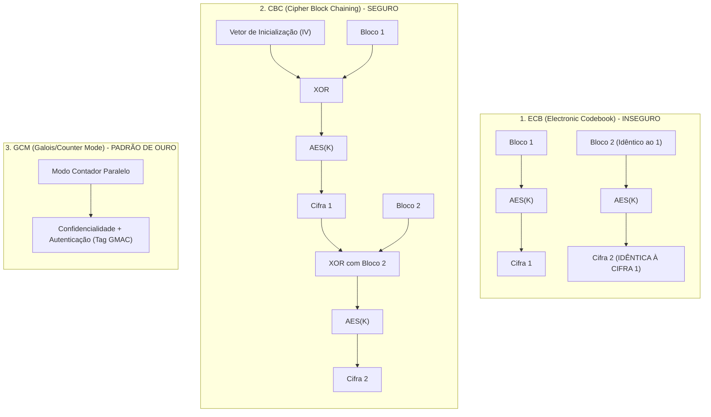
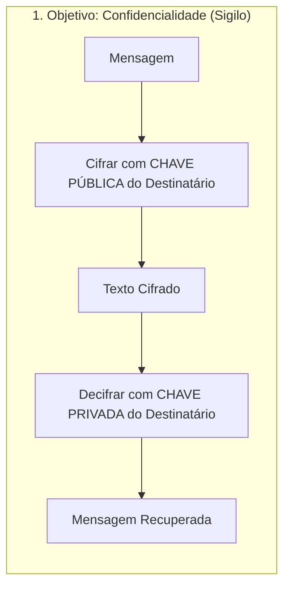
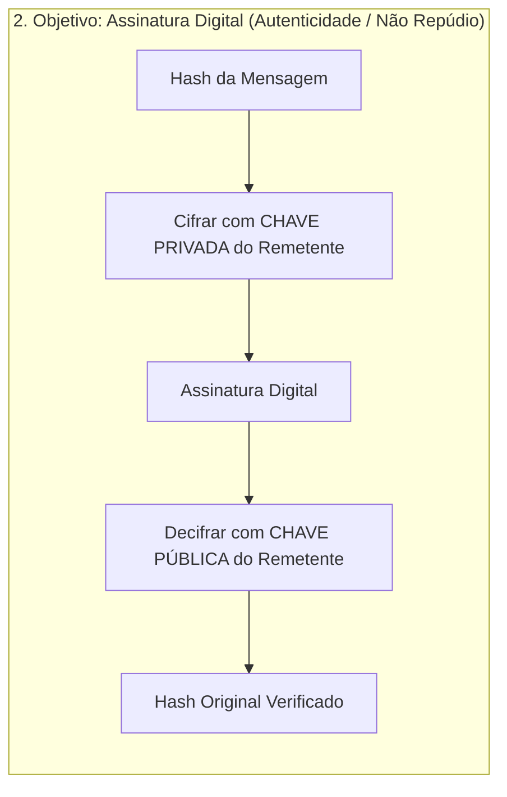
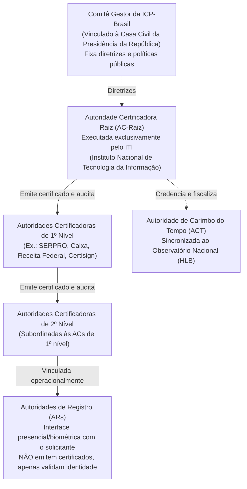
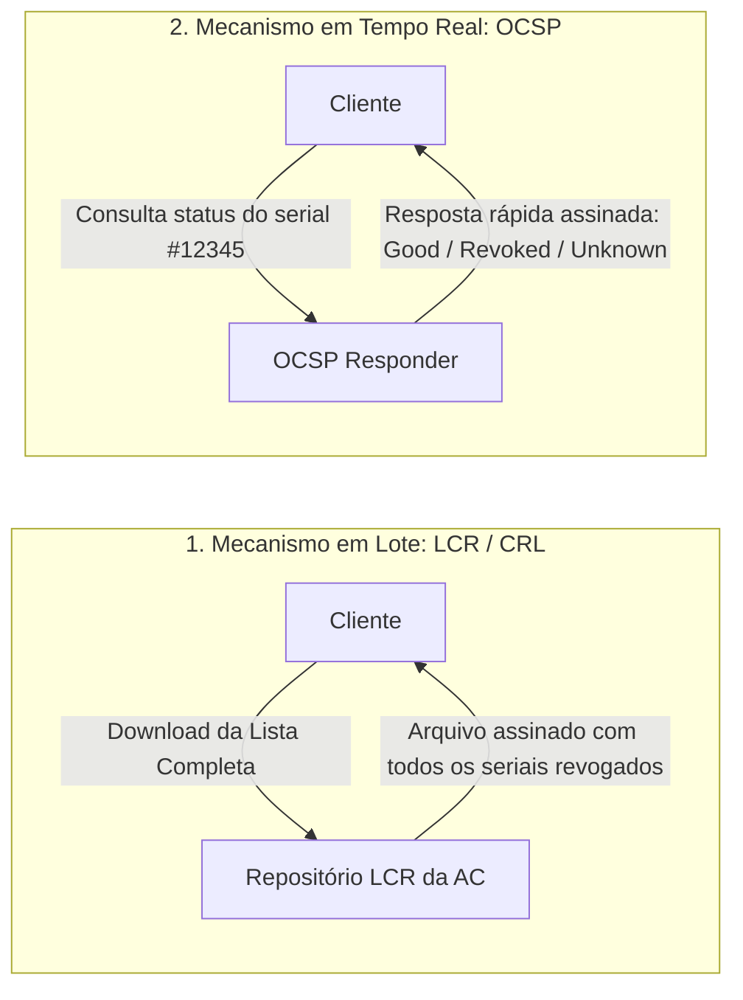
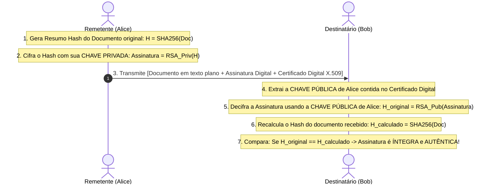

# 02 - Criptografia, ICP-Brasil e Assinatura Digital

> **Matéria:** Segurança da Informação  
> **Cargo:** B02 – Técnico de Controle Externo – Especialidade: Tecnologia da Informação  
> **Arquivo:** `02_criptografia_icp_brasil_e_assinatura_digital.md`  

---

## 📌 Ementa / Itens do Edital
- Criptografia Simétrica (algoritmos e modos de operação)
- Criptografia Assimétrica (par de chaves pública e privada)
- Funções de dispersão criptográfica (Hash)
- Infraestrutura de Chaves Públicas (PKI / ICP-Brasil)
- Certificados Digitais padrão X.509
- Mecanismo, validade jurídica e padrões de Assinatura Digital

---

## 🧭 Sumário

1. [Criptografia Simétrica (Chave Secreta Compartilhada)](#1-criptografia-simetrica-chave-secreta-compartilhada)
    1. [Fundamentos, Vantagens e o Problema da Distribuição de Chaves](#11-fundamentos-vantagens-e-o-problema-da-distribuicao-de-chaves)
    2. [Cifras de Bloco vs. Cifras de Fluxo (AES, DES, 3DES, ChaCha20)](#12-cifras-de-bloco-vs-cifras-de-fluxo-aes-des-3des-chacha20)
    3. [Modos de Operação de Bloco (ECB, CBC, CTR, GCM e AEAD)](#13-modos-de-operacao-de-bloco-ecb-cbc-ctr-gcm-e-aead)
    4. [Teste 366](#Teste-366)
    5. [Teste 367](#Teste-367)
    6. [Teste 368](#Teste-368)
2. [Criptografia Assimétrica (Chaves Públicas)](#2-criptografia-assimetrica-chaves-publicas)
    1. [Princípios Matemáticos e as Duas Operações Fundamentais](#21-principios-matematicos-e-as-duas-operacoes-fundamentais)
    2. [Algoritmos Assimétricos Principais (RSA, ECC, Diffie-Hellman)](#22-algoritmos-assimetricos-principais-rsa-ecc-diffie-hellman)
    3. [Criptografia Híbrida na Prática](#23-criptografia-hibrida-na-pratica)
    4. [Teste 369](#Teste-369)
3. [Funções de Resumo Criptográfico (Hash)](#3-funcoes-de-resumo-criptografico-hash)
    1. [Propriedades Matemáticas Essenciais e Princípio do Pombal](#31-propriedades-matematicas-essenciais-e-principio-do-pombal)
    2. [Algoritmos Seguros vs. Vulneráveis (SHA-2, SHA-3, MD5, SHA-1)](#32-algoritmos-seguros-vs-vulneraveis-sha-2-sha-3-md5-sha-1)
    3. [Teste 370](#Teste-370)
    4. [Teste 371](#Teste-371)
4. [Infraestrutura de Chaves Públicas e a ICP-Brasil](#4-infraestrutura-de-chaves-publicas-e-a-icp-brasil)
    1. [Estrutura Organizacional e Hierarquia Legal (MP nº 2.200-2/2001)](#41-estrutura-organizacional-e-hierarquia-legal-mp-no-2200-22001)
    2. [Certificados Digitais Padrão X.509 v3 e Ciclo de Vida](#42-certificados-digitais-padrao-x509-v3-e-ciclo-de-vida)
    3. [Mecanismos de Revogação: LCR / CRL vs. OCSP](#43-mecanismos-de-revogacao-lcr-crl-vs-ocsp)
    4. [Tipos de Certificados na ICP-Brasil (A1 vs. A3, Séries S e T)](#44-tipos-de-certificados-na-icp-brasil-a1-vs-a3-series-s-e-t)
    5. [Teste 372](#Teste-372)
    6. [Teste 373](#Teste-373)
    7. [Teste 374](#Teste-374)
5. [Assinatura Digital e Validade Jurídica](#5-assinatura-digital-e-validade-juridica)
    1. [Mecânica Operacional Passo a Passo (Geração e Verificação)](#51-mecanica-operacional-passo-a-passo-geracao-e-verificacao)
    2. [Propriedades Garantidas vs. Ausência de Confidencialidade](#52-propriedades-garantidas-vs-ausencia-de-confidencialidade)
    3. [Padrões de Assinatura Avançada (CAdES, XAdES, PAdES) e Carimbo do Tempo](#53-padroes-de-assinatura-avancada-cades-xades-pades-e-carimbo-do-tempo)
    4. [Teste 375](#Teste-375)
    5. [Teste 376](#Teste-376)
6. [Fontes Recomendadas na Internet](#6-fontes-recomendadas-na-internet)

---

## 1. Criptografia Simétrica (Chave Secreta Compartilhada)

### 1.1 Fundamentos, Vantagens e o Problema da Distribuição de Chaves

A criptografia simétrica fundamenta-se no princípio de que uma **única chave secreta** é compartilhada entre as partes, sendo utilizada tanto para a operação de cifragem (encriptação) quanto para a operação de decifragem (decriptação) da mensagem.

#### Vantagens e Limitações
- **Vantagem de Desempenho:** Desempenho computacional extraordinariamente elevado. Consome poucos ciclos de processamento e viabiliza a cifragem de grandes volumes de dados (gigabytes a terabytes) em tempo real. Além disso, conta com suporte nativo a aceleração por hardware nos processadores modernos (como o conjunto de instruções Intel AES-NI).
- **Limitação (O Problema da Distribuição de Chaves):** Para que um conjunto de $N$ usuários ou entidades se comuniquem aos pares de forma independente, estritamente sigilosa e sem compartilhamento mútuo da mesma chave, o total de chaves secretas necessárias cresce de forma quadrática segundo a combinação simples de $N$ tomados 2 a 2:
  $$K = \frac{N(N - 1)}{2}$$

> **Exemplo Prático para Concursos:**  
> Se uma organização conta com $N = 20$ analistas e cada par precisa de uma chave simétrica exclusiva, o número total de chaves exigidas é:
> $$K = \frac{20 \times (20 - 1)}{2} = \frac{20 \times 19}{2} = \frac{380}{2} = 190 \text{ chaves secretas}$$
> Se o grupo aumentar para 1.000 usuários, o sistema exigirá 499.500 chaves secretas. Esse crescimento exponencial inviabiliza a criptografia puramente simétrica em ambientes abertos e na Internet, exigindo canais seguros prévios de distribuição de chaves ou o suporte de sistemas assimétricos.

### 1.2 Cifras de Bloco vs. Cifras de Fluxo (AES, DES, 3DES, ChaCha20)

Os algoritmos simétricos dividem-se em duas grandes categorias estruturais segundo a forma como processam a massa de dados:

#### Cifras de Bloco (*Block Ciphers*)
Quebram o texto claro em blocos de tamanho fixo pré-definido e processam cada bloco individualmente aplicando rodadas consecutivas de permutações (*P-boxes*) e substituições (*S-boxes*):

- **AES (Advanced Encryption Standard - Rijndael):** Padrão mundial oficial regulamentado pelo NIST (FIPS 197). Opera com blocos fixos de **128 bits** e suporta três comprimentos de chave:
    - Chave de 128 bits: processada em 10 rodadas.
    - Chave de 192 bits: processada em 12 rodadas.
    - Chave de 256 bits: processada em 14 rodadas.
  Atualmente, o AES é considerado criptograficamente inquebrável contra ataques analíticos práticos, sendo o algoritmo padrão adotado por governos e órgãos de controle.
- **DES (Data Encryption Standard):** Criado na década de 1970, opera com blocos de **64 bits** e uma chave efetiva de apenas **56 bits** (8 bits eram reservados para paridade). É considerado **obsoleto e inseguro**, suscetível a ataques de força bruta concluídos em poucas horas ou minutos por equipamentos comuns.
- **3DES (Triple DES):** Aplica o algoritmo DES três vezes consecutivas na sequência Cifrar-Decifrar-Cifrar (EDE - *Encrypt-Decrypt-Encrypt*) utilizando duas ou três chaves independentes (112 ou 168 bits de força de chave). Embora resista à força bruta simples, é excessivamente lento em software e vulnerável a colisões de blocos de 64 bits em grandes transferências (ataque *Sweet32*).

#### Cifras de Fluxo (*Stream Ciphers*)
Processam o texto claro de maneira contínua, **bit a bit** ou **byte a byte**. Uma função geradora produz uma sequência de bits pseudoaleatórios chamada fluxo de chave (*keystream*), que é combinada com o texto claro por meio da operação lógica OU Exclusivo (**XOR** - $\oplus$):

- **ChaCha20:** Cifra de fluxo moderna de alta performance, padrão da IETF (RFC 8439), extremamente rápida em processadores sem aceleração criptográfica dedicada (como smartphones e dispositivos embarcados).
- **RC4:** Cifra de fluxo histórica que já equipou os protocolos WEP e SSL/TLS, porém descontinuada mundialmente após a descoberta de sérios vieses estatísticos nos primeiros bytes gerados.

### 1.3 Modos de Operação de Bloco (ECB, CBC, CTR, GCM e AEAD)

Uma cifra de bloco por si só só cifra um único bloco de tamanho fixo (ex.: 128 bits). Para processar arquivos e mensagens de qualquer extensão, aplicam-se **Modos de Operação**:

| Modo de Operação | Mecânica de Funcionamento | Vantagens | Desvantagens / Pegadinhas FCC |
|---|---|---|---|
| **ECB** (*Electronic Codebook*) | Cada bloco de 128 bits do texto claro é cifrado de maneira totalmente isolada com a mesma chave. | Simples e permite paralelismo pleno em leitura e escrita. | **EXTREMAMENTE INSEGURO.** Blocos de entrada idênticos geram blocos de saída rigorosamente idênticos. Revela a estrutura estatística e o contorno de imagens e documentos. |
| **CBC** (*Cipher Block Chaining*) | Cada bloco de texto claro passa por XOR com o bloco cifrado imediatamente anterior antes da encriptação. O primeiro bloco usa um Vetor de Inicialização (**IV**) aleatório. | Elimina a repetição de padrões visuais; blocos de texto idênticos produzem saídas cifradas completamente distintas. | A cifragem é sequencial e não pode ser paralelizada. Exige preenchimento (*padding*, ex.: PKCS#7) e é vulnerável a ataques de oráculo de preenchimento (*Padding Oracle*) se não houver verificação de integridade. |
| **CTR** (*Counter Mode*) | Cifra um valor incremental composto por um *nonce* e um contador, fazendo XOR do resultado com o bloco de texto claro. | Transforma a cifra de bloco em uma cifra de fluxo. Permite processamento 100% paralelo na cifragem e na decifragem e acesso aleatório a qualquer bloco. | A reutilização do par chave/nonce quebra irremediavelmente a segurança. Por si só, não provê verificação de integridade. |
| **GCM** (*Galois/Counter Mode*) | Combina a cifragem do modo CTR com a autenticação de Galois (GMAC), gerando uma tag de autenticação vinculada aos dados cifrados. | **Padrão de excelência da indústria (TLS 1.3, IPsec, SSH).** Provê **AEAD** (*Authenticated Encryption with Associated Data*): confidencialidade, autenticidade e integridade simultâneas com altíssima taxa de vazão e aceleração por hardware. | A reutilização de um mesmo IV com a mesma chave compromete catastrófica e irreversivelmente a chave de autenticação. |

> 🚨 **ALERTA DE PROVA / PEGADINHA FCC:**  
> A banca FCC frequentemente tenta induzir o candidato ao erro afirmando que o modo **ECB** é o mais eficiente e recomendado para proteger grandes bases de dados confidenciais devido à independência dos blocos. A afirmativa é **FALSA**! O ECB é formalmente contraindicado para confidencialidade porque preserva padrões repetitivos dos dados originais (o clássico contorno do mascote Tux do Linux permanece legível mesmo após a cifragem com ECB).

---

### Teste 001
**(FGV – TCE/GO – 2024 – Analista de Controle Externo - Tecnologia da Informação)**
Analise as afirmativas a seguir sobre criptografia assimétrica e simétrica, certificados digitais e assinaturas digitais: I. A criptografia simétrica utiliza a mesma chave para cifrar e decifrar uma mensagem, desde que a chave seja compartilhada de maneira segura entre as partes. II. Certificados digitais são utilizados para vincular apenas a chave privada a uma identidade, permitindo que terceiros confiem na autenticidade da chave. III. Assinaturas digitais utilizam a criptografia assimétrica para garantir a integridade e autenticidade de uma mensagem, mas não a confidencialidade do conteúdo. Está correto o que se afirma em

* **A)** I, apenas.
* **B)** II, apenas.
* **C)** I e III, apenas.
* **D)** II e III, apenas.
* **E)** I, II e III.

---

> **Comentário Detalhado:**
>
> - **A)** **Incorreta.** A opção incorre em restrição indevida ao limitar o escopo conceitual ao afirmar que "I, apenas". De acordo com a teoria estudada em *Regra Prática de Uso das Chaves:*, para garantir Autenticidade / Integridade / Não Repúdio (Assinatura Digital): O remetente utiliza a sua própria Chave PRIVADA. Qualquer terceiro com acesso à Chave PÚBLICA do Remetente pode conferir a assinatura e comprovar a autoria.
> - **B)** **Incorreta.** A opção incorre em restrição indevida ao limitar o escopo conceitual ao afirmar que "II, apenas". De acordo com a teoria estudada em *Regra Prática de Uso das Chaves:*, para garantir Sigilo / Confidencialidade: O remetente utiliza a Chave PÚBLICA do Destinatário. Apenas a Chave PRIVADA do Destinatário poderá abrir a mensagem.
> - **C)** **Correta.** Conforme fundamentado na seção *1.1 Fundamentos, Vantagens e o Problema da Distribuição de Chaves* deste guia, a criptografia simétrica fundamenta se no princípio de que uma única chave secreta é compartilhada entre as partes, sendo utilizada tanto para a operação de cifragem (encriptação) quanto para a operação de decifragem (decriptação) da mensagem. Dessa forma, está plenamente correta a assertiva da banca (FGV – TCE/GO/2024) ao estabelecer que "I e III, apenas".
> - **D)** **Incorreta.** A opção incorre em restrição indevida ao limitar o escopo conceitual ao afirmar que "II e III, apenas". De acordo com a teoria estudada em *1.3 Modos de Operação de Bloco (ECB, CBC, CTR, GCM e AEAD)*, gCM ( Galois/Counter Mode ): Combina a cifragem do modo CTR com a autenticação de Galois (GMAC), gerando uma tag de autenticação vinculada aos dados cifrados. — Padrão de excelência da indústria (TLS 1.3, IPsec, SSH). Provê AEAD ( Authenticated Encryption with Associated Data ): confidencialidade, autenticidade e integridade simultâneas com altíssima taxa de vazão e aceleração por hardware. — A reutilização de um mesmo IV com a mesma chave compromete catastrófica e irreversivelmente a chave de autenticação.
> - **E)** **Incorreta.** A opção apresenta proposição em desacordo com os fundamentos teóricos e técnicos do tópico ao afirmar que "I, II e III". De acordo com a teoria estudada em *Campos Obrigatórios do Certificado X.509 v3:*, assinatura Digital da AC ( Certificate Signature Value ): Cifragem do hash de todo o conteúdo do certificado realizada com a Chave Privada da AC, assegurando sua inviolabilidade e autenticidade.
>
> **Gabarito: C**

---

### Teste 002
**(CEBRASPE – STJ – 2024 – Analista Judiciário - Apoio Especializado - Suporte em Tecnologia da Informação)**
O método de autenticação SPF (sender policy framework) permite que os proprietários de domínios assinem emails automaticamente a partir de seu domínio; nessa assinatura digital, é utilizada criptografia de chave pública para verificar matematicamente que o email veio do domínio correto.

* **C)** Certo
* **E)** Errado

---

> **Comentário Detalhado:**
>
> - **C)** **Incorreta.** A proposição apresenta proposição em desacordo com os fundamentos teóricos e técnicos do tópico ao afirmar que "O método de autenticação SPF (sender policy framework) permite que os proprietários de domínios assinem...". De acordo com a teoria em *1.1 Fundamentos, Vantagens e o Problema da Distribuição de Chaves*, a criptografia simétrica fundamenta se no princípio de que uma única chave secreta é compartilhada entre as partes, sendo utilizada tanto para a operação de cifragem (encriptação) quanto para a operação de decifragem (decriptação) da mensagem.
> - **E)** **Correta.** O item está **Errado** (gabarito oficial: **E**), pois contraria a disciplina teórica aplicável.
>
> **Gabarito: E**

---

### Teste 003
**(CEBRASPE – TRF/6 – 2025 – Analista Judiciario Apoio Especializado Tecnologia Da Informacao)**
Atualmente, o algoritmo AES com chave de 256 bits é de Requisitos para Sistemas Informatizados de Gestão de Processos e Documentos do Poder Judiciário (MoReq-Jus), julgue os itens a seguir.

* **C)** Certo
* **E)** Errado

---

> **Comentário Detalhado:**
>
> - **C)** **Incorreta.** A proposição apresenta proposição em desacordo com os fundamentos teóricos e técnicos do tópico ao afirmar que "Atualmente, o algoritmo AES com chave de 256 bits é de Requisitos para Sistemas Informatizados de Gestão de...". De acordo com a teoria em *Cifras de Bloco (Block Ciphers)*, atualmente, o AES é considerado criptograficamente inquebrável contra ataques analíticos práticos, sendo o algoritmo padrão adotado por governos e órgãos de controle.
> - **E)** **Correta.** O item está **Errado** (gabarito oficial: **E**), pois contraria a disciplina teórica aplicável.
>
> **Gabarito: E**

---

### Teste 004
**(FGV – TJ/RR – 2024 – Analista Judiciario Infraestrutura De Tecnologia Da Informacao)**
No contexto de criptografia, observe o texto abaixo. “Este esquema é uma cifra de bloco em que o texto claro e o cifrado são inteiros entre 0 e n − 1, para algum n. Um tamanho típico para n é 1024 bits, ou 309 dígitos decimais. O algoritmo utiliza uma expressão com exponenciais. O texto claro é encriptado em blocos, com cada um tendo um valor binário menor que algum número n. Ou seja, o tamanho do bloco precisa ser menor ou igual a log2(n) +1.” O texto se refere ao algoritmo

* **A)** O número máximo de endereços IPv4 que podem existir na sub-rede desta empresa.
* **B)** O gateway padrão do cliente, o IP interno do roteador e o IP externo do roteador.
* **C)** Assim que o comando tracert é executado, um frame com o protocolo ARP Request é enviado na rede pelo cliente. Indique a camada OSI à qual esse protocolo pertence e os endereços físicos de origem e de destino contidos nesse frame.
* **D)** Considerando a tabela ARP preenchida, indique o protocolo utilizado pelo comando tracert, a camada OSI a qual esse protocolo pertence e os endereços IP de origem e de destino contidos no pacote enviado pelo cliente.
* **E)** Assumindo que o problema de conexão se deve exclusivamente à configuração do firewall, avalie se a ação mencionada pelo técnico seria capaz de corrigir o problema. Justifique sua resposta.

---

> **Comentário Detalhado:**
>
> - **A)** **Incorreta.** A opção apresenta proposição em desacordo com os fundamentos teóricos e técnicos do tópico ao afirmar que "O número máximo de endereços IPv4 que podem existir na sub rede desta empresa". De acordo com a teoria estudada em *4.3 Mecanismos de Revogação: LCR / CRL vs. OCSP*, desvantagens: Pode demorar horas ou dias para ser republicada (janela de vulnerabilidade) e gera tráfego excessivo de rede, pois o cliente precisa baixar a lista inteira mesmo para consultar apenas um certificado.
> - **B)** **Incorreta.** A opção apresenta proposição em desacordo com os fundamentos teóricos e técnicos do tópico ao afirmar que "O gateway padrão do cliente, o IP interno do roteador e o IP externo do roteador". De acordo com a teoria estudada em *Campos Obrigatórios do Certificado X.509 v3:*, identificador do Algoritmo de Assinatura ( Signature Algorithm ID ): Identificador do algoritmo de hash e cifra utilizado pela AC para assinar o certificado (ex.: sha256WithRSAEncryption ).
> - **C)** **Incorreta.** A opção apresenta proposição em desacordo com os fundamentos teóricos e técnicos do tópico ao afirmar que "Assim que o comando tracert é executado, um frame com o protocolo ARP Request é enviado na rede pelo cliente...". De acordo com a teoria estudada em *2.3 Criptografia Híbrida na Prática*, o algoritmo assimétrico (ou o protocolo Diffie Hellman efêmero autenticado) é executado apenas na fase inicial do aperto de mão ( handshake ) para verificar as identidades e estabelecer com segurança uma chave simétrica temporária, denominada Chave de Sessão ( Session Key ).
> - **D)** **Correta.** Conforme fundamentado na seção *4.3 Mecanismos de Revogação: LCR / CRL vs. OCSP* deste guia, oCSP ( Online Certificate Status Protocol RFC 6960): Protocolo leve no modelo cliente servidor em que a aplicação consulta pontualmente um servidor denominado OCSP Responder . O cliente envia unicamente o número de série do certificado sob suspeita e recebe em milissegundos uma resposta assinada com o status atual: Good (ativo/válido), Revoked (revogado) ou Unknown (desconhecido). Dessa forma, está plenamente correta a assertiva da banca (FGV – TJ/RR/2024) ao estabelecer que "Considerando a tabela ARP preenchida, indique o protocolo utilizado pelo comando tracert, a camada OSI a qual esse...".
> - **E)** **Incorreta.** A opção incorre em restrição indevida ao limitar o escopo conceitual ao afirmar que "Assumindo que o problema de conexão se deve exclusivamente à configuração do firewall, avalie se a ação mencionada...". De acordo com a teoria estudada em *1.3 Modos de Operação de Bloco (ECB, CBC, CTR, GCM e AEAD)*, cBC ( Cipher Block Chaining ): Cada bloco de texto claro passa por XOR com o bloco cifrado imediatamente anterior antes da encriptação. O primeiro bloco usa um Vetor de Inicialização (IV) aleatório. — Elimina a repetição de padrões visuais; blocos de texto idênticos produzem saídas cifradas completamente distintas. — A cifragem é sequencial e não pode ser paralelizada. Exige preenchimento ( padding , ex.: PKCS 7) e é vulnerável a ataques de oráculo de preenchimento ( Padding Oracle ) se não houver verificação de integridade.
>
> **Gabarito: D**

---

### Teste 005
**(CEBRASPE – STF – 2008 – Analista Judiciario Suporte Em Tecnologia Da Informacao)**
O seguinte procedimento possibilita a Y verificar se foi X quem assinou uma mensagem M, enviada: 1) X calcula um código de autenticação MAC1 para M, usando uma função de dispersão (hash) apropriada; 2) X usa a sua chave privada para criptografar MAC1; 3) X envia M e o MAC1 criptografado para Y; 4) Y calcula um código MAC2 para M, usando a função de dispersão; 5) Y usa a chave pública de X para decifrar o MAC1 recebido e compara MAC1 a MAC2. estrutura de chaves públicas, elas devem trocar a chave de sessão K a ser usada para garantir a confidencialidade da comunicação entre elas, com o seguinte procedimento: 1) X obtém o certificado de Y a partir de um repositório; 2) X extrai a chave pública de Y a partir desse certificado; 3) X gera K e a criptografa com a chave pública de Y; 4) X envia o seu certificado e K criptografada para Y; 5) Y extrai a chave pública de X a partir do certificado recebido; 6) Y usa a chave pública de X para decifrar a chave K.

* **C)** Certo
* **E)** Errado

---

> **Comentário Detalhado:**
>
> - **C)** **Correta.** O item está **Certo**. Conforme fundamentado na seção *Regra Prática de Uso das Chaves:*, para garantir Sigilo / Confidencialidade: O remetente utiliza a Chave PÚBLICA do Destinatário. Apenas a Chave PRIVADA do Destinatário poderá abrir a mensagem. Dessa forma, está plenamente correta a assertiva da banca (CEBRASPE – STF/2008) ao afirmar que "O seguinte procedimento possibilita a Y verificar se foi X quem assinou uma mensagem M, enviada: 1) X calcula...".
> - **E)** **Incorreta.** A assertiva não incorre em erro conceitual, guardando conformidade com a teoria estudada.
>
> **Gabarito: C**

---

### Teste 006
**(CEBRASPE – STJ – 2015 – Analista Judiciario Suporte Em Tecnologia Da Informacao)**
O sistema em questão utiliza criptografia assimétrica como, por exemplo, o algoritmo 3DES.

* **C)** Certo
* **E)** Errado

---

> **Comentário Detalhado:**
>
> - **C)** **Incorreta.** A proposição apresenta proposição em desacordo com os fundamentos teóricos e técnicos do tópico ao afirmar que "O sistema em questão utiliza criptografia assimétrica como, por exemplo, o algoritmo 3DES". De acordo com a teoria em *Cifras de Bloco (Block Ciphers)*, 3DES (Triple DES): Aplica o algoritmo DES três vezes consecutivas na sequência Cifrar Decifrar Cifrar (EDE Encrypt Decrypt Encrypt ) utilizando duas ou três chaves independentes (112 ou 168 bits de força de chave). Embora resista à força bruta simples, é excessivamente lento em software e vulnerável a colisões de blocos de 64 bits em grandes transferências (ataque Sweet32 ).
> - **E)** **Correta.** O item está **Errado** (gabarito oficial: **E**), pois contraria a disciplina teórica aplicável.
>
> **Gabarito: E**

---

### Teste 007
**(FGV – TJ/DFT – 2022 – Analista Judiciario Suporte Em Tecnologia Da Informacao)**
Caio recebeu a tarefa de melhorar a segurança da rede local do Tribunal de Justiça. A demanda solicitada foi a implementação de um sistema de criptografia que atenda aos requisitos a seguir. 1. receber como entrada um bloco de texto sem formatação; 2. trabalhar com tamanhos de chaves diferentes; 3. movimentar o bloco para uma matriz quadrada onde são executadas suas operações; 4. relacionar o número de rodadas do algoritmo com o tamanho da chave. Para cifrar as mensagens e atender aos critérios determinados, Caio deve utilizar o algoritmo criptográfico:

* **A)** RSA;
* **B)** AES;
* **C)** DES;
* **D)** 3DES;
* **E)** ELGAMAL.

---

> **Comentário Detalhado:**
>
> - **A)** **Incorreta.** A opção apresenta proposição em desacordo com os fundamentos teóricos e técnicos do tópico ao afirmar que "RSA". De acordo com a teoria estudada em *2.2 Algoritmos Assimétricos Principais (RSA, ECC, Diffie-Hellman)*, o menor tamanho de chave resulta em menor consumo de largura de banda, menor latência de rede e baixíssimo consumo energético em chips, sendo o padrão preferencial de TLS moderno, cartões inteligentes e dispositivos móveis (ex.: curvas Ed25519, NIST P 256).
> - **B)** **Correta.** Conforme fundamentado na seção *3. Referências Bibliográficas Clássicas (Padrão ABNT)* deste guia, sTALLINGS, William. Criptografia e Segurança de Redes: Princípios e Práticas. 6. ed. São Paulo: Pearson Education do Brasil, 2015. (Cap. 3, 6, 9, 11 e 14 — Cifras Simétricas AES/Modos de Operação, Criptografia Assimétrica RSA/ECC, Funções Hash SHA e Certificados X.509). Dessa forma, está plenamente correta a assertiva da banca (FGV – TJ/DFT/2022) ao estabelecer que "AES".
> - **C)** **Incorreta.** A opção apresenta proposição em desacordo com os fundamentos teóricos e técnicos do tópico ao afirmar que "DES". De acordo com a teoria estudada em *Cifras de Bloco (Block Ciphers)*, 3DES (Triple DES): Aplica o algoritmo DES três vezes consecutivas na sequência Cifrar Decifrar Cifrar (EDE Encrypt Decrypt Encrypt ) utilizando duas ou três chaves independentes (112 ou 168 bits de força de chave). Embora resista à força bruta simples, é excessivamente lento em software e vulnerável a colisões de blocos de 64 bits em grandes transferências (ataque Sweet32 ).
> - **D)** **Incorreta.** A opção apresenta proposição em desacordo com os fundamentos teóricos e técnicos do tópico ao afirmar que "3DES". De acordo com a teoria estudada em *1.2 Cifras de Bloco vs. Cifras de Fluxo (AES, DES, 3DES, ChaCha20)*, os algoritmos simétricos dividem se em duas grandes categorias estruturais segundo a forma como processam a massa de dados.
> - **E)** **Incorreta.** A opção apresenta proposição em desacordo com os fundamentos teóricos e técnicos do tópico ao afirmar que "ELGAMAL". De acordo com a teoria estudada em *Cifras de Bloco (Block Ciphers)*, atualmente, o AES é considerado criptograficamente inquebrável contra ataques analíticos práticos, sendo o algoritmo padrão adotado por governos e órgãos de controle.
>
> **Gabarito: B**

---

### Teste 008
**(CEBRASPE – TRT/10 – 2013 – Analista Judiciario Tecnologia Da Informacao)**
Um certificado digital é um documento em que são registradas diversas informações, tais como titular e sua chave pública, assim como nome e assinatura da autoridade certificadora que garantirá a emissão do certificado.

* **C)** Certo
* **E)** Errado

---

> **Comentário Detalhado:**
>
> - **C)** **Correta.** O item está **Certo**. Conforme fundamentado na seção *4.2 Certificados Digitais Padrão X.509 v3 e Ciclo de Vida*, o certificado digital é um documento eletrônico assinado digitalmente por uma Autoridade Certificadora, vinculando a chave pública de uma entidade à sua verdadeira identidade civil ou corporativa. Dessa forma, está plenamente correta a assertiva da banca (CEBRASPE – TRT/10/2013) ao afirmar que "Um certificado digital é um documento em que são registradas diversas informações, tais como titular e sua...".
> - **E)** **Incorreta.** A assertiva não incorre em erro conceitual, guardando conformidade com a teoria estudada.
>
> **Gabarito: C**

---

### Teste 009
**(FCC – TRT 3ª – 2015 – Analista Judiciário - Tecnologia da Informação)**
Uma das inovações introduzidas na distribuição Linux Red Hat é a disponibilização de aplicativos e programas em formato de pacotes, o que facilita a instalação, se comparada ao processo original. Dentre os pacotes disponibilizados, o que fornece recursos para o esquema de autenticação unificada é o

* **A)** SSL.
* **B)** PAM.
* **C)** AES.
* **D)** PKI.
* **E)** Crypt.

---

> **Comentário Detalhado:**
>
> - **A)** **Incorreta.** A opção apresenta proposição em desacordo com os fundamentos teóricos e técnicos do tópico ao afirmar que "SSL". De acordo com a teoria estudada em *Cifras de Fluxo (Stream Ciphers)*, rC4: Cifra de fluxo histórica que já equipou os protocolos WEP e SSL/TLS, porém descontinuada mundialmente após a descoberta de sérios vieses estatísticos nos primeiros bytes gerados.
> - **B)** **Correta.** Conforme fundamentado na seção *1.3 Modos de Operação de Bloco (ECB, CBC, CTR, GCM e AEAD)* deste guia, a banca FCC frequentemente tenta induzir o candidato ao erro afirmando que o modo ECB é o mais eficiente e recomendado para proteger grandes bases de dados confidenciais devido à independência dos blocos. A afirmativa é FALSA! O ECB é formalmente contraindicado para confidencialidade porque preserva padrões repetitivos dos dados originais (o clássico contorno do mascote Tux do Linux permanece legível mesmo após a cifragem com ECB). Dessa forma, está plenamente correta a assertiva da banca (FCC – TRT 3ª/2015) ao estabelecer que "PAM".
> - **C)** **Incorreta.** A opção apresenta proposição em desacordo com os fundamentos teóricos e técnicos do tópico ao afirmar que "AES". De acordo com a teoria estudada em *Vantagens e Limitações*, vantagem de Desempenho: Desempenho computacional extraordinariamente elevado. Consome poucos ciclos de processamento e viabiliza a cifragem de grandes volumes de dados (gigabytes a terabytes) em tempo real. Além disso, conta com suporte nativo a aceleração por hardware nos processadores modernos (como o conjunto de instruções Intel AES NI).
> - **D)** **Incorreta.** A opção apresenta proposição em desacordo com os fundamentos teóricos e técnicos do tópico ao afirmar que "PKI". De acordo com a teoria estudada em *5.3 Padrões de Assinatura Avançada (CAdES, XAdES, PAdES) e Carimbo do Tempo*, xAdES ( XML Advanced Electronic Signatures ): Estruturado sobre as especificações XMLDSig do W3C. Permite a assinatura de documentos no formato XML, oferecendo grande granularidade (é possível assinar nós ou seções individuais do arquivo XML, mantendo a legibilidade estrutural do XML).
> - **E)** **Incorreta.** A opção apresenta proposição em desacordo com os fundamentos teóricos e técnicos do tópico ao afirmar que "Crypt". De acordo com a teoria estudada em *5.3 Padrões de Assinatura Avançada (CAdES, XAdES, PAdES) e Carimbo do Tempo*, pAdES ( PDF Advanced Electronic Signatures ): Desenvolvido especificamente para arquivos no formato PDF (ISO 32000 1). A assinatura digital, a cadeia de certificação e os metadados de auditoria são incorporados diretamente na estrutura interna do arquivo .pdf , permitindo visualização gráfica e conferência direta em leitores de PDF convencionais.
>
> **Gabarito: B**

---

### Teste 010
**(FGV – TCE/PA – 2024 – Auditor de Controle Externo - Administrativa - Ciência de Dados)**
O TCE-PA está implementando um sistema de assinatura digital para garantir a autenticidade e integridade dos documentos eletrônicos que serão enviados e recebidos pelos seus sistemas. Para assegurar que a chave pública do emissor esteja corretamente associada à sua identidade, o tribunal deve utilizar um

* **A)** algoritmo de hashing.
* **B)** certificado digital.
* **C)** sistema de criptografia simétrica.
* **D)** protocolo SSL/TLS.
* **E)** firewall.

---

> **Comentário Detalhado:**
>
> - **A)** **Incorreta.** A opção apresenta proposição em desacordo com os fundamentos teóricos e técnicos do tópico ao afirmar que "algoritmo de hashing". De acordo com a teoria estudada em *Campos Obrigatórios do Certificado X.509 v3:*, assinatura Digital da AC ( Certificate Signature Value ): Cifragem do hash de todo o conteúdo do certificado realizada com a Chave Privada da AC, assegurando sua inviolabilidade e autenticidade.
> - **B)** **Correta.** Conforme fundamentado na seção *Regra Prática de Uso das Chaves:* deste guia, para garantir Autenticidade / Integridade / Não Repúdio (Assinatura Digital): O remetente utiliza a sua própria Chave PRIVADA. Qualquer terceiro com acesso à Chave PÚBLICA do Remetente pode conferir a assinatura e comprovar a autoria. Dessa forma, está plenamente correta a assertiva da banca (FGV – TCE/PA/2024) ao estabelecer que "certificado digital".
> - **C)** **Incorreta.** A opção apresenta proposição em desacordo com os fundamentos teóricos e técnicos do tópico ao afirmar que "sistema de criptografia simétrica". De acordo com a teoria estudada em *Vantagens e Limitações*, se o grupo aumentar para 1.000 usuários, o sistema exigirá 499.500 chaves secretas. Esse crescimento exponencial inviabiliza a criptografia puramente simétrica em ambientes abertos e na Internet, exigindo canais seguros prévios de distribuição de chaves ou o suporte de sistemas assimétricos.
> - **D)** **Incorreta.** A opção apresenta proposição em desacordo com os fundamentos teóricos e técnicos do tópico ao afirmar que "protocolo SSL/TLS". De acordo com a teoria estudada em *Cifras de Fluxo (Stream Ciphers)*, rC4: Cifra de fluxo histórica que já equipou os protocolos WEP e SSL/TLS, porém descontinuada mundialmente após a descoberta de sérios vieses estatísticos nos primeiros bytes gerados.
> - **E)** **Incorreta.** A opção apresenta proposição em desacordo com os fundamentos teóricos e técnicos do tópico ao afirmar que "firewall". De acordo com a teoria estudada em *4.2 Certificados Digitais Padrão X.509 v3 e Ciclo de Vida*, o certificado digital é um documento eletrônico assinado digitalmente por uma Autoridade Certificadora, vinculando a chave pública de uma entidade à sua verdadeira identidade civil ou corporativa.
>
> **Gabarito: B**

---

## 2. Criptografia Assimétrica (Chaves Públicas)

### 2.1 Princípios Matemáticos e as Duas Operações Fundamentais

A criptografia de chave pública baseia-se na existência de **problemas matemáticos unidirecionais com alçapão** (*trapdoor one-way functions*): operações que são triviais de serem calculadas em um sentido, mas computacionalmente inviáveis de serem revertidas sem uma informação secreta privilegiada (o "alçapão"). Cada usuário possui um par de chaves complementares:

- **Chave Pública:** Disponibilizada irrestritamente a qualquer pessoa ou sistema.
- **Chave Privada:** Mantida sob custódia e sigilo exclusivo de seu titular.

#### Regra Prática de Uso das Chaves:
1. **Para garantir Sigilo / Confidencialidade:** O remetente utiliza a **Chave PÚBLICA do Destinatário**. Apenas a **Chave PRIVADA do Destinatário** poderá abrir a mensagem.
2. **Para garantir Autenticidade / Integridade / Não Repúdio (Assinatura Digital):** O remetente utiliza a sua **própria Chave PRIVADA**. Qualquer terceiro com acesso à **Chave PÚBLICA do Remetente** pode conferir a assinatura e comprovar a autoria.

### 2.2 Algoritmos Assimétricos Principais (RSA, ECC, Diffie-Hellman)

- **RSA (Rivest, Shamir e Adleman):** Fundamenta-se na complexidade computacional da **fatoração de números inteiros compostos gigantescos** formados pelo produto de dois números primos $p$ e $q$. Tamanhos recomendados atualmente: no mínimo 2048 bits, preferencialmente 4096 bits.
- **ECC (*Elliptic Curve Cryptography* - Criptografia de Curvas Elípticas):** Baseia-se no problema do **logaritmo discreto sobre curvas elípticas**. Proporciona a mesma segurança matemática do RSA com chaves drasticamente menores:
    - Uma chave de **ECC de 256 bits** oferece segurança computacional equivalente a uma chave de **RSA de 3072 bits**.
    - O menor tamanho de chave resulta em menor consumo de largura de banda, menor latência de rede e baixíssimo consumo energético em chips, sendo o padrão preferencial de TLS moderno, cartões inteligentes e dispositivos móveis (ex.: curvas Ed25519, NIST P-256).
- **Diffie-Hellman (DH / ECDH):** Protocolo criptográfico criado especificamente para a **troca e acordo seguro de chaves secretas** através de um canal desprotegido. Não é concebido originariamente para cifragem geral de arquivos nem para assinatura direta de documentos, mas sim para que duas entidades conversem em canal aberto e cheguem a uma chave simétrica comum secreta sem que terceiros consigam calculá-la.

### 2.3 Criptografia Híbrida na Prática

Os algoritmos assimétricos realizam cálculos matemáticos pesados e complexos envolvendo exponenciações modulares e curvas, sendo aproximadamente 1.000 vezes mais lentos do que cifras simétricas.

Para contornar esse gargalo, protocolos de segurança como HTTPS (TLS), SSH, PGP e S/MIME operam no modelo **híbrido**:

1. O algoritmo assimétrico (ou o protocolo Diffie-Hellman efêmero autenticado) é executado apenas na fase inicial do aperto de mão (*handshake*) para verificar as identidades e estabelecer com segurança uma chave simétrica temporária, denominada **Chave de Sessão** (*Session Key*).
2. Em seguida, a transmissão de dados pesados e contínuos da sessão é executada exclusivamente por uma cifra simétrica de alta velocidade (como AES-GCM ou ChaCha20-Poly1305).

---

### Teste 011
**(FGV – TJ/SC – 2026 – Analista Administrativo)**
Um Analista de Tecnologia da Informação do Tribunal de Justiça de Santa Catarina foi encarregado de adequar os sistemas corporativos às exigências da Lei Geral de Proteção de Dados Pessoais (LGPD). Para reduzir os riscos decorrentes de eventual incidente de segurança envolvendo dados processuais e administrativos, ele adotou duas ações distintas: 1. aplicou um algoritmo para transformar o campo "Informação Sigilosa" em um código cifrado, de modo que o conteúdo original somente possa ser acessado mediante o uso da chave apropriada; e 2. no campo "Nome da Parte", substituiu as identidades reais por códigos alfanuméricos aleatórios, mantendo a tabela de correspondência entre os códigos e as identidades em ambiente segregado e seguro, permitindo que equipes de estatística e inteligência de dados realizem análises sem identificar diretamente os indivíduos, embora a associação possa ser restabelecida pelo Tribunal quando necessário. As técnicas aplicadas pelo analista nas ações 1 e 2 são, respectivamente,

* **A)** Hash Robusto e Pseudonimização.
* **B)** Criptografia Assimétrica e Pseudonimização.
* **C)** Criptografia Simétrica e Anonimização Irreversível.
* **D)** Esteganografia e Tokenização de Sessão.
* **E)** Codificação de Base64 e Criptografia de Chave Única.

---

> **Comentário Detalhado:**
>
> - **A)** **Incorreta.** A opção apresenta proposição em desacordo com os fundamentos teóricos e técnicos do tópico ao afirmar que "Hash Robusto e Pseudonimização". De acordo com a teoria estudada em *3. Referências Bibliográficas Clássicas (Padrão ABNT)*, sTALLINGS, William. Criptografia e Segurança de Redes: Princípios e Práticas. 6. ed. São Paulo: Pearson Education do Brasil, 2015. (Cap. 3, 6, 9, 11 e 14 — Cifras Simétricas AES/Modos de Operação, Criptografia Assimétrica RSA/ECC, Funções Hash SHA e Certificados X.509).
> - **B)** **Correta.** Conforme fundamentado na seção *5.1 Mecânica Operacional Passo a Passo (Geração e Verificação)* deste guia, a assinatura digital baseia se na conjugação entre funções hash criptográficas e criptografia assimétrica. Ela vincula de forma matemática irrefutável o conteúdo do documento ao titular do certificado. Dessa forma, está plenamente correta a assertiva da banca (FGV – TJ/SC/2026) ao estabelecer que "Criptografia Assimétrica e Pseudonimização".
> - **C)** **Incorreta.** A opção apresenta proposição em desacordo com os fundamentos teóricos e técnicos do tópico ao afirmar que "Criptografia Simétrica e Anonimização Irreversível". De acordo com a teoria estudada em *2.3 Criptografia Híbrida na Prática*, o algoritmo assimétrico (ou o protocolo Diffie Hellman efêmero autenticado) é executado apenas na fase inicial do aperto de mão ( handshake ) para verificar as identidades e estabelecer com segurança uma chave simétrica temporária, denominada Chave de Sessão ( Session Key ).
> - **D)** **Incorreta.** A opção apresenta proposição em desacordo com os fundamentos teóricos e técnicos do tópico ao afirmar que "Esteganografia e Tokenização de Sessão". De acordo com a teoria estudada em *2.3 Criptografia Híbrida na Prática*, em seguida, a transmissão de dados pesados e contínuos da sessão é executada exclusivamente por uma cifra simétrica de alta velocidade (como AES GCM ou ChaCha20 Poly1305).
> - **E)** **Incorreta.** A opção apresenta proposição em desacordo com os fundamentos teóricos e técnicos do tópico ao afirmar que "Codificação de Base64 e Criptografia de Chave Única". De acordo com a teoria estudada em *1.1 Fundamentos, Vantagens e o Problema da Distribuição de Chaves*, a criptografia simétrica fundamenta se no princípio de que uma única chave secreta é compartilhada entre as partes, sendo utilizada tanto para a operação de cifragem (encriptação) quanto para a operação de decifragem (decriptação) da mensagem.
>
> **Gabarito: B**

---

### Teste 012
**(FGV – TCE/GO – 2024 – Analista de Controle Externo - Tecnologia da Informação)**
Considerando os protocolos de segurança EAP, WEP, WPA e WPA2, é correto, para a segurança de uma rede sem fio, que devemos

* **A)** utilizar exclusivamente o protocolo EAP, uma vez que sua antiguidade no mercado o torna amplamente compatível com diversos dispositivos e sistemas operacionais.
* **B)** preferir autenticação somente com WPA2 e criptografia WEP, pois ele é criado para garantir a conexão dos dispositivos dos usuários, minimizando obstáculos de acesso.
* **C)** implementar o protocolo WPA2 juntamente com EAP para uma camada adicional de autenticação, garantindo assim uma conexão segura e uma defesa robusta contra ataques.
* **D)** usar a criptografia WPA para aumentar a velocidade de transmissão de dados, compensando através do uso intensivo de softwares antivírus nos dispositivos conectados.
* **E)** configurar a rede para permitir conexões anônimas, facilitando assim o gerenciamento de dispositivos IoT na infraestrutura sem sacrificar a segurança.

---

> **Comentário Detalhado:**
>
> - **A)** **Incorreta.** A opção incorre em restrição indevida ao limitar o escopo conceitual ao afirmar que "utilizar exclusivamente o protocolo EAP, uma vez que sua antiguidade no mercado o torna amplamente compatível com...". De acordo com a teoria estudada em *5.2 Propriedades Garantidas vs. Ausência de Confidencialidade*, a assinatura digital NÃO GARANTE CONFIDENCIALIDADE! Por padrão, o documento assinado transita legível em texto claro e pode ser lido por qualquer operador de rede ou intermediário. Se a questão de concurso afirmar que "ao assinar digitalmente um documento, o remetente impede que indivíduos não autorizados leiam o seu teor", a afirmativa está INCORRETA. Para obter confidencialidade juntamente com assinatura digital, é indispensável cifrar o documento com a chave pública do destinatário.
> - **B)** **Incorreta.** A opção incorre em restrição indevida ao limitar o escopo conceitual ao afirmar que "preferir autenticação somente com WPA2 e criptografia WEP, pois ele é criado para garantir a conexão dos...". De acordo com a teoria estudada em *Cifras de Bloco (Block Ciphers)*, dES (Data Encryption Standard): Criado na década de 1970, opera com blocos de 64 bits e uma chave efetiva de apenas 56 bits (8 bits eram reservados para paridade). É considerado obsoleto e inseguro, suscetível a ataques de força bruta concluídos em poucas horas ou minutos por equipamentos comuns.
> - **C)** **Correta.** Conforme fundamentado na seção *Cifras de Bloco (Block Ciphers)* deste guia, atualmente, o AES é considerado criptograficamente inquebrável contra ataques analíticos práticos, sendo o algoritmo padrão adotado por governos e órgãos de controle. Dessa forma, está plenamente correta a assertiva da banca (FGV – TCE/GO/2024) ao estabelecer que "implementar o protocolo WPA2 juntamente com EAP para uma camada adicional de autenticação, garantindo assim uma...".
> - **D)** **Incorreta.** A opção apresenta proposição em desacordo com os fundamentos teóricos e técnicos do tópico ao afirmar que "usar a criptografia WPA para aumentar a velocidade de transmissão de dados, compensando através do uso intensivo...". De acordo com a teoria estudada em *2.3 Criptografia Híbrida na Prática*, em seguida, a transmissão de dados pesados e contínuos da sessão é executada exclusivamente por uma cifra simétrica de alta velocidade (como AES GCM ou ChaCha20 Poly1305).
> - **E)** **Incorreta.** A opção apresenta proposição em desacordo com os fundamentos teóricos e técnicos do tópico ao afirmar que "configurar a rede para permitir conexões anônimas, facilitando assim o gerenciamento de dispositivos IoT na...". De acordo com a teoria estudada em *2.2 Algoritmos Assimétricos Principais (RSA, ECC, Diffie-Hellman)*, o menor tamanho de chave resulta em menor consumo de largura de banda, menor latência de rede e baixíssimo consumo energético em chips, sendo o padrão preferencial de TLS moderno, cartões inteligentes e dispositivos móveis (ex.: curvas Ed25519, NIST P 256).
>
> **Gabarito: C**

---

### Teste 013
**(CEBRASPE – STJ – 2024 – Analista Judiciário - Apoio Especializado - Suporte em Tecnologia da Informação)**
Em uma VPN, o tráfego de dados é levado pela rede pública por meio de protocolos de criptografia por tunelamento, como o SSL, que define um tipo de cabeçalho de autenticação (AH  authentication header), garantindo a confidencialidade dos dados.

* **C)** Certo
* **E)** Errado

---

> **Comentário Detalhado:**
>
> - **C)** **Incorreta.** A proposição apresenta proposição em desacordo com os fundamentos teóricos e técnicos do tópico ao afirmar que "Em uma VPN, o tráfego de dados é levado pela rede pública por meio de protocolos de criptografia por...". De acordo com a teoria em *1.3 Modos de Operação de Bloco (ECB, CBC, CTR, GCM e AEAD)*, gCM ( Galois/Counter Mode ): Combina a cifragem do modo CTR com a autenticação de Galois (GMAC), gerando uma tag de autenticação vinculada aos dados cifrados. — Padrão de excelência da indústria (TLS 1.3, IPsec, SSH). Provê AEAD ( Authenticated Encryption with Associated Data ): confidencialidade, autenticidade e integridade simultâneas com altíssima taxa de vazão e aceleração por hardware. — A reutilização de um mesmo IV com a mesma chave compromete catastrófica e irreversivelmente a chave de autenticação.
> - **E)** **Correta.** O item está **Errado** (gabarito oficial: **E**), pois contraria a disciplina teórica aplicável.
>
> **Gabarito: E**

---

### Teste 014
**(FGV – TJ/AP – 2023 – Analista Judiciario Apoio Especializado Tecnologia Da Informacao Telecomunicacoes)**
O gerenciamento e a configuração de equipamentos de rede dependem de uma série de protocolos e aplicações. Dentre eles, podem-se destacar aqueles associados ao acesso remoto e ao monitoramento de equipamentos, e aqueles destinados à transferência de arquivos. Nesse sentido, analise os itens a seguir. I. O protocolo SSH (Secure Shell) permite a realização de autenticação em dispositivos de rede por meio do uso de criptografia. Por padrão, seus servidores utilizam a porta TCP 23 para conexão. II. O protocolo FTP (File Transfer Protocol) realiza a transferência de arquivos de forma segura por meio do uso de criptografia. Por padrão, seus servidores utilizam a porta 21 para controle da conexão e a porta 20 é usada na transferência de dados. III. O protocolo SNMP (Simple Network Management Protocol) permite o monitoramento de uma série de informações de dispositivos de rede. Por padrão, dentre as portas utilizadas por seus servidores estão as portas UDP 161 e UDP 162. Está correto somente o que se afirma em:

* **A)** I;
* **B)** II;
* **C)** III;
* **D)** I e II;
* **E)** II e III.

---

> **Comentário Detalhado:**
>
> - **A)** **Incorreta.** A opção apresenta proposição em desacordo com os fundamentos teóricos e técnicos do tópico ao afirmar que "I". De acordo com a teoria estudada em *4.3 Mecanismos de Revogação: LCR / CRL vs. OCSP*, oCSP ( Online Certificate Status Protocol RFC 6960): Protocolo leve no modelo cliente servidor em que a aplicação consulta pontualmente um servidor denominado OCSP Responder . O cliente envia unicamente o número de série do certificado sob suspeita e recebe em milissegundos uma resposta assinada com o status atual: Good (ativo/válido), Revoked (revogado) ou Unknown (desconhecido).
> - **B)** **Incorreta.** A opção apresenta proposição em desacordo com os fundamentos teóricos e técnicos do tópico ao afirmar que "II". De acordo com a teoria estudada em *2.3 Criptografia Híbrida na Prática*, para contornar esse gargalo, protocolos de segurança como HTTPS (TLS), SSH, PGP e S/MIME operam no modelo híbrido.
> - **C)** **Correta.** Conforme fundamentado na seção *1.3 Modos de Operação de Bloco (ECB, CBC, CTR, GCM e AEAD)* deste guia, gCM ( Galois/Counter Mode ): Combina a cifragem do modo CTR com a autenticação de Galois (GMAC), gerando uma tag de autenticação vinculada aos dados cifrados. — Padrão de excelência da indústria (TLS 1.3, IPsec, SSH). Provê AEAD ( Authenticated Encryption with Associated Data ): confidencialidade, autenticidade e integridade simultâneas com altíssima taxa de vazão e aceleração por hardware. — A reutilização de um mesmo IV com a mesma chave compromete catastrófica e irreversivelmente a chave de autenticação. Dessa forma, está plenamente correta a assertiva da banca (FGV – TJ/AP/2023) ao estabelecer que "III".
> - **D)** **Incorreta.** A opção apresenta proposição em desacordo com os fundamentos teóricos e técnicos do tópico ao afirmar que "I e II". De acordo com a teoria estudada em *Classificação por Aplicação:*, série A (Assinatura Digital): Destinados à autenticação de usuários e assinatura digital de documentos com presunção de autoria e integridade.
> - **E)** **Incorreta.** A opção apresenta proposição em desacordo com os fundamentos teóricos e técnicos do tópico ao afirmar que "II e III". De acordo com a teoria estudada em *2.2 Algoritmos Assimétricos Principais (RSA, ECC, Diffie-Hellman)*, o menor tamanho de chave resulta em menor consumo de largura de banda, menor latência de rede e baixíssimo consumo energético em chips, sendo o padrão preferencial de TLS moderno, cartões inteligentes e dispositivos móveis (ex.: curvas Ed25519, NIST P 256).
>
> **Gabarito: C**

---

### Teste 015
**(FCC – TRT 6ª – 2012 – Analista Judiciário - Apoio Especializado/Tecnologia da Informação)**
A respeito de algoritmos criptográficos, é correto afirmar que

* **A)** AES é um exemplo de criptografia de chave assimétrica.
* **B)** os certificados utilizam criptografia simétrica.
* **C)** os documentos eletrônicos assinados digitalmente com o uso de certificados emitidos no âmbito da ICP-Brasil têm a mesma validade jurídica que os documentos em papel com assinaturas manuscritas.
* **D)** a interoperabilidade dentro da ICP-Brasil está concebida de tal forma que o correto funcionamento de um sistema com um certificado da ICP-Brasil pode depender da autoridade certificadora que o tenha emitido.
* **E)** o certificado digital não possui um prazo de validade, sendo válido até sua revogação por parte do usuário ou da autoridade certificadora.

---

> **Comentário Detalhado:**
>
> - **A)** **Correta.** Conforme fundamentado na seção *3. Referências Bibliográficas Clássicas (Padrão ABNT)* deste guia, sTALLINGS, William. Criptografia e Segurança de Redes: Princípios e Práticas. 6. ed. São Paulo: Pearson Education do Brasil, 2015. (Cap. 3, 6, 9, 11 e 14 — Cifras Simétricas AES/Modos de Operação, Criptografia Assimétrica RSA/ECC, Funções Hash SHA e Certificados X.509). Dessa forma, está plenamente correta a assertiva da banca (FCC – TRT 6ª/2012) ao estabelecer que "AES é um exemplo de criptografia de chave assimétrica".
> - **B)** **Incorreta.** A opção apresenta proposição em desacordo com os fundamentos teóricos e técnicos do tópico ao afirmar que "os certificados utilizam criptografia simétrica". De acordo com a teoria estudada em *2.3 Criptografia Híbrida na Prática*, em seguida, a transmissão de dados pesados e contínuos da sessão é executada exclusivamente por uma cifra simétrica de alta velocidade (como AES GCM ou ChaCha20 Poly1305).
> - **C)** **Incorreta.** A opção apresenta proposição em desacordo com os fundamentos teóricos e técnicos do tópico ao afirmar que "os documentos eletrônicos assinados digitalmente com o uso de certificados emitidos no âmbito da ICP Brasil têm a...". De acordo com a teoria estudada em *5.2 Propriedades Garantidas vs. Ausência de Confidencialidade*, validade Jurídica Plena: No Brasil, o art. 10 da MP 2.200 2/2001 confere aos documentos eletrônicos assinados no âmbito da ICP Brasil a presunção legal de veracidade e equivalência a documentos públicos com assinatura física reconhecida em cartório.
> - **D)** **Incorreta.** A opção apresenta proposição em desacordo com os fundamentos teóricos e técnicos do tópico ao afirmar que "a interoperabilidade dentro da ICP Brasil está concebida de tal forma que o correto funcionamento de um sistema...". De acordo com a teoria estudada em *5.3 Padrões de Assinatura Avançada (CAdES, XAdES, PAdES) e Carimbo do Tempo*, carimbo do Tempo ( Timestamp ): Atestado digital emitido por uma Autoridade de Carimbo do Tempo (ACT) credenciada pela ICP Brasil, sincronizada com o relógio atômico do Observatório Nacional. Prova com fé pública que determinado documento e sua respectiva assinatura digital já existiam e eram válidos em uma data e hora específicas no passado, resguardando a validade jurídica mesmo após o certificado do autor ter expirado anos mais tarde.
> - **E)** **Incorreta.** A opção apresenta proposição em desacordo com os fundamentos teóricos e técnicos do tópico ao afirmar que "o certificado digital não possui um prazo de validade, sendo válido até sua revogação por parte do usuário ou da...". De acordo com a teoria estudada em *Papéis dos Entes da Estrutura:*, autoridade Certificadora Raiz (AC Raiz): Operada exclusivamente pelo Instituto Nacional de Tecnologia da Informação (ITI), uma autarquia federal. É a primeira autoridade da cadeia. Possui o único certificado autoassinado ( self signed ) da infraestrutura. A AC Raiz não emite certificados para usuários finais (cidadãos ou empresas); sua função restringe se a emitir certificados para as Autoridades Certificadoras de primeiro nível credenciadas, auditá las e fiscalizá las.
>
> **Gabarito: A**

---

### Teste 016
**(FGV – TRT 16ª – 2022 – Analista Judiciário (Área Administrativa - Tecnologia da Informação))**
Os sistemas de chave pública são caracterizados pelo uso de um algoritmo criptográfico com duas chaves, uma privada e uma pública. Com relação às categorias de uso dos criptossistemas de chave pública, analise as afirmativas a seguir: I. Criptografia/descriptografia: um emissor criptografa uma mensagem com a chave pública do seu destinatário. II. Assinatura digital: um emissor assina uma mensagem com sua chave pública. A assinatura é feita por um algoritmo criptográfico aplicado à mensagem ou a um pequeno bloco de dados que é uma função da mensagem. III. Troca de chave: dois lados cooperam para trocar uma chave de sessão. Várias técnicas diferentes são possíveis, envolvendo as chaves públicas de uma ou de ambas as partes. Está correto o que se afirma em

* **A)** I, apenas.
* **B)** II, apenas.
* **C)** III, apenas.
* **D)** I e II, apenas.
* **E)** II e III, apenas.

---

> **Comentário Detalhado:**
>
> - **A)** **Correta.** Conforme fundamentado na seção *4.4 Tipos de Certificados na ICP-Brasil (A1 vs. A3, Séries S e T)* deste guia, a ICP Brasil organiza os certificados em diferentes categorias segundo o uso e o grau de segurança física do armazenamento da chave privada. Dessa forma, está plenamente correta a assertiva da banca (FGV – TRT 16ª/2022) ao estabelecer que "I, apenas".
> - **B)** **Incorreta.** A opção incorre em restrição indevida ao limitar o escopo conceitual ao afirmar que "II, apenas". De acordo com a teoria estudada em *Regra Prática de Uso das Chaves:*, para garantir Sigilo / Confidencialidade: O remetente utiliza a Chave PÚBLICA do Destinatário. Apenas a Chave PRIVADA do Destinatário poderá abrir a mensagem.
> - **C)** **Incorreta.** A opção incorre em restrição indevida ao limitar o escopo conceitual ao afirmar que "III, apenas". De acordo com a teoria estudada em *2.2 Algoritmos Assimétricos Principais (RSA, ECC, Diffie-Hellman)*, diffie Hellman (DH / ECDH): Protocolo criptográfico criado especificamente para a troca e acordo seguro de chaves secretas através de um canal desprotegido. Não é concebido originariamente para cifragem geral de arquivos nem para assinatura direta de documentos, mas sim para que duas entidades conversem em canal aberto e cheguem a uma chave simétrica comum secreta sem que terceiros consigam calculá la.
> - **D)** **Incorreta.** A opção incorre em restrição indevida ao limitar o escopo conceitual ao afirmar que "I e II, apenas". De acordo com a teoria estudada em *1.1 Fundamentos, Vantagens e o Problema da Distribuição de Chaves*, a criptografia simétrica fundamenta se no princípio de que uma única chave secreta é compartilhada entre as partes, sendo utilizada tanto para a operação de cifragem (encriptação) quanto para a operação de decifragem (decriptação) da mensagem.
> - **E)** **Incorreta.** A opção incorre em restrição indevida ao limitar o escopo conceitual ao afirmar que "II e III, apenas". De acordo com a teoria estudada em *Regra Prática de Uso das Chaves:*, para garantir Autenticidade / Integridade / Não Repúdio (Assinatura Digital): O remetente utiliza a sua própria Chave PRIVADA. Qualquer terceiro com acesso à Chave PÚBLICA do Remetente pode conferir a assinatura e comprovar a autoria.
>
> **Gabarito: A**

---

### Teste 017
**(FGV – TRF/1 – 2024 – Analista Judiciario Area Apoio Especializado Especialidade Suporte Em Tecnologia Da Informacao)**
O uso de criptografia na armazenagem ou tráfego de dados visa a garantir os pilares da segurança da informação. As ações a seguir podem ser garantidas com o uso da criptografia: I. proteção das informações armazenadas ou transmitidas; II. comprovação da ocorrência ou não ocorrência de um evento ou ação; III. verificação da correção da informação; IV. validação de usuários nos sistemas. Assinale a alternativa que identifica, respectivamente, os pilares da segurança da informação associados a cada uma das ações acima:

* **A)** confidencialidade, não repúdio, integridade e autenticação;
* **B)** não repúdio, confidencialidade, autenticidade e integridade;
* **C)** integridade, autenticidade, autenticação e disponibilidade;
* **D)** autenticidade, integridade, disponibilidade e não repúdio;
* **E)** disponibilidade, integridade, autenticidade e confidencialidade.

---

> **Comentário Detalhado:**
>
> - **A)** **Correta.** Conforme fundamentado na seção *1.3 Modos de Operação de Bloco (ECB, CBC, CTR, GCM e AEAD)* deste guia, gCM ( Galois/Counter Mode ): Combina a cifragem do modo CTR com a autenticação de Galois (GMAC), gerando uma tag de autenticação vinculada aos dados cifrados. — Padrão de excelência da indústria (TLS 1.3, IPsec, SSH). Provê AEAD ( Authenticated Encryption with Associated Data ): confidencialidade, autenticidade e integridade simultâneas com altíssima taxa de vazão e aceleração por hardware. — A reutilização de um mesmo IV com a mesma chave compromete catastrófica e irreversivelmente a chave de autenticação. Dessa forma, está plenamente correta a assertiva da banca (FGV – TRF/1/2024) ao estabelecer que "confidencialidade, não repúdio, integridade e autenticação".
> - **B)** **Incorreta.** A opção apresenta proposição em desacordo com os fundamentos teóricos e técnicos do tópico ao afirmar que "não repúdio, confidencialidade, autenticidade e integridade". De acordo com a teoria estudada em *Regra Prática de Uso das Chaves:*, para garantir Autenticidade / Integridade / Não Repúdio (Assinatura Digital): O remetente utiliza a sua própria Chave PRIVADA. Qualquer terceiro com acesso à Chave PÚBLICA do Remetente pode conferir a assinatura e comprovar a autoria.
> - **C)** **Incorreta.** A opção apresenta proposição em desacordo com os fundamentos teóricos e técnicos do tópico ao afirmar que "integridade, autenticidade, autenticação e disponibilidade". De acordo com a teoria estudada em *Classificação por Aplicação:*, série A (Assinatura Digital): Destinados à autenticação de usuários e assinatura digital de documentos com presunção de autoria e integridade.
> - **D)** **Incorreta.** A opção apresenta proposição em desacordo com os fundamentos teóricos e técnicos do tópico ao afirmar que "autenticidade, integridade, disponibilidade e não repúdio". De acordo com a teoria estudada em *4.1 Estrutura Organizacional e Hierarquia Legal (MP nº 2.200-2/2001)*, a Infraestrutura de Chaves Públicas Brasileira (ICP Brasil) foi formalmente criada pela Medida Provisória nº 2.200 2, de 24 de agosto de 2001, com o propósito de garantir a autenticidade, a integridade e a validade jurídica de documentos em forma eletrônica, bem como a realização de transações eletrônicas seguras.
> - **E)** **Incorreta.** A opção apresenta proposição em desacordo com os fundamentos teóricos e técnicos do tópico ao afirmar que "disponibilidade, integridade, autenticidade e confidencialidade". De acordo com a teoria estudada em *5.2 Propriedades Garantidas vs. Ausência de Confidencialidade*, não Repúdio (Irretratabilidade): O autor da assinatura não pode negar perante autoridades legais ou judiciais a autoria do ato praticado com sua chave privada exclusiva.
>
> **Gabarito: A**

---

### Teste 018
**(FGV – TRF/1 – 2024 – Analista Judiciario Area Apoio Especializado Especialidade Suporte Em Tecnologia Da Informacao)**
A plataforma digital do Poder Judiciário brasileiro (PDPJ-Br) foi criada com o objetivo integrar e consolidar todos os sistemas eletrônicos do Judiciário brasileiro em um único ambiente unificado. Para tanto, a PDPJ-BR adota soluções que abrangem o conceito de computação em nuvem. A PDPJ-Br poderá ser provida por um serviço de computação em nuvem fornecido por uma empresa privada, desde que:

* **A)** o armazenamento dos dados ocorra em datacenter abrigado na sede da empresa contratada;
* **B)** atenda aos requisitos de disponibilidade, de escalabilidade, de redundância e de criptografia;
* **C)** permita o compartilhamento não oneroso do código-fonte dos artefatos que venham a ser hospedados na nuvem;
* **D)** permita a mensuração de uso dos recursos da nuvem conforme critérios pactuados pela empresa contratada;
* **E)** possibilite a conformidade com as normas técnicas e outras estabelecidas em ato próprio do coordenador do comitê gestor de segurança da informação do Poder Judiciário.

---

> **Comentário Detalhado:**
>
> - **A)** **Incorreta.** A opção apresenta proposição em desacordo com os fundamentos teóricos e técnicos do tópico ao afirmar que "o armazenamento dos dados ocorra em datacenter abrigado na sede da empresa contratada". De acordo com a teoria estudada em *2.3 Criptografia Híbrida na Prática*, em seguida, a transmissão de dados pesados e contínuos da sessão é executada exclusivamente por uma cifra simétrica de alta velocidade (como AES GCM ou ChaCha20 Poly1305).
> - **B)** **Correta.** Conforme fundamentado na seção *1.1 Fundamentos, Vantagens e o Problema da Distribuição de Chaves* deste guia, a criptografia simétrica fundamenta se no princípio de que uma única chave secreta é compartilhada entre as partes, sendo utilizada tanto para a operação de cifragem (encriptação) quanto para a operação de decifragem (decriptação) da mensagem. Dessa forma, está plenamente correta a assertiva da banca (FGV – TRF/1/2024) ao estabelecer que "atenda aos requisitos de disponibilidade, de escalabilidade, de redundância e de criptografia".
> - **C)** **Incorreta.** A opção apresenta proposição em desacordo com os fundamentos teóricos e técnicos do tópico ao afirmar que "permita o compartilhamento não oneroso do código fonte dos artefatos que venham a ser hospedados na nuvem". De acordo com a teoria estudada em *5.2 Propriedades Garantidas vs. Ausência de Confidencialidade*, a assinatura digital NÃO GARANTE CONFIDENCIALIDADE! Por padrão, o documento assinado transita legível em texto claro e pode ser lido por qualquer operador de rede ou intermediário. Se a questão de concurso afirmar que "ao assinar digitalmente um documento, o remetente impede que indivíduos não autorizados leiam o seu teor", a afirmativa está INCORRETA. Para obter confidencialidade juntamente com assinatura digital, é indispensável cifrar o documento com a chave pública do destinatário.
> - **D)** **Incorreta.** A opção apresenta proposição em desacordo com os fundamentos teóricos e técnicos do tópico ao afirmar que "permita a mensuração de uso dos recursos da nuvem conforme critérios pactuados pela empresa contratada". De acordo com a teoria estudada em *Regra Prática de Uso das Chaves:*, para garantir Sigilo / Confidencialidade: O remetente utiliza a Chave PÚBLICA do Destinatário. Apenas a Chave PRIVADA do Destinatário poderá abrir a mensagem.
> - **E)** **Incorreta.** A opção apresenta proposição em desacordo com os fundamentos teóricos e técnicos do tópico ao afirmar que "possibilite a conformidade com as normas técnicas e outras estabelecidas em ato próprio do coordenador do comitê...". De acordo com a teoria estudada em *Papéis dos Entes da Estrutura:*, comitê Gestor da ICP Brasil: Colegiado vinculado à Casa Civil da Presidência da República, composto por membros do governo e da sociedade civil, com a atribuição de deliberar normas, políticas públicas e padrões técnicos da certificação digital no Brasil.
>
> **Gabarito: B**

---

### Teste 019
**(FGV – TRF/1 – 2024 – Analista Judiciario Area Apoio Especializado Especialidade Tecnologia Da Informacao)**
Você é um administrador de rede em uma grande empresa que utiliza o protocolo SNMP para monitorar e gerenciar dispositivos de rede, como roteadores, switches e servidores. Recentemente, houve uma preocupação crescente com a segurança das informações trocadas entre esses dispositivos e o servidor de gerenciamento. Para aumentar a segurança, você decide implementar o SNMPv3, que oferece recursos avançados de segurança em comparação com as versões anteriores do protocolo. Durante uma reunião de equipe, seu chefe pergunta sobre as características de segurança específicas do SNMPv3, especialmente no que se refere ao mecanismo de segurança que ele utiliza para fornecer criptografia, autenticação, proteção contra ataques de reprodução e controle de acesso. A segurança SNMPv3 é conhecida como baseada:

* **A)** em PGP;
* **B)** em IPsec;
* **C)** no usuário;
* **D)** em SSL/TLS;
* **E)** na assinatura digital.

---

> **Comentário Detalhado:**
>
> - **A)** **Incorreta.** A opção apresenta proposição em desacordo com os fundamentos teóricos e técnicos do tópico ao afirmar que "em PGP". De acordo com a teoria estudada em *2.3 Criptografia Híbrida na Prática*, para contornar esse gargalo, protocolos de segurança como HTTPS (TLS), SSH, PGP e S/MIME operam no modelo híbrido.
> - **B)** **Incorreta.** A opção apresenta proposição em desacordo com os fundamentos teóricos e técnicos do tópico ao afirmar que "em IPsec". De acordo com a teoria estudada em *1.3 Modos de Operação de Bloco (ECB, CBC, CTR, GCM e AEAD)*, gCM ( Galois/Counter Mode ): Combina a cifragem do modo CTR com a autenticação de Galois (GMAC), gerando uma tag de autenticação vinculada aos dados cifrados. — Padrão de excelência da indústria (TLS 1.3, IPsec, SSH). Provê AEAD ( Authenticated Encryption with Associated Data ): confidencialidade, autenticidade e integridade simultâneas com altíssima taxa de vazão e aceleração por hardware. — A reutilização de um mesmo IV com a mesma chave compromete catastrófica e irreversivelmente a chave de autenticação.
> - **C)** **Incorreta.** A opção apresenta proposição em desacordo com os fundamentos teóricos e técnicos do tópico ao afirmar que "no usuário". De acordo com a teoria estudada em *5.3 Padrões de Assinatura Avançada (CAdES, XAdES, PAdES) e Carimbo do Tempo*, carimbo do Tempo ( Timestamp ): Atestado digital emitido por uma Autoridade de Carimbo do Tempo (ACT) credenciada pela ICP Brasil, sincronizada com o relógio atômico do Observatório Nacional. Prova com fé pública que determinado documento e sua respectiva assinatura digital já existiam e eram válidos em uma data e hora específicas no passado, resguardando a validade jurídica mesmo após o certificado do autor ter expirado anos mais tarde.
> - **D)** **Incorreta.** A opção apresenta proposição em desacordo com os fundamentos teóricos e técnicos do tópico ao afirmar que "em SSL/TLS". De acordo com a teoria estudada em *Cifras de Fluxo (Stream Ciphers)*, rC4: Cifra de fluxo histórica que já equipou os protocolos WEP e SSL/TLS, porém descontinuada mundialmente após a descoberta de sérios vieses estatísticos nos primeiros bytes gerados.
> - **E)** **Correta.** Conforme fundamentado na seção *Regra Prática de Uso das Chaves:* deste guia, para garantir Autenticidade / Integridade / Não Repúdio (Assinatura Digital): O remetente utiliza a sua própria Chave PRIVADA. Qualquer terceiro com acesso à Chave PÚBLICA do Remetente pode conferir a assinatura e comprovar a autoria. Dessa forma, está plenamente correta a assertiva da banca (FGV – TRF/1/2024) ao estabelecer que "na assinatura digital".
>
> **Gabarito: E**

---

### Teste 020
**(FGV – TJ/RR – 2024 – Analista Judiciario Gestao E Governanca De Tecnologia Da Informacao)**
Considerando a norma ABNT NBR ISO/IEC 27701:2019 (versão corrigida: 2020), que apresenta requisitos e diretrizes quanto à gestão da privacidade da informação nas organizações, analise as afirmativas a seguir. I. Convém que a organização designe um ponto de contato para ser usado pelo cliente, em relação ao tratamento de dados pessoais. II. Convém que a organização assegure que o uso de dispositivos móveis não conduza a um comprometimento de dados pessoais. III. Convém que a organização forneça informações para o cliente em relação às circunstâncias em que ela usa a criptografia para proteger os dados pessoais que ela trata. Encontra-se presente na referida norma o que se afirma em

* **A)** I, apenas.
* **B)** I e II, apenas.
* **C)** I e III, apenas.
* **D)** II e III, apenas.
* **E)** I, II e III.

---

> **Comentário Detalhado:**
>
> - **A)** **Incorreta.** A opção incorre em restrição indevida ao limitar o escopo conceitual ao afirmar que "I, apenas". De acordo com a teoria estudada em *4.2 Certificados Digitais Padrão X.509 v3 e Ciclo de Vida*, o padrão internacional adotado é a norma ITU T X.509 versão 3 (normatizada na IETF pela RFC 5280).
> - **B)** **Incorreta.** A opção incorre em restrição indevida ao limitar o escopo conceitual ao afirmar que "I e II, apenas". De acordo com a teoria estudada em *1.3 Modos de Operação de Bloco (ECB, CBC, CTR, GCM e AEAD)*, cBC ( Cipher Block Chaining ): Cada bloco de texto claro passa por XOR com o bloco cifrado imediatamente anterior antes da encriptação. O primeiro bloco usa um Vetor de Inicialização (IV) aleatório. — Elimina a repetição de padrões visuais; blocos de texto idênticos produzem saídas cifradas completamente distintas. — A cifragem é sequencial e não pode ser paralelizada. Exige preenchimento ( padding , ex.: PKCS 7) e é vulnerável a ataques de oráculo de preenchimento ( Padding Oracle ) se não houver verificação de integridade.
> - **C)** **Incorreta.** A opção incorre em restrição indevida ao limitar o escopo conceitual ao afirmar que "I e III, apenas". De acordo com a teoria estudada em *1. Legislação Oficial e Documentos Governamentais*, lei nº 14.063/2020 — Assinaturas Eletrônicas no Setor Público (Planalto): Marco legal que dispõe sobre o uso de assinaturas eletrônicas (simples, avançada e qualificada via ICP Brasil) em interações com entes públicos.
> - **D)** **Incorreta.** A opção incorre em restrição indevida ao limitar o escopo conceitual ao afirmar que "II e III, apenas". De acordo com a teoria estudada em *1.3 Modos de Operação de Bloco (ECB, CBC, CTR, GCM e AEAD)*, a banca FCC frequentemente tenta induzir o candidato ao erro afirmando que o modo ECB é o mais eficiente e recomendado para proteger grandes bases de dados confidenciais devido à independência dos blocos. A afirmativa é FALSA! O ECB é formalmente contraindicado para confidencialidade porque preserva padrões repetitivos dos dados originais (o clássico contorno do mascote Tux do Linux permanece legível mesmo após a cifragem com ECB).
> - **E)** **Correta.** Conforme fundamentado na seção *2.2 Algoritmos Assimétricos Principais (RSA, ECC, Diffie-Hellman)* deste guia, o menor tamanho de chave resulta em menor consumo de largura de banda, menor latência de rede e baixíssimo consumo energético em chips, sendo o padrão preferencial de TLS moderno, cartões inteligentes e dispositivos móveis (ex.: curvas Ed25519, NIST P 256). Dessa forma, está plenamente correta a assertiva da banca (FGV – TJ/RR/2024) ao estabelecer que "I, II e III".
>
> **Gabarito: E**

---

### Teste 021
**(FGV – TJ/RR – 2024 – Analista Judiciario Infraestrutura De Tecnologia Da Informacao)**
A criptografia é o estudo e a prática de técnicas que envolvem a criação de algoritmos matemáticos para transformar dados em formatos indecifráveis para pessoas não autorizadas e, assim, proteger informações sensíveis durante sua transmissão ou armazenamento. Nesse contexto, a prevenção contra a modificação ou destruição imprópria de informação de forma não autorizada está relacionada ao contexto de

* **A)** autenticidade.
* **B)** responsabilização.
* **C)** confidencialidade.
* **D)** disponibilidade.
* **E)** integridade.

---

> **Comentário Detalhado:**
>
> - **A)** **Incorreta.** A opção apresenta proposição em desacordo com os fundamentos teóricos e técnicos do tópico ao afirmar que "autenticidade". De acordo com a teoria estudada em *4.1 Estrutura Organizacional e Hierarquia Legal (MP nº 2.200-2/2001)*, a Infraestrutura de Chaves Públicas Brasileira (ICP Brasil) foi formalmente criada pela Medida Provisória nº 2.200 2, de 24 de agosto de 2001, com o propósito de garantir a autenticidade, a integridade e a validade jurídica de documentos em forma eletrônica, bem como a realização de transações eletrônicas seguras.
> - **B)** **Incorreta.** A opção apresenta proposição em desacordo com os fundamentos teóricos e técnicos do tópico ao afirmar que "responsabilização". De acordo com a teoria estudada em *2.3 Criptografia Híbrida na Prática*, em seguida, a transmissão de dados pesados e contínuos da sessão é executada exclusivamente por uma cifra simétrica de alta velocidade (como AES GCM ou ChaCha20 Poly1305).
> - **C)** **Incorreta.** A opção apresenta proposição em desacordo com os fundamentos teóricos e técnicos do tópico ao afirmar que "confidencialidade". De acordo com a teoria estudada em *1.3 Modos de Operação de Bloco (ECB, CBC, CTR, GCM e AEAD)*, gCM ( Galois/Counter Mode ): Combina a cifragem do modo CTR com a autenticação de Galois (GMAC), gerando uma tag de autenticação vinculada aos dados cifrados. — Padrão de excelência da indústria (TLS 1.3, IPsec, SSH). Provê AEAD ( Authenticated Encryption with Associated Data ): confidencialidade, autenticidade e integridade simultâneas com altíssima taxa de vazão e aceleração por hardware. — A reutilização de um mesmo IV com a mesma chave compromete catastrófica e irreversivelmente a chave de autenticação.
> - **D)** **Incorreta.** A opção apresenta proposição em desacordo com os fundamentos teóricos e técnicos do tópico ao afirmar que "disponibilidade". De acordo com a teoria estudada em *Regra Prática de Uso das Chaves:*, para garantir Autenticidade / Integridade / Não Repúdio (Assinatura Digital): O remetente utiliza a sua própria Chave PRIVADA. Qualquer terceiro com acesso à Chave PÚBLICA do Remetente pode conferir a assinatura e comprovar a autoria.
> - **E)** **Correta.** Conforme fundamentado na seção *5.2 Propriedades Garantidas vs. Ausência de Confidencialidade* deste guia, integridade: Certeza de que o documento não sofreu nenhuma modificação, corrupção ou inserção após o instante em que foi assinado. Dessa forma, está plenamente correta a assertiva da banca (FGV – TJ/RR/2024) ao estabelecer que "integridade".
>
> **Gabarito: E**

---

### Teste 022
**(FGV – TJ/DFT – 2022 – Analista Judiciario Suporte Em Tecnologia Da Informacao)**
Um órgão público possui algumas unidades distantes geograficamente umas das outras e está pesquisando soluções que sejam confiáveis e que suportem criptografia para conectar as unidades entre si. Sobre as tecnologias MPLS (Multi-Protocol Label Switching) e SD- WAN (Software-Defined Wide Area Network), é correto afirmar que:

* **A)** as duas tecnologias podem coexistir numa mesma rede;
* **B)** o desempenho da aplicação é sempre previsível na tecnologia SD-WAN;
* **C)** a tecnologia MPLS opera na camada de transporte da arquitetura TCP/IP;
* **D)** a tecnologia SD-WAN consegue usar criptografia ponta a ponta, mas o MPLS não suporta;
* **E)** em relação ao tráfego de dados, o MPLS distribui os dados por diversos caminhos, e a SD-WAN utiliza sempre o mesmo caminho.

---

> **Comentário Detalhado:**
>
> - **A)** **Correta.** Conforme fundamentado na seção *5.2 Propriedades Garantidas vs. Ausência de Confidencialidade* deste guia, a assinatura digital NÃO GARANTE CONFIDENCIALIDADE! Por padrão, o documento assinado transita legível em texto claro e pode ser lido por qualquer operador de rede ou intermediário. Se a questão de concurso afirmar que "ao assinar digitalmente um documento, o remetente impede que indivíduos não autorizados leiam o seu teor", a afirmativa está INCORRETA. Para obter confidencialidade juntamente com assinatura digital, é indispensável cifrar o documento com a chave pública do destinatário. Dessa forma, está plenamente correta a assertiva da banca (FGV – TJ/DFT/2022) ao estabelecer que "as duas tecnologias podem coexistir numa mesma rede".
> - **B)** **Incorreta.** A opção promove generalização excessiva que desconsidera as condições técnicas e normativas ao afirmar que "o desempenho da aplicação é sempre previsível na tecnologia SD WAN". De acordo com a teoria estudada em *Propriedades Obrigatórias:*, determinismo Pleno: A mesma entrada $M$ submetida à mesma função resultará sempre, invariavelmente, no mesmo hash $h$.
> - **C)** **Incorreta.** A opção apresenta proposição em desacordo com os fundamentos teóricos e técnicos do tópico ao afirmar que "a tecnologia MPLS opera na camada de transporte da arquitetura TCP/IP". De acordo com a teoria estudada em *Papéis dos Entes da Estrutura:*, autoridade Certificadora Raiz (AC Raiz): Operada exclusivamente pelo Instituto Nacional de Tecnologia da Informação (ITI), uma autarquia federal. É a primeira autoridade da cadeia. Possui o único certificado autoassinado ( self signed ) da infraestrutura. A AC Raiz não emite certificados para usuários finais (cidadãos ou empresas); sua função restringe se a emitir certificados para as Autoridades Certificadoras de primeiro nível credenciadas, auditá las e fiscalizá las.
> - **D)** **Incorreta.** A opção apresenta proposição em desacordo com os fundamentos teóricos e técnicos do tópico ao afirmar que "a tecnologia SD WAN consegue usar criptografia ponta a ponta, mas o MPLS não suporta". De acordo com a teoria estudada em *2.1 Princípios Matemáticos e as Duas Operações Fundamentais*, a criptografia de chave pública baseia se na existência de problemas matemáticos unidirecionais com alçapão ( trapdoor one way functions ): operações que são triviais de serem calculadas em um sentido, mas computacionalmente inviáveis de serem revertidas sem uma informação secreta privilegiada (o "alçapão"). Cada usuário possui um par de chaves complementares.
> - **E)** **Incorreta.** A opção promove generalização excessiva que desconsidera as condições técnicas e normativas ao afirmar que "em relação ao tráfego de dados, o MPLS distribui os dados por diversos caminhos, e a SD WAN utiliza sempre o mesmo...". De acordo com a teoria estudada em *Propriedades Obrigatórias:*, comprimento Fixo: A saída sempre possui exatamente o mesmo número de bits, independentemente do volume do dado de entrada (seja um texto de 3 caracteres ou um banco de dados de 500 terabytes).
>
> **Gabarito: A**

---

### Teste 023
**(FGV – TJ/MT – 2024 – Analista Judiciario Tecnologia Da Informacao)**
A criptografia é uma técnica fundamental para garantir a segurança da informação, especialmente na proteção de dados transmitidos pela internet. Em relação ao objetivo principal da criptografia assimétrica, assinale a afirmativa correta.

* **A)** Utiliza uma única chave para criptografar e descriptografar os dados, garantindo que apenas o remetente tenha acesso à informação.
* **B)** Utiliza duas chaves diferentes: uma pública para criptografar e uma privada para descriptografar, garantindo a confidencialidade da comunicação.
* **C)** Utiliza uma chave única que é compartilhada entre as partes, permitindo a troca segura de dados, mas sem garantir a confidencialidade.
* **D)** Garante que os dados sejam criptografados apenas em repouso, não afetando a transmissão de dados.
* **E)** Utiliza uma chave única para criptografar e descriptografar os dados, mas não oferece proteção contra acessos não autorizados.

---

> **Comentário Detalhado:**
>
> - **A)** **Incorreta.** A opção incorre em restrição indevida ao limitar o escopo conceitual ao afirmar que "Utiliza uma única chave para criptografar e descriptografar os dados, garantindo que apenas o remetente tenha...". De acordo com a teoria estudada em *Regra Prática de Uso das Chaves:*, para garantir Autenticidade / Integridade / Não Repúdio (Assinatura Digital): O remetente utiliza a sua própria Chave PRIVADA. Qualquer terceiro com acesso à Chave PÚBLICA do Remetente pode conferir a assinatura e comprovar a autoria.
> - **B)** **Correta.** Conforme fundamentado na seção *Regra Prática de Uso das Chaves:* deste guia, para garantir Sigilo / Confidencialidade: O remetente utiliza a Chave PÚBLICA do Destinatário. Apenas a Chave PRIVADA do Destinatário poderá abrir a mensagem. Dessa forma, está plenamente correta a assertiva da banca (FGV – TJ/MT/2024) ao estabelecer que "Utiliza duas chaves diferentes: uma pública para criptografar e uma privada para descriptografar, garantindo a...".
> - **C)** **Incorreta.** A opção apresenta proposição em desacordo com os fundamentos teóricos e técnicos do tópico ao afirmar que "Utiliza uma chave única que é compartilhada entre as partes, permitindo a troca segura de dados, mas sem garantir...". De acordo com a teoria estudada em *1.1 Fundamentos, Vantagens e o Problema da Distribuição de Chaves*, a criptografia simétrica fundamenta se no princípio de que uma única chave secreta é compartilhada entre as partes, sendo utilizada tanto para a operação de cifragem (encriptação) quanto para a operação de decifragem (decriptação) da mensagem.
> - **D)** **Incorreta.** A opção incorre em restrição indevida ao limitar o escopo conceitual ao afirmar que "Garante que os dados sejam criptografados apenas em repouso, não afetando a transmissão de dados". De acordo com a teoria estudada em *2.3 Criptografia Híbrida na Prática*, em seguida, a transmissão de dados pesados e contínuos da sessão é executada exclusivamente por uma cifra simétrica de alta velocidade (como AES GCM ou ChaCha20 Poly1305).
> - **E)** **Incorreta.** A opção apresenta proposição em desacordo com os fundamentos teóricos e técnicos do tópico ao afirmar que "Utiliza uma chave única para criptografar e descriptografar os dados, mas não oferece proteção contra acessos não...". De acordo com a teoria estudada em *5.2 Propriedades Garantidas vs. Ausência de Confidencialidade*, a assinatura digital NÃO GARANTE CONFIDENCIALIDADE! Por padrão, o documento assinado transita legível em texto claro e pode ser lido por qualquer operador de rede ou intermediário. Se a questão de concurso afirmar que "ao assinar digitalmente um documento, o remetente impede que indivíduos não autorizados leiam o seu teor", a afirmativa está INCORRETA. Para obter confidencialidade juntamente com assinatura digital, é indispensável cifrar o documento com a chave pública do destinatário.
>
> **Gabarito: B**

---

### Teste 024
**(FGV – TJ/MT – 2024 – Analista Judiciario Tecnologia Da Informacao)**
Um firewall é uma ferramenta essencial para proteger uma rede de computadores contra acessos não autorizados e ameaças externas. O papel de um firewall em uma rede de computadores é

* **A)** permitir o tráfego de dados sem qualquer restrição, garantindo que a rede esteja sempre disponível para comunicação.
* **B)** bloquear todo o tráfego de dados proveniente de redes externas, sem qualquer exceção, para proteger os dados da rede interna.
* **C)** monitorar e controlar o tráfego de rede com base em um conjunto de regras de segurança definidas, permitindo ou bloqueando o tráfego conforme a política configurada.
* **D)** substituir a necessidade de criptografia em redes, garantindo que todos os dados sejam transmitidos de forma segura.
* **E)** impedir que dispositivos internos da rede se comuniquem entre si, restringindo a troca de dados entre os usuários. REDAÇÃO As questões urbanas que afetam a sociedade surgiram com o intenso processo de urbanização que aconteceu nos países em diferentes épocas. No Brasil, por exemplo, o êxodo rural e o consequente aumento populacional das cidades ganharam evidência a partir da metade do século XX, menos de cem anos atrás. Diferentemente de outras nações desenvolvidas, que apresentam planejamento urbano, o nascimento dos municípios brasileiros aconteceu sem organização prévia: os indivíduos se instalavam onde e como era possível. Com isso, uma série de fatores negativos surgiram. Hoje, a população urbana enfrenta uma série de diferentes problemas. Selecione os que lhe parecem mais graves, trace um panorama sobre suas causas e apresente medidas para reduzi-los, num texto de extensão entre 20 e 30 linhas, em modelo dissertativo-argumentativo, em linguagem culta.

---

> **Comentário Detalhado:**
>
> - **A)** **Incorreta.** A opção promove generalização excessiva que desconsidera as condições técnicas e normativas ao afirmar que "permitir o tráfego de dados sem qualquer restrição, garantindo que a rede esteja sempre disponível para comunicação". De acordo com a teoria estudada em *5.2 Propriedades Garantidas vs. Ausência de Confidencialidade*, a assinatura digital NÃO GARANTE CONFIDENCIALIDADE! Por padrão, o documento assinado transita legível em texto claro e pode ser lido por qualquer operador de rede ou intermediário. Se a questão de concurso afirmar que "ao assinar digitalmente um documento, o remetente impede que indivíduos não autorizados leiam o seu teor", a afirmativa está INCORRETA. Para obter confidencialidade juntamente com assinatura digital, é indispensável cifrar o documento com a chave pública do destinatário.
> - **B)** **Incorreta.** A opção promove generalização excessiva que desconsidera as condições técnicas e normativas ao afirmar que "bloquear todo o tráfego de dados proveniente de redes externas, sem qualquer exceção, para proteger os dados da...". De acordo com a teoria estudada em *5.3 Padrões de Assinatura Avançada (CAdES, XAdES, PAdES) e Carimbo do Tempo*, pAdES ( PDF Advanced Electronic Signatures ): Desenvolvido especificamente para arquivos no formato PDF (ISO 32000 1). A assinatura digital, a cadeia de certificação e os metadados de auditoria são incorporados diretamente na estrutura interna do arquivo .pdf , permitindo visualização gráfica e conferência direta em leitores de PDF convencionais.
> - **C)** **Correta.** Conforme fundamentado na seção *4.3 Mecanismos de Revogação: LCR / CRL vs. OCSP* deste guia, desvantagens: Pode demorar horas ou dias para ser republicada (janela de vulnerabilidade) e gera tráfego excessivo de rede, pois o cliente precisa baixar a lista inteira mesmo para consultar apenas um certificado. Dessa forma, está plenamente correta a assertiva da banca (FGV – TJ/MT/2024) ao estabelecer que "monitorar e controlar o tráfego de rede com base em um conjunto de regras de segurança definidas, permitindo ou...".
> - **D)** **Incorreta.** A opção apresenta proposição em desacordo com os fundamentos teóricos e técnicos do tópico ao afirmar que "substituir a necessidade de criptografia em redes, garantindo que todos os dados sejam transmitidos de forma segura". De acordo com a teoria estudada em *3. Referências Bibliográficas Clássicas (Padrão ABNT)*, sTALLINGS, William. Criptografia e Segurança de Redes: Princípios e Práticas. 6. ed. São Paulo: Pearson Education do Brasil, 2015. (Cap. 3, 6, 9, 11 e 14 — Cifras Simétricas AES/Modos de Operação, Criptografia Assimétrica RSA/ECC, Funções Hash SHA e Certificados X.509).
> - **E)** **Incorreta.** A opção apresenta proposição em desacordo com os fundamentos teóricos e técnicos do tópico ao afirmar que "impedir que dispositivos internos da rede se comuniquem entre si, restringindo a troca de dados entre os usuários...". De acordo com a teoria estudada em *Vantagens e Limitações*, limitação (O Problema da Distribuição de Chaves): Para que um conjunto de $N$ usuários ou entidades se comuniquem aos pares de forma independente, estritamente sigilosa e sem compartilhamento mútuo da mesma chave, o total de chaves secretas necessárias cresce de forma quadrática segundo a combinação simples de $N$ tomados 2 a 2.
>
> **Gabarito: C**

---

### Teste 025
**(FCC – TRT 1ª – 2014 – Analista Judiciário - Tecnologia da Informação)**
Diagramas de casos de uso constituem-se em um tipo de diagrama definido na UML. Segundo a UML 2.4.1, em um

* **A)** RC4 no WPA e do AES no WPA2.
* **B)** esquema de chaves estáticas no WPA e do esque-
* **C)** P = G + T ∗ U
* **D)** P = G ∗ U + T = ∗ ∗
* **E)** P G U T ma de chaves dinâmicas no WPA2. _________________________________________________________

---

> **Comentário Detalhado:**
>
> - **A)** **Incorreta.** A opção apresenta proposição em desacordo com os fundamentos teóricos e técnicos do tópico ao afirmar que "RC4 no WPA e do AES no WPA2". De acordo com a teoria estudada em *Cifras de Fluxo (Stream Ciphers)*, rC4: Cifra de fluxo histórica que já equipou os protocolos WEP e SSL/TLS, porém descontinuada mundialmente após a descoberta de sérios vieses estatísticos nos primeiros bytes gerados.
> - **B)** **Incorreta.** A opção apresenta proposição em desacordo com os fundamentos teóricos e técnicos do tópico ao afirmar que "esquema de chaves estáticas no WPA e do esque". De acordo com a teoria estudada em *Regra Prática de Uso das Chaves:*, para garantir Autenticidade / Integridade / Não Repúdio (Assinatura Digital): O remetente utiliza a sua própria Chave PRIVADA. Qualquer terceiro com acesso à Chave PÚBLICA do Remetente pode conferir a assinatura e comprovar a autoria.
> - **C)** **Incorreta.** A opção apresenta proposição em desacordo com os fundamentos teóricos e técnicos do tópico ao afirmar que "P = G + T ∗ U". De acordo com a teoria estudada em *1.1 Fundamentos, Vantagens e o Problema da Distribuição de Chaves*, a criptografia simétrica fundamenta se no princípio de que uma única chave secreta é compartilhada entre as partes, sendo utilizada tanto para a operação de cifragem (encriptação) quanto para a operação de decifragem (decriptação) da mensagem.
> - **D)** **Incorreta.** A opção apresenta proposição em desacordo com os fundamentos teóricos e técnicos do tópico ao afirmar que "P = G ∗ U + T = ∗ ∗". De acordo com a teoria estudada em *Vantagens e Limitações*, limitação (O Problema da Distribuição de Chaves): Para que um conjunto de $N$ usuários ou entidades se comuniquem aos pares de forma independente, estritamente sigilosa e sem compartilhamento mútuo da mesma chave, o total de chaves secretas necessárias cresce de forma quadrática segundo a combinação simples de $N$ tomados 2 a 2.
> - **E)** **Correta.** Conforme fundamentado na seção *Regra Prática de Uso das Chaves:* deste guia, para garantir Sigilo / Confidencialidade: O remetente utiliza a Chave PÚBLICA do Destinatário. Apenas a Chave PRIVADA do Destinatário poderá abrir a mensagem. Dessa forma, está plenamente correta a assertiva da banca (FCC – TRT 1ª/2014) ao estabelecer que "P G U T ma de chaves dinâmicas no WPA2".
>
> **Gabarito: E**

---

### Teste 026
**(FCC – TRT 1ª – 2014 – Analista Judiciário - Tecnologia da Informação)**
Um Analista em Tecnologia da Informação do TRT da 1a Região deve escolher um algoritmo de criptografia assimétrica para os serviços de acesso à rede de computadores do Tribunal. O Analista deve escolher o

* **A)** AES.
* **B)** RSA.
* **C)** RC4.
* **D)** DES.
* **E)** IDEA.

---

> **Comentário Detalhado:**
>
> - **A)** **Incorreta.** A opção apresenta proposição em desacordo com os fundamentos teóricos e técnicos do tópico ao afirmar que "AES". De acordo com a teoria estudada em *2.2 Algoritmos Assimétricos Principais (RSA, ECC, Diffie-Hellman)*, o menor tamanho de chave resulta em menor consumo de largura de banda, menor latência de rede e baixíssimo consumo energético em chips, sendo o padrão preferencial de TLS moderno, cartões inteligentes e dispositivos móveis (ex.: curvas Ed25519, NIST P 256).
> - **B)** **Correta.** Conforme fundamentado na seção *3. Referências Bibliográficas Clássicas (Padrão ABNT)* deste guia, sTALLINGS, William. Criptografia e Segurança de Redes: Princípios e Práticas. 6. ed. São Paulo: Pearson Education do Brasil, 2015. (Cap. 3, 6, 9, 11 e 14 — Cifras Simétricas AES/Modos de Operação, Criptografia Assimétrica RSA/ECC, Funções Hash SHA e Certificados X.509). Dessa forma, está plenamente correta a assertiva da banca (FCC – TRT 1ª/2014) ao estabelecer que "RSA".
> - **C)** **Incorreta.** A opção apresenta proposição em desacordo com os fundamentos teóricos e técnicos do tópico ao afirmar que "RC4". De acordo com a teoria estudada em *Cifras de Fluxo (Stream Ciphers)*, rC4: Cifra de fluxo histórica que já equipou os protocolos WEP e SSL/TLS, porém descontinuada mundialmente após a descoberta de sérios vieses estatísticos nos primeiros bytes gerados.
> - **D)** **Incorreta.** A opção apresenta proposição em desacordo com os fundamentos teóricos e técnicos do tópico ao afirmar que "DES". De acordo com a teoria estudada em *Cifras de Bloco (Block Ciphers)*, 3DES (Triple DES): Aplica o algoritmo DES três vezes consecutivas na sequência Cifrar Decifrar Cifrar (EDE Encrypt Decrypt Encrypt ) utilizando duas ou três chaves independentes (112 ou 168 bits de força de chave). Embora resista à força bruta simples, é excessivamente lento em software e vulnerável a colisões de blocos de 64 bits em grandes transferências (ataque Sweet32 ).
> - **E)** **Incorreta.** A opção apresenta proposição em desacordo com os fundamentos teóricos e técnicos do tópico ao afirmar que "IDEA". De acordo com a teoria estudada em *Campos Obrigatórios do Certificado X.509 v3:*, informações da Chave Pública do Titular ( Subject Public Key Info ): Contém a Chave Pública propriamente dita e os parâmetros do algoritmo associado (RSA, ECDSA). A chave privada do titular jamais integra o certificado.
>
> **Gabarito: B**

---

### Teste 027
**(CEBRASPE – TRT/10 – 2013 – Analista Judiciario Tecnologia Da Informacao)**
O SNMP, um protocolo de gerenciamento de redes de computadores que implementa comunicação mediante criptografia, permite a administração remota de um servidor Unix por meio da porta 22. Com relação a sistemas de gerenciamento de banco de dados, julgue os itens seguintes.

* **C)** Certo
* **E)** Errado

---

> **Comentário Detalhado:**
>
> - **C)** **Incorreta.** A proposição apresenta proposição em desacordo com os fundamentos teóricos e técnicos do tópico ao afirmar que "O SNMP, um protocolo de gerenciamento de redes de computadores que implementa comunicação mediante...". De acordo com a teoria em *Comparativo Detalhado: Certificados A1 vs. A3 (O Mais Cobrado pela FCC)*, exportação da Chave Privada: Permite exportação e cópia do arquivo para outros computadores mediante senha. — Não permite exportação. A chave privada é fisicamente impossibilitada de sair do chip.
> - **E)** **Correta.** O item está **Errado** (gabarito oficial: **E**), pois contraria a disciplina teórica aplicável.
>
> **Gabarito: E**

---

### Teste 028
**(CEBRASPE – TRT/10 – 2013 – Analista Judiciario Tecnologia Da Informacao)**
Na criptografia de chave pública assimétrica, são utilizadas duas chaves diferentes: uma chave privada confidencial, para criptografar os dados, e outra chave pública, para decriptografar os dados, a qual é distribuída para os destinatários.

* **C)** Certo
* **E)** Errado

---

> **Comentário Detalhado:**
>
> - **C)** **Incorreta.** A proposição apresenta proposição em desacordo com os fundamentos teóricos e técnicos do tópico ao afirmar que "Na criptografia de chave pública assimétrica, são utilizadas duas chaves diferentes: uma chave privada...". De acordo com a teoria em *2.1 Princípios Matemáticos e as Duas Operações Fundamentais*, a criptografia de chave pública baseia se na existência de problemas matemáticos unidirecionais com alçapão ( trapdoor one way functions ): operações que são triviais de serem calculadas em um sentido, mas computacionalmente inviáveis de serem revertidas sem uma informação secreta privilegiada (o "alçapão"). Cada usuário possui um par de chaves complementares.
> - **E)** **Correta.** O item está **Errado** (gabarito oficial: **E**), pois contraria a disciplina teórica aplicável.
>
> **Gabarito: E**

---

### Teste 029
**(CEBRASPE – TRT/10 – 2013 – Analista Judiciario Tecnologia Da Informacao)**
No Brasil, a infraestrutura de chaves públicas foi implantada com o objetivo de prover soluções de criptografia para chaves públicas, sendo o governo brasileiro o único órgão responsável pela emissão e administração de certificados digitais.

* **C)** Certo
* **E)** Errado

---

> **Comentário Detalhado:**
>
> - **C)** **Incorreta.** A proposição apresenta proposição em desacordo com os fundamentos teóricos e técnicos do tópico ao afirmar que "No Brasil, a infraestrutura de chaves públicas foi implantada com o objetivo de prover soluções de...". De acordo com a teoria em *4.1 Estrutura Organizacional e Hierarquia Legal (MP nº 2.200-2/2001)*, a Infraestrutura de Chaves Públicas Brasileira (ICP Brasil) foi formalmente criada pela Medida Provisória nº 2.200 2, de 24 de agosto de 2001, com o propósito de garantir a autenticidade, a integridade e a validade jurídica de documentos em forma eletrônica, bem como a realização de transações eletrônicas seguras.
> - **E)** **Correta.** O item está **Errado** (gabarito oficial: **E**), pois contraria a disciplina teórica aplicável.
>
> **Gabarito: E**

---

### Teste 030
**(FCC – TRT 11ª – 2017 – Analista Judiciário - Tecnologia da Informação)**
Considere: I. Ação de reiniciar um servidor. II. O antivírus está desatualizado. III. Todas as portas USB pararam de funcionar. IV. A memória do servidor de Banco de Dados ultrapassou 80% da taxa de ocupação. De acordo com a ITIL v3 edição 2011, a lista traz exemplos, respectivamente, de:

* **A)** geração do resumo (hash) do documento original.
* **B)** geração da chave criptográfica simétrica a partir do documento original.
* **C)** aplicação da criptografia de chave assimétrica sobre o documento original.
* **D)** adição da chave privada ao documento original.
* **E)** aplicação da criptografia de chave simétrica sobre o documento original.

---

> **Comentário Detalhado:**
>
> - **A)** **Incorreta.** A opção apresenta proposição em desacordo com os fundamentos teóricos e técnicos do tópico ao afirmar que "geração do resumo (hash) do documento original". De acordo com a teoria estudada em *5.1 Mecânica Operacional Passo a Passo (Geração e Verificação)*, note over Alice: 1. Gera Resumo Hash do Documento original: H = SHA256(Doc).
> - **B)** **Incorreta.** A opção apresenta proposição em desacordo com os fundamentos teóricos e técnicos do tópico ao afirmar que "geração da chave criptográfica simétrica a partir do documento original". De acordo com a teoria estudada em *5.1 Mecânica Operacional Passo a Passo (Geração e Verificação)*, a assinatura digital baseia se na conjugação entre funções hash criptográficas e criptografia assimétrica. Ela vincula de forma matemática irrefutável o conteúdo do documento ao titular do certificado.
> - **C)** **Incorreta.** A opção apresenta proposição em desacordo com os fundamentos teóricos e técnicos do tópico ao afirmar que "aplicação da criptografia de chave assimétrica sobre o documento original". De acordo com a teoria estudada em *2.3 Criptografia Híbrida na Prática*, o algoritmo assimétrico (ou o protocolo Diffie Hellman efêmero autenticado) é executado apenas na fase inicial do aperto de mão ( handshake ) para verificar as identidades e estabelecer com segurança uma chave simétrica temporária, denominada Chave de Sessão ( Session Key ).
> - **D)** **Incorreta.** A opção apresenta proposição em desacordo com os fundamentos teóricos e técnicos do tópico ao afirmar que "adição da chave privada ao documento original". De acordo com a teoria estudada em *2.3 Criptografia Híbrida na Prática*, em seguida, a transmissão de dados pesados e contínuos da sessão é executada exclusivamente por uma cifra simétrica de alta velocidade (como AES GCM ou ChaCha20 Poly1305).
> - **E)** **Correta.** Conforme fundamentado na seção *1.1 Fundamentos, Vantagens e o Problema da Distribuição de Chaves* deste guia, a criptografia simétrica fundamenta se no princípio de que uma única chave secreta é compartilhada entre as partes, sendo utilizada tanto para a operação de cifragem (encriptação) quanto para a operação de decifragem (decriptação) da mensagem. Dessa forma, está plenamente correta a assertiva da banca (FCC – TRT 11ª/2017) ao estabelecer que "aplicação da criptografia de chave simétrica sobre o documento original".
>
> **Gabarito: E**

---

### Teste 031
**(FCC – TRT 11ª – 2017 – Analista Judiciário - Tecnologia da Informação)**
A versão do Wi-Fi mais utilizado atualmente é a 802.11g que disponibiliza o recurso de segurança definido pelo padrão 802.11i, o WPA2. Um dos recursos do WPA2 que faz com que ele seja mais seguro é a troca de chaves criptográficas em cada envio de pacote de dados. Esse recurso é implementado pelo

* **A)** MD5.
* **B)** TKIP.
* **C)** AES.
* **D)** PSK.
* **E)** RC4.

---

> **Comentário Detalhado:**
>
> - **A)** **Incorreta.** A opção apresenta proposição em desacordo com os fundamentos teóricos e técnicos do tópico ao afirmar que "MD5". De acordo com a teoria estudada em *3.2 Algoritmos Seguros vs. Vulneráveis (SHA-2, SHA-3, MD5, SHA-1)*, sHA 2: 224, 256, 384 e 512 bits — Seguro / Padrão Vigente — Família predominante na arquitetura mundial de TI. O SHA 256 é o algoritmo de hash obrigatório e padrão adotado pela ICP Brasil.
> - **B)** **Correta.** Conforme fundamentado na seção *2.2 Algoritmos Assimétricos Principais (RSA, ECC, Diffie-Hellman)* deste guia, diffie Hellman (DH / ECDH): Protocolo criptográfico criado especificamente para a troca e acordo seguro de chaves secretas através de um canal desprotegido. Não é concebido originariamente para cifragem geral de arquivos nem para assinatura direta de documentos, mas sim para que duas entidades conversem em canal aberto e cheguem a uma chave simétrica comum secreta sem que terceiros consigam calculá la. Dessa forma, está plenamente correta a assertiva da banca (FCC – TRT 11ª/2017) ao estabelecer que "TKIP".
> - **C)** **Incorreta.** A opção apresenta proposição em desacordo com os fundamentos teóricos e técnicos do tópico ao afirmar que "AES". De acordo com a teoria estudada em *Cifras de Bloco (Block Ciphers)*, atualmente, o AES é considerado criptograficamente inquebrável contra ataques analíticos práticos, sendo o algoritmo padrão adotado por governos e órgãos de controle.
> - **D)** **Incorreta.** A opção apresenta proposição em desacordo com os fundamentos teóricos e técnicos do tópico ao afirmar que "PSK". De acordo com a teoria estudada em *4.2 Certificados Digitais Padrão X.509 v3 e Ciclo de Vida*, o padrão internacional adotado é a norma ITU T X.509 versão 3 (normatizada na IETF pela RFC 5280).
> - **E)** **Incorreta.** A opção apresenta proposição em desacordo com os fundamentos teóricos e técnicos do tópico ao afirmar que "RC4". De acordo com a teoria estudada em *Cifras de Fluxo (Stream Ciphers)*, rC4: Cifra de fluxo histórica que já equipou os protocolos WEP e SSL/TLS, porém descontinuada mundialmente após a descoberta de sérios vieses estatísticos nos primeiros bytes gerados.
>
> **Gabarito: B**

---

### Teste 032
**(FCC – TRT 11ª – 2017 – Analista Judiciário - Tecnologia da Informação)**
Um Analista Judiciário deve especificar o tipo de VPN a ser implantado na intranet do TRT. Considerando-se que a especi- ficação inclui apenas os requisitos de criptografia de dados e maior velocidade de transmissão na intranet, a solução de VPN a ser escolhida deve operar no modo

* **A)** Túnel Autenticado.
* **B)** Transmissão.
* **C)** Túnel Criptografado.
* **D)** Sessão.
* **E)** Túnel Não Criptografado.

---

> **Comentário Detalhado:**
>
> - **A)** **Incorreta.** A opção apresenta proposição em desacordo com os fundamentos teóricos e técnicos do tópico ao afirmar que "Túnel Autenticado". De acordo com a teoria estudada em *2.3 Criptografia Híbrida na Prática*, o algoritmo assimétrico (ou o protocolo Diffie Hellman efêmero autenticado) é executado apenas na fase inicial do aperto de mão ( handshake ) para verificar as identidades e estabelecer com segurança uma chave simétrica temporária, denominada Chave de Sessão ( Session Key ).
> - **B)** **Correta.** Conforme fundamentado na seção *2.3 Criptografia Híbrida na Prática* deste guia, em seguida, a transmissão de dados pesados e contínuos da sessão é executada exclusivamente por uma cifra simétrica de alta velocidade (como AES GCM ou ChaCha20 Poly1305). Dessa forma, está plenamente correta a assertiva da banca (FCC – TRT 11ª/2017) ao estabelecer que "Transmissão".
> - **C)** **Incorreta.** A opção apresenta proposição em desacordo com os fundamentos teóricos e técnicos do tópico ao afirmar que "Túnel Criptografado". De acordo com a teoria estudada em *1.3 Modos de Operação de Bloco (ECB, CBC, CTR, GCM e AEAD)*, gCM ( Galois/Counter Mode ): Combina a cifragem do modo CTR com a autenticação de Galois (GMAC), gerando uma tag de autenticação vinculada aos dados cifrados. — Padrão de excelência da indústria (TLS 1.3, IPsec, SSH). Provê AEAD ( Authenticated Encryption with Associated Data ): confidencialidade, autenticidade e integridade simultâneas com altíssima taxa de vazão e aceleração por hardware. — A reutilização de um mesmo IV com a mesma chave compromete catastrófica e irreversivelmente a chave de autenticação.
> - **D)** **Incorreta.** A opção apresenta proposição em desacordo com os fundamentos teóricos e técnicos do tópico ao afirmar que "Sessão". De acordo com a teoria estudada em *1.3 Modos de Operação de Bloco (ECB, CBC, CTR, GCM e AEAD)*, a banca FCC frequentemente tenta induzir o candidato ao erro afirmando que o modo ECB é o mais eficiente e recomendado para proteger grandes bases de dados confidenciais devido à independência dos blocos. A afirmativa é FALSA! O ECB é formalmente contraindicado para confidencialidade porque preserva padrões repetitivos dos dados originais (o clássico contorno do mascote Tux do Linux permanece legível mesmo após a cifragem com ECB).
> - **E)** **Incorreta.** A opção apresenta proposição em desacordo com os fundamentos teóricos e técnicos do tópico ao afirmar que "Túnel Não Criptografado". De acordo com a teoria estudada em *2. Padrões Técnicos Internacionais*, nIST SP 800 38D Recommendation for Block Cipher Modes of Operation: GCM: Padrão de especificação formal do modo Galois/Counter Mode (GCM) para criptografia autenticada (AEAD).
>
> **Gabarito: B**

---

### Teste 033
**(FCC – TRT 16ª – 2014 – Analista Judiciário - Tecnologia da Informação)**
O administrador de rede local de computadores (LAN) do Tribunal Regional do Trabalho da 16a Região deve configurar os Access Points Wi-Fi da rede sem fio para uso dos funcionários. Dentre as possibilidades de escolha dos métodos de criptografia disponibilizados no Wi-Fi, o administrador deve escolher o

* **A)** WEP, pois utiliza o esquema de trocas frequentes de chaves.
* **B)** WPA, pois utiliza o esquema de trocas frequentes de chaves.
* **C)** WPA que integra o esquema de autenticação PKIX.
* **D)** WPA2 que permite o uso de uma chave de até 128 caracteres.
* **E)** WEP que integra o esquema de autenticação 802.1X.

---

> **Comentário Detalhado:**
>
> - **A)** **Incorreta.** A opção apresenta proposição em desacordo com os fundamentos teóricos e técnicos do tópico ao afirmar que "WEP, pois utiliza o esquema de trocas frequentes de chaves". De acordo com a teoria estudada em *Regra Prática de Uso das Chaves:*, para garantir Autenticidade / Integridade / Não Repúdio (Assinatura Digital): O remetente utiliza a sua própria Chave PRIVADA. Qualquer terceiro com acesso à Chave PÚBLICA do Remetente pode conferir a assinatura e comprovar a autoria.
> - **B)** **Correta.** Conforme fundamentado na seção *Regra Prática de Uso das Chaves:* deste guia, para garantir Sigilo / Confidencialidade: O remetente utiliza a Chave PÚBLICA do Destinatário. Apenas a Chave PRIVADA do Destinatário poderá abrir a mensagem. Dessa forma, está plenamente correta a assertiva da banca (FCC – TRT 16ª/2014) ao estabelecer que "WPA, pois utiliza o esquema de trocas frequentes de chaves".
> - **C)** **Incorreta.** A opção apresenta proposição em desacordo com os fundamentos teóricos e técnicos do tópico ao afirmar que "WPA que integra o esquema de autenticação PKIX". De acordo com a teoria estudada em *4.3 Mecanismos de Revogação: LCR / CRL vs. OCSP*, desvantagens: Pode demorar horas ou dias para ser republicada (janela de vulnerabilidade) e gera tráfego excessivo de rede, pois o cliente precisa baixar a lista inteira mesmo para consultar apenas um certificado.
> - **D)** **Incorreta.** A opção apresenta proposição em desacordo com os fundamentos teóricos e técnicos do tópico ao afirmar que "WPA2 que permite o uso de uma chave de até 128 caracteres". De acordo com a teoria estudada em *1.3 Modos de Operação de Bloco (ECB, CBC, CTR, GCM e AEAD)*, eCB ( Electronic Codebook ): Cada bloco de 128 bits do texto claro é cifrado de maneira totalmente isolada com a mesma chave. — Simples e permite paralelismo pleno em leitura e escrita. — EXTREMAMENTE INSEGURO. Blocos de entrada idênticos geram blocos de saída rigorosamente idênticos. Revela a estrutura estatística e o contorno de imagens e documentos.
> - **E)** **Incorreta.** A opção apresenta proposição em desacordo com os fundamentos teóricos e técnicos do tópico ao afirmar que "WEP que integra o esquema de autenticação 802.1X". De acordo com a teoria estudada em *Cifras de Fluxo (Stream Ciphers)*, rC4: Cifra de fluxo histórica que já equipou os protocolos WEP e SSL/TLS, porém descontinuada mundialmente após a descoberta de sérios vieses estatísticos nos primeiros bytes gerados.
>
> **Gabarito: B**

---

### Teste 034
**(FCC – TRT 3ª – 2015 – Analista Judiciário - Tecnologia da Informação)**
Para assegurar o uso efetivo e adequado da criptografia para proteger a confidencialidade, autenticidade e/ou a integridade das informações de uma organização, um analista de TI está desenvolvendo uma política para criptografia, utilizando as reco- mendações da seção “Criptografia” da norma ABNT NBR ISO/IEC 27002:2013. Para verificar a autenticidade ou a integridade de informações sensíveis ou críticas armazenadas ou transmitidas, esta seção da norma recomenda o uso de

* **A)** certificados digitais ou assinaturas digitais.
* **B)** códigos de autenticação de mensagens (MAC) ou criptografia de chaves públicas.
* **C)** criptografia de chaves assimétricas e função de hash.
* **D)** assinaturas digitais ou códigos de autenticação de mensagens (MAC).
* **E)** criptografia de chaves públicas ou certificados digitais.

---

> **Comentário Detalhado:**
>
> - **A)** **Incorreta.** A opção apresenta proposição em desacordo com os fundamentos teóricos e técnicos do tópico ao afirmar que "certificados digitais ou assinaturas digitais". De acordo com a teoria estudada em *5.3 Padrões de Assinatura Avançada (CAdES, XAdES, PAdES) e Carimbo do Tempo*, para uniformizar a aplicação de assinaturas digitais em formatos padronizados, a ICP Brasil e os órgãos de controle adotam as normas internacionais de Assinatura Eletrônica Avançada.
> - **B)** **Incorreta.** A opção apresenta proposição em desacordo com os fundamentos teóricos e técnicos do tópico ao afirmar que "códigos de autenticação de mensagens (MAC) ou criptografia de chaves públicas". De acordo com a teoria estudada em *4.1 Estrutura Organizacional e Hierarquia Legal (MP nº 2.200-2/2001)*, a Infraestrutura de Chaves Públicas Brasileira (ICP Brasil) foi formalmente criada pela Medida Provisória nº 2.200 2, de 24 de agosto de 2001, com o propósito de garantir a autenticidade, a integridade e a validade jurídica de documentos em forma eletrônica, bem como a realização de transações eletrônicas seguras.
> - **C)** **Incorreta.** A opção apresenta proposição em desacordo com os fundamentos teóricos e técnicos do tópico ao afirmar que "criptografia de chaves assimétricas e função de hash". De acordo com a teoria estudada em *1.3 Modos de Operação de Bloco (ECB, CBC, CTR, GCM e AEAD)*, gCM ( Galois/Counter Mode ): Combina a cifragem do modo CTR com a autenticação de Galois (GMAC), gerando uma tag de autenticação vinculada aos dados cifrados. — Padrão de excelência da indústria (TLS 1.3, IPsec, SSH). Provê AEAD ( Authenticated Encryption with Associated Data ): confidencialidade, autenticidade e integridade simultâneas com altíssima taxa de vazão e aceleração por hardware. — A reutilização de um mesmo IV com a mesma chave compromete catastrófica e irreversivelmente a chave de autenticação.
> - **D)** **Correta.** Conforme fundamentado na seção *3.2 Algoritmos Seguros vs. Vulneráveis (SHA-2, SHA-3, MD5, SHA-1)* deste guia, sHA 1: 160 bits — Vulnerável / Descontinuado — Colisão prática demonstrada publicamente em 2017 (ataque SHAttered ). Descontinuado em assinaturas e certificados digitais. Dessa forma, está plenamente correta a assertiva da banca (FCC – TRT 3ª/2015) ao estabelecer que "assinaturas digitais ou códigos de autenticação de mensagens (MAC)".
> - **E)** **Incorreta.** A opção apresenta proposição em desacordo com os fundamentos teóricos e técnicos do tópico ao afirmar que "criptografia de chaves públicas ou certificados digitais". De acordo com a teoria estudada em *Papéis dos Entes da Estrutura:*, autoridades Certificadoras (ACs de 1º e 2º nível): Entidades públicas (ex.: SERPRO, Receita Federal, Caixa Econômica) ou privadas credenciadas que emitem, renovam, suspendem e revogam certificados digitais para pessoas físicas e jurídicas, além de manterem e assinarem as Listas de Certificados Revogados (LCR).
>
> **Gabarito: D**

---

### Teste 035
**(FGV – TCE/PA – 2024 – Auditor de Controle Externo - Administrativa - Ciência de Dados)**
A segurança da informação é fundamentada em três pilares principais: 1. Confidencialidade: Garantir que a informação seja acessível apenas a indivíduos autorizados. 2. Integridade: Assegurar que a informação seja precisa e completa, não sofrendo alterações não autorizadas. 3. Disponibilidade: Garantir que a informação e os recursos estejam disponíveis para uso quando necessário. Esses conceitos são frequentemente referidos como a Tríade CIA (Confidentiality, Integrity, Availability). A equipe de TI do TCE-PA está desenvolvendo um plano de segurança da informação. Eles precisam garantir que informações sensíveis estejam protegidas contra acessos não autorizados, que os dados das transações permaneçam inalterados e corretos, e que os sistemas estejam sempre disponíveis para realizarem suas operações. Assinale a opção que melhor representa a implementação dos três pilares da segurança da informação (confidencialidade, integridade e disponibilidade) no cenário descrito.

* **A)** Utilizar funções de hash para garantir que os dados estão ´- íntegros, criptografia para assegurar a confidencialidade e redundância de servidores para garantir a disponibilidade.
* **B)** Utilizar criptografia para proteger a integridade dos dados, backups regulares para assegurar a confiabilidade e redundância de servidores para garantir a disponibilidade.
* **C)** Implementar redundância de servidores para proteger a confiabilidade, criptografia para assegurar a integridade e backups regulares para garantir a disponibilidade
* **D)** Utilizar criptografia para proteger a disponibilidade dos dados, backups regulares para assegurar a integridade e redundância de servidores para garantir a confiabilidade.
* **E)** Implementar redundância de servidores para proteger a disponibilidade, criptografia para assegurar a confiabilidade e backups regulares para garantir a confidencialidade

---

> **Comentário Detalhado:**
>
> - **A)** **Correta.** Conforme fundamentado na seção *Regra Prática de Uso das Chaves:* deste guia, para garantir Sigilo / Confidencialidade: O remetente utiliza a Chave PÚBLICA do Destinatário. Apenas a Chave PRIVADA do Destinatário poderá abrir a mensagem. Dessa forma, está plenamente correta a assertiva da banca (FGV – TCE/PA/2024) ao estabelecer que "Utilizar funções de hash para garantir que os dados estão ´ íntegros, criptografia para assegurar a...".
> - **B)** **Incorreta.** A opção apresenta proposição em desacordo com os fundamentos teóricos e técnicos do tópico ao afirmar que "Utilizar criptografia para proteger a integridade dos dados, backups regulares para assegurar a confiabilidade e...". De acordo com a teoria estudada em *1.3 Modos de Operação de Bloco (ECB, CBC, CTR, GCM e AEAD)*, a banca FCC frequentemente tenta induzir o candidato ao erro afirmando que o modo ECB é o mais eficiente e recomendado para proteger grandes bases de dados confidenciais devido à independência dos blocos. A afirmativa é FALSA! O ECB é formalmente contraindicado para confidencialidade porque preserva padrões repetitivos dos dados originais (o clássico contorno do mascote Tux do Linux permanece legível mesmo após a cifragem com ECB).
> - **C)** **Incorreta.** A opção apresenta proposição em desacordo com os fundamentos teóricos e técnicos do tópico ao afirmar que "Implementar redundância de servidores para proteger a confiabilidade, criptografia para assegurar a integridade e...". De acordo com a teoria estudada em *1.3 Modos de Operação de Bloco (ECB, CBC, CTR, GCM e AEAD)*, gCM ( Galois/Counter Mode ): Combina a cifragem do modo CTR com a autenticação de Galois (GMAC), gerando uma tag de autenticação vinculada aos dados cifrados. — Padrão de excelência da indústria (TLS 1.3, IPsec, SSH). Provê AEAD ( Authenticated Encryption with Associated Data ): confidencialidade, autenticidade e integridade simultâneas com altíssima taxa de vazão e aceleração por hardware. — A reutilização de um mesmo IV com a mesma chave compromete catastrófica e irreversivelmente a chave de autenticação.
> - **D)** **Incorreta.** A opção apresenta proposição em desacordo com os fundamentos teóricos e técnicos do tópico ao afirmar que "Utilizar criptografia para proteger a disponibilidade dos dados, backups regulares para assegurar a integridade e...". De acordo com a teoria estudada em *4.1 Estrutura Organizacional e Hierarquia Legal (MP nº 2.200-2/2001)*, a Infraestrutura de Chaves Públicas Brasileira (ICP Brasil) foi formalmente criada pela Medida Provisória nº 2.200 2, de 24 de agosto de 2001, com o propósito de garantir a autenticidade, a integridade e a validade jurídica de documentos em forma eletrônica, bem como a realização de transações eletrônicas seguras.
> - **E)** **Incorreta.** A opção apresenta proposição em desacordo com os fundamentos teóricos e técnicos do tópico ao afirmar que "Implementar redundância de servidores para proteger a disponibilidade, criptografia para assegurar a...". De acordo com a teoria estudada em *3. Referências Bibliográficas Clássicas (Padrão ABNT)*, sTALLINGS, William. Criptografia e Segurança de Redes: Princípios e Práticas. 6. ed. São Paulo: Pearson Education do Brasil, 2015. (Cap. 3, 6, 9, 11 e 14 — Cifras Simétricas AES/Modos de Operação, Criptografia Assimétrica RSA/ECC, Funções Hash SHA e Certificados X.509).
>
> **Gabarito: A**

---

### Teste 036
**(FGV – TCE/PA – 2024 – Auditor de Controle Externo - Administrativa - Ciência de Dados)**
O TCE-PA está revisando suas políticas de segurança da informação para garantir que tanto a segurança física quanto a lógica estejam adequadamente implementadas. O objetivo é proteger os ativos do tribunal contra uma variedade de ameaças, desde intrusões físicas até ataques cibernéticos. Assinale a opção que exemplifica a integração de medidas de segurança física e lógica, respectivamente, para proteger os ativos da organização.

* **A)** Instalar câmeras de vigilância para monitorar áreas de acesso restrito / implementar firewalls para proteger a rede.
* **B)** Implementar sistemas de backup regulares / utilizar sistemas de controle de versionamento.
* **C)** Utilizar autenticação multifator para acesso a sistemas críticos / configurar sistemas de detecção de intrusão ao ambiente.
* **D)** Implementar sistemas de detecção de intrusão / estabelecer procedimentos de criptografia para os dados sensíveis.
* **E)** Configurar mecanismos de controle de acesso a áreas sensíveis / instalar geradores de energia de reserva.

---

> **Comentário Detalhado:**
>
> - **A)** **Correta.** Conforme fundamentado na seção *1.3 Modos de Operação de Bloco (ECB, CBC, CTR, GCM e AEAD)* deste guia, a banca FCC frequentemente tenta induzir o candidato ao erro afirmando que o modo ECB é o mais eficiente e recomendado para proteger grandes bases de dados confidenciais devido à independência dos blocos. A afirmativa é FALSA! O ECB é formalmente contraindicado para confidencialidade porque preserva padrões repetitivos dos dados originais (o clássico contorno do mascote Tux do Linux permanece legível mesmo após a cifragem com ECB). Dessa forma, está plenamente correta a assertiva da banca (FGV – TCE/PA/2024) ao estabelecer que "Instalar câmeras de vigilância para monitorar áreas de acesso restrito / implementar firewalls para proteger a rede".
> - **B)** **Incorreta.** A opção apresenta proposição em desacordo com os fundamentos teóricos e técnicos do tópico ao afirmar que "Implementar sistemas de backup regulares / utilizar sistemas de controle de versionamento". De acordo com a teoria estudada em *Regra Prática de Uso das Chaves:*, para garantir Autenticidade / Integridade / Não Repúdio (Assinatura Digital): O remetente utiliza a sua própria Chave PRIVADA. Qualquer terceiro com acesso à Chave PÚBLICA do Remetente pode conferir a assinatura e comprovar a autoria.
> - **C)** **Incorreta.** A opção apresenta proposição em desacordo com os fundamentos teóricos e técnicos do tópico ao afirmar que "Utilizar autenticação multifator para acesso a sistemas críticos / configurar sistemas de detecção de intrusão ao...". De acordo com a teoria estudada em *1.3 Modos de Operação de Bloco (ECB, CBC, CTR, GCM e AEAD)*, cTR ( Counter Mode ): Cifra um valor incremental composto por um nonce e um contador, fazendo XOR do resultado com o bloco de texto claro. — Transforma a cifra de bloco em uma cifra de fluxo. Permite processamento 100% paralelo na cifragem e na decifragem e acesso aleatório a qualquer bloco. — A reutilização do par chave/nonce quebra irremediavelmente a segurança. Por si só, não provê verificação de integridade.
> - **D)** **Incorreta.** A opção apresenta proposição em desacordo com os fundamentos teóricos e técnicos do tópico ao afirmar que "Implementar sistemas de detecção de intrusão / estabelecer procedimentos de criptografia para os dados sensíveis". De acordo com a teoria estudada em *2.3 Criptografia Híbrida na Prática*, o algoritmo assimétrico (ou o protocolo Diffie Hellman efêmero autenticado) é executado apenas na fase inicial do aperto de mão ( handshake ) para verificar as identidades e estabelecer com segurança uma chave simétrica temporária, denominada Chave de Sessão ( Session Key ).
> - **E)** **Incorreta.** A opção apresenta proposição em desacordo com os fundamentos teóricos e técnicos do tópico ao afirmar que "Configurar mecanismos de controle de acesso a áreas sensíveis / instalar geradores de energia de reserva". De acordo com a teoria estudada em *4.3 Mecanismos de Revogação: LCR / CRL vs. OCSP*, desvantagens: Pode demorar horas ou dias para ser republicada (janela de vulnerabilidade) e gera tráfego excessivo de rede, pois o cliente precisa baixar a lista inteira mesmo para consultar apenas um certificado.
>
> **Gabarito: A**

---

### Teste 037
**(FGV – TCE/PA – 2024 – Auditor de Controle Externo - Administrativa - Ciência de Dados)**
O TCE-PA está implementando medidas de segurança para proteger suas comunicações e dados sensíveis. Para assegurar a proteção das comunicações do tribunal por meio da internet, a organização deve utilizar o protocolo

* **A)** AES
* **B)** RSA
* **C)** SSL/TLS
* **D)** DES
* **E)** SSH

---

> **Comentário Detalhado:**
>
> - **A)** **Incorreta.** A opção apresenta proposição em desacordo com os fundamentos teóricos e técnicos do tópico ao afirmar que "AES". De acordo com a teoria estudada em *1.3 Modos de Operação de Bloco (ECB, CBC, CTR, GCM e AEAD)*, gCM ( Galois/Counter Mode ): Combina a cifragem do modo CTR com a autenticação de Galois (GMAC), gerando uma tag de autenticação vinculada aos dados cifrados. — Padrão de excelência da indústria (TLS 1.3, IPsec, SSH). Provê AEAD ( Authenticated Encryption with Associated Data ): confidencialidade, autenticidade e integridade simultâneas com altíssima taxa de vazão e aceleração por hardware. — A reutilização de um mesmo IV com a mesma chave compromete catastrófica e irreversivelmente a chave de autenticação.
> - **B)** **Incorreta.** A opção apresenta proposição em desacordo com os fundamentos teóricos e técnicos do tópico ao afirmar que "RSA". De acordo com a teoria estudada em *2.2 Algoritmos Assimétricos Principais (RSA, ECC, Diffie-Hellman)*, o menor tamanho de chave resulta em menor consumo de largura de banda, menor latência de rede e baixíssimo consumo energético em chips, sendo o padrão preferencial de TLS moderno, cartões inteligentes e dispositivos móveis (ex.: curvas Ed25519, NIST P 256).
> - **C)** **Correta.** Conforme fundamentado na seção *Cifras de Fluxo (Stream Ciphers)* deste guia, rC4: Cifra de fluxo histórica que já equipou os protocolos WEP e SSL/TLS, porém descontinuada mundialmente após a descoberta de sérios vieses estatísticos nos primeiros bytes gerados. Dessa forma, está plenamente correta a assertiva da banca (FGV – TCE/PA/2024) ao estabelecer que "SSL/TLS".
> - **D)** **Incorreta.** A opção apresenta proposição em desacordo com os fundamentos teóricos e técnicos do tópico ao afirmar que "DES". De acordo com a teoria estudada em *1.2 Cifras de Bloco vs. Cifras de Fluxo (AES, DES, 3DES, ChaCha20)*, os algoritmos simétricos dividem se em duas grandes categorias estruturais segundo a forma como processam a massa de dados.
> - **E)** **Incorreta.** A opção apresenta proposição em desacordo com os fundamentos teóricos e técnicos do tópico ao afirmar que "SSH". De acordo com a teoria estudada em *2.3 Criptografia Híbrida na Prática*, para contornar esse gargalo, protocolos de segurança como HTTPS (TLS), SSH, PGP e S/MIME operam no modelo híbrido.
>
> **Gabarito: C**

---

### Teste 038
**(FGV – TCE/SC – 2026 – Auditor Fiscal de Controle Externo - Administração)**
Um Auditor do TCE-SC utiliza um token com certificado digital para assinar eletronicamente um despacho. Esse processo garante a integridade e o não repúdio. A tecnologia que utiliza um par de chaves, uma pública e uma privada, sendo a privada usada para assinar o documento, e a pública, para verificar a assinatura, é a(o)

* **A)** Criptografia Simétrica.
* **B)** Criptografia Assimétrica.
* **C)** Criptografia por Substituição.
* **D)** Algoritmo de Hashing MD5.
* **E)** Autenticação de Fator Único. CONHECIMENTOS ESPECÍFICOS Auditoria Governamental, Compliance, Gestão de Risco e Governança

---

> **Comentário Detalhado:**
>
> - **A)** **Incorreta.** A opção apresenta proposição em desacordo com os fundamentos teóricos e técnicos do tópico ao afirmar que "Criptografia Simétrica". De acordo com a teoria estudada em *1.1 Fundamentos, Vantagens e o Problema da Distribuição de Chaves*, a criptografia simétrica fundamenta se no princípio de que uma única chave secreta é compartilhada entre as partes, sendo utilizada tanto para a operação de cifragem (encriptação) quanto para a operação de decifragem (decriptação) da mensagem.
> - **B)** **Correta.** Conforme fundamentado na seção *5.1 Mecânica Operacional Passo a Passo (Geração e Verificação)* deste guia, a assinatura digital baseia se na conjugação entre funções hash criptográficas e criptografia assimétrica. Ela vincula de forma matemática irrefutável o conteúdo do documento ao titular do certificado. Dessa forma, está plenamente correta a assertiva da banca (FGV – TCE/SC/2026) ao estabelecer que "Criptografia Assimétrica".
> - **C)** **Incorreta.** A opção apresenta proposição em desacordo com os fundamentos teóricos e técnicos do tópico ao afirmar que "Criptografia por Substituição". De acordo com a teoria estudada em *3. Referências Bibliográficas Clássicas (Padrão ABNT)*, sTALLINGS, William. Criptografia e Segurança de Redes: Princípios e Práticas. 6. ed. São Paulo: Pearson Education do Brasil, 2015. (Cap. 3, 6, 9, 11 e 14 — Cifras Simétricas AES/Modos de Operação, Criptografia Assimétrica RSA/ECC, Funções Hash SHA e Certificados X.509).
> - **D)** **Incorreta.** A opção apresenta proposição em desacordo com os fundamentos teóricos e técnicos do tópico ao afirmar que "Algoritmo de Hashing MD5". De acordo com a teoria estudada em *2.3 Criptografia Híbrida na Prática*, o algoritmo assimétrico (ou o protocolo Diffie Hellman efêmero autenticado) é executado apenas na fase inicial do aperto de mão ( handshake ) para verificar as identidades e estabelecer com segurança uma chave simétrica temporária, denominada Chave de Sessão ( Session Key ).
> - **E)** **Incorreta.** A opção apresenta proposição em desacordo com os fundamentos teóricos e técnicos do tópico ao afirmar que "Autenticação de Fator Único. CONHECIMENTOS ESPECÍFICOS Auditoria Governamental, Compliance, Gestão de Risco e...". De acordo com a teoria estudada em *Regra Prática de Uso das Chaves:*, para garantir Autenticidade / Integridade / Não Repúdio (Assinatura Digital): O remetente utiliza a sua própria Chave PRIVADA. Qualquer terceiro com acesso à Chave PÚBLICA do Remetente pode conferir a assinatura e comprovar a autoria.
>
> **Gabarito: B**

---

### Teste 039
**(FGV – TCE/SC – 2026 – Auditor Fiscal de Controle Externo - Ciências da Computação, Sistemas de Informação...)**
Ao auditar os ativos de rede de uma prefeitura, o auditor percebe que o portal da transparência não utiliza o protocolo HTTPS, deixando os dados dos cidadãos vulneráveis. Esse protocolo utiliza uma combinação de protocolos para garantir a segurança. A camada adicional de segurança, responsável pela criptografia e autenticação do site, é

* **A)** UDP.
* **B)** BGP.
* **C)** TLS/SSL.
* **D)** ICMP.
* **E)** DHCP.

---

> **Comentário Detalhado:**
>
> - **A)** **Incorreta.** A opção apresenta proposição em desacordo com os fundamentos teóricos e técnicos do tópico ao afirmar que "UDP". De acordo com a teoria estudada em *2.3 Criptografia Híbrida na Prática*, para contornar esse gargalo, protocolos de segurança como HTTPS (TLS), SSH, PGP e S/MIME operam no modelo híbrido.
> - **B)** **Incorreta.** A opção apresenta proposição em desacordo com os fundamentos teóricos e técnicos do tópico ao afirmar que "BGP". De acordo com a teoria estudada em *1.3 Modos de Operação de Bloco (ECB, CBC, CTR, GCM e AEAD)*, gCM ( Galois/Counter Mode ): Combina a cifragem do modo CTR com a autenticação de Galois (GMAC), gerando uma tag de autenticação vinculada aos dados cifrados. — Padrão de excelência da indústria (TLS 1.3, IPsec, SSH). Provê AEAD ( Authenticated Encryption with Associated Data ): confidencialidade, autenticidade e integridade simultâneas com altíssima taxa de vazão e aceleração por hardware. — A reutilização de um mesmo IV com a mesma chave compromete catastrófica e irreversivelmente a chave de autenticação.
> - **C)** **Correta.** Conforme fundamentado na seção *Cifras de Fluxo (Stream Ciphers)* deste guia, rC4: Cifra de fluxo histórica que já equipou os protocolos WEP e SSL/TLS, porém descontinuada mundialmente após a descoberta de sérios vieses estatísticos nos primeiros bytes gerados. Dessa forma, está plenamente correta a assertiva da banca (FGV – TCE/SC/2026) ao estabelecer que "TLS/SSL".
> - **D)** **Incorreta.** A opção apresenta proposição em desacordo com os fundamentos teóricos e técnicos do tópico ao afirmar que "ICMP". De acordo com a teoria estudada em *2.2 Algoritmos Assimétricos Principais (RSA, ECC, Diffie-Hellman)*, o menor tamanho de chave resulta em menor consumo de largura de banda, menor latência de rede e baixíssimo consumo energético em chips, sendo o padrão preferencial de TLS moderno, cartões inteligentes e dispositivos móveis (ex.: curvas Ed25519, NIST P 256).
> - **E)** **Incorreta.** A opção apresenta proposição em desacordo com os fundamentos teóricos e técnicos do tópico ao afirmar que "DHCP". De acordo com a teoria estudada em *2.3 Criptografia Híbrida na Prática*, o algoritmo assimétrico (ou o protocolo Diffie Hellman efêmero autenticado) é executado apenas na fase inicial do aperto de mão ( handshake ) para verificar as identidades e estabelecer com segurança uma chave simétrica temporária, denominada Chave de Sessão ( Session Key ).
>
> **Gabarito: C**

---

## 3. Funções de Resumo Criptográfico (Hash)

### 3.1 Propriedades Matemáticas Essenciais e Princípio do Pombal

Uma função de dispersão criptográfica (função hash) $h = H(M)$ é um algoritmo determinístico que aceita como entrada uma mensagem $M$ de comprimento arbitrário e produz uma sequência de bits de **comprimento rigorosamente fixo**, chamada de resumo criptográfico (*message digest* ou *hash*).

#### Propriedades Obrigatórias:
1. **Comprimento Fixo:** A saída sempre possui exatamente o mesmo número de bits, independentemente do volume do dado de entrada (seja um texto de 3 caracteres ou um banco de dados de 500 terabytes).
2. **Determinismo Pleno:** A mesma entrada $M$ submetida à mesma função resultará sempre, invariavelmente, no mesmo hash $h$.
3. **Unidirecionalidade (*Pre-image Resistance* / Resistência à Primeira Pré-Imagem):** Dado um resumo $h$, é computacionalmente inviável calcular ou descobrir a mensagem de entrada $M$ tal que $H(M) = h$. Trata-se de uma função estritamente de "mão única".
4. **Resistência à Segunda Pré-Imagem (*Weak Collision Resistance*):** Conhecendo-se uma entrada específica $M_1$, é computacionalmente inviável encontrar uma entrada diferente $M_2 \neq M_1$ tal que $H(M_1) = H(M_2)$.
5. **Resistência Forte a Colisões (*Strong Collision Resistance*):** É computacionalmente inviável localizar qualquer par arbitrário de mensagens distintas $M_1 \neq M_2$ que gerem o mesmo resumo hash $H(M_1) = H(M_2)$.
6. **Efeito Avalanche (*Avalanche Effect*):** Qualquer alteração mínima na entrada (a inversão de um único bit ou caractere) deve produzir um hash de saída totalmente divergente e imprevisível, alterando cerca de 50% dos bits do resumo.

> 🚨 **ALERTA DE PROVA / PEGADINHA FCC:**  
> A FCC já cobrou assertivas questionando se a resistência a colisões significa que é *matematicamente impossível* existirem duas mensagens com o mesmo hash. A assertiva é **ERRADA**! Matematicamente, como o espaço de possíveis entradas é infinito e o espaço de saídas é finito (por exemplo, exatamente $2^{256}$ combinações no SHA-256), colisões **necessariamente existem** pelo **Princípio da Casa dos Pombos** (*Pigeonhole Principle*). A segurança criptográfica garante apenas que encontrar tais colisões é **computacionalmente inviável**, e não que elas sejam inexistentes.

### 3.2 Algoritmos Seguros vs. Vulneráveis (SHA-2, SHA-3, MD5, SHA-1)

| Algoritmo | Tamanho do Resumo | Situação de Segurança | Relevância para Concursos (FCC) |
|---|---|---|---|
| **MD5** | 128 bits | **Vulnerável / Quebrado** | Colisões práticas podem ser forjadas em milissegundos por computadores comuns. Banido expressamente da ICP-Brasil e de padrões seguros. |
| **SHA-1** | 160 bits | **Vulnerável / Descontinuado** | Colisão prática demonstrada publicamente em 2017 (ataque *SHAttered*). Descontinuado em assinaturas e certificados digitais. |
| **SHA-2** | 224, 256, 384 e 512 bits | **Seguro / Padrão Vigente** | Família predominante na arquitetura mundial de TI. O **SHA-256** é o algoritmo de hash obrigatório e padrão adotado pela ICP-Brasil. |
| **SHA-3** | 224, 256, 384 e 512 bits | **Seguro / Próxima Geração** | Vencedor da competição do NIST baseado no algoritmo Keccak. Emprega a arquitetura esponja (*sponge construction*), servindo de alternativa estrutural independente ao SHA-2. |

---

## 4. Infraestrutura de Chaves Públicas e a ICP-Brasil

### 4.1 Estrutura Organizacional e Hierarquia Legal (MP nº 2.200-2/2001)

A Infraestrutura de Chaves Públicas Brasileira (**ICP-Brasil**) foi formalmente criada pela **Medida Provisória nº 2.200-2, de 24 de agosto de 2001**, com o propósito de garantir a autenticidade, a integridade e a validade jurídica de documentos em forma eletrônica, bem como a realização de transações eletrônicas seguras.

A ICP-Brasil adota uma **estrutura hierárquica estrita com raiz única**:

#### Papéis dos Entes da Estrutura:
1. **Comitê Gestor da ICP-Brasil:** Colegiado vinculado à Casa Civil da Presidência da República, composto por membros do governo e da sociedade civil, com a atribuição de deliberar normas, políticas públicas e padrões técnicos da certificação digital no Brasil.
2. **Autoridade Certificadora Raiz (AC-Raiz):** Operada exclusivamente pelo **Instituto Nacional de Tecnologia da Informação (ITI)**, uma autarquia federal. É a primeira autoridade da cadeia. Possui o único certificado autoassinado (*self-signed*) da infraestrutura. A AC-Raiz **não emite certificados para usuários finais** (cidadãos ou empresas); sua função restringe-se a emitir certificados para as Autoridades Certificadoras de primeiro nível credenciadas, auditá-las e fiscalizá-las.
3. **Autoridades Certificadoras (ACs de 1º e 2º nível):** Entidades públicas (ex.: SERPRO, Receita Federal, Caixa Econômica) ou privadas credenciadas que emitem, renovam, suspendem e revogam certificados digitais para pessoas físicas e jurídicas, além de manterem e assinarem as Listas de Certificados Revogados (LCR).
4. **Autoridades de Registro (ARs):** Entidades operacionais que realizam o atendimento direto ao solicitante. Têm a função de verificar presencialmente ou por biometria os documentos do titular, confirmar sua identidade e encaminhar as solicitações para a AC emissora.  
   > 🚨 **ALERTA DE PROVA / PEGADINHA FCC:**  
   > As ARs **NÃO emitem certificados digitais** e **NÃO assinam certificados**. Elas atuam como intermediárias de validação cadastral e identificação física.
5. **Autoridade de Carimbo do Tempo (ACT):** Entidade encarregada de emitir carimbos do tempo vinculados à Hora Legal Brasileira (HLB), mantida pelo Observatório Nacional.

### 4.2 Certificados Digitais Padrão X.509 v3 e Ciclo de Vida

O certificado digital é um documento eletrônico assinado digitalmente por uma Autoridade Certificadora, vinculando a chave pública de uma entidade à sua verdadeira identidade civil ou corporativa.

O padrão internacional adotado é a norma **ITU-T X.509 versão 3** (normatizada na IETF pela RFC 5280).

#### Campos Obrigatórios do Certificado X.509 v3:
1. **Versão (*Version*):** Versão do padrão (geralmente `v3`).
2. **Número de Série (*Serial Number*):** Identificador numérico inteiro e positivo, exclusivo atribuído pela AC para aquele certificado.
3. **Identificador do Algoritmo de Assinatura (*Signature Algorithm ID*):** Identificador do algoritmo de hash e cifra utilizado pela AC para assinar o certificado (ex.: `sha256WithRSAEncryption`).
4. **Emissor (*Issuer*):** Nome distinto (*Distinguished Name* - DN) da AC que emitiu e assinou o documento.
5. **Período de Validade (*Validity Period*):** Intervalo temporal obrigatório composto pelas datas *Not Before* (início da vigência) e *Not After* (termo final de validade).
6. **Titular (*Subject*):** Nome distinto (*DN*) do indivíduo, servidor público, organização ou servidor web ao qual a chave pertence.
7. **Informações da Chave Pública do Titular (*Subject Public Key Info*):** Contém a **Chave Pública** propriamente dita e os parâmetros do algoritmo associado (RSA, ECDSA). A chave privada do titular **jamais** integra o certificado.
8. **Identificador Exclusivo do Emissor/Titular (*Issuer/Subject Unique Identifier*):** Opcionais a partir da versão 2.
9. **Extensões (*Extensions* - exclusivas da v3):** Informações adicionais como *Key Usage* (finalidade autorizada da chave), *Basic Constraints* (indicação de permissão para atuar como AC) e *Subject Alternative Name* (SAN - nomes de domínio adicionais e e-mails).
10. **Assinatura Digital da AC (*Certificate Signature Value*):** Cifragem do hash de todo o conteúdo do certificado realizada com a **Chave Privada da AC**, assegurando sua inviolabilidade e autenticidade.

### 4.3 Mecanismos de Revogação: LCR / CRL vs. OCSP

Um certificado digital pode perder a validade antes do término de seu período regular devido a comprometimento da chave privada, exoneração de servidor público, alteração contratual ou fraude. Existem dois mecanismos normatizados para validação do status:

- **LCR (*Lista de Certificados Revogados*) ou CRL (*Certificate Revocation List*):** Arquivo digital assinado e publicado periodicamente pela AC contendo a lista dos números de série de todos os certificados que foram revogados antes do prazo de validade.  
    - *Desvantagens:* Pode demorar horas ou dias para ser republicada (janela de vulnerabilidade) e gera tráfego excessivo de rede, pois o cliente precisa baixar a lista inteira mesmo para consultar apenas um certificado.
- **OCSP (*Online Certificate Status Protocol* - RFC 6960):** Protocolo leve no modelo cliente-servidor em que a aplicação consulta pontualmente um servidor denominado *OCSP Responder*. O cliente envia unicamente o número de série do certificado sob suspeita e recebe em milissegundos uma resposta assinada com o status atual: `Good` (ativo/válido), `Revoked` (revogado) ou `Unknown` (desconhecido).

### 4.4 Tipos de Certificados na ICP-Brasil (A1 vs. A3, Séries S e T)

A ICP-Brasil organiza os certificados em diferentes categorias segundo o uso e o grau de segurança física do armazenamento da chave privada:

#### Classificação por Aplicação:
- **Série A (Assinatura Digital):** Destinados à autenticação de usuários e assinatura digital de documentos com presunção de autoria e integridade.
- **Série S (Sigilo / Confidencialidade):** Destinados à cifragem de documentos sensíveis, e-mails e bases de dados.
- **Série T (Tempo / Carimbo do Tempo):** Destinados à aposição de marcas temporais oficiais por Autoridades de Carimbo do Tempo.

#### Comparativo Detalhado: Certificados A1 vs. A3 (O Mais Cobrado pela FCC)

| Critério | Certificado Tipo A1 | Certificado Tipo A3 |
|---|---|---|
| **Mídia de Armazenamento** | **Software:** Arquivo digital gravado no computador ou servidor (extensões `.pfx` ou `.p12`). | **Hardware Criptográfico Seguro:** Cartão inteligente (*smart card*), *Token* USB criptográfico ou módulo HSM (*Hardware Security Module*). |
| **Geração das Chaves** | Gerado por aplicativo em software no próprio computador do usuário. | Gerado **internamente** dentro do chip criptográfico do hardware (inviolável). |
| **Exportação da Chave Privada** | **Permite exportação** e cópia do arquivo para outros computadores mediante senha. | **Não permite exportação.** A chave privada é fisicamente impossibilitada de sair do chip. |
| **Processamento Criptográfico** | Realizado pela CPU e memória RAM do computador hospedeiro. | Realizado diretamente pelo processador interno do chip criptográfico. |
| **Nível de Segurança** | Menor (vulnerável caso o computador seja infectado por malware ou roubado). | Alto (altíssima resistência a extração física e invasões lógicas). |
| **Prazo de Validade Máximo** | **1 ano** | **Até 3 a 5 anos** |

---

## 5. Assinatura Digital e Validade Jurídica

### 5.1 Mecânica Operacional Passo a Passo (Geração e Verificação)

A assinatura digital baseia-se na conjugação entre **funções hash criptográficas** e **criptografia assimétrica**. Ela vincula de forma matemática irrefutável o conteúdo do documento ao titular do certificado.

#### Passo a Passo da Geração da Assinatura (Alice):
1. Alice calcula o resumo criptográfico (hash) da mensagem utilizando um algoritmo seguro (ex.: SHA-256).
2. Alice cifra esse valor de hash utilizando a sua **própria Chave PRIVADA**. O resultado dessa operação é a **Assinatura Digital**.
3. Alice transmite ao destinatário a mensagem em texto claro acompanhada da Assinatura Digital e do seu Certificado Digital X.509 (que contém a sua Chave Pública).

#### Passo a Passo da Verificação da Assinatura (Bob):
1. Bob recebe o documento, a assinatura e o certificado digital de Alice.
2. Bob utiliza a **Chave PÚBLICA de Alice** (obtida no certificado) para decifrar a assinatura digital, recuperando o valor original do hash calculado por Alice ($H_{original}$).
3. Bob calcula de forma independente um novo hash diretamente sobre o arquivo recebido utilizando a mesma função hash ($H_{calculado}$).
4. Bob compara os dois valores: se $H_{original} == H_{calculado}$, a assinatura é válida; caso haja qualquer discrepância de 1 bit sequer, a assinatura é sumariamente rejeitada.

### 5.2 Propriedades Garantidas vs. Ausência de Confidencialidade

A assinatura digital provê formalmente as seguintes propriedades:

- **Autenticidade:** Garantia incontestável da autoria do documento, vinculando-o ao titular da chave privada.
- **Integridade:** Certeza de que o documento não sofreu nenhuma modificação, corrupção ou inserção após o instante em que foi assinado.
- **Não Repúdio (Irretratabilidade):** O autor da assinatura não pode negar perante autoridades legais ou judiciais a autoria do ato praticado com sua chave privada exclusiva.
- **Validade Jurídica Plena:** No Brasil, o art. 10 da MP 2.200-2/2001 confere aos documentos eletrônicos assinados no âmbito da ICP-Brasil a **presunção legal de veracidade e equivalência a documentos públicos com assinatura física reconhecida em cartório**.

> 🚨 **ALERTA DE PROVA / PEGADINHA FCC:**  
> A assinatura digital **NÃO GARANTE CONFIDENCIALIDADE!** Por padrão, o documento assinado transita legível em texto claro e pode ser lido por qualquer operador de rede ou intermediário. Se a questão de concurso afirmar que "ao assinar digitalmente um documento, o remetente impede que indivíduos não autorizados leiam o seu teor", a afirmativa está **INCORRETA**. Para obter confidencialidade juntamente com assinatura digital, é indispensável cifrar o documento com a **chave pública do destinatário**.

### 5.3 Padrões de Assinatura Avançada (CAdES, XAdES, PAdES) e Carimbo do Tempo

Para uniformizar a aplicação de assinaturas digitais em formatos padronizados, a ICP-Brasil e os órgãos de controle adotam as normas internacionais de Assinatura Eletrônica Avançada:

- **CAdES (*CMS Advanced Electronic Signatures*):** Padrão binário estruturado sobre a RFC 5652 (CMS). É agnóstico quanto ao tipo de mídia e permite assinar qualquer tipo de arquivo bruto (imagens, áudio, vídeos, binários executáveis).
- **XAdES (*XML Advanced Electronic Signatures*):** Estruturado sobre as especificações XMLDSig do W3C. Permite a assinatura de documentos no formato XML, oferecendo grande granularidade (é possível assinar nós ou seções individuais do arquivo XML, mantendo a legibilidade estrutural do XML).
- **PAdES (*PDF Advanced Electronic Signatures*):** Desenvolvido especificamente para arquivos no formato **PDF** (ISO 32000-1). A assinatura digital, a cadeia de certificação e os metadados de auditoria são incorporados diretamente na estrutura interna do arquivo `.pdf`, permitindo visualização gráfica e conferência direta em leitores de PDF convencionais.
- **Carimbo do Tempo (*Timestamp*):** Atestado digital emitido por uma Autoridade de Carimbo do Tempo (ACT) credenciada pela ICP-Brasil, sincronizada com o relógio atômico do Observatório Nacional. Prova com fé pública que determinado documento e sua respectiva assinatura digital já existiam e eram válidos em uma data e hora específicas no passado, resguardando a validade jurídica mesmo após o certificado do autor ter expirado anos mais tarde.

---

### Teste 040
**(FGV – TRF/1 – 2024 – Analista Judiciario Area Apoio Especializado Especialidade Suporte Em Tecnologia Da Informacao)**
A equipe de tecnologia da informação (TI) de um órgão está enfrentando dificuldades de disponibilidade de seu site de Internet após a divulgação de novos serviços com prazos rígidos para seus clientes. O site de Internet não está suportando o volume de acessos simultâneos. Para incrementar a disponibilidade do site, a equipe de TI replicou os servidores web e contratou uma solução que instalou um equipamento na frente das várias réplicas do site. Esse equipamento recebe as solicitações dos usuários da Internet, direcionando-as para os diversos servidores web internos, balanceando a carga entre eles. O certificado digital foi instalado nele para reduzir o processamento dos servidores web interno. O equipamento da solução contratada é um Proxy:

* **A)** de encaminhamento;
* **B)** transparente;
* **C)** anônimo;
* **D)** reverso;
* **E)** de distorção.

---

> **Comentário Detalhado:**
>
> - **A)** **Incorreta.** A opção apresenta proposição em desacordo com os fundamentos teóricos e técnicos do tópico ao afirmar que "de encaminhamento". De acordo com a teoria estudada em *1. Legislação Oficial e Documentos Governamentais*, estrutura da ICP Brasil e Legislação (ITI / Gov.br): Portal oficial do Instituto Nacional de Tecnologia da Informação detalhando a hierarquia da cadeia de certificação brasileira, o papel da AC Raiz, normas de credenciamento de ACs e ARs e padrões de assinatura digital.
> - **B)** **Incorreta.** A opção apresenta proposição em desacordo com os fundamentos teóricos e técnicos do tópico ao afirmar que "transparente". De acordo com a teoria estudada em *Comparativo Detalhado: Certificados A1 vs. A3 (O Mais Cobrado pela FCC)*, processamento Criptográfico: Realizado pela CPU e memória RAM do computador hospedeiro. — Realizado diretamente pelo processador interno do chip criptográfico.
> - **C)** **Incorreta.** A opção apresenta proposição em desacordo com os fundamentos teóricos e técnicos do tópico ao afirmar que "anônimo". De acordo com a teoria estudada em *Passo a Passo da Verificação da Assinatura (Bob):*, bob recebe o documento, a assinatura e o certificado digital de Alice.
> - **D)** **Correta.** Conforme fundamentado na seção *Papéis dos Entes da Estrutura:* deste guia, autoridade Certificadora Raiz (AC Raiz): Operada exclusivamente pelo Instituto Nacional de Tecnologia da Informação (ITI), uma autarquia federal. É a primeira autoridade da cadeia. Possui o único certificado autoassinado ( self signed ) da infraestrutura. A AC Raiz não emite certificados para usuários finais (cidadãos ou empresas); sua função restringe se a emitir certificados para as Autoridades Certificadoras de primeiro nível credenciadas, auditá las e fiscalizá las. Dessa forma, está plenamente correta a assertiva da banca (FGV – TRF/1/2024) ao estabelecer que "reverso".
> - **E)** **Incorreta.** A opção apresenta proposição em desacordo com os fundamentos teóricos e técnicos do tópico ao afirmar que "de distorção". De acordo com a teoria estudada em *Vantagens e Limitações*, se o grupo aumentar para 1.000 usuários, o sistema exigirá 499.500 chaves secretas. Esse crescimento exponencial inviabiliza a criptografia puramente simétrica em ambientes abertos e na Internet, exigindo canais seguros prévios de distribuição de chaves ou o suporte de sistemas assimétricos.
>
> **Gabarito: D**

---

### Teste 041
**(FGV – TRF/1 – 2024 – Analista Judiciario Area Apoio Especializado Especialidade Tecnologia Da Informacao)**
Um advogado de uma empresa perguntou a uma analista de TI sobre as capacidades da assinatura digital. Em particular, indagou se a assinatura digital era capaz de garantir a confidencialidade, a integridade dos dados e proteção contra falsificação. A analista de TI respondeu que a assinatura digital:

* **A)** oferecia essas três garantias, além de comprovar a origem dos dados;
* **B)** oferecia essas três garantias, além de assegurar a disponibilidade dos dados;
* **C)** garantia a confidencialidade e protegia contra falsificação, mas não assegurava a integridade dos dados;
* **D)** garantia a confidencialidade e a integridade dos dados, mas não protegia contra falsificação;
* **E)** permitia que o receptor dos dados comprovasse sua origem e integridade, mas não garantia a confidencialidade.

---

> **Comentário Detalhado:**
>
> - **A)** **Correta.** Conforme fundamentado na seção *Regra Prática de Uso das Chaves:* deste guia, para garantir Autenticidade / Integridade / Não Repúdio (Assinatura Digital): O remetente utiliza a sua própria Chave PRIVADA. Qualquer terceiro com acesso à Chave PÚBLICA do Remetente pode conferir a assinatura e comprovar a autoria. Dessa forma, está plenamente correta a assertiva da banca (FGV – TRF/1/2024) ao estabelecer que "oferecia essas três garantias, além de comprovar a origem dos dados".
> - **B)** **Incorreta.** A opção apresenta proposição em desacordo com os fundamentos teóricos e técnicos do tópico ao afirmar que "oferecia essas três garantias, além de assegurar a disponibilidade dos dados". De acordo com a teoria estudada em *Vantagens e Limitações*, vantagem de Desempenho: Desempenho computacional extraordinariamente elevado. Consome poucos ciclos de processamento e viabiliza a cifragem de grandes volumes de dados (gigabytes a terabytes) em tempo real. Além disso, conta com suporte nativo a aceleração por hardware nos processadores modernos (como o conjunto de instruções Intel AES NI).
> - **C)** **Incorreta.** A opção apresenta proposição em desacordo com os fundamentos teóricos e técnicos do tópico ao afirmar que "garantia a confidencialidade e protegia contra falsificação, mas não assegurava a integridade dos dados". De acordo com a teoria estudada em *1.3 Modos de Operação de Bloco (ECB, CBC, CTR, GCM e AEAD)*, gCM ( Galois/Counter Mode ): Combina a cifragem do modo CTR com a autenticação de Galois (GMAC), gerando uma tag de autenticação vinculada aos dados cifrados. — Padrão de excelência da indústria (TLS 1.3, IPsec, SSH). Provê AEAD ( Authenticated Encryption with Associated Data ): confidencialidade, autenticidade e integridade simultâneas com altíssima taxa de vazão e aceleração por hardware. — A reutilização de um mesmo IV com a mesma chave compromete catastrófica e irreversivelmente a chave de autenticação.
> - **D)** **Incorreta.** A opção apresenta proposição em desacordo com os fundamentos teóricos e técnicos do tópico ao afirmar que "garantia a confidencialidade e a integridade dos dados, mas não protegia contra falsificação". De acordo com a teoria estudada em *5.2 Propriedades Garantidas vs. Ausência de Confidencialidade*, autenticidade: Garantia incontestável da autoria do documento, vinculando o ao titular da chave privada.
> - **E)** **Incorreta.** A opção apresenta proposição em desacordo com os fundamentos teóricos e técnicos do tópico ao afirmar que "permitia que o receptor dos dados comprovasse sua origem e integridade, mas não garantia a confidencialidade". De acordo com a teoria estudada em *1.3 Modos de Operação de Bloco (ECB, CBC, CTR, GCM e AEAD)*, a banca FCC frequentemente tenta induzir o candidato ao erro afirmando que o modo ECB é o mais eficiente e recomendado para proteger grandes bases de dados confidenciais devido à independência dos blocos. A afirmativa é FALSA! O ECB é formalmente contraindicado para confidencialidade porque preserva padrões repetitivos dos dados originais (o clássico contorno do mascote Tux do Linux permanece legível mesmo após a cifragem com ECB).
>
> **Gabarito: A**

---

### Teste 042
**(CEBRASPE – STJ – 2015 – Analista Judiciario Suporte Em Tecnologia Da Informacao)**
Nessa situação, Maria pode solicitar a revogação de seu certificado digital junto à autoridade certificadora que o emitiu.

* **C)** Certo
* **E)** Errado

---

> **Comentário Detalhado:**
>
> - **C)** **Correta.** O item está **Certo**. Conforme fundamentado na seção *4.2 Certificados Digitais Padrão X.509 v3 e Ciclo de Vida*, o certificado digital é um documento eletrônico assinado digitalmente por uma Autoridade Certificadora, vinculando a chave pública de uma entidade à sua verdadeira identidade civil ou corporativa. Dessa forma, está plenamente correta a assertiva da banca (CEBRASPE – STJ/2015) ao afirmar que "Nessa situação, Maria pode solicitar a revogação de seu certificado digital junto à autoridade certificadora...".
> - **E)** **Incorreta.** A assertiva não incorre em erro conceitual, guardando conformidade com a teoria estudada.
>
> **Gabarito: C**

---

### Teste 043
**(FGV – TJ/MT – 2024 – Analista Judiciario Tecnologia Da Informacao)**
A ISO/IEC 27001 é uma norma internacional que estabelece diretrizes para um Sistema de Gestão da Segurança da Informação (SGSI). O principal objetivo da implementação de um SGSI, segundo a ISO/IEC 27001, é

* **A)** gerenciar exclusivamente os riscos financeiros da empresa.
* **B)** garantir que os dados estejam sempre disponíveis para todos os colaboradores.
* **C)** certificar que todos os processos da empresa sejam automatizados.
* **D)** proteger a confidencialidade, integridade e disponibilidade das informações.
* **E)** assegurar que apenas softwares certificados sejam utilizados na empresa.

---

> **Comentário Detalhado:**
>
> - **A)** **Incorreta.** A opção incorre em restrição indevida ao limitar o escopo conceitual ao afirmar que "gerenciar exclusivamente os riscos financeiros da empresa". De acordo com a teoria estudada em *1.3 Modos de Operação de Bloco (ECB, CBC, CTR, GCM e AEAD)*, gCM ( Galois/Counter Mode ): Combina a cifragem do modo CTR com a autenticação de Galois (GMAC), gerando uma tag de autenticação vinculada aos dados cifrados. — Padrão de excelência da indústria (TLS 1.3, IPsec, SSH). Provê AEAD ( Authenticated Encryption with Associated Data ): confidencialidade, autenticidade e integridade simultâneas com altíssima taxa de vazão e aceleração por hardware. — A reutilização de um mesmo IV com a mesma chave compromete catastrófica e irreversivelmente a chave de autenticação.
> - **B)** **Incorreta.** A opção promove generalização excessiva que desconsidera as condições técnicas e normativas ao afirmar que "garantir que os dados estejam sempre disponíveis para todos os colaboradores". De acordo com a teoria estudada em *Propriedades Obrigatórias:*, comprimento Fixo: A saída sempre possui exatamente o mesmo número de bits, independentemente do volume do dado de entrada (seja um texto de 3 caracteres ou um banco de dados de 500 terabytes).
> - **C)** **Incorreta.** A opção apresenta proposição em desacordo com os fundamentos teóricos e técnicos do tópico ao afirmar que "certificar que todos os processos da empresa sejam automatizados". De acordo com a teoria estudada em *5.2 Propriedades Garantidas vs. Ausência de Confidencialidade*, integridade: Certeza de que o documento não sofreu nenhuma modificação, corrupção ou inserção após o instante em que foi assinado.
> - **D)** **Correta.** Conforme fundamentado na seção *1.3 Modos de Operação de Bloco (ECB, CBC, CTR, GCM e AEAD)* deste guia, a banca FCC frequentemente tenta induzir o candidato ao erro afirmando que o modo ECB é o mais eficiente e recomendado para proteger grandes bases de dados confidenciais devido à independência dos blocos. A afirmativa é FALSA! O ECB é formalmente contraindicado para confidencialidade porque preserva padrões repetitivos dos dados originais (o clássico contorno do mascote Tux do Linux permanece legível mesmo após a cifragem com ECB). Dessa forma, está plenamente correta a assertiva da banca (FGV – TJ/MT/2024) ao estabelecer que "proteger a confidencialidade, integridade e disponibilidade das informações".
> - **E)** **Incorreta.** A opção incorre em restrição indevida ao limitar o escopo conceitual ao afirmar que "assegurar que apenas softwares certificados sejam utilizados na empresa". De acordo com a teoria estudada em *4.2 Certificados Digitais Padrão X.509 v3 e Ciclo de Vida*, o padrão internacional adotado é a norma ITU T X.509 versão 3 (normatizada na IETF pela RFC 5280).
>
> **Gabarito: D**

---

### Teste 044
**(CEBRASPE – TRT/10 – 2013 – Analista Judiciario Tecnologia Da Informacao)**
O certificado digital revogado deve constar da lista de certificados revogados, publicada na página de Internet da autoridade certificadora que o emitiu. (cid:129) Nesta prova, faça o que se pede, usando, caso deseje, o espaço para rascunho indicado no presente caderno. Em seguida, transcreva o texto para a FOLHA DE TEXTO DEFINITIVO DA PROVA DISCURSIVA, no local apropriado, pois não serão avaliados fragmentos de texto escritos em locais indevidos. (cid:129) Qualquer fragmento de texto que ultrapassar a extensão máxima de linhas disponibilizadas será desconsiderado. (cid:129) Na folha de texto definitivo, identifique-se apenas na primeira página, pois não será avaliado texto que tenha qualquer assinatura ou marca identificadora fora do local apropriado. (cid:129) Ao domínio do conteúdo serão atribuídos até 10,00 pontos, dos quais até 0,50 ponto será atribuído ao quesito apresentação e estrutura textual (legibilidade, respeito às margens e indicação de parágrafos). Essencial para a realização de qualquer atividade que requeira mudanças, o gerenciamento de projetos é uma área em constante expansão. Hoje, não há como planejar e executar um projeto sem referências bem definidas e internacionalmente aceitas. Um exemplo de documentação que atende a esses requisitos é o PMBOK, sigla em inglês para o Guia de Conhecimentos em Gerenciamento de Projetos, publicado pelo PMI (Project Management Institute).

* **C)** Certo
* **E)** Errado

---

> **Comentário Detalhado:**
>
> - **C)** **Correta.** O item está **Certo**. Conforme fundamentado na seção *Papéis dos Entes da Estrutura:*, autoridade Certificadora Raiz (AC Raiz): Operada exclusivamente pelo Instituto Nacional de Tecnologia da Informação (ITI), uma autarquia federal. É a primeira autoridade da cadeia. Possui o único certificado autoassinado ( self signed ) da infraestrutura. A AC Raiz não emite certificados para usuários finais (cidadãos ou empresas); sua função restringe se a emitir certificados para as Autoridades Certificadoras de primeiro nível credenciadas, auditá las e fiscalizá las. Dessa forma, está plenamente correta a assertiva da banca (CEBRASPE – TRT/10/2013) ao afirmar que "O certificado digital revogado deve constar da lista de certificados revogados, publicada na página de...".
> - **E)** **Incorreta.** A assertiva não incorre em erro conceitual, guardando conformidade com a teoria estudada.
>
> **Gabarito: C**

---

### Teste 045
**(FCC – TRT 24ª – 2017 – Analista Judiciário - Tecnologia da Informação)**
Um Analista precisa escolher um Certificado de Assinatura Digital para ser utilizado na rede virtual privada da organização onde trabalha e na assinatura de documentos com verificação da integridade das informações. Optou corretamente por um certificado do tipo A2, cuja

* **A)** depicts the ITIL´s Release and Deployment Management process in which the account manager should try to handle that request on his own and explain the solution to the customer, then hand over the issue to a 2nd level support agent, who will hand over to upper level support, in a chain.
* **B)** shows the ITIL´s Service Portfolio Management process of a software manufacturer that is triggered by a customer requesting help from the account manager because of a well defined problem.
* **C)** isn’t useful to scope the process, get a basic understanding of the flow, and indicate the main steps, but it is relevant for discussing details of process improvements or even software driven support of the process.
* **D)** is simple because it assumes that a solution is always found to be explained to the customer. The model lacks all details of collaboration between the involved employees, that is important to the ITIL´s Incident Management process.
* **E)** shows the 2nd level support agent should figure out if the customer can fix the problem on her own, but if the agent is not sure about this he must deliver the responsability to a 3rd level agent or return to the 1st level, as recommended by ITIL.

---

> **Comentário Detalhado:**
>
> - **A)** **Incorreta.** A opção apresenta proposição em desacordo com os fundamentos teóricos e técnicos do tópico ao afirmar que "depicts the ITIL´s Release and Deployment Management process in which the account manager should try to handle...". De acordo com a teoria estudada em *5.1 Mecânica Operacional Passo a Passo (Geração e Verificação)*, note over Alice: 2. Cifra o Hash com sua CHAVE PRIVADA: Assinatura = RSA Priv(H).
> - **B)** **Incorreta.** A opção apresenta proposição em desacordo com os fundamentos teóricos e técnicos do tópico ao afirmar que "shows the ITIL´s Service Portfolio Management process of a software manufacturer that is triggered by a customer...". De acordo com a teoria estudada em *3. Referências Bibliográficas Clássicas (Padrão ABNT)*, mENEZES, Alfred J.; VAN OORSCHOT, Paul C.; VANSTONE, Scott A. Handbook of Applied Cryptography. Boca Raton: CRC Press, 1996. (Cap. 7 a 13 — Block Ciphers, Public Key Encryption, Hash Functions, Digital Signatures e Key Management).
> - **C)** **Incorreta.** A opção apresenta proposição em desacordo com os fundamentos teóricos e técnicos do tópico ao afirmar que "isn’t useful to scope the process, get a basic understanding of the flow, and indicate the main steps, but it is...". De acordo com a teoria estudada em *3. Referências Bibliográficas Clássicas (Padrão ABNT)*, pAAR, Christof; PELZL, Jan. Understanding Cryptography: A Textbook for Students and Practitioners. Berlin: Springer, 2010. (Cap. 4, 7, 11 e 12 — Advanced Encryption Standard, RSA, Hash Functions e Digital Signatures).
> - **D)** **Incorreta.** A opção apresenta proposição em desacordo com os fundamentos teóricos e técnicos do tópico ao afirmar que "is simple because it assumes that a solution is always found to be explained to the customer. The model lacks all...". De acordo com a teoria estudada em *4.3 Mecanismos de Revogação: LCR / CRL vs. OCSP*, desvantagens: Pode demorar horas ou dias para ser republicada (janela de vulnerabilidade) e gera tráfego excessivo de rede, pois o cliente precisa baixar a lista inteira mesmo para consultar apenas um certificado.
> - **E)** **Correta.** Conforme fundamentado na seção *Campos Obrigatórios do Certificado X.509 v3:* deste guia, período de Validade ( Validity Period ): Intervalo temporal obrigatório composto pelas datas Not Before (início da vigência) e Not After (termo final de validade). Dessa forma, está plenamente correta a assertiva da banca (FCC – TRT 24ª/2017) ao estabelecer que "shows the 2nd level support agent should figure out if the customer can fix the problem on her own, but if the...".
>
> **Gabarito: E**

---

## 6. Fontes Recomendadas na Internet

#### 1. Legislação Oficial e Documentos Governamentais
- [Estrutura da ICP-Brasil e Legislação (ITI / Gov.br)](https://www.gov.br/iti/pt-br/assuntos/icp-brasil): Portal oficial do Instituto Nacional de Tecnologia da Informação detalhando a hierarquia da cadeia de certificação brasileira, o papel da AC-Raiz, normas de credenciamento de ACs e ARs e padrões de assinatura digital.
- [Medida Provisória nº 2.200-2/2001 (Planalto)](https://www.planalto.gov.br/ccivil_03/mpv/antigas_2001/2200-2.htm): Diploma legal basilar que instituiu a ICP-Brasil, garantindo a presunção legal de veracidade aos documentos eletrônicos assinados com certificados digitais emitidos no âmbito da infraestrutura nacional.
- [Lei nº 14.063/2020 — Assinaturas Eletrônicas no Setor Público (Planalto)](https://www.planalto.gov.br/ccivil_03/_ato2019-2022/2020/lei/l14063.htm): Marco legal que dispõe sobre o uso de assinaturas eletrônicas (simples, avançada e qualificada via ICP-Brasil) em interações com entes públicos.

#### 2. Padrões Técnicos Internacionais
- [RFC 5280 - Internet X.509 Public Key Infrastructure Certificate Profile](https://datatracker.ietf.org/doc/html/rfc5280): Especificação técnica formal dos campos do certificado X.509 v3, listas de certificados revogados (LCR / CRL) e caminhos de certificação.
- [NIST SP 800-38D - Recommendation for Block Cipher Modes of Operation: GCM](https://csrc.nist.gov/publications/detail/sp/800-38d/final): Padrão de especificação formal do modo Galois/Counter Mode (GCM) para criptografia autenticada (AEAD).

#### 3. Referências Bibliográficas Clássicas (Padrão ABNT)
* STALLINGS, William. **Criptografia e Segurança de Redes: Princípios e Práticas**. 6. ed. São Paulo: Pearson Education do Brasil, 2015. (Cap. 3, 6, 9, 11 e 14 — Cifras Simétricas AES/Modos de Operação, Criptografia Assimétrica RSA/ECC, Funções Hash SHA e Certificados X.509).
* PAAR, Christof; PELZL, Jan. **Understanding Cryptography: A Textbook for Students and Practitioners**. Berlin: Springer, 2010. (Cap. 4, 7, 11 e 12 — Advanced Encryption Standard, RSA, Hash Functions e Digital Signatures).
* MENEZES, Alfred J.; VAN OORSCHOT, Paul C.; VANSTONE, Scott A. **Handbook of Applied Cryptography**. Boca Raton: CRC Press, 1996. (Cap. 7 a 13 — Block Ciphers, Public-Key Encryption, Hash Functions, Digital Signatures e Key Management).
