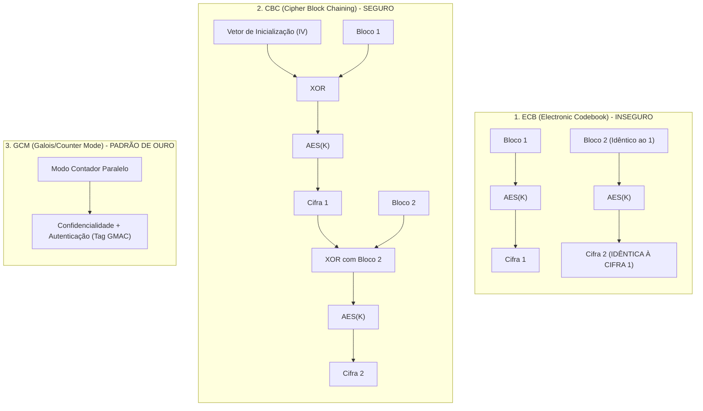
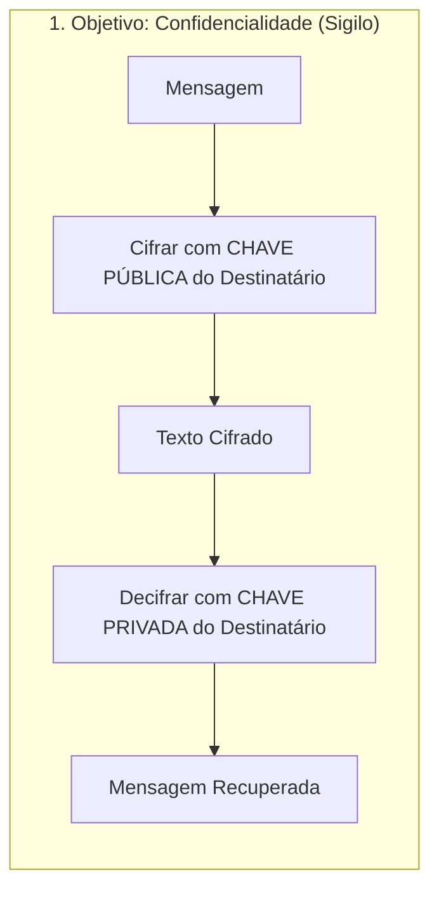
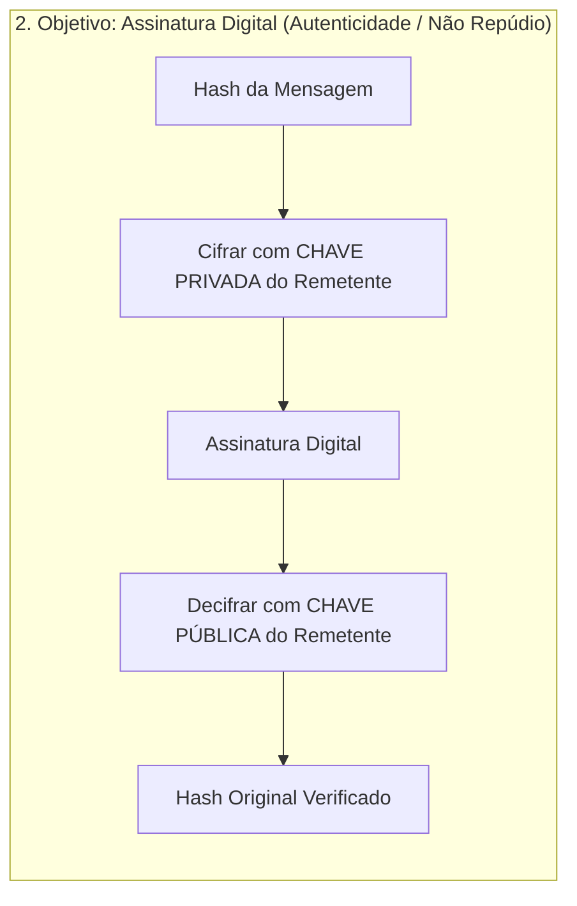
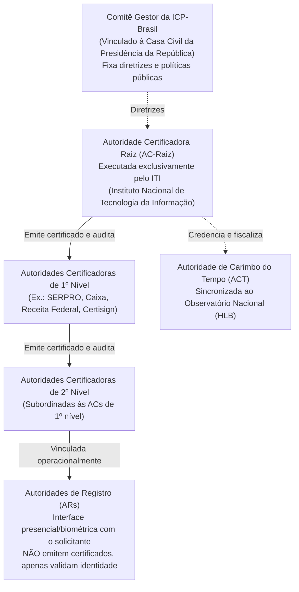
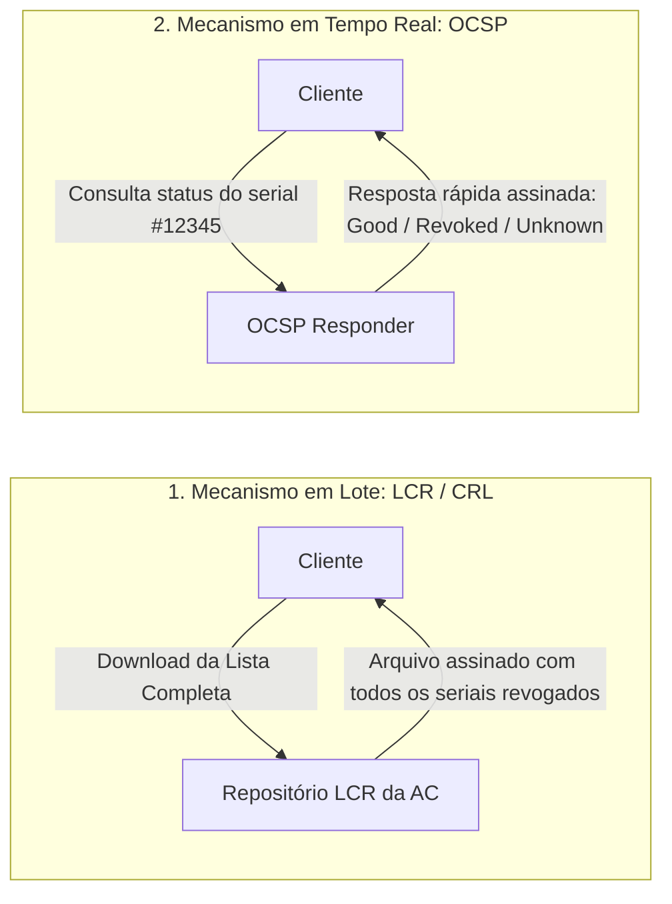
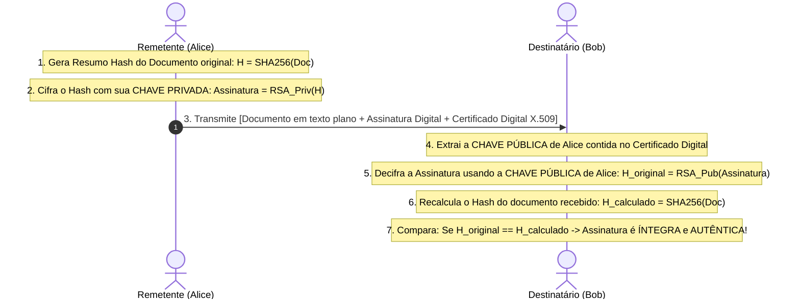

# 02 - Criptografia, ICP-Brasil e Assinatura Digital

> **Matéria:** Segurança da Informação  
> **Cargo:** B02 – Técnico de Controle Externo – Especialidade: Tecnologia da Informação  
> **Arquivo:** `02_criptografia_icp_brasil_e_assinatura_digital.md`  

---

## 📌 Ementa / Itens do Edital
- Criptografia Simétrica (algoritmos e modos de operação)
- Criptografia Assimétrica (par de chaves pública e privada)
- Funções de dispersão criptográfica (Hash)
- Infraestrutura de Chaves Públicas (PKI / ICP-Brasil)
- Certificados Digitais padrão X.509
- Mecanismo, validade jurídica e padrões de Assinatura Digital

---

## 🧭 Sumário

1. [Criptografia Simétrica (Chave Secreta Compartilhada)](#1-criptografia-simetrica-chave-secreta-compartilhada)
    1. [Fundamentos, Vantagens e o Problema da Distribuição de Chaves](#11-fundamentos-vantagens-e-o-problema-da-distribuicao-de-chaves)
    2. [Cifras de Bloco vs. Cifras de Fluxo (AES, DES, 3DES, ChaCha20)](#12-cifras-de-bloco-vs-cifras-de-fluxo-aes-des-3des-chacha20)
    3. [Modos de Operação de Bloco (ECB, CBC, CTR, GCM e AEAD)](#13-modos-de-operacao-de-bloco-ecb-cbc-ctr-gcm-e-aead)
    4. [Teste 366](#Teste-366)
    5. [Teste 367](#Teste-367)
    6. [Teste 368](#Teste-368)
2. [Criptografia Assimétrica (Chaves Públicas)](#2-criptografia-assimetrica-chaves-publicas)
    1. [Princípios Matemáticos e as Duas Operações Fundamentais](#21-principios-matematicos-e-as-duas-operacoes-fundamentais)
    2. [Algoritmos Assimétricos Principais (RSA, ECC, Diffie-Hellman)](#22-algoritmos-assimetricos-principais-rsa-ecc-diffie-hellman)
    3. [Criptografia Híbrida na Prática](#23-criptografia-hibrida-na-pratica)
    4. [Teste 369](#Teste-369)
3. [Funções de Resumo Criptográfico (Hash)](#3-funcoes-de-resumo-criptografico-hash)
    1. [Propriedades Matemáticas Essenciais e Princípio do Pombal](#31-propriedades-matematicas-essenciais-e-principio-do-pombal)
    2. [Algoritmos Seguros vs. Vulneráveis (SHA-2, SHA-3, MD5, SHA-1)](#32-algoritmos-seguros-vs-vulneraveis-sha-2-sha-3-md5-sha-1)
    3. [Teste 370](#Teste-370)
    4. [Teste 371](#Teste-371)
4. [Infraestrutura de Chaves Públicas e a ICP-Brasil](#4-infraestrutura-de-chaves-publicas-e-a-icp-brasil)
    1. [Estrutura Organizacional e Hierarquia Legal (MP nº 2.200-2/2001)](#41-estrutura-organizacional-e-hierarquia-legal-mp-no-2200-22001)
    2. [Certificados Digitais Padrão X.509 v3 e Ciclo de Vida](#42-certificados-digitais-padrao-x509-v3-e-ciclo-de-vida)
    3. [Mecanismos de Revogação: LCR / CRL vs. OCSP](#43-mecanismos-de-revogacao-lcr-crl-vs-ocsp)
    4. [Tipos de Certificados na ICP-Brasil (A1 vs. A3, Séries S e T)](#44-tipos-de-certificados-na-icp-brasil-a1-vs-a3-series-s-e-t)
    5. [Teste 372](#Teste-372)
    6. [Teste 373](#Teste-373)
    7. [Teste 374](#Teste-374)
5. [Assinatura Digital e Validade Jurídica](#5-assinatura-digital-e-validade-juridica)
    1. [Mecânica Operacional Passo a Passo (Geração e Verificação)](#51-mecanica-operacional-passo-a-passo-geracao-e-verificacao)
    2. [Propriedades Garantidas vs. Ausência de Confidencialidade](#52-propriedades-garantidas-vs-ausencia-de-confidencialidade)
    3. [Padrões de Assinatura Avançada (CAdES, XAdES, PAdES) e Carimbo do Tempo](#53-padroes-de-assinatura-avancada-cades-xades-pades-e-carimbo-do-tempo)
    4. [Teste 375](#Teste-375)
    5. [Teste 376](#Teste-376)
6. [Fontes Recomendadas na Internet](#6-fontes-recomendadas-na-internet)

---

## 1. Criptografia Simétrica (Chave Secreta Compartilhada)

### 1.1 Fundamentos, Vantagens e o Problema da Distribuição de Chaves

A criptografia simétrica fundamenta-se no princípio de que uma **única chave secreta** é compartilhada entre as partes, sendo utilizada tanto para a operação de cifragem (encriptação) quanto para a operação de decifragem (decriptação) da mensagem.

#### Vantagens e Limitações
- **Vantagem de Desempenho:** Desempenho computacional extraordinariamente elevado. Consome poucos ciclos de processamento e viabiliza a cifragem de grandes volumes de dados (gigabytes a terabytes) em tempo real. Além disso, conta com suporte nativo a aceleração por hardware nos processadores modernos (como o conjunto de instruções Intel AES-NI).
- **Limitação (O Problema da Distribuição de Chaves):** Para que um conjunto de $N$ usuários ou entidades se comuniquem aos pares de forma independente, estritamente sigilosa e sem compartilhamento mútuo da mesma chave, o total de chaves secretas necessárias cresce de forma quadrática segundo a combinação simples de $N$ tomados 2 a 2:
  $$K = \frac{N(N - 1)}{2}$$

> **Exemplo Prático para Concursos:**  
> Se uma organização conta com $N = 20$ analistas e cada par precisa de uma chave simétrica exclusiva, o número total de chaves exigidas é:
> $$K = \frac{20 \times (20 - 1)}{2} = \frac{20 \times 19}{2} = \frac{380}{2} = 190 \text{ chaves secretas}$$
> Se o grupo aumentar para 1.000 usuários, o sistema exigirá 499.500 chaves secretas. Esse crescimento exponencial inviabiliza a criptografia puramente simétrica em ambientes abertos e na Internet, exigindo canais seguros prévios de distribuição de chaves ou o suporte de sistemas assimétricos.

### 1.2 Cifras de Bloco vs. Cifras de Fluxo (AES, DES, 3DES, ChaCha20)

Os algoritmos simétricos dividem-se em duas grandes categorias estruturais segundo a forma como processam a massa de dados:

#### Cifras de Bloco (*Block Ciphers*)
Quebram o texto claro em blocos de tamanho fixo pré-definido e processam cada bloco individualmente aplicando rodadas consecutivas de permutações (*P-boxes*) e substituições (*S-boxes*):

- **AES (Advanced Encryption Standard - Rijndael):** Padrão mundial oficial regulamentado pelo NIST (FIPS 197). Opera com blocos fixos de **128 bits** e suporta três comprimentos de chave:
    - Chave de 128 bits: processada em 10 rodadas.
    - Chave de 192 bits: processada em 12 rodadas.
    - Chave de 256 bits: processada em 14 rodadas.
  Atualmente, o AES é considerado criptograficamente inquebrável contra ataques analíticos práticos, sendo o algoritmo padrão adotado por governos e órgãos de controle.
- **DES (Data Encryption Standard):** Criado na década de 1970, opera com blocos de **64 bits** e uma chave efetiva de apenas **56 bits** (8 bits eram reservados para paridade). É considerado **obsoleto e inseguro**, suscetível a ataques de força bruta concluídos em poucas horas ou minutos por equipamentos comuns.
- **3DES (Triple DES):** Aplica o algoritmo DES três vezes consecutivas na sequência Cifrar-Decifrar-Cifrar (EDE - *Encrypt-Decrypt-Encrypt*) utilizando duas ou três chaves independentes (112 ou 168 bits de força de chave). Embora resista à força bruta simples, é excessivamente lento em software e vulnerável a colisões de blocos de 64 bits em grandes transferências (ataque *Sweet32*).

#### Cifras de Fluxo (*Stream Ciphers*)
Processam o texto claro de maneira contínua, **bit a bit** ou **byte a byte**. Uma função geradora produz uma sequência de bits pseudoaleatórios chamada fluxo de chave (*keystream*), que é combinada com o texto claro por meio da operação lógica OU Exclusivo (**XOR** - $\oplus$):

- **ChaCha20:** Cifra de fluxo moderna de alta performance, padrão da IETF (RFC 8439), extremamente rápida em processadores sem aceleração criptográfica dedicada (como smartphones e dispositivos embarcados).
- **RC4:** Cifra de fluxo histórica que já equipou os protocolos WEP e SSL/TLS, porém descontinuada mundialmente após a descoberta de sérios vieses estatísticos nos primeiros bytes gerados.

### 1.3 Modos de Operação de Bloco (ECB, CBC, CTR, GCM e AEAD)

Uma cifra de bloco por si só só cifra um único bloco de tamanho fixo (ex.: 128 bits). Para processar arquivos e mensagens de qualquer extensão, aplicam-se **Modos de Operação**:

| Modo de Operação | Mecânica de Funcionamento | Vantagens | Desvantagens / Pegadinhas FCC |
|---|---|---|---|
| **ECB** (*Electronic Codebook*) | Cada bloco de 128 bits do texto claro é cifrado de maneira totalmente isolada com a mesma chave. | Simples e permite paralelismo pleno em leitura e escrita. | **EXTREMAMENTE INSEGURO.** Blocos de entrada idênticos geram blocos de saída rigorosamente idênticos. Revela a estrutura estatística e o contorno de imagens e documentos. |
| **CBC** (*Cipher Block Chaining*) | Cada bloco de texto claro passa por XOR com o bloco cifrado imediatamente anterior antes da encriptação. O primeiro bloco usa um Vetor de Inicialização (**IV**) aleatório. | Elimina a repetição de padrões visuais; blocos de texto idênticos produzem saídas cifradas completamente distintas. | A cifragem é sequencial e não pode ser paralelizada. Exige preenchimento (*padding*, ex.: PKCS#7) e é vulnerável a ataques de oráculo de preenchimento (*Padding Oracle*) se não houver verificação de integridade. |
| **CTR** (*Counter Mode*) | Cifra um valor incremental composto por um *nonce* e um contador, fazendo XOR do resultado com o bloco de texto claro. | Transforma a cifra de bloco em uma cifra de fluxo. Permite processamento 100% paralelo na cifragem e na decifragem e acesso aleatório a qualquer bloco. | A reutilização do par chave/nonce quebra irremediavelmente a segurança. Por si só, não provê verificação de integridade. |
| **GCM** (*Galois/Counter Mode*) | Combina a cifragem do modo CTR com a autenticação de Galois (GMAC), gerando uma tag de autenticação vinculada aos dados cifrados. | **Padrão de excelência da indústria (TLS 1.3, IPsec, SSH).** Provê **AEAD** (*Authenticated Encryption with Associated Data*): confidencialidade, autenticidade e integridade simultâneas com altíssima taxa de vazão e aceleração por hardware. | A reutilização de um mesmo IV com a mesma chave compromete catastrófica e irreversivelmente a chave de autenticação. |

> 🚨 **ALERTA DE PROVA / PEGADINHA FCC:**  
> A banca FCC frequentemente tenta induzir o candidato ao erro afirmando que o modo **ECB** é o mais eficiente e recomendado para proteger grandes bases de dados confidenciais devido à independência dos blocos. A afirmativa é **FALSA**! O ECB é formalmente contraindicado para confidencialidade porque preserva padrões repetitivos dos dados originais (o clássico contorno do mascote Tux do Linux permanece legível mesmo após a cifragem com ECB).

---

### Teste 001
**(FGV – TJ/SC – 2026 – Analista Administrativo)**
A empresa ABC atua na construção naval, dedicando-se à concepção e à execução de navios de grande porte. Cada empreendimento possui orçamento, cronograma e equipe próprios; exige a convergência de competências diversas - engenharia naval, metalurgia, sistemas elétricos e eletrônicos-; demanda elevado aporte de recursos; e estende-se por tempo prolongado, sendo tratado pela Diretoria como um produto único, exclusivo e individualizado. O critério de departamentalização adotado pela empresa ABC corresponde à departamentalização por

* **A)** função.
* **B)** projetos.
* **C)** processos.
* **D)** clientes.
* **E)** área geográfica.

---

> **Comentário Detalhado:**
>
> - **A)** **Incorreta.** A opção apresenta proposição em desacordo com os fundamentos teóricos e técnicos do tópico ao afirmar que "função". De acordo com a teoria estudada em *Papéis dos Entes da Estrutura:*, autoridade Certificadora Raiz (AC Raiz): Operada exclusivamente pelo Instituto Nacional de Tecnologia da Informação (ITI), uma autarquia federal. É a primeira autoridade da cadeia. Possui o único certificado autoassinado ( self signed ) da infraestrutura. A AC Raiz não emite certificados para usuários finais (cidadãos ou empresas); sua função restringe se a emitir certificados para as Autoridades Certificadoras de primeiro nível credenciadas, auditá las e fiscalizá las.
> - **B)** **Correta.** Conforme fundamentado na seção *Vantagens e Limitações* deste guia, vantagem de Desempenho: Desempenho computacional extraordinariamente elevado. Consome poucos ciclos de processamento e viabiliza a cifragem de grandes volumes de dados (gigabytes a terabytes) em tempo real. Além disso, conta com suporte nativo a aceleração por hardware nos processadores modernos (como o conjunto de instruções Intel AES NI). Dessa forma, está plenamente correta a assertiva da banca (FGV – TJ/SC/2026) ao estabelecer que "projetos".
> - **C)** **Incorreta.** A opção apresenta proposição em desacordo com os fundamentos teóricos e técnicos do tópico ao afirmar que "processos". De acordo com a teoria estudada em *Cifras de Bloco (Block Ciphers)*, atualmente, o AES é considerado criptograficamente inquebrável contra ataques analíticos práticos, sendo o algoritmo padrão adotado por governos e órgãos de controle.
> - **D)** **Incorreta.** A opção apresenta proposição em desacordo com os fundamentos teóricos e técnicos do tópico ao afirmar que "clientes". De acordo com a teoria estudada em *5.3 Padrões de Assinatura Avançada (CAdES, XAdES, PAdES) e Carimbo do Tempo*, xAdES ( XML Advanced Electronic Signatures ): Estruturado sobre as especificações XMLDSig do W3C. Permite a assinatura de documentos no formato XML, oferecendo grande granularidade (é possível assinar nós ou seções individuais do arquivo XML, mantendo a legibilidade estrutural do XML).
> - **E)** **Incorreta.** A opção apresenta proposição em desacordo com os fundamentos teóricos e técnicos do tópico ao afirmar que "área geográfica". De acordo com a teoria estudada em *Vantagens e Limitações*, se o grupo aumentar para 1.000 usuários, o sistema exigirá 499.500 chaves secretas. Esse crescimento exponencial inviabiliza a criptografia puramente simétrica em ambientes abertos e na Internet, exigindo canais seguros prévios de distribuição de chaves ou o suporte de sistemas assimétricos.
>
> **Gabarito: B**

---

### Teste 002
**(FGV – TCE/GO – 2024 – Analista de Controle Externo - Ciências Contábeis)**
O Framework de Controle Interno Integrado do Committee of Sponsoring Organizations of the Treadway Commission (COSO), originalmente emitido em 1992 e atualizado em 2013, consolidou a ideia de gestão de riscos corporativos e apresentou um conjunto de princípios e boas práticas de gestão e controle interno. Assinale a opção que indica uma característica da versão atualizada em 2013.

* **A)** Complementação de resposta a riscos.
* **B)** Verificação de conformidade com a Lei Sarbanes-Oxley.
* **C)** Destaque para os riscos na melhoria da performance.
* **D)** Aplicação da gestão de riscos no setor público.
* **E)** Destaque para os riscos no estabelecimento da estratégia.

---

> **Comentário Detalhado:**
>
> - **A)** **Incorreta.** A opção apresenta proposição em desacordo com os fundamentos teóricos e técnicos do tópico ao afirmar que "Complementação de resposta a riscos". De acordo com a teoria estudada em *4.3 Mecanismos de Revogação: LCR / CRL vs. OCSP*, sRV2 |"Resposta rápida assinada: Good / Revoked / Unknown"| C2.
> - **B)** **Correta.** Conforme fundamentado na seção *1. Legislação Oficial e Documentos Governamentais* deste guia, lei nº 14.063/2020 — Assinaturas Eletrônicas no Setor Público (Planalto): Marco legal que dispõe sobre o uso de assinaturas eletrônicas (simples, avançada e qualificada via ICP Brasil) em interações com entes públicos. Dessa forma, está plenamente correta a assertiva da banca (FGV – TCE/GO/2024) ao estabelecer que "Verificação de conformidade com a Lei Sarbanes Oxley".
> - **C)** **Incorreta.** A opção apresenta proposição em desacordo com os fundamentos teóricos e técnicos do tópico ao afirmar que "Destaque para os riscos na melhoria da performance". De acordo com a teoria estudada em *Cifras de Fluxo (Stream Ciphers)*, chaCha20: Cifra de fluxo moderna de alta performance, padrão da IETF (RFC 8439), extremamente rápida em processadores sem aceleração criptográfica dedicada (como smartphones e dispositivos embarcados).
> - **D)** **Incorreta.** A opção apresenta proposição em desacordo com os fundamentos teóricos e técnicos do tópico ao afirmar que "Aplicação da gestão de riscos no setor público". De acordo com a teoria estudada em *4.3 Mecanismos de Revogação: LCR / CRL vs. OCSP*, oCSP ( Online Certificate Status Protocol RFC 6960): Protocolo leve no modelo cliente servidor em que a aplicação consulta pontualmente um servidor denominado OCSP Responder . O cliente envia unicamente o número de série do certificado sob suspeita e recebe em milissegundos uma resposta assinada com o status atual: Good (ativo/válido), Revoked (revogado) ou Unknown (desconhecido).
> - **E)** **Incorreta.** A opção apresenta proposição em desacordo com os fundamentos teóricos e técnicos do tópico ao afirmar que "Destaque para os riscos no estabelecimento da estratégia". De acordo com a teoria estudada em *1.3 Modos de Operação de Bloco (ECB, CBC, CTR, GCM e AEAD)*, cBC ( Cipher Block Chaining ): Cada bloco de texto claro passa por XOR com o bloco cifrado imediatamente anterior antes da encriptação. O primeiro bloco usa um Vetor de Inicialização (IV) aleatório. — Elimina a repetição de padrões visuais; blocos de texto idênticos produzem saídas cifradas completamente distintas. — A cifragem é sequencial e não pode ser paralelizada. Exige preenchimento ( padding , ex.: PKCS 7) e é vulnerável a ataques de oráculo de preenchimento ( Padding Oracle ) se não houver verificação de integridade.
>
> **Gabarito: B**

---

### Teste 003
**(FGV – TCE/GO – 2024 – Analista de Controle Externo - Ciências Contábeis)**
Os Princípios Orçamentários visam estabelecer diretrizes norteadoras básicas, a fim de conferir racionalidade, eficiência e transparência para os processos de elaboração, execução e controle do orçamento público. Assinale a opção que indica o Princípio Orçamentário que evita múltiplos orçamentos paralelos dentro da mesma pessoa política.

* **A)** Anualidade.
* **B)** Universalidade.
* **C)** Legalidade.
* **D)** Unidade.
* **E)** Orçamento bruto.

---

> **Comentário Detalhado:**
>
> - **A)** **Incorreta.** A opção apresenta proposição em desacordo com os fundamentos teóricos e técnicos do tópico ao afirmar que "Anualidade". De acordo com a teoria estudada em *1.1 Fundamentos, Vantagens e o Problema da Distribuição de Chaves*, a criptografia simétrica fundamenta se no princípio de que uma única chave secreta é compartilhada entre as partes, sendo utilizada tanto para a operação de cifragem (encriptação) quanto para a operação de decifragem (decriptação) da mensagem.
> - **B)** **Incorreta.** A opção apresenta proposição em desacordo com os fundamentos teóricos e técnicos do tópico ao afirmar que "Universalidade". De acordo com a teoria estudada em *Vantagens e Limitações*, limitação (O Problema da Distribuição de Chaves): Para que um conjunto de $N$ usuários ou entidades se comuniquem aos pares de forma independente, estritamente sigilosa e sem compartilhamento mútuo da mesma chave, o total de chaves secretas necessárias cresce de forma quadrática segundo a combinação simples de $N$ tomados 2 a 2.
> - **C)** **Incorreta.** A opção apresenta proposição em desacordo com os fundamentos teóricos e técnicos do tópico ao afirmar que "Legalidade". De acordo com a teoria estudada em *1.3 Modos de Operação de Bloco (ECB, CBC, CTR, GCM e AEAD)*, eCB ( Electronic Codebook ): Cada bloco de 128 bits do texto claro é cifrado de maneira totalmente isolada com a mesma chave. — Simples e permite paralelismo pleno em leitura e escrita. — EXTREMAMENTE INSEGURO. Blocos de entrada idênticos geram blocos de saída rigorosamente idênticos. Revela a estrutura estatística e o contorno de imagens e documentos.
> - **D)** **Correta.** Conforme fundamentado na seção *2.1 Princípios Matemáticos e as Duas Operações Fundamentais* deste guia, chave Pública: Disponibilizada irrestritamente a qualquer pessoa ou sistema. Dessa forma, está plenamente correta a assertiva da banca (FGV – TCE/GO/2024) ao estabelecer que "Unidade".
> - **E)** **Incorreta.** A opção apresenta proposição em desacordo com os fundamentos teóricos e técnicos do tópico ao afirmar que "Orçamento bruto". De acordo com a teoria estudada em *5.3 Padrões de Assinatura Avançada (CAdES, XAdES, PAdES) e Carimbo do Tempo*, cAdES ( CMS Advanced Electronic Signatures ): Padrão binário estruturado sobre a RFC 5652 (CMS). É agnóstico quanto ao tipo de mídia e permite assinar qualquer tipo de arquivo bruto (imagens, áudio, vídeos, binários executáveis).
>
> **Gabarito: D**

---

### Teste 004
**(FGV – TCE/GO – 2024 – Analista de Controle Externo - Ciências Contábeis)**
A classificação da despesa pública é essencial para o controle e a gestão eficiente dos recursos governamentais, permitindo a identificação e a análise detalhada dos gastos de acordo com sua natureza, finalidade e órgão responsável. Assinale a opção que indica o maior nível de agregação das diversas áreas de atuação do setor público.

* **A)** Função.
* **B)** Subfunção.
* **C)** Atividade.
* **D)** Projeto.
* **E)** Classificação funcional.

---

> **Comentário Detalhado:**
>
> - **A)** **Correta.** Conforme fundamentado na seção *Papéis dos Entes da Estrutura:* deste guia, autoridade Certificadora Raiz (AC Raiz): Operada exclusivamente pelo Instituto Nacional de Tecnologia da Informação (ITI), uma autarquia federal. É a primeira autoridade da cadeia. Possui o único certificado autoassinado ( self signed ) da infraestrutura. A AC Raiz não emite certificados para usuários finais (cidadãos ou empresas); sua função restringe se a emitir certificados para as Autoridades Certificadoras de primeiro nível credenciadas, auditá las e fiscalizá las. Dessa forma, está plenamente correta a assertiva da banca (FGV – TCE/GO/2024) ao estabelecer que "Função".
> - **B)** **Incorreta.** A opção apresenta proposição em desacordo com os fundamentos teóricos e técnicos do tópico ao afirmar que "Subfunção". De acordo com a teoria estudada em *Cifras de Fluxo (Stream Ciphers)*, processam o texto claro de maneira contínua, bit a bit ou byte a byte. Uma função geradora produz uma sequência de bits pseudoaleatórios chamada fluxo de chave ( keystream ), que é combinada com o texto claro por meio da operação lógica OU Exclusivo (XOR $\oplus$).
> - **C)** **Incorreta.** A opção apresenta proposição em desacordo com os fundamentos teóricos e técnicos do tópico ao afirmar que "Atividade". De acordo com a teoria estudada em *3.1 Propriedades Matemáticas Essenciais e Princípio do Pombal*, uma função de dispersão criptográfica (função hash) $h = H(M)$ é um algoritmo determinístico que aceita como entrada uma mensagem $M$ de comprimento arbitrário e produz uma sequência de bits de comprimento rigorosamente fixo, chamada de resumo criptográfico ( message digest ou hash ).
> - **D)** **Incorreta.** A opção apresenta proposição em desacordo com os fundamentos teóricos e técnicos do tópico ao afirmar que "Projeto". De acordo com a teoria estudada em *Propriedades Obrigatórias:*, determinismo Pleno: A mesma entrada $M$ submetida à mesma função resultará sempre, invariavelmente, no mesmo hash $h$.
> - **E)** **Incorreta.** A opção apresenta proposição em desacordo com os fundamentos teóricos e técnicos do tópico ao afirmar que "Classificação funcional". De acordo com a teoria estudada em *Classificação por Aplicação:*, série A (Assinatura Digital): Destinados à autenticação de usuários e assinatura digital de documentos com presunção de autoria e integridade.
>
> **Gabarito: A**

---

### Teste 005
**(FCC – TCE/GO – 2009 – Analista de Controle Externo - Gestão de Conhecimento)**
De acordo com o art. 71 da Constituição Federal de 1988, compete ao Tribunal de Contas da União, no exercício do controle externo, realizar inspeções e auditorias de diversas naturezas. Supondo que o Tribunal de Contas realize auditoria em uma entidade pública com a finalidade de confirmar os valores apresentados nas demonstrações financeiras, ele está realizando uma auditoria

* **A)** avaliar o cumprimento das metas previstas no plano plurianual, a execução dos programas de governo e dos orçamentos da União.
* **B)** comprovar a legalidade e avaliar os resultados, quanto à eficácia e eficiência, da gestão orçamen- tária, financeira e patrimonial nos órgãos e entidades da administração federal.
* **C)** exercer o controle das operações de crédito, avais e garantias, bem como dos direitos e haveres da União.
* **D)** apoiar o controle externo no exercício de sua missão institucional.
* **E)** aplicar aos responsáveis, em caso de ilegalidade de despesa ou irregularidade de contas, as sanções previstas em lei.

---

> **Comentário Detalhado:**
>
> - **A)** **Correta.** Conforme fundamentado na seção *Papéis dos Entes da Estrutura:* deste guia, comitê Gestor da ICP Brasil: Colegiado vinculado à Casa Civil da Presidência da República, composto por membros do governo e da sociedade civil, com a atribuição de deliberar normas, políticas públicas e padrões técnicos da certificação digital no Brasil. Dessa forma, está plenamente correta a assertiva da banca (FCC – TCE/GO/2009) ao estabelecer que "avaliar o cumprimento das metas previstas no plano plurianual, a execução dos programas de governo e dos...".
> - **B)** **Incorreta.** A opção apresenta proposição em desacordo com os fundamentos teóricos e técnicos do tópico ao afirmar que "comprovar a legalidade e avaliar os resultados, quanto à eficácia e eficiência, da gestão orçamen tária...". De acordo com a teoria estudada em *Papéis dos Entes da Estrutura:*, autoridades de Registro (ARs): Entidades operacionais que realizam o atendimento direto ao solicitante. Têm a função de verificar presencialmente ou por biometria os documentos do titular, confirmar sua identidade e encaminhar as solicitações para a AC emissora.
> - **C)** **Incorreta.** A opção apresenta proposição em desacordo com os fundamentos teóricos e técnicos do tópico ao afirmar que "exercer o controle das operações de crédito, avais e garantias, bem como dos direitos e haveres da União". De acordo com a teoria estudada em *4.1 Estrutura Organizacional e Hierarquia Legal (MP nº 2.200-2/2001)*, a Infraestrutura de Chaves Públicas Brasileira (ICP Brasil) foi formalmente criada pela Medida Provisória nº 2.200 2, de 24 de agosto de 2001, com o propósito de garantir a autenticidade, a integridade e a validade jurídica de documentos em forma eletrônica, bem como a realização de transações eletrônicas seguras.
> - **D)** **Incorreta.** A opção apresenta proposição em desacordo com os fundamentos teóricos e técnicos do tópico ao afirmar que "apoiar o controle externo no exercício de sua missão institucional". De acordo com a teoria estudada em *5.1 Mecânica Operacional Passo a Passo (Geração e Verificação)*, alice Bob: 3. Transmite [Documento em texto plano + Assinatura Digital + Certificado Digital X.509].
> - **E)** **Incorreta.** A opção apresenta proposição em desacordo com os fundamentos teóricos e técnicos do tópico ao afirmar que "aplicar aos responsáveis, em caso de ilegalidade de despesa ou irregularidade de contas, as sanções previstas em...". De acordo com a teoria estudada em *Passo a Passo da Verificação da Assinatura (Bob):*, bob compara os dois valores: se $H {original} == H {calculado}$, a assinatura é válida; caso haja qualquer discrepância de 1 bit sequer, a assinatura é sumariamente rejeitada.
>
> **Gabarito: A**

---

### Teste 006
**(FGV – TCE/GO – 2024 – Analista de Controle Externo - Jurídica)**
Rosangela é servidora pública do Estado de Goiás, ocupando cargo efetivo, e atua em Jataí/GO. Em seu contracheque constam diversas parcelas e Rosangela está em dúvida sobre a forma de cálculo da contribuição previdenciária. Das parcelas abaixo, retiradas do contracheque de Rosangela, marque aquela sobre a qual haverá recolhimento de contribuição previdenciária da servidora em comento.

* **A)** Diárias para viagens.
* **B)** Gratificação natalina.
* **C)** Ajuda de custo.
* **D)** Auxílio-alimentação.
* **E)** Abono de permanência.

---

> **Comentário Detalhado:**
>
> - **A)** **Incorreta.** A opção apresenta proposição em desacordo com os fundamentos teóricos e técnicos do tópico ao afirmar que "Diárias para viagens". De acordo com a teoria estudada em *1.2 Cifras de Bloco vs. Cifras de Fluxo (AES, DES, 3DES, ChaCha20)*, os algoritmos simétricos dividem se em duas grandes categorias estruturais segundo a forma como processam a massa de dados.
> - **B)** **Correta.** Conforme fundamentado na seção *Vantagens e Limitações* deste guia, limitação (O Problema da Distribuição de Chaves): Para que um conjunto de $N$ usuários ou entidades se comuniquem aos pares de forma independente, estritamente sigilosa e sem compartilhamento mútuo da mesma chave, o total de chaves secretas necessárias cresce de forma quadrática segundo a combinação simples de $N$ tomados 2 a 2. Dessa forma, está plenamente correta a assertiva da banca (FGV – TCE/GO/2024) ao estabelecer que "Gratificação natalina".
> - **C)** **Incorreta.** A opção apresenta proposição em desacordo com os fundamentos teóricos e técnicos do tópico ao afirmar que "Ajuda de custo". De acordo com a teoria estudada em *4.1 Estrutura Organizacional e Hierarquia Legal (MP nº 2.200-2/2001)*, a Infraestrutura de Chaves Públicas Brasileira (ICP Brasil) foi formalmente criada pela Medida Provisória nº 2.200 2, de 24 de agosto de 2001, com o propósito de garantir a autenticidade, a integridade e a validade jurídica de documentos em forma eletrônica, bem como a realização de transações eletrônicas seguras.
> - **D)** **Incorreta.** A opção apresenta proposição em desacordo com os fundamentos teóricos e técnicos do tópico ao afirmar que "Auxílio alimentação". De acordo com a teoria estudada em *5.1 Mecânica Operacional Passo a Passo (Geração e Verificação)*, a assinatura digital baseia se na conjugação entre funções hash criptográficas e criptografia assimétrica. Ela vincula de forma matemática irrefutável o conteúdo do documento ao titular do certificado.
> - **E)** **Incorreta.** A opção apresenta proposição em desacordo com os fundamentos teóricos e técnicos do tópico ao afirmar que "Abono de permanência". De acordo com a teoria estudada em *Passo a Passo da Verificação da Assinatura (Bob):*, bob calcula de forma independente um novo hash diretamente sobre o arquivo recebido utilizando a mesma função hash ($H {calculado}$).
>
> **Gabarito: B**

---

### Teste 007
**(FGV – TCE/GO – 2024 – Analista de Controle Externo - Tecnologia da Informação)**
Quando uma organização busca implementar um Planejamento Estratégico de Tecnologia da Informação (PETI), é essencial considerar o alinhamento estratégico entre a área de TI e os negócios. Marque a ação que garante esse alinhamento e apoia a governança de TI.

* **A)** Implementação de práticas ITIL em comunicação com as equipes de operações de infraestrutura.
* **B)** Desenvolvimento de políticas e procedimentos de TI que reflitam as estratégias definidas pelo framework ITIL
* **C)** Centralização das decisões de TI usando o framework COBIT combinado com ITIL para as áreas de gestão.
* **D)** Reestruturação da equipe de TI em alinhamento com operações e desenvolvimento.
* **E)** Integração dos frameworks COBIT e ITIL para estabelecer processos que suportem os objetivos estratégicos de negócios e TI.

---

> **Comentário Detalhado:**
>
> - **A)** **Incorreta.** A opção apresenta proposição em desacordo com os fundamentos teóricos e técnicos do tópico ao afirmar que "Implementação de práticas ITIL em comunicação com as equipes de operações de infraestrutura". De acordo com a teoria estudada em *Papéis dos Entes da Estrutura:*, autoridade Certificadora Raiz (AC Raiz): Operada exclusivamente pelo Instituto Nacional de Tecnologia da Informação (ITI), uma autarquia federal. É a primeira autoridade da cadeia. Possui o único certificado autoassinado ( self signed ) da infraestrutura. A AC Raiz não emite certificados para usuários finais (cidadãos ou empresas); sua função restringe se a emitir certificados para as Autoridades Certificadoras de primeiro nível credenciadas, auditá las e fiscalizá las.
> - **B)** **Incorreta.** A opção apresenta proposição em desacordo com os fundamentos teóricos e técnicos do tópico ao afirmar que "Desenvolvimento de políticas e procedimentos de TI que reflitam as estratégias definidas pelo framework ITIL". De acordo com a teoria estudada em *4.1 Estrutura Organizacional e Hierarquia Legal (MP nº 2.200-2/2001)*, cG["Comitê Gestor da ICP Brasil  - **C)** **Incorreta.** A opção apresenta proposição em desacordo com os fundamentos teóricos e técnicos do tópico ao afirmar que "Centralização das decisões de TI usando o framework COBIT combinado com ITIL para as áreas de gestão". De acordo com a teoria estudada em *5.1 Mecânica Operacional Passo a Passo (Geração e Verificação)*, note over Bob: 5. Decifra a Assinatura usando a CHAVE PÚBLICA de Alice: H original = RSA Pub(Assinatura).
> - **D)** **Incorreta.** A opção apresenta proposição em desacordo com os fundamentos teóricos e técnicos do tópico ao afirmar que "Reestruturação da equipe de TI em alinhamento com operações e desenvolvimento". De acordo com a teoria estudada em *2.1 Princípios Matemáticos e as Duas Operações Fundamentais*, a criptografia de chave pública baseia se na existência de problemas matemáticos unidirecionais com alçapão ( trapdoor one way functions ): operações que são triviais de serem calculadas em um sentido, mas computacionalmente inviáveis de serem revertidas sem uma informação secreta privilegiada (o "alçapão"). Cada usuário possui um par de chaves complementares.
> - **E)** **Correta.** Conforme fundamentado na seção *2.3 Criptografia Híbrida na Prática* deste guia, o algoritmo assimétrico (ou o protocolo Diffie Hellman efêmero autenticado) é executado apenas na fase inicial do aperto de mão ( handshake ) para verificar as identidades e estabelecer com segurança uma chave simétrica temporária, denominada Chave de Sessão ( Session Key ). Dessa forma, está plenamente correta a assertiva da banca (FGV – TCE/GO/2024) ao estabelecer que "Integração dos frameworks COBIT e ITIL para estabelecer processos que suportem os objetivos estratégicos de...".
>
> **Gabarito: E**

---

### Teste 008
**(FGV – TCE/GO – 2024 – Analista de Controle Externo - Tecnologia da Informação)**
O comando EXPLAIN no sistema PostgreSQL, versão 16, desempenha um papel crucial na análise e otimização do desempenho das consultas SQL. Compreender o funcionamento e a saída desse comando é essencial para otimizar o desempenho do sistema. Neste contexto, o comando EXPLAIN

* **A)** exibe informações sobre o histórico de execução de consultas no banco de dados, incluindo detalhes sobre transações anteriores.
* **B)** indica ao planejador que escolha como custo estimado de execução de consultas que utilizam a cláusula EXISTS o menor custo inicial em vez do menor custo total.
* **C)** modifica, em conjunto com a cláusula ANALYZE e WAL, a estrutura física dos arquivos de dados no disco para otimizar o desempenho das consultas.
* **D)** monitora o espaço em disco utilizado por tabelas e índices no banco de dados, permitindo a otimização do armazenamento e reconstrução de índices CLUSTERED.
* **E)** oferece uma interface gráfica para criar e modificar tabelas no banco de dados PostgreSQL escritas utilizando a sublinguagem DDL.

---

> **Comentário Detalhado:**
>
> - **A)** **Incorreta.** A opção apresenta proposição em desacordo com os fundamentos teóricos e técnicos do tópico ao afirmar que "exibe informações sobre o histórico de execução de consultas no banco de dados, incluindo detalhes sobre...". De acordo com a teoria estudada em *Propriedades Obrigatórias:*, comprimento Fixo: A saída sempre possui exatamente o mesmo número de bits, independentemente do volume do dado de entrada (seja um texto de 3 caracteres ou um banco de dados de 500 terabytes).
> - **B)** **Correta.** Conforme fundamentado na seção *Vantagens e Limitações* deste guia, limitação (O Problema da Distribuição de Chaves): Para que um conjunto de $N$ usuários ou entidades se comuniquem aos pares de forma independente, estritamente sigilosa e sem compartilhamento mútuo da mesma chave, o total de chaves secretas necessárias cresce de forma quadrática segundo a combinação simples de $N$ tomados 2 a 2. Dessa forma, está plenamente correta a assertiva da banca (FGV – TCE/GO/2024) ao estabelecer que "indica ao planejador que escolha como custo estimado de execução de consultas que utilizam a cláusula EXISTS o...".
> - **C)** **Incorreta.** A opção apresenta proposição em desacordo com os fundamentos teóricos e técnicos do tópico ao afirmar que "modifica, em conjunto com a cláusula ANALYZE e WAL, a estrutura física dos arquivos de dados no disco para...". De acordo com a teoria estudada em *Vantagens e Limitações*, vantagem de Desempenho: Desempenho computacional extraordinariamente elevado. Consome poucos ciclos de processamento e viabiliza a cifragem de grandes volumes de dados (gigabytes a terabytes) em tempo real. Além disso, conta com suporte nativo a aceleração por hardware nos processadores modernos (como o conjunto de instruções Intel AES NI).
> - **D)** **Incorreta.** A opção apresenta proposição em desacordo com os fundamentos teóricos e técnicos do tópico ao afirmar que "monitora o espaço em disco utilizado por tabelas e índices no banco de dados, permitindo a otimização do...". De acordo com a teoria estudada em *Vantagens e Limitações*, se uma organização conta com $N = 20$ analistas e cada par precisa de uma chave simétrica exclusiva, o número total de chaves exigidas é.
> - **E)** **Incorreta.** A opção apresenta proposição em desacordo com os fundamentos teóricos e técnicos do tópico ao afirmar que "oferece uma interface gráfica para criar e modificar tabelas no banco de dados PostgreSQL escritas utilizando a...". De acordo com a teoria estudada em *2.2 Algoritmos Assimétricos Principais (RSA, ECC, Diffie-Hellman)*, uma chave de ECC de 256 bits oferece segurança computacional equivalente a uma chave de RSA de 3072 bits.
>
> **Gabarito: B**

---

### Teste 009
**(FGV – TCE/GO – 2024 – Analista de Controle Externo - Tecnologia da Informação)**
A ABNT NBR ISO/IEC 27001:2022, NBR ISO/IEC 27002:2022, os CIS v8, SIEM, e a Lei nº 13.709(LGPD) são algumas das diversas normas e leis que trabalham conjuntamente para assegurar a integridade, confidencialidade e disponibilidade dos dados no contexto da segurança da informação. Assinale a opção que descreve corretamente uma contribuição combinada dessas leis e normas.

* **A)** Apenas a implementação da LGPD é suficiente para garantir a conformidade legal e a segurança da informação, tornando as outras normas e controles redundantes.
* **B)** O ponto chave dos Sistemas de Gerenciamento de Informações e Eventos de Segurança (SIEM) oferecer somente práticas de segurança pessoal em tempo real que deve ser combinado as demais normas e leis.
* **C)** As normas ABNT NBR ISO/IEC estabelecem os requisitos gerais de segurança, a LGPD foca na proteção de dados pessoais, e os SIEM proporcionam a visão e controle operacionais necessários.
* **D)** A adoção dos CIS Critical Security Controls v8 cobre os requisitos de segurança e as normas ABNT NBR ISO/IEC fornecem o complemento no que se refere a proteção de dados pessoais.
* **E)** A ABNT NBR ISO/IEC 27001:2022 e a 27002:2022 são as únicas que fornecem uma abordagem baseada em risco que utilizará os outros mecanismos para organizar e controlar os sistemas de segurança.

---

> **Comentário Detalhado:**
>
> - **A)** **Incorreta.** A opção incorre em restrição indevida ao limitar o escopo conceitual ao afirmar que "Apenas a implementação da LGPD é suficiente para garantir a conformidade legal e a segurança da informação...". De acordo com a teoria estudada em *1. Legislação Oficial e Documentos Governamentais*, estrutura da ICP Brasil e Legislação (ITI / Gov.br): Portal oficial do Instituto Nacional de Tecnologia da Informação detalhando a hierarquia da cadeia de certificação brasileira, o papel da AC Raiz, normas de credenciamento de ACs e ARs e padrões de assinatura digital.
> - **B)** **Incorreta.** A opção incorre em restrição indevida ao limitar o escopo conceitual ao afirmar que "O ponto chave dos Sistemas de Gerenciamento de Informações e Eventos de Segurança (SIEM) oferecer somente práticas...". De acordo com a teoria estudada em *Vantagens e Limitações*, vantagem de Desempenho: Desempenho computacional extraordinariamente elevado. Consome poucos ciclos de processamento e viabiliza a cifragem de grandes volumes de dados (gigabytes a terabytes) em tempo real. Além disso, conta com suporte nativo a aceleração por hardware nos processadores modernos (como o conjunto de instruções Intel AES NI).
> - **C)** **Correta.** Conforme fundamentado na seção *3. Referências Bibliográficas Clássicas (Padrão ABNT)* deste guia, sTALLINGS, William. Criptografia e Segurança de Redes: Princípios e Práticas. 6. ed. São Paulo: Pearson Education do Brasil, 2015. (Cap. 3, 6, 9, 11 e 14 — Cifras Simétricas AES/Modos de Operação, Criptografia Assimétrica RSA/ECC, Funções Hash SHA e Certificados X.509). Dessa forma, está plenamente correta a assertiva da banca (FGV – TCE/GO/2024) ao estabelecer que "As normas ABNT NBR ISO/IEC estabelecem os requisitos gerais de segurança, a LGPD foca na proteção de dados...".
> - **D)** **Incorreta.** A opção apresenta proposição em desacordo com os fundamentos teóricos e técnicos do tópico ao afirmar que "A adoção dos CIS Critical Security Controls v8 cobre os requisitos de segurança e as normas ABNT NBR ISO/IEC...". De acordo com a teoria estudada em *1.3 Modos de Operação de Bloco (ECB, CBC, CTR, GCM e AEAD)*, gCM ( Galois/Counter Mode ): Combina a cifragem do modo CTR com a autenticação de Galois (GMAC), gerando uma tag de autenticação vinculada aos dados cifrados. — Padrão de excelência da indústria (TLS 1.3, IPsec, SSH). Provê AEAD ( Authenticated Encryption with Associated Data ): confidencialidade, autenticidade e integridade simultâneas com altíssima taxa de vazão e aceleração por hardware. — A reutilização de um mesmo IV com a mesma chave compromete catastrófica e irreversivelmente a chave de autenticação.
> - **E)** **Incorreta.** A opção apresenta proposição em desacordo com os fundamentos teóricos e técnicos do tópico ao afirmar que "A ABNT NBR ISO/IEC 27001:2022 e a 27002:2022 são as únicas que fornecem uma abordagem baseada em risco que...". De acordo com a teoria estudada em *5.3 Padrões de Assinatura Avançada (CAdES, XAdES, PAdES) e Carimbo do Tempo*, pAdES ( PDF Advanced Electronic Signatures ): Desenvolvido especificamente para arquivos no formato PDF (ISO 32000 1). A assinatura digital, a cadeia de certificação e os metadados de auditoria são incorporados diretamente na estrutura interna do arquivo .pdf , permitindo visualização gráfica e conferência direta em leitores de PDF convencionais.
>
> **Gabarito: C**

---

### Teste 010
**(FGV – TCE/GO – 2024 – Analista de Controle Externo - Tecnologia da Informação)**
Considerando os protocolos de segurança EAP, WEP, WPA e WPA2, é correto, para a segurança de uma rede sem fio, que devemos

* **A)** utilizar exclusivamente o protocolo EAP, uma vez que sua antiguidade no mercado o torna amplamente compatível com diversos dispositivos e sistemas operacionais.
* **B)** preferir autenticação somente com WPA2 e criptografia WEP, pois ele é criado para garantir a conexão dos dispositivos dos usuários, minimizando obstáculos de acesso.
* **C)** implementar o protocolo WPA2 juntamente com EAP para uma camada adicional de autenticação, garantindo assim uma conexão segura e uma defesa robusta contra ataques.
* **D)** usar a criptografia WPA para aumentar a velocidade de transmissão de dados, compensando através do uso intensivo de softwares antivírus nos dispositivos conectados.
* **E)** configurar a rede para permitir conexões anônimas, facilitando assim o gerenciamento de dispositivos IoT na infraestrutura sem sacrificar a segurança.

---

> **Comentário Detalhado:**
>
> - **A)** **Incorreta.** A opção incorre em restrição indevida ao limitar o escopo conceitual ao afirmar que "utilizar exclusivamente o protocolo EAP, uma vez que sua antiguidade no mercado o torna amplamente compatível com...". De acordo com a teoria estudada em *5.2 Propriedades Garantidas vs. Ausência de Confidencialidade*, a assinatura digital NÃO GARANTE CONFIDENCIALIDADE! Por padrão, o documento assinado transita legível em texto claro e pode ser lido por qualquer operador de rede ou intermediário. Se a questão de concurso afirmar que "ao assinar digitalmente um documento, o remetente impede que indivíduos não autorizados leiam o seu teor", a afirmativa está INCORRETA. Para obter confidencialidade juntamente com assinatura digital, é indispensável cifrar o documento com a chave pública do destinatário.
> - **B)** **Incorreta.** A opção incorre em restrição indevida ao limitar o escopo conceitual ao afirmar que "preferir autenticação somente com WPA2 e criptografia WEP, pois ele é criado para garantir a conexão dos...". De acordo com a teoria estudada em *Cifras de Bloco (Block Ciphers)*, dES (Data Encryption Standard): Criado na década de 1970, opera com blocos de 64 bits e uma chave efetiva de apenas 56 bits (8 bits eram reservados para paridade). É considerado obsoleto e inseguro, suscetível a ataques de força bruta concluídos em poucas horas ou minutos por equipamentos comuns.
> - **C)** **Correta.** Conforme fundamentado na seção *Cifras de Bloco (Block Ciphers)* deste guia, atualmente, o AES é considerado criptograficamente inquebrável contra ataques analíticos práticos, sendo o algoritmo padrão adotado por governos e órgãos de controle. Dessa forma, está plenamente correta a assertiva da banca (FGV – TCE/GO/2024) ao estabelecer que "implementar o protocolo WPA2 juntamente com EAP para uma camada adicional de autenticação, garantindo assim uma...".
> - **D)** **Incorreta.** A opção apresenta proposição em desacordo com os fundamentos teóricos e técnicos do tópico ao afirmar que "usar a criptografia WPA para aumentar a velocidade de transmissão de dados, compensando através do uso intensivo...". De acordo com a teoria estudada em *2.3 Criptografia Híbrida na Prática*, em seguida, a transmissão de dados pesados e contínuos da sessão é executada exclusivamente por uma cifra simétrica de alta velocidade (como AES GCM ou ChaCha20 Poly1305).
> - **E)** **Incorreta.** A opção apresenta proposição em desacordo com os fundamentos teóricos e técnicos do tópico ao afirmar que "configurar a rede para permitir conexões anônimas, facilitando assim o gerenciamento de dispositivos IoT na...". De acordo com a teoria estudada em *2.2 Algoritmos Assimétricos Principais (RSA, ECC, Diffie-Hellman)*, o menor tamanho de chave resulta em menor consumo de largura de banda, menor latência de rede e baixíssimo consumo energético em chips, sendo o padrão preferencial de TLS moderno, cartões inteligentes e dispositivos móveis (ex.: curvas Ed25519, NIST P 256).
>
> **Gabarito: C**

---

### Teste 011
**(FGV – TCE/GO – 2024 – Analista de Controle Externo - Tecnologia da Informação)**
Analise as afirmativas a seguir sobre criptografia assimétrica e simétrica, certificados digitais e assinaturas digitais: I. A criptografia simétrica utiliza a mesma chave para cifrar e decifrar uma mensagem, desde que a chave seja compartilhada de maneira segura entre as partes. II. Certificados digitais são utilizados para vincular apenas a chave privada a uma identidade, permitindo que terceiros confiem na autenticidade da chave. III. Assinaturas digitais utilizam a criptografia assimétrica para garantir a integridade e autenticidade de uma mensagem, mas não a confidencialidade do conteúdo. Está correto o que se afirma em

* **A)** I, apenas.
* **B)** II, apenas.
* **C)** I e III, apenas.
* **D)** II e III, apenas.
* **E)** I, II e III.

---

> **Comentário Detalhado:**
>
> - **A)** **Incorreta.** A opção incorre em restrição indevida ao limitar o escopo conceitual ao afirmar que "I, apenas". De acordo com a teoria estudada em *Regra Prática de Uso das Chaves:*, para garantir Autenticidade / Integridade / Não Repúdio (Assinatura Digital): O remetente utiliza a sua própria Chave PRIVADA. Qualquer terceiro com acesso à Chave PÚBLICA do Remetente pode conferir a assinatura e comprovar a autoria.
> - **B)** **Incorreta.** A opção incorre em restrição indevida ao limitar o escopo conceitual ao afirmar que "II, apenas". De acordo com a teoria estudada em *Regra Prática de Uso das Chaves:*, para garantir Sigilo / Confidencialidade: O remetente utiliza a Chave PÚBLICA do Destinatário. Apenas a Chave PRIVADA do Destinatário poderá abrir a mensagem.
> - **C)** **Correta.** Conforme fundamentado na seção *1.1 Fundamentos, Vantagens e o Problema da Distribuição de Chaves* deste guia, a criptografia simétrica fundamenta se no princípio de que uma única chave secreta é compartilhada entre as partes, sendo utilizada tanto para a operação de cifragem (encriptação) quanto para a operação de decifragem (decriptação) da mensagem. Dessa forma, está plenamente correta a assertiva da banca (FGV – TCE/GO/2024) ao estabelecer que "I e III, apenas".
> - **D)** **Incorreta.** A opção incorre em restrição indevida ao limitar o escopo conceitual ao afirmar que "II e III, apenas". De acordo com a teoria estudada em *1.3 Modos de Operação de Bloco (ECB, CBC, CTR, GCM e AEAD)*, gCM ( Galois/Counter Mode ): Combina a cifragem do modo CTR com a autenticação de Galois (GMAC), gerando uma tag de autenticação vinculada aos dados cifrados. — Padrão de excelência da indústria (TLS 1.3, IPsec, SSH). Provê AEAD ( Authenticated Encryption with Associated Data ): confidencialidade, autenticidade e integridade simultâneas com altíssima taxa de vazão e aceleração por hardware. — A reutilização de um mesmo IV com a mesma chave compromete catastrófica e irreversivelmente a chave de autenticação.
> - **E)** **Incorreta.** A opção apresenta proposição em desacordo com os fundamentos teóricos e técnicos do tópico ao afirmar que "I, II e III". De acordo com a teoria estudada em *Campos Obrigatórios do Certificado X.509 v3:*, assinatura Digital da AC ( Certificate Signature Value ): Cifragem do hash de todo o conteúdo do certificado realizada com a Chave Privada da AC, assegurando sua inviolabilidade e autenticidade.
>
> **Gabarito: C**

---

### Teste 012
**(FGV – TCE/GO – 2024 – Analista de Controle Externo - Tecnologia da Informação)**
Uma empresa pública contratou serviços de desenvolvimento de software, estabelecendo no contrato cláusulas de nível de serviço (SLA) com penalidade e especificações claras sobre o produto final, assim como condições para o seu aceite. Ao final do prazo, a empresa percebeu que o produto final não atendia integralmente às especificações técnicas acordadas. Visando proteger os interesses da empresa e o funcionamento do software, indique a medida correta que protege os interesses da empresa e o funcionamento do software.

* **A)** Dispensar o pagamento de penalidades, considerando que houve bastante trabalho feito pela contratada, e esperar uma nova versão.
* **B)** Exigir a revisão do produto sem custos adicionais, baseando-se nas cláusulas de nível de serviço estipuladas.
* **C)** Celebrar novos termos aditivos para nova versão do software, independente do aceite da contratada, para estender o prazo, visto que houve esforço por parte da contratada.
* **D)** Aceitar o produto como está, evitando conflitos judiciais e futuras complicações administrativas.
* **E)** Rescindir o contrato imediatamente, aplicando as máximas penalidades possíveis devido ao não cumprimento das especificações.

---

> **Comentário Detalhado:**
>
> - **A)** **Incorreta.** A opção apresenta proposição em desacordo com os fundamentos teóricos e técnicos do tópico ao afirmar que "Dispensar o pagamento de penalidades, considerando que houve bastante trabalho feito pela contratada, e esperar...". De acordo com a teoria estudada em *Campos Obrigatórios do Certificado X.509 v3:*, extensões ( Extensions exclusivas da v3): Informações adicionais como Key Usage (finalidade autorizada da chave), Basic Constraints (indicação de permissão para atuar como AC) e Subject Alternative Name (SAN nomes de domínio adicionais e e mails).
> - **B)** **Correta.** Conforme fundamentado na seção *2.2 Algoritmos Assimétricos Principais (RSA, ECC, Diffie-Hellman)* deste guia, rSA (Rivest, Shamir e Adleman): Fundamenta se na complexidade computacional da fatoração de números inteiros compostos gigantescos formados pelo produto de dois números primos $p$ e $q$. Tamanhos recomendados atualmente: no mínimo 2048 bits, preferencialmente 4096 bits. Dessa forma, está plenamente correta a assertiva da banca (FGV – TCE/GO/2024) ao estabelecer que "Exigir a revisão do produto sem custos adicionais, baseando se nas cláusulas de nível de serviço estipuladas".
> - **C)** **Incorreta.** A opção apresenta proposição em desacordo com os fundamentos teóricos e técnicos do tópico ao afirmar que "Celebrar novos termos aditivos para nova versão do software, independente do aceite da contratada, para estender o...". De acordo com a teoria estudada em *Cifras de Bloco (Block Ciphers)*, 3DES (Triple DES): Aplica o algoritmo DES três vezes consecutivas na sequência Cifrar Decifrar Cifrar (EDE Encrypt Decrypt Encrypt ) utilizando duas ou três chaves independentes (112 ou 168 bits de força de chave). Embora resista à força bruta simples, é excessivamente lento em software e vulnerável a colisões de blocos de 64 bits em grandes transferências (ataque Sweet32 ).
> - **D)** **Incorreta.** A opção apresenta proposição em desacordo com os fundamentos teóricos e técnicos do tópico ao afirmar que "Aceitar o produto como está, evitando conflitos judiciais e futuras complicações administrativas". De acordo com a teoria estudada em *5.2 Propriedades Garantidas vs. Ausência de Confidencialidade*, não Repúdio (Irretratabilidade): O autor da assinatura não pode negar perante autoridades legais ou judiciais a autoria do ato praticado com sua chave privada exclusiva.
> - **E)** **Incorreta.** A opção apresenta proposição em desacordo com os fundamentos teóricos e técnicos do tópico ao afirmar que "Rescindir o contrato imediatamente, aplicando as máximas penalidades possíveis devido ao não cumprimento das...". De acordo com a teoria estudada em *1.3 Modos de Operação de Bloco (ECB, CBC, CTR, GCM e AEAD)*, a banca FCC frequentemente tenta induzir o candidato ao erro afirmando que o modo ECB é o mais eficiente e recomendado para proteger grandes bases de dados confidenciais devido à independência dos blocos. A afirmativa é FALSA! O ECB é formalmente contraindicado para confidencialidade porque preserva padrões repetitivos dos dados originais (o clássico contorno do mascote Tux do Linux permanece legível mesmo após a cifragem com ECB).
>
> **Gabarito: B**

---

### Teste 013
**(CEBRASPE – STJ – 2024 – Analista Judiciário - Apoio Especializado - Suporte em Tecnologia da Informação)**
As práticas de gerenciamento de serviço do ITIL v4 incluem gerenciamento de infraestrutura e de plataforma. Em relação ao gerenciamento de projetos e à modelagem de processos de negócio, julgue os itens que se seguem.

* **C)** Certo
* **E)** Errado

---

> **Comentário Detalhado:**
>
> - **C)** **Incorreta.** A proposição apresenta proposição em desacordo com os fundamentos teóricos e técnicos do tópico ao afirmar que "As práticas de gerenciamento de serviço do ITIL v4 incluem gerenciamento de infraestrutura e de plataforma...". De acordo com a teoria em *3.2 Algoritmos Seguros vs. Vulneráveis (SHA-2, SHA-3, MD5, SHA-1)*, mD5: 128 bits — Vulnerável / Quebrado — Colisões práticas podem ser forjadas em milissegundos por computadores comuns. Banido expressamente da ICP Brasil e de padrões seguros.
> - **E)** **Correta.** O item está **Errado** (gabarito oficial: **E**), pois contraria a disciplina teórica aplicável.
>
> **Gabarito: E**

---

### Teste 014
**(CEBRASPE – STJ – 2024 – Analista Judiciário - Apoio Especializado - Suporte em Tecnologia da Informação)**
A solução Flyway permite que seja realizado o controle de versão de código de banco de dados, estendendo o DevOps aos bancos de dados de modo a permitir que se acompanhem as alterações e se aprimore a confiabilidade das implantações de software.

* **C)** Certo
* **E)** Errado

---

> **Comentário Detalhado:**
>
> - **C)** **Correta.** O item está **Certo**. Conforme fundamentado na seção *Propriedades Obrigatórias:*, comprimento Fixo: A saída sempre possui exatamente o mesmo número de bits, independentemente do volume do dado de entrada (seja um texto de 3 caracteres ou um banco de dados de 500 terabytes). Dessa forma, está plenamente correta a assertiva da banca (CEBRASPE – STJ/2024) ao afirmar que "A solução Flyway permite que seja realizado o controle de versão de código de banco de dados, estendendo o...".
> - **E)** **Incorreta.** A assertiva não incorre em erro conceitual, guardando conformidade com a teoria estudada.
>
> **Gabarito: C**

---

### Teste 015
**(CEBRASPE – STJ – 2024 – Analista Judiciário - Apoio Especializado - Suporte em Tecnologia da Informação)**
Em uma VPN, o tráfego de dados é levado pela rede pública por meio de protocolos de criptografia por tunelamento, como o SSL, que define um tipo de cabeçalho de autenticação (AH  authentication header), garantindo a confidencialidade dos dados.

* **C)** Certo
* **E)** Errado

---

> **Comentário Detalhado:**
>
> - **C)** **Incorreta.** A proposição apresenta proposição em desacordo com os fundamentos teóricos e técnicos do tópico ao afirmar que "Em uma VPN, o tráfego de dados é levado pela rede pública por meio de protocolos de criptografia por...". De acordo com a teoria em *1.3 Modos de Operação de Bloco (ECB, CBC, CTR, GCM e AEAD)*, gCM ( Galois/Counter Mode ): Combina a cifragem do modo CTR com a autenticação de Galois (GMAC), gerando uma tag de autenticação vinculada aos dados cifrados. — Padrão de excelência da indústria (TLS 1.3, IPsec, SSH). Provê AEAD ( Authenticated Encryption with Associated Data ): confidencialidade, autenticidade e integridade simultâneas com altíssima taxa de vazão e aceleração por hardware. — A reutilização de um mesmo IV com a mesma chave compromete catastrófica e irreversivelmente a chave de autenticação.
> - **E)** **Correta.** O item está **Errado** (gabarito oficial: **E**), pois contraria a disciplina teórica aplicável.
>
> **Gabarito: E**

---

### Teste 016
**(CEBRASPE – STJ – 2024 – Analista Judiciário - Apoio Especializado - Suporte em Tecnologia da Informação)**
O método de autenticação SPF (sender policy framework) permite que os proprietários de domínios assinem emails automaticamente a partir de seu domínio; nessa assinatura digital, é utilizada criptografia de chave pública para verificar matematicamente que o email veio do domínio correto.

* **C)** Certo
* **E)** Errado

---

> **Comentário Detalhado:**
>
> - **C)** **Incorreta.** A proposição apresenta proposição em desacordo com os fundamentos teóricos e técnicos do tópico ao afirmar que "O método de autenticação SPF (sender policy framework) permite que os proprietários de domínios assinem...". De acordo com a teoria em *1.1 Fundamentos, Vantagens e o Problema da Distribuição de Chaves*, a criptografia simétrica fundamenta se no princípio de que uma única chave secreta é compartilhada entre as partes, sendo utilizada tanto para a operação de cifragem (encriptação) quanto para a operação de decifragem (decriptação) da mensagem.
> - **E)** **Correta.** O item está **Errado** (gabarito oficial: **E**), pois contraria a disciplina teórica aplicável.
>
> **Gabarito: E**

---

### Teste 017
**(FGV – TJ/AP – 2023 – Analista Judiciario Apoio Especializado Tecnologia Da Informacao Banco De Dados)**
Joyce acabou de ler certo edital que veiculou a realização de um processo administrativo de chamamento público por meio do qual a Administração Pública convocou profissionais interessados em prestar determinado serviço, para que, preenchidos os requisitos necessários devidamente delimitados, se habilitem junto ao órgão ou entidade para executar o objeto quando convocados, viabilizando a sua contratação direta, mediante critérios determinados. No âmbito da Lei nº 14.133/2021, tal edital versa sobre:

* **A)** credenciamento, que caracteriza hipótese de licitação dispensável;
* **B)** pré-qualificação, que caracteriza hipótese de licitação inexigível;
* **C)** catálogo eletrônico de padronização de serviços, que caracteriza hipótese de licitação inexigível;
* **D)** credenciamento, que caracteriza hipótese de licitação inexigível;
* **E)** pré-qualificação, que caracteriza hipótese de licitação dispensável.

---

> **Comentário Detalhado:**
>
> - **A)** **Incorreta.** A opção apresenta proposição em desacordo com os fundamentos teóricos e técnicos do tópico ao afirmar que "credenciamento, que caracteriza hipótese de licitação dispensável". De acordo com a teoria estudada em *Cifras de Fluxo (Stream Ciphers)*, processam o texto claro de maneira contínua, bit a bit ou byte a byte. Uma função geradora produz uma sequência de bits pseudoaleatórios chamada fluxo de chave ( keystream ), que é combinada com o texto claro por meio da operação lógica OU Exclusivo (XOR $\oplus$).
> - **B)** **Incorreta.** A opção apresenta proposição em desacordo com os fundamentos teóricos e técnicos do tópico ao afirmar que "pré qualificação, que caracteriza hipótese de licitação inexigível". De acordo com a teoria estudada em *Propriedades Obrigatórias:*, unidirecionalidade ( Pre image Resistance / Resistência à Primeira Pré Imagem): Dado um resumo $h$, é computacionalmente inviável calcular ou descobrir a mensagem de entrada $M$ tal que $H(M) = h$. Trata se de uma função estritamente de "mão única".
> - **C)** **Incorreta.** A opção apresenta proposição em desacordo com os fundamentos teóricos e técnicos do tópico ao afirmar que "catálogo eletrônico de padronização de serviços, que caracteriza hipótese de licitação inexigível". De acordo com a teoria estudada em *4.2 Certificados Digitais Padrão X.509 v3 e Ciclo de Vida*, o certificado digital é um documento eletrônico assinado digitalmente por uma Autoridade Certificadora, vinculando a chave pública de uma entidade à sua verdadeira identidade civil ou corporativa.
> - **D)** **Correta.** Conforme fundamentado na seção *1. Legislação Oficial e Documentos Governamentais* deste guia, estrutura da ICP Brasil e Legislação (ITI / Gov.br): Portal oficial do Instituto Nacional de Tecnologia da Informação detalhando a hierarquia da cadeia de certificação brasileira, o papel da AC Raiz, normas de credenciamento de ACs e ARs e padrões de assinatura digital. Dessa forma, está plenamente correta a assertiva da banca (FGV – TJ/AP/2023) ao estabelecer que "credenciamento, que caracteriza hipótese de licitação inexigível".
> - **E)** **Incorreta.** A opção apresenta proposição em desacordo com os fundamentos teóricos e técnicos do tópico ao afirmar que "pré qualificação, que caracteriza hipótese de licitação dispensável". De acordo com a teoria estudada em *Propriedades Obrigatórias:*, resistência à Segunda Pré Imagem ( Weak Collision Resistance ): Conhecendo se uma entrada específica $M 1$, é computacionalmente inviável encontrar uma entrada diferente $M 2 \neq M 1$ tal que $H(M 1) = H(M 2)$.
>
> **Gabarito: D**

---

### Teste 018
**(FGV – TJ/AP – 2023 – Analista Judiciario Apoio Especializado Tecnologia Da Informacao Desenvolvimento De Sistemas)**
O paradigma funcional, evidenciado na linguagem LISP, criada em 1958, voltou com muita força atualmente, sendo incluído em diversas linguagens, como o Java. Considere o trecho de código apresentado a seguir. List<String> lista = Arrays.asList("UM","DOIS","TRES"); for(int i=0; i<lista.size(); i++){ System.out.println(lista.get(i)); } Para utilizar o paradigma funcional, o loop para apresentação dos valores deve ser reescrito da seguinte forma:

* **A)** for(String s: lista){ System.out.println(s); }
* **B)** for (Iterator<String> it = lista.iterator(); it.hasNext();) { System.out.println(it.next()); }
* **C)** lista.forEach(s -> { System.out.println(s); });
* **D)** Iterator<String> it = lista.iterator(); while(it.hasNext()) { System.out.println(it.next()); }
* **E)** for(var s: lista){ System.out.println(s); }

---

> **Comentário Detalhado:**
>
> - **A)** **Incorreta.** A opção apresenta proposição em desacordo com os fundamentos teóricos e técnicos do tópico ao afirmar que "for(String s: lista){ System.out.println(s); }". De acordo com a teoria estudada em *4.3 Mecanismos de Revogação: LCR / CRL vs. OCSP*, desvantagens: Pode demorar horas ou dias para ser republicada (janela de vulnerabilidade) e gera tráfego excessivo de rede, pois o cliente precisa baixar a lista inteira mesmo para consultar apenas um certificado.
> - **B)** **Incorreta.** A opção apresenta proposição em desacordo com os fundamentos teóricos e técnicos do tópico ao afirmar que "for (Iterator<String it = lista.iterator(); it.hasNext();) { System.out.println(it.next()); }". De acordo com a teoria estudada em *4.3 Mecanismos de Revogação: LCR / CRL vs. OCSP*, c1["Cliente"] |"Download da Lista Completa"| SRV1["Repositório LCR da AC"].
> - **C)** **Correta.** Conforme fundamentado na seção *4.3 Mecanismos de Revogação: LCR / CRL vs. OCSP* deste guia, lCR ( Lista de Certificados Revogados ) ou CRL ( Certificate Revocation List ): Arquivo digital assinado e publicado periodicamente pela AC contendo a lista dos números de série de todos os certificados que foram revogados antes do prazo de validade. Dessa forma, está plenamente correta a assertiva da banca (FGV – TJ/AP/2023) ao estabelecer que "lista.forEach(s { System.out.println(s); })".
> - **D)** **Incorreta.** A opção apresenta proposição em desacordo com os fundamentos teóricos e técnicos do tópico ao afirmar que "Iterator<String it = lista.iterator(); while(it.hasNext()) { System.out.println(it.next()); }". De acordo com a teoria estudada em *Cifras de Bloco (Block Ciphers)*, 3DES (Triple DES): Aplica o algoritmo DES três vezes consecutivas na sequência Cifrar Decifrar Cifrar (EDE Encrypt Decrypt Encrypt ) utilizando duas ou três chaves independentes (112 ou 168 bits de força de chave). Embora resista à força bruta simples, é excessivamente lento em software e vulnerável a colisões de blocos de 64 bits em grandes transferências (ataque Sweet32 ).
> - **E)** **Incorreta.** A opção apresenta proposição em desacordo com os fundamentos teóricos e técnicos do tópico ao afirmar que "for(var s: lista){ System.out.println(s); }". De acordo com a teoria estudada em *Cifras de Bloco (Block Ciphers)*, atualmente, o AES é considerado criptograficamente inquebrável contra ataques analíticos práticos, sendo o algoritmo padrão adotado por governos e órgãos de controle.
>
> **Gabarito: C**

---

### Teste 019
**(FGV – TJ/AP – 2023 – Analista Judiciario Apoio Especializado Tecnologia Da Informacao Seguranca Da Informacao)**
Amanda trabalha em uma consultoria X e está implementando um NAP (proteção de acesso à rede) em um cliente. O objetivo de Amanda com tal implementação é manter a integridade dos computadores da rede corporativa. Para proteger o acesso à rede de forma adequada, deve existir uma infraestrutura de rede que forneça à área de funcionalidade:

* **A)** validação de integridade: determina se os computadores estão em conformidade com os requisitos de integridade do sistema;
* **B)** zona desmilitarizada: impede que um usuário autorizado com um computador em conformidade carregue um programa mal-intencionado na rede;
* **C)** restrição de rede: permite o acesso à rede, desde que o computador do usuário atenda aos requisitos de política de integridade;
* **D)** correção: restringe o acesso à rede ou à comunicação para clientes que não estão em conformidade com os requisitos de integridade do sistema;
* **E)** conformidade contínua: fornece as atualizações necessárias para permitir que o computador corrija seu estado de integridade não compatível.

---

> **Comentário Detalhado:**
>
> - **A)** **Correta.** Conforme fundamentado na seção *4.1 Estrutura Organizacional e Hierarquia Legal (MP nº 2.200-2/2001)* deste guia, a Infraestrutura de Chaves Públicas Brasileira (ICP Brasil) foi formalmente criada pela Medida Provisória nº 2.200 2, de 24 de agosto de 2001, com o propósito de garantir a autenticidade, a integridade e a validade jurídica de documentos em forma eletrônica, bem como a realização de transações eletrônicas seguras. Dessa forma, está plenamente correta a assertiva da banca (FGV – TJ/AP/2023) ao estabelecer que "validação de integridade: determina se os computadores estão em conformidade com os requisitos de integridade do...".
> - **B)** **Incorreta.** A opção apresenta proposição em desacordo com os fundamentos teóricos e técnicos do tópico ao afirmar que "zona desmilitarizada: impede que um usuário autorizado com um computador em conformidade carregue um programa mal...". De acordo com a teoria estudada em *5.2 Propriedades Garantidas vs. Ausência de Confidencialidade*, a assinatura digital NÃO GARANTE CONFIDENCIALIDADE! Por padrão, o documento assinado transita legível em texto claro e pode ser lido por qualquer operador de rede ou intermediário. Se a questão de concurso afirmar que "ao assinar digitalmente um documento, o remetente impede que indivíduos não autorizados leiam o seu teor", a afirmativa está INCORRETA. Para obter confidencialidade juntamente com assinatura digital, é indispensável cifrar o documento com a chave pública do destinatário.
> - **C)** **Incorreta.** A opção apresenta proposição em desacordo com os fundamentos teóricos e técnicos do tópico ao afirmar que "restrição de rede: permite o acesso à rede, desde que o computador do usuário atenda aos requisitos de política de...". De acordo com a teoria estudada em *1.3 Modos de Operação de Bloco (ECB, CBC, CTR, GCM e AEAD)*, cTR ( Counter Mode ): Cifra um valor incremental composto por um nonce e um contador, fazendo XOR do resultado com o bloco de texto claro. — Transforma a cifra de bloco em uma cifra de fluxo. Permite processamento 100% paralelo na cifragem e na decifragem e acesso aleatório a qualquer bloco. — A reutilização do par chave/nonce quebra irremediavelmente a segurança. Por si só, não provê verificação de integridade.
> - **D)** **Incorreta.** A opção apresenta proposição em desacordo com os fundamentos teóricos e técnicos do tópico ao afirmar que "correção: restringe o acesso à rede ou à comunicação para clientes que não estão em conformidade com os requisitos...". De acordo com a teoria estudada em *Regra Prática de Uso das Chaves:*, para garantir Autenticidade / Integridade / Não Repúdio (Assinatura Digital): O remetente utiliza a sua própria Chave PRIVADA. Qualquer terceiro com acesso à Chave PÚBLICA do Remetente pode conferir a assinatura e comprovar a autoria.
> - **E)** **Incorreta.** A opção apresenta proposição em desacordo com os fundamentos teóricos e técnicos do tópico ao afirmar que "conformidade contínua: fornece as atualizações necessárias para permitir que o computador corrija seu estado de...". De acordo com a teoria estudada em *Vantagens e Limitações*, limitação (O Problema da Distribuição de Chaves): Para que um conjunto de $N$ usuários ou entidades se comuniquem aos pares de forma independente, estritamente sigilosa e sem compartilhamento mútuo da mesma chave, o total de chaves secretas necessárias cresce de forma quadrática segundo a combinação simples de $N$ tomados 2 a 2.
>
> **Gabarito: A**

---

### Teste 020
**(FGV – TJ/AP – 2023 – Analista Judiciario Apoio Especializado Tecnologia Da Informacao Seguranca Da Informacao)**
Davi é o coordenador de TI da empresa X e está efetuando uma prova de conceito (POC) para a computação em nuvem de alguns serviços e informações. Durante esse processo, Davi identificou alguns riscos de segurança que são específicos aos ambientes de nuvem. Dentre eles, há as questões tecnológicas partilhadas, que consistem na entrega dos serviços de forma escalável através da partilha de infraestrutura. Muitas vezes, essa infraestrutura não foi projetada para oferecer o isolamento necessário para uma arquitetura multilocatária. Algumas contramedidas que devem ser implementadas por Davi para evitar os riscos da partilha são:

* **A)** especificação dos requisitos de recursos humanos como parte de contrato legal e determinação dos processos de notificação de violação de segurança;
* **B)** análise do modelo de interfaces de segurança do provedor de nuvem e compreensão da cadeia de dependência associada à API;
* **C)** implantação de técnicas de autenticação fortes de dois fatores, sempre que possível, e monitoramento proativo para detectar atividades não autorizadas;
* **D)** monitoramento do ambiente para atividades não autorizadas e a promoção de forte autenticação para o controle de acesso administrativo e de operações;
* **E)** implementação de uma forte API de controle de acesso e encriptação e proteção da integridade dos dados em trânsito.

---

> **Comentário Detalhado:**
>
> - **A)** **Incorreta.** A opção apresenta proposição em desacordo com os fundamentos teóricos e técnicos do tópico ao afirmar que "especificação dos requisitos de recursos humanos como parte de contrato legal e determinação dos processos de...". De acordo com a teoria estudada em *4.1 Estrutura Organizacional e Hierarquia Legal (MP nº 2.200-2/2001)*, a Infraestrutura de Chaves Públicas Brasileira (ICP Brasil) foi formalmente criada pela Medida Provisória nº 2.200 2, de 24 de agosto de 2001, com o propósito de garantir a autenticidade, a integridade e a validade jurídica de documentos em forma eletrônica, bem como a realização de transações eletrônicas seguras.
> - **B)** **Incorreta.** A opção apresenta proposição em desacordo com os fundamentos teóricos e técnicos do tópico ao afirmar que "análise do modelo de interfaces de segurança do provedor de nuvem e compreensão da cadeia de dependência associada...". De acordo com a teoria estudada em *2.3 Criptografia Híbrida na Prática*, para contornar esse gargalo, protocolos de segurança como HTTPS (TLS), SSH, PGP e S/MIME operam no modelo híbrido.
> - **C)** **Incorreta.** A opção promove generalização excessiva que desconsidera as condições técnicas e normativas ao afirmar que "implantação de técnicas de autenticação fortes de dois fatores, sempre que possível, e monitoramento proativo para...". De acordo com a teoria estudada em *Propriedades Obrigatórias:*, resistência Forte a Colisões ( Strong Collision Resistance ): É computacionalmente inviável localizar qualquer par arbitrário de mensagens distintas $M 1 \neq M 2$ que gerem o mesmo resumo hash $H(M 1) = H(M 2)$.
> - **D)** **Correta.** Conforme fundamentado na seção *1.3 Modos de Operação de Bloco (ECB, CBC, CTR, GCM e AEAD)* deste guia, cTR ( Counter Mode ): Cifra um valor incremental composto por um nonce e um contador, fazendo XOR do resultado com o bloco de texto claro. — Transforma a cifra de bloco em uma cifra de fluxo. Permite processamento 100% paralelo na cifragem e na decifragem e acesso aleatório a qualquer bloco. — A reutilização do par chave/nonce quebra irremediavelmente a segurança. Por si só, não provê verificação de integridade. Dessa forma, está plenamente correta a assertiva da banca (FGV – TJ/AP/2023) ao estabelecer que "monitoramento do ambiente para atividades não autorizadas e a promoção de forte autenticação para o controle de...".
> - **E)** **Incorreta.** A opção apresenta proposição em desacordo com os fundamentos teóricos e técnicos do tópico ao afirmar que "implementação de uma forte API de controle de acesso e encriptação e proteção da integridade dos dados em trânsito". De acordo com a teoria estudada em *1.3 Modos de Operação de Bloco (ECB, CBC, CTR, GCM e AEAD)*, gCM ( Galois/Counter Mode ): Combina a cifragem do modo CTR com a autenticação de Galois (GMAC), gerando uma tag de autenticação vinculada aos dados cifrados. — Padrão de excelência da indústria (TLS 1.3, IPsec, SSH). Provê AEAD ( Authenticated Encryption with Associated Data ): confidencialidade, autenticidade e integridade simultâneas com altíssima taxa de vazão e aceleração por hardware. — A reutilização de um mesmo IV com a mesma chave compromete catastrófica e irreversivelmente a chave de autenticação.
>
> **Gabarito: D**

---

### Teste 021
**(FGV – TJ/AP – 2023 – Analista Judiciario Apoio Especializado Tecnologia Da Informacao Telecomunicacoes)**
As redes sem fio em ambiente corporativo possuem diversas vantagens quando comparadas com a rede cabeada. Por outro lado, o uso de access point torna a rede mais vulnerável a ataques cibernéticos, como, por exemplo, a negação de serviço (DoS). O ataque do tipo DoS consiste em:

* **A)** andar pela cidade procurando redes sem fio vulneráveis;
* **B)** escutar o tráfego de dados que está passando por um ponto de acesso;
* **C)** descobrir as credenciais de acesso à rede sem fio a partir da força bruta;
* **D)** instalar um ponto de acesso falso na rede, de tal forma que o usuário se conecte indevidamente a ele;
* **E)** emitir um sinal interferente na frequência de operação e próximo ao access point com o objetivo de deixar o dispositivo inoperante.

---

> **Comentário Detalhado:**
>
> - **A)** **Incorreta.** A opção apresenta proposição em desacordo com os fundamentos teóricos e técnicos do tópico ao afirmar que "andar pela cidade procurando redes sem fio vulneráveis". De acordo com a teoria estudada em *3. Referências Bibliográficas Clássicas (Padrão ABNT)*, sTALLINGS, William. Criptografia e Segurança de Redes: Princípios e Práticas. 6. ed. São Paulo: Pearson Education do Brasil, 2015. (Cap. 3, 6, 9, 11 e 14 — Cifras Simétricas AES/Modos de Operação, Criptografia Assimétrica RSA/ECC, Funções Hash SHA e Certificados X.509).
> - **B)** **Incorreta.** A opção apresenta proposição em desacordo com os fundamentos teóricos e técnicos do tópico ao afirmar que "escutar o tráfego de dados que está passando por um ponto de acesso". De acordo com a teoria estudada em *1.3 Modos de Operação de Bloco (ECB, CBC, CTR, GCM e AEAD)*, cTR ( Counter Mode ): Cifra um valor incremental composto por um nonce e um contador, fazendo XOR do resultado com o bloco de texto claro. — Transforma a cifra de bloco em uma cifra de fluxo. Permite processamento 100% paralelo na cifragem e na decifragem e acesso aleatório a qualquer bloco. — A reutilização do par chave/nonce quebra irremediavelmente a segurança. Por si só, não provê verificação de integridade.
> - **C)** **Incorreta.** A opção apresenta proposição em desacordo com os fundamentos teóricos e técnicos do tópico ao afirmar que "descobrir as credenciais de acesso à rede sem fio a partir da força bruta". De acordo com a teoria estudada em *Cifras de Bloco (Block Ciphers)*, 3DES (Triple DES): Aplica o algoritmo DES três vezes consecutivas na sequência Cifrar Decifrar Cifrar (EDE Encrypt Decrypt Encrypt ) utilizando duas ou três chaves independentes (112 ou 168 bits de força de chave). Embora resista à força bruta simples, é excessivamente lento em software e vulnerável a colisões de blocos de 64 bits em grandes transferências (ataque Sweet32 ).
> - **D)** **Incorreta.** A opção apresenta proposição em desacordo com os fundamentos teóricos e técnicos do tópico ao afirmar que "instalar um ponto de acesso falso na rede, de tal forma que o usuário se conecte indevidamente a ele". De acordo com a teoria estudada em *Regra Prática de Uso das Chaves:*, para garantir Autenticidade / Integridade / Não Repúdio (Assinatura Digital): O remetente utiliza a sua própria Chave PRIVADA. Qualquer terceiro com acesso à Chave PÚBLICA do Remetente pode conferir a assinatura e comprovar a autoria.
> - **E)** **Correta.** Conforme fundamentado na seção *1.3 Modos de Operação de Bloco (ECB, CBC, CTR, GCM e AEAD)* deste guia, cBC ( Cipher Block Chaining ): Cada bloco de texto claro passa por XOR com o bloco cifrado imediatamente anterior antes da encriptação. O primeiro bloco usa um Vetor de Inicialização (IV) aleatório. — Elimina a repetição de padrões visuais; blocos de texto idênticos produzem saídas cifradas completamente distintas. — A cifragem é sequencial e não pode ser paralelizada. Exige preenchimento ( padding , ex.: PKCS 7) e é vulnerável a ataques de oráculo de preenchimento ( Padding Oracle ) se não houver verificação de integridade. Dessa forma, está plenamente correta a assertiva da banca (FGV – TJ/AP/2023) ao estabelecer que "emitir um sinal interferente na frequência de operação e próximo ao access point com o objetivo de deixar o...".
>
> **Gabarito: E**

---

### Teste 022
**(FGV – TJ/AP – 2023 – Analista Judiciario Apoio Especializado Tecnologia Da Informacao Telecomunicacoes)**
A tabela abaixo apresenta o extrato da captura de um pacote egresso da interface de rede de um computador pessoal (PC - Personal Computer) pertencente a uma rede de dados privada. Esse PC está realizando uma consulta a um servidor de nomes (Domain Name System - DNS) disponível na internet. Camada OSI Informação de Informação de (Protocolo) Origem Destino Ethernet II dc:53:60:11:e2:7f 74:3a:ef:dc:52:58 Internet 2008:14d:5c40:45ca 2001:4860:4860:: Protocol :c8b3:efb5:6e67:a6 8888 Versão 6 b8 User Datagram 63157 53 Protocol Domain Name Pergunta sobre resolução de Nomes System Sobre essa captura, analise os itens a seguir. I. Essa máquina (PC) possui endereço IPv6 2001:4860:4860::8888 II. O endereço físico da placa de rede do servidor de nomes é o 74:3a:ef:dc:52:58 III. O PC está enviando consultas para a porta 53 do servidor de nomes, por meio do protocolo UDP. Está correto somente o que se afirma em:

* **A)** I;
* **B)** II;
* **C)** III;
* **D)** I e II;
* **E)** II e III.

---

> **Comentário Detalhado:**
>
> - **A)** **Incorreta.** A opção apresenta proposição em desacordo com os fundamentos teóricos e técnicos do tópico ao afirmar que "I". De acordo com a teoria estudada em *Campos Obrigatórios do Certificado X.509 v3:*, extensões ( Extensions exclusivas da v3): Informações adicionais como Key Usage (finalidade autorizada da chave), Basic Constraints (indicação de permissão para atuar como AC) e Subject Alternative Name (SAN nomes de domínio adicionais e e mails).
> - **B)** **Incorreta.** A opção apresenta proposição em desacordo com os fundamentos teóricos e técnicos do tópico ao afirmar que "II". De acordo com a teoria estudada em *2.1 Princípios Matemáticos e as Duas Operações Fundamentais*, a criptografia de chave pública baseia se na existência de problemas matemáticos unidirecionais com alçapão ( trapdoor one way functions ): operações que são triviais de serem calculadas em um sentido, mas computacionalmente inviáveis de serem revertidas sem uma informação secreta privilegiada (o "alçapão"). Cada usuário possui um par de chaves complementares.
> - **C)** **Correta.** Conforme fundamentado na seção *4.3 Mecanismos de Revogação: LCR / CRL vs. OCSP* deste guia, oCSP ( Online Certificate Status Protocol RFC 6960): Protocolo leve no modelo cliente servidor em que a aplicação consulta pontualmente um servidor denominado OCSP Responder . O cliente envia unicamente o número de série do certificado sob suspeita e recebe em milissegundos uma resposta assinada com o status atual: Good (ativo/válido), Revoked (revogado) ou Unknown (desconhecido). Dessa forma, está plenamente correta a assertiva da banca (FGV – TJ/AP/2023) ao estabelecer que "III".
> - **D)** **Incorreta.** A opção apresenta proposição em desacordo com os fundamentos teóricos e técnicos do tópico ao afirmar que "I e II". De acordo com a teoria estudada em *Papéis dos Entes da Estrutura:*, autoridade Certificadora Raiz (AC Raiz): Operada exclusivamente pelo Instituto Nacional de Tecnologia da Informação (ITI), uma autarquia federal. É a primeira autoridade da cadeia. Possui o único certificado autoassinado ( self signed ) da infraestrutura. A AC Raiz não emite certificados para usuários finais (cidadãos ou empresas); sua função restringe se a emitir certificados para as Autoridades Certificadoras de primeiro nível credenciadas, auditá las e fiscalizá las.
> - **E)** **Incorreta.** A opção apresenta proposição em desacordo com os fundamentos teóricos e técnicos do tópico ao afirmar que "II e III". De acordo com a teoria estudada em *Comparativo Detalhado: Certificados A1 vs. A3 (O Mais Cobrado pela FCC)*, mídia de Armazenamento: Software: Arquivo digital gravado no computador ou servidor (extensões .pfx ou .p12 ). — Hardware Criptográfico Seguro: Cartão inteligente ( smart card ), Token USB criptográfico ou módulo HSM ( Hardware Security Module ).
>
> **Gabarito: C**

---

### Teste 023
**(FGV – TJ/AP – 2023 – Analista Judiciario Apoio Especializado Tecnologia Da Informacao Telecomunicacoes)**
Três roteadores estão conectados em série por duas redes de ligação. Esses roteadores e essas redes de ligação são responsáveis por conectarem outras três redes locais (Stub). O protocolo Routing Information Protocol versão 2 (RIPv2) foi corretamente configurado para estabelecer conexão entre todas essas redes. A tabela abaixo apresenta as redes diretamente conectadas aos respectivos roteadores. Rede IP Diretamente Roteador Tipo de Rede Conectada 192.168.1.0/24 Rede Local (Stub) R1 192.168.2.0/24 Rede de Ligação 192.168.2.0/24 Rede de Ligação R2 192.168.3.0/24 Rede Local (Stub) 192.168.4.0/24 Rede de Ligação 192.168.4.0/24 Rede de Licação R3 192.168.5.0/24 Rede Local (Stub) A rota para a rede local 192.168.1.0/24 inserida pelo protocolo RIPv2 no roteador R3 apresentará custo igual a

* **A)** 0;
* **B)** 1;
* **C)** 2;
* **D)** 90;
* **E)** 120.

---

> **Comentário Detalhado:**
>
> - **A)** **Incorreta.** A opção apresenta proposição em desacordo com os fundamentos teóricos e técnicos do tópico ao afirmar que "0". De acordo com a teoria estudada em *4.3 Mecanismos de Revogação: LCR / CRL vs. OCSP*, oCSP ( Online Certificate Status Protocol RFC 6960): Protocolo leve no modelo cliente servidor em que a aplicação consulta pontualmente um servidor denominado OCSP Responder . O cliente envia unicamente o número de série do certificado sob suspeita e recebe em milissegundos uma resposta assinada com o status atual: Good (ativo/válido), Revoked (revogado) ou Unknown (desconhecido).
> - **B)** **Incorreta.** A opção apresenta proposição em desacordo com os fundamentos teóricos e técnicos do tópico ao afirmar que "1". De acordo com a teoria estudada em *2.3 Criptografia Híbrida na Prática*, o algoritmo assimétrico (ou o protocolo Diffie Hellman efêmero autenticado) é executado apenas na fase inicial do aperto de mão ( handshake ) para verificar as identidades e estabelecer com segurança uma chave simétrica temporária, denominada Chave de Sessão ( Session Key ).
> - **C)** **Correta.** Conforme fundamentado na seção *Cifras de Bloco (Block Ciphers)* deste guia, 3DES (Triple DES): Aplica o algoritmo DES três vezes consecutivas na sequência Cifrar Decifrar Cifrar (EDE Encrypt Decrypt Encrypt ) utilizando duas ou três chaves independentes (112 ou 168 bits de força de chave). Embora resista à força bruta simples, é excessivamente lento em software e vulnerável a colisões de blocos de 64 bits em grandes transferências (ataque Sweet32 ). Dessa forma, está plenamente correta a assertiva da banca (FGV – TJ/AP/2023) ao estabelecer que "2".
> - **D)** **Incorreta.** A opção apresenta proposição em desacordo com os fundamentos teóricos e técnicos do tópico ao afirmar que "90". De acordo com a teoria estudada em *Cifras de Bloco (Block Ciphers)*, chave de 192 bits: processada em 12 rodadas.
> - **E)** **Incorreta.** A opção apresenta proposição em desacordo com os fundamentos teóricos e técnicos do tópico ao afirmar que "120". De acordo com a teoria estudada em *2.2 Algoritmos Assimétricos Principais (RSA, ECC, Diffie-Hellman)*, diffie Hellman (DH / ECDH): Protocolo criptográfico criado especificamente para a troca e acordo seguro de chaves secretas através de um canal desprotegido. Não é concebido originariamente para cifragem geral de arquivos nem para assinatura direta de documentos, mas sim para que duas entidades conversem em canal aberto e cheguem a uma chave simétrica comum secreta sem que terceiros consigam calculá la.
>
> **Gabarito: C**

---

### Teste 024
**(FGV – TJ/AP – 2023 – Analista Judiciario Apoio Especializado Tecnologia Da Informacao Telecomunicacoes)**
O serviço de e-mail (correspondência eletrônica) é um dos serviços mais conhecidos em redes de computadores. Por ele, é possível realizar o envio e recebimento de mensagens com anexos, hiperlinks, fotos etc. Relacione os protocolos ligados ao serviço de e-mail com suas respectivas funcionalidades: 1. Simple Mail Transfer Protocol (SMTP) 2. Post Office Protocol versão 3 (POP3) 3. Internet Message Access Protocol (IMAP) ( ) Utilizado pelo cliente de e-mail para obter as mensagens eletrônicas do servidor de e-mail. Após isso, as mensagens são excluídas do servidor de e-mail. ( ) Realiza a transferência eletrônica de mensagens entre o servidor de e-mail remetente e o servidor de e-mail destinatário. ( ) Utilizado pelo cliente de e-mail para obter uma cópia das mensagens eletrônicas em um servidor de e-mail. Após isso, as mensagens não são excluídas do servidor de e-mail. A sequência correta é:

* **A)** 1, 2, 3;
* **B)** 1, 3, 2;
* **C)** 2, 1, 3;
* **D)** 2, 3, 1;
* **E)** 3, 1, 2.

---

> **Comentário Detalhado:**
>
> - **A)** **Incorreta.** A opção apresenta proposição em desacordo com os fundamentos teóricos e técnicos do tópico ao afirmar que "1, 2, 3". De acordo com a teoria estudada em *Comparativo Detalhado: Certificados A1 vs. A3 (O Mais Cobrado pela FCC)*, exportação da Chave Privada: Permite exportação e cópia do arquivo para outros computadores mediante senha. — Não permite exportação. A chave privada é fisicamente impossibilitada de sair do chip.
> - **B)** **Incorreta.** A opção apresenta proposição em desacordo com os fundamentos teóricos e técnicos do tópico ao afirmar que "1, 3, 2". De acordo com a teoria estudada em *5.2 Propriedades Garantidas vs. Ausência de Confidencialidade*, a assinatura digital NÃO GARANTE CONFIDENCIALIDADE! Por padrão, o documento assinado transita legível em texto claro e pode ser lido por qualquer operador de rede ou intermediário. Se a questão de concurso afirmar que "ao assinar digitalmente um documento, o remetente impede que indivíduos não autorizados leiam o seu teor", a afirmativa está INCORRETA. Para obter confidencialidade juntamente com assinatura digital, é indispensável cifrar o documento com a chave pública do destinatário.
> - **C)** **Correta.** Conforme fundamentado na seção *4.3 Mecanismos de Revogação: LCR / CRL vs. OCSP* deste guia, oCSP ( Online Certificate Status Protocol RFC 6960): Protocolo leve no modelo cliente servidor em que a aplicação consulta pontualmente um servidor denominado OCSP Responder . O cliente envia unicamente o número de série do certificado sob suspeita e recebe em milissegundos uma resposta assinada com o status atual: Good (ativo/válido), Revoked (revogado) ou Unknown (desconhecido). Dessa forma, está plenamente correta a assertiva da banca (FGV – TJ/AP/2023) ao estabelecer que "2, 1, 3".
> - **D)** **Incorreta.** A opção apresenta proposição em desacordo com os fundamentos teóricos e técnicos do tópico ao afirmar que "2, 3, 1". De acordo com a teoria estudada em *Cifras de Fluxo (Stream Ciphers)*, rC4: Cifra de fluxo histórica que já equipou os protocolos WEP e SSL/TLS, porém descontinuada mundialmente após a descoberta de sérios vieses estatísticos nos primeiros bytes gerados.
> - **E)** **Incorreta.** A opção apresenta proposição em desacordo com os fundamentos teóricos e técnicos do tópico ao afirmar que "3, 1, 2". De acordo com a teoria estudada em *3.1 Propriedades Matemáticas Essenciais e Princípio do Pombal*, uma função de dispersão criptográfica (função hash) $h = H(M)$ é um algoritmo determinístico que aceita como entrada uma mensagem $M$ de comprimento arbitrário e produz uma sequência de bits de comprimento rigorosamente fixo, chamada de resumo criptográfico ( message digest ou hash ).
>
> **Gabarito: C**

---

### Teste 025
**(FGV – TJ/AP – 2023 – Analista Judiciario Apoio Especializado Tecnologia Da Informacao Telecomunicacoes)**
Os processos de governança de serviços de TI são divididos em 4 domínios, de acordo com o guia COBIT. Os processos do domínio de planejar e organizar têm como objetivos gerais:

* **A)** apresentar como a infraestrutura de TI contribui para o atendimento dos objetivos institucionais da organização;
* **B)** identificar, desenvolver ou adquirir soluções de TI que acompanham as mudanças da organização;
* **C)** realizar a implantação de novos serviços de TI, levando em conta também aspectos de treinamento e segurança;
* **D)** monitorar o funcionamento dos serviços de TI, analisando a aderência aos requisitos definidos para a área;
* **E)** realizar a contratação de serviços de TI com base nas expectativas de uma determinada organização.

---

> **Comentário Detalhado:**
>
> - **A)** **Correta.** Conforme fundamentado na seção *Vantagens e Limitações* deste guia, se uma organização conta com $N = 20$ analistas e cada par precisa de uma chave simétrica exclusiva, o número total de chaves exigidas é. Dessa forma, está plenamente correta a assertiva da banca (FGV – TJ/AP/2023) ao estabelecer que "apresentar como a infraestrutura de TI contribui para o atendimento dos objetivos institucionais da organização".
> - **B)** **Incorreta.** A opção apresenta proposição em desacordo com os fundamentos teóricos e técnicos do tópico ao afirmar que "identificar, desenvolver ou adquirir soluções de TI que acompanham as mudanças da organização". De acordo com a teoria estudada em *Papéis dos Entes da Estrutura:*, autoridades de Registro (ARs): Entidades operacionais que realizam o atendimento direto ao solicitante. Têm a função de verificar presencialmente ou por biometria os documentos do titular, confirmar sua identidade e encaminhar as solicitações para a AC emissora.
> - **C)** **Incorreta.** A opção apresenta proposição em desacordo com os fundamentos teóricos e técnicos do tópico ao afirmar que "realizar a implantação de novos serviços de TI, levando em conta também aspectos de treinamento e segurança". De acordo com a teoria estudada em *Vantagens e Limitações*, vantagem de Desempenho: Desempenho computacional extraordinariamente elevado. Consome poucos ciclos de processamento e viabiliza a cifragem de grandes volumes de dados (gigabytes a terabytes) em tempo real. Além disso, conta com suporte nativo a aceleração por hardware nos processadores modernos (como o conjunto de instruções Intel AES NI).
> - **D)** **Incorreta.** A opção apresenta proposição em desacordo com os fundamentos teóricos e técnicos do tópico ao afirmar que "monitorar o funcionamento dos serviços de TI, analisando a aderência aos requisitos definidos para a área". De acordo com a teoria estudada em *1.3 Modos de Operação de Bloco (ECB, CBC, CTR, GCM e AEAD)*, modo de Operação: Mecânica de Funcionamento — Vantagens — Desvantagens / Pegadinhas FCC.
> - **E)** **Incorreta.** A opção apresenta proposição em desacordo com os fundamentos teóricos e técnicos do tópico ao afirmar que "realizar a contratação de serviços de TI com base nas expectativas de uma determinada organização". De acordo com a teoria estudada em *Campos Obrigatórios do Certificado X.509 v3:*, titular ( Subject ): Nome distinto ( DN ) do indivíduo, servidor público, organização ou servidor web ao qual a chave pertence.
>
> **Gabarito: A**

---

### Teste 026
**(CEBRASPE – TRF/6 – 2025 – Analista Judiciario Apoio Especializado Tecnologia Da Informacao)**
Na denominada nuvem comunitária, a infraestrutura é disponibilizada ao público em geral ou a um grande grupo industrial e pertence a uma organização que vende serviços de nuvem.

* **C)** Certo
* **E)** Errado

---

> **Comentário Detalhado:**
>
> - **C)** **Correta.** O item está **Certo**. Conforme fundamentado na seção *Campos Obrigatórios do Certificado X.509 v3:*, titular ( Subject ): Nome distinto ( DN ) do indivíduo, servidor público, organização ou servidor web ao qual a chave pertence. Dessa forma, está plenamente correta a assertiva da banca (CEBRASPE – TRF/6/2025) ao afirmar que "Na denominada nuvem comunitária, a infraestrutura é disponibilizada ao público em geral ou a um grande grupo...".
> - **E)** **Incorreta.** A assertiva não incorre em erro conceitual, guardando conformidade com a teoria estudada.
>
> **Gabarito: C**

---

### Teste 027
**(CEBRASPE – TRF/6 – 2025 – Analista Judiciario Apoio Especializado Tecnologia Da Informacao)**
O planejamento estratégico de TI deve se restringir à infraestrutura tecnológica da organização. Em relação a gerenciamento de projetos e gerenciamento de serviços, julgue os itens que se seguem.

* **C)** Certo
* **E)** Errado

---

> **Comentário Detalhado:**
>
> - **C)** **Incorreta.** A proposição apresenta proposição em desacordo com os fundamentos teóricos e técnicos do tópico ao afirmar que "O planejamento estratégico de TI deve se restringir à infraestrutura tecnológica da organização. Em relação a...". De acordo com a teoria em *Propriedades Obrigatórias:*, efeito Avalanche ( Avalanche Effect ): Qualquer alteração mínima na entrada (a inversão de um único bit ou caractere) deve produzir um hash de saída totalmente divergente e imprevisível, alterando cerca de 50% dos bits do resumo.
> - **E)** **Correta.** O item está **Errado** (gabarito oficial: **E**), pois contraria a disciplina teórica aplicável.
>
> **Gabarito: E**

---

### Teste 028
**(FCC – TRT 14ª – 2016 – Analista Judiciário - Apoio Especializado - Tecnologia da Informação)**
Uma proposta enviada a um Tribunal por um fornecedor externo previa os seguintes recursos de TI: I. Entrega de aplicativo portável dentro de ambientes Linux e Unix, sem compatibilidade com plataformas proprietárias. II. Padrões de interoperabilidade de acordo com as regras do fornecedor. III. Suporte para assinatura baseado em certificado emitido por Autoridade Certificadora credenciada na forma da Infraestrutura de Chaves Públicas Brasileira − ICP Brasil. IV. Link de transmissão entre o fornecedor e o Tribunal para o tráfego de dados e informações, garantindo a disponibilidade exigida pelo aplicativo de, no mínimo, de 2 Gbps. Ao analisar os recursos de TI previstos, um Analista do Tribunal concluiu corretamente que o contrato com o fornecedor

* **A)** Entradas de outros processos − Especificação do trabalho do projeto − Business cases.
* **B)** Termo de abertura do projeto − Fatores ambientais da empresa − Ativos de processos organizacionais.
* **C)** Especificação do trabalho do projeto − Business cases − Previsões de cronograma.
* **D)** Termo de abertura do projeto − Entradas de outros processos − Previsões de custos.
* **E)** Previsões de custos − Previsões de cronograma − Ativos de processos organizacionais.

---

> **Comentário Detalhado:**
>
> - **A)** **Incorreta.** A opção apresenta proposição em desacordo com os fundamentos teóricos e técnicos do tópico ao afirmar que "Entradas de outros processos − Especificação do trabalho do projeto − Business cases". De acordo com a teoria estudada em *4.1 Estrutura Organizacional e Hierarquia Legal (MP nº 2.200-2/2001)*, a Infraestrutura de Chaves Públicas Brasileira (ICP Brasil) foi formalmente criada pela Medida Provisória nº 2.200 2, de 24 de agosto de 2001, com o propósito de garantir a autenticidade, a integridade e a validade jurídica de documentos em forma eletrônica, bem como a realização de transações eletrônicas seguras.
> - **B)** **Incorreta.** A opção apresenta proposição em desacordo com os fundamentos teóricos e técnicos do tópico ao afirmar que "Termo de abertura do projeto − Fatores ambientais da empresa − Ativos de processos organizacionais". De acordo com a teoria estudada em *Campos Obrigatórios do Certificado X.509 v3:*, período de Validade ( Validity Period ): Intervalo temporal obrigatório composto pelas datas Not Before (início da vigência) e Not After (termo final de validade).
> - **C)** **Incorreta.** A opção apresenta proposição em desacordo com os fundamentos teóricos e técnicos do tópico ao afirmar que "Especificação do trabalho do projeto − Business cases − Previsões de cronograma". De acordo com a teoria estudada em *2. Padrões Técnicos Internacionais*, rFC 5280 Internet X.509 Public Key Infrastructure Certificate Profile: Especificação técnica formal dos campos do certificado X.509 v3, listas de certificados revogados (LCR / CRL) e caminhos de certificação.
> - **D)** **Incorreta.** A opção apresenta proposição em desacordo com os fundamentos teóricos e técnicos do tópico ao afirmar que "Termo de abertura do projeto − Entradas de outros processos − Previsões de custos". De acordo com a teoria estudada em *Propriedades Obrigatórias:*, a FCC já cobrou assertivas questionando se a resistência a colisões significa que é matematicamente impossível existirem duas mensagens com o mesmo hash. A assertiva é ERRADA! Matematicamente, como o espaço de possíveis entradas é infinito e o espaço de saídas é finito (por exemplo, exatamente $2^{256}$ combinações no SHA 256), colisões necessariamente existem pelo Princípio da Casa dos Pombos ( Pigeonhole Principle ). A segurança criptográfica garante apenas que encontrar tais colisões é computacionalmente inviável, e não que elas sejam inexistentes.
> - **E)** **Correta.** Conforme fundamentado na seção *5.3 Padrões de Assinatura Avançada (CAdES, XAdES, PAdES) e Carimbo do Tempo* deste guia, carimbo do Tempo ( Timestamp ): Atestado digital emitido por uma Autoridade de Carimbo do Tempo (ACT) credenciada pela ICP Brasil, sincronizada com o relógio atômico do Observatório Nacional. Prova com fé pública que determinado documento e sua respectiva assinatura digital já existiam e eram válidos em uma data e hora específicas no passado, resguardando a validade jurídica mesmo após o certificado do autor ter expirado anos mais tarde. Dessa forma, está plenamente correta a assertiva da banca (FCC – TRT 14ª/2016) ao estabelecer que "Previsões de custos − Previsões de cronograma − Ativos de processos organizacionais".
>
> **Gabarito: E**

---

### Teste 029
**(FCC – TRT 6ª – 2012 – Analista Judiciário - Apoio Especializado/Tecnologia da Informação)**
A respeito de prevenção e tratamento de ataques a redes de computadores, é correto afirmar que

* **A)** o tipo de ataque conhecido como man in the middle (MITM) consiste em apresentar à vítima a versão adulterada de uma página WWW (de um banco, por exemplo) induzindo-a a informar seus dados.
* **B)** a política de segurança de rede deve estabelecer restrições sobre o tráfego de dados na rede e não restrições sobre a atividade de indivíduos.
* **C)** o servidor DHCP é um dos serviços tipicamente instalado em uma DMZ.
* **D)** o tipo de ataque conhecido como "DoS" consiste em tornar os recursos de um computador ou de uma rede indisponíveis para seus usuários.
* **E)** o tipo de ataque conhecido como phishing consiste em adulterar os cabeçalhos (headers) de uma mensagem de e-mail induzindo o destinatário da mensagem a crer que foi enviada por alguém diferente do seu real autor.

---

> **Comentário Detalhado:**
>
> - **A)** **Incorreta.** A opção apresenta proposição em desacordo com os fundamentos teóricos e técnicos do tópico ao afirmar que "o tipo de ataque conhecido como man in the middle (MITM) consiste em apresentar à vítima a versão adulterada de...". De acordo com a teoria estudada em *Propriedades Obrigatórias:*, comprimento Fixo: A saída sempre possui exatamente o mesmo número de bits, independentemente do volume do dado de entrada (seja um texto de 3 caracteres ou um banco de dados de 500 terabytes).
> - **B)** **Incorreta.** A opção apresenta proposição em desacordo com os fundamentos teóricos e técnicos do tópico ao afirmar que "a política de segurança de rede deve estabelecer restrições sobre o tráfego de dados na rede e não restrições...". De acordo com a teoria estudada em *5.2 Propriedades Garantidas vs. Ausência de Confidencialidade*, a assinatura digital NÃO GARANTE CONFIDENCIALIDADE! Por padrão, o documento assinado transita legível em texto claro e pode ser lido por qualquer operador de rede ou intermediário. Se a questão de concurso afirmar que "ao assinar digitalmente um documento, o remetente impede que indivíduos não autorizados leiam o seu teor", a afirmativa está INCORRETA. Para obter confidencialidade juntamente com assinatura digital, é indispensável cifrar o documento com a chave pública do destinatário.
> - **C)** **Correta.** Conforme fundamentado na seção *Campos Obrigatórios do Certificado X.509 v3:* deste guia, titular ( Subject ): Nome distinto ( DN ) do indivíduo, servidor público, organização ou servidor web ao qual a chave pertence. Dessa forma, está plenamente correta a assertiva da banca (FCC – TRT 6ª/2012) ao estabelecer que "o servidor DHCP é um dos serviços tipicamente instalado em uma DMZ".
> - **D)** **Incorreta.** A opção apresenta proposição em desacordo com os fundamentos teóricos e técnicos do tópico ao afirmar que "o tipo de ataque conhecido como "DoS" consiste em tornar os recursos de um computador ou de uma rede indisponíveis...". De acordo com a teoria estudada em *Comparativo Detalhado: Certificados A1 vs. A3 (O Mais Cobrado pela FCC)*, mídia de Armazenamento: Software: Arquivo digital gravado no computador ou servidor (extensões .pfx ou .p12 ). — Hardware Criptográfico Seguro: Cartão inteligente ( smart card ), Token USB criptográfico ou módulo HSM ( Hardware Security Module ).
> - **E)** **Incorreta.** A opção apresenta proposição em desacordo com os fundamentos teóricos e técnicos do tópico ao afirmar que "o tipo de ataque conhecido como phishing consiste em adulterar os cabeçalhos (headers) de uma mensagem de e mail...". De acordo com a teoria estudada em *2.1 Princípios Matemáticos e as Duas Operações Fundamentais*, m1["Mensagem"] E1["Cifrar com CHAVE PÚBLICA do Destinatário"].
>
> **Gabarito: C**

---

### Teste 030
**(FGV – TRT da 24º Região – 2025 – Analista Judiciário - Área Administrativa - Contabilidade)**
Um legitimado à deflagração do controle concentrado de constitucionalidade perante o Supremo Tribunal Federal ajuizou Ação Direta de Inconstitucionalidade (ADI), tendo por objeto a Medida Provisória n.° X (MPX), que veio a ser convertida na Lei n.° Y (LY) enquanto o processo objetivo ainda estava em tramitação, isto sem que fossem promovidas alterações substanciais no seu conteúdo. Em relação à ADI, à luz da sistemática vigente, assinale a afirmativa correta.

* **A)** Ela perdeu o seu objeto, devendo ser extinta.
* **B)** Ela somente não será extinta se houver aditamento da petição inicial.
* **C)** Ela deve ser conhecida no mérito, em razão da ausência de prejudicialidade superveniente.
* **D)** Ela somente não será extinta se a conversão na LY ocorreu em momento posterior à apresentação das informações.
* **E)** Ela deve ser apensada, para julgamento conjunto, à ADI que deve ser ajuizada para a análise da constitucionalidade da LY.

---

> **Comentário Detalhado:**
>
> - **A)** **Incorreta.** A opção apresenta proposição em desacordo com os fundamentos teóricos e técnicos do tópico ao afirmar que "Ela perdeu o seu objeto, devendo ser extinta". De acordo com a teoria estudada em *1.3 Modos de Operação de Bloco (ECB, CBC, CTR, GCM e AEAD)*, cBC ( Cipher Block Chaining ): Cada bloco de texto claro passa por XOR com o bloco cifrado imediatamente anterior antes da encriptação. O primeiro bloco usa um Vetor de Inicialização (IV) aleatório. — Elimina a repetição de padrões visuais; blocos de texto idênticos produzem saídas cifradas completamente distintas. — A cifragem é sequencial e não pode ser paralelizada. Exige preenchimento ( padding , ex.: PKCS 7) e é vulnerável a ataques de oráculo de preenchimento ( Padding Oracle ) se não houver verificação de integridade.
> - **B)** **Incorreta.** A opção incorre em restrição indevida ao limitar o escopo conceitual ao afirmar que "Ela somente não será extinta se houver aditamento da petição inicial". De acordo com a teoria estudada em *5.2 Propriedades Garantidas vs. Ausência de Confidencialidade*, não Repúdio (Irretratabilidade): O autor da assinatura não pode negar perante autoridades legais ou judiciais a autoria do ato praticado com sua chave privada exclusiva.
> - **C)** **Correta.** Conforme fundamentado na seção *5.2 Propriedades Garantidas vs. Ausência de Confidencialidade* deste guia, a assinatura digital NÃO GARANTE CONFIDENCIALIDADE! Por padrão, o documento assinado transita legível em texto claro e pode ser lido por qualquer operador de rede ou intermediário. Se a questão de concurso afirmar que "ao assinar digitalmente um documento, o remetente impede que indivíduos não autorizados leiam o seu teor", a afirmativa está INCORRETA. Para obter confidencialidade juntamente com assinatura digital, é indispensável cifrar o documento com a chave pública do destinatário. Dessa forma, está plenamente correta a assertiva da banca (FGV – TRT da 24º Região/2025) ao estabelecer que "Ela deve ser conhecida no mérito, em razão da ausência de prejudicialidade superveniente".
> - **D)** **Incorreta.** A opção incorre em restrição indevida ao limitar o escopo conceitual ao afirmar que "Ela somente não será extinta se a conversão na LY ocorreu em momento posterior à apresentação das informações". De acordo com a teoria estudada em *3.2 Algoritmos Seguros vs. Vulneráveis (SHA-2, SHA-3, MD5, SHA-1)*, mD5: 128 bits — Vulnerável / Quebrado — Colisões práticas podem ser forjadas em milissegundos por computadores comuns. Banido expressamente da ICP Brasil e de padrões seguros.
> - **E)** **Incorreta.** A opção apresenta proposição em desacordo com os fundamentos teóricos e técnicos do tópico ao afirmar que "Ela deve ser apensada, para julgamento conjunto, à ADI que deve ser ajuizada para a análise da constitucionalidade...". De acordo com a teoria estudada em *4.3 Mecanismos de Revogação: LCR / CRL vs. OCSP*, desvantagens: Pode demorar horas ou dias para ser republicada (janela de vulnerabilidade) e gera tráfego excessivo de rede, pois o cliente precisa baixar a lista inteira mesmo para consultar apenas um certificado.
>
> **Gabarito: C**

---

### Teste 031
**(FGV – TRT 16ª – 2022 – Analista Judiciário (Área Administrativa - Tecnologia da Informação))**
O Swagger é uma plataforma que possui diversas ferramentas, entre as quais o SwaggerHub. Em relação ao SwaggerHub, analise os itens a seguir: I. Permite que os desenvolvedores definam suas APIs no formato OpenAPI ou AsyncAPI. II. É uma plataforma colaborativa capaz de hospedar todas as definições de APIs em um único local. III. Para o AsyncAPI, gera códigos de servidor e cliente e envia-os por push para as plataformas GitHub, GitLab, Bitbucket ou Azure DevOps Services. Está correto apenas o que se afirma em

* **A)** I.
* **B)** I e II.
* **C)** II e III.
* **D)** I e III.
* **E)** III.

---

> **Comentário Detalhado:**
>
> - **A)** **Incorreta.** A opção apresenta proposição em desacordo com os fundamentos teóricos e técnicos do tópico ao afirmar que "I". De acordo com a teoria estudada em *4.3 Mecanismos de Revogação: LCR / CRL vs. OCSP*, desvantagens: Pode demorar horas ou dias para ser republicada (janela de vulnerabilidade) e gera tráfego excessivo de rede, pois o cliente precisa baixar a lista inteira mesmo para consultar apenas um certificado.
> - **B)** **Correta.** Conforme fundamentado na seção *4.3 Mecanismos de Revogação: LCR / CRL vs. OCSP* deste guia, oCSP ( Online Certificate Status Protocol RFC 6960): Protocolo leve no modelo cliente servidor em que a aplicação consulta pontualmente um servidor denominado OCSP Responder . O cliente envia unicamente o número de série do certificado sob suspeita e recebe em milissegundos uma resposta assinada com o status atual: Good (ativo/válido), Revoked (revogado) ou Unknown (desconhecido). Dessa forma, está plenamente correta a assertiva da banca (FGV – TRT 16ª/2022) ao estabelecer que "I e II".
> - **C)** **Incorreta.** A opção apresenta proposição em desacordo com os fundamentos teóricos e técnicos do tópico ao afirmar que "II e III". De acordo com a teoria estudada em *Papéis dos Entes da Estrutura:*, autoridade Certificadora Raiz (AC Raiz): Operada exclusivamente pelo Instituto Nacional de Tecnologia da Informação (ITI), uma autarquia federal. É a primeira autoridade da cadeia. Possui o único certificado autoassinado ( self signed ) da infraestrutura. A AC Raiz não emite certificados para usuários finais (cidadãos ou empresas); sua função restringe se a emitir certificados para as Autoridades Certificadoras de primeiro nível credenciadas, auditá las e fiscalizá las.
> - **D)** **Incorreta.** A opção apresenta proposição em desacordo com os fundamentos teóricos e técnicos do tópico ao afirmar que "I e III". De acordo com a teoria estudada em *5.3 Padrões de Assinatura Avançada (CAdES, XAdES, PAdES) e Carimbo do Tempo*, xAdES ( XML Advanced Electronic Signatures ): Estruturado sobre as especificações XMLDSig do W3C. Permite a assinatura de documentos no formato XML, oferecendo grande granularidade (é possível assinar nós ou seções individuais do arquivo XML, mantendo a legibilidade estrutural do XML).
> - **E)** **Incorreta.** A opção apresenta proposição em desacordo com os fundamentos teóricos e técnicos do tópico ao afirmar que "III". De acordo com a teoria estudada em *1.3 Modos de Operação de Bloco (ECB, CBC, CTR, GCM e AEAD)*, uma cifra de bloco por si só só cifra um único bloco de tamanho fixo (ex.: 128 bits). Para processar arquivos e mensagens de qualquer extensão, aplicam se Modos de Operação.
>
> **Gabarito: B**

---

### Teste 032
**(FGV – TRT 16ª – 2022 – Analista Judiciário (Área Administrativa - Tecnologia da Informação))**
Os sistemas de chave pública são caracterizados pelo uso de um algoritmo criptográfico com duas chaves, uma privada e uma pública. Com relação às categorias de uso dos criptossistemas de chave pública, analise as afirmativas a seguir: I. Criptografia/descriptografia: um emissor criptografa uma mensagem com a chave pública do seu destinatário. II. Assinatura digital: um emissor assina uma mensagem com sua chave pública. A assinatura é feita por um algoritmo criptográfico aplicado à mensagem ou a um pequeno bloco de dados que é uma função da mensagem. III. Troca de chave: dois lados cooperam para trocar uma chave de sessão. Várias técnicas diferentes são possíveis, envolvendo as chaves públicas de uma ou de ambas as partes. Está correto o que se afirma em

* **A)** I, apenas.
* **B)** II, apenas.
* **C)** III, apenas.
* **D)** I e II, apenas.
* **E)** II e III, apenas.

---

> **Comentário Detalhado:**
>
> - **A)** **Correta.** Conforme fundamentado na seção *4.4 Tipos de Certificados na ICP-Brasil (A1 vs. A3, Séries S e T)* deste guia, a ICP Brasil organiza os certificados em diferentes categorias segundo o uso e o grau de segurança física do armazenamento da chave privada. Dessa forma, está plenamente correta a assertiva da banca (FGV – TRT 16ª/2022) ao estabelecer que "I, apenas".
> - **B)** **Incorreta.** A opção incorre em restrição indevida ao limitar o escopo conceitual ao afirmar que "II, apenas". De acordo com a teoria estudada em *Regra Prática de Uso das Chaves:*, para garantir Sigilo / Confidencialidade: O remetente utiliza a Chave PÚBLICA do Destinatário. Apenas a Chave PRIVADA do Destinatário poderá abrir a mensagem.
> - **C)** **Incorreta.** A opção incorre em restrição indevida ao limitar o escopo conceitual ao afirmar que "III, apenas". De acordo com a teoria estudada em *2.2 Algoritmos Assimétricos Principais (RSA, ECC, Diffie-Hellman)*, diffie Hellman (DH / ECDH): Protocolo criptográfico criado especificamente para a troca e acordo seguro de chaves secretas através de um canal desprotegido. Não é concebido originariamente para cifragem geral de arquivos nem para assinatura direta de documentos, mas sim para que duas entidades conversem em canal aberto e cheguem a uma chave simétrica comum secreta sem que terceiros consigam calculá la.
> - **D)** **Incorreta.** A opção incorre em restrição indevida ao limitar o escopo conceitual ao afirmar que "I e II, apenas". De acordo com a teoria estudada em *1.1 Fundamentos, Vantagens e o Problema da Distribuição de Chaves*, a criptografia simétrica fundamenta se no princípio de que uma única chave secreta é compartilhada entre as partes, sendo utilizada tanto para a operação de cifragem (encriptação) quanto para a operação de decifragem (decriptação) da mensagem.
> - **E)** **Incorreta.** A opção incorre em restrição indevida ao limitar o escopo conceitual ao afirmar que "II e III, apenas". De acordo com a teoria estudada em *Regra Prática de Uso das Chaves:*, para garantir Autenticidade / Integridade / Não Repúdio (Assinatura Digital): O remetente utiliza a sua própria Chave PRIVADA. Qualquer terceiro com acesso à Chave PÚBLICA do Remetente pode conferir a assinatura e comprovar a autoria.
>
> **Gabarito: A**

---

### Teste 033
**(FGV – TRT 16ª – 2022 – Analista Judiciário (Área Administrativa - Tecnologia da Informação))**
Analise o código a seguir, que descreve a entidade Carro: A anotação JPA, versão 2.0, a ser incluída na linha 9 para indicar que as cores da entidade Carro devem ser armazenadas em uma tabela separada da tabela carros, é

* **A)** @CollectionAttribute
* **B)** @ElementCollection
* **C)** @Embeddable
* **D)** @Embedded
* **E)** @InnerTable

---

> **Comentário Detalhado:**
>
> - **A)** **Incorreta.** A opção apresenta proposição em desacordo com os fundamentos teóricos e técnicos do tópico ao afirmar que "@CollectionAttribute". De acordo com a teoria estudada em *Papéis dos Entes da Estrutura:*, autoridade de Carimbo do Tempo (ACT): Entidade encarregada de emitir carimbos do tempo vinculados à Hora Legal Brasileira (HLB), mantida pelo Observatório Nacional.
> - **B)** **Correta.** Conforme fundamentado na seção *1.3 Modos de Operação de Bloco (ECB, CBC, CTR, GCM e AEAD)* deste guia, cBC ( Cipher Block Chaining ): Cada bloco de texto claro passa por XOR com o bloco cifrado imediatamente anterior antes da encriptação. O primeiro bloco usa um Vetor de Inicialização (IV) aleatório. — Elimina a repetição de padrões visuais; blocos de texto idênticos produzem saídas cifradas completamente distintas. — A cifragem é sequencial e não pode ser paralelizada. Exige preenchimento ( padding , ex.: PKCS 7) e é vulnerável a ataques de oráculo de preenchimento ( Padding Oracle ) se não houver verificação de integridade. Dessa forma, está plenamente correta a assertiva da banca (FGV – TRT 16ª/2022) ao estabelecer que "@ElementCollection".
> - **C)** **Incorreta.** A opção apresenta proposição em desacordo com os fundamentos teóricos e técnicos do tópico ao afirmar que "@Embeddable". De acordo com a teoria estudada em *4.2 Certificados Digitais Padrão X.509 v3 e Ciclo de Vida*, o certificado digital é um documento eletrônico assinado digitalmente por uma Autoridade Certificadora, vinculando a chave pública de uma entidade à sua verdadeira identidade civil ou corporativa.
> - **D)** **Incorreta.** A opção apresenta proposição em desacordo com os fundamentos teóricos e técnicos do tópico ao afirmar que "@Embedded". De acordo com a teoria estudada em *4.2 Certificados Digitais Padrão X.509 v3 e Ciclo de Vida*, o padrão internacional adotado é a norma ITU T X.509 versão 3 (normatizada na IETF pela RFC 5280).
> - **E)** **Incorreta.** A opção apresenta proposição em desacordo com os fundamentos teóricos e técnicos do tópico ao afirmar que "@InnerTable". De acordo com a teoria estudada em *Campos Obrigatórios do Certificado X.509 v3:*, versão ( Version ): Versão do padrão (geralmente v3 ).
>
> **Gabarito: B**

---

### Teste 034
**(FGV – TRT 1ª – 2024 – Analista Judiciário - Área Administrativa)**
Ao final de uma exposição sobre medicamentos, o conferencista declara: “O melhor de todos os analgésicos é, sem dúvida, o NANDORE, pois foi o único a acabar com a minha dor”. Sobre a argumentação desse segmento, é correto afirmar que os argumentos apresentados:

* **A)** se fundamentam em bases científicas;
* **B)** são sólidos, já que fundamentados em vivências pessoais;
* **C)** procuram universalizar uma experiência individual;
* **D)** se apoiam em dados estatísticos;
* **E)** carecem de ética.

---

> **Comentário Detalhado:**
>
> - **A)** **Incorreta.** A opção apresenta proposição em desacordo com os fundamentos teóricos e técnicos do tópico ao afirmar que "se fundamentam em bases científicas". De acordo com a teoria estudada em *1.3 Modos de Operação de Bloco (ECB, CBC, CTR, GCM e AEAD)*, a banca FCC frequentemente tenta induzir o candidato ao erro afirmando que o modo ECB é o mais eficiente e recomendado para proteger grandes bases de dados confidenciais devido à independência dos blocos. A afirmativa é FALSA! O ECB é formalmente contraindicado para confidencialidade porque preserva padrões repetitivos dos dados originais (o clássico contorno do mascote Tux do Linux permanece legível mesmo após a cifragem com ECB).
> - **B)** **Incorreta.** A opção apresenta proposição em desacordo com os fundamentos teóricos e técnicos do tópico ao afirmar que "são sólidos, já que fundamentados em vivências pessoais". De acordo com a teoria estudada em *Campos Obrigatórios do Certificado X.509 v3:*, período de Validade ( Validity Period ): Intervalo temporal obrigatório composto pelas datas Not Before (início da vigência) e Not After (termo final de validade).
> - **C)** **Correta.** Conforme fundamentado na seção *1.3 Modos de Operação de Bloco (ECB, CBC, CTR, GCM e AEAD)* deste guia, uma cifra de bloco por si só só cifra um único bloco de tamanho fixo (ex.: 128 bits). Para processar arquivos e mensagens de qualquer extensão, aplicam se Modos de Operação. Dessa forma, está plenamente correta a assertiva da banca (FGV – TRT 1ª/2024) ao estabelecer que "procuram universalizar uma experiência individual".
> - **D)** **Incorreta.** A opção apresenta proposição em desacordo com os fundamentos teóricos e técnicos do tópico ao afirmar que "se apoiam em dados estatísticos". De acordo com a teoria estudada em *Cifras de Fluxo (Stream Ciphers)*, rC4: Cifra de fluxo histórica que já equipou os protocolos WEP e SSL/TLS, porém descontinuada mundialmente após a descoberta de sérios vieses estatísticos nos primeiros bytes gerados.
> - **E)** **Incorreta.** A opção apresenta proposição em desacordo com os fundamentos teóricos e técnicos do tópico ao afirmar que "carecem de ética". De acordo com a teoria estudada em *4.3 Mecanismos de Revogação: LCR / CRL vs. OCSP*, desvantagens: Pode demorar horas ou dias para ser republicada (janela de vulnerabilidade) e gera tráfego excessivo de rede, pois o cliente precisa baixar a lista inteira mesmo para consultar apenas um certificado.
>
> **Gabarito: C**

---

### Teste 035
**(FGV – TRF/1 – 2024 – Analista Judiciario Area Apoio Especializado Especialidade Suporte Em Tecnologia Da Informacao)**
Para além dos princípios previstos expressamente no Art. 37, caput, da CRFB/1988, as normas que versam sobre direito administrativo costumam elencar outros princípios relacionados às respectivas matérias (setoriais), tal como se observa no Art. 2º da Lei nº 9.784/1999, que trata do processo administrativo, e no Art. 5º da Lei nº 14.133/2021, que trata de licitações e contratos. Nesse contexto, os princípios que NÃO estão no aludido dispositivo constitucional, mas que constam textualmente das referidas normas, são, respectivamente:

* **A)** impessoalidade e vinculação ao edital;
* **B)** segregação de funções e moralidade;
* **C)** motivação e publicidade;
* **D)** proporcionalidade e planejamento;
* **E)** probidade administrativa e eficiência. Noções de Direito Constitucional

---

> **Comentário Detalhado:**
>
> - **A)** **Incorreta.** A opção apresenta proposição em desacordo com os fundamentos teóricos e técnicos do tópico ao afirmar que "impessoalidade e vinculação ao edital". De acordo com a teoria estudada em *Vantagens e Limitações*, vantagem de Desempenho: Desempenho computacional extraordinariamente elevado. Consome poucos ciclos de processamento e viabiliza a cifragem de grandes volumes de dados (gigabytes a terabytes) em tempo real. Além disso, conta com suporte nativo a aceleração por hardware nos processadores modernos (como o conjunto de instruções Intel AES NI).
> - **B)** **Incorreta.** A opção apresenta proposição em desacordo com os fundamentos teóricos e técnicos do tópico ao afirmar que "segregação de funções e moralidade". De acordo com a teoria estudada em *3. Referências Bibliográficas Clássicas (Padrão ABNT)*, sTALLINGS, William. Criptografia e Segurança de Redes: Princípios e Práticas. 6. ed. São Paulo: Pearson Education do Brasil, 2015. (Cap. 3, 6, 9, 11 e 14 — Cifras Simétricas AES/Modos de Operação, Criptografia Assimétrica RSA/ECC, Funções Hash SHA e Certificados X.509).
> - **C)** **Incorreta.** A opção apresenta proposição em desacordo com os fundamentos teóricos e técnicos do tópico ao afirmar que "motivação e publicidade". De acordo com a teoria estudada em *3.2 Algoritmos Seguros vs. Vulneráveis (SHA-2, SHA-3, MD5, SHA-1)*, mD5: 128 bits — Vulnerável / Quebrado — Colisões práticas podem ser forjadas em milissegundos por computadores comuns. Banido expressamente da ICP Brasil e de padrões seguros.
> - **D)** **Correta.** Conforme fundamentado na seção *Propriedades Obrigatórias:* deste guia, unidirecionalidade ( Pre image Resistance / Resistência à Primeira Pré Imagem): Dado um resumo $h$, é computacionalmente inviável calcular ou descobrir a mensagem de entrada $M$ tal que $H(M) = h$. Trata se de uma função estritamente de "mão única". Dessa forma, está plenamente correta a assertiva da banca (FGV – TRF/1/2024) ao estabelecer que "proporcionalidade e planejamento".
> - **E)** **Incorreta.** A opção apresenta proposição em desacordo com os fundamentos teóricos e técnicos do tópico ao afirmar que "probidade administrativa e eficiência. Noções de Direito Constitucional". De acordo com a teoria estudada em *Comparativo Detalhado: Certificados A1 vs. A3 (O Mais Cobrado pela FCC)*, exportação da Chave Privada: Permite exportação e cópia do arquivo para outros computadores mediante senha. — Não permite exportação. A chave privada é fisicamente impossibilitada de sair do chip.
>
> **Gabarito: D**

---

### Teste 036
**(FGV – TRF/1 – 2024 – Analista Judiciario Area Apoio Especializado Especialidade Suporte Em Tecnologia Da Informacao)**
João não sabe fazer consultas em banco de dados e buscou a literatura para fazer uma junção interna otimizada. Um dos pontos observados por João foi que suas relações não tinham seus registros fisicamente organizados, necessitando de uma ordenação externa. Os atributos de junção são atributos chave. Pares de blocos de arquivo são copiados para buffers de memória na ordem, e os registros de cada arquivo são varridos apenas uma vez cada um, para combinar com o outro arquivo. O método de implementação da junção utilizado por João foi o(a):

* **A)** loop alinhado;
* **B)** bloco alinhado;
* **C)** ordenação - intercalação;
* **D)** único loop;
* **E)** partição - hash.

---

> **Comentário Detalhado:**
>
> - **A)** **Incorreta.** A opção apresenta proposição em desacordo com os fundamentos teóricos e técnicos do tópico ao afirmar que "loop alinhado". De acordo com a teoria estudada em *1.3 Modos de Operação de Bloco (ECB, CBC, CTR, GCM e AEAD)*, a banca FCC frequentemente tenta induzir o candidato ao erro afirmando que o modo ECB é o mais eficiente e recomendado para proteger grandes bases de dados confidenciais devido à independência dos blocos. A afirmativa é FALSA! O ECB é formalmente contraindicado para confidencialidade porque preserva padrões repetitivos dos dados originais (o clássico contorno do mascote Tux do Linux permanece legível mesmo após a cifragem com ECB).
> - **B)** **Incorreta.** A opção apresenta proposição em desacordo com os fundamentos teóricos e técnicos do tópico ao afirmar que "bloco alinhado". De acordo com a teoria estudada em *Cifras de Bloco (Block Ciphers)*, aES (Advanced Encryption Standard Rijndael): Padrão mundial oficial regulamentado pelo NIST (FIPS 197). Opera com blocos fixos de 128 bits e suporta três comprimentos de chave.
> - **C)** **Correta.** Conforme fundamentado na seção *Comparativo Detalhado: Certificados A1 vs. A3 (O Mais Cobrado pela FCC)* deste guia, exportação da Chave Privada: Permite exportação e cópia do arquivo para outros computadores mediante senha. — Não permite exportação. A chave privada é fisicamente impossibilitada de sair do chip. Dessa forma, está plenamente correta a assertiva da banca (FGV – TRF/1/2024) ao estabelecer que "ordenação intercalação".
> - **D)** **Incorreta.** A opção apresenta proposição em desacordo com os fundamentos teóricos e técnicos do tópico ao afirmar que "único loop". De acordo com a teoria estudada em *1.3 Modos de Operação de Bloco (ECB, CBC, CTR, GCM e AEAD)*, uma cifra de bloco por si só só cifra um único bloco de tamanho fixo (ex.: 128 bits). Para processar arquivos e mensagens de qualquer extensão, aplicam se Modos de Operação.
> - **E)** **Incorreta.** A opção apresenta proposição em desacordo com os fundamentos teóricos e técnicos do tópico ao afirmar que "partição hash". De acordo com a teoria estudada em *Campos Obrigatórios do Certificado X.509 v3:*, identificador do Algoritmo de Assinatura ( Signature Algorithm ID ): Identificador do algoritmo de hash e cifra utilizado pela AC para assinar o certificado (ex.: sha256WithRSAEncryption ).
>
> **Gabarito: C**

---

### Teste 037
**(FGV – TRF/1 – 2024 – Analista Judiciario Area Apoio Especializado Especialidade Tecnologia Da Informacao)**
A analista Fabiana está realizando configurações avançadas em uma estação de trabalho Windows. Em determinado momento, Fabiana precisou listar as variáveis de ambiente em um terminal Powershell. A analista não utilizou nenhum alias ou versão alternativa dos comandos básicos do Powershell. Para listar as variáveis de ambiente em um terminal Powershell, Fabiana executou o comando:

* **A)** Set
* **B)** Env
* **C)** Echo $Env
* **D)** Get-ChildItem Env:
* **E)** Get-ChildItem $Env

---

> **Comentário Detalhado:**
>
> - **A)** **Incorreta.** A opção apresenta proposição em desacordo com os fundamentos teóricos e técnicos do tópico ao afirmar que "Set". De acordo com a teoria estudada em *4.2 Certificados Digitais Padrão X.509 v3 e Ciclo de Vida*, o padrão internacional adotado é a norma ITU T X.509 versão 3 (normatizada na IETF pela RFC 5280).
> - **B)** **Incorreta.** A opção apresenta proposição em desacordo com os fundamentos teóricos e técnicos do tópico ao afirmar que "Env". De acordo com a teoria estudada em *Campos Obrigatórios do Certificado X.509 v3:*, versão ( Version ): Versão do padrão (geralmente v3 ).
> - **C)** **Incorreta.** A opção apresenta proposição em desacordo com os fundamentos teóricos e técnicos do tópico ao afirmar que "Echo $Env". De acordo com a teoria estudada em *Campos Obrigatórios do Certificado X.509 v3:*, identificador Exclusivo do Emissor/Titular ( Issuer/Subject Unique Identifier ): Opcionais a partir da versão 2.
> - **D)** **Incorreta.** A opção apresenta proposição em desacordo com os fundamentos teóricos e técnicos do tópico ao afirmar que "Get ChildItem Env". De acordo com a teoria estudada em *1.1 Fundamentos, Vantagens e o Problema da Distribuição de Chaves*, a criptografia simétrica fundamenta se no princípio de que uma única chave secreta é compartilhada entre as partes, sendo utilizada tanto para a operação de cifragem (encriptação) quanto para a operação de decifragem (decriptação) da mensagem.
> - **E)** **Correta.** Conforme fundamentado na seção *5.3 Padrões de Assinatura Avançada (CAdES, XAdES, PAdES) e Carimbo do Tempo* deste guia, carimbo do Tempo ( Timestamp ): Atestado digital emitido por uma Autoridade de Carimbo do Tempo (ACT) credenciada pela ICP Brasil, sincronizada com o relógio atômico do Observatório Nacional. Prova com fé pública que determinado documento e sua respectiva assinatura digital já existiam e eram válidos em uma data e hora específicas no passado, resguardando a validade jurídica mesmo após o certificado do autor ter expirado anos mais tarde. Dessa forma, está plenamente correta a assertiva da banca (FGV – TRF/1/2024) ao estabelecer que "Get ChildItem $Env".
>
> **Gabarito: E**

---

### Teste 038
**(FGV – TRF/1 – 2024 – Analista Judiciario Area Apoio Especializado Especialidade Tecnologia Da Informacao)**
Na comparação entre um pacote IPv4 e um pacote IPv6, foram identificados diversos campos presentes em ambos os datagramas. Um campo que está presente exclusivamente no IPv4 é o:

* **A)** dados;
* **B)** versão;
* **C)** fragmentação;
* **D)** endereço de origem;
* **E)** endereço de destino.

---

> **Comentário Detalhado:**
>
> - **A)** **Incorreta.** A opção apresenta proposição em desacordo com os fundamentos teóricos e técnicos do tópico ao afirmar que "dados". De acordo com a teoria estudada em *Vantagens e Limitações*, vantagem de Desempenho: Desempenho computacional extraordinariamente elevado. Consome poucos ciclos de processamento e viabiliza a cifragem de grandes volumes de dados (gigabytes a terabytes) em tempo real. Além disso, conta com suporte nativo a aceleração por hardware nos processadores modernos (como o conjunto de instruções Intel AES NI).
> - **B)** **Incorreta.** A opção apresenta proposição em desacordo com os fundamentos teóricos e técnicos do tópico ao afirmar que "versão". De acordo com a teoria estudada em *Campos Obrigatórios do Certificado X.509 v3:*, versão ( Version ): Versão do padrão (geralmente v3 ).
> - **C)** **Incorreta.** A opção apresenta proposição em desacordo com os fundamentos teóricos e técnicos do tópico ao afirmar que "fragmentação". De acordo com a teoria estudada em *4.1 Estrutura Organizacional e Hierarquia Legal (MP nº 2.200-2/2001)*, aCR["Autoridade Certificadora Raiz (AC Raiz)  - **D)** **Correta.** Conforme fundamentado na seção *2.3 Criptografia Híbrida na Prática* deste guia, em seguida, a transmissão de dados pesados e contínuos da sessão é executada exclusivamente por uma cifra simétrica de alta velocidade (como AES GCM ou ChaCha20 Poly1305). Dessa forma, está plenamente correta a assertiva da banca (FGV – TRF/1/2024) ao estabelecer que "endereço de origem".
> - **E)** **Incorreta.** A opção apresenta proposição em desacordo com os fundamentos teóricos e técnicos do tópico ao afirmar que "endereço de destino". De acordo com a teoria estudada em *Papéis dos Entes da Estrutura:*, autoridade Certificadora Raiz (AC Raiz): Operada exclusivamente pelo Instituto Nacional de Tecnologia da Informação (ITI), uma autarquia federal. É a primeira autoridade da cadeia. Possui o único certificado autoassinado ( self signed ) da infraestrutura. A AC Raiz não emite certificados para usuários finais (cidadãos ou empresas); sua função restringe se a emitir certificados para as Autoridades Certificadoras de primeiro nível credenciadas, auditá las e fiscalizá las.
>
> **Gabarito: D**

---

### Teste 039
**(FGV – TRF/1 – 2024 – Analista Judiciario Area Apoio Especializado Especialidade Tecnologia Da Informacao)**
Você é um administrador de rede em uma grande empresa que utiliza o protocolo SNMP para monitorar e gerenciar dispositivos de rede, como roteadores, switches e servidores. Recentemente, houve uma preocupação crescente com a segurança das informações trocadas entre esses dispositivos e o servidor de gerenciamento. Para aumentar a segurança, você decide implementar o SNMPv3, que oferece recursos avançados de segurança em comparação com as versões anteriores do protocolo. Durante uma reunião de equipe, seu chefe pergunta sobre as características de segurança específicas do SNMPv3, especialmente no que se refere ao mecanismo de segurança que ele utiliza para fornecer criptografia, autenticação, proteção contra ataques de reprodução e controle de acesso. A segurança SNMPv3 é conhecida como baseada:

* **A)** em PGP;
* **B)** em IPsec;
* **C)** no usuário;
* **D)** em SSL/TLS;
* **E)** na assinatura digital.

---

> **Comentário Detalhado:**
>
> - **A)** **Incorreta.** A opção apresenta proposição em desacordo com os fundamentos teóricos e técnicos do tópico ao afirmar que "em PGP". De acordo com a teoria estudada em *2.3 Criptografia Híbrida na Prática*, para contornar esse gargalo, protocolos de segurança como HTTPS (TLS), SSH, PGP e S/MIME operam no modelo híbrido.
> - **B)** **Incorreta.** A opção apresenta proposição em desacordo com os fundamentos teóricos e técnicos do tópico ao afirmar que "em IPsec". De acordo com a teoria estudada em *1.3 Modos de Operação de Bloco (ECB, CBC, CTR, GCM e AEAD)*, gCM ( Galois/Counter Mode ): Combina a cifragem do modo CTR com a autenticação de Galois (GMAC), gerando uma tag de autenticação vinculada aos dados cifrados. — Padrão de excelência da indústria (TLS 1.3, IPsec, SSH). Provê AEAD ( Authenticated Encryption with Associated Data ): confidencialidade, autenticidade e integridade simultâneas com altíssima taxa de vazão e aceleração por hardware. — A reutilização de um mesmo IV com a mesma chave compromete catastrófica e irreversivelmente a chave de autenticação.
> - **C)** **Incorreta.** A opção apresenta proposição em desacordo com os fundamentos teóricos e técnicos do tópico ao afirmar que "no usuário". De acordo com a teoria estudada em *5.3 Padrões de Assinatura Avançada (CAdES, XAdES, PAdES) e Carimbo do Tempo*, carimbo do Tempo ( Timestamp ): Atestado digital emitido por uma Autoridade de Carimbo do Tempo (ACT) credenciada pela ICP Brasil, sincronizada com o relógio atômico do Observatório Nacional. Prova com fé pública que determinado documento e sua respectiva assinatura digital já existiam e eram válidos em uma data e hora específicas no passado, resguardando a validade jurídica mesmo após o certificado do autor ter expirado anos mais tarde.
> - **D)** **Incorreta.** A opção apresenta proposição em desacordo com os fundamentos teóricos e técnicos do tópico ao afirmar que "em SSL/TLS". De acordo com a teoria estudada em *Cifras de Fluxo (Stream Ciphers)*, rC4: Cifra de fluxo histórica que já equipou os protocolos WEP e SSL/TLS, porém descontinuada mundialmente após a descoberta de sérios vieses estatísticos nos primeiros bytes gerados.
> - **E)** **Correta.** Conforme fundamentado na seção *Regra Prática de Uso das Chaves:* deste guia, para garantir Autenticidade / Integridade / Não Repúdio (Assinatura Digital): O remetente utiliza a sua própria Chave PRIVADA. Qualquer terceiro com acesso à Chave PÚBLICA do Remetente pode conferir a assinatura e comprovar a autoria. Dessa forma, está plenamente correta a assertiva da banca (FGV – TRF/1/2024) ao estabelecer que "na assinatura digital".
>
> **Gabarito: E**

---

### Teste 040
**(FGV – TRT/DA – 2025 – Analista Judiciario Area Apoio Especializado Tecnologia Da Informacao)**
HTML5 introduziu uma série de novos recursos, elementos e atributos que ajudam os desenvolvedores na construção de sites mais modernos. Considerando essa nova versão da linguagem HTML, analise as afirmativas a seguir sobre os recursos que ela introduziu. I. ServerSockets – trata-se de uma tecnologia de comunicação bidirecional de última geração para o estabelecimento de conexões seguras entre os aplicativos web e o servidor. II. Eventos enviados pelo servidor – permite que servidores enviem dados para páginas da web mediante o protocolo HTTP, em que apenas os eventos críticos fluem do servidor web para os navegadores. III. Microdados − possibilita que os desenvolvedores criem seus próprios vocabulários além do HTML5 e estendam as páginas da web com semântica personalizada. IV. Geolocalização – viabiliza que visitantes possam optar por compartilhar sua localização física mediante seus aplicativos web. Está correto o que se afirma em

* **A)** I e II, apenas.
* **B)** II e III, apenas.
* **C)** III e IV, apenas.
* **D)** I, II e IV, apenas.
* **E)** I, II e III, apenas.

---

> **Comentário Detalhado:**
>
> - **A)** **Incorreta.** A opção incorre em restrição indevida ao limitar o escopo conceitual ao afirmar que "I e II, apenas". De acordo com a teoria estudada em *Comparativo Detalhado: Certificados A1 vs. A3 (O Mais Cobrado pela FCC)*, exportação da Chave Privada: Permite exportação e cópia do arquivo para outros computadores mediante senha. — Não permite exportação. A chave privada é fisicamente impossibilitada de sair do chip.
> - **B)** **Incorreta.** A opção incorre em restrição indevida ao limitar o escopo conceitual ao afirmar que "II e III, apenas". De acordo com a teoria estudada em *4.3 Mecanismos de Revogação: LCR / CRL vs. OCSP*, oCSP ( Online Certificate Status Protocol RFC 6960): Protocolo leve no modelo cliente servidor em que a aplicação consulta pontualmente um servidor denominado OCSP Responder . O cliente envia unicamente o número de série do certificado sob suspeita e recebe em milissegundos uma resposta assinada com o status atual: Good (ativo/válido), Revoked (revogado) ou Unknown (desconhecido).
> - **C)** **Correta.** Conforme fundamentado na seção *Vantagens e Limitações* deste guia, vantagem de Desempenho: Desempenho computacional extraordinariamente elevado. Consome poucos ciclos de processamento e viabiliza a cifragem de grandes volumes de dados (gigabytes a terabytes) em tempo real. Além disso, conta com suporte nativo a aceleração por hardware nos processadores modernos (como o conjunto de instruções Intel AES NI). Dessa forma, está plenamente correta a assertiva da banca (FGV – TRT/DA/2025) ao estabelecer que "III e IV, apenas".
> - **D)** **Incorreta.** A opção incorre em restrição indevida ao limitar o escopo conceitual ao afirmar que "I, II e IV, apenas". De acordo com a teoria estudada em *Campos Obrigatórios do Certificado X.509 v3:*, titular ( Subject ): Nome distinto ( DN ) do indivíduo, servidor público, organização ou servidor web ao qual a chave pertence.
> - **E)** **Incorreta.** A opção incorre em restrição indevida ao limitar o escopo conceitual ao afirmar que "I, II e III, apenas". De acordo com a teoria estudada em *1.3 Modos de Operação de Bloco (ECB, CBC, CTR, GCM e AEAD)*, a banca FCC frequentemente tenta induzir o candidato ao erro afirmando que o modo ECB é o mais eficiente e recomendado para proteger grandes bases de dados confidenciais devido à independência dos blocos. A afirmativa é FALSA! O ECB é formalmente contraindicado para confidencialidade porque preserva padrões repetitivos dos dados originais (o clássico contorno do mascote Tux do Linux permanece legível mesmo após a cifragem com ECB).
>
> **Gabarito: C**

---

### Teste 041
**(FGV – TRT/DA – 2025 – Analista Judiciario Area Apoio Especializado Tecnologia Da Informacao)**
O Swagger Editor é um editor de código aberto usado para projetar, definir e documentar APIs HTTP segundo a especificação OpenAPI. A respeito dos pré-requisitos necessários para o editor ser executado localmente, avalie os itens a seguir. I. Git em qualquer versão. II. Node.js em versão 20.3.0. ou superior. III. Npm em versão 9.6.7 ou superior. IV. OAuth em versão 2.0 ou superior. São pré-requisitos necessários para que o Swagger Editor seja executado localmente os indicados em

* **A)** I e III, apenas.
* **B)** II e IV, apenas.
* **C)** I, II e III, apenas.
* **D)** I, II e IV, apenas.
* **E)** II, III e IV, apenas.

---

> **Comentário Detalhado:**
>
> - **A)** **Incorreta.** A opção incorre em restrição indevida ao limitar o escopo conceitual ao afirmar que "I e III, apenas". De acordo com a teoria estudada em *Cifras de Bloco (Block Ciphers)*, quebram o texto claro em blocos de tamanho fixo pré definido e processam cada bloco individualmente aplicando rodadas consecutivas de permutações ( P boxes ) e substituições ( S boxes ).
> - **B)** **Incorreta.** A opção incorre em restrição indevida ao limitar o escopo conceitual ao afirmar que "II e IV, apenas". De acordo com a teoria estudada em *1.3 Modos de Operação de Bloco (ECB, CBC, CTR, GCM e AEAD)*, cBC ( Cipher Block Chaining ): Cada bloco de texto claro passa por XOR com o bloco cifrado imediatamente anterior antes da encriptação. O primeiro bloco usa um Vetor de Inicialização (IV) aleatório. — Elimina a repetição de padrões visuais; blocos de texto idênticos produzem saídas cifradas completamente distintas. — A cifragem é sequencial e não pode ser paralelizada. Exige preenchimento ( padding , ex.: PKCS 7) e é vulnerável a ataques de oráculo de preenchimento ( Padding Oracle ) se não houver verificação de integridade.
> - **C)** **Correta.** Conforme fundamentado na seção *5.2 Propriedades Garantidas vs. Ausência de Confidencialidade* deste guia, a assinatura digital NÃO GARANTE CONFIDENCIALIDADE! Por padrão, o documento assinado transita legível em texto claro e pode ser lido por qualquer operador de rede ou intermediário. Se a questão de concurso afirmar que "ao assinar digitalmente um documento, o remetente impede que indivíduos não autorizados leiam o seu teor", a afirmativa está INCORRETA. Para obter confidencialidade juntamente com assinatura digital, é indispensável cifrar o documento com a chave pública do destinatário. Dessa forma, está plenamente correta a assertiva da banca (FGV – TRT/DA/2025) ao estabelecer que "I, II e III, apenas".
> - **D)** **Incorreta.** A opção incorre em restrição indevida ao limitar o escopo conceitual ao afirmar que "I, II e IV, apenas". De acordo com a teoria estudada em *2.2 Algoritmos Assimétricos Principais (RSA, ECC, Diffie-Hellman)*, diffie Hellman (DH / ECDH): Protocolo criptográfico criado especificamente para a troca e acordo seguro de chaves secretas através de um canal desprotegido. Não é concebido originariamente para cifragem geral de arquivos nem para assinatura direta de documentos, mas sim para que duas entidades conversem em canal aberto e cheguem a uma chave simétrica comum secreta sem que terceiros consigam calculá la.
> - **E)** **Incorreta.** A opção incorre em restrição indevida ao limitar o escopo conceitual ao afirmar que "II, III e IV, apenas". De acordo com a teoria estudada em *2.3 Criptografia Híbrida na Prática*, o algoritmo assimétrico (ou o protocolo Diffie Hellman efêmero autenticado) é executado apenas na fase inicial do aperto de mão ( handshake ) para verificar as identidades e estabelecer com segurança uma chave simétrica temporária, denominada Chave de Sessão ( Session Key ).
>
> **Gabarito: C**

---

### Teste 042
**(FGV – TRT/DA – 2025 – Analista Judiciario Area Apoio Especializado Tecnologia Da Informacao)**
Um modelo de índice é uma maneira de informar ao Elasticsearch como configurar um índice quando ele for criado. Os tipos de modelos de índice disponíveis no Elasticsearch são

* **A)** file e directory.
* **B)** index e component.
* **C)** log, metric e profiler.
* **D)** file, volume e dataset.
* **E)** blob, hash e collection.

---

> **Comentário Detalhado:**
>
> - **A)** **Incorreta.** A opção apresenta proposição em desacordo com os fundamentos teóricos e técnicos do tópico ao afirmar que "file e directory". De acordo com a teoria estudada em *Cifras de Fluxo (Stream Ciphers)*, processam o texto claro de maneira contínua, bit a bit ou byte a byte. Uma função geradora produz uma sequência de bits pseudoaleatórios chamada fluxo de chave ( keystream ), que é combinada com o texto claro por meio da operação lógica OU Exclusivo (XOR $\oplus$).
> - **B)** **Correta.** Conforme fundamentado na seção *Cifras de Bloco (Block Ciphers)* deste guia, dES (Data Encryption Standard): Criado na década de 1970, opera com blocos de 64 bits e uma chave efetiva de apenas 56 bits (8 bits eram reservados para paridade). É considerado obsoleto e inseguro, suscetível a ataques de força bruta concluídos em poucas horas ou minutos por equipamentos comuns. Dessa forma, está plenamente correta a assertiva da banca (FGV – TRT/DA/2025) ao estabelecer que "index e component".
> - **C)** **Incorreta.** A opção apresenta proposição em desacordo com os fundamentos teóricos e técnicos do tópico ao afirmar que "log, metric e profiler". De acordo com a teoria estudada em *1.3 Modos de Operação de Bloco (ECB, CBC, CTR, GCM e AEAD)*, eCB ( Electronic Codebook ): Cada bloco de 128 bits do texto claro é cifrado de maneira totalmente isolada com a mesma chave. — Simples e permite paralelismo pleno em leitura e escrita. — EXTREMAMENTE INSEGURO. Blocos de entrada idênticos geram blocos de saída rigorosamente idênticos. Revela a estrutura estatística e o contorno de imagens e documentos.
> - **D)** **Incorreta.** A opção apresenta proposição em desacordo com os fundamentos teóricos e técnicos do tópico ao afirmar que "file, volume e dataset". De acordo com a teoria estudada em *Propriedades Obrigatórias:*, comprimento Fixo: A saída sempre possui exatamente o mesmo número de bits, independentemente do volume do dado de entrada (seja um texto de 3 caracteres ou um banco de dados de 500 terabytes).
> - **E)** **Incorreta.** A opção apresenta proposição em desacordo com os fundamentos teóricos e técnicos do tópico ao afirmar que "blob, hash e collection". De acordo com a teoria estudada em *2.1 Princípios Matemáticos e as Duas Operações Fundamentais*, h1["Hash da Mensagem"] E2["Cifrar com CHAVE PRIVADA do Remetente"].
>
> **Gabarito: B**

---

### Teste 043
**(FGV – TRT/DA – 2025 – Analista Judiciario Area Apoio Especializado Tecnologia Da Informacao)**
Gisele, uma analista do judiciário, necessita alterar os scripts de inicialização e shutdown de um servidor de aplicação Tomcat. Sabe-se que a configuração do Tomcat versão 11 usou os diretórios padrão indicados pelo programa instalador. O diretório que contém esses scripts é o

* **A)** /bin.
* **B)** /init.
* **C)** /config.
* **D)** /scripts.
* **E)** /webapps.

---

> **Comentário Detalhado:**
>
> - **A)** **Correta.** Conforme fundamentado na seção *4.3 Mecanismos de Revogação: LCR / CRL vs. OCSP* deste guia, oCSP ( Online Certificate Status Protocol RFC 6960): Protocolo leve no modelo cliente servidor em que a aplicação consulta pontualmente um servidor denominado OCSP Responder . O cliente envia unicamente o número de série do certificado sob suspeita e recebe em milissegundos uma resposta assinada com o status atual: Good (ativo/válido), Revoked (revogado) ou Unknown (desconhecido). Dessa forma, está plenamente correta a assertiva da banca (FGV – TRT/DA/2025) ao estabelecer que "/bin".
> - **B)** **Incorreta.** A opção apresenta proposição em desacordo com os fundamentos teóricos e técnicos do tópico ao afirmar que "/init". De acordo com a teoria estudada em *4.2 Certificados Digitais Padrão X.509 v3 e Ciclo de Vida*, o padrão internacional adotado é a norma ITU T X.509 versão 3 (normatizada na IETF pela RFC 5280).
> - **C)** **Incorreta.** A opção apresenta proposição em desacordo com os fundamentos teóricos e técnicos do tópico ao afirmar que "/config". De acordo com a teoria estudada em *Campos Obrigatórios do Certificado X.509 v3:*, versão ( Version ): Versão do padrão (geralmente v3 ).
> - **D)** **Incorreta.** A opção apresenta proposição em desacordo com os fundamentos teóricos e técnicos do tópico ao afirmar que "/scripts". De acordo com a teoria estudada em *1.3 Modos de Operação de Bloco (ECB, CBC, CTR, GCM e AEAD)*, iV["Vetor de Inicialização (IV)"] XOR1["XOR"].
> - **E)** **Incorreta.** A opção apresenta proposição em desacordo com os fundamentos teóricos e técnicos do tópico ao afirmar que "/webapps". De acordo com a teoria estudada em *1.3 Modos de Operação de Bloco (ECB, CBC, CTR, GCM e AEAD)*, cBC ( Cipher Block Chaining ): Cada bloco de texto claro passa por XOR com o bloco cifrado imediatamente anterior antes da encriptação. O primeiro bloco usa um Vetor de Inicialização (IV) aleatório. — Elimina a repetição de padrões visuais; blocos de texto idênticos produzem saídas cifradas completamente distintas. — A cifragem é sequencial e não pode ser paralelizada. Exige preenchimento ( padding , ex.: PKCS 7) e é vulnerável a ataques de oráculo de preenchimento ( Padding Oracle ) se não houver verificação de integridade.
>
> **Gabarito: A**

---

### Teste 044
**(FGV – TRT/DA – 2025 – Analista Judiciario Area Apoio Especializado Tecnologia Da Informacao)**
Carlos necessita instalar o Grafana (versão 11.6) em um servidor de um tribunal para criar dashboards interativos e monitorar métricas de sistemas, aplicações e infraestruturas em tempo real. Com relação aos requisitos mínimos de hardware e software para que uma instalação seja bem-sucedida, analise as afirmativas a seguir. I. A instalação do Grafana é suportada pelos fabricantes dos seguintes sistemas operacionais: Debian ou Ubuntu, RHEL ou Fedora, SUSE ou openSUSE, Mac OS e Windows. II. A recomendação mínima de hardware é de pelo menos 1.204 MB de memória RAM e CPU com nó mínimo 2 núcleos. III. O Grafana requer um sistema gerenciador de banco de dados (SGBD) para armazenar os dados de configuração, de usuários e seus dashboards; ele suporta os seguintes SGBDs: SQLite 3, MySQL 8.0 ou superior e PostgreSQL 12 ou superior. Está correto o que se afirma em

* **A)** I, apenas.
* **B)** II, apenas.
* **C)** III, apenas.
* **D)** I e III, apenas.
* **E)** II e III, apenas.

---

> **Comentário Detalhado:**
>
> - **A)** **Incorreta.** A opção incorre em restrição indevida ao limitar o escopo conceitual ao afirmar que "I, apenas". De acordo com a teoria estudada em *Vantagens e Limitações*, se o grupo aumentar para 1.000 usuários, o sistema exigirá 499.500 chaves secretas. Esse crescimento exponencial inviabiliza a criptografia puramente simétrica em ambientes abertos e na Internet, exigindo canais seguros prévios de distribuição de chaves ou o suporte de sistemas assimétricos.
> - **B)** **Incorreta.** A opção incorre em restrição indevida ao limitar o escopo conceitual ao afirmar que "II, apenas". De acordo com a teoria estudada em *Comparativo Detalhado: Certificados A1 vs. A3 (O Mais Cobrado pela FCC)*, processamento Criptográfico: Realizado pela CPU e memória RAM do computador hospedeiro. — Realizado diretamente pelo processador interno do chip criptográfico.
> - **C)** **Incorreta.** A opção incorre em restrição indevida ao limitar o escopo conceitual ao afirmar que "III, apenas". De acordo com a teoria estudada em *Comparativo Detalhado: Certificados A1 vs. A3 (O Mais Cobrado pela FCC)*, mídia de Armazenamento: Software: Arquivo digital gravado no computador ou servidor (extensões .pfx ou .p12 ). — Hardware Criptográfico Seguro: Cartão inteligente ( smart card ), Token USB criptográfico ou módulo HSM ( Hardware Security Module ).
> - **D)** **Correta.** Conforme fundamentado na seção *Vantagens e Limitações* deste guia, vantagem de Desempenho: Desempenho computacional extraordinariamente elevado. Consome poucos ciclos de processamento e viabiliza a cifragem de grandes volumes de dados (gigabytes a terabytes) em tempo real. Além disso, conta com suporte nativo a aceleração por hardware nos processadores modernos (como o conjunto de instruções Intel AES NI). Dessa forma, está plenamente correta a assertiva da banca (FGV – TRT/DA/2025) ao estabelecer que "I e III, apenas".
> - **E)** **Incorreta.** A opção incorre em restrição indevida ao limitar o escopo conceitual ao afirmar que "II e III, apenas". De acordo com a teoria estudada em *1.3 Modos de Operação de Bloco (ECB, CBC, CTR, GCM e AEAD)*, gCM ( Galois/Counter Mode ): Combina a cifragem do modo CTR com a autenticação de Galois (GMAC), gerando uma tag de autenticação vinculada aos dados cifrados. — Padrão de excelência da indústria (TLS 1.3, IPsec, SSH). Provê AEAD ( Authenticated Encryption with Associated Data ): confidencialidade, autenticidade e integridade simultâneas com altíssima taxa de vazão e aceleração por hardware. — A reutilização de um mesmo IV com a mesma chave compromete catastrófica e irreversivelmente a chave de autenticação.
>
> **Gabarito: D**

---

### Teste 045
**(FGV – TJ/RR – 2024 – Analista Judiciario Gestao E Governanca De Tecnologia Da Informacao)**
O gerenciamento de redes envolve diversas práticas e protocolos que permitem monitorar e gerenciar a operação de dispositivos em uma infraestrutura de rede. Assinale o protocolo amplamente utilizado para o gerenciamento e monitoramento de dispositivos de rede.

* **A)** HTTP.
* **B)** FTP.
* **C)** SNMP.
* **D)** SMTP.
* **E)** DNS.

---

> **Comentário Detalhado:**
>
> - **A)** **Incorreta.** A opção apresenta proposição em desacordo com os fundamentos teóricos e técnicos do tópico ao afirmar que "HTTP". De acordo com a teoria estudada em *2.2 Algoritmos Assimétricos Principais (RSA, ECC, Diffie-Hellman)*, o menor tamanho de chave resulta em menor consumo de largura de banda, menor latência de rede e baixíssimo consumo energético em chips, sendo o padrão preferencial de TLS moderno, cartões inteligentes e dispositivos móveis (ex.: curvas Ed25519, NIST P 256).
> - **B)** **Incorreta.** A opção apresenta proposição em desacordo com os fundamentos teóricos e técnicos do tópico ao afirmar que "FTP". De acordo com a teoria estudada em *Cifras de Fluxo (Stream Ciphers)*, chaCha20: Cifra de fluxo moderna de alta performance, padrão da IETF (RFC 8439), extremamente rápida em processadores sem aceleração criptográfica dedicada (como smartphones e dispositivos embarcados).
> - **C)** **Correta.** Conforme fundamentado na seção *3. Referências Bibliográficas Clássicas (Padrão ABNT)* deste guia, sTALLINGS, William. Criptografia e Segurança de Redes: Princípios e Práticas. 6. ed. São Paulo: Pearson Education do Brasil, 2015. (Cap. 3, 6, 9, 11 e 14 — Cifras Simétricas AES/Modos de Operação, Criptografia Assimétrica RSA/ECC, Funções Hash SHA e Certificados X.509). Dessa forma, está plenamente correta a assertiva da banca (FGV – TJ/RR/2024) ao estabelecer que "SNMP".
> - **D)** **Incorreta.** A opção apresenta proposição em desacordo com os fundamentos teóricos e técnicos do tópico ao afirmar que "SMTP". De acordo com a teoria estudada em *Cifras de Fluxo (Stream Ciphers)*, rC4: Cifra de fluxo histórica que já equipou os protocolos WEP e SSL/TLS, porém descontinuada mundialmente após a descoberta de sérios vieses estatísticos nos primeiros bytes gerados.
> - **E)** **Incorreta.** A opção apresenta proposição em desacordo com os fundamentos teóricos e técnicos do tópico ao afirmar que "DNS". De acordo com a teoria estudada em *Campos Obrigatórios do Certificado X.509 v3:*, identificador do Algoritmo de Assinatura ( Signature Algorithm ID ): Identificador do algoritmo de hash e cifra utilizado pela AC para assinar o certificado (ex.: sha256WithRSAEncryption ).
>
> **Gabarito: C**

---

### Teste 046
**(FGV – TJ/RR – 2024 – Analista Judiciario Infraestrutura De Tecnologia Da Informacao)**
Um pacote egresso da interface de rede de um Computador Pessoal (PC - Personal Computer) foi capturado por um sniffer de rede; suas principais informações são apresentadas pela tabela abaixo. Tipo de Informação de Informação de Informação Origem Destino Ethernet II 00:1a:cf:32:8e:cf ff:ff:ff:ff:ff:ff (MAC) Internet Protocol v4 0.0.0.0 255.255.255.255 (IPv4) User Datagram 68 67 Protocol (Porta) Dynamic Host Configuration DHCP Discover Protocol Sobre essa captura, avalie as afirmativas a seguir. I. Trata-se de uma consulta inerente ao processo de configuração dinâmica de informações de rede, como IP, máscara de rede, default gateway etc., solicitada pelo PC ao servidor DHCP que possui endereço físico ff:ff:ff:ff:ff:ff. II. O MAC do PC é o 00:1a:cf:32:8e:cf. III. Caso haja retorno do servidor DHCP à esta consulta, as informações de MAC, IPv4 e Porta retornarão com suas posições invertidas, as que estão na origem estarão no destino e vice versa. Está correto o que se afirma em

* **A)** I, apenas.
* **B)** II, apenas.
* **C)** III, apenas.
* **D)** I e II, apenas.
* **E)** II e III, apenas.

---

> **Comentário Detalhado:**
>
> - **A)** **Incorreta.** A opção incorre em restrição indevida ao limitar o escopo conceitual ao afirmar que "I, apenas". De acordo com a teoria estudada em *Passo a Passo da Verificação da Assinatura (Bob):*, bob compara os dois valores: se $H {original} == H {calculado}$, a assinatura é válida; caso haja qualquer discrepância de 1 bit sequer, a assinatura é sumariamente rejeitada.
> - **B)** **Correta.** Conforme fundamentado na seção *4.3 Mecanismos de Revogação: LCR / CRL vs. OCSP* deste guia, oCSP ( Online Certificate Status Protocol RFC 6960): Protocolo leve no modelo cliente servidor em que a aplicação consulta pontualmente um servidor denominado OCSP Responder . O cliente envia unicamente o número de série do certificado sob suspeita e recebe em milissegundos uma resposta assinada com o status atual: Good (ativo/válido), Revoked (revogado) ou Unknown (desconhecido). Dessa forma, está plenamente correta a assertiva da banca (FGV – TJ/RR/2024) ao estabelecer que "II, apenas".
> - **C)** **Incorreta.** A opção incorre em restrição indevida ao limitar o escopo conceitual ao afirmar que "III, apenas". De acordo com a teoria estudada em *Comparativo Detalhado: Certificados A1 vs. A3 (O Mais Cobrado pela FCC)*, nível de Segurança: Menor (vulnerável caso o computador seja infectado por malware ou roubado). — Alto (altíssima resistência a extração física e invasões lógicas).
> - **D)** **Incorreta.** A opção incorre em restrição indevida ao limitar o escopo conceitual ao afirmar que "I e II, apenas". De acordo com a teoria estudada em *2.1 Princípios Matemáticos e as Duas Operações Fundamentais*, a criptografia de chave pública baseia se na existência de problemas matemáticos unidirecionais com alçapão ( trapdoor one way functions ): operações que são triviais de serem calculadas em um sentido, mas computacionalmente inviáveis de serem revertidas sem uma informação secreta privilegiada (o "alçapão"). Cada usuário possui um par de chaves complementares.
> - **E)** **Incorreta.** A opção incorre em restrição indevida ao limitar o escopo conceitual ao afirmar que "II e III, apenas". De acordo com a teoria estudada em *Papéis dos Entes da Estrutura:*, autoridade Certificadora Raiz (AC Raiz): Operada exclusivamente pelo Instituto Nacional de Tecnologia da Informação (ITI), uma autarquia federal. É a primeira autoridade da cadeia. Possui o único certificado autoassinado ( self signed ) da infraestrutura. A AC Raiz não emite certificados para usuários finais (cidadãos ou empresas); sua função restringe se a emitir certificados para as Autoridades Certificadoras de primeiro nível credenciadas, auditá las e fiscalizá las.
>
> **Gabarito: B**

---

### Teste 047
**(FGV – TJ/RR – 2024 – Analista Judiciario Infraestrutura De Tecnologia Da Informacao)**
A última versão do sistema operacional Windows foi lançada em 2021. Batizada de Windows 11, ela apresenta diversos avanços quando comparada à sua versão anterior, o Windows 10. Entre tais avanços destaca-se

* **A)** a especificação de requisitos mínimos de hardware para que todas as proteções de segurança nativas possam ser usadas.
* **B)** o suporte para arquitetura ARM 32.
* **C)** o sistema de armazenamento unificado WinFS para a busca e organização de dados e arquivos, em substituição ao NTFS.
* **D)** a tecnologia plug-and-play, que permite a instalação de placas PCI sem a necessidade de configuração manual de jumpers.
* **E)** o suporte para a arquitetura PowerPC.

---

> **Comentário Detalhado:**
>
> - **A)** **Correta.** Conforme fundamentado na seção *1.3 Modos de Operação de Bloco (ECB, CBC, CTR, GCM e AEAD)* deste guia, cBC ( Cipher Block Chaining ): Cada bloco de texto claro passa por XOR com o bloco cifrado imediatamente anterior antes da encriptação. O primeiro bloco usa um Vetor de Inicialização (IV) aleatório. — Elimina a repetição de padrões visuais; blocos de texto idênticos produzem saídas cifradas completamente distintas. — A cifragem é sequencial e não pode ser paralelizada. Exige preenchimento ( padding , ex.: PKCS 7) e é vulnerável a ataques de oráculo de preenchimento ( Padding Oracle ) se não houver verificação de integridade. Dessa forma, está plenamente correta a assertiva da banca (FGV – TJ/RR/2024) ao estabelecer que "a especificação de requisitos mínimos de hardware para que todas as proteções de segurança nativas possam ser...".
> - **B)** **Incorreta.** A opção apresenta proposição em desacordo com os fundamentos teóricos e técnicos do tópico ao afirmar que "o suporte para arquitetura ARM 32". De acordo com a teoria estudada em *Vantagens e Limitações*, vantagem de Desempenho: Desempenho computacional extraordinariamente elevado. Consome poucos ciclos de processamento e viabiliza a cifragem de grandes volumes de dados (gigabytes a terabytes) em tempo real. Além disso, conta com suporte nativo a aceleração por hardware nos processadores modernos (como o conjunto de instruções Intel AES NI).
> - **C)** **Incorreta.** A opção apresenta proposição em desacordo com os fundamentos teóricos e técnicos do tópico ao afirmar que "o sistema de armazenamento unificado WinFS para a busca e organização de dados e arquivos, em substituição ao NTFS". De acordo com a teoria estudada em *Comparativo Detalhado: Certificados A1 vs. A3 (O Mais Cobrado pela FCC)*, mídia de Armazenamento: Software: Arquivo digital gravado no computador ou servidor (extensões .pfx ou .p12 ). — Hardware Criptográfico Seguro: Cartão inteligente ( smart card ), Token USB criptográfico ou módulo HSM ( Hardware Security Module ).
> - **D)** **Incorreta.** A opção apresenta proposição em desacordo com os fundamentos teóricos e técnicos do tópico ao afirmar que "a tecnologia plug and play, que permite a instalação de placas PCI sem a necessidade de configuração manual de...". De acordo com a teoria estudada em *1.3 Modos de Operação de Bloco (ECB, CBC, CTR, GCM e AEAD)*, cTR ( Counter Mode ): Cifra um valor incremental composto por um nonce e um contador, fazendo XOR do resultado com o bloco de texto claro. — Transforma a cifra de bloco em uma cifra de fluxo. Permite processamento 100% paralelo na cifragem e na decifragem e acesso aleatório a qualquer bloco. — A reutilização do par chave/nonce quebra irremediavelmente a segurança. Por si só, não provê verificação de integridade.
> - **E)** **Incorreta.** A opção apresenta proposição em desacordo com os fundamentos teóricos e técnicos do tópico ao afirmar que "o suporte para a arquitetura PowerPC". De acordo com a teoria estudada em *Vantagens e Limitações*, se o grupo aumentar para 1.000 usuários, o sistema exigirá 499.500 chaves secretas. Esse crescimento exponencial inviabiliza a criptografia puramente simétrica em ambientes abertos e na Internet, exigindo canais seguros prévios de distribuição de chaves ou o suporte de sistemas assimétricos.
>
> **Gabarito: A**

---

### Teste 048
**(CEBRASPE – STF – 2008 – Analista Judiciario Suporte Em Tecnologia Da Informacao)**
O seguinte procedimento possibilita a Y verificar se foi X quem assinou uma mensagem M, enviada: 1) X calcula um código de autenticação MAC1 para M, usando uma função de dispersão (hash) apropriada; 2) X usa a sua chave privada para criptografar MAC1; 3) X envia M e o MAC1 criptografado para Y; 4) Y calcula um código MAC2 para M, usando a função de dispersão; 5) Y usa a chave pública de X para decifrar o MAC1 recebido e compara MAC1 a MAC2. estrutura de chaves públicas, elas devem trocar a chave de sessão K a ser usada para garantir a confidencialidade da comunicação entre elas, com o seguinte procedimento: 1) X obtém o certificado de Y a partir de um repositório; 2) X extrai a chave pública de Y a partir desse certificado; 3) X gera K e a criptografa com a chave pública de Y; 4) X envia o seu certificado e K criptografada para Y; 5) Y extrai a chave pública de X a partir do certificado recebido; 6) Y usa a chave pública de X para decifrar a chave K.

* **C)** Certo
* **E)** Errado

---

> **Comentário Detalhado:**
>
> - **C)** **Correta.** O item está **Certo**. Conforme fundamentado na seção *Regra Prática de Uso das Chaves:*, para garantir Sigilo / Confidencialidade: O remetente utiliza a Chave PÚBLICA do Destinatário. Apenas a Chave PRIVADA do Destinatário poderá abrir a mensagem. Dessa forma, está plenamente correta a assertiva da banca (CEBRASPE – STF/2008) ao afirmar que "O seguinte procedimento possibilita a Y verificar se foi X quem assinou uma mensagem M, enviada: 1) X calcula...".
> - **E)** **Incorreta.** A assertiva não incorre em erro conceitual, guardando conformidade com a teoria estudada.
>
> **Gabarito: C**

---

### Teste 049
**(CEBRASPE – STF – 2008 – Analista Judiciario Suporte Em Tecnologia Da Informacao)**
Montador é um programa de computador que realiza a conversão de uma linguagem de montagem (assembly) para código de máquina. dados é um trabalho importante e muito explorado em um sistema gerenciador de banco de dados (SGBD). Com relação aos conceitos que envolvem esse sistema, julgue os itens que se seguem.

* **C)** Certo
* **E)** Errado

---

> **Comentário Detalhado:**
>
> - **C)** **Correta.** O item está **Certo**. Conforme fundamentado na seção *Propriedades Obrigatórias:*, comprimento Fixo: A saída sempre possui exatamente o mesmo número de bits, independentemente do volume do dado de entrada (seja um texto de 3 caracteres ou um banco de dados de 500 terabytes). Dessa forma, está plenamente correta a assertiva da banca (CEBRASPE – STF/2008) ao afirmar que "Montador é um programa de computador que realiza a conversão de uma linguagem de montagem (assembly) para...".
> - **E)** **Incorreta.** A assertiva não incorre em erro conceitual, guardando conformidade com a teoria estudada.
>
> **Gabarito: C**

---

### Teste 050
**(CEBRASPE – STF – 2013 – Analista Judiciario Suporte Em Tecnologia Da Informacao)**
O COBIT possui como princípio e enfoque exclusivo as funções inerentes a TI. Na versão 5, o COBIT integra, em um framework único, o BSC, o VAL IT e o COSO, devido ao fato de o cenário atual recomendar que a TI seja parte estratégica das organizações e de reconhecer a importância do alinhamento entre a TI e o negócio.

* **C)** Certo
* **E)** Errado

---

> **Comentário Detalhado:**
>
> - **C)** **Incorreta.** A proposição apresenta proposição em desacordo com os fundamentos teóricos e técnicos do tópico ao afirmar que "O COBIT possui como princípio e enfoque exclusivo as funções inerentes a TI. Na versão 5, o COBIT integra, em...". De acordo com a teoria em *Papéis dos Entes da Estrutura:*, autoridade Certificadora Raiz (AC Raiz): Operada exclusivamente pelo Instituto Nacional de Tecnologia da Informação (ITI), uma autarquia federal. É a primeira autoridade da cadeia. Possui o único certificado autoassinado ( self signed ) da infraestrutura. A AC Raiz não emite certificados para usuários finais (cidadãos ou empresas); sua função restringe se a emitir certificados para as Autoridades Certificadoras de primeiro nível credenciadas, auditá las e fiscalizá las.
> - **E)** **Correta.** O item está **Errado** (gabarito oficial: **E**), pois contraria a disciplina teórica aplicável.
>
> **Gabarito: E**

---

### Teste 051
**(CEBRASPE – STF – 2013 – Analista Judiciario Suporte Em Tecnologia Da Informacao)**
Um DDoS com base em ICMP será efetivo somente se for realizado no protocolo IPv4, uma vez que, em IPv6, o uso de ICMP é restrito para interface de loopback. Considere que um administrador de redes de uma empresa tenha realizado a captura de um tráfego suspeito com destino ao servidor web da empresa. Considere, ainda, que, ao verificar o fluxo de dados, o administrador tenha percebido uma grande quantidade de POSTs HTTP versão 1.1. Com base nessa situação hipotética, julgue o item abaixo.

* **C)** Certo
* **E)** Errado

---

> **Comentário Detalhado:**
>
> - **C)** **Incorreta.** A proposição incorre em restrição indevida ao limitar o escopo conceitual ao afirmar que "Um DDoS com base em ICMP será efetivo somente se for realizado no protocolo IPv4, uma vez que, em IPv6, o uso...". De acordo com a teoria em *Campos Obrigatórios do Certificado X.509 v3:*, titular ( Subject ): Nome distinto ( DN ) do indivíduo, servidor público, organização ou servidor web ao qual a chave pertence.
> - **E)** **Correta.** O item está **Errado** (gabarito oficial: **E**), pois contraria a disciplina teórica aplicável.
>
> **Gabarito: E**

---

### Teste 052
**(CEBRASPE – STF – 2013 – Analista Judiciario Suporte Em Tecnologia Da Informacao)**
No processo de atualização do VMWare ESXi 5.1 para a versão 5.5 por meio do vCenter Single Sign-On, se a versão anterior possuir uma conta de administrador do ambiente em Active Directory, a conta será desativada por questões de segurança após o processo de atualização.

* **C)** Certo
* **E)** Errado

---

> **Comentário Detalhado:**
>
> - **C)** **Incorreta.** A proposição apresenta proposição em desacordo com os fundamentos teóricos e técnicos do tópico ao afirmar que "No processo de atualização do VMWare ESXi 5.1 para a versão 5.5 por meio do vCenter Single Sign On, se a...". De acordo com a teoria em *Cifras de Fluxo (Stream Ciphers)*, processam o texto claro de maneira contínua, bit a bit ou byte a byte. Uma função geradora produz uma sequência de bits pseudoaleatórios chamada fluxo de chave ( keystream ), que é combinada com o texto claro por meio da operação lógica OU Exclusivo (XOR $\oplus$).
> - **E)** **Correta.** O item está **Errado** (gabarito oficial: **E**), pois contraria a disciplina teórica aplicável.
>
> **Gabarito: E**

---

### Teste 053
**(CEBRASPE – STJ – 2015 – Analista Judiciario Suporte Em Tecnologia Da Informacao)**
O sistema em questão utiliza criptografia assimétrica como, por exemplo, o algoritmo 3DES.

* **C)** Certo
* **E)** Errado

---

> **Comentário Detalhado:**
>
> - **C)** **Incorreta.** A proposição apresenta proposição em desacordo com os fundamentos teóricos e técnicos do tópico ao afirmar que "O sistema em questão utiliza criptografia assimétrica como, por exemplo, o algoritmo 3DES". De acordo com a teoria em *Cifras de Bloco (Block Ciphers)*, 3DES (Triple DES): Aplica o algoritmo DES três vezes consecutivas na sequência Cifrar Decifrar Cifrar (EDE Encrypt Decrypt Encrypt ) utilizando duas ou três chaves independentes (112 ou 168 bits de força de chave). Embora resista à força bruta simples, é excessivamente lento em software e vulnerável a colisões de blocos de 64 bits em grandes transferências (ataque Sweet32 ).
> - **E)** **Correta.** O item está **Errado** (gabarito oficial: **E**), pois contraria a disciplina teórica aplicável.
>
> **Gabarito: E**

---

### Teste 054
**(CEBRASPE – TJ/DFT – 2015 – Analista Judiciario Suporte Em Tecnologia Da Informacao)**
A ISO 38500 aponta como princípios, entre outros, a responsabilidade e a aquisição. O primeiro versa sobre indivíduos dentro da organização, que compreendem e aceitam suas responsabilidades com respeito ao fornecimento e à demanda de TI. O segundo diz respeito à aquisição realizada por razões válidas, embasadas em análise apropriada e contínua.

* **C)** Certo
* **E)** Errado

---

> **Comentário Detalhado:**
>
> - **C)** **Correta.** O item está **Certo**. Conforme fundamentado na seção *Cifras de Fluxo (Stream Ciphers)*, processam o texto claro de maneira contínua, bit a bit ou byte a byte. Uma função geradora produz uma sequência de bits pseudoaleatórios chamada fluxo de chave ( keystream ), que é combinada com o texto claro por meio da operação lógica OU Exclusivo (XOR $\oplus$). Dessa forma, está plenamente correta a assertiva da banca (CEBRASPE – TJ/DFT/2015) ao afirmar que "A ISO 38500 aponta como princípios, entre outros, a responsabilidade e a aquisição. O primeiro versa sobre...".
> - **E)** **Incorreta.** A assertiva não incorre em erro conceitual, guardando conformidade com a teoria estudada.
>
> **Gabarito: C**

---

### Teste 055
**(CEBRASPE – TJ/DFT – 2015 – Analista Judiciario Suporte Em Tecnologia Da Informacao)**
A técnica de compressão não é recomendada ao se utilizar a versão 2 do HTTP sobre o protocolo TLS 1.2.

* **C)** Certo
* **E)** Errado

---

> **Comentário Detalhado:**
>
> - **C)** **Correta.** O item está **Certo**. Conforme fundamentado na seção *2. Padrões Técnicos Internacionais*, rFC 5280 Internet X.509 Public Key Infrastructure Certificate Profile: Especificação técnica formal dos campos do certificado X.509 v3, listas de certificados revogados (LCR / CRL) e caminhos de certificação. Dessa forma, está plenamente correta a assertiva da banca (CEBRASPE – TJ/DFT/2015) ao afirmar que "A técnica de compressão não é recomendada ao se utilizar a versão 2 do HTTP sobre o protocolo TLS 1.2".
> - **E)** **Incorreta.** A assertiva não incorre em erro conceitual, guardando conformidade com a teoria estudada.
>
> **Gabarito: C**

---

### Teste 056
**(CEBRASPE – TJ/DFT – 2015 – Analista Judiciario Suporte Em Tecnologia Da Informacao)**
No HTTP, a técnica geral do controle de fluxo garante que não haja interferência entre as conexões independentes. Entretanto essa técnica foi abandonada na versão 2 do HTTP, que criou o conceito de WINDOW_UPDATE frame.

* **C)** Certo
* **E)** Errado

---

> **Comentário Detalhado:**
>
> - **C)** **Incorreta.** A proposição apresenta proposição em desacordo com os fundamentos teóricos e técnicos do tópico ao afirmar que "No HTTP, a técnica geral do controle de fluxo garante que não haja interferência entre as conexões...". De acordo com a teoria em *Cifras de Bloco (Block Ciphers)*, 3DES (Triple DES): Aplica o algoritmo DES três vezes consecutivas na sequência Cifrar Decifrar Cifrar (EDE Encrypt Decrypt Encrypt ) utilizando duas ou três chaves independentes (112 ou 168 bits de força de chave). Embora resista à força bruta simples, é excessivamente lento em software e vulnerável a colisões de blocos de 64 bits em grandes transferências (ataque Sweet32 ).
> - **E)** **Correta.** O item está **Errado** (gabarito oficial: **E**), pois contraria a disciplina teórica aplicável.
>
> **Gabarito: E**

---

### Teste 057
**(CEBRASPE – TJ/DFT – 2015 – Analista Judiciario Suporte Em Tecnologia Da Informacao)**
O acesso direto a registros será eficiente ao se usar funções hash, visto que essas funções garantem uma relação unívoca entre o registro e a sua localização física.

* **C)** Certo
* **E)** Errado

---

> **Comentário Detalhado:**
>
> - **C)** **Incorreta.** A proposição apresenta proposição em desacordo com os fundamentos teóricos e técnicos do tópico ao afirmar que "O acesso direto a registros será eficiente ao se usar funções hash, visto que essas funções garantem uma...". De acordo com a teoria em *Papéis dos Entes da Estrutura:*, autoridades de Registro (ARs): Entidades operacionais que realizam o atendimento direto ao solicitante. Têm a função de verificar presencialmente ou por biometria os documentos do titular, confirmar sua identidade e encaminhar as solicitações para a AC emissora.
> - **E)** **Correta.** O item está **Errado** (gabarito oficial: **E**), pois contraria a disciplina teórica aplicável.
>
> **Gabarito: E**

---

### Teste 058
**(CEBRASPE – TJ/DFT – 2015 – Analista Judiciario Suporte Em Tecnologia Da Informacao)**
As vantagens dos arquivos hash incluem a otimização no uso do espaço físico em disco.

* **C)** Certo
* **E)** Errado

---

> **Comentário Detalhado:**
>
> - **C)** **Incorreta.** A proposição apresenta proposição em desacordo com os fundamentos teóricos e técnicos do tópico ao afirmar que "As vantagens dos arquivos hash incluem a otimização no uso do espaço físico em disco". De acordo com a teoria em *Propriedades Obrigatórias:*, a FCC já cobrou assertivas questionando se a resistência a colisões significa que é matematicamente impossível existirem duas mensagens com o mesmo hash. A assertiva é ERRADA! Matematicamente, como o espaço de possíveis entradas é infinito e o espaço de saídas é finito (por exemplo, exatamente $2^{256}$ combinações no SHA 256), colisões necessariamente existem pelo Princípio da Casa dos Pombos ( Pigeonhole Principle ). A segurança criptográfica garante apenas que encontrar tais colisões é computacionalmente inviável, e não que elas sejam inexistentes.
> - **E)** **Correta.** O item está **Errado** (gabarito oficial: **E**), pois contraria a disciplina teórica aplicável.
>
> **Gabarito: E**

---

### Teste 059
**(FGV – TJ/DFT – 2022 – Analista Judiciario Suporte Em Tecnologia Da Informacao)**
Caio recebeu a tarefa de melhorar a segurança da rede local do Tribunal de Justiça. A demanda solicitada foi a implementação de um sistema de criptografia que atenda aos requisitos a seguir. 1. receber como entrada um bloco de texto sem formatação; 2. trabalhar com tamanhos de chaves diferentes; 3. movimentar o bloco para uma matriz quadrada onde são executadas suas operações; 4. relacionar o número de rodadas do algoritmo com o tamanho da chave. Para cifrar as mensagens e atender aos critérios determinados, Caio deve utilizar o algoritmo criptográfico:

* **A)** RSA;
* **B)** AES;
* **C)** DES;
* **D)** 3DES;
* **E)** ELGAMAL.

---

> **Comentário Detalhado:**
>
> - **A)** **Incorreta.** A opção apresenta proposição em desacordo com os fundamentos teóricos e técnicos do tópico ao afirmar que "RSA". De acordo com a teoria estudada em *3. Referências Bibliográficas Clássicas (Padrão ABNT)*, sTALLINGS, William. Criptografia e Segurança de Redes: Princípios e Práticas. 6. ed. São Paulo: Pearson Education do Brasil, 2015. (Cap. 3, 6, 9, 11 e 14 — Cifras Simétricas AES/Modos de Operação, Criptografia Assimétrica RSA/ECC, Funções Hash SHA e Certificados X.509).
> - **B)** **Correta.** Conforme fundamentado na seção *Cifras de Bloco (Block Ciphers)* deste guia, atualmente, o AES é considerado criptograficamente inquebrável contra ataques analíticos práticos, sendo o algoritmo padrão adotado por governos e órgãos de controle. Dessa forma, está plenamente correta a assertiva da banca (FGV – TJ/DFT/2022) ao estabelecer que "AES".
> - **C)** **Incorreta.** A opção apresenta proposição em desacordo com os fundamentos teóricos e técnicos do tópico ao afirmar que "DES". De acordo com a teoria estudada em *Cifras de Bloco (Block Ciphers)*, 3DES (Triple DES): Aplica o algoritmo DES três vezes consecutivas na sequência Cifrar Decifrar Cifrar (EDE Encrypt Decrypt Encrypt ) utilizando duas ou três chaves independentes (112 ou 168 bits de força de chave). Embora resista à força bruta simples, é excessivamente lento em software e vulnerável a colisões de blocos de 64 bits em grandes transferências (ataque Sweet32 ).
> - **D)** **Incorreta.** A opção apresenta proposição em desacordo com os fundamentos teóricos e técnicos do tópico ao afirmar que "3DES". De acordo com a teoria estudada em *1.2 Cifras de Bloco vs. Cifras de Fluxo (AES, DES, 3DES, ChaCha20)*, os algoritmos simétricos dividem se em duas grandes categorias estruturais segundo a forma como processam a massa de dados.
> - **E)** **Incorreta.** A opção apresenta proposição em desacordo com os fundamentos teóricos e técnicos do tópico ao afirmar que "ELGAMAL". De acordo com a teoria estudada em *Cifras de Bloco (Block Ciphers)*, quebram o texto claro em blocos de tamanho fixo pré definido e processam cada bloco individualmente aplicando rodadas consecutivas de permutações ( P boxes ) e substituições ( S boxes ).
>
> **Gabarito: B**

---

### Teste 060
**(FGV – TJ/BA – 2015 – Analista Judiciario Tecnologia Da Informacao)**
Analise o trecho de programa, escrito em Pyhton na versão 2.7, mostrado a seguir. X=[] for i in range(10,1,-1): X.append(i) print X[3:] O trecho exibe:

* **A)** [7, 6, 5]
* **B)** [7]
* **C)** []
* **D)** [7, 6, 5, 4, 3, 2]
* **E)** [7, 6, 5, 4, 3, 2, 1]

---

> **Comentário Detalhado:**
>
> - **A)** **Incorreta.** A opção apresenta proposição em desacordo com os fundamentos teóricos e técnicos do tópico ao afirmar que "[7, 6, 5]". De acordo com a teoria estudada em *Campos Obrigatórios do Certificado X.509 v3:*, versão ( Version ): Versão do padrão (geralmente v3 ).
> - **B)** **Incorreta.** A opção apresenta proposição em desacordo com os fundamentos teóricos e técnicos do tópico ao afirmar que "[7]". De acordo com a teoria estudada em *Campos Obrigatórios do Certificado X.509 v3:*, identificador Exclusivo do Emissor/Titular ( Issuer/Subject Unique Identifier ): Opcionais a partir da versão 2.
> - **C)** **Incorreta.** A opção apresenta proposição em desacordo com os fundamentos teóricos e técnicos do tópico ao afirmar que "[]". De acordo com a teoria estudada em *1.1 Fundamentos, Vantagens e o Problema da Distribuição de Chaves*, a criptografia simétrica fundamenta se no princípio de que uma única chave secreta é compartilhada entre as partes, sendo utilizada tanto para a operação de cifragem (encriptação) quanto para a operação de decifragem (decriptação) da mensagem.
> - **D)** **Correta.** Conforme fundamentado na seção *4.2 Certificados Digitais Padrão X.509 v3 e Ciclo de Vida* deste guia, o padrão internacional adotado é a norma ITU T X.509 versão 3 (normatizada na IETF pela RFC 5280). Dessa forma, está plenamente correta a assertiva da banca (FGV – TJ/BA/2015) ao estabelecer que "[7, 6, 5, 4, 3, 2]".
> - **E)** **Incorreta.** A opção apresenta proposição em desacordo com os fundamentos teóricos e técnicos do tópico ao afirmar que "[7, 6, 5, 4, 3, 2, 1]". De acordo com a teoria estudada em *Vantagens e Limitações*, vantagem de Desempenho: Desempenho computacional extraordinariamente elevado. Consome poucos ciclos de processamento e viabiliza a cifragem de grandes volumes de dados (gigabytes a terabytes) em tempo real. Além disso, conta com suporte nativo a aceleração por hardware nos processadores modernos (como o conjunto de instruções Intel AES NI).
>
> **Gabarito: D**

---

### Teste 061
**(FGV – TJ/MT – 2024 – Analista Judiciario Tecnologia Da Informacao)**
A governança de TI é fundamental para alinhar a referida tecnologia com os objetivos estratégicos das organizações. Um princípio fundamental da governança de TI é que ela

* **A)** se concentra exclusivamente na definição de políticas e normas para o uso da tecnologia, garantindo conformidade regulatória.
* **B)** é responsável por monitorar e avaliar o desempenho dos recursos tecnológicos em relação à eficiência operacional.
* **C)** é um processo técnico, direcionado aos profissionais de TI, que busca garantir a qualidade da infraestrutura tecnológica da organização.
* **D)** é um conjunto de práticas voltado unicamente para a segurança da informação e a proteção de dados corporativos.
* **E)** visa assegurar que as atividades de TI gerem valor para o negócio, além de mitigar riscos e alinhar TI aos objetivos estratégicos da organização.

---

> **Comentário Detalhado:**
>
> - **A)** **Incorreta.** A opção incorre em restrição indevida ao limitar o escopo conceitual ao afirmar que "se concentra exclusivamente na definição de políticas e normas para o uso da tecnologia, garantindo conformidade...". De acordo com a teoria estudada em *4.1 Estrutura Organizacional e Hierarquia Legal (MP nº 2.200-2/2001)*, aCR["Autoridade Certificadora Raiz (AC Raiz)  - **B)** **Incorreta.** A opção apresenta proposição em desacordo com os fundamentos teóricos e técnicos do tópico ao afirmar que "é responsável por monitorar e avaliar o desempenho dos recursos tecnológicos em relação à eficiência operacional". De acordo com a teoria estudada em *Vantagens e Limitações*, se uma organização conta com $N = 20$ analistas e cada par precisa de uma chave simétrica exclusiva, o número total de chaves exigidas é.
> - **C)** **Incorreta.** A opção apresenta proposição em desacordo com os fundamentos teóricos e técnicos do tópico ao afirmar que "é um processo técnico, direcionado aos profissionais de TI, que busca garantir a qualidade da infraestrutura...". De acordo com a teoria estudada em *4.1 Estrutura Organizacional e Hierarquia Legal (MP nº 2.200-2/2001)*, a Infraestrutura de Chaves Públicas Brasileira (ICP Brasil) foi formalmente criada pela Medida Provisória nº 2.200 2, de 24 de agosto de 2001, com o propósito de garantir a autenticidade, a integridade e a validade jurídica de documentos em forma eletrônica, bem como a realização de transações eletrônicas seguras.
> - **D)** **Incorreta.** A opção incorre em restrição indevida ao limitar o escopo conceitual ao afirmar que "é um conjunto de práticas voltado unicamente para a segurança da informação e a proteção de dados corporativos". De acordo com a teoria estudada em *1.3 Modos de Operação de Bloco (ECB, CBC, CTR, GCM e AEAD)*, cTR ( Counter Mode ): Cifra um valor incremental composto por um nonce e um contador, fazendo XOR do resultado com o bloco de texto claro. — Transforma a cifra de bloco em uma cifra de fluxo. Permite processamento 100% paralelo na cifragem e na decifragem e acesso aleatório a qualquer bloco. — A reutilização do par chave/nonce quebra irremediavelmente a segurança. Por si só, não provê verificação de integridade.
> - **E)** **Correta.** Conforme fundamentado na seção *Vantagens e Limitações* deste guia, vantagem de Desempenho: Desempenho computacional extraordinariamente elevado. Consome poucos ciclos de processamento e viabiliza a cifragem de grandes volumes de dados (gigabytes a terabytes) em tempo real. Além disso, conta com suporte nativo a aceleração por hardware nos processadores modernos (como o conjunto de instruções Intel AES NI). Dessa forma, está plenamente correta a assertiva da banca (FGV – TJ/MT/2024) ao estabelecer que "visa assegurar que as atividades de TI gerem valor para o negócio, além de mitigar riscos e alinhar TI aos...".
>
> **Gabarito: E**

---

### Teste 062
**(FGV – TJ/MT – 2024 – Analista Judiciario Tecnologia Da Informacao)**
A computação em nuvem é uma tecnologia que permite o acesso remoto a recursos de computação, como armazenamento, processamento e software, por meio da internet. Existem diversos modelos de serviço em computação em nuvem. A ideia por trás dos Modelos de Serviço em Computação em Nuvem é fornecer diferentes níveis de abstração e gerenciamento de recursos de TI para atender às diversas necessidades das organizações e desenvolvedores. Nos modelos de serviço em computação em nuvem, a Plataforma como Serviço (PaaS)

* **A)** oferece ao usuário controle total sobre a infraestrutura física e virtual, permitindo que configure e gerencie servidores e armazenamento conforme necessário.
* **B)** disponibiliza um ambiente para desenvolvimento, teste e implementação de aplicações, sem a necessidade de gerenciar a infraestrutura subjacente.
* **C)** oferece um software completo via internet, pronto para uso, como e-mails e ferramentas de produtividade, sem a necessidade de instalação local.
* **D)** fornece recursos básicos de armazenamento e rede para que os usuários possam instalar e executar seus próprios sistemas operacionais e aplicações.
* **E)** permite ao usuário gerenciar somente a camada de segurança e backup, delegando o controle da infraestrutura para o provedor de nuvem.

---

> **Comentário Detalhado:**
>
> - **A)** **Incorreta.** A opção apresenta proposição em desacordo com os fundamentos teóricos e técnicos do tópico ao afirmar que "oferece ao usuário controle total sobre a infraestrutura física e virtual, permitindo que configure e gerencie...". De acordo com a teoria estudada em *4.4 Tipos de Certificados na ICP-Brasil (A1 vs. A3, Séries S e T)*, a ICP Brasil organiza os certificados em diferentes categorias segundo o uso e o grau de segurança física do armazenamento da chave privada.
> - **B)** **Correta.** Conforme fundamentado na seção *Papéis dos Entes da Estrutura:* deste guia, autoridade Certificadora Raiz (AC Raiz): Operada exclusivamente pelo Instituto Nacional de Tecnologia da Informação (ITI), uma autarquia federal. É a primeira autoridade da cadeia. Possui o único certificado autoassinado ( self signed ) da infraestrutura. A AC Raiz não emite certificados para usuários finais (cidadãos ou empresas); sua função restringe se a emitir certificados para as Autoridades Certificadoras de primeiro nível credenciadas, auditá las e fiscalizá las. Dessa forma, está plenamente correta a assertiva da banca (FGV – TJ/MT/2024) ao estabelecer que "disponibiliza um ambiente para desenvolvimento, teste e implementação de aplicações, sem a necessidade de...".
> - **C)** **Incorreta.** A opção apresenta proposição em desacordo com os fundamentos teóricos e técnicos do tópico ao afirmar que "oferece um software completo via internet, pronto para uso, como e mails e ferramentas de produtividade, sem a...". De acordo com a teoria estudada em *1. Legislação Oficial e Documentos Governamentais*, lei nº 14.063/2020 — Assinaturas Eletrônicas no Setor Público (Planalto): Marco legal que dispõe sobre o uso de assinaturas eletrônicas (simples, avançada e qualificada via ICP Brasil) em interações com entes públicos.
> - **D)** **Incorreta.** A opção apresenta proposição em desacordo com os fundamentos teóricos e técnicos do tópico ao afirmar que "fornece recursos básicos de armazenamento e rede para que os usuários possam instalar e executar seus próprios...". De acordo com a teoria estudada em *Vantagens e Limitações*, se o grupo aumentar para 1.000 usuários, o sistema exigirá 499.500 chaves secretas. Esse crescimento exponencial inviabiliza a criptografia puramente simétrica em ambientes abertos e na Internet, exigindo canais seguros prévios de distribuição de chaves ou o suporte de sistemas assimétricos.
> - **E)** **Incorreta.** A opção incorre em restrição indevida ao limitar o escopo conceitual ao afirmar que "permite ao usuário gerenciar somente a camada de segurança e backup, delegando o controle da infraestrutura para o...". De acordo com a teoria estudada em *1.3 Modos de Operação de Bloco (ECB, CBC, CTR, GCM e AEAD)*, cTR ( Counter Mode ): Cifra um valor incremental composto por um nonce e um contador, fazendo XOR do resultado com o bloco de texto claro. — Transforma a cifra de bloco em uma cifra de fluxo. Permite processamento 100% paralelo na cifragem e na decifragem e acesso aleatório a qualquer bloco. — A reutilização do par chave/nonce quebra irremediavelmente a segurança. Por si só, não provê verificação de integridade.
>
> **Gabarito: B**

---

### Teste 063
**(FGV – TJ/MT – 2024 – Analista Judiciario Tecnologia Da Informacao)**
A ITIL (Information Technology Infrastructure Library) define um conjunto de práticas para o gerenciamento de serviços de TI, orientando organizações na entrega de valor aos clientes. O propósito da prática de “Gerenciamento de Incidentes” na versão mais recente do ITIL é

* **A)** proteger a organização contra ameaças de segurança, garantindo a integridade e confidencialidade dos dados.
* **B)** identificar e corrigir falhas na infraestrutura de TI antes que afetem os usuários finais.
* **C)** analisar causas de problemas recorrentes para reduzir a frequência de incidentes e melhorar a experiência do usuário.
* **D)** minimizar o impacto negativo de interrupções, restaurando a operação normal de serviço o mais rápido possível.
* **E)** planejar e implementar mudanças nos serviços de TI de forma estruturada e com o mínimo de interrupções.

---

> **Comentário Detalhado:**
>
> - **A)** **Incorreta.** A opção apresenta proposição em desacordo com os fundamentos teóricos e técnicos do tópico ao afirmar que "proteger a organização contra ameaças de segurança, garantindo a integridade e confidencialidade dos dados". De acordo com a teoria estudada em *1.3 Modos de Operação de Bloco (ECB, CBC, CTR, GCM e AEAD)*, gCM ( Galois/Counter Mode ): Combina a cifragem do modo CTR com a autenticação de Galois (GMAC), gerando uma tag de autenticação vinculada aos dados cifrados. — Padrão de excelência da indústria (TLS 1.3, IPsec, SSH). Provê AEAD ( Authenticated Encryption with Associated Data ): confidencialidade, autenticidade e integridade simultâneas com altíssima taxa de vazão e aceleração por hardware. — A reutilização de um mesmo IV com a mesma chave compromete catastrófica e irreversivelmente a chave de autenticação.
> - **B)** **Incorreta.** A opção apresenta proposição em desacordo com os fundamentos teóricos e técnicos do tópico ao afirmar que "identificar e corrigir falhas na infraestrutura de TI antes que afetem os usuários finais". De acordo com a teoria estudada em *Papéis dos Entes da Estrutura:*, autoridade Certificadora Raiz (AC Raiz): Operada exclusivamente pelo Instituto Nacional de Tecnologia da Informação (ITI), uma autarquia federal. É a primeira autoridade da cadeia. Possui o único certificado autoassinado ( self signed ) da infraestrutura. A AC Raiz não emite certificados para usuários finais (cidadãos ou empresas); sua função restringe se a emitir certificados para as Autoridades Certificadoras de primeiro nível credenciadas, auditá las e fiscalizá las.
> - **C)** **Incorreta.** A opção apresenta proposição em desacordo com os fundamentos teóricos e técnicos do tópico ao afirmar que "analisar causas de problemas recorrentes para reduzir a frequência de incidentes e melhorar a experiência do...". De acordo com a teoria estudada em *2.1 Princípios Matemáticos e as Duas Operações Fundamentais*, a criptografia de chave pública baseia se na existência de problemas matemáticos unidirecionais com alçapão ( trapdoor one way functions ): operações que são triviais de serem calculadas em um sentido, mas computacionalmente inviáveis de serem revertidas sem uma informação secreta privilegiada (o "alçapão"). Cada usuário possui um par de chaves complementares.
> - **D)** **Correta.** Conforme fundamentado na seção *1.3 Modos de Operação de Bloco (ECB, CBC, CTR, GCM e AEAD)* deste guia, a banca FCC frequentemente tenta induzir o candidato ao erro afirmando que o modo ECB é o mais eficiente e recomendado para proteger grandes bases de dados confidenciais devido à independência dos blocos. A afirmativa é FALSA! O ECB é formalmente contraindicado para confidencialidade porque preserva padrões repetitivos dos dados originais (o clássico contorno do mascote Tux do Linux permanece legível mesmo após a cifragem com ECB). Dessa forma, está plenamente correta a assertiva da banca (FGV – TJ/MT/2024) ao estabelecer que "minimizar o impacto negativo de interrupções, restaurando a operação normal de serviço o mais rápido possível".
> - **E)** **Incorreta.** A opção apresenta proposição em desacordo com os fundamentos teóricos e técnicos do tópico ao afirmar que "planejar e implementar mudanças nos serviços de TI de forma estruturada e com o mínimo de interrupções". De acordo com a teoria estudada em *Vantagens e Limitações*, limitação (O Problema da Distribuição de Chaves): Para que um conjunto de $N$ usuários ou entidades se comuniquem aos pares de forma independente, estritamente sigilosa e sem compartilhamento mútuo da mesma chave, o total de chaves secretas necessárias cresce de forma quadrática segundo a combinação simples de $N$ tomados 2 a 2.
>
> **Gabarito: D**

---

### Teste 064
**(FGV – TJ/MT – 2024 – Analista Judiciario Tecnologia Da Informacao)**
Na versão mais recente do COBIT, os processos são organizados em domínios que ajudam a estruturar as atividades de governança e gestão de TI. O seguinte processo pertence ao domínio “Alinhar, Planejar e Organizar” e é essencial para assegurar que os projetos e investimentos em TI estejam alinhados aos objetivos estratégicos da organização ao

* **A)** gerenciar o portfólio de TI, assegurando que os investimentos e projetos estejam alinhados com as metas estratégicas e que contribuam para a geração de valor.
* **B)** avaliar o desempenho dos fornecedores de TI para garantir que os serviços prestados estejam de acordo com as expectativas organizacionais.
* **C)** desenvolver e implementar novas soluções tecnológicas que suportem os processos de negócio da organização.
* **D)** fornecer suporte e resolver incidentes técnicos de forma a minimizar o impacto nas operações diárias.
* **E)** avaliar continuamente o desempenho das soluções de TI e garantir a conformidade com padrões de qualidade internos.

---

> **Comentário Detalhado:**
>
> - **A)** **Correta.** Conforme fundamentado na seção *Passo a Passo da Geração da Assinatura (Alice):* deste guia, alice cifra esse valor de hash utilizando a sua própria Chave PRIVADA. O resultado dessa operação é a Assinatura Digital. Dessa forma, está plenamente correta a assertiva da banca (FGV – TJ/MT/2024) ao estabelecer que "gerenciar o portfólio de TI, assegurando que os investimentos e projetos estejam alinhados com as metas...".
> - **B)** **Incorreta.** A opção apresenta proposição em desacordo com os fundamentos teóricos e técnicos do tópico ao afirmar que "avaliar o desempenho dos fornecedores de TI para garantir que os serviços prestados estejam de acordo com as...". De acordo com a teoria estudada em *Vantagens e Limitações*, vantagem de Desempenho: Desempenho computacional extraordinariamente elevado. Consome poucos ciclos de processamento e viabiliza a cifragem de grandes volumes de dados (gigabytes a terabytes) em tempo real. Além disso, conta com suporte nativo a aceleração por hardware nos processadores modernos (como o conjunto de instruções Intel AES NI).
> - **C)** **Incorreta.** A opção apresenta proposição em desacordo com os fundamentos teóricos e técnicos do tópico ao afirmar que "desenvolver e implementar novas soluções tecnológicas que suportem os processos de negócio da organização". De acordo com a teoria estudada em *Campos Obrigatórios do Certificado X.509 v3:*, titular ( Subject ): Nome distinto ( DN ) do indivíduo, servidor público, organização ou servidor web ao qual a chave pertence.
> - **D)** **Incorreta.** A opção apresenta proposição em desacordo com os fundamentos teóricos e técnicos do tópico ao afirmar que "fornecer suporte e resolver incidentes técnicos de forma a minimizar o impacto nas operações diárias". De acordo com a teoria estudada em *5.1 Mecânica Operacional Passo a Passo (Geração e Verificação)*, a assinatura digital baseia se na conjugação entre funções hash criptográficas e criptografia assimétrica. Ela vincula de forma matemática irrefutável o conteúdo do documento ao titular do certificado.
> - **E)** **Incorreta.** A opção apresenta proposição em desacordo com os fundamentos teóricos e técnicos do tópico ao afirmar que "avaliar continuamente o desempenho das soluções de TI e garantir a conformidade com padrões de qualidade internos". De acordo com a teoria estudada em *Campos Obrigatórios do Certificado X.509 v3:*, assinatura Digital da AC ( Certificate Signature Value ): Cifragem do hash de todo o conteúdo do certificado realizada com a Chave Privada da AC, assegurando sua inviolabilidade e autenticidade.
>
> **Gabarito: A**

---

### Teste 065
**(FGV – TJ/MT – 2024 – Analista Judiciario Tecnologia Da Informacao)**
A criptografia é uma técnica fundamental para garantir a segurança da informação, especialmente na proteção de dados transmitidos pela internet. Em relação ao objetivo principal da criptografia assimétrica, assinale a afirmativa correta.

* **A)** Utiliza uma única chave para criptografar e descriptografar os dados, garantindo que apenas o remetente tenha acesso à informação.
* **B)** Utiliza duas chaves diferentes: uma pública para criptografar e uma privada para descriptografar, garantindo a confidencialidade da comunicação.
* **C)** Utiliza uma chave única que é compartilhada entre as partes, permitindo a troca segura de dados, mas sem garantir a confidencialidade.
* **D)** Garante que os dados sejam criptografados apenas em repouso, não afetando a transmissão de dados.
* **E)** Utiliza uma chave única para criptografar e descriptografar os dados, mas não oferece proteção contra acessos não autorizados.

---

> **Comentário Detalhado:**
>
> - **A)** **Incorreta.** A opção incorre em restrição indevida ao limitar o escopo conceitual ao afirmar que "Utiliza uma única chave para criptografar e descriptografar os dados, garantindo que apenas o remetente tenha...". De acordo com a teoria estudada em *Regra Prática de Uso das Chaves:*, para garantir Autenticidade / Integridade / Não Repúdio (Assinatura Digital): O remetente utiliza a sua própria Chave PRIVADA. Qualquer terceiro com acesso à Chave PÚBLICA do Remetente pode conferir a assinatura e comprovar a autoria.
> - **B)** **Correta.** Conforme fundamentado na seção *Regra Prática de Uso das Chaves:* deste guia, para garantir Sigilo / Confidencialidade: O remetente utiliza a Chave PÚBLICA do Destinatário. Apenas a Chave PRIVADA do Destinatário poderá abrir a mensagem. Dessa forma, está plenamente correta a assertiva da banca (FGV – TJ/MT/2024) ao estabelecer que "Utiliza duas chaves diferentes: uma pública para criptografar e uma privada para descriptografar, garantindo a...".
> - **C)** **Incorreta.** A opção apresenta proposição em desacordo com os fundamentos teóricos e técnicos do tópico ao afirmar que "Utiliza uma chave única que é compartilhada entre as partes, permitindo a troca segura de dados, mas sem garantir...". De acordo com a teoria estudada em *1.1 Fundamentos, Vantagens e o Problema da Distribuição de Chaves*, a criptografia simétrica fundamenta se no princípio de que uma única chave secreta é compartilhada entre as partes, sendo utilizada tanto para a operação de cifragem (encriptação) quanto para a operação de decifragem (decriptação) da mensagem.
> - **D)** **Incorreta.** A opção incorre em restrição indevida ao limitar o escopo conceitual ao afirmar que "Garante que os dados sejam criptografados apenas em repouso, não afetando a transmissão de dados". De acordo com a teoria estudada em *2.3 Criptografia Híbrida na Prática*, em seguida, a transmissão de dados pesados e contínuos da sessão é executada exclusivamente por uma cifra simétrica de alta velocidade (como AES GCM ou ChaCha20 Poly1305).
> - **E)** **Incorreta.** A opção apresenta proposição em desacordo com os fundamentos teóricos e técnicos do tópico ao afirmar que "Utiliza uma chave única para criptografar e descriptografar os dados, mas não oferece proteção contra acessos não...". De acordo com a teoria estudada em *5.2 Propriedades Garantidas vs. Ausência de Confidencialidade*, a assinatura digital NÃO GARANTE CONFIDENCIALIDADE! Por padrão, o documento assinado transita legível em texto claro e pode ser lido por qualquer operador de rede ou intermediário. Se a questão de concurso afirmar que "ao assinar digitalmente um documento, o remetente impede que indivíduos não autorizados leiam o seu teor", a afirmativa está INCORRETA. Para obter confidencialidade juntamente com assinatura digital, é indispensável cifrar o documento com a chave pública do destinatário.
>
> **Gabarito: B**

---

### Teste 066
**(FGV – TJ/MT – 2024 – Analista Judiciario Tecnologia Da Informacao)**
Um firewall é uma ferramenta essencial para proteger uma rede de computadores contra acessos não autorizados e ameaças externas. O papel de um firewall em uma rede de computadores é

* **A)** permitir o tráfego de dados sem qualquer restrição, garantindo que a rede esteja sempre disponível para comunicação.
* **B)** bloquear todo o tráfego de dados proveniente de redes externas, sem qualquer exceção, para proteger os dados da rede interna.
* **C)** monitorar e controlar o tráfego de rede com base em um conjunto de regras de segurança definidas, permitindo ou bloqueando o tráfego conforme a política configurada.
* **D)** substituir a necessidade de criptografia em redes, garantindo que todos os dados sejam transmitidos de forma segura.
* **E)** impedir que dispositivos internos da rede se comuniquem entre si, restringindo a troca de dados entre os usuários. REDAÇÃO As questões urbanas que afetam a sociedade surgiram com o intenso processo de urbanização que aconteceu nos países em diferentes épocas. No Brasil, por exemplo, o êxodo rural e o consequente aumento populacional das cidades ganharam evidência a partir da metade do século XX, menos de cem anos atrás. Diferentemente de outras nações desenvolvidas, que apresentam planejamento urbano, o nascimento dos municípios brasileiros aconteceu sem organização prévia: os indivíduos se instalavam onde e como era possível. Com isso, uma série de fatores negativos surgiram. Hoje, a população urbana enfrenta uma série de diferentes problemas. Selecione os que lhe parecem mais graves, trace um panorama sobre suas causas e apresente medidas para reduzi-los, num texto de extensão entre 20 e 30 linhas, em modelo dissertativo-argumentativo, em linguagem culta.

---

> **Comentário Detalhado:**
>
> - **A)** **Incorreta.** A opção promove generalização excessiva que desconsidera as condições técnicas e normativas ao afirmar que "permitir o tráfego de dados sem qualquer restrição, garantindo que a rede esteja sempre disponível para comunicação". De acordo com a teoria estudada em *5.2 Propriedades Garantidas vs. Ausência de Confidencialidade*, a assinatura digital NÃO GARANTE CONFIDENCIALIDADE! Por padrão, o documento assinado transita legível em texto claro e pode ser lido por qualquer operador de rede ou intermediário. Se a questão de concurso afirmar que "ao assinar digitalmente um documento, o remetente impede que indivíduos não autorizados leiam o seu teor", a afirmativa está INCORRETA. Para obter confidencialidade juntamente com assinatura digital, é indispensável cifrar o documento com a chave pública do destinatário.
> - **B)** **Incorreta.** A opção promove generalização excessiva que desconsidera as condições técnicas e normativas ao afirmar que "bloquear todo o tráfego de dados proveniente de redes externas, sem qualquer exceção, para proteger os dados da...". De acordo com a teoria estudada em *1.3 Modos de Operação de Bloco (ECB, CBC, CTR, GCM e AEAD)*, a banca FCC frequentemente tenta induzir o candidato ao erro afirmando que o modo ECB é o mais eficiente e recomendado para proteger grandes bases de dados confidenciais devido à independência dos blocos. A afirmativa é FALSA! O ECB é formalmente contraindicado para confidencialidade porque preserva padrões repetitivos dos dados originais (o clássico contorno do mascote Tux do Linux permanece legível mesmo após a cifragem com ECB).
> - **C)** **Correta.** Conforme fundamentado na seção *4.3 Mecanismos de Revogação: LCR / CRL vs. OCSP* deste guia, desvantagens: Pode demorar horas ou dias para ser republicada (janela de vulnerabilidade) e gera tráfego excessivo de rede, pois o cliente precisa baixar a lista inteira mesmo para consultar apenas um certificado. Dessa forma, está plenamente correta a assertiva da banca (FGV – TJ/MT/2024) ao estabelecer que "monitorar e controlar o tráfego de rede com base em um conjunto de regras de segurança definidas, permitindo ou...".
> - **D)** **Incorreta.** A opção apresenta proposição em desacordo com os fundamentos teóricos e técnicos do tópico ao afirmar que "substituir a necessidade de criptografia em redes, garantindo que todos os dados sejam transmitidos de forma segura". De acordo com a teoria estudada em *3. Referências Bibliográficas Clássicas (Padrão ABNT)*, sTALLINGS, William. Criptografia e Segurança de Redes: Princípios e Práticas. 6. ed. São Paulo: Pearson Education do Brasil, 2015. (Cap. 3, 6, 9, 11 e 14 — Cifras Simétricas AES/Modos de Operação, Criptografia Assimétrica RSA/ECC, Funções Hash SHA e Certificados X.509).
> - **E)** **Incorreta.** A opção apresenta proposição em desacordo com os fundamentos teóricos e técnicos do tópico ao afirmar que "impedir que dispositivos internos da rede se comuniquem entre si, restringindo a troca de dados entre os usuários...". De acordo com a teoria estudada em *Vantagens e Limitações*, limitação (O Problema da Distribuição de Chaves): Para que um conjunto de $N$ usuários ou entidades se comuniquem aos pares de forma independente, estritamente sigilosa e sem compartilhamento mútuo da mesma chave, o total de chaves secretas necessárias cresce de forma quadrática segundo a combinação simples de $N$ tomados 2 a 2.
>
> **Gabarito: C**

---

### Teste 067
**(FCC – TRT 1ª – 2014 – Analista Judiciário - Tecnologia da Informação)**
Diagramas de casos de uso constituem-se em um tipo de diagrama definido na UML. Segundo a UML 2.4.1, em um

* **A)** RC4 no WPA e do AES no WPA2.
* **B)** esquema de chaves estáticas no WPA e do esque-
* **C)** P = G + T ∗ U
* **D)** P = G ∗ U + T = ∗ ∗
* **E)** P G U T ma de chaves dinâmicas no WPA2. _________________________________________________________

---

> **Comentário Detalhado:**
>
> - **A)** **Incorreta.** A opção apresenta proposição em desacordo com os fundamentos teóricos e técnicos do tópico ao afirmar que "RC4 no WPA e do AES no WPA2". De acordo com a teoria estudada em *Cifras de Fluxo (Stream Ciphers)*, rC4: Cifra de fluxo histórica que já equipou os protocolos WEP e SSL/TLS, porém descontinuada mundialmente após a descoberta de sérios vieses estatísticos nos primeiros bytes gerados.
> - **B)** **Incorreta.** A opção apresenta proposição em desacordo com os fundamentos teóricos e técnicos do tópico ao afirmar que "esquema de chaves estáticas no WPA e do esque". De acordo com a teoria estudada em *Regra Prática de Uso das Chaves:*, para garantir Autenticidade / Integridade / Não Repúdio (Assinatura Digital): O remetente utiliza a sua própria Chave PRIVADA. Qualquer terceiro com acesso à Chave PÚBLICA do Remetente pode conferir a assinatura e comprovar a autoria.
> - **C)** **Incorreta.** A opção apresenta proposição em desacordo com os fundamentos teóricos e técnicos do tópico ao afirmar que "P = G + T ∗ U". De acordo com a teoria estudada em *1.1 Fundamentos, Vantagens e o Problema da Distribuição de Chaves*, a criptografia simétrica fundamenta se no princípio de que uma única chave secreta é compartilhada entre as partes, sendo utilizada tanto para a operação de cifragem (encriptação) quanto para a operação de decifragem (decriptação) da mensagem.
> - **D)** **Incorreta.** A opção apresenta proposição em desacordo com os fundamentos teóricos e técnicos do tópico ao afirmar que "P = G ∗ U + T = ∗ ∗". De acordo com a teoria estudada em *Vantagens e Limitações*, limitação (O Problema da Distribuição de Chaves): Para que um conjunto de $N$ usuários ou entidades se comuniquem aos pares de forma independente, estritamente sigilosa e sem compartilhamento mútuo da mesma chave, o total de chaves secretas necessárias cresce de forma quadrática segundo a combinação simples de $N$ tomados 2 a 2.
> - **E)** **Correta.** Conforme fundamentado na seção *Regra Prática de Uso das Chaves:* deste guia, para garantir Sigilo / Confidencialidade: O remetente utiliza a Chave PÚBLICA do Destinatário. Apenas a Chave PRIVADA do Destinatário poderá abrir a mensagem. Dessa forma, está plenamente correta a assertiva da banca (FCC – TRT 1ª/2014) ao estabelecer que "P G U T ma de chaves dinâmicas no WPA2".
>
> **Gabarito: E**

---

### Teste 068
**(FCC – TRT 1ª – 2014 – Analista Judiciário - Tecnologia da Informação)**
Um Analista em Tecnologia da Informação do TRT da 1a Região deve escolher um algoritmo de criptografia assimétrica para os serviços de acesso à rede de computadores do Tribunal. O Analista deve escolher o

* **A)** AES.
* **B)** RSA.
* **C)** RC4.
* **D)** DES.
* **E)** IDEA.

---

> **Comentário Detalhado:**
>
> - **A)** **Incorreta.** A opção apresenta proposição em desacordo com os fundamentos teóricos e técnicos do tópico ao afirmar que "AES". De acordo com a teoria estudada em *Cifras de Bloco (Block Ciphers)*, atualmente, o AES é considerado criptograficamente inquebrável contra ataques analíticos práticos, sendo o algoritmo padrão adotado por governos e órgãos de controle.
> - **B)** **Correta.** Conforme fundamentado na seção *3. Referências Bibliográficas Clássicas (Padrão ABNT)* deste guia, sTALLINGS, William. Criptografia e Segurança de Redes: Princípios e Práticas. 6. ed. São Paulo: Pearson Education do Brasil, 2015. (Cap. 3, 6, 9, 11 e 14 — Cifras Simétricas AES/Modos de Operação, Criptografia Assimétrica RSA/ECC, Funções Hash SHA e Certificados X.509). Dessa forma, está plenamente correta a assertiva da banca (FCC – TRT 1ª/2014) ao estabelecer que "RSA".
> - **C)** **Incorreta.** A opção apresenta proposição em desacordo com os fundamentos teóricos e técnicos do tópico ao afirmar que "RC4". De acordo com a teoria estudada em *Cifras de Fluxo (Stream Ciphers)*, rC4: Cifra de fluxo histórica que já equipou os protocolos WEP e SSL/TLS, porém descontinuada mundialmente após a descoberta de sérios vieses estatísticos nos primeiros bytes gerados.
> - **D)** **Incorreta.** A opção apresenta proposição em desacordo com os fundamentos teóricos e técnicos do tópico ao afirmar que "DES". De acordo com a teoria estudada em *Cifras de Bloco (Block Ciphers)*, 3DES (Triple DES): Aplica o algoritmo DES três vezes consecutivas na sequência Cifrar Decifrar Cifrar (EDE Encrypt Decrypt Encrypt ) utilizando duas ou três chaves independentes (112 ou 168 bits de força de chave). Embora resista à força bruta simples, é excessivamente lento em software e vulnerável a colisões de blocos de 64 bits em grandes transferências (ataque Sweet32 ).
> - **E)** **Incorreta.** A opção apresenta proposição em desacordo com os fundamentos teóricos e técnicos do tópico ao afirmar que "IDEA". De acordo com a teoria estudada em *2.2 Algoritmos Assimétricos Principais (RSA, ECC, Diffie-Hellman)*, o menor tamanho de chave resulta em menor consumo de largura de banda, menor latência de rede e baixíssimo consumo energético em chips, sendo o padrão preferencial de TLS moderno, cartões inteligentes e dispositivos móveis (ex.: curvas Ed25519, NIST P 256).
>
> **Gabarito: B**

---

### Teste 069
**(CEBRASPE – TRT/10 – 2013 – Analista Judiciario Tecnologia Da Informacao)**
No ciclo de vida da primeira versão do modelo em espiral, a etapa de análise de riscos é realizada dentro da fase de desenvolvimento.

* **C)** Certo
* **E)** Errado

---

> **Comentário Detalhado:**
>
> - **C)** **Incorreta.** A proposição apresenta proposição em desacordo com os fundamentos teóricos e técnicos do tópico ao afirmar que "No ciclo de vida da primeira versão do modelo em espiral, a etapa de análise de riscos é realizada dentro da...". De acordo com a teoria em *4.2 Certificados Digitais Padrão X.509 v3 e Ciclo de Vida*, o padrão internacional adotado é a norma ITU T X.509 versão 3 (normatizada na IETF pela RFC 5280).
> - **E)** **Correta.** O item está **Errado** (gabarito oficial: **E**), pois contraria a disciplina teórica aplicável.
>
> **Gabarito: E**

---

### Teste 070
**(CEBRASPE – TRT/10 – 2013 – Analista Judiciario Tecnologia Da Informacao)**
A alta gestão corporativa não possui responsabilidade decisória direta sobre os elementos de infraestrutura e arquitetura de TI, pois tais decisões são de natureza estritamente técnica, não tendo influência direta na forma como as necessidades de informação são atendidas.

* **C)** Certo
* **E)** Errado

---

> **Comentário Detalhado:**
>
> - **C)** **Incorreta.** A proposição apresenta proposição em desacordo com os fundamentos teóricos e técnicos do tópico ao afirmar que "A alta gestão corporativa não possui responsabilidade decisória direta sobre os elementos de infraestrutura e...". De acordo com a teoria em *Papéis dos Entes da Estrutura:*, autoridade Certificadora Raiz (AC Raiz): Operada exclusivamente pelo Instituto Nacional de Tecnologia da Informação (ITI), uma autarquia federal. É a primeira autoridade da cadeia. Possui o único certificado autoassinado ( self signed ) da infraestrutura. A AC Raiz não emite certificados para usuários finais (cidadãos ou empresas); sua função restringe se a emitir certificados para as Autoridades Certificadoras de primeiro nível credenciadas, auditá las e fiscalizá las.
> - **E)** **Correta.** O item está **Errado** (gabarito oficial: **E**), pois contraria a disciplina teórica aplicável.
>
> **Gabarito: E**

---

### Teste 071
**(CEBRASPE – TRT/10 – 2013 – Analista Judiciario Tecnologia Da Informacao)**
O planejamento de TI para a esfera pública deve ser feito com base no procedimento de elaboração de plano diretor de TI, o qual deve ser elaborado exclusivamente para cada órgão da administração pública, sendo empregado para justificar as infraestrutura de TI arquitetura de TI contribuição decisão contribuição decisão X X X X

* **C)** Certo
* **E)** Errado

---

> **Comentário Detalhado:**
>
> - **C)** **Correta.** O item está **Certo**. Conforme fundamentado na seção *Papéis dos Entes da Estrutura:*, autoridade Certificadora Raiz (AC Raiz): Operada exclusivamente pelo Instituto Nacional de Tecnologia da Informação (ITI), uma autarquia federal. É a primeira autoridade da cadeia. Possui o único certificado autoassinado ( self signed ) da infraestrutura. A AC Raiz não emite certificados para usuários finais (cidadãos ou empresas); sua função restringe se a emitir certificados para as Autoridades Certificadoras de primeiro nível credenciadas, auditá las e fiscalizá las. Dessa forma, está plenamente correta a assertiva da banca (CEBRASPE – TRT/10/2013) ao afirmar que "O planejamento de TI para a esfera pública deve ser feito com base no procedimento de elaboração de plano...".
> - **E)** **Incorreta.** A assertiva não incorre em erro conceitual, guardando conformidade com a teoria estudada.
>
> **Gabarito: C**

---

### Teste 072
**(CEBRASPE – TRT/10 – 2013 – Analista Judiciario Tecnologia Da Informacao)**
O SNMP, um protocolo de gerenciamento de redes de computadores que implementa comunicação mediante criptografia, permite a administração remota de um servidor Unix por meio da porta 22. Com relação a sistemas de gerenciamento de banco de dados, julgue os itens seguintes.

* **C)** Certo
* **E)** Errado

---

> **Comentário Detalhado:**
>
> - **C)** **Incorreta.** A proposição apresenta proposição em desacordo com os fundamentos teóricos e técnicos do tópico ao afirmar que "O SNMP, um protocolo de gerenciamento de redes de computadores que implementa comunicação mediante...". De acordo com a teoria em *Comparativo Detalhado: Certificados A1 vs. A3 (O Mais Cobrado pela FCC)*, exportação da Chave Privada: Permite exportação e cópia do arquivo para outros computadores mediante senha. — Não permite exportação. A chave privada é fisicamente impossibilitada de sair do chip.
> - **E)** **Correta.** O item está **Errado** (gabarito oficial: **E**), pois contraria a disciplina teórica aplicável.
>
> **Gabarito: E**

---

### Teste 073
**(CEBRASPE – TRT/10 – 2013 – Analista Judiciario Tecnologia Da Informacao)**
Na criptografia de chave pública assimétrica, são utilizadas duas chaves diferentes: uma chave privada confidencial, para criptografar os dados, e outra chave pública, para decriptografar os dados, a qual é distribuída para os destinatários.

* **C)** Certo
* **E)** Errado

---

> **Comentário Detalhado:**
>
> - **C)** **Incorreta.** A proposição apresenta proposição em desacordo com os fundamentos teóricos e técnicos do tópico ao afirmar que "Na criptografia de chave pública assimétrica, são utilizadas duas chaves diferentes: uma chave privada...". De acordo com a teoria em *2.1 Princípios Matemáticos e as Duas Operações Fundamentais*, a criptografia de chave pública baseia se na existência de problemas matemáticos unidirecionais com alçapão ( trapdoor one way functions ): operações que são triviais de serem calculadas em um sentido, mas computacionalmente inviáveis de serem revertidas sem uma informação secreta privilegiada (o "alçapão"). Cada usuário possui um par de chaves complementares.
> - **E)** **Correta.** O item está **Errado** (gabarito oficial: **E**), pois contraria a disciplina teórica aplicável.
>
> **Gabarito: E**

---

### Teste 074
**(CEBRASPE – TRT/10 – 2013 – Analista Judiciario Tecnologia Da Informacao)**
Um certificado digital é um documento em que são registradas diversas informações, tais como titular e sua chave pública, assim como nome e assinatura da autoridade certificadora que garantirá a emissão do certificado.

* **C)** Certo
* **E)** Errado

---

> **Comentário Detalhado:**
>
> - **C)** **Correta.** O item está **Certo**. Conforme fundamentado na seção *4.2 Certificados Digitais Padrão X.509 v3 e Ciclo de Vida*, o certificado digital é um documento eletrônico assinado digitalmente por uma Autoridade Certificadora, vinculando a chave pública de uma entidade à sua verdadeira identidade civil ou corporativa. Dessa forma, está plenamente correta a assertiva da banca (CEBRASPE – TRT/10/2013) ao afirmar que "Um certificado digital é um documento em que são registradas diversas informações, tais como titular e sua...".
> - **E)** **Incorreta.** A assertiva não incorre em erro conceitual, guardando conformidade com a teoria estudada.
>
> **Gabarito: C**

---

### Teste 075
**(FCC – TRT 11ª – 2017 – Analista Judiciário - Tecnologia da Informação)**
Considere: I. Ação de reiniciar um servidor. II. O antivírus está desatualizado. III. Todas as portas USB pararam de funcionar. IV. A memória do servidor de Banco de Dados ultrapassou 80% da taxa de ocupação. De acordo com a ITIL v3 edição 2011, a lista traz exemplos, respectivamente, de:

* **A)** geração do resumo (hash) do documento original.
* **B)** geração da chave criptográfica simétrica a partir do documento original.
* **C)** aplicação da criptografia de chave assimétrica sobre o documento original.
* **D)** adição da chave privada ao documento original.
* **E)** aplicação da criptografia de chave simétrica sobre o documento original.

---

> **Comentário Detalhado:**
>
> - **A)** **Incorreta.** A opção apresenta proposição em desacordo com os fundamentos teóricos e técnicos do tópico ao afirmar que "geração do resumo (hash) do documento original". De acordo com a teoria estudada em *5.1 Mecânica Operacional Passo a Passo (Geração e Verificação)*, note over Alice: 1. Gera Resumo Hash do Documento original: H = SHA256(Doc).
> - **B)** **Incorreta.** A opção apresenta proposição em desacordo com os fundamentos teóricos e técnicos do tópico ao afirmar que "geração da chave criptográfica simétrica a partir do documento original". De acordo com a teoria estudada em *5.1 Mecânica Operacional Passo a Passo (Geração e Verificação)*, a assinatura digital baseia se na conjugação entre funções hash criptográficas e criptografia assimétrica. Ela vincula de forma matemática irrefutável o conteúdo do documento ao titular do certificado.
> - **C)** **Incorreta.** A opção apresenta proposição em desacordo com os fundamentos teóricos e técnicos do tópico ao afirmar que "aplicação da criptografia de chave assimétrica sobre o documento original". De acordo com a teoria estudada em *2.3 Criptografia Híbrida na Prática*, o algoritmo assimétrico (ou o protocolo Diffie Hellman efêmero autenticado) é executado apenas na fase inicial do aperto de mão ( handshake ) para verificar as identidades e estabelecer com segurança uma chave simétrica temporária, denominada Chave de Sessão ( Session Key ).
> - **D)** **Incorreta.** A opção apresenta proposição em desacordo com os fundamentos teóricos e técnicos do tópico ao afirmar que "adição da chave privada ao documento original". De acordo com a teoria estudada em *2.3 Criptografia Híbrida na Prática*, em seguida, a transmissão de dados pesados e contínuos da sessão é executada exclusivamente por uma cifra simétrica de alta velocidade (como AES GCM ou ChaCha20 Poly1305).
> - **E)** **Correta.** Conforme fundamentado na seção *1.1 Fundamentos, Vantagens e o Problema da Distribuição de Chaves* deste guia, a criptografia simétrica fundamenta se no princípio de que uma única chave secreta é compartilhada entre as partes, sendo utilizada tanto para a operação de cifragem (encriptação) quanto para a operação de decifragem (decriptação) da mensagem. Dessa forma, está plenamente correta a assertiva da banca (FCC – TRT 11ª/2017) ao estabelecer que "aplicação da criptografia de chave simétrica sobre o documento original".
>
> **Gabarito: E**

---

### Teste 076
**(FCC – TRT 11ª – 2017 – Analista Judiciário - Tecnologia da Informação)**
A versão do Wi-Fi mais utilizado atualmente é a 802.11g que disponibiliza o recurso de segurança definido pelo padrão 802.11i, o WPA2. Um dos recursos do WPA2 que faz com que ele seja mais seguro é a troca de chaves criptográficas em cada envio de pacote de dados. Esse recurso é implementado pelo

* **A)** MD5.
* **B)** TKIP.
* **C)** AES.
* **D)** PSK.
* **E)** RC4.

---

> **Comentário Detalhado:**
>
> - **A)** **Incorreta.** A opção apresenta proposição em desacordo com os fundamentos teóricos e técnicos do tópico ao afirmar que "MD5". De acordo com a teoria estudada em *3.2 Algoritmos Seguros vs. Vulneráveis (SHA-2, SHA-3, MD5, SHA-1)*, sHA 2: 224, 256, 384 e 512 bits — Seguro / Padrão Vigente — Família predominante na arquitetura mundial de TI. O SHA 256 é o algoritmo de hash obrigatório e padrão adotado pela ICP Brasil.
> - **B)** **Correta.** Conforme fundamentado na seção *2.2 Algoritmos Assimétricos Principais (RSA, ECC, Diffie-Hellman)* deste guia, diffie Hellman (DH / ECDH): Protocolo criptográfico criado especificamente para a troca e acordo seguro de chaves secretas através de um canal desprotegido. Não é concebido originariamente para cifragem geral de arquivos nem para assinatura direta de documentos, mas sim para que duas entidades conversem em canal aberto e cheguem a uma chave simétrica comum secreta sem que terceiros consigam calculá la. Dessa forma, está plenamente correta a assertiva da banca (FCC – TRT 11ª/2017) ao estabelecer que "TKIP".
> - **C)** **Incorreta.** A opção apresenta proposição em desacordo com os fundamentos teóricos e técnicos do tópico ao afirmar que "AES". De acordo com a teoria estudada em *Cifras de Bloco (Block Ciphers)*, atualmente, o AES é considerado criptograficamente inquebrável contra ataques analíticos práticos, sendo o algoritmo padrão adotado por governos e órgãos de controle.
> - **D)** **Incorreta.** A opção apresenta proposição em desacordo com os fundamentos teóricos e técnicos do tópico ao afirmar que "PSK". De acordo com a teoria estudada em *1.3 Modos de Operação de Bloco (ECB, CBC, CTR, GCM e AEAD)*, a banca FCC frequentemente tenta induzir o candidato ao erro afirmando que o modo ECB é o mais eficiente e recomendado para proteger grandes bases de dados confidenciais devido à independência dos blocos. A afirmativa é FALSA! O ECB é formalmente contraindicado para confidencialidade porque preserva padrões repetitivos dos dados originais (o clássico contorno do mascote Tux do Linux permanece legível mesmo após a cifragem com ECB).
> - **E)** **Incorreta.** A opção apresenta proposição em desacordo com os fundamentos teóricos e técnicos do tópico ao afirmar que "RC4". De acordo com a teoria estudada em *Cifras de Fluxo (Stream Ciphers)*, rC4: Cifra de fluxo histórica que já equipou os protocolos WEP e SSL/TLS, porém descontinuada mundialmente após a descoberta de sérios vieses estatísticos nos primeiros bytes gerados.
>
> **Gabarito: B**

---

### Teste 077
**(FCC – TRT 11ª – 2017 – Analista Judiciário - Tecnologia da Informação)**
O Analista Judiciário decidiu realizar a migração dos protocolos da rede local do TRT da versão 4 para a versão 6, especi- ficamente, do IPv4 para o IPv6, principalmente pelo fato do IPv6 dar suporte à Qualidade de Serviço (QoS). Para isso, diferentemente do campo Type of Service, existente no cabeçalho do IPv4, o IPv6 inclui um novo campo denominado

* **A)** Hop Limit.
* **B)** Service Class.
* **C)** Traffic Class.
* **D)** Flow Label.
* **E)** Next Header.

---

> **Comentário Detalhado:**
>
> - **A)** **Incorreta.** A opção apresenta proposição em desacordo com os fundamentos teóricos e técnicos do tópico ao afirmar que "Hop Limit". De acordo com a teoria estudada em *Vantagens e Limitações*, se o grupo aumentar para 1.000 usuários, o sistema exigirá 499.500 chaves secretas. Esse crescimento exponencial inviabiliza a criptografia puramente simétrica em ambientes abertos e na Internet, exigindo canais seguros prévios de distribuição de chaves ou o suporte de sistemas assimétricos.
> - **B)** **Incorreta.** A opção apresenta proposição em desacordo com os fundamentos teóricos e técnicos do tópico ao afirmar que "Service Class". De acordo com a teoria estudada em *Cifras de Fluxo (Stream Ciphers)*, rC4: Cifra de fluxo histórica que já equipou os protocolos WEP e SSL/TLS, porém descontinuada mundialmente após a descoberta de sérios vieses estatísticos nos primeiros bytes gerados.
> - **C)** **Incorreta.** A opção apresenta proposição em desacordo com os fundamentos teóricos e técnicos do tópico ao afirmar que "Traffic Class". De acordo com a teoria estudada em *4.3 Mecanismos de Revogação: LCR / CRL vs. OCSP*, oCSP ( Online Certificate Status Protocol RFC 6960): Protocolo leve no modelo cliente servidor em que a aplicação consulta pontualmente um servidor denominado OCSP Responder . O cliente envia unicamente o número de série do certificado sob suspeita e recebe em milissegundos uma resposta assinada com o status atual: Good (ativo/válido), Revoked (revogado) ou Unknown (desconhecido).
> - **D)** **Correta.** Conforme fundamentado na seção *Vantagens e Limitações* deste guia, vantagem de Desempenho: Desempenho computacional extraordinariamente elevado. Consome poucos ciclos de processamento e viabiliza a cifragem de grandes volumes de dados (gigabytes a terabytes) em tempo real. Além disso, conta com suporte nativo a aceleração por hardware nos processadores modernos (como o conjunto de instruções Intel AES NI). Dessa forma, está plenamente correta a assertiva da banca (FCC – TRT 11ª/2017) ao estabelecer que "Flow Label".
> - **E)** **Incorreta.** A opção apresenta proposição em desacordo com os fundamentos teóricos e técnicos do tópico ao afirmar que "Next Header". De acordo com a teoria estudada em *Passo a Passo da Verificação da Assinatura (Bob):*, bob calcula de forma independente um novo hash diretamente sobre o arquivo recebido utilizando a mesma função hash ($H {calculado}$).
>
> **Gabarito: D**

---

### Teste 078
**(FCC – TRT 11ª – 2017 – Analista Judiciário - Tecnologia da Informação)**
Um Analista Judiciário deve especificar o tipo de VPN a ser implantado na intranet do TRT. Considerando-se que a especi- ficação inclui apenas os requisitos de criptografia de dados e maior velocidade de transmissão na intranet, a solução de VPN a ser escolhida deve operar no modo

* **A)** Túnel Autenticado.
* **B)** Transmissão.
* **C)** Túnel Criptografado.
* **D)** Sessão.
* **E)** Túnel Não Criptografado.

---

> **Comentário Detalhado:**
>
> - **A)** **Incorreta.** A opção apresenta proposição em desacordo com os fundamentos teóricos e técnicos do tópico ao afirmar que "Túnel Autenticado". De acordo com a teoria estudada em *2.3 Criptografia Híbrida na Prática*, o algoritmo assimétrico (ou o protocolo Diffie Hellman efêmero autenticado) é executado apenas na fase inicial do aperto de mão ( handshake ) para verificar as identidades e estabelecer com segurança uma chave simétrica temporária, denominada Chave de Sessão ( Session Key ).
> - **B)** **Correta.** Conforme fundamentado na seção *2.3 Criptografia Híbrida na Prática* deste guia, em seguida, a transmissão de dados pesados e contínuos da sessão é executada exclusivamente por uma cifra simétrica de alta velocidade (como AES GCM ou ChaCha20 Poly1305). Dessa forma, está plenamente correta a assertiva da banca (FCC – TRT 11ª/2017) ao estabelecer que "Transmissão".
> - **C)** **Incorreta.** A opção apresenta proposição em desacordo com os fundamentos teóricos e técnicos do tópico ao afirmar que "Túnel Criptografado". De acordo com a teoria estudada em *1.3 Modos de Operação de Bloco (ECB, CBC, CTR, GCM e AEAD)*, gCM ( Galois/Counter Mode ): Combina a cifragem do modo CTR com a autenticação de Galois (GMAC), gerando uma tag de autenticação vinculada aos dados cifrados. — Padrão de excelência da indústria (TLS 1.3, IPsec, SSH). Provê AEAD ( Authenticated Encryption with Associated Data ): confidencialidade, autenticidade e integridade simultâneas com altíssima taxa de vazão e aceleração por hardware. — A reutilização de um mesmo IV com a mesma chave compromete catastrófica e irreversivelmente a chave de autenticação.
> - **D)** **Incorreta.** A opção apresenta proposição em desacordo com os fundamentos teóricos e técnicos do tópico ao afirmar que "Sessão". De acordo com a teoria estudada em *1.3 Modos de Operação de Bloco (ECB, CBC, CTR, GCM e AEAD)*, a banca FCC frequentemente tenta induzir o candidato ao erro afirmando que o modo ECB é o mais eficiente e recomendado para proteger grandes bases de dados confidenciais devido à independência dos blocos. A afirmativa é FALSA! O ECB é formalmente contraindicado para confidencialidade porque preserva padrões repetitivos dos dados originais (o clássico contorno do mascote Tux do Linux permanece legível mesmo após a cifragem com ECB).
> - **E)** **Incorreta.** A opção apresenta proposição em desacordo com os fundamentos teóricos e técnicos do tópico ao afirmar que "Túnel Não Criptografado". De acordo com a teoria estudada em *2. Padrões Técnicos Internacionais*, nIST SP 800 38D Recommendation for Block Cipher Modes of Operation: GCM: Padrão de especificação formal do modo Galois/Counter Mode (GCM) para criptografia autenticada (AEAD).
>
> **Gabarito: B**

---

### Teste 079
**(FGV – TRT/13 – 2022 – Analista Judiciario Tecnologia Da Informacao)**
OKR é utilizado em diversas organizações. É uma abordagem simples para criar alinhamento e engajamento em torno de metas e resultados mensuráveis. Os tipos de resultados esperados no OKR são classificados como

* **A)** teóricos e experimentais.
* **B)** regulatórios, estratégicos e táticos.
* **C)** textuais, sinalizações visuais e métricas numéricas.
* **D)** baseline, milestone, métricas positivas e negativas e threshold.
* **E)** financeiros, engineering, operations, resources, saúde e tecnológicos.

---

> **Comentário Detalhado:**
>
> - **A)** **Incorreta.** A opção apresenta proposição em desacordo com os fundamentos teóricos e técnicos do tópico ao afirmar que "teóricos e experimentais". De acordo com a teoria estudada em *Cifras de Bloco (Block Ciphers)*, 3DES (Triple DES): Aplica o algoritmo DES três vezes consecutivas na sequência Cifrar Decifrar Cifrar (EDE Encrypt Decrypt Encrypt ) utilizando duas ou três chaves independentes (112 ou 168 bits de força de chave). Embora resista à força bruta simples, é excessivamente lento em software e vulnerável a colisões de blocos de 64 bits em grandes transferências (ataque Sweet32 ).
> - **B)** **Incorreta.** A opção apresenta proposição em desacordo com os fundamentos teóricos e técnicos do tópico ao afirmar que "regulatórios, estratégicos e táticos". De acordo com a teoria estudada em *1.3 Modos de Operação de Bloco (ECB, CBC, CTR, GCM e AEAD)*, eCB ( Electronic Codebook ): Cada bloco de 128 bits do texto claro é cifrado de maneira totalmente isolada com a mesma chave. — Simples e permite paralelismo pleno em leitura e escrita. — EXTREMAMENTE INSEGURO. Blocos de entrada idênticos geram blocos de saída rigorosamente idênticos. Revela a estrutura estatística e o contorno de imagens e documentos.
> - **C)** **Incorreta.** A opção apresenta proposição em desacordo com os fundamentos teóricos e técnicos do tópico ao afirmar que "textuais, sinalizações visuais e métricas numéricas". De acordo com a teoria estudada em *1.3 Modos de Operação de Bloco (ECB, CBC, CTR, GCM e AEAD)*, cBC ( Cipher Block Chaining ): Cada bloco de texto claro passa por XOR com o bloco cifrado imediatamente anterior antes da encriptação. O primeiro bloco usa um Vetor de Inicialização (IV) aleatório. — Elimina a repetição de padrões visuais; blocos de texto idênticos produzem saídas cifradas completamente distintas. — A cifragem é sequencial e não pode ser paralelizada. Exige preenchimento ( padding , ex.: PKCS 7) e é vulnerável a ataques de oráculo de preenchimento ( Padding Oracle ) se não houver verificação de integridade.
> - **D)** **Correta.** Conforme fundamentado na seção *Vantagens e Limitações* deste guia, limitação (O Problema da Distribuição de Chaves): Para que um conjunto de $N$ usuários ou entidades se comuniquem aos pares de forma independente, estritamente sigilosa e sem compartilhamento mútuo da mesma chave, o total de chaves secretas necessárias cresce de forma quadrática segundo a combinação simples de $N$ tomados 2 a 2. Dessa forma, está plenamente correta a assertiva da banca (FGV – TRT/13/2022) ao estabelecer que "baseline, milestone, métricas positivas e negativas e threshold".
> - **E)** **Incorreta.** A opção apresenta proposição em desacordo com os fundamentos teóricos e técnicos do tópico ao afirmar que "financeiros, engineering, operations, resources, saúde e tecnológicos". De acordo com a teoria estudada em *Campos Obrigatórios do Certificado X.509 v3:*, identificador do Algoritmo de Assinatura ( Signature Algorithm ID ): Identificador do algoritmo de hash e cifra utilizado pela AC para assinar o certificado (ex.: sha256WithRSAEncryption ).
>
> **Gabarito: D**

---

### Teste 080
**(FGV – TRT/13 – 2022 – Analista Judiciario Tecnologia Da Informacao)**
A classe da biblioteca scikit-learn, versão 1.1.2, utilizada em scripts python para a implementação de regressão linear baseada no método dos mínimos quadrados é

* **A)** scikit-learn.LinearRegression.
* **B)** sklearn.linear.ml.LinearRegression.
* **C)** sklearn.linear_model.LinearRegression.
* **D)** sklearn.model.ml.Linear_Regression.LstSquare.
* **E)** scikit-learn.linear_model.LinearRegression.LeastSquare.

---

> **Comentário Detalhado:**
>
> - **A)** **Incorreta.** A opção apresenta proposição em desacordo com os fundamentos teóricos e técnicos do tópico ao afirmar que "scikit learn.LinearRegression". De acordo com a teoria estudada em *4.2 Certificados Digitais Padrão X.509 v3 e Ciclo de Vida*, o padrão internacional adotado é a norma ITU T X.509 versão 3 (normatizada na IETF pela RFC 5280).
> - **B)** **Incorreta.** A opção apresenta proposição em desacordo com os fundamentos teóricos e técnicos do tópico ao afirmar que "sklearn.linear.ml.LinearRegression". De acordo com a teoria estudada em *Campos Obrigatórios do Certificado X.509 v3:*, versão ( Version ): Versão do padrão (geralmente v3 ).
> - **C)** **Correta.** Conforme fundamentado na seção *1.1 Fundamentos, Vantagens e o Problema da Distribuição de Chaves* deste guia, a criptografia simétrica fundamenta se no princípio de que uma única chave secreta é compartilhada entre as partes, sendo utilizada tanto para a operação de cifragem (encriptação) quanto para a operação de decifragem (decriptação) da mensagem. Dessa forma, está plenamente correta a assertiva da banca (FGV – TRT/13/2022) ao estabelecer que "sklearn.linear model.LinearRegression".
> - **D)** **Incorreta.** A opção apresenta proposição em desacordo com os fundamentos teóricos e técnicos do tópico ao afirmar que "sklearn.model.ml.Linear Regression.LstSquare". De acordo com a teoria estudada em *Campos Obrigatórios do Certificado X.509 v3:*, identificador Exclusivo do Emissor/Titular ( Issuer/Subject Unique Identifier ): Opcionais a partir da versão 2.
> - **E)** **Incorreta.** A opção apresenta proposição em desacordo com os fundamentos teóricos e técnicos do tópico ao afirmar que "scikit learn.linear model.LinearRegression.LeastSquare". De acordo com a teoria estudada em *Vantagens e Limitações*, vantagem de Desempenho: Desempenho computacional extraordinariamente elevado. Consome poucos ciclos de processamento e viabiliza a cifragem de grandes volumes de dados (gigabytes a terabytes) em tempo real. Além disso, conta com suporte nativo a aceleração por hardware nos processadores modernos (como o conjunto de instruções Intel AES NI).
>
> **Gabarito: C**

---

### Teste 081
**(FCC – TRT 16ª – 2014 – Analista Judiciário - Tecnologia da Informação)**
O administrador de rede local de computadores (LAN) do Tribunal Regional do Trabalho da 16a Região deve configurar os Access Points Wi-Fi da rede sem fio para uso dos funcionários. Dentre as possibilidades de escolha dos métodos de criptografia disponibilizados no Wi-Fi, o administrador deve escolher o

* **A)** WEP, pois utiliza o esquema de trocas frequentes de chaves.
* **B)** WPA, pois utiliza o esquema de trocas frequentes de chaves.
* **C)** WPA que integra o esquema de autenticação PKIX.
* **D)** WPA2 que permite o uso de uma chave de até 128 caracteres.
* **E)** WEP que integra o esquema de autenticação 802.1X.

---

> **Comentário Detalhado:**
>
> - **A)** **Incorreta.** A opção apresenta proposição em desacordo com os fundamentos teóricos e técnicos do tópico ao afirmar que "WEP, pois utiliza o esquema de trocas frequentes de chaves". De acordo com a teoria estudada em *Regra Prática de Uso das Chaves:*, para garantir Autenticidade / Integridade / Não Repúdio (Assinatura Digital): O remetente utiliza a sua própria Chave PRIVADA. Qualquer terceiro com acesso à Chave PÚBLICA do Remetente pode conferir a assinatura e comprovar a autoria.
> - **B)** **Correta.** Conforme fundamentado na seção *Regra Prática de Uso das Chaves:* deste guia, para garantir Sigilo / Confidencialidade: O remetente utiliza a Chave PÚBLICA do Destinatário. Apenas a Chave PRIVADA do Destinatário poderá abrir a mensagem. Dessa forma, está plenamente correta a assertiva da banca (FCC – TRT 16ª/2014) ao estabelecer que "WPA, pois utiliza o esquema de trocas frequentes de chaves".
> - **C)** **Incorreta.** A opção apresenta proposição em desacordo com os fundamentos teóricos e técnicos do tópico ao afirmar que "WPA que integra o esquema de autenticação PKIX". De acordo com a teoria estudada em *4.3 Mecanismos de Revogação: LCR / CRL vs. OCSP*, desvantagens: Pode demorar horas ou dias para ser republicada (janela de vulnerabilidade) e gera tráfego excessivo de rede, pois o cliente precisa baixar a lista inteira mesmo para consultar apenas um certificado.
> - **D)** **Incorreta.** A opção apresenta proposição em desacordo com os fundamentos teóricos e técnicos do tópico ao afirmar que "WPA2 que permite o uso de uma chave de até 128 caracteres". De acordo com a teoria estudada em *1.3 Modos de Operação de Bloco (ECB, CBC, CTR, GCM e AEAD)*, eCB ( Electronic Codebook ): Cada bloco de 128 bits do texto claro é cifrado de maneira totalmente isolada com a mesma chave. — Simples e permite paralelismo pleno em leitura e escrita. — EXTREMAMENTE INSEGURO. Blocos de entrada idênticos geram blocos de saída rigorosamente idênticos. Revela a estrutura estatística e o contorno de imagens e documentos.
> - **E)** **Incorreta.** A opção apresenta proposição em desacordo com os fundamentos teóricos e técnicos do tópico ao afirmar que "WEP que integra o esquema de autenticação 802.1X". De acordo com a teoria estudada em *Cifras de Fluxo (Stream Ciphers)*, rC4: Cifra de fluxo histórica que já equipou os protocolos WEP e SSL/TLS, porém descontinuada mundialmente após a descoberta de sérios vieses estatísticos nos primeiros bytes gerados.
>
> **Gabarito: B**

---

### Teste 082
**(FCC – TRT 2ª – 2014 – Analista Judiciário - Tecnologia da Informação)**
Processadores possuem diversas características específicas, dentre elas,

* **A)** C = n*d
* **B)** C = (n-3)*d
* **C)** C = n*d/2
* **D)** C = (n-1)*d
* **E)** C = (n+1)*d

---

> **Comentário Detalhado:**
>
> - **A)** **Incorreta.** A opção apresenta proposição em desacordo com os fundamentos teóricos e técnicos do tópico ao afirmar que "C = n d". De acordo com a teoria estudada em *Cifras de Fluxo (Stream Ciphers)*, chaCha20: Cifra de fluxo moderna de alta performance, padrão da IETF (RFC 8439), extremamente rápida em processadores sem aceleração criptográfica dedicada (como smartphones e dispositivos embarcados).
> - **B)** **Correta.** Conforme fundamentado na seção *Vantagens e Limitações* deste guia, vantagem de Desempenho: Desempenho computacional extraordinariamente elevado. Consome poucos ciclos de processamento e viabiliza a cifragem de grandes volumes de dados (gigabytes a terabytes) em tempo real. Além disso, conta com suporte nativo a aceleração por hardware nos processadores modernos (como o conjunto de instruções Intel AES NI). Dessa forma, está plenamente correta a assertiva da banca (FCC – TRT 2ª/2014) ao estabelecer que "C = (n 3) d".
> - **C)** **Incorreta.** A opção apresenta proposição em desacordo com os fundamentos teóricos e técnicos do tópico ao afirmar que "C = n d/2". De acordo com a teoria estudada em *5.3 Padrões de Assinatura Avançada (CAdES, XAdES, PAdES) e Carimbo do Tempo*, carimbo do Tempo ( Timestamp ): Atestado digital emitido por uma Autoridade de Carimbo do Tempo (ACT) credenciada pela ICP Brasil, sincronizada com o relógio atômico do Observatório Nacional. Prova com fé pública que determinado documento e sua respectiva assinatura digital já existiam e eram válidos em uma data e hora específicas no passado, resguardando a validade jurídica mesmo após o certificado do autor ter expirado anos mais tarde.
> - **D)** **Incorreta.** A opção apresenta proposição em desacordo com os fundamentos teóricos e técnicos do tópico ao afirmar que "C = (n 1) d". De acordo com a teoria estudada em *1.1 Fundamentos, Vantagens e o Problema da Distribuição de Chaves*, a criptografia simétrica fundamenta se no princípio de que uma única chave secreta é compartilhada entre as partes, sendo utilizada tanto para a operação de cifragem (encriptação) quanto para a operação de decifragem (decriptação) da mensagem.
> - **E)** **Incorreta.** A opção apresenta proposição em desacordo com os fundamentos teóricos e técnicos do tópico ao afirmar que "C = (n+1) d". De acordo com a teoria estudada em *Vantagens e Limitações*, limitação (O Problema da Distribuição de Chaves): Para que um conjunto de $N$ usuários ou entidades se comuniquem aos pares de forma independente, estritamente sigilosa e sem compartilhamento mútuo da mesma chave, o total de chaves secretas necessárias cresce de forma quadrática segundo a combinação simples de $N$ tomados 2 a 2.
>
> **Gabarito: B**

---

### Teste 083
**(FCC – TRT 24ª – 2017 – Analista Judiciário - Tecnologia da Informação)**
O Tribunal Regional do Trabalho da 24a Região desenvolveu o mapa estratégico do PETI 2015-2020 mostrado na figura abaixo. (Disponível em: http://portal.trt24.jus.br/web/ggti/mapa-estrategico1) No mapa estratégico, de acordo com os fundamentos do Balanced Scorecard − BSC,

* **A)** a divisão indicada por I corresponde à perspectiva de Processos Internos.
* **B)** o objetivo estratégico “Garantir a infraestrutura de TIC”, está relacionado à perspectiva Financeira.
* **C)** a divisão indicada por II corresponde à perspectiva de Aprendizado e Crescimento.
* **D)** na perspectiva correspondente aos Processos Internos, “Divulgar as atividades de TIC” e “Apoiar a efetividade da pres- tação jurisdicional” são os objetivos estratégicos.
* **E)** não estão contempladas todas as perspectivas, embora os indicadores estratégicos devam estar diretamente associados aos objetivos estratégicos apresentados no mapa, representando uma relação de causa e efeito.

---

> **Comentário Detalhado:**
>
> - **A)** **Correta.** Conforme fundamentado na seção *1.1 Fundamentos, Vantagens e o Problema da Distribuição de Chaves* deste guia, a criptografia simétrica fundamenta se no princípio de que uma única chave secreta é compartilhada entre as partes, sendo utilizada tanto para a operação de cifragem (encriptação) quanto para a operação de decifragem (decriptação) da mensagem. Dessa forma, está plenamente correta a assertiva da banca (FCC – TRT 24ª/2017) ao estabelecer que "a divisão indicada por I corresponde à perspectiva de Processos Internos".
> - **B)** **Incorreta.** A opção apresenta proposição em desacordo com os fundamentos teóricos e técnicos do tópico ao afirmar que "o objetivo estratégico “Garantir a infraestrutura de TIC”, está relacionado à perspectiva Financeira". De acordo com a teoria estudada em *4.1 Estrutura Organizacional e Hierarquia Legal (MP nº 2.200-2/2001)*, a Infraestrutura de Chaves Públicas Brasileira (ICP Brasil) foi formalmente criada pela Medida Provisória nº 2.200 2, de 24 de agosto de 2001, com o propósito de garantir a autenticidade, a integridade e a validade jurídica de documentos em forma eletrônica, bem como a realização de transações eletrônicas seguras.
> - **C)** **Incorreta.** A opção apresenta proposição em desacordo com os fundamentos teóricos e técnicos do tópico ao afirmar que "a divisão indicada por II corresponde à perspectiva de Aprendizado e Crescimento". De acordo com a teoria estudada em *Vantagens e Limitações*, se o grupo aumentar para 1.000 usuários, o sistema exigirá 499.500 chaves secretas. Esse crescimento exponencial inviabiliza a criptografia puramente simétrica em ambientes abertos e na Internet, exigindo canais seguros prévios de distribuição de chaves ou o suporte de sistemas assimétricos.
> - **D)** **Incorreta.** A opção apresenta proposição em desacordo com os fundamentos teóricos e técnicos do tópico ao afirmar que "na perspectiva correspondente aos Processos Internos, “Divulgar as atividades de TIC” e “Apoiar a efetividade da...". De acordo com a teoria estudada em *Campos Obrigatórios do Certificado X.509 v3:*, titular ( Subject ): Nome distinto ( DN ) do indivíduo, servidor público, organização ou servidor web ao qual a chave pertence.
> - **E)** **Incorreta.** A opção apresenta proposição em desacordo com os fundamentos teóricos e técnicos do tópico ao afirmar que "não estão contempladas todas as perspectivas, embora os indicadores estratégicos devam estar diretamente...". De acordo com a teoria estudada em *Cifras de Bloco (Block Ciphers)*, 3DES (Triple DES): Aplica o algoritmo DES três vezes consecutivas na sequência Cifrar Decifrar Cifrar (EDE Encrypt Decrypt Encrypt ) utilizando duas ou três chaves independentes (112 ou 168 bits de força de chave). Embora resista à força bruta simples, é excessivamente lento em software e vulnerável a colisões de blocos de 64 bits em grandes transferências (ataque Sweet32 ).
>
> **Gabarito: A**

---

### Teste 084
**(FCC – TRT 3ª – 2015 – Analista Judiciário - Tecnologia da Informação)**
Para assegurar o uso efetivo e adequado da criptografia para proteger a confidencialidade, autenticidade e/ou a integridade das informações de uma organização, um analista de TI está desenvolvendo uma política para criptografia, utilizando as reco- mendações da seção “Criptografia” da norma ABNT NBR ISO/IEC 27002:2013. Para verificar a autenticidade ou a integridade de informações sensíveis ou críticas armazenadas ou transmitidas, esta seção da norma recomenda o uso de

* **A)** certificados digitais ou assinaturas digitais.
* **B)** códigos de autenticação de mensagens (MAC) ou criptografia de chaves públicas.
* **C)** criptografia de chaves assimétricas e função de hash.
* **D)** assinaturas digitais ou códigos de autenticação de mensagens (MAC).
* **E)** criptografia de chaves públicas ou certificados digitais.

---

> **Comentário Detalhado:**
>
> - **A)** **Incorreta.** A opção apresenta proposição em desacordo com os fundamentos teóricos e técnicos do tópico ao afirmar que "certificados digitais ou assinaturas digitais". De acordo com a teoria estudada em *3.2 Algoritmos Seguros vs. Vulneráveis (SHA-2, SHA-3, MD5, SHA-1)*, sHA 1: 160 bits — Vulnerável / Descontinuado — Colisão prática demonstrada publicamente em 2017 (ataque SHAttered ). Descontinuado em assinaturas e certificados digitais.
> - **B)** **Incorreta.** A opção apresenta proposição em desacordo com os fundamentos teóricos e técnicos do tópico ao afirmar que "códigos de autenticação de mensagens (MAC) ou criptografia de chaves públicas". De acordo com a teoria estudada em *4.1 Estrutura Organizacional e Hierarquia Legal (MP nº 2.200-2/2001)*, a Infraestrutura de Chaves Públicas Brasileira (ICP Brasil) foi formalmente criada pela Medida Provisória nº 2.200 2, de 24 de agosto de 2001, com o propósito de garantir a autenticidade, a integridade e a validade jurídica de documentos em forma eletrônica, bem como a realização de transações eletrônicas seguras.
> - **C)** **Incorreta.** A opção apresenta proposição em desacordo com os fundamentos teóricos e técnicos do tópico ao afirmar que "criptografia de chaves assimétricas e função de hash". De acordo com a teoria estudada em *5.3 Padrões de Assinatura Avançada (CAdES, XAdES, PAdES) e Carimbo do Tempo*, para uniformizar a aplicação de assinaturas digitais em formatos padronizados, a ICP Brasil e os órgãos de controle adotam as normas internacionais de Assinatura Eletrônica Avançada.
> - **D)** **Correta.** Conforme fundamentado na seção *1.3 Modos de Operação de Bloco (ECB, CBC, CTR, GCM e AEAD)* deste guia, gCM ( Galois/Counter Mode ): Combina a cifragem do modo CTR com a autenticação de Galois (GMAC), gerando uma tag de autenticação vinculada aos dados cifrados. — Padrão de excelência da indústria (TLS 1.3, IPsec, SSH). Provê AEAD ( Authenticated Encryption with Associated Data ): confidencialidade, autenticidade e integridade simultâneas com altíssima taxa de vazão e aceleração por hardware. — A reutilização de um mesmo IV com a mesma chave compromete catastrófica e irreversivelmente a chave de autenticação. Dessa forma, está plenamente correta a assertiva da banca (FCC – TRT 3ª/2015) ao estabelecer que "assinaturas digitais ou códigos de autenticação de mensagens (MAC)".
> - **E)** **Incorreta.** A opção apresenta proposição em desacordo com os fundamentos teóricos e técnicos do tópico ao afirmar que "criptografia de chaves públicas ou certificados digitais". De acordo com a teoria estudada em *Papéis dos Entes da Estrutura:*, autoridades Certificadoras (ACs de 1º e 2º nível): Entidades públicas (ex.: SERPRO, Receita Federal, Caixa Econômica) ou privadas credenciadas que emitem, renovam, suspendem e revogam certificados digitais para pessoas físicas e jurídicas, além de manterem e assinarem as Listas de Certificados Revogados (LCR).
>
> **Gabarito: D**

---

### Teste 085
**(FCC – TRT 3ª – 2015 – Analista Judiciário - Tecnologia da Informação)**
A fase “Definindo o SGSI” da norma ABNT NBR ISO/IEC 27003:2011 tem como objetivo completar o plano final de implantação do SGSI por meio da definição da segurança da organização com base nas opções de tratamento de risco selecionadas e nos requisitos de registros e documentação, definição dos controles pela integração com as provisões de segurança para TIC, infraestrutura e processos organizacionais, e definição dos requisitos específicos do SGSI. Nesta fase, na atividade de definição de uma estrutura para a documentação do SGSI, a saída é um documento

* **A)** resumindo os requisitos para os registros do SGSI e do controle da documentação, e repositórios e modelos para os registros necessários do SGSI.
* **B)** da Política da Segurança da Informação e do Plano de Continuidade de Negócios.
* **C)** que detalha um plano de implementação estruturado para os controles relacionados à segurança da organização como parte do plano final do projeto do SGSI.
* **D)** resumindo a estrutura da organização, papéis e responsabilidades para a segurança da informação alinhadas com o tratamento de risco.
* **E)** que resume o plano necessário para realizar uma análise crítica pela direção incluindo entradas e procedimentos exigidos avaliar a eficácia dos requisitos do SGSI para a gestão de controles de segurança da informação no projeto em que está trabalhando, o analista consultou a seção 7 da norma para descobrir as atividades sugeridas para serem estabelecidas e documentadas no desenvolvimento das medidas e medições. Nesse contexto, considere as atividades abaixo.

---

> **Comentário Detalhado:**
>
> - **A)** **Correta.** Conforme fundamentado na seção *1.3 Modos de Operação de Bloco (ECB, CBC, CTR, GCM e AEAD)* deste guia, eCB ( Electronic Codebook ): Cada bloco de 128 bits do texto claro é cifrado de maneira totalmente isolada com a mesma chave. — Simples e permite paralelismo pleno em leitura e escrita. — EXTREMAMENTE INSEGURO. Blocos de entrada idênticos geram blocos de saída rigorosamente idênticos. Revela a estrutura estatística e o contorno de imagens e documentos. Dessa forma, está plenamente correta a assertiva da banca (FCC – TRT 3ª/2015) ao estabelecer que "resumindo os requisitos para os registros do SGSI e do controle da documentação, e repositórios e modelos para os...".
> - **B)** **Incorreta.** A opção apresenta proposição em desacordo com os fundamentos teóricos e técnicos do tópico ao afirmar que "da Política da Segurança da Informação e do Plano de Continuidade de Negócios". De acordo com a teoria estudada em *5.1 Mecânica Operacional Passo a Passo (Geração e Verificação)*, alice Bob: 3. Transmite [Documento em texto plano + Assinatura Digital + Certificado Digital X.509].
> - **C)** **Incorreta.** A opção apresenta proposição em desacordo com os fundamentos teóricos e técnicos do tópico ao afirmar que "que detalha um plano de implementação estruturado para os controles relacionados à segurança da organização como...". De acordo com a teoria estudada em *Campos Obrigatórios do Certificado X.509 v3:*, período de Validade ( Validity Period ): Intervalo temporal obrigatório composto pelas datas Not Before (início da vigência) e Not After (termo final de validade).
> - **D)** **Incorreta.** A opção apresenta proposição em desacordo com os fundamentos teóricos e técnicos do tópico ao afirmar que "resumindo a estrutura da organização, papéis e responsabilidades para a segurança da informação alinhadas com o...". De acordo com a teoria estudada em *Papéis dos Entes da Estrutura:*, autoridade Certificadora Raiz (AC Raiz): Operada exclusivamente pelo Instituto Nacional de Tecnologia da Informação (ITI), uma autarquia federal. É a primeira autoridade da cadeia. Possui o único certificado autoassinado ( self signed ) da infraestrutura. A AC Raiz não emite certificados para usuários finais (cidadãos ou empresas); sua função restringe se a emitir certificados para as Autoridades Certificadoras de primeiro nível credenciadas, auditá las e fiscalizá las.
> - **E)** **Incorreta.** A opção apresenta proposição em desacordo com os fundamentos teóricos e técnicos do tópico ao afirmar que "que resume o plano necessário para realizar uma análise crítica pela direção incluindo entradas e procedimentos...". De acordo com a teoria estudada em *Propriedades Obrigatórias:*, a FCC já cobrou assertivas questionando se a resistência a colisões significa que é matematicamente impossível existirem duas mensagens com o mesmo hash. A assertiva é ERRADA! Matematicamente, como o espaço de possíveis entradas é infinito e o espaço de saídas é finito (por exemplo, exatamente $2^{256}$ combinações no SHA 256), colisões necessariamente existem pelo Princípio da Casa dos Pombos ( Pigeonhole Principle ). A segurança criptográfica garante apenas que encontrar tais colisões é computacionalmente inviável, e não que elas sejam inexistentes.
>
> **Gabarito: A**

---

### Teste 086
**(FCC – TRT 3ª – 2015 – Analista Judiciário - Tecnologia da Informação)**
Na ITIL v3 atualizada em 2011, o processo responsável por garantir que os serviços de TI atendam às necessidades atuais e futuras de disponibilidade do negócio de uma maneira mais efetiva em custo e mais oportuna é o gerenciamento de disponibilidade que define, analisa, planeja, mede e melhora todos os aspectos da disponibilidade de serviços de TI e garante que todos os processos, infraestruturas, ferramentas, papéis, etc. de TI sejam adequados para as metas de nível de serviço acordadas para disponibilidade. Ele é estabelecido em

* **A)** simétrica, pois apresenta maior velocidade de processamento se comparado ao de chave assimétrica.
* **B)** assimétrica, pois utiliza um algoritmo eficiente e de maior desempenho de processamento se comparado ao de chave simétrica.
* **C)** simétrica devido à facilidade que este apresenta para enviar a chave pela internet de forma segura.
* **D)** assimétrica, pois requer a utilização de duas chaves para criptografar e descriptografar a informação, o que o torna mais seguro que o de chave simétrica.
* **E)** simétrica devido à facilidade que este apresenta para gerenciar grande quantidade de chaves se comparado ao de chave assimétrica.

---

> **Comentário Detalhado:**
>
> - **A)** **Correta.** Conforme fundamentado na seção *2.3 Criptografia Híbrida na Prática* deste guia, em seguida, a transmissão de dados pesados e contínuos da sessão é executada exclusivamente por uma cifra simétrica de alta velocidade (como AES GCM ou ChaCha20 Poly1305). Dessa forma, está plenamente correta a assertiva da banca (FCC – TRT 3ª/2015) ao estabelecer que "simétrica, pois apresenta maior velocidade de processamento se comparado ao de chave assimétrica".
> - **B)** **Incorreta.** A opção apresenta proposição em desacordo com os fundamentos teóricos e técnicos do tópico ao afirmar que "assimétrica, pois utiliza um algoritmo eficiente e de maior desempenho de processamento se comparado ao de chave...". De acordo com a teoria estudada em *Vantagens e Limitações*, vantagem de Desempenho: Desempenho computacional extraordinariamente elevado. Consome poucos ciclos de processamento e viabiliza a cifragem de grandes volumes de dados (gigabytes a terabytes) em tempo real. Além disso, conta com suporte nativo a aceleração por hardware nos processadores modernos (como o conjunto de instruções Intel AES NI).
> - **C)** **Incorreta.** A opção apresenta proposição em desacordo com os fundamentos teóricos e técnicos do tópico ao afirmar que "simétrica devido à facilidade que este apresenta para enviar a chave pela internet de forma segura". De acordo com a teoria estudada em *Vantagens e Limitações*, se o grupo aumentar para 1.000 usuários, o sistema exigirá 499.500 chaves secretas. Esse crescimento exponencial inviabiliza a criptografia puramente simétrica em ambientes abertos e na Internet, exigindo canais seguros prévios de distribuição de chaves ou o suporte de sistemas assimétricos.
> - **D)** **Incorreta.** A opção apresenta proposição em desacordo com os fundamentos teóricos e técnicos do tópico ao afirmar que "assimétrica, pois requer a utilização de duas chaves para criptografar e descriptografar a informação, o que o...". De acordo com a teoria estudada em *2.2 Algoritmos Assimétricos Principais (RSA, ECC, Diffie-Hellman)*, diffie Hellman (DH / ECDH): Protocolo criptográfico criado especificamente para a troca e acordo seguro de chaves secretas através de um canal desprotegido. Não é concebido originariamente para cifragem geral de arquivos nem para assinatura direta de documentos, mas sim para que duas entidades conversem em canal aberto e cheguem a uma chave simétrica comum secreta sem que terceiros consigam calculá la.
> - **E)** **Incorreta.** A opção apresenta proposição em desacordo com os fundamentos teóricos e técnicos do tópico ao afirmar que "simétrica devido à facilidade que este apresenta para gerenciar grande quantidade de chaves se comparado ao de...". De acordo com a teoria estudada em *1.1 Fundamentos, Vantagens e o Problema da Distribuição de Chaves*, a criptografia simétrica fundamenta se no princípio de que uma única chave secreta é compartilhada entre as partes, sendo utilizada tanto para a operação de cifragem (encriptação) quanto para a operação de decifragem (decriptação) da mensagem.
>
> **Gabarito: A**

---

### Teste 087
**(FCC – TRT 3ª – 2015 – Analista Judiciário - Tecnologia da Informação)**
Uma das inovações introduzidas na distribuição Linux Red Hat é a disponibilização de aplicativos e programas em formato de pacotes, o que facilita a instalação, se comparada ao processo original. Dentre os pacotes disponibilizados, o que fornece recursos para o esquema de autenticação unificada é o

* **A)** SSL.
* **B)** PAM.
* **C)** AES.
* **D)** PKI.
* **E)** Crypt.

---

> **Comentário Detalhado:**
>
> - **A)** **Incorreta.** A opção apresenta proposição em desacordo com os fundamentos teóricos e técnicos do tópico ao afirmar que "SSL". De acordo com a teoria estudada em *Cifras de Fluxo (Stream Ciphers)*, rC4: Cifra de fluxo histórica que já equipou os protocolos WEP e SSL/TLS, porém descontinuada mundialmente após a descoberta de sérios vieses estatísticos nos primeiros bytes gerados.
> - **B)** **Correta.** Conforme fundamentado na seção *1.3 Modos de Operação de Bloco (ECB, CBC, CTR, GCM e AEAD)* deste guia, a banca FCC frequentemente tenta induzir o candidato ao erro afirmando que o modo ECB é o mais eficiente e recomendado para proteger grandes bases de dados confidenciais devido à independência dos blocos. A afirmativa é FALSA! O ECB é formalmente contraindicado para confidencialidade porque preserva padrões repetitivos dos dados originais (o clássico contorno do mascote Tux do Linux permanece legível mesmo após a cifragem com ECB). Dessa forma, está plenamente correta a assertiva da banca (FCC – TRT 3ª/2015) ao estabelecer que "PAM".
> - **C)** **Incorreta.** A opção apresenta proposição em desacordo com os fundamentos teóricos e técnicos do tópico ao afirmar que "AES". De acordo com a teoria estudada em *Vantagens e Limitações*, vantagem de Desempenho: Desempenho computacional extraordinariamente elevado. Consome poucos ciclos de processamento e viabiliza a cifragem de grandes volumes de dados (gigabytes a terabytes) em tempo real. Além disso, conta com suporte nativo a aceleração por hardware nos processadores modernos (como o conjunto de instruções Intel AES NI).
> - **D)** **Incorreta.** A opção apresenta proposição em desacordo com os fundamentos teóricos e técnicos do tópico ao afirmar que "PKI". De acordo com a teoria estudada em *1.1 Fundamentos, Vantagens e o Problema da Distribuição de Chaves*, a criptografia simétrica fundamenta se no princípio de que uma única chave secreta é compartilhada entre as partes, sendo utilizada tanto para a operação de cifragem (encriptação) quanto para a operação de decifragem (decriptação) da mensagem.
> - **E)** **Incorreta.** A opção apresenta proposição em desacordo com os fundamentos teóricos e técnicos do tópico ao afirmar que "Crypt". De acordo com a teoria estudada em *Vantagens e Limitações*, limitação (O Problema da Distribuição de Chaves): Para que um conjunto de $N$ usuários ou entidades se comuniquem aos pares de forma independente, estritamente sigilosa e sem compartilhamento mútuo da mesma chave, o total de chaves secretas necessárias cresce de forma quadrática segundo a combinação simples de $N$ tomados 2 a 2.
>
> **Gabarito: B**

---

### Teste 088
**(FCC – TRT 3ª – 2015 – Analista Judiciário - Tecnologia da Informação)**
O comando rpm do sistema operacional Linux Red Hat é utilizado para gerenciar os pacotes em formato RPM. Para instalar uma versão mais nova de um programa em RPM já instalado, o comando rpm deve ser executado com o parâmetro

* **A)** -A
* **B)** -n
* **C)** -e
* **D)** -U
* **E)** -V

---

> **Comentário Detalhado:**
>
> - **A)** **Incorreta.** A opção apresenta proposição em desacordo com os fundamentos teóricos e técnicos do tópico ao afirmar que "A". De acordo com a teoria estudada em *Vantagens e Limitações*, se o grupo aumentar para 1.000 usuários, o sistema exigirá 499.500 chaves secretas. Esse crescimento exponencial inviabiliza a criptografia puramente simétrica em ambientes abertos e na Internet, exigindo canais seguros prévios de distribuição de chaves ou o suporte de sistemas assimétricos.
> - **B)** **Incorreta.** A opção apresenta proposição em desacordo com os fundamentos teóricos e técnicos do tópico ao afirmar que "n". De acordo com a teoria estudada em *1.3 Modos de Operação de Bloco (ECB, CBC, CTR, GCM e AEAD)*, cBC ( Cipher Block Chaining ): Cada bloco de texto claro passa por XOR com o bloco cifrado imediatamente anterior antes da encriptação. O primeiro bloco usa um Vetor de Inicialização (IV) aleatório. — Elimina a repetição de padrões visuais; blocos de texto idênticos produzem saídas cifradas completamente distintas. — A cifragem é sequencial e não pode ser paralelizada. Exige preenchimento ( padding , ex.: PKCS 7) e é vulnerável a ataques de oráculo de preenchimento ( Padding Oracle ) se não houver verificação de integridade.
> - **C)** **Incorreta.** A opção apresenta proposição em desacordo com os fundamentos teóricos e técnicos do tópico ao afirmar que "e". De acordo com a teoria estudada em *2.3 Criptografia Híbrida na Prática*, o algoritmo assimétrico (ou o protocolo Diffie Hellman efêmero autenticado) é executado apenas na fase inicial do aperto de mão ( handshake ) para verificar as identidades e estabelecer com segurança uma chave simétrica temporária, denominada Chave de Sessão ( Session Key ).
> - **D)** **Correta.** Conforme fundamentado na seção *1.3 Modos de Operação de Bloco (ECB, CBC, CTR, GCM e AEAD)* deste guia, a banca FCC frequentemente tenta induzir o candidato ao erro afirmando que o modo ECB é o mais eficiente e recomendado para proteger grandes bases de dados confidenciais devido à independência dos blocos. A afirmativa é FALSA! O ECB é formalmente contraindicado para confidencialidade porque preserva padrões repetitivos dos dados originais (o clássico contorno do mascote Tux do Linux permanece legível mesmo após a cifragem com ECB). Dessa forma, está plenamente correta a assertiva da banca (FCC – TRT 3ª/2015) ao estabelecer que "U".
> - **E)** **Incorreta.** A opção apresenta proposição em desacordo com os fundamentos teóricos e técnicos do tópico ao afirmar que "V". De acordo com a teoria estudada em *Propriedades Obrigatórias:*, efeito Avalanche ( Avalanche Effect ): Qualquer alteração mínima na entrada (a inversão de um único bit ou caractere) deve produzir um hash de saída totalmente divergente e imprevisível, alterando cerca de 50% dos bits do resumo.
>
> **Gabarito: D**

---

### Teste 089
**(FGV – TCE/PA – 2024 – Auditor de Controle Externo - Administrativa - Administração)**
A formulação estratégica se concentra na definição de metas claras e na escolha de ações que direcionem a organização rumo ao sucesso. A implementação, por sua vez, exige coordenação eficaz, monitoramento contínuo e ajustes conforme necessário, garantindo que a estratégia se traduza em resultados concretos. Assinale a opção que apresenta um problema que exige nível de decisão estratégica.

* **A)** Seleção do mix produto/mercado capaz de melhorar o potencial de retorno do investimento da empresa.
* **B)** Estruturação dos recursos da empresa para proporcionar melhor desempenho.
* **C)** Melhoria da realização do potencial de retorno sobre o investimento por meio do desempenho das tarefas.
* **D)** Distribuição dos recursos entre as áreas funcionais.
* **E)** Programação da aplicação e conversão dos recursos.

---

> **Comentário Detalhado:**
>
> - **A)** **Correta.** Conforme fundamentado na seção *2.2 Algoritmos Assimétricos Principais (RSA, ECC, Diffie-Hellman)* deste guia, rSA (Rivest, Shamir e Adleman): Fundamenta se na complexidade computacional da fatoração de números inteiros compostos gigantescos formados pelo produto de dois números primos $p$ e $q$. Tamanhos recomendados atualmente: no mínimo 2048 bits, preferencialmente 4096 bits. Dessa forma, está plenamente correta a assertiva da banca (FGV – TCE/PA/2024) ao estabelecer que "Seleção do mix produto/mercado capaz de melhorar o potencial de retorno do investimento da empresa".
> - **B)** **Incorreta.** A opção apresenta proposição em desacordo com os fundamentos teóricos e técnicos do tópico ao afirmar que "Estruturação dos recursos da empresa para proporcionar melhor desempenho". De acordo com a teoria estudada em *Vantagens e Limitações*, vantagem de Desempenho: Desempenho computacional extraordinariamente elevado. Consome poucos ciclos de processamento e viabiliza a cifragem de grandes volumes de dados (gigabytes a terabytes) em tempo real. Além disso, conta com suporte nativo a aceleração por hardware nos processadores modernos (como o conjunto de instruções Intel AES NI).
> - **C)** **Incorreta.** A opção apresenta proposição em desacordo com os fundamentos teóricos e técnicos do tópico ao afirmar que "Melhoria da realização do potencial de retorno sobre o investimento por meio do desempenho das tarefas". De acordo com a teoria estudada em *Cifras de Fluxo (Stream Ciphers)*, processam o texto claro de maneira contínua, bit a bit ou byte a byte. Uma função geradora produz uma sequência de bits pseudoaleatórios chamada fluxo de chave ( keystream ), que é combinada com o texto claro por meio da operação lógica OU Exclusivo (XOR $\oplus$).
> - **D)** **Incorreta.** A opção apresenta proposição em desacordo com os fundamentos teóricos e técnicos do tópico ao afirmar que "Distribuição dos recursos entre as áreas funcionais". De acordo com a teoria estudada em *1.1 Fundamentos, Vantagens e o Problema da Distribuição de Chaves*, a criptografia simétrica fundamenta se no princípio de que uma única chave secreta é compartilhada entre as partes, sendo utilizada tanto para a operação de cifragem (encriptação) quanto para a operação de decifragem (decriptação) da mensagem.
> - **E)** **Incorreta.** A opção apresenta proposição em desacordo com os fundamentos teóricos e técnicos do tópico ao afirmar que "Programação da aplicação e conversão dos recursos". De acordo com a teoria estudada em *4.3 Mecanismos de Revogação: LCR / CRL vs. OCSP*, oCSP ( Online Certificate Status Protocol RFC 6960): Protocolo leve no modelo cliente servidor em que a aplicação consulta pontualmente um servidor denominado OCSP Responder . O cliente envia unicamente o número de série do certificado sob suspeita e recebe em milissegundos uma resposta assinada com o status atual: Good (ativo/válido), Revoked (revogado) ou Unknown (desconhecido).
>
> **Gabarito: A**

---

### Teste 090
**(FGV – TCE/PA – 2024 – Auditor de Controle Externo - Administrativa - Administração)**
A concepção mais antiga de liderança, conhecida como a teoria dos traços, buscava identificar características de personalidade distintivas em líderes notáveis, como Napoleão e Lincoln. Embora esses líderes se destacassem por qualidades pessoais únicas, a teoria dos traços foi desacreditada devido a problemas teóricos, dificuldades de mensuração e a falta de consideração da adequação comportamental em diversas situações. Atualmente, acredita-se que certos traços de personalidade, combinados com outros aspectos da liderança, influenciam a percepção e aprovação dos líderes em muitas organizações. Assinale a opção que descreve um traço de liderança tradicional.

* **A)** Assimilador.
* **B)** Inovador.
* **C)** Mentoring.
* **D)** Orientação doméstica.
* **E)** Perspectiva global.

---

> **Comentário Detalhado:**
>
> - **A)** **Incorreta.** A opção apresenta proposição em desacordo com os fundamentos teóricos e técnicos do tópico ao afirmar que "Assimilador". De acordo com a teoria estudada em *Comparativo Detalhado: Certificados A1 vs. A3 (O Mais Cobrado pela FCC)*, exportação da Chave Privada: Permite exportação e cópia do arquivo para outros computadores mediante senha. — Não permite exportação. A chave privada é fisicamente impossibilitada de sair do chip.
> - **B)** **Incorreta.** A opção apresenta proposição em desacordo com os fundamentos teóricos e técnicos do tópico ao afirmar que "Inovador". De acordo com a teoria estudada em *Cifras de Bloco (Block Ciphers)*, 3DES (Triple DES): Aplica o algoritmo DES três vezes consecutivas na sequência Cifrar Decifrar Cifrar (EDE Encrypt Decrypt Encrypt ) utilizando duas ou três chaves independentes (112 ou 168 bits de força de chave). Embora resista à força bruta simples, é excessivamente lento em software e vulnerável a colisões de blocos de 64 bits em grandes transferências (ataque Sweet32 ).
> - **C)** **Incorreta.** A opção apresenta proposição em desacordo com os fundamentos teóricos e técnicos do tópico ao afirmar que "Mentoring". De acordo com a teoria estudada em *Cifras de Bloco (Block Ciphers)*, atualmente, o AES é considerado criptograficamente inquebrável contra ataques analíticos práticos, sendo o algoritmo padrão adotado por governos e órgãos de controle.
> - **D)** **Correta.** Conforme fundamentado na seção *1.3 Modos de Operação de Bloco (ECB, CBC, CTR, GCM e AEAD)* deste guia, a banca FCC frequentemente tenta induzir o candidato ao erro afirmando que o modo ECB é o mais eficiente e recomendado para proteger grandes bases de dados confidenciais devido à independência dos blocos. A afirmativa é FALSA! O ECB é formalmente contraindicado para confidencialidade porque preserva padrões repetitivos dos dados originais (o clássico contorno do mascote Tux do Linux permanece legível mesmo após a cifragem com ECB). Dessa forma, está plenamente correta a assertiva da banca (FGV – TCE/PA/2024) ao estabelecer que "Orientação doméstica".
> - **E)** **Incorreta.** A opção apresenta proposição em desacordo com os fundamentos teóricos e técnicos do tópico ao afirmar que "Perspectiva global". De acordo com a teoria estudada em *2.1 Princípios Matemáticos e as Duas Operações Fundamentais*, a criptografia de chave pública baseia se na existência de problemas matemáticos unidirecionais com alçapão ( trapdoor one way functions ): operações que são triviais de serem calculadas em um sentido, mas computacionalmente inviáveis de serem revertidas sem uma informação secreta privilegiada (o "alçapão"). Cada usuário possui um par de chaves complementares.
>
> **Gabarito: D**

---

### Teste 091
**(FGV – TCE/PA – 2024 – Auditor de Controle Externo - Administrativa - Administração)**
A Administração patrimonial e de instalações é essencial na gestão organizacional, focando na otimização e manutenção dos ativos físicos, como imóveis, equipamentos e infraestrutura. Assinale a opção que indica a forma de solicitação de compras iniciada em função de uma necessidade de produção.

* **A)** Reposição contínua.
* **B)** Caixeiro-viajante.
* **C)** Lote padrão.
* **D)** Contrato de fornecimento.
* **E)** Reposição periódica.

---

> **Comentário Detalhado:**
>
> - **A)** **Incorreta.** A opção apresenta proposição em desacordo com os fundamentos teóricos e técnicos do tópico ao afirmar que "Reposição contínua". De acordo com a teoria estudada em *Cifras de Fluxo (Stream Ciphers)*, processam o texto claro de maneira contínua, bit a bit ou byte a byte. Uma função geradora produz uma sequência de bits pseudoaleatórios chamada fluxo de chave ( keystream ), que é combinada com o texto claro por meio da operação lógica OU Exclusivo (XOR $\oplus$).
> - **B)** **Incorreta.** A opção apresenta proposição em desacordo com os fundamentos teóricos e técnicos do tópico ao afirmar que "Caixeiro viajante". De acordo com a teoria estudada em *Papéis dos Entes da Estrutura:*, autoridade Certificadora Raiz (AC Raiz): Operada exclusivamente pelo Instituto Nacional de Tecnologia da Informação (ITI), uma autarquia federal. É a primeira autoridade da cadeia. Possui o único certificado autoassinado ( self signed ) da infraestrutura. A AC Raiz não emite certificados para usuários finais (cidadãos ou empresas); sua função restringe se a emitir certificados para as Autoridades Certificadoras de primeiro nível credenciadas, auditá las e fiscalizá las.
> - **C)** **Incorreta.** A opção apresenta proposição em desacordo com os fundamentos teóricos e técnicos do tópico ao afirmar que "Lote padrão". De acordo com a teoria estudada em *4.3 Mecanismos de Revogação: LCR / CRL vs. OCSP*, subgraph MEC LCR["1. Mecanismo em Lote: LCR / CRL"].
> - **D)** **Correta.** Conforme fundamentado na seção *4.1 Estrutura Organizacional e Hierarquia Legal (MP nº 2.200-2/2001)* deste guia, a Infraestrutura de Chaves Públicas Brasileira (ICP Brasil) foi formalmente criada pela Medida Provisória nº 2.200 2, de 24 de agosto de 2001, com o propósito de garantir a autenticidade, a integridade e a validade jurídica de documentos em forma eletrônica, bem como a realização de transações eletrônicas seguras. Dessa forma, está plenamente correta a assertiva da banca (FGV – TCE/PA/2024) ao estabelecer que "Contrato de fornecimento".
> - **E)** **Incorreta.** A opção apresenta proposição em desacordo com os fundamentos teóricos e técnicos do tópico ao afirmar que "Reposição periódica". De acordo com a teoria estudada em *Passo a Passo da Verificação da Assinatura (Bob):*, bob calcula de forma independente um novo hash diretamente sobre o arquivo recebido utilizando a mesma função hash ($H {calculado}$).
>
> **Gabarito: D**

---

### Teste 092
**(FGV – TCE/PA – 2024 – Auditor de Controle Externo - Administrativa - Ciência de Dados)**
Conjuntos de boas práticas, diretrizes e ferramentas de governança e gestão de TI são mapeados por meio de frameworks para auxiliar a implantação de tais instrumentos nas empresas. Um dos principais frameworks na indústria é o COBIT 2019. O principal objetivo do framework COBIT 2019 na governança e gestão de TI é

* **A)** estabelecer padrões internacionais para desenvolvimento de software.
* **B)** fornecer metodologias para análise de mercado de TI.
* **C)** definir diretrizes para a gestão e controle de tecnologia da informação.
* **D)** implementar práticas para otimização de infraestrutura de rede.
* **E)** padronizar processos para conformidade fiscal em TI.

---

> **Comentário Detalhado:**
>
> - **A)** **Incorreta.** A opção apresenta proposição em desacordo com os fundamentos teóricos e técnicos do tópico ao afirmar que "estabelecer padrões internacionais para desenvolvimento de software". De acordo com a teoria estudada em *1. Legislação Oficial e Documentos Governamentais*, estrutura da ICP Brasil e Legislação (ITI / Gov.br): Portal oficial do Instituto Nacional de Tecnologia da Informação detalhando a hierarquia da cadeia de certificação brasileira, o papel da AC Raiz, normas de credenciamento de ACs e ARs e padrões de assinatura digital.
> - **B)** **Incorreta.** A opção apresenta proposição em desacordo com os fundamentos teóricos e técnicos do tópico ao afirmar que "fornecer metodologias para análise de mercado de TI". De acordo com a teoria estudada em *4.1 Estrutura Organizacional e Hierarquia Legal (MP nº 2.200-2/2001)*, aCR["Autoridade Certificadora Raiz (AC Raiz)  - **C)** **Correta.** Conforme fundamentado na seção *Papéis dos Entes da Estrutura:* deste guia, autoridade Certificadora Raiz (AC Raiz): Operada exclusivamente pelo Instituto Nacional de Tecnologia da Informação (ITI), uma autarquia federal. É a primeira autoridade da cadeia. Possui o único certificado autoassinado ( self signed ) da infraestrutura. A AC Raiz não emite certificados para usuários finais (cidadãos ou empresas); sua função restringe se a emitir certificados para as Autoridades Certificadoras de primeiro nível credenciadas, auditá las e fiscalizá las. Dessa forma, está plenamente correta a assertiva da banca (FGV – TCE/PA/2024) ao estabelecer que "definir diretrizes para a gestão e controle de tecnologia da informação".
> - **D)** **Incorreta.** A opção apresenta proposição em desacordo com os fundamentos teóricos e técnicos do tópico ao afirmar que "implementar práticas para otimização de infraestrutura de rede". De acordo com a teoria estudada em *4.1 Estrutura Organizacional e Hierarquia Legal (MP nº 2.200-2/2001)*, cG["Comitê Gestor da ICP Brasil  - **E)** **Incorreta.** A opção apresenta proposição em desacordo com os fundamentos teóricos e técnicos do tópico ao afirmar que "padronizar processos para conformidade fiscal em TI". De acordo com a teoria estudada em *2.1 Princípios Matemáticos e as Duas Operações Fundamentais*, a criptografia de chave pública baseia se na existência de problemas matemáticos unidirecionais com alçapão ( trapdoor one way functions ): operações que são triviais de serem calculadas em um sentido, mas computacionalmente inviáveis de serem revertidas sem uma informação secreta privilegiada (o "alçapão"). Cada usuário possui um par de chaves complementares.
>
> **Gabarito: C**

---

### Teste 093
**(FGV – TCE/PA – 2024 – Auditor de Controle Externo - Administrativa - Ciência de Dados)**
A segurança da informação é fundamentada em três pilares principais: 1. Confidencialidade: Garantir que a informação seja acessível apenas a indivíduos autorizados. 2. Integridade: Assegurar que a informação seja precisa e completa, não sofrendo alterações não autorizadas. 3. Disponibilidade: Garantir que a informação e os recursos estejam disponíveis para uso quando necessário. Esses conceitos são frequentemente referidos como a Tríade CIA (Confidentiality, Integrity, Availability). A equipe de TI do TCE-PA está desenvolvendo um plano de segurança da informação. Eles precisam garantir que informações sensíveis estejam protegidas contra acessos não autorizados, que os dados das transações permaneçam inalterados e corretos, e que os sistemas estejam sempre disponíveis para realizarem suas operações. Assinale a opção que melhor representa a implementação dos três pilares da segurança da informação (confidencialidade, integridade e disponibilidade) no cenário descrito.

* **A)** Utilizar funções de hash para garantir que os dados estão ´- íntegros, criptografia para assegurar a confidencialidade e redundância de servidores para garantir a disponibilidade.
* **B)** Utilizar criptografia para proteger a integridade dos dados, backups regulares para assegurar a confiabilidade e redundância de servidores para garantir a disponibilidade.
* **C)** Implementar redundância de servidores para proteger a confiabilidade, criptografia para assegurar a integridade e backups regulares para garantir a disponibilidade
* **D)** Utilizar criptografia para proteger a disponibilidade dos dados, backups regulares para assegurar a integridade e redundância de servidores para garantir a confiabilidade.
* **E)** Implementar redundância de servidores para proteger a disponibilidade, criptografia para assegurar a confiabilidade e backups regulares para garantir a confidencialidade

---

> **Comentário Detalhado:**
>
> - **A)** **Correta.** Conforme fundamentado na seção *Regra Prática de Uso das Chaves:* deste guia, para garantir Sigilo / Confidencialidade: O remetente utiliza a Chave PÚBLICA do Destinatário. Apenas a Chave PRIVADA do Destinatário poderá abrir a mensagem. Dessa forma, está plenamente correta a assertiva da banca (FGV – TCE/PA/2024) ao estabelecer que "Utilizar funções de hash para garantir que os dados estão ´ íntegros, criptografia para assegurar a...".
> - **B)** **Incorreta.** A opção apresenta proposição em desacordo com os fundamentos teóricos e técnicos do tópico ao afirmar que "Utilizar criptografia para proteger a integridade dos dados, backups regulares para assegurar a confiabilidade e...". De acordo com a teoria estudada em *1.3 Modos de Operação de Bloco (ECB, CBC, CTR, GCM e AEAD)*, a banca FCC frequentemente tenta induzir o candidato ao erro afirmando que o modo ECB é o mais eficiente e recomendado para proteger grandes bases de dados confidenciais devido à independência dos blocos. A afirmativa é FALSA! O ECB é formalmente contraindicado para confidencialidade porque preserva padrões repetitivos dos dados originais (o clássico contorno do mascote Tux do Linux permanece legível mesmo após a cifragem com ECB).
> - **C)** **Incorreta.** A opção apresenta proposição em desacordo com os fundamentos teóricos e técnicos do tópico ao afirmar que "Implementar redundância de servidores para proteger a confiabilidade, criptografia para assegurar a integridade e...". De acordo com a teoria estudada em *1.3 Modos de Operação de Bloco (ECB, CBC, CTR, GCM e AEAD)*, gCM ( Galois/Counter Mode ): Combina a cifragem do modo CTR com a autenticação de Galois (GMAC), gerando uma tag de autenticação vinculada aos dados cifrados. — Padrão de excelência da indústria (TLS 1.3, IPsec, SSH). Provê AEAD ( Authenticated Encryption with Associated Data ): confidencialidade, autenticidade e integridade simultâneas com altíssima taxa de vazão e aceleração por hardware. — A reutilização de um mesmo IV com a mesma chave compromete catastrófica e irreversivelmente a chave de autenticação.
> - **D)** **Incorreta.** A opção apresenta proposição em desacordo com os fundamentos teóricos e técnicos do tópico ao afirmar que "Utilizar criptografia para proteger a disponibilidade dos dados, backups regulares para assegurar a integridade e...". De acordo com a teoria estudada em *4.1 Estrutura Organizacional e Hierarquia Legal (MP nº 2.200-2/2001)*, a Infraestrutura de Chaves Públicas Brasileira (ICP Brasil) foi formalmente criada pela Medida Provisória nº 2.200 2, de 24 de agosto de 2001, com o propósito de garantir a autenticidade, a integridade e a validade jurídica de documentos em forma eletrônica, bem como a realização de transações eletrônicas seguras.
> - **E)** **Incorreta.** A opção apresenta proposição em desacordo com os fundamentos teóricos e técnicos do tópico ao afirmar que "Implementar redundância de servidores para proteger a disponibilidade, criptografia para assegurar a...". De acordo com a teoria estudada em *3. Referências Bibliográficas Clássicas (Padrão ABNT)*, sTALLINGS, William. Criptografia e Segurança de Redes: Princípios e Práticas. 6. ed. São Paulo: Pearson Education do Brasil, 2015. (Cap. 3, 6, 9, 11 e 14 — Cifras Simétricas AES/Modos de Operação, Criptografia Assimétrica RSA/ECC, Funções Hash SHA e Certificados X.509).
>
> **Gabarito: A**

---

### Teste 094
**(FGV – TCE/PA – 2024 – Auditor de Controle Externo - Administrativa - Ciência de Dados)**
O TCE-PA está revisando suas políticas de segurança da informação para garantir que tanto a segurança física quanto a lógica estejam adequadamente implementadas. O objetivo é proteger os ativos do tribunal contra uma variedade de ameaças, desde intrusões físicas até ataques cibernéticos. Assinale a opção que exemplifica a integração de medidas de segurança física e lógica, respectivamente, para proteger os ativos da organização.

* **A)** Instalar câmeras de vigilância para monitorar áreas de acesso restrito / implementar firewalls para proteger a rede.
* **B)** Implementar sistemas de backup regulares / utilizar sistemas de controle de versionamento.
* **C)** Utilizar autenticação multifator para acesso a sistemas críticos / configurar sistemas de detecção de intrusão ao ambiente.
* **D)** Implementar sistemas de detecção de intrusão / estabelecer procedimentos de criptografia para os dados sensíveis.
* **E)** Configurar mecanismos de controle de acesso a áreas sensíveis / instalar geradores de energia de reserva.

---

> **Comentário Detalhado:**
>
> - **A)** **Correta.** Conforme fundamentado na seção *1.3 Modos de Operação de Bloco (ECB, CBC, CTR, GCM e AEAD)* deste guia, a banca FCC frequentemente tenta induzir o candidato ao erro afirmando que o modo ECB é o mais eficiente e recomendado para proteger grandes bases de dados confidenciais devido à independência dos blocos. A afirmativa é FALSA! O ECB é formalmente contraindicado para confidencialidade porque preserva padrões repetitivos dos dados originais (o clássico contorno do mascote Tux do Linux permanece legível mesmo após a cifragem com ECB). Dessa forma, está plenamente correta a assertiva da banca (FGV – TCE/PA/2024) ao estabelecer que "Instalar câmeras de vigilância para monitorar áreas de acesso restrito / implementar firewalls para proteger a rede".
> - **B)** **Incorreta.** A opção apresenta proposição em desacordo com os fundamentos teóricos e técnicos do tópico ao afirmar que "Implementar sistemas de backup regulares / utilizar sistemas de controle de versionamento". De acordo com a teoria estudada em *1.3 Modos de Operação de Bloco (ECB, CBC, CTR, GCM e AEAD)*, cTR ( Counter Mode ): Cifra um valor incremental composto por um nonce e um contador, fazendo XOR do resultado com o bloco de texto claro. — Transforma a cifra de bloco em uma cifra de fluxo. Permite processamento 100% paralelo na cifragem e na decifragem e acesso aleatório a qualquer bloco. — A reutilização do par chave/nonce quebra irremediavelmente a segurança. Por si só, não provê verificação de integridade.
> - **C)** **Incorreta.** A opção apresenta proposição em desacordo com os fundamentos teóricos e técnicos do tópico ao afirmar que "Utilizar autenticação multifator para acesso a sistemas críticos / configurar sistemas de detecção de intrusão ao...". De acordo com a teoria estudada em *Regra Prática de Uso das Chaves:*, para garantir Autenticidade / Integridade / Não Repúdio (Assinatura Digital): O remetente utiliza a sua própria Chave PRIVADA. Qualquer terceiro com acesso à Chave PÚBLICA do Remetente pode conferir a assinatura e comprovar a autoria.
> - **D)** **Incorreta.** A opção apresenta proposição em desacordo com os fundamentos teóricos e técnicos do tópico ao afirmar que "Implementar sistemas de detecção de intrusão / estabelecer procedimentos de criptografia para os dados sensíveis". De acordo com a teoria estudada em *2.3 Criptografia Híbrida na Prática*, o algoritmo assimétrico (ou o protocolo Diffie Hellman efêmero autenticado) é executado apenas na fase inicial do aperto de mão ( handshake ) para verificar as identidades e estabelecer com segurança uma chave simétrica temporária, denominada Chave de Sessão ( Session Key ).
> - **E)** **Incorreta.** A opção apresenta proposição em desacordo com os fundamentos teóricos e técnicos do tópico ao afirmar que "Configurar mecanismos de controle de acesso a áreas sensíveis / instalar geradores de energia de reserva". De acordo com a teoria estudada em *4.3 Mecanismos de Revogação: LCR / CRL vs. OCSP*, desvantagens: Pode demorar horas ou dias para ser republicada (janela de vulnerabilidade) e gera tráfego excessivo de rede, pois o cliente precisa baixar a lista inteira mesmo para consultar apenas um certificado.
>
> **Gabarito: A**

---

### Teste 095
**(FGV – TCE/PA – 2024 – Auditor de Controle Externo - Administrativa - Ciência de Dados)**
O TCE-PA deseja fortalecer (hardening) a segurança de suas estações de trabalho para proteger contra diversas ameaças. As ações que devem ser tomadas pelo tribunal incluem

* **A)** implementar hardening e ignorar a aplicação de patches.
* **B)** usar apenas antivírus e firewall.
* **C)** aplicar políticas de senhas fortes e monitorar vulnerabilidades em serviços.
* **D)** desativar o IPS e focar apenas em hardening.
* **E)** evitar a implementação de políticas de senhas e confiar somente em firewalls.

---

> **Comentário Detalhado:**
>
> - **A)** **Incorreta.** A opção apresenta proposição em desacordo com os fundamentos teóricos e técnicos do tópico ao afirmar que "implementar hardening e ignorar a aplicação de patches". De acordo com a teoria estudada em *Papéis dos Entes da Estrutura:*, comitê Gestor da ICP Brasil: Colegiado vinculado à Casa Civil da Presidência da República, composto por membros do governo e da sociedade civil, com a atribuição de deliberar normas, políticas públicas e padrões técnicos da certificação digital no Brasil.
> - **B)** **Incorreta.** A opção incorre em restrição indevida ao limitar o escopo conceitual ao afirmar que "usar apenas antivírus e firewall". De acordo com a teoria estudada em *Cifras de Bloco (Block Ciphers)*, atualmente, o AES é considerado criptograficamente inquebrável contra ataques analíticos práticos, sendo o algoritmo padrão adotado por governos e órgãos de controle.
> - **C)** **Correta.** Conforme fundamentado na seção *4.1 Estrutura Organizacional e Hierarquia Legal (MP nº 2.200-2/2001)* deste guia, cG["Comitê Gestor da ICP Brasil  - **D)** **Incorreta.** A opção incorre em restrição indevida ao limitar o escopo conceitual ao afirmar que "desativar o IPS e focar apenas em hardening". De acordo com a teoria estudada em *1.3 Modos de Operação de Bloco (ECB, CBC, CTR, GCM e AEAD)*, a banca FCC frequentemente tenta induzir o candidato ao erro afirmando que o modo ECB é o mais eficiente e recomendado para proteger grandes bases de dados confidenciais devido à independência dos blocos. A afirmativa é FALSA! O ECB é formalmente contraindicado para confidencialidade porque preserva padrões repetitivos dos dados originais (o clássico contorno do mascote Tux do Linux permanece legível mesmo após a cifragem com ECB).
> - **E)** **Incorreta.** A opção incorre em restrição indevida ao limitar o escopo conceitual ao afirmar que "evitar a implementação de políticas de senhas e confiar somente em firewalls". De acordo com a teoria estudada em *1.3 Modos de Operação de Bloco (ECB, CBC, CTR, GCM e AEAD)*, cBC ( Cipher Block Chaining ): Cada bloco de texto claro passa por XOR com o bloco cifrado imediatamente anterior antes da encriptação. O primeiro bloco usa um Vetor de Inicialização (IV) aleatório. — Elimina a repetição de padrões visuais; blocos de texto idênticos produzem saídas cifradas completamente distintas. — A cifragem é sequencial e não pode ser paralelizada. Exige preenchimento ( padding , ex.: PKCS 7) e é vulnerável a ataques de oráculo de preenchimento ( Padding Oracle ) se não houver verificação de integridade.
>
> **Gabarito: C**

---

### Teste 096
**(FGV – TCE/PA – 2024 – Auditor de Controle Externo - Administrativa - Ciência de Dados)**
O TCE-PA está implementando medidas de segurança para proteger suas comunicações e dados sensíveis. Para assegurar a proteção das comunicações do tribunal por meio da internet, a organização deve utilizar o protocolo

* **A)** AES
* **B)** RSA
* **C)** SSL/TLS
* **D)** DES
* **E)** SSH

---

> **Comentário Detalhado:**
>
> - **A)** **Incorreta.** A opção apresenta proposição em desacordo com os fundamentos teóricos e técnicos do tópico ao afirmar que "AES". De acordo com a teoria estudada em *1.3 Modos de Operação de Bloco (ECB, CBC, CTR, GCM e AEAD)*, gCM ( Galois/Counter Mode ): Combina a cifragem do modo CTR com a autenticação de Galois (GMAC), gerando uma tag de autenticação vinculada aos dados cifrados. — Padrão de excelência da indústria (TLS 1.3, IPsec, SSH). Provê AEAD ( Authenticated Encryption with Associated Data ): confidencialidade, autenticidade e integridade simultâneas com altíssima taxa de vazão e aceleração por hardware. — A reutilização de um mesmo IV com a mesma chave compromete catastrófica e irreversivelmente a chave de autenticação.
> - **B)** **Incorreta.** A opção apresenta proposição em desacordo com os fundamentos teóricos e técnicos do tópico ao afirmar que "RSA". De acordo com a teoria estudada em *2.2 Algoritmos Assimétricos Principais (RSA, ECC, Diffie-Hellman)*, o menor tamanho de chave resulta em menor consumo de largura de banda, menor latência de rede e baixíssimo consumo energético em chips, sendo o padrão preferencial de TLS moderno, cartões inteligentes e dispositivos móveis (ex.: curvas Ed25519, NIST P 256).
> - **C)** **Correta.** Conforme fundamentado na seção *Cifras de Fluxo (Stream Ciphers)* deste guia, rC4: Cifra de fluxo histórica que já equipou os protocolos WEP e SSL/TLS, porém descontinuada mundialmente após a descoberta de sérios vieses estatísticos nos primeiros bytes gerados. Dessa forma, está plenamente correta a assertiva da banca (FGV – TCE/PA/2024) ao estabelecer que "SSL/TLS".
> - **D)** **Incorreta.** A opção apresenta proposição em desacordo com os fundamentos teóricos e técnicos do tópico ao afirmar que "DES". De acordo com a teoria estudada em *1.2 Cifras de Bloco vs. Cifras de Fluxo (AES, DES, 3DES, ChaCha20)*, os algoritmos simétricos dividem se em duas grandes categorias estruturais segundo a forma como processam a massa de dados.
> - **E)** **Incorreta.** A opção apresenta proposição em desacordo com os fundamentos teóricos e técnicos do tópico ao afirmar que "SSH". De acordo com a teoria estudada em *2.3 Criptografia Híbrida na Prática*, para contornar esse gargalo, protocolos de segurança como HTTPS (TLS), SSH, PGP e S/MIME operam no modelo híbrido.
>
> **Gabarito: C**

---

### Teste 097
**(FGV – TCE/PA – 2024 – Auditor de Controle Externo - Administrativa - Ciência de Dados)**
O TCE-PA está implementando um sistema de assinatura digital para garantir a autenticidade e integridade dos documentos eletrônicos que serão enviados e recebidos pelos seus sistemas. Para assegurar que a chave pública do emissor esteja corretamente associada à sua identidade, o tribunal deve utilizar um

* **A)** algoritmo de hashing.
* **B)** certificado digital.
* **C)** sistema de criptografia simétrica.
* **D)** protocolo SSL/TLS.
* **E)** firewall.

---

> **Comentário Detalhado:**
>
> - **A)** **Incorreta.** A opção apresenta proposição em desacordo com os fundamentos teóricos e técnicos do tópico ao afirmar que "algoritmo de hashing". De acordo com a teoria estudada em *Campos Obrigatórios do Certificado X.509 v3:*, assinatura Digital da AC ( Certificate Signature Value ): Cifragem do hash de todo o conteúdo do certificado realizada com a Chave Privada da AC, assegurando sua inviolabilidade e autenticidade.
> - **B)** **Correta.** Conforme fundamentado na seção *Regra Prática de Uso das Chaves:* deste guia, para garantir Autenticidade / Integridade / Não Repúdio (Assinatura Digital): O remetente utiliza a sua própria Chave PRIVADA. Qualquer terceiro com acesso à Chave PÚBLICA do Remetente pode conferir a assinatura e comprovar a autoria. Dessa forma, está plenamente correta a assertiva da banca (FGV – TCE/PA/2024) ao estabelecer que "certificado digital".
> - **C)** **Incorreta.** A opção apresenta proposição em desacordo com os fundamentos teóricos e técnicos do tópico ao afirmar que "sistema de criptografia simétrica". De acordo com a teoria estudada em *Vantagens e Limitações*, se o grupo aumentar para 1.000 usuários, o sistema exigirá 499.500 chaves secretas. Esse crescimento exponencial inviabiliza a criptografia puramente simétrica em ambientes abertos e na Internet, exigindo canais seguros prévios de distribuição de chaves ou o suporte de sistemas assimétricos.
> - **D)** **Incorreta.** A opção apresenta proposição em desacordo com os fundamentos teóricos e técnicos do tópico ao afirmar que "protocolo SSL/TLS". De acordo com a teoria estudada em *Cifras de Fluxo (Stream Ciphers)*, rC4: Cifra de fluxo histórica que já equipou os protocolos WEP e SSL/TLS, porém descontinuada mundialmente após a descoberta de sérios vieses estatísticos nos primeiros bytes gerados.
> - **E)** **Incorreta.** A opção apresenta proposição em desacordo com os fundamentos teóricos e técnicos do tópico ao afirmar que "firewall". De acordo com a teoria estudada em *4.2 Certificados Digitais Padrão X.509 v3 e Ciclo de Vida*, o certificado digital é um documento eletrônico assinado digitalmente por uma Autoridade Certificadora, vinculando a chave pública de uma entidade à sua verdadeira identidade civil ou corporativa.
>
> **Gabarito: B**

---

### Teste 098
**(FGV – TCE/PA – 2024 – Auditor de Controle Externo - Administrativa - Ciência de Dados)**
A análise de componentes principais (Principal Component Analysis - PCA) é uma técnica de redução de dimensionalidade de dados utilizada em diversas aplicações, tais como em compressão de imagens e em processamento de linguagem natural. Em relação à análise de componentes principais, avalie se as afirmativas a seguir são verdadeiras (V) ou falsas. ( ) Permite a identificação de correlações e de estruturas de menor dimensionalidade na distribuição espacial dos dados, caracterizadas pelas direções onde há maior variância. ( ) Envolve o cálculo de autovalores e autovetores de matrizes de covariâncias, determinando-se as componentes principais das distribuições de dados. ( ) É adequada para identificar correlações não-lineares entre os dados de um conjunto de alta dimensionalidade, projetando estruturas em espaços vetoriais de menores dimensões. As afirmativas são, respectivamente,

* **A)** V – F – V.
* **B)** F – V – V.
* **C)** F – F – V.
* **D)** V – V – F.
* **E)** V – F – F.

---

> **Comentário Detalhado:**
>
> - **A)** **Incorreta.** A opção apresenta proposição em desacordo com os fundamentos teóricos e técnicos do tópico ao afirmar que "V – F – V". De acordo com a teoria estudada em *1.1 Fundamentos, Vantagens e o Problema da Distribuição de Chaves*, a criptografia simétrica fundamenta se no princípio de que uma única chave secreta é compartilhada entre as partes, sendo utilizada tanto para a operação de cifragem (encriptação) quanto para a operação de decifragem (decriptação) da mensagem.
> - **B)** **Incorreta.** A opção apresenta proposição em desacordo com os fundamentos teóricos e técnicos do tópico ao afirmar que "F – V – V". De acordo com a teoria estudada em *Vantagens e Limitações*, limitação (O Problema da Distribuição de Chaves): Para que um conjunto de $N$ usuários ou entidades se comuniquem aos pares de forma independente, estritamente sigilosa e sem compartilhamento mútuo da mesma chave, o total de chaves secretas necessárias cresce de forma quadrática segundo a combinação simples de $N$ tomados 2 a 2.
> - **C)** **Incorreta.** A opção apresenta proposição em desacordo com os fundamentos teóricos e técnicos do tópico ao afirmar que "F – F – V". De acordo com a teoria estudada em *1.3 Modos de Operação de Bloco (ECB, CBC, CTR, GCM e AEAD)*, eCB ( Electronic Codebook ): Cada bloco de 128 bits do texto claro é cifrado de maneira totalmente isolada com a mesma chave. — Simples e permite paralelismo pleno em leitura e escrita. — EXTREMAMENTE INSEGURO. Blocos de entrada idênticos geram blocos de saída rigorosamente idênticos. Revela a estrutura estatística e o contorno de imagens e documentos.
> - **D)** **Correta.** Conforme fundamentado na seção *Vantagens e Limitações* deste guia, vantagem de Desempenho: Desempenho computacional extraordinariamente elevado. Consome poucos ciclos de processamento e viabiliza a cifragem de grandes volumes de dados (gigabytes a terabytes) em tempo real. Além disso, conta com suporte nativo a aceleração por hardware nos processadores modernos (como o conjunto de instruções Intel AES NI). Dessa forma, está plenamente correta a assertiva da banca (FGV – TCE/PA/2024) ao estabelecer que "V – V – F".
> - **E)** **Incorreta.** A opção apresenta proposição em desacordo com os fundamentos teóricos e técnicos do tópico ao afirmar que "V – F – F". De acordo com a teoria estudada em *1.3 Modos de Operação de Bloco (ECB, CBC, CTR, GCM e AEAD)*, cTR ( Counter Mode ): Cifra um valor incremental composto por um nonce e um contador, fazendo XOR do resultado com o bloco de texto claro. — Transforma a cifra de bloco em uma cifra de fluxo. Permite processamento 100% paralelo na cifragem e na decifragem e acesso aleatório a qualquer bloco. — A reutilização do par chave/nonce quebra irremediavelmente a segurança. Por si só, não provê verificação de integridade.
>
> **Gabarito: D**

---

### Teste 099
**(FGV – TCE/PA – 2024 – Auditor de Controle Externo - Administrativa - Ciência de Dados)**
As redes neurais artificiais (Artificial Neural Networks - ANN) constituem um grupo de algoritmos inspirados nas funções dos neurônios no cérebro humano. Diversas arquiteturas de redes neurais são utilizadas para diferentes problemas, conforme suas funcionalidades. Existe uma arquitetura de rede neural específica, especialmente apropriada ao reconhecimento de padrões de imagens e vídeos, por possuir as seguintes propriedades: • As informações fluem apenas em uma direção. • As informações são propagadas em diferentes camadas neurais que filtram características (isto é, as features). • As informações são propagadas em diferentes camadas que reduzem sua dimensionalidade. Das opções a seguir, as redes que mais aderem às propriedades listadas acima são as redes

* **A)** de alimentação direta (feedforward).
* **B)** recorrentes.
* **C)** convolucionais.
* **D)** generativas adversárias (GANs).
* **E)** de Hopfield.

---

> **Comentário Detalhado:**
>
> - **A)** **Incorreta.** A opção apresenta proposição em desacordo com os fundamentos teóricos e técnicos do tópico ao afirmar que "de alimentação direta (feedforward)". De acordo com a teoria estudada em *2.2 Algoritmos Assimétricos Principais (RSA, ECC, Diffie-Hellman)*, diffie Hellman (DH / ECDH): Protocolo criptográfico criado especificamente para a troca e acordo seguro de chaves secretas através de um canal desprotegido. Não é concebido originariamente para cifragem geral de arquivos nem para assinatura direta de documentos, mas sim para que duas entidades conversem em canal aberto e cheguem a uma chave simétrica comum secreta sem que terceiros consigam calculá la.
> - **B)** **Incorreta.** A opção apresenta proposição em desacordo com os fundamentos teóricos e técnicos do tópico ao afirmar que "recorrentes". De acordo com a teoria estudada em *3. Referências Bibliográficas Clássicas (Padrão ABNT)*, sTALLINGS, William. Criptografia e Segurança de Redes: Princípios e Práticas. 6. ed. São Paulo: Pearson Education do Brasil, 2015. (Cap. 3, 6, 9, 11 e 14 — Cifras Simétricas AES/Modos de Operação, Criptografia Assimétrica RSA/ECC, Funções Hash SHA e Certificados X.509).
> - **C)** **Correta.** Conforme fundamentado na seção *5.3 Padrões de Assinatura Avançada (CAdES, XAdES, PAdES) e Carimbo do Tempo* deste guia, cAdES ( CMS Advanced Electronic Signatures ): Padrão binário estruturado sobre a RFC 5652 (CMS). É agnóstico quanto ao tipo de mídia e permite assinar qualquer tipo de arquivo bruto (imagens, áudio, vídeos, binários executáveis). Dessa forma, está plenamente correta a assertiva da banca (FGV – TCE/PA/2024) ao estabelecer que "convolucionais".
> - **D)** **Incorreta.** A opção apresenta proposição em desacordo com os fundamentos teóricos e técnicos do tópico ao afirmar que "generativas adversárias (GANs)". De acordo com a teoria estudada em *Propriedades Obrigatórias:*, resistência à Segunda Pré Imagem ( Weak Collision Resistance ): Conhecendo se uma entrada específica $M 1$, é computacionalmente inviável encontrar uma entrada diferente $M 2 \neq M 1$ tal que $H(M 1) = H(M 2)$.
> - **E)** **Incorreta.** A opção apresenta proposição em desacordo com os fundamentos teóricos e técnicos do tópico ao afirmar que "de Hopfield". De acordo com a teoria estudada em *1.3 Modos de Operação de Bloco (ECB, CBC, CTR, GCM e AEAD)*, a banca FCC frequentemente tenta induzir o candidato ao erro afirmando que o modo ECB é o mais eficiente e recomendado para proteger grandes bases de dados confidenciais devido à independência dos blocos. A afirmativa é FALSA! O ECB é formalmente contraindicado para confidencialidade porque preserva padrões repetitivos dos dados originais (o clássico contorno do mascote Tux do Linux permanece legível mesmo após a cifragem com ECB).
>
> **Gabarito: C**

---

### Teste 100
**(FGV – TCE/PA – 2024 – Auditor de Controle Externo - Administrativa - Direito)**
A Alfa Químicas do Pará é uma empresa que comercializa e distribui insumos industriais para diversos segmentos do mercado e se localiza na confluência do rio Beta com o manancial de captação de água do sistema de abastecimento público de 3 (três) cidades. Um dos produtos que a empresa comercializa é a substância tolueno, um líquido incolor, volátil, com odor característico, amplamente utilizado como solvente em indústrias que vão desde a produção de tintas e vernizes até a fabricação de produtos farmacêuticos e de borracha. No entanto, apesar de sua utilidade, o tolueno apresenta sérios riscos para a saúde humana e para o meio ambiente, alguns já conhecidos e outros ainda não comprovados por evidências científicas. Um dos funcionários da empresa Alfa Químicas do Pará, discordando da forma como estava sendo conduzido o processo de armazenamento do tolueno, denunciou-a à Secretaria de Meio Ambiente e Sustentabilidade do Pará, dando conta de que existiam tanques de armazenamento com má conservação e que estavam sendo feitas descargas industriais inadequadas. Após investigação, ficou constatada a presença de efluentes com a substância tolueno, sem qualquer tratamento, nas galerias de águas pluviais cujo curso, conforme planta industrial, desemboca no rio Beta. A empresa cessou as atividades alguns meses após o ajuizamento da ação civil pública pelo Ministério Público, que ocorreu 5 (cinco) anos após a ocorrência do fato constatado. Dessa forma, à luz dos Princípios do Direito Ambiental, da Política Nacional do Meio Ambiente – Lei nº 6938/81 e da jurisprudência dos Tribunais Superiores sobre a matéria, assinale a afirmativa correta.

* **A)** A situação narrada caracteriza infração ambiental, passível de aplicação de sanções como a multa administrativa. Todavia, a demanda de reparação civil daí decorrente exige não apenas a ocorrência de infração, mas também que seja demonstrado o dano efetivo, observado o prazo prescricional de 10 (dez) anos.
* **B)** Diante dos princípios da precaução e da prevenção e dado o alto grau de risco que a atividade de despejo de efluentes contaminados, sem qualquer tratamento, em rio com ponto de confluência com manancial de captação para abastecimento público representa para o meio ambiente e a saúde humana, a ausência de nova prova técnica pericial do dano na fase processual pela parte autora não inviabiliza o reconhecimento do dever de reparação ambiental.
* **C)** Eventual ausência de realização de perícia judicial, em razão do grande tempo transcorrido para ajuizamento da ação e do fato de a empresa já ter finalizado suas atividades inviabiliza o reconhecimento do dever de reparação ambiental. Ademais, houve perda do interesse de agir, diante do encerramento das atividades da empresa.
* **D)** A inversão do ônus da prova não se aplica à presente hipótese, tendo em vista que não há prova cabal da presença de tolueno ao longo do rio Beta. Assim, não é possível especificar minimamente qual marca deletéria o despejo do efluente contaminado por tolueno impactou no ambiente de entorno e à saúde humana.
* **E)** Com base no ordenamento jurídico brasileiro, a regra geral é a de que a pretensão de exigir a reparação dos danos seja submetida à prescrição. Portanto, a despeito de a Constituição e leis ordinárias não disporem acerca do prazo prescricional para a reparação de danos civis ambientais, os tribunais superiores entendem que vigora a regra da estipulação de prazo de 5 anos para pretensão em matéria ambiental.

---

> **Comentário Detalhado:**
>
> - **A)** **Incorreta.** A opção incorre em restrição indevida ao limitar o escopo conceitual ao afirmar que "A situação narrada caracteriza infração ambiental, passível de aplicação de sanções como a multa administrativa...". De acordo com a teoria estudada em *5.2 Propriedades Garantidas vs. Ausência de Confidencialidade*, a assinatura digital NÃO GARANTE CONFIDENCIALIDADE! Por padrão, o documento assinado transita legível em texto claro e pode ser lido por qualquer operador de rede ou intermediário. Se a questão de concurso afirmar que "ao assinar digitalmente um documento, o remetente impede que indivíduos não autorizados leiam o seu teor", a afirmativa está INCORRETA. Para obter confidencialidade juntamente com assinatura digital, é indispensável cifrar o documento com a chave pública do destinatário.
> - **B)** **Correta.** Conforme fundamentado na seção *2.1 Princípios Matemáticos e as Duas Operações Fundamentais* deste guia, chave Pública: Disponibilizada irrestritamente a qualquer pessoa ou sistema. Dessa forma, está plenamente correta a assertiva da banca (FGV – TCE/PA/2024) ao estabelecer que "Diante dos princípios da precaução e da prevenção e dado o alto grau de risco que a atividade de despejo de...".
> - **C)** **Incorreta.** A opção apresenta proposição em desacordo com os fundamentos teóricos e técnicos do tópico ao afirmar que "Eventual ausência de realização de perícia judicial, em razão do grande tempo transcorrido para ajuizamento da...". De acordo com a teoria estudada em *5.3 Padrões de Assinatura Avançada (CAdES, XAdES, PAdES) e Carimbo do Tempo*, xAdES ( XML Advanced Electronic Signatures ): Estruturado sobre as especificações XMLDSig do W3C. Permite a assinatura de documentos no formato XML, oferecendo grande granularidade (é possível assinar nós ou seções individuais do arquivo XML, mantendo a legibilidade estrutural do XML).
> - **D)** **Incorreta.** A opção apresenta proposição em desacordo com os fundamentos teóricos e técnicos do tópico ao afirmar que "A inversão do ônus da prova não se aplica à presente hipótese, tendo em vista que não há prova cabal da presença...". De acordo com a teoria estudada em *Propriedades Obrigatórias:*, efeito Avalanche ( Avalanche Effect ): Qualquer alteração mínima na entrada (a inversão de um único bit ou caractere) deve produzir um hash de saída totalmente divergente e imprevisível, alterando cerca de 50% dos bits do resumo.
> - **E)** **Incorreta.** A opção apresenta proposição em desacordo com os fundamentos teóricos e técnicos do tópico ao afirmar que "Com base no ordenamento jurídico brasileiro, a regra geral é a de que a pretensão de exigir a reparação dos danos...". De acordo com a teoria estudada em *Regra Prática de Uso das Chaves:*, para garantir Autenticidade / Integridade / Não Repúdio (Assinatura Digital): O remetente utiliza a sua própria Chave PRIVADA. Qualquer terceiro com acesso à Chave PÚBLICA do Remetente pode conferir a assinatura e comprovar a autoria.
>
> **Gabarito: B**

---

### Teste 101
**(FGV – TCE/PA – 2024 – Auditor de Controle Externo - Administrativa - Direito)**
O princípio segundo o qual o orçamento deve conter todas as receitas e despesas da União, de qualquer natureza, procedência ou destino, inclusive a dos fundos, dos empréstimos e dos subsídios, e que tem extrema importância para o equilíbrio financeiro, é denominado

* **A)** Princípio da Unidade do Orçamento.
* **B)** Princípio da Exclusividade Orçamentária.
* **C)** Princípio da não Afetação da Receita.
* **D)** Princípio da Universalidade do Orçamento.
* **E)** Princípio da Especialidade do Orçamento.

---

> **Comentário Detalhado:**
>
> - **A)** **Incorreta.** A opção apresenta proposição em desacordo com os fundamentos teóricos e técnicos do tópico ao afirmar que "Princípio da Unidade do Orçamento". De acordo com a teoria estudada em *3.1 Propriedades Matemáticas Essenciais e Princípio do Pombal*, uma função de dispersão criptográfica (função hash) $h = H(M)$ é um algoritmo determinístico que aceita como entrada uma mensagem $M$ de comprimento arbitrário e produz uma sequência de bits de comprimento rigorosamente fixo, chamada de resumo criptográfico ( message digest ou hash ).
> - **B)** **Incorreta.** A opção apresenta proposição em desacordo com os fundamentos teóricos e técnicos do tópico ao afirmar que "Princípio da Exclusividade Orçamentária". De acordo com a teoria estudada em *Propriedades Obrigatórias:*, a FCC já cobrou assertivas questionando se a resistência a colisões significa que é matematicamente impossível existirem duas mensagens com o mesmo hash. A assertiva é ERRADA! Matematicamente, como o espaço de possíveis entradas é infinito e o espaço de saídas é finito (por exemplo, exatamente $2^{256}$ combinações no SHA 256), colisões necessariamente existem pelo Princípio da Casa dos Pombos ( Pigeonhole Principle ). A segurança criptográfica garante apenas que encontrar tais colisões é computacionalmente inviável, e não que elas sejam inexistentes.
> - **C)** **Incorreta.** A opção apresenta proposição em desacordo com os fundamentos teóricos e técnicos do tópico ao afirmar que "Princípio da não Afetação da Receita". De acordo com a teoria estudada em *4.1 Estrutura Organizacional e Hierarquia Legal (MP nº 2.200-2/2001)*, aC1["Autoridades Certificadoras de 1º Nível  - **D)** **Correta.** Conforme fundamentado na seção *1.1 Fundamentos, Vantagens e o Problema da Distribuição de Chaves* deste guia, a criptografia simétrica fundamenta se no princípio de que uma única chave secreta é compartilhada entre as partes, sendo utilizada tanto para a operação de cifragem (encriptação) quanto para a operação de decifragem (decriptação) da mensagem. Dessa forma, está plenamente correta a assertiva da banca (FGV – TCE/PA/2024) ao estabelecer que "Princípio da Universalidade do Orçamento".
> - **E)** **Incorreta.** A opção apresenta proposição em desacordo com os fundamentos teóricos e técnicos do tópico ao afirmar que "Princípio da Especialidade do Orçamento". De acordo com a teoria estudada em *Propriedades Obrigatórias:*, efeito Avalanche ( Avalanche Effect ): Qualquer alteração mínima na entrada (a inversão de um único bit ou caractere) deve produzir um hash de saída totalmente divergente e imprevisível, alterando cerca de 50% dos bits do resumo.
>
> **Gabarito: D**

---

### Teste 102
**(FGV – TCE/PA – 2024 – Auditor de Controle Externo - Administrativa - Engenharia Mecânica)**
Com base na primeira lei da termodinâmica, é correto afirmar que

* **A)** a energia interna de um sistema aumenta de forma proporcional ao trabalho produzido por esse sistema.
* **B)** se a energia interna do sistema não varia, o trabalho produzido por esse sistema é nulo.
* **C)** quando a energia interna do sistema aumenta, o calor que entra em um sistema é menor do que o trabalho que é produzido por esse sistema.
* **D)** se a energia interna do sistema não varia, a quantidade de calor que entra no sistema é igual, em módulo, ao trabalho realizado pelo sistema.
* **E)** o calor que entra em um sistema é inversamente proporcional ao trabalho que é produzido por esse sistema quando sua energia interna aumenta.

---

> **Comentário Detalhado:**
>
> - **A)** **Incorreta.** A opção apresenta proposição em desacordo com os fundamentos teóricos e técnicos do tópico ao afirmar que "a energia interna de um sistema aumenta de forma proporcional ao trabalho produzido por esse sistema". De acordo com a teoria estudada em *Comparativo Detalhado: Certificados A1 vs. A3 (O Mais Cobrado pela FCC)*, mídia de Armazenamento: Software: Arquivo digital gravado no computador ou servidor (extensões .pfx ou .p12 ). — Hardware Criptográfico Seguro: Cartão inteligente ( smart card ), Token USB criptográfico ou módulo HSM ( Hardware Security Module ).
> - **B)** **Incorreta.** A opção apresenta proposição em desacordo com os fundamentos teóricos e técnicos do tópico ao afirmar que "se a energia interna do sistema não varia, o trabalho produzido por esse sistema é nulo". De acordo com a teoria estudada em *Comparativo Detalhado: Certificados A1 vs. A3 (O Mais Cobrado pela FCC)*, processamento Criptográfico: Realizado pela CPU e memória RAM do computador hospedeiro. — Realizado diretamente pelo processador interno do chip criptográfico.
> - **C)** **Incorreta.** A opção apresenta proposição em desacordo com os fundamentos teóricos e técnicos do tópico ao afirmar que "quando a energia interna do sistema aumenta, o calor que entra em um sistema é menor do que o trabalho que é...". De acordo com a teoria estudada em *5.3 Padrões de Assinatura Avançada (CAdES, XAdES, PAdES) e Carimbo do Tempo*, pAdES ( PDF Advanced Electronic Signatures ): Desenvolvido especificamente para arquivos no formato PDF (ISO 32000 1). A assinatura digital, a cadeia de certificação e os metadados de auditoria são incorporados diretamente na estrutura interna do arquivo .pdf , permitindo visualização gráfica e conferência direta em leitores de PDF convencionais.
> - **D)** **Correta.** Conforme fundamentado na seção *Vantagens e Limitações* deste guia, se o grupo aumentar para 1.000 usuários, o sistema exigirá 499.500 chaves secretas. Esse crescimento exponencial inviabiliza a criptografia puramente simétrica em ambientes abertos e na Internet, exigindo canais seguros prévios de distribuição de chaves ou o suporte de sistemas assimétricos. Dessa forma, está plenamente correta a assertiva da banca (FGV – TCE/PA/2024) ao estabelecer que "se a energia interna do sistema não varia, a quantidade de calor que entra no sistema é igual, em módulo, ao...".
> - **E)** **Incorreta.** A opção apresenta proposição em desacordo com os fundamentos teóricos e técnicos do tópico ao afirmar que "o calor que entra em um sistema é inversamente proporcional ao trabalho que é produzido por esse sistema quando...". De acordo com a teoria estudada em *2.1 Princípios Matemáticos e as Duas Operações Fundamentais*, chave Pública: Disponibilizada irrestritamente a qualquer pessoa ou sistema.
>
> **Gabarito: D**

---

### Teste 103
**(FGV – TCE/PA – 2024 – Auditor de Controle Externo - Administrativa - Engenharia Telecomunicação)**
As tecnologias celulares móveis têm evoluído rapidamente, impulsionando a conectividade global. Desde as primeiras gerações, que permitiam principalmente chamadas de voz, até as mais recentes, que oferecem alta velocidade, baixa latência e suporte para bilhões de dispositivos conectados. Cada nova geração possui características distintas e traz melhorias significativas, ampliando as possibilidades da comunicação móvel e suas aplicações em diversas áreas da vida cotidiana e industrial. A seguir são apresentadas as tecnologias de telefonia celular com suas respectivas características. 1. 5G 2. UMTS 3. LTE 4. GSM ( ) Utiliza TDMA para chamadas de voz e mensagens SMS com cobertura global. ( ) Baseado em OFDMA, proporciona internet móvel rápida com velocidades de até 100 Mbps. ( ) Usa CDMA para oferecer serviços de dados móveis avançados com velocidades de até 2 Mbps. ( ) Emprega MIMO massivo e mmWave para oferecer velocidades de dados de até 10 Gbps e baixa latência. Assinale a opção que indica a relação correta, na ordem apresentada.

* **A)** 1 – 3 – 2 – 4.
* **B)** 1 – 4 – 2 – 3.
* **C)** 4 – 2 – 3 – 1.
* **D)** 2 – 4 – 3 – 1.
* **E)** 4 – 3 – 2 – 1.

---

> **Comentário Detalhado:**
>
> - **A)** **Incorreta.** A opção apresenta proposição em desacordo com os fundamentos teóricos e técnicos do tópico ao afirmar que "1 – 3 – 2 – 4". De acordo com a teoria estudada em *2.2 Algoritmos Assimétricos Principais (RSA, ECC, Diffie-Hellman)*, o menor tamanho de chave resulta em menor consumo de largura de banda, menor latência de rede e baixíssimo consumo energético em chips, sendo o padrão preferencial de TLS moderno, cartões inteligentes e dispositivos móveis (ex.: curvas Ed25519, NIST P 256).
> - **B)** **Incorreta.** A opção apresenta proposição em desacordo com os fundamentos teóricos e técnicos do tópico ao afirmar que "1 – 4 – 2 – 3". De acordo com a teoria estudada em *2.3 Criptografia Híbrida na Prática*, em seguida, a transmissão de dados pesados e contínuos da sessão é executada exclusivamente por uma cifra simétrica de alta velocidade (como AES GCM ou ChaCha20 Poly1305).
> - **C)** **Incorreta.** A opção apresenta proposição em desacordo com os fundamentos teóricos e técnicos do tópico ao afirmar que "4 – 2 – 3 – 1". De acordo com a teoria estudada em *3.2 Algoritmos Seguros vs. Vulneráveis (SHA-2, SHA-3, MD5, SHA-1)*, sHA 3: 224, 256, 384 e 512 bits — Seguro / Próxima Geração — Vencedor da competição do NIST baseado no algoritmo Keccak. Emprega a arquitetura esponja ( sponge construction ), servindo de alternativa estrutural independente ao SHA 2.
> - **D)** **Incorreta.** A opção apresenta proposição em desacordo com os fundamentos teóricos e técnicos do tópico ao afirmar que "2 – 4 – 3 – 1". De acordo com a teoria estudada em *1.3 Modos de Operação de Bloco (ECB, CBC, CTR, GCM e AEAD)*, cBC ( Cipher Block Chaining ): Cada bloco de texto claro passa por XOR com o bloco cifrado imediatamente anterior antes da encriptação. O primeiro bloco usa um Vetor de Inicialização (IV) aleatório. — Elimina a repetição de padrões visuais; blocos de texto idênticos produzem saídas cifradas completamente distintas. — A cifragem é sequencial e não pode ser paralelizada. Exige preenchimento ( padding , ex.: PKCS 7) e é vulnerável a ataques de oráculo de preenchimento ( Padding Oracle ) se não houver verificação de integridade.
> - **E)** **Correta.** Conforme fundamentado na seção *Cifras de Fluxo (Stream Ciphers)* deste guia, chaCha20: Cifra de fluxo moderna de alta performance, padrão da IETF (RFC 8439), extremamente rápida em processadores sem aceleração criptográfica dedicada (como smartphones e dispositivos embarcados). Dessa forma, está plenamente correta a assertiva da banca (FGV – TCE/PA/2024) ao estabelecer que "4 – 3 – 2 – 1".
>
> **Gabarito: E**

---

### Teste 104
**(FGV – TCE/PA – 2024 – Auditor de Controle Externo - Administrativa - Engenharia Telecomunicação)**
Quanto às características e ao funcionamento das redes locais sem fio padrão IEEE 802.11 (Wi-Fi), é correto afirmar que

* **A)** ao se utilizar a topologia AdHoc é obrigatório instalar pontos de acesso (AP – Access Point) para prover comunicações entre as estações.
* **B)** em uma rede infraestruturada, um ESS (Extended Service Set) é um conjunto estendido de serviços que representam um conjunto de estações formado pela união de vários conjuntos básicos de serviços conectados por um sistema de distribuição.
* **C)** o padrão de comunicação IEEE 802.11a é compatível como o padrão de comunicação IEEE 802.11g.
* **D)** uma estação que utiliza a faixa de frequência de 2,4 a 2,485 GHz faz uma varredura nos 14 canais para se associar a um ponto de acesso (AP – Acess Point).
* **E)** o padrão IEEE 802.11 emprega o método de acesso chamado CSMA/CD (Carrier-Sense Multiple Access with Collision Detection).

---

> **Comentário Detalhado:**
>
> - **A)** **Incorreta.** A opção apresenta proposição em desacordo com os fundamentos teóricos e técnicos do tópico ao afirmar que "ao se utilizar a topologia AdHoc é obrigatório instalar pontos de acesso (AP – Access Point) para prover...". De acordo com a teoria estudada em *Vantagens e Limitações*, se o grupo aumentar para 1.000 usuários, o sistema exigirá 499.500 chaves secretas. Esse crescimento exponencial inviabiliza a criptografia puramente simétrica em ambientes abertos e na Internet, exigindo canais seguros prévios de distribuição de chaves ou o suporte de sistemas assimétricos.
> - **B)** **Correta.** Conforme fundamentado na seção *Vantagens e Limitações* deste guia, limitação (O Problema da Distribuição de Chaves): Para que um conjunto de $N$ usuários ou entidades se comuniquem aos pares de forma independente, estritamente sigilosa e sem compartilhamento mútuo da mesma chave, o total de chaves secretas necessárias cresce de forma quadrática segundo a combinação simples de $N$ tomados 2 a 2. Dessa forma, está plenamente correta a assertiva da banca (FGV – TCE/PA/2024) ao estabelecer que "em uma rede infraestruturada, um ESS (Extended Service Set) é um conjunto estendido de serviços que representam um...".
> - **C)** **Incorreta.** A opção apresenta proposição em desacordo com os fundamentos teóricos e técnicos do tópico ao afirmar que "o padrão de comunicação IEEE 802.11a é compatível como o padrão de comunicação IEEE 802.11g". De acordo com a teoria estudada em *5.2 Propriedades Garantidas vs. Ausência de Confidencialidade*, a assinatura digital NÃO GARANTE CONFIDENCIALIDADE! Por padrão, o documento assinado transita legível em texto claro e pode ser lido por qualquer operador de rede ou intermediário. Se a questão de concurso afirmar que "ao assinar digitalmente um documento, o remetente impede que indivíduos não autorizados leiam o seu teor", a afirmativa está INCORRETA. Para obter confidencialidade juntamente com assinatura digital, é indispensável cifrar o documento com a chave pública do destinatário.
> - **D)** **Incorreta.** A opção apresenta proposição em desacordo com os fundamentos teóricos e técnicos do tópico ao afirmar que "uma estação que utiliza a faixa de frequência de 2,4 a 2,485 GHz faz uma varredura nos 14 canais para se associar...". De acordo com a teoria estudada em *Regra Prática de Uso das Chaves:*, para garantir Autenticidade / Integridade / Não Repúdio (Assinatura Digital): O remetente utiliza a sua própria Chave PRIVADA. Qualquer terceiro com acesso à Chave PÚBLICA do Remetente pode conferir a assinatura e comprovar a autoria.
> - **E)** **Incorreta.** A opção apresenta proposição em desacordo com os fundamentos teóricos e técnicos do tópico ao afirmar que "o padrão IEEE 802.11 emprega o método de acesso chamado CSMA/CD (Carrier Sense Multiple Access with Collision...". De acordo com a teoria estudada em *1.3 Modos de Operação de Bloco (ECB, CBC, CTR, GCM e AEAD)*, gCM ( Galois/Counter Mode ): Combina a cifragem do modo CTR com a autenticação de Galois (GMAC), gerando uma tag de autenticação vinculada aos dados cifrados. — Padrão de excelência da indústria (TLS 1.3, IPsec, SSH). Provê AEAD ( Authenticated Encryption with Associated Data ): confidencialidade, autenticidade e integridade simultâneas com altíssima taxa de vazão e aceleração por hardware. — A reutilização de um mesmo IV com a mesma chave compromete catastrófica e irreversivelmente a chave de autenticação.
>
> **Gabarito: B**

---

### Teste 105
**(FGV – TCE/PA – 2024 – Auditor de Controle Externo - Administrativa - Gestão Governamental)**
Observe o trecho descritivo abaixo, que tem por objeto um personagem de uma cidade interiorana: ’Seu Paulo’ era um mineiro já de alguma idade, que já havia trabalhado em São Paulo como motorista, mas agora era um faz- tudo em Lavras. Tinha bom humor, gostava muito de conversar e, na minha pequena propriedade, fazia as pequenas tarefas agrícolas diárias, como limpar o terreno, botar água nas plantas e tirar pragas que surgissem na grama. Essa pequena descrição

* **A)** procura identificar o personagem por meio de seus traços físicos.
* **B)** destaca sobretudo os traços psíquicos do personagem.
* **C)** mostra traços físicos e psíquicos do personagem.
* **D)** descreve o personagem em diversas épocas, procurando valorizá-lo.
* **E)** indica somente características sociais do personagem descrito, mostrando-o como símbolo do interiorano.

---

> **Comentário Detalhado:**
>
> - **A)** **Incorreta.** A opção apresenta proposição em desacordo com os fundamentos teóricos e técnicos do tópico ao afirmar que "procura identificar o personagem por meio de seus traços físicos". De acordo com a teoria estudada em *Cifras de Fluxo (Stream Ciphers)*, processam o texto claro de maneira contínua, bit a bit ou byte a byte. Uma função geradora produz uma sequência de bits pseudoaleatórios chamada fluxo de chave ( keystream ), que é combinada com o texto claro por meio da operação lógica OU Exclusivo (XOR $\oplus$).
> - **B)** **Correta.** Conforme fundamentado na seção *3. Referências Bibliográficas Clássicas (Padrão ABNT)* deste guia, sTALLINGS, William. Criptografia e Segurança de Redes: Princípios e Práticas. 6. ed. São Paulo: Pearson Education do Brasil, 2015. (Cap. 3, 6, 9, 11 e 14 — Cifras Simétricas AES/Modos de Operação, Criptografia Assimétrica RSA/ECC, Funções Hash SHA e Certificados X.509). Dessa forma, está plenamente correta a assertiva da banca (FGV – TCE/PA/2024) ao estabelecer que "destaca sobretudo os traços psíquicos do personagem".
> - **C)** **Incorreta.** A opção apresenta proposição em desacordo com os fundamentos teóricos e técnicos do tópico ao afirmar que "mostra traços físicos e psíquicos do personagem". De acordo com a teoria estudada em *1.1 Fundamentos, Vantagens e o Problema da Distribuição de Chaves*, a criptografia simétrica fundamenta se no princípio de que uma única chave secreta é compartilhada entre as partes, sendo utilizada tanto para a operação de cifragem (encriptação) quanto para a operação de decifragem (decriptação) da mensagem.
> - **D)** **Incorreta.** A opção apresenta proposição em desacordo com os fundamentos teóricos e técnicos do tópico ao afirmar que "descreve o personagem em diversas épocas, procurando valorizá lo". De acordo com a teoria estudada em *Vantagens e Limitações*, vantagem de Desempenho: Desempenho computacional extraordinariamente elevado. Consome poucos ciclos de processamento e viabiliza a cifragem de grandes volumes de dados (gigabytes a terabytes) em tempo real. Além disso, conta com suporte nativo a aceleração por hardware nos processadores modernos (como o conjunto de instruções Intel AES NI).
> - **E)** **Incorreta.** A opção incorre em restrição indevida ao limitar o escopo conceitual ao afirmar que "indica somente características sociais do personagem descrito, mostrando o como símbolo do interiorano". De acordo com a teoria estudada em *Vantagens e Limitações*, limitação (O Problema da Distribuição de Chaves): Para que um conjunto de $N$ usuários ou entidades se comuniquem aos pares de forma independente, estritamente sigilosa e sem compartilhamento mútuo da mesma chave, o total de chaves secretas necessárias cresce de forma quadrática segundo a combinação simples de $N$ tomados 2 a 2.
>
> **Gabarito: B**

---

### Teste 106
**(FGV – TCE/PA – 2024 – Auditor de Controle Externo - Administrativa - Gestão Governamental)**
Na primeira metade dos anos 1970, o programa de desenvolvimento de infraestrutura para essa região foi baseado no conceito de planejamento de “eixos de desenvolvimento” realizado mediante a construção de numerosas estradas de longa distância, como a Transamazônica, a Perimetral Norte, a Cuiabá- Santarém, a Cuiabá-Porto Velho e a ligação Porto Velho-Manaus. Essas rodovias serviram de porta de acesso para a migração para a Amazônia e foram planejadas para o estabelecimento de áreas de atividades econômicas na forma dos chamados corredores de desenvolvimento. O trecho descreve o plano de desenvolvimento para a região amazônica conhecido como

* **A)** Programa Avança Brasil.
* **B)** Programa Grande Carajás (PGC).
* **C)** Programa para a Integração Nacional (PIN).
* **D)** Programa Piloto para Proteção das Florestas Tropicais do Brasil (PPG-7).
* **E)** Programa Integrado de Desenvolvimento do Noroeste do Brasil (Polonoroeste).

---

> **Comentário Detalhado:**
>
> - **A)** **Incorreta.** A opção apresenta proposição em desacordo com os fundamentos teóricos e técnicos do tópico ao afirmar que "Programa Avança Brasil". De acordo com a teoria estudada em *1. Legislação Oficial e Documentos Governamentais*, medida Provisória nº 2.200 2/2001 (Planalto): Diploma legal basilar que instituiu a ICP Brasil, garantindo a presunção legal de veracidade aos documentos eletrônicos assinados com certificados digitais emitidos no âmbito da infraestrutura nacional.
> - **B)** **Incorreta.** A opção apresenta proposição em desacordo com os fundamentos teóricos e técnicos do tópico ao afirmar que "Programa Grande Carajás (PGC)". De acordo com a teoria estudada em *5.3 Padrões de Assinatura Avançada (CAdES, XAdES, PAdES) e Carimbo do Tempo*, xAdES ( XML Advanced Electronic Signatures ): Estruturado sobre as especificações XMLDSig do W3C. Permite a assinatura de documentos no formato XML, oferecendo grande granularidade (é possível assinar nós ou seções individuais do arquivo XML, mantendo a legibilidade estrutural do XML).
> - **C)** **Correta.** Conforme fundamentado na seção *Papéis dos Entes da Estrutura:* deste guia, autoridade Certificadora Raiz (AC Raiz): Operada exclusivamente pelo Instituto Nacional de Tecnologia da Informação (ITI), uma autarquia federal. É a primeira autoridade da cadeia. Possui o único certificado autoassinado ( self signed ) da infraestrutura. A AC Raiz não emite certificados para usuários finais (cidadãos ou empresas); sua função restringe se a emitir certificados para as Autoridades Certificadoras de primeiro nível credenciadas, auditá las e fiscalizá las. Dessa forma, está plenamente correta a assertiva da banca (FGV – TCE/PA/2024) ao estabelecer que "Programa para a Integração Nacional (PIN)".
> - **D)** **Incorreta.** A opção apresenta proposição em desacordo com os fundamentos teóricos e técnicos do tópico ao afirmar que "Programa Piloto para Proteção das Florestas Tropicais do Brasil (PPG 7)". De acordo com a teoria estudada em *5.3 Padrões de Assinatura Avançada (CAdES, XAdES, PAdES) e Carimbo do Tempo*, carimbo do Tempo ( Timestamp ): Atestado digital emitido por uma Autoridade de Carimbo do Tempo (ACT) credenciada pela ICP Brasil, sincronizada com o relógio atômico do Observatório Nacional. Prova com fé pública que determinado documento e sua respectiva assinatura digital já existiam e eram válidos em uma data e hora específicas no passado, resguardando a validade jurídica mesmo após o certificado do autor ter expirado anos mais tarde.
> - **E)** **Incorreta.** A opção apresenta proposição em desacordo com os fundamentos teóricos e técnicos do tópico ao afirmar que "Programa Integrado de Desenvolvimento do Noroeste do Brasil (Polonoroeste)". De acordo com a teoria estudada em *1. Legislação Oficial e Documentos Governamentais*, estrutura da ICP Brasil e Legislação (ITI / Gov.br): Portal oficial do Instituto Nacional de Tecnologia da Informação detalhando a hierarquia da cadeia de certificação brasileira, o papel da AC Raiz, normas de credenciamento de ACs e ARs e padrões de assinatura digital.
>
> **Gabarito: C**

---

### Teste 107
**(FGV – TCE/PI – 2025 – Auditor de Controle Externo - Controle Externo - Específica de Área Comum)**
Pedro é empregado em uma sociedade empresária localizada em Teresina/PI desde 2021. No contracheque de Pedro há diversas parcelas especificando o que ele recebe. De acordo com a norma de regência, assinale a opção que contempla dois direitos recebidos por Pedro sobre os quais não haverá incidência de contribuição previdenciária.

* **A)** Diárias para viagem e 13º salário.
* **B)** Cessão de direitos autorais e vale-cultura.
* **C)** Férias indenizadas e remuneração auferida.
* **D)** Gorjetas e vale-transporte, na forma da legislação.
* **E)** Participação nos lucros da empresa e adiantamento decorrentes de reajuste salarial.

---

> **Comentário Detalhado:**
>
> - **A)** **Incorreta.** A opção apresenta proposição em desacordo com os fundamentos teóricos e técnicos do tópico ao afirmar que "Diárias para viagem e 13º salário". De acordo com a teoria estudada em *4.2 Certificados Digitais Padrão X.509 v3 e Ciclo de Vida*, o padrão internacional adotado é a norma ITU T X.509 versão 3 (normatizada na IETF pela RFC 5280).
> - **B)** **Correta.** Conforme fundamentado na seção *Papéis dos Entes da Estrutura:* deste guia, comitê Gestor da ICP Brasil: Colegiado vinculado à Casa Civil da Presidência da República, composto por membros do governo e da sociedade civil, com a atribuição de deliberar normas, políticas públicas e padrões técnicos da certificação digital no Brasil. Dessa forma, está plenamente correta a assertiva da banca (FGV – TCE/PI/2025) ao estabelecer que "Cessão de direitos autorais e vale cultura".
> - **C)** **Incorreta.** A opção apresenta proposição em desacordo com os fundamentos teóricos e técnicos do tópico ao afirmar que "Férias indenizadas e remuneração auferida". De acordo com a teoria estudada em *4.3 Mecanismos de Revogação: LCR / CRL vs. OCSP*, oCSP ( Online Certificate Status Protocol RFC 6960): Protocolo leve no modelo cliente servidor em que a aplicação consulta pontualmente um servidor denominado OCSP Responder . O cliente envia unicamente o número de série do certificado sob suspeita e recebe em milissegundos uma resposta assinada com o status atual: Good (ativo/válido), Revoked (revogado) ou Unknown (desconhecido).
> - **D)** **Incorreta.** A opção apresenta proposição em desacordo com os fundamentos teóricos e técnicos do tópico ao afirmar que "Gorjetas e vale transporte, na forma da legislação". De acordo com a teoria estudada em *Vantagens e Limitações*, limitação (O Problema da Distribuição de Chaves): Para que um conjunto de $N$ usuários ou entidades se comuniquem aos pares de forma independente, estritamente sigilosa e sem compartilhamento mútuo da mesma chave, o total de chaves secretas necessárias cresce de forma quadrática segundo a combinação simples de $N$ tomados 2 a 2.
> - **E)** **Incorreta.** A opção apresenta proposição em desacordo com os fundamentos teóricos e técnicos do tópico ao afirmar que "Participação nos lucros da empresa e adiantamento decorrentes de reajuste salarial". De acordo com a teoria estudada em *Passo a Passo da Verificação da Assinatura (Bob):*, bob recebe o documento, a assinatura e o certificado digital de Alice.
>
> **Gabarito: B**

---

### Teste 108
**(FGV – TCE/SC – 2026 – Auditor Fiscal de Controle Externo - Administração)**
Um Auditor do TCE-SC utiliza um token com certificado digital para assinar eletronicamente um despacho. Esse processo garante a integridade e o não repúdio. A tecnologia que utiliza um par de chaves, uma pública e uma privada, sendo a privada usada para assinar o documento, e a pública, para verificar a assinatura, é a(o)

* **A)** Criptografia Simétrica.
* **B)** Criptografia Assimétrica.
* **C)** Criptografia por Substituição.
* **D)** Algoritmo de Hashing MD5.
* **E)** Autenticação de Fator Único. CONHECIMENTOS ESPECÍFICOS Auditoria Governamental, Compliance, Gestão de Risco e Governança

---

> **Comentário Detalhado:**
>
> - **A)** **Incorreta.** A opção apresenta proposição em desacordo com os fundamentos teóricos e técnicos do tópico ao afirmar que "Criptografia Simétrica". De acordo com a teoria estudada em *1.1 Fundamentos, Vantagens e o Problema da Distribuição de Chaves*, a criptografia simétrica fundamenta se no princípio de que uma única chave secreta é compartilhada entre as partes, sendo utilizada tanto para a operação de cifragem (encriptação) quanto para a operação de decifragem (decriptação) da mensagem.
> - **B)** **Correta.** Conforme fundamentado na seção *5.1 Mecânica Operacional Passo a Passo (Geração e Verificação)* deste guia, a assinatura digital baseia se na conjugação entre funções hash criptográficas e criptografia assimétrica. Ela vincula de forma matemática irrefutável o conteúdo do documento ao titular do certificado. Dessa forma, está plenamente correta a assertiva da banca (FGV – TCE/SC/2026) ao estabelecer que "Criptografia Assimétrica".
> - **C)** **Incorreta.** A opção apresenta proposição em desacordo com os fundamentos teóricos e técnicos do tópico ao afirmar que "Criptografia por Substituição". De acordo com a teoria estudada em *3. Referências Bibliográficas Clássicas (Padrão ABNT)*, sTALLINGS, William. Criptografia e Segurança de Redes: Princípios e Práticas. 6. ed. São Paulo: Pearson Education do Brasil, 2015. (Cap. 3, 6, 9, 11 e 14 — Cifras Simétricas AES/Modos de Operação, Criptografia Assimétrica RSA/ECC, Funções Hash SHA e Certificados X.509).
> - **D)** **Incorreta.** A opção apresenta proposição em desacordo com os fundamentos teóricos e técnicos do tópico ao afirmar que "Algoritmo de Hashing MD5". De acordo com a teoria estudada em *2.3 Criptografia Híbrida na Prática*, o algoritmo assimétrico (ou o protocolo Diffie Hellman efêmero autenticado) é executado apenas na fase inicial do aperto de mão ( handshake ) para verificar as identidades e estabelecer com segurança uma chave simétrica temporária, denominada Chave de Sessão ( Session Key ).
> - **E)** **Incorreta.** A opção apresenta proposição em desacordo com os fundamentos teóricos e técnicos do tópico ao afirmar que "Autenticação de Fator Único. CONHECIMENTOS ESPECÍFICOS Auditoria Governamental, Compliance, Gestão de Risco e...". De acordo com a teoria estudada em *Regra Prática de Uso das Chaves:*, para garantir Autenticidade / Integridade / Não Repúdio (Assinatura Digital): O remetente utiliza a sua própria Chave PRIVADA. Qualquer terceiro com acesso à Chave PÚBLICA do Remetente pode conferir a assinatura e comprovar a autoria.
>
> **Gabarito: B**

---

### Teste 109
**(FGV – TCE/SC – 2026 – Auditor Fiscal de Controle Externo - Ciências da Computação, Sistemas de Informação...)**
Acerca da responsabilização com base na Lei de Improbidade Administrativa (Lei nº 8.429/92), levando em conta a moderna orientação dos Tribunais Superiores, após as modificações promovidas pela Lei nº 14.230/2021, assinale a afirmativa correta.

* **A)** Apenas os atos de improbidade que importam em enriquecimento ilícito admitem a responsabilização do agente em razão de culpa grave, nos demais casos é necessário dolo específico para fins de aplicação das penalidades previstas na respectiva norma.
* **B)** A revogação de conduta constante do rol dos atos de improbidade que atentam contra os princípios da Administração Pública não deve ser considerada nos processos em curso que estiverem em fase recursal, os quais deverão prosseguir com base na redação antiga da lei.
* **C)** O novo regime prescricional previsto na norma em comento é irretroativo, aplicando-se os novos marcos temporais a partir da publicação da lei, diante da necessidade de observância dos princípios da segurança jurídica, do acesso à Justiça e da proteção da confiança.
* **D)** O Ministério Público tem legitimidade exclusiva para o ajuizamento da ação de improbidade que importa em prejuízo ao erário, não sendo admitida a propositura da demanda pelo ente ou entidade lesada pela conduta ímproba.
* **E)** A caracterização do ato de improbidade que causa prejuízo ao erário em razão da conduta de dispensa indevida de processo licitatório independe da comprovação do efetivo prejuízo, pois o dano é presumido (in re ipsa). Direito (Administrativo, Constitucional e Financeiro)

---

> **Comentário Detalhado:**
>
> - **A)** **Incorreta.** A opção incorre em restrição indevida ao limitar o escopo conceitual ao afirmar que "Apenas os atos de improbidade que importam em enriquecimento ilícito admitem a responsabilização do agente em...". De acordo com a teoria estudada em *5.3 Padrões de Assinatura Avançada (CAdES, XAdES, PAdES) e Carimbo do Tempo*, carimbo do Tempo ( Timestamp ): Atestado digital emitido por uma Autoridade de Carimbo do Tempo (ACT) credenciada pela ICP Brasil, sincronizada com o relógio atômico do Observatório Nacional. Prova com fé pública que determinado documento e sua respectiva assinatura digital já existiam e eram válidos em uma data e hora específicas no passado, resguardando a validade jurídica mesmo após o certificado do autor ter expirado anos mais tarde.
> - **B)** **Incorreta.** A opção apresenta proposição em desacordo com os fundamentos teóricos e técnicos do tópico ao afirmar que "A revogação de conduta constante do rol dos atos de improbidade que atentam contra os princípios da Administração...". De acordo com a teoria estudada em *2.3 Criptografia Híbrida na Prática*, o algoritmo assimétrico (ou o protocolo Diffie Hellman efêmero autenticado) é executado apenas na fase inicial do aperto de mão ( handshake ) para verificar as identidades e estabelecer com segurança uma chave simétrica temporária, denominada Chave de Sessão ( Session Key ).
> - **C)** **Correta.** Conforme fundamentado na seção *1.3 Modos de Operação de Bloco (ECB, CBC, CTR, GCM e AEAD)* deste guia, cTR ( Counter Mode ): Cifra um valor incremental composto por um nonce e um contador, fazendo XOR do resultado com o bloco de texto claro. — Transforma a cifra de bloco em uma cifra de fluxo. Permite processamento 100% paralelo na cifragem e na decifragem e acesso aleatório a qualquer bloco. — A reutilização do par chave/nonce quebra irremediavelmente a segurança. Por si só, não provê verificação de integridade. Dessa forma, está plenamente correta a assertiva da banca (FGV – TCE/SC/2026) ao estabelecer que "O novo regime prescricional previsto na norma em comento é irretroativo, aplicando se os novos marcos temporais a...".
> - **D)** **Incorreta.** A opção apresenta proposição em desacordo com os fundamentos teóricos e técnicos do tópico ao afirmar que "O Ministério Público tem legitimidade exclusiva para o ajuizamento da ação de improbidade que importa em prejuízo...". De acordo com a teoria estudada em *1. Legislação Oficial e Documentos Governamentais*, lei nº 14.063/2020 — Assinaturas Eletrônicas no Setor Público (Planalto): Marco legal que dispõe sobre o uso de assinaturas eletrônicas (simples, avançada e qualificada via ICP Brasil) em interações com entes públicos.
> - **E)** **Incorreta.** A opção afasta requisito ou relação estrutural exigida pela matéria ao afirmar que "A caracterização do ato de improbidade que causa prejuízo ao erário em razão da conduta de dispensa indevida de...". De acordo com a teoria estudada em *3. Referências Bibliográficas Clássicas (Padrão ABNT)*, sTALLINGS, William. Criptografia e Segurança de Redes: Princípios e Práticas. 6. ed. São Paulo: Pearson Education do Brasil, 2015. (Cap. 3, 6, 9, 11 e 14 — Cifras Simétricas AES/Modos de Operação, Criptografia Assimétrica RSA/ECC, Funções Hash SHA e Certificados X.509).
>
> **Gabarito: C**

---

### Teste 110
**(FGV – TCE/SC – 2026 – Auditor Fiscal de Controle Externo - Ciências da Computação, Sistemas de Informação...)**
João e Pedro almejavam concorrer ao cargo eletivo de Deputado Estadual, na eleição a ser realizada no ano subsequente. Ao consultarem um especialista na matéria, considerando suas relações pessoais e histórico profissional, foi-lhe informado o seguinte: I. João está inabilitado para o exercício de outra função pública. II. Pedro é alcançado por uma causa de inelegibilidade, insuscetível de ser afastada pelo instituto da desincompatibilização. Considerando o teor dessas informações, é correto afirmar que

* **A)** João e Pedro tiveram os direitos políticos suspensos.
* **B)** João e Pedro sofreram restrições em sua cidadania ativa.
* **C)** João, diversamente de Pedro, não teve os direitos políticos afetados.
* **D)** João é alcançado por restrições mais amplas do que as que recaem sobre Pedro.
* **E)** Pedro sofreu uma restrição em sua cidadania passiva, decorrente da ocupação de cargo público.

---

> **Comentário Detalhado:**
>
> - **A)** **Incorreta.** A opção apresenta proposição em desacordo com os fundamentos teóricos e técnicos do tópico ao afirmar que "João e Pedro tiveram os direitos políticos suspensos". De acordo com a teoria estudada em *1.3 Modos de Operação de Bloco (ECB, CBC, CTR, GCM e AEAD)*, a banca FCC frequentemente tenta induzir o candidato ao erro afirmando que o modo ECB é o mais eficiente e recomendado para proteger grandes bases de dados confidenciais devido à independência dos blocos. A afirmativa é FALSA! O ECB é formalmente contraindicado para confidencialidade porque preserva padrões repetitivos dos dados originais (o clássico contorno do mascote Tux do Linux permanece legível mesmo após a cifragem com ECB).
> - **B)** **Incorreta.** A opção apresenta proposição em desacordo com os fundamentos teóricos e técnicos do tópico ao afirmar que "João e Pedro sofreram restrições em sua cidadania ativa". De acordo com a teoria estudada em *2.3 Criptografia Híbrida na Prática*, os algoritmos assimétricos realizam cálculos matemáticos pesados e complexos envolvendo exponenciações modulares e curvas, sendo aproximadamente 1.000 vezes mais lentos do que cifras simétricas.
> - **C)** **Incorreta.** A opção apresenta proposição em desacordo com os fundamentos teóricos e técnicos do tópico ao afirmar que "João, diversamente de Pedro, não teve os direitos políticos afetados". De acordo com a teoria estudada em *Comparativo Detalhado: Certificados A1 vs. A3 (O Mais Cobrado pela FCC)*, mídia de Armazenamento: Software: Arquivo digital gravado no computador ou servidor (extensões .pfx ou .p12 ). — Hardware Criptográfico Seguro: Cartão inteligente ( smart card ), Token USB criptográfico ou módulo HSM ( Hardware Security Module ).
> - **D)** **Correta.** Conforme fundamentado na seção *5.2 Propriedades Garantidas vs. Ausência de Confidencialidade* deste guia, a assinatura digital NÃO GARANTE CONFIDENCIALIDADE! Por padrão, o documento assinado transita legível em texto claro e pode ser lido por qualquer operador de rede ou intermediário. Se a questão de concurso afirmar que "ao assinar digitalmente um documento, o remetente impede que indivíduos não autorizados leiam o seu teor", a afirmativa está INCORRETA. Para obter confidencialidade juntamente com assinatura digital, é indispensável cifrar o documento com a chave pública do destinatário. Dessa forma, está plenamente correta a assertiva da banca (FGV – TCE/SC/2026) ao estabelecer que "João é alcançado por restrições mais amplas do que as que recaem sobre Pedro".
> - **E)** **Incorreta.** A opção apresenta proposição em desacordo com os fundamentos teóricos e técnicos do tópico ao afirmar que "Pedro sofreu uma restrição em sua cidadania passiva, decorrente da ocupação de cargo público". De acordo com a teoria estudada em *5.2 Propriedades Garantidas vs. Ausência de Confidencialidade*, integridade: Certeza de que o documento não sofreu nenhuma modificação, corrupção ou inserção após o instante em que foi assinado.
>
> **Gabarito: D**

---

### Teste 111
**(FGV – TCE/SC – 2026 – Auditor Fiscal de Controle Externo - Ciências da Computação, Sistemas de Informação...)**
Numa auditoria de Governança de TI em uma autarquia estadual, o TCE-SC observa a necessidade de segregação entre as atividades de alta gestão e as atividades operacionais. De acordo com o Modelo de Referência do COBIT 2019, a estrutura do framework estabelece uma distinção clara entre as instâncias responsáveis por avaliar, direcionar e monitorar (EDM) e as instâncias responsáveis por planejar, construir, executar e monitorar (PBRM). Essa separação fundamental entre o direcionamento estratégico e a execução operacional refere-se, respectivamente, às áreas de

* **A)** Processos e Procedimentos.
* **B)** Governança e Gestão.
* **C)** Riscos e Controles.
* **D)** Stakeholders e Acionistas.
* **E)** Infraestrutura e Aplicações.

---

> **Comentário Detalhado:**
>
> - **A)** **Incorreta.** A opção apresenta proposição em desacordo com os fundamentos teóricos e técnicos do tópico ao afirmar que "Processos e Procedimentos". De acordo com a teoria estudada em *Papéis dos Entes da Estrutura:*, autoridades de Registro (ARs): Entidades operacionais que realizam o atendimento direto ao solicitante. Têm a função de verificar presencialmente ou por biometria os documentos do titular, confirmar sua identidade e encaminhar as solicitações para a AC emissora.
> - **B)** **Correta.** Conforme fundamentado na seção *Papéis dos Entes da Estrutura:* deste guia, autoridade Certificadora Raiz (AC Raiz): Operada exclusivamente pelo Instituto Nacional de Tecnologia da Informação (ITI), uma autarquia federal. É a primeira autoridade da cadeia. Possui o único certificado autoassinado ( self signed ) da infraestrutura. A AC Raiz não emite certificados para usuários finais (cidadãos ou empresas); sua função restringe se a emitir certificados para as Autoridades Certificadoras de primeiro nível credenciadas, auditá las e fiscalizá las. Dessa forma, está plenamente correta a assertiva da banca (FGV – TCE/SC/2026) ao estabelecer que "Governança e Gestão".
> - **C)** **Incorreta.** A opção apresenta proposição em desacordo com os fundamentos teóricos e técnicos do tópico ao afirmar que "Riscos e Controles". De acordo com a teoria estudada em *5.3 Padrões de Assinatura Avançada (CAdES, XAdES, PAdES) e Carimbo do Tempo*, pAdES ( PDF Advanced Electronic Signatures ): Desenvolvido especificamente para arquivos no formato PDF (ISO 32000 1). A assinatura digital, a cadeia de certificação e os metadados de auditoria são incorporados diretamente na estrutura interna do arquivo .pdf , permitindo visualização gráfica e conferência direta em leitores de PDF convencionais.
> - **D)** **Incorreta.** A opção apresenta proposição em desacordo com os fundamentos teóricos e técnicos do tópico ao afirmar que "Stakeholders e Acionistas". De acordo com a teoria estudada em *Cifras de Fluxo (Stream Ciphers)*, chaCha20: Cifra de fluxo moderna de alta performance, padrão da IETF (RFC 8439), extremamente rápida em processadores sem aceleração criptográfica dedicada (como smartphones e dispositivos embarcados).
> - **E)** **Incorreta.** A opção apresenta proposição em desacordo com os fundamentos teóricos e técnicos do tópico ao afirmar que "Infraestrutura e Aplicações". De acordo com a teoria estudada em *4.1 Estrutura Organizacional e Hierarquia Legal (MP nº 2.200-2/2001)*, a Infraestrutura de Chaves Públicas Brasileira (ICP Brasil) foi formalmente criada pela Medida Provisória nº 2.200 2, de 24 de agosto de 2001, com o propósito de garantir a autenticidade, a integridade e a validade jurídica de documentos em forma eletrônica, bem como a realização de transações eletrônicas seguras.
>
> **Gabarito: B**

---

### Teste 112
**(FGV – TCE/SC – 2026 – Auditor Fiscal de Controle Externo - Ciências da Computação, Sistemas de Informação...)**
Uma equipe de desenvolvimento do Tribunal utiliza Scrum e está no meio de uma Sprint de duas semanas. O Diretor de TI solicita a inclusão imediata de uma funcionalidade crítica que não foi planejada. De acordo com o Guia Scrum, a conduta do Scrum Master deve ser

* **A)** adicionar a tarefa à Sprint Backlog imediatamente para atender à diretoria.
* **B)** interromper a Sprint atual e iniciar uma nova fase de planejamento.
* **C)** orientar o Diretor a conversar com o Product Owner para priorizar o item no Product Backlog.
* **D)** solicitar que os desenvolvedores façam horas extras para entregar o novo item.
* **E)** cancelar a Daily Scrum para focar na nova funcionalidade.

---

> **Comentário Detalhado:**
>
> - **A)** **Incorreta.** A opção apresenta proposição em desacordo com os fundamentos teóricos e técnicos do tópico ao afirmar que "adicionar a tarefa à Sprint Backlog imediatamente para atender à diretoria". De acordo com a teoria estudada em *1.3 Modos de Operação de Bloco (ECB, CBC, CTR, GCM e AEAD)*, cBC ( Cipher Block Chaining ): Cada bloco de texto claro passa por XOR com o bloco cifrado imediatamente anterior antes da encriptação. O primeiro bloco usa um Vetor de Inicialização (IV) aleatório. — Elimina a repetição de padrões visuais; blocos de texto idênticos produzem saídas cifradas completamente distintas. — A cifragem é sequencial e não pode ser paralelizada. Exige preenchimento ( padding , ex.: PKCS 7) e é vulnerável a ataques de oráculo de preenchimento ( Padding Oracle ) se não houver verificação de integridade.
> - **B)** **Incorreta.** A opção apresenta proposição em desacordo com os fundamentos teóricos e técnicos do tópico ao afirmar que "interromper a Sprint atual e iniciar uma nova fase de planejamento". De acordo com a teoria estudada em *2.3 Criptografia Híbrida na Prática*, o algoritmo assimétrico (ou o protocolo Diffie Hellman efêmero autenticado) é executado apenas na fase inicial do aperto de mão ( handshake ) para verificar as identidades e estabelecer com segurança uma chave simétrica temporária, denominada Chave de Sessão ( Session Key ).
> - **C)** **Correta.** Conforme fundamentado na seção *Cifras de Fluxo (Stream Ciphers)* deste guia, processam o texto claro de maneira contínua, bit a bit ou byte a byte. Uma função geradora produz uma sequência de bits pseudoaleatórios chamada fluxo de chave ( keystream ), que é combinada com o texto claro por meio da operação lógica OU Exclusivo (XOR $\oplus$). Dessa forma, está plenamente correta a assertiva da banca (FGV – TCE/SC/2026) ao estabelecer que "orientar o Diretor a conversar com o Product Owner para priorizar o item no Product Backlog".
> - **D)** **Incorreta.** A opção apresenta proposição em desacordo com os fundamentos teóricos e técnicos do tópico ao afirmar que "solicitar que os desenvolvedores façam horas extras para entregar o novo item". De acordo com a teoria estudada em *4.3 Mecanismos de Revogação: LCR / CRL vs. OCSP*, desvantagens: Pode demorar horas ou dias para ser republicada (janela de vulnerabilidade) e gera tráfego excessivo de rede, pois o cliente precisa baixar a lista inteira mesmo para consultar apenas um certificado.
> - **E)** **Incorreta.** A opção apresenta proposição em desacordo com os fundamentos teóricos e técnicos do tópico ao afirmar que "cancelar a Daily Scrum para focar na nova funcionalidade". De acordo com a teoria estudada em *Propriedades Obrigatórias:*, efeito Avalanche ( Avalanche Effect ): Qualquer alteração mínima na entrada (a inversão de um único bit ou caractere) deve produzir um hash de saída totalmente divergente e imprevisível, alterando cerca de 50% dos bits do resumo.
>
> **Gabarito: C**

---

### Teste 113
**(FGV – TCE/SC – 2026 – Auditor Fiscal de Controle Externo - Ciências da Computação, Sistemas de Informação...)**
O TCE-SC está a implementar um assistente virtual para auxiliar os auditores na consulta de normas jurídicas complexas. Para evitar alucinações do modelo de linguagem (LLM) e garantir que as respostas sejam baseadas estritamente no repositório de resoluções do Tribunal, a equipe técnica optou pela arquitetura Retrieval-Augmented Generation (RAG). No fluxo de funcionamento de um sistema RAG, o papel fundamental do Vector Database é

* **A)** armazenar as representações matemáticas dos documentos para permitir a busca por similaridade semântica.
* **B)** realizar a tradução juramentada dos termos técnicos para linguagem natural.
* **C)** armazenar o código-fonte do modelo pré-treinado para ajuste fino.
* **D)** substituir completamente o LLM na geração do texto final da resposta.
* **E)** gerir o histórico de conversas do usuário em formato de texto estruturado JSON.

---

> **Comentário Detalhado:**
>
> - **A)** **Correta.** Conforme fundamentado na seção *1. Legislação Oficial e Documentos Governamentais* deste guia, estrutura da ICP Brasil e Legislação (ITI / Gov.br): Portal oficial do Instituto Nacional de Tecnologia da Informação detalhando a hierarquia da cadeia de certificação brasileira, o papel da AC Raiz, normas de credenciamento de ACs e ARs e padrões de assinatura digital. Dessa forma, está plenamente correta a assertiva da banca (FGV – TCE/SC/2026) ao estabelecer que "armazenar as representações matemáticas dos documentos para permitir a busca por similaridade semântica".
> - **B)** **Incorreta.** A opção apresenta proposição em desacordo com os fundamentos teóricos e técnicos do tópico ao afirmar que "realizar a tradução juramentada dos termos técnicos para linguagem natural". De acordo com a teoria estudada em *2. Padrões Técnicos Internacionais*, rFC 5280 Internet X.509 Public Key Infrastructure Certificate Profile: Especificação técnica formal dos campos do certificado X.509 v3, listas de certificados revogados (LCR / CRL) e caminhos de certificação.
> - **C)** **Incorreta.** A opção apresenta proposição em desacordo com os fundamentos teóricos e técnicos do tópico ao afirmar que "armazenar o código fonte do modelo pré treinado para ajuste fino". De acordo com a teoria estudada em *4.3 Mecanismos de Revogação: LCR / CRL vs. OCSP*, oCSP ( Online Certificate Status Protocol RFC 6960): Protocolo leve no modelo cliente servidor em que a aplicação consulta pontualmente um servidor denominado OCSP Responder . O cliente envia unicamente o número de série do certificado sob suspeita e recebe em milissegundos uma resposta assinada com o status atual: Good (ativo/válido), Revoked (revogado) ou Unknown (desconhecido).
> - **D)** **Incorreta.** A opção apresenta proposição em desacordo com os fundamentos teóricos e técnicos do tópico ao afirmar que "substituir completamente o LLM na geração do texto final da resposta". De acordo com a teoria estudada em *1.3 Modos de Operação de Bloco (ECB, CBC, CTR, GCM e AEAD)*, cBC ( Cipher Block Chaining ): Cada bloco de texto claro passa por XOR com o bloco cifrado imediatamente anterior antes da encriptação. O primeiro bloco usa um Vetor de Inicialização (IV) aleatório. — Elimina a repetição de padrões visuais; blocos de texto idênticos produzem saídas cifradas completamente distintas. — A cifragem é sequencial e não pode ser paralelizada. Exige preenchimento ( padding , ex.: PKCS 7) e é vulnerável a ataques de oráculo de preenchimento ( Padding Oracle ) se não houver verificação de integridade.
> - **E)** **Incorreta.** A opção apresenta proposição em desacordo com os fundamentos teóricos e técnicos do tópico ao afirmar que "gerir o histórico de conversas do usuário em formato de texto estruturado JSON". De acordo com a teoria estudada em *5.3 Padrões de Assinatura Avançada (CAdES, XAdES, PAdES) e Carimbo do Tempo*, xAdES ( XML Advanced Electronic Signatures ): Estruturado sobre as especificações XMLDSig do W3C. Permite a assinatura de documentos no formato XML, oferecendo grande granularidade (é possível assinar nós ou seções individuais do arquivo XML, mantendo a legibilidade estrutural do XML).
>
> **Gabarito: A**

---

### Teste 114
**(FGV – TCE/SC – 2026 – Auditor Fiscal de Controle Externo - Ciências da Computação, Sistemas de Informação...)**
Ao auditar os ativos de rede de uma prefeitura, o auditor percebe que o portal da transparência não utiliza o protocolo HTTPS, deixando os dados dos cidadãos vulneráveis. Esse protocolo utiliza uma combinação de protocolos para garantir a segurança. A camada adicional de segurança, responsável pela criptografia e autenticação do site, é

* **A)** UDP.
* **B)** BGP.
* **C)** TLS/SSL.
* **D)** ICMP.
* **E)** DHCP.

---

> **Comentário Detalhado:**
>
> - **A)** **Incorreta.** A opção apresenta proposição em desacordo com os fundamentos teóricos e técnicos do tópico ao afirmar que "UDP". De acordo com a teoria estudada em *2.3 Criptografia Híbrida na Prática*, para contornar esse gargalo, protocolos de segurança como HTTPS (TLS), SSH, PGP e S/MIME operam no modelo híbrido.
> - **B)** **Incorreta.** A opção apresenta proposição em desacordo com os fundamentos teóricos e técnicos do tópico ao afirmar que "BGP". De acordo com a teoria estudada em *1.3 Modos de Operação de Bloco (ECB, CBC, CTR, GCM e AEAD)*, gCM ( Galois/Counter Mode ): Combina a cifragem do modo CTR com a autenticação de Galois (GMAC), gerando uma tag de autenticação vinculada aos dados cifrados. — Padrão de excelência da indústria (TLS 1.3, IPsec, SSH). Provê AEAD ( Authenticated Encryption with Associated Data ): confidencialidade, autenticidade e integridade simultâneas com altíssima taxa de vazão e aceleração por hardware. — A reutilização de um mesmo IV com a mesma chave compromete catastrófica e irreversivelmente a chave de autenticação.
> - **C)** **Correta.** Conforme fundamentado na seção *Cifras de Fluxo (Stream Ciphers)* deste guia, rC4: Cifra de fluxo histórica que já equipou os protocolos WEP e SSL/TLS, porém descontinuada mundialmente após a descoberta de sérios vieses estatísticos nos primeiros bytes gerados. Dessa forma, está plenamente correta a assertiva da banca (FGV – TCE/SC/2026) ao estabelecer que "TLS/SSL".
> - **D)** **Incorreta.** A opção apresenta proposição em desacordo com os fundamentos teóricos e técnicos do tópico ao afirmar que "ICMP". De acordo com a teoria estudada em *2.2 Algoritmos Assimétricos Principais (RSA, ECC, Diffie-Hellman)*, o menor tamanho de chave resulta em menor consumo de largura de banda, menor latência de rede e baixíssimo consumo energético em chips, sendo o padrão preferencial de TLS moderno, cartões inteligentes e dispositivos móveis (ex.: curvas Ed25519, NIST P 256).
> - **E)** **Incorreta.** A opção apresenta proposição em desacordo com os fundamentos teóricos e técnicos do tópico ao afirmar que "DHCP". De acordo com a teoria estudada em *2.3 Criptografia Híbrida na Prática*, o algoritmo assimétrico (ou o protocolo Diffie Hellman efêmero autenticado) é executado apenas na fase inicial do aperto de mão ( handshake ) para verificar as identidades e estabelecer com segurança uma chave simétrica temporária, denominada Chave de Sessão ( Session Key ).
>
> **Gabarito: C**

---

### Teste 115
**(FGV – TCE/SC – 2026 – Auditor Fiscal de Controle Externo - Ciências da Computação, Sistemas de Informação...)**
Um pipeline de dados do TCE-SC processa bilhões de registros de notas fiscais usando Spark SQL. O Auditor nota um problema de desbalanceamento de dados no qual um único executor demora muito mais que os outros para completar uma operação de Join, pois uma chave específica possui muito mais registros que as demais. A seguinte técnica avançada de otimização no Spark 3.x permite ao motor de execução identificar esse desequilíbrio em tempo de execução e dividir a partição sobrecarregada em subtarefas menores:

* **A)** Broadcast Hash Join.
* **B)** Adaptive Query Execution com Skew Join Optimization.
* **C)** Predicate Pushdown.
* **D)** Bucketing com 1024 partições fixas.
* **E)** Cache In-Memory em nível de cluster.

---

> **Comentário Detalhado:**
>
> - **A)** **Incorreta.** A opção apresenta proposição em desacordo com os fundamentos teóricos e técnicos do tópico ao afirmar que "Broadcast Hash Join". De acordo com a teoria estudada em *Propriedades Obrigatórias:*, efeito Avalanche ( Avalanche Effect ): Qualquer alteração mínima na entrada (a inversão de um único bit ou caractere) deve produzir um hash de saída totalmente divergente e imprevisível, alterando cerca de 50% dos bits do resumo.
> - **B)** **Correta.** Conforme fundamentado na seção *Comparativo Detalhado: Certificados A1 vs. A3 (O Mais Cobrado pela FCC)* deste guia, exportação da Chave Privada: Permite exportação e cópia do arquivo para outros computadores mediante senha. — Não permite exportação. A chave privada é fisicamente impossibilitada de sair do chip. Dessa forma, está plenamente correta a assertiva da banca (FGV – TCE/SC/2026) ao estabelecer que "Adaptive Query Execution com Skew Join Optimization".
> - **C)** **Incorreta.** A opção apresenta proposição em desacordo com os fundamentos teóricos e técnicos do tópico ao afirmar que "Predicate Pushdown". De acordo com a teoria estudada em *1.3 Modos de Operação de Bloco (ECB, CBC, CTR, GCM e AEAD)*, a banca FCC frequentemente tenta induzir o candidato ao erro afirmando que o modo ECB é o mais eficiente e recomendado para proteger grandes bases de dados confidenciais devido à independência dos blocos. A afirmativa é FALSA! O ECB é formalmente contraindicado para confidencialidade porque preserva padrões repetitivos dos dados originais (o clássico contorno do mascote Tux do Linux permanece legível mesmo após a cifragem com ECB).
> - **D)** **Incorreta.** A opção apresenta proposição em desacordo com os fundamentos teóricos e técnicos do tópico ao afirmar que "Bucketing com 1024 partições fixas". De acordo com a teoria estudada em *5.3 Padrões de Assinatura Avançada (CAdES, XAdES, PAdES) e Carimbo do Tempo*, cAdES ( CMS Advanced Electronic Signatures ): Padrão binário estruturado sobre a RFC 5652 (CMS). É agnóstico quanto ao tipo de mídia e permite assinar qualquer tipo de arquivo bruto (imagens, áudio, vídeos, binários executáveis).
> - **E)** **Incorreta.** A opção apresenta proposição em desacordo com os fundamentos teóricos e técnicos do tópico ao afirmar que "Cache In Memory em nível de cluster". De acordo com a teoria estudada em *Papéis dos Entes da Estrutura:*, autoridade Certificadora Raiz (AC Raiz): Operada exclusivamente pelo Instituto Nacional de Tecnologia da Informação (ITI), uma autarquia federal. É a primeira autoridade da cadeia. Possui o único certificado autoassinado ( self signed ) da infraestrutura. A AC Raiz não emite certificados para usuários finais (cidadãos ou empresas); sua função restringe se a emitir certificados para as Autoridades Certificadoras de primeiro nível credenciadas, auditá las e fiscalizá las.
>
> **Gabarito: B**

---

### Teste 116
**(FGV – TCE/SC – 2026 – Auditor Fiscal de Controle Externo - Ciências da Computação, Sistemas de Informação...)**
Um Auditor de TI suspeita que um executável utilizado para cálculos tributários em uma prefeitura possui um backdoor (porta dos fundos). Ele não possui acesso ao código-fonte original. A técnica de auditoria que envolve a análise do código em linguagem Assembly para entender o comportamento do software sem executá-lo, visando identificar trechos maliciosos escondidos, é a(o)

* **A)** Análise Dinâmica com Sandboxing.
* **B)** Fuzzing de interface.
* **C)** Disassembly.
* **D)** Teste de Intrusão (Pentest) Caixa Preta.
* **E)** Verificação de Hash MD5.

---

> **Comentário Detalhado:**
>
> - **A)** **Incorreta.** A opção apresenta proposição em desacordo com os fundamentos teóricos e técnicos do tópico ao afirmar que "Análise Dinâmica com Sandboxing". De acordo com a teoria estudada em *Cifras de Bloco (Block Ciphers)*, 3DES (Triple DES): Aplica o algoritmo DES três vezes consecutivas na sequência Cifrar Decifrar Cifrar (EDE Encrypt Decrypt Encrypt ) utilizando duas ou três chaves independentes (112 ou 168 bits de força de chave). Embora resista à força bruta simples, é excessivamente lento em software e vulnerável a colisões de blocos de 64 bits em grandes transferências (ataque Sweet32 ).
> - **B)** **Incorreta.** A opção apresenta proposição em desacordo com os fundamentos teóricos e técnicos do tópico ao afirmar que "Fuzzing de interface". De acordo com a teoria estudada em *4.1 Estrutura Organizacional e Hierarquia Legal (MP nº 2.200-2/2001)*, aR["Autoridades de Registro (ARs)  - **C)** **Correta.** Conforme fundamentado na seção *1.3 Modos de Operação de Bloco (ECB, CBC, CTR, GCM e AEAD)* deste guia, cTR ( Counter Mode ): Cifra um valor incremental composto por um nonce e um contador, fazendo XOR do resultado com o bloco de texto claro. — Transforma a cifra de bloco em uma cifra de fluxo. Permite processamento 100% paralelo na cifragem e na decifragem e acesso aleatório a qualquer bloco. — A reutilização do par chave/nonce quebra irremediavelmente a segurança. Por si só, não provê verificação de integridade. Dessa forma, está plenamente correta a assertiva da banca (FGV – TCE/SC/2026) ao estabelecer que "Disassembly".
> - **D)** **Incorreta.** A opção apresenta proposição em desacordo com os fundamentos teóricos e técnicos do tópico ao afirmar que "Teste de Intrusão (Pentest) Caixa Preta". De acordo com a teoria estudada em *4.1 Estrutura Organizacional e Hierarquia Legal (MP nº 2.200-2/2001)*, aC1["Autoridades Certificadoras de 1º Nível  - **E)** **Incorreta.** A opção apresenta proposição em desacordo com os fundamentos teóricos e técnicos do tópico ao afirmar que "Verificação de Hash MD5". De acordo com a teoria estudada em *3.2 Algoritmos Seguros vs. Vulneráveis (SHA-2, SHA-3, MD5, SHA-1)*, sHA 2: 224, 256, 384 e 512 bits — Seguro / Padrão Vigente — Família predominante na arquitetura mundial de TI. O SHA 256 é o algoritmo de hash obrigatório e padrão adotado pela ICP Brasil.
>
> **Gabarito: C**

---

### Teste 117
**(FGV – TCE/SC – 2026 – Auditor Fiscal de Controle Externo - Ciências da Computação, Sistemas de Informação...)**
Ao revisar a EAP de um contrato de infraestrutura de TI, o auditor percebe que o somatório dos custos dos pacotes de trabalho de um nível inferior é menor do que o custo estimado para o nível pai. De acordo com a Regra dos 100%, assinale a afirmativa correta a respeito da falha na construção desse artefato.

* **A)** Não há falha, pois o nível pai deve prever uma reserva de contingência oculta.
* **B)** A EAP deve conter apenas atividades e não pacotes de trabalho.
* **C)** A EAP está incompleta, pois o nível superior deve representar a soma exata de todo o trabalho dos seus subordinados.
* **D)** O erro é da ferramenta de software utilizada, que não sincronizou os dados.
* **E)** A EAP deve ser excluída em favor de uma lista de tarefas sequenciais no Excel.

---

> **Comentário Detalhado:**
>
> - **A)** **Incorreta.** A opção apresenta proposição em desacordo com os fundamentos teóricos e técnicos do tópico ao afirmar que "Não há falha, pois o nível pai deve prever uma reserva de contingência oculta". De acordo com a teoria estudada em *Papéis dos Entes da Estrutura:*, autoridade Certificadora Raiz (AC Raiz): Operada exclusivamente pelo Instituto Nacional de Tecnologia da Informação (ITI), uma autarquia federal. É a primeira autoridade da cadeia. Possui o único certificado autoassinado ( self signed ) da infraestrutura. A AC Raiz não emite certificados para usuários finais (cidadãos ou empresas); sua função restringe se a emitir certificados para as Autoridades Certificadoras de primeiro nível credenciadas, auditá las e fiscalizá las.
> - **B)** **Incorreta.** A opção incorre em restrição indevida ao limitar o escopo conceitual ao afirmar que "A EAP deve conter apenas atividades e não pacotes de trabalho". De acordo com a teoria estudada em *Propriedades Obrigatórias:*, efeito Avalanche ( Avalanche Effect ): Qualquer alteração mínima na entrada (a inversão de um único bit ou caractere) deve produzir um hash de saída totalmente divergente e imprevisível, alterando cerca de 50% dos bits do resumo.
> - **C)** **Correta.** Conforme fundamentado na seção *Comparativo Detalhado: Certificados A1 vs. A3 (O Mais Cobrado pela FCC)* deste guia, nível de Segurança: Menor (vulnerável caso o computador seja infectado por malware ou roubado). — Alto (altíssima resistência a extração física e invasões lógicas). Dessa forma, está plenamente correta a assertiva da banca (FGV – TCE/SC/2026) ao estabelecer que "A EAP está incompleta, pois o nível superior deve representar a soma exata de todo o trabalho dos seus subordinados".
> - **D)** **Incorreta.** A opção apresenta proposição em desacordo com os fundamentos teóricos e técnicos do tópico ao afirmar que "O erro é da ferramenta de software utilizada, que não sincronizou os dados". De acordo com a teoria estudada em *1.3 Modos de Operação de Bloco (ECB, CBC, CTR, GCM e AEAD)*, a banca FCC frequentemente tenta induzir o candidato ao erro afirmando que o modo ECB é o mais eficiente e recomendado para proteger grandes bases de dados confidenciais devido à independência dos blocos. A afirmativa é FALSA! O ECB é formalmente contraindicado para confidencialidade porque preserva padrões repetitivos dos dados originais (o clássico contorno do mascote Tux do Linux permanece legível mesmo após a cifragem com ECB).
> - **E)** **Incorreta.** A opção apresenta proposição em desacordo com os fundamentos teóricos e técnicos do tópico ao afirmar que "A EAP deve ser excluída em favor de uma lista de tarefas sequenciais no Excel". De acordo com a teoria estudada em *4.3 Mecanismos de Revogação: LCR / CRL vs. OCSP*, desvantagens: Pode demorar horas ou dias para ser republicada (janela de vulnerabilidade) e gera tráfego excessivo de rede, pois o cliente precisa baixar a lista inteira mesmo para consultar apenas um certificado.
>
> **Gabarito: C**

---

### Teste 118
**(FGV – TCE/SC – 2026 – Auditor Fiscal de Controle Externo - Engenharia Elétrica)**
A expansão da Geração Distribuída (GD), no Brasil, impulsionada principalmente pela fonte solar fotovoltaica, trouxe desafios significativos para a gestão das redes de distribuição. Sobre a operação das fontes renováveis intermitentes, é correto afirmar que

* **A)** em sistemas fotovoltaicos conectados à rede, a eficiência global da conversão de energia independe da temperatura de operação dos módulos de silício.
* **B)** o efeito conhecido como “Curva do Pato” (Duck Curve) descreve o desafio operacional em que a alta penetração de geração solar durante o dia reduz a carga líquida do sistema.
* **C)** em sistemas de microgeração distribuída, o inversor de rede (on-grid) tem a função de isolar a unidade consumidora da rede da distribuidora em caso de falta de energia (proteção de ilhamento).
* **D)** a integração de sistemas de microgeração fotovoltaica em ramais de baixa tensão dispensa a instalação de dispositivos de proteção contra sobretensões.
* **E)** a intermitência das fontes renováveis variáveis (eólica e solar) na geração distribuída é mitigada pelo fato de que o fluxo de potência na rede de baixa tensão é sempre unidirecional.

---

> **Comentário Detalhado:**
>
> - **A)** **Incorreta.** A opção afasta requisito ou relação estrutural exigida pela matéria ao afirmar que "em sistemas fotovoltaicos conectados à rede, a eficiência global da conversão de energia independe da temperatura...". De acordo com a teoria estudada em *Cifras de Fluxo (Stream Ciphers)*, processam o texto claro de maneira contínua, bit a bit ou byte a byte. Uma função geradora produz uma sequência de bits pseudoaleatórios chamada fluxo de chave ( keystream ), que é combinada com o texto claro por meio da operação lógica OU Exclusivo (XOR $\oplus$).
> - **B)** **Incorreta.** A opção apresenta proposição em desacordo com os fundamentos teóricos e técnicos do tópico ao afirmar que "o efeito conhecido como “Curva do Pato” (Duck Curve) descreve o desafio operacional em que a alta penetração de...". De acordo com a teoria estudada em *Cifras de Fluxo (Stream Ciphers)*, chaCha20: Cifra de fluxo moderna de alta performance, padrão da IETF (RFC 8439), extremamente rápida em processadores sem aceleração criptográfica dedicada (como smartphones e dispositivos embarcados).
> - **C)** **Incorreta.** A opção apresenta proposição em desacordo com os fundamentos teóricos e técnicos do tópico ao afirmar que "em sistemas de microgeração distribuída, o inversor de rede (on grid) tem a função de isolar a unidade consumidora...". De acordo com a teoria estudada em *Propriedades Obrigatórias:*, determinismo Pleno: A mesma entrada $M$ submetida à mesma função resultará sempre, invariavelmente, no mesmo hash $h$.
> - **D)** **Incorreta.** A opção afasta requisito ou relação estrutural exigida pela matéria ao afirmar que "a integração de sistemas de microgeração fotovoltaica em ramais de baixa tensão dispensa a instalação de...". De acordo com a teoria estudada em *2.2 Algoritmos Assimétricos Principais (RSA, ECC, Diffie-Hellman)*, o menor tamanho de chave resulta em menor consumo de largura de banda, menor latência de rede e baixíssimo consumo energético em chips, sendo o padrão preferencial de TLS moderno, cartões inteligentes e dispositivos móveis (ex.: curvas Ed25519, NIST P 256).
> - **E)** **Correta.** Conforme fundamentado na seção *5.2 Propriedades Garantidas vs. Ausência de Confidencialidade* deste guia, a assinatura digital NÃO GARANTE CONFIDENCIALIDADE! Por padrão, o documento assinado transita legível em texto claro e pode ser lido por qualquer operador de rede ou intermediário. Se a questão de concurso afirmar que "ao assinar digitalmente um documento, o remetente impede que indivíduos não autorizados leiam o seu teor", a afirmativa está INCORRETA. Para obter confidencialidade juntamente com assinatura digital, é indispensável cifrar o documento com a chave pública do destinatário. Dessa forma, está plenamente correta a assertiva da banca (FGV – TCE/SC/2026) ao estabelecer que "a intermitência das fontes renováveis variáveis (eólica e solar) na geração distribuída é mitigada pelo fato de...".
>
> **Gabarito: E**

---

### Teste 119
**(FGV – TCE/SC – 2026 – Auditor Fiscal de Controle Externo - Engenharia Elétrica)**
No processo de elaboração de um orçamento de obras de Engenharia Civil, a correta estruturação das composições de custos unitários e o uso de tabelas de referência são essenciais para a precisão do valor final. Sobre esse tema, é correto afirmar que

* **A)** o SINAPI (Sistema Nacional de Pesquisa de Custos e Índices da Construção Civil), mantido pelo Banco do Brasil, fornece composições com coeficientes de produtividade fixos.
* **B)** o TCPO (Tabela de Composições de Preços para Orçamentos) substitui o SINAPI em casos de obras de infraestrutura pesada.
* **C)** o "coeficiente de consumo" em uma composição de custo unitário representa a quantidade de insumo necessária para realizar uma unidade de medida do serviço correspondente.
* **D)** a Composição de Custo Unitário (CPU) de um serviço é formada exclusivamente pelos custos diretos de materiais e mão de obra.
* **E)** na planilha orçamentária, o custo unitário já deve contemplar, obrigatoriamente, o percentual de encargos complementares e o lucro da empresa.

---

> **Comentário Detalhado:**
>
> - **A)** **Incorreta.** A opção apresenta proposição em desacordo com os fundamentos teóricos e técnicos do tópico ao afirmar que "o SINAPI (Sistema Nacional de Pesquisa de Custos e Índices da Construção Civil), mantido pelo Banco do Brasil...". De acordo com a teoria estudada em *1. Legislação Oficial e Documentos Governamentais*, medida Provisória nº 2.200 2/2001 (Planalto): Diploma legal basilar que instituiu a ICP Brasil, garantindo a presunção legal de veracidade aos documentos eletrônicos assinados com certificados digitais emitidos no âmbito da infraestrutura nacional.
> - **B)** **Incorreta.** A opção apresenta proposição em desacordo com os fundamentos teóricos e técnicos do tópico ao afirmar que "o TCPO (Tabela de Composições de Preços para Orçamentos) substitui o SINAPI em casos de obras de infraestrutura...". De acordo com a teoria estudada em *4.1 Estrutura Organizacional e Hierarquia Legal (MP nº 2.200-2/2001)*, a Infraestrutura de Chaves Públicas Brasileira (ICP Brasil) foi formalmente criada pela Medida Provisória nº 2.200 2, de 24 de agosto de 2001, com o propósito de garantir a autenticidade, a integridade e a validade jurídica de documentos em forma eletrônica, bem como a realização de transações eletrônicas seguras.
> - **C)** **Correta.** Conforme fundamentado na seção *2.2 Algoritmos Assimétricos Principais (RSA, ECC, Diffie-Hellman)* deste guia, o menor tamanho de chave resulta em menor consumo de largura de banda, menor latência de rede e baixíssimo consumo energético em chips, sendo o padrão preferencial de TLS moderno, cartões inteligentes e dispositivos móveis (ex.: curvas Ed25519, NIST P 256). Dessa forma, está plenamente correta a assertiva da banca (FGV – TCE/SC/2026) ao estabelecer que "o "coeficiente de consumo" em uma composição de custo unitário representa a quantidade de insumo necessária para...".
> - **D)** **Incorreta.** A opção incorre em restrição indevida ao limitar o escopo conceitual ao afirmar que "a Composição de Custo Unitário (CPU) de um serviço é formada exclusivamente pelos custos diretos de materiais e...". De acordo com a teoria estudada em *Comparativo Detalhado: Certificados A1 vs. A3 (O Mais Cobrado pela FCC)*, processamento Criptográfico: Realizado pela CPU e memória RAM do computador hospedeiro. — Realizado diretamente pelo processador interno do chip criptográfico.
> - **E)** **Incorreta.** A opção apresenta proposição em desacordo com os fundamentos teóricos e técnicos do tópico ao afirmar que "na planilha orçamentária, o custo unitário já deve contemplar, obrigatoriamente, o percentual de encargos...". De acordo com a teoria estudada em *2.1 Princípios Matemáticos e as Duas Operações Fundamentais*, a criptografia de chave pública baseia se na existência de problemas matemáticos unidirecionais com alçapão ( trapdoor one way functions ): operações que são triviais de serem calculadas em um sentido, mas computacionalmente inviáveis de serem revertidas sem uma informação secreta privilegiada (o "alçapão"). Cada usuário possui um par de chaves complementares.
>
> **Gabarito: C**

---

### Teste 120
**(FGV – TCE/SC – 2026 – Auditor Fiscal De Controle Externo Engenharia Sanitaria)**
Durante o processo de estruturação da atividade regulatória de um sistema regionalizado de saneamento básico, discutiu-se quais objetivos devem orientar a atuação da entidade reguladora diante de conflitos entre a expansão da cobertura, a sustentabilidade econômico-financeira e a proteção dos usuários. Nesse contexto, a atuação regulatória estará mais alinhada aos objetivos da regulação dos serviços públicos de saneamento quando

* **A)** concentrar a atividade regulatória na preservação do equilíbrio contratual originalmente pactuado, independentemente da evolução das condições sociais e operacionais da prestação.
* **B)** adotar mecanismos regulatórios voltados à compatibilização entre sustentabilidade da prestação, expansão do acesso e padrões adequados de qualidade e eficiência dos serviços.
* **C)** priorizar a estabilidade econômico-financeira do prestador, ainda que isso implique postergação contínua de metas de universalização contratualmente previstas.
* **D)** imitar a intervenção regulatória à fiscalização contábil e tarifária, evitando interferência em metas operacionais e indicadores de desempenho.
* **E)** estabelecer padrões uniformes de prestação sem considerar diferenças técnicas, econômicas ou regionais entre os sistemas regulados.

---

> **Comentário Detalhado:**
>
> - **A)** **Incorreta.** A opção apresenta proposição em desacordo com os fundamentos teóricos e técnicos do tópico ao afirmar que "concentrar a atividade regulatória na preservação do equilíbrio contratual originalmente pactuado...". De acordo com a teoria estudada em *4.3 Mecanismos de Revogação: LCR / CRL vs. OCSP*, um certificado digital pode perder a validade antes do término de seu período regular devido a comprometimento da chave privada, exoneração de servidor público, alteração contratual ou fraude. Existem dois mecanismos normatizados para validação do status.
> - **B)** **Correta.** Conforme fundamentado na seção *1.3 Modos de Operação de Bloco (ECB, CBC, CTR, GCM e AEAD)* deste guia, cTR ( Counter Mode ): Cifra um valor incremental composto por um nonce e um contador, fazendo XOR do resultado com o bloco de texto claro. — Transforma a cifra de bloco em uma cifra de fluxo. Permite processamento 100% paralelo na cifragem e na decifragem e acesso aleatório a qualquer bloco. — A reutilização do par chave/nonce quebra irremediavelmente a segurança. Por si só, não provê verificação de integridade. Dessa forma, está plenamente correta a assertiva da banca (FGV – TCE/SC/2026) ao estabelecer que "adotar mecanismos regulatórios voltados à compatibilização entre sustentabilidade da prestação, expansão do acesso...".
> - **C)** **Incorreta.** A opção apresenta proposição em desacordo com os fundamentos teóricos e técnicos do tópico ao afirmar que "priorizar a estabilidade econômico financeira do prestador, ainda que isso implique postergação contínua de metas...". De acordo com a teoria estudada em *Cifras de Fluxo (Stream Ciphers)*, processam o texto claro de maneira contínua, bit a bit ou byte a byte. Uma função geradora produz uma sequência de bits pseudoaleatórios chamada fluxo de chave ( keystream ), que é combinada com o texto claro por meio da operação lógica OU Exclusivo (XOR $\oplus$).
> - **D)** **Incorreta.** A opção apresenta proposição em desacordo com os fundamentos teóricos e técnicos do tópico ao afirmar que "imitar a intervenção regulatória à fiscalização contábil e tarifária, evitando interferência em metas operacionais...". De acordo com a teoria estudada em *Vantagens e Limitações*, vantagem de Desempenho: Desempenho computacional extraordinariamente elevado. Consome poucos ciclos de processamento e viabiliza a cifragem de grandes volumes de dados (gigabytes a terabytes) em tempo real. Além disso, conta com suporte nativo a aceleração por hardware nos processadores modernos (como o conjunto de instruções Intel AES NI).
> - **E)** **Incorreta.** A opção apresenta proposição em desacordo com os fundamentos teóricos e técnicos do tópico ao afirmar que "estabelecer padrões uniformes de prestação sem considerar diferenças técnicas, econômicas ou regionais entre os...". De acordo com a teoria estudada em *Vantagens e Limitações*, se o grupo aumentar para 1.000 usuários, o sistema exigirá 499.500 chaves secretas. Esse crescimento exponencial inviabiliza a criptografia puramente simétrica em ambientes abertos e na Internet, exigindo canais seguros prévios de distribuição de chaves ou o suporte de sistemas assimétricos.
>
> **Gabarito: B**

---

### Teste 121
**(FGV – TCE/SC – 2026 – Auditor Fiscal De Controle Externo Engenharia Sanitaria)**
Um Município pretende adequar sua política tarifária às diretrizes da Agência Nacional de Águas e Saneamento Básico estabelecidas na NR nº 13/2025, aprovada pela Resolução ANA nº 271/2025, para os serviços públicos de abastecimento de água e de esgotamento sanitário. Durante os estudos, verificou-se que determinada família inscrita no Cadastro Único possui renda per capita compatível com os critérios da tarifa social e consumo médio mensal de 8 m³ de água. A concessionária local propôs aplicar desconto apenas sobre o valor excedente a 5 m³ consumidos, mantendo a tarifa integral para a parcela inicial do consumo. Além disso, sugeriu impedir o acesso ao benefício às famílias com débitos anteriores em aberto. Considerando os princípios gerais da NR nº 13/2025 relacionados à modicidade tarifária, universalização do acesso e proteção de usuários vulneráveis, a medida mais compatível com a norma é

* **A)** vedar a concessão de tarifa social a usuários inadimplentes, pois a existência de débitos elimina automaticamente o caráter essencial do serviço público.
* **B)** substituir integralmente a estrutura tarifária progressiva por tarifa única fixa para todos os usuários residenciais, a fim de simplificar a cobrança dos serviços.
* **C)** aplicar a tarifa social exclusivamente aos serviços de abastecimento de água, excluindo os serviços de esgotamento sanitário por possuírem natureza distinta.
* **D)** permitir a aplicação da tarifa social apenas sobre o consumo excedente ao volume mínimo operacional definido pela concessionária, independentemente da condição socioeconômica do usuário.
* **E)** assegurar mecanismo tarifário diferenciado voltado às famílias vulneráveis, observando critérios objetivos e transparência regulatória, sem criar barreiras desproporcionais ao acesso ao benefício.

---

> **Comentário Detalhado:**
>
> - **A)** **Incorreta.** A opção apresenta proposição em desacordo com os fundamentos teóricos e técnicos do tópico ao afirmar que "vedar a concessão de tarifa social a usuários inadimplentes, pois a existência de débitos elimina automaticamente...". De acordo com a teoria estudada em *Papéis dos Entes da Estrutura:*, autoridade Certificadora Raiz (AC Raiz): Operada exclusivamente pelo Instituto Nacional de Tecnologia da Informação (ITI), uma autarquia federal. É a primeira autoridade da cadeia. Possui o único certificado autoassinado ( self signed ) da infraestrutura. A AC Raiz não emite certificados para usuários finais (cidadãos ou empresas); sua função restringe se a emitir certificados para as Autoridades Certificadoras de primeiro nível credenciadas, auditá las e fiscalizá las.
> - **B)** **Incorreta.** A opção apresenta proposição em desacordo com os fundamentos teóricos e técnicos do tópico ao afirmar que "substituir integralmente a estrutura tarifária progressiva por tarifa única fixa para todos os usuários...". De acordo com a teoria estudada em *4.1 Estrutura Organizacional e Hierarquia Legal (MP nº 2.200-2/2001)*, cG["Comitê Gestor da ICP Brasil  - **C)** **Incorreta.** A opção incorre em restrição indevida ao limitar o escopo conceitual ao afirmar que "aplicar a tarifa social exclusivamente aos serviços de abastecimento de água, excluindo os serviços de esgotamento...". De acordo com a teoria estudada em *3.2 Algoritmos Seguros vs. Vulneráveis (SHA-2, SHA-3, MD5, SHA-1)*, sHA 2: 224, 256, 384 e 512 bits — Seguro / Padrão Vigente — Família predominante na arquitetura mundial de TI. O SHA 256 é o algoritmo de hash obrigatório e padrão adotado pela ICP Brasil.
> - **D)** **Incorreta.** A opção incorre em restrição indevida ao limitar o escopo conceitual ao afirmar que "permitir a aplicação da tarifa social apenas sobre o consumo excedente ao volume mínimo operacional definido pela...". De acordo com a teoria estudada em *Propriedades Obrigatórias:*, comprimento Fixo: A saída sempre possui exatamente o mesmo número de bits, independentemente do volume do dado de entrada (seja um texto de 3 caracteres ou um banco de dados de 500 terabytes).
> - **E)** **Correta.** Conforme fundamentado na seção *1.3 Modos de Operação de Bloco (ECB, CBC, CTR, GCM e AEAD)* deste guia, cTR ( Counter Mode ): Cifra um valor incremental composto por um nonce e um contador, fazendo XOR do resultado com o bloco de texto claro. — Transforma a cifra de bloco em uma cifra de fluxo. Permite processamento 100% paralelo na cifragem e na decifragem e acesso aleatório a qualquer bloco. — A reutilização do par chave/nonce quebra irremediavelmente a segurança. Por si só, não provê verificação de integridade. Dessa forma, está plenamente correta a assertiva da banca (FGV – TCE/SC/2026) ao estabelecer que "assegurar mecanismo tarifário diferenciado voltado às famílias vulneráveis, observando critérios objetivos e...".
>
> **Gabarito: E**

---

### Teste 122
**(FGV – TRT/DA – 2025 – Tecnico Judiciario Area Administrativa Sem Especialidade)**
A Gestão por Processos é uma abordagem que visa otimizar a eficiência organizacional ao focar na análise, na melhoria e na integração contínua dos fluxos de trabalho. Assinale a opção que apresenta, corretamente, a ferramenta de Gestão por Processos que permite estruturar hierarquicamente as causas de determinado problema ou oportunidade de melhoria.

* **A)** Diagrama de Ishikawa.
* **B)** Gráfico de Tendência.
* **C)** Histograma.
* **D)** Gráfico de Dispersão.
* **E)** Diagrama de Pareto.

---

> **Comentário Detalhado:**
>
> - **A)** **Correta.** Conforme fundamentado na seção *Cifras de Fluxo (Stream Ciphers)* deste guia, processam o texto claro de maneira contínua, bit a bit ou byte a byte. Uma função geradora produz uma sequência de bits pseudoaleatórios chamada fluxo de chave ( keystream ), que é combinada com o texto claro por meio da operação lógica OU Exclusivo (XOR $\oplus$). Dessa forma, está plenamente correta a assertiva da banca (FGV – TRT/DA/2025) ao estabelecer que "Diagrama de Ishikawa".
> - **B)** **Incorreta.** A opção apresenta proposição em desacordo com os fundamentos teóricos e técnicos do tópico ao afirmar que "Gráfico de Tendência". De acordo com a teoria estudada em *1.1 Fundamentos, Vantagens e o Problema da Distribuição de Chaves*, a criptografia simétrica fundamenta se no princípio de que uma única chave secreta é compartilhada entre as partes, sendo utilizada tanto para a operação de cifragem (encriptação) quanto para a operação de decifragem (decriptação) da mensagem.
> - **C)** **Incorreta.** A opção apresenta proposição em desacordo com os fundamentos teóricos e técnicos do tópico ao afirmar que "Histograma". De acordo com a teoria estudada em *Vantagens e Limitações*, limitação (O Problema da Distribuição de Chaves): Para que um conjunto de $N$ usuários ou entidades se comuniquem aos pares de forma independente, estritamente sigilosa e sem compartilhamento mútuo da mesma chave, o total de chaves secretas necessárias cresce de forma quadrática segundo a combinação simples de $N$ tomados 2 a 2.
> - **D)** **Incorreta.** A opção apresenta proposição em desacordo com os fundamentos teóricos e técnicos do tópico ao afirmar que "Gráfico de Dispersão". De acordo com a teoria estudada em *3.1 Propriedades Matemáticas Essenciais e Princípio do Pombal*, uma função de dispersão criptográfica (função hash) $h = H(M)$ é um algoritmo determinístico que aceita como entrada uma mensagem $M$ de comprimento arbitrário e produz uma sequência de bits de comprimento rigorosamente fixo, chamada de resumo criptográfico ( message digest ou hash ).
> - **E)** **Incorreta.** A opção apresenta proposição em desacordo com os fundamentos teóricos e técnicos do tópico ao afirmar que "Diagrama de Pareto". De acordo com a teoria estudada em *1.3 Modos de Operação de Bloco (ECB, CBC, CTR, GCM e AEAD)*, eCB ( Electronic Codebook ): Cada bloco de 128 bits do texto claro é cifrado de maneira totalmente isolada com a mesma chave. — Simples e permite paralelismo pleno em leitura e escrita. — EXTREMAMENTE INSEGURO. Blocos de entrada idênticos geram blocos de saída rigorosamente idênticos. Revela a estrutura estatística e o contorno de imagens e documentos.
>
> **Gabarito: A**

---

### Teste 123
**(FGV – TRT/DA – 2025 – Tecnico Judiciario Area Administrativa Sem Especialidade)**
A transparência e o controle social são, reconhecidamente, instrumentos que inibem a malversação dos recursos públicos e, por conseguinte, promovem a gestão fiscal responsável. Dentre os normativos que corroboram esta evidência está a Lei de Responsabilidade Fiscal, com uma seção que trata da Transparência da Gestão Fiscal. Nesse tema, considere as afirmativas a seguir. I. Planos, Orçamentos e Leis de Diretrizes Orçamentárias devem passar por uma discussão com um corpo técnico qualificado, tendo a participação popular como um instrumento de validação adequado após o parecer dos órgãos de controle. II. A liberação, mediante solicitação, de informações pormenorizadas em tempo real sobre a execução orçamentária e financeira do setor público garante a transparência da gestão fiscal. III. Visando ao pleno conhecimento da despesa pública pela sociedade, os dados referentes ao número do processo, ao bem fornecido ou ao serviço prestado, deverão ser fornecidos a qualquer pessoa física ou jurídica. Está correto o que se afirma em

* **A)** I, apenas.
* **B)** II, apenas.
* **C)** III, apenas.
* **D)** I e III, apenas.
* **E)** II e III, apenas.

---

> **Comentário Detalhado:**
>
> - **A)** **Incorreta.** A opção incorre em restrição indevida ao limitar o escopo conceitual ao afirmar que "I, apenas". De acordo com a teoria estudada em *Vantagens e Limitações*, vantagem de Desempenho: Desempenho computacional extraordinariamente elevado. Consome poucos ciclos de processamento e viabiliza a cifragem de grandes volumes de dados (gigabytes a terabytes) em tempo real. Além disso, conta com suporte nativo a aceleração por hardware nos processadores modernos (como o conjunto de instruções Intel AES NI).
> - **B)** **Incorreta.** A opção incorre em restrição indevida ao limitar o escopo conceitual ao afirmar que "II, apenas". De acordo com a teoria estudada em *5.2 Propriedades Garantidas vs. Ausência de Confidencialidade*, validade Jurídica Plena: No Brasil, o art. 10 da MP 2.200 2/2001 confere aos documentos eletrônicos assinados no âmbito da ICP Brasil a presunção legal de veracidade e equivalência a documentos públicos com assinatura física reconhecida em cartório.
> - **C)** **Correta.** Conforme fundamentado na seção *1. Legislação Oficial e Documentos Governamentais* deste guia, lei nº 14.063/2020 — Assinaturas Eletrônicas no Setor Público (Planalto): Marco legal que dispõe sobre o uso de assinaturas eletrônicas (simples, avançada e qualificada via ICP Brasil) em interações com entes públicos. Dessa forma, está plenamente correta a assertiva da banca (FGV – TRT/DA/2025) ao estabelecer que "III, apenas".
> - **D)** **Incorreta.** A opção incorre em restrição indevida ao limitar o escopo conceitual ao afirmar que "I e III, apenas". De acordo com a teoria estudada em *5.2 Propriedades Garantidas vs. Ausência de Confidencialidade*, a assinatura digital NÃO GARANTE CONFIDENCIALIDADE! Por padrão, o documento assinado transita legível em texto claro e pode ser lido por qualquer operador de rede ou intermediário. Se a questão de concurso afirmar que "ao assinar digitalmente um documento, o remetente impede que indivíduos não autorizados leiam o seu teor", a afirmativa está INCORRETA. Para obter confidencialidade juntamente com assinatura digital, é indispensável cifrar o documento com a chave pública do destinatário.
> - **E)** **Incorreta.** A opção incorre em restrição indevida ao limitar o escopo conceitual ao afirmar que "II e III, apenas". De acordo com a teoria estudada em *5.3 Padrões de Assinatura Avançada (CAdES, XAdES, PAdES) e Carimbo do Tempo*, carimbo do Tempo ( Timestamp ): Atestado digital emitido por uma Autoridade de Carimbo do Tempo (ACT) credenciada pela ICP Brasil, sincronizada com o relógio atômico do Observatório Nacional. Prova com fé pública que determinado documento e sua respectiva assinatura digital já existiam e eram válidos em uma data e hora específicas no passado, resguardando a validade jurídica mesmo após o certificado do autor ter expirado anos mais tarde.
>
> **Gabarito: C**

---

## 2. Criptografia Assimétrica (Chaves Públicas)

### 2.1 Princípios Matemáticos e as Duas Operações Fundamentais

A criptografia de chave pública baseia-se na existência de **problemas matemáticos unidirecionais com alçapão** (*trapdoor one-way functions*): operações que são triviais de serem calculadas em um sentido, mas computacionalmente inviáveis de serem revertidas sem uma informação secreta privilegiada (o "alçapão"). Cada usuário possui um par de chaves complementares:

- **Chave Pública:** Disponibilizada irrestritamente a qualquer pessoa ou sistema.
- **Chave Privada:** Mantida sob custódia e sigilo exclusivo de seu titular.

#### Regra Prática de Uso das Chaves:
1. **Para garantir Sigilo / Confidencialidade:** O remetente utiliza a **Chave PÚBLICA do Destinatário**. Apenas a **Chave PRIVADA do Destinatário** poderá abrir a mensagem.
2. **Para garantir Autenticidade / Integridade / Não Repúdio (Assinatura Digital):** O remetente utiliza a sua **própria Chave PRIVADA**. Qualquer terceiro com acesso à **Chave PÚBLICA do Remetente** pode conferir a assinatura e comprovar a autoria.

### 2.2 Algoritmos Assimétricos Principais (RSA, ECC, Diffie-Hellman)

- **RSA (Rivest, Shamir e Adleman):** Fundamenta-se na complexidade computacional da **fatoração de números inteiros compostos gigantescos** formados pelo produto de dois números primos $p$ e $q$. Tamanhos recomendados atualmente: no mínimo 2048 bits, preferencialmente 4096 bits.
- **ECC (*Elliptic Curve Cryptography* - Criptografia de Curvas Elípticas):** Baseia-se no problema do **logaritmo discreto sobre curvas elípticas**. Proporciona a mesma segurança matemática do RSA com chaves drasticamente menores:
    - Uma chave de **ECC de 256 bits** oferece segurança computacional equivalente a uma chave de **RSA de 3072 bits**.
    - O menor tamanho de chave resulta em menor consumo de largura de banda, menor latência de rede e baixíssimo consumo energético em chips, sendo o padrão preferencial de TLS moderno, cartões inteligentes e dispositivos móveis (ex.: curvas Ed25519, NIST P-256).
- **Diffie-Hellman (DH / ECDH):** Protocolo criptográfico criado especificamente para a **troca e acordo seguro de chaves secretas** através de um canal desprotegido. Não é concebido originariamente para cifragem geral de arquivos nem para assinatura direta de documentos, mas sim para que duas entidades conversem em canal aberto e cheguem a uma chave simétrica comum secreta sem que terceiros consigam calculá-la.

### 2.3 Criptografia Híbrida na Prática

Os algoritmos assimétricos realizam cálculos matemáticos pesados e complexos envolvendo exponenciações modulares e curvas, sendo aproximadamente 1.000 vezes mais lentos do que cifras simétricas.

Para contornar esse gargalo, protocolos de segurança como HTTPS (TLS), SSH, PGP e S/MIME operam no modelo **híbrido**:

1. O algoritmo assimétrico (ou o protocolo Diffie-Hellman efêmero autenticado) é executado apenas na fase inicial do aperto de mão (*handshake*) para verificar as identidades e estabelecer com segurança uma chave simétrica temporária, denominada **Chave de Sessão** (*Session Key*).
2. Em seguida, a transmissão de dados pesados e contínuos da sessão é executada exclusivamente por uma cifra simétrica de alta velocidade (como AES-GCM ou ChaCha20-Poly1305).

---

### Teste 124
**(CEBRASPE – TRT/10 – 2013 – Analista Judiciario Tecnologia Da Informacao)**
A Infraestrutura de Chaves Públicas do Brasil compõe-se de duas categorias de certificados digitais: A, destinada a atividades sigilosas, e S, destinada à autenticação e identificação.

* **C)** Certo
* **E)** Errado

---

> **Comentário Detalhado:**
>
> - **C)** **Incorreta.** A proposição apresenta proposição em desacordo com os fundamentos teóricos e técnicos do tópico ao afirmar que "A Infraestrutura de Chaves Públicas do Brasil compõe se de duas categorias de certificados digitais: A...". De acordo com a teoria em *4.1 Estrutura Organizacional e Hierarquia Legal (MP nº 2.200-2/2001)*, a Infraestrutura de Chaves Públicas Brasileira (ICP Brasil) foi formalmente criada pela Medida Provisória nº 2.200 2, de 24 de agosto de 2001, com o propósito de garantir a autenticidade, a integridade e a validade jurídica de documentos em forma eletrônica, bem como a realização de transações eletrônicas seguras.
> - **E)** **Correta.** O item está **Errado** (gabarito oficial: **E**), pois contraria a disciplina teórica aplicável.
>
> **Gabarito: E**

---

### Teste 125
**(CEBRASPE – TRT/10 – 2013 – Analista Judiciario Tecnologia Da Informacao)**
No Brasil, a infraestrutura de chaves públicas foi implantada com o objetivo de prover soluções de criptografia para chaves públicas, sendo o governo brasileiro o único órgão responsável pela emissão e administração de certificados digitais.

* **C)** Certo
* **E)** Errado

---

> **Comentário Detalhado:**
>
> - **C)** **Incorreta.** A proposição apresenta proposição em desacordo com os fundamentos teóricos e técnicos do tópico ao afirmar que "No Brasil, a infraestrutura de chaves públicas foi implantada com o objetivo de prover soluções de...". De acordo com a teoria em *4.1 Estrutura Organizacional e Hierarquia Legal (MP nº 2.200-2/2001)*, a Infraestrutura de Chaves Públicas Brasileira (ICP Brasil) foi formalmente criada pela Medida Provisória nº 2.200 2, de 24 de agosto de 2001, com o propósito de garantir a autenticidade, a integridade e a validade jurídica de documentos em forma eletrônica, bem como a realização de transações eletrônicas seguras.
> - **E)** **Correta.** O item está **Errado** (gabarito oficial: **E**), pois contraria a disciplina teórica aplicável.
>
> **Gabarito: E**

---

## 3. Funções de Resumo Criptográfico (Hash)

### 3.1 Propriedades Matemáticas Essenciais e Princípio do Pombal

Uma função de dispersão criptográfica (função hash) $h = H(M)$ é um algoritmo determinístico que aceita como entrada uma mensagem $M$ de comprimento arbitrário e produz uma sequência de bits de **comprimento rigorosamente fixo**, chamada de resumo criptográfico (*message digest* ou *hash*).

#### Propriedades Obrigatórias:
1. **Comprimento Fixo:** A saída sempre possui exatamente o mesmo número de bits, independentemente do volume do dado de entrada (seja um texto de 3 caracteres ou um banco de dados de 500 terabytes).
2. **Determinismo Pleno:** A mesma entrada $M$ submetida à mesma função resultará sempre, invariavelmente, no mesmo hash $h$.
3. **Unidirecionalidade (*Pre-image Resistance* / Resistência à Primeira Pré-Imagem):** Dado um resumo $h$, é computacionalmente inviável calcular ou descobrir a mensagem de entrada $M$ tal que $H(M) = h$. Trata-se de uma função estritamente de "mão única".
4. **Resistência à Segunda Pré-Imagem (*Weak Collision Resistance*):** Conhecendo-se uma entrada específica $M_1$, é computacionalmente inviável encontrar uma entrada diferente $M_2 \neq M_1$ tal que $H(M_1) = H(M_2)$.
5. **Resistência Forte a Colisões (*Strong Collision Resistance*):** É computacionalmente inviável localizar qualquer par arbitrário de mensagens distintas $M_1 \neq M_2$ que gerem o mesmo resumo hash $H(M_1) = H(M_2)$.
6. **Efeito Avalanche (*Avalanche Effect*):** Qualquer alteração mínima na entrada (a inversão de um único bit ou caractere) deve produzir um hash de saída totalmente divergente e imprevisível, alterando cerca de 50% dos bits do resumo.

> 🚨 **ALERTA DE PROVA / PEGADINHA FCC:**  
> A FCC já cobrou assertivas questionando se a resistência a colisões significa que é *matematicamente impossível* existirem duas mensagens com o mesmo hash. A assertiva é **ERRADA**! Matematicamente, como o espaço de possíveis entradas é infinito e o espaço de saídas é finito (por exemplo, exatamente $2^{256}$ combinações no SHA-256), colisões **necessariamente existem** pelo **Princípio da Casa dos Pombos** (*Pigeonhole Principle*). A segurança criptográfica garante apenas que encontrar tais colisões é **computacionalmente inviável**, e não que elas sejam inexistentes.

### 3.2 Algoritmos Seguros vs. Vulneráveis (SHA-2, SHA-3, MD5, SHA-1)

| Algoritmo | Tamanho do Resumo | Situação de Segurança | Relevância para Concursos (FCC) |
|---|---|---|---|
| **MD5** | 128 bits | **Vulnerável / Quebrado** | Colisões práticas podem ser forjadas em milissegundos por computadores comuns. Banido expressamente da ICP-Brasil e de padrões seguros. |
| **SHA-1** | 160 bits | **Vulnerável / Descontinuado** | Colisão prática demonstrada publicamente em 2017 (ataque *SHAttered*). Descontinuado em assinaturas e certificados digitais. |
| **SHA-2** | 224, 256, 384 e 512 bits | **Seguro / Padrão Vigente** | Família predominante na arquitetura mundial de TI. O **SHA-256** é o algoritmo de hash obrigatório e padrão adotado pela ICP-Brasil. |
| **SHA-3** | 224, 256, 384 e 512 bits | **Seguro / Próxima Geração** | Vencedor da competição do NIST baseado no algoritmo Keccak. Emprega a arquitetura esponja (*sponge construction*), servindo de alternativa estrutural independente ao SHA-2. |

---

## 4. Infraestrutura de Chaves Públicas e a ICP-Brasil

### 4.1 Estrutura Organizacional e Hierarquia Legal (MP nº 2.200-2/2001)

A Infraestrutura de Chaves Públicas Brasileira (**ICP-Brasil**) foi formalmente criada pela **Medida Provisória nº 2.200-2, de 24 de agosto de 2001**, com o propósito de garantir a autenticidade, a integridade e a validade jurídica de documentos em forma eletrônica, bem como a realização de transações eletrônicas seguras.

A ICP-Brasil adota uma **estrutura hierárquica estrita com raiz única**:

#### Papéis dos Entes da Estrutura:
1. **Comitê Gestor da ICP-Brasil:** Colegiado vinculado à Casa Civil da Presidência da República, composto por membros do governo e da sociedade civil, com a atribuição de deliberar normas, políticas públicas e padrões técnicos da certificação digital no Brasil.
2. **Autoridade Certificadora Raiz (AC-Raiz):** Operada exclusivamente pelo **Instituto Nacional de Tecnologia da Informação (ITI)**, uma autarquia federal. É a primeira autoridade da cadeia. Possui o único certificado autoassinado (*self-signed*) da infraestrutura. A AC-Raiz **não emite certificados para usuários finais** (cidadãos ou empresas); sua função restringe-se a emitir certificados para as Autoridades Certificadoras de primeiro nível credenciadas, auditá-las e fiscalizá-las.
3. **Autoridades Certificadoras (ACs de 1º e 2º nível):** Entidades públicas (ex.: SERPRO, Receita Federal, Caixa Econômica) ou privadas credenciadas que emitem, renovam, suspendem e revogam certificados digitais para pessoas físicas e jurídicas, além de manterem e assinarem as Listas de Certificados Revogados (LCR).
4. **Autoridades de Registro (ARs):** Entidades operacionais que realizam o atendimento direto ao solicitante. Têm a função de verificar presencialmente ou por biometria os documentos do titular, confirmar sua identidade e encaminhar as solicitações para a AC emissora.  
   > 🚨 **ALERTA DE PROVA / PEGADINHA FCC:**  
   > As ARs **NÃO emitem certificados digitais** e **NÃO assinam certificados**. Elas atuam como intermediárias de validação cadastral e identificação física.
5. **Autoridade de Carimbo do Tempo (ACT):** Entidade encarregada de emitir carimbos do tempo vinculados à Hora Legal Brasileira (HLB), mantida pelo Observatório Nacional.

### 4.2 Certificados Digitais Padrão X.509 v3 e Ciclo de Vida

O certificado digital é um documento eletrônico assinado digitalmente por uma Autoridade Certificadora, vinculando a chave pública de uma entidade à sua verdadeira identidade civil ou corporativa.

O padrão internacional adotado é a norma **ITU-T X.509 versão 3** (normatizada na IETF pela RFC 5280).

#### Campos Obrigatórios do Certificado X.509 v3:
1. **Versão (*Version*):** Versão do padrão (geralmente `v3`).
2. **Número de Série (*Serial Number*):** Identificador numérico inteiro e positivo, exclusivo atribuído pela AC para aquele certificado.
3. **Identificador do Algoritmo de Assinatura (*Signature Algorithm ID*):** Identificador do algoritmo de hash e cifra utilizado pela AC para assinar o certificado (ex.: `sha256WithRSAEncryption`).
4. **Emissor (*Issuer*):** Nome distinto (*Distinguished Name* - DN) da AC que emitiu e assinou o documento.
5. **Período de Validade (*Validity Period*):** Intervalo temporal obrigatório composto pelas datas *Not Before* (início da vigência) e *Not After* (termo final de validade).
6. **Titular (*Subject*):** Nome distinto (*DN*) do indivíduo, servidor público, organização ou servidor web ao qual a chave pertence.
7. **Informações da Chave Pública do Titular (*Subject Public Key Info*):** Contém a **Chave Pública** propriamente dita e os parâmetros do algoritmo associado (RSA, ECDSA). A chave privada do titular **jamais** integra o certificado.
8. **Identificador Exclusivo do Emissor/Titular (*Issuer/Subject Unique Identifier*):** Opcionais a partir da versão 2.
9. **Extensões (*Extensions* - exclusivas da v3):** Informações adicionais como *Key Usage* (finalidade autorizada da chave), *Basic Constraints* (indicação de permissão para atuar como AC) e *Subject Alternative Name* (SAN - nomes de domínio adicionais e e-mails).
10. **Assinatura Digital da AC (*Certificate Signature Value*):** Cifragem do hash de todo o conteúdo do certificado realizada com a **Chave Privada da AC**, assegurando sua inviolabilidade e autenticidade.

### 4.3 Mecanismos de Revogação: LCR / CRL vs. OCSP

Um certificado digital pode perder a validade antes do término de seu período regular devido a comprometimento da chave privada, exoneração de servidor público, alteração contratual ou fraude. Existem dois mecanismos normatizados para validação do status:

- **LCR (*Lista de Certificados Revogados*) ou CRL (*Certificate Revocation List*):** Arquivo digital assinado e publicado periodicamente pela AC contendo a lista dos números de série de todos os certificados que foram revogados antes do prazo de validade.  
    - *Desvantagens:* Pode demorar horas ou dias para ser republicada (janela de vulnerabilidade) e gera tráfego excessivo de rede, pois o cliente precisa baixar a lista inteira mesmo para consultar apenas um certificado.
- **OCSP (*Online Certificate Status Protocol* - RFC 6960):** Protocolo leve no modelo cliente-servidor em que a aplicação consulta pontualmente um servidor denominado *OCSP Responder*. O cliente envia unicamente o número de série do certificado sob suspeita e recebe em milissegundos uma resposta assinada com o status atual: `Good` (ativo/válido), `Revoked` (revogado) ou `Unknown` (desconhecido).

### 4.4 Tipos de Certificados na ICP-Brasil (A1 vs. A3, Séries S e T)

A ICP-Brasil organiza os certificados em diferentes categorias segundo o uso e o grau de segurança física do armazenamento da chave privada:

#### Classificação por Aplicação:
- **Série A (Assinatura Digital):** Destinados à autenticação de usuários e assinatura digital de documentos com presunção de autoria e integridade.
- **Série S (Sigilo / Confidencialidade):** Destinados à cifragem de documentos sensíveis, e-mails e bases de dados.
- **Série T (Tempo / Carimbo do Tempo):** Destinados à aposição de marcas temporais oficiais por Autoridades de Carimbo do Tempo.

#### Comparativo Detalhado: Certificados A1 vs. A3 (O Mais Cobrado pela FCC)

| Critério | Certificado Tipo A1 | Certificado Tipo A3 |
|---|---|---|
| **Mídia de Armazenamento** | **Software:** Arquivo digital gravado no computador ou servidor (extensões `.pfx` ou `.p12`). | **Hardware Criptográfico Seguro:** Cartão inteligente (*smart card*), *Token* USB criptográfico ou módulo HSM (*Hardware Security Module*). |
| **Geração das Chaves** | Gerado por aplicativo em software no próprio computador do usuário. | Gerado **internamente** dentro do chip criptográfico do hardware (inviolável). |
| **Exportação da Chave Privada** | **Permite exportação** e cópia do arquivo para outros computadores mediante senha. | **Não permite exportação.** A chave privada é fisicamente impossibilitada de sair do chip. |
| **Processamento Criptográfico** | Realizado pela CPU e memória RAM do computador hospedeiro. | Realizado diretamente pelo processador interno do chip criptográfico. |
| **Nível de Segurança** | Menor (vulnerável caso o computador seja infectado por malware ou roubado). | Alto (altíssima resistência a extração física e invasões lógicas). |
| **Prazo de Validade Máximo** | **1 ano** | **Até 3 a 5 anos** |

---

## 5. Assinatura Digital e Validade Jurídica

### 5.1 Mecânica Operacional Passo a Passo (Geração e Verificação)

A assinatura digital baseia-se na conjugação entre **funções hash criptográficas** e **criptografia assimétrica**. Ela vincula de forma matemática irrefutável o conteúdo do documento ao titular do certificado.

#### Passo a Passo da Geração da Assinatura (Alice):
1. Alice calcula o resumo criptográfico (hash) da mensagem utilizando um algoritmo seguro (ex.: SHA-256).
2. Alice cifra esse valor de hash utilizando a sua **própria Chave PRIVADA**. O resultado dessa operação é a **Assinatura Digital**.
3. Alice transmite ao destinatário a mensagem em texto claro acompanhada da Assinatura Digital e do seu Certificado Digital X.509 (que contém a sua Chave Pública).

#### Passo a Passo da Verificação da Assinatura (Bob):
1. Bob recebe o documento, a assinatura e o certificado digital de Alice.
2. Bob utiliza a **Chave PÚBLICA de Alice** (obtida no certificado) para decifrar a assinatura digital, recuperando o valor original do hash calculado por Alice ($H_{original}$).
3. Bob calcula de forma independente um novo hash diretamente sobre o arquivo recebido utilizando a mesma função hash ($H_{calculado}$).
4. Bob compara os dois valores: se $H_{original} == H_{calculado}$, a assinatura é válida; caso haja qualquer discrepância de 1 bit sequer, a assinatura é sumariamente rejeitada.

### 5.2 Propriedades Garantidas vs. Ausência de Confidencialidade

A assinatura digital provê formalmente as seguintes propriedades:

- **Autenticidade:** Garantia incontestável da autoria do documento, vinculando-o ao titular da chave privada.
- **Integridade:** Certeza de que o documento não sofreu nenhuma modificação, corrupção ou inserção após o instante em que foi assinado.
- **Não Repúdio (Irretratabilidade):** O autor da assinatura não pode negar perante autoridades legais ou judiciais a autoria do ato praticado com sua chave privada exclusiva.
- **Validade Jurídica Plena:** No Brasil, o art. 10 da MP 2.200-2/2001 confere aos documentos eletrônicos assinados no âmbito da ICP-Brasil a **presunção legal de veracidade e equivalência a documentos públicos com assinatura física reconhecida em cartório**.

> 🚨 **ALERTA DE PROVA / PEGADINHA FCC:**  
> A assinatura digital **NÃO GARANTE CONFIDENCIALIDADE!** Por padrão, o documento assinado transita legível em texto claro e pode ser lido por qualquer operador de rede ou intermediário. Se a questão de concurso afirmar que "ao assinar digitalmente um documento, o remetente impede que indivíduos não autorizados leiam o seu teor", a afirmativa está **INCORRETA**. Para obter confidencialidade juntamente com assinatura digital, é indispensável cifrar o documento com a **chave pública do destinatário**.

### 5.3 Padrões de Assinatura Avançada (CAdES, XAdES, PAdES) e Carimbo do Tempo

Para uniformizar a aplicação de assinaturas digitais em formatos padronizados, a ICP-Brasil e os órgãos de controle adotam as normas internacionais de Assinatura Eletrônica Avançada:

- **CAdES (*CMS Advanced Electronic Signatures*):** Padrão binário estruturado sobre a RFC 5652 (CMS). É agnóstico quanto ao tipo de mídia e permite assinar qualquer tipo de arquivo bruto (imagens, áudio, vídeos, binários executáveis).
- **XAdES (*XML Advanced Electronic Signatures*):** Estruturado sobre as especificações XMLDSig do W3C. Permite a assinatura de documentos no formato XML, oferecendo grande granularidade (é possível assinar nós ou seções individuais do arquivo XML, mantendo a legibilidade estrutural do XML).
- **PAdES (*PDF Advanced Electronic Signatures*):** Desenvolvido especificamente para arquivos no formato **PDF** (ISO 32000-1). A assinatura digital, a cadeia de certificação e os metadados de auditoria são incorporados diretamente na estrutura interna do arquivo `.pdf`, permitindo visualização gráfica e conferência direta em leitores de PDF convencionais.
- **Carimbo do Tempo (*Timestamp*):** Atestado digital emitido por uma Autoridade de Carimbo do Tempo (ACT) credenciada pela ICP-Brasil, sincronizada com o relógio atômico do Observatório Nacional. Prova com fé pública que determinado documento e sua respectiva assinatura digital já existiam e eram válidos em uma data e hora específicas no passado, resguardando a validade jurídica mesmo após o certificado do autor ter expirado anos mais tarde.

---

## 6. Fontes Recomendadas na Internet

#### 1. Legislação Oficial e Documentos Governamentais
- [Estrutura da ICP-Brasil e Legislação (ITI / Gov.br)](https://www.gov.br/iti/pt-br/assuntos/icp-brasil): Portal oficial do Instituto Nacional de Tecnologia da Informação detalhando a hierarquia da cadeia de certificação brasileira, o papel da AC-Raiz, normas de credenciamento de ACs e ARs e padrões de assinatura digital.
- [Medida Provisória nº 2.200-2/2001 (Planalto)](https://www.planalto.gov.br/ccivil_03/mpv/antigas_2001/2200-2.htm): Diploma legal basilar que instituiu a ICP-Brasil, garantindo a presunção legal de veracidade aos documentos eletrônicos assinados com certificados digitais emitidos no âmbito da infraestrutura nacional.
- [Lei nº 14.063/2020 — Assinaturas Eletrônicas no Setor Público (Planalto)](https://www.planalto.gov.br/ccivil_03/_ato2019-2022/2020/lei/l14063.htm): Marco legal que dispõe sobre o uso de assinaturas eletrônicas (simples, avançada e qualificada via ICP-Brasil) em interações com entes públicos.

#### 2. Padrões Técnicos Internacionais
- [RFC 5280 - Internet X.509 Public Key Infrastructure Certificate Profile](https://datatracker.ietf.org/doc/html/rfc5280): Especificação técnica formal dos campos do certificado X.509 v3, listas de certificados revogados (LCR / CRL) e caminhos de certificação.
- [NIST SP 800-38D - Recommendation for Block Cipher Modes of Operation: GCM](https://csrc.nist.gov/publications/detail/sp/800-38d/final): Padrão de especificação formal do modo Galois/Counter Mode (GCM) para criptografia autenticada (AEAD).

#### 3. Referências Bibliográficas Clássicas (Padrão ABNT)
* STALLINGS, William. **Criptografia e Segurança de Redes: Princípios e Práticas**. 6. ed. São Paulo: Pearson Education do Brasil, 2015. (Cap. 3, 6, 9, 11 e 14 — Cifras Simétricas AES/Modos de Operação, Criptografia Assimétrica RSA/ECC, Funções Hash SHA e Certificados X.509).
* PAAR, Christof; PELZL, Jan. **Understanding Cryptography: A Textbook for Students and Practitioners**. Berlin: Springer, 2010. (Cap. 4, 7, 11 e 12 — Advanced Encryption Standard, RSA, Hash Functions e Digital Signatures).
* MENEZES, Alfred J.; VAN OORSCHOT, Paul C.; VANSTONE, Scott A. **Handbook of Applied Cryptography**. Boca Raton: CRC Press, 1996. (Cap. 7 a 13 — Block Ciphers, Public-Key Encryption, Hash Functions, Digital Signatures e Key Management).
