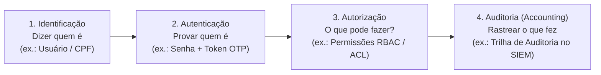
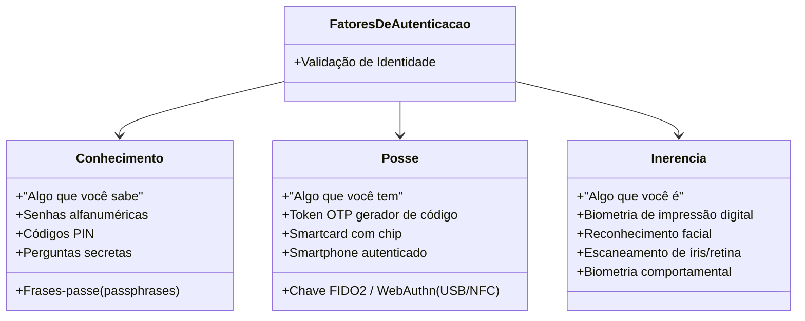
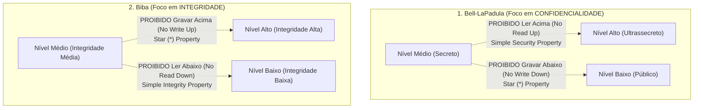
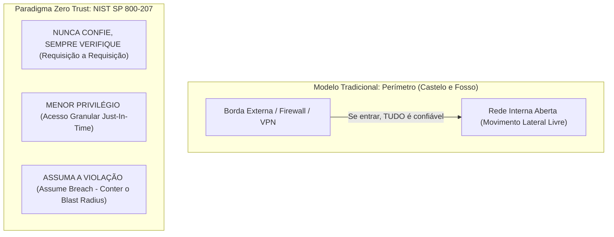
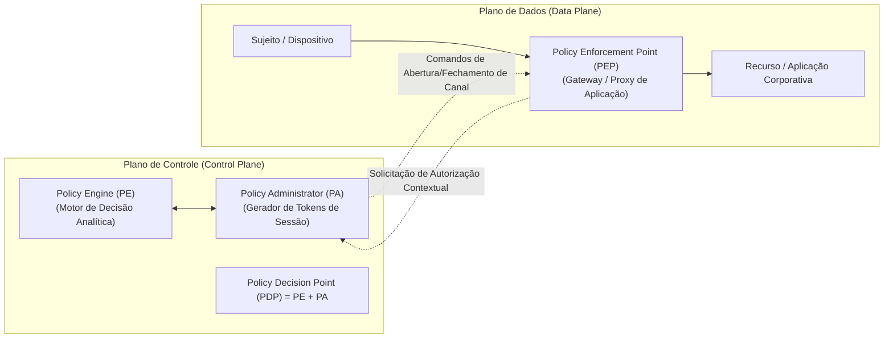

# 03 - Controle de Acesso, IAM e Arquitetura Zero Trust

> **Matéria:** Segurança da Informação  
> **Cargo:** B02 – Técnico de Controle Externo – Especialidade: Tecnologia da Informação  
> **Arquivo:** `03_controle_de_acesso_iam_e_arquitetura_zero_trust.md`  

---

## 📌 Ementa / Itens do Edital
- Controle de acesso lógico: Autenticação, Autorização e Auditoria (AAA)
- Fatores de autenticação e Autenticação Multifator (MFA)
- Modelos clássicos de controle de acesso: DAC, MAC, RBAC e ABAC
- Gestão de Identidades e Acessos (IAM - Identity and Access Management)
- Arquitetura de Confiança Zero (Zero Trust: princípios, pilares e microsegmentação)

---

## 🧭 Sumário

1. [Controle de Acesso Lógico e Mecanismos de Autenticação](#1-controle-de-acesso-logico-e-mecanismos-de-autenticacao)
    1. [O Modelo AAA (Authentication, Authorization, Accounting)](#11-o-modelo-aaa-authentication-authorization-accounting)
    2. [Os Três Fatores Clássicos de Autenticação](#12-os-tres-fatores-classicos-de-autenticacao)
    3. [Autenticação Multifator (MFA / 2FA) e Regras Mandatórias](#13-autenticacao-multifator-mfa-2fa-e-regras-mandatorias)
    4. [Ameaças e Vetores de Ataque contra Credenciais](#14-ameacas-e-vetores-de-ataque-contra-credenciais)
    5. [Teste 377](#Teste-377)
    6. [Teste 378](#Teste-378)
    7. [Teste 379](#Teste-379)
2. [Modelos Clássicos de Controle de Acesso Lógico](#2-modelos-classicos-de-controle-de-acesso-logico)
    1. [Visão Geral e Comparativo dos Modelos (DAC, MAC, RBAC, ABAC)](#21-visao-geral-e-comparativo-dos-modelos-dac-mac-rbac-abac)
    2. [DAC (Discretionary Access Control) e Listas de Controle de Acesso](#22-dac-discretionary-access-control-e-listas-de-controle-de-acesso)
    3. [MAC (Mandatory Access Control) e Modelos Multiníveis Formais: Bell-LaPadula vs. Biba](#23-mac-mandatory-access-control-e-modelos-multiniveis-formais-bell-lapadula-vs-biba)
    4. [RBAC (Role-Based Access Control) na Governança Corporativa](#24-rbac-role-based-access-control-na-governanca-corporativa)
    5. [ABAC (Attribute-Based Access Control) e a Norma XACML](#25-abac-attribute-based-access-control-e-a-norma-xacml)
    6. [Teste 380](#Teste-380)
    7. [Teste 381](#Teste-381)
    8. [Teste 382](#Teste-382)
3. [Gestão de Identidades e Acessos (IAM) e PAM](#3-gestao-de-identidades-e-acessos-iam-e-pam)
    1. [Ciclo de Vida da Identidade (Onboarding, Movimentação e Offboarding)](#31-ciclo-de-vida-da-identidade-onboarding-movimentacao-e-offboarding)
    2. [Menor Privilégio (PoLP) vs. Acúmulo Indevido (Privilege Creep)](#32-menor-privilegio-polp-vs-acumulo-indevido-privilege-creep)
    3. [Gestão de Acessos Privilegiados (PAM): Cofre, JIT e Sessões Gravadas](#33-gestao-de-acessos-privilegiados-pam-cofre-jit-e-sessoes-gravadas)
    4. [Federação de Identidades e Single Sign-On (SSO, SAML 2.0, OpenID Connect)](#34-federacao-de-identidades-e-single-sign-on-sso-saml-20-openid-connect)
    5. [Teste 383](#Teste-383)
    6. [Teste 384](#Teste-384)
4. [Arquitetura Zero Trust (Confiança Zero - NIST SP 800-207)](#4-arquitetura-zero-trust-confianca-zero-nist-sp-800-207)
    1. [O Colapso da Segurança de Borda Tradicional ("Castelo e Fosso")](#41-o-colapso-da-seguranca-de-borda-tradicional-castelo-e-fosso)
    2. [Os Três Princípios Norteadores Oficiais do Zero Trust](#42-os-tres-principios-norteadores-oficiais-do-zero-trust)
    3. [Pilares Fundamentais da Confiança Zero](#43-pilares-fundamentais-da-confianca-zero)
    4. [Microsegmentação e Contenção do Movimento Lateral](#44-microsegmentacao-e-contencao-do-movimento-lateral)
    5. [Componentes Lógicos: Policy Engine (PE), Policy Administrator (PA) e Policy Enforcement Point (PEP)](#45-componentes-logicos-policy-engine-pe-policy-administrator-pa-e-policy-enforcement-point-pep)
    6. [Teste 385](#Teste-385)
    7. [Teste 386](#Teste-386)
    8. [Teste 387](#Teste-387)
6. [Fontes Recomendadas na Internet](#6-fontes-recomendadas-na-internet)

---

## 1. Controle de Acesso Lógico e Mecanismos de Autenticação

### 1.1 O Modelo AAA (Authentication, Authorization, Accounting)

O controle de acesso lógico é a barreira de segurança primordial de qualquer sistema de tecnologia da informação. Ele disciplina e audita a interação entre entidades ativas (**sujeitos**, como usuários humanos, rotinas de código ou microsserviços) e os bens protegidos (**objetos**, como arquivos, bancos de dados ou servidores).

A operação do controle de acesso desdobra-se em quatro fases conceituais sequenciais, historicamente consolidadas no modelo **AAA (acrescido da etapa de identificação preliminar)**:

1. **Identificação:** O sujeito declara perante o sistema quem ele alega ser (fornecendo um nome de usuário, login, endereço de e-mail institucional ou CPF).
2. **Autenticação:** O sistema exige e confere elementos probatórios para atestar a veracidade da identidade alegada (como conferência de credenciais criptográficas).
3. **Autorização:** Uma vez que a autenticidade foi comprovada, o sistema consulta as matrizes de permissão para definir os privilégios exatos e as ações que aquele sujeito específico está legalmente autorizado a executar sobre os recursos.
4. **Auditoria / Responsabilização (*Accounting / Accountability*):** Registro sistemático, cronológico e imutável de todas as ações, requisições de acesso e alterações realizadas pelo sujeito durante sua sessão, viabilizando rastreabilidade forense integral e atribuição de responsabilidades.

### 1.2 Os Três Fatores Clássicos de Autenticação

Para comprovar a identidade declarada pelo usuário, a ciência da computação agrupa os métodos de prova em três categorias conceituais essenciais:

1. **Fator de Conhecimento ("O que você sabe"):**
    - Baseia-se exclusivamente na retenção mnemônica de informações secretas pelo usuário (senhas alfanuméricas, frases-passe, números PIN, perguntas secretas).
    - *Vulnerabilidades:* Suscetível a ataques de força bruta, tabelas arco-íris (*rainbow tables*), interceptações por *keyloggers*, ataques de repetição e técnicas de engenharia social (phishing).

2. **Fator de Posse ("O que você tem"):**
    - Baseia-se na custódia e no controle físico ou lógico de um artefato tangível exclusivo (cartões inteligentes com chip, *tokens* geradores de códigos de uso único OTP baseados em tempo TOTP ou em evento HOTP, chaves criptográficas físicas FIDO2/U2F conectadas via USB/NFC, ou smartphones autenticados).
    - *Vulnerabilidades:* Riscos de perda material, roubo do hardware, ataques de interceptação via clonagem de chip/número (*SIM swapping*) quando códigos são enviados por SMS.

3. **Fator de Inerência ("O que você é"):**
    - Baseia-se em traços biológicos intrínsecos e únicos do indivíduo:
    - *Biometria Fisiológica:* Padrão de impressões digitais, mapeamento venoso da palma da mão, geometria facial tridimensional, escaneamento de íris ou retina.
    - *Biometria Comportamental:* Cadência e ritmo de digitação no teclado (*keystroke dynamics*), dinâmica da assinatura manual ou modulação vocal.
    - *Vulnerabilidades:* Ocorrência estatística de taxas de Falsa Aceitação (FAR - *False Acceptance Rate*) e Falsa Rejeição (FRR - *False Rejection Rate*). Adicionalmente, dados biométricos vazados não podem ser alterados ou cancelados como uma senha comum.

### 1.3 Autenticação Multifator (MFA / 2FA) e Regras Mandatórias

A **Autenticação Multifator (MFA - *Multi-Factor Authentication*)**, que engloba a Autenticação em Dois Fatores (2FA), é a técnica de segurança que condiciona o sucesso do logon à apresentação mandatória de pelo menos dois elementos pertencentes a categorias conceituais **DIFERENTES**.

> 🚨 **ALERTA DE PROVA / PEGADINHA FCC:**  
> A Fundação Carlos Chagas cobra com muita frequência pegadinhas em que um sistema exige, sucessivamente:  
>
> - Uma senha alfanumérica de 10 caracteres; E  
> - Um código PIN numérico de 4 dígitos ou a resposta a uma pergunta secreta.  
> A banca afirma que "trata-se de Autenticação Multifator (MFA)".  
> **ESSA AFIRMATIVA É FALSA!**  
> Senha, código PIN e perguntas secretas são todos elementos baseados na memória do indivíduo, integrando a **mesma categoria conceitual: Conhecimento ("o que você sabe")**. Isso constitui apenas *autenticação de fator único fortalecido*.  
> Para ser tecnicamente classificado como **MFA**, é imperativo conjugar categorias distintas, como:
>
> - Senha (*Conhecimento*) + Token OTP em aplicativo móvel (*Posse*); OU  
> - Smartcard físico (*Posse*) + Leitura de impressão digital (*Inerência*).

### 1.4 Ameaças e Vetores de Ataque contra Credenciais

Os mecanismos de autenticação enfrentam vetores de ataque específicos no cenário de segurança cibernética:

- **Ataque de Força Bruta (*Brute Force*):** Tentativas exaustivas de todas as combinações alfanuméricas possíveis até encontrar o valor correto. Mitiga-se com políticas de bloqueio temporário de conta após $N$ tentativas incorretas (*account lockout*) e introdução de atrasos progressivos.
- **Ataque de Dicionário:** Testes automatizados baseados em listas pré-compiladas com as palavras, nomes e senhas mais comuns utilizadas por usuários.
- **Preenchimento de Credenciais (*Credential Stuffing*):** Uso automatizado de listas com pares de login e senha vazados em incidentes de segurança de empresas terceiras, explorando o hábito generalizado dos usuários de reutilizar a mesma senha em múltiplos portais e serviços.
- **Fadiga de MFA (*MFA Bombing* / *Push Fatigue*):** O atacante, tendo obtido a senha do usuário, dispara dezenas de solicitações de notificação *push* para o aplicativo autenticador no smartphone da vítima de forma ininterrupta, até que o usuário, exausto ou confuso, clique em "Autorizar". Mitiga-se com a exigência de correspondência de número (*number matching*), onde o usuário precisa digitar no app o número que aparece na tela do sistema.

---

### Teste 377
**(FGV – TCE/PA – 2024 – Auditor de Controle Externo - Administrativa - Ciência de Dados)**
O TCE-PA está revisando suas políticas de segurança da informação para garantir que tanto a segurança física quanto a lógica estejam adequadamente implementadas. O objetivo é proteger os ativos do tribunal contra uma variedade de ameaças, desde intrusões físicas até ataques cibernéticos. Assinale a opção que exemplifica a integração de medidas de segurança física e lógica, respectivamente, para proteger os ativos da organização.

* **A)** Instalar câmeras de vigilância para monitorar áreas de acesso restrito / implementar firewalls para proteger a rede.
* **B)** Implementar sistemas de backup regulares / utilizar sistemas de controle de versionamento.
* **C)** Utilizar autenticação multifator para acesso a sistemas críticos / configurar sistemas de detecção de intrusão ao ambiente.
* **D)** Implementar sistemas de detecção de intrusão / estabelecer procedimentos de criptografia para os dados sensíveis.
* **E)** Configurar mecanismos de controle de acesso a áreas sensíveis / instalar geradores de energia de reserva.

---

> **Comentário Detalhado:**
>
> - **A)** **Correta.** Conforme fundamentado na seção *4.1 O Colapso da Segurança de Borda Tradicional ("Castelo e Fosso")* deste guia, erguia-se uma muralha rígida na borda da rede composta por firewalls perimetrais e concentradores VPN. Dessa forma, está plenamente correta a assertiva da banca (FGV – TCE/PA/2024) ao estabelecer que "Instalar câmeras de vigilância para monitorar áreas de acesso restrito / implementar firewalls para proteger a rede".
> - **B)** **Incorreta.** A opção apresenta proposição em desacordo com os fundamentos teóricos e técnicos do tópico ao afirmar que "Implementar sistemas de backup regulares / utilizar sistemas de controle de versionamento". De acordo com a teoria estudada em *3.4 Federação de Identidades e Single Sign-On (SSO, SAML 2.0, OpenID Connect)*, sSO (*Single Sign-On*): Mecanismo de autenticação centralizada que permite a um usuário realizar logon uma única vez e obter acesso autorizado a múltiplos sistemas e portais sem redigitar credenciais.
> - **C)** **Incorreta.** A opção apresenta proposição em desacordo com os fundamentos teóricos e técnicos do tópico ao afirmar que "Utilizar autenticação multifator para acesso a sistemas críticos / configurar sistemas de detecção de intrusão ao...". De acordo com a teoria estudada em *2.5 ABAC (Attribute-Based Access Control) e a Norma XACML*, atributos do Ambiente / Contexto: Horário da solicitação, geolocalização física (país/cidade), se a conexão parte da VPN institucional ou rede aberta, conformidade de segurança do dispositivo (*health status*).
> - **D)** **Incorreta.** A opção apresenta proposição em desacordo com os fundamentos teóricos e técnicos do tópico ao afirmar que "Implementar sistemas de detecção de intrusão / estabelecer procedimentos de criptografia para os dados sensíveis". De acordo com a teoria estudada em *2.1 Visão Geral e Comparativo dos Modelos (DAC, MAC, RBAC, ABAC)*, os privilégios são vinculados a cargos ou perfis funcionais (ex.: "Auditor Fiscal", "Operador"), e os usuários são associados aos papéis. — Administrador de Segurança Corporativo. — Bancos de dados relacionais (PostgreSQL, Oracle), sistemas ERP, processos eletrônicos de tribunais. — Alinhamento com a estrutura administrativa da organização, simplificação da auditoria e facilidade de escala.
> - **E)** **Incorreta.** A opção apresenta proposição em desacordo com os fundamentos teóricos e técnicos do tópico ao afirmar que "Configurar mecanismos de controle de acesso a áreas sensíveis / instalar geradores de energia de reserva". De acordo com a teoria estudada em *1.4 Ameaças e Vetores de Ataque contra Credenciais*, os mecanismos de autenticação enfrentam vetores de ataque específicos no cenário de segurança cibernética.
>
> **Gabarito: A**

---

### Teste 378
**(FGV – TJ/RR – 2024 – Analista Judiciario Infraestrutura De Tecnologia Da Informacao)**
Disponibilizado inicialmente em 2012, o OAuth2 é um protocolo de autorização cujo objetivo é permitir que os usuários deem acesso aos seus recursos hospedados por um provedor de serviços, sem apresentar credenciais. A respeito do OAuth2, assinale a afirmativa correta.

* **A)** Ao contrário dos tokens de acesso, os tokens de atualização são destinados ao uso somente com servidores de autorização e nunca são enviados aos servidores de recursos.
* **B)** Os clientes não precisam registrar seus redirecionamentos de URI antes de usá-los em um fluxo de autorização.
* **C)** O servidor de recursos emite tokens de acesso ao cliente após autenticar o proprietário do recurso com sucesso e obter autorização.
* **D)** Os tokens de atualização devem ser enviados diretamente ao cliente para autenticação, sem necessidade de proteção adicional.
* **E)** Só existe um tipo de cliente, o confidencial, aquele capaz de manter a confidencialidade de suas credenciais.

---

> **Comentário Detalhado:**
>
> - **A)** **Correta.** Conforme fundamentado na seção *1.1 O Modelo AAA (Authentication, Authorization, Accounting)* deste guia, autorização: Uma vez que a autenticidade foi comprovada, o sistema consulta as matrizes de permissão para definir os privilégios exatos e as ações que aquele sujeito específico está legalmente autorizado a executar sobre os recursos. Dessa forma, está plenamente correta a assertiva da banca (FGV – TJ/RR/2024) ao estabelecer que "Ao contrário dos tokens de acesso, os tokens de atualização são destinados ao uso somente com servidores de...".
> - **B)** **Incorreta.** A opção apresenta proposição em desacordo com os fundamentos teóricos e técnicos do tópico ao afirmar que "Os clientes não precisam registrar seus redirecionamentos de URI antes de usá-los em um fluxo de autorização". De acordo com a teoria estudada em *1.2 Os Três Fatores Clássicos de Autenticação*, baseia-se na custódia e no controle físico ou lógico de um artefato tangível exclusivo (cartões inteligentes com chip, *tokens* geradores de códigos de uso único OTP baseados em tempo TOTP ou em evento HOTP, chaves criptográficas físicas FIDO2/U2F conectadas via USB/NFC, ou smartphones autenticados).
> - **C)** **Incorreta.** A opção apresenta proposição em desacordo com os fundamentos teóricos e técnicos do tópico ao afirmar que "O servidor de recursos emite tokens de acesso ao cliente após autenticar o proprietário do recurso com sucesso e...". De acordo com a teoria estudada em *No Plano de Controle (Control Plane):*, avalia as políticas organizacionais, sinais de telemetria de segurança, reputação de risco e integridade do cliente para tomar a decisão final de permitir, negar ou revogar o acesso solicitado.
> - **D)** **Incorreta.** A opção apresenta proposição em desacordo com os fundamentos teóricos e técnicos do tópico ao afirmar que "Os tokens de atualização devem ser enviados diretamente ao cliente para autenticação, sem necessidade de proteção...". De acordo com a teoria estudada em *3.1 Ciclo de Vida da Identidade (Onboarding, Movimentação e Offboarding)*, movimentação / Transição: Ajuste imediato e automatizado das permissões quando o servidor é transferido de setor ou assume novas funções de chefia. Privilégios que eram necessários na unidade antiga devem ser revogados imediatamente.
> - **E)** **Incorreta.** A opção apresenta proposição em desacordo com os fundamentos teóricos e técnicos do tópico ao afirmar que "Só existe um tipo de cliente, o confidencial, aquele capaz de manter a confidencialidade de suas credenciais". De acordo com a teoria estudada em *1.4 Ameaças e Vetores de Ataque contra Credenciais*, preenchimento de Credenciais (*Credential Stuffing*): Uso automatizado de listas com pares de login e senha vazados em incidentes de segurança de empresas terceiras, explorando o hábito generalizado dos usuários de reutilizar a mesma senha em múltiplos portais e serviços.
>
> **Gabarito: A**

---

### Teste 379
**(FGV – TCE/GO – 2024 – Analista de Controle Externo - Tecnologia da Informação)**
Indique a opção que descreve corretamente a autenticação em múltiplos fatores.

* **A)** Determinar as permissões de acesso dos usuários baseadas em seus papéis dentro da organização.
* **B)** Registrar todas as tentativas de acesso ao sistema para revisão futura pela equipe de segurança.
* **C)** Minimizar o risco de acesso não autorizado ao exigir que os usuários forneçam múltiplas formas de verificação de identidade.
* **D)** Definir claramente as permissões de acesso para diferentes grupos de usuários, como desenvolvedores e gerentes de projeto.
* **E)** Permitir que a equipe de segurança monitore e revise as atividades de acesso dos usuários regularmente. Análise de dados e IA

---

> **Comentário Detalhado:**
>
> - **A)** **Incorreta.** A opção apresenta proposição em desacordo com os fundamentos teóricos e técnicos do tópico ao afirmar que "Determinar as permissões de acesso dos usuários baseadas em seus papéis dentro da organização". De acordo com a teoria estudada em *2.4 RBAC (Role-Based Access Control) na Governança Corporativa*, no modelo RBAC, o controle de acesso é desacoplado dos usuários individuais e atribuído a Papéis (*Roles*) correspondentes a funções de negócio da organização (ex.: `Auditor`, `Gestor de Contratos`, `DBA`).
> - **B)** **Incorreta.** A opção apresenta proposição em desacordo com os fundamentos teóricos e técnicos do tópico ao afirmar que "Registrar todas as tentativas de acesso ao sistema para revisão futura pela equipe de segurança". De acordo com a teoria estudada em *1.4 Ameaças e Vetores de Ataque contra Credenciais*, ataque de Força Bruta (*Brute Force*): Tentativas exaustivas de todas as combinações alfanuméricas possíveis até encontrar o valor correto.
> - **C)** **Correta.** Conforme fundamentado na seção *4.3 Pilares Fundamentais da Confiança Zero* deste guia, identidade: Garantia de identificação inequívoca de usuários e contas de serviço com MFA resistente a phishing e análise de risco contextual. Dessa forma, está plenamente correta a assertiva da banca (FGV – TCE/GO/2024) ao estabelecer que "Minimizar o risco de acesso não autorizado ao exigir que os usuários forneçam múltiplas formas de verificação de...".
> - **D)** **Incorreta.** A opção apresenta proposição em desacordo com os fundamentos teóricos e técnicos do tópico ao afirmar que "Definir claramente as permissões de acesso para diferentes grupos de usuários, como desenvolvedores e gerentes de...". De acordo com a teoria estudada em *1.1 O Modelo AAA (Authentication, Authorization, Accounting)*, autorização: Uma vez que a autenticidade foi comprovada, o sistema consulta as matrizes de permissão para definir os privilégios exatos e as ações que aquele sujeito específico está legalmente autorizado a executar sobre os recursos.
> - **E)** **Incorreta.** A opção apresenta proposição em desacordo com os fundamentos teóricos e técnicos do tópico ao afirmar que "Permitir que a equipe de segurança monitore e revise as atividades de acesso dos usuários regularmente. Análise de...". De acordo com a teoria estudada em *No Plano de Controle (Control Plane):*, avalia as políticas organizacionais, sinais de telemetria de segurança, reputação de risco e integridade do cliente para tomar a decisão final de permitir, negar ou revogar o acesso solicitado.
>
> **Gabarito: C**

---

## 2. Modelos Clássicos de Controle de Acesso Lógico

### 2.1 Visão Geral e Comparativo dos Modelos (DAC, MAC, RBAC, ABAC)

| Modelo | Definição Central | Quem Controla os Privilégios? | Aplicações Típicas | Vantagens / Desvantagens |
|---|---|---|---|---|
| **DAC** (*Discretionary Access Control*) | Controle Discricionário. O criador ou proprietário do objeto tem autonomia total para conceder, delegar ou revogar permissões a outros usuários. | O proprietário (*Owner*) do objeto. | Sistemas de arquivos tradicionais (permissões NTFS no Windows, `chmod`/`chown` no Linux). | Alta flexibilidade e operação descentralizada. Desvantagem: baixa governança e vulnerável a vazamentos causados por erros de usuários. |
| **MAC** (*Mandatory Access Control*) | Controle Obrigatório. O sistema central impõe regras invioláveis baseadas em rótulos de sensibilidade da informação e credenciais formais de segurança do usuário. | Administrador Central do Sistema / Política global do kernel. | Ambientes militares, de inteligência e servidores de altíssima segurança (SELinux, AppArmor). | Rigidez máxima contra vazamento e cavalos de troia. Desvantagem: complexidade extrema de configuração e pouca flexibilidade. |
| **RBAC** (*Role-Based Access Control*) | Controle Baseado em Papéis. Os privilégios são vinculados a cargos ou perfis funcionais (ex.: "Auditor Fiscal", "Operador"), e os usuários são associados aos papéis. | Administrador de Segurança Corporativo. | Bancos de dados relacionais (PostgreSQL, Oracle), sistemas ERP, processos eletrônicos de tribunais. | Alinhamento com a estrutura administrativa da organização, simplificação da auditoria e facilidade de escala. |
| **ABAC** (*Attribute-Based Access Control*) | Controle Baseado em Atributos. Avalia dinamicamente atributos do sujeito, do recurso, da ação solicitada e do ambiente (horário, local, dispositivo, risco) via regras booleanas. | Motor de Políticas Centralizado (ex.: XACML). | Ambientes em nuvem (AWS IAM), microsserviços modernos e arquiteturas Zero Trust. | Concessão granular, dinâmica e sensível ao contexto em tempo real. Desvantagem: maior custo de processamento. |

### 2.2 DAC (Discretionary Access Control) e Listas de Controle de Acesso

No modelo discricionário, a segurança gira em torno da figura do **proprietário** (*owner*). Quando um usuário cria um documento, planilha ou banco de dados, o sistema operacional atribui a ele a titularidade do objeto. O titular possui discricionariedade absoluta para:

- Conceder leitura, escrita ou execução para colegas de equipe.
- Modificar permissões através de Listas de Controle de Acesso (**ACLs** - *Access Control Lists*).

#### Limitação Crítica do DAC:
Se um usuário mal-intencionado convencer o proprietário de um arquivo sigiloso a conceder-lhe permissão de leitura, esse segundo usuário poderá copiar os dados para um novo arquivo de sua propriedade e disponibilizá-lo publicamente, sem que o sistema consiga bloquear o vazamento.

### 2.3 MAC (Mandatory Access Control) e Modelos Multiníveis Formais: Bell-LaPadula vs. Biba

No modelo obrigatório, **nenhum usuário individual tem poder discricionário** sobre suas permissões. Todos os sujeitos e objetos recebem rótulos estritos de segurança impostos pela autoridade central.

Para formalizar matematicamente esses controles em sistemas multiníveis, foram desenvolvidos dois modelos clássicos de referência acadêmica e de concursos:

#### Modelo Bell-LaPadula (Foco Exclusivo em CONFIDENCIALIDADE):
Projetado na década de 1970 para as forças armadas dos EUA para impedir que dados secretos vazem para níveis inferiores:

1. **Propriedade da Segurança Simples (*Simple Security Property* - ss-property):**  
   Um sujeito em determinado nível de classificação não pode ler um objeto com nível de sensibilidade superior ao seu (**"No Read Up"** - Proibido ler para cima). *Objetivo:* Evita que um analista com credencial "Secreto" leia documentos "Ultrassecretos".
2. **Propriedade Estrela (*\*-Property* / Star-Property):**  
   Um sujeito em determinado nível não pode gravar ou transferir dados para um objeto de nível de sensibilidade inferior ao seu (**"No Write Down"** - Proibido escrever para baixo). *Objetivo:* Evita que um usuário com acesso a dados "Ultrassecretos" copie inadvertidamente ou maliciosamente informações para um documento "Público".

#### Modelo Biba (Foco Exclusivo em INTEGRIDADE):
Desenvolvido em contraposição ao Bell-LaPadula, com foco estrito na preservação da correção e confiabilidade dos dados:

1. **Propriedade da Integridade Simples (*Simple Integrity Property*):**  
   Um sujeito não pode ler objetos com nível de integridade inferior ao seu (**"No Read Down"** - Proibido ler para baixo). *Objetivo:* Evita que um processo de alta integridade seja contaminado por dados corrompidos ou não confiáveis.
2. **Propriedade Estrela de Integridade (*\*-Property*):**  
   Um sujeito não pode gravar dados em objetos que possuam nível de integridade superior ao seu (**"No Write Up"** - Proibido escrever para cima). *Objetivo:* Impede que um usuário com baixa credencial corrompa ou altere arquivos vitais do sistema.

> 🚨 **ALERTA DE PROVA / PEGADINHA FCC:**  
> Memorize este mnemônico simples para nunca errar em provas:  
>
> - **Bell-LaPadula:** Foco em **Confidencialidade** $\rightarrow$ *No Read Up* e *No Write Down*.  
> - **Biba:** Foco em **Integridade** $\rightarrow$ *No Read Down* e *No Write Up*.  
> A FCC adora trocar as propriedades entre os dois modelos ou inverter o foco em Confidencialidade versus Integridade!

### 2.4 RBAC (Role-Based Access Control) na Governança Corporativa

No modelo **RBAC**, o controle de acesso é desacoplado dos usuários individuais e atribuído a **Papéis (*Roles*)** correspondentes a funções de negócio da organização (ex.: `Auditor`, `Gestor de Contratos`, `DBA`).

#### Dinâmica de Funcionamento:
1. As permissões de leitura, inserção, alteração e exclusão sobre tabelas e sistemas são associadas diretamente aos **Papéis**.
2. Os **Usuários** são associados a um ou mais papéis.
3. Quando um colaborador é promovido ou assume nova atribuição, basta alterar sua filiação de papéis, sem necessidade de reconfigurar milhares de tabelas e pastas individualmente.

#### Variações Normatizadas (NIST RBAC):
- **RBAC0 (Básico):** Mapeamento direto entre usuários, papéis e permissões.
- **RBAC1 (Hierárquico):** Suporta herança hierárquica entre papéis (ex.: o papel `Auditor-Chefe` herda automaticamente todas as permissões do papel `Auditor-Assistente`).
- **RBAC2 (Restrições):** Adiciona regras de Separação de Deveres (*Separation of Duties* - SoD), como impedir que o mesmo usuário pertença simultaneamente ao papel de `Solicitante de Pagamento` e `Aprovador de Pagamento`.
- **RBAC3 (Consolidado):** Combina hierarquia (RBAC1) com restrições de separação de deveres (RBAC2).

### 2.5 ABAC (Attribute-Based Access Control) e a Norma XACML

O **ABAC** é a evolução dinâmica do controle de acesso, projetado para resolver a explosão desordenada de papéis (*role explosion*) do RBAC em organizações gigantescas. Em vez de verificar um cargo fixo, o sistema processa expressões booleanas sobre quatro conjuntos de **atributos**:

1. **Atributos do Sujeito:** Cargo, departamento, autorização de segurança, antiguidade.
2. **Atributos do Recurso/Objeto:** Classificação da informação, projeto vinculado, proprietário do dado.
3. **Atributos da Ação:** Leitura, gravação, exclusão, exportação via API.
4. **Atributos do Ambiente / Contexto:** Horário da solicitação, geolocalização física (país/cidade), se a conexão parte da VPN institucional ou rede aberta, conformidade de segurança do dispositivo (*health status*).

#### Norma XACML (eXtensible Access Control Markup Language):
Padrão internacional aberto formulado pela OASIS que define a linguagem XML/JSON e a arquitetura para processamento de políticas ABAC, servindo de fundação para os componentes lógicos de controle de acesso moderno.

---

### Teste 380
**(FGV – TCE/PA – 2024 – Auditor de Controle Externo - Administrativa - Ciência de Dados)**
Para assegurar que apenas usuários autorizados possam acessar informações sensíveis e realizar atividades específicas dentro do sistema, uma organização deve implementar eficazmente

* **A)** procedimentos de segurança e segurança física.
* **B)** auditoria, conformidade e segurança física.
* **C)** controle de acesso e autenticação.
* **D)** classificação de informações, métricas e indicadores.
* **E)** confiabilidade, integridade e disponibilidade.

---

> **Comentário Detalhado:**
>
> - **A)** **Incorreta.** A opção apresenta proposição em desacordo com os fundamentos teóricos e técnicos do tópico ao afirmar que "procedimentos de segurança e segurança física". De acordo com a teoria estudada em *2.5 ABAC (Attribute-Based Access Control) e a Norma XACML*, atributos do Ambiente / Contexto: Horário da solicitação, geolocalização física (país/cidade), se a conexão parte da VPN institucional ou rede aberta, conformidade de segurança do dispositivo (*health status*).
> - **B)** **Incorreta.** A opção apresenta proposição em desacordo com os fundamentos teóricos e técnicos do tópico ao afirmar que "auditoria, conformidade e segurança física". De acordo com a teoria estudada em *2.1 Visão Geral e Comparativo dos Modelos (DAC, MAC, RBAC, ABAC)*, os privilégios são vinculados a cargos ou perfis funcionais (ex.: "Auditor Fiscal", "Operador"), e os usuários são associados aos papéis. — Administrador de Segurança Corporativo. — Bancos de dados relacionais (PostgreSQL, Oracle), sistemas ERP, processos eletrônicos de tribunais. — Alinhamento com a estrutura administrativa da organização, simplificação da auditoria e facilidade de escala.
> - **C)** **Correta.** Conforme fundamentado na seção *3.4 Federação de Identidades e Single Sign-On (SSO, SAML 2.0, OpenID Connect)* deste guia, sSO (*Single Sign-On*): Mecanismo de autenticação centralizada que permite a um usuário realizar logon uma única vez e obter acesso autorizado a múltiplos sistemas e portais sem redigitar credenciais. Dessa forma, está plenamente correta a assertiva da banca (FGV – TCE/PA/2024) ao estabelecer que "controle de acesso e autenticação".
> - **D)** **Incorreta.** A opção apresenta proposição em desacordo com os fundamentos teóricos e técnicos do tópico ao afirmar que "classificação de informações, métricas e indicadores". De acordo com a teoria estudada em *4.3 Pilares Fundamentais da Confiança Zero*, dados: Classificação, inventário e cifragem de informações confidenciais onde quer que residam.
> - **E)** **Incorreta.** A opção apresenta proposição em desacordo com os fundamentos teóricos e técnicos do tópico ao afirmar que "confiabilidade, integridade e disponibilidade". De acordo com a teoria estudada em *Modelo Biba (Foco Exclusivo em INTEGRIDADE):*, desenvolvido em contraposição ao Bell-LaPadula, com foco estrito na preservação da correção e confiabilidade dos dados.
>
> **Gabarito: C**

---

### Teste 381
**(FGV – TJ/RR – 2024 – Analista Judiciario Infraestrutura De Tecnologia Da Informacao)**
Os modelos de Controle de Acesso Obrigatório (Mandatory Access Control - MAC) e Controle de Acesso Discricionário (Discretionary Access Control - DAC) são amplamente utilizados em sistemas de segurança da informação para gerenciar o acesso a dados e recursos. Cada um tem suas características próprias, que os tornam mais adequados para diferentes tipos de ambientes e níveis de segurança. No entanto, a escolha entre MAC e DAC depende das necessidades específicas de controle e gerenciamento de permissões em um determinado contexto. Diante do exposto, assinale a opção que diferencia corretamente os modelos MAC e DAC.

* **A)** O MAC permite que os administradores do sistema definam permissões detalhadas para cada usuário, enquanto no DAC as permissões são automaticamente atribuídas com base nas regras do sistema.
* **B)** No modelo MAC, o controle de permissões é centralizado e determinado por políticas de segurança rígidas, enquanto no modelo DAC as permissões são definidas pelo proprietário do recurso, permitindo uma maior flexibilidade.
* **C)** O modelo DAC impõe regras de segurança mais restritivas e inalteráveis que o MAC, sendo geralmente aplicado em ambientes de alta segurança com dados sensíveis.
* **D)** O MAC utiliza permissões dinâmicas baseadas nas necessidades de cada usuário, enquanto o DAC segue um conjunto fixo de políticas definidas no momento da criação dos recursos.
* **E)** Tanto o MAC quanto o DAC compartilham o mesmo princípio de que as permissões são gerenciadas pelos próprios usuários, mas o MAC se concentra em ambientes corporativos, enquanto o DAC é usado em sistemas pessoais.

---

> **Comentário Detalhado:**
>
> - **A)** **Incorreta.** A opção apresenta proposição em desacordo com os fundamentos teóricos e técnicos do tópico ao afirmar que "O MAC permite que os administradores do sistema definam permissões detalhadas para cada usuário, enquanto no DAC...". De acordo com a teoria estudada em *2.2 DAC (Discretionary Access Control) e Listas de Controle de Acesso*, no modelo discricionário, a segurança gira em torno da figura do proprietário (*owner*). Quando um usuário cria um documento, planilha ou banco de dados, o sistema operacional atribui a ele a titularidade do objeto.
> - **B)** **Correta.** Conforme fundamentado na seção *2.1 Visão Geral e Comparativo dos Modelos (DAC, MAC, RBAC, ABAC)* deste guia, avalia dinamicamente atributos do sujeito, do recurso, da ação solicitada e do ambiente (horário, local, dispositivo, risco) via regras booleanas. — Motor de Políticas Centralizado (ex.: XACML). — Ambientes em nuvem (AWS IAM), microsserviços modernos e arquiteturas Zero Trust. — Concessão granular, dinâmica e sensível ao contexto em tempo real. Dessa forma, está plenamente correta a assertiva da banca (FGV – TJ/RR/2024) ao estabelecer que "No modelo MAC, o controle de permissões é centralizado e determinado por políticas de segurança rígidas, enquanto...".
> - **C)** **Incorreta.** A opção apresenta proposição em desacordo com os fundamentos teóricos e técnicos do tópico ao afirmar que "O modelo DAC impõe regras de segurança mais restritivas e inalteráveis que o MAC, sendo geralmente aplicado em...". De acordo com a teoria estudada em *2.1 Visão Geral e Comparativo dos Modelos (DAC, MAC, RBAC, ABAC)*, o sistema central impõe regras invioláveis baseadas em rótulos de sensibilidade da informação e credenciais formais de segurança do usuário. — Administrador Central do Sistema / Política global do kernel. — Ambientes militares, de inteligência e servidores de altíssima segurança (SELinux, AppArmor). — Rigidez máxima contra vazamento e cavalos de troia.
> - **D)** **Incorreta.** A opção apresenta proposição em desacordo com os fundamentos teóricos e técnicos do tópico ao afirmar que "O MAC utiliza permissões dinâmicas baseadas nas necessidades de cada usuário, enquanto o DAC segue um conjunto...". De acordo com a teoria estudada em *2.3 MAC (Mandatory Access Control) e Modelos Multiníveis Formais: Bell-LaPadula vs. Biba*, no modelo obrigatório, nenhum usuário individual tem poder discricionário sobre suas permissões. Todos os sujeitos e objetos recebem rótulos estritos de segurança impostos pela autoridade central.
> - **E)** **Incorreta.** A opção apresenta proposição em desacordo com os fundamentos teóricos e técnicos do tópico ao afirmar que "Tanto o MAC quanto o DAC compartilham o mesmo princípio de que as permissões são gerenciadas pelos próprios...". De acordo com a teoria estudada em *2.1 Visão Geral e Comparativo dos Modelos (DAC, MAC, RBAC, ABAC)*, o criador ou proprietário do objeto tem autonomia total para conceder, delegar ou revogar permissões a outros usuários. — O proprietário (*Owner*) do objeto. — Sistemas de arquivos tradicionais (permissões NTFS no Windows, `chmod`/`chown` no Linux). — Alta flexibilidade e operação descentralizada.
>
> **Gabarito: B**

---

### Teste 382
**(FGV – TJ/MT – 2024 – Analista Judiciario Tecnologia Da Informacao)**
A arquitetura de sistemas é o design estruturado de um sistema de software que descreve como seus componentes principais se relacionam e interagem para formar um sistema coeso e eficiente. Ela orienta a construção, manutenção e evolução do software, sendo essencial para garantir que o sistema atenda aos requisitos de desempenho, escalabilidade, segurança e usabilidade. Na arquitetura de sistemas cliente-servidor, o cliente

* **A)** é responsável por fornecer serviços de autenticação e controle de acesso, garantindo a segurança do sistema.
* **B)** processa as requisições e responde diretamente às solicitações do usuário, sem necessidade de comunicação com o servidor.
* **C)** armazena e gerencia centralmente os dados do sistema, facilitando o acesso pelos dispositivos conectados.
* **D)** realiza requisições ao servidor, enviando dados e solicitando informações ou serviços específicos, e exibe os resultados ao usuário final.
* **E)** é responsável por hospedar os serviços principais do sistema, como banco de dados e processos de negócios complexos.

---

> **Comentário Detalhado:**
>
> - **A)** **Incorreta.** A opção apresenta proposição em desacordo com os fundamentos teóricos e técnicos do tópico ao afirmar que "é responsável por fornecer serviços de autenticação e controle de acesso, garantindo a segurança do sistema". De acordo com a teoria estudada em *2.2 DAC (Discretionary Access Control) e Listas de Controle de Acesso*, no modelo discricionário, a segurança gira em torno da figura do proprietário (*owner*). Quando um usuário cria um documento, planilha ou banco de dados, o sistema operacional atribui a ele a titularidade do objeto.
> - **B)** **Incorreta.** A opção apresenta proposição em desacordo com os fundamentos teóricos e técnicos do tópico ao afirmar que "processa as requisições e responde diretamente às solicitações do usuário, sem necessidade de comunicação com o...". De acordo com a teoria estudada em *3.4 Federação de Identidades e Single Sign-On (SSO, SAML 2.0, OpenID Connect)*, sAML 2.0 (*Security Assertion Markup Language*): Padrão aberto baseado em asserções XML assinado digitalmente, muito utilizado na comunicação corporativa entre o Provedor de Identidade (IdP - *Identity Provider*) e o Provedor de Serviços (SP - *Service Provider*).
> - **C)** **Incorreta.** A opção apresenta proposição em desacordo com os fundamentos teóricos e técnicos do tópico ao afirmar que "armazena e gerencia centralmente os dados do sistema, facilitando o acesso pelos dispositivos conectados". De acordo com a teoria estudada em *3.3 Gestão de Acessos Privilegiados (PAM): Cofre, JIT e Sessões Gravadas*, o administrador solicita acesso para realizar uma manutenção pré-agendada; o sistema concede os privilégios com prazo de expiração automático estrito (ex.: 2 horas), revogando-os ao final.
> - **D)** **Correta.** Conforme fundamentado na seção *Modelo Bell-LaPadula (Foco Exclusivo em CONFIDENCIALIDADE):* deste guia, um sujeito em determinado nível não pode gravar ou transferir dados para um objeto de nível de sensibilidade inferior ao seu ("No Write Down" - Proibido escrever para baixo). *Objetivo:* Evita que um usuário com acesso a dados "Ultrassecretos" copie inadvertidamente ou maliciosamente informações para um documento "Público". Dessa forma, está plenamente correta a assertiva da banca (FGV – TJ/MT/2024) ao estabelecer que "realiza requisições ao servidor, enviando dados e solicitando informações ou serviços específicos, e exibe os...".
> - **E)** **Incorreta.** A opção apresenta proposição em desacordo com os fundamentos teóricos e técnicos do tópico ao afirmar que "é responsável por hospedar os serviços principais do sistema, como banco de dados e processos de negócios complexos". De acordo com a teoria estudada em *4.4 Microsegmentação e Contenção do Movimento Lateral*, assim, caso um servidor web seja invadido, o atacante é impedido de realizar movimento lateral para alcançar o banco de dados contábil que reside na mesma rede física.
>
> **Gabarito: D**

---

## 3. Gestão de Identidades e Acessos (IAM) e PAM

### 3.1 Ciclo de Vida da Identidade (Onboarding, Movimentação e Offboarding)

O **IAM (*Identity and Access Management*)** gerencia as identidades digitais desde o ingresso do colaborador até sua desvinculação definitiva da instituição:

1. **Provisionamento (*Onboarding* / Entrada):** Criação da identidade digital corporativa e concessão automática das permissões mínimas indispensáveis para o exercício da função comissionada ou cargo de concurso.
2. **Movimentação / Transição:** Ajuste imediato e automatizado das permissões quando o servidor é transferido de setor ou assume novas funções de chefia. Privilégios que eram necessários na unidade antiga devem ser revogados imediatamente.
3. **Desprovisionamento (*Offboarding* / Saída):** Revogação imediata, integral e irrevogável de todos os acessos lógicos (contas de e-mail, VPN, acessos a bancos de dados) e físicos (crachás magnéticos) no exato instante da exoneração, demissão ou término do contrato.

### 3.2 Menor Privilégio (PoLP) vs. Acúmulo Indevido (Privilege Creep)

- **Princípio do Menor Privilégio (*Principle of Least Privilege* - PoLP):** Diretriz de ouro segundo a qual toda entidade (usuário ou processo) deve receber estritamente o conjunto mínimo de permissões indispensável para a conclusão de suas tarefas regulamentares, pelo menor período de tempo necessário.
- **Acúmulo Indevido de Privilégios (*Privilege Creep*):** Fenômeno patológico e extremamente comum em órgãos públicos e empresas privadas onde o servidor muda sucessivamente de lotação ao longo dos anos, recebendo novas permissões a cada transferência sem que os acessos dos setores anteriores sejam excluídos. Ao final de uma década, o usuário acumula privilégios desmesurados, transformando-se em um vetor de risco crítico caso sua credencial seja comprometida.  
  *Mitigação:* Realização de campanhas obrigatórias periódicas de **Recertificação de Acessos** (*Access Review*), onde chefias imediatas devem aprovar formalmente a continuidade de cada permissão ativa.

### 3.3 Gestão de Acessos Privilegiados (PAM): Cofre, JIT e Sessões Gravadas

Contas que detêm privilégios administrativos elevados (tais como `root` no Linux, `Domain Admins` no Active Directory e `SYS`/`sa` em bancos de dados) constituem o alvo preferencial de cibercriminosos e malwares avançados. As ferramentas de **PAM (*Privileged Access Management*)** eliminam o uso descontrolado dessas credenciais:

- **Cofre Seguro de Senhas (*Password Vault*):** As senhas de superusuário ficam guardadas em um cofre criptografado central. Nenhum administrador humano conhece a senha real; o sistema altera as senhas automaticamente após cada utilização (senhas descartáveis de uso único).
- **Acesso Just-In-Time (JIT):** Princípio em que permissões privilegiadas não permanecem ativas continuamente. O administrador solicita acesso para realizar uma manutenção pré-agendada; o sistema concede os privilégios com prazo de expiração automático estrito (ex.: 2 horas), revogando-os ao final.
- **Gravação e Auditoria de Sessões Privilegiadas:** Toda conexão administrativa é intermediada por um proxy seguro que grava em vídeo e em texto todos os comandos digitados pelo administrador, garantindo responsabilização irrefutável (*non-repudiation*).

### 3.4 Federação de Identidades e Single Sign-On (SSO, SAML 2.0, OpenID Connect)

Para mitigar a fadiga de senhas e a dispersão de credenciais entre múltiplos portais, adotam-se soluções de identidade federada:

- **SSO (*Single Sign-On*):** Mecanismo de autenticação centralizada que permite a um usuário realizar logon uma única vez e obter acesso autorizado a múltiplos sistemas e portais sem redigitar credenciais.
- **SAML 2.0 (*Security Assertion Markup Language*):** Padrão aberto baseado em asserções XML assinado digitalmente, muito utilizado na comunicação corporativa entre o Provedor de Identidade (**IdP** - *Identity Provider*) e o Provedor de Serviços (**SP** - *Service Provider*).
- **OpenID Connect (OIDC):** Camada de autenticação moderna de identidade construída sobre a infraestrutura REST/HTTPS do protocolo OAuth 2.0. Emprega tokens de identidade codificados em **JSON Web Token (JWT)**, sendo amplamente adotada em aplicações web móveis e microsserviços em nuvem.

---

### Teste 383
**(FGV – TCE/SC – 2026 – Auditor Fiscal de Controle Externo - Ciências Atuariais)**
A Resolução CMN nº 5.272/2025 consolidou o modelo de investimentos dos Regimes Próprios de Previdência Social (RPPS) baseado na maturidade da gestão, estabelecendo que o acesso a ativos de maior complexidade e risco é condicionado ao melhor nível de certificação institucional Pró-Gestão, baseada nos pilares de controle interno, governança corporativa e educação previdenciária. Diante desse novo regramento, a seguinte modalidade de investimento é vedada aos RPPS que não possuem nível máximo de governança com a certificação nível IV:

* **A)** cotas de fundos de investimento em participações (FIP), de “private equity” constituídas em regime fechado e qualificadas como entidade de investimento.
* **B)** cotas de fundos de investimento imobiliário (FII).
* **C)** cotas de Fundos de Investimento nas Cadeias Produtivas Agroindustriais (FIAGRO).
* **D)** cotas de Fundos de Investimento no Exterior (FIEX), com exposição a ativos estruturados e estratégias de gestão ativa sem proteção cambial (hedge).
* **E)** cotas de fundos de investimento tipificadas como multimercado (FM), constituídas em regime aberto.

---

> **Comentário Detalhado:**
>
> - **A)** **Incorreta.** A opção apresenta proposição em desacordo com os fundamentos teóricos e técnicos do tópico ao afirmar que "cotas de fundos de investimento em participações (FIP), de “private equity” constituídas em regime fechado e...". De acordo com a teoria estudada em *3.2 Menor Privilégio (PoLP) vs. Acúmulo Indevido (Privilege Creep)*, princípio do Menor Privilégio (*Principle of Least Privilege* - PoLP): Diretriz de ouro segundo a qual toda entidade (usuário ou processo) deve receber estritamente o conjunto mínimo de permissões indispensável para a conclusão de suas tarefas regulamentares, pelo menor período de tempo necessário.
> - **B)** **Correta.** Conforme fundamentado na seção *2.4 RBAC (Role-Based Access Control) na Governança Corporativa* deste guia, no modelo RBAC, o controle de acesso é desacoplado dos usuários individuais e atribuído a Papéis (*Roles*) correspondentes a funções de negócio da organização (ex.: `Auditor`, `Gestor de Contratos`, `DBA`). Dessa forma, está plenamente correta a assertiva da banca (FGV – TCE/SC/2026) ao estabelecer que "cotas de fundos de investimento imobiliário (FII)".
> - **C)** **Incorreta.** A opção apresenta proposição em desacordo com os fundamentos teóricos e técnicos do tópico ao afirmar que "cotas de Fundos de Investimento nas Cadeias Produtivas Agroindustriais (FIAGRO)". De acordo com a teoria estudada em *3.4 Federação de Identidades e Single Sign-On (SSO, SAML 2.0, OpenID Connect)*, sAML 2.0 (*Security Assertion Markup Language*): Padrão aberto baseado em asserções XML assinado digitalmente, muito utilizado na comunicação corporativa entre o Provedor de Identidade (IdP - *Identity Provider*) e o Provedor de Serviços (SP - *Service Provider*).
> - **D)** **Incorreta.** A opção apresenta proposição em desacordo com os fundamentos teóricos e técnicos do tópico ao afirmar que "cotas de Fundos de Investimento no Exterior (FIEX), com exposição a ativos estruturados e estratégias de gestão...". De acordo com a teoria estudada em *4.3 Pilares Fundamentais da Confiança Zero*, aplicações e Cargas de Trabalho (*Workloads*): Proteção direta em nível de aplicação e microsserviços (containers, APIs), com validações contínuas de segurança.
> - **E)** **Incorreta.** A opção apresenta proposição em desacordo com os fundamentos teóricos e técnicos do tópico ao afirmar que "cotas de fundos de investimento tipificadas como multimercado (FM), constituídas em regime aberto". De acordo com a teoria estudada em *Norma XACML (eXtensible Access Control Markup Language):*, padrão internacional aberto formulado pela OASIS que define a linguagem XML/JSON e a arquitetura para processamento de políticas ABAC, servindo de fundação para os componentes lógicos de controle de acesso moderno.
>
> **Gabarito: B**

---

### Teste 384
**(FGV – TRF/1 – 2024 – Analista Judiciario Area Apoio Especializado Especialidade Tecnologia Da Informacao)**
Uma universidade está atualizando sua infraestrutura de rede para melhorar a segurança e a autenticação dos usuários. Eles decidiram implementar o protocolo 802.1X para controlar o acesso à rede local (LAN) em todo o campus. Durante uma reunião de planejamento, a equipe de TI da universidade analisa várias afirmações sobre o protocolo 802.1X para garantir que todos entendam como ele funciona. Acerca do 802.1X, é correto afirmar que:

* **A)** uma porta não controlada permite a troca de PDUs entre o solicitante e os outros AS, independentemente do estado de autenticação do solicitante;
* **B)** para um IBSS, não há qualquer AP. Para um IBSS, o 802.11i provê uma solução mais complexa, que envolve autenticação par a par entre estação e servidor;
* **C)** a estrutura do 802.1X, com um protocolo de autenticação de camada superior, ajusta-se muito bem à arquitetura BSS, que inclui apenas uma estação sem fio e um AP;
* **D)** usa o conceito de portas controladas e não controladas. Portas são entidades lógicas definidas dentro do autenticador e referem-se a conexões lógicas de rede;
* **E)** para uma WLAN, o autenticador (o AP) pode ter duas portas físicas ou mais, sendo uma a que o conecta ao DS e uma para comunicação sem fio dentro de seu BSS, entre outras possíveis.

---

> **Comentário Detalhado:**
>
> - **A)** **Incorreta.** A opção apresenta proposição em desacordo com os fundamentos teóricos e técnicos do tópico ao afirmar que "uma porta não controlada permite a troca de PDUs entre o solicitante e os outros AS, independentemente do estado...". De acordo com a teoria estudada em *3.4 Federação de Identidades e Single Sign-On (SSO, SAML 2.0, OpenID Connect)*, sSO (*Single Sign-On*): Mecanismo de autenticação centralizada que permite a um usuário realizar logon uma única vez e obter acesso autorizado a múltiplos sistemas e portais sem redigitar credenciais.
> - **B)** **Incorreta.** A opção promove generalização excessiva que desconsidera as condições técnicas e normativas ao afirmar que "para um IBSS, não há qualquer AP. Para um IBSS, o 802.11i provê uma solução mais complexa, que envolve...". De acordo com a teoria estudada em *1.2 Os Três Fatores Clássicos de Autenticação*, baseia-se na custódia e no controle físico ou lógico de um artefato tangível exclusivo (cartões inteligentes com chip, *tokens* geradores de códigos de uso único OTP baseados em tempo TOTP ou em evento HOTP, chaves criptográficas físicas FIDO2/U2F conectadas via USB/NFC, ou smartphones autenticados).
> - **C)** **Incorreta.** A opção incorre em restrição indevida ao limitar o escopo conceitual ao afirmar que "a estrutura do 802.1X, com um protocolo de autenticação de camada superior, ajusta-se muito bem à arquitetura BSS...". De acordo com a teoria estudada em *3.4 Federação de Identidades e Single Sign-On (SSO, SAML 2.0, OpenID Connect)*, openID Connect (OIDC): Camada de autenticação moderna de identidade construída sobre a infraestrutura REST/HTTPS do protocolo OAuth 2.0.
> - **D)** **Incorreta.** A opção apresenta proposição em desacordo com os fundamentos teóricos e técnicos do tópico ao afirmar que "usa o conceito de portas controladas e não controladas. Portas são entidades lógicas definidas dentro do...". De acordo com a teoria estudada em *4.1 O Colapso da Segurança de Borda Tradicional ("Castelo e Fosso")*, uma vez que o colaborador acessava a rede local (conectando o cabo de rede na sede do órgão ou autenticando-se na VPN), ele passava a gozar de confiança implícita, podendo navegar livremente por dezenas de servidores e sub-redes.
> - **E)** **Correta.** Conforme fundamentado na seção *1.4 Ameaças e Vetores de Ataque contra Credenciais* deste guia, ataque de Força Bruta (*Brute Force*): Tentativas exaustivas de todas as combinações alfanuméricas possíveis até encontrar o valor correto. Dessa forma, está plenamente correta a assertiva da banca (FGV – TRF/1/2024) ao estabelecer que "para uma WLAN, o autenticador (o AP) pode ter duas portas físicas ou mais, sendo uma a que o conecta ao DS e uma...".
>
> **Gabarito: E**

---

## 4. Arquitetura Zero Trust (Confiança Zero - NIST SP 800-207)

### 4.1 O Colapso da Segurança de Borda Tradicional ("Castelo e Fosso")

Historicamente, as organizações estruturavam sua segurança no modelo do **"Castelo e Fosso"** (*Perimeter-based Security*):

- Erguia-se uma muralha rígida na borda da rede composta por firewalls perimetrais e concentradores VPN.
- Dividia-se a rede em "Externa (Hostil)" e "Interna (Confiável)".
- Uma vez que o colaborador acessava a rede local (conectando o cabo de rede na sede do órgão ou autenticando-se na VPN), ele passava a gozar de **confiança implícita**, podendo navegar livremente por dezenas de servidores e sub-redes.

Esse modelo faliu tecnicamente por três razões contemporâneas:

1. **Dissolução do Perímetro Físico:** Usuários trabalham em regime remoto e as aplicações residem em nuvens públicas diversas (SaaS, IaaS, multicloud).
2. **Ameaças Internas (*Insider Threats*):** Funcionários descontentes ou credenciais internas legítimas roubadas por phishing.
3. **Movimento Lateral de Malwares:** Uma vez infectado um único terminal de entrada (ex.: computador da recepção), o ransomware explora a confiança implícita da rede interna para se espalhar horizontalmente até servidores centrais de banco de dados e controladores de domínio.

### 4.2 Os Três Princípios Norteadores Oficiais do Zero Trust

Normatizada pelo Instituto Nacional de Padrões e Tecnologia dos EUA através do documento **NIST SP 800-207**, a Arquitetura Zero Trust substitui a confiança baseada em topologia física por verificações dinâmicas contínuas alicerçadas em três princípios centrais:

1. **Nunca Confie, Sempre Verifique (*Never Trust, Always Verify*):**
    - Não existe zona de confiança implícita, mesmo para conexões originadas do prédio sede da corporação ou de computadores patrimoniados. Toda e qualquer requisição de acesso deve ser autenticada, autorizada e criptografada explicitamente, avaliando em tempo real o contexto da sessão.

2. **Conceda Acesso com Menor Privilégio (*Use Least Privilege Access*):**
    - Limite a exposição de dados concedendo acesso apenas ao recurso exato demandado, utilizando controles adaptativos como *Just-In-Time* (JIT) e *Just-Enough-Access* (JEA).

3. **Assuma a Violação (*Assume Breach*):**
    - Projete os sistemas partindo da certeza de que o adversário já conseguiu comprometer algum elemento da infraestrutura. Reduza ao máximo o "raio de explosão" (*blast radius*) do ataque por meio de **microsegmentação**, inspeção detalhada de todo o tráfego e criptografia de dados em trânsito e em repouso.

### 4.3 Pilares Fundamentais da Confiança Zero

Conforme estabelecido pela CISA (*Cybersecurity and Infrastructure Security Agency*), o Zero Trust estrutura-se sobre cinco pilares técnicos interligados:

- **Identidade:** Garantia de identificação inequívoca de usuários e contas de serviço com MFA resistente a phishing e análise de risco contextual.
- **Dispositivos:** Avaliação rigorosa da integridade física e lógica dos endpoints (sistema operacional atualizado, presença de EDR ativo, criptografia de disco ativa).
- **Redes:** Fim de redes planas; adoção de isolamento estrito e perímetros definidos por software (SDP).
- **Aplicações e Cargas de Trabalho (*Workloads*):** Proteção direta em nível de aplicação e microsserviços (containers, APIs), com validações contínuas de segurança.
- **Dados:** Classificação, inventário e cifragem de informações confidenciais onde quer que residam.

### 4.4 Microsegmentação e Contenção do Movimento Lateral

A **microsegmentação** é o componente de rede estrutural do Zero Trust. Consiste em dividir a rede corporativa e os datacenters em pequenas zonas de isolamento de segurança granulares, muitas vezes descendo até o nível de uma máquina virtual ou container individual.

Diferente dos firewalls tradicionais que filtram apenas tráfego norte-sul (entrada e saída da Internet), a microsegmentação aplica regras rigorosas ao **tráfego leste-oeste** (comunicação entre servidores internos). Assim, caso um servidor web seja invadido, o atacante é impedido de realizar movimento lateral para alcançar o banco de dados contábil que reside na mesma rede física.

### 4.5 Componentes Lógicos: Policy Engine (PE), Policy Administrator (PA) e Policy Enforcement Point (PEP)

O NIST SP 800-207 divide formalmente os componentes lógicos da Arquitetura Zero Trust em dois planos de operação:

#### No Plano de Controle (*Control Plane*):
- **Policy Engine (PE - Motor de Políticas):** É o cérebro decisório central. Avalia as políticas organizacionais, sinais de telemetria de segurança, reputação de risco e integridade do cliente para **tomar a decisão final** de permitir, negar ou revogar o acesso solicitado.
- **Policy Administrator (PA - Administrador de Políticas):** É o componente executor das decisões do PE. Se o PE aprova a requisição, o PA envia os comandos técnicos ao PEP para que este abra o canal de comunicação seguro, emitindo as credenciais ou tokens de sessão.  
  *(A união conceitual entre o PE e o PA forma o **Policy Decision Point - PDP**)*.

#### No Plano de Dados (*Data Plane*):
- **Policy Enforcement Point (PEP - Ponto de Aplicação de Políticas):** É o componente de fronteira posicionado diretamente no fluxo de tráfego (gateway seguro, proxy reverso ou agente instalado no dispositivo). O PEP **intercepta, fiscaliza, permite ou encerra** as conexões diretas entre o usuário e o recurso, acatando cegamente as ordens recebidas do PA.

---

### Teste 385
**(FGV – TRT 1ª – 2024 – Analista Judiciário - Área Administrativa)**
Ana, servidora aposentada do município Alfa, solicitou à autoridade competente que fossem fornecidas as informações relativas à sua pessoa constantes dos respectivos assentamentos funcionais. Ao preencher o respectivo formulário, informou, no campo da justificativa, que o motivo era “pessoal”, sem especificá-lo. Sua solicitação, no entanto, foi negada em decisão escrita, situação que permaneceu inalterada mesmo após a interposição dos recursos administrativos cabíveis. À luz da sistemática constitucional, é correto afirmar que:

* **A)** o acesso às informações somente deveria ser assegurado se Ana tivesse declinado a razão pela qual almejava conhecê-las;
* **B)** como o vínculo funcional foi dissolvido com a aposentadoria, as informações são sigilosas, sendo correta a negativa de acesso;
* **C)** as informações deveriam ter sido fornecidas a Ana, sendo possível a impetração de habeas data, ação na qual há gratuidade;
* **D)** o acesso às informações pressupunha prévia autorização judicial, considerando estarem integradas a um banco de dados público; logo, a negativa de acesso foi correta;
* **E)** como a negativa de acesso à informação está demonstrada em decisão escrita, sendo violado o direito líquido e certo de Ana, é cabível a impetração de mandado de segurança.

---

> **Comentário Detalhado:**
>
> - **A)** **Incorreta.** A opção incorre em restrição indevida ao limitar o escopo conceitual ao afirmar que "o acesso às informações somente deveria ser assegurado se Ana tivesse declinado a razão pela qual almejava...". De acordo com a teoria estudada em *Modelo Bell-LaPadula (Foco Exclusivo em CONFIDENCIALIDADE):*, um sujeito em determinado nível não pode gravar ou transferir dados para um objeto de nível de sensibilidade inferior ao seu ("No Write Down" - Proibido escrever para baixo). *Objetivo:* Evita que um usuário com acesso a dados "Ultrassecretos" copie inadvertidamente ou maliciosamente informações para um documento "Público".
> - **B)** **Incorreta.** A opção apresenta proposição em desacordo com os fundamentos teóricos e técnicos do tópico ao afirmar que "como o vínculo funcional foi dissolvido com a aposentadoria, as informações são sigilosas, sendo correta a...". De acordo com a teoria estudada em *1.2 Os Três Fatores Clássicos de Autenticação*, baseia-se exclusivamente na retenção mnemônica de informações secretas pelo usuário (senhas alfanuméricas, frases-passe, números PIN, perguntas secretas).
> - **C)** **Correta.** Conforme fundamentado na seção *4.3 Pilares Fundamentais da Confiança Zero* deste guia, dados: Classificação, inventário e cifragem de informações confidenciais onde quer que residam. Dessa forma, está plenamente correta a assertiva da banca (FGV – TRT 1ª/2024) ao estabelecer que "as informações deveriam ter sido fornecidas a Ana, sendo possível a impetração de habeas data, ação na qual há...".
> - **D)** **Incorreta.** A opção apresenta proposição em desacordo com os fundamentos teóricos e técnicos do tópico ao afirmar que "o acesso às informações pressupunha prévia autorização judicial, considerando estarem integradas a um banco de...". De acordo com a teoria estudada em *2.2 DAC (Discretionary Access Control) e Listas de Controle de Acesso*, no modelo discricionário, a segurança gira em torno da figura do proprietário (*owner*). Quando um usuário cria um documento, planilha ou banco de dados, o sistema operacional atribui a ele a titularidade do objeto.
> - **E)** **Incorreta.** A opção apresenta proposição em desacordo com os fundamentos teóricos e técnicos do tópico ao afirmar que "como a negativa de acesso à informação está demonstrada em decisão escrita, sendo violado o direito líquido e...". De acordo com a teoria estudada em *No Plano de Controle (Control Plane):*, avalia as políticas organizacionais, sinais de telemetria de segurança, reputação de risco e integridade do cliente para tomar a decisão final de permitir, negar ou revogar o acesso solicitado.
>
> **Gabarito: C**

---

### Teste 386
**(FGV – TRF/1 – 2024 – Analista Judiciario Area Apoio Especializado Especialidade Tecnologia Da Informacao)**
Você é um administrador de rede em uma grande empresa que utiliza o protocolo SNMP para monitorar e gerenciar dispositivos de rede, como roteadores, switches e servidores. Recentemente, houve uma preocupação crescente com a segurança das informações trocadas entre esses dispositivos e o servidor de gerenciamento. Para aumentar a segurança, você decide implementar o SNMPv3, que oferece recursos avançados de segurança em comparação com as versões anteriores do protocolo. Durante uma reunião de equipe, seu chefe pergunta sobre as características de segurança específicas do SNMPv3, especialmente no que se refere ao mecanismo de segurança que ele utiliza para fornecer criptografia, autenticação, proteção contra ataques de reprodução e controle de acesso. A segurança SNMPv3 é conhecida como baseada:

* **A)** em PGP;
* **B)** em IPsec;
* **C)** no usuário;
* **D)** em SSL/TLS;
* **E)** na assinatura digital.

---

> **Comentário Detalhado:**
>
> - **A)** **Incorreta.** A opção apresenta proposição em desacordo com os fundamentos teóricos e técnicos do tópico ao afirmar que "em PGP". De acordo com a teoria estudada em *1.3 Autenticação Multifator (MFA / 2FA) e Regras Mandatórias*, smartcard físico (*Posse*) + Leitura de impressão digital (*Inerência*).
> - **B)** **Incorreta.** A opção apresenta proposição em desacordo com os fundamentos teóricos e técnicos do tópico ao afirmar que "em IPsec". De acordo com a teoria estudada em *3.1 Ciclo de Vida da Identidade (Onboarding, Movimentação e Offboarding)*, provisionamento (*Onboarding* / Entrada): Criação da identidade digital corporativa e concessão automática das permissões mínimas indispensáveis para o exercício da função comissionada ou cargo de concurso.
> - **C)** **Incorreta.** A opção apresenta proposição em desacordo com os fundamentos teóricos e técnicos do tópico ao afirmar que "no usuário". De acordo com a teoria estudada em *2.1 Visão Geral e Comparativo dos Modelos (DAC, MAC, RBAC, ABAC)*, o sistema central impõe regras invioláveis baseadas em rótulos de sensibilidade da informação e credenciais formais de segurança do usuário. — Administrador Central do Sistema / Política global do kernel. — Ambientes militares, de inteligência e servidores de altíssima segurança (SELinux, AppArmor). — Rigidez máxima contra vazamento e cavalos de troia.
> - **D)** **Incorreta.** A opção apresenta proposição em desacordo com os fundamentos teóricos e técnicos do tópico ao afirmar que "em SSL/TLS". De acordo com a teoria estudada em *4.3 Pilares Fundamentais da Confiança Zero*, dispositivos: Avaliação rigorosa da integridade física e lógica dos endpoints (sistema operacional atualizado, presença de EDR ativo, criptografia de disco ativa).
> - **E)** **Correta.** Conforme fundamentado na seção *1.2 Os Três Fatores Clássicos de Autenticação* deste guia, *Biometria Comportamental:* Cadência e ritmo de digitação no teclado (*keystroke dynamics*), dinâmica da assinatura manual ou modulação vocal. Dessa forma, está plenamente correta a assertiva da banca (FGV – TRF/1/2024) ao estabelecer que "na assinatura digital".
>
> **Gabarito: E**

---

### Teste 387
**(FCC – TRT 14ª – 2016 – Analista Judiciário - Apoio Especializado - Tecnologia da Informação)**
Em cada ocorrência do elemento cliente, o elemento telefone deve aparecer

* **A)** zero ou uma vez.
* **B)** pelo menos uma vez.
* **C)** uma ou muitas vezes.
* **D)** muitas vezes.
* **E)** pelo menos duas vezes.

---

> **Comentário Detalhado:**
>
> - **A)** **Incorreta.** A opção apresenta proposição em desacordo com os fundamentos teóricos e técnicos do tópico ao afirmar que "zero ou uma vez". De acordo com a teoria estudada em *4.2 Os Três Princípios Norteadores Oficiais do Zero Trust*, projete os sistemas partindo da certeza de que o adversário já conseguiu comprometer algum elemento da infraestrutura.
> - **B)** **Incorreta.** A opção apresenta proposição em desacordo com os fundamentos teóricos e técnicos do tópico ao afirmar que "pelo menos uma vez". De acordo com a teoria estudada em *No Plano de Controle (Control Plane):*, avalia as políticas organizacionais, sinais de telemetria de segurança, reputação de risco e integridade do cliente para tomar a decisão final de permitir, negar ou revogar o acesso solicitado.
> - **C)** **Incorreta.** A opção apresenta proposição em desacordo com os fundamentos teóricos e técnicos do tópico ao afirmar que "uma ou muitas vezes". De acordo com a teoria estudada em *4.4 Microsegmentação e Contenção do Movimento Lateral*, consiste em dividir a rede corporativa e os datacenters em pequenas zonas de isolamento de segurança granulares, muitas vezes descendo até o nível de uma máquina virtual ou container individual.
> - **D)** **Incorreta.** A opção apresenta proposição em desacordo com os fundamentos teóricos e técnicos do tópico ao afirmar que "muitas vezes". De acordo com a teoria estudada em *4.2 Os Três Princípios Norteadores Oficiais do Zero Trust*, toda e qualquer requisição de acesso deve ser autenticada, autorizada e criptografada explicitamente, avaliando em tempo real o contexto da sessão.
> - **E)** **Correta.** Conforme fundamentado na seção *1.3 Autenticação Multifator (MFA / 2FA) e Regras Mandatórias* deste guia, a Autenticação Multifator (MFA - *Multi-Factor Authentication*), que engloba a Autenticação em Dois Fatores (2FA), é a técnica de segurança que condiciona o sucesso do logon à apresentação mandatória de pelo menos dois elementos pertencentes a categorias conceituais DIFERENTES. Dessa forma, está plenamente correta a assertiva da banca (FCC – TRT 14ª/2016) ao estabelecer que "pelo menos duas vezes".
>
> **Gabarito: E**

---

## 6. Fontes Recomendadas na Internet

* [NIST SP 800-207 - Zero Trust Architecture](https://csrc.nist.gov/pubs/sp/800/207/final) - Publicação seminal do NIST definindo os princípios e a arquitetura oficial Zero Trust.
* [NIST SP 800-63B - Digital Identity Guidelines: Authentication and Lifecycle Management](https://pages.nist.gov/800-63-3/sp800-63b.html) - Diretrizes técnicas de autenticação de usuários, políticas de senhas e autenticação multifator (MFA).
* [IETF RFC 6749 - The OAuth 2.0 Authorization Framework](https://datatracker.ietf.org/doc/html/rfc6749) - Especificação oficial do framework de autorização e concessão de tokens OAuth 2.0.
* [OWASP Access Control Cheat Sheet](https://cheatsheetseries.owasp.org/cheatsheets/Access_Control_Cheat_Sheet.html) - Guia prático de implementação e validação de controles de acesso RBAC e ABAC.
* [Decreto nº 10.543/2020 (Níveis de Autenticação e Assinatura Eletrônica)](https://www.planalto.gov.br/ccivil_03/_ato2019-2022/2020/decreto/d10543.htm) - Dispõe sobre o uso das assinaturas eletrônicas e níveis de confiabilidade (bronze, prata e ouro) no âmbito da administração pública.
* KUROSE, James F.; ROSS, Keith W. **Redes de Computadores e a Internet: Uma Abordagem Top-Down**. 7. ed. São Paulo: Pearson Education do Brasil, 2017. (Cap. 8 - Segurança em Redes de Computadores: Autenticação e Controle de Acesso).
* STALLINGS, William. **Criptografia e Segurança de Redes: Princípios e Práticas**. 7. ed. São Paulo: Pearson Education do Brasil, 2018. (Cap. 15 - Controle de Acesso de Usuários).
