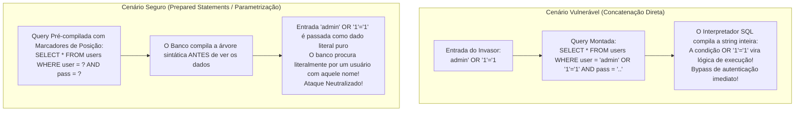
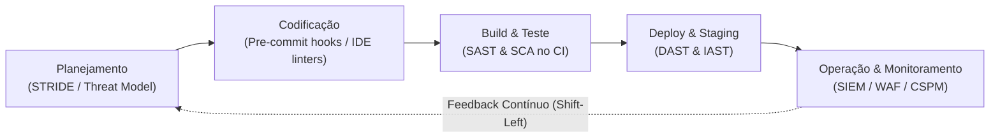
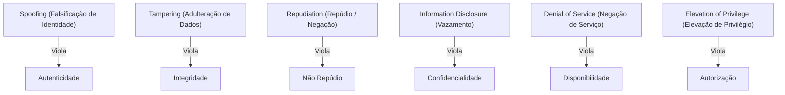
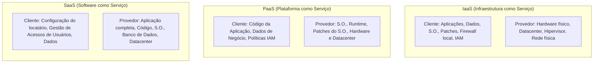

# 04 - Segurança em Aplicações, OWASP Top 10 e DevSecOps

> **Matéria:** Segurança da Informação  
> **Cargo:** B02 – Técnico de Controle Externo – Especialidade: Tecnologia da Informação  
> **Arquivo:** `04_seguranca_em_aplicacoes_owasp_top_10_e_devsecops.md`  


---


## 📌 Ementa / Itens do Edital
- Segurança no ciclo de vida de aplicações
- Projeto OWASP Top 10 (vulnerabilidades críticas em aplicações web)
- Boas práticas de codificação segura e abordagem DevSecOps (Shift-Left)
- Ferramentas de testes de segurança de software: SAST, DAST, IAST e SCA
- Segurança específica em APIs, em contêineres e em ambientes de nuvem

---

## 🧭 Sumário

1. [O Projeto OWASP Top 10 e Vulnerabilidades Críticas em Software Web](#1-o-projeto-owasp-top-10-e-vulnerabilidades-criticas-em-software-web)
    1. [Visão Geral e Categorias Oficiais do OWASP Top 10](#11-visao-geral-e-categorias-oficiais-do-owasp-top-10)
    2. [Broken Access Control (#1) e Insecure Direct Object References (IDOR)](#12-broken-access-control-1-e-insecure-direct-object-references-idor)
    3. [Cryptographic Failures (#2) e Proteção de Dados](#13-cryptographic-failures-2-e-protecao-de-dados)
    4. [Injection (#3): SQL Injection vs. Consultas Parametrizadas e Modalidades de XSS](#14-injection-3-sql-injection-vs-consultas-parametrizadas-e-modalidades-de-xss)
    5. [Demais Categorias Críticas: Insecure Design, Misconfiguration, SSRF e Supply Chain](#15-demais-categorias-criticas-insecure-design-misconfiguration-ssrf-e-supply-chain)
    6. [Teste 388](#Teste-388)
    7. [Teste 389](#Teste-389)
    8. [Teste 390](#Teste-390)
    9. [Teste 391](#Teste-391)
    10. [Teste 392](#Teste-392)
2. [Abordagem DevSecOps e a Cultura Shift-Left](#2-abordagem-devsecops-e-a-cultura-shift-left)
    1. [Princípios do DevSecOps e Economia da Correção Precoce (Shift-Left)](#21-principios-do-devsecops-e-economia-da-correcao-precoce-shift-left)
    2. [Modelagem de Ameaças com a Metodologia STRIDE](#22-modelagem-de-ameacas-com-a-metodologia-stride)
    3. [Ferramentas Automatizadas de Teste de Segurança (SAST, DAST, IAST, SCA)](#23-ferramentas-automatizadas-de-teste-de-seguranca-sast-dast-iast-sca)
    4. [Teste 393](#Teste-393)
    5. [Teste 394](#Teste-394)
    6. [Teste 395](#Teste-395)
3. [Segurança em APIs, Contêineres e Ambientes de Nuvem](#3-seguranca-em-apis-conteineres-e-ambientes-de-nuvem)
    1. [Segurança em APIs: OWASP API Security Top 10 e BOLA](#31-seguranca-em-apis-owasp-api-security-top-10-e-bola)
    2. [Boas Práticas e Hardening em Contêineres Docker e Kubernetes](#32-boas-praticas-e-hardening-em-conteineres-docker-e-kubernetes)
    3. [Segurança em Nuvem: Modelo de Responsabilidade Compartilhada e Proteção de Metadados](#33-seguranca-em-nuvem-modelo-de-responsabilidade-compartilhada-e-protecao-de-metadados)
    4. [Teste 396](#Teste-396)
    5. [Teste 397](#Teste-397)
    6. [Teste 398](#Teste-398)
6. [Fontes Recomendadas na Internet](#6-fontes-recomendadas-na-internet)

---

## 1. O Projeto OWASP Top 10 e Vulnerabilidades Críticas em Software Web

### 1.1 Visão Geral e Categorias Oficiais do OWASP Top 10

O *Open Web Application Security Project* (**OWASP**) é uma comunidade internacional sem fins lucrativos que lidera o consenso técnico global sobre a segurança no desenvolvimento de software. Seu principal documento de referência é o **OWASP Top 10**, uma publicação periódica que sintetiza as dez vulnerabilidades mais perigosas e frequentes em aplicações web em âmbito mundial.

| Posição | Categoria OWASP | Descrição do Risco | Exemplos Práticos / Vetores de Ataque | Mitigação Primária |
|---|---|---|---|---|
| **A01** | **Broken Access Control** *(#1 do Ranking)* | Falha na imposição de regras de autorização no backend, permitindo que usuários ajam fora dos limites de suas permissões. | **IDOR** (trocar `id=100` por `id=101` na URL para ver dado alheio); acesso direto a URLs administrativas sem autenticação; bypass de verificação de permissão. | *Deny by default*; validar autorização no lado do servidor em todas as requisições; tokens de sessão opacos. |
| **A02** | **Cryptographic Failures** *(antigo Sensitive Data Exposure)* | Falhas na proteção de dados sensíveis em repouso (*at rest*) ou em trânsito (*in transit*). | Uso de cifras obsoletas (MD5, DES, RC4); transmissão em HTTP sem TLS; chaves hardcoded no código; senhas salvas sem salt. | TLS 1.3 com HSTS obrigatório; AES-GCM para dados em repouso; hashing de senhas com algoritmos lentos (Argon2, bcrypt, PBKDF2). |
| **A03** | **Injection** | Dados não confiáveis fornecidos pelo usuário são interpretados como comandos ou instruções pelo interpretador. | **SQL Injection (SQLi)**; **Cross-Site Scripting (XSS)**; Command Injection (OS); LDAP/NoSQL Injection. | Consultas Parametrizadas (*Prepared Statements* com *bind variables*); ORMs; codificação sensível ao contexto (*context-aware encoding*); WAF. |
| **A04** | **Insecure Design** *(Categoria Nova)* | Falhas estruturais de concepção e arquitetura antes mesmo de o código ser escrito. | Ausência de modelagem de ameaças; regras de negócio sem limitação de taxa (ex.: compras infinitas com cupom); falta de design seguro. | Modelagem de ameaças (metodologia STRIDE); arquitetura de defesa em profundidade; princípios de *Secure by Design*. |
| **A05** | **Security Misconfiguration** | Configuração inadequada ou negligente dos componentes da pilha de software. | Contas e senhas padrão de fábrica mantidas; mensagens de erro detalhadas expondo *stack traces*; portas de depuração abertas; cabeçalhos de segurança ausentes. | Processo automatizado de *hardening*; desinstalação de utilitários desnecessários; desativação de mensagens detalhadas de erro para o cliente. |
| **A06** | **Vulnerable and Outdated Components** | Uso de bibliotecas, frameworks ou dependências de terceiros com falhas de segurança conhecidas. | Uso de versões antigas do Apache Log4j (falha *Log4Shell* - CVE-2021-44228); bibliotecas JavaScript com bugs públicos. | Análise de Composição de Software (SCA contínuo); monitoramento de boletins CVE/NVD; geração de SBOM (*Software Bill of Materials*). |
| **A07** | **Identification and Authentication Failures** | Falhas na verificação da identidade do usuário e gerenciamento de sessão. | Ausência de MFA; tolerância a senhas fracas; vulnerabilidade a *credential stuffing* e ataques de dicionário; sessões que não expiram após logout. | MFA obrigatório; bloqueio de contas após múltiplas tentativas falhas; controle de complexidade de senhas; cookies com flags `Secure`, `HttpOnly` e `SameSite`. |
| **A08** | **Software and Data Integrity Failures** *(Categoria Nova)* | Código ou infraestrutura que não protege contra violações de integridade em pipelines e dependências. | Desserialização insegura de objetos serializados não confiáveis (*Insecure Deserialization*); atualizações sem assinatura digital; contaminação de dependências (*supply chain*). | Assinatura digital em artefatos de build; verificação de integridade de dependências; evitar desserialização de formatos genéricos de dados não confiáveis. |
| **A09** | **Security Logging and Monitoring Failures** | Falha em registrar, monitorar e alertar tempestivamente sobre eventos suspeitos e incidentes. | Tentativas de login falhas não registradas; logs mantidos apenas localmente permitindo que o invasor os apague; ausência de integração com SIEM. | Centralização de logs imutáveis em SIEM; alertas automatizados em tempo quase real; retenção em conformidade com regulamentos. |
| **A10** | **Server-Side Request Forgery (SSRF)** | A aplicação web é induzida a realizar requisições HTTP arbitrárias a um destino fornecido pelo usuário. | O servidor vulnerável faz requisição contra serviços de metadados em nuvem (`http://169.254.169.254`) ou sistemas internos atrás do firewall. | Validação estrita de URLs de destino; lista permitida (*allowlist*) de domínios; isolamento de rede do servidor de aplicação. |

### 1.2 Broken Access Control (#1) e Insecure Direct Object References (IDOR)

Na edição atual do OWASP Top 10, **Broken Access Control assumiu a 1ª posição absoluta**, sendo identificada em 94% das aplicações testadas.

Essa falha ocorre quando a aplicação não valida no lado do servidor se o usuário autenticado possui os privilégios necessários para executar determinada ação ou acessar determinado recurso.

#### O Caso Clássico do IDOR (*Insecure Direct Object References*):
Ocorre quando a aplicação expõe diretamente um identificador de banco de dados na URL ou no corpo da requisição:

```text
https://tribunal.gov.br/api/processo?id=1050
```

Se o usuário simplesmente alterar o valor na barra de endereços para `id=1051` e o sistema exibir o processo sigiloso de outro cidadão, configura-se um **IDOR**, espécie notória de *Broken Access Control*.

- **Mitigação Mandatória:** O servidor deve SEMPRE verificar na camada de aplicação:  
  *O `usuario_autenticado` é o proprietário legítimo ou possui autorização formal no RBAC/ABAC para acessar o recurso `id=1051`?* Se não, a requisição deve ser bloqueada com código HTTP `403 Forbidden`.

### 1.3 Cryptographic Failures (#2) e Proteção de Dados

Anteriormente denominada *Sensitive Data Exposure*, essa categoria concentra-se em deficiências relacionadas ao uso incorreto ou à ausência de criptografia:

- **Dados em Trânsito:** Omissão do protocolo HTTPS/TLS 1.3, tráfego de dados sensíveis (senhas, CPF, informações de saúde) em texto puro HTTP, ausência do cabeçalho HSTS (*HTTP Strict Transport Security*).
- **Dados em Repouso:** Armazenamento de dados críticos em bases de dados sem criptografia de ponta a ponta (AES-256-GCM); armazenamento de senhas com funções hash rápidas e vulneráveis (MD5, SHA-1) ou sem a devida adição de valor aleatório de *salt* individualizado.
- **Mitigação:** Emprego obrigatório de cifras simétricas robustas com modos autenticados (AES-GCM), protocolos seguros de transporte e funções de derivação de chaves projetadas especificamente para senhas com custo de processamento ajustável (Argon2, bcrypt, PBKDF2).

### 1.4 Injection (#3): SQL Injection vs. Consultas Parametrizadas e Modalidades de XSS

A **Injeção (A03)** ocorre quando dados fornecidos por fontes externas não confiáveis são concatenados diretamente a interpretadores de comandos ou linguagens de consulta.

#### Injeção de SQL (SQLi)
Ocorre quando comandos SQL são montados via interpolação ou concatenação direta de strings:



- **Código Vulnerável:**

```python
# O atacante altera a árvore de execução sintática do SQL
query = f"SELECT * FROM servidores WHERE cpf = '{cpf_input}'"
cursor.execute(query)
```

- **Código Seguro (Prepared Statements com Parâmetros Vinculados):**

```python
# O motor do banco de dados trata a entrada estritamente como dado literal puro
query = "SELECT * FROM servidores WHERE cpf = %s"
cursor.execute(query, (cpf_input,))
```

> 🚨 **ALERTA DE PROVA / PEGADINHA FCC:**  
> A FCC adora afirmar que funções de substituição manual de caracteres (como trocar aspas por barras) são a solução ideal para injeção de SQL. **ERRADO!** Filtros manuais baseados em listas de bloqueio (*denylists*) são historicamente burláveis por diversas técnicas de codificação. A **única defesa definitiva e prioritária recomendada pela OWASP são as Consultas Parametrizadas (*Prepared Statements* com parâmetros vinculados / *bind variables*)**.

### 1.5 Demais Categorias Críticas: Insecure Design, Misconfiguration, SSRF e Supply Chain

- **A04: Insecure Design (Design Inseguro):** Categoria nova que diferencia falhas de implementação (bugs de código) de **falhas de concepção e arquitetura**. Se o sistema de compras do órgão não possui uma regra arquitetural de limitação de compras por minuto, o código pode estar perfeitamente escrito e livre de falhas de injeção, mas o design é vulnerável a abusos lógicos de negócio.
- **A05: Security Misconfiguration (Configuração Incorreta de Segurança):** Envolve a manutenção de contas, logins e senhas padrão de fábrica em bancos de dados e servidores web; mensagens de erro detalhadas expondo *stack traces* e versões internas de bibliotecas aos usuários finais; portas de depuração abertas em produção e falta de políticas de segurança HTTP (*Content-Security-Policy*).
- **A08: Software and Data Integrity Failures:** Foco na segurança da cadeia de suprimentos (*supply chain*). Envolve a ingestão de dependências e pacotes sem verificação de assinatura digital e a **desserialização insegura (*Insecure Deserialization*)**, onde objetos serializados em XML, JSON ou binários recebidos de usuários remotos são recriados na memória sem validação, viabilizando execução remota de código (RCE).
- **A10: Server-Side Request Forgery (SSRF):** Ocorre quando um atacante consegue induzir o servidor de aplicação a disparar requisições HTTP arbitrárias para recursos internos protegidos pela rede interna. Em ambientes de nuvem pública, o vetor mais crítico de SSRF é forçar o servidor a ler a URL local de metadados (`http://169.254.169.254/latest/meta-data/`), expondo tokens temporários de credenciais administrativas da máquina virtual.

---

### Teste 388
**(FGV – TJ/RR – 2024 – Analista Judiciario Infraestrutura De Tecnologia Da Informacao)**
Você, como analista de segurança ou de infraestrutura do TJ-RR, pode ser incumbido de instalar e configurar servidores para resoluções de nomes de domínio da Internet. Uma das soluções mais robustas para esse fim é o BIND, do Internet Systems Consortium (ISC). Em relação ao tema, avalie se cada afirmativa a seguir, referente a boas práticas recomendadas pelo ISC para administração do BIND, é verdadeira (V) ou falsa (F) . ( ) Assegurar que a infraestrutura utilizada suporte EDNS0 e pacotes UDP de tamanhos reduzidos. ( ) Não combinar funções de servidor de nomes autoritativas e recursivas no mesmo servidor. ( ) Empregar firewalls/filtros de pacotes com estado em seus servidores para tráfego de consulta de saída. As afirmativas são, respectivamente,

* **A)** V – F – V.
* **B)** V – V – V.
* **C)** V – F – F.
* **D)** F – V – V.
* **E)** F – V – F.

---

> **Comentário Detalhado:**
>
> - **A)** **Incorreta.** A opção apresenta proposição em desacordo com os fundamentos teóricos e técnicos do tópico ao afirmar que "V – F – V". De acordo com a teoria estudada em *1.3 Cryptographic Failures (#2) e Proteção de Dados*, mitigação: Emprego obrigatório de cifras simétricas robustas com modos autenticados (AES-GCM), protocolos seguros de transporte e funções de derivação de chaves projetadas especificamente para senhas com custo de processamento ajustável (Argon2, bcrypt, PBKDF2).
> - **B)** **Incorreta.** A opção apresenta proposição em desacordo com os fundamentos teóricos e técnicos do tópico ao afirmar que "V – V – V". De acordo com a teoria estudada em *3.2 Boas Práticas e Hardening em Contêineres Docker e Kubernetes*, utilizar Imagens Mínimas (*Distroless* ou *Alpine*): Imagens base compactas eliminam utilitários desnecessários do sistema operacional (como gerenciadores de pacotes `apt`/`apk`, interpretadores `bash` e ferramentas de rede `curl`), reduzindo drasticamente a superfície de ataque e o número de CVEs presentes na imagem.
> - **C)** **Incorreta.** A opção apresenta proposição em desacordo com os fundamentos teóricos e técnicos do tópico ao afirmar que "V – F – F". De acordo com a teoria estudada em *1.5 Demais Categorias Críticas: Insecure Design, Misconfiguration, SSRF e Supply Chain*, em ambientes de nuvem pública, o vetor mais crítico de SSRF é forçar o servidor a ler a URL local de metadados (`http://169.254.169.254/latest/meta-data/`), expondo tokens temporários de credenciais administrativas da máquina virtual.
> - **D)** **Incorreta.** A opção apresenta proposição em desacordo com os fundamentos teóricos e técnicos do tópico ao afirmar que "F – V – V". De acordo com a teoria estudada em *1.5 Demais Categorias Críticas: Insecure Design, Misconfiguration, SSRF e Supply Chain*, a05: Security Misconfiguration (Configuração Incorreta de Segurança): Envolve a manutenção de contas, logins e senhas padrão de fábrica em bancos de dados e servidores web; mensagens de erro detalhadas expondo *stack traces* e versões internas de bibliotecas aos usuários finais; portas de depuração abertas em produção e falta de políticas de segurança HTTP (*Content-Security-Policy*).
> - **E)** **Correta.** Conforme fundamentado na seção *3.2 Boas Práticas e Hardening em Contêineres Docker e Kubernetes* deste guia, descarte de Capacidades do Linux (*Drop Capabilities*): Configurar o contêiner para descartar todas as capacidades administrativas padrão do kernel Linux (`--cap-drop=ALL`), adicionando estritamente aquelas indispensáveis para a operação do serviço. Dessa forma, está plenamente correta a assertiva da banca (FGV – TJ/RR/2024) ao estabelecer que "F – V – F".
>
> **Gabarito: E**

---

### Teste 389
**(FGV – TJ/AP – 2023 – Analista Judiciario Apoio Especializado Tecnologia Da Informacao Seguranca Da Informacao)**
A empresa Z criou uma nova aplicação web, mas foi atacada após disponibilizá-la na Internet. A equipe de segurança da empresa Z identificou que a configuração do servidor de aplicações permitia que os detalhes das mensagens de erro fossem retornados aos usuários. Tal fato exibe informações confidenciais ou falhas subjacentes. Para a elaboração do relatório de ataque a ser entregue à empresa Z, a equipe de segurança usou o OWASP. Ao verificar o OWASP, a equipe definiu o ataque como pertencente à categoria:

* **A)** A09:2021 – Falhas de Registro e Monitoramento de Segurança;
* **B)** A08:2021 – Falhas de Software e Integridade de Dados;
* **C)** A07:2021 – Falhas de Identificação e Autenticação;
* **D)** A06:2021 – Componentes Vulneráveis e Desatualizados;
* **E)** A05:2021 – Configuração Incorreta de Segurança.

---

> **Comentário Detalhado:**
>
> - **A)** **Incorreta.** A opção apresenta proposição em desacordo com os fundamentos teóricos e técnicos do tópico ao afirmar que "A09:2021 – Falhas de Registro e Monitoramento de Segurança". De acordo com a teoria estudada em *1.1 Visão Geral e Categorias Oficiais do OWASP Top 10*, a06: Vulnerable and Outdated Components — Uso de bibliotecas, frameworks ou dependências de terceiros com falhas de segurança conhecidas. — Uso de versões antigas do Apache Log4j (falha *Log4Shell* - CVE-2021-44228); bibliotecas JavaScript com bugs públicos. — Análise de Composição de Software (SCA contínuo); monitoramento de boletins CVE/NVD; geração de SBOM (*Software Bill of Materials*).
> - **B)** **Incorreta.** A opção apresenta proposição em desacordo com os fundamentos teóricos e técnicos do tópico ao afirmar que "A08:2021 – Falhas de Software e Integridade de Dados". De acordo com a teoria estudada em *1.1 Visão Geral e Categorias Oficiais do OWASP Top 10*, a05: Security Misconfiguration — Configuração inadequada ou negligente dos componentes da pilha de software. — Contas e senhas padrão de fábrica mantidas; mensagens de erro detalhadas expondo *stack traces*; portas de depuração abertas; cabeçalhos de segurança ausentes. — Processo automatizado de *hardening*; desinstalação de utilitários desnecessários; desativação de mensagens detalhadas de erro para o cliente.
> - **C)** **Incorreta.** A opção apresenta proposição em desacordo com os fundamentos teóricos e técnicos do tópico ao afirmar que "A07:2021 – Falhas de Identificação e Autenticação". De acordo com a teoria estudada em *1.1 Visão Geral e Categorias Oficiais do OWASP Top 10*, a07: Identification and Authentication Failures — Falhas na verificação da identidade do usuário e gerenciamento de sessão. — Ausência de MFA; tolerância a senhas fracas; vulnerabilidade a *credential stuffing* e ataques de dicionário; sessões que não expiram após logout. — MFA obrigatório; bloqueio de contas após múltiplas tentativas falhas; controle de complexidade de senhas; cookies com flags `Secure`, `HttpOnly` e `SameSite`.
> - **D)** **Incorreta.** A opção apresenta proposição em desacordo com os fundamentos teóricos e técnicos do tópico ao afirmar que "A06:2021 – Componentes Vulneráveis e Desatualizados". De acordo com a teoria estudada em *3.1 Segurança em APIs: OWASP API Security Top 10 e BOLA*, aPI Gateways: Componentes perimetrais que centralizam a autenticação, aplicam *rate limiting* e efetuam a validação estrita de esquemas de dados (OpenAPI Specification / JSON Schema) antes de encaminhar o tráfego aos microsserviços internos.
> - **E)** **Correta.** Conforme fundamentado na seção *1.5 Demais Categorias Críticas: Insecure Design, Misconfiguration, SSRF e Supply Chain* deste guia, a05: Security Misconfiguration (Configuração Incorreta de Segurança): Envolve a manutenção de contas, logins e senhas padrão de fábrica em bancos de dados e servidores web; mensagens de erro detalhadas expondo *stack traces* e versões internas de bibliotecas aos usuários finais; portas de depuração abertas em produção e falta de políticas de segurança HTTP (*Content-Security-Policy*). Dessa forma, está plenamente correta a assertiva da banca (FGV – TJ/AP/2023) ao estabelecer que "A05:2021 – Configuração Incorreta de Segurança".
>
> **Gabarito: E**

---

### Teste 390
**(FGV – TRT/DA – 2025 – Analista Judiciario Area Apoio Especializado Tecnologia Da Informacao)**
O padrão de verificação de segurança de aplicativos OWASP (versão 4.0.3) indica diversos tipos de verificações que devem ser consideradas no desenvolvimento e manutenção de aplicações seguras. Com relação à verificação 7 que diz respeito ao tratamento e registro de erros em logs, analise as afirmativas a seguir. I. Deve-se proteger logs de alta qualidade, seguindo as leis ou diretrizes locais de privacidade de dados, pois, geralmente, eles contêm dados sensíveis. II. Não se deve coletar ou registrar informações confidenciais nos logs, a menos que seja especificamente necessário. III. Deve-se garantir que todas as informações registradas nos logs sejam tratadas com segurança e protegidas de acordo com a LGPD. IV. Deve-se garantir que os logs não sejam armazenados para sempre, mas tenham uma vida útil o mais longa possível. Está correto o que se afirma em

* **A)** III e IV, apenas.
* **B)** II e IV, apenas.
* **C)** II e III, apenas.
* **D)** I e III, apenas.
* **E)** I e II, apenas.

---

> **Comentário Detalhado:**
>
> - **A)** **Incorreta.** A opção incorre em restrição indevida ao limitar o escopo conceitual ao afirmar que "III e IV, apenas". De acordo com a teoria estudada em *O Conceito de Shift-Left (Deslocar para a Esquerda)*, deslocar a segurança para a esquerda (*Shift-Left*) significa introduzir verificações e controles de segurança o mais cedo possível.
> - **B)** **Incorreta.** A opção incorre em restrição indevida ao limitar o escopo conceitual ao afirmar que "II e IV, apenas". De acordo com a teoria estudada em *1.5 Demais Categorias Críticas: Insecure Design, Misconfiguration, SSRF e Supply Chain*, a05: Security Misconfiguration (Configuração Incorreta de Segurança): Envolve a manutenção de contas, logins e senhas padrão de fábrica em bancos de dados e servidores web; mensagens de erro detalhadas expondo *stack traces* e versões internas de bibliotecas aos usuários finais; portas de depuração abertas em produção e falta de políticas de segurança HTTP (*Content-Security-Policy*).
> - **C)** **Incorreta.** A opção incorre em restrição indevida ao limitar o escopo conceitual ao afirmar que "II e III, apenas". De acordo com a teoria estudada em *1.3 Cryptographic Failures (#2) e Proteção de Dados*, dados em Trânsito: Omissão do protocolo HTTPS/TLS 1.3, tráfego de dados sensíveis (senhas, CPF, informações de saúde) em texto puro HTTP, ausência do cabeçalho HSTS (*HTTP Strict Transport Security*).
> - **D)** **Incorreta.** A opção incorre em restrição indevida ao limitar o escopo conceitual ao afirmar que "I e III, apenas". De acordo com a teoria estudada em *1.1 Visão Geral e Categorias Oficiais do OWASP Top 10*, a01: Broken Access Control *(#1 do Ranking)* — Falha na imposição de regras de autorização no backend, permitindo que usuários ajam fora dos limites de suas permissões. — IDOR (trocar `id=100` por `id=101` na URL para ver dado alheio); acesso direto a URLs administrativas sem autenticação; bypass de verificação de permissão. — *Deny by default*; validar autorização no lado do servidor em todas as requisições; tokens de sessão opacos.
> - **E)** **Correta.** Conforme fundamentado na seção *1.1 Visão Geral e Categorias Oficiais do OWASP Top 10* deste guia, a09: Security Logging and Monitoring Failures — Falha em registrar, monitorar e alertar tempestivamente sobre eventos suspeitos e incidentes. — Tentativas de login falhas não registradas; logs mantidos apenas localmente permitindo que o invasor os apague; ausência de integração com SIEM. — Centralização de logs imutáveis em SIEM; alertas automatizados em tempo quase real; retenção em conformidade com regulamentos. Dessa forma, está plenamente correta a assertiva da banca (FGV – TRT/DA/2025) ao estabelecer que "I e II, apenas".
>
> **Gabarito: E**

---

### Teste 391
**(FGV – TJ/AP – 2023 – Analista Judiciario Apoio Especializado Tecnologia Da Informacao Seguranca Da Informacao)**
A equipe de Segurança da Informação (SI) de um órgão público realizou varreduras de vulnerabilidades em seus ativos a fim de reduzir a exposição dos sistemas aos riscos. Durante a varredura, a equipe de SI identificou que um dos sistemas tinha uma vulnerabilidade que permitia a inserção de scripts maliciosos na aplicação, alterando o conteúdo dinâmico que o usuário recebia em seu navegador, redirecionando-o para um site falso. A vulnerabilidade identificada permitia um ataque de:

* **A)** backdoor;
* **B)** rootkit;
* **C)** session hijacking;
* **D)** cross-site scripting;
* **E)** SQL injection.

---

> **Comentário Detalhado:**
>
> - **A)** **Incorreta.** A opção apresenta proposição em desacordo com os fundamentos teóricos e técnicos do tópico ao afirmar que "backdoor". De acordo com a teoria estudada em *2.3 Ferramentas Automatizadas de Teste de Segurança (SAST, DAST, IAST, SCA)*, sCA: *Software Composition Analysis* — Caixa-Branca / Inventário — Durante o build através de arquivos de manifesto (`package.json`, `pom.xml`, `requirements.txt`). — Dependências de código aberto, bibliotecas de terceiros e frameworks. — Pró: Mapeia vulnerabilidades públicas catalogadas (CVEs) e analisa riscos de conformidade de licenças legais de software livre.
> - **B)** **Incorreta.** A opção apresenta proposição em desacordo com os fundamentos teóricos e técnicos do tópico ao afirmar que "rootkit". De acordo com a teoria estudada em *3.2 Boas Práticas e Hardening em Contêineres Docker e Kubernetes*, sistemas de Arquivos Somente Leitura (*Read-Only Root Filesystem*): Inicializar o contêiner com a flag `--read-only`, impedindo que invasores ou scripts maliciosos gravem arquivos executáveis em diretórios do sistema.
> - **C)** **Incorreta.** A opção apresenta proposição em desacordo com os fundamentos teóricos e técnicos do tópico ao afirmar que "session hijacking". De acordo com a teoria estudada em *1.1 Visão Geral e Categorias Oficiais do OWASP Top 10*, a10: Server-Side Request Forgery (SSRF) — A aplicação web é induzida a realizar requisições HTTP arbitrárias a um destino fornecido pelo usuário. — O servidor vulnerável faz requisição contra serviços de metadados em nuvem (`http://169.254.169.254`) ou sistemas internos atrás do firewall. — Validação estrita de URLs de destino; lista permitida (*allowlist*) de domínios; isolamento de rede do servidor de aplicação.
> - **D)** **Correta.** Conforme fundamentado na seção *1.1 Visão Geral e Categorias Oficiais do OWASP Top 10* deste guia, a03: Injection — Dados não confiáveis fornecidos pelo usuário são interpretados como comandos ou instruções pelo interpretador. — SQL Injection (SQLi); Cross-Site Scripting (XSS); Command Injection (OS). Dessa forma, está plenamente correta a assertiva da banca (FGV – TJ/AP/2023) ao estabelecer que "cross-site scripting".
> - **E)** **Incorreta.** A opção apresenta proposição em desacordo com os fundamentos teóricos e técnicos do tópico ao afirmar que "SQL injection". De acordo com a teoria estudada em *1.4 Injection (#3): SQL Injection vs. Consultas Parametrizadas e Modalidades de XSS*, a Injeção (A03) ocorre quando dados fornecidos por fontes externas não confiáveis são concatenados diretamente a interpretadores de comandos ou linguagens de consulta.
>
> **Gabarito: D**

---

### Teste 392
**(FGV – TJ/RR – 2024 – Analista Judiciario Gestao E Governanca De Tecnologia Da Informacao)**
A Norma ABNT NBR ISO/IEC 27002:2022 categorizou 93 controles em 4 temas: Pessoais, Físicos, Tecnológicos e Organizacionais. Diante desse contexto, assinale a opção que apresenta apenas controles organizacionais.

* **A)** Políticas para Segurança da Informação e Termos e Condições de Contratação.
* **B)** Responsabilidades após Término ou Mudança de Contratação e Proteção de Escritórios, Salas e Instalações.
* **C)** Trabalho em Áreas Seguras e Gerenciamento de Vulnerabilidades Técnicas.
* **D)** Segurança da Informação no Gerenciamento de Projetos e Segurança da Informação em Relacionamentos com Fornecedores.
* **E)** Resposta aos Incidentes de Segurança da Informação e Redundância de Recursos de Processamento de Informações. PROVA DISCURSIVA Em um condomínio de apartamentos, o morador X recebeu convidados e tocou música alta durante quatro noites seguidas, perturbando o vizinho Y, que registrou uma queixa no livro de ocorrências do condomínio logo após a primeira noite. No terceiro dia, X e Y se enfrentaram nas áreas comuns, trocando ofensas e ameaças na presença de testemunhas, quase evoluindo para um confronto corpo a corpo. Cabe ressaltar que Y é idoso e possui dificuldades de locomoção, diferentemente de X, que é um homem jovem e de temperamento agressivo. Diante da falta de ação da administração do condomínio para resolver o problema do barulho, o morador Y registrou em livro a solicitação dos dados pessoais do morador X para processá-lo civil e criminalmente. No entanto, o administrador do condomínio negou o pedido, alegando que divulgar essas informações, sem o consentimento do titular, violaria o direito à privacidade de X e que ele poderia acabar sendo responsabilizado, na forma do art. 42 da Lei nº 13.709/18 (Lei Geral de Proteção de Dados Pessoais – LGPD): “o controlador ou o operador que, em razão do exercício de atividade de tratamento de dados pessoais, causar a outrem dano patrimonial, moral, individual ou coletivo, em violação à legislação de proteção de dados pessoais, é obrigado a repará-lo.” A LGPD é uma Lei brasileira que “dispõe sobre o tratamento de dados pessoais, inclusive nos meios digitais, por pessoa natural ou por pessoa jurídica de direito público ou privado, com o objetivo de proteger os direitos fundamentais de liberdade e de privacidade e o livre desenvolvimento da personalidade da pessoa natural”. (BRASIL. Lei nº 13.709, de 14 de agosto de 2018) Considerando que a administração do condomínio atua como controladora dos dados pessoais de todos os condôminos, responda, em no máximo 30 linhas, ao que se pede a seguir. a) Cite um motivo pelo qual o pedido do morador Y ao administrador do condomínio se enquadra no âmbito de aplicação da LGPD. Justifique sua escolha. b) Apresente dois motivos pelos quais o administrador do condomínio deveria ter concedido acesso aos dados cadastrais, mesmo sem consentimento do morador X. Justifique sua resposta.

---

> **Comentário Detalhado:**
>
> - **A)** **Incorreta.** A opção apresenta proposição em desacordo com os fundamentos teóricos e técnicos do tópico ao afirmar que "Políticas para Segurança da Informação e Termos e Condições de Contratação". De acordo com a teoria estudada em *1.5 Demais Categorias Críticas: Insecure Design, Misconfiguration, SSRF e Supply Chain*, a05: Security Misconfiguration (Configuração Incorreta de Segurança): Envolve a manutenção de contas, logins e senhas padrão de fábrica em bancos de dados e servidores web; mensagens de erro detalhadas expondo *stack traces* e versões internas de bibliotecas aos usuários finais; portas de depuração abertas em produção e falta de políticas de segurança HTTP (*Content-Security-Policy*).
> - **B)** **Incorreta.** A opção apresenta proposição em desacordo com os fundamentos teóricos e técnicos do tópico ao afirmar que "Responsabilidades após Término ou Mudança de Contratação e Proteção de Escritórios, Salas e Instalações". De acordo com a teoria estudada em *1.1 Visão Geral e Categorias Oficiais do OWASP Top 10*, a07: Identification and Authentication Failures — Falhas na verificação da identidade do usuário e gerenciamento de sessão. — Ausência de MFA; tolerância a senhas fracas; vulnerabilidade a *credential stuffing* e ataques de dicionário; sessões que não expiram após logout. — MFA obrigatório; bloqueio de contas após múltiplas tentativas falhas; controle de complexidade de senhas; cookies com flags `Secure`, `HttpOnly` e `SameSite`.
> - **C)** **Incorreta.** A opção apresenta proposição em desacordo com os fundamentos teóricos e técnicos do tópico ao afirmar que "Trabalho em Áreas Seguras e Gerenciamento de Vulnerabilidades Técnicas". De acordo com a teoria estudada em *2.1 Princípios do DevSecOps e Economia da Correção Precoce (Shift-Left)*, a filosofia DevSecOps une as áreas de Desenvolvimento (Dev), Segurança (Sec) e Operações de Infraestrutura (Ops), transformando a segurança cibernética em uma responsabilidade intrínseca e compartilhada por todos os profissionais da equipe ao longo de todo o ciclo de vida do software.
> - **D)** **Correta.** Conforme fundamentado na seção *2.1 Princípios do DevSecOps e Economia da Correção Precoce (Shift-Left)* deste guia, no modelo tradicional em cascata ou nas primeiras iterações do modelo DevOps, a segurança da informação atuava como um comitê de auditoria tardio e isolado, acionado somente no encerramento do projeto, imediatamente antes do deploy em produção. Dessa forma, está plenamente correta a assertiva da banca (FGV – TJ/RR/2024) ao estabelecer que "Segurança da Informação no Gerenciamento de Projetos e Segurança da Informação em Relacionamentos com Fornecedores".
> - **E)** **Incorreta.** A opção apresenta proposição em desacordo com os fundamentos teóricos e técnicos do tópico ao afirmar que "Resposta aos Incidentes de Segurança da Informação e Redundância de Recursos de Processamento de Informações...". De acordo com a teoria estudada em *O Conceito de Shift-Left (Deslocar para a Esquerda)*, identificar e corrigir uma falha arquitetural ou de código durante a modelagem de ameaças ou na digitação na IDE é dezenas de vezes mais barato e rápido do que corrigir a mesma falha após a aplicação ter sido implantada em ambiente produtivo.
>
> **Gabarito: D**

---

## 2. Abordagem DevSecOps e a Cultura Shift-Left

### 2.1 Princípios do DevSecOps e Economia da Correção Precoce (Shift-Left)

No modelo tradicional em cascata ou nas primeiras iterações do modelo DevOps, a segurança da informação atuava como um comitê de auditoria tardio e isolado, acionado somente no encerramento do projeto, imediatamente antes do deploy em produção. Esse modelo de "porteira de segurança" gerava atrito constante, retrabalho massivo e atrasos nas entregas.

A filosofia **DevSecOps** une as áreas de Desenvolvimento (**Dev**), Segurança (**Sec**) e Operações de Infraestrutura (**Ops**), transformando a segurança cibernética em uma responsabilidade intrínseca e compartilhada por todos os profissionais da equipe ao longo de todo o ciclo de vida do software.



#### O Conceito de *Shift-Left* (Deslocar para a Esquerda)
Na linha cronológica da esteira de entrega contínua (CI/CD), a extremidade esquerda representa o planejamento e a codificação, enquanto a direita representa o deploy e a operação em produção.

**Deslocar a segurança para a esquerda (*Shift-Left*)** significa introduzir verificações e controles de segurança o mais cedo possível:

- Identificar e corrigir uma falha arquitetural ou de código durante a modelagem de ameaças ou na digitação na IDE é **dezenas de vezes mais barato** e rápido do que corrigir a mesma falha após a aplicação ter sido implantada em ambiente produtivo.

### 2.2 Modelagem de Ameaças com a Metodologia STRIDE

Criada por pesquisadores da Microsoft, a metodologia **STRIDE** é uma estrutura conceitual de modelagem de ameaças adotada no planejamento de sistemas para identificar potenciais riscos antes de qualquer linha de código ser produzida:



| Categoria STRIDE | Significado da Ameaça | Propriedade de Segurança Violada |
|---|---|---|
| **S**poofing | Falsificar a identidade de um usuário, processo ou componente legítimo. | **Autenticidade** |
| **T**ampering | Modificar ou corromper dados em trânsito, em memória ou em repouso. | **Integridade** |
| **R**epudiation | Negar formalmente a autoria de uma operação ou transação realizada. | **Não Repúdio** |
| **I**nformation Disclosure | Divulgar dados sigilosos a pessoas ou sistemas não autorizados. | **Confidencialidade** |
| **D**enial of Service | Esgotar recursos de rede, CPU ou memória para degradar ou derrubar o sistema. | **Disponibilidade** |
| **E**levation of Privilege | Obter privilégios superiores àqueles originalmente atribuídos à conta. | **Autorização** |

### 2.3 Ferramentas Automatizadas de Teste de Segurança (SAST, DAST, IAST, SCA)

A automação do pipeline de CI/CD integra quatro famílias primárias de ferramentas de testes de segurança de software:

| Categoria | Nome Completo | Tipo de Teste | Momento da Execução | O que inspeciona? | Principais Prós e Contras |
|---|---|---|---|---|---|
| **SAST** | *Static Application Security Testing* | Caixa-Branca (*White-Box*) | No início do pipeline (fase de commit/build), **sem executar o código**. | Código-fonte, sintaxe, árvores de sintaxe abstrata (AST) e bytecode interno da aplicação. | **Pró:** Aponta a linha exata e o arquivo com a falha.<br>**Contra:** Gera elevado índice de falsos positivos; não detecta falhas de infraestrutura ou erros de runtime. |
| **DAST** | *Dynamic Application Security Testing* | Caixa-Preta (*Black-Box*) | No final do pipeline (staging/deploy), **com a aplicação rodando em servidor**. | Comportamento externo da aplicação web através de requisições HTTP simuladas. | **Pró:** Agnóstico de linguagem; testa configurações reais de ambiente de execução.<br>**Contra:** Não aponta a linha do código; não tem visibilidade da lógica interna. |
| **SCA** | *Software Composition Analysis* | Caixa-Branca / Inventário | Durante o build através de arquivos de manifesto (`package.json`, `pom.xml`, `requirements.txt`). | Dependências de código aberto, bibliotecas de terceiros e frameworks. | **Pró:** Mapeia vulnerabilidades públicas catalogadas (CVEs) e analisa riscos de conformidade de licenças legais de software livre. |
| **IAST** | *Interactive Application Security Testing* | Híbrido Instrumentado | Durante a execução de testes funcionais automatizados ou manuais em runtime. | Agente instalado dentro da máquina virtual da aplicação (JVM, .NET, Node.js). | **Pró:** Combina a precisão do SAST com a visão contextual do DAST, com baixíssimo índice de falsos positivos.<br>**Contra:** Requer instrumentação específica e consome recursos da aplicação em teste. |

---

### Teste 393
**(FGV – TRF/1 – 2024 – Analista Judiciario Area Apoio Especializado Especialidade Tecnologia Da Informacao)**
Fabrício, delegado de polícia, solicitou a intervenção de um especialista em informática para investigar um incidente ocorrido em uma empresa, no qual João, um ex-funcionário, acessou indevidamente o sistema da empresa, que continha dados confidenciais. Durante essa invasão, João procedeu à modificação dos preços dos produtos, reduzindo-os a valores insignificantes, e distribuiu essas informações para milhares de indivíduos, ocasionando uma interrupção temporária no funcionamento do sistema. Após uma minuciosa análise da situação, o perito elaborou um relatório abrangente para o delegado Fabrício, no qual apontou os objetivos fundamentais de segurança que foram violados. A alternativa que lista os objetivos fundamentais de segurança que foram violados, na ordem em que as respectivas violações aparecem no texto acima, é:

* **A)** não repúdio, integridade e disponibilidade;
* **B)** disponibilidade, integridade e confidencialidade;
* **C)** confidencialidade, Integridade e disponibilidade;
* **D)** não repúdio, disponibilidade e confidencialidade;
* **E)** confidencialidade, disponibilidade e não repúdio.

---

> **Comentário Detalhado:**
>
> - **A)** **Incorreta.** A opção apresenta proposição em desacordo com os fundamentos teóricos e técnicos do tópico ao afirmar que "não repúdio, integridade e disponibilidade". De acordo com a teoria estudada em *1.1 Visão Geral e Categorias Oficiais do OWASP Top 10*, a08: Software and Data Integrity Failures *(Categoria Nova)* — Código ou infraestrutura que não protege contra violações de integridade em pipelines e dependências. — Desserialização insegura de objetos serializados não confiáveis (*Insecure Deserialization*); atualizações sem assinatura digital; contaminação de dependências (*supply chain*). — Assinatura digital em artefatos de build; verificação de integridade de dependências; evitar desserialização de formatos genéricos de dados não confiáveis.
> - **B)** **Incorreta.** A opção apresenta proposição em desacordo com os fundamentos teóricos e técnicos do tópico ao afirmar que "disponibilidade, integridade e confidencialidade". De acordo com a teoria estudada em *2.2 Modelagem de Ameaças com a Metodologia STRIDE*, information Disclosure: Divulgar dados sigilosos a pessoas ou sistemas não autorizados. — Confidencialidade.
> - **C)** **Incorreta.** A opção apresenta proposição em desacordo com os fundamentos teóricos e técnicos do tópico ao afirmar que "confidencialidade, Integridade e disponibilidade". De acordo com a teoria estudada em *2.2 Modelagem de Ameaças com a Metodologia STRIDE*, repudiation: Negar formalmente a autoria de uma operação ou transação realizada. — Não Repúdio.
> - **D)** **Correta.** Conforme fundamentado na seção *2.2 Modelagem de Ameaças com a Metodologia STRIDE* deste guia, denial of Service: Esgotar recursos de rede, CPU ou memória para degradar ou derrubar o sistema. — Disponibilidade. Dessa forma, está plenamente correta a assertiva da banca (FGV – TRF/1/2024) ao estabelecer que "não repúdio, disponibilidade e confidencialidade".
> - **E)** **Incorreta.** A opção apresenta proposição em desacordo com os fundamentos teóricos e técnicos do tópico ao afirmar que "confidencialidade, disponibilidade e não repúdio". De acordo com a teoria estudada em *1.3 Cryptographic Failures (#2) e Proteção de Dados*, dados em Trânsito: Omissão do protocolo HTTPS/TLS 1.3, tráfego de dados sensíveis (senhas, CPF, informações de saúde) em texto puro HTTP, ausência do cabeçalho HSTS (*HTTP Strict Transport Security*).
>
> **Gabarito: D**

---

### Teste 394
**(FCC – TRT 11ª – 2017 – Analista Judiciário - Tecnologia da Informação)**
Um Analista Judiciário deve estabelecer um código de prática de segurança da informação no TRT para o controle e a pre- venção de ataques de malwares. Considerando-se a Norma NBR ISO/IEC 27002:2013, é recomendável que o código de segurança inclua

* **A)** o procedimento para a divulgação imediata de alertas relacionados a malwares provenientes de todos os meios de comunicação, incluindo os alertas preliminares como boatos.
* **B)** a eliminação de qualquer atualização não autorizada de software crítico de forma imediata não sendo necessária uma investigação formal.
* **C)** a implementação de controles para prevenir o uso de software não autorizado, como o whitelisting que lista os softwares não permitidos.
* **D)** a aplicação do princípio do privilégio máximo para os usuários pertinentes para a instalação de softwares.
* **E)** o uso de dois ou mais tipos de software de controle contra malware de diferentes fornecedores para aumentar a eficácia na proteção.

---

> **Comentário Detalhado:**
>
> - **A)** **Incorreta.** A opção apresenta proposição em desacordo com os fundamentos teóricos e técnicos do tópico ao afirmar que "o procedimento para a divulgação imediata de alertas relacionados a malwares provenientes de todos os meios de...". De acordo com a teoria estudada em *1.1 Visão Geral e Categorias Oficiais do OWASP Top 10*, a06: Vulnerable and Outdated Components — Uso de bibliotecas, frameworks ou dependências de terceiros com falhas de segurança conhecidas. — Uso de versões antigas do Apache Log4j (falha *Log4Shell* - CVE-2021-44228); bibliotecas JavaScript com bugs públicos. — Análise de Composição de Software (SCA contínuo); monitoramento de boletins CVE/NVD; geração de SBOM (*Software Bill of Materials*).
> - **B)** **Incorreta.** A opção promove generalização excessiva que desconsidera as condições técnicas e normativas ao afirmar que "a eliminação de qualquer atualização não autorizada de software crítico de forma imediata não sendo necessária uma...". De acordo com a teoria estudada em *1.5 Demais Categorias Críticas: Insecure Design, Misconfiguration, SSRF e Supply Chain*, em ambientes de nuvem pública, o vetor mais crítico de SSRF é forçar o servidor a ler a URL local de metadados (`http://169.254.169.254/latest/meta-data/`), expondo tokens temporários de credenciais administrativas da máquina virtual.
> - **C)** **Incorreta.** A opção apresenta proposição em desacordo com os fundamentos teóricos e técnicos do tópico ao afirmar que "a implementação de controles para prevenir o uso de software não autorizado, como o whitelisting que lista os...". De acordo com a teoria estudada em *O Conceito de Shift-Left (Deslocar para a Esquerda)*, deslocar a segurança para a esquerda (*Shift-Left*) significa introduzir verificações e controles de segurança o mais cedo possível.
> - **D)** **Incorreta.** A opção apresenta proposição em desacordo com os fundamentos teóricos e técnicos do tópico ao afirmar que "a aplicação do princípio do privilégio máximo para os usuários pertinentes para a instalação de softwares". De acordo com a teoria estudada em *2.3 Ferramentas Automatizadas de Teste de Segurança (SAST, DAST, IAST, SCA)*, sAST: *Static Application Security Testing* — Caixa-Branca (*White-Box*) — No início do pipeline (fase de commit/build), sem executar o código. — Código-fonte, sintaxe, árvores de sintaxe abstrata (AST) e bytecode interno da aplicação. — Pró: Aponta a linha exata e o arquivo com a falha.`<br>`Contra: Gera elevado índice de falsos positivos; não detecta falhas de infraestrutura ou erros de runtime.
> - **E)** **Correta.** Conforme fundamentado na seção *1.1 Visão Geral e Categorias Oficiais do OWASP Top 10* deste guia, a02: Cryptographic Failures *(antigo Sensitive Data Exposure)* — Falhas na proteção de dados sensíveis em repouso (*at rest*) ou em trânsito (*in transit*). — Uso de cifras obsoletas (MD5, DES, RC4); transmissão em HTTP sem TLS; chaves hardcoded no código; senhas salvas sem salt. — TLS 1.3 com HSTS obrigatório. Dessa forma, está plenamente correta a assertiva da banca (FCC – TRT 11ª/2017) ao estabelecer que "o uso de dois ou mais tipos de software de controle contra malware de diferentes fornecedores para aumentar a...".
>
> **Gabarito: E**

---

### Teste 395
**(FGV – TJ/AP – 2023 – Analista Judiciario Apoio Especializado Tecnologia Da Informacao Seguranca Da Informacao)**
Um centro de estudos, resposta e tratamento de incidentes (CERT) possui, dentre suas atribuições, a manutenção da consciência situacional relativa à segurança cibernética. O CERT atua correlacionando eventos a fim de permitir a detecção precoce de incidentes e ataques no espaço cibernético. Uma atividade que contribui para a manutenção ou incremento da consciência situacional é:

* **A)** a coleta e o compartilhamento de informações que possam ser usadas pela comunidade;
* **B)** o desenvolvimento de materiais de boas práticas para administradores de redes por meio da Internet e para usuários finais;
* **C)** a fomentação da cooperação entre CSIRTs através da organização de fóruns específicos;
* **D)** o suporte ao processo de mitigação de danos causados por um incidente e de recuperação de sistemas comprometidos;
* **E)** o suporte ao processo de análise de atividades maliciosas e de sistemas comprometidos.

---

> **Comentário Detalhado:**
>
> - **A)** **Correta.** Conforme fundamentado na seção *1.1 Visão Geral e Categorias Oficiais do OWASP Top 10* deste guia, o *Open Web Application Security Project* (OWASP) é uma comunidade internacional sem fins lucrativos que lidera o consenso técnico global sobre a segurança no desenvolvimento de software. Dessa forma, está plenamente correta a assertiva da banca (FGV – TJ/AP/2023) ao estabelecer que "a coleta e o compartilhamento de informações que possam ser usadas pela comunidade".
> - **B)** **Incorreta.** A opção apresenta proposição em desacordo com os fundamentos teóricos e técnicos do tópico ao afirmar que "o desenvolvimento de materiais de boas práticas para administradores de redes por meio da Internet e para usuários...". De acordo com a teoria estudada em *1.5 Demais Categorias Críticas: Insecure Design, Misconfiguration, SSRF e Supply Chain*, a05: Security Misconfiguration (Configuração Incorreta de Segurança): Envolve a manutenção de contas, logins e senhas padrão de fábrica em bancos de dados e servidores web; mensagens de erro detalhadas expondo *stack traces* e versões internas de bibliotecas aos usuários finais; portas de depuração abertas em produção e falta de políticas de segurança HTTP (*Content-Security-Policy*).
> - **C)** **Incorreta.** A opção apresenta proposição em desacordo com os fundamentos teóricos e técnicos do tópico ao afirmar que "a fomentação da cooperação entre CSIRTs através da organização de fóruns específicos". De acordo com a teoria estudada em *2.3 Ferramentas Automatizadas de Teste de Segurança (SAST, DAST, IAST, SCA)*, dAST: *Dynamic Application Security Testing* — Caixa-Preta (*Black-Box*) — No final do pipeline (staging/deploy), com a aplicação rodando em servidor. — Comportamento externo da aplicação web através de requisições HTTP simuladas. — Pró: Agnóstico de linguagem; testa configurações reais de ambiente de execução.`<br>`Contra: Não aponta a linha do código; não tem visibilidade da lógica interna.
> - **D)** **Incorreta.** A opção apresenta proposição em desacordo com os fundamentos teóricos e técnicos do tópico ao afirmar que "o suporte ao processo de mitigação de danos causados por um incidente e de recuperação de sistemas comprometidos". De acordo com a teoria estudada em *2.2 Modelagem de Ameaças com a Metodologia STRIDE*, criada por pesquisadores da Microsoft, a metodologia STRIDE é uma estrutura conceitual de modelagem de ameaças adotada no planejamento de sistemas para identificar potenciais riscos antes de qualquer linha de código ser produzida.
> - **E)** **Incorreta.** A opção apresenta proposição em desacordo com os fundamentos teóricos e técnicos do tópico ao afirmar que "o suporte ao processo de análise de atividades maliciosas e de sistemas comprometidos". De acordo com a teoria estudada em *1.1 Visão Geral e Categorias Oficiais do OWASP Top 10*, a06: Vulnerable and Outdated Components — Uso de bibliotecas, frameworks ou dependências de terceiros com falhas de segurança conhecidas. — Uso de versões antigas do Apache Log4j (falha *Log4Shell* - CVE-2021-44228); bibliotecas JavaScript com bugs públicos. — Análise de Composição de Software (SCA contínuo); monitoramento de boletins CVE/NVD; geração de SBOM (*Software Bill of Materials*).
>
> **Gabarito: A**

---

## 3. Segurança em APIs, Contêineres e Ambientes de Nuvem

### 3.1 Segurança em APIs: OWASP API Security Top 10 e BOLA

Diferente das aplicações web tradicionais baseadas em renderização no servidor, as interfaces modernas expõem diretamente APIs REST/GraphQL para clientes móveis e frontends em JavaScript. Para esse ecossistema, o projeto formulou o **OWASP API Security Top 10**, destacando:

- **BOLA (*Broken Object Level Authorization* - Vulnerabilidade #1 de APIs):** Equivalente ao IDOR em APIs. A rota recebe o ID do recurso no endpoint (`/api/v1/contratos/{id}`) e o backend retorna os dados sem verificar se o token de autorização do solicitante permite acessar aquele ID em particular.
- **Mass Assignment (Atribuição em Massa):** A API aceita o JSON enviado pelo cliente e o vincula diretamente a objetos de banco de dados internos. O atacante envia campos adicionais no payload (ex.: `"is_admin": true` ou `"saldo": 999999`), e o backend salva os valores sem filtragem.
- **Falta de Limitação de Recursos e Taxa (*Lack of Resources & Rate Limiting*):** Ausência de limites de requisições por segundo ou tamanho de payload, permitindo ataques de exaustão de memória e CPU.
- **API Gateways:** Componentes perimetrais que centralizam a autenticação, aplicam *rate limiting* e efetuam a validação estrita de esquemas de dados (OpenAPI Specification / JSON Schema) antes de encaminhar o tráfego aos microsserviços internos.

### 3.2 Boas Práticas e Hardening em Contêineres Docker e Kubernetes

A execução de microsserviços em contêineres exige práticas rigorosas de isolamento para evitar fugas para o sistema hospedeiro (*container breakout*):

1. **Não Executar Contêineres como `root`:** Por padrão, o processo dentro de um contêiner Docker roda como usuário com UID 0 (`root`). É mandatória a especificação de um usuário comum sem privilégios no `Dockerfile`:

```dockerfile
USER 10001:10001
```

2. **Utilizar Imagens Mínimas (*Distroless* ou *Alpine*):** Imagens base compactas eliminam utilitários desnecessários do sistema operacional (como gerenciadores de pacotes `apt`/`apk`, interpretadores `bash` e ferramentas de rede `curl`), reduzindo drasticamente a superfície de ataque e o número de CVEs presentes na imagem.
3. **Sistemas de Arquivos Somente Leitura (*Read-Only Root Filesystem*):** Inicializar o contêiner com a flag `--read-only`, impedindo que invasores ou scripts maliciosos gravem arquivos executáveis em diretórios do sistema.
4. **Descarte de Capacidades do Linux (*Drop Capabilities*):** Configurar o contêiner para descartar todas as capacidades administrativas padrão do kernel Linux (`--cap-drop=ALL`), adicionando estritamente aquelas indispensáveis para a operação do serviço.

### 3.3 Segurança em Nuvem: Modelo de Responsabilidade Compartilhada e Proteção de Metadados

A computação em nuvem opera sob o **Modelo de Responsabilidade Compartilhada (*Shared Responsibility Model*)**, no qual as responsabilidades são distribuídas de acordo com o modelo de serviço contratado:



> 🚨 **ALERTA DE PROVA / REGRA DE OURO FCC:**  
> Independentemente do modelo adotado (IaaS, PaaS ou SaaS), a **responsabilidade pela classificação, governança e proteção dos DADOS e pelo controle de IDENTIDADES e acessos é SEMPRE e EXCLUSIVAMENTE do cliente**! O provedor nunca assume a responsabilidade pelas autorizações concedidas pelo próprio cliente dentro de suas contas.

---

### Teste 396
**(FGV – TJ/AP – 2023 – Analista Judiciario Apoio Especializado Tecnologia Da Informacao Seguranca Da Informacao)**
Davi é o coordenador de TI da empresa X e está efetuando uma prova de conceito (POC) para a computação em nuvem de alguns serviços e informações. Durante esse processo, Davi identificou alguns riscos de segurança que são específicos aos ambientes de nuvem. Dentre eles, há as questões tecnológicas partilhadas, que consistem na entrega dos serviços de forma escalável através da partilha de infraestrutura. Muitas vezes, essa infraestrutura não foi projetada para oferecer o isolamento necessário para uma arquitetura multilocatária. Algumas contramedidas que devem ser implementadas por Davi para evitar os riscos da partilha são:

* **A)** especificação dos requisitos de recursos humanos como parte de contrato legal e determinação dos processos de notificação de violação de segurança;
* **B)** análise do modelo de interfaces de segurança do provedor de nuvem e compreensão da cadeia de dependência associada à API;
* **C)** implantação de técnicas de autenticação fortes de dois fatores, sempre que possível, e monitoramento proativo para detectar atividades não autorizadas;
* **D)** monitoramento do ambiente para atividades não autorizadas e a promoção de forte autenticação para o controle de acesso administrativo e de operações;
* **E)** implementação de uma forte API de controle de acesso e encriptação e proteção da integridade dos dados em trânsito.

---

> **Comentário Detalhado:**
>
> - **A)** **Incorreta.** A opção apresenta proposição em desacordo com os fundamentos teóricos e técnicos do tópico ao afirmar que "especificação dos requisitos de recursos humanos como parte de contrato legal e determinação dos processos de...". De acordo com a teoria estudada em *2.1 Princípios do DevSecOps e Economia da Correção Precoce (Shift-Left)*, a filosofia DevSecOps une as áreas de Desenvolvimento (Dev), Segurança (Sec) e Operações de Infraestrutura (Ops), transformando a segurança cibernética em uma responsabilidade intrínseca e compartilhada por todos os profissionais da equipe ao longo de todo o ciclo de vida do software.
> - **B)** **Incorreta.** A opção apresenta proposição em desacordo com os fundamentos teóricos e técnicos do tópico ao afirmar que "análise do modelo de interfaces de segurança do provedor de nuvem e compreensão da cadeia de dependência associada...". De acordo com a teoria estudada em *3.3 Segurança em Nuvem: Modelo de Responsabilidade Compartilhada e Proteção de Metadados*, independentemente do modelo adotado (IaaS, PaaS ou SaaS), a responsabilidade pela classificação, governança e proteção dos DADOS e pelo controle de IDENTIDADES e acessos é SEMPRE e EXCLUSIVAMENTE do cliente! O provedor nunca assume a responsabilidade pelas autorizações concedidas pelo próprio cliente dentro de suas contas.
> - **C)** **Incorreta.** A opção promove generalização excessiva que desconsidera as condições técnicas e normativas ao afirmar que "implantação de técnicas de autenticação fortes de dois fatores, sempre que possível, e monitoramento proativo para...". De acordo com a teoria estudada em *O Conceito de Shift-Left (Deslocar para a Esquerda)*, identificar e corrigir uma falha arquitetural ou de código durante a modelagem de ameaças ou na digitação na IDE é dezenas de vezes mais barato e rápido do que corrigir a mesma falha após a aplicação ter sido implantada em ambiente produtivo.
> - **D)** **Correta.** Conforme fundamentado na seção *1.1 Visão Geral e Categorias Oficiais do OWASP Top 10* deste guia, a01: Broken Access Control *(#1 do Ranking)* — Falha na imposição de regras de autorização no backend, permitindo que usuários ajam fora dos limites de suas permissões. — IDOR (trocar `id=100` por `id=101` na URL para ver dado alheio); acesso direto a URLs administrativas sem autenticação; bypass de verificação de permissão. — *Deny by default*; validar autorização no lado do servidor em todas as requisições; tokens de sessão opacos. Dessa forma, está plenamente correta a assertiva da banca (FGV – TJ/AP/2023) ao estabelecer que "monitoramento do ambiente para atividades não autorizadas e a promoção de forte autenticação para o controle de...".
> - **E)** **Incorreta.** A opção apresenta proposição em desacordo com os fundamentos teóricos e técnicos do tópico ao afirmar que "implementação de uma forte API de controle de acesso e encriptação e proteção da integridade dos dados em trânsito". De acordo com a teoria estudada em *1.3 Cryptographic Failures (#2) e Proteção de Dados*, dados em Trânsito: Omissão do protocolo HTTPS/TLS 1.3, tráfego de dados sensíveis (senhas, CPF, informações de saúde) em texto puro HTTP, ausência do cabeçalho HSTS (*HTTP Strict Transport Security*).
>
> **Gabarito: D**

---

### Teste 397
**(FCC – TRT 2ª – 2014 – Analista Judiciário - Tecnologia da Informação)**
Considere as afirmativas sobre a Norma NBR ISO/IEC 12207 e a Norma ISO/IEC 20968. I. A Norma NBR ISO/IEC 12207: 2009 possui duas seções principais para tratar os processos de software: Processos de Contexto de Sistema, para ser utilizado na implementação de um produto ou de um serviço de software que seja elemento de um sistema maior, e Processos Específicos de Software, para lidar com produto ou serviço de software ou um sistema de software independente. II. O método definido pela Norma ISO/IEC 20968: 2002 pode ser usado para medir o tamanho funcional de qualquer aplicação de software que possa ser descrita em termos de transações lógicas, cada uma composta por um componente de entrada, processo e saída. As regras de tamanho foram designadas para aplicações de software do domínio de sistemas de informação de negócios, nas quais o componente de processamento de cada transação tende a ser determinado por considerações de armazenamento ou recuperação de informação. III. Há duas categorias de processos de projeto, de acordo com a Norma NBR ISO/IEC 12207: 2009, Processos de Gestão de Projeto, utilizados para planejar, executar, avaliar e controlar o progresso de um projeto e Processos de Apoio ao Projeto, que fornecem um conjunto de tarefas específicas focadas na execução de um objetivo de gerenciamento especializado. Está correto o que consta APENAS em

* **A)** de países - inverso - darpa - darpa.inv_addr.132.34.45.121
* **B)** de países - reverso - arpa - 121.45.34.132.in-addr.arpa
* **C)** de estados - de ponteiros - arpanet - arpanet.ptr.121.45.34.132
* **D)** de nações - reverso - arpa - arpa.invaddr.132.34.45.121
* **E)** de nações - inverso - arpanet - 121.45.34.132.inv-addr.arpanet

---

> **Comentário Detalhado:**
>
> - **A)** **Incorreta.** A opção apresenta proposição em desacordo com os fundamentos teóricos e técnicos do tópico ao afirmar que "de países - inverso - darpa - darpa.inv_addr.132.34.45.121". De acordo com a teoria estudada em *1.5 Demais Categorias Críticas: Insecure Design, Misconfiguration, SSRF e Supply Chain*, se o sistema de compras do órgão não possui uma regra arquitetural de limitação de compras por minuto, o código pode estar perfeitamente escrito e livre de falhas de injeção, mas o design é vulnerável a abusos lógicos de negócio.
> - **B)** **Incorreta.** A opção apresenta proposição em desacordo com os fundamentos teóricos e técnicos do tópico ao afirmar que "de países - reverso - arpa - 121.45.34.132.in-addr.arpa". De acordo com a teoria estudada em *2.2 Modelagem de Ameaças com a Metodologia STRIDE*, criada por pesquisadores da Microsoft, a metodologia STRIDE é uma estrutura conceitual de modelagem de ameaças adotada no planejamento de sistemas para identificar potenciais riscos antes de qualquer linha de código ser produzida.
> - **C)** **Correta.** Conforme fundamentado na seção *1.2 Broken Access Control (#1) e Insecure Direct Object References (IDOR)* deste guia, essa falha ocorre quando a aplicação não valida no lado do servidor se o usuário autenticado possui os privilégios necessários para executar determinada ação ou acessar determinado recurso. Dessa forma, está plenamente correta a assertiva da banca (FCC – TRT 2ª/2014) ao estabelecer que "de estados - de ponteiros - arpanet - arpanet.ptr.121.45.34.132".
> - **D)** **Incorreta.** A opção apresenta proposição em desacordo com os fundamentos teóricos e técnicos do tópico ao afirmar que "de nações - reverso - arpa - arpa.invaddr.132.34.45.121". De acordo com a teoria estudada em *1.1 Visão Geral e Categorias Oficiais do OWASP Top 10*, a04: Insecure Design *(Categoria Nova)* — Falhas estruturais de concepção e arquitetura antes mesmo de o código ser escrito. — Ausência de modelagem de ameaças; regras de negócio sem limitação de taxa (ex.: compras infinitas com cupom); falta de design seguro. — Modelagem de ameaças (metodologia STRIDE); arquitetura de defesa em profundidade; princípios de *Secure by Design*.
> - **E)** **Incorreta.** A opção apresenta proposição em desacordo com os fundamentos teóricos e técnicos do tópico ao afirmar que "de nações - inverso - arpanet - 121.45.34.132.inv-addr.arpanet". De acordo com a teoria estudada em *3.2 Boas Práticas e Hardening em Contêineres Docker e Kubernetes*, não Executar Contêineres como `root`: Por padrão, o processo dentro de um contêiner Docker roda como usuário com UID 0 (`root`). É mandatória a especificação de um usuário comum sem privilégios no `Dockerfile`.
>
> **Gabarito: C**

---

### Teste 398
**(FGV – TRF/1 – 2024 – Analista Judiciario Area Apoio Especializado Especialidade Suporte Em Tecnologia Da Informacao)**
Uma empresa de consultoria foi contratada pela empresa X na tentativa de adequar a sua segurança à norma ABNT NBR ISO/IEC 27002:2013. Ao analisar o relatório final da consultoria, a empresa X notou algumas observações sobre o controle de acesso à informação e às funções dos sistemas de aplicações, necessários para que ela siga uma política de controle de acesso. Como forma de restrição de acesso à informação, o controle sugerido pela consultoria foi:

* **A)** limitar a informações contidas nas saídas;
* **B)** registrar tentativas de acesso ao sistema, incluindo as sem sucesso e as bem-sucedidas;
* **C)** obrigar os usuários a mudarem as suas senhas temporárias no primeiro acesso ao sistema;
* **D)** mostrar um aviso geral informando que o computador deve ser acessado somente por usuários autorizados;
* **E)** permitir que os usuários selecionem e modifiquem suas próprias senhas, incluindo um procedimento de confirmação para evitar erros.

---

> **Comentário Detalhado:**
>
> - **A)** **Correta.** Conforme fundamentado na seção *1.3 Cryptographic Failures (#2) e Proteção de Dados* deste guia, dados em Trânsito: Omissão do protocolo HTTPS/TLS 1.3, tráfego de dados sensíveis (senhas, CPF, informações de saúde) em texto puro HTTP, ausência do cabeçalho HSTS (*HTTP Strict Transport Security*). Dessa forma, está plenamente correta a assertiva da banca (FGV – TRF/1/2024) ao estabelecer que "limitar a informações contidas nas saídas".
> - **B)** **Incorreta.** A opção apresenta proposição em desacordo com os fundamentos teóricos e técnicos do tópico ao afirmar que "registrar tentativas de acesso ao sistema, incluindo as sem sucesso e as bem-sucedidas". De acordo com a teoria estudada em *1.1 Visão Geral e Categorias Oficiais do OWASP Top 10*, a09: Security Logging and Monitoring Failures — Falha em registrar, monitorar e alertar tempestivamente sobre eventos suspeitos e incidentes. — Tentativas de login falhas não registradas; logs mantidos apenas localmente permitindo que o invasor os apague; ausência de integração com SIEM. — Centralização de logs imutáveis em SIEM; alertas automatizados em tempo quase real; retenção em conformidade com regulamentos.
> - **C)** **Incorreta.** A opção apresenta proposição em desacordo com os fundamentos teóricos e técnicos do tópico ao afirmar que "obrigar os usuários a mudarem as suas senhas temporárias no primeiro acesso ao sistema". De acordo com a teoria estudada em *1.1 Visão Geral e Categorias Oficiais do OWASP Top 10*, a01: Broken Access Control *(#1 do Ranking)* — Falha na imposição de regras de autorização no backend, permitindo que usuários ajam fora dos limites de suas permissões. — IDOR (trocar `id=100` por `id=101` na URL para ver dado alheio); acesso direto a URLs administrativas sem autenticação; bypass de verificação de permissão. — *Deny by default*; validar autorização no lado do servidor em todas as requisições; tokens de sessão opacos.
> - **D)** **Incorreta.** A opção incorre em restrição indevida ao limitar o escopo conceitual ao afirmar que "mostrar um aviso geral informando que o computador deve ser acessado somente por usuários autorizados". De acordo com a teoria estudada em *O Caso Clássico do IDOR (Insecure Direct Object References):*, *O `usuario_autenticado` é o proprietário legítimo ou possui autorização formal no RBAC/ABAC para acessar o recurso `id=1051`?* Se não, a requisição deve ser bloqueada com código HTTP `403 Forbidden`.
> - **E)** **Incorreta.** A opção apresenta proposição em desacordo com os fundamentos teóricos e técnicos do tópico ao afirmar que "permitir que os usuários selecionem e modifiquem suas próprias senhas, incluindo um procedimento de confirmação...". De acordo com a teoria estudada em *1.5 Demais Categorias Críticas: Insecure Design, Misconfiguration, SSRF e Supply Chain*, a05: Security Misconfiguration (Configuração Incorreta de Segurança): Envolve a manutenção de contas, logins e senhas padrão de fábrica em bancos de dados e servidores web; mensagens de erro detalhadas expondo *stack traces* e versões internas de bibliotecas aos usuários finais; portas de depuração abertas em produção e falta de políticas de segurança HTTP (*Content-Security-Policy*).
>
> **Gabarito: A**

---

## 6. Fontes Recomendadas na Internet

* [OWASP Top 10:2021 Official](https://owasp.org/Top10/) - Documentação oficial dos 10 riscos mais críticos em aplicações web.
* [OWASP API Security Top 10](https://owasp.org/API-Security/) - Classificação oficial de riscos de segurança voltados a interfaces de programação (APIs).
* [OWASP REST Security Cheat Sheet](https://cheatsheetseries.owasp.org/cheatsheets/REST_Security_Cheat_Sheet.html) - Guia oficial de mitigação e análise de vulnerabilidades em serviços RESTful.
* [OWASP Vulnerable Dependency Management Cheat Sheet](https://cheatsheetseries.owasp.org/cheatsheets/Vulnerable_Dependency_Management_Cheat_Sheet.html) - Guia oficial de mitigação e análise de componentes vulneráveis de terceiros (SCA).
* [NIST SP 800-218 - Secure Software Development Framework (SSDF) Version 1.1](https://csrc.nist.gov/pubs/sp/800/218/final) - Framework oficial do NIST para integração de práticas de segurança no ciclo de desenvolvimento de software (DevSecOps).
* MCGRAW, Gary. **Software Security: Building Security In**. Boston: Addison-Wesley Professional, 2006. (Cap. 1 a 5 - Práticas de Engenharia de Segurança de Software).
* KIM, Gene; HUMBLE, Jez; DEBOIS, Patrick; WILLIS, John. **Manual de DevOps: Como Obter Agilidade, Confiabilidade e Segurança em Organizações Tecnológicas**. Rio de Janeiro: Alta Books, 2018. (Parte IV - Integrando Segurança da Informação, Controle de Mudança e Conformidade).
