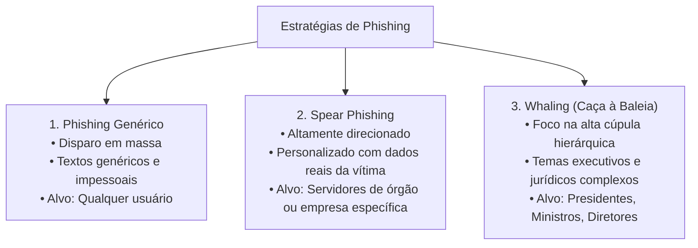
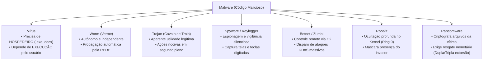
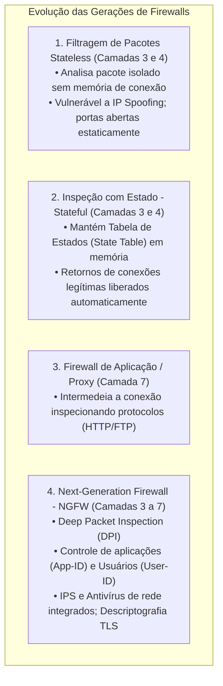
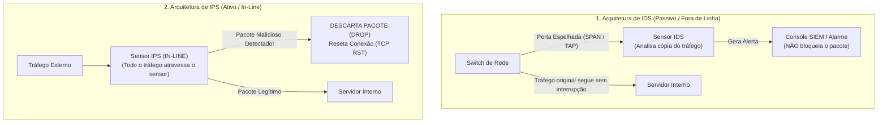
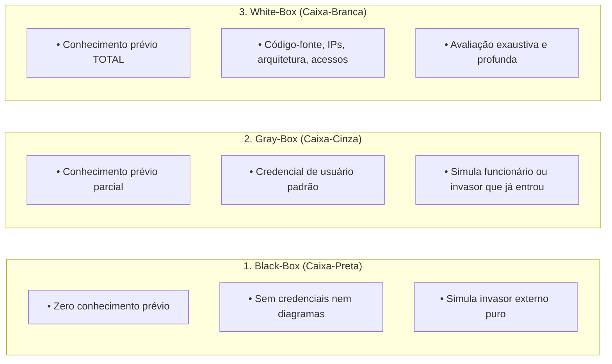
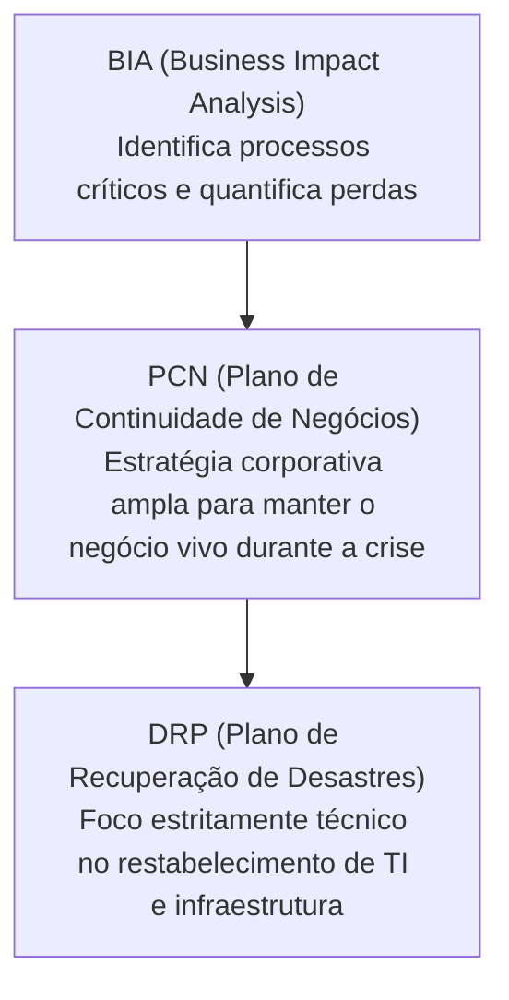
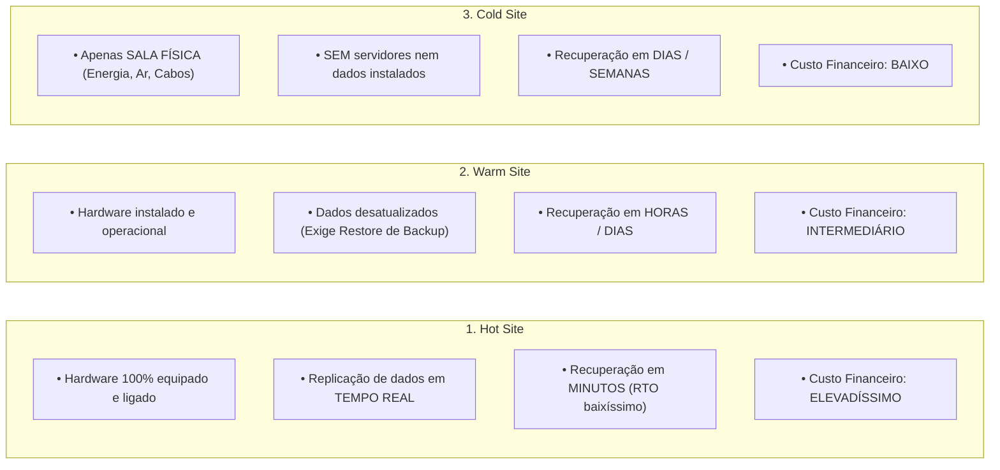

# 05 - Ameaças, Malware, Engenharia Social e Defesa de Redes

> **Matéria:** Segurança da Informação  
> **Cargo:** B02 – Técnico de Controle Externo – Especialidade: Tecnologia da Informação  
> **Arquivo:** `05_ameacas_malware_engenharia_social_e_defesa_de_redes.md`  

---

## 📌 Ementa / Itens do Edital
- Engenharia social e ataques centrados no fator humano (Phishing e variações)
- Códigos maliciosos (Malware): Vírus, Worms, Trojans, Spyware, Botnets e Ransomware
- Dispositivos de defesa perimetral: Firewalls (Packet Filtering, Stateful, NGFW), Antivírus/EDR e IDS/IPS
- Testes de Invasão (PenTest) e Análise de Vulnerabilidades
- Continuidade de Negócios (PCN), Análise de Impacto no Negócio (BIA) e Recuperação de Desastres (DRP)

---

## 🧭 Sumário

1. [Engenharia Social e Ataques Centrados no Fator Humano](#1-engenharia-social-e-ataques-centrados-no-fator-humano)
    1. [Princípios Psicológicos e Mecânica de Manipulação](#11-principios-psicologicos-e-mecanica-de-manipulacao)
    2. [Modalidades de Phishing (Genérico, Spear Phishing e Whaling)](#12-modalidades-de-phishing-generico-spear-phishing-e-whaling)
    3. [Canais Alternativos e Golpes Físicos (Vishing, Smishing, Pretexting e Baiting)](#13-canais-alternativos-e-golpes-fisicos-vishing-smishing-pretexting-e-baiting)
    4. [Teste 399](#Teste-399)
    5. [Teste 400](#Teste-400)
2. [Códigos Maliciosos (Malware) e Vetores de Infecção](#2-codigos-maliciosos-malware-e-vetores-de-infeccao)
    1. [Taxonomia dos Malwares: Vírus vs. Worms vs. Trojans](#21-taxonomia-dos-malwares-virus-vs-worms-vs-trojans)
    2. [Spyware, Keyloggers e Botnets (Redes Zumbis)](#22-spyware-keyloggers-e-botnets-redes-zumbis)
    3. [Rootkits e Ocultação em Nível de Kernel](#23-rootkits-e-ocultacao-em-nivel-de-kernel)
    4. [Ransomware: Criptografia, Dupla/Tripla Extorsão e Defesa](#24-ransomware-criptografia-duplatripla-extorsao-e-defesa)
    5. [Teste 401](#Teste-401)
    6. [Teste 402](#Teste-402)
    7. [Teste 403](#Teste-403)
3. [Tecnologias de Defesa em Profundidade (Defense-in-Depth)](#3-tecnologias-de-defesa-em-profundidade-defense-in-depth)
    1. [Gerações de Firewalls: Stateless vs. Stateful vs. NGFW](#31-geracoes-de-firewalls-stateless-vs-stateful-vs-ngfw)
    2. [IDS vs. IPS: Arquiteturas Passiva vs. In-Line](#32-ids-vs-ips-arquiteturas-passiva-vs-in-line)
    3. [Métodos de Detecção: Assinaturas vs. Anomalias](#33-metodos-de-deteccao-assinaturas-vs-anomalias)
    4. [Antivírus Tradicional vs. EDR e XDR](#34-antivirus-tradicional-vs-edr-e-xdr)
    5. [Teste 404](#Teste-404)
    6. [Teste 405](#Teste-405)
    7. [Teste 406](#Teste-406)
4. [Testes de Invasão (PenTest) e Análise de Vulnerabilidades](#4-testes-de-invasao-pentest-e-analise-de-vulnerabilidades)
    1. [Varredura de Vulnerabilidades vs. PenTest](#41-varredura-de-vulnerabilidades-vs-pentest)
    2. [Modalidades de Teste: Black-Box, White-Box e Gray-Box](#42-modalidades-de-teste-black-box-white-box-e-gray-box)
    3. [Metodologias Padronizadas (PTES e OSSTMM)](#43-metodologias-padronizadas-ptes-e-osstmm)
    4. [Teste 407](#Teste-407)
5. [Continuidade de Negócios e Recuperação de Desastres](#5-continuidade-de-negocios-e-recuperacao-de-desastres)
    1. [Governança de Continuidade: PCN vs. BIA vs. DRP](#51-governanca-de-continuidade-pcn-vs-bia-vs-drp)
    2. [Métricas de Continuidade: RTO, RPO e MTD](#52-metricas-de-continuidade-rto-rpo-e-mtd)
    3. [Centros de Recuperação Alternativos: Hot Site, Warm Site e Cold Site](#53-centros-de-recuperacao-alternativos-hot-site-warm-site-e-cold-site)
    4. [A Regra de Ouro de Backup 3-2-1 e Imutabilidade](#54-a-regra-de-ouro-de-backup-3-2-1-e-imutabilidade)
    5. [Teste 408](#Teste-408)
    6. [Teste 409](#Teste-409)
6. [Fontes Recomendadas na Internet](#6-fontes-recomendadas-na-internet)

---

## 1. Engenharia Social e Ataques Centrados no Fator Humano

### 1.1 Princípios Psicológicos e Mecânica de Manipulação

A **engenharia social** é a arte de manipular psicologicamente pessoas para que elas executem ações voluntárias ou involuntárias que comprometam a segurança, violem políticas institucionais ou divulguem informações sigilosas.

Os cibercriminosos exploram gatilhos emocionais e fraquezas cognitivas universais do ser humano:

- **Autoridade:** Fingir ser um diretor, juiz, auditor-chefe ou técnico do suporte de TI para impor obediência cega.
- **Urgência e Medo:** Alegar o cancelamento imediato de um benefício, processo disciplinar iminente ou bloqueio de contas judiciais caso o destinatário não clique no link imediatamente.
- **Curiosidade e Ganância:** Prometer acesso antecipado a listas secretas, promoções falsas ou planilhas de salários e bônus da instituição.
- **Solidariedade / Confiança:** Simular ser um colega em apuros precisando de ajuda urgente fora do horário comercial.

### 1.2 Modalidades de Phishing (Genérico, Spear Phishing e Whaling)

O **Phishing** é o vetor de ataque inicial mais comum em invasões corporativas mundiais. Divide-se em três modalidades fundamentais de acordo com a sofisticação e o público-alvo:

1. **Phishing Genérico:** Disparos automatizados e maciços de e-mails falsificados fingindo ser de grandes bancos, empresas de entrega ou órgãos públicos gerais (ex.: Receita Federal). O texto é padronizado e impessoal ("Prezado Cliente"), esperando que uma pequena porcentagem clique por engano.
2. **Spear Phishing (*Pesca com Arpão*):** Ataque altamente direcionado e customizado contra um indivíduo, setor ou organização específica. O atacante realiza reconhecimento prévio minucioso em redes sociais (como LinkedIn) e portais da transparência para descobrir o nome de colegas, chefias, projetos em andamento e termos técnicos reais do órgão, produzindo uma mensagem extremamente convincente.
3. **Whaling (*Caça à Baleia*):** Vertente executiva de Spear Phishing direcionada estritamente às autoridades do topo da pirâmide institucional (Ministros de Estado, Desembargadores, Conselheiros de Tribunais de Contas, Presidentes de estatais e Diretores Financeiros/CFOs). Utiliza pretextos corporativos de altíssimo impacto (intimações judiciais de varas federais, fusões sigilosas ou transferências cambiais de grande vulto).

### 1.3 Canais Alternativos e Golpes Físicos (Vishing, Smishing, Pretexting e Baiting)

- **Vishing (*Voice Phishing*):** Aplicação de engenharia social através de ligações de voz (telefone convencional ou celular/VoIP). O invasor simula a voz de operadores de suporte técnico, centrais antifraude de bancos ou auditores internos, orientando a vítima a ditar senhas, tokens OTP ou instalar softwares de acesso remoto.
- **Smishing (*SMS Phishing*):** Disparo de mensagens de texto via SMS contendo links curtos fraudulentos alegando compras suspeitas ou pendências cadastrais imediatas.
- **QRishing (*QR Code Phishing*):** Afixação de adesivos com QR Codes maliciosos sobre QR Codes legítimos em totens de atendimento, mesas de restaurantes ou guias de pagamento, redirecionando o pagamento ou o download para páginas forjadas.
- **Pretexting:** Criação de um pretexto fictício elaborado e envolvente para ludibriar a vítima. O criminoso estuda os hábitos da instituição para sustentar um diálogo complexo e obter informações restritas.
- **Baiting (*Uso de Iscas*):** Exploração da curiosidade ou cupidez física. O atacante abandona dispositivos USB (pendrives) infectados no estacionamento, refeitório ou banheiros do órgão, rotulados com títulos provocantes como *"Folha de Pagamento - Confidencial"* ou *"Inspeção Especial 2026"*. O funcionário que insere o pendrive na máquina de trabalho instala o malware na rede corporativa.
- **Shoulder Surfing:** Técnica de espionagem física direta por observação visual (olhar por cima do ombro) enquanto o servidor digita sua senha de rede, PIN de cartão ou código de acesso no teclado.
- **Dumpster Diving:** Prática física de vasculhar caçambas de descarte e lixeiras de órgãos públicos e empresas em busca de mídias ópticas quebradas, discos descartados, listagens impressas de servidores com matrículas, relatórios gerenciais e notas de serviços de TI.

---

### Teste 399
**(FGV – TJ-AP – Analista Judiciario Apoio Especializado Tecnologia da Informacao Banco de Dados – 2023)**
A empresa de consultoria de segurança Y emitiu um comunicado aos seus clientes sobre um golpe na Internet. O golpe consistia no seguinte: - Os clientes recebem mensagens por e-mail com links maliciosos, abordando temas como aproveitar ofertas de um determinado produto; - O link redireciona para uma página falsa, semelhante ao site da instituição dona do produto, e solicita dados (agência, conta, nº do cartão, celular e senhas) para efetuar a compra; - O impostor liga para a vítima; - Durante a ligação, o impostor solicita que o cliente execute uma atualização de segurança que será enviada; - Após a atualização, o criminoso realiza transações em nome da vítima. O golpe descrito pela empresa Y aos seus clientes é:

* **A)** hoax;
* **B)** email spoofing;
* **C)** interceptação de tráfego;
* **D)** site de comércio eletrônico fraudulento;
* **E)** phishing.

---

> **Comentário Detalhado:**
>
> - **A)** **Incorreta.** A opção apresenta proposição em desacordo com os fundamentos teóricos e técnicos do tópico ao afirmar que "hoax". De acordo com a teoria estudada em *1.3 Canais Alternativos e Golpes Físicos (Vishing, Smishing, Pretexting e Baiting)*, smishing (*SMS Phishing*): Disparo de mensagens de texto via SMS contendo links curtos fraudulentos alegando compras suspeitas ou pendências cadastrais imediatas.
> - **B)** **Incorreta.** A opção apresenta proposição em desacordo com os fundamentos teóricos e técnicos do tópico ao afirmar que "email spoofing". De acordo com a teoria estudada em *1.3 Canais Alternativos e Golpes Físicos (Vishing, Smishing, Pretexting e Baiting)*, pretexting: Criação de um pretexto fictício elaborado e envolvente para ludibriar a vítima. O criminoso estuda os hábitos da instituição para sustentar um diálogo complexo e obter informações restritas.
> - **C)** **Incorreta.** A opção apresenta proposição em desacordo com os fundamentos teóricos e técnicos do tópico ao afirmar que "interceptação de tráfego". De acordo com a teoria estudada em *3.2 IDS vs. IPS: Arquiteturas Passiva vs. In-Line*, analisa apenas uma cópia do tráfego. — Em Linha (*In-Line*): Inserido diretamente no caminho físico dos cabos/links. Todo o tráfego de produção é forçado a atravessar o sensor.
> - **D)** **Incorreta.** A opção apresenta proposição em desacordo com os fundamentos teóricos e técnicos do tópico ao afirmar que "site de comércio eletrônico fraudulento". De acordo com a teoria estudada em *5.3 Centros de Recuperação Alternativos: Hot Site, Warm Site e Cold Site*, não há dados nem servidores no local. — Dias ou semanas. Exige compra emergencial, transporte físico, instalação de hardware e restauração completa de sistemas. — Baixo.
> - **E)** **Correta.** Conforme fundamentado na seção *1.2 Modalidades de Phishing (Genérico, Spear Phishing e Whaling)* deste guia, o atacante realiza reconhecimento prévio minucioso em redes sociais (como LinkedIn) e portais da transparência para descobrir o nome de colegas, chefias, projetos em andamento e termos técnicos reais do órgão, produzindo uma mensagem extremamente convincente. Dessa forma, está plenamente correta a assertiva da banca (FGV – TJ-AP/2023) ao estabelecer que "phishing".
>
> **Gabarito: E**

---

### Teste 400
**(FGV – TJ-AP – Analista Judiciario Apoio Especializado Tecnologia da Informacao Seguranca da Informacao – 2023)**
A equipe de resposta e tratamento de incidentes (ETIR) de um órgão público detectou, por meio de suas ferramentas de monitoramento da rede, um aumento no número de acessos a um determinado domínio de internet. Como resultado do processo de investigação de um possível incidente de segurança, a ETIR identificou que os usuários que acessaram o determinado domínio haviam recebido e-mails com orientação para trocarem suas senhas no sistema de Single Sign-On (SSO) do órgão. O domínio acessado continha uma página de internet, com características similares à página do SSO do órgão, porém, com domínio diferente, cujo objetivo era capturar as credenciais de acesso dos usuários. A ETIR identificou que o órgão sofreu um ataque do tipo:

* **A)** advanced fee fraud;
* **B)** phishing;
* **C)** email spoofing;
* **D)** scanning;
* **E)** snifing.

---

> **Comentário Detalhado:**
>
> - **A)** **Incorreta.** A opção apresenta proposição em desacordo com os fundamentos teóricos e técnicos do tópico ao afirmar que "advanced fee fraud". De acordo com a teoria estudada em *1.2 Modalidades de Phishing (Genérico, Spear Phishing e Whaling)*, phishing Genérico: Disparos automatizados e maciços de e-mails falsificados fingindo ser de grandes bancos, empresas de entrega ou órgãos públicos gerais (ex.: Receita Federal).
> - **B)** **Correta.** Conforme fundamentado na seção *Fases de um Ataque Moderno de Ransomware:* deste guia, intrusão e Reconhecimento: Entrada via phishing, exploração de vulnerabilidades de borda (VPNs desatualizadas) ou credenciais RDP roubadas. Dessa forma, está plenamente correta a assertiva da banca (FGV – TJ-AP/2023) ao estabelecer que "phishing".
> - **C)** **Incorreta.** A opção apresenta proposição em desacordo com os fundamentos teóricos e técnicos do tópico ao afirmar que "email spoofing". De acordo com a teoria estudada em *1.2 Modalidades de Phishing (Genérico, Spear Phishing e Whaling)*, o atacante realiza reconhecimento prévio minucioso em redes sociais (como LinkedIn) e portais da transparência para descobrir o nome de colegas, chefias, projetos em andamento e termos técnicos reais do órgão, produzindo uma mensagem extremamente convincente.
> - **D)** **Incorreta.** A opção apresenta proposição em desacordo com os fundamentos teóricos e técnicos do tópico ao afirmar que "scanning". De acordo com a teoria estudada em *4.1 Varredura de Vulnerabilidades vs. PenTest*, varredura de Vulnerabilidades (*Vulnerability Scanning*): Procedimento passivo e predominantemente automatizado por ferramentas especializadas (como Tenable Nessus, OpenVAS, Qualys).
> - **E)** **Incorreta.** A opção apresenta proposição em desacordo com os fundamentos teóricos e técnicos do tópico ao afirmar que "snifing". De acordo com a teoria estudada em *1.2 Modalidades de Phishing (Genérico, Spear Phishing e Whaling)*, o Phishing é o vetor de ataque inicial mais comum em invasões corporativas mundiais. Divide-se em três modalidades fundamentais de acordo com a sofisticação e o público-alvo.
>
> **Gabarito: B**

---

## 2. Códigos Maliciosos (Malware) e Vetores de Infecção

### 2.1 Taxonomia dos Malwares: Vírus vs. Worms vs. Trojans

Os códigos maliciosos (**Malwares**) diferenciam-se essencialmente pelo seu método de propagação, pela dependência de hospedeiros e pela interação com o usuário:

| Tipo de Malware | Necessita de Arquivo Hospedeiro? | Propaga-se Sozinho pela Rede? | Exige Ação do Usuário para Ativar? | Mecânica Primária de Operação |
|---|---|---|---|---|
| **Vírus** | **SIM** (anexa-se a arquivos executáveis `.exe`, bibliotecas `.dll` ou macros de documentos) | **NÃO** | **SIM** (o usuário precisa abrir ou executar o arquivo infectado) | Corrompe arquivos, destrói setores de disco e replica seu código inserindo-se em outros programas locais. |
| **Worm** *(Verme)* | **NÃO** (é um programa completo autossuficiente) | **SIM** (explora vulnerabilidades ativas em serviços de rede) | **NÃO** (propaga-se de máquina em máquina de forma autônoma) | Consome largura de banda, esgota memória e CPU de servidores e abre portas de conexão remota (*backdoors*). |
| **Cavalo de Troia** *(Trojan)* | Não necessariamente | **NÃO** | **SIM** (o usuário é induzido a executar o programa disfarçado) | Apresenta-se como um software legítimo e atraente (jogo, leitor de PDF, utilitário de sistema), mas executa secretamente rotinas destrutivas ou de espionagem em segundo plano. |

> 🚨 **ALERTA DE PROVA / PEGADINHA FCC:**  
> A banca FCC costuma colocar em enunciados afirmações como:  
> *"O código malicioso que se propaga sozinho pela rede institucional, sem precisar se anexar a nenhum arquivo e sem depender de cliques dos usuários, é classificado como um Vírus."*  
> **ISSO ESTÁ ERRADO!** Esse é o conceito exato de **Worm (Verme)**! O Vírus depende obrigatoriamente de um **arquivo hospedeiro** e da **execução pelo usuário**. O Worm é autônomo e trafega pela rede explorando vulnerabilidades ativas em portas de serviços (ex.: protocolos SMB ou RPC).

### 2.2 Spyware, Keyloggers e Botnets (Redes Zumbis)

- **Spyware:** Programa espião que coleta informações confidenciais sobre as atividades e hábitos do usuário sem o seu consentimento, enviando relatórios para servidores remotos. Viola diretamente o princípio da **Confidencialidade**.
- **Keylogger e Screenlogger:** Variações especializadas de spyware:
    - *Keylogger:* Registra silenciosamente todas as teclas digitadas no teclado físico da máquina (capturando senhas, números de cartão e mensagens).
    - *Screenlogger:* Captura imagens da tela da área de trabalho no momento exato em que o usuário clica com o mouse (técnica usada para burlar teclados virtuais bancários de clique em tela).
- **Botnet (*Rede de Zumbis*):** Uma vasta rede de computadores, servidores ou dispositivos de IoT (*Internet of Things*) previamente infectados por bots maliciosos. Essas máquinas (chamadas de **zumbis**) passam a obedecer cegamente a comandos remotos transmitidos por um atacante (*Botmaster*) através de um servidor de Comando e Controle (**C&C** - *Command and Control*). São utilizadas prioritariamente para:
    - Disparo coordenado de ataques de Negação de Serviço Distribuída (**DDoS**);
    - Disparo de bilhões de mensagens de spam e phishing;
    - Mineração não autorizada de criptomoedas (*cryptojacking*).

### 2.3 Rootkits e Ocultação em Nível de Kernel

O **Rootkit** é uma das ameaças mais perigosas da segurança cibernética. Não se trata necessariamente de um programa destruidor de dados, mas sim de um conjunto sofisticado de ferramentas projetado especificamente para **manter acesso privilegiado permanente e ocultar a presença do invasor** no sistema operacional:

- Opera nas camadas mais profundas e privilegiadas do sistema operacional (nível de **Kernel / Ring 0** ou firmware UEFI).
- **Mecanismo de Ocultação:** Intercepta as chamadas de sistema da API do kernel (*system calls*) para filtrar saídas: se o administrador digitar comandos de diagnóstico como `ps -ef`, `top`, `ls` ou `netstat` no Linux, ou abrir o Gerenciador de Tarefas no Windows, o Rootkit remove os seus próprios processos, arquivos e portas abertas da visualização. Ferramentas antivírus convencionais em modo de usuário (*Ring 3*) não conseguem detectá-lo.

### 2.4 Ransomware: Criptografia, Dupla/Tripla Extorsão e Defesa

O **Ransomware** é uma categoria devastadora de malware que visa sequestrar ativos digitais da organização, impedindo o acesso aos arquivos e cobrando vultosos valores de resgate (geralmente em criptomoedas como Bitcoin ou Monero):

#### Fases de um Ataque Moderno de Ransomware:
1. **Intrusão e Reconhecimento:** Entrada via phishing, exploração de vulnerabilidades de borda (VPNs desatualizadas) ou credenciais RDP roubadas.
2. **Movimento Lateral e Elevação:** Mapeamento do Active Directory e servidores de banco de dados, com destruição prévia dos pontos de restauração e tentativas de apagar cópias de backup conectadas à rede.
3. **Cifragem Híbrida em Lote:** O ransomware cifra os arquivos corporativos locais e em compartilhamentos de rede utilizando uma cifra simétrica rápida (como AES-256) e protege a chave simétrica cifrando-a com uma chave pública assimétrica (RSA-4096) controlada pelos criminosos.
4. **Nota de Resgate:** Exibição de instruções na tela para pagamento.

#### Modalidades de Extorsão:
- **Extorsão Simples:** Ameaça de perda definitiva dos dados caso o resgate não seja pago.
- **Dupla Extorsão (*Double Extortion*):** Antes de criptografar, os criminosos realizam o download furtivo (*exfiltração*) de gigabytes de dados confidenciais (processos sigilosos, auditorias, dados fiscais de contribuintes). Caso a entidade recupere os arquivos por backups próprios e se recuse a pagar, os bandidos ameaçam divulgar publicamente os documentos na *Dark Web*.
- **Tripla Extorsão (*Triple Extortion*):** Além da cifragem e do vazamento, os atacantes contactam diretamente clientes, contribuintes ou órgãos reguladores (LGPD/ANPD), ou desferem ataques DDoS simultâneos contra a organização para amplificar o pânico.

---

### Teste 401
**(FGV – TJ-RR – Analista Judiciario Infraestrutura de Tecnologia da Informacao – 2024)**
Correlacione as afirmativas sobre segurança de ativos em uma rede corporativa a seguir com os tipos de malware contra os quais se pretende proteger. ( ) Trojan. ( ) Worm. ( ) Spyware. ( ) Ransomware. 1. O Firewall pode proteger desse malware bloqueando a replicação dele entre segmentos de rede. 2. A mitigação mais efetiva contra esse malware é a execução regular de backup dos dados. 3. O uso de proxy pode ajudar contra este tipo de malware, realizando varredura contra malware em todos os arquivos baixados por computadores na rede corporativa. 4. O bloqueio de tráfego de saída no firewall pode impedir que os dados obtidos por esse malware sejam exfiltrados através da internet. A relação correta, na ordem apresentada, é

* **A)** 2 – 4 – 3 – 1.
* **B)** 2 – 1 – 4 – 3.
* **C)** 3 – 2 – 1 – 4.
* **D)** 3 – 1 – 4 – 2.
* **E)** 1 – 4 – 3 – 2.

---

> **Comentário Detalhado:**
>
> - **A)** **Incorreta.** A opção apresenta proposição em desacordo com os fundamentos teóricos e técnicos do tópico ao afirmar que "2 – 4 – 3 – 1". De acordo com a teoria estudada em *2.2 Spyware, Keyloggers e Botnets (Redes Zumbis)*, botnet (*Rede de Zumbis*): Uma vasta rede de computadores, servidores ou dispositivos de IoT (*Internet of Things*) previamente infectados por bots maliciosos.
> - **B)** **Incorreta.** A opção apresenta proposição em desacordo com os fundamentos teóricos e técnicos do tópico ao afirmar que "2 – 1 – 4 – 3". De acordo com a teoria estudada em *5.4 A Regra de Ouro de Backup 3-2-1 e Imutabilidade*, adicionalmente, essa cópia deve ser imutável (*WORM - Write Once, Read Many*) ou mantida em isolamento físico da rede corporativa (Air-Gapped), impedindo que malwares apaguem ou criptografem os arquivos de contingência durante o ataque.
> - **C)** **Incorreta.** A opção apresenta proposição em desacordo com os fundamentos teóricos e técnicos do tópico ao afirmar que "3 – 2 – 1 – 4". De acordo com a teoria estudada em *5.4 A Regra de Ouro de Backup 3-2-1 e Imutabilidade*, 3 Cópias: Manter sempre no mínimo três cópias completas de todos os dados essenciais (a cópia primária de produção em uso + duas cópias de segurança de backup).
> - **D)** **Correta.** Conforme fundamentado na seção *2.4 Ransomware: Criptografia, Dupla/Tripla Extorsão e Defesa* deste guia, o Ransomware é uma categoria devastadora de malware que visa sequestrar ativos digitais da organização, impedindo o acesso aos arquivos e cobrando vultosos valores de resgate (geralmente em criptomoedas como Bitcoin ou Monero). Dessa forma, está plenamente correta a assertiva da banca (FGV – TJ-RR/2024) ao estabelecer que "3 – 1 – 4 – 2".
> - **E)** **Incorreta.** A opção apresenta proposição em desacordo com os fundamentos teóricos e técnicos do tópico ao afirmar que "1 – 4 – 3 – 2". De acordo com a teoria estudada em *Fases de um Ataque Moderno de Ransomware:*, movimento Lateral e Elevação: Mapeamento do Active Directory e servidores de banco de dados, com destruição prévia dos pontos de restauração e tentativas de apagar cópias de backup conectadas à rede.
>
> **Gabarito: D**

---

### Teste 402
**(FCC – TRT-15 – Analista Judiciario Tecnologia da Informacao – 2015)**
Considere, abaixo, as células assinaladas por um tique, como características de códigos maliciosos. Como é obtido: Vírus Bot Spyware I. II. Recebido automaticamente pela rede ✔ Recebido por e-mail ✔ ✔ ✔ Baixado de sites na Internet ✔ ✔ ✔ Inserido por um invasor ✔ ✔ ✔ ✔ Ação de outro código malicioso ✔ ✔ ✔ ✔ Como ocorre a instalação: Via execução de outro código malicioso ✔ ✔ Exploração de vulnerabilidades ✔ ✔ ✔ Ações maliciosas mais comuns: Altera e/ou remove arquivos ✔ ✔ Instala outros códigos maliciosos ✔ ✔ Possibilita o retorno do invasor ✔ ✔ Neste caso, I e II correspondem, correta e respectivamente a

* **A)** Rootkit e Trojan.
* **B)** Trojan e Rootkit.
* **C)** Backdoor e Rootkit.
* **D)** Trojan e Backdoor.
* **E)** Rootkit e Backdoor.

---

> **Comentário Detalhado:**
>
> - **A)** **Incorreta.** A opção apresenta proposição em desacordo com os fundamentos teóricos e técnicos do tópico ao afirmar que "Rootkit e Trojan". De acordo com a teoria estudada em *2.1 Taxonomia dos Malwares: Vírus vs. Worms vs. Trojans*, cavalo de Troia *(Trojan)*: Não necessariamente — NÃO — SIM (o usuário é induzido a executar o programa disfarçado) — Apresenta-se como um software legítimo e atraente (jogo, leitor de PDF, utilitário de sistema), mas executa secretamente rotinas destrutivas ou de espionagem em segundo plano.
> - **B)** **Incorreta.** A opção apresenta proposição em desacordo com os fundamentos teóricos e técnicos do tópico ao afirmar que "Trojan e Rootkit". De acordo com a teoria estudada em *2.3 Rootkits e Ocultação em Nível de Kernel*, o Rootkit é uma das ameaças mais perigosas da segurança cibernética.
> - **C)** **Correta.** Conforme fundamentado na seção *2.3 Rootkits e Ocultação em Nível de Kernel* deste guia, mecanismo de Ocultação: Intercepta as chamadas de sistema da API do kernel (*system calls*) para filtrar saídas: se o administrador digitar comandos de diagnóstico como `ps -ef`, `top`, `ls` ou `netstat` no Linux, ou abrir o Gerenciador de Tarefas no Windows, o Rootkit remove os seus próprios processos, arquivos e portas abertas da visualização. Dessa forma, está plenamente correta a assertiva da banca (FCC – TRT-15/2015) ao estabelecer que "Backdoor e Rootkit".
> - **D)** **Incorreta.** A opção apresenta proposição em desacordo com os fundamentos teóricos e técnicos do tópico ao afirmar que "Trojan e Backdoor". De acordo com a teoria estudada em *2.1 Taxonomia dos Malwares: Vírus vs. Worms vs. Trojans*, vírus: SIM (anexa-se a arquivos executáveis `.exe`, bibliotecas `.dll` ou macros de documentos) — NÃO — SIM (o usuário precisa abrir ou executar o arquivo infectado) — Corrompe arquivos, destrói setores de disco e replica seu código inserindo-se em outros programas locais.
> - **E)** **Incorreta.** A opção apresenta proposição em desacordo com os fundamentos teóricos e técnicos do tópico ao afirmar que "Rootkit e Backdoor". De acordo com a teoria estudada em *2.2 Spyware, Keyloggers e Botnets (Redes Zumbis)*, botnet (*Rede de Zumbis*): Uma vasta rede de computadores, servidores ou dispositivos de IoT (*Internet of Things*) previamente infectados por bots maliciosos.
>
> **Gabarito: C**

---

### Teste 403
**(CEBRASPE – TJ-RJ – Analista Judiciario Grupo Tecnologia da Informacao Analista de Seguranca da Informacao – 2021)**
Após avaliação de segurança da rede de comunicação de determinada empresa, identificou-se que alguns servidores Windows Server 2012 estavam infectados com um vírus não detectável pelo antivírus corporativo; observou-se também que o servidor estava desatualizado, com contas administrativas de ex-funcionários ativas e com a filtragem de pacotes desativada. Nessa situação hipotética, as configurações adequadas de hardening incluem

* **A)** desativação de contas não utilizadas, atualização do sistema operacional, ativação de firewall e AppLocker.
* **B)** desativação de contas não utilizadas, atualização do sistema operacional, ativação de Intrusion Prevention System (IPS) e AppLocker.
* **C)** atualização dos sistema operacional e antimalware, ativação de firewall e AppLocker.
* **D)** desativação de contas não utilizadas, atualização do sistema operacional, ativação de Intrusion Prevention System (IPS) e firewall.
* **E)** atualização do sistema operacional e antimalware, ativação de Host Intrusion Prevention System (IPS) e firewall.

---

> **Comentário Detalhado:**
>
> - **A)** **Correta.** Conforme fundamentado na seção *3.4 Antivírus Tradicional vs. EDR e XDR* deste guia, eDR (*Endpoint Detection and Response*): Agente avançado instalado nos endpoints que grava continuamente o comportamento do sistema operacional (criação de processos, alterações no Registro, conexões de rede em tempo real). Dessa forma, está plenamente correta a assertiva da banca (CEBRASPE – TJ-RJ/2021) ao estabelecer que "desativação de contas não utilizadas, atualização do sistema operacional, ativação de firewall e AppLocker".
> - **B)** **Incorreta.** A opção apresenta proposição em desacordo com os fundamentos teóricos e técnicos do tópico ao afirmar que "desativação de contas não utilizadas, atualização do sistema operacional, ativação de Intrusion Prevention System...". De acordo com a teoria estudada em *2. Normas Internacionais de Defesa de Rede e Continuidade de Negócios*, nIST Special Publication 800-94 - Guide to Intrusion Detection and Prevention Systems (IDPS): Manual técnico sobre sistemas de detecção e prevenção de intrusão, arquiteturas passiva vs. *in-line* e métodos de detecção baseados em assinaturas vs. anomalias.
> - **C)** **Incorreta.** A opção apresenta proposição em desacordo com os fundamentos teóricos e técnicos do tópico ao afirmar que "atualização dos sistema operacional e antimalware, ativação de firewall e AppLocker". De acordo com a teoria estudada em *2.3 Rootkits e Ocultação em Nível de Kernel*, não se trata necessariamente de um programa destruidor de dados, mas sim de um conjunto sofisticado de ferramentas projetado especificamente para manter acesso privilegiado permanente e ocultar a presença do invasor no sistema operacional.
> - **D)** **Incorreta.** A opção apresenta proposição em desacordo com os fundamentos teóricos e técnicos do tópico ao afirmar que "desativação de contas não utilizadas, atualização do sistema operacional, ativação de Intrusion Prevention System...". De acordo com a teoria estudada em *2.3 Rootkits e Ocultação em Nível de Kernel*, mecanismo de Ocultação: Intercepta as chamadas de sistema da API do kernel (*system calls*) para filtrar saídas: se o administrador digitar comandos de diagnóstico como `ps -ef`, `top`, `ls` ou `netstat` no Linux, ou abrir o Gerenciador de Tarefas no Windows, o Rootkit remove os seus próprios processos, arquivos e portas abertas da visualização.
> - **E)** **Incorreta.** A opção apresenta proposição em desacordo com os fundamentos teóricos e técnicos do tópico ao afirmar que "atualização do sistema operacional e antimalware, ativação de Host Intrusion Prevention System (IPS) e firewall". De acordo com a teoria estudada em *3.1 Gerações de Firewalls: Stateless vs. Stateful vs. NGFW*, quando um pacote de retorno atinge a interface externa, o firewall consulta sua tabela interna: se o pacote pertencer a uma sessão iniciada legitimamente por um host da rede interna, ele tem passagem concedida automaticamente, sem exigir regras estáticas vulneráveis.
>
> **Gabarito: A**

---

## 3. Tecnologias de Defesa em Profundidade (Defense-in-Depth)

### 3.1 Gerações de Firewalls: Stateless vs. Stateful vs. NGFW

O Firewall é o dispositivo de proteção que controla o fluxo de tráfego de rede entre zonas de confiança distintas, aplicando políticas de filtragem preestabelecidas.

1. **Firewall de Filtragem de Pacotes Sem Estado (*Stateless Packet Filtering*):**
    - Inspeciona cada pacote de forma estritamente individual nas camadas de Rede (IP) e Transporte (TCP/UDP).
    - Avalia apenas: IP de origem, IP de destino, porta de origem, porta de destino e protocolo.
    - *Desvantagem:* Não guarda contexto histórico. Se um cliente interno acessa a web na porta 80, o firewall precisa manter portas dinâmicas altas (1024 a 65535) permanentemente abertas para permitir os pacotes de volta, expondo a rede a invasões.

2. **Firewall de Inspeção com Estado (*Stateful Inspection*):**
    - Mantém uma **Tabela de Estados (*State Table*)** em memória RAM onde rastreia o ciclo de vida completo de cada sessão (estados do *three-way handshake* do TCP).
    - Quando um pacote de retorno atinge a interface externa, o firewall consulta sua tabela interna: se o pacote pertencer a uma sessão iniciada legitimamente por um host da rede interna, ele tem passagem concedida automaticamente, sem exigir regras estáticas vulneráveis.

3. **Firewall de Próxima Geração (*Next-Generation Firewall* - NGFW):**
    - Padrão moderno da indústria que unifica a inspeção com estado clássica com a **Inspeção Profunda de Pacotes (*Deep Packet Inspection* - DPI)**.
    - Reconhece e disciplina tráfego por **Aplicações (App-ID)** em vez de portas fixas (ex.: consegue bloquear transferências de arquivos pelo aplicativo WhatsApp mesmo que o tráfego utilize a porta padrão HTTPS 443).
    - Integra nativamente: Sistemas de Prevenção de Intrusão (IPS), antivírus de rede, controle de acessos atrelado a identidades do Active Directory (User-ID) e quebra/inspeção de fluxos criptografados TLS/SSL (*SSL Decryption*).

### 3.2 IDS vs. IPS: Arquiteturas Passiva vs. In-Line

Os sistemas de detecção e prevenção de intrusão monitoram o tráfego em busca de anomalias, explorações de vulnerabilidades e atividades maliciosas:

| Critério de Comparação | IDS (*Intrusion Detection System*) | IPS (*Intrusion Prevention System*) |
|---|---|---|
| **Topologia / Posicionamento** | **Fora de Linha (*Out-of-Band*):** Conectado a uma porta de espelhamento (*SPAN/Mirror port*) de um switch ou dispositivo TAP. Analisa apenas uma **cópia** do tráfego. | **Em Linha (*In-Line*):** Inserido diretamente no caminho físico dos cabos/links. Todo o tráfego de produção é forçado a atravessar o sensor. |
| **Comportamento Operacional** | **Passivo:** Quando identifica um ataque, gera um alerta (*log*, e-mail, evento SIEM), mas **não tem o poder de bloquear** os pacotes maliciosos em trânsito. | **Ativo:** Quando detecta um padrão malicioso, **bloqueia e descarta (*drop*)** o pacote imediatamente, impedindo que o exploit alcance o servidor de destino. |
| **Impacto de Falhas / Latência** | Adiciona zero latência ao tráfego de rede e, se travar, não interrompe a comunicação da organização. | Adiciona milissegundos de latência à rede e, caso trave sem bypass de hardware (*fail-open*), pode indisponibilizar a rede inteira. |
| **Consequência do Falso Positivo** | Apenas ruído de alerta desnecessário na tela dos analistas do SOC. | **Interrupção de negócios:** descarta pacotes de transações comerciais legítimas, causando negação de serviço involuntária. |

### 3.3 Métodos de Detecção: Assinaturas vs. Anomalias

Tanto IDS/IPS quanto antivírus utilizam dois paradigmas primários de detecção:

1. **Detecção Baseada em Assinaturas (Conhecimento):** Compara os pacotes e arquivos com uma base pré-compilada de sequências de bytes e impressões digitais de ameaças já catalogadas.
    - *Vantagem:* Altíssima precisão e baixíssimo índice de falsos positivos para pragas conhecidas.
    - *Desvantagem:* Totalmente ineficaz contra ataques de dia zero (*zero-day*), malwares polimórficos ou novas variações que alteraram sua assinatura.

2. **Detecção Baseada em Anomalias / Comportamento:** Cria um perfil de normalidade (*baseline*) estatístico do ambiente durante um período de aprendizado. Qualquer desvio substancial dessa linha de base (ex.: um servidor de impressão que repentinamente começa a disparar conexões SSH para 500 máquinas) aciona o alerta.
    - *Vantagem:* Capaz de identificar ameaças inéditas (*zero-day*).
    - *Desvantagem:* Elevado índice de alarmes falsos positivos gerados por comportamentos atípicos, porém legítimos, dos colaboradores.

### 3.4 Antivírus Tradicional vs. EDR e XDR

- **Antivírus Tradicional (EPP - *Endpoint Protection Platform*):** Baseado quase exclusivamente em assinaturas e heurística estática em arquivos locais. Atua de forma preventiva básica, mas não possui visibilidade sobre ataques silenciosos em memória (*fileless malware*).
- **EDR (*Endpoint Detection and Response*):** Agente avançado instalado nos endpoints que grava continuamente o comportamento do sistema operacional (criação de processos, alterações no Registro, conexões de rede em tempo real). Permite isolar remotamente a máquina da rede com um clique, realizar busca ativa de ameaças (*threat hunting*) e reverter alterações maliciosas.
- **XDR (*Extended Detection and Response*):** Evolução que correlaciona telemetria de múltiplos domínios (endpoints, redes corporativas, servidores de e-mail, identidades e nuvem pública) em uma única plataforma analítica automatizada por inteligência artificial.

---

### Teste 404
**(FCC – TRT-2 – Analista Judiciario Tecnologia da Informacao – 2014)**
Independentemente do tipo de tecnologia usada, ao se conectar um computador à rede ele pode estar sujeito a diversos tipos de ataques. De acordo com a cartllha CERT. BR, está correto o que se afirma em:

* **A)** Interceptação de tráfego consiste em adivinhar, por tentativa e erro, um nome de usuário e senha e, assim, executar processos e acessar sites, computadores e serviços com o nome e com os mesmos privilégios deste usuário. Apesar deste ataque poder ser realizado manualmente, na grande maioria dos casos, é realizado com o uso de ferramentas automatizadas que permitem tornar o ataque bem mais efetivo.
* **B)** Varredura em redes é uma técnica que consiste em alterar o conteúdo da página web de um site. Para ganhar mais visibilidade, chamar mais atenção e atingir maior número de visitantes, geralmente os atacantes alteram a página principal do site, porém, páginas internas também podem ser alteradas.
* **C)** Um ataque de força bruta é uma técnica que consiste em efetuar buscas minuciosas em redes, com o objetivo de identificar computadores ativos e coletar informações. Com base nas informações coletadas é possível associar possíveis vulnerabilidades aos serviços disponibilizados, e aos programas instalados nos computadores ativos detectados.
* **D)** Desfiguração ou defacement é uma técnica que consiste em inspecionar os dados trafegados em redes de computadores, por meio do uso de programas específicos chamados de sniffers.
* **E)** Ataque de negação de serviço é uma técnica pela qual um atacante utiliza um computador para tirar de operação um serviço, um computador ou uma rede conectada à Internet. O objetivo é exaurir recursos e causar indisponibilidades ao alvo. Quando isto ocorre, todas as pessoas que dependem dos recursos afetados são prejudicadas, pois ficam impossibilitadas de acessar ou realizar as operações desejadas.

---

> **Comentário Detalhado:**
>
> - **A)** **Incorreta.** A opção apresenta proposição em desacordo com os fundamentos teóricos e técnicos do tópico ao afirmar que "Interceptação de tráfego consiste em adivinhar, por tentativa e erro, um nome de usuário e senha e, assim...". De acordo com a teoria estudada em *1.3 Canais Alternativos e Golpes Físicos (Vishing, Smishing, Pretexting e Baiting)*, shoulder Surfing: Técnica de espionagem física direta por observação visual (olhar por cima do ombro) enquanto o servidor digita sua senha de rede, PIN de cartão ou código de acesso no teclado.
> - **B)** **Incorreta.** A opção apresenta proposição em desacordo com os fundamentos teóricos e técnicos do tópico ao afirmar que "Varredura em redes é uma técnica que consiste em alterar o conteúdo da página web de um site. Para ganhar mais...". De acordo com a teoria estudada em *2.2 Spyware, Keyloggers e Botnets (Redes Zumbis)*, disparo coordenado de ataques de Negação de Serviço Distribuída (DDoS).
> - **C)** **Incorreta.** A opção apresenta proposição em desacordo com os fundamentos teóricos e técnicos do tópico ao afirmar que "Um ataque de força bruta é uma técnica que consiste em efetuar buscas minuciosas em redes, com o objetivo de...". De acordo com a teoria estudada em *2.2 Spyware, Keyloggers e Botnets (Redes Zumbis)*, botnet (*Rede de Zumbis*): Uma vasta rede de computadores, servidores ou dispositivos de IoT (*Internet of Things*) previamente infectados por bots maliciosos.
> - **D)** **Incorreta.** A opção apresenta proposição em desacordo com os fundamentos teóricos e técnicos do tópico ao afirmar que "Desfiguração ou defacement é uma técnica que consiste em inspecionar os dados trafegados em redes de computadores...". De acordo com a teoria estudada em *3.2 IDS vs. IPS: Arquiteturas Passiva vs. In-Line*, consequência do Falso Positivo: Apenas ruído de alerta desnecessário na tela dos analistas do SOC. — Interrupção de negócios: descarta pacotes de transações comerciais legítimas, causando negação de serviço involuntária.
> - **E)** **Correta.** Conforme fundamentado na seção *5.2 Métricas de Continuidade: RTO, RPO e MTD* deste guia, rTO (*Recovery Time Objective* - Objetivo de Tempo de Recuperação): O tempo máximo tolerável decorrido entre o instante do desastre e o momento em que o sistema ou serviço de TI deve estar restabelecido e operando novamente. Dessa forma, está plenamente correta a assertiva da banca (FCC – TRT-2/2014) ao estabelecer que "Ataque de negação de serviço é uma técnica pela qual um atacante utiliza um computador para tirar de operação um...".
>
> **Gabarito: E**

---

### Teste 405
**(FGV – TJ-BA – Analista Judiciario Tecnologia da Informacao – 2015)**
Um equipamento sofreu um ataque de negação de serviço, onde pacotes TCP SYN foram alterados para conter o mesmo endereço IP como endereço IP origem e destino no mesmo pacote, fazendo com que a máquina ficasse em loop, respondendo para ela mesma. Esse ataque explora o uso de:

* **A)** Espionagem (Sniffing);
* **B)** Envenenamento de IP (IP poisoning);
* **C)** Forjamento de pacotes (packet spoofing);
* **D)** Amplificação de pacotes (packet amplification);
* **E)** Fragmentação (fragmentation).

---

> **Comentário Detalhado:**
>
> - **A)** **Incorreta.** A opção apresenta proposição em desacordo com os fundamentos teóricos e técnicos do tópico ao afirmar que "Espionagem (Sniffing)". De acordo com a teoria estudada em *3.1 Gerações de Firewalls: Stateless vs. Stateful vs. NGFW*, padrão moderno da indústria que unifica a inspeção com estado clássica com a Inspeção Profunda de Pacotes (*Deep Packet Inspection* - DPI).
> - **B)** **Incorreta.** A opção apresenta proposição em desacordo com os fundamentos teóricos e técnicos do tópico ao afirmar que "Envenenamento de IP (IP poisoning)". De acordo com a teoria estudada em *3.2 IDS vs. IPS: Arquiteturas Passiva vs. In-Line*, comportamento Operacional: Passivo: Quando identifica um ataque, gera um alerta (*log*, e-mail, evento SIEM), mas não tem o poder de bloquear os pacotes maliciosos em trânsito. — Ativo: Quando detecta um padrão malicioso, bloqueia e descarta (*drop*) o pacote imediatamente, impedindo que o exploit alcance o servidor de destino.
> - **C)** **Correta.** Conforme fundamentado na seção *3.1 Gerações de Firewalls: Stateless vs. Stateful vs. NGFW* deste guia, firewall de Filtragem de Pacotes Sem Estado (*Stateless Packet Filtering*). Dessa forma, está plenamente correta a assertiva da banca (FGV – TJ-BA/2015) ao estabelecer que "Forjamento de pacotes (packet spoofing)".
> - **D)** **Incorreta.** A opção apresenta proposição em desacordo com os fundamentos teóricos e técnicos do tópico ao afirmar que "Amplificação de pacotes (packet amplification)". De acordo com a teoria estudada em *3.2 IDS vs. IPS: Arquiteturas Passiva vs. In-Line*, consequência do Falso Positivo: Apenas ruído de alerta desnecessário na tela dos analistas do SOC. — Interrupção de negócios: descarta pacotes de transações comerciais legítimas, causando negação de serviço involuntária.
> - **E)** **Incorreta.** A opção apresenta proposição em desacordo com os fundamentos teóricos e técnicos do tópico ao afirmar que "Fragmentação (fragmentation)". De acordo com a teoria estudada em *3.1 Gerações de Firewalls: Stateless vs. Stateful vs. NGFW*, *Desvantagem:* Não guarda contexto histórico. Se um cliente interno acessa a web na porta 80, o firewall precisa manter portas dinâmicas altas (1024 a 65535) permanentemente abertas para permitir os pacotes de volta, expondo a rede a invasões.
>
> **Gabarito: C**

---

### Teste 406
**(FGV – TCE-GO – Analista de Controle Externo Tecnologia da Informacao – 2024)**
Assinale a opção correta sobre a segurança de redes de computadores.

* **A)** Os sistemas de detecção de intrusão (IDS) e os sistemas de prevenção de intrusão (IPS) são ferramentas com a mesma função
* **B)** Gestão de vulnerabilidades é um processo para correção de vulnerabilidades em softwares, não tendo relação direta com o firewall.
* **C)** Um sistema de detecção de intrusão (IDS) não funciona numa DMZ (Demilitarized Zone), pois ela necessita de visibilidade completa da rede.
* **D)** O uso de NAC (Network Access Control) não contribui para a gestão de vulnerabilidades.
* **E)** Os Sistemas de detecção de intrusão (IDS) são projetados para monitorar e alertar sobre possíveis intrusões, enquanto sistemas de prevenção de intrusão (IPS) atuam ativamente para bloquear ataques detectados.

---

> **Comentário Detalhado:**
>
> - **A)** **Incorreta.** A opção apresenta proposição em desacordo com os fundamentos teóricos e técnicos do tópico ao afirmar que "Os sistemas de detecção de intrusão (IDS) e os sistemas de prevenção de intrusão (IPS) são ferramentas com a mesma...". De acordo com a teoria estudada em *3. Referências Bibliográficas Clássicas (Padrão ABNT)*, sTALLINGS, William; BROWN, Lawrie. Segurança de Computadores: Princípios e Práticas. 2. ed. Rio de Janeiro: Elsevier, 2014. (Cap. 6, 8 e 9 — Software Malicioso, Sistemas de Detecção de Intrusão IDS/IPS e Firewalls).
> - **B)** **Incorreta.** A opção apresenta proposição em desacordo com os fundamentos teóricos e técnicos do tópico ao afirmar que "Gestão de vulnerabilidades é um processo para correção de vulnerabilidades em softwares, não tendo relação direta...". De acordo com a teoria estudada em *3.1 Gerações de Firewalls: Stateless vs. Stateful vs. NGFW*, integra nativamente: Sistemas de Prevenção de Intrusão (IPS), antivírus de rede, controle de acessos atrelado a identidades do Active Directory (User-ID) e quebra/inspeção de fluxos criptografados TLS/SSL (*SSL Decryption*).
> - **C)** **Incorreta.** A opção apresenta proposição em desacordo com os fundamentos teóricos e técnicos do tópico ao afirmar que "Um sistema de detecção de intrusão (IDS) não funciona numa DMZ (Demilitarized Zone), pois ela necessita de...". De acordo com a teoria estudada em *2. Normas Internacionais de Defesa de Rede e Continuidade de Negócios*, nIST Special Publication 800-94 - Guide to Intrusion Detection and Prevention Systems (IDPS): Manual técnico sobre sistemas de detecção e prevenção de intrusão, arquiteturas passiva vs. *in-line* e métodos de detecção baseados em assinaturas vs. anomalias.
> - **D)** **Incorreta.** A opção apresenta proposição em desacordo com os fundamentos teóricos e técnicos do tópico ao afirmar que "O uso de NAC (Network Access Control) não contribui para a gestão de vulnerabilidades". De acordo com a teoria estudada em *3.2 IDS vs. IPS: Arquiteturas Passiva vs. In-Line*, comportamento Operacional: Passivo: Quando identifica um ataque, gera um alerta (*log*, e-mail, evento SIEM), mas não tem o poder de bloquear os pacotes maliciosos em trânsito. — Ativo: Quando detecta um padrão malicioso, bloqueia e descarta (*drop*) o pacote imediatamente, impedindo que o exploit alcance o servidor de destino.
> - **E)** **Correta.** Conforme fundamentado na seção *3.2 IDS vs. IPS: Arquiteturas Passiva vs. In-Line* deste guia, os sistemas de detecção e prevenção de intrusão monitoram o tráfego em busca de anomalias, explorações de vulnerabilidades e atividades maliciosas. Dessa forma, está plenamente correta a assertiva da banca (FGV – TCE-GO/2024) ao estabelecer que "Os Sistemas de detecção de intrusão (IDS) são projetados para monitorar e alertar sobre possíveis intrusões...".
>
> **Gabarito: E**

---

## 4. Testes de Invasão (PenTest) e Análise de Vulnerabilidades

### 4.1 Varredura de Vulnerabilidades vs. PenTest

- **Varredura de Vulnerabilidades (*Vulnerability Scanning*):** Procedimento passivo e predominantemente automatizado por ferramentas especializadas (como Tenable Nessus, OpenVAS, Qualys). O scanner varre as portas de rede, identifica versões de sistemas operacionais e serviços em execução e correlaciona com bases de dados públicas de vulnerabilidades conhecidas (CVEs). **Não há a exploração ativa da brecha** para tentar obter controle ou acesso administrativo.
- **Teste de Intrusão (*Penetration Testing* / PenTest):** Avaliação de segurança ativa e formalmente autorizada pela organização, conduzida por especialistas humanos (*pentesters*). O profissional não se limita a apontar vulnerabilidades: ele **explora ativamente as falhas**, encadeia vulnerabilidades, contorna defesas, quebra senhas e busca obter acesso privilegiado (*root/administrator*) ou exfiltrar dados sensíveis fictícios para comprovar o impacto no mundo real.

### 4.2 Modalidades de Teste: Black-Box, White-Box e Gray-Box

O PenTest classifica-se segundo a quantidade de informações prévias disponibilizadas aos auditores:

1. **Black-Box (Caixa-Preta):** O auditor não recebe nenhuma informação prévia interna sobre a infraestrutura ou o software do alvo (geralmente apenas o nome da empresa ou o bloco de endereços IP públicos). Simula com máxima fidelidade a perspectiva de um cibercriminoso externo que precisa realizar levantamento de informações (*reconnaissance*) do zero.
2. **White-Box (Caixa-Branca):** O auditor recebe antecipadamente a totalidade das informações técnicas do ambiente: diagramas topológicos de rede, listagens completas de ativos, credenciais de acesso em múltiplos níveis e até o código-fonte das aplicações. Proporciona a auditoria mais completa, precisa e profunda, cobrindo cenários que poderiam passar despercebidos no Black-Box.
3. **Gray-Box (Caixa-Cinza):** Modalidade híbrida onde o pentester recebe informações parciais ou privilégios limitados (por exemplo, uma credencial de acesso de um servidor público comum de nível inicial). Avalia o estrago potencial decorrente de ameaças internas (*insider threats*) ou o que um invasor externo conseguiria fazer logo após comprometer uma estação de trabalho inicial via phishing.

### 4.3 Metodologias Padronizadas (PTES e OSSTMM)

Para assegurar o profissionalismo, a ética e a reprodutibilidade dos testes de invasão, adotam-se frameworks internacionais estruturados:

- **PTES (*Penetration Testing Execution Standard*):** Divide o teste em 7 fases sequenciais bem delimitadas:
    1. Interações Pré-engajamento (*Pre-engagement Interactions* - escopo e regras contratuais);
    2. Coleta de Informações (*Intelligence Gathering*);
    3. Modelagem de Ameaças (*Threat Modeling*);
    4. Análise de Vulnerabilidades (*Vulnerability Analysis*);
    5. Exploração (*Exploitation*);
    6. Pós-Exploração (*Post-Exploitation* - persistência e movimentação lateral);
    7. Relatório Final (*Reporting*).

- **OSSTMM (*Open Source Security Testing Methodology Manual*):** Metodologia científica rigorosa focada na quantificação de métricas de segurança operacional.

---

### Teste 407
**(FGV – TRT-16 – Analista Judiciario Area Administrativa Tecnologia da Informacao – 2022)**
Os firewalls podem ser um meio eficaz de proteger sistemas e redes contra ameaças de segurança. Com relação às suas limitações, analise os itens a seguir. I. Não são capazes de proteger contra os ataques que contornam o firewall. II. Não protegem contra ameaças internas, como funcionários insatisfeitos ou que cooperam com um atacante externo. III. Não protegem contra a transferência de programas ou arquivos infectados com vírus. Está correto o que se afirma em

* **A)** I, apenas.
* **B)** II, apenas.
* **C)** III, apenas.
* **D)** I, II e III.
* **E)** II e III, apenas.

---

> **Comentário Detalhado:**
>
> - **A)** **Incorreta.** A opção incorre em restrição indevida ao limitar o escopo conceitual ao afirmar que "I, apenas". De acordo com a teoria estudada em *4.2 Modalidades de Teste: Black-Box, White-Box e Gray-Box*, avalia o estrago potencial decorrente de ameaças internas (*insider threats*) ou o que um invasor externo conseguiria fazer logo após comprometer uma estação de trabalho inicial via phishing.
> - **B)** **Incorreta.** A opção incorre em restrição indevida ao limitar o escopo conceitual ao afirmar que "II, apenas". De acordo com a teoria estudada em *1. Guias Oficiais de Resposta a Incidentes e Segurança Cibernética*, nIST Special Publication 800-61 Rev. 2 — Computer Security Incident Handling Guide: Guia normativo sobre detecção, análise e contenção de incidentes causados por malwares (worms, trojans, ransomwares, botnets) e ataques de engenharia social.
> - **C)** **Incorreta.** A opção incorre em restrição indevida ao limitar o escopo conceitual ao afirmar que "III, apenas". De acordo com a teoria estudada em *1. Guias Oficiais de Resposta a Incidentes e Segurança Cibernética*, nIST Cybersecurity Framework (CSF 2.0): Diretrizes estratégicas para defesa em profundidade, proteção perimetral, detecção contínua de anomalias e recuperação cibernética contra ataques de ransomware.
> - **D)** **Correta.** Conforme fundamentado na seção *2.1 Taxonomia dos Malwares: Vírus vs. Worms vs. Trojans* deste guia, vírus: SIM (anexa-se a arquivos executáveis `.exe`, bibliotecas `.dll` ou macros de documentos) — NÃO — SIM (o usuário precisa abrir ou executar o arquivo infectado) — Corrompe arquivos, destrói setores de disco e replica seu código inserindo-se em outros programas locais. Dessa forma, está plenamente correta a assertiva da banca (FGV – TRT-16/2022) ao estabelecer que "I, II e III".
> - **E)** **Incorreta.** A opção incorre em restrição indevida ao limitar o escopo conceitual ao afirmar que "II e III, apenas". De acordo com a teoria estudada em *3. Referências Bibliográficas Clássicas (Padrão ABNT)*, sTALLINGS, William; BROWN, Lawrie. Segurança de Computadores: Princípios e Práticas. 2. ed. Rio de Janeiro: Elsevier, 2014. (Cap. 6, 8 e 9 — Software Malicioso, Sistemas de Detecção de Intrusão IDS/IPS e Firewalls).
>
> **Gabarito: D**

---

## 5. Continuidade de Negócios e Recuperação de Desastres

### 5.1 Governança de Continuidade: PCN vs. BIA vs. DRP

A governança corporativa de TI deve assegurar a resiliência institucional perante incidentes disruptivos graves. Esses esforços são articulados em três instrumentos complementares regulamentados pela norma ISO 22301:

1. **BIA (*Business Impact Analysis* - Análise de Impacto no Negócio):** Estudo técnico preliminar que cataloga todos os processos de negócio da organização, identifica aqueles cuja paralisação causaria danos irreparáveis e quantifica os prejuízos financeiros, legais e de imagem causados pela interrupção ao longo do tempo. Serve de subsídio direto para fixar o RTO e o RPO de cada sistema.
2. **PCN / BCP (*Business Continuity Plan* - Plano de Continuidade de Negócios):** Plano estratégico de alto nível com abrangência corporativa integral. Define como a organização continuará prestando seus serviços essenciais (atendimento ao cidadão, folha de pagamento, fiscalizações urgentes) mesmo que a sede física seja destruída por um incêndio ou alagamento, contemplando pessoas, instalações físicas alternativas e comunicação com a imprensa.
3. **DRP (*Disaster Recovery Plan* - Plano de Recuperação de Desastres):** Plano operacional e estritamente técnico de TI. Trata do passo a passo detalhado para recuperar servidores, bancos de dados, redes de comunicação e dados a partir de backups e centros alternativos após uma pane catastrófica.

### 5.2 Métricas de Continuidade: RTO, RPO e MTD

- **RTO (*Recovery Time Objective* - Objetivo de Tempo de Recuperação):** O tempo máximo tolerável decorrido entre o instante do desastre e o momento em que o sistema ou serviço de TI deve estar restabelecido e operando novamente.
- **RPO (*Recovery Point Objective* - Objetivo de Ponto de Recuperação):** A quantidade máxima admissível de dados perdidos, mensurada em unidades de tempo. Se um sistema realiza backups automáticos a cada 1 hora, o RPO é de até 1 hora de transações que precisariam ser redigitadas em caso de pane.
- **MTD (*Maximum Tolerable Downtime* - Tempo Máximo de Paralisação Admissível):** O tempo total limite que um processo de negócio pode permanecer inoperante antes que a instituição sofra danos fatais ou colapso institucional irreversível ($MTD \ge RTO$).

### 5.3 Centros de Recuperação Alternativos: Hot Site, Warm Site e Cold Site

Quando o datacenter principal sofre um desastre físico, a operação é transferida para um centro de processamento alternativo:

| Categoria | Descrição da Infraestrutura | Estado dos Dados | Tempo de Recuperação (RTO) | Custo Financeiro |
|---|---|---|---|---|
| **Hot Site** | Ambiente espelhado idêntico à sede principal. Servidores operacionais, sistemas instalados e conectividade ativa ininterrupta. | **Sincronizados em tempo real** ou quase real via replicação remota de storage. | **Minutos ou segundos.** Praticamente transparente para o usuário. | **Extremamente Elevado.** Exige duplicação completa de hardware e links dedicados. |
| **Warm Site** | Infraestrutura com servidores físicos e storage montados e configurados em rede, aguardando ativação. | **Desatualizados.** Não há sincronismo contínuo; exige restauração de dados (*restore*) a partir das últimas fitas ou cópias de backup. | **Horas ou poucos dias.** | **Intermediário.** |
| **Cold Site** | Apenas o espaço físico predial bruto com suprimento elétrico (geradores), climatização e cabeamento de rede estruturado, sem nenhum servidor nem hardware computacional pré-instalado. | **Sem dados.** Não há dados nem servidores no local. | **Dias ou semanas.** Exige compra emergencial, transporte físico, instalação de hardware e restauração completa de sistemas. | **Baixo.** |

### 5.4 A Regra de Ouro de Backup 3-2-1 e Imutabilidade

A salvaguarda definitiva contra incidentes de sequestro de dados por ransomware e sinistros físicos é a aplicação rigorosa da **Regra 3-2-1**:

- **3 Cópias:** Manter sempre no mínimo três cópias completas de todos os dados essenciais (a cópia primária de produção em uso + duas cópias de segurança de backup).
- **2 Mídias Diferentes:** Armazenar as cópias em pelo menos dois tipos distintos de tecnologias físicas de armazenamento (por exemplo: um array de discos magnéticos/SSDs corporativos locais e uma biblioteca de fitas magnéticas LTO ou armazenamento de objetos na nuvem), mitigando riscos de falhas simultâneas do mesmo fabricante de discos.
- **1 Cópia Offsite / Imutável:** Manter obrigatoriamente pelo menos uma das cópias armazenada **fora do prédio físico principal (*Offsite*)**, em localidade geograficamente distante. Adicionalmente, essa cópia deve ser **imutável (*WORM - Write Once, Read Many*)** ou mantida em isolamento físico da rede corporativa (**Air-Gapped**), impedindo que malwares apaguem ou criptografem os arquivos de contingência durante o ataque.

---

### Teste 408
**(FCC – TRT-15 – Analista Judiciario Tecnologia da Informacao – 2015)**
Sobre um programa de código malicioso − malware, considere: I. É notadamente responsável por consumir muitos recursos devido à grande quantidade de cópias de si mesmo que costuma propagar e, como consequência, pode afetar o desempenho de redes e a utilização de computadores. II. Programa capaz de se propagar automaticamente pelas redes, enviando cópias de si mesmo de computador para computador. III. Diferente do vírus, não se propaga por meio da inclusão de cópias de si mesmo em outros programas ou arquivos, mas sim pela execução direta de suas cópias ou pela exploração automática de vulnerabilidades existentes em programas instalados em computadores. Os itens I, II e III tratam de características de um

* **A)** Keylogger.
* **B)** Scan.
* **C)** Worm.
* **D)** Spoofing.
* **E)** Trojan Proxy.

---

> **Comentário Detalhado:**
>
> - **A)** **Incorreta.** A opção apresenta proposição em desacordo com os fundamentos teóricos e técnicos do tópico ao afirmar que "Keylogger". De acordo com a teoria estudada em *2.1 Taxonomia dos Malwares: Vírus vs. Worms vs. Trojans*, vírus: SIM (anexa-se a arquivos executáveis `.exe`, bibliotecas `.dll` ou macros de documentos) — NÃO — SIM (o usuário precisa abrir ou executar o arquivo infectado) — Corrompe arquivos, destrói setores de disco e replica seu código inserindo-se em outros programas locais.
> - **B)** **Incorreta.** A opção apresenta proposição em desacordo com os fundamentos teóricos e técnicos do tópico ao afirmar que "Scan". De acordo com a teoria estudada em *2.1 Taxonomia dos Malwares: Vírus vs. Worms vs. Trojans*, iSSO ESTÁ ERRADO! Esse é o conceito exato de Worm (Verme)! O Vírus depende obrigatoriamente de um arquivo hospedeiro e da execução pelo usuário.
> - **C)** **Correta.** Conforme fundamentado na seção *2.1 Taxonomia dos Malwares: Vírus vs. Worms vs. Trojans* deste guia, worm *(Verme)*: NÃO (é um programa completo autossuficiente) — SIM (explora vulnerabilidades ativas em serviços de rede) — NÃO (propaga-se de máquina em máquina de forma autônoma) — Consome largura de banda, esgota memória e CPU de servidores e abre portas de conexão remota (*backdoors*). Dessa forma, está plenamente correta a assertiva da banca (FCC – TRT-15/2015) ao estabelecer que "Worm".
> - **D)** **Incorreta.** A opção apresenta proposição em desacordo com os fundamentos teóricos e técnicos do tópico ao afirmar que "Spoofing". De acordo com a teoria estudada em *2.1 Taxonomia dos Malwares: Vírus vs. Worms vs. Trojans*, o Worm é autônomo e trafega pela rede explorando vulnerabilidades ativas em portas de serviços (ex.: protocolos SMB ou RPC).
> - **E)** **Incorreta.** A opção apresenta proposição em desacordo com os fundamentos teóricos e técnicos do tópico ao afirmar que "Trojan Proxy". De acordo com a teoria estudada em *2.1 Taxonomia dos Malwares: Vírus vs. Worms vs. Trojans*, cavalo de Troia *(Trojan)*: Não necessariamente — NÃO — SIM (o usuário é induzido a executar o programa disfarçado) — Apresenta-se como um software legítimo e atraente (jogo, leitor de PDF, utilitário de sistema), mas executa secretamente rotinas destrutivas ou de espionagem em segundo plano.
>
> **Gabarito: C**

---

### Teste 409
**(FGV – TRF-1 – Analista Judiciario Area Apoio Especializado Especialidade Tecnologia da Informacao – 2024)**
Claudio é o administrador de sistemas de uma grande empresa de tecnologia. Ele começou a notar que, em momentos aleatórios, alguns servidores críticos da empresa são interrompidos, paralisando importantes operações de negócios. Após uma investigação aprofundada, Claudio descobre que esses incidentes estão ocorrendo devido a um tipo específico de ataque que usa pacotes cuja estrutura aciona um bug no software de tratamento de rede do sistema. Isso significa que o sistema não pode mais se comunicar pela rede até esse software ser reativado, em geral mediante a reinicialização do sistemaalvo. Esse tipo de ataque denomina-se:

* **A)** spoofing;
* **B)** phishing;
* **C)** man-in-the-middle;
* **D)** pacote envenenado;
* **E)** retrodifusão de tráfego.

---

> **Comentário Detalhado:**
>
> - **A)** **Incorreta.** A opção apresenta proposição em desacordo com os fundamentos teóricos e técnicos do tópico ao afirmar que "spoofing". De acordo com a teoria estudada em *5.1 Governança de Continuidade: PCN vs. BIA vs. DRP*, trata do passo a passo detalhado para recuperar servidores, bancos de dados, redes de comunicação e dados a partir de backups e centros alternativos após uma pane catastrófica.
> - **B)** **Incorreta.** A opção apresenta proposição em desacordo com os fundamentos teóricos e técnicos do tópico ao afirmar que "phishing". De acordo com a teoria estudada em *1.2 Modalidades de Phishing (Genérico, Spear Phishing e Whaling)*, o Phishing é o vetor de ataque inicial mais comum em invasões corporativas mundiais. Divide-se em três modalidades fundamentais de acordo com a sofisticação e o público-alvo.
> - **C)** **Correta.** Conforme fundamentado na seção *5.4 A Regra de Ouro de Backup 3-2-1 e Imutabilidade* deste guia, adicionalmente, essa cópia deve ser imutável (*WORM - Write Once, Read Many*) ou mantida em isolamento físico da rede corporativa (Air-Gapped), impedindo que malwares apaguem ou criptografem os arquivos de contingência durante o ataque. Dessa forma, está plenamente correta a assertiva da banca (FGV – TRF-1/2024) ao estabelecer que "man-in-the-middle".
> - **D)** **Incorreta.** A opção apresenta proposição em desacordo com os fundamentos teóricos e técnicos do tópico ao afirmar que "pacote envenenado". De acordo com a teoria estudada em *3.2 IDS vs. IPS: Arquiteturas Passiva vs. In-Line*, comportamento Operacional: Passivo: Quando identifica um ataque, gera um alerta (*log*, e-mail, evento SIEM), mas não tem o poder de bloquear os pacotes maliciosos em trânsito. — Ativo: Quando detecta um padrão malicioso, bloqueia e descarta (*drop*) o pacote imediatamente, impedindo que o exploit alcance o servidor de destino.
> - **E)** **Incorreta.** A opção apresenta proposição em desacordo com os fundamentos teóricos e técnicos do tópico ao afirmar que "retrodifusão de tráfego". De acordo com a teoria estudada em *3.2 IDS vs. IPS: Arquiteturas Passiva vs. In-Line*, impacto de Falhas / Latência: Adiciona zero latência ao tráfego de rede e, se travar, não interrompe a comunicação da organização. — Adiciona milissegundos de latência à rede e, caso trave sem bypass de hardware (*fail-open*), pode indisponibilizar a rede inteira.
>
> **Gabarito: C**

---

## 6. Fontes Recomendadas na Internet

#### 1. Guias Oficiais de Resposta a Incidentes e Segurança Cibernética
- [NIST Special Publication 800-61 Rev. 2 — Computer Security Incident Handling Guide](https://csrc.nist.gov/pubs/sp/800/61/r2/final): Guia normativo sobre detecção, análise e contenção de incidentes causados por malwares (worms, trojans, ransomwares, botnets) e ataques de engenharia social.
- [NIST Cybersecurity Framework (CSF 2.0)](https://www.nist.gov/cyberframework): Diretrizes estratégicas para defesa em profundidade, proteção perimetral, detecção contínua de anomalias e recuperação cibernética contra ataques de ransomware.
- [Governo Digital — Programa de Privacidade e Segurança da Informação (PPSI 2.0)](https://www.gov.br/governodigital/pt-br/privacidade-e-seguranca/ppsi-2.0): Controles e guias operacionais do Governo Federal voltados à proteção contra códigos maliciosos, cópias de segurança seguras (regra 3-2-1) e gestão de vulnerabilidades.

#### 2. Normas Internacionais de Defesa de Rede e Continuidade de Negócios
- [NIST Special Publication 800-34 Rev. 1 - Contingency Planning Guide for Federal Information Systems](https://csrc.nist.gov/publications/detail/sp/800-34/rev-1/final): Padrão técnico de planejamento de contingência cobrindo BIA (*Business Impact Analysis*), métricas RTO/RPO/MTD, DRP (*Disaster Recovery Plan*) e centros alternativos (*Hot*, *Warm* e *Cold Sites*).
- [NIST Special Publication 800-94 - Guide to Intrusion Detection and Prevention Systems (IDPS)](https://csrc.nist.gov/publications/detail/sp/800-94/final): Manual técnico sobre sistemas de detecção e prevenção de intrusão, arquiteturas passiva vs. *in-line* e métodos de detecção baseados em assinaturas vs. anomalias.

#### 3. Referências Bibliográficas Clássicas (Padrão ABNT)
* STALLINGS, William; BROWN, Lawrie. **Segurança de Computadores: Princípios e Práticas**. 2. ed. Rio de Janeiro: Elsevier, 2014. (Cap. 6, 8 e 9 — Software Malicioso, Sistemas de Detecção de Intrusão IDS/IPS e Firewalls).
* MITNICK, Kevin D.; SIMON, William L. **A Arte de Enganar: Ataques de Hackers: Controlando o Fator Humano na Segurança da Informação**. São Paulo: Pearson Makron Books, 2003. (Cap. 1 a 6 — Fundamentos de Engenharia Social, Pretexting, Phishing e Manipulação Psicológica).
* ASSOCIAÇÃO BRASILEIRA DE NORMAS TÉCNICAS. **ABNT NBR ISO 22301:2020 — Segurança e resiliência — Sistema de gestão de continuidade de negócios — Requisitos**. Rio de Janeiro: ABNT, 2020. (Seção 8 — Análise de Impacto nos Negócios BIA, Estratégias de Continuidade PCN e Planos de Recuperação de Desastres DRP).
