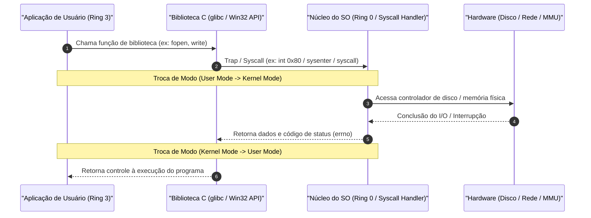
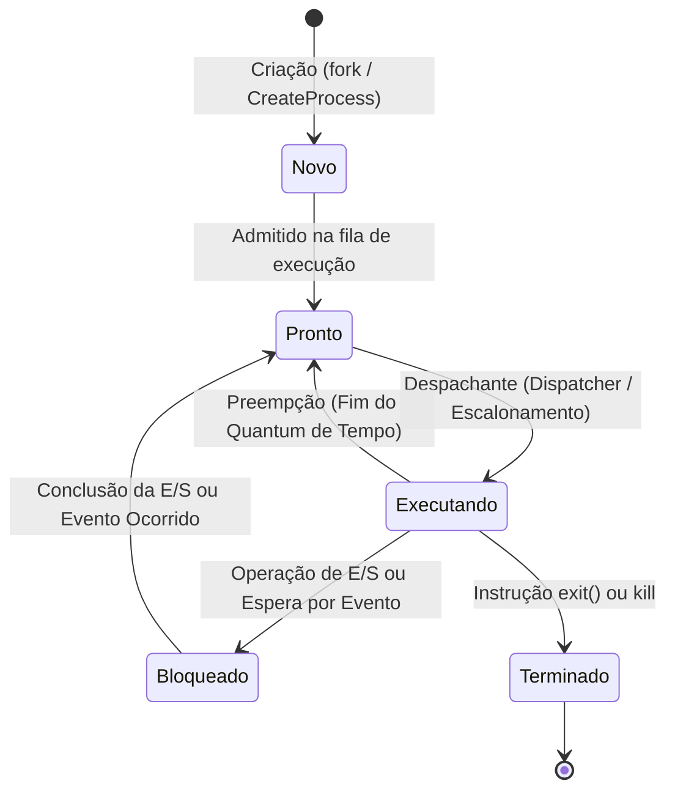
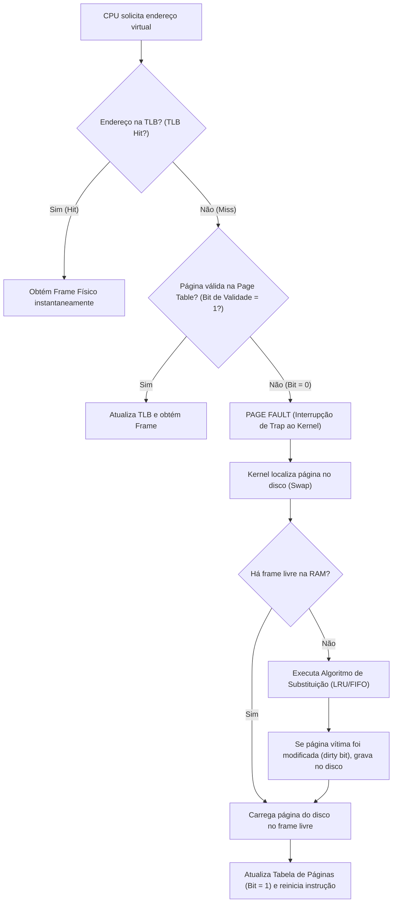
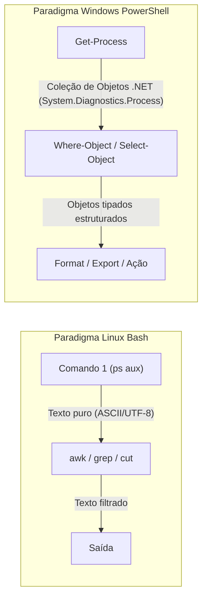

# 01 - Sistemas Operacionais: Linux e Windows

> **Matéria:** Sistemas Operacionais, Redes e Computação em Nuvem  
> **Cargo:** B02 – Técnico de Controle Externo – Especialidade: Tecnologia da Informação  
> **Arquivo:** `01_sistemas_operacionais_linux_e_windows.md`  


---


## 📌 Ementa / Itens do Edital
- Arquitetura de Sistemas Operacionais (Kernel, User Space, Syscalls)
- Gerenciamento de Processos, Threads e Escalonamento de CPU
- Gerenciamento de Memória (Memória Virtual, Paginação e Swapping)
- Sistemas de Arquivos (ext4, XFS, NTFS)
- Administração de Linux: comandos básicos de shell (Bash), permissões e automação por scripts
- Administração de Windows e Windows PowerShell: cmdlets e scripts

---

## 🧭 Sumário

1. [Arquitetura de Sistemas Operacionais e Modos de Operação](#1-arquitetura-de-sistemas-operacionais-e-modos-de-operacao)
    1. [Modos de Operação do Processador (User Mode vs. Kernel Mode)](#11-modos-de-operacao-do-processador-user-mode-vs-kernel-mode)
    2. [Chamadas de Sistema (Syscalls: fork, execve, mmap, kill)](#12-chamadas-de-sistema-syscalls-fork-execve-mmap-kill)
    3. [Tipos de Kernel: Monolítico, Microkernel e Híbrido](#13-tipos-de-kernel-monolitico-microkernel-e-hibrido)
    4. [Teste 410](#Teste-410)
2. [Gerenciamento de Processos, Concorrência e Escalonamento](#2-gerenciamento-de-processos-concorrencia-e-escalonamento)
    1. [Processo vs. Thread (Processo Leve e Compartilhamento de Memória)](#21-processo-vs-thread-processo-leve-e-compartilhamento-de-memoria)
    2. [Ciclo de Vida e Estados de um Processo](#22-ciclo-de-vida-e-estados-de-um-processo)
    3. [PCB e o Custo da Troca de Contexto (Context Switch)](#23-pcb-e-o-custo-da-troca-de-contexto-context-switch)
    4. [Algoritmos de Escalonamento de CPU (FCFS, SJF, SRTF, Round Robin, Prioridades)](#24-algoritmos-de-escalonamento-de-cpu-fcfs-sjf-srtf-round-robin-prioridades)
    5. [Sincronização e Concorrência: Mutex vs. Semáforos](#25-sincronizacao-e-concorrencia-mutex-vs-semaforos)
    6. [Teste 411](#Teste-411)
    7. [Teste 412](#Teste-412)
    8. [Teste 413](#Teste-413)
3. [Gerenciamento de Memória Virtual, Paginação e Swapping](#3-gerenciamento-de-memoria-virtual-paginacao-e-swapping)
    1. [Endereçamento Lógico vs. Físico e o Papel da MMU](#31-enderecamento-logico-vs-fisico-e-o-papel-da-mmu)
    2. [Paginação: Páginas, Molduras (Frames), Tabela de Páginas e TLB](#32-paginacao-paginas-molduras-frames-tabela-de-paginas-e-tlb)
    3. [Falta de Página (Page Fault) e Algoritmos de Substituição](#33-falta-de-pagina-page-fault-e-algoritmos-de-substituicao)
    4. [Swapping e Hiperpaginação (Thrashing)](#34-swapping-e-hiperpaginacao-thrashing)
    5. [Teste 414](#Teste-414)
    6. [Teste 415](#Teste-415)
4. [Sistemas de Arquivos e Permissões no Linux e Windows](#4-sistemas-de-arquivos-e-permissoes-no-linux-e-windows)
    1. [Estrutura do Inode no Linux: O que armazena e o que NÃO armazena](#41-estrutura-do-inode-no-linux-o-que-armazena-e-o-que-nao-armazena)
    2. [Links no Linux: Hard Link vs. Symbolic Link (Soft Link)](#42-links-no-linux-hard-link-vs-symbolic-link-soft-link)
    3. [Sistemas de Arquivos Linux (ext4, XFS) e Windows (NTFS, FAT32)](#43-sistemas-de-arquivos-linux-ext4-xfs-e-windows-ntfs-fat32)
    4. [Permissões Octais (UGO) e Permissões Especiais (SUID, SGID, Sticky Bit)](#44-permissoes-octais-ugo-e-permissoes-especiais-suid-sgid-sticky-bit)
    5. [Teste 416](#Teste-416)
    6. [Teste 417](#Teste-417)
5. [Administração e Shell Scripting no Linux](#5-administracao-e-shell-scripting-no-linux)
    1. [Sinais POSIX (SIGKILL, SIGTERM, SIGHUP, SIGSTOP, SIGCONT)](#51-sinais-posix-sigkill-sigterm-sighup-sigstop-sigcont)
    2. [Comandos Essenciais, Filtros e Redirecionamentos](#52-comandos-essenciais-filtros-e-redirecionamentos)
    3. [Gerenciamento de Serviços com systemd (systemctl e journalctl)](#53-gerenciamento-de-servicos-com-systemd-systemctl-e-journalctl)
    4. [Teste 418](#Teste-418)
    5. [Teste 419](#Teste-419)
6. [Administração de Windows e Windows PowerShell](#6-administracao-de-windows-e-windows-powershell)
    1. [Paradigma do PowerShell: Pipeline Baseado em Objetos .NET](#61-paradigma-do-powershell-pipeline-baseado-em-objetos-net)
    2. [Cmdlets Essenciais de Administração e Filtragem](#62-cmdlets-essenciais-de-administracao-e-filtragem)
    3. [Políticas de Execução de Scripts (ExecutionPolicy)](#63-politicas-de-execucao-de-scripts-executionpolicy)
    4. [Teste 420](#Teste-420)
6. [Fontes Recomendadas na Internet](#6-fontes-recomendadas-na-internet)

---

## 1. Arquitetura de Sistemas Operacionais e Modos de Operação

### 1.1 Modos de Operação do Processador (User Mode vs. Kernel Mode)

O Sistema Operacional atua como intermediário entre o hardware físico e os softwares aplicativos do usuário. Para assegurar integridade, estabilidade e isolamento de segurança, os processadores modernos utilizam anéis de proteção (*Protection Rings*):

1. **Modo Usuário (*User Mode* / Ring 3):**
    - As aplicações e processos de usuário executam com conjunto restrito de instruções.
    - Não possuem acesso direto aos dispositivos de entrada/saída (I/O), interrupções de hardware ou blocos arbitrários de memória física.
    - Qualquer tentativa de executar uma instrução privilegiada gera uma exceção/trap capturada pela CPU.

2. **Modo Núcleo / Kernel (*Kernel Mode* / Supervisor / Ring 0):**
    - O código do núcleo executa com privilégio irrestrito sobre o hardware, tabelas de memória e registradores de controle da CPU.
    - Controla o escalonamento, paginação e drivers de dispositivos.

### 1.2 Chamadas de Sistema (Syscalls: fork, execve, mmap, kill)

Para solicitar serviços privilegiados do hardware (leitura de disco, envio de pacotes pela placa de rede, criação de novos processos), o processo de usuário deve invocar uma **Chamada de Sistema (*System Call* / *Syscall*)**:



#### Principais Syscalls POSIX:
- `fork()`: Cria um novo processo filho que é cópia exata do processo pai (com novo PID). Utiliza a técnica **Copy-on-Write (COW)**: páginas de memória são compartilhadas como somente leitura até que haja uma escrita real, momento em que o frame é duplicado.
- `execve()`: Substitui a imagem atual de memória do processo por um novo programa binário executável.
- `mmap()`: Mapeia arquivos ou dispositivos diretamente no espaço de memória virtual do processo.
- `kill()`: Envia sinais para comunicação e controle de processos.

### 1.3 Tipos de Kernel: Monolítico, Microkernel e Híbrido

| Modelo de Kernel | Características Arquiteturais | Vantagens | Desvantagens | Exemplos Reais |
|---|---|---|---|---|
| **Monolítico** | Todos os serviços essenciais (escalonador, memória, sistemas de arquivos, drivers de dispositivos) rodam no mesmo espaço de memória do Kernel (Ring 0). | Máximo desempenho em chamadas e trocas de mensagens (comunicação direta por ponteiros e funções). | Um bug em um driver de dispositivo ou módulo pode derrubar o sistema inteiro (*Kernel Panic*). | Linux, Unix tradicional, FreeBSD |
| **Microkernel** | Apenas as funções mínimas rodam no Kernel (IPC, gerenciamento básico de memória e escalonador). Drivers, sistemas de arquivos e rede rodam como servidores no Modo Usuário (Ring 3). | Alta modularidade, isolamento de falhas e segurança robusta (se o driver de rede travar, ele é reiniciado sem derrubar o SO). | Queda de desempenho devido ao overhead constante de troca de contexto e IPC por passagem de mensagens entre processos de usuário. | Mach, Minix, QNX |
| **Híbrido** | Combina a modularidade do microkernel com o desempenho do monolítico, executando subsistemas críticos e drivers gráficos/I/O no espaço do Kernel. | Equilíbrio entre flexibilidade arquitetural, facilidade de compatibilidade e velocidade de execução. | Complexidade interna elevada e maior superfície de ataque no Kernel. | Windows NT (10, 11, Server), macOS (XNU) |

---

### Teste 410
**(FCC – TRT-11 – Analista Judiciario Tecnologia da Informacao – 2017)**
Considere que no TRT da 11a Região já exista um computador em operação, equipado com placa mãe e memória RAM compatíveis. Visando aumentar o desempenho desta máquina, um Analista de Sistemas sugeriu a aquisição de mais memória RAM. Neste cenário, é correto afirmar:

* **A)** Pares de módulos de memória RAM (mesmo tamanho, frequência e temporização) podem fornecer um novo caminho para a troca de dados, podendo duplicar a velocidade de comunicação entre memória e placa mãe.
* **B)** Um grande diferencial da RAM DDR3 em relação à DDR2 é o padrão diferenciado na altura do barramento. Na parte central os pinos são mais curtos e têm sua altura aumentada até chegar às pontas do módulo, visando garantir facilidade na instalação e no encaixe do slot.
* **C)** O desempenho da memória RAM é medido pela sua frequência e quanto maior, melhor seu desempenho. Se a frequência da placa mãe for menor, o sistema inteiro passará a trabalhar com a maior frequência da RAM.
* **D)** Há apenas três tipos de RAM: DDR, DDR2 e DDR3. A vantagem é a compatibilidade entre os tipos. Se um componente DDR2 for instalado em um módulo DDR3, por exemplo, a comunicação ocorre sem problemas.
* **E)** É melhor adquirir um módulo de 8 GB do que dois de 4 GB de RAM. Isso porque a maior parte das placas mãe vendidas no mercado possuem a tecnologia Unique Fast Channel-UFC, que confere aumento no desempenho.

---

> **Comentário Detalhado:**
>
> - **A)** **Correta.** Conforme fundamentado na seção *3.1 Endereçamento Lógico vs. Físico e o Papel da MMU* deste guia, endereço Físico: Localização real dos bytes nos circuitos integrados dos módulos de memória RAM. Dessa forma, está plenamente correta a assertiva da banca (FCC – TRT-11/2017) ao estabelecer que "Pares de módulos de memória RAM (mesmo tamanho, frequência e temporização) podem fornecer um novo caminho para a...".
> - **B)** **Incorreta.** A opção apresenta proposição em desacordo com os fundamentos teóricos e técnicos do tópico ao afirmar que "Um grande diferencial da RAM DDR3 em relação à DDR2 é o padrão diferenciado na altura do barramento. Na parte...". De acordo com a teoria estudada em *1.3 Tipos de Kernel: Monolítico, Microkernel e Híbrido*, monolítico: Todos os serviços essenciais (escalonador, memória, sistemas de arquivos, drivers de dispositivos) rodam no mesmo espaço de memória do Kernel (Ring 0). — Máximo desempenho em chamadas e trocas de mensagens (comunicação direta por ponteiros e funções). — Um bug em um driver de dispositivo ou módulo pode derrubar o sistema inteiro (*Kernel Panic*). — Linux, Unix tradicional, FreeBSD.
> - **C)** **Incorreta.** A opção apresenta proposição em desacordo com os fundamentos teóricos e técnicos do tópico ao afirmar que "O desempenho da memória RAM é medido pela sua frequência e quanto maior, melhor seu desempenho. Se a frequência da...". De acordo com a teoria estudada em *1.3 Tipos de Kernel: Monolítico, Microkernel e Híbrido*, híbrido: Combina a modularidade do microkernel com o desempenho do monolítico, executando subsistemas críticos e drivers gráficos/I/O no espaço do Kernel. — Equilíbrio entre flexibilidade arquitetural, facilidade de compatibilidade e velocidade de execução. — Complexidade interna elevada e maior superfície de ataque no Kernel. — Windows NT (10, 11, Server), macOS (XNU).
> - **D)** **Incorreta.** A opção incorre em restrição indevida ao limitar o escopo conceitual ao afirmar que "Há apenas três tipos de RAM: DDR, DDR2 e DDR3. A vantagem é a compatibilidade entre os tipos. Se um componente...". De acordo com a teoria estudada em *3.2 Paginação: Páginas, Molduras (Frames), Tabela de Páginas e TLB*, tLB (*Translation Lookaside Buffer*): Cache associativa de hardware de altíssima velocidade que armazena as traduções recentes de página para frame. Evita que a CPU precise consultar a tabela de páginas na memória RAM a cada instrução (*TLB Hit*).
> - **E)** **Incorreta.** A opção apresenta proposição em desacordo com os fundamentos teóricos e técnicos do tópico ao afirmar que "É melhor adquirir um módulo de 8 GB do que dois de 4 GB de RAM. Isso porque a maior parte das placas mãe vendidas...". De acordo com a teoria estudada em *3.2 Paginação: Páginas, Molduras (Frames), Tabela de Páginas e TLB*, molduras de Página Físicas (*Frames*): Blocos de memória física RAM que possuem rigorosamente o mesmo tamanho das páginas lógicas (tipicamente 4 KB).
>
> **Gabarito: A**

---

## 2. Gerenciamento de Processos, Concorrência e Escalonamento

### 2.1 Processo vs. Thread (Processo Leve e Compartilhamento de Memória)

- **Processo:** Programa em execução que possui seu próprio espaço de endereçamento virtual isolado, tabela de descritores de arquivo, PCB e contexto de segurança. A comunicação entre processos distintos exige mecanismos explícitos de IPC (*Inter-Process Communication*), como pipes, sockets, memória compartilhada ou filas de mensagens.
- **Thread:** Menor unidade de processamento escalonável pela CPU. Múltiplas threads do mesmo processo **compartilham**:
    - O mesmo espaço de endereçamento virtual (segmentos de Código, Dados Globais e Heap);
    - Os mesmos arquivos e sockets abertos;
    - Os mesmos sinais e permissões do processo pai.
    - **O que cada thread possui de forma EXCLUSIVA:** seu próprio Program Counter (PC), registradores de CPU e sua própria Pilha de Execução (*Stack* - variáveis locais e fluxo de chamadas).

### 2.2 Ciclo de Vida e Estados de um Processo



- **Novo (*New*):** O processo está sendo criado e suas estruturas estão sendo alocadas.
- **Pronto (*Ready*):** O processo dispõe de todos os recursos necessários e aguarda na fila apenas a atribuição da CPU pelo escalonador.
- **Executando (*Running*):** As instruções do processo estão sendo ativamente processadas pela CPU.
- **Bloqueado / Espera (*Waiting* / *Blocked*):** O processo não pode executar porque aguarda a conclusão de uma operação externa de Entrada/Saída (leitura de disco, teclado) ou a liberação de um lock de sincronização.
- **Terminado (*Terminated*):** O processo encerrou sua execução e aguarda o processo pai recolher seu código de retorno (`wait()`). Se o pai não o recolhe, ele permanece temporariamente como processo *zumbi*.

### 2.3 PCB e o Custo da Troca de Contexto (Context Switch)

O **Bloco de Controle de Processo (PCB - *Process Control Block*)** é a estrutura de dados que armazena todas as informações do processo enquanto ele não está executando na CPU: estado, Program Counter (PC), registradores, informações de escalonamento, ponteiros de memória e descritores de arquivos abertos.

A **Troca de Contexto (*Context Switch*)** é o procedimento pelo qual a CPU interrompe um processo, salva seu contexto no PCB e carrega o contexto do próximo processo a executar. Trata-se de uma operação de **overhead puro** (a CPU não executa trabalho útil de aplicação durante a troca):

- Salva e restaura registradores;
- Altera tabelas de mapeamento de memória virtual na MMU;
- Invalida entradas de cache no TLB;
- Causa perda temporária de localidade nas memórias cache L1/L2/L3 da CPU.

### 2.4 Algoritmos de Escalonamento de CPU (FCFS, SJF, SRTF, Round Robin, Prioridades)

| Algoritmo | Natureza | Mecânica de Funcionamento | Principais Desvantagens / Efeitos Colaterais |
|---|---|---|---|
| **FCFS (First-Come, First-Served)** | Não Preemptivo | Atende processos estritamente na ordem cronológica de chegada na fila de prontos. | **Efeito Comboio (*Convoy Effect*):** processos curtos ficam retidos atrás de um processo longo com carga intensiva de CPU. |
| **SJF (Shortest Job First)** | Não Preemptivo | Seleciona o processo com a menor rajada de CPU (*CPU burst*) estimada. Minimiza o tempo médio de espera. | Provoca **Inanição (*Starvation*)** de processos longos caso cheguem novos processos curtos ininterruptamente. Difícil prever a próxima rajada. |
| **SRTF (Shortest Remaining Time First)** | Preemptivo | Versão preemptiva do SJF: se um processo chega com tempo restante menor que o em execução, ocorre preempção. | Também sofre de inanição (*starvation*) e gera alto overhead de trocas de contexto. |
| **Round Robin (Alternância Circular)** | Preemptivo | Cada processo recebe uma fatia fixa de tempo de CPU denominada **Quantum**. Ao esgotar o quantum, sofre preempção e vai para o final da fila de prontos. | Se o quantum for **muito grande**, o algoritmo degenera em FCFS. Se for **muito pequeno**, a CPU perde rendimento útil com excesso de **Trocas de Contexto (*Context Switch*)**. |
| **Escalonamento por Prioridades** | Preemptivo ou Não | A CPU é alocada ao processo de maior prioridade numérica. | Inanição de processos de baixa prioridade. A solução canônica é o **Envelhecimento (*Aging*)**, que incrementa a prioridade do processo conforme ele espera na fila. |
| **Filas Multinível com Realimentação (MLFQ)** | Preemptivo | Processos movem-se entre diferentes filas com diferentes fatias de tempo. Processos I/O-bound ganham alta prioridade e quantum curto; CPU-bound caem para filas de menor prioridade com quantum longo. | Algoritmo mais complexo e configurável da engenharia de SO. |

### 2.5 Sincronização e Concorrência: Mutex vs. Semáforos

Quando múltiplos processos ou threads acessam variáveis e recursos compartilhados concorrentemente, podem ocorrer condições de corrida (*race conditions*). Para proteger a **Região Crítica**, utilizam-se primitivas de sincronização:

> 🚨 **ALERTA DE PROVA / PEGADINHA FCC:**  
> A FCC frequentemente cobra a distinção entre **Mutex** e **Semáforo**:  
>
> - O **Mutex** (*Mutual Exclusion*) é um mecanismo de travamento binário com **conceito de propriedade (*ownership*)**: estritamente a thread que adquiriu o lock é quem tem o direito de liberá-lo.  
> - O **Semáforo** é uma variável inteira atômica sem conceito de posse: qualquer processo ou thread pode executar a operação `signal()` / `post()` para incrementar o contador, prestando-se tanto à exclusão mútua (semáforo binário) quanto à sinalização e sincronização de eventos entre processos.

---

### Teste 411
**(FUMARC – TRT-3 – Analista Judiciario Apoio Especializado Tecnologia da Informacao – 2022)**
Em relação aos conceitos relacionados a processos em Sistemas Operacionais, considere o seguinte diagrama de estados, mostrando os três estados nos quais um processo pode se encontrar. 29 De acordo com o diagrama, analise as afirmativas a seguir: I – Um processo pode estar nos estados “Em execução”, “Bloqueado” e “Pronto”. II – A transição de número “2” ocorre quando o escalonador decide que o processo em execução foi executado por tempo suficiente e é o momento de deixar outro processo ter algum tempo de CPU. III – A transição de número “4” ocorre quando o escalonador escolhe o processo que estava bloqueado para chegar à CPU e ser executado novamente. Está CORRETO o que se afirma em:

* **A)** I, apenas.
* **B)** I e II, apenas.
* **C)** I e III, apenas.
* **D)** II e III, apenas.
* **E)** I, II e III.

---

> **Comentário Detalhado:**
>
> - **A)** **Incorreta.** A opção incorre em restrição indevida ao limitar o escopo conceitual ao afirmar que "I, apenas". De acordo com a teoria estudada em *2.4 Algoritmos de Escalonamento de CPU (FCFS, SJF, SRTF, Round Robin, Prioridades)*, sRTF (Shortest Remaining Time First): Preemptivo — Versão preemptiva do SJF: se um processo chega com tempo restante menor que o em execução, ocorre preempção. — Também sofre de inanição (*starvation*) e gera alto overhead de trocas de contexto.
> - **B)** **Correta.** Conforme fundamentado na seção *2.2 Ciclo de Vida e Estados de um Processo* deste guia, pronto (*Ready*): O processo dispõe de todos os recursos necessários e aguarda na fila apenas a atribuição da CPU pelo escalonador. Dessa forma, está plenamente correta a assertiva da banca (FUMARC – TRT-3/2022) ao estabelecer que "I e II, apenas".
> - **C)** **Incorreta.** A opção incorre em restrição indevida ao limitar o escopo conceitual ao afirmar que "I e III, apenas". De acordo com a teoria estudada em *5.1 Sinais POSIX (SIGKILL, SIGTERM, SIGHUP, SIGSTOP, SIGCONT)*, `SIGKILL` (Sinal 9): Termina o processo imediatamente e de forma incondicional. Não pode ser capturado, bloqueado nem ignorado pelo processo; o kernel finaliza a execução compulsoriamente.
> - **D)** **Incorreta.** A opção incorre em restrição indevida ao limitar o escopo conceitual ao afirmar que "II e III, apenas". De acordo com a teoria estudada em *2.2 Ciclo de Vida e Estados de um Processo*, bloqueado / Espera (*Waiting* / *Blocked*): O processo não pode executar porque aguarda a conclusão de uma operação externa de Entrada/Saída (leitura de disco, teclado) ou a liberação de um lock de sincronização.
> - **E)** **Incorreta.** A opção apresenta proposição em desacordo com os fundamentos teóricos e técnicos do tópico ao afirmar que "I, II e III". De acordo com a teoria estudada em *5.1 Sinais POSIX (SIGKILL, SIGTERM, SIGHUP, SIGSTOP, SIGCONT)*, `SIGSTOP` (Sinal 19): Pausa a execução do processo. Não pode ser capturado nem ignorado.
>
> **Gabarito: B**

---

### Teste 412
**(FGV – TJ-RR – Analista Judiciario Gestao e Governanca de Tecnologia da Informacao – 2024)**
A maioria dos projetos de computadores modernos baseia-se em conceitos desenvolvidos por John Von Neumann. Para a execução de uma instrução, diversos componentes do sistema computacional são envolvidos, tais como processadores, barramentos, operadores lógicos e memórias. O ciclo de execução de uma instrução pode abranger várias operações, dependendo da natureza da instrução. A seguir, são apresentadas quatro etapas do ciclo de execução de uma instrução: I. A busca do código de operação na memória principal, localizado no endereço indicado pelo Ciclo de Instrução, e seu armazenamento no Registrador de Instrução. II. A Unidade de Controle comanda a execução da instrução e, se necessário, processa os dados disponíveis nos registradores. III. Caso a instrução exija, a Unidade de Controle busca o(s) dado(s) na memória e os armazena nos registradores. Esta fase se repete até que todos os dados necessários à execução sejam transferidos. IV. O Decodificador de Instrução decodifica o código de operação contido no Registrador de Instrução. A sequência correta dessas etapas, desde o início até a execução da instrução, é

* **A)** III – I – IV – II.
* **B)** I – III – IV – II.
* **C)** I – IV – III – II.
* **D)** III – I – II – IV.
* **E)** III – IV – I – II.

---

> **Comentário Detalhado:**
>
> - **A)** **Incorreta.** A opção apresenta proposição em desacordo com os fundamentos teóricos e técnicos do tópico ao afirmar que "III – I – IV – II". De acordo com a teoria estudada em *2.3 PCB e o Custo da Troca de Contexto (Context Switch)*, o Bloco de Controle de Processo (PCB - *Process Control Block*) é a estrutura de dados que armazena todas as informações do processo enquanto ele não está executando na CPU: estado, Program Counter (PC), registradores, informações de escalonamento, ponteiros de memória e descritores de arquivos abertos.
> - **B)** **Incorreta.** A opção apresenta proposição em desacordo com os fundamentos teóricos e técnicos do tópico ao afirmar que "I – III – IV – II". De acordo com a teoria estudada em *1.1 Modos de Operação do Processador (User Mode vs. Kernel Mode)*, o código do núcleo executa com privilégio irrestrito sobre o hardware, tabelas de memória e registradores de controle da CPU.
> - **C)** **Correta.** Conforme fundamentado na seção *1.1 Modos de Operação do Processador (User Mode vs. Kernel Mode)* deste guia, o Sistema Operacional atua como intermediário entre o hardware físico e os softwares aplicativos do usuário. Para assegurar integridade, estabilidade e isolamento de segurança, os processadores modernos utilizam anéis de proteção (*Protection Rings*). Dessa forma, está plenamente correta a assertiva da banca (FGV – TJ-RR/2024) ao estabelecer que "I – IV – III – II".
> - **D)** **Incorreta.** A opção apresenta proposição em desacordo com os fundamentos teóricos e técnicos do tópico ao afirmar que "III – I – II – IV". De acordo com a teoria estudada em *2.1 Processo vs. Thread (Processo Leve e Compartilhamento de Memória)*, o mesmo espaço de endereçamento virtual (segmentos de Código, Dados Globais e Heap).
> - **E)** **Incorreta.** A opção apresenta proposição em desacordo com os fundamentos teóricos e técnicos do tópico ao afirmar que "III – IV – I – II". De acordo com a teoria estudada em *6. Fontes Recomendadas na Internet*, tANENBAUM, Andrew S.; BOS, Herbert. Sistemas Operacionais Modernos. 4. ed. São Paulo: Pearson Education do Brasil, 2016. (Cap. 2 - Processos e Threads; Cap. 3 - Gerenciamento de Memória; Cap. 10 - Estudo de Caso 1: Linux; Cap. 11 - Estudo de Caso 2: Windows).
>
> **Gabarito: C**

---

### Teste 413
**(FGV – TJ-BA – Analista Judiciario Tecnologia da Informacao – 2015)**
Em ambiente Linux, o comando ps –axl permite visualizar informações sobre todos os processos existentes no sistema, em especial os estados dos processos. Se o estado relatado para um certo processo é Z (zombie), isso indica que tal processo:

* **A)** acabou de ser criado e aguarda para executar;
* **B)** está bloqueado, aguardando por um recurso;
* **C)** está órfão, aguardando reparentização;
* **D)** está morto, aguardando que o processo pai providencie sua extinção;
* **E)** sofreu preempção.

---

> **Comentário Detalhado:**
>
> - **A)** **Incorreta.** A opção apresenta proposição em desacordo com os fundamentos teóricos e técnicos do tópico ao afirmar que "acabou de ser criado e aguarda para executar". De acordo com a teoria estudada em *2.2 Ciclo de Vida e Estados de um Processo*, bloqueado / Espera (*Waiting* / *Blocked*): O processo não pode executar porque aguarda a conclusão de uma operação externa de Entrada/Saída (leitura de disco, teclado) ou a liberação de um lock de sincronização.
> - **B)** **Incorreta.** A opção apresenta proposição em desacordo com os fundamentos teóricos e técnicos do tópico ao afirmar que "está bloqueado, aguardando por um recurso". De acordo com a teoria estudada em *2.1 Processo vs. Thread (Processo Leve e Compartilhamento de Memória)*, os mesmos sinais e permissões do processo pai.
> - **C)** **Incorreta.** A opção apresenta proposição em desacordo com os fundamentos teóricos e técnicos do tópico ao afirmar que "está órfão, aguardando reparentização". De acordo com a teoria estudada em *Principais Syscalls POSIX:*, `fork()`: Cria um novo processo filho que é cópia exata do processo pai (com novo PID). Utiliza a técnica Copy-on-Write (COW): páginas de memória são compartilhadas como somente leitura até que haja uma escrita real, momento em que o frame é duplicado.
> - **D)** **Correta.** Conforme fundamentado na seção *2.2 Ciclo de Vida e Estados de um Processo* deste guia, terminado (*Terminated*): O processo encerrou sua execução e aguarda o processo pai recolher seu código de retorno (`wait()`). Se o pai não o recolhe, ele permanece temporariamente como processo *zumbi*. Dessa forma, está plenamente correta a assertiva da banca (FGV – TJ-BA/2015) ao estabelecer que "está morto, aguardando que o processo pai providencie sua extinção".
> - **E)** **Incorreta.** A opção apresenta proposição em desacordo com os fundamentos teóricos e técnicos do tópico ao afirmar que "sofreu preempção". De acordo com a teoria estudada em *2.4 Algoritmos de Escalonamento de CPU (FCFS, SJF, SRTF, Round Robin, Prioridades)*, sRTF (Shortest Remaining Time First): Preemptivo — Versão preemptiva do SJF: se um processo chega com tempo restante menor que o em execução, ocorre preempção. — Também sofre de inanição (*starvation*) e gera alto overhead de trocas de contexto.
>
> **Gabarito: D**

---

## 3. Gerenciamento de Memória Virtual, Paginação e Swapping

### 3.1 Endereçamento Lógico vs. Físico e o Papel da MMU

A **Memória Virtual** desvincula o espaço de endereçamento lógico manipulado pelo programa da memória RAM física real. Isso permite que um programa execute mesmo que seu tamanho ultrapasse a memória RAM disponível:

- **Endereço Lógico (Virtual):** Gerado pelo processador durante a execução das instruções do código.
- **Endereço Físico:** Localização real dos bytes nos circuitos integrados dos módulos de memória RAM.
- **MMU (*Memory Management Unit*):** Chip integrado ao processador que converte endereços virtuais em endereços físicos em tempo de execução consultando a Tabela de Páginas.

### 3.2 Paginação: Páginas, Molduras (Frames), Tabela de Páginas e TLB

- **Páginas Lógicas (*Pages*):** Blocos de tamanho fixo em que a memória virtual do processo é dividida.
- **Molduras de Página Físicas (*Frames*):** Blocos de memória física RAM que possuem **rigorosamente o mesmo tamanho** das páginas lógicas (tipicamente 4 KB).
- **Tabela de Páginas (*Page Table*):** Matriz mantida pelo kernel que armazena o mapeamento entre o número da página virtual e o número do frame físico correspondente, além de bits de controle:
    - *Bit de Validade/Presença:* `1` indica que a página está carregada na RAM; `0` indica que está no disco (Swap) ou é inválida.
    - *Dirty Bit (Modificado):* `1` indica que a página foi alterada desde que foi lida do disco e precisará ser gravada de volta antes de ser descartada.
- **TLB (*Translation Lookaside Buffer*):** Cache associativa de hardware de altíssima velocidade que armazena as traduções recentes de página para frame. Evita que a CPU precise consultar a tabela de páginas na memória RAM a cada instrução (*TLB Hit*).

### 3.3 Falta de Página (Page Fault) e Algoritmos de Substituição



#### O Ciclo de Tratamento de Page Fault:
1. A CPU gera uma interrupção de falta de página (*Page Fault trap*) transferindo o controle ao kernel;
2. O kernel verifica se o endereço é válido e localiza a página no disco de swap;
3. Se não houver moldura livre na RAM, executa um algoritmo de substituição de páginas:
    - **FIFO (*First-In, First-Out*):** Substitui a página mais antiga na RAM (sofre da Anomalia de Belady, onde aumentar a RAM pode aumentar as faltas de página).
    - **LRU (*Least Recently Used*):** Substitui a página que não foi utilizada pelo maior intervalo de tempo no passado (aproximação do algoritmo ótimo teórico).

4. O frame é carregado do disco e a tabela de páginas é atualizada (bit = 1), reiniciando a instrução original.

### 3.4 Swapping e Hiperpaginação (Thrashing)

- **Swapping:** Movimentação de páginas ou de processos inteiros entre a memória RAM física e a partição/arquivo de troca no disco (**Swap**).
- **Hiperpaginação (*Thrashing*):** Ocorre quando o sistema passa substancialmente mais tempo realizando operações de I/O de leitura e escrita de páginas no disco do que executando instruções úteis dos programas. Decorre de uma sobrecarga onde a soma dos conjuntos de trabalho (*working sets*) dos processos ativos supera a capacidade física da memória RAM.

---

### Teste 414
**(FGV – TRT-24 – Analista Judiciario Area Apoio Especializado Tecnologia da Informacao – 2025)**
Os discos rígidos fornecem a maior parte da memória secundária em que os sistemas de arquivos são mantidos. Analise as afirmativas a seguir sobre as características que tornam os discos convenientes para o fim citado. I. Um disco rígido pode ser regravado inúmeras vezes durante sua vida útil; é possível que o sistema operacional leia um ou mais blocos do disco, modifique-os e grave-os de volta no mesmo local. II. Um disco permite acesso direto a qualquer bloco, é simples acessar arquivos sequencial ou randomicamente, a permutação de um arquivo para outro requer apenas a movimentação dos cabeçotes e a espera pela rotação do disco. III. Para melhorar a eficiência de operações de entrada e saída (E/S), as transferências entre memória e disco são executadas em blocos; cada bloco tem um ou mais setores cujo tamanho pode variar de 32 a 4.096 bytes. Está correto o que se afirma em

* **A)** I, apenas.
* **B)** III, apenas.
* **C)** I e II, apenas.
* **D)** II e III, apenas.
* **E)** I, II e III, apenas.

---

> **Comentário Detalhado:**
>
> - **A)** **Incorreta.** A opção incorre em restrição indevida ao limitar o escopo conceitual ao afirmar que "I, apenas". De acordo com a teoria estudada em *2.2 Ciclo de Vida e Estados de um Processo*, bloqueado / Espera (*Waiting* / *Blocked*): O processo não pode executar porque aguarda a conclusão de uma operação externa de Entrada/Saída (leitura de disco, teclado) ou a liberação de um lock de sincronização.
> - **B)** **Incorreta.** A opção incorre em restrição indevida ao limitar o escopo conceitual ao afirmar que "III, apenas". De acordo com a teoria estudada em *3.4 Swapping e Hiperpaginação (Thrashing)*, hiperpaginação (*Thrashing*): Ocorre quando o sistema passa substancialmente mais tempo realizando operações de I/O de leitura e escrita de páginas no disco do que executando instruções úteis dos programas.
> - **C)** **Incorreta.** A opção incorre em restrição indevida ao limitar o escopo conceitual ao afirmar que "I e II, apenas". De acordo com a teoria estudada em *4.3 Sistemas de Arquivos Linux (ext4, XFS) e Windows (NTFS, FAT32)*, suporta listas de controle de acesso (ACLs - DACL e SACL), journaling via Master File Table (MFT), cotas de disco, compressão nativa de arquivos e criptografia no nível de arquivo via EFS (*Encrypting File System*).
> - **D)** **Incorreta.** A opção incorre em restrição indevida ao limitar o escopo conceitual ao afirmar que "II e III, apenas". De acordo com a teoria estudada em *3.4 Swapping e Hiperpaginação (Thrashing)*, swapping: Movimentação de páginas ou de processos inteiros entre a memória RAM física e a partição/arquivo de troca no disco (Swap).
> - **E)** **Correta.** Conforme fundamentado na seção *1.1 Modos de Operação do Processador (User Mode vs. Kernel Mode)* deste guia, não possuem acesso direto aos dispositivos de entrada/saída (I/O), interrupções de hardware ou blocos arbitrários de memória física. Dessa forma, está plenamente correta a assertiva da banca (FGV – TRT-24/2025) ao estabelecer que "I, II e III, apenas".
>
> **Gabarito: E**

---

### Teste 415
**(CEBRASPE – TJ-RJ – Analista Judiciario Grupo Tecnologia da Informacao Analista de Infraestrutura de Tic – 2021)**
Determinada aplicação começou a apresentar um tempo de resposta alto e, por vezes, não respondia às requisições. Ao acessar o servidor da aplicação e verificar o estado geral da máquina, observou-se grande lentidão, alto consumo da RAM, que, em vários momentos, chegava a mais de 98%, e um número muito alto de page fault nos processos da aplicação e consumo de memória swap. A falha anteriormente descrita, evidenciada pelo alto número de páginas de memória não mapeadas pela unidade de gerenciamento de memória, pelo alto consumo da memória principal e pela alocação de processos da memória principal para a memória secundária, é denominada

* **A)** thrashing.
* **B)** erro de paginação antecipada.
* **C)** erro de paginação por demanda.
* **D)** swapping.
* **E)** relocação estática.

---

> **Comentário Detalhado:**
>
> - **A)** **Correta.** Conforme fundamentado na seção *3.4 Swapping e Hiperpaginação (Thrashing)* deste guia, swapping: Movimentação de páginas ou de processos inteiros entre a memória RAM física e a partição/arquivo de troca no disco (Swap). Dessa forma, está plenamente correta a assertiva da banca (CEBRASPE – TJ-RJ/2021) ao estabelecer que "thrashing".
> - **B)** **Incorreta.** A opção apresenta proposição em desacordo com os fundamentos teóricos e técnicos do tópico ao afirmar que "erro de paginação antecipada". De acordo com a teoria estudada em *3.4 Swapping e Hiperpaginação (Thrashing)*, hiperpaginação (*Thrashing*): Ocorre quando o sistema passa substancialmente mais tempo realizando operações de I/O de leitura e escrita de páginas no disco do que executando instruções úteis dos programas.
> - **C)** **Incorreta.** A opção apresenta proposição em desacordo com os fundamentos teóricos e técnicos do tópico ao afirmar que "erro de paginação por demanda". De acordo com a teoria estudada em *3.2 Paginação: Páginas, Molduras (Frames), Tabela de Páginas e TLB*, tabela de Páginas (*Page Table*): Matriz mantida pelo kernel que armazena o mapeamento entre o número da página virtual e o número do frame físico correspondente, além de bits de controle.
> - **D)** **Incorreta.** A opção apresenta proposição em desacordo com os fundamentos teóricos e técnicos do tópico ao afirmar que "swapping". De acordo com a teoria estudada em *3.4 Swapping e Hiperpaginação (Thrashing)*, decorre de uma sobrecarga onde a soma dos conjuntos de trabalho (*working sets*) dos processos ativos supera a capacidade física da memória RAM.
> - **E)** **Incorreta.** A opção apresenta proposição em desacordo com os fundamentos teóricos e técnicos do tópico ao afirmar que "relocação estática". De acordo com a teoria estudada em *O Ciclo de Tratamento de Page Fault:*, fIFO (*First-In, First-Out*): Substitui a página mais antiga na RAM (sofre da Anomalia de Belady, onde aumentar a RAM pode aumentar as faltas de página).
>
> **Gabarito: A**

---

## 4. Sistemas de Arquivos e Permissões no Linux e Windows

### 4.1 Estrutura do Inode no Linux: O que armazena e o que NÃO armazena

O **Inode (*Index Node*)** é a estrutura central de dados que descreve cada arquivo ou diretório em sistemas baseados em Unix/Linux:

- **O que o Inode ARMAZENA:**
    - Modo e tipo do arquivo (regular, diretório, socket, pipe, link simbólico);
    - Permissões de acesso (`rwx`);
    - Identificador do Dono (UID) e Grupo (GID);
    - Tamanho exato em bytes;
    - Carimbos temporais (`atime`, `mtime`, `ctime`);
    - Contador de ligações diretas (*link count*);
    - Ponteiros diretos e indiretos para os blocos de dados no disco.
- **O que o Inode NÃO ARMAZENA:**
    - **O NOME do arquivo!**
    - **O CAMINHO (path) do arquivo!**  
  > 🚨 **REGRA DE OURO FCC:** O nome do arquivo e o número do seu inode ficam armazenados nos blocos de dados do **diretório pai** (estrutura *dentry*), e não dentro do próprio inode.

### 4.2 Links no Linux: Hard Link vs. Symbolic Link (Soft Link)

| Propriedade / Comportamento | Hard Link (`ln origem destino`) | Symbolic Link (`ln -s origem destino`) |
|---|---|---|
| **Número de Inode** | Aponta diretamente para o **mesmo número de Inode** do arquivo original. | Possui um **novo Inode próprio** do tipo `l`, contendo o caminho textual de destino. |
| **Cruzamento de Partições** | **NÃO** pode cruzar partições ou sistemas de arquivos diferentes (inodes colidiriam). | **SIM**, pode cruzar discos, partições e pontos de montagem livremente. |
| **Apontamento para Diretórios** | Não permitido para usuários comuns (evita loops cíclicos). | Permitido apontar para diretórios livremente. |
| **Exclusão do Arquivo Original** | O conteúdo **permanece íntegro** e acessível até que o contador de links caia para zero. | O link simbólico fica **quebrado / órfão (*dangling link*)**, apontando para um caminho inexistente. |

### 4.3 Sistemas de Arquivos Linux (ext4, XFS) e Windows (NTFS, FAT32)

- **Linux ext4:** Sistema de arquivos padrão na maioria das distribuições Linux. Suporta **journaling** (diário de transações que previne corrupção de metadados em quedas de energia) com três modos (`journal`, `ordered`, `writeback`), alocação por extensões (*extents*) e volumes de até 1 Exabyte.
- **Linux XFS:** Sistema de arquivos escalável de 64 bits de altíssimo desempenho, padrão no RHEL, otimizado para operações paralelas e manipulação de arquivos gigantescos.
- **Windows NTFS (*New Technology File System*):** Padrão do Windows corporativo. Suporta listas de controle de acesso (ACLs - DACL e SACL), journaling via Master File Table (**MFT**), cotas de disco, compressão nativa de arquivos e criptografia no nível de arquivo via **EFS** (*Encrypting File System*).
- **FAT32:** Sistema legado com compatibilidade universal, mas limitado a arquivos individuais de no máximo **4 GB** e sem suporte nativo a permissões de segurança ACL.

### 4.4 Permissões Octais (UGO) e Permissões Especiais (SUID, SGID, Sticky Bit)

As permissões básicas dividem-se em Usuário Dono (`u`), Grupo (`g`) e Outros (`o`):

- Leitura (`r`) = $4$
- Escrita (`w`) = $2$
- Execução (`x`) = $1$

$$\text{Exemplo: } 750 \implies \text{Dono: } 4+2+1=7\,(rwx); \quad \text{Grupo: } 4+0+1=5\,(r-x); \quad \text{Outros: } 0\,(---)$$

#### Permissões Especiais:
1. **SUID (*Set User ID* - 4000 / `rwsr-xr-x`):** Executa o programa com os privilégios do **proprietário do arquivo**, e não de quem o chamou (ex.: `/usr/bin/passwd`).
2. **SGID (*Set Group ID* - 2000 / `rwxr-sr-x`):** Em diretórios, faz com que quaisquer novos arquivos ou subdiretórios criados **herdem automaticamente o grupo do diretório pai**.
3. **Sticky Bit (1000 / `rwxrwxrwt`):** Aplicado a diretórios públicos (como `/tmp`). Impede que um usuário exclua ou renomeie arquivos pertencentes a outros usuários, mesmo com permissão $777$.

---

### Teste 416
**(FUMARC – TRT-3 – Analista Judiciario Apoio Especializado Tecnologia da Informacao – 2022)**
30 Analise as afirmativas a seguir referentes aos sistemas de arquivos journaling: I – A ideia de um sistema de arquivos journaling é manter um diário (registro) das operações que o sistema de arquivos deve realizar, antes mesmo de se iniciar a execução da operação. II – Para que as informações registradas no diário possam ser usadas em caso de falhas, é necessário que as entradas do diário tenham sido gravadas em disco, antes de se iniciar a execução das operações. III – Os sistemas de arquivos NTFS da Microsoft e Linux ext3 são exemplos de sistemas de arquivos que usam journaling. Está CORRETO o que se afirma em:

* **A)** I e II, apenas.
* **B)** I e III, apenas.
* **C)** II e III, apenas.
* **D)** III, apenas.
* **E)** I, II e III.

---

> **Comentário Detalhado:**
>
> - **A)** **Incorreta.** A opção incorre em restrição indevida ao limitar o escopo conceitual ao afirmar que "I e II, apenas". De acordo com a teoria estudada em *4.3 Sistemas de Arquivos Linux (ext4, XFS) e Windows (NTFS, FAT32)*, linux XFS: Sistema de arquivos escalável de 64 bits de altíssimo desempenho, padrão no RHEL, otimizado para operações paralelas e manipulação de arquivos gigantescos.
> - **B)** **Incorreta.** A opção incorre em restrição indevida ao limitar o escopo conceitual ao afirmar que "I e III, apenas". De acordo com a teoria estudada em *4.3 Sistemas de Arquivos Linux (ext4, XFS) e Windows (NTFS, FAT32)*, suporta listas de controle de acesso (ACLs - DACL e SACL), journaling via Master File Table (MFT), cotas de disco, compressão nativa de arquivos e criptografia no nível de arquivo via EFS (*Encrypting File System*).
> - **C)** **Incorreta.** A opção incorre em restrição indevida ao limitar o escopo conceitual ao afirmar que "II e III, apenas". De acordo com a teoria estudada em *4.3 Sistemas de Arquivos Linux (ext4, XFS) e Windows (NTFS, FAT32)*, linux ext4: Sistema de arquivos padrão na maioria das distribuições Linux.
> - **D)** **Incorreta.** A opção incorre em restrição indevida ao limitar o escopo conceitual ao afirmar que "III, apenas". De acordo com a teoria estudada em *4.3 Sistemas de Arquivos Linux (ext4, XFS) e Windows (NTFS, FAT32)*, fAT32: Sistema legado com compatibilidade universal, mas limitado a arquivos individuais de no máximo 4 GB e sem suporte nativo a permissões de segurança ACL.
> - **E)** **Correta.** Conforme fundamentado na seção *4.3 Sistemas de Arquivos Linux (ext4, XFS) e Windows (NTFS, FAT32)* deste guia, suporta journaling (diário de transações que previne corrupção de metadados em quedas de energia) com três modos (`journal`, `ordered`, `writeback`), alocação por extensões (*extents*) e volumes de até 1 Exabyte. Dessa forma, está plenamente correta a assertiva da banca (FUMARC – TRT-3/2022) ao estabelecer que "I, II e III".
>
> **Gabarito: E**

---

### Teste 417
**(FGV – TCE-GO – Analista de Controle Externo Tecnologia da Informacao – 2024)**
Com relação à criação de links entre arquivos, em ambientes operacionais Linux, assinale V para afirmativa verdadeira e F para a falsa. ( ) Não é possível criar links físicos para um diretório ou arquivo especial, apenas para arquivos regulares. ( ) Links simbólicos só podem ser usados se ambos os arquivos estiverem no mesmo sistema de arquivos. ( ) Mesmo que o arquivo original seja excluído, o conteúdo do arquivo ainda estará disponível, desde que pelo menos um link físico exista. As afirmativas são, respectivamente:

* **A)** V, V e V
* **B)** F, V e F
* **C)** V, F e F
* **D)** V, F e V
* **E)** F, V e V

---

> **Comentário Detalhado:**
>
> - **A)** **Incorreta.** A opção apresenta proposição em desacordo com os fundamentos teóricos e técnicos do tópico ao afirmar que "V, V e V". De acordo com a teoria estudada em *4.2 Links no Linux: Hard Link vs. Symbolic Link (Soft Link)*, número de Inode: Aponta diretamente para o mesmo número de Inode do arquivo original. — Possui um novo Inode próprio do tipo `l`, contendo o caminho textual de destino.
> - **B)** **Incorreta.** A opção apresenta proposição em desacordo com os fundamentos teóricos e técnicos do tópico ao afirmar que "F, V e F". De acordo com a teoria estudada em *4.1 Estrutura do Inode no Linux: O que armazena e o que NÃO armazena*, modo e tipo do arquivo (regular, diretório, socket, pipe, link simbólico).
> - **C)** **Incorreta.** A opção apresenta proposição em desacordo com os fundamentos teóricos e técnicos do tópico ao afirmar que "V, F e F". De acordo com a teoria estudada em *4.2 Links no Linux: Hard Link vs. Symbolic Link (Soft Link)*, cruzamento de Partições: NÃO pode cruzar partições ou sistemas de arquivos diferentes (inodes colidiriam). — SIM, pode cruzar discos, partições e pontos de montagem livremente.
> - **D)** **Correta.** Conforme fundamentado na seção *4.2 Links no Linux: Hard Link vs. Symbolic Link (Soft Link)* deste guia, exclusão do Arquivo Original: O conteúdo permanece íntegro e acessível até que o contador de links caia para zero. — O link simbólico fica quebrado / órfão (*dangling link*), apontando para um caminho inexistente. Dessa forma, está plenamente correta a assertiva da banca (FGV – TCE-GO/2024) ao estabelecer que "V, F e V".
> - **E)** **Incorreta.** A opção apresenta proposição em desacordo com os fundamentos teóricos e técnicos do tópico ao afirmar que "F, V e V". De acordo com a teoria estudada em *4.2 Links no Linux: Hard Link vs. Symbolic Link (Soft Link)*, apontamento para Diretórios: Não permitido para usuários comuns (evita loops cíclicos). — Permitido apontar para diretórios livremente.
>
> **Gabarito: D**

---

## 5. Administração e Shell Scripting no Linux

### 5.1 Sinais POSIX (SIGKILL, SIGTERM, SIGHUP, SIGSTOP, SIGCONT)

- `SIGKILL` (Sinal 9): Termina o processo imediatamente e de forma incondicional. **Não pode ser capturado, bloqueado nem ignorado** pelo processo; o kernel finaliza a execução compulsoriamente.
- `SIGTERM` (Sinal 15): Sinal padrão do comando `kill`. Solicita a terminação graciosa do processo, permitindo que ele feche conexões e salve dados antes de sair.
- `SIGHUP` (Sinal 1): Desconexão de terminal (*hangup*). Utilizado comumente para forçar *daemons* a recarregar arquivos de configuração sem reiniciar o serviço.
- `SIGSTOP` (Sinal 19): Pausa a execução do processo. **Não pode ser capturado nem ignorado**.
- `SIGCONT` (Sinal 18): Retoma a execução de um processo previamente pausado.

### 5.2 Comandos Essenciais, Filtros e Redirecionamentos

- `ps aux`: Lista processos detalhados de todos os usuários (`a`), com usuário associado (`u`) e sem terminal (`x`).
- `grep -rn "padrao" /caminho`: Busca recursiva (`-r`) exibindo a linha (`-n`).
- `find /var/log -type f -name "*.log" -mtime -7`: Localiza arquivos regulares modificados nos últimos 7 dias.
- **Redirecionadores de Fluxo:**
    - `>`: Sobrescreve a saída padrão (stdout / descritor 1).
    - `>>`: Anexa à saída padrão.
    - `2>`: Redireciona a saída de erros (stderr / descritor 2).
    - `2>&1`: Redireciona os erros para o mesmo destino da saída padrão.
    - `|` (Pipe): Conecta a saída padrão de um comando à entrada padrão do próximo.

### 5.3 Gerenciamento de Serviços com systemd (systemctl e journalctl)

O **systemd** é o sistema de inicialização padrão do Linux moderno:

- `systemctl start <servico>`: Inicia o serviço imediatamente na sessão corrente.
- `systemctl enable <servico>`: Configura o serviço para iniciar automaticamente no boot do SO.
- `systemctl status <servico>`: Exibe o estado operacional e os últimos logs do serviço.
- `journalctl -u <servico> -f`: Monitora os logs do serviço em tempo real.

---

### Teste 418
**(CEBRASPE – TJ-RJ – Analista Judiciario Grupo Tecnologia da Informacao Analista de Infraestrutura de Tic – 2021)**
O escalador do sistema operacional identificou que o processo P1 não poderia prosseguir em sua execução, mesmo ainda tendo tempo de CPU, assim, efetuou sua transição para o estado E1. Após o recebimento de um evento aguardado, ocorreu uma nova transição para o estado E2. Com base nessa situação hipotética, é correto afirmar que E1 refere-se ao estado

* **A)** bloqueado, pois estava temporariamente parado dando lugar a outro processo, enquanto E2 refere-se ao estado de em execução, pois estava usando a CPU naquele instante.
* **B)** em execução, pois estava usando a CPU naquele instante, enquanto E2 refere-se ao estado de pronto, pois estava incapaz de executar enquanto não ocorresse um evento externo.
* **C)** em execução, pois estava usando a CPU naquele instante, enquanto E2 refere-se ao estado de pronto, pois estava temporariamente parado dando lugar a outro processo.
* **D)** em execução, pois estava usando a CPU naquele instante, enquanto E2 refere-se ao estado bloqueado, pois estava incapaz de executar enquanto não ocorresse um evento externo.
* **E)** bloqueado, pois estava incapaz de executar enquanto não ocorresse um evento externo, enquanto E2 refere-se ao estado de pronto, pois estava temporariamente parado dando lugar a outro processo.

---

> **Comentário Detalhado:**
>
> - **A)** **Incorreta.** A opção apresenta proposição em desacordo com os fundamentos teóricos e técnicos do tópico ao afirmar que "bloqueado, pois estava temporariamente parado dando lugar a outro processo, enquanto E2 refere-se ao estado de em...". De acordo com a teoria estudada em *2.2 Ciclo de Vida e Estados de um Processo*, terminado (*Terminated*): O processo encerrou sua execução e aguarda o processo pai recolher seu código de retorno (`wait()`). Se o pai não o recolhe, ele permanece temporariamente como processo *zumbi*.
> - **B)** **Incorreta.** A opção apresenta proposição em desacordo com os fundamentos teóricos e técnicos do tópico ao afirmar que "em execução, pois estava usando a CPU naquele instante, enquanto E2 refere-se ao estado de pronto, pois estava...". De acordo com a teoria estudada em *2.2 Ciclo de Vida e Estados de um Processo*, pronto (*Ready*): O processo dispõe de todos os recursos necessários e aguarda na fila apenas a atribuição da CPU pelo escalonador.
> - **C)** **Incorreta.** A opção apresenta proposição em desacordo com os fundamentos teóricos e técnicos do tópico ao afirmar que "em execução, pois estava usando a CPU naquele instante, enquanto E2 refere-se ao estado de pronto, pois estava...". De acordo com a teoria estudada em *2.3 PCB e o Custo da Troca de Contexto (Context Switch)*, o Bloco de Controle de Processo (PCB - *Process Control Block*) é a estrutura de dados que armazena todas as informações do processo enquanto ele não está executando na CPU: estado, Program Counter (PC), registradores, informações de escalonamento, ponteiros de memória e descritores de arquivos abertos.
> - **D)** **Incorreta.** A opção apresenta proposição em desacordo com os fundamentos teóricos e técnicos do tópico ao afirmar que "em execução, pois estava usando a CPU naquele instante, enquanto E2 refere-se ao estado bloqueado, pois estava...". De acordo com a teoria estudada em *5.1 Sinais POSIX (SIGKILL, SIGTERM, SIGHUP, SIGSTOP, SIGCONT)*, `SIGKILL` (Sinal 9): Termina o processo imediatamente e de forma incondicional. Não pode ser capturado, bloqueado nem ignorado pelo processo; o kernel finaliza a execução compulsoriamente.
> - **E)** **Correta.** Conforme fundamentado na seção *2.2 Ciclo de Vida e Estados de um Processo* deste guia, bloqueado / Espera (*Waiting* / *Blocked*): O processo não pode executar porque aguarda a conclusão de uma operação externa de Entrada/Saída (leitura de disco, teclado) ou a liberação de um lock de sincronização. Dessa forma, está plenamente correta a assertiva da banca (CEBRASPE – TJ-RJ/2021) ao estabelecer que "bloqueado, pois estava incapaz de executar enquanto não ocorresse um evento externo, enquanto E2 refere-se ao...".
>
> **Gabarito: E**

---

### Teste 419
**(FCC – TRT-23 – Analista Judiciario Apoio Especializado Tecnologia da Informacao – 2016)**
O administrador de um computador servidor que utiliza o sistema operacional Linux executou o comando renice no prompt de um terminal shell. O objetivo do administrador, com a execução desse comando, é

* **A)** renomear os arquivos de um diretório sequencialmente.
* **B)** reinstalar o driver de software de um dispositivo.
* **C)** reordenar, em ordem cronológica, a listagem de arquivos.
* **D)** alterar a prioridade de execução de um processo.
* **E)** listar os arquivos de biblioteca necessários para a execução de um programa.

---

> **Comentário Detalhado:**
>
> - **A)** **Incorreta.** A opção apresenta proposição em desacordo com os fundamentos teóricos e técnicos do tópico ao afirmar que "renomear os arquivos de um diretório sequencialmente". De acordo com a teoria estudada em *Permissões Especiais:*, sGID (*Set Group ID* - 2000 / `rwxr-sr-x`): Em diretórios, faz com que quaisquer novos arquivos ou subdiretórios criados herdem automaticamente o grupo do diretório pai.
> - **B)** **Incorreta.** A opção apresenta proposição em desacordo com os fundamentos teóricos e técnicos do tópico ao afirmar que "reinstalar o driver de software de um dispositivo". De acordo com a teoria estudada em *1.3 Tipos de Kernel: Monolítico, Microkernel e Híbrido*, monolítico: Todos os serviços essenciais (escalonador, memória, sistemas de arquivos, drivers de dispositivos) rodam no mesmo espaço de memória do Kernel (Ring 0). — Máximo desempenho em chamadas e trocas de mensagens (comunicação direta por ponteiros e funções). — Um bug em um driver de dispositivo ou módulo pode derrubar o sistema inteiro (*Kernel Panic*). — Linux, Unix tradicional, FreeBSD.
> - **C)** **Incorreta.** A opção apresenta proposição em desacordo com os fundamentos teóricos e técnicos do tópico ao afirmar que "reordenar, em ordem cronológica, a listagem de arquivos". De acordo com a teoria estudada em *2.4 Algoritmos de Escalonamento de CPU (FCFS, SJF, SRTF, Round Robin, Prioridades)*, fCFS (First-Come, First-Served): Não Preemptivo — Atende processos estritamente na ordem cronológica de chegada na fila de prontos. — Efeito Comboio (*Convoy Effect*): processos curtos ficam retidos atrás de um processo longo com carga intensiva de CPU.
> - **D)** **Correta.** Conforme fundamentado na seção *2.4 Algoritmos de Escalonamento de CPU (FCFS, SJF, SRTF, Round Robin, Prioridades)* deste guia, escalonamento por Prioridades: Preemptivo ou Não — A CPU é alocada ao processo de maior prioridade numérica. — Inanição de processos de baixa prioridade. Dessa forma, está plenamente correta a assertiva da banca (FCC – TRT-23/2016) ao estabelecer que "alterar a prioridade de execução de um processo".
> - **E)** **Incorreta.** A opção apresenta proposição em desacordo com os fundamentos teóricos e técnicos do tópico ao afirmar que "listar os arquivos de biblioteca necessários para a execução de um programa". De acordo com a teoria estudada em *2.1 Processo vs. Thread (Processo Leve e Compartilhamento de Memória)*, processo: Programa em execução que possui seu próprio espaço de endereçamento virtual isolado, tabela de descritores de arquivo, PCB e contexto de segurança.
>
> **Gabarito: D**

---

## 6. Administração de Windows e Windows PowerShell

### 6.1 Paradigma do PowerShell: Pipeline Baseado em Objetos .NET

Diferente do Linux Bash, cujo pipeline transmite fluxos de texto puro (bytes ASCII/UTF-8), o **Windows PowerShell** opera sobre coleções de **objetos tipados do .NET**:



### 6.2 Cmdlets Essenciais de Administração e Filtragem

Os cmdlets seguem estritamente o padrão **Verbo-Substantivo**:

- `Get-Service`: Recupera a coleção de serviços do Windows.
- `Where-Object` (alias `?`): Filtra objetos no pipeline com base em expressões condicionais booleanas:

```powershell
Get-Service | Where-Object { $_.Status -eq 'Running' }
```

- `Select-Object`: Projeta e isola propriedades específicas dos objetos:

```powershell
Get-Service | Select-Object -Property Name, DisplayName
```

- `Get-Process` e `Stop-Process`: Gestão e encerramento de processos em execução.

### 6.3 Políticas de Execução de Scripts (ExecutionPolicy)

As políticas de execução controlam as condições para execução de scripts `.ps1`:

- `Restricted`: Não executa nenhum script; permite apenas comandos interativos digitados no terminal.
- `RemoteSigned`: Scripts criados localmente rodam livremente; scripts baixados da Internet exigem assinatura digital confiável.
- `AllSigned`: Todos os scripts exigem assinatura digital confiável para rodar.
- `Unrestricted`: Executa todos os scripts, exibindo alerta apenas para arquivos baixados da Internet.
- `Bypass`: Nada é bloqueado e nenhum aviso é exibido.

> 🚨 **ALERTA DE PROVA / PEGADINHA FCC:**  
> A política de execução do PowerShell **NÃO é um mecanismo de segurança perimetral**! Trata-se de uma salvaguarda operacional contra execução acidental de scripts. Um usuário comum pode contorná-la facilmente adicionando o parâmetro `-ExecutionPolicy Bypass` ao invocar o executável do PowerShell.

---

### Teste 420
**(FCC – TRT-3 – Analista Judiciario Tecnologia da Informacao – 2015)**
O Administrador de um computador servidor com sistema operacional Windows Server 2008 R8 pode utilizar os comandos da linha de comando para gerenciar o sistema operacional. Para gerenciar cotas de disco em volumes NTFS, o Administrador deve utilizar o comando

* **A)** filescrn admin
* **B)** quser
* **C)** diskpart assign
* **D)** fsutil quota
* **E)** fsquota

---

> **Comentário Detalhado:**
>
> - **A)** **Incorreta.** A opção apresenta proposição em desacordo com os fundamentos teóricos e técnicos do tópico ao afirmar que "filescrn admin". De acordo com a teoria estudada em *6. Fontes Recomendadas na Internet*, the Linux Kernel Admin-Guide Documentation - Documentação oficial da arquitetura do kernel Linux, gerenciamento de memória, processos e subsistemas essenciais.
> - **B)** **Incorreta.** A opção apresenta proposição em desacordo com os fundamentos teóricos e técnicos do tópico ao afirmar que "quser". De acordo com a teoria estudada em *4.3 Sistemas de Arquivos Linux (ext4, XFS) e Windows (NTFS, FAT32)*, suporta journaling (diário de transações que previne corrupção de metadados em quedas de energia) com três modos (`journal`, `ordered`, `writeback`), alocação por extensões (*extents*) e volumes de até 1 Exabyte.
> - **C)** **Incorreta.** A opção apresenta proposição em desacordo com os fundamentos teóricos e técnicos do tópico ao afirmar que "diskpart assign". De acordo com a teoria estudada em *1.2 Chamadas de Sistema (Syscalls: fork, execve, mmap, kill)*, para solicitar serviços privilegiados do hardware (leitura de disco, envio de pacotes pela placa de rede, criação de novos processos), o processo de usuário deve invocar uma Chamada de Sistema (*System Call* / *Syscall*).
> - **D)** **Correta.** Conforme fundamentado na seção *4.3 Sistemas de Arquivos Linux (ext4, XFS) e Windows (NTFS, FAT32)* deste guia, suporta listas de controle de acesso (ACLs - DACL e SACL), journaling via Master File Table (MFT), cotas de disco, compressão nativa de arquivos e criptografia no nível de arquivo via EFS (*Encrypting File System*). Dessa forma, está plenamente correta a assertiva da banca (FCC – TRT-3/2015) ao estabelecer que "fsutil quota".
> - **E)** **Incorreta.** A opção apresenta proposição em desacordo com os fundamentos teóricos e técnicos do tópico ao afirmar que "fsquota". De acordo com a teoria estudada em *4.3 Sistemas de Arquivos Linux (ext4, XFS) e Windows (NTFS, FAT32)*, linux ext4: Sistema de arquivos padrão na maioria das distribuições Linux.
>
> **Gabarito: D**

---

## 6. Fontes Recomendadas na Internet

* [The Linux Kernel Admin-Guide Documentation](https://docs.kernel.org/admin-guide/index.html) - Documentação oficial da arquitetura do kernel Linux, gerenciamento de memória, processos e subsistemas essenciais.
* [Linux man-pages (Kernel.org) - Ciclo de Vida de Processos e Escalonamento no Linux](https://docs.kernel.org/process/index.html) - Referência oficial de comandos Unix/Linux de permissões de arquivos, processos e sinais.
* [Microsoft Learn - Conceitos e Arquitetura do Windows Server](https://learn.microsoft.com/pt-br/windows-server/administration/performance-tuning/) - Guia oficial de conceitos de arquitetura interna, gerenciamento de threads, I/O e desempenho do Windows.
* [Microsoft Learn - Gerenciamento de Processos e Serviços no Windows](https://learn.microsoft.com/pt-br/windows/win32/procthread/processes-and-threads) - Documentação de referência técnica da API Win32 para criação de processos, threads e sincronização.
* [NIST SP 800-123 - Guide to General Server Security](https://csrc.nist.gov/pubs/sp/800/123/final) - Recomendações oficiais de segurança, hardening e administração de sistemas operacionais de servidores.
* TANENBAUM, Andrew S.; BOS, Herbert. **Sistemas Operacionais Modernos**. 4. ed. São Paulo: Pearson Education do Brasil, 2016. (Cap. 2 - Processos e Threads; Cap. 3 - Gerenciamento de Memória; Cap. 10 - Estudo de Caso 1: Linux; Cap. 11 - Estudo de Caso 2: Windows).
* SILBERSCHATZ, Abraham; GALVIN, Peter B.; GAGNE, Greg. **Fundamentos de Sistemas Operacionais**. 9. ed. Rio de Janeiro: GEN LTC, 2015. (Cap. 3 - Processos; Cap. 4 - Threads; Cap. 7 - Impasses (Deadlocks)).
* NEMETH, Evi et al. **UNIX and Linux System Administration Handbook**. 5. ed. Boston: Addison-Wesley Professional, 2017. (Cap. 2 - Booting and System Management; Cap. 6 - File Systems).
