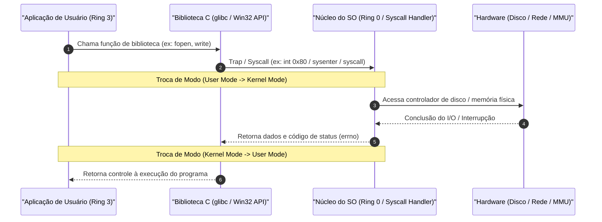
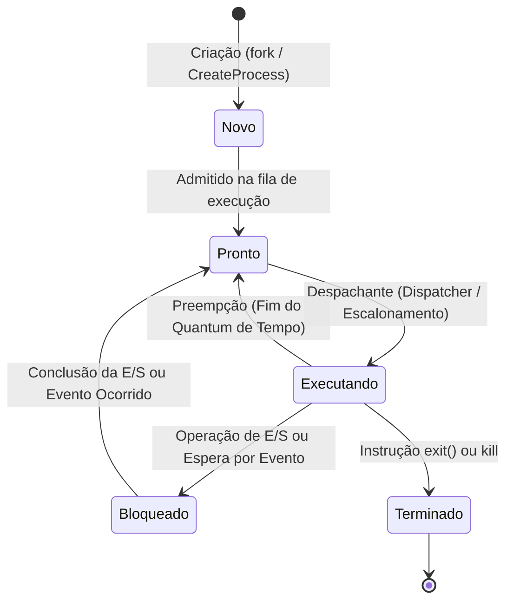
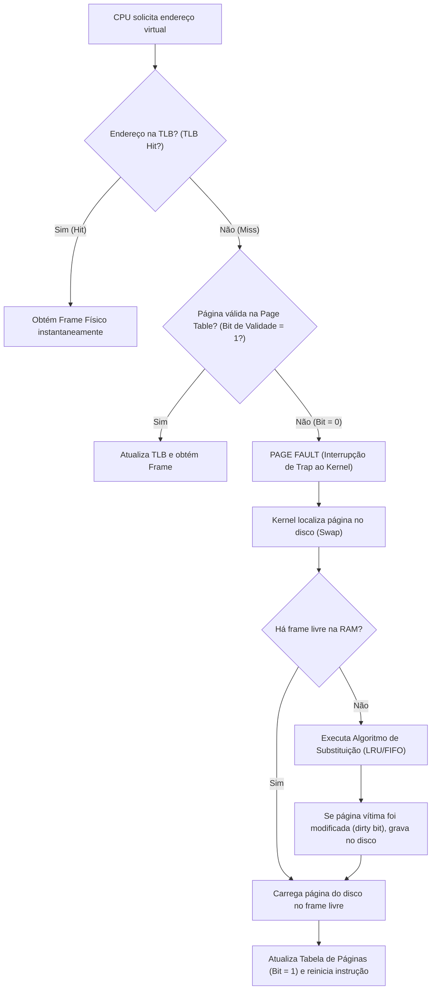
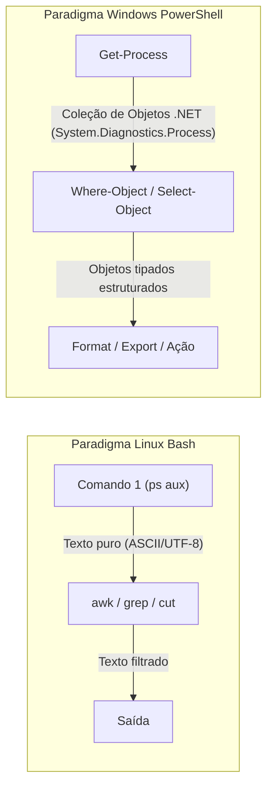

# 01 - Sistemas Operacionais: Linux e Windows

> **Matéria:** Sistemas Operacionais, Redes e Computação em Nuvem  
> **Cargo:** B02 – Técnico de Controle Externo – Especialidade: Tecnologia da Informação  
> **Arquivo:** `01_sistemas_operacionais_linux_e_windows.md`  

---

## 📌 Ementa / Itens do Edital
- Arquitetura de Sistemas Operacionais (Kernel, User Space, Syscalls)
- Gerenciamento de Processos, Threads e Escalonamento de CPU
- Gerenciamento de Memória (Memória Virtual, Paginação e Swapping)
- Sistemas de Arquivos (ext4, XFS, NTFS)
- Administração de Linux: comandos básicos de shell (Bash), permissões e automação por scripts
- Administração de Windows e Windows PowerShell: cmdlets e scripts

---

## 🧭 Sumário

1. [Arquitetura de Sistemas Operacionais e Modos de Operação](#1-arquitetura-de-sistemas-operacionais-e-modos-de-operacao)
    1. [Modos de Operação do Processador (User Mode vs. Kernel Mode)](#11-modos-de-operacao-do-processador-user-mode-vs-kernel-mode)
    2. [Chamadas de Sistema (Syscalls: fork, execve, mmap, kill)](#12-chamadas-de-sistema-syscalls-fork-execve-mmap-kill)
    3. [Tipos de Kernel: Monolítico, Microkernel e Híbrido](#13-tipos-de-kernel-monolitico-microkernel-e-hibrido)
    4. [Teste 410](#Teste-410)
2. [Gerenciamento de Processos, Concorrência e Escalonamento](#2-gerenciamento-de-processos-concorrencia-e-escalonamento)
    1. [Processo vs. Thread (Processo Leve e Compartilhamento de Memória)](#21-processo-vs-thread-processo-leve-e-compartilhamento-de-memoria)
    2. [Ciclo de Vida e Estados de um Processo](#22-ciclo-de-vida-e-estados-de-um-processo)
    3. [PCB e o Custo da Troca de Contexto (Context Switch)](#23-pcb-e-o-custo-da-troca-de-contexto-context-switch)
    4. [Algoritmos de Escalonamento de CPU (FCFS, SJF, SRTF, Round Robin, Prioridades)](#24-algoritmos-de-escalonamento-de-cpu-fcfs-sjf-srtf-round-robin-prioridades)
    5. [Sincronização e Concorrência: Mutex vs. Semáforos](#25-sincronizacao-e-concorrencia-mutex-vs-semaforos)
    6. [Teste 411](#Teste-411)
    7. [Teste 412](#Teste-412)
    8. [Teste 413](#Teste-413)
3. [Gerenciamento de Memória Virtual, Paginação e Swapping](#3-gerenciamento-de-memoria-virtual-paginacao-e-swapping)
    1. [Endereçamento Lógico vs. Físico e o Papel da MMU](#31-enderecamento-logico-vs-fisico-e-o-papel-da-mmu)
    2. [Paginação: Páginas, Molduras (Frames), Tabela de Páginas e TLB](#32-paginacao-paginas-molduras-frames-tabela-de-paginas-e-tlb)
    3. [Falta de Página (Page Fault) e Algoritmos de Substituição](#33-falta-de-pagina-page-fault-e-algoritmos-de-substituicao)
    4. [Swapping e Hiperpaginação (Thrashing)](#34-swapping-e-hiperpaginacao-thrashing)
    5. [Teste 414](#Teste-414)
    6. [Teste 415](#Teste-415)
4. [Sistemas de Arquivos e Permissões no Linux e Windows](#4-sistemas-de-arquivos-e-permissoes-no-linux-e-windows)
    1. [Estrutura do Inode no Linux: O que armazena e o que NÃO armazena](#41-estrutura-do-inode-no-linux-o-que-armazena-e-o-que-nao-armazena)
    2. [Links no Linux: Hard Link vs. Symbolic Link (Soft Link)](#42-links-no-linux-hard-link-vs-symbolic-link-soft-link)
    3. [Sistemas de Arquivos Linux (ext4, XFS) e Windows (NTFS, FAT32)](#43-sistemas-de-arquivos-linux-ext4-xfs-e-windows-ntfs-fat32)
    4. [Permissões Octais (UGO) e Permissões Especiais (SUID, SGID, Sticky Bit)](#44-permissoes-octais-ugo-e-permissoes-especiais-suid-sgid-sticky-bit)
    5. [Teste 416](#Teste-416)
    6. [Teste 417](#Teste-417)
5. [Administração e Shell Scripting no Linux](#5-administracao-e-shell-scripting-no-linux)
    1. [Sinais POSIX (SIGKILL, SIGTERM, SIGHUP, SIGSTOP, SIGCONT)](#51-sinais-posix-sigkill-sigterm-sighup-sigstop-sigcont)
    2. [Comandos Essenciais, Filtros e Redirecionamentos](#52-comandos-essenciais-filtros-e-redirecionamentos)
    3. [Gerenciamento de Serviços com systemd (systemctl e journalctl)](#53-gerenciamento-de-servicos-com-systemd-systemctl-e-journalctl)
    4. [Teste 418](#Teste-418)
    5. [Teste 419](#Teste-419)
6. [Administração de Windows e Windows PowerShell](#6-administracao-de-windows-e-windows-powershell)
    1. [Paradigma do PowerShell: Pipeline Baseado em Objetos .NET](#61-paradigma-do-powershell-pipeline-baseado-em-objetos-net)
    2. [Cmdlets Essenciais de Administração e Filtragem](#62-cmdlets-essenciais-de-administracao-e-filtragem)
    3. [Políticas de Execução de Scripts (ExecutionPolicy)](#63-politicas-de-execucao-de-scripts-executionpolicy)
    4. [Teste 420](#Teste-420)
6. [Fontes Recomendadas na Internet](#6-fontes-recomendadas-na-internet)

---

## 1. Arquitetura de Sistemas Operacionais e Modos de Operação

### 1.1 Modos de Operação do Processador (User Mode vs. Kernel Mode)

O Sistema Operacional atua como intermediário entre o hardware físico e os softwares aplicativos do usuário. Para assegurar integridade, estabilidade e isolamento de segurança, os processadores modernos utilizam anéis de proteção (*Protection Rings*):

1. **Modo Usuário (*User Mode* / Ring 3):**
    - As aplicações e processos de usuário executam com conjunto restrito de instruções.
    - Não possuem acesso direto aos dispositivos de entrada/saída (I/O), interrupções de hardware ou blocos arbitrários de memória física.
    - Qualquer tentativa de executar uma instrução privilegiada gera uma exceção/trap capturada pela CPU.

2. **Modo Núcleo / Kernel (*Kernel Mode* / Supervisor / Ring 0):**
    - O código do núcleo executa com privilégio irrestrito sobre o hardware, tabelas de memória e registradores de controle da CPU.
    - Controla o escalonamento, paginação e drivers de dispositivos.

### 1.2 Chamadas de Sistema (Syscalls: fork, execve, mmap, kill)

Para solicitar serviços privilegiados do hardware (leitura de disco, envio de pacotes pela placa de rede, criação de novos processos), o processo de usuário deve invocar uma **Chamada de Sistema (*System Call* / *Syscall*)**:



#### Principais Syscalls POSIX:
- `fork()`: Cria um novo processo filho que é cópia exata do processo pai (com novo PID). Utiliza a técnica **Copy-on-Write (COW)**: páginas de memória são compartilhadas como somente leitura até que haja uma escrita real, momento em que o frame é duplicado.
- `execve()`: Substitui a imagem atual de memória do processo por um novo programa binário executável.
- `mmap()`: Mapeia arquivos ou dispositivos diretamente no espaço de memória virtual do processo.
- `kill()`: Envia sinais para comunicação e controle de processos.

### 1.3 Tipos de Kernel: Monolítico, Microkernel e Híbrido

| Modelo de Kernel | Características Arquiteturais | Vantagens | Desvantagens | Exemplos Reais |
|---|---|---|---|---|
| **Monolítico** | Todos os serviços essenciais (escalonador, memória, sistemas de arquivos, drivers de dispositivos) rodam no mesmo espaço de memória do Kernel (Ring 0). | Máximo desempenho em chamadas e trocas de mensagens (comunicação direta por ponteiros e funções). | Um bug em um driver de dispositivo ou módulo pode derrubar o sistema inteiro (*Kernel Panic*). | Linux, Unix tradicional, FreeBSD |
| **Microkernel** | Apenas as funções mínimas rodam no Kernel (IPC, gerenciamento básico de memória e escalonador). Drivers, sistemas de arquivos e rede rodam como servidores no Modo Usuário (Ring 3). | Alta modularidade, isolamento de falhas e segurança robusta (se o driver de rede travar, ele é reiniciado sem derrubar o SO). | Queda de desempenho devido ao overhead constante de troca de contexto e IPC por passagem de mensagens entre processos de usuário. | Mach, Minix, QNX |
| **Híbrido** | Combina a modularidade do microkernel com o desempenho do monolítico, executando subsistemas críticos e drivers gráficos/I/O no espaço do Kernel. | Equilíbrio entre flexibilidade arquitetural, facilidade de compatibilidade e velocidade de execução. | Complexidade interna elevada e maior superfície de ataque no Kernel. | Windows NT (10, 11, Server), macOS (XNU) |

---

## 2. Gerenciamento de Processos, Concorrência e Escalonamento

### 2.1 Processo vs. Thread (Processo Leve e Compartilhamento de Memória)

- **Processo:** Programa em execução que possui seu próprio espaço de endereçamento virtual isolado, tabela de descritores de arquivo, PCB e contexto de segurança. A comunicação entre processos distintos exige mecanismos explícitos de IPC (*Inter-Process Communication*), como pipes, sockets, memória compartilhada ou filas de mensagens.
- **Thread:** Menor unidade de processamento escalonável pela CPU. Múltiplas threads do mesmo processo **compartilham**:
    - O mesmo espaço de endereçamento virtual (segmentos de Código, Dados Globais e Heap);
    - Os mesmos arquivos e sockets abertos;
    - Os mesmos sinais e permissões do processo pai.
    - **O que cada thread possui de forma EXCLUSIVA:** seu próprio Program Counter (PC), registradores de CPU e sua própria Pilha de Execução (*Stack* - variáveis locais e fluxo de chamadas).

### 2.2 Ciclo de Vida e Estados de um Processo



- **Novo (*New*):** O processo está sendo criado e suas estruturas estão sendo alocadas.
- **Pronto (*Ready*):** O processo dispõe de todos os recursos necessários e aguarda na fila apenas a atribuição da CPU pelo escalonador.
- **Executando (*Running*):** As instruções do processo estão sendo ativamente processadas pela CPU.
- **Bloqueado / Espera (*Waiting* / *Blocked*):** O processo não pode executar porque aguarda a conclusão de uma operação externa de Entrada/Saída (leitura de disco, teclado) ou a liberação de um lock de sincronização.
- **Terminado (*Terminated*):** O processo encerrou sua execução e aguarda o processo pai recolher seu código de retorno (`wait()`). Se o pai não o recolhe, ele permanece temporariamente como processo *zumbi*.

### 2.3 PCB e o Custo da Troca de Contexto (Context Switch)

O **Bloco de Controle de Processo (PCB - *Process Control Block*)** é a estrutura de dados que armazena todas as informações do processo enquanto ele não está executando na CPU: estado, Program Counter (PC), registradores, informações de escalonamento, ponteiros de memória e descritores de arquivos abertos.

A **Troca de Contexto (*Context Switch*)** é o procedimento pelo qual a CPU interrompe um processo, salva seu contexto no PCB e carrega o contexto do próximo processo a executar. Trata-se de uma operação de **overhead puro** (a CPU não executa trabalho útil de aplicação durante a troca):

- Salva e restaura registradores;
- Altera tabelas de mapeamento de memória virtual na MMU;
- Invalida entradas de cache no TLB;
- Causa perda temporária de localidade nas memórias cache L1/L2/L3 da CPU.

### 2.4 Algoritmos de Escalonamento de CPU (FCFS, SJF, SRTF, Round Robin, Prioridades)

| Algoritmo | Natureza | Mecânica de Funcionamento | Principais Desvantagens / Efeitos Colaterais |
|---|---|---|---|
| **FCFS (First-Come, First-Served)** | Não Preemptivo | Atende processos estritamente na ordem cronológica de chegada na fila de prontos. | **Efeito Comboio (*Convoy Effect*):** processos curtos ficam retidos atrás de um processo longo com carga intensiva de CPU. |
| **SJF (Shortest Job First)** | Não Preemptivo | Seleciona o processo com a menor rajada de CPU (*CPU burst*) estimada. Minimiza o tempo médio de espera. | Provoca **Inanição (*Starvation*)** de processos longos caso cheguem novos processos curtos ininterruptamente. Difícil prever a próxima rajada. |
| **SRTF (Shortest Remaining Time First)** | Preemptivo | Versão preemptiva do SJF: se um processo chega com tempo restante menor que o em execução, ocorre preempção. | Também sofre de inanição (*starvation*) e gera alto overhead de trocas de contexto. |
| **Round Robin (Alternância Circular)** | Preemptivo | Cada processo recebe uma fatia fixa de tempo de CPU denominada **Quantum**. Ao esgotar o quantum, sofre preempção e vai para o final da fila de prontos. | Se o quantum for **muito grande**, o algoritmo degenera em FCFS. Se for **muito pequeno**, a CPU perde rendimento útil com excesso de **Trocas de Contexto (*Context Switch*)**. |
| **Escalonamento por Prioridades** | Preemptivo ou Não | A CPU é alocada ao processo de maior prioridade numérica. | Inanição de processos de baixa prioridade. A solução canônica é o **Envelhecimento (*Aging*)**, que incrementa a prioridade do processo conforme ele espera na fila. |
| **Filas Multinível com Realimentação (MLFQ)** | Preemptivo | Processos movem-se entre diferentes filas com diferentes fatias de tempo. Processos I/O-bound ganham alta prioridade e quantum curto; CPU-bound caem para filas de menor prioridade com quantum longo. | Algoritmo mais complexo e configurável da engenharia de SO. |

### 2.5 Sincronização e Concorrência: Mutex vs. Semáforos

Quando múltiplos processos ou threads acessam variáveis e recursos compartilhados concorrentemente, podem ocorrer condições de corrida (*race conditions*). Para proteger a **Região Crítica**, utilizam-se primitivas de sincronização:

> 🚨 **ALERTA DE PROVA / PEGADINHA FCC:**  
> A FCC frequentemente cobra a distinção entre **Mutex** e **Semáforo**:  
>
> - O **Mutex** (*Mutual Exclusion*) é um mecanismo de travamento binário com **conceito de propriedade (*ownership*)**: estritamente a thread que adquiriu o lock é quem tem o direito de liberá-lo.  
> - O **Semáforo** é uma variável inteira atômica sem conceito de posse: qualquer processo ou thread pode executar a operação `signal()` / `post()` para incrementar o contador, prestando-se tanto à exclusão mútua (semáforo binário) quanto à sinalização e sincronização de eventos entre processos.

---

## 3. Gerenciamento de Memória Virtual, Paginação e Swapping

### 3.1 Endereçamento Lógico vs. Físico e o Papel da MMU

A **Memória Virtual** desvincula o espaço de endereçamento lógico manipulado pelo programa da memória RAM física real. Isso permite que um programa execute mesmo que seu tamanho ultrapasse a memória RAM disponível:

- **Endereço Lógico (Virtual):** Gerado pelo processador durante a execução das instruções do código.
- **Endereço Físico:** Localização real dos bytes nos circuitos integrados dos módulos de memória RAM.
- **MMU (*Memory Management Unit*):** Chip integrado ao processador que converte endereços virtuais em endereços físicos em tempo de execução consultando a Tabela de Páginas.

### 3.2 Paginação: Páginas, Molduras (Frames), Tabela de Páginas e TLB

- **Páginas Lógicas (*Pages*):** Blocos de tamanho fixo em que a memória virtual do processo é dividida.
- **Molduras de Página Físicas (*Frames*):** Blocos de memória física RAM que possuem **rigorosamente o mesmo tamanho** das páginas lógicas (tipicamente 4 KB).
- **Tabela de Páginas (*Page Table*):** Matriz mantida pelo kernel que armazena o mapeamento entre o número da página virtual e o número do frame físico correspondente, além de bits de controle:
    - *Bit de Validade/Presença:* `1` indica que a página está carregada na RAM; `0` indica que está no disco (Swap) ou é inválida.
    - *Dirty Bit (Modificado):* `1` indica que a página foi alterada desde que foi lida do disco e precisará ser gravada de volta antes de ser descartada.
- **TLB (*Translation Lookaside Buffer*):** Cache associativa de hardware de altíssima velocidade que armazena as traduções recentes de página para frame. Evita que a CPU precise consultar a tabela de páginas na memória RAM a cada instrução (*TLB Hit*).

### 3.3 Falta de Página (Page Fault) e Algoritmos de Substituição



#### O Ciclo de Tratamento de Page Fault:
1. A CPU gera uma interrupção de falta de página (*Page Fault trap*) transferindo o controle ao kernel;
2. O kernel verifica se o endereço é válido e localiza a página no disco de swap;
3. Se não houver moldura livre na RAM, executa um algoritmo de substituição de páginas:
    - **FIFO (*First-In, First-Out*):** Substitui a página mais antiga na RAM (sofre da Anomalia de Belady, onde aumentar a RAM pode aumentar as faltas de página).
    - **LRU (*Least Recently Used*):** Substitui a página que não foi utilizada pelo maior intervalo de tempo no passado (aproximação do algoritmo ótimo teórico).

4. O frame é carregado do disco e a tabela de páginas é atualizada (bit = 1), reiniciando a instrução original.

### 3.4 Swapping e Hiperpaginação (Thrashing)

- **Swapping:** Movimentação de páginas ou de processos inteiros entre a memória RAM física e a partição/arquivo de troca no disco (**Swap**).
- **Hiperpaginação (*Thrashing*):** Ocorre quando o sistema passa substancialmente mais tempo realizando operações de I/O de leitura e escrita de páginas no disco do que executando instruções úteis dos programas. Decorre de uma sobrecarga onde a soma dos conjuntos de trabalho (*working sets*) dos processos ativos supera a capacidade física da memória RAM.

---

## 4. Sistemas de Arquivos e Permissões no Linux e Windows

### 4.1 Estrutura do Inode no Linux: O que armazena e o que NÃO armazena

O **Inode (*Index Node*)** é a estrutura central de dados que descreve cada arquivo ou diretório em sistemas baseados em Unix/Linux:

- **O que o Inode ARMAZENA:**
    - Modo e tipo do arquivo (regular, diretório, socket, pipe, link simbólico);
    - Permissões de acesso (`rwx`);
    - Identificador do Dono (UID) e Grupo (GID);
    - Tamanho exato em bytes;
    - Carimbos temporais (`atime`, `mtime`, `ctime`);
    - Contador de ligações diretas (*link count*);
    - Ponteiros diretos e indiretos para os blocos de dados no disco.
- **O que o Inode NÃO ARMAZENA:**
    - **O NOME do arquivo!**
    - **O CAMINHO (path) do arquivo!**  
  > 🚨 **REGRA DE OURO FCC:** O nome do arquivo e o número do seu inode ficam armazenados nos blocos de dados do **diretório pai** (estrutura *dentry*), e não dentro do próprio inode.

### 4.2 Links no Linux: Hard Link vs. Symbolic Link (Soft Link)

| Propriedade / Comportamento | Hard Link (`ln origem destino`) | Symbolic Link (`ln -s origem destino`) |
|---|---|---|
| **Número de Inode** | Aponta diretamente para o **mesmo número de Inode** do arquivo original. | Possui um **novo Inode próprio** do tipo `l`, contendo o caminho textual de destino. |
| **Cruzamento de Partições** | **NÃO** pode cruzar partições ou sistemas de arquivos diferentes (inodes colidiriam). | **SIM**, pode cruzar discos, partições e pontos de montagem livremente. |
| **Apontamento para Diretórios** | Não permitido para usuários comuns (evita loops cíclicos). | Permitido apontar para diretórios livremente. |
| **Exclusão do Arquivo Original** | O conteúdo **permanece íntegro** e acessível até que o contador de links caia para zero. | O link simbólico fica **quebrado / órfão (*dangling link*)**, apontando para um caminho inexistente. |

### 4.3 Sistemas de Arquivos Linux (ext4, XFS) e Windows (NTFS, FAT32)

- **Linux ext4:** Sistema de arquivos padrão na maioria das distribuições Linux. Suporta **journaling** (diário de transações que previne corrupção de metadados em quedas de energia) com três modos (`journal`, `ordered`, `writeback`), alocação por extensões (*extents*) e volumes de até 1 Exabyte.
- **Linux XFS:** Sistema de arquivos escalável de 64 bits de altíssimo desempenho, padrão no RHEL, otimizado para operações paralelas e manipulação de arquivos gigantescos.
- **Windows NTFS (*New Technology File System*):** Padrão do Windows corporativo. Suporta listas de controle de acesso (ACLs - DACL e SACL), journaling via Master File Table (**MFT**), cotas de disco, compressão nativa de arquivos e criptografia no nível de arquivo via **EFS** (*Encrypting File System*).
- **FAT32:** Sistema legado com compatibilidade universal, mas limitado a arquivos individuais de no máximo **4 GB** e sem suporte nativo a permissões de segurança ACL.

### 4.4 Permissões Octais (UGO) e Permissões Especiais (SUID, SGID, Sticky Bit)

As permissões básicas dividem-se em Usuário Dono (`u`), Grupo (`g`) e Outros (`o`):

- Leitura (`r`) = $4$
- Escrita (`w`) = $2$
- Execução (`x`) = $1$

$$\text{Exemplo: } 750 \implies \text{Dono: } 4+2+1=7\,(rwx); \quad \text{Grupo: } 4+0+1=5\,(r-x); \quad \text{Outros: } 0\,(---)$$

#### Permissões Especiais:
1. **SUID (*Set User ID* - 4000 / `rwsr-xr-x`):** Executa o programa com os privilégios do **proprietário do arquivo**, e não de quem o chamou (ex.: `/usr/bin/passwd`).
2. **SGID (*Set Group ID* - 2000 / `rwxr-sr-x`):** Em diretórios, faz com que quaisquer novos arquivos ou subdiretórios criados **herdem automaticamente o grupo do diretório pai**.
3. **Sticky Bit (1000 / `rwxrwxrwt`):** Aplicado a diretórios públicos (como `/tmp`). Impede que um usuário exclua ou renomeie arquivos pertencentes a outros usuários, mesmo com permissão $777$.

---

### Teste 001
**(FGV – TCE/GO – 2024 – Analista de Controle Externo - Tecnologia da Informação)**
Com relação à criação de links entre arquivos, em ambientes operacionais Linux, assinale V para afirmativa verdadeira e F para a falsa. ( ) Não é possível criar links físicos para um diretório ou arquivo especial, apenas para arquivos regulares. ( ) Links simbólicos só podem ser usados se ambos os arquivos estiverem no mesmo sistema de arquivos. ( ) Mesmo que o arquivo original seja excluído, o conteúdo do arquivo ainda estará disponível, desde que pelo menos um link físico exista. As afirmativas são, respectivamente:

* **A)** V, V e V
* **B)** F, V e F
* **C)** V, F e F
* **D)** V, F e V
* **E)** F, V e V

---

> **Comentário Detalhado:**
>
> - **A)** **Incorreta.** A opção apresenta proposição em desacordo com os fundamentos teóricos e técnicos do tópico ao afirmar que "V, V e V". De acordo com a teoria estudada em *4.2 Links no Linux: Hard Link vs. Symbolic Link (Soft Link)*, número de Inode: Aponta diretamente para o mesmo número de Inode do arquivo original. — Possui um novo Inode próprio do tipo l , contendo o caminho textual de destino.
> - **B)** **Incorreta.** A opção apresenta proposição em desacordo com os fundamentos teóricos e técnicos do tópico ao afirmar que "F, V e F". De acordo com a teoria estudada em *4.1 Estrutura do Inode no Linux: O que armazena e o que NÃO armazena*, modo e tipo do arquivo (regular, diretório, socket, pipe, link simbólico).
> - **C)** **Incorreta.** A opção apresenta proposição em desacordo com os fundamentos teóricos e técnicos do tópico ao afirmar que "V, F e F". De acordo com a teoria estudada em *4.2 Links no Linux: Hard Link vs. Symbolic Link (Soft Link)*, cruzamento de Partições: NÃO pode cruzar partições ou sistemas de arquivos diferentes (inodes colidiriam). — SIM, pode cruzar discos, partições e pontos de montagem livremente.
> - **D)** **Correta.** Conforme fundamentado na seção *4.2 Links no Linux: Hard Link vs. Symbolic Link (Soft Link)* deste guia, exclusão do Arquivo Original: O conteúdo permanece íntegro e acessível até que o contador de links caia para zero. — O link simbólico fica quebrado / órfão ( dangling link ), apontando para um caminho inexistente. Dessa forma, está plenamente correta a assertiva da banca (FGV – TCE/GO/2024) ao estabelecer que "V, F e V".
> - **E)** **Incorreta.** A opção apresenta proposição em desacordo com os fundamentos teóricos e técnicos do tópico ao afirmar que "F, V e V". De acordo com a teoria estudada em *4.2 Links no Linux: Hard Link vs. Symbolic Link (Soft Link)*, apontamento para Diretórios: Não permitido para usuários comuns (evita loops cíclicos). — Permitido apontar para diretórios livremente.
>
> **Gabarito: D**

---

### Teste 002
**(CEBRASPE – STJ – 2024 – Analista Judiciário - Apoio Especializado - Suporte em Tecnologia da Informação)**
A execução do comando a seguir permite verificar a integridade da configuração do Nagios no ambiente Linux. # /usr/local/nagios/bin/nagios –v /usr/local/nagios/etc/nagios.cfg

* **C)** Certo
* **E)** Errado

---

> **Comentário Detalhado:**
>
> - **C)** **Correta.** O item está **Certo**. Conforme fundamentado na seção *Permissões Especiais:*, sUID ( Set User ID 4000 / rwsr xr x ): Executa o programa com os privilégios do proprietário do arquivo, e não de quem o chamou (ex.: /usr/bin/passwd ). Dessa forma, está plenamente correta a assertiva da banca (CEBRASPE – STJ/2024) ao afirmar que "A execução do comando a seguir permite verificar a integridade da configuração do Nagios no ambiente Linux...".
> - **E)** **Incorreta.** A assertiva não incorre em erro conceitual, guardando conformidade com a teoria estudada.
>
> **Gabarito: C**

---

### Teste 003
**(CEBRASPE – TRF/6 – 2025 – Analista Judiciario Apoio Especializado Tecnologia Da Informacao)**
Nos sistemas operacionais Linux, os processos podem comunicar-se uns com os outros por meio de canais para trocas de mensagens denominados pipes.

* **C)** Certo
* **E)** Errado

---

> **Comentário Detalhado:**
>
> - **C)** **Incorreta.** A proposição apresenta proposição em desacordo com os fundamentos teóricos e técnicos do tópico ao afirmar que "Nos sistemas operacionais Linux, os processos podem comunicar se uns com os outros por meio de canais para...". De acordo com a teoria em *1.3 Tipos de Kernel: Monolítico, Microkernel e Híbrido*, monolítico: Todos os serviços essenciais (escalonador, memória, sistemas de arquivos, drivers de dispositivos) rodam no mesmo espaço de memória do Kernel (Ring 0). — Máximo desempenho em chamadas e trocas de mensagens (comunicação direta por ponteiros e funções). — Um bug em um driver de dispositivo ou módulo pode derrubar o sistema inteiro ( Kernel Panic ). — Linux, Unix tradicional, FreeBSD.
> - **E)** **Correta.** O item está **Errado** (gabarito oficial: **E**), pois contraria a disciplina teórica aplicável.
>
> **Gabarito: E**

---

### Teste 004
**(FCC – TRT 14ª – 2016 – Analista Judiciário - Apoio Especializado - Tecnologia da Informação)**
O LDAP define, dentre outras, a forma como um cliente de diretório pode acessar um servidor de diretório. O LDAP pode ser usado

* **A)** para enumerar objetos de diretório, mas não para localizá-los.
* **B)** para estabelecer uma conexão entre um cliente e um servidor LDAP, usando a porta padrão 485, via UDP.
* **C)** apenas em ambiente Windows, pois é um serviço de diretório proprietário.
* **D)** no Linux e configurado através do arquivo ldap-inf.xml, encontrado no diretório /etc.
* **E)** para consultar ou administrar o Active Directory.

---

> **Comentário Detalhado:**
>
> - **A)** **Incorreta.** A opção apresenta proposição em desacordo com os fundamentos teóricos e técnicos do tópico ao afirmar que "para enumerar objetos de diretório, mas não para localizá los". De acordo com a teoria estudada em *4.1 Estrutura do Inode no Linux: O que armazena e o que NÃO armazena*, modo e tipo do arquivo (regular, diretório, socket, pipe, link simbólico).
> - **B)** **Incorreta.** A opção apresenta proposição em desacordo com os fundamentos teóricos e técnicos do tópico ao afirmar que "para estabelecer uma conexão entre um cliente e um servidor LDAP, usando a porta padrão 485, via UDP". De acordo com a teoria estudada em *4.3 Sistemas de Arquivos Linux (ext4, XFS) e Windows (NTFS, FAT32)*, windows NTFS ( New Technology File System ): Padrão do Windows corporativo. Suporta listas de controle de acesso (ACLs DACL e SACL), journaling via Master File Table (MFT), cotas de disco, compressão nativa de arquivos e criptografia no nível de arquivo via EFS ( Encrypting File System ).
> - **C)** **Incorreta.** A opção incorre em restrição indevida ao limitar o escopo conceitual ao afirmar que "apenas em ambiente Windows, pois é um serviço de diretório proprietário". De acordo com a teoria estudada em *4.1 Estrutura do Inode no Linux: O que armazena e o que NÃO armazena*, o nome do arquivo e o número do seu inode ficam armazenados nos blocos de dados do diretório pai (estrutura dentry ), e não dentro do próprio inode.
> - **D)** **Correta.** Conforme fundamentado na seção *4.1 Estrutura do Inode no Linux: O que armazena e o que NÃO armazena* deste guia, o Inode ( Index Node ) é a estrutura central de dados que descreve cada arquivo ou diretório em sistemas baseados em Unix/Linux. Dessa forma, está plenamente correta a assertiva da banca (FCC – TRT 14ª/2016) ao estabelecer que "no Linux e configurado através do arquivo ldap inf.xml, encontrado no diretório /etc".
> - **E)** **Incorreta.** A opção apresenta proposição em desacordo com os fundamentos teóricos e técnicos do tópico ao afirmar que "para consultar ou administrar o Active Directory". De acordo com a teoria estudada em *Permissões Especiais:*, sGID ( Set Group ID 2000 / rwxr sr x ): Em diretórios, faz com que quaisquer novos arquivos ou subdiretórios criados herdem automaticamente o grupo do diretório pai.
>
> **Gabarito: D**

---

### Teste 005
**(FCC – TRT 14ª – 2016 – Analista Judiciário - Apoio Especializado - Tecnologia da Informação)**
Uma proposta enviada a um Tribunal por um fornecedor externo previa os seguintes recursos de TI: I. Entrega de aplicativo portável dentro de ambientes Linux e Unix, sem compatibilidade com plataformas proprietárias. II. Padrões de interoperabilidade de acordo com as regras do fornecedor. III. Suporte para assinatura baseado em certificado emitido por Autoridade Certificadora credenciada na forma da Infraestrutura de Chaves Públicas Brasileira − ICP Brasil. IV. Link de transmissão entre o fornecedor e o Tribunal para o tráfego de dados e informações, garantindo a disponibilidade exigida pelo aplicativo de, no mínimo, de 2 Gbps. Ao analisar os recursos de TI previstos, um Analista do Tribunal concluiu corretamente que o contrato com o fornecedor

* **A)** Entradas de outros processos − Especificação do trabalho do projeto − Business cases.
* **B)** Termo de abertura do projeto − Fatores ambientais da empresa − Ativos de processos organizacionais.
* **C)** Especificação do trabalho do projeto − Business cases − Previsões de cronograma.
* **D)** Termo de abertura do projeto − Entradas de outros processos − Previsões de custos.
* **E)** Previsões de custos − Previsões de cronograma − Ativos de processos organizacionais.

---

> **Comentário Detalhado:**
>
> - **A)** **Incorreta.** A opção apresenta proposição em desacordo com os fundamentos teóricos e técnicos do tópico ao afirmar que "Entradas de outros processos − Especificação do trabalho do projeto − Business cases". De acordo com a teoria estudada em *2.3 PCB e o Custo da Troca de Contexto (Context Switch)*, invalida entradas de cache no TLB.
> - **B)** **Incorreta.** A opção apresenta proposição em desacordo com os fundamentos teóricos e técnicos do tópico ao afirmar que "Termo de abertura do projeto − Fatores ambientais da empresa − Ativos de processos organizacionais". De acordo com a teoria estudada em *6. Fontes Recomendadas na Internet*, tANENBAUM, Andrew S.; BOS, Herbert. Sistemas Operacionais Modernos. 4. ed. São Paulo: Pearson Education do Brasil, 2016. (Cap. 2 Processos e Threads; Cap. 3 Gerenciamento de Memória; Cap. 10 Estudo de Caso 1: Linux; Cap. 11 Estudo de Caso 2: Windows).
> - **C)** **Incorreta.** A opção apresenta proposição em desacordo com os fundamentos teóricos e técnicos do tópico ao afirmar que "Especificação do trabalho do projeto − Business cases − Previsões de cronograma". De acordo com a teoria estudada em *2.3 PCB e o Custo da Troca de Contexto (Context Switch)*, a Troca de Contexto ( Context Switch ) é o procedimento pelo qual a CPU interrompe um processo, salva seu contexto no PCB e carrega o contexto do próximo processo a executar. Trata se de uma operação de overhead puro (a CPU não executa trabalho útil de aplicação durante a troca).
> - **D)** **Incorreta.** A opção apresenta proposição em desacordo com os fundamentos teóricos e técnicos do tópico ao afirmar que "Termo de abertura do projeto − Entradas de outros processos − Previsões de custos". De acordo com a teoria estudada em *6. Fontes Recomendadas na Internet*, linux man pages (Kernel.org) Ciclo de Vida de Processos e Escalonamento no Linux Referência oficial de comandos Unix/Linux de permissões de arquivos, processos e sinais.
> - **E)** **Correta.** Conforme fundamentado na seção *3.4 Swapping e Hiperpaginação (Thrashing)* deste guia, hiperpaginação ( Thrashing ): Ocorre quando o sistema passa substancialmente mais tempo realizando operações de I/O de leitura e escrita de páginas no disco do que executando instruções úteis dos programas. Decorre de uma sobrecarga onde a soma dos conjuntos de trabalho ( working sets ) dos processos ativos supera a capacidade física da memória RAM. Dessa forma, está plenamente correta a assertiva da banca (FCC – TRT 14ª/2016) ao estabelecer que "Previsões de custos − Previsões de cronograma − Ativos de processos organizacionais".
>
> **Gabarito: E**

---

### Teste 006
**(FCC – TRT 14ª – 2016 – Analista Judiciário - Apoio Especializado - Tecnologia da Informação)**
Como uma instância de JBoss é uma configuração em execução, ao ser instalado, ele vem com diferentes configurações e cada uma delas é localizada no diretório JBOSS_DIST/jboss-as/server. Em linha de comando no Linux, para iniciar o JBoss com o conjunto de arquivo de configuração mínimo utiliza-se o comando

* **A)** run.sh -x compact
* **B)** run.sh -c minimal
* **C)** start.sh -a compact
* **D)** start.sh -x 0
* **E)** run.sh -a minimal

---

> **Comentário Detalhado:**
>
> - **A)** **Incorreta.** A opção apresenta proposição em desacordo com os fundamentos teóricos e técnicos do tópico ao afirmar que "run.sh x compact". De acordo com a teoria estudada em *4.1 Estrutura do Inode no Linux: O que armazena e o que NÃO armazena*, o Inode ( Index Node ) é a estrutura central de dados que descreve cada arquivo ou diretório em sistemas baseados em Unix/Linux.
> - **B)** **Incorreta.** A opção apresenta proposição em desacordo com os fundamentos teóricos e técnicos do tópico ao afirmar que "run.sh c minimal". De acordo com a teoria estudada em *4.1 Estrutura do Inode no Linux: O que armazena e o que NÃO armazena*, modo e tipo do arquivo (regular, diretório, socket, pipe, link simbólico).
> - **C)** **Incorreta.** A opção apresenta proposição em desacordo com os fundamentos teóricos e técnicos do tópico ao afirmar que "start.sh a compact". De acordo com a teoria estudada em *4.1 Estrutura do Inode no Linux: O que armazena e o que NÃO armazena*, o nome do arquivo e o número do seu inode ficam armazenados nos blocos de dados do diretório pai (estrutura dentry ), e não dentro do próprio inode.
> - **D)** **Correta.** Conforme fundamentado na seção *5.3 Gerenciamento de Serviços com systemd (systemctl e journalctl)* deste guia, systemctl start <servico : Inicia o serviço imediatamente na sessão corrente. Dessa forma, está plenamente correta a assertiva da banca (FCC – TRT 14ª/2016) ao estabelecer que "start.sh x 0".
> - **E)** **Incorreta.** A opção apresenta proposição em desacordo com os fundamentos teóricos e técnicos do tópico ao afirmar que "run.sh a minimal". De acordo com a teoria estudada em *4.2 Links no Linux: Hard Link vs. Symbolic Link (Soft Link)*, cruzamento de Partições: NÃO pode cruzar partições ou sistemas de arquivos diferentes (inodes colidiriam). — SIM, pode cruzar discos, partições e pontos de montagem livremente.
>
> **Gabarito: D**

---

### Teste 007
**(FCC – TRT 23ª – 2016 – Analista Judiciário - Apoio Especializado - Tecnologia da Informação)**
O superusuário de computador com sistema operacional Linux deseja alterar as permissões padrão para que apenas o usuário criador possa listar, ler e escrever em todos os novos diretórios criados no sistema por meio do comando mkdir. Para isso, o superusuário deve executar o comando

* **A)** umask 700.
* **B)** chmod 707.
* **C)** umask 077.
* **D)** chmod 700.
* **E)** umask 707.

---

> **Comentário Detalhado:**
>
> - **A)** **Incorreta.** A opção apresenta proposição em desacordo com os fundamentos teóricos e técnicos do tópico ao afirmar que "umask 700". De acordo com a teoria estudada em *1.2 Chamadas de Sistema (Syscalls: fork, execve, mmap, kill)*, para solicitar serviços privilegiados do hardware (leitura de disco, envio de pacotes pela placa de rede, criação de novos processos), o processo de usuário deve invocar uma Chamada de Sistema ( System Call / Syscall ).
> - **B)** **Correta.** Conforme fundamentado na seção *Permissões Especiais:* deste guia, sGID ( Set Group ID 2000 / rwxr sr x ): Em diretórios, faz com que quaisquer novos arquivos ou subdiretórios criados herdem automaticamente o grupo do diretório pai. Dessa forma, está plenamente correta a assertiva da banca (FCC – TRT 23ª/2016) ao estabelecer que "chmod 707".
> - **C)** **Incorreta.** A opção apresenta proposição em desacordo com os fundamentos teóricos e técnicos do tópico ao afirmar que "umask 077". De acordo com a teoria estudada em *Permissões Especiais:*, sticky Bit (1000 / rwxrwxrwt ): Aplicado a diretórios públicos (como /tmp ). Impede que um usuário exclua ou renomeie arquivos pertencentes a outros usuários, mesmo com permissão $777$.
> - **D)** **Incorreta.** A opção apresenta proposição em desacordo com os fundamentos teóricos e técnicos do tópico ao afirmar que "chmod 700". De acordo com a teoria estudada em *1.1 Modos de Operação do Processador (User Mode vs. Kernel Mode)*, o Sistema Operacional atua como intermediário entre o hardware físico e os softwares aplicativos do usuário. Para assegurar integridade, estabilidade e isolamento de segurança, os processadores modernos utilizam anéis de proteção ( Protection Rings ).
> - **E)** **Incorreta.** A opção apresenta proposição em desacordo com os fundamentos teóricos e técnicos do tópico ao afirmar que "umask 707". De acordo com a teoria estudada em *4.3 Sistemas de Arquivos Linux (ext4, XFS) e Windows (NTFS, FAT32)*, fAT32: Sistema legado com compatibilidade universal, mas limitado a arquivos individuais de no máximo 4 GB e sem suporte nativo a permissões de segurança ACL.
>
> **Gabarito: B**

---

### Teste 008
**(FCC – TRT 23ª – 2016 – Analista Judiciário - Apoio Especializado - Tecnologia da Informação)**
Uma partição NFS remota deve ser montada em um computador com sistema operacional Linux. Para especificar, no comando mount, que a partição é NFS, deve-se utilizar a opção:

* **A)** −n.
* **B)** −f.
* **C)** −i.
* **D)** −s.
* **E)** −t.

---

> **Comentário Detalhado:**
>
> - **A)** **Incorreta.** A opção apresenta proposição em desacordo com os fundamentos teóricos e técnicos do tópico ao afirmar que "−n". De acordo com a teoria estudada em *1.1 Modos de Operação do Processador (User Mode vs. Kernel Mode)*, o Sistema Operacional atua como intermediário entre o hardware físico e os softwares aplicativos do usuário. Para assegurar integridade, estabilidade e isolamento de segurança, os processadores modernos utilizam anéis de proteção ( Protection Rings ).
> - **B)** **Incorreta.** A opção apresenta proposição em desacordo com os fundamentos teóricos e técnicos do tópico ao afirmar que "−f". De acordo com a teoria estudada em *3.4 Swapping e Hiperpaginação (Thrashing)*, swapping: Movimentação de páginas ou de processos inteiros entre a memória RAM física e a partição/arquivo de troca no disco (Swap).
> - **C)** **Incorreta.** A opção apresenta proposição em desacordo com os fundamentos teóricos e técnicos do tópico ao afirmar que "−i". De acordo com a teoria estudada em *1.3 Tipos de Kernel: Monolítico, Microkernel e Híbrido*, monolítico: Todos os serviços essenciais (escalonador, memória, sistemas de arquivos, drivers de dispositivos) rodam no mesmo espaço de memória do Kernel (Ring 0). — Máximo desempenho em chamadas e trocas de mensagens (comunicação direta por ponteiros e funções). — Um bug em um driver de dispositivo ou módulo pode derrubar o sistema inteiro ( Kernel Panic ). — Linux, Unix tradicional, FreeBSD.
> - **D)** **Incorreta.** A opção apresenta proposição em desacordo com os fundamentos teóricos e técnicos do tópico ao afirmar que "−s". De acordo com a teoria estudada em *4.3 Sistemas de Arquivos Linux (ext4, XFS) e Windows (NTFS, FAT32)*, linux ext4: Sistema de arquivos padrão na maioria das distribuições Linux. Suporta journaling (diário de transações que previne corrupção de metadados em quedas de energia) com três modos ( journal , ordered , writeback ), alocação por extensões ( extents ) e volumes de até 1 Exabyte.
> - **E)** **Correta.** Conforme fundamentado na seção *1.2 Chamadas de Sistema (Syscalls: fork, execve, mmap, kill)* deste guia, para solicitar serviços privilegiados do hardware (leitura de disco, envio de pacotes pela placa de rede, criação de novos processos), o processo de usuário deve invocar uma Chamada de Sistema ( System Call / Syscall ). Dessa forma, está plenamente correta a assertiva da banca (FCC – TRT 23ª/2016) ao estabelecer que "−t".
>
> **Gabarito: E**

---

### Teste 009
**(FCC – TRT 23ª – 2016 – Analista Judiciário - Apoio Especializado - Tecnologia da Informação)**
O administrador de um servidor com sistema operacional Linux escolheu o sistema de arquivos XFS para o sistema de arma- zenamento principal. O XFS

* **A)** permite o redimensionamento de uma partição apenas para aumentar.
* **B)** é um sistema de 32 bits compatível com sistemas de 64 bits.
* **C)** utiliza tamanho de blocos fixos para otimizar o espaço em disco.
* **D)** foi concebido para operar prioritariamente com arquivos de pequenas dimensões.
* **E)** faz uso do journaling físico, ou seja, os metadados são gravados em disco imediatamente.

---

> **Comentário Detalhado:**
>
> - **A)** **Incorreta.** A opção incorre em restrição indevida ao limitar o escopo conceitual ao afirmar que "permite o redimensionamento de uma partição apenas para aumentar". De acordo com a teoria estudada em *3.1 Endereçamento Lógico vs. Físico e o Papel da MMU*, a Memória Virtual desvincula o espaço de endereçamento lógico manipulado pelo programa da memória RAM física real. Isso permite que um programa execute mesmo que seu tamanho ultrapasse a memória RAM disponível.
> - **B)** **Incorreta.** A opção apresenta proposição em desacordo com os fundamentos teóricos e técnicos do tópico ao afirmar que "é um sistema de 32 bits compatível com sistemas de 64 bits". De acordo com a teoria estudada em *4.3 Sistemas de Arquivos Linux (ext4, XFS) e Windows (NTFS, FAT32)*, linux XFS: Sistema de arquivos escalável de 64 bits de altíssimo desempenho, padrão no RHEL, otimizado para operações paralelas e manipulação de arquivos gigantescos.
> - **C)** **Correta.** Conforme fundamentado na seção *3.2 Paginação: Páginas, Molduras (Frames), Tabela de Páginas e TLB* deste guia, páginas Lógicas ( Pages ): Blocos de tamanho fixo em que a memória virtual do processo é dividida. Dessa forma, está plenamente correta a assertiva da banca (FCC – TRT 23ª/2016) ao estabelecer que "utiliza tamanho de blocos fixos para otimizar o espaço em disco".
> - **D)** **Incorreta.** A opção apresenta proposição em desacordo com os fundamentos teóricos e técnicos do tópico ao afirmar que "foi concebido para operar prioritariamente com arquivos de pequenas dimensões". De acordo com a teoria estudada em *1.3 Tipos de Kernel: Monolítico, Microkernel e Híbrido*, monolítico: Todos os serviços essenciais (escalonador, memória, sistemas de arquivos, drivers de dispositivos) rodam no mesmo espaço de memória do Kernel (Ring 0). — Máximo desempenho em chamadas e trocas de mensagens (comunicação direta por ponteiros e funções). — Um bug em um driver de dispositivo ou módulo pode derrubar o sistema inteiro ( Kernel Panic ). — Linux, Unix tradicional, FreeBSD.
> - **E)** **Incorreta.** A opção apresenta proposição em desacordo com os fundamentos teóricos e técnicos do tópico ao afirmar que "faz uso do journaling físico, ou seja, os metadados são gravados em disco imediatamente". De acordo com a teoria estudada em *4.3 Sistemas de Arquivos Linux (ext4, XFS) e Windows (NTFS, FAT32)*, linux ext4: Sistema de arquivos padrão na maioria das distribuições Linux. Suporta journaling (diário de transações que previne corrupção de metadados em quedas de energia) com três modos ( journal , ordered , writeback ), alocação por extensões ( extents ) e volumes de até 1 Exabyte.
>
> **Gabarito: C**

---

### Teste 010
**(FCC – TRT 6ª – 2012 – Analista Judiciário - Apoio Especializado/Tecnologia da Informação)**
Filesystem Hierarchy Standard (FHS) é a padronização da organização do sistema de arquivos do sistemas Linux à qual aderem as principais distribuições. De acordo com a FHS, arquivos executáveis que precisam estar disponíveis em single user mode, arquivos cujo conteúdo varia ao longo da operação do sistema e arquivos de configuração do sistema devem localizar-se, respectivamente, em

* **A)** /boot, /tmp e /usr/share.
* **B)** /usr/bin, /tmp e /usr/local.
* **C)** /bin, /opt e /usr/local.
* **D)** /boot, /usr e /etc.
* **E)** /bin, /var e /etc.

---

> **Comentário Detalhado:**
>
> - **A)** **Correta.** Conforme fundamentado na seção *Permissões Especiais:* deste guia, sUID ( Set User ID 4000 / rwsr xr x ): Executa o programa com os privilégios do proprietário do arquivo, e não de quem o chamou (ex.: /usr/bin/passwd ). Dessa forma, está plenamente correta a assertiva da banca (FCC – TRT 6ª/2012) ao estabelecer que "/boot, /tmp e /usr/share".
> - **B)** **Incorreta.** A opção apresenta proposição em desacordo com os fundamentos teóricos e técnicos do tópico ao afirmar que "/usr/bin, /tmp e /usr/local". De acordo com a teoria estudada em *Permissões Especiais:*, sticky Bit (1000 / rwxrwxrwt ): Aplicado a diretórios públicos (como /tmp ). Impede que um usuário exclua ou renomeie arquivos pertencentes a outros usuários, mesmo com permissão $777$.
> - **C)** **Incorreta.** A opção apresenta proposição em desacordo com os fundamentos teóricos e técnicos do tópico ao afirmar que "/bin, /opt e /usr/local". De acordo com a teoria estudada em *5.3 Gerenciamento de Serviços com systemd (systemctl e journalctl)*, systemctl enable <servico : Configura o serviço para iniciar automaticamente no boot do SO.
> - **D)** **Incorreta.** A opção apresenta proposição em desacordo com os fundamentos teóricos e técnicos do tópico ao afirmar que "/boot, /usr e /etc". De acordo com a teoria estudada em *4.3 Sistemas de Arquivos Linux (ext4, XFS) e Windows (NTFS, FAT32)*, linux ext4: Sistema de arquivos padrão na maioria das distribuições Linux. Suporta journaling (diário de transações que previne corrupção de metadados em quedas de energia) com três modos ( journal , ordered , writeback ), alocação por extensões ( extents ) e volumes de até 1 Exabyte.
> - **E)** **Incorreta.** A opção apresenta proposição em desacordo com os fundamentos teóricos e técnicos do tópico ao afirmar que "/bin, /var e /etc". De acordo com a teoria estudada em *5.2 Comandos Essenciais, Filtros e Redirecionamentos*, find /var/log type f name " .log" mtime 7 : Localiza arquivos regulares modificados nos últimos 7 dias.
>
> **Gabarito: A**

---

### Teste 011
**(FCC – TRT 9ª – 2015 – Analista Judiciário - Apoio Especializado - Tecnologia da Informação)**
Um usuário do sistema operacional Linux executou o seguinte comando no prompt de um terminal shell. $ ls >> list O resultado da execução desse comando é a

* **A)** apresentação da listagem do conteúdo do diretório list no terminal.
* **B)** apresentação, no terminal, dos arquivos e diretórios que contém o termo list.
* **C)** listagem de comparação entre o conteúdo do diretório atual e do arquivo list.
* **D)** cópia do conteúdo do diretório atual para o diretório list.
* **E)** criação do arquivo list que contém a listagem do diretório atual.

---

> **Comentário Detalhado:**
>
> - **A)** **Incorreta.** A opção apresenta proposição em desacordo com os fundamentos teóricos e técnicos do tópico ao afirmar que "apresentação da listagem do conteúdo do diretório list no terminal". De acordo com a teoria estudada em *4.2 Links no Linux: Hard Link vs. Symbolic Link (Soft Link)*, exclusão do Arquivo Original: O conteúdo permanece íntegro e acessível até que o contador de links caia para zero. — O link simbólico fica quebrado / órfão ( dangling link ), apontando para um caminho inexistente.
> - **B)** **Incorreta.** A opção apresenta proposição em desacordo com os fundamentos teóricos e técnicos do tópico ao afirmar que "apresentação, no terminal, dos arquivos e diretórios que contém o termo list". De acordo com a teoria estudada em *Permissões Especiais:*, sGID ( Set Group ID 2000 / rwxr sr x ): Em diretórios, faz com que quaisquer novos arquivos ou subdiretórios criados herdem automaticamente o grupo do diretório pai.
> - **C)** **Incorreta.** A opção apresenta proposição em desacordo com os fundamentos teóricos e técnicos do tópico ao afirmar que "listagem de comparação entre o conteúdo do diretório atual e do arquivo list". De acordo com a teoria estudada em *4.1 Estrutura do Inode no Linux: O que armazena e o que NÃO armazena*, modo e tipo do arquivo (regular, diretório, socket, pipe, link simbólico).
> - **D)** **Incorreta.** A opção apresenta proposição em desacordo com os fundamentos teóricos e técnicos do tópico ao afirmar que "cópia do conteúdo do diretório atual para o diretório list". De acordo com a teoria estudada em *4.1 Estrutura do Inode no Linux: O que armazena e o que NÃO armazena*, o nome do arquivo e o número do seu inode ficam armazenados nos blocos de dados do diretório pai (estrutura dentry ), e não dentro do próprio inode.
> - **E)** **Correta.** Conforme fundamentado na seção *4.1 Estrutura do Inode no Linux: O que armazena e o que NÃO armazena* deste guia, o Inode ( Index Node ) é a estrutura central de dados que descreve cada arquivo ou diretório em sistemas baseados em Unix/Linux. Dessa forma, está plenamente correta a assertiva da banca (FCC – TRT 9ª/2015) ao estabelecer que "criação do arquivo list que contém a listagem do diretório atual".
>
> **Gabarito: E**

---

### Teste 012
**(FGV – TRT 16ª – 2022 – Analista Judiciário (Área Administrativa - Tecnologia da Informação))**
O RPM Package Manager é um sistema executado em várias distribuições Linux e UNIX. O conjunto completo de modos básicos de operação do RPM é

* **A)** consulta, atualização e instalação de pacotes.
* **B)** instalação, atualização, criação e depuração de pacotes.
* **C)** valoração, reinstalação, consulta e desinstalação de pacotes.
* **D)** instalação, desinstalação, valoração, consulta, monitoramento e depuração de pacotes.
* **E)** criação, instalação, desinstalação, atualização, consulta e verificação de pacotes.

---

> **Comentário Detalhado:**
>
> - **A)** **Incorreta.** A opção apresenta proposição em desacordo com os fundamentos teóricos e técnicos do tópico ao afirmar que "consulta, atualização e instalação de pacotes". De acordo com a teoria estudada em *4.3 Sistemas de Arquivos Linux (ext4, XFS) e Windows (NTFS, FAT32)*, linux ext4: Sistema de arquivos padrão na maioria das distribuições Linux. Suporta journaling (diário de transações que previne corrupção de metadados em quedas de energia) com três modos ( journal , ordered , writeback ), alocação por extensões ( extents ) e volumes de até 1 Exabyte.
> - **B)** **Incorreta.** A opção apresenta proposição em desacordo com os fundamentos teóricos e técnicos do tópico ao afirmar que "instalação, atualização, criação e depuração de pacotes". De acordo com a teoria estudada em *2.2 Ciclo de Vida e Estados de um Processo*, [ ] Novo: Criação (fork / CreateProcess).
> - **C)** **Incorreta.** A opção apresenta proposição em desacordo com os fundamentos teóricos e técnicos do tópico ao afirmar que "valoração, reinstalação, consulta e desinstalação de pacotes". De acordo com a teoria estudada em *6. Fontes Recomendadas na Internet*, microsoft Learn Gerenciamento de Processos e Serviços no Windows Documentação de referência técnica da API Win32 para criação de processos, threads e sincronização.
> - **D)** **Incorreta.** A opção apresenta proposição em desacordo com os fundamentos teóricos e técnicos do tópico ao afirmar que "instalação, desinstalação, valoração, consulta, monitoramento e depuração de pacotes". De acordo com a teoria estudada em *1.1 Modos de Operação do Processador (User Mode vs. Kernel Mode)*, as aplicações e processos de usuário executam com conjunto restrito de instruções.
> - **E)** **Correta.** Conforme fundamentado na seção *1.2 Chamadas de Sistema (Syscalls: fork, execve, mmap, kill)* deste guia, para solicitar serviços privilegiados do hardware (leitura de disco, envio de pacotes pela placa de rede, criação de novos processos), o processo de usuário deve invocar uma Chamada de Sistema ( System Call / Syscall ). Dessa forma, está plenamente correta a assertiva da banca (FGV – TRT 16ª/2022) ao estabelecer que "criação, instalação, desinstalação, atualização, consulta e verificação de pacotes".
>
> **Gabarito: E**

---

### Teste 013
**(FGV – TRF/1 – 2024 – Analista Judiciario Area Apoio Especializado Especialidade Tecnologia Da Informacao)**
O analista Frederico configurou uma instalação personalizada do Red Hat Enterprise Linux (RHEL) para servidores Intel 64-bit baseados em BIOS. Frederico utilizou ainda o RHEL Kickstart para automatizar a instalação personalizada. A variante do Kickstart utilizada foi a que automatiza completamente o processo de instalação, a partir de um boot loader via rede adequadamente configurado. Para permitir o início automático da instalação Kickstart pelos servidores, Frederico configurou um servidor de boot:

* **A)** ISO;
* **B)** PXE;
* **C)** CDN;
* **D)** VNC;
* **E)** HTTP.

---

> **Comentário Detalhado:**
>
> - **A)** **Incorreta.** A opção apresenta proposição em desacordo com os fundamentos teóricos e técnicos do tópico ao afirmar que "ISO". De acordo com a teoria estudada em *4.1 Estrutura do Inode no Linux: O que armazena e o que NÃO armazena*, o Inode ( Index Node ) é a estrutura central de dados que descreve cada arquivo ou diretório em sistemas baseados em Unix/Linux.
> - **B)** **Incorreta.** A opção apresenta proposição em desacordo com os fundamentos teóricos e técnicos do tópico ao afirmar que "PXE". De acordo com a teoria estudada em *4.3 Sistemas de Arquivos Linux (ext4, XFS) e Windows (NTFS, FAT32)*, linux XFS: Sistema de arquivos escalável de 64 bits de altíssimo desempenho, padrão no RHEL, otimizado para operações paralelas e manipulação de arquivos gigantescos.
> - **C)** **Correta.** Conforme fundamentado na seção *1.3 Tipos de Kernel: Monolítico, Microkernel e Híbrido* deste guia, microkernel: Apenas as funções mínimas rodam no Kernel (IPC, gerenciamento básico de memória e escalonador). Drivers, sistemas de arquivos e rede rodam como servidores no Modo Usuário (Ring 3). — Alta modularidade, isolamento de falhas e segurança robusta (se o driver de rede travar, ele é reiniciado sem derrubar o SO). — Queda de desempenho devido ao overhead constante de troca de contexto e IPC por passagem de mensagens entre processos de usuário. — Mach, Minix, QNX. Dessa forma, está plenamente correta a assertiva da banca (FGV – TRF/1/2024) ao estabelecer que "CDN".
> - **D)** **Incorreta.** A opção apresenta proposição em desacordo com os fundamentos teóricos e técnicos do tópico ao afirmar que "VNC". De acordo com a teoria estudada em *4.3 Sistemas de Arquivos Linux (ext4, XFS) e Windows (NTFS, FAT32)*, windows NTFS ( New Technology File System ): Padrão do Windows corporativo. Suporta listas de controle de acesso (ACLs DACL e SACL), journaling via Master File Table (MFT), cotas de disco, compressão nativa de arquivos e criptografia no nível de arquivo via EFS ( Encrypting File System ).
> - **E)** **Incorreta.** A opção apresenta proposição em desacordo com os fundamentos teóricos e técnicos do tópico ao afirmar que "HTTP". De acordo com a teoria estudada em *1.2 Chamadas de Sistema (Syscalls: fork, execve, mmap, kill)*, para solicitar serviços privilegiados do hardware (leitura de disco, envio de pacotes pela placa de rede, criação de novos processos), o processo de usuário deve invocar uma Chamada de Sistema ( System Call / Syscall ).
>
> **Gabarito: C**

---

### Teste 014
**(FGV – TRT/DA – 2025 – Analista Judiciario Area Apoio Especializado Tecnologia Da Informacao)**
RPM é um sistema de gerenciamento de pacotes que roda no Red Hat Enterprise Linux. Com relação ao RMP é correto afirmar que

* **A)** permite instalar, reinstalar, remover, atualizar e verificar pacotes com ferramentas padrão de gerenciamento de pacotes, tais como Yum ou APT.
* **B)** assina digitalmente seus pacotes usando as chaves de assinatura do GNU Pretty Good Privacy (PGP), garantindo a sua autenticidade e integridade.
* **C)** usa metadados para descrever os pacotes, suas instruções de instalação e outros parâmetros de pacotes.
* **D)** suporta versões únicas de um mesmo pacote, não permite a instalação de pacotes de diferentes versões.
* **E)** permite carregar localmente a base de dados de pacotes caso seja danificada na web, garantindo a funcionalidade do sistema hospedeiro.

---

> **Comentário Detalhado:**
>
> - **A)** **Incorreta.** A opção apresenta proposição em desacordo com os fundamentos teóricos e técnicos do tópico ao afirmar que "permite instalar, reinstalar, remover, atualizar e verificar pacotes com ferramentas padrão de gerenciamento de...". De acordo com a teoria estudada em *4.3 Sistemas de Arquivos Linux (ext4, XFS) e Windows (NTFS, FAT32)*, linux ext4: Sistema de arquivos padrão na maioria das distribuições Linux. Suporta journaling (diário de transações que previne corrupção de metadados em quedas de energia) com três modos ( journal , ordered , writeback ), alocação por extensões ( extents ) e volumes de até 1 Exabyte.
> - **B)** **Incorreta.** A opção apresenta proposição em desacordo com os fundamentos teóricos e técnicos do tópico ao afirmar que "assina digitalmente seus pacotes usando as chaves de assinatura do GNU Pretty Good Privacy (PGP), garantindo a sua...". De acordo com a teoria estudada em *1.1 Modos de Operação do Processador (User Mode vs. Kernel Mode)*, o Sistema Operacional atua como intermediário entre o hardware físico e os softwares aplicativos do usuário. Para assegurar integridade, estabilidade e isolamento de segurança, os processadores modernos utilizam anéis de proteção ( Protection Rings ).
> - **C)** **Correta.** Conforme fundamentado na seção *1.2 Chamadas de Sistema (Syscalls: fork, execve, mmap, kill)* deste guia, para solicitar serviços privilegiados do hardware (leitura de disco, envio de pacotes pela placa de rede, criação de novos processos), o processo de usuário deve invocar uma Chamada de Sistema ( System Call / Syscall ). Dessa forma, está plenamente correta a assertiva da banca (FGV – TRT/DA/2025) ao estabelecer que "usa metadados para descrever os pacotes, suas instruções de instalação e outros parâmetros de pacotes".
> - **D)** **Incorreta.** A opção apresenta proposição em desacordo com os fundamentos teóricos e técnicos do tópico ao afirmar que "suporta versões únicas de um mesmo pacote, não permite a instalação de pacotes de diferentes versões". De acordo com a teoria estudada em *4.2 Links no Linux: Hard Link vs. Symbolic Link (Soft Link)*, cruzamento de Partições: NÃO pode cruzar partições ou sistemas de arquivos diferentes (inodes colidiriam). — SIM, pode cruzar discos, partições e pontos de montagem livremente.
> - **E)** **Incorreta.** A opção apresenta proposição em desacordo com os fundamentos teóricos e técnicos do tópico ao afirmar que "permite carregar localmente a base de dados de pacotes caso seja danificada na web, garantindo a funcionalidade do...". De acordo com a teoria estudada em *3.4 Swapping e Hiperpaginação (Thrashing)*, hiperpaginação ( Thrashing ): Ocorre quando o sistema passa substancialmente mais tempo realizando operações de I/O de leitura e escrita de páginas no disco do que executando instruções úteis dos programas. Decorre de uma sobrecarga onde a soma dos conjuntos de trabalho ( working sets ) dos processos ativos supera a capacidade física da memória RAM.
>
> **Gabarito: C**

---

### Teste 015
**(FGV – TJ/RR – 2024 – Analista Judiciario Infraestrutura De Tecnologia Da Informacao)**
Assinale a afirmativa correta a respeito de servidores de aplicações web, de DNS e de diretórios.

* **A)** O IIS permite a criação de proxy reverso para gerar regra de reescrita de entrada de solicitações HTTP, porém não permite o mesmo para regras de saída.
* **B)** Em um servidor Windows, o conteúdo de uma zona DNS pode ser armazenado em um arquivo ou no AD DS (Active Directory Domain Services).
* **C)** NJS é um subconjunto da linguagem JavaScript concebido para estender a funcionalidade de aplicações como Microsoft Active Directory e Windows DNS Server.
* **D)** O mod_deflate é o filtro do Apache HTTP Server responsável por alterar o conjunto de caracteres das respostas antes de enviá-las ao cliente.
* **E)** No Windows, quando o servidor DNS armazena a zona em um arquivo, todas as cópias da zona são graváveis, inclusive as referentes às zonas secundárias.

---

> **Comentário Detalhado:**
>
> - **A)** **Incorreta.** A opção apresenta proposição em desacordo com os fundamentos teóricos e técnicos do tópico ao afirmar que "O IIS permite a criação de proxy reverso para gerar regra de reescrita de entrada de solicitações HTTP, porém não...". De acordo com a teoria estudada em *2.2 Ciclo de Vida e Estados de um Processo*, bloqueado / Espera ( Waiting / Blocked ): O processo não pode executar porque aguarda a conclusão de uma operação externa de Entrada/Saída (leitura de disco, teclado) ou a liberação de um lock de sincronização.
> - **B)** **Correta.** Conforme fundamentado na seção *4.2 Links no Linux: Hard Link vs. Symbolic Link (Soft Link)* deste guia, exclusão do Arquivo Original: O conteúdo permanece íntegro e acessível até que o contador de links caia para zero. — O link simbólico fica quebrado / órfão ( dangling link ), apontando para um caminho inexistente. Dessa forma, está plenamente correta a assertiva da banca (FGV – TJ/RR/2024) ao estabelecer que "Em um servidor Windows, o conteúdo de uma zona DNS pode ser armazenado em um arquivo ou no AD DS (Active Directory...".
> - **C)** **Incorreta.** A opção apresenta proposição em desacordo com os fundamentos teóricos e técnicos do tópico ao afirmar que "NJS é um subconjunto da linguagem JavaScript concebido para estender a funcionalidade de aplicações como Microsoft...". De acordo com a teoria estudada em *6. Fontes Recomendadas na Internet*, microsoft Learn Conceitos e Arquitetura do Windows Server Guia oficial de conceitos de arquitetura interna, gerenciamento de threads, I/O e desempenho do Windows.
> - **D)** **Incorreta.** A opção apresenta proposição em desacordo com os fundamentos teóricos e técnicos do tópico ao afirmar que "O mod deflate é o filtro do Apache HTTP Server responsável por alterar o conjunto de caracteres das respostas...". De acordo com a teoria estudada em *3.2 Paginação: Páginas, Molduras (Frames), Tabela de Páginas e TLB*, dirty Bit (Modificado): 1 indica que a página foi alterada desde que foi lida do disco e precisará ser gravada de volta antes de ser descartada.
> - **E)** **Incorreta.** A opção apresenta proposição em desacordo com os fundamentos teóricos e técnicos do tópico ao afirmar que "No Windows, quando o servidor DNS armazena a zona em um arquivo, todas as cópias da zona são graváveis, inclusive...". De acordo com a teoria estudada em *2.3 PCB e o Custo da Troca de Contexto (Context Switch)*, o Bloco de Controle de Processo (PCB Process Control Block ) é a estrutura de dados que armazena todas as informações do processo enquanto ele não está executando na CPU: estado, Program Counter (PC), registradores, informações de escalonamento, ponteiros de memória e descritores de arquivos abertos.
>
> **Gabarito: B**

---

### Teste 016
**(CEBRASPE – STF – 2013 – Analista Judiciario Suporte Em Tecnologia Da Informacao)**
Com o advento da versão 2 do Hyper-V no Windows 2008 R2, os sistemas virtualizados podem suportar até 64 processadores lógicos. Considere que, ao instalar um servidor Linux Red Hat ES6, um administrador de rede tenha optado por usar LVM (logical volume management) em seu ambiente. Com base nessa situação, julgue os itens que se seguem.

* **C)** Certo
* **E)** Errado

---

> **Comentário Detalhado:**
>
> - **C)** **Correta.** O item está **Certo**. Conforme fundamentado na seção *4.3 Sistemas de Arquivos Linux (ext4, XFS) e Windows (NTFS, FAT32)*, linux ext4: Sistema de arquivos padrão na maioria das distribuições Linux. Suporta journaling (diário de transações que previne corrupção de metadados em quedas de energia) com três modos ( journal , ordered , writeback ), alocação por extensões ( extents ) e volumes de até 1 Exabyte. Dessa forma, está plenamente correta a assertiva da banca (CEBRASPE – STF/2013) ao afirmar que "Com o advento da versão 2 do Hyper V no Windows 2008 R2, os sistemas virtualizados podem suportar até 64...".
> - **E)** **Incorreta.** A assertiva não incorre em erro conceitual, guardando conformidade com a teoria estudada.
>
> **Gabarito: C**

---

### Teste 017
**(CEBRASPE – STJ – 2015 – Analista Judiciario Suporte Em Tecnologia Da Informacao)**
O DHCP (dynamic host configuration protocol) é um protocolo de inicialização alternativo que utiliza mensagens UDP (user datagram protocol) encaminhadas pelos roteadores e fornece informações a uma estação de trabalho sem disco, como o endereço IP (internet protocol) do servidor de arquivos que contém a imagem de memória, o endereço IP do roteador padrão e a máscara de sub-rede a ser usada. Com relação a redes de computadores, julgue os itens subsequentes.

* **C)** Certo
* **E)** Errado

---

> **Comentário Detalhado:**
>
> - **C)** **Incorreta.** A proposição apresenta proposição em desacordo com os fundamentos teóricos e técnicos do tópico ao afirmar que "O DHCP (dynamic host configuration protocol) é um protocolo de inicialização alternativo que utiliza...". De acordo com a teoria em *1.3 Tipos de Kernel: Monolítico, Microkernel e Híbrido*, microkernel: Apenas as funções mínimas rodam no Kernel (IPC, gerenciamento básico de memória e escalonador). Drivers, sistemas de arquivos e rede rodam como servidores no Modo Usuário (Ring 3). — Alta modularidade, isolamento de falhas e segurança robusta (se o driver de rede travar, ele é reiniciado sem derrubar o SO). — Queda de desempenho devido ao overhead constante de troca de contexto e IPC por passagem de mensagens entre processos de usuário. — Mach, Minix, QNX.
> - **E)** **Correta.** O item está **Errado** (gabarito oficial: **E**), pois contraria a disciplina teórica aplicável.
>
> **Gabarito: E**

---

### Teste 018
**(CEBRASPE – TJ/DFT – 2015 – Analista Judiciario Suporte Em Tecnologia Da Informacao)**
Em versões modernas do Linux, o arquivo /etc/shadow armazena as senhas criptografadas e as informações adicionais sobre as senhas dos usuários.

* **C)** Certo
* **E)** Errado

---

> **Comentário Detalhado:**
>
> - **C)** **Correta.** O item está **Certo**. Conforme fundamentado na seção *4.1 Estrutura do Inode no Linux: O que armazena e o que NÃO armazena*, o Inode ( Index Node ) é a estrutura central de dados que descreve cada arquivo ou diretório em sistemas baseados em Unix/Linux. Dessa forma, está plenamente correta a assertiva da banca (CEBRASPE – TJ/DFT/2015) ao afirmar que "Em versões modernas do Linux, o arquivo /etc/shadow armazena as senhas criptografadas e as informações...".
> - **E)** **Incorreta.** A assertiva não incorre em erro conceitual, guardando conformidade com a teoria estudada.
>
> **Gabarito: C**

---

### Teste 019
**(CEBRASPE – TJ/DFT – 2015 – Analista Judiciario Suporte Em Tecnologia Da Informacao)**
O Linux apresenta restrição de mecanismos de bloqueio de acesso a arquivo de senha passwd. Assim, qualquer usuário pode ler esse arquivo e verificar os nomes de usuários.

* **C)** Certo
* **E)** Errado

---

> **Comentário Detalhado:**
>
> - **C)** **Incorreta.** A proposição promove generalização excessiva que desconsidera as condições técnicas e normativas ao afirmar que "O Linux apresenta restrição de mecanismos de bloqueio de acesso a arquivo de senha passwd. Assim, qualquer...". De acordo com a teoria em *4.3 Sistemas de Arquivos Linux (ext4, XFS) e Windows (NTFS, FAT32)*, windows NTFS ( New Technology File System ): Padrão do Windows corporativo. Suporta listas de controle de acesso (ACLs DACL e SACL), journaling via Master File Table (MFT), cotas de disco, compressão nativa de arquivos e criptografia no nível de arquivo via EFS ( Encrypting File System ).
> - **E)** **Correta.** O item está **Errado** (gabarito oficial: **E**), pois contraria a disciplina teórica aplicável.
>
> **Gabarito: E**

---

### Teste 020
**(CEBRASPE – TJ/DFT – 2015 – Analista Judiciario Suporte Em Tecnologia Da Informacao)**
No Windows 2012 Server R2, os dados dos usuários do (AD) Active Directory ficam armazenados em um gerenciador de banco de dados do SQL Server. Logo o administrador do SQL Server também tem poderes administrativos sobre o domínio AD. Em geral, um buffer overflow se caracteriza por permitir a sobrescrita de espaços de memória utilizados por um processo, o que pode ser realizado intencionalmente ou não. A esse respeito, julgue os itens que se seguem.

* **C)** Certo
* **E)** Errado

---

> **Comentário Detalhado:**
>
> - **C)** **Incorreta.** A proposição apresenta proposição em desacordo com os fundamentos teóricos e técnicos do tópico ao afirmar que "No Windows 2012 Server R2, os dados dos usuários do (AD) Active Directory ficam armazenados em um gerenciador...". De acordo com a teoria em *4.1 Estrutura do Inode no Linux: O que armazena e o que NÃO armazena*, o nome do arquivo e o número do seu inode ficam armazenados nos blocos de dados do diretório pai (estrutura dentry ), e não dentro do próprio inode.
> - **E)** **Correta.** O item está **Errado** (gabarito oficial: **E**), pois contraria a disciplina teórica aplicável.
>
> **Gabarito: E**

---

### Teste 021
**(FGV – TJ/BA – 2015 – Analista Judiciario Tecnologia Da Informacao)**
Em ambiente Linux, o comando ps –axl permite visualizar informações sobre todos os processos existentes no sistema, em especial os estados dos processos. Se o estado relatado para um certo processo é Z (zombie), isso indica que tal processo:

* **A)** acabou de ser criado e aguarda para executar;
* **B)** está bloqueado, aguardando por um recurso;
* **C)** está órfão, aguardando reparentização;
* **D)** está morto, aguardando que o processo pai providencie sua extinção;
* **E)** sofreu preempção.

---

> **Comentário Detalhado:**
>
> - **A)** **Incorreta.** A opção apresenta proposição em desacordo com os fundamentos teóricos e técnicos do tópico ao afirmar que "acabou de ser criado e aguarda para executar". De acordo com a teoria estudada em *2.2 Ciclo de Vida e Estados de um Processo*, bloqueado / Espera ( Waiting / Blocked ): O processo não pode executar porque aguarda a conclusão de uma operação externa de Entrada/Saída (leitura de disco, teclado) ou a liberação de um lock de sincronização.
> - **B)** **Incorreta.** A opção apresenta proposição em desacordo com os fundamentos teóricos e técnicos do tópico ao afirmar que "está bloqueado, aguardando por um recurso". De acordo com a teoria estudada em *2.2 Ciclo de Vida e Estados de um Processo*, executando Bloqueado: Operação de E/S ou Espera por Evento.
> - **C)** **Incorreta.** A opção apresenta proposição em desacordo com os fundamentos teóricos e técnicos do tópico ao afirmar que "está órfão, aguardando reparentização". De acordo com a teoria estudada em *Principais Syscalls POSIX:*, fork() : Cria um novo processo filho que é cópia exata do processo pai (com novo PID). Utiliza a técnica Copy on Write (COW): páginas de memória são compartilhadas como somente leitura até que haja uma escrita real, momento em que o frame é duplicado.
> - **D)** **Correta.** Conforme fundamentado na seção *2.2 Ciclo de Vida e Estados de um Processo* deste guia, terminado ( Terminated ): O processo encerrou sua execução e aguarda o processo pai recolher seu código de retorno ( wait() ). Se o pai não o recolhe, ele permanece temporariamente como processo zumbi. Dessa forma, está plenamente correta a assertiva da banca (FGV – TJ/BA/2015) ao estabelecer que "está morto, aguardando que o processo pai providencie sua extinção".
> - **E)** **Incorreta.** A opção apresenta proposição em desacordo com os fundamentos teóricos e técnicos do tópico ao afirmar que "sofreu preempção". De acordo com a teoria estudada em *2.2 Ciclo de Vida e Estados de um Processo*, executando Pronto: Preempção (Fim do Quantum de Tempo).
>
> **Gabarito: D**

---

### Teste 022
**(FGV – TJ/BA – 2015 – Analista Judiciario Tecnologia Da Informacao)**
O seguinte comando, invocado em uma shell do Linux: find . –type f escreverá na saída padrão:

* **A)** o número de arquivos regulares descendentes do diretório corrente;
* **B)** os caminhos (pathnames) relativos para os arquivos regulares descendentes do diretório corrente;
* **C)** os caminhos (pathnames) absolutos para os arquivos regulares descendentes do diretório corrente;
* **D)** os caminhos (pathnames) relativos para os diretórios descendentes do diretório corrente;
* **E)** os caminhos (pathnames) absolutos para os arquivos regulares e diretórios descendentes do diretório corrente.

---

> **Comentário Detalhado:**
>
> - **A)** **Incorreta.** A opção apresenta proposição em desacordo com os fundamentos teóricos e técnicos do tópico ao afirmar que "o número de arquivos regulares descendentes do diretório corrente". De acordo com a teoria estudada em *4.1 Estrutura do Inode no Linux: O que armazena e o que NÃO armazena*, o nome do arquivo e o número do seu inode ficam armazenados nos blocos de dados do diretório pai (estrutura dentry ), e não dentro do próprio inode.
> - **B)** **Correta.** Conforme fundamentado na seção *5.2 Comandos Essenciais, Filtros e Redirecionamentos* deste guia, find /var/log type f name " .log" mtime 7 : Localiza arquivos regulares modificados nos últimos 7 dias. Dessa forma, está plenamente correta a assertiva da banca (FGV – TJ/BA/2015) ao estabelecer que "os caminhos (pathnames) relativos para os arquivos regulares descendentes do diretório corrente".
> - **C)** **Incorreta.** A opção apresenta proposição em desacordo com os fundamentos teóricos e técnicos do tópico ao afirmar que "os caminhos (pathnames) absolutos para os arquivos regulares descendentes do diretório corrente". De acordo com a teoria estudada em *Permissões Especiais:*, sGID ( Set Group ID 2000 / rwxr sr x ): Em diretórios, faz com que quaisquer novos arquivos ou subdiretórios criados herdem automaticamente o grupo do diretório pai.
> - **D)** **Incorreta.** A opção apresenta proposição em desacordo com os fundamentos teóricos e técnicos do tópico ao afirmar que "os caminhos (pathnames) relativos para os diretórios descendentes do diretório corrente". De acordo com a teoria estudada em *Permissões Especiais:*, sticky Bit (1000 / rwxrwxrwt ): Aplicado a diretórios públicos (como /tmp ). Impede que um usuário exclua ou renomeie arquivos pertencentes a outros usuários, mesmo com permissão $777$.
> - **E)** **Incorreta.** A opção apresenta proposição em desacordo com os fundamentos teóricos e técnicos do tópico ao afirmar que "os caminhos (pathnames) absolutos para os arquivos regulares e diretórios descendentes do diretório corrente". De acordo com a teoria estudada em *5.3 Gerenciamento de Serviços com systemd (systemctl e journalctl)*, systemctl start <servico : Inicia o serviço imediatamente na sessão corrente.
>
> **Gabarito: B**

---

### Teste 023
**(FGV – TJ/BA – 2015 – Analista Judiciario Tecnologia Da Informacao)**
Em um ambiente Linux instalado em uma determinada empresa, as contas dos programadores que trabalham num dado projeto de desenvolvimento estão associadas ao mesmo grupo de usuários. Um deles cria um diretório que deverá ser visível aos demais membros do time de desenvolvimento. A ideia é que os colegas possam entrar no diretório, criar novos arquivos sob o diretório, bem como visualizar e modificar o conteúdo dos arquivos ali armazenados. Usuários externos à equipe de desenvolvimento não devem ter acesso ao diretório, nem aos seus descendentes. Supondo-se que o caminho para o diretório em questão seja /home/projeto e que a proteção de /home já esteja corretamente estabelecida, o comando que associa a proteção desejada ao diretório /home/projeto e aos seus descendentes é:

* **A)** chmod –R 0770 /home/projeto;
* **B)** chmod –R 0760 /home/projeto;
* **C)** chmod –R 0750 /home/projeto;
* **D)** chmod –R 0740 /home/projeto;
* **E)** chmod –R 0730 /home/projeto.

---

> **Comentário Detalhado:**
>
> - **A)** **Correta.** Conforme fundamentado na seção *Permissões Especiais:* deste guia, sGID ( Set Group ID 2000 / rwxr sr x ): Em diretórios, faz com que quaisquer novos arquivos ou subdiretórios criados herdem automaticamente o grupo do diretório pai. Dessa forma, está plenamente correta a assertiva da banca (FGV – TJ/BA/2015) ao estabelecer que "chmod –R 0770 /home/projeto".
> - **B)** **Incorreta.** A opção apresenta proposição em desacordo com os fundamentos teóricos e técnicos do tópico ao afirmar que "chmod –R 0760 /home/projeto". De acordo com a teoria estudada em *4.2 Links no Linux: Hard Link vs. Symbolic Link (Soft Link)*, exclusão do Arquivo Original: O conteúdo permanece íntegro e acessível até que o contador de links caia para zero. — O link simbólico fica quebrado / órfão ( dangling link ), apontando para um caminho inexistente.
> - **C)** **Incorreta.** A opção apresenta proposição em desacordo com os fundamentos teóricos e técnicos do tópico ao afirmar que "chmod –R 0750 /home/projeto". De acordo com a teoria estudada em *4.1 Estrutura do Inode no Linux: O que armazena e o que NÃO armazena*, o nome do arquivo e o número do seu inode ficam armazenados nos blocos de dados do diretório pai (estrutura dentry ), e não dentro do próprio inode.
> - **D)** **Incorreta.** A opção apresenta proposição em desacordo com os fundamentos teóricos e técnicos do tópico ao afirmar que "chmod –R 0740 /home/projeto". De acordo com a teoria estudada em *4.3 Sistemas de Arquivos Linux (ext4, XFS) e Windows (NTFS, FAT32)*, windows NTFS ( New Technology File System ): Padrão do Windows corporativo. Suporta listas de controle de acesso (ACLs DACL e SACL), journaling via Master File Table (MFT), cotas de disco, compressão nativa de arquivos e criptografia no nível de arquivo via EFS ( Encrypting File System ).
> - **E)** **Incorreta.** A opção apresenta proposição em desacordo com os fundamentos teóricos e técnicos do tópico ao afirmar que "chmod –R 0730 /home/projeto". De acordo com a teoria estudada em *Permissões Especiais:*, sticky Bit (1000 / rwxrwxrwt ): Aplicado a diretórios públicos (como /tmp ). Impede que um usuário exclua ou renomeie arquivos pertencentes a outros usuários, mesmo com permissão $777$.
>
> **Gabarito: A**

---

### Teste 024
**(FCC – TRT 1ª – 2014 – Analista Judiciário - Tecnologia da Informação)**
No sistema operacional Linux Red Hat, o comando umask

* **A)** rwx r-x r-x.
* **B)** 25 mm. é utilizado para definir as permissões padrão utilizadas
* **C)** 15 vezes o diâmetro externo do cabo. para os novos arquivos e diretórios criados. Considere que o valor umask é 022. O novo arquivo criado nessas con-
* **D)** 50 mm. dições terá permissões
* **E)** 20 vezes o diâmetro externo do cabo. _________________________________________________________

---

> **Comentário Detalhado:**
>
> - **A)** **Incorreta.** A opção apresenta proposição em desacordo com os fundamentos teóricos e técnicos do tópico ao afirmar que "rwx r x r x". De acordo com a teoria estudada em *4.4 Permissões Octais (UGO) e Permissões Especiais (SUID, SGID, Sticky Bit)*, $$\text{Exemplo: } 750 \implies \text{Dono: } 4+2+1=7\,(rwx); \quad \text{Grupo: } 4+0+1=5\,(r x); \quad \text{Outros: } 0\,( )$$.
> - **B)** **Incorreta.** A opção apresenta proposição em desacordo com os fundamentos teóricos e técnicos do tópico ao afirmar que "25 mm. é utilizado para definir as permissões padrão utilizadas". De acordo com a teoria estudada em *5.1 Sinais POSIX (SIGKILL, SIGTERM, SIGHUP, SIGSTOP, SIGCONT)*, sIGHUP (Sinal 1): Desconexão de terminal ( hangup ). Utilizado comumente para forçar daemons a recarregar arquivos de configuração sem reiniciar o serviço.
> - **C)** **Incorreta.** A opção apresenta proposição em desacordo com os fundamentos teóricos e técnicos do tópico ao afirmar que "15 vezes o diâmetro externo do cabo. para os novos arquivos e diretórios criados. Considere que o valor umask é...". De acordo com a teoria estudada em *Permissões Especiais:*, sGID ( Set Group ID 2000 / rwxr sr x ): Em diretórios, faz com que quaisquer novos arquivos ou subdiretórios criados herdem automaticamente o grupo do diretório pai.
> - **D)** **Correta.** Conforme fundamentado na seção *4.3 Sistemas de Arquivos Linux (ext4, XFS) e Windows (NTFS, FAT32)* deste guia, fAT32: Sistema legado com compatibilidade universal, mas limitado a arquivos individuais de no máximo 4 GB e sem suporte nativo a permissões de segurança ACL. Dessa forma, está plenamente correta a assertiva da banca (FCC – TRT 1ª/2014) ao estabelecer que "50 mm. dições terá permissões".
> - **E)** **Incorreta.** A opção apresenta proposição em desacordo com os fundamentos teóricos e técnicos do tópico ao afirmar que "20 vezes o diâmetro externo do cabo". De acordo com a teoria estudada em *6. Fontes Recomendadas na Internet*, linux man pages (Kernel.org) Ciclo de Vida de Processos e Escalonamento no Linux Referência oficial de comandos Unix/Linux de permissões de arquivos, processos e sinais.
>
> **Gabarito: D**

---

### Teste 025
**(FCC – TRT 11ª – 2017 – Analista Judiciário - Tecnologia da Informação)**
Para instalar o Apache HTTP Server como um serviço no Windows entra-se no diretório bin do Apache, a partir do prompt de comando do Windows, e digita-se

* **A)** httpd −a mode=service
* **B)** apachehttpd −k mode=service
* **C)** apache −a httpd install
* **D)** apachehttp −a install
* **E)** httpd −k install

---

> **Comentário Detalhado:**
>
> - **A)** **Incorreta.** A opção apresenta proposição em desacordo com os fundamentos teóricos e técnicos do tópico ao afirmar que "httpd −a mode=service". De acordo com a teoria estudada em *6.2 Cmdlets Essenciais de Administração e Filtragem*, get Service : Recupera a coleção de serviços do Windows.
> - **B)** **Incorreta.** A opção apresenta proposição em desacordo com os fundamentos teóricos e técnicos do tópico ao afirmar que "apachehttpd −k mode=service". De acordo com a teoria estudada em *6.2 Cmdlets Essenciais de Administração e Filtragem*, get Service | Where Object { $ .Status eq 'Running' }.
> - **C)** **Incorreta.** A opção apresenta proposição em desacordo com os fundamentos teóricos e técnicos do tópico ao afirmar que "apache −a httpd install". De acordo com a teoria estudada em *6. Fontes Recomendadas na Internet*, microsoft Learn Conceitos e Arquitetura do Windows Server Guia oficial de conceitos de arquitetura interna, gerenciamento de threads, I/O e desempenho do Windows.
> - **D)** **Incorreta.** A opção apresenta proposição em desacordo com os fundamentos teóricos e técnicos do tópico ao afirmar que "apachehttp −a install". De acordo com a teoria estudada em *Permissões Especiais:*, sUID ( Set User ID 4000 / rwsr xr x ): Executa o programa com os privilégios do proprietário do arquivo, e não de quem o chamou (ex.: /usr/bin/passwd ).
> - **E)** **Correta.** Conforme fundamentado na seção *1.3 Tipos de Kernel: Monolítico, Microkernel e Híbrido* deste guia, híbrido: Combina a modularidade do microkernel com o desempenho do monolítico, executando subsistemas críticos e drivers gráficos/I/O no espaço do Kernel. — Equilíbrio entre flexibilidade arquitetural, facilidade de compatibilidade e velocidade de execução. — Complexidade interna elevada e maior superfície de ataque no Kernel. — Windows NT (10, 11, Server), macOS (XNU). Dessa forma, está plenamente correta a assertiva da banca (FCC – TRT 11ª/2017) ao estabelecer que "httpd −k install".
>
> **Gabarito: E**

---

### Teste 026
**(FCC – TRT 13ª – 2014 – Analista Judiciário - Tecnologia da Informação)**
José instalou, particionou e formatou um novo disco rígido (HD) em um computador com sistema operacional Linux e deseja que a nova partição criada seja montada, de forma automática, durante o processo de boot do sistema operacional. A configuração desejada por José deve ser inserida no arquivo

* **A)** /etc/rc.local
* **B)** /bin/df
* **C)** /boot/mnt
* **D)** /etc/fstab
* **E)** /mount

---

> **Comentário Detalhado:**
>
> - **A)** **Incorreta.** A opção apresenta proposição em desacordo com os fundamentos teóricos e técnicos do tópico ao afirmar que "/etc/rc.local". De acordo com a teoria estudada em *3.4 Swapping e Hiperpaginação (Thrashing)*, swapping: Movimentação de páginas ou de processos inteiros entre a memória RAM física e a partição/arquivo de troca no disco (Swap).
> - **B)** **Incorreta.** A opção apresenta proposição em desacordo com os fundamentos teóricos e técnicos do tópico ao afirmar que "/bin/df". De acordo com a teoria estudada em *Permissões Especiais:*, sUID ( Set User ID 4000 / rwsr xr x ): Executa o programa com os privilégios do proprietário do arquivo, e não de quem o chamou (ex.: /usr/bin/passwd ).
> - **C)** **Incorreta.** A opção apresenta proposição em desacordo com os fundamentos teóricos e técnicos do tópico ao afirmar que "/boot/mnt". De acordo com a teoria estudada em *5.3 Gerenciamento de Serviços com systemd (systemctl e journalctl)*, systemctl enable <servico : Configura o serviço para iniciar automaticamente no boot do SO.
> - **D)** **Correta.** Conforme fundamentado na seção *1.2 Chamadas de Sistema (Syscalls: fork, execve, mmap, kill)* deste guia, para solicitar serviços privilegiados do hardware (leitura de disco, envio de pacotes pela placa de rede, criação de novos processos), o processo de usuário deve invocar uma Chamada de Sistema ( System Call / Syscall ). Dessa forma, está plenamente correta a assertiva da banca (FCC – TRT 13ª/2014) ao estabelecer que "/etc/fstab".
> - **E)** **Incorreta.** A opção apresenta proposição em desacordo com os fundamentos teóricos e técnicos do tópico ao afirmar que "/mount". De acordo com a teoria estudada em *5.1 Sinais POSIX (SIGKILL, SIGTERM, SIGHUP, SIGSTOP, SIGCONT)*, sIGKILL (Sinal 9): Termina o processo imediatamente e de forma incondicional. Não pode ser capturado, bloqueado nem ignorado pelo processo; o kernel finaliza a execução compulsoriamente.
>
> **Gabarito: D**

---

### Teste 027
**(FCC – TRT 13ª – 2014 – Analista Judiciário - Tecnologia da Informação)**
Maria, usuária do sistema operacional Linux, criou, em seu diretório home, um arquivo de shell script, denominado meu_shell.sh, para automatizar as suas atividades com o sistema, conforme apresentado abaixo: -rw------- 1 maria maria 115 Mar 20 2013 meu_shell.sh Para que o arquivo meu_shell.sh possa ser executado digitando-se: ./meu_shell.sh no seu diretório home, Maria deve modificar as permissões do arquivo utilizando o seguinte comando:

* **A)** chmod meu_shell.sh 111
* **B)** chown meu_shell.sh system
* **C)** chmod 700 meu_shell.sh
* **D)** chown meu_shell.sh root
* **E)** chmod 666 meu_shell.sh

---

> **Comentário Detalhado:**
>
> - **A)** **Incorreta.** A opção apresenta proposição em desacordo com os fundamentos teóricos e técnicos do tópico ao afirmar que "chmod meu shell.sh 111". De acordo com a teoria estudada em *4.1 Estrutura do Inode no Linux: O que armazena e o que NÃO armazena*, modo e tipo do arquivo (regular, diretório, socket, pipe, link simbólico).
> - **B)** **Incorreta.** A opção apresenta proposição em desacordo com os fundamentos teóricos e técnicos do tópico ao afirmar que "chown meu shell.sh system". De acordo com a teoria estudada em *1.2 Chamadas de Sistema (Syscalls: fork, execve, mmap, kill)*, para solicitar serviços privilegiados do hardware (leitura de disco, envio de pacotes pela placa de rede, criação de novos processos), o processo de usuário deve invocar uma Chamada de Sistema ( System Call / Syscall ).
> - **C)** **Correta.** Conforme fundamentado na seção *4.1 Estrutura do Inode no Linux: O que armazena e o que NÃO armazena* deste guia, o Inode ( Index Node ) é a estrutura central de dados que descreve cada arquivo ou diretório em sistemas baseados em Unix/Linux. Dessa forma, está plenamente correta a assertiva da banca (FCC – TRT 13ª/2014) ao estabelecer que "chmod 700 meu shell.sh".
> - **D)** **Incorreta.** A opção apresenta proposição em desacordo com os fundamentos teóricos e técnicos do tópico ao afirmar que "chown meu shell.sh root". De acordo com a teoria estudada em *4.1 Estrutura do Inode no Linux: O que armazena e o que NÃO armazena*, o nome do arquivo e o número do seu inode ficam armazenados nos blocos de dados do diretório pai (estrutura dentry ), e não dentro do próprio inode.
> - **E)** **Incorreta.** A opção apresenta proposição em desacordo com os fundamentos teóricos e técnicos do tópico ao afirmar que "chmod 666 meu shell.sh". De acordo com a teoria estudada em *4.3 Sistemas de Arquivos Linux (ext4, XFS) e Windows (NTFS, FAT32)*, fAT32: Sistema legado com compatibilidade universal, mas limitado a arquivos individuais de no máximo 4 GB e sem suporte nativo a permissões de segurança ACL.
>
> **Gabarito: C**

---

### Teste 028
**(FCC – TRT 13ª – 2014 – Analista Judiciário - Tecnologia da Informação)**
José instalou o pacote do servidor web Apache2 em um servidor com sistema operacional Linux da empresa em que trabalha e deseja configurá-lo para as especificações da empresa. Por padrão, e para configurar os números das Portas TCP pelas quais o Apache2 irá receber as requisições, José deve editar o arquivo

* **A)** /etc/http.conf
* **B)** /apache2/etc/http.conf
* **C)** /apache2/conf/ports.conf
* **D)** /etc/apache2/apache2.conf
* **E)** /etc/apache2/ports.conf

---

> **Comentário Detalhado:**
>
> - **A)** **Incorreta.** A opção apresenta proposição em desacordo com os fundamentos teóricos e técnicos do tópico ao afirmar que "/etc/http.conf". De acordo com a teoria estudada em *1.2 Chamadas de Sistema (Syscalls: fork, execve, mmap, kill)*, para solicitar serviços privilegiados do hardware (leitura de disco, envio de pacotes pela placa de rede, criação de novos processos), o processo de usuário deve invocar uma Chamada de Sistema ( System Call / Syscall ).
> - **B)** **Incorreta.** A opção apresenta proposição em desacordo com os fundamentos teóricos e técnicos do tópico ao afirmar que "/apache2/etc/http.conf". De acordo com a teoria estudada em *4.3 Sistemas de Arquivos Linux (ext4, XFS) e Windows (NTFS, FAT32)*, linux ext4: Sistema de arquivos padrão na maioria das distribuições Linux. Suporta journaling (diário de transações que previne corrupção de metadados em quedas de energia) com três modos ( journal , ordered , writeback ), alocação por extensões ( extents ) e volumes de até 1 Exabyte.
> - **C)** **Incorreta.** A opção apresenta proposição em desacordo com os fundamentos teóricos e técnicos do tópico ao afirmar que "/apache2/conf/ports.conf". De acordo com a teoria estudada em *4.3 Sistemas de Arquivos Linux (ext4, XFS) e Windows (NTFS, FAT32)*, linux XFS: Sistema de arquivos escalável de 64 bits de altíssimo desempenho, padrão no RHEL, otimizado para operações paralelas e manipulação de arquivos gigantescos.
> - **D)** **Incorreta.** A opção apresenta proposição em desacordo com os fundamentos teóricos e técnicos do tópico ao afirmar que "/etc/apache2/apache2.conf". De acordo com a teoria estudada em *5.3 Gerenciamento de Serviços com systemd (systemctl e journalctl)*, o systemd é o sistema de inicialização padrão do Linux moderno.
> - **E)** **Correta.** Conforme fundamentado na seção *4.3 Sistemas de Arquivos Linux (ext4, XFS) e Windows (NTFS, FAT32)* deste guia, windows NTFS ( New Technology File System ): Padrão do Windows corporativo. Suporta listas de controle de acesso (ACLs DACL e SACL), journaling via Master File Table (MFT), cotas de disco, compressão nativa de arquivos e criptografia no nível de arquivo via EFS ( Encrypting File System ). Dessa forma, está plenamente correta a assertiva da banca (FCC – TRT 13ª/2014) ao estabelecer que "/etc/apache2/ports.conf".
>
> **Gabarito: E**

---

### Teste 029
**(FCC – TRT 13ª – 2014 – Analista Judiciário - Tecnologia da Informação)**
O administrador (root) de um servidor com sistema operacional Linux deseja verificar se a senha do novo usuário, recentemente criado, foi atribuída. Para verificar isso, o administrador pode consultar o arquivo

* **A)** /etc/passwd
* **B)** /etc/secure
* **C)** /etc/passwd-
* **D)** /etc/shadow
* **E)** /etc/secure-

---

> **Comentário Detalhado:**
>
> - **A)** **Incorreta.** A opção apresenta proposição em desacordo com os fundamentos teóricos e técnicos do tópico ao afirmar que "/etc/passwd". De acordo com a teoria estudada em *Permissões Especiais:*, sUID ( Set User ID 4000 / rwsr xr x ): Executa o programa com os privilégios do proprietário do arquivo, e não de quem o chamou (ex.: /usr/bin/passwd ).
> - **B)** **Incorreta.** A opção apresenta proposição em desacordo com os fundamentos teóricos e técnicos do tópico ao afirmar que "/etc/secure". De acordo com a teoria estudada em *1.1 Modos de Operação do Processador (User Mode vs. Kernel Mode)*, o Sistema Operacional atua como intermediário entre o hardware físico e os softwares aplicativos do usuário. Para assegurar integridade, estabilidade e isolamento de segurança, os processadores modernos utilizam anéis de proteção ( Protection Rings ).
> - **C)** **Incorreta.** A opção apresenta proposição em desacordo com os fundamentos teóricos e técnicos do tópico ao afirmar que "/etc/passwd". De acordo com a teoria estudada em *4.2 Links no Linux: Hard Link vs. Symbolic Link (Soft Link)*, número de Inode: Aponta diretamente para o mesmo número de Inode do arquivo original. — Possui um novo Inode próprio do tipo l , contendo o caminho textual de destino.
> - **D)** **Correta.** Conforme fundamentado na seção *6.3 Políticas de Execução de Scripts (ExecutionPolicy)* deste guia, a política de execução do PowerShell NÃO é um mecanismo de segurança perimetral! Trata se de uma salvaguarda operacional contra execução acidental de scripts. Um usuário comum pode contorná la facilmente adicionando o parâmetro ExecutionPolicy Bypass ao invocar o executável do PowerShell. Dessa forma, está plenamente correta a assertiva da banca (FCC – TRT 13ª/2014) ao estabelecer que "/etc/shadow".
> - **E)** **Incorreta.** A opção apresenta proposição em desacordo com os fundamentos teóricos e técnicos do tópico ao afirmar que "/etc/secure". De acordo com a teoria estudada em *2.2 Ciclo de Vida e Estados de um Processo*, novo ( New ): O processo está sendo criado e suas estruturas estão sendo alocadas.
>
> **Gabarito: D**

---

### Teste 030
**(FGV – TRT/13 – 2022 – Analista Judiciario Tecnologia Da Informacao)**
Analise o código a seguir escrito em shell script: Ao executar esse programa em um terminal será escrito na saída padrão:

* **A)** www.website_trt.com.br
* **B)** www.website_trt.cxm.br
* **C)** website
* **D)** http://www.website_trt
* **E)** http://www.website_trt.com.br

---

> **Comentário Detalhado:**
>
> - **A)** **Incorreta.** A opção apresenta proposição em desacordo com os fundamentos teóricos e técnicos do tópico ao afirmar que "www.website trt.com.br". De acordo com a teoria estudada em *2.2 Ciclo de Vida e Estados de um Processo*, bloqueado / Espera ( Waiting / Blocked ): O processo não pode executar porque aguarda a conclusão de uma operação externa de Entrada/Saída (leitura de disco, teclado) ou a liberação de um lock de sincronização.
> - **B)** **Correta.** Conforme fundamentado na seção *6.3 Políticas de Execução de Scripts (ExecutionPolicy)* deste guia, restricted : Não executa nenhum script; permite apenas comandos interativos digitados no terminal. Dessa forma, está plenamente correta a assertiva da banca (FGV – TRT/13/2022) ao estabelecer que "www.website trt.cxm.br".
> - **C)** **Incorreta.** A opção apresenta proposição em desacordo com os fundamentos teóricos e técnicos do tópico ao afirmar que "website". De acordo com a teoria estudada em *5.2 Comandos Essenciais, Filtros e Redirecionamentos*, : Sobrescreve a saída padrão (stdout / descritor 1).
> - **D)** **Incorreta.** A opção apresenta proposição em desacordo com os fundamentos teóricos e técnicos do tópico ao afirmar que "http://www.website trt". De acordo com a teoria estudada em *5.2 Comandos Essenciais, Filtros e Redirecionamentos*, 2 &1 : Redireciona os erros para o mesmo destino da saída padrão.
> - **E)** **Incorreta.** A opção apresenta proposição em desacordo com os fundamentos teóricos e técnicos do tópico ao afirmar que "http://www.website trt.com.br". De acordo com a teoria estudada em *5.2 Comandos Essenciais, Filtros e Redirecionamentos*, | (Pipe): Conecta a saída padrão de um comando à entrada padrão do próximo.
>
> **Gabarito: B**

---

### Teste 031
**(FCC – TRT 15ª – 2015 – Analista Judiciário - Tecnologia da Informação)**
O sistema operacional Linux, em suas diferentes distribuições, utiliza uma estrutura de arquivos padronizada e que se baseia na estrutura do Unix. Na estrutura de arquivos do Linux SuSE, o diretório /opt é utilizado

* **A)** pelo sistema operacional como área de memória secundária quando a memória principal se esgota.
* **B)** para o armazenamento de logs e eventos gerados pelo sistema operacional.
* **C)** como a pasta Arquivos de Programas do Windows e é reservado para a instalação de programas adicionais.
* **D)** para a montagem de dispositivos externos de leitura de mídia óptica.
* **E)** pelo sistema operacional para o armazenamento de arquivos temporários de gerenciamento de processos.

---

> **Comentário Detalhado:**
>
> - **A)** **Incorreta.** A opção apresenta proposição em desacordo com os fundamentos teóricos e técnicos do tópico ao afirmar que "pelo sistema operacional como área de memória secundária quando a memória principal se esgota". De acordo com a teoria estudada em *1.3 Tipos de Kernel: Monolítico, Microkernel e Híbrido*, microkernel: Apenas as funções mínimas rodam no Kernel (IPC, gerenciamento básico de memória e escalonador). Drivers, sistemas de arquivos e rede rodam como servidores no Modo Usuário (Ring 3). — Alta modularidade, isolamento de falhas e segurança robusta (se o driver de rede travar, ele é reiniciado sem derrubar o SO). — Queda de desempenho devido ao overhead constante de troca de contexto e IPC por passagem de mensagens entre processos de usuário. — Mach, Minix, QNX.
> - **B)** **Incorreta.** A opção apresenta proposição em desacordo com os fundamentos teóricos e técnicos do tópico ao afirmar que "para o armazenamento de logs e eventos gerados pelo sistema operacional". De acordo com a teoria estudada em *5.3 Gerenciamento de Serviços com systemd (systemctl e journalctl)*, systemctl status <servico : Exibe o estado operacional e os últimos logs do serviço.
> - **C)** **Incorreta.** A opção apresenta proposição em desacordo com os fundamentos teóricos e técnicos do tópico ao afirmar que "como a pasta Arquivos de Programas do Windows e é reservado para a instalação de programas adicionais". De acordo com a teoria estudada em *3.4 Swapping e Hiperpaginação (Thrashing)*, hiperpaginação ( Thrashing ): Ocorre quando o sistema passa substancialmente mais tempo realizando operações de I/O de leitura e escrita de páginas no disco do que executando instruções úteis dos programas. Decorre de uma sobrecarga onde a soma dos conjuntos de trabalho ( working sets ) dos processos ativos supera a capacidade física da memória RAM.
> - **D)** **Incorreta.** A opção apresenta proposição em desacordo com os fundamentos teóricos e técnicos do tópico ao afirmar que "para a montagem de dispositivos externos de leitura de mídia óptica". De acordo com a teoria estudada em *1.3 Tipos de Kernel: Monolítico, Microkernel e Híbrido*, monolítico: Todos os serviços essenciais (escalonador, memória, sistemas de arquivos, drivers de dispositivos) rodam no mesmo espaço de memória do Kernel (Ring 0). — Máximo desempenho em chamadas e trocas de mensagens (comunicação direta por ponteiros e funções). — Um bug em um driver de dispositivo ou módulo pode derrubar o sistema inteiro ( Kernel Panic ). — Linux, Unix tradicional, FreeBSD.
> - **E)** **Correta.** Conforme fundamentado na seção *4.3 Sistemas de Arquivos Linux (ext4, XFS) e Windows (NTFS, FAT32)* deste guia, linux ext4: Sistema de arquivos padrão na maioria das distribuições Linux. Suporta journaling (diário de transações que previne corrupção de metadados em quedas de energia) com três modos ( journal , ordered , writeback ), alocação por extensões ( extents ) e volumes de até 1 Exabyte. Dessa forma, está plenamente correta a assertiva da banca (FCC – TRT 15ª/2015) ao estabelecer que "pelo sistema operacional para o armazenamento de arquivos temporários de gerenciamento de processos".
>
> **Gabarito: E**

---

### Teste 032
**(FCC – TRT 15ª – 2015 – Analista Judiciário - Tecnologia da Informação)**
O administrador de um servidor com o sistema operacional Linux Red Hat pode utilizar o arquivo /etc/fstab para

* **A)** controlar a montagem dos sistemas de arquivos durante o processo de boot.
* **B)** definir a tabela de roteamento dos pacotes destinados para a rede de computadores.
* **C)** especificar os sistemas de arquivos utilizáveis pelos usuários padrão.
* **D)** definir a lista de arquivos disponibilizados por meio do NFS.
* **E)** listar os sistemas de arquivos disponíveis pela rede de computadores.

---

> **Comentário Detalhado:**
>
> - **A)** **Incorreta.** A opção apresenta proposição em desacordo com os fundamentos teóricos e técnicos do tópico ao afirmar que "controlar a montagem dos sistemas de arquivos durante o processo de boot". De acordo com a teoria estudada em *4.2 Links no Linux: Hard Link vs. Symbolic Link (Soft Link)*, cruzamento de Partições: NÃO pode cruzar partições ou sistemas de arquivos diferentes (inodes colidiriam). — SIM, pode cruzar discos, partições e pontos de montagem livremente.
> - **B)** **Incorreta.** A opção apresenta proposição em desacordo com os fundamentos teóricos e técnicos do tópico ao afirmar que "definir a tabela de roteamento dos pacotes destinados para a rede de computadores". De acordo com a teoria estudada em *1.2 Chamadas de Sistema (Syscalls: fork, execve, mmap, kill)*, para solicitar serviços privilegiados do hardware (leitura de disco, envio de pacotes pela placa de rede, criação de novos processos), o processo de usuário deve invocar uma Chamada de Sistema ( System Call / Syscall ).
> - **C)** **Incorreta.** A opção apresenta proposição em desacordo com os fundamentos teóricos e técnicos do tópico ao afirmar que "especificar os sistemas de arquivos utilizáveis pelos usuários padrão". De acordo com a teoria estudada em *4.3 Sistemas de Arquivos Linux (ext4, XFS) e Windows (NTFS, FAT32)*, windows NTFS ( New Technology File System ): Padrão do Windows corporativo. Suporta listas de controle de acesso (ACLs DACL e SACL), journaling via Master File Table (MFT), cotas de disco, compressão nativa de arquivos e criptografia no nível de arquivo via EFS ( Encrypting File System ).
> - **D)** **Correta.** Conforme fundamentado na seção *5.2 Comandos Essenciais, Filtros e Redirecionamentos* deste guia, ps aux : Lista processos detalhados de todos os usuários ( a ), com usuário associado ( u ) e sem terminal ( x ). Dessa forma, está plenamente correta a assertiva da banca (FCC – TRT 15ª/2015) ao estabelecer que "definir a lista de arquivos disponibilizados por meio do NFS".
> - **E)** **Incorreta.** A opção apresenta proposição em desacordo com os fundamentos teóricos e técnicos do tópico ao afirmar que "listar os sistemas de arquivos disponíveis pela rede de computadores". De acordo com a teoria estudada em *1.3 Tipos de Kernel: Monolítico, Microkernel e Híbrido*, microkernel: Apenas as funções mínimas rodam no Kernel (IPC, gerenciamento básico de memória e escalonador). Drivers, sistemas de arquivos e rede rodam como servidores no Modo Usuário (Ring 3). — Alta modularidade, isolamento de falhas e segurança robusta (se o driver de rede travar, ele é reiniciado sem derrubar o SO). — Queda de desempenho devido ao overhead constante de troca de contexto e IPC por passagem de mensagens entre processos de usuário. — Mach, Minix, QNX.
>
> **Gabarito: D**

---

### Teste 033
**(FCC – TRT 15ª – 2015 – Analista Judiciário - Tecnologia da Informação)**
O administrador do computador com o sistema operacional Linux SuSE deseja saber o espaço em disco utilizado por um certo usuário. Para obter essa informação, o comando mais adequado para ser utilizado pelo administrador é:

* **A)** df.
* **B)** usage.
* **C)** ls.
* **D)** utop.
* **E)** du.

---

> **Comentário Detalhado:**
>
> - **A)** **Incorreta.** A opção apresenta proposição em desacordo com os fundamentos teóricos e técnicos do tópico ao afirmar que "df". De acordo com a teoria estudada em *3.4 Swapping e Hiperpaginação (Thrashing)*, hiperpaginação ( Thrashing ): Ocorre quando o sistema passa substancialmente mais tempo realizando operações de I/O de leitura e escrita de páginas no disco do que executando instruções úteis dos programas. Decorre de uma sobrecarga onde a soma dos conjuntos de trabalho ( working sets ) dos processos ativos supera a capacidade física da memória RAM.
> - **B)** **Incorreta.** A opção apresenta proposição em desacordo com os fundamentos teóricos e técnicos do tópico ao afirmar que "usage". De acordo com a teoria estudada em *1.3 Tipos de Kernel: Monolítico, Microkernel e Híbrido*, monolítico: Todos os serviços essenciais (escalonador, memória, sistemas de arquivos, drivers de dispositivos) rodam no mesmo espaço de memória do Kernel (Ring 0). — Máximo desempenho em chamadas e trocas de mensagens (comunicação direta por ponteiros e funções). — Um bug em um driver de dispositivo ou módulo pode derrubar o sistema inteiro ( Kernel Panic ). — Linux, Unix tradicional, FreeBSD.
> - **C)** **Correta.** Conforme fundamentado na seção *1.1 Modos de Operação do Processador (User Mode vs. Kernel Mode)* deste guia, o Sistema Operacional atua como intermediário entre o hardware físico e os softwares aplicativos do usuário. Para assegurar integridade, estabilidade e isolamento de segurança, os processadores modernos utilizam anéis de proteção ( Protection Rings ). Dessa forma, está plenamente correta a assertiva da banca (FCC – TRT 15ª/2015) ao estabelecer que "ls".
> - **D)** **Incorreta.** A opção apresenta proposição em desacordo com os fundamentos teóricos e técnicos do tópico ao afirmar que "utop". De acordo com a teoria estudada em *1.2 Chamadas de Sistema (Syscalls: fork, execve, mmap, kill)*, para solicitar serviços privilegiados do hardware (leitura de disco, envio de pacotes pela placa de rede, criação de novos processos), o processo de usuário deve invocar uma Chamada de Sistema ( System Call / Syscall ).
> - **E)** **Incorreta.** A opção apresenta proposição em desacordo com os fundamentos teóricos e técnicos do tópico ao afirmar que "du". De acordo com a teoria estudada em *6.3 Políticas de Execução de Scripts (ExecutionPolicy)*, a política de execução do PowerShell NÃO é um mecanismo de segurança perimetral! Trata se de uma salvaguarda operacional contra execução acidental de scripts. Um usuário comum pode contorná la facilmente adicionando o parâmetro ExecutionPolicy Bypass ao invocar o executável do PowerShell.
>
> **Gabarito: C**

---

### Teste 034
**(FCC – TRT 15ª – 2015 – Analista Judiciário - Tecnologia da Informação)**
Dentre os diferentes sistemas de arquivos compatíveis com os sistemas operacionais Linux, o que apresenta a característica de ser nativamente especificado para o uso em rede de computadores é o

* **A)** Ext3.
* **B)** NTFS.
* **C)** SMB.
* **D)** LDAP.
* **E)** NFS.

---

> **Comentário Detalhado:**
>
> - **A)** **Correta.** Conforme fundamentado na seção *4.2 Links no Linux: Hard Link vs. Symbolic Link (Soft Link)* deste guia, cruzamento de Partições: NÃO pode cruzar partições ou sistemas de arquivos diferentes (inodes colidiriam). — SIM, pode cruzar discos, partições e pontos de montagem livremente. Dessa forma, está plenamente correta a assertiva da banca (FCC – TRT 15ª/2015) ao estabelecer que "Ext3".
> - **B)** **Incorreta.** A opção apresenta proposição em desacordo com os fundamentos teóricos e técnicos do tópico ao afirmar que "NTFS". De acordo com a teoria estudada em *4.3 Sistemas de Arquivos Linux (ext4, XFS) e Windows (NTFS, FAT32)*, linux ext4: Sistema de arquivos padrão na maioria das distribuições Linux. Suporta journaling (diário de transações que previne corrupção de metadados em quedas de energia) com três modos ( journal , ordered , writeback ), alocação por extensões ( extents ) e volumes de até 1 Exabyte.
> - **C)** **Incorreta.** A opção apresenta proposição em desacordo com os fundamentos teóricos e técnicos do tópico ao afirmar que "SMB". De acordo com a teoria estudada em *1.3 Tipos de Kernel: Monolítico, Microkernel e Híbrido*, microkernel: Apenas as funções mínimas rodam no Kernel (IPC, gerenciamento básico de memória e escalonador). Drivers, sistemas de arquivos e rede rodam como servidores no Modo Usuário (Ring 3). — Alta modularidade, isolamento de falhas e segurança robusta (se o driver de rede travar, ele é reiniciado sem derrubar o SO). — Queda de desempenho devido ao overhead constante de troca de contexto e IPC por passagem de mensagens entre processos de usuário. — Mach, Minix, QNX.
> - **D)** **Incorreta.** A opção apresenta proposição em desacordo com os fundamentos teóricos e técnicos do tópico ao afirmar que "LDAP". De acordo com a teoria estudada em *6. Fontes Recomendadas na Internet*, tANENBAUM, Andrew S.; BOS, Herbert. Sistemas Operacionais Modernos. 4. ed. São Paulo: Pearson Education do Brasil, 2016. (Cap. 2 Processos e Threads; Cap. 3 Gerenciamento de Memória; Cap. 10 Estudo de Caso 1: Linux; Cap. 11 Estudo de Caso 2: Windows).
> - **E)** **Incorreta.** A opção apresenta proposição em desacordo com os fundamentos teóricos e técnicos do tópico ao afirmar que "NFS". De acordo com a teoria estudada em *1.3 Tipos de Kernel: Monolítico, Microkernel e Híbrido*, monolítico: Todos os serviços essenciais (escalonador, memória, sistemas de arquivos, drivers de dispositivos) rodam no mesmo espaço de memória do Kernel (Ring 0). — Máximo desempenho em chamadas e trocas de mensagens (comunicação direta por ponteiros e funções). — Um bug em um driver de dispositivo ou módulo pode derrubar o sistema inteiro ( Kernel Panic ). — Linux, Unix tradicional, FreeBSD.
>
> **Gabarito: A**

---

### Teste 035
**(FCC – TRT 16ª – 2014 – Analista Judiciário - Tecnologia da Informação)**
A estrutura de diretórios do sistema operacional Linux possui uma organização padronizada e adotada por todas as distribuições. Considerando que um novo usuário de nome superior seja criado no Linux, o diretório do usuário será criado em:

* **A)** qualquer usuário pode ler o arquivo abcd.
* **B)** somente abcd pode executar o arquivo efgh.
* **C)** efgh pode ler e escrever o arquivo abcd.
* **D)** somente abcd pode ler o arquivo efgh.
* **E)** qualquer usuário pode acessar o arquivo efgh.

---

> **Comentário Detalhado:**
>
> - **A)** **Incorreta.** A opção promove generalização excessiva que desconsidera as condições técnicas e normativas ao afirmar que "qualquer usuário pode ler o arquivo abcd". De acordo com a teoria estudada em *2.5 Sincronização e Concorrência: Mutex vs. Semáforos*, o Semáforo é uma variável inteira atômica sem conceito de posse: qualquer processo ou thread pode executar a operação signal() / post() para incrementar o contador, prestando se tanto à exclusão mútua (semáforo binário) quanto à sinalização e sincronização de eventos entre processos.
> - **B)** **Correta.** Conforme fundamentado na seção *4.1 Estrutura do Inode no Linux: O que armazena e o que NÃO armazena* deste guia, o nome do arquivo e o número do seu inode ficam armazenados nos blocos de dados do diretório pai (estrutura dentry ), e não dentro do próprio inode. Dessa forma, está plenamente correta a assertiva da banca (FCC – TRT 16ª/2014) ao estabelecer que "somente abcd pode executar o arquivo efgh".
> - **C)** **Incorreta.** A opção apresenta proposição em desacordo com os fundamentos teóricos e técnicos do tópico ao afirmar que "efgh pode ler e escrever o arquivo abcd". De acordo com a teoria estudada em *2.2 Ciclo de Vida e Estados de um Processo*, bloqueado / Espera ( Waiting / Blocked ): O processo não pode executar porque aguarda a conclusão de uma operação externa de Entrada/Saída (leitura de disco, teclado) ou a liberação de um lock de sincronização.
> - **D)** **Incorreta.** A opção incorre em restrição indevida ao limitar o escopo conceitual ao afirmar que "somente abcd pode ler o arquivo efgh". De acordo com a teoria estudada em *4.2 Links no Linux: Hard Link vs. Symbolic Link (Soft Link)*, número de Inode: Aponta diretamente para o mesmo número de Inode do arquivo original. — Possui um novo Inode próprio do tipo l , contendo o caminho textual de destino.
> - **E)** **Incorreta.** A opção promove generalização excessiva que desconsidera as condições técnicas e normativas ao afirmar que "qualquer usuário pode acessar o arquivo efgh". De acordo com a teoria estudada em *6.3 Políticas de Execução de Scripts (ExecutionPolicy)*, a política de execução do PowerShell NÃO é um mecanismo de segurança perimetral! Trata se de uma salvaguarda operacional contra execução acidental de scripts. Um usuário comum pode contorná la facilmente adicionando o parâmetro ExecutionPolicy Bypass ao invocar o executável do PowerShell.
>
> **Gabarito: B**

---

### Teste 036
**(FCC – TRT 2ª – 2014 – Analista Judiciário - Tecnologia da Informação)**
Considere os seguintes fatores sobre o sistema de arquivos EXT4 no Linux: I. O tamanho máximo deste sistema de arquivos é 1EB (exabyte), também suporta arquivos com 16TB (terabytes). II. Diretórios podem conter, no máximo, 128.000 subdiretórios, (contrastando com um máximo de 64.000 no ext3). III. Não é possível efetuar a montagem de um sistema de arquivos EXT3 existente como sendo um EXT4 sem efetuar seu upgrade. Isto se deve aos diferentes tipos de journaling. IV. Neste sistema de arquivos é possível desligar a funcionalidade journaling. Está correto o que consta APENAS em

* **A)** leitura para o proprietário do arquivo.
* **B)** execução para usuários que não pertençam ao grupo deste arquivo.
* **C)** escrita, tanto para o proprietário do arquivo, quanto para usuários que não pertençam ao grupo deste arquivo.
* **D)** escrita e execução para os usuários que pertençam ao grupo deste arquivo.
* **E)** leitura e execução para o proprietário do arquivo.

---

> **Comentário Detalhado:**
>
> - **A)** **Incorreta.** A opção apresenta proposição em desacordo com os fundamentos teóricos e técnicos do tópico ao afirmar que "leitura para o proprietário do arquivo". De acordo com a teoria estudada em *4.3 Sistemas de Arquivos Linux (ext4, XFS) e Windows (NTFS, FAT32)*, linux ext4: Sistema de arquivos padrão na maioria das distribuições Linux. Suporta journaling (diário de transações que previne corrupção de metadados em quedas de energia) com três modos ( journal , ordered , writeback ), alocação por extensões ( extents ) e volumes de até 1 Exabyte.
> - **B)** **Incorreta.** A opção apresenta proposição em desacordo com os fundamentos teóricos e técnicos do tópico ao afirmar que "execução para usuários que não pertençam ao grupo deste arquivo". De acordo com a teoria estudada em *Permissões Especiais:*, sUID ( Set User ID 4000 / rwsr xr x ): Executa o programa com os privilégios do proprietário do arquivo, e não de quem o chamou (ex.: /usr/bin/passwd ).
> - **C)** **Incorreta.** A opção apresenta proposição em desacordo com os fundamentos teóricos e técnicos do tópico ao afirmar que "escrita, tanto para o proprietário do arquivo, quanto para usuários que não pertençam ao grupo deste arquivo". De acordo com a teoria estudada em *2.5 Sincronização e Concorrência: Mutex vs. Semáforos*, o Semáforo é uma variável inteira atômica sem conceito de posse: qualquer processo ou thread pode executar a operação signal() / post() para incrementar o contador, prestando se tanto à exclusão mútua (semáforo binário) quanto à sinalização e sincronização de eventos entre processos.
> - **D)** **Incorreta.** A opção apresenta proposição em desacordo com os fundamentos teóricos e técnicos do tópico ao afirmar que "escrita e execução para os usuários que pertençam ao grupo deste arquivo". De acordo com a teoria estudada em *3.4 Swapping e Hiperpaginação (Thrashing)*, hiperpaginação ( Thrashing ): Ocorre quando o sistema passa substancialmente mais tempo realizando operações de I/O de leitura e escrita de páginas no disco do que executando instruções úteis dos programas. Decorre de uma sobrecarga onde a soma dos conjuntos de trabalho ( working sets ) dos processos ativos supera a capacidade física da memória RAM.
> - **E)** **Correta.** Conforme fundamentado na seção *4.3 Sistemas de Arquivos Linux (ext4, XFS) e Windows (NTFS, FAT32)* deste guia, windows NTFS ( New Technology File System ): Padrão do Windows corporativo. Suporta listas de controle de acesso (ACLs DACL e SACL), journaling via Master File Table (MFT), cotas de disco, compressão nativa de arquivos e criptografia no nível de arquivo via EFS ( Encrypting File System ). Dessa forma, está plenamente correta a assertiva da banca (FCC – TRT 2ª/2014) ao estabelecer que "leitura e execução para o proprietário do arquivo".
>
> **Gabarito: E**

---

### Teste 037
**(FCC – TRT 3ª – 2015 – Analista Judiciário - Tecnologia da Informação)**
O comando rpm do sistema operacional Linux Red Hat é utilizado para gerenciar os pacotes em formato RPM. Para instalar uma versão mais nova de um programa em RPM já instalado, o comando rpm deve ser executado com o parâmetro

* **A)** -A
* **B)** -n
* **C)** -e
* **D)** -U
* **E)** -V

---

> **Comentário Detalhado:**
>
> - **A)** **Incorreta.** A opção apresenta proposição em desacordo com os fundamentos teóricos e técnicos do tópico ao afirmar que "A". De acordo com a teoria estudada em *6.3 Políticas de Execução de Scripts (ExecutionPolicy)*, a política de execução do PowerShell NÃO é um mecanismo de segurança perimetral! Trata se de uma salvaguarda operacional contra execução acidental de scripts. Um usuário comum pode contorná la facilmente adicionando o parâmetro ExecutionPolicy Bypass ao invocar o executável do PowerShell.
> - **B)** **Incorreta.** A opção apresenta proposição em desacordo com os fundamentos teóricos e técnicos do tópico ao afirmar que "n". De acordo com a teoria estudada em *1.1 Modos de Operação do Processador (User Mode vs. Kernel Mode)*, o Sistema Operacional atua como intermediário entre o hardware físico e os softwares aplicativos do usuário. Para assegurar integridade, estabilidade e isolamento de segurança, os processadores modernos utilizam anéis de proteção ( Protection Rings ).
> - **C)** **Incorreta.** A opção apresenta proposição em desacordo com os fundamentos teóricos e técnicos do tópico ao afirmar que "e". De acordo com a teoria estudada em *3.4 Swapping e Hiperpaginação (Thrashing)*, hiperpaginação ( Thrashing ): Ocorre quando o sistema passa substancialmente mais tempo realizando operações de I/O de leitura e escrita de páginas no disco do que executando instruções úteis dos programas. Decorre de uma sobrecarga onde a soma dos conjuntos de trabalho ( working sets ) dos processos ativos supera a capacidade física da memória RAM.
> - **D)** **Correta.** Conforme fundamentado na seção *1.2 Chamadas de Sistema (Syscalls: fork, execve, mmap, kill)* deste guia, para solicitar serviços privilegiados do hardware (leitura de disco, envio de pacotes pela placa de rede, criação de novos processos), o processo de usuário deve invocar uma Chamada de Sistema ( System Call / Syscall ). Dessa forma, está plenamente correta a assertiva da banca (FCC – TRT 3ª/2015) ao estabelecer que "U".
> - **E)** **Incorreta.** A opção apresenta proposição em desacordo com os fundamentos teóricos e técnicos do tópico ao afirmar que "V". De acordo com a teoria estudada em *1.2 Chamadas de Sistema (Syscalls: fork, execve, mmap, kill)*, lib App: Retorna controle à execução do programa.
>
> **Gabarito: D**

---

### Teste 038
**(FCC – TRT 4ª – 2015 – Analista Judiciário - Tecnologia Da Informação)**
A possibilidade de compartilhar arquivos entre diferentes sistemas operacionais é fundamental para aumentar a produtividade computacional. A montagem automática de uma partição com sistema de arquivos CIFS, durante o boot do servidor com sistema operacional Linux, deve ser configurada no arquivo

* **A)** ficará oculto para os outros usuários.
* **B)** poderá ser modificado e eliminado pelos usuários do grupo.
* **C)** poderá ser executado pelo usuário que o criou.
* **D)** poderá ser modificado pelo usuário que o criou.
* **E)** ficará oculto para os usuários do grupo.

---

> **Comentário Detalhado:**
>
> - **A)** **Correta.** Conforme fundamentado na seção *Permissões Especiais:* deste guia, sticky Bit (1000 / rwxrwxrwt ): Aplicado a diretórios públicos (como /tmp ). Impede que um usuário exclua ou renomeie arquivos pertencentes a outros usuários, mesmo com permissão $777$. Dessa forma, está plenamente correta a assertiva da banca (FCC – TRT 4ª/2015) ao estabelecer que "ficará oculto para os outros usuários".
> - **B)** **Incorreta.** A opção apresenta proposição em desacordo com os fundamentos teóricos e técnicos do tópico ao afirmar que "poderá ser modificado e eliminado pelos usuários do grupo". De acordo com a teoria estudada em *3.2 Paginação: Páginas, Molduras (Frames), Tabela de Páginas e TLB*, dirty Bit (Modificado): 1 indica que a página foi alterada desde que foi lida do disco e precisará ser gravada de volta antes de ser descartada.
> - **C)** **Incorreta.** A opção apresenta proposição em desacordo com os fundamentos teóricos e técnicos do tópico ao afirmar que "poderá ser executado pelo usuário que o criou". De acordo com a teoria estudada em *4.4 Permissões Octais (UGO) e Permissões Especiais (SUID, SGID, Sticky Bit)*, as permissões básicas dividem se em Usuário Dono ( u ), Grupo ( g ) e Outros ( o ).
> - **D)** **Incorreta.** A opção apresenta proposição em desacordo com os fundamentos teóricos e técnicos do tópico ao afirmar que "poderá ser modificado pelo usuário que o criou". De acordo com a teoria estudada em *5.2 Comandos Essenciais, Filtros e Redirecionamentos*, ps aux : Lista processos detalhados de todos os usuários ( a ), com usuário associado ( u ) e sem terminal ( x ).
> - **E)** **Incorreta.** A opção apresenta proposição em desacordo com os fundamentos teóricos e técnicos do tópico ao afirmar que "ficará oculto para os usuários do grupo". De acordo com a teoria estudada em *4.4 Permissões Octais (UGO) e Permissões Especiais (SUID, SGID, Sticky Bit)*, $$\text{Exemplo: } 750 \implies \text{Dono: } 4+2+1=7\,(rwx); \quad \text{Grupo: } 4+0+1=5\,(r x); \quad \text{Outros: } 0\,( )$$.
>
> **Gabarito: A**

---

### Teste 039
**(FCC – TRT 4ª – 2015 – Analista Judiciário - Tecnologia Da Informação)**
O usuário de um computador com sistema operacional Linux utilizou um terminal shell e executou o xcalc seguido da tecla Enter. Para suspender a execução do xcalc, deve-se, no terminal shell, pressionar simultaneamente as teclas

* **A)** Alt+z.
* **B)** Ctrl+z.
* **C)** Alt+x.
* **D)** Ctrl+x.
* **E)** Alt+c.

---

> **Comentário Detalhado:**
>
> - **A)** **Incorreta.** A opção apresenta proposição em desacordo com os fundamentos teóricos e técnicos do tópico ao afirmar que "Alt+z". De acordo com a teoria estudada em *1.1 Modos de Operação do Processador (User Mode vs. Kernel Mode)*, o Sistema Operacional atua como intermediário entre o hardware físico e os softwares aplicativos do usuário. Para assegurar integridade, estabilidade e isolamento de segurança, os processadores modernos utilizam anéis de proteção ( Protection Rings ).
> - **B)** **Correta.** Conforme fundamentado na seção *1.2 Chamadas de Sistema (Syscalls: fork, execve, mmap, kill)* deste guia, para solicitar serviços privilegiados do hardware (leitura de disco, envio de pacotes pela placa de rede, criação de novos processos), o processo de usuário deve invocar uma Chamada de Sistema ( System Call / Syscall ). Dessa forma, está plenamente correta a assertiva da banca (FCC – TRT 4ª/2015) ao estabelecer que "Ctrl+z".
> - **C)** **Incorreta.** A opção apresenta proposição em desacordo com os fundamentos teóricos e técnicos do tópico ao afirmar que "Alt+x". De acordo com a teoria estudada em *6.3 Políticas de Execução de Scripts (ExecutionPolicy)*, a política de execução do PowerShell NÃO é um mecanismo de segurança perimetral! Trata se de uma salvaguarda operacional contra execução acidental de scripts. Um usuário comum pode contorná la facilmente adicionando o parâmetro ExecutionPolicy Bypass ao invocar o executável do PowerShell.
> - **D)** **Incorreta.** A opção apresenta proposição em desacordo com os fundamentos teóricos e técnicos do tópico ao afirmar que "Ctrl+x". De acordo com a teoria estudada em *5.2 Comandos Essenciais, Filtros e Redirecionamentos*, ps aux : Lista processos detalhados de todos os usuários ( a ), com usuário associado ( u ) e sem terminal ( x ).
> - **E)** **Incorreta.** A opção apresenta proposição em desacordo com os fundamentos teóricos e técnicos do tópico ao afirmar que "Alt+c". De acordo com a teoria estudada em *6.3 Políticas de Execução de Scripts (ExecutionPolicy)*, restricted : Não executa nenhum script; permite apenas comandos interativos digitados no terminal.
>
> **Gabarito: B**

---

### Teste 040
**(FCC – TRT 4ª – 2015 – Analista Judiciário - Tecnologia Da Informação)**
O administrador de um computador com sistema operacional Linux deseja visualizar o estado das funções de rede de computadores. Executando o comando netstat, para visualizar a tabela de roteamento, deve-se utilizar a opção

* **A)** -r
* **B)** -l
* **C)** -t
* **D)** -i
* **E)** -x

---

> **Comentário Detalhado:**
>
> - **A)** **Correta.** Conforme fundamentado na seção *1.2 Chamadas de Sistema (Syscalls: fork, execve, mmap, kill)* deste guia, para solicitar serviços privilegiados do hardware (leitura de disco, envio de pacotes pela placa de rede, criação de novos processos), o processo de usuário deve invocar uma Chamada de Sistema ( System Call / Syscall ). Dessa forma, está plenamente correta a assertiva da banca (FCC – TRT 4ª/2015) ao estabelecer que "r".
> - **B)** **Incorreta.** A opção apresenta proposição em desacordo com os fundamentos teóricos e técnicos do tópico ao afirmar que "l". De acordo com a teoria estudada em *1.3 Tipos de Kernel: Monolítico, Microkernel e Híbrido*, monolítico: Todos os serviços essenciais (escalonador, memória, sistemas de arquivos, drivers de dispositivos) rodam no mesmo espaço de memória do Kernel (Ring 0). — Máximo desempenho em chamadas e trocas de mensagens (comunicação direta por ponteiros e funções). — Um bug em um driver de dispositivo ou módulo pode derrubar o sistema inteiro ( Kernel Panic ). — Linux, Unix tradicional, FreeBSD.
> - **C)** **Incorreta.** A opção apresenta proposição em desacordo com os fundamentos teóricos e técnicos do tópico ao afirmar que "t". De acordo com a teoria estudada em *1.3 Tipos de Kernel: Monolítico, Microkernel e Híbrido*, microkernel: Apenas as funções mínimas rodam no Kernel (IPC, gerenciamento básico de memória e escalonador). Drivers, sistemas de arquivos e rede rodam como servidores no Modo Usuário (Ring 3). — Alta modularidade, isolamento de falhas e segurança robusta (se o driver de rede travar, ele é reiniciado sem derrubar o SO). — Queda de desempenho devido ao overhead constante de troca de contexto e IPC por passagem de mensagens entre processos de usuário. — Mach, Minix, QNX.
> - **D)** **Incorreta.** A opção apresenta proposição em desacordo com os fundamentos teóricos e técnicos do tópico ao afirmar que "i". De acordo com a teoria estudada em *1.1 Modos de Operação do Processador (User Mode vs. Kernel Mode)*, o Sistema Operacional atua como intermediário entre o hardware físico e os softwares aplicativos do usuário. Para assegurar integridade, estabilidade e isolamento de segurança, os processadores modernos utilizam anéis de proteção ( Protection Rings ).
> - **E)** **Incorreta.** A opção apresenta proposição em desacordo com os fundamentos teóricos e técnicos do tópico ao afirmar que "x". De acordo com a teoria estudada em *1.2 Chamadas de Sistema (Syscalls: fork, execve, mmap, kill)*, participant HW as "Hardware (Disco / Rede / MMU)".
>
> **Gabarito: A**

---

### Teste 041
**(FGV – TCE/SC – 2026 – Auditor Fiscal de Controle Externo - Ciências da Computação, Sistemas de Informação...)**
Após a detecção de um acesso indevido à base de dados de processos sigilosos, o Auditor de TI é convocado para realizar uma análise forense no servidor Linux comprometido. De acordo com o princípio da Ordem de Volatilidade, assinale a opção que deve ser capturada primeiramente, para preservar evidências que podem ser perdidas com o desligamento da máquina.

* **A)** Arquivos de log de auditoria no disco rígido (SSD).
* **B)** Conteúdo da memória RAM e tabelas de roteamento.
* **C)** Cópias de segurança (backups) em fita magnética.
* **D)** Registo de configurações da BIOS/UEFI.
* **E)** Cablagem de rede e topologia física.

---

> **Comentário Detalhado:**
>
> - **A)** **Incorreta.** A opção apresenta proposição em desacordo com os fundamentos teóricos e técnicos do tópico ao afirmar que "Arquivos de log de auditoria no disco rígido (SSD)". De acordo com a teoria estudada em *3.4 Swapping e Hiperpaginação (Thrashing)*, swapping: Movimentação de páginas ou de processos inteiros entre a memória RAM física e a partição/arquivo de troca no disco (Swap).
> - **B)** **Correta.** Conforme fundamentado na seção *1.1 Modos de Operação do Processador (User Mode vs. Kernel Mode)* deste guia, o código do núcleo executa com privilégio irrestrito sobre o hardware, tabelas de memória e registradores de controle da CPU. Dessa forma, está plenamente correta a assertiva da banca (FGV – TCE/SC/2026) ao estabelecer que "Conteúdo da memória RAM e tabelas de roteamento".
> - **C)** **Incorreta.** A opção apresenta proposição em desacordo com os fundamentos teóricos e técnicos do tópico ao afirmar que "Cópias de segurança (backups) em fita magnética". De acordo com a teoria estudada em *2.3 PCB e o Custo da Troca de Contexto (Context Switch)*, altera tabelas de mapeamento de memória virtual na MMU.
> - **D)** **Incorreta.** A opção apresenta proposição em desacordo com os fundamentos teóricos e técnicos do tópico ao afirmar que "Registo de configurações da BIOS/UEFI". De acordo com a teoria estudada em *3.4 Swapping e Hiperpaginação (Thrashing)*, hiperpaginação ( Thrashing ): Ocorre quando o sistema passa substancialmente mais tempo realizando operações de I/O de leitura e escrita de páginas no disco do que executando instruções úteis dos programas. Decorre de uma sobrecarga onde a soma dos conjuntos de trabalho ( working sets ) dos processos ativos supera a capacidade física da memória RAM.
> - **E)** **Incorreta.** A opção apresenta proposição em desacordo com os fundamentos teóricos e técnicos do tópico ao afirmar que "Cablagem de rede e topologia física". De acordo com a teoria estudada em *3.1 Endereçamento Lógico vs. Físico e o Papel da MMU*, a Memória Virtual desvincula o espaço de endereçamento lógico manipulado pelo programa da memória RAM física real. Isso permite que um programa execute mesmo que seu tamanho ultrapasse a memória RAM disponível.
>
> **Gabarito: B**

---

## 5. Administração e Shell Scripting no Linux

### 5.1 Sinais POSIX (SIGKILL, SIGTERM, SIGHUP, SIGSTOP, SIGCONT)

- `SIGKILL` (Sinal 9): Termina o processo imediatamente e de forma incondicional. **Não pode ser capturado, bloqueado nem ignorado** pelo processo; o kernel finaliza a execução compulsoriamente.
- `SIGTERM` (Sinal 15): Sinal padrão do comando `kill`. Solicita a terminação graciosa do processo, permitindo que ele feche conexões e salve dados antes de sair.
- `SIGHUP` (Sinal 1): Desconexão de terminal (*hangup*). Utilizado comumente para forçar *daemons* a recarregar arquivos de configuração sem reiniciar o serviço.
- `SIGSTOP` (Sinal 19): Pausa a execução do processo. **Não pode ser capturado nem ignorado**.
- `SIGCONT` (Sinal 18): Retoma a execução de um processo previamente pausado.

### 5.2 Comandos Essenciais, Filtros e Redirecionamentos

- `ps aux`: Lista processos detalhados de todos os usuários (`a`), com usuário associado (`u`) e sem terminal (`x`).
- `grep -rn "padrao" /caminho`: Busca recursiva (`-r`) exibindo a linha (`-n`).
- `find /var/log -type f -name "*.log" -mtime -7`: Localiza arquivos regulares modificados nos últimos 7 dias.
- **Redirecionadores de Fluxo:**
    - `>`: Sobrescreve a saída padrão (stdout / descritor 1).
    - `>>`: Anexa à saída padrão.
    - `2>`: Redireciona a saída de erros (stderr / descritor 2).
    - `2>&1`: Redireciona os erros para o mesmo destino da saída padrão.
    - `|` (Pipe): Conecta a saída padrão de um comando à entrada padrão do próximo.

### 5.3 Gerenciamento de Serviços com systemd (systemctl e journalctl)

O **systemd** é o sistema de inicialização padrão do Linux moderno:

- `systemctl start <servico>`: Inicia o serviço imediatamente na sessão corrente.
- `systemctl enable <servico>`: Configura o serviço para iniciar automaticamente no boot do SO.
- `systemctl status <servico>`: Exibe o estado operacional e os últimos logs do serviço.
- `journalctl -u <servico> -f`: Monitora os logs do serviço em tempo real.

---

### Teste 042
**(FGV – TRF/1 – 2024 – Analista Judiciario Area Apoio Especializado Especialidade Tecnologia Da Informacao)**
A analista Fabiana está realizando configurações avançadas em uma estação de trabalho Windows. Em determinado momento, Fabiana precisou listar as variáveis de ambiente em um terminal Powershell. A analista não utilizou nenhum alias ou versão alternativa dos comandos básicos do Powershell. Para listar as variáveis de ambiente em um terminal Powershell, Fabiana executou o comando:

* **A)** Set
* **B)** Env
* **C)** Echo $Env
* **D)** Get-ChildItem Env:
* **E)** Get-ChildItem $Env

---

> **Comentário Detalhado:**
>
> - **A)** **Incorreta.** A opção apresenta proposição em desacordo com os fundamentos teóricos e técnicos do tópico ao afirmar que "Set". De acordo com a teoria estudada em *6.2 Cmdlets Essenciais de Administração e Filtragem*, get Service : Recupera a coleção de serviços do Windows.
> - **B)** **Incorreta.** A opção apresenta proposição em desacordo com os fundamentos teóricos e técnicos do tópico ao afirmar que "Env". De acordo com a teoria estudada em *6.3 Políticas de Execução de Scripts (ExecutionPolicy)*, restricted : Não executa nenhum script; permite apenas comandos interativos digitados no terminal.
> - **C)** **Incorreta.** A opção apresenta proposição em desacordo com os fundamentos teóricos e técnicos do tópico ao afirmar que "Echo $Env". De acordo com a teoria estudada em *6.2 Cmdlets Essenciais de Administração e Filtragem*, get Service | Where Object { $ .Status eq 'Running' }.
> - **D)** **Incorreta.** A opção apresenta proposição em desacordo com os fundamentos teóricos e técnicos do tópico ao afirmar que "Get ChildItem Env". De acordo com a teoria estudada em *6.2 Cmdlets Essenciais de Administração e Filtragem*, get Service | Select Object Property Name, DisplayName.
> - **E)** **Correta.** Conforme fundamentado na seção *6.1 Paradigma do PowerShell: Pipeline Baseado em Objetos .NET* deste guia, a2["Get Process"] "Coleção de Objetos .NET (System.Diagnostics.Process)" B2["Where Object / Select Object"] "Objetos tipados estruturados" C2["Format / Export / Ação"]. Dessa forma, está plenamente correta a assertiva da banca (FGV – TRF/1/2024) ao estabelecer que "Get ChildItem $Env".
>
> **Gabarito: E**

---

### Teste 043
**(CEBRASPE – STJ – 2015 – Analista Judiciario Suporte Em Tecnologia Da Informacao)**
O seguinte script Powershell lista todos os diretórios e arquivos do driver C. Get-ChildItem C:\ -Recurse

* **C)** Certo
* **E)** Errado

---

> **Comentário Detalhado:**
>
> - **C)** **Incorreta.** A proposição apresenta proposição em desacordo com os fundamentos teóricos e técnicos do tópico ao afirmar que "O seguinte script Powershell lista todos os diretórios e arquivos do driver C. Get ChildItem C:\ Recurse". De acordo com a teoria em *6.1 Paradigma do PowerShell: Pipeline Baseado em Objetos .NET*, a2["Get Process"] "Coleção de Objetos .NET (System.Diagnostics.Process)" B2["Where Object / Select Object"] "Objetos tipados estruturados" C2["Format / Export / Ação"].
> - **E)** **Correta.** O item está **Errado** (gabarito oficial: **E**), pois contraria a disciplina teórica aplicável.
>
> **Gabarito: E**

---

## 6. Administração de Windows e Windows PowerShell

### 6.1 Paradigma do PowerShell: Pipeline Baseado em Objetos .NET

Diferente do Linux Bash, cujo pipeline transmite fluxos de texto puro (bytes ASCII/UTF-8), o **Windows PowerShell** opera sobre coleções de **objetos tipados do .NET**:



### 6.2 Cmdlets Essenciais de Administração e Filtragem

Os cmdlets seguem estritamente o padrão **Verbo-Substantivo**:

- `Get-Service`: Recupera a coleção de serviços do Windows.
- `Where-Object` (alias `?`): Filtra objetos no pipeline com base em expressões condicionais booleanas:

```powershell
Get-Service | Where-Object { $_.Status -eq 'Running' }
```

- `Select-Object`: Projeta e isola propriedades específicas dos objetos:

```powershell
Get-Service | Select-Object -Property Name, DisplayName
```

- `Get-Process` e `Stop-Process`: Gestão e encerramento de processos em execução.

### 6.3 Políticas de Execução de Scripts (ExecutionPolicy)

As políticas de execução controlam as condições para execução de scripts `.ps1`:

- `Restricted`: Não executa nenhum script; permite apenas comandos interativos digitados no terminal.
- `RemoteSigned`: Scripts criados localmente rodam livremente; scripts baixados da Internet exigem assinatura digital confiável.
- `AllSigned`: Todos os scripts exigem assinatura digital confiável para rodar.
- `Unrestricted`: Executa todos os scripts, exibindo alerta apenas para arquivos baixados da Internet.
- `Bypass`: Nada é bloqueado e nenhum aviso é exibido.

> 🚨 **ALERTA DE PROVA / PEGADINHA FCC:**  
> A política de execução do PowerShell **NÃO é um mecanismo de segurança perimetral**! Trata-se de uma salvaguarda operacional contra execução acidental de scripts. Um usuário comum pode contorná-la facilmente adicionando o parâmetro `-ExecutionPolicy Bypass` ao invocar o executável do PowerShell.

---

## 6. Fontes Recomendadas na Internet

* [The Linux Kernel Admin-Guide Documentation](https://docs.kernel.org/admin-guide/index.html) - Documentação oficial da arquitetura do kernel Linux, gerenciamento de memória, processos e subsistemas essenciais.
* [Linux man-pages (Kernel.org) - Ciclo de Vida de Processos e Escalonamento no Linux](https://docs.kernel.org/process/index.html) - Referência oficial de comandos Unix/Linux de permissões de arquivos, processos e sinais.
* [Microsoft Learn - Conceitos e Arquitetura do Windows Server](https://learn.microsoft.com/pt-br/windows-server/administration/performance-tuning/) - Guia oficial de conceitos de arquitetura interna, gerenciamento de threads, I/O e desempenho do Windows.
* [Microsoft Learn - Gerenciamento de Processos e Serviços no Windows](https://learn.microsoft.com/pt-br/windows/win32/procthread/processes-and-threads) - Documentação de referência técnica da API Win32 para criação de processos, threads e sincronização.
* [NIST SP 800-123 - Guide to General Server Security](https://csrc.nist.gov/pubs/sp/800/123/final) - Recomendações oficiais de segurança, hardening e administração de sistemas operacionais de servidores.
* TANENBAUM, Andrew S.; BOS, Herbert. **Sistemas Operacionais Modernos**. 4. ed. São Paulo: Pearson Education do Brasil, 2016. (Cap. 2 - Processos e Threads; Cap. 3 - Gerenciamento de Memória; Cap. 10 - Estudo de Caso 1: Linux; Cap. 11 - Estudo de Caso 2: Windows).
* SILBERSCHATZ, Abraham; GALVIN, Peter B.; GAGNE, Greg. **Fundamentos de Sistemas Operacionais**. 9. ed. Rio de Janeiro: GEN LTC, 2015. (Cap. 3 - Processos; Cap. 4 - Threads; Cap. 7 - Impasses (Deadlocks)).
* NEMETH, Evi et al. **UNIX and Linux System Administration Handbook**. 5. ed. Boston: Addison-Wesley Professional, 2017. (Cap. 2 - Booting and System Management; Cap. 6 - File Systems).
