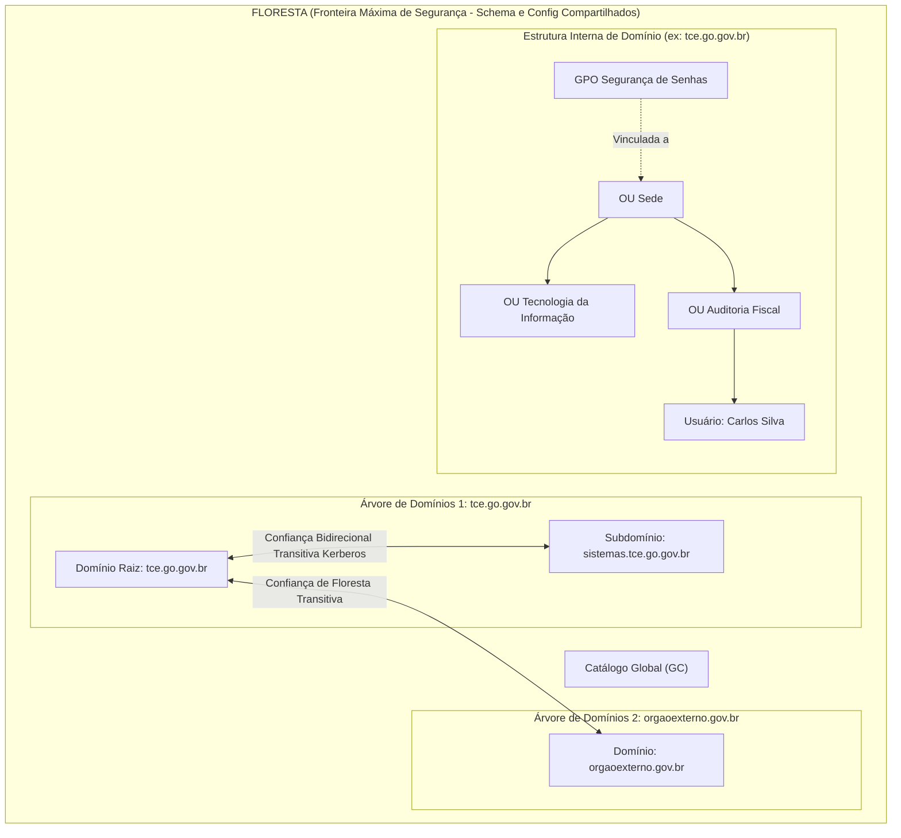
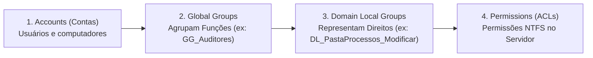
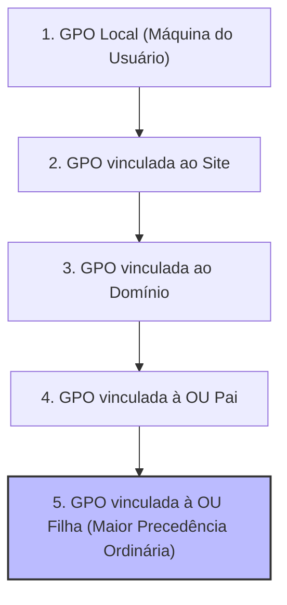

# 02 - Serviços de Diretório: Active Directory e LDAP

> **Matéria:** Sistemas Operacionais, Redes e Computação em Nuvem  
> **Cargo:** B02 – Técnico de Controle Externo – Especialidade: Tecnologia da Informação  
> **Arquivo:** `02_servicos_de_diretorio_active_directory_e_ldap.md`  

---

## 📌 Ementa / Itens do Edital
- Conceitos e fundamentos de Serviços de Diretório
- Protocolo LDAP (Lightweight Directory Access Protocol)
- Arquitetura do Microsoft Active Directory Domain Services (AD DS)
- Estrutura lógica e física do Active Directory
- Objetos, Contas de Usuário, Grupos e Unidades Organizacionais (OUs)
- Políticas de Grupo (GPO - Group Policy Objects)
- Autenticação Kerberos e funções FSMO

---

## 🧭 Sumário

1. [Fundamentos de Serviços de Diretório e Protocolo LDAP](#1-fundamentos-de-servicos-de-diretorio-e-protocolo-ldap)
    1. [Conceito: Diretório Hierárquico vs. Banco de Dados Relacional (RDBMS)](#11-conceito-diretorio-hierarquico-vs-banco-de-dados-relacional-rdbms)
    2. [O Protocolo LDAP: Portas Padrão e Arquitetura TCP/IP](#12-o-protocolo-ldap-portas-padrao-e-arquitetura-tcpip)
    3. [Formato de Nomenclatura X.500: DN, RDN, CN, OU e DC](#13-formato-de-nomenclatura-x500-dn-rdn-cn-ou-e-dc)
    4. [Operações LDAP Fundamentais e Filtros de Busca](#14-operacoes-ldap-fundamentais-e-filtros-de-busca)
    5. [Teste 421](#Teste-421)
    6. [Teste 422](#Teste-422)
2. [Arquitetura Lógica do Microsoft Active Directory (AD DS)](#2-arquitetura-logica-do-microsoft-active-directory-ad-ds)
    1. [Níveis Hierárquicos: OUs, Domínios, Árvores e Floresta](#21-niveis-hierarquicos-ous-dominios-arvores-e-floresta)
    2. [Tipos e Escopos de Grupos no AD DS](#22-tipos-e-escopos-de-grupos-no-ad-ds)
    3. [A Estratégia Canônica de Permissões: AGDLP e AGUDLP](#23-a-estrategia-canonica-de-permissoes-agdlp-e-agudlp)
    4. [Teste 423](#Teste-423)
    5. [Teste 424](#Teste-424)
3. [Estrutura Física e Serviços de Infraestrutura do AD DS](#3-estrutura-fisica-e-servicos-de-infraestrutura-do-ad-ds)
    1. [Controladores de Domínio (DCs), ntds.dit e SYSVOL](#31-controladores-de-dominio-dcs-ntdsdit-e-sysvol)
    2. [Sites, Sub-redes e Otimização de Replicação Física](#32-sites-sub-redes-e-otimizacao-de-replicacao-fisica)
    3. [Catálogo Global (Global Catalog - GC)](#33-catalogo-global-global-catalog-gc)
    4. [As 5 Funções Mestres de Operação Única (FSMO)](#34-as-5-funcoes-mestres-de-operacao-unica-fsmo)
    5. [Teste 425](#Teste-425)
    6. [Teste 426](#Teste-426)
    7. [Teste 427](#Teste-427)
4. [Políticas de Grupo (GPO) e Autenticação Kerberos v5](#4-politicas-de-grupo-gpo-e-autenticacao-kerberos-v5)
    1. [Precedência e Ordem de Processamento de GPOs (LSDOU)](#41-precedencia-e-ordem-de-processamento-de-gpos-lsdou)
    2. [Bloqueio de Herança (Block Inheritance) vs. Imposição (Enforced)](#42-bloqueio-de-heranca-block-inheritance-vs-imposicao-enforced)
    3. [Mecânica do Kerberos v5: KDC, AS, TGS, TGT e Bilhetes de Serviço](#43-mecanica-do-kerberos-v5-kdc-as-tgs-tgt-e-bilhetes-de-servico)
    4. [Tolerância Temporal (Clock Skew) e o Papel do PDC Emulator](#44-tolerancia-temporal-clock-skew-e-o-papel-do-pdc-emulator)
    5. [Teste 428](#Teste-428)
    6. [Teste 429](#Teste-429)
    7. [Teste 430](#Teste-430)
    8. [Teste 431](#Teste-431)
6. [Fontes Recomendadas na Internet](#6-fontes-recomendadas-na-internet)

---

## 1. Fundamentos de Serviços de Diretório e Protocolo LDAP

### 1.1 Conceito: Diretório Hierárquico vs. Banco de Dados Relacional (RDBMS)

Um **Serviço de Diretório** é uma base de dados especializada, estruturada hierarquicamente em formato de árvore invertida (**DIT** - *Directory Information Tree*), concebida para gerenciar, pesquisar e localizar recursos de rede (usuários, grupos funcionais, computadores, servidores, políticas de segurança e certificados).

A principal distinção da arquitetura de diretórios frente aos bancos de dados relacionais convencionais (RDBMS) reside no seu perfil de carga de trabalho:

- Enquanto bancos relacionais são desenhados para suportar operações transacionais equilibradas e escritas frequentes (garantindo ACID rígido com travas complexas), os **Serviços de Diretório são otimizados para uma proporção esmagadora de LEITURAS (cerca de 95% ou mais das operações)** e poucas atualizações ou inserções.
- As buscas no diretório são extremamente rápidas e os dados são replicados entre múltiplos servidores sob o modelo de **consistência eventual** (*Multi-Master Replication*).

| Característica | Serviço de Diretório (LDAP / AD DS) | Banco de Dados Relacional (RDBMS / SQL) |
|---|---|---|
| **Proporção Leitura / Escrita** | **Altíssima leitura (95%+)** e baixa escrita. Otimizado para buscas e logons quase instantâneos. | Equilibrado entre leituras e escritas frequentes (transações OLTP complexas). |
| **Estrutura de Dados** | Hierárquica em árvore (DIT - *Directory Information Tree*). | Tabelas bidimensionais relacionais normalizadas com chaves primárias e estrangeiras. |
| **Mecanismo de Consulta** | Protocolo LDAP com filtros de busca estruturados (ex.: `(&(objectCategory=person)(sAMAccountName=jsilva))`). | Linguagem declarativa SQL com junções relacionais complexas (`JOIN`). |
| **Transacionalidade / ACID** | Suporte transacional limitado; prioriza alta disponibilidade e replicação eventual. | Suporte rigoroso às propriedades ACID (Atomicidade, Consistência, Isolamento, Durabilidade). |
| **Padrão Normativo** | Baseado nas normas ITU-T X.500 e RFCs IETF (RFC 4511). | Padrão ANSI/ISO SQL. |

### 1.2 O Protocolo LDAP: Portas Padrão e Arquitetura TCP/IP

O **LDAP (*Lightweight Directory Access Protocol*)** foi desenvolvido para simplificar o pesado e complexo protocolo DAP (*Directory Access Protocol*) do padrão OSI X.500, eliminando a dependência das camadas superiores da pilha OSI e rodando diretamente sobre a pilha de transporte **TCP/IP**.

#### Portas de Rede Mandatórias para Concursos:
- **Porta TCP/UDP 389:** Porta padrão para tráfego LDAP em texto plano ou com elevação de segurança em canal aberto através do comando `StartTLS`.
- **Porta TCP 636:** Porta padrão para **LDAPS** (*LDAP over SSL/TLS*), onde toda a sessão de rede é encapsulada em criptografia TLS desde o aperto de mão inicial.
- **Porta TCP 3268:** Porta de consulta LDAP direcionada ao **Catálogo Global (*Global Catalog - GC*)** do Active Directory (consultas em nível de floresta).
- **Porta TCP 3269:** Porta de consulta LDAPS segura direcionada ao **Catálogo Global (GC)** com criptografia TLS.

### 1.3 Formato de Nomenclatura X.500: DN, RDN, CN, OU e DC

Cada objeto registrado no diretório possui uma identificação globalmente exclusiva na árvore denominada **Nome Distinto (*Distinguished Name* - DN)**. O DN é formado por uma cadeia encadeada de **Nomes Distintos Relativos (*Relative Distinguished Names* - RDNs)** separados por **vírgulas**:

```text
CN=Thiago Ramos,OU=Auditores,OU=Fiscalizacao,DC=tce,DC=go,DC=gov,DC=br
```

#### Atributos Fundamentais de Composição:
- **`CN` (*Common Name*):** Identificador relativo do objeto folha no nó atual (ex.: `CN=Thiago Ramos` ou `CN=Grupo_Auditores`).
- **`OU` (*Organizational Unit*):** Unidade Organizacional contêiner à qual o objeto pertence. A leitura do DN é feita da **folha para a raiz** (ou seja, `OU=Auditores` está contida no interior da `OU=Fiscalizacao`).
- **`DC` (*Domain Component*):** Cada um dos fragmentos de texto separados por ponto que integram o nome de domínio DNS corporativo (`DC=tce`, `DC=go`, `DC=gov`, `DC=br` para o domínio `tce.go.gov.br`).

> 🚨 **ALERTA DE PROVA / PEGADINHA FCC:**  
> A banca FCC costuma colocar opções invertidas (iniciando pelos `DC`s da raiz em direção ao `CN` folha) ou utilizando barras (`/`) e pontos (`.`) como delimitadores. A sintaxe canônica da RFC 4511 **inicia obrigatoriamente no objeto folha mais específico à esquerda** e utiliza **vírgulas** para separar cada atributo RDN.

### 1.4 Operações LDAP Fundamentais e Filtros de Busca

O protocolo LDAP define um conjunto de operações primitivas:

- **Bind:** Autentica a sessão do cliente perante o servidor de diretório (logon anônimo ou autenticado por credenciais).
- **Search:** Realiza consultas e extração de dados com filtros booleanos prefixados e três escopos de busca:
    - *Base:* Consulta restrita estritamente ao objeto indicado pelo DN base;
    - *One-Level:* Consulta todos os filhos imediatos localizados no primeiro nível abaixo da base;
    - *Subtree:* Consulta exaustiva em toda a subárvore hierárquica abaixo do nó base.
- **Add / Modify / Delete / ModifyDN:** Inserção, edição, exclusão e renomeação de objetos.
- **Unbind:** Encerramento formal da sessão LDAP.

---

## 2. Arquitetura Lógica do Microsoft Active Directory (AD DS)

### 2.1 Níveis Hierárquicos: OUs, Domínios, Árvores e Floresta

A estrutura lógica do **Active Directory Domain Services (AD DS)** organiza os objetos corporativos de forma desvinculada da disposição física dos cabos e prédios:



#### Hierarquia Lógica Detalhada:
1. **Unidade Organizacional (OU - *Organizational Unit*):**
    - É o menor elemento da hierarquia do AD DS no qual se pode:
    - **Vincular diretamente uma Política de Grupo (GPO)**;
    - **Delegar poderes de administração** (ex.: conceder ao suporte técnico de Goiânia autorização para redefinir senhas exclusivamente dos servidores daquela OU).

2. **Domínio (*Domain*):**
    - É a unidade lógica central de segurança, replicação e gerenciamento de contas. Todos os Controladores de Domínio (DCs) do mesmo domínio replicam 100% dos objetos locais.

3. **Árvore de Domínios (*Domain Tree*):**
    - Coleção de um ou mais domínios que compartilham um **namespace DNS contíguo** (ex.: `tce.go.gov.br` e o filho `sistemas.tce.go.gov.br`). Estabelecem relações de confiança automáticas bidirecionais e transitivas entre pai e filho.

4. **Floresta (*Forest*):**
    - É a **fronteira máxima de segurança (*Security Boundary*)** de toda a arquitetura Active Directory.
    - Compreende uma ou mais árvores de domínios que obrigatoriamente compartilham:
    - Uma única partição de **Esquema (*Schema*)**;
    - Uma única partição de **Configuração (*Configuration*)**;
    - O **Catálogo Global (*Global Catalog*)**.

> 🚨 **ALERTA DE PROVA / PEGADINHA FCC:**  
> A FCC já elaborou questões afirmando que o *Domínio* é a fronteira máxima de segurança da arquitetura Windows. **A AFIRMATIVA É ERRADA!** O Domínio é uma *fronteira administrativa*. A **Floresta** é formalmente a **fronteira máxima de segurança**, haja vista que um administrador do domínio raiz da floresta (*Enterprise Admins*) possui privilégios de controle irrestrito que alcançam qualquer domínio subordinado da floresta.

### 2.2 Tipos e Escopos de Grupos no AD DS

Os grupos no Active Directory desempenham papéis fundamentais de organização e controle de acesso:

#### Tipos de Grupo:
- **Grupos de Segurança (*Security Groups*):** Possuem um identificador de segurança único (**SID** - *Security Identifier*). São os únicos que podem ser inseridos em Listas de Controle de Acesso (ACLs) para concessão de permissões em pastas, bancos e impressoras.
- **Grupos de Distribuição (*Distribution Groups*):** Não possuem SID e destinam-se exclusivamente ao envio em massa de e-mails corporativos (ex.: Exchange Server). Não podem receber permissões em recursos de TI.

#### Escopos de Grupos:
- **Global (G):** Agrupa usuários e computadores **do mesmo domínio**. Pode ser utilizado para atribuir permissões em qualquer domínio da floresta.
- **Local de Domínio (DL - *Domain Local*):** Pode conter membros (usuários, grupos globais) de **qualquer domínio confiável da floresta**, mas só pode ser utilizado para conceder permissões em recursos localizados **no mesmo domínio** onde o grupo reside.
- **Universal (U):** Pode conter membros de qualquer domínio da floresta e receber permissões em recursos de qualquer domínio da floresta. Suas alterações são replicadas para o Catálogo Global.

### 2.3 A Estratégia Canônica de Permissões: AGDLP e AGUDLP

A recomendação oficial de arquitetura da Microsoft para gestão segura e escalável de permissões adota a estratégia mnemônica **AGDLP**:



1. **A**ccounts: As contas de usuário individuais são criadas e inseridas em..
2. **G**lobal Groups: Grupos Globais que representam uma função de trabalho corporativa (ex.: `GG_AuditoresFiscais`), que são adicionados a..
3. **D**omain **L**ocal Groups: Grupos Locais de Domínio criados especificamente para representar o nível de permissão sobre determinado recurso (ex.: `DL_ProcessosEletronicos_Leitura`), onde finalmente se aplicam as..
4. **P**ermissions: Permissões de controle de acesso (ACLs NTFS) na pasta do servidor de arquivos.

*(Em florestas multinacionais ou corporações complexas com múltiplos domínios, insere-se a camada de Grupos Universais, formando o padrão **AGUDLP**).*

---

## 3. Estrutura Física e Serviços de Infraestrutura do AD DS

### 3.1 Controladores de Domínio (DCs), ntds.dit e SYSVOL

- **Controlador de Domínio (DC - *Domain Controller*):** Servidor Windows que executa a função de AD DS, responsável por autenticar usuários, processar logon Kerberos e manter a base de dados.
- **`ntds.dit`:** O arquivo de banco de dados do Active Directory propriamente dito (baseado no mecanismo ESE / JET Blue).
- **Compartilhamento SYSVOL:** Pasta de rede replicada automaticamente entre todos os DCs que armazena os scripts de logon e os arquivos de configuração das Políticas de Grupo (GPOs).
- **RODC (*Read-Only Domain Controller*):** Controlador de Domínio somente leitura projetado para filiais ou escritórios remotos que não possuem segurança física adequada (sem sala cofre). Não armazena senhas em cache por padrão, resguardando o domínio central caso o hardware da filial seja furtado.

### 3.2 Sites, Sub-redes e Otimização de Replicação Física

Enquanto a estrutura lógica organiza os objetos em Domínios e OUs, a **Estrutura Física** modela a topologia real da rede:

- **Sub-redes (*Subnets*):** Mapeamento dos blocos de endereços IP de cada unidade (ex.: `10.1.0.0/24`).
- **Sites:** Agrupamento de sub-redes interligadas por links de rede de alta velocidade e baixa latência (LAN local).
- **Utilidade dos Sites:**
    1. *Direcionamento de Logon:* Garante que uma estação de trabalho em Goiânia autentique-se no DC local de Goiânia, sem atravessar links WAN lentos até Brasília.
    2. *Controle de Replicação:* A replicação intra-site (mesmo local) ocorre quase instantaneamente sem compressão; a replicação inter-site (entre filiais) é agendada para horários de menor tráfego e compactada via protocolo RPC sobre IP.

### 3.3 Catálogo Global (Global Catalog - GC)

O **Catálogo Global (GC)** é uma função especializada desempenhada por um ou mais Controladores de Domínio da floresta:

- Armazena uma réplica completa de todos os objetos do seu próprio domínio e uma **réplica parcial (somente leitura com os atributos mais consultados, como nome, e-mail e UPN) de todos os objetos de todos os outros domínios da floresta**.
- É indispensável para permitir que usuários façam login utilizando o seu *User Principal Name* (UPN: `usuario@orgao.gov.br`) e para a resolução de associações de Grupos Universais durante o processo de geração do token de logon.

### 3.4 As 5 Funções Mestres de Operação Única (FSMO)

Embora o Active Directory opere predominantemente sob o regime de replicação multimesmo (*multi-master*), determinadas tarefas críticas não admitem escritas concorrentes descentralizadas. Para essas operações, o AD DS define as **5 Funções FSMO (*Flexible Single Master Operations*)**:

| Escopo da Função | Função FSMO | Responsabilidade e Missão Crítica | Consequência da Falha Prolongada |
|---|---|---|---|
| **Nível de Floresta** *(Apenas 1 por Floresta)* | **Schema Master** *(Mestre de Esquema)* | Controla todas as modificações e extensões no Esquema do AD DS (criação de novas classes e atributos de objetos). | Não impacta logons de usuários; impede unicamente a instalação de softwares que alteram o schema (ex.: Exchange, SCCM). |
| **Nível de Floresta** *(Apenas 1 por Floresta)* | **Domain Naming Master** *(Mestre de Nomenclatura)* | Autoriza a criação, exclusão ou renomeação de domínios e partições de diretório em toda a floresta. | Impede unicamente criar novos domínios ou excluir domínios existentes. |
| **Nível de Domínio** *(1 em cada Domínio)* | **PDC Emulator** *(Emulador de PDC)* | **A função mais ativa e crítica:** atua como servidor de sincronização de relógio mestre (servidor NTP raiz), reconcilia alterações e falhas de senha com prioridade, e processa bloqueios de conta. | Causa atrasos na propagação de novas senhas, falhas de logon em contas recém-alteradas e erros de dessincronização no protocolo Kerberos. |
| **Nível de Domínio** *(1 em cada Domínio)* | **RID Master** *(Mestre de Identificadores Relativos)* | Distribui blocos (*pools*) de RIDs para todos os outros DCs do domínio. Cada objeto criado recebe um SID composto pelo SID do Domínio + um RID exclusivo. | Se o pool de RIDs de um DC se esgotar com o RID Master fora do ar, aquele DC fica impossibilitado de criar novos usuários, grupos ou máquinas. |
| **Nível de Domínio** *(1 em cada Domínio)* | **Infrastructure Master** *(Mestre de Infraestrutura)* | Atualiza referências cruzadas quando um objeto de outro domínio pertencente a um grupo local é modificado. | Em domínio único não tem efeito prático. Em multi-domínio sem GC conjunto, nomes de usuários externos podem demorar a se resolver nas ACLs. |

---

## 4. Políticas de Grupo (GPO) e Autenticação Kerberos v5

### 4.1 Precedência e Ordem de Processamento de GPOs (LSDOU)

Os **Objetos de Política de Grupo (GPOs - *Group Policy Objects*)** aplicam configurações centralizadas de segurança, registros, mapeamentos de impressoras e restrições a usuários e computadores.

O processamento das GPOs segue a ordem cronológica estrita representada pelo mnemônico **LSDOU**:

$$\text{1. Local} \longrightarrow \text{2. Site} \longrightarrow \text{3. Domain} \longrightarrow \text{4. Organizational Unit (OU)}$$



- **Regra de Ouro da Resolução de Conflitos:** Em caso de políticas com parâmetros contraditórios, **a última diretiva processada é a que prevalece!**
- Como a OU filha é processada por último na cadeia ordinária, as configurações da **OU mais próxima do objeto possuem maior precedência** sobre as diretivas de Domínio, Site ou Local.

### 4.2 Bloqueio de Herança (Block Inheritance) vs. Imposição (Enforced)

O comportamento padrão de herança pode ser alterado por dois modificadores:

1. **Bloquear Herança (*Block Inheritance*):** Aplicado a uma Unidade Organizacional (OU) específica. Impede que a OU receba diretivas herdadas de níveis superiores (Site, Domínio e OUs pai).
2. **Imposição / Não Substituir (*Enforced*):** Aplicado diretamente a uma GPO vinculada a um nível superior (como o Domínio).  
   > 🚨 **REGRA DE PREVALÊNCIA ABSOLUTA FCC:**  
   > A opção **Enforced SOBREPÕE QUALQUER BLOQUEIO DE HERANÇA!** Uma GPO de domínio configurada como *Enforced* será obrigatoriamente aplicada a todas as estações e OUs subordinadas, mesmo que estas tenham o *Block Inheritance* explicitamente ativado.

### 4.3 Mecânica do Kerberos v5: KDC, AS, TGS, TGT e Bilhetes de Serviço

O protocolo **Kerberos v5** (RFC 4120) é o alicerce de autenticação e *Single Sign-On* (SSO) do Active Directory:

```mermaid
sequenceDiagram
    autonumber
    participant C as "Cliente (Estação de Trabalho)"
    participant AS as "Authentication Server (AS / KDC no DC)"
    participant TGS as "Ticket Granting Server (TGS / KDC)"
    participant S as "Servidor de Arquivos / Aplicação"

    C->>AS: 1. KRB_AS_REQ (Solicitação com carimbo de tempo cifrado pela senha do usuário)
    AS-->>C: 2. KRB_AS_REP (Retorna TGT cifrado pela chave do KDC + Sessão KDC)
    Note over C: Usuário agora possui um TGT (Ticket Granting Ticket)
    C->>TGS: 3. KRB_TGS_REQ (Apresenta TGT solicitando acesso ao serviço CIFS/HTTP)
    TGS-->>C: 4. KRB_TGS_REP (Retorna Ticket de Serviço cifrado com a chave do servidor)
    C->>S: 5. KRB_AP_REQ (Apresenta o Ticket de Serviço diretamente ao servidor de recursos)
    S-->>C: 6. KRB_AP_REP (Autenticação mútua confirmada; acesso liberado)
```

1. **`KRB_AS_REQ` / `KRB_AS_REP`:** O cliente envia uma requisição ao serviço de autenticação (**AS**). O AS valida a identidade e devolve uma chave de sessão e o **TGT (*Ticket Granting Ticket*)**, um bilhete cifrado com a chave secreta exclusiva do KDC (a conta `krbtgt`).
2. **`KRB_TGS_REQ` / `KRB_TGS_REP`:** De posse do TGT, quando o usuário precisa acessar um servidor de arquivos ou intranet, ele solicita um bilhete ao serviço concessor de bilhetes (**TGS**). O TGS valida o TGT e emite um **Ticket de Serviço (*Service Ticket*)** cifrado com a chave do servidor de destino.
3. **`KRB_AP_REQ`:** O cliente entrega o Ticket de Serviço diretamente ao servidor final, obtendo acesso imediato sem jamais trafegar sua senha pela rede.

### 4.4 Tolerância Temporal (Clock Skew) e o Papel do PDC Emulator

Para impedir que invasores capturem pacotes de autenticação na rede e os reenviem maliciosamente (**ataques de repetição / *replay attacks***), as mensagens do Kerberos incluem carimbos temporais (*timestamps*):

- O KDC exige que a diferença entre o relógio da estação cliente e o relógio do servidor de autenticação não ultrapasse um limite máximo, denominado **Desvio de Relógio (*Clock Skew*)**, configurado por padrão em **5 minutos**.
- Se a divergência for superior a 5 minutos, a autenticação Kerberos falha sumariamente.
- Por esse motivo, a função FSMO **PDC Emulator** atua compulsoriamente como a fonte oficial de sincronização horária (**NTP Master**) de toda a floresta do Active Directory.

---

## 6. Fontes Recomendadas na Internet

* [Microsoft Learn - Active Directory Domain Services Overview](https://learn.microsoft.com/pt-br/windows-server/identity/ad-ds/get-started/virtual-dc/active-directory-domain-services-overview) - Visão geral oficial do AD DS, estruturas de florestas, domínios, árvores e unidades organizacionais.
* [Microsoft Learn - Visão Geral do Kerberos no Windows Server](https://learn.microsoft.com/pt-br/windows-server/security/kerberos/kerberos-authentication-overview) - Funcionamento oficial da autenticação Kerberos, KDC, tickets TGT e autenticação de rede.
* [IETF RFC 4511 - Lightweight Directory Access Protocol (LDAP): The Protocol](https://datatracker.ietf.org/doc/html/rfc4511) - Especificação oficial do protocolo LDAPv3, operações de busca, bind e modelo de dados.
* [IETF RFC 4120 - The Kerberos Network Authentication Service (V5)](https://datatracker.ietf.org/doc/html/rfc4120) - Especificação oficial do protocolo de autenticação segura e bilhetagem Kerberos v5.
* [Microsoft Learn - Objetos de Diretiva de Grupo (GPO)](https://learn.microsoft.com/pt-br/windows-server/identity/ad-fs/deployment/distribute-certificates-to-client-computers-by-using-group-policy) - Documentação oficial sobre criação, herança e aplicação de políticas de grupo (GPO) no Active Directory.
* NEMETH, Evi et al. **UNIX and Linux System Administration Handbook**. 5. ed. Boston: Addison-Wesley Professional, 2017. (Cap. 22 - Directory Services: LDAP and Active Directory).
* STALLINGS, William. **Criptografia e Segurança de Redes: Princípios e Práticas**. 7. ed. São Paulo: Pearson Education do Brasil, 2018. (Cap. 16 - Autenticação Mútua e Serviços Kerberos).
* TANENBAUM, Andrew S.; WETHERALL, David. **Redes de Computadores**. 5. ed. São Paulo: Pearson, 2011. (Cap. 7 - Camada de Aplicação e Serviços de Diretório).
