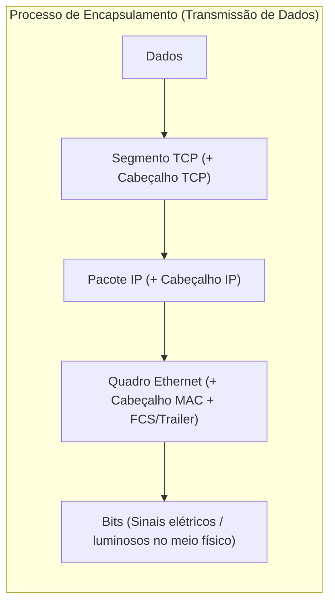
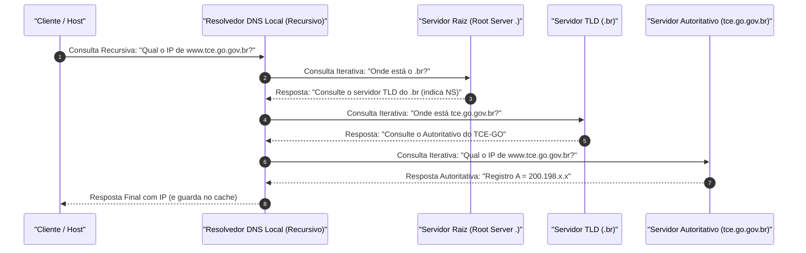
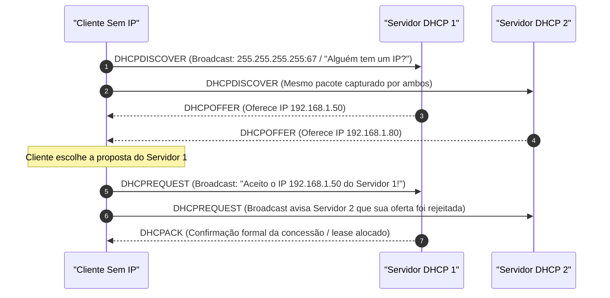

# 03 - Redes TCP/IP, Endereçamento IPv4/IPv6, DNS e DHCP

> **Matéria:** Sistemas Operacionais, Redes e Computação em Nuvem  
> **Cargo:** B02 – Técnico de Controle Externo – Especialidade: Tecnologia da Informação  
> **Arquivo:** `03_redes_tcp_ip_enderecamento_ipv4_ipv6_dns_dhcp.md`  

---

## 📌 Ementa / Itens do Edital
- Arquitetura de redes TCP/IP e comparação com o Modelo OSI
- Endereçamento IPv4: Classes, máscaras de rede, notação CIDR, sub-redes e RFC 1918 (IPs privados)
- Endereçamento IPv6: Estrutura, tipos de endereçamento e mecanismos de transição
- Protocolo de Resolução de Nomes: DNS (Domain Name System)
- Protocolo de Configuração Dinâmica de Hosts: DHCP (Dynamic Host Configuration Protocol)

---

## 🧭 Sumário

1. [Modelos de Referência: OSI vs. TCP/IP](#1-modelos-de-referencia-osi-vs-tcpip)
    1. [Estrutura em Camadas do Modelo OSI (7 Níveis)](#11-estrutura-em-camadas-do-modelo-osi-7-niveis)
    2. [Arquitetura em Camadas da Pilha TCP/IP (4 Níveis)](#12-arquitetura-em-camadas-da-pilha-tcpip-4-niveis)
    3. [Unidades de Dados de Protocolo (PDU) e Encapsulamento](#13-unidades-de-dados-de-protocolo-pdu-e-encapsulamento)
    4. [Teste 432](#Teste-432)
    5. [Teste 433](#Teste-433)
2. [Endereçamento e Sub-redes IPv4](#2-enderecamento-e-sub-redes-ipv4)
    1. [Classes Históricas de Endereços (Classes A a E)](#21-classes-historicas-de-enderecos-classes-a-a-e)
    2. [Espaço de Endereçamento Privado (RFC 1918) e NAT/PAT](#22-espaco-de-enderecamento-privado-rfc-1918-e-natpat)
    3. [Roteamento Interdomínio Sem Classe (CIDR) e VLSM](#23-roteamento-interdominio-sem-classe-cidr-e-vlsm)
    4. [Mecânica de Cálculo de Sub-redes, Hosts Úteis e Tabela de Conversão](#24-mecanica-de-calculo-de-sub-redes-hosts-uteis-e-tabela-de-conversao)
    5. [Teste 434](#Teste-434)
    6. [Teste 435](#Teste-435)
3. [Endereçamento IPv6](#3-enderecamento-ipv6)
    1. [Estrutura de 128 Bits e Regras de Compactação Oficial (RFC 5952)](#31-estrutura-de-128-bits-e-regras-de-compactacao-oficial-rfc-5952)
    2. [Tipos de Transmissão no IPv6: Unicast, Anycast e Multicast (Extinção do Broadcast)](#32-tipos-de-transmissao-no-ipv6-unicast-anycast-e-multicast-extincao-do-broadcast)
    3. [Faixas Notáveis de Endereços IPv6 (Loopback, Link-Local, ULA, GUA)](#33-faixas-notaveis-de-enderecos-ipv6-loopback-link-local-ula-gua)
    4. [Autoconfiguração (SLAAC) e Mecanismos de Transição (Dual-Stack, Túneis, NAT64)](#34-autoconfiguracao-slaac-e-mecanismos-de-transicao-dual-stack-tuneis-nat64)
    5. [Teste 436](#Teste-436)
    6. [Teste 437](#Teste-437)
4. [Protocolo DNS (Domain Name System)](#4-protocolo-dns-domain-name-system)
    1. [Finalidade, Arquitetura Hierárquica e Portas UDP/TCP 53](#41-finalidade-arquitetura-hierarquica-e-portas-udptcp-53)
    2. [Consultas Recursivas vs. Consultas Iterativas](#42-consultas-recursivas-vs-consultas-iterativas)
    3. [Registros de Recursos (A, AAAA, CNAME, MX, NS, PTR, SOA, TXT)](#43-registros-de-recursos-a-aaaa-cname-mx-ns-ptr-soa-txt)
    4. [Teste 438](#Teste-438)
    5. [Teste 439](#Teste-439)
    6. [Teste 440](#Teste-440)
5. [Protocolo DHCP (Dynamic Host Configuration Protocol)](#5-protocolo-dhcp-dynamic-host-configuration-protocol)
    1. [Finalidade e Portas de Transporte UDP 67/68](#51-finalidade-e-portas-de-transporte-udp-6768)
    2. [O Ciclo DORA em 4 Etapas (Discover, Offer, Request, Acknowledge)](#52-o-ciclo-dora-em-4-etapas-discover-offer-request-acknowledge)
    3. [Timers de Renovação de Concessão (T1 e T2)](#53-timers-de-renovacao-de-concessao-t1-e-t2)
    4. [Agente de Retransmissão DHCP (DHCP Relay Agent)](#54-agente-de-retransmissao-dhcp-dhcp-relay-agent)
    5. [Teste 441](#Teste-441)
    6. [Teste 442](#Teste-442)
6. [Fontes Recomendadas na Internet](#6-fontes-recomendadas-na-internet)

---

## 1. Modelos de Referência: OSI vs. TCP/IP

### 1.1 Estrutura em Camadas do Modelo OSI (7 Níveis)

O modelo **OSI (*Open Systems Interconnection*)**, padronizado pela ISO (norma ISO/IEC 7498-1), é a estrutura conceitual de referência para comunicação entre redes de computadores, decompondo as funções de rede em sete camadas lógicas:

1. **Física (Camada 1):** Transmissão de bits brutos não estruturados através de meios físicos guiados (cabos de par trançado de cobre, fibras ópticas) ou não guiados (ondas de rádio). Define propriedades elétricas, ópticas e mecânicas (voltagens, conectores RJ-45).
2. **Enlace de Dados (Camada 2):** Agrupa os bits em unidades estruturadas chamadas **Quadros (*Frames*)**. Responsável pelo endereçamento físico local (**Endereço MAC**), controle de acesso ao meio físico (subcamada MAC), sincronismo de quadro e detecção básica de erros na transmissão via checksum (CRC/FCS). Opera com switches de camada 2.
3. **Rede (Camada 3):** Responsável pelo **endereçamento lógico global (endereços IP)**, roteamento de pacotes através de múltiplos enlaces intermediários e fragmentação quando a MTU do meio é ultrapassada. Opera com roteadores e switches de camada 3.
4. **Transporte (Camada 4):** Provê comunicação ponta a ponta (*host-to-host*) confiável ou não confiável entre processos de aplicação, utilizando multiplexação de portas (TCP e UDP), controle de fluxo e sequenciamento de pacotes.
5. **Sessão (Camada 5):** Estabelece, gerencia, sincroniza e encerra sessões de diálogo entre aplicações em nós distintos (ex.: checkpoints para recuperação de falhas).
6. **Apresentação (Camada 6):** Cuida da sintaxe, representação e semântica dos dados transmitidos: conversão de conjuntos de caracteres (ASCII/Unicode/EBCDIC), compressão de dados (gzip) e criptografia/descriptografia (TLS/SSL).
7. **Aplicação (Camada 7):** Interface direta entre os programas finais do usuário e os serviços de rede (HTTP, DNS, SMTP, FTP, SSH).

### 1.2 Arquitetura em Camadas da Pilha TCP/IP (4 Níveis)

Em contraposição ao modelo teórico OSI, a arquitetura prática dominante da Internet é a **Pilha TCP/IP** (formalizada em RFCs como RFC 1122), estruturada em 4 camadas funcionais:

| Camada OSI (7 Níveis) | Camada TCP/IP (4 Níveis) | PDU (*Protocol Data Unit*) | Principais Protocolos e Tecnologias |
|---|---|---|---|
| **7. Aplicação** | **Aplicação** | **Dados** | HTTP, HTTPS, DNS, DHCP, SSH, FTP, SMTP, IMAP, SNMP |
| **6. Apresentação** | *(incorporada na Aplicação)* | **Dados** | Criptografia TLS/SSL, compressão gzip, codificações ASCII/JPEG |
| **5. Sessão** | *(incorporada na Aplicação)* | **Dados** | RPC, gerenciamento de diálogo e pontos de sincronismo (checkpoints) |
| **4. Transporte** | **Transporte** | **Segmento** (TCP) / **Datagrama** (UDP) | TCP (orientado à conexão, confiável) e UDP (não orientado à conexão, sem garantia) |
| **3. Rede** | **Internet** | **Pacote** | IPv4, IPv6, ICMP, ICMPv6, IGMP, OSPF, BGP, IPsec |
| **2. Enlace** | **Acesso à Rede** | **Quadro (*Frame*)** | Ethernet (802.3), Wi-Fi (802.11), PPP, Switch L2, ARP, MAC Address |
| **1. Física** | **Acesso à Rede** | **Bit** | Cabos de par trançado (Cat6), fibra óptica, conectores RJ-45, Hub |

### 1.3 Unidades de Dados de Protocolo (PDU) e Encapsulamento

O envio de dados por uma rede baseia-se no processo sequencial de **Encapsulamento** (durante a transmissão) e **Desencapsulamento** (na recepção):



> ⭐ **REGRA DE OURO PARA CONCURSOS (FCC):**  
> A Unidade de Dados de Protocolo (PDU) possui denominações canônicas exclusivas em cada nível:  
>
> - Camada de Aplicação: **Dados / Mensagem**  
> - Camada de Transporte: **Segmento** (no protocolo TCP) ou **Datagrama** (no protocolo UDP)  
> - Camada de Rede: **Pacote**  
> - Camada de Enlace: **Quadro (*Frame*)**  
> - Camada Física: **Bit**

---

## 2. Endereçamento e Sub-redes IPv4

### 2.1 Classes Históricas de Endereços (Classes A a E)

O protocolo **IPv4** opera com endereços de **32 bits**, estruturados em 4 octetos decimais delimitados por pontos. Originalmente (RFC 791), os endereços foram agrupados em classes de acordo com a configuração de seus primeiros bits:

| Classe | Prefixo Binário Inicial | Faixa Decimal do 1º Octeto | Máscara Padrão | Finalidade e Dimensão |
|---|---|---|---|---|
| **Classe A** | `0xxxxxxx` | $1$ a $126$ *(o 127 é reservado para loopback)* | `255.0.0.0` (/8) | Redes gigantescas: suporta até 16.777.214 hosts por rede. |
| **Classe B** | `10xxxxxx` | $128$ a $191$ | `255.255.0.0` (/16) | Redes de médio porte: suporta até 65.534 hosts por rede. |
| **Classe C** | `110xxxxx` | $192$ a $223$ | `255.255.255.0` (/24) | Redes locais pequenas: suporta até 254 hosts por rede. |
| **Classe D** | `1110xxxx` | $224$ a $239$ | Não aplicável | Reservada compulsoriamente para tráfego **Multicast**. |
| **Classe E** | `1111xxxx` | $240$ a $255$ | Não aplicável | Reservada para pesquisas científicas e experimentos futuros. |

### 2.2 Espaço de Endereçamento Privado (RFC 1918) e NAT/PAT

Para conter o rápido esgotamento dos endereços públicos IPv4 na década de 1990, a norma **RFC 1918** reservou três faixas exclusivas para uso interno em redes corporativas e residenciais, as quais são **terminantemente descartadas pelos roteadores da Internet pública**:

- **Classe A Privada:** `10.0.0.0/8` (intervalo de `10.0.0.0` a `10.255.255.255`) $\implies$ Bloco único que comporta mais de 16 milhões de endereços.
- **Classe B Privada:** `172.16.0.0/12` (intervalo de `172.16.0.0` a `172.31.255.255`) $\implies$ Conjunto de 16 blocos contíguos de tamanho `/16`, totalizando cerca de 1 milhão de endereços.
- **Classe C Privada:** `192.168.0.0/16` (intervalo de `192.168.0.0` a `192.168.255.255`) $\implies$ Conjunto de 256 blocos contíguos de tamanho `/24`, totalizando 65.536 endereços.

> 🚨 **ALERTA DE PROVA / PEGADINHA FCC:**  
> Muita atenção à faixa da Classe B Privada: ela termina rigorosamente em `172.31.255.255`! Se a questão de concurso apresentar um endereço como `172.32.10.1` ou `172.35.10.2`, esse endereço **NÃO é privado**. Ele é um IP público mundial roteável na Internet!

#### Mecanismos de Tradução NAT e NAPT/PAT:
Como os endereços privados da RFC 1918 não navegam na Internet, o roteador de borda utiliza a **Tradução de Endereços de Rede (NAT - *Network Address Translation*)**:

- **NAT Estático:** Mapeamento 1:1 fixo entre um IP privado e um IP público.
- **NAT Dinâmico:** Mapeamento temporário 1:1 retirado de um pool de IPs públicos disponíveis.
- **NAPT / PAT (*Port Address Translation* / NAT Overload):** Mapeamento $N:1$, no qual centenas ou milhares de computadores privados da rede interna navegam simultaneamente na Internet utilizando **um único endereço IP público**. O roteador diferencia as conexões mapeando portas TCP/UDP de origem aleatórias.

### 2.3 Roteamento Interdomínio Sem Classe (CIDR) e VLSM

Para eliminar o desperdício colossal do sistema de classes, a IETF introduziu o **CIDR (*Classless Inter-Domain Routing* - RFC 1519)** e o **VLSM (*Variable Length Subnet Mask*)**:

- A divisão entre porção de rede e porção de host deixa de ser fixada nos limites rígidos de 8, 16 ou 24 bits.
- A máscara é expressa em formato prefixal `/n`, onde $n$ indica a quantidade exata de bits contíguos ligados em "1" que representam a rede (ex.: `/27` indica 27 bits para rede e $32 - 27 = 5$ bits para hosts).

### 2.4 Mecânica de Cálculo de Sub-redes, Hosts Úteis e Tabela de Conversão

O cálculo sistemático de qualquer sub-rede IPv4 parte de fórmulas matemáticas elementares:

1. **Bits de Rede ($n$):** Definidos pelo prefixo CIDR `/$n$`.
2. **Bits de Host ($h$):** Calculados por:
   $$h = 32 - n$$
3. **Total Bruto de Endereços:** $2^h$.
4. **Total de Hosts Úteis (Utilizáveis por máquinas):**
   $$\text{Hosts Úteis} = 2^h - 2$$
   *(Subtraem-se compulsoriamente 2 endereços: o primeiro com todos os bits de host zerados, que representa o **Endereço de Rede**, e o último com todos os bits de host ligados em 1, que representa o **Endereço de Broadcast** daquela sub-rede).*

#### Tabela Rápida de Conversão de Sub-redes (/24 a /30)

| Notação CIDR | Máscara Decimal | Bits de Host ($h$) | Tamanho do Bloco ($2^h$) | Hosts Úteis ($2^h - 2$) | Aplicações Típicas |
|---|---|---|---|---|---|
| **/24** | `255.255.255.0` | $8$ | $256$ | $254$ | Redes departamentais convencionais |
| **/25** | `255.255.255.128` | $7$ | $128$ | $126$ | Divisão de um /24 ao meio |
| **/26** | `255.255.255.192` | $6$ | $64$ | $62$ | Sub-redes de até 60 computadores |
| **/27** | `255.255.255.224` | $5$ | $32$ | $30$ | Sub-redes de até 28 a 30 estações |
| **/28** | `255.255.255.240` | $4$ | $16$ | $14$ | Sub-redes pequenas de servidores |
| **/29** | `255.255.255.248` | $3$ | $8$ | $6$ | DMZ compacta |
| **/30** | `255.255.255.252` | $2$ | $4$ | $2$ | Enlaces ponto a ponto entre roteadores |

---

### Teste 001
**(FGV – TJ/AP – 2023 – Analista Judiciario Apoio Especializado Tecnologia Da Informacao Telecomunicacoes)**
Um servidor de endereços IP (Dynamic Host Configuration Protocol – DHCP) foi configurado para fornecer endereços IPv4 para máquinas da rede 10.1.2.160/27. Em sua configuração, os quatro últimos IP úteis foram excluídos da oferta DHCP para hospedar o gateway da rede e três máquinas com IP fixo. Com relação à configuração realizada nesse servidor, analise os itens a seguir. I. Os IPv4 reservados para os dispositivos com necessidade de IP fixo são os IP 10.1.2.187, 10.1.2.188, 10.1.2.189 e 10.1.2.190. II. A faixa de IPv4 a ser distribuída pelo servidor DHCP, vai do IPv4 10.1.2.160 até o IPv4 10.1.2.191. III. O servidor DHCP poderá configurar endereço de rede em até 26 máquinas. Está correto o que se afirma em:

* **A)** somente II;
* **B)** somente I e II;
* **C)** somente I e III;
* **D)** somente II e III;
* **E)** I, II e III.

---

> **Comentário Detalhado:**
>
> - **A)** **Incorreta.** A opção incorre em restrição indevida ao limitar o escopo conceitual ao afirmar que "somente II". De acordo com a teoria estudada em *5.1 Finalidade e Portas de Transporte UDP 67/68*, o DHCP (RFC 2131) opera no modelo cliente servidor para automatizar a distribuição de parâmetros de rede TCP/IP: endereço IP dinâmico, máscara de sub rede, gateway padrão ( Default Gateway ) e servidores DNS.
> - **B)** **Incorreta.** A opção incorre em restrição indevida ao limitar o escopo conceitual ao afirmar que "somente I e II". De acordo com a teoria estudada em *2.4 Mecânica de Cálculo de Sub-redes, Hosts Úteis e Tabela de Conversão*, (Subtraem se compulsoriamente 2 endereços: o primeiro com todos os bits de host zerados, que representa o Endereço de Rede, e o último com todos os bits de host ligados em 1, que representa o Endereço de Broadcast daquela sub rede).
> - **C)** **Correta.** Conforme fundamentado na seção *6. Fontes Recomendadas na Internet* deste guia, iETF RFC 2131 Dynamic Host Configuration Protocol (DHCP) Funcionamento oficial do protocolo DHCP e alocação dinâmica de parâmetros de rede IP. Dessa forma, está plenamente correta a assertiva da banca (FGV – TJ/AP/2023) ao estabelecer que "somente I e III".
> - **D)** **Incorreta.** A opção incorre em restrição indevida ao limitar o escopo conceitual ao afirmar que "somente II e III". De acordo com a teoria estudada em *5.2 O Ciclo DORA em 4 Etapas (Discover, Offer, Request, Acknowledge)*, dHCP Discover: O cliente recém conectado, desprovido de endereço IP configurado, envia um pacote em Broadcast (origem 0.0.0.0 , destino 255.255.255.255 ) na porta 67 perguntando se há algum servidor DHCP ativo.
> - **E)** **Incorreta.** A opção apresenta proposição em desacordo com os fundamentos teóricos e técnicos do tópico ao afirmar que "I, II e III". De acordo com a teoria estudada em *3.4 Autoconfiguração (SLAAC) e Mecanismos de Transição (Dual-Stack, Túneis, NAT64)*, sLAAC ( Stateless Address Autoconfiguration RFC 4862): Permite que uma estação configure seu endereço IPv6 global automaticamente sem intervenção de servidor DHCP. O roteador anuncia periodicamente o prefixo da rede através de mensagens ICMPv6 Router Advertisement (RA). O host combina esse prefixo de 64 bits com os seus 64 bits de interface (obtidos aleatoriamente ou via padrão EUI 64 a partir do endereço MAC).
>
> **Gabarito: C**

---

### Teste 002
**(FGV – TJ/AP – 2023 – Analista Judiciario Apoio Especializado Tecnologia Da Informacao Telecomunicacoes)**
O administrador de rede de uma empresa deseja configurar uma rede de computadores com capacidade para comportar até vinte computadores pessoais, quatro impressoras de rede, quatro câmeras de monitoramento IP, três servidores de rede e um gateway da rede, conforme apresentado na tabela abaixo. Máquina Quantidade Computadores pessoais 20 Impressoras de rede 04 Câmeras de monitoramento IP 04 Servidores de rede 03 Gateway da rede 01 A rede IPv4 com a menor capacidade de hospedar os dispositivos, mas que comporte as necessidades apresentadas, é:

* **A)** 192.168.1.0/24;
* **B)** 192.168.1.0/25;
* **C)** 192.168.1.0/26;
* **D)** 192.168.1.0/27;
* **E)** 192.168.1.0/28.

---

> **Comentário Detalhado:**
>
> - **A)** **Incorreta.** A opção apresenta proposição em desacordo com os fundamentos teóricos e técnicos do tópico ao afirmar que "192.168.1.0/24". De acordo com a teoria estudada em *5.2 O Ciclo DORA em 4 Etapas (Discover, Offer, Request, Acknowledge)*, s1 C: DHCPOFFER (Oferece IP 192.168.1.50).
> - **B)** **Incorreta.** A opção apresenta proposição em desacordo com os fundamentos teóricos e técnicos do tópico ao afirmar que "192.168.1.0/25". De acordo com a teoria estudada em *5.2 O Ciclo DORA em 4 Etapas (Discover, Offer, Request, Acknowledge)*, s2 C: DHCPOFFER (Oferece IP 192.168.1.80).
> - **C)** **Correta.** Conforme fundamentado na seção *2.2 Espaço de Endereçamento Privado (RFC 1918) e NAT/PAT* deste guia, classe C Privada: 192.168.0.0/16 (intervalo de 192.168.0.0 a 192.168.255.255 ) $\implies$ Conjunto de 256 blocos contíguos de tamanho /24 , totalizando 65.536 endereços. Dessa forma, está plenamente correta a assertiva da banca (FGV – TJ/AP/2023) ao estabelecer que "192.168.1.0/26".
> - **D)** **Incorreta.** A opção apresenta proposição em desacordo com os fundamentos teóricos e técnicos do tópico ao afirmar que "192.168.1.0/27". De acordo com a teoria estudada em *5.2 O Ciclo DORA em 4 Etapas (Discover, Offer, Request, Acknowledge)*, c S1: DHCPREQUEST (Broadcast: "Aceito o IP 192.168.1.50 do Servidor 1!").
> - **E)** **Incorreta.** A opção apresenta proposição em desacordo com os fundamentos teóricos e técnicos do tópico ao afirmar que "192.168.1.0/28". De acordo com a teoria estudada em *Tabela Rápida de Conversão de Sub-redes (/24 a /30)*, /26: 255.255.255.192 — $6$ — $64$ — $62$ — Sub redes de até 60 computadores.
>
> **Gabarito: C**

---

### Teste 003
**(FCC – TRT 14ª – 2016 – Analista Judiciário - Apoio Especializado - Tecnologia da Informação)**
A partir de um endereço IP 192.168.2.0/27 de uma rede classe C com máscara 255.255.255.224 podem ser criadas até 8 sub-redes com até 30 hosts utilizáveis cada. Na segunda sub-rede, o endereço de rede e de broadcast serão, respecti- vamente,

* **A)** 192.168.2.0/27 − 192.168.2.31/27
* **B)** 192.168.2.128/27 − 192.168.2.159/27
* **C)** 192.168.2.32/27 − 192.168.2.63/27
* **D)** 192.168.2.96/27 − 192.168.2.127/27
* **E)** 192.168.2.64/27 − 192.168.2.95/27

---

> **Comentário Detalhado:**
>
> - **A)** **Incorreta.** A opção apresenta proposição em desacordo com os fundamentos teóricos e técnicos do tópico ao afirmar que "192.168.2.0/27 − 192.168.2.31/27". De acordo com a teoria estudada em *5.2 O Ciclo DORA em 4 Etapas (Discover, Offer, Request, Acknowledge)*, c S1: DHCPREQUEST (Broadcast: "Aceito o IP 192.168.1.50 do Servidor 1!").
> - **B)** **Incorreta.** A opção apresenta proposição em desacordo com os fundamentos teóricos e técnicos do tópico ao afirmar que "192.168.2.128/27 − 192.168.2.159/27". De acordo com a teoria estudada em *5.2 O Ciclo DORA em 4 Etapas (Discover, Offer, Request, Acknowledge)*, s1 C: DHCPOFFER (Oferece IP 192.168.1.50).
> - **C)** **Incorreta.** A opção apresenta proposição em desacordo com os fundamentos teóricos e técnicos do tópico ao afirmar que "192.168.2.32/27 − 192.168.2.63/27". De acordo com a teoria estudada em *5.2 O Ciclo DORA em 4 Etapas (Discover, Offer, Request, Acknowledge)*, s2 C: DHCPOFFER (Oferece IP 192.168.1.80).
> - **D)** **Incorreta.** A opção apresenta proposição em desacordo com os fundamentos teóricos e técnicos do tópico ao afirmar que "192.168.2.96/27 − 192.168.2.127/27". De acordo com a teoria estudada em *2.1 Classes Históricas de Endereços (Classes A a E)*, classe C: 110xxxxx — $192$ a $223$ — 255.255.255.0 (/24) — Redes locais pequenas: suporta até 254 hosts por rede.
> - **E)** **Correta.** Conforme fundamentado na seção *2.2 Espaço de Endereçamento Privado (RFC 1918) e NAT/PAT* deste guia, classe C Privada: 192.168.0.0/16 (intervalo de 192.168.0.0 a 192.168.255.255 ) $\implies$ Conjunto de 256 blocos contíguos de tamanho /24 , totalizando 65.536 endereços. Dessa forma, está plenamente correta a assertiva da banca (FCC – TRT 14ª/2016) ao estabelecer que "192.168.2.64/27 − 192.168.2.95/27".
>
> **Gabarito: E**

---

### Teste 004
**(FGV – TRT/DA – 2025 – Analista Judiciario Area Apoio Especializado Tecnologia Da Informacao)**
A quantidade de octetos presentes nos endereços IP dos protocolos IPv4 e IPv6 é de, respectivamente,

* **A)** 24 e 72.
* **B)** 16 e 64.
* **C)** 8 e 32.
* **D)** 4 e 16.
* **E)** 2 e 8.

---

> **Comentário Detalhado:**
>
> - **A)** **Incorreta.** A opção apresenta proposição em desacordo com os fundamentos teóricos e técnicos do tópico ao afirmar que "24 e 72". De acordo com a teoria estudada em *3.4 Autoconfiguração (SLAAC) e Mecanismos de Transição (Dual-Stack, Túneis, NAT64)*, pilha Dupla ( Dual Stack ): Roteadores e hosts executam simultaneamente os dois protocolos em suas interfaces, operando com IPv4 e IPv6 nativos em paralelo. É a solução mais recomendada.
> - **B)** **Incorreta.** A opção apresenta proposição em desacordo com os fundamentos teóricos e técnicos do tópico ao afirmar que "16 e 64". De acordo com a teoria estudada em *3.4 Autoconfiguração (SLAAC) e Mecanismos de Transição (Dual-Stack, Túneis, NAT64)*, tunelamento (Tunnels): Encapsula pacotes IPv6 dentro de pacotes IPv4 para atravessar trechos da Internet que ainda só suportam IPv4 (ex.: protocolos 6to4, Teredo).
> - **C)** **Incorreta.** A opção apresenta proposição em desacordo com os fundamentos teóricos e técnicos do tópico ao afirmar que "8 e 32". De acordo com a teoria estudada em *3.2 Tipos de Transmissão no IPv6: Unicast, Anycast e Multicast (Extinção do Broadcast)*, nÃO EXISTE TRANSMISSÃO EM BROADCAST NO IPv6! O broadcast causava tempestades de interrupção desnecessárias na CPU de todos os hosts da LAN no IPv4. No IPv6, tarefas de descoberta e resolução de endereços (antigo ARP) foram migradas para o NDP ( Neighbor Discovery Protocol ), baseado em mensagens Multicast estruturadas.
> - **D)** **Correta.** Conforme fundamentado na seção *2.1 Classes Históricas de Endereços (Classes A a E)* deste guia, o protocolo IPv4 opera com endereços de 32 bits, estruturados em 4 octetos decimais delimitados por pontos. Originalmente (RFC 791), os endereços foram agrupados em classes de acordo com a configuração de seus primeiros bits. Dessa forma, está plenamente correta a assertiva da banca (FGV – TRT/DA/2025) ao estabelecer que "4 e 16".
> - **E)** **Incorreta.** A opção apresenta proposição em desacordo com os fundamentos teóricos e técnicos do tópico ao afirmar que "2 e 8". De acordo com a teoria estudada em *3.3 Faixas Notáveis de Endereços IPv6 (Loopback, Link-Local, ULA, GUA)*, prefixo IPv6: Classificação Técnica — Abrangência / Escopo — Equivalente no IPv4.
>
> **Gabarito: D**

---

### Teste 005
**(FGV – TJ/RR – 2024 – Analista Judiciario Infraestrutura De Tecnologia Da Informacao)**
Um pacote egresso da interface de rede de um Computador Pessoal (PC - Personal Computer) foi capturado por um sniffer de rede; suas principais informações são apresentadas pela tabela abaixo. Tipo de Informação de Informação de Informação Origem Destino Ethernet II 00:1a:cf:32:8e:cf ff:ff:ff:ff:ff:ff (MAC) Internet Protocol v4 0.0.0.0 255.255.255.255 (IPv4) User Datagram 68 67 Protocol (Porta) Dynamic Host Configuration DHCP Discover Protocol Sobre essa captura, avalie as afirmativas a seguir. I. Trata-se de uma consulta inerente ao processo de configuração dinâmica de informações de rede, como IP, máscara de rede, default gateway etc., solicitada pelo PC ao servidor DHCP que possui endereço físico ff:ff:ff:ff:ff:ff. II. O MAC do PC é o 00:1a:cf:32:8e:cf. III. Caso haja retorno do servidor DHCP à esta consulta, as informações de MAC, IPv4 e Porta retornarão com suas posições invertidas, as que estão na origem estarão no destino e vice versa. Está correto o que se afirma em

* **A)** I, apenas.
* **B)** II, apenas.
* **C)** III, apenas.
* **D)** I e II, apenas.
* **E)** II e III, apenas.

---

> **Comentário Detalhado:**
>
> - **A)** **Incorreta.** A opção incorre em restrição indevida ao limitar o escopo conceitual ao afirmar que "I, apenas". De acordo com a teoria estudada em *5.2 O Ciclo DORA em 4 Etapas (Discover, Offer, Request, Acknowledge)*, dHCP Discover: O cliente recém conectado, desprovido de endereço IP configurado, envia um pacote em Broadcast (origem 0.0.0.0 , destino 255.255.255.255 ) na porta 67 perguntando se há algum servidor DHCP ativo.
> - **B)** **Correta.** Conforme fundamentado na seção *6. Fontes Recomendadas na Internet* deste guia, iETF RFC 2131 Dynamic Host Configuration Protocol (DHCP) Funcionamento oficial do protocolo DHCP e alocação dinâmica de parâmetros de rede IP. Dessa forma, está plenamente correta a assertiva da banca (FGV – TJ/RR/2024) ao estabelecer que "II, apenas".
> - **C)** **Incorreta.** A opção incorre em restrição indevida ao limitar o escopo conceitual ao afirmar que "III, apenas". De acordo com a teoria estudada em *5.1 Finalidade e Portas de Transporte UDP 67/68*, o DHCP (RFC 2131) opera no modelo cliente servidor para automatizar a distribuição de parâmetros de rede TCP/IP: endereço IP dinâmico, máscara de sub rede, gateway padrão ( Default Gateway ) e servidores DNS.
> - **D)** **Incorreta.** A opção incorre em restrição indevida ao limitar o escopo conceitual ao afirmar que "I e II, apenas". De acordo com a teoria estudada em *3.4 Autoconfiguração (SLAAC) e Mecanismos de Transição (Dual-Stack, Túneis, NAT64)*, sLAAC ( Stateless Address Autoconfiguration RFC 4862): Permite que uma estação configure seu endereço IPv6 global automaticamente sem intervenção de servidor DHCP. O roteador anuncia periodicamente o prefixo da rede através de mensagens ICMPv6 Router Advertisement (RA). O host combina esse prefixo de 64 bits com os seus 64 bits de interface (obtidos aleatoriamente ou via padrão EUI 64 a partir do endereço MAC).
> - **E)** **Incorreta.** A opção incorre em restrição indevida ao limitar o escopo conceitual ao afirmar que "II e III, apenas". De acordo com a teoria estudada em *5.2 O Ciclo DORA em 4 Etapas (Discover, Offer, Request, Acknowledge)*, dHCP Offer: Os servidores DHCP que capturam a mensagem respondem com ofertas contendo um IP disponível, máscara, gateway, DNS e tempo de concessão ( lease ).
>
> **Gabarito: B**

---

### Teste 006
**(FGV – TJ/RR – 2024 – Analista Judiciario Infraestrutura De Tecnologia Da Informacao)**
A rede de uma empresa é conectada por 04 (quatro) roteadores que estão operando o protocolo de roteamento dinâmico OSPF (Open Shortest Path First) para IPv4, conforme apresentado pela tabela abaixo. Área Interface IP/Mascara de Custo Roteador OSPF de Rede Rede OSPF 0 0/1 192.168.0.1/30 2 R1 1 0/0 192.168.1.254/24 10 0 0/0 192.168.0.2/30 2 0 0/1 192.168.2.254/24 10 R2 0 0/2 192.168.0.6/30 4 0 0/3 192.168.0.10/30 5 0 0/1 192.168.0.5/30 4 R3 2 0/0 192.168.3.254/24 10 0 0/1 192.168.0.9/30 5 R4 3 0/0 192.168.4.254/24 10 Diante do exposto, analise afirmativas a seguir. I. O protocolo OSPF para IPv4, utilizado para configuração de rotas em roteadores, utiliza o protocolo TCP, na porta 89, na comunicação entre os roteadores. II. Após atingir a convergência, o custo observado pelo roteador “R1” para alcançar a rede 192.168.4.0/24 é de 17. III. Os pacotes enviados pelo computador com IP 192.168.1.1 para o computador com IP 192.168.3.1 passarão pelos roteadores R1, R2 e R3, nesta ordem. Está correto o que se afirma em

* **A)** I, apenas.
* **B)** I e II, apenas.
* **C)** II e III apenas.
* **D)** II apenas.
* **E)** III apenas.

---

> **Comentário Detalhado:**
>
> - **A)** **Incorreta.** A opção incorre em restrição indevida ao limitar o escopo conceitual ao afirmar que "I, apenas". De acordo com a teoria estudada em *5.1 Finalidade e Portas de Transporte UDP 67/68*, o DHCP (RFC 2131) opera no modelo cliente servidor para automatizar a distribuição de parâmetros de rede TCP/IP: endereço IP dinâmico, máscara de sub rede, gateway padrão ( Default Gateway ) e servidores DNS.
> - **B)** **Incorreta.** A opção incorre em restrição indevida ao limitar o escopo conceitual ao afirmar que "I e II, apenas". De acordo com a teoria estudada em *1.2 Arquitetura em Camadas da Pilha TCP/IP (4 Níveis)*, 3. Rede: Internet — Pacote — IPv4, IPv6, ICMP, ICMPv6, IGMP, OSPF, BGP, IPsec.
> - **C)** **Correta.** Conforme fundamentado na seção *3.2 Tipos de Transmissão no IPv6: Unicast, Anycast e Multicast (Extinção do Broadcast)* deste guia, anycast: O mesmo endereço é atribuído a múltiplas interfaces distribuídas pela rede. O pacote é entregue pelos roteadores para a interface que estiver topologicamente mais próxima (menor métrica de roteamento). Dessa forma, está plenamente correta a assertiva da banca (FGV – TJ/RR/2024) ao estabelecer que "II e III apenas".
> - **D)** **Incorreta.** A opção incorre em restrição indevida ao limitar o escopo conceitual ao afirmar que "II apenas". De acordo com a teoria estudada em *1.1 Estrutura em Camadas do Modelo OSI (7 Níveis)*, rede (Camada 3): Responsável pelo endereçamento lógico global (endereços IP), roteamento de pacotes através de múltiplos enlaces intermediários e fragmentação quando a MTU do meio é ultrapassada. Opera com roteadores e switches de camada 3.
> - **E)** **Incorreta.** A opção incorre em restrição indevida ao limitar o escopo conceitual ao afirmar que "III apenas". De acordo com a teoria estudada em *1.1 Estrutura em Camadas do Modelo OSI (7 Níveis)*, o modelo OSI ( Open Systems Interconnection ), padronizado pela ISO (norma ISO/IEC 7498 1), é a estrutura conceitual de referência para comunicação entre redes de computadores, decompondo as funções de rede em sete camadas lógicas.
>
> **Gabarito: C**

---

### Teste 007
**(CEBRASPE – STF – 2008 – Analista Judiciario Suporte Em Tecnologia Da Informacao)**
Em redes frame relay, os quadros são roteados usando-se endereços de rede e não números de conexões; os formatos dos quadros de controle são diferentes do formato dos quadros de dados; os nós inspecionam os quadros para identificar quadros inválidos, descartam quadros inválidos e deixam a recuperação de erros para protocolos em camadas mais altas na pilha de protocolos.

* **C)** Certo
* **E)** Errado

---

> **Comentário Detalhado:**
>
> - **C)** **Incorreta.** A proposição apresenta proposição em desacordo com os fundamentos teóricos e técnicos do tópico ao afirmar que "Em redes frame relay, os quadros são roteados usando se endereços de rede e não números de conexões; os...". De acordo com a teoria em *1.1 Estrutura em Camadas do Modelo OSI (7 Níveis)*, enlace de Dados (Camada 2): Agrupa os bits em unidades estruturadas chamadas Quadros ( Frames ). Responsável pelo endereçamento físico local (Endereço MAC), controle de acesso ao meio físico (subcamada MAC), sincronismo de quadro e detecção básica de erros na transmissão via checksum (CRC/FCS). Opera com switches de camada 2.
> - **E)** **Correta.** O item está **Errado** (gabarito oficial: **E**), pois contraria a disciplina teórica aplicável.
>
> **Gabarito: E**

---

### Teste 008
**(CEBRASPE – STF – 2008 – Analista Judiciario Suporte Em Tecnologia Da Informacao)**
O valor do byte mais significativo de um endereço IPv4 determina a classe do endereço e, nesse sentido: 10.0.0.0 identifica uma rede de classe A com endereços não-privados; 154.3.0.0 é o endereço de broadcast de uma rede classe B; 227.82.157.16 endereça um dispositivo em uma rede classe C.

* **C)** Certo
* **E)** Errado

---

> **Comentário Detalhado:**
>
> - **C)** **Incorreta.** A proposição apresenta proposição em desacordo com os fundamentos teóricos e técnicos do tópico ao afirmar que "O valor do byte mais significativo de um endereço IPv4 determina a classe do endereço e, nesse sentido...". De acordo com a teoria em *3.2 Tipos de Transmissão no IPv6: Unicast, Anycast e Multicast (Extinção do Broadcast)*, anycast: O mesmo endereço é atribuído a múltiplas interfaces distribuídas pela rede. O pacote é entregue pelos roteadores para a interface que estiver topologicamente mais próxima (menor métrica de roteamento).
> - **E)** **Correta.** O item está **Errado** (gabarito oficial: **E**), pois contraria a disciplina teórica aplicável.
>
> **Gabarito: E**

---

### Teste 009
**(CEBRASPE – STF – 2013 – Analista Judiciario Suporte Em Tecnologia Da Informacao)**
Se o switch for capaz de fazer roteamento entre as VLANs, ele permitirá a propagação dos endereços MAC das interfaces dos dois roteadores entre as respectivas VLANs criadas, em redes diferentes. O endereço IP de uma rede local é 10.100.100.0/24 e a única saída para a Internet é um roteador de saída cujo endereço IP é 200.20.20.1/30. Considerando que o administrador dessa rede tenha definido a utilização do NAT, julgue os itens seguintes.

* **C)** Certo
* **E)** Errado

---

> **Comentário Detalhado:**
>
> - **C)** **Incorreta.** A proposição apresenta proposição em desacordo com os fundamentos teóricos e técnicos do tópico ao afirmar que "Se o switch for capaz de fazer roteamento entre as VLANs, ele permitirá a propagação dos endereços MAC das...". De acordo com a teoria em *3.2 Tipos de Transmissão no IPv6: Unicast, Anycast e Multicast (Extinção do Broadcast)*, anycast: O mesmo endereço é atribuído a múltiplas interfaces distribuídas pela rede. O pacote é entregue pelos roteadores para a interface que estiver topologicamente mais próxima (menor métrica de roteamento).
> - **E)** **Correta.** O item está **Errado** (gabarito oficial: **E**), pois contraria a disciplina teórica aplicável.
>
> **Gabarito: E**

---

### Teste 010
**(FGV – TJ/DFT – 2022 – Analista Judiciario Suporte Em Tecnologia Da Informacao)**
João trabalha na área de Tecnologia da Informação de um Tribunal de Justiça e ficou responsável por atribuir as faixas de endereçamento IP de 4 novas varas cíveis, que necessitarão de 126 endereços de hosts cada. Sabe-se que a rede 10.112.0.0/20 está disponível. Para realizar a distribuição com o mínimo de desperdício de endereços, João deve dividir a rede da seguinte forma:

* **A)** nas sub-redes 10.112.0.0 com máscara 255.255.128.0, 10.112.0.128 com máscara 255.255.128.0, 10.112.1.0 com máscara 255.255.128.0 e 10.112.1.128 com máscara 255.255.128.0;
* **B)** nas sub-redes 10.112.0.0 com máscara 255.255.255.0, 10.112.1.0 com máscara 255.255.255.0, 10.112.2.0 com máscara 255.255.255.0 e 10.112.3.0 com máscara 255.255.255.0;
* **C)** nas sub-redes 10.112.0.0 com máscara 255.255.255.128, 10.112.0.128 com máscara 255.255.255.128, 10.112.1.0 com máscara 255.255.255.128 e 10.112.1.128 com máscara 255.255.255.128;
* **D)** nas sub-redes 10.112.0.0/26, 10.112.0.128/26, 10.112.1.0/26 e 10.112.1.128/26;
* **E)** a rede disponível não atende a demanda de endereços necessária.

---

> **Comentário Detalhado:**
>
> - **A)** **Incorreta.** A opção apresenta proposição em desacordo com os fundamentos teóricos e técnicos do tópico ao afirmar que "nas sub redes 10.112.0.0 com máscara 255.255.128.0, 10.112.0.128 com máscara 255.255.128.0, 10.112.1.0 com máscara...". De acordo com a teoria estudada em *2.1 Classes Históricas de Endereços (Classes A a E)*, classe B: 10xxxxxx — $128$ a $191$ — 255.255.0.0 (/16) — Redes de médio porte: suporta até 65.534 hosts por rede.
> - **B)** **Incorreta.** A opção apresenta proposição em desacordo com os fundamentos teóricos e técnicos do tópico ao afirmar que "nas sub redes 10.112.0.0 com máscara 255.255.255.0, 10.112.1.0 com máscara 255.255.255.0, 10.112.2.0 com máscara...". De acordo com a teoria estudada em *Tabela Rápida de Conversão de Sub-redes (/24 a /30)*, notação CIDR: Máscara Decimal — Bits de Host ($h$) — Tamanho do Bloco ($2^h$) — Hosts Úteis ($2^h 2$) — Aplicações Típicas.
> - **C)** **Correta.** Conforme fundamentado na seção *Tabela Rápida de Conversão de Sub-redes (/24 a /30)* deste guia, /25: 255.255.255.128 — $7$ — $128$ — $126$ — Divisão de um /24 ao meio. Dessa forma, está plenamente correta a assertiva da banca (FGV – TJ/DFT/2022) ao estabelecer que "nas sub redes 10.112.0.0 com máscara 255.255.255.128, 10.112.0.128 com máscara 255.255.255.128, 10.112.1.0 com...".
> - **D)** **Incorreta.** A opção apresenta proposição em desacordo com os fundamentos teóricos e técnicos do tópico ao afirmar que "nas sub redes 10.112.0.0/26, 10.112.0.128/26, 10.112.1.0/26 e 10.112.1.128/26". De acordo com a teoria estudada em *5.1 Finalidade e Portas de Transporte UDP 67/68*, o DHCP (RFC 2131) opera no modelo cliente servidor para automatizar a distribuição de parâmetros de rede TCP/IP: endereço IP dinâmico, máscara de sub rede, gateway padrão ( Default Gateway ) e servidores DNS.
> - **E)** **Incorreta.** A opção apresenta proposição em desacordo com os fundamentos teóricos e técnicos do tópico ao afirmar que "a rede disponível não atende a demanda de endereços necessária". De acordo com a teoria estudada em *2.1 Classes Históricas de Endereços (Classes A a E)*, classe A: 0xxxxxxx — $1$ a $126$ (o 127 é reservado para loopback) — 255.0.0.0 (/8) — Redes gigantescas: suporta até 16.777.214 hosts por rede.
>
> **Gabarito: C**

---

### Teste 011
**(FCC – TRT 13ª – 2014 – Analista Judiciário - Tecnologia da Informação)**
O OSPF − Open Shortest Path First é um dos protocolos de roteamento, do tipo IGP − Interior Gateway Protocol, mais utilizados em redes de grande dimensão. Se, comparado com o OSPF, o BGP

* **A)** é baseado no estado do link e o OSPF, no vetor de distâncias.
* **B)** é utilizado como IGP em redes locais pequenas e o OSPF, para redes grandes.
* **C)** faz uso do protocolo de transporte e o OSPF não faz uso do protocolo de transporte.
* **D)** é mais simples que o OSPF, sendo assim, menos eficiente como IGP.
* **E)** opera dentro de uma única rede local e o OSPF opera sobre várias.

---

> **Comentário Detalhado:**
>
> - **A)** **Incorreta.** A opção apresenta proposição em desacordo com os fundamentos teóricos e técnicos do tópico ao afirmar que "é baseado no estado do link e o OSPF, no vetor de distâncias". De acordo com a teoria estudada em *3.2 Tipos de Transmissão no IPv6: Unicast, Anycast e Multicast (Extinção do Broadcast)*, nÃO EXISTE TRANSMISSÃO EM BROADCAST NO IPv6! O broadcast causava tempestades de interrupção desnecessárias na CPU de todos os hosts da LAN no IPv4. No IPv6, tarefas de descoberta e resolução de endereços (antigo ARP) foram migradas para o NDP ( Neighbor Discovery Protocol ), baseado em mensagens Multicast estruturadas.
> - **B)** **Incorreta.** A opção apresenta proposição em desacordo com os fundamentos teóricos e técnicos do tópico ao afirmar que "é utilizado como IGP em redes locais pequenas e o OSPF, para redes grandes". De acordo com a teoria estudada em *2.1 Classes Históricas de Endereços (Classes A a E)*, classe C: 110xxxxx — $192$ a $223$ — 255.255.255.0 (/24) — Redes locais pequenas: suporta até 254 hosts por rede.
> - **C)** **Correta.** Conforme fundamentado na seção *1.2 Arquitetura em Camadas da Pilha TCP/IP (4 Níveis)* deste guia, 3. Rede: Internet — Pacote — IPv4, IPv6, ICMP, ICMPv6, IGMP, OSPF, BGP, IPsec. Dessa forma, está plenamente correta a assertiva da banca (FCC – TRT 13ª/2014) ao estabelecer que "faz uso do protocolo de transporte e o OSPF não faz uso do protocolo de transporte".
> - **D)** **Incorreta.** A opção apresenta proposição em desacordo com os fundamentos teóricos e técnicos do tópico ao afirmar que "é mais simples que o OSPF, sendo assim, menos eficiente como IGP". De acordo com a teoria estudada em *3.4 Autoconfiguração (SLAAC) e Mecanismos de Transição (Dual-Stack, Túneis, NAT64)*, pilha Dupla ( Dual Stack ): Roteadores e hosts executam simultaneamente os dois protocolos em suas interfaces, operando com IPv4 e IPv6 nativos em paralelo. É a solução mais recomendada.
> - **E)** **Incorreta.** A opção apresenta proposição em desacordo com os fundamentos teóricos e técnicos do tópico ao afirmar que "opera dentro de uma única rede local e o OSPF opera sobre várias". De acordo com a teoria estudada em *5.1 Finalidade e Portas de Transporte UDP 67/68*, o DHCP (RFC 2131) opera no modelo cliente servidor para automatizar a distribuição de parâmetros de rede TCP/IP: endereço IP dinâmico, máscara de sub rede, gateway padrão ( Default Gateway ) e servidores DNS.
>
> **Gabarito: C**

---

### Teste 012
**(FCC – TRT 13ª – 2014 – Analista Judiciário - Tecnologia da Informação)**
Considere uma rede local (LAN) TCP/IP com serviço de rede DHCP − Dynamic Host Configuration Protocol que possibilita que endereços IPs sejam designados de forma automática para os computadores. Quando um computador é conectado à uma rede, algumas mensagens DHCP são trocadas entre o computador (cliente) e o servidor DHCP. A mensagem DHCP Pedido (Request) é transmitida

* **A)** pelo cliente, em broadcast, para descobrir os servidores DHCP disponíveis.
* **B)** do servidor para o cliente solicitando o endereço MAC para a confirmação da identificação.
* **C)** na mensagem inicial, do cliente para o servidor, para solicitar um novo endereço IP.
* **D)** pelo cliente para o servidor em resposta à mensagem DHCP Oferta (Offer) solicitando o endereço oferecido.
* **E)** do servidor para o cliente para transmitir o tempo de validade do IP requisitado.

---

> **Comentário Detalhado:**
>
> - **A)** **Incorreta.** A opção apresenta proposição em desacordo com os fundamentos teóricos e técnicos do tópico ao afirmar que "pelo cliente, em broadcast, para descobrir os servidores DHCP disponíveis". De acordo com a teoria estudada em *5.2 O Ciclo DORA em 4 Etapas (Discover, Offer, Request, Acknowledge)*, dHCP Discover: O cliente recém conectado, desprovido de endereço IP configurado, envia um pacote em Broadcast (origem 0.0.0.0 , destino 255.255.255.255 ) na porta 67 perguntando se há algum servidor DHCP ativo.
> - **B)** **Incorreta.** A opção apresenta proposição em desacordo com os fundamentos teóricos e técnicos do tópico ao afirmar que "do servidor para o cliente solicitando o endereço MAC para a confirmação da identificação". De acordo com a teoria estudada em *5.2 O Ciclo DORA em 4 Etapas (Discover, Offer, Request, Acknowledge)*, dHCP Acknowledge (DHCPACK): O servidor escolhido grava a concessão no banco de dados e envia a confirmação final ao cliente.
> - **C)** **Incorreta.** A opção apresenta proposição em desacordo com os fundamentos teóricos e técnicos do tópico ao afirmar que "na mensagem inicial, do cliente para o servidor, para solicitar um novo endereço IP". De acordo com a teoria estudada em *5.2 O Ciclo DORA em 4 Etapas (Discover, Offer, Request, Acknowledge)*, dHCP Request: O cliente seleciona uma das propostas recebidas e transmite uma mensagem em Broadcast.
> - **D)** **Correta.** Conforme fundamentado na seção *5.3 Timers de Renovação de Concessão (T1 e T2)* deste guia, temporizador T1 (50% do Lease): Ao atingir a metade do tempo de concessão, o cliente envia uma mensagem DHCPREQUEST em Unicast diretamente ao servidor que concedeu o IP original solicitando a renovação do prazo. Se o servidor responder com DHCPACK , o cronômetro é reiniciado para 100%. Dessa forma, está plenamente correta a assertiva da banca (FCC – TRT 13ª/2014) ao estabelecer que "pelo cliente para o servidor em resposta à mensagem DHCP Oferta (Offer) solicitando o endereço oferecido".
> - **E)** **Incorreta.** A opção apresenta proposição em desacordo com os fundamentos teóricos e técnicos do tópico ao afirmar que "do servidor para o cliente para transmitir o tempo de validade do IP requisitado". De acordo com a teoria estudada em *5.3 Timers de Renovação de Concessão (T1 e T2)*, temporizador T2 (87,5% do Lease): Se o servidor original não responder e o tempo atingir 87,5%, o cliente entra em estado de contingência e dispara um DHCPREQUEST em Broadcast para qualquer servidor DHCP disponível na rede. Se o tempo chegar a 100% sem resposta, o cliente perde o IP e reinicia o ciclo DORA do zero.
>
> **Gabarito: D**

---

### Teste 013
**(FCC – TRT 15ª – 2015 – Analista Judiciário - Tecnologia da Informação)**
Um serviço da internet utiliza diferentes protocolos, por exemplo, protocolos relacionados com a função de roteamento, transmissão de dados e transferência de hipertexto para efetivar a comunicação. Os respectivos protocolos, do conjunto (suite) de protocolos TCP/IP, relacionados com as funções apresentadas, são:

* **A)** IP, TCP e HTTP.
* **B)** TCP, FTP e HTML.
* **C)** IP, FTP e HTML.
* **D)** ARP, FTP e HTTP.
* **E)** TCP, IP e HTTP.

---

> **Comentário Detalhado:**
>
> - **A)** **Correta.** Conforme fundamentado na seção *1.2 Arquitetura em Camadas da Pilha TCP/IP (4 Níveis)* deste guia, 7. Aplicação: Aplicação — Dados — HTTP, HTTPS, DNS, DHCP, SSH, FTP, SMTP, IMAP, SNMP. Dessa forma, está plenamente correta a assertiva da banca (FCC – TRT 15ª/2015) ao estabelecer que "IP, TCP e HTTP".
> - **B)** **Incorreta.** A opção apresenta proposição em desacordo com os fundamentos teóricos e técnicos do tópico ao afirmar que "TCP, FTP e HTML". De acordo com a teoria estudada em *1.1 Estrutura em Camadas do Modelo OSI (7 Níveis)*, aplicação (Camada 7): Interface direta entre os programas finais do usuário e os serviços de rede (HTTP, DNS, SMTP, FTP, SSH).
> - **C)** **Incorreta.** A opção apresenta proposição em desacordo com os fundamentos teóricos e técnicos do tópico ao afirmar que "IP, FTP e HTML". De acordo com a teoria estudada em *1.1 Estrutura em Camadas do Modelo OSI (7 Níveis)*, transporte (Camada 4): Provê comunicação ponta a ponta ( host to host ) confiável ou não confiável entre processos de aplicação, utilizando multiplexação de portas (TCP e UDP), controle de fluxo e sequenciamento de pacotes.
> - **D)** **Incorreta.** A opção apresenta proposição em desacordo com os fundamentos teóricos e técnicos do tópico ao afirmar que "ARP, FTP e HTTP". De acordo com a teoria estudada em *1.2 Arquitetura em Camadas da Pilha TCP/IP (4 Níveis)*, 2. Enlace: Acesso à Rede — Quadro ( Frame ) — Ethernet (802.3), Wi Fi (802.11), PPP, Switch L2, ARP, MAC Address.
> - **E)** **Incorreta.** A opção apresenta proposição em desacordo com os fundamentos teóricos e técnicos do tópico ao afirmar que "TCP, IP e HTTP". De acordo com a teoria estudada em *1.2 Arquitetura em Camadas da Pilha TCP/IP (4 Níveis)*, camada OSI (7 Níveis): Camada TCP/IP (4 Níveis) — PDU ( Protocol Data Unit ) — Principais Protocolos e Tecnologias.
>
> **Gabarito: A**

---

### Teste 014
**(FCC – TRT 15ª – 2015 – Analista Judiciário - Tecnologia da Informação)**
O administrador de uma rede local de computadores (LAN) deve utilizar endereços IPv4, Classe C, para identificar os computadores da LAN. Um endereço IP que pode ser utilizado nessa LAN é:

* **A)** 20.20.100.201
* **B)** 210.10.20.120
* **C)** 143.20.10.200
* **D)** 190.10.10.100
* **E)** 100.20.107.101

---

> **Comentário Detalhado:**
>
> - **A)** **Incorreta.** A opção apresenta proposição em desacordo com os fundamentos teóricos e técnicos do tópico ao afirmar que "20.20.100.201". De acordo com a teoria estudada em *5.3 Timers de Renovação de Concessão (T1 e T2)*, temporizador T2 (87,5% do Lease): Se o servidor original não responder e o tempo atingir 87,5%, o cliente entra em estado de contingência e dispara um DHCPREQUEST em Broadcast para qualquer servidor DHCP disponível na rede. Se o tempo chegar a 100% sem resposta, o cliente perde o IP e reinicia o ciclo DORA do zero.
> - **B)** **Incorreta.** A opção apresenta proposição em desacordo com os fundamentos teóricos e técnicos do tópico ao afirmar que "210.10.20.120". De acordo com a teoria estudada em *5.3 Timers de Renovação de Concessão (T1 e T2)*, temporizador T1 (50% do Lease): Ao atingir a metade do tempo de concessão, o cliente envia uma mensagem DHCPREQUEST em Unicast diretamente ao servidor que concedeu o IP original solicitando a renovação do prazo. Se o servidor responder com DHCPACK , o cronômetro é reiniciado para 100%.
> - **C)** **Incorreta.** A opção apresenta proposição em desacordo com os fundamentos teóricos e técnicos do tópico ao afirmar que "143.20.10.200". De acordo com a teoria estudada em *4.2 Consultas Recursivas vs. Consultas Iterativas*, autoritativo Resolvedor: Resposta Autoritativa: "Registro A = 200.198.x.x".
> - **D)** **Incorreta.** A opção apresenta proposição em desacordo com os fundamentos teóricos e técnicos do tópico ao afirmar que "190.10.10.100". De acordo com a teoria estudada em *3.2 Tipos de Transmissão no IPv6: Unicast, Anycast e Multicast (Extinção do Broadcast)*, nÃO EXISTE TRANSMISSÃO EM BROADCAST NO IPv6! O broadcast causava tempestades de interrupção desnecessárias na CPU de todos os hosts da LAN no IPv4. No IPv6, tarefas de descoberta e resolução de endereços (antigo ARP) foram migradas para o NDP ( Neighbor Discovery Protocol ), baseado em mensagens Multicast estruturadas.
> - **E)** **Correta.** Conforme fundamentado na seção *Regras Oficiais de Simplificação e Compactação:* deste guia, o símbolo de compressão :: só pode ser utilizado uma única vez no endereço. Se fosse utilizado duas vezes, seria matematicamente impossível deduzir quantos blocos de zeros foram omitidos em cada lado. Dessa forma, está plenamente correta a assertiva da banca (FCC – TRT 15ª/2015) ao estabelecer que "100.20.107.101".
>
> **Gabarito: E**

---

## 3. Endereçamento IPv6

### 3.1 Estrutura de 128 Bits e Regras de Compactação Oficial (RFC 5952)

O protocolo **IPv6** (RFC 8200) foi desenhado para sanar de forma definitiva a escassez de endereços, fornecendo **128 bits** de espaço ($2^{128} \approx 3,4 \times 10^{38}$ endereços). É representado por 8 grupos de 4 dígitos hexadecimais (hextetos) separados por dois-pontos:

```text
2001:0db8:0000:0000:0000:ff00:0042:8329
```

#### Regras Oficiais de Simplificação e Compactação:
1. **Omissão Obrigatória de Zeros à Esquerda:** Em qualquer hexteto, os zeros posicionados à esquerda são descartados:  
   `0db8` vira `db8`; `0000` vira `0`; `0042` vira `42`.  
   Endereço resultante: `2001:db8:0:0:0:ff00:42:8329`.
2. **Compressão Máxima por Duplo Dois-Pontos (`::`):** A sequência contígua mais longa formada unicamente por hextetos zerados pode ser substituída por `::`.  
   Endereço resultante: `2001:db8::ff00:42:8329`.  
   > 🚨 **REGRA DE OURO:** O símbolo de compressão `::` só pode ser utilizado **uma única vez** no endereço. Se fosse utilizado duas vezes, seria matematicamente impossível deduzir quantos blocos de zeros foram omitidos em cada lado.

### 3.2 Tipos de Transmissão no IPv6: Unicast, Anycast e Multicast (Extinção do Broadcast)

No IPv6, os métodos de transmissão de pacotes operam sob três paradigmas formais:

- **Unicast:** Tráfego ponto a ponto de uma interface remetente para uma interface de destino exclusiva.
- **Anycast:** O mesmo endereço é atribuído a múltiplas interfaces distribuídas pela rede. O pacote é entregue pelos roteadores para a interface que estiver **topologicamente mais próxima** (menor métrica de roteamento).
- **Multicast:** O pacote é entregue a todas as interfaces que participam de um grupo de difusão seletiva específico (prefixo `ff00::/8`).
- **NÃO EXISTE TRANSMISSÃO EM BROADCAST NO IPv6!** O broadcast causava tempestades de interrupção desnecessárias na CPU de todos os hosts da LAN no IPv4. No IPv6, tarefas de descoberta e resolução de endereços (antigo ARP) foram migradas para o **NDP (*Neighbor Discovery Protocol*)**, baseado em mensagens Multicast estruturadas.

### 3.3 Faixas Notáveis de Endereços IPv6 (Loopback, Link-Local, ULA, GUA)

| Prefixo IPv6 | Classificação Técnica | Abrangência / Escopo | Equivalente no IPv4 |
|---|---|---|---|
| `::1/128` | **Loopback** | Comunicação interna do host consigo mesmo | `127.0.0.1` |
| `::/128` | **Endereço Não Especificado** | Indica ausência provisória de endereço durante a inicialização | `0.0.0.0` |
| `fe80::/10` | **Link-Local Unicast** | Válido estritamente no enlace físico local. Não é roteável entre roteadores. Gerado compulsoriamente em toda placa de rede ativa. | `169.254.0.0/16` (APIPA) |
| `fc00::/7` | **Unique Local (ULA)** | Roteável em toda a rede interna da organização; não roteável na Internet pública. | IPs Privados da RFC 1918 (ex.: `10.0.0.0/8`) |
| `2000::/3` | **Global Unicast (GUA)** | Endereço público mundial plenamente roteável na Internet. | IPs Públicos IPv4 |
| `ff00::/8` | **Multicast** | Difusão para grupos específicos de hosts (ex.: `ff02::1` alcança todos os nós locais). | Classe D (`224.0.0.0/4`) |

### 3.4 Autoconfiguração (SLAAC) e Mecanismos de Transição (Dual-Stack, Túneis, NAT64)

- **SLAAC (*Stateless Address Autoconfiguration* - RFC 4862):** Permite que uma estação configure seu endereço IPv6 global automaticamente sem intervenção de servidor DHCP. O roteador anuncia periodicamente o prefixo da rede através de mensagens ICMPv6 *Router Advertisement* (RA). O host combina esse prefixo de 64 bits com os seus 64 bits de interface (obtidos aleatoriamente ou via padrão EUI-64 a partir do endereço MAC).
- **Mecanismos de Transição IPv4 / IPv6:**
    1. **Pilha Dupla (*Dual-Stack*):** Roteadores e hosts executam simultaneamente os dois protocolos em suas interfaces, operando com IPv4 e IPv6 nativos em paralelo. É a solução mais recomendada.
    2. **Tunelamento (Tunnels):** Encapsula pacotes IPv6 dentro de pacotes IPv4 para atravessar trechos da Internet que ainda só suportam IPv4 (ex.: protocolos 6to4, Teredo).
    3. **Tradução (NAT64 / DNS64):** Traduz o cabeçalho de pacotes entre nós que operam exclusivamente com IPv6 e servidores legados que operam unicamente em IPv4.

---

## 4. Protocolo DNS (Domain Name System)

### 4.1 Finalidade, Arquitetura Hierárquica e Portas UDP/TCP 53

O **DNS** é um sistema distribuído e hierárquico que traduz nomes alfanuméricos amigáveis de domínio (como `www.tce.go.gov.br`) em endereços IP compreendidos pelos roteadores.

#### Funcionamento das Portas de Transporte:
- **Porta UDP 53:** Utilizada para consultas ordinárias e respostas ágeis de resolução de nomes entre clientes e resolvedores, onde o payload não excede 512 bytes.
- **Porta TCP 53:** Utilizada para transferências completas de zona (*Zone Transfer* - AXFR/IXFR) entre servidores autoritativos primários e secundários, e em respostas complexas que excedem os limites dimensionais de datagramas UDP (como respostas volumosas sob **DNSSEC** sem suporte a EDNS0).

### 4.2 Consultas Recursivas vs. Consultas Iterativas



1. **Consulta Recursiva:** O cliente solicita a resolução ao seu resolvedor DNS local e delega a ele o encargo integral de percorrer a árvore da Internet e retornar com a resposta final ou com um erro de resolução.
2. **Consulta Iterativa:** O resolvedor DNS local consulta sucessivamente os servidores hierárquicos. O servidor consultado não resolve a resposta por si só, mas devolve a melhor pista que possui no momento (um encaminhamento para os servidores de nomes autoritativos do próximo nível).

### 4.3 Registros de Recursos (A, AAAA, CNAME, MX, NS, PTR, SOA, TXT)

- **`A`:** Mapeia um nome de domínio para um endereço **IPv4** de 32 bits.
- **`AAAA` (*Quad-A*):** Mapeia um nome de domínio para um endereço **IPv6** de 128 bits.
- **`CNAME` (*Canonical Name*):** Cria um **pseudônimo / apelido (alias)** apontando estritamente para outro nome canônico de domínio (ex.: `intranet.tce.go.gov.br CNAME servidor1.tce.go.gov.br`).  
  > 🚨 **ALERTA DE PROVA FCC:** Um registro CNAME **NUNCA aponta para um endereço IP numérico**! Apontar para IP é função dos registros `A` ou `AAAA`.
- **`MX` (*Mail Exchange*):** Define os servidores receptores de correio eletrônico associados a uma métrica de prioridade (números menores têm precedência).
- **`NS` (*Name Server*):** Delega a autoridade da zona para um servidor DNS específico.
- **`PTR` (*Pointer*):** Implementa a **resolução reversa** (converte um endereço IP numérico de volta para o seu nome FQDN), utilizando os domínios especiais `in-addr.arpa` (no IPv4) e `ip6.arpa` (no IPv6).
- **`SOA` (*Start of Authority*):** Define parâmetros de governança da zona (servidor autoritativo primário, e-mail do mantenedor, serial de versão para replicação e timers de expiração).
- **`TXT`:** Armazena texto legível genérico, utilizado fundamentalmente para mecanismos de combate a spam e falsificação de e-mails via **SPF**, **DKIM** e **DMARC**.

---

### Teste 015
**(FGV – TCE/GO – 2024 – Analista de Controle Externo - Tecnologia da Informação)**
A Internet é formada por um grande número de sistemas autônomos (SAs). Cada SA é operado por uma organização diferente e pode usar seu próprio algoritmo de roteamento interno. Um algoritmo de roteamento em um SA é chamado de protocolo de gateway interior, já um algoritmo para roteamento entre SAs é chamado de protocolo de gateway exterior. A respeito desses protocolos, analise os itens a seguir: I. O protocolo de gateway interior recomendado na Internet é o BGP; II. O protocolo OSPF é baseado no roteamento de vetor de distância; III. Os protocolos de gateway exterior foram projetados para permitir a imposição de muitos tipos de políticas de roteamento no tráfego entre SAs. Está correto o que se afirma em

* **A)** I, II e III.
* **B)** I e II, apenas.
* **C)** I e III, apenas.
* **D)** I, apenas.
* **E)** III, apenas.

---

> **Comentário Detalhado:**
>
> - **A)** **Incorreta.** A opção apresenta proposição em desacordo com os fundamentos teóricos e técnicos do tópico ao afirmar que "I, II e III". De acordo com a teoria estudada em *Regras Oficiais de Simplificação e Compactação:*, compressão Máxima por Duplo Dois Pontos ( :: ): A sequência contígua mais longa formada unicamente por hextetos zerados pode ser substituída por ::.
> - **B)** **Incorreta.** A opção incorre em restrição indevida ao limitar o escopo conceitual ao afirmar que "I e II, apenas". De acordo com a teoria estudada em *3.2 Tipos de Transmissão no IPv6: Unicast, Anycast e Multicast (Extinção do Broadcast)*, nÃO EXISTE TRANSMISSÃO EM BROADCAST NO IPv6! O broadcast causava tempestades de interrupção desnecessárias na CPU de todos os hosts da LAN no IPv4. No IPv6, tarefas de descoberta e resolução de endereços (antigo ARP) foram migradas para o NDP ( Neighbor Discovery Protocol ), baseado em mensagens Multicast estruturadas.
> - **C)** **Incorreta.** A opção incorre em restrição indevida ao limitar o escopo conceitual ao afirmar que "I e III, apenas". De acordo com a teoria estudada em *3.2 Tipos de Transmissão no IPv6: Unicast, Anycast e Multicast (Extinção do Broadcast)*, unicast: Tráfego ponto a ponto de uma interface remetente para uma interface de destino exclusiva.
> - **D)** **Incorreta.** A opção incorre em restrição indevida ao limitar o escopo conceitual ao afirmar que "I, apenas". De acordo com a teoria estudada em *2.2 Espaço de Endereçamento Privado (RFC 1918) e NAT/PAT*, para conter o rápido esgotamento dos endereços públicos IPv4 na década de 1990, a norma RFC 1918 reservou três faixas exclusivas para uso interno em redes corporativas e residenciais, as quais são terminantemente descartadas pelos roteadores da Internet pública.
> - **E)** **Correta.** Conforme fundamentado na seção *1.2 Arquitetura em Camadas da Pilha TCP/IP (4 Níveis)* deste guia, 3. Rede: Internet — Pacote — IPv4, IPv6, ICMP, ICMPv6, IGMP, OSPF, BGP, IPsec. Dessa forma, está plenamente correta a assertiva da banca (FGV – TCE/GO/2024) ao estabelecer que "III, apenas".
>
> **Gabarito: E**

---

### Teste 016
**(FGV – TCE/GO – 2024 – Analista de Controle Externo - Tecnologia da Informação)**
O IPSec é um conjunto de protocolos desenvolvidos pelo IETF para oferecer segurança para um pacote no nível de rede. Com relação ao IPSec, assinale V para afirmativa verdadeira e F para a falsa. ( ) O IPSec no modo túnel não protege o cabeçalho IP enquanto no modo de transporte, protege o pacote inteiro. ( ) O protocolo ESP fornece somente autenticação de fonte e integridade de dados, enquanto o protocolo AH fornece, também, privacidade, além da autenticação e integridade. ( ) O IPSec oferece suporte tanto ao IPv4 quanto o IPv6, porém, apenas no IPv6 o ESP e o AH fazem parte do cabeçalho de extensão. As afirmativas são, respectivamente,

* **A)** V – V – V.
* **B)** F – V – F.
* **C)** F – F – F.
* **D)** F – F – V.
* **E)** V – F – V.

---

> **Comentário Detalhado:**
>
> - **A)** **Incorreta.** A opção apresenta proposição em desacordo com os fundamentos teóricos e técnicos do tópico ao afirmar que "V – V – V". De acordo com a teoria estudada em *1.3 Unidades de Dados de Protocolo (PDU) e Encapsulamento*, s P["Pacote IP (+ Cabeçalho IP)"].
> - **B)** **Incorreta.** A opção apresenta proposição em desacordo com os fundamentos teóricos e técnicos do tópico ao afirmar que "F – V – F". De acordo com a teoria estudada em *6. Fontes Recomendadas na Internet*, tANENBAUM, Andrew S.; WETHERALL, David. Redes de Computadores. 5. ed. São Paulo: Pearson, 2011. (Cap. 5 Camada de Rede: Roteamento, IPv4 e IPv6; Cap. 6 Camada de Transporte).
> - **C)** **Incorreta.** A opção apresenta proposição em desacordo com os fundamentos teóricos e técnicos do tópico ao afirmar que "F – F – F". De acordo com a teoria estudada em *1.3 Unidades de Dados de Protocolo (PDU) e Encapsulamento*, a Unidade de Dados de Protocolo (PDU) possui denominações canônicas exclusivas em cada nível.
> - **D)** **Correta.** Conforme fundamentado na seção *1.2 Arquitetura em Camadas da Pilha TCP/IP (4 Níveis)* deste guia, 3. Rede: Internet — Pacote — IPv4, IPv6, ICMP, ICMPv6, IGMP, OSPF, BGP, IPsec. Dessa forma, está plenamente correta a assertiva da banca (FGV – TCE/GO/2024) ao estabelecer que "F – F – V".
> - **E)** **Incorreta.** A opção apresenta proposição em desacordo com os fundamentos teóricos e técnicos do tópico ao afirmar que "V – F – V". De acordo com a teoria estudada em *2.4 Mecânica de Cálculo de Sub-redes, Hosts Úteis e Tabela de Conversão*, o cálculo sistemático de qualquer sub rede IPv4 parte de fórmulas matemáticas elementares.
>
> **Gabarito: D**

---

### Teste 017
**(CEBRASPE – STJ – 2024 – Analista Judiciário - Apoio Especializado - Suporte em Tecnologia da Informação)**
O roteador faz a ligação entre LANs, atuando na camada 2 do modelo de referência TCP/IP, interpreta o endereço DNS contido nos pacotes de dados e faz o envio à porta específica.

* **C)** Certo
* **E)** Errado

---

> **Comentário Detalhado:**
>
> - **C)** **Incorreta.** A proposição apresenta proposição em desacordo com os fundamentos teóricos e técnicos do tópico ao afirmar que "O roteador faz a ligação entre LANs, atuando na camada 2 do modelo de referência TCP/IP, interpreta o...". De acordo com a teoria em *1.1 Estrutura em Camadas do Modelo OSI (7 Níveis)*, transporte (Camada 4): Provê comunicação ponta a ponta ( host to host ) confiável ou não confiável entre processos de aplicação, utilizando multiplexação de portas (TCP e UDP), controle de fluxo e sequenciamento de pacotes.
> - **E)** **Correta.** O item está **Errado** (gabarito oficial: **E**), pois contraria a disciplina teórica aplicável.
>
> **Gabarito: E**

---

### Teste 018
**(FGV – TJ/AP – 2023 – Analista Judiciario Apoio Especializado Tecnologia Da Informacao Seguranca Da Informacao)**
A Internet é uma rede de computadores que interconecta centenas de milhões de dispositivos de computação ao redor do mundo. Cada vez mais sistemas finais modernos da Internet, como TVs, laptops, consoles para jogos, telefones celulares, webcams, automóveis, dispositivos de sensoriamento ambiental, quadros de imagens, e sistemas internos elétricos e de segurança, estão sendo conectados à rede. Assim, a estratégia de atribuição de endereços da Internet é conhecida como roteamento interdomínio sem classes (Classless Inter-Domain Routing — CIDR). Nesse contexto, a máscara de rede/sub-rede de uma rede IPv4 CIDR /29 é:

* **A)** 255.255.240.0
* **B)** 255.255.255.240
* **C)** 255.255.255.192
* **D)** 255.255.255.224
* **E)** 255.255.255.248

---

> **Comentário Detalhado:**
>
> - **A)** **Incorreta.** A opção apresenta proposição em desacordo com os fundamentos teóricos e técnicos do tópico ao afirmar que "255.255.240.0". De acordo com a teoria estudada em *2.1 Classes Históricas de Endereços (Classes A a E)*, classe E: 1111xxxx — $240$ a $255$ — Não aplicável — Reservada para pesquisas científicas e experimentos futuros.
> - **B)** **Incorreta.** A opção apresenta proposição em desacordo com os fundamentos teóricos e técnicos do tópico ao afirmar que "255.255.255.240". De acordo com a teoria estudada em *Tabela Rápida de Conversão de Sub-redes (/24 a /30)*, /29: 255.255.255.248 — $3$ — $8$ — $6$ — DMZ compacta.
> - **C)** **Incorreta.** A opção apresenta proposição em desacordo com os fundamentos teóricos e técnicos do tópico ao afirmar que "255.255.255.192". De acordo com a teoria estudada em *2.1 Classes Históricas de Endereços (Classes A a E)*, classe C: 110xxxxx — $192$ a $223$ — 255.255.255.0 (/24) — Redes locais pequenas: suporta até 254 hosts por rede.
> - **D)** **Incorreta.** A opção apresenta proposição em desacordo com os fundamentos teóricos e técnicos do tópico ao afirmar que "255.255.255.224". De acordo com a teoria estudada em *Tabela Rápida de Conversão de Sub-redes (/24 a /30)*, /27: 255.255.255.224 — $5$ — $32$ — $30$ — Sub redes de até 28 a 30 estações.
> - **E)** **Correta.** Conforme fundamentado na seção *2.3 Roteamento Interdomínio Sem Classe (CIDR) e VLSM* deste guia, para eliminar o desperdício colossal do sistema de classes, a IETF introduziu o CIDR ( Classless Inter Domain Routing RFC 1519) e o VLSM ( Variable Length Subnet Mask ). Dessa forma, está plenamente correta a assertiva da banca (FGV – TJ/AP/2023) ao estabelecer que "255.255.255.248".
>
> **Gabarito: E**

---

### Teste 019
**(FGV – TJ/AP – 2023 – Analista Judiciario Apoio Especializado Tecnologia Da Informacao Seguranca Da Informacao)**
A arquitetura do TCP/IP é composta de quatro camadas, são elas:

* **A)** Interface com a rede, Internet (Rede), Transporte e Aplicação;
* **B)** Interface com a rede, Apresentação, Transporte e Internet (Rede);
* **C)** Física, Enlace, Internet (Rede) e Transporte;
* **D)** Física, Rede, Transporte e Aplicação;
* **E)** Interface com a rede, Sessão, Transporte e Apresentação.

---

> **Comentário Detalhado:**
>
> - **A)** **Correta.** Conforme fundamentado na seção *1.1 Estrutura em Camadas do Modelo OSI (7 Níveis)* deste guia, aplicação (Camada 7): Interface direta entre os programas finais do usuário e os serviços de rede (HTTP, DNS, SMTP, FTP, SSH). Dessa forma, está plenamente correta a assertiva da banca (FGV – TJ/AP/2023) ao estabelecer que "Interface com a rede, Internet (Rede), Transporte e Aplicação".
> - **B)** **Incorreta.** A opção apresenta proposição em desacordo com os fundamentos teóricos e técnicos do tópico ao afirmar que "Interface com a rede, Apresentação, Transporte e Internet (Rede)". De acordo com a teoria estudada em *1.2 Arquitetura em Camadas da Pilha TCP/IP (4 Níveis)*, 6. Apresentação: (incorporada na Aplicação) — Dados — Criptografia TLS/SSL, compressão gzip, codificações ASCII/JPEG.
> - **C)** **Incorreta.** A opção apresenta proposição em desacordo com os fundamentos teóricos e técnicos do tópico ao afirmar que "Física, Enlace, Internet (Rede) e Transporte". De acordo com a teoria estudada em *1.2 Arquitetura em Camadas da Pilha TCP/IP (4 Níveis)*, 1. Física: Acesso à Rede — Bit — Cabos de par trançado (Cat6), fibra óptica, conectores RJ 45, Hub.
> - **D)** **Incorreta.** A opção apresenta proposição em desacordo com os fundamentos teóricos e técnicos do tópico ao afirmar que "Física, Rede, Transporte e Aplicação". De acordo com a teoria estudada em *1.1 Estrutura em Camadas do Modelo OSI (7 Níveis)*, transporte (Camada 4): Provê comunicação ponta a ponta ( host to host ) confiável ou não confiável entre processos de aplicação, utilizando multiplexação de portas (TCP e UDP), controle de fluxo e sequenciamento de pacotes.
> - **E)** **Incorreta.** A opção apresenta proposição em desacordo com os fundamentos teóricos e técnicos do tópico ao afirmar que "Interface com a rede, Sessão, Transporte e Apresentação". De acordo com a teoria estudada em *1.2 Arquitetura em Camadas da Pilha TCP/IP (4 Níveis)*, 5. Sessão: (incorporada na Aplicação) — Dados — RPC, gerenciamento de diálogo e pontos de sincronismo (checkpoints).
>
> **Gabarito: A**

---

### Teste 020
**(FGV – TJ/AP – 2023 – Analista Judiciario Apoio Especializado Tecnologia Da Informacao Seguranca Da Informacao)**
Um especialista em infraestrutura foi contratado para otimizar a transmissão de dados em uma rede local. Pela premissa de que a camada de rede oferece serviços à camada de transporte, os serviços precisam ser cuidadosamente planejados tendo em vista os objetivos a seguir. 1. Os serviços devem ser independentes da tecnologia presente nos roteadores. 2. A camada de transporte deve ser isolada do número, do tipo e da topologia dos roteadores presentes. 3. Os endereços de rede que tornam os pacotes disponíveis para a camada de transporte devem usar um plano de numeração uniforme, mesmo nas LANs e WANs. A camada de rede deve fornecer serviço orientado a conexões. Para tal, o especialista poderá optar pelas tecnologias:

* **A)** MPLS e VLANs;
* **B)** Rede de datagramas e ATM;
* **C)** VLANs e Rede de datagramas;
* **D)** UDP e Rede de circuitos virtuais;
* **E)** Rede de datagramas e Rede de circuitos virtuais.

---

> **Comentário Detalhado:**
>
> - **A)** **Correta.** Conforme fundamentado na seção *6. Fontes Recomendadas na Internet* deste guia, kUROSE, James F.; ROSS, Keith W. Redes de Computadores e a Internet: Uma Abordagem Top Down. 7. ed. São Paulo: Pearson Education do Brasil, 2017. (Cap. 3 Camada de Transporte; Cap. 4 A Camada de Rede: Plano de Dados; Cap. 5 A Camada de Rede: Plano de Controle). Dessa forma, está plenamente correta a assertiva da banca (FGV – TJ/AP/2023) ao estabelecer que "MPLS e VLANs".
> - **B)** **Incorreta.** A opção apresenta proposição em desacordo com os fundamentos teóricos e técnicos do tópico ao afirmar que "Rede de datagramas e ATM". De acordo com a teoria estudada em *Funcionamento das Portas de Transporte:*, porta TCP 53: Utilizada para transferências completas de zona ( Zone Transfer AXFR/IXFR) entre servidores autoritativos primários e secundários, e em respostas complexas que excedem os limites dimensionais de datagramas UDP (como respostas volumosas sob DNSSEC sem suporte a EDNS0).
> - **C)** **Incorreta.** A opção apresenta proposição em desacordo com os fundamentos teóricos e técnicos do tópico ao afirmar que "VLANs e Rede de datagramas". De acordo com a teoria estudada em *1.1 Estrutura em Camadas do Modelo OSI (7 Níveis)*, rede (Camada 3): Responsável pelo endereçamento lógico global (endereços IP), roteamento de pacotes através de múltiplos enlaces intermediários e fragmentação quando a MTU do meio é ultrapassada. Opera com roteadores e switches de camada 3.
> - **D)** **Incorreta.** A opção apresenta proposição em desacordo com os fundamentos teóricos e técnicos do tópico ao afirmar que "UDP e Rede de circuitos virtuais". De acordo com a teoria estudada em *Mecanismos de Tradução NAT e NAPT/PAT:*, nAPT / PAT ( Port Address Translation / NAT Overload): Mapeamento $N:1$, no qual centenas ou milhares de computadores privados da rede interna navegam simultaneamente na Internet utilizando um único endereço IP público. O roteador diferencia as conexões mapeando portas TCP/UDP de origem aleatórias.
> - **E)** **Incorreta.** A opção apresenta proposição em desacordo com os fundamentos teóricos e técnicos do tópico ao afirmar que "Rede de datagramas e Rede de circuitos virtuais". De acordo com a teoria estudada em *1.1 Estrutura em Camadas do Modelo OSI (7 Níveis)*, aplicação (Camada 7): Interface direta entre os programas finais do usuário e os serviços de rede (HTTP, DNS, SMTP, FTP, SSH).
>
> **Gabarito: A**

---

### Teste 021
**(FGV – TJ/AP – 2023 – Analista Judiciario Apoio Especializado Tecnologia Da Informacao Seguranca Da Informacao)**
Dado o endereço IPv4: 10.2.3.4/25, o endereço de broadcast nesta rede é:

* **A)** 10.2.3.0;
* **B)** 10.2.3.127;
* **C)** 10.2.3.198;
* **D)** 10.2.3.255;
* **E)** 10.2.3.256.

---

> **Comentário Detalhado:**
>
> - **A)** **Incorreta.** A opção apresenta proposição em desacordo com os fundamentos teóricos e técnicos do tópico ao afirmar que "10.2.3.0". De acordo com a teoria estudada em *3.3 Faixas Notáveis de Endereços IPv6 (Loopback, Link-Local, ULA, GUA)*, ::1/128 : Loopback — Comunicação interna do host consigo mesmo — 127.0.0.1.
> - **B)** **Correta.** Conforme fundamentado na seção *2.1 Classes Históricas de Endereços (Classes A a E)* deste guia, classe A: 0xxxxxxx — $1$ a $126$ (o 127 é reservado para loopback) — 255.0.0.0 (/8) — Redes gigantescas: suporta até 16.777.214 hosts por rede. Dessa forma, está plenamente correta a assertiva da banca (FGV – TJ/AP/2023) ao estabelecer que "10.2.3.127".
> - **C)** **Incorreta.** A opção apresenta proposição em desacordo com os fundamentos teóricos e técnicos do tópico ao afirmar que "10.2.3.198". De acordo com a teoria estudada em *4.2 Consultas Recursivas vs. Consultas Iterativas*, autoritativo Resolvedor: Resposta Autoritativa: "Registro A = 200.198.x.x".
> - **D)** **Incorreta.** A opção apresenta proposição em desacordo com os fundamentos teóricos e técnicos do tópico ao afirmar que "10.2.3.255". De acordo com a teoria estudada em *5.2 O Ciclo DORA em 4 Etapas (Discover, Offer, Request, Acknowledge)*, dHCP Discover: O cliente recém conectado, desprovido de endereço IP configurado, envia um pacote em Broadcast (origem 0.0.0.0 , destino 255.255.255.255 ) na porta 67 perguntando se há algum servidor DHCP ativo.
> - **E)** **Incorreta.** A opção apresenta proposição em desacordo com os fundamentos teóricos e técnicos do tópico ao afirmar que "10.2.3.256". De acordo com a teoria estudada em *2.2 Espaço de Endereçamento Privado (RFC 1918) e NAT/PAT*, classe C Privada: 192.168.0.0/16 (intervalo de 192.168.0.0 a 192.168.255.255 ) $\implies$ Conjunto de 256 blocos contíguos de tamanho /24 , totalizando 65.536 endereços.
>
> **Gabarito: B**

---

### Teste 022
**(FGV – TJ/AP – 2023 – Analista Judiciario Apoio Especializado Tecnologia Da Informacao Seguranca Da Informacao)**
À luz das características dos principais protocolos de rede TCP/IP, o Protocolo de Mensagens de Controle da Internet (ICMP) é utilizado para:

* **A)** traduzir o endereço web para um dado nome de host;
* **B)** determinar a rota apropriada para um datagrama;
* **C)** determinar o endereço do hardware de um dado nome de host;
* **D)** comunicar informações de camada de rede entre si, por hospedeiros e roteadores para comunicação de erros;
* **E)** determinar o endereço IP de um dado nome de host.

---

> **Comentário Detalhado:**
>
> - **A)** **Incorreta.** A opção apresenta proposição em desacordo com os fundamentos teóricos e técnicos do tópico ao afirmar que "traduzir o endereço web para um dado nome de host". De acordo com a teoria estudada em *1.1 Estrutura em Camadas do Modelo OSI (7 Níveis)*, transporte (Camada 4): Provê comunicação ponta a ponta ( host to host ) confiável ou não confiável entre processos de aplicação, utilizando multiplexação de portas (TCP e UDP), controle de fluxo e sequenciamento de pacotes.
> - **B)** **Incorreta.** A opção apresenta proposição em desacordo com os fundamentos teóricos e técnicos do tópico ao afirmar que "determinar a rota apropriada para um datagrama". De acordo com a teoria estudada em *1.3 Unidades de Dados de Protocolo (PDU) e Encapsulamento*, camada de Transporte: Segmento (no protocolo TCP) ou Datagrama (no protocolo UDP).
> - **C)** **Incorreta.** A opção apresenta proposição em desacordo com os fundamentos teóricos e técnicos do tópico ao afirmar que "determinar o endereço do hardware de um dado nome de host". De acordo com a teoria estudada em *1.1 Estrutura em Camadas do Modelo OSI (7 Níveis)*, enlace de Dados (Camada 2): Agrupa os bits em unidades estruturadas chamadas Quadros ( Frames ). Responsável pelo endereçamento físico local (Endereço MAC), controle de acesso ao meio físico (subcamada MAC), sincronismo de quadro e detecção básica de erros na transmissão via checksum (CRC/FCS). Opera com switches de camada 2.
> - **D)** **Correta.** Conforme fundamentado na seção *1.1 Estrutura em Camadas do Modelo OSI (7 Níveis)* deste guia, rede (Camada 3): Responsável pelo endereçamento lógico global (endereços IP), roteamento de pacotes através de múltiplos enlaces intermediários e fragmentação quando a MTU do meio é ultrapassada. Opera com roteadores e switches de camada 3. Dessa forma, está plenamente correta a assertiva da banca (FGV – TJ/AP/2023) ao estabelecer que "comunicar informações de camada de rede entre si, por hospedeiros e roteadores para comunicação de erros".
> - **E)** **Incorreta.** A opção apresenta proposição em desacordo com os fundamentos teóricos e técnicos do tópico ao afirmar que "determinar o endereço IP de um dado nome de host". De acordo com a teoria estudada em *3.4 Autoconfiguração (SLAAC) e Mecanismos de Transição (Dual-Stack, Túneis, NAT64)*, sLAAC ( Stateless Address Autoconfiguration RFC 4862): Permite que uma estação configure seu endereço IPv6 global automaticamente sem intervenção de servidor DHCP. O roteador anuncia periodicamente o prefixo da rede através de mensagens ICMPv6 Router Advertisement (RA). O host combina esse prefixo de 64 bits com os seus 64 bits de interface (obtidos aleatoriamente ou via padrão EUI 64 a partir do endereço MAC).
>
> **Gabarito: D**

---

### Teste 023
**(FGV – TJ/AP – 2023 – Analista Judiciario Apoio Especializado Tecnologia Da Informacao Seguranca Da Informacao)**
O IPv6 em substituição do IPv4 será, em breve, o protocolo mais utilizado em redes. Nesse contexto, um endereço IP é uma sequência de números separados por pontos (IPv4) ou dois pontos (IPv6). A respeito do endereço especial de Loopback e suas representações em IPv6 e IPv4, é correto afirmar que:

* **A)** nunca deve ser atribuído a nenhum nó, indicando apenas a ausência de endereço; IPv6=0:0:0:0:0:0:0:0 e IPv4=0.0.0.0;
* **B)** nunca deve ser atribuído a nenhum nó, indicando apenas a ausência de endereço; IPv6=0:0:0:0:0:0:0:1 e IPv4=0.0.0.1;
* **C)** é utilizado para representar a própria máquina, principalmente em testes internos; IPv6=0:0:0:0:0:0:0:1 e IPv4=0.0.0.1;
* **D)** é utilizado para representar a própria máquina, principalmente em testes internos; IPv6=0:0:0:0:0:0:0:1 e IPv4=127.0.0.1;
* **E)** nunca deve ser atribuído a nenhum nó, indicando apenas a ausência de endereço; IPv6=0:0:0:0:0:0:0:0 e IPv4=127.0.0.1.

---

> **Comentário Detalhado:**
>
> - **A)** **Incorreta.** A opção incorre em restrição indevida ao limitar o escopo conceitual ao afirmar que "nunca deve ser atribuído a nenhum nó, indicando apenas a ausência de endereço; IPv6=0:0:0:0:0:0:0:0 e IPv4=0.0.0.0". De acordo com a teoria estudada em *Regras Oficiais de Simplificação e Compactação:*, o símbolo de compressão :: só pode ser utilizado uma única vez no endereço. Se fosse utilizado duas vezes, seria matematicamente impossível deduzir quantos blocos de zeros foram omitidos em cada lado.
> - **B)** **Incorreta.** A opção incorre em restrição indevida ao limitar o escopo conceitual ao afirmar que "nunca deve ser atribuído a nenhum nó, indicando apenas a ausência de endereço; IPv6=0:0:0:0:0:0:0:1 e IPv4=0.0.0.1". De acordo com a teoria estudada em *3.2 Tipos de Transmissão no IPv6: Unicast, Anycast e Multicast (Extinção do Broadcast)*, anycast: O mesmo endereço é atribuído a múltiplas interfaces distribuídas pela rede. O pacote é entregue pelos roteadores para a interface que estiver topologicamente mais próxima (menor métrica de roteamento).
> - **C)** **Incorreta.** A opção apresenta proposição em desacordo com os fundamentos teóricos e técnicos do tópico ao afirmar que "é utilizado para representar a própria máquina, principalmente em testes internos; IPv6=0:0:0:0:0:0:0:1 e...". De acordo com a teoria estudada em *3.3 Faixas Notáveis de Endereços IPv6 (Loopback, Link-Local, ULA, GUA)*, ::1/128 : Loopback — Comunicação interna do host consigo mesmo — 127.0.0.1.
> - **D)** **Correta.** Conforme fundamentado na seção *3.4 Autoconfiguração (SLAAC) e Mecanismos de Transição (Dual-Stack, Túneis, NAT64)* deste guia, pilha Dupla ( Dual Stack ): Roteadores e hosts executam simultaneamente os dois protocolos em suas interfaces, operando com IPv4 e IPv6 nativos em paralelo. É a solução mais recomendada. Dessa forma, está plenamente correta a assertiva da banca (FGV – TJ/AP/2023) ao estabelecer que "é utilizado para representar a própria máquina, principalmente em testes internos; IPv6=0:0:0:0:0:0:0:1 e...".
> - **E)** **Incorreta.** A opção incorre em restrição indevida ao limitar o escopo conceitual ao afirmar que "nunca deve ser atribuído a nenhum nó, indicando apenas a ausência de endereço; IPv6=0:0:0:0:0:0:0:0 e...". De acordo com a teoria estudada em *3.3 Faixas Notáveis de Endereços IPv6 (Loopback, Link-Local, ULA, GUA)*, ::/128 : Endereço Não Especificado — Indica ausência provisória de endereço durante a inicialização — 0.0.0.0.
>
> **Gabarito: D**

---

### Teste 024
**(FGV – TJ/AP – 2023 – Analista Judiciario Apoio Especializado Tecnologia Da Informacao Telecomunicacoes)**
A tabela abaixo apresenta o extrato da captura de um pacote egresso da interface de rede de um computador pessoal (PC - Personal Computer) pertencente a uma rede de dados privada. Esse PC está realizando uma consulta a um servidor de nomes (Domain Name System - DNS) disponível na internet. Camada OSI Informação de Informação de (Protocolo) Origem Destino Ethernet II dc:53:60:11:e2:7f 74:3a:ef:dc:52:58 Internet 2008:14d:5c40:45ca 2001:4860:4860:: Protocol :c8b3:efb5:6e67:a6 8888 Versão 6 b8 User Datagram 63157 53 Protocol Domain Name Pergunta sobre resolução de Nomes System Sobre essa captura, analise os itens a seguir. I. Essa máquina (PC) possui endereço IPv6 2001:4860:4860::8888 II. O endereço físico da placa de rede do servidor de nomes é o 74:3a:ef:dc:52:58 III. O PC está enviando consultas para a porta 53 do servidor de nomes, por meio do protocolo UDP. Está correto somente o que se afirma em:

* **A)** I;
* **B)** II;
* **C)** III;
* **D)** I e II;
* **E)** II e III.

---

> **Comentário Detalhado:**
>
> - **A)** **Incorreta.** A opção apresenta proposição em desacordo com os fundamentos teóricos e técnicos do tópico ao afirmar que "I". De acordo com a teoria estudada em *4.2 Consultas Recursivas vs. Consultas Iterativas*, consulta Iterativa: O resolvedor DNS local consulta sucessivamente os servidores hierárquicos. O servidor consultado não resolve a resposta por si só, mas devolve a melhor pista que possui no momento (um encaminhamento para os servidores de nomes autoritativos do próximo nível).
> - **B)** **Incorreta.** A opção apresenta proposição em desacordo com os fundamentos teóricos e técnicos do tópico ao afirmar que "II". De acordo com a teoria estudada em *1.1 Estrutura em Camadas do Modelo OSI (7 Níveis)*, enlace de Dados (Camada 2): Agrupa os bits em unidades estruturadas chamadas Quadros ( Frames ). Responsável pelo endereçamento físico local (Endereço MAC), controle de acesso ao meio físico (subcamada MAC), sincronismo de quadro e detecção básica de erros na transmissão via checksum (CRC/FCS). Opera com switches de camada 2.
> - **C)** **Correta.** Conforme fundamentado na seção *5.2 O Ciclo DORA em 4 Etapas (Discover, Offer, Request, Acknowledge)* deste guia, dHCP Discover: O cliente recém conectado, desprovido de endereço IP configurado, envia um pacote em Broadcast (origem 0.0.0.0 , destino 255.255.255.255 ) na porta 67 perguntando se há algum servidor DHCP ativo. Dessa forma, está plenamente correta a assertiva da banca (FGV – TJ/AP/2023) ao estabelecer que "III".
> - **D)** **Incorreta.** A opção apresenta proposição em desacordo com os fundamentos teóricos e técnicos do tópico ao afirmar que "I e II". De acordo com a teoria estudada em *Funcionamento das Portas de Transporte:*, porta UDP 53: Utilizada para consultas ordinárias e respostas ágeis de resolução de nomes entre clientes e resolvedores, onde o payload não excede 512 bytes.
> - **E)** **Incorreta.** A opção apresenta proposição em desacordo com os fundamentos teóricos e técnicos do tópico ao afirmar que "II e III". De acordo com a teoria estudada em *4.2 Consultas Recursivas vs. Consultas Iterativas*, consulta Recursiva: O cliente solicita a resolução ao seu resolvedor DNS local e delega a ele o encargo integral de percorrer a árvore da Internet e retornar com a resposta final ou com um erro de resolução.
>
> **Gabarito: C**

---

### Teste 025
**(FCC – TRT 23ª – 2016 – Analista Judiciário - Apoio Especializado - Tecnologia da Informação)**
Considerando o serviço de acesso às páginas web de forma segura com certificação, autenticação e privacidade e analisando as camadas hierárquicas do conjunto de protocolos TCP/IP, os recursos de segurança são providos pelos protocolos da camada de

* **A)** Transporte.
* **B)** Rede.
* **C)** Aplicação.
* **D)** Inter-redes.
* **E)** Enlace.

---

> **Comentário Detalhado:**
>
> - **A)** **Correta.** Conforme fundamentado na seção *1.1 Estrutura em Camadas do Modelo OSI (7 Níveis)* deste guia, transporte (Camada 4): Provê comunicação ponta a ponta ( host to host ) confiável ou não confiável entre processos de aplicação, utilizando multiplexação de portas (TCP e UDP), controle de fluxo e sequenciamento de pacotes. Dessa forma, está plenamente correta a assertiva da banca (FCC – TRT 23ª/2016) ao estabelecer que "Transporte".
> - **B)** **Incorreta.** A opção apresenta proposição em desacordo com os fundamentos teóricos e técnicos do tópico ao afirmar que "Rede". De acordo com a teoria estudada em *6. Fontes Recomendadas na Internet*, kUROSE, James F.; ROSS, Keith W. Redes de Computadores e a Internet: Uma Abordagem Top Down. 7. ed. São Paulo: Pearson Education do Brasil, 2017. (Cap. 3 Camada de Transporte; Cap. 4 A Camada de Rede: Plano de Dados; Cap. 5 A Camada de Rede: Plano de Controle).
> - **C)** **Incorreta.** A opção apresenta proposição em desacordo com os fundamentos teóricos e técnicos do tópico ao afirmar que "Aplicação". De acordo com a teoria estudada em *1.1 Estrutura em Camadas do Modelo OSI (7 Níveis)*, aplicação (Camada 7): Interface direta entre os programas finais do usuário e os serviços de rede (HTTP, DNS, SMTP, FTP, SSH).
> - **D)** **Incorreta.** A opção apresenta proposição em desacordo com os fundamentos teóricos e técnicos do tópico ao afirmar que "Inter redes". De acordo com a teoria estudada em *6. Fontes Recomendadas na Internet*, tANENBAUM, Andrew S.; WETHERALL, David. Redes de Computadores. 5. ed. São Paulo: Pearson, 2011. (Cap. 5 Camada de Rede: Roteamento, IPv4 e IPv6; Cap. 6 Camada de Transporte).
> - **E)** **Incorreta.** A opção apresenta proposição em desacordo com os fundamentos teóricos e técnicos do tópico ao afirmar que "Enlace". De acordo com a teoria estudada em *1.1 Estrutura em Camadas do Modelo OSI (7 Níveis)*, enlace de Dados (Camada 2): Agrupa os bits em unidades estruturadas chamadas Quadros ( Frames ). Responsável pelo endereçamento físico local (Endereço MAC), controle de acesso ao meio físico (subcamada MAC), sincronismo de quadro e detecção básica de erros na transmissão via checksum (CRC/FCS). Opera com switches de camada 2.
>
> **Gabarito: A**

---

### Teste 026
**(FCC – TRT 23ª – 2016 – Analista Judiciário - Apoio Especializado - Tecnologia da Informação)**
No IPv6, o cabeçalho do datagrama não possui o campo para a fragmentação como no cabeçalho do IPv4. A eliminação desse campo foi possível porque

* **A)** o datagrama IPv6 tem tamanho fixo de 1024 Mbytes o que é suficiente para a transferência de dados sem fragmentação.
* **B)** os roteadores compatíveis com o IPv6 gerenciam a fragmentação de datagramas de forma autônoma.
* **C)** as funções de checar e gerenciar a fragmentação foram inseridas no campo Checksum do datagrama IPv6.
* **D)** os hosts e os roteadores compatíveis com o IPv6 determinam o tamanho do datagrama de forma dinâmica.
* **E)** o cabeçalho do datagrama IPv6 possui o campo Next, utilizado para o tratamento de todos os casos opcionais.

---

> **Comentário Detalhado:**
>
> - **A)** **Incorreta.** A opção apresenta proposição em desacordo com os fundamentos teóricos e técnicos do tópico ao afirmar que "o datagrama IPv6 tem tamanho fixo de 1024 Mbytes o que é suficiente para a transferência de dados sem fragmentação". De acordo com a teoria estudada em *1.3 Unidades de Dados de Protocolo (PDU) e Encapsulamento*, camada de Transporte: Segmento (no protocolo TCP) ou Datagrama (no protocolo UDP).
> - **B)** **Incorreta.** A opção apresenta proposição em desacordo com os fundamentos teóricos e técnicos do tópico ao afirmar que "os roteadores compatíveis com o IPv6 gerenciam a fragmentação de datagramas de forma autônoma". De acordo com a teoria estudada em *1.1 Estrutura em Camadas do Modelo OSI (7 Níveis)*, rede (Camada 3): Responsável pelo endereçamento lógico global (endereços IP), roteamento de pacotes através de múltiplos enlaces intermediários e fragmentação quando a MTU do meio é ultrapassada. Opera com roteadores e switches de camada 3.
> - **C)** **Correta.** Conforme fundamentado na seção *6. Fontes Recomendadas na Internet* deste guia, iETF RFC 791 Internet Protocol (IPv4) Especificação formal da arquitetura de pacotes, fragmentação e endereçamento IPv4. Dessa forma, está plenamente correta a assertiva da banca (FCC – TRT 23ª/2016) ao estabelecer que "as funções de checar e gerenciar a fragmentação foram inseridas no campo Checksum do datagrama IPv6".
> - **D)** **Incorreta.** A opção apresenta proposição em desacordo com os fundamentos teóricos e técnicos do tópico ao afirmar que "os hosts e os roteadores compatíveis com o IPv6 determinam o tamanho do datagrama de forma dinâmica". De acordo com a teoria estudada em *3.4 Autoconfiguração (SLAAC) e Mecanismos de Transição (Dual-Stack, Túneis, NAT64)*, pilha Dupla ( Dual Stack ): Roteadores e hosts executam simultaneamente os dois protocolos em suas interfaces, operando com IPv4 e IPv6 nativos em paralelo. É a solução mais recomendada.
> - **E)** **Incorreta.** A opção promove generalização excessiva que desconsidera as condições técnicas e normativas ao afirmar que "o cabeçalho do datagrama IPv6 possui o campo Next, utilizado para o tratamento de todos os casos opcionais". De acordo com a teoria estudada em *3.4 Autoconfiguração (SLAAC) e Mecanismos de Transição (Dual-Stack, Túneis, NAT64)*, tradução (NAT64 / DNS64): Traduz o cabeçalho de pacotes entre nós que operam exclusivamente com IPv6 e servidores legados que operam unicamente em IPv4.
>
> **Gabarito: C**

---

### Teste 027
**(FGV – TRF/1 – 2024 – Analista Judiciario Area Apoio Especializado Especialidade Tecnologia Da Informacao)**
Na comparação entre um pacote IPv4 e um pacote IPv6, foram identificados diversos campos presentes em ambos os datagramas. Um campo que está presente exclusivamente no IPv4 é o:

* **A)** dados;
* **B)** versão;
* **C)** fragmentação;
* **D)** endereço de origem;
* **E)** endereço de destino.

---

> **Comentário Detalhado:**
>
> - **A)** **Incorreta.** A opção apresenta proposição em desacordo com os fundamentos teóricos e técnicos do tópico ao afirmar que "dados". De acordo com a teoria estudada em *Mecanismos de Tradução NAT e NAPT/PAT:*, nAPT / PAT ( Port Address Translation / NAT Overload): Mapeamento $N:1$, no qual centenas ou milhares de computadores privados da rede interna navegam simultaneamente na Internet utilizando um único endereço IP público. O roteador diferencia as conexões mapeando portas TCP/UDP de origem aleatórias.
> - **B)** **Incorreta.** A opção apresenta proposição em desacordo com os fundamentos teóricos e técnicos do tópico ao afirmar que "versão". De acordo com a teoria estudada em *4.3 Registros de Recursos (A, AAAA, CNAME, MX, NS, PTR, SOA, TXT)*, sOA ( Start of Authority ): Define parâmetros de governança da zona (servidor autoritativo primário, e mail do mantenedor, serial de versão para replicação e timers de expiração).
> - **C)** **Incorreta.** A opção apresenta proposição em desacordo com os fundamentos teóricos e técnicos do tópico ao afirmar que "fragmentação". De acordo com a teoria estudada em *6. Fontes Recomendadas na Internet*, iETF RFC 791 Internet Protocol (IPv4) Especificação formal da arquitetura de pacotes, fragmentação e endereçamento IPv4.
> - **D)** **Correta.** Conforme fundamentado na seção *5.2 O Ciclo DORA em 4 Etapas (Discover, Offer, Request, Acknowledge)* deste guia, dHCP Discover: O cliente recém conectado, desprovido de endereço IP configurado, envia um pacote em Broadcast (origem 0.0.0.0 , destino 255.255.255.255 ) na porta 67 perguntando se há algum servidor DHCP ativo. Dessa forma, está plenamente correta a assertiva da banca (FGV – TRF/1/2024) ao estabelecer que "endereço de origem".
> - **E)** **Incorreta.** A opção apresenta proposição em desacordo com os fundamentos teóricos e técnicos do tópico ao afirmar que "endereço de destino". De acordo com a teoria estudada em *3.2 Tipos de Transmissão no IPv6: Unicast, Anycast e Multicast (Extinção do Broadcast)*, unicast: Tráfego ponto a ponto de uma interface remetente para uma interface de destino exclusiva.
>
> **Gabarito: D**

---

### Teste 028
**(FGV – TJ/RR – 2024 – Analista Judiciario Gestao E Governanca De Tecnologia Da Informacao)**
A arquitetura TCP/IP surgiu em conjunto com a rede de pesquisa que interligava centenas de universidades e centros de pesquisa americanos. Esta rede se chamava ARPANET e foi o embrião para a Internet mundial. Com base na arquitetura TCP, analise as afirmações a seguir: I. A arquitetura TCP/IP possui quatro camadas. II. A camada física é a primeira camada do modelo TCP/IP. III. Os protocolos de terminal virtual TELNET e transferência de arquivos (FTP) estão localizados na camada de aplicação da arquitetura TCP/IP. Está correto o que se afirma em

* **A)** I, apenas.
* **B)** I e II, apenas.
* **C)** I e III, apenas.
* **D)** II e III, apenas.
* **E)** I, II e III.

---

> **Comentário Detalhado:**
>
> - **A)** **Incorreta.** A opção incorre em restrição indevida ao limitar o escopo conceitual ao afirmar que "I, apenas". De acordo com a teoria estudada em *1.2 Arquitetura em Camadas da Pilha TCP/IP (4 Níveis)*, 7. Aplicação: Aplicação — Dados — HTTP, HTTPS, DNS, DHCP, SSH, FTP, SMTP, IMAP, SNMP.
> - **B)** **Incorreta.** A opção incorre em restrição indevida ao limitar o escopo conceitual ao afirmar que "I e II, apenas". De acordo com a teoria estudada em *1.2 Arquitetura em Camadas da Pilha TCP/IP (4 Níveis)*, camada OSI (7 Níveis): Camada TCP/IP (4 Níveis) — PDU ( Protocol Data Unit ) — Principais Protocolos e Tecnologias.
> - **C)** **Correta.** Conforme fundamentado na seção *1.1 Estrutura em Camadas do Modelo OSI (7 Níveis)* deste guia, aplicação (Camada 7): Interface direta entre os programas finais do usuário e os serviços de rede (HTTP, DNS, SMTP, FTP, SSH). Dessa forma, está plenamente correta a assertiva da banca (FGV – TJ/RR/2024) ao estabelecer que "I e III, apenas".
> - **D)** **Incorreta.** A opção incorre em restrição indevida ao limitar o escopo conceitual ao afirmar que "II e III, apenas". De acordo com a teoria estudada em *1.2 Arquitetura em Camadas da Pilha TCP/IP (4 Níveis)*, 1. Física: Acesso à Rede — Bit — Cabos de par trançado (Cat6), fibra óptica, conectores RJ 45, Hub.
> - **E)** **Incorreta.** A opção apresenta proposição em desacordo com os fundamentos teóricos e técnicos do tópico ao afirmar que "I, II e III". De acordo com a teoria estudada em *1.1 Estrutura em Camadas do Modelo OSI (7 Níveis)*, transporte (Camada 4): Provê comunicação ponta a ponta ( host to host ) confiável ou não confiável entre processos de aplicação, utilizando multiplexação de portas (TCP e UDP), controle de fluxo e sequenciamento de pacotes.
>
> **Gabarito: C**

---

### Teste 029
**(FGV – TJ/RR – 2024 – Analista Judiciario Infraestrutura De Tecnologia Da Informacao)**
Um técnico em informática dispõe de um roteador com uma única interface de rede, e um comutador de rede (Switch) com 24 (vinte e quatro) interfaces para construir uma rede IP conectando 04 (quatro) redes lógicas diferentes. Para atender às demandas desse projeto, o técnico segmentou o switch em quatro redes virtuais para acomodar os dispositivos de cada uma das redes do projeto, e realizou a ligação entre o switch e o roteador por meio de uma ligação do tipo tronco envolvendo uma interface de cada equipamento. A configuração do default gateway de cada uma das quatro redes, e o adequado processo de roteamento entre essas redes foi estabelecido no roteador. Diante do cenário apresentado, analise as afirmativas a seguir. I. O protocolo IEEE 802.1p é utilizado para estabelecer redes tronco, como a realizada entre o roteador e o switch nesse projeto. II. Quando um quadro não marcado (sem TAG) chega a uma porta de tronco, ele é atribuído à rede virtual nativa. III. Uma máquina conectada a uma das redes virtuais existente no switch desse projeto poderá acessar as outras máquinas, conectadas as outras redes virtuais no mesmo switch, sem a necessidade de passar pelo roteador. Está correto o que se afirma em

* **A)** I, apenas.
* **B)** I e II, apenas.
* **C)** I, II e III.
* **D)** II, apenas.
* **E)** III, apenas.

---

> **Comentário Detalhado:**
>
> - **A)** **Incorreta.** A opção incorre em restrição indevida ao limitar o escopo conceitual ao afirmar que "I, apenas". De acordo com a teoria estudada em *1.2 Arquitetura em Camadas da Pilha TCP/IP (4 Níveis)*, 2. Enlace: Acesso à Rede — Quadro ( Frame ) — Ethernet (802.3), Wi Fi (802.11), PPP, Switch L2, ARP, MAC Address.
> - **B)** **Incorreta.** A opção incorre em restrição indevida ao limitar o escopo conceitual ao afirmar que "I e II, apenas". De acordo com a teoria estudada em *5.1 Finalidade e Portas de Transporte UDP 67/68*, o DHCP (RFC 2131) opera no modelo cliente servidor para automatizar a distribuição de parâmetros de rede TCP/IP: endereço IP dinâmico, máscara de sub rede, gateway padrão ( Default Gateway ) e servidores DNS.
> - **C)** **Incorreta.** A opção apresenta proposição em desacordo com os fundamentos teóricos e técnicos do tópico ao afirmar que "I, II e III". De acordo com a teoria estudada em *3.4 Autoconfiguração (SLAAC) e Mecanismos de Transição (Dual-Stack, Túneis, NAT64)*, sLAAC ( Stateless Address Autoconfiguration RFC 4862): Permite que uma estação configure seu endereço IPv6 global automaticamente sem intervenção de servidor DHCP. O roteador anuncia periodicamente o prefixo da rede através de mensagens ICMPv6 Router Advertisement (RA). O host combina esse prefixo de 64 bits com os seus 64 bits de interface (obtidos aleatoriamente ou via padrão EUI 64 a partir do endereço MAC).
> - **D)** **Correta.** Conforme fundamentado na seção *3.2 Tipos de Transmissão no IPv6: Unicast, Anycast e Multicast (Extinção do Broadcast)* deste guia, anycast: O mesmo endereço é atribuído a múltiplas interfaces distribuídas pela rede. O pacote é entregue pelos roteadores para a interface que estiver topologicamente mais próxima (menor métrica de roteamento). Dessa forma, está plenamente correta a assertiva da banca (FGV – TJ/RR/2024) ao estabelecer que "II, apenas".
> - **E)** **Incorreta.** A opção incorre em restrição indevida ao limitar o escopo conceitual ao afirmar que "III, apenas". De acordo com a teoria estudada em *Regras Oficiais de Simplificação e Compactação:*, o símbolo de compressão :: só pode ser utilizado uma única vez no endereço. Se fosse utilizado duas vezes, seria matematicamente impossível deduzir quantos blocos de zeros foram omitidos em cada lado.
>
> **Gabarito: D**

---

### Teste 030
**(CEBRASPE – STF – 2013 – Analista Judiciario Suporte Em Tecnologia Da Informacao)**
Um DDoS com base em ICMP será efetivo somente se for realizado no protocolo IPv4, uma vez que, em IPv6, o uso de ICMP é restrito para interface de loopback. Considere que um administrador de redes de uma empresa tenha realizado a captura de um tráfego suspeito com destino ao servidor web da empresa. Considere, ainda, que, ao verificar o fluxo de dados, o administrador tenha percebido uma grande quantidade de POSTs HTTP versão 1.1. Com base nessa situação hipotética, julgue o item abaixo.

* **C)** Certo
* **E)** Errado

---

> **Comentário Detalhado:**
>
> - **C)** **Incorreta.** A proposição incorre em restrição indevida ao limitar o escopo conceitual ao afirmar que "Um DDoS com base em ICMP será efetivo somente se for realizado no protocolo IPv4, uma vez que, em IPv6, o uso...". De acordo com a teoria em *3.2 Tipos de Transmissão no IPv6: Unicast, Anycast e Multicast (Extinção do Broadcast)*, unicast: Tráfego ponto a ponto de uma interface remetente para uma interface de destino exclusiva.
> - **E)** **Correta.** O item está **Errado** (gabarito oficial: **E**), pois contraria a disciplina teórica aplicável.
>
> **Gabarito: E**

---

### Teste 031
**(CEBRASPE – STJ – 2015 – Analista Judiciario Suporte Em Tecnologia Da Informacao)**
O NAS utiliza protocolos como TCP/IP, CIFS e NFS para possibilitar o compartilhamento de arquivos em uma rede de computadores.

* **C)** Certo
* **E)** Errado

---

> **Comentário Detalhado:**
>
> - **C)** **Correta.** O item está **Certo**. Conforme fundamentado na seção *Mecanismos de Tradução NAT e NAPT/PAT:*, nAPT / PAT ( Port Address Translation / NAT Overload): Mapeamento $N:1$, no qual centenas ou milhares de computadores privados da rede interna navegam simultaneamente na Internet utilizando um único endereço IP público. O roteador diferencia as conexões mapeando portas TCP/UDP de origem aleatórias. Dessa forma, está plenamente correta a assertiva da banca (CEBRASPE – STJ/2015) ao afirmar que "O NAS utiliza protocolos como TCP/IP, CIFS e NFS para possibilitar o compartilhamento de arquivos em uma rede...".
> - **E)** **Incorreta.** A assertiva não incorre em erro conceitual, guardando conformidade com a teoria estudada.
>
> **Gabarito: C**

---

### Teste 032
**(FGV – TJ/DFT – 2022 – Analista Judiciario Suporte Em Tecnologia Da Informacao)**
A arquitetura TCP/IP é um conjunto de protocolos de comunicação entre computadores, e seu modelo de referência se divide em algumas camadas. Os protocolos e técnicas pertencentes à camada de rede são:

* **A)** TCP e UDP;
* **B)** TCP e IP;
* **C)** IP, ICMP e NAT;
* **D)** IP, IPSec, ICMP e SSH;
* **E)** UDP, HTTP e NAT.

---

> **Comentário Detalhado:**
>
> - **A)** **Incorreta.** A opção apresenta proposição em desacordo com os fundamentos teóricos e técnicos do tópico ao afirmar que "TCP e UDP". De acordo com a teoria estudada em *Mecanismos de Tradução NAT e NAPT/PAT:*, nAPT / PAT ( Port Address Translation / NAT Overload): Mapeamento $N:1$, no qual centenas ou milhares de computadores privados da rede interna navegam simultaneamente na Internet utilizando um único endereço IP público. O roteador diferencia as conexões mapeando portas TCP/UDP de origem aleatórias.
> - **B)** **Incorreta.** A opção apresenta proposição em desacordo com os fundamentos teóricos e técnicos do tópico ao afirmar que "TCP e IP". De acordo com a teoria estudada em *1.1 Estrutura em Camadas do Modelo OSI (7 Níveis)*, transporte (Camada 4): Provê comunicação ponta a ponta ( host to host ) confiável ou não confiável entre processos de aplicação, utilizando multiplexação de portas (TCP e UDP), controle de fluxo e sequenciamento de pacotes.
> - **C)** **Correta.** Conforme fundamentado na seção *1.2 Arquitetura em Camadas da Pilha TCP/IP (4 Níveis)* deste guia, 3. Rede: Internet — Pacote — IPv4, IPv6, ICMP, ICMPv6, IGMP, OSPF, BGP, IPsec. Dessa forma, está plenamente correta a assertiva da banca (FGV – TJ/DFT/2022) ao estabelecer que "IP, ICMP e NAT".
> - **D)** **Incorreta.** A opção apresenta proposição em desacordo com os fundamentos teóricos e técnicos do tópico ao afirmar que "IP, IPSec, ICMP e SSH". De acordo com a teoria estudada em *1.1 Estrutura em Camadas do Modelo OSI (7 Níveis)*, aplicação (Camada 7): Interface direta entre os programas finais do usuário e os serviços de rede (HTTP, DNS, SMTP, FTP, SSH).
> - **E)** **Incorreta.** A opção apresenta proposição em desacordo com os fundamentos teóricos e técnicos do tópico ao afirmar que "UDP, HTTP e NAT". De acordo com a teoria estudada em *1.2 Arquitetura em Camadas da Pilha TCP/IP (4 Níveis)*, 7. Aplicação: Aplicação — Dados — HTTP, HTTPS, DNS, DHCP, SSH, FTP, SMTP, IMAP, SNMP.
>
> **Gabarito: C**

---

### Teste 033
**(FGV – TJ/DFT – 2022 – Analista Judiciario Suporte Em Tecnologia Da Informacao)**
A equipe de redes de um órgão público precisa segmentar sua rede local para hospedar seus ambientes produtivos e não produtivos, de forma que o tráfego de uma rede não impacte o outro, devido aos seus distintos comportamentos. Para assegurar a comunicação segura e estável entre ambos os ambientes, a equipe decidiu segmentar a rede por meio de VLANs. A implementação das VLANs assegura:

* **A)** o roteamento entre diferentes comutadores;
* **B)** que os hosts estejam fisicamente separados;
* **C)** a segmentação de redes com, no mínimo, dois comutadores;
* **D)** a restrição do tráfego do segmento a um único comutador;
* **E)** que hosts conectados em portas com VID diferentes em um comutador estejam em domínios de broadcast diferentes.

---

> **Comentário Detalhado:**
>
> - **A)** **Incorreta.** A opção apresenta proposição em desacordo com os fundamentos teóricos e técnicos do tópico ao afirmar que "o roteamento entre diferentes comutadores". De acordo com a teoria estudada em *3.2 Tipos de Transmissão no IPv6: Unicast, Anycast e Multicast (Extinção do Broadcast)*, anycast: O mesmo endereço é atribuído a múltiplas interfaces distribuídas pela rede. O pacote é entregue pelos roteadores para a interface que estiver topologicamente mais próxima (menor métrica de roteamento).
> - **B)** **Incorreta.** A opção apresenta proposição em desacordo com os fundamentos teóricos e técnicos do tópico ao afirmar que "que os hosts estejam fisicamente separados". De acordo com a teoria estudada em *3.1 Estrutura de 128 Bits e Regras de Compactação Oficial (RFC 5952)*, o protocolo IPv6 (RFC 8200) foi desenhado para sanar de forma definitiva a escassez de endereços, fornecendo 128 bits de espaço ($2^{128} \approx 3,4 \times 10^{38}$ endereços). É representado por 8 grupos de 4 dígitos hexadecimais (hextetos) separados por dois pontos.
> - **C)** **Incorreta.** A opção apresenta proposição em desacordo com os fundamentos teóricos e técnicos do tópico ao afirmar que "a segmentação de redes com, no mínimo, dois comutadores". De acordo com a teoria estudada em *3.4 Autoconfiguração (SLAAC) e Mecanismos de Transição (Dual-Stack, Túneis, NAT64)*, pilha Dupla ( Dual Stack ): Roteadores e hosts executam simultaneamente os dois protocolos em suas interfaces, operando com IPv4 e IPv6 nativos em paralelo. É a solução mais recomendada.
> - **D)** **Incorreta.** A opção apresenta proposição em desacordo com os fundamentos teóricos e técnicos do tópico ao afirmar que "a restrição do tráfego do segmento a um único comutador". De acordo com a teoria estudada em *3.2 Tipos de Transmissão no IPv6: Unicast, Anycast e Multicast (Extinção do Broadcast)*, unicast: Tráfego ponto a ponto de uma interface remetente para uma interface de destino exclusiva.
> - **E)** **Correta.** Conforme fundamentado na seção *2.4 Mecânica de Cálculo de Sub-redes, Hosts Úteis e Tabela de Conversão* deste guia, (Subtraem se compulsoriamente 2 endereços: o primeiro com todos os bits de host zerados, que representa o Endereço de Rede, e o último com todos os bits de host ligados em 1, que representa o Endereço de Broadcast daquela sub rede). Dessa forma, está plenamente correta a assertiva da banca (FGV – TJ/DFT/2022) ao estabelecer que "que hosts conectados em portas com VID diferentes em um comutador estejam em domínios de broadcast diferentes".
>
> **Gabarito: E**

---

### Teste 034
**(FGV – TJ/DFT – 2022 – Analista Judiciario Suporte Em Tecnologia Da Informacao)**
A equipe de Tecnologia da Informação de um Tribunal deseja melhorar a disponibilidade de sua rede interna, por isso está pesquisando soluções de redundância para os seus dispositivos de conectividade. Uma das soluções pesquisadas adota o VRRP (Virtual Router Redundancy Protocol) para eliminar o ponto único de falha inerente ao ambiente estático roteado por padrão. Uma característica que também é inerente à solução pesquisada é que:

* **A)** todas as mensagens são executadas usando datagrama multicast IPv4 ou IPv6;
* **B)** um roteador VRRP não pode associar um roteador virtual ao seu endereço real em uma interface;
* **C)** existe uma restrição contra a reutilização de um mesmo VRID com um mapeamento de endereço diferente em LANs diferentes;
* **D)** para que sua operação seja possível, deve haver no mínimo um roteador Master e dois roteadores Backup;
* **E)** se o roteador Master ficar indisponível, o roteador Backup de menor prioridade será eleito Master e fará o escoamento do tráfego.

---

> **Comentário Detalhado:**
>
> - **A)** **Correta.** Conforme fundamentado na seção *3.2 Tipos de Transmissão no IPv6: Unicast, Anycast e Multicast (Extinção do Broadcast)* deste guia, nÃO EXISTE TRANSMISSÃO EM BROADCAST NO IPv6! O broadcast causava tempestades de interrupção desnecessárias na CPU de todos os hosts da LAN no IPv4. No IPv6, tarefas de descoberta e resolução de endereços (antigo ARP) foram migradas para o NDP ( Neighbor Discovery Protocol ), baseado em mensagens Multicast estruturadas. Dessa forma, está plenamente correta a assertiva da banca (FGV – TJ/DFT/2022) ao estabelecer que "todas as mensagens são executadas usando datagrama multicast IPv4 ou IPv6".
> - **B)** **Incorreta.** A opção apresenta proposição em desacordo com os fundamentos teóricos e técnicos do tópico ao afirmar que "um roteador VRRP não pode associar um roteador virtual ao seu endereço real em uma interface". De acordo com a teoria estudada em *3.4 Autoconfiguração (SLAAC) e Mecanismos de Transição (Dual-Stack, Túneis, NAT64)*, sLAAC ( Stateless Address Autoconfiguration RFC 4862): Permite que uma estação configure seu endereço IPv6 global automaticamente sem intervenção de servidor DHCP. O roteador anuncia periodicamente o prefixo da rede através de mensagens ICMPv6 Router Advertisement (RA). O host combina esse prefixo de 64 bits com os seus 64 bits de interface (obtidos aleatoriamente ou via padrão EUI 64 a partir do endereço MAC).
> - **C)** **Incorreta.** A opção apresenta proposição em desacordo com os fundamentos teóricos e técnicos do tópico ao afirmar que "existe uma restrição contra a reutilização de um mesmo VRID com um mapeamento de endereço diferente em LANs...". De acordo com a teoria estudada em *3.2 Tipos de Transmissão no IPv6: Unicast, Anycast e Multicast (Extinção do Broadcast)*, multicast: O pacote é entregue a todas as interfaces que participam de um grupo de difusão seletiva específico (prefixo ff00::/8 ).
> - **D)** **Incorreta.** A opção apresenta proposição em desacordo com os fundamentos teóricos e técnicos do tópico ao afirmar que "para que sua operação seja possível, deve haver no mínimo um roteador Master e dois roteadores Backup". De acordo com a teoria estudada em *3.4 Autoconfiguração (SLAAC) e Mecanismos de Transição (Dual-Stack, Túneis, NAT64)*, pilha Dupla ( Dual Stack ): Roteadores e hosts executam simultaneamente os dois protocolos em suas interfaces, operando com IPv4 e IPv6 nativos em paralelo. É a solução mais recomendada.
> - **E)** **Incorreta.** A opção apresenta proposição em desacordo com os fundamentos teóricos e técnicos do tópico ao afirmar que "se o roteador Master ficar indisponível, o roteador Backup de menor prioridade será eleito Master e fará o...". De acordo com a teoria estudada em *3.2 Tipos de Transmissão no IPv6: Unicast, Anycast e Multicast (Extinção do Broadcast)*, unicast: Tráfego ponto a ponto de uma interface remetente para uma interface de destino exclusiva.
>
> **Gabarito: A**

---

### Teste 035
**(FGV – TJ/BA – 2015 – Analista Judiciario Tecnologia Da Informacao)**
Uma empresa precisa compartilhar um único endereço IP válido para dar acesso à Internet a todos os equipamentos de um escritório. O administrador de redes informou que isso pode ser facilmente implementado por meio da instalação de um equipamento com:

* **A)** IPS;
* **B)** DNS;
* **C)** RIP;
* **D)** NAT;
* **E)** BGP.

---

> **Comentário Detalhado:**
>
> - **A)** **Incorreta.** A opção apresenta proposição em desacordo com os fundamentos teóricos e técnicos do tópico ao afirmar que "IPS". De acordo com a teoria estudada em *Mecanismos de Tradução NAT e NAPT/PAT:*, nAT Dinâmico: Mapeamento temporário 1:1 retirado de um pool de IPs públicos disponíveis.
> - **B)** **Incorreta.** A opção apresenta proposição em desacordo com os fundamentos teóricos e técnicos do tópico ao afirmar que "DNS". De acordo com a teoria estudada em *2.2 Espaço de Endereçamento Privado (RFC 1918) e NAT/PAT*, muita atenção à faixa da Classe B Privada: ela termina rigorosamente em 172.31.255.255 ! Se a questão de concurso apresentar um endereço como 172.32.10.1 ou 172.35.10.2 , esse endereço NÃO é privado. Ele é um IP público mundial roteável na Internet!.
> - **C)** **Incorreta.** A opção apresenta proposição em desacordo com os fundamentos teóricos e técnicos do tópico ao afirmar que "RIP". De acordo com a teoria estudada em *2.2 Espaço de Endereçamento Privado (RFC 1918) e NAT/PAT*, classe A Privada: 10.0.0.0/8 (intervalo de 10.0.0.0 a 10.255.255.255 ) $\implies$ Bloco único que comporta mais de 16 milhões de endereços.
> - **D)** **Correta.** Conforme fundamentado na seção *Mecanismos de Tradução NAT e NAPT/PAT:* deste guia, nAPT / PAT ( Port Address Translation / NAT Overload): Mapeamento $N:1$, no qual centenas ou milhares de computadores privados da rede interna navegam simultaneamente na Internet utilizando um único endereço IP público. O roteador diferencia as conexões mapeando portas TCP/UDP de origem aleatórias. Dessa forma, está plenamente correta a assertiva da banca (FGV – TJ/BA/2015) ao estabelecer que "NAT".
> - **E)** **Incorreta.** A opção apresenta proposição em desacordo com os fundamentos teóricos e técnicos do tópico ao afirmar que "BGP". De acordo com a teoria estudada em *1.2 Arquitetura em Camadas da Pilha TCP/IP (4 Níveis)*, 3. Rede: Internet — Pacote — IPv4, IPv6, ICMP, ICMPv6, IGMP, OSPF, BGP, IPsec.
>
> **Gabarito: D**

---

### Teste 036
**(FCC – TRT 11ª – 2017 – Analista Judiciário - Tecnologia da Informação)**
O Analista Judiciário decidiu realizar a migração dos protocolos da rede local do TRT da versão 4 para a versão 6, especi- ficamente, do IPv4 para o IPv6, principalmente pelo fato do IPv6 dar suporte à Qualidade de Serviço (QoS). Para isso, diferentemente do campo Type of Service, existente no cabeçalho do IPv4, o IPv6 inclui um novo campo denominado

* **A)** Hop Limit.
* **B)** Service Class.
* **C)** Traffic Class.
* **D)** Flow Label.
* **E)** Next Header.

---

> **Comentário Detalhado:**
>
> - **A)** **Incorreta.** A opção apresenta proposição em desacordo com os fundamentos teóricos e técnicos do tópico ao afirmar que "Hop Limit". De acordo com a teoria estudada em *3.4 Autoconfiguração (SLAAC) e Mecanismos de Transição (Dual-Stack, Túneis, NAT64)*, tunelamento (Tunnels): Encapsula pacotes IPv6 dentro de pacotes IPv4 para atravessar trechos da Internet que ainda só suportam IPv4 (ex.: protocolos 6to4, Teredo).
> - **B)** **Incorreta.** A opção apresenta proposição em desacordo com os fundamentos teóricos e técnicos do tópico ao afirmar que "Service Class". De acordo com a teoria estudada em *3.4 Autoconfiguração (SLAAC) e Mecanismos de Transição (Dual-Stack, Túneis, NAT64)*, tradução (NAT64 / DNS64): Traduz o cabeçalho de pacotes entre nós que operam exclusivamente com IPv6 e servidores legados que operam unicamente em IPv4.
> - **C)** **Incorreta.** A opção apresenta proposição em desacordo com os fundamentos teóricos e técnicos do tópico ao afirmar que "Traffic Class". De acordo com a teoria estudada em *3.3 Faixas Notáveis de Endereços IPv6 (Loopback, Link-Local, ULA, GUA)*, prefixo IPv6: Classificação Técnica — Abrangência / Escopo — Equivalente no IPv4.
> - **D)** **Correta.** Conforme fundamentado na seção *3.4 Autoconfiguração (SLAAC) e Mecanismos de Transição (Dual-Stack, Túneis, NAT64)* deste guia, pilha Dupla ( Dual Stack ): Roteadores e hosts executam simultaneamente os dois protocolos em suas interfaces, operando com IPv4 e IPv6 nativos em paralelo. É a solução mais recomendada. Dessa forma, está plenamente correta a assertiva da banca (FCC – TRT 11ª/2017) ao estabelecer que "Flow Label".
> - **E)** **Incorreta.** A opção apresenta proposição em desacordo com os fundamentos teóricos e técnicos do tópico ao afirmar que "Next Header". De acordo com a teoria estudada em *3.3 Faixas Notáveis de Endereços IPv6 (Loopback, Link-Local, ULA, GUA)*, 2000::/3 : Global Unicast (GUA) — Endereço público mundial plenamente roteável na Internet. — IPs Públicos IPv4.
>
> **Gabarito: D**

---

### Teste 037
**(FCC – TRT 11ª – 2017 – Analista Judiciário - Tecnologia da Informação)**
O SNMP (Simple Network Management Protocol) é um protocolo utilizado no processo de gerenciamento de dispositivos em re- des de computadores. Observando as mensagens do SNMP, o Analista Judiciário identificou corretamente que o TRAP é uma mensagem proveniente do dispositivo

* **A)** vmlinuz -i
* **B)** grub -b
* **C)** top -v
* **D)** kernel -x
* **E)** uname -a

---

> **Comentário Detalhado:**
>
> - **A)** **Correta.** Conforme fundamentado na seção *3.2 Tipos de Transmissão no IPv6: Unicast, Anycast e Multicast (Extinção do Broadcast)* deste guia, nÃO EXISTE TRANSMISSÃO EM BROADCAST NO IPv6! O broadcast causava tempestades de interrupção desnecessárias na CPU de todos os hosts da LAN no IPv4. No IPv6, tarefas de descoberta e resolução de endereços (antigo ARP) foram migradas para o NDP ( Neighbor Discovery Protocol ), baseado em mensagens Multicast estruturadas. Dessa forma, está plenamente correta a assertiva da banca (FCC – TRT 11ª/2017) ao estabelecer que "vmlinuz i".
> - **B)** **Incorreta.** A opção apresenta proposição em desacordo com os fundamentos teóricos e técnicos do tópico ao afirmar que "grub b". De acordo com a teoria estudada em *1.3 Unidades de Dados de Protocolo (PDU) e Encapsulamento*, o envio de dados por uma rede baseia se no processo sequencial de Encapsulamento (durante a transmissão) e Desencapsulamento (na recepção).
> - **C)** **Incorreta.** A opção apresenta proposição em desacordo com os fundamentos teóricos e técnicos do tópico ao afirmar que "top v". De acordo com a teoria estudada em *6. Fontes Recomendadas na Internet*, kUROSE, James F.; ROSS, Keith W. Redes de Computadores e a Internet: Uma Abordagem Top Down. 7. ed. São Paulo: Pearson Education do Brasil, 2017. (Cap. 3 Camada de Transporte; Cap. 4 A Camada de Rede: Plano de Dados; Cap. 5 A Camada de Rede: Plano de Controle).
> - **D)** **Incorreta.** A opção apresenta proposição em desacordo com os fundamentos teóricos e técnicos do tópico ao afirmar que "kernel x". De acordo com a teoria estudada em *1.3 Unidades de Dados de Protocolo (PDU) e Encapsulamento*, subgraph Encapsulamento["Processo de Encapsulamento (Transmissão de Dados)"].
> - **E)** **Incorreta.** A opção apresenta proposição em desacordo com os fundamentos teóricos e técnicos do tópico ao afirmar que "uname a". De acordo com a teoria estudada em *1.3 Unidades de Dados de Protocolo (PDU) e Encapsulamento*, camada de Aplicação: Dados / Mensagem.
>
> **Gabarito: A**

---

### Teste 038
**(FGV – TRT/13 – 2022 – Analista Judiciario Tecnologia Da Informacao)**
O protocolo da arquitetura TCP/IP que tem por objetivo oferecer um mecanismo de mapeamento dinâmico do endereço IP em um endereço físico é

* **A)** ARP.
* **B)** DHCP.
* **C)** ICMP.
* **D)** SNMP.
* **E)** UDP.

---

> **Comentário Detalhado:**
>
> - **A)** **Correta.** Conforme fundamentado na seção *1.2 Arquitetura em Camadas da Pilha TCP/IP (4 Níveis)* deste guia, 2. Enlace: Acesso à Rede — Quadro ( Frame ) — Ethernet (802.3), Wi Fi (802.11), PPP, Switch L2, ARP, MAC Address. Dessa forma, está plenamente correta a assertiva da banca (FGV – TRT/13/2022) ao estabelecer que "ARP".
> - **B)** **Incorreta.** A opção apresenta proposição em desacordo com os fundamentos teóricos e técnicos do tópico ao afirmar que "DHCP". De acordo com a teoria estudada em *5.1 Finalidade e Portas de Transporte UDP 67/68*, o DHCP (RFC 2131) opera no modelo cliente servidor para automatizar a distribuição de parâmetros de rede TCP/IP: endereço IP dinâmico, máscara de sub rede, gateway padrão ( Default Gateway ) e servidores DNS.
> - **C)** **Incorreta.** A opção apresenta proposição em desacordo com os fundamentos teóricos e técnicos do tópico ao afirmar que "ICMP". De acordo com a teoria estudada em *1.2 Arquitetura em Camadas da Pilha TCP/IP (4 Níveis)*, 3. Rede: Internet — Pacote — IPv4, IPv6, ICMP, ICMPv6, IGMP, OSPF, BGP, IPsec.
> - **D)** **Incorreta.** A opção apresenta proposição em desacordo com os fundamentos teóricos e técnicos do tópico ao afirmar que "SNMP". De acordo com a teoria estudada em *1.2 Arquitetura em Camadas da Pilha TCP/IP (4 Níveis)*, 7. Aplicação: Aplicação — Dados — HTTP, HTTPS, DNS, DHCP, SSH, FTP, SMTP, IMAP, SNMP.
> - **E)** **Incorreta.** A opção apresenta proposição em desacordo com os fundamentos teóricos e técnicos do tópico ao afirmar que "UDP". De acordo com a teoria estudada em *Mecanismos de Tradução NAT e NAPT/PAT:*, nAPT / PAT ( Port Address Translation / NAT Overload): Mapeamento $N:1$, no qual centenas ou milhares de computadores privados da rede interna navegam simultaneamente na Internet utilizando um único endereço IP público. O roteador diferencia as conexões mapeando portas TCP/UDP de origem aleatórias.
>
> **Gabarito: A**

---

### Teste 039
**(FCC – TRT 2ª – 2014 – Analista Judiciário - Tecnologia da Informação)**
Os protocolos de roteamento foram criados em resposta à demanda por tabelas de roteamento dinâmicas. Na realidade atual, as dimensões da Internet são tão grandes que um protocolo de roteamento não é capaz de lidar com a tarefa de atualizar as tabelas de roteamento de todos os roteadores. Por esta razão, é dividida em ASs (Autonomous Systems). Um AS é um grupo de redes e roteadores sob a regência de uma única administração, e

* **A)** o roteamento dentro de um sistema autônomo é denominado roteamento interdomínio e o roteamento entre sistemas autônomos é conhecido como roteamento intradomínio. Existem vários protocolos de roteamento intradomínio e interdomínio em uso.
* **B)** cada AS pode escolher um ou mais protocolos de roteamento interdomínio por tratar do roteamento dentro do AS, entretanto, apenas um protocolo de roteamento intradomínio trata do roteamento entre ASs.
* **C)** OSPF é um protocolo de roteamento intradomínio que implementa o protocolo vetor distância (possibilita que o administrador atribua um custo para passagem através de uma rede com base no tipo de serviço necessário).
* **D)** BGP, um protocolo de roteamento interdomínio, é uma implementação do protocolo vetor de rota (o critério é a política que pode ser ativada pelo administrador; a política define que rotas devem ser escolhidas).
* **E)** OSPF é um protocolo de roteamento interdomínio que implementa o protocolo de estado de enlace (trata todas as redes da mesma forma, o custo de passagem por uma rede é o mesmo).

---

> **Comentário Detalhado:**
>
> - **A)** **Incorreta.** A opção apresenta proposição em desacordo com os fundamentos teóricos e técnicos do tópico ao afirmar que "o roteamento dentro de um sistema autônomo é denominado roteamento interdomínio e o roteamento entre sistemas...". De acordo com a teoria estudada em *2.3 Roteamento Interdomínio Sem Classe (CIDR) e VLSM*, para eliminar o desperdício colossal do sistema de classes, a IETF introduziu o CIDR ( Classless Inter Domain Routing RFC 1519) e o VLSM ( Variable Length Subnet Mask ).
> - **B)** **Incorreta.** A opção incorre em restrição indevida ao limitar o escopo conceitual ao afirmar que "cada AS pode escolher um ou mais protocolos de roteamento interdomínio por tratar do roteamento dentro do AS...". De acordo com a teoria estudada em *Regras Oficiais de Simplificação e Compactação:*, compressão Máxima por Duplo Dois Pontos ( :: ): A sequência contígua mais longa formada unicamente por hextetos zerados pode ser substituída por ::.
> - **C)** **Incorreta.** A opção apresenta proposição em desacordo com os fundamentos teóricos e técnicos do tópico ao afirmar que "OSPF é um protocolo de roteamento intradomínio que implementa o protocolo vetor distância (possibilita que o...". De acordo com a teoria estudada em *1.2 Arquitetura em Camadas da Pilha TCP/IP (4 Níveis)*, 3. Rede: Internet — Pacote — IPv4, IPv6, ICMP, ICMPv6, IGMP, OSPF, BGP, IPsec.
> - **D)** **Correta.** Conforme fundamentado na seção *2.3 Roteamento Interdomínio Sem Classe (CIDR) e VLSM* deste guia, a divisão entre porção de rede e porção de host deixa de ser fixada nos limites rígidos de 8, 16 ou 24 bits. Dessa forma, está plenamente correta a assertiva da banca (FCC – TRT 2ª/2014) ao estabelecer que "BGP, um protocolo de roteamento interdomínio, é uma implementação do protocolo vetor de rota (o critério é a...".
> - **E)** **Incorreta.** A opção apresenta proposição em desacordo com os fundamentos teóricos e técnicos do tópico ao afirmar que "OSPF é um protocolo de roteamento interdomínio que implementa o protocolo de estado de enlace (trata todas as...". De acordo com a teoria estudada em *2.3 Roteamento Interdomínio Sem Classe (CIDR) e VLSM*, a máscara é expressa em formato prefixal /n , onde $n$ indica a quantidade exata de bits contíguos ligados em "1" que representam a rede (ex.: /27 indica 27 bits para rede e $32 27 = 5$ bits para hosts).
>
> **Gabarito: D**

---

### Teste 040
**(FGV – TCE/PA – 2024 – Auditor de Controle Externo - Administrativa - Engenharia Telecomunicação)**
Para o encaminhamento de datagramas IPv4 (Internet Protocol versão 4) entre os Sistemas Autônomos na Internet, é empregado o protocolo de roteamento BGP (Border Gateway Protocol). Com relação ao funcionamento do protocolo BGP, as seguintes afirmativas estão corretas, à exceção de uma. Assinale-a.

* **A)** Cria tabelas de roteamento que contém duas informações básicas: a rede destino, e a rota para alcançar o destino. Sendo que a rota composta de sistemas autônomos (cada sistema autônomo é identificado por um número único na Internet).
* **B)** Para que os roteadores BGP possam trocar suas tabelas de roteamento entre sistemas autônomos, faz-se necessário a criação de uma sessão entre dois roteadores utilizando o protocolo UDP (User Datagrama Protocol). A sessão é denominada BGP externo.
* **C)** O protocolo BGP permite que cada sistema autônomo conheça quais destinos podem ser alcançados via seus sistemas autônomos vizinhos. Os destinos não são hospedeiros (hosts), mas um prefixo, sendo que representa uma sub-rede ou um conjunto de sub-redes.
* **D)** Com a finalidade de melhorar o roteamento do protocolo BGP, os sistemas autônomos são divididos em 3 (três) tipos: Stub, Multirresidente (Multihoming) e Trânsito.
* **E)** O protocolo BGP permite a implementação de políticas de roteamento. Quando um roteador recebe uma mensagem, ele pode verificar a rota. Se um dos sistemas autônomos listados na rota for contrário à sua política, ele pode ignorar essa rota e esse destino.

---

> **Comentário Detalhado:**
>
> - **A)** **Incorreta.** A opção apresenta proposição em desacordo com os fundamentos teóricos e técnicos do tópico ao afirmar que "Cria tabelas de roteamento que contém duas informações básicas: a rede destino, e a rota para alcançar o destino...". De acordo com a teoria estudada em *Mecanismos de Tradução NAT e NAPT/PAT:*, nAPT / PAT ( Port Address Translation / NAT Overload): Mapeamento $N:1$, no qual centenas ou milhares de computadores privados da rede interna navegam simultaneamente na Internet utilizando um único endereço IP público. O roteador diferencia as conexões mapeando portas TCP/UDP de origem aleatórias.
> - **B)** **Correta.** Conforme fundamentado na seção *1.3 Unidades de Dados de Protocolo (PDU) e Encapsulamento* deste guia, camada de Transporte: Segmento (no protocolo TCP) ou Datagrama (no protocolo UDP). Dessa forma, está plenamente correta a assertiva da banca (FGV – TCE/PA/2024) ao estabelecer que "Para que os roteadores BGP possam trocar suas tabelas de roteamento entre sistemas autônomos, faz se necessário a...".
> - **C)** **Incorreta.** A opção apresenta proposição em desacordo com os fundamentos teóricos e técnicos do tópico ao afirmar que "O protocolo BGP permite que cada sistema autônomo conheça quais destinos podem ser alcançados via seus sistemas...". De acordo com a teoria estudada em *3.4 Autoconfiguração (SLAAC) e Mecanismos de Transição (Dual-Stack, Túneis, NAT64)*, sLAAC ( Stateless Address Autoconfiguration RFC 4862): Permite que uma estação configure seu endereço IPv6 global automaticamente sem intervenção de servidor DHCP. O roteador anuncia periodicamente o prefixo da rede através de mensagens ICMPv6 Router Advertisement (RA). O host combina esse prefixo de 64 bits com os seus 64 bits de interface (obtidos aleatoriamente ou via padrão EUI 64 a partir do endereço MAC).
> - **D)** **Incorreta.** A opção apresenta proposição em desacordo com os fundamentos teóricos e técnicos do tópico ao afirmar que "Com a finalidade de melhorar o roteamento do protocolo BGP, os sistemas autônomos são divididos em 3 (três) tipos...". De acordo com a teoria estudada em *3.2 Tipos de Transmissão no IPv6: Unicast, Anycast e Multicast (Extinção do Broadcast)*, anycast: O mesmo endereço é atribuído a múltiplas interfaces distribuídas pela rede. O pacote é entregue pelos roteadores para a interface que estiver topologicamente mais próxima (menor métrica de roteamento).
> - **E)** **Incorreta.** A opção apresenta proposição em desacordo com os fundamentos teóricos e técnicos do tópico ao afirmar que "O protocolo BGP permite a implementação de políticas de roteamento. Quando um roteador recebe uma mensagem, ele...". De acordo com a teoria estudada em *6. Fontes Recomendadas na Internet*, iETF RFC 2131 Dynamic Host Configuration Protocol (DHCP) Funcionamento oficial do protocolo DHCP e alocação dinâmica de parâmetros de rede IP.
>
> **Gabarito: B**

---

## 5. Protocolo DHCP (Dynamic Host Configuration Protocol)

### 5.1 Finalidade e Portas de Transporte UDP 67/68

O **DHCP** (RFC 2131) opera no modelo cliente-servidor para automatizar a distribuição de parâmetros de rede TCP/IP: endereço IP dinâmico, máscara de sub-rede, gateway padrão (*Default Gateway*) e servidores DNS.

#### Portas UDP:
- **Porta UDP 67:** Porta de escuta do **Servidor DHCP**;
- **Porta UDP 68:** Porta de escuta do **Cliente DHCP**.

### 5.2 O Ciclo DORA em 4 Etapas (Discover, Offer, Request, Acknowledge)

O processo de obtenção de endereço IP dinâmico segue quatro fases consecutivas conhecidas pelo acrônimo **DORA**:



1. **DHCP Discover:** O cliente recém-conectado, desprovido de endereço IP configurado, envia um pacote em **Broadcast** (origem `0.0.0.0`, destino `255.255.255.255`) na porta 67 perguntando se há algum servidor DHCP ativo.
2. **DHCP Offer:** Os servidores DHCP que capturam a mensagem respondem com ofertas contendo um IP disponível, máscara, gateway, DNS e tempo de concessão (*lease*).
3. **DHCP Request:** O cliente seleciona uma das propostas recebidas e transmite uma mensagem em **Broadcast**.  
   *Por que em broadcast?* Para formalizar a aceitação perante o servidor escolhido e, simultaneamente, avisar a todos os outros servidores DHCP da rede local que suas ofertas foram recusadas, permitindo que devolvam os IPs aos seus pools de endereços livres.
4. **DHCP Acknowledge (DHCPACK):** O servidor escolhido grava a concessão no banco de dados e envia a confirmação final ao cliente.

### 5.3 Timers de Renovação de Concessão (T1 e T2)

A concessão de IP possui prazo de validade determinado (**Lease Time**):

- **Temporizador T1 (50% do Lease):** Ao atingir a metade do tempo de concessão, o cliente envia uma mensagem `DHCPREQUEST` em **Unicast** diretamente ao servidor que concedeu o IP original solicitando a renovação do prazo. Se o servidor responder com `DHCPACK`, o cronômetro é reiniciado para 100%.
- **Temporizador T2 (87,5% do Lease):** Se o servidor original não responder e o tempo atingir 87,5%, o cliente entra em estado de contingência e dispara um `DHCPREQUEST` em **Broadcast** para qualquer servidor DHCP disponível na rede. Se o tempo chegar a 100% sem resposta, o cliente perde o IP e reinicia o ciclo DORA do zero.

### 5.4 Agente de Retransmissão DHCP (DHCP Relay Agent)

Pacotes em *broadcast* gerados pelos clientes na fase de Discover não atravessam roteadores de rede.

Para evitar a necessidade de instalar um servidor DHCP físico em cada sala ou filial, ativa-se o **DHCP Relay Agent** (habilitado nas interfaces dos roteadores ou switches L3 via comando `ip helper-address`):

- O agente intercepta os broadcasts locais dos clientes na porta UDP 67;
- Converte os pacotes em transmissões **Unicast**;
- Encaminha-os diretamente ao IP do servidor DHCP centralizado localizado em outro segmento ou datacenter corporativo.

---

## 6. Fontes Recomendadas na Internet

* [IETF RFC 791 - Internet Protocol (IPv4)](https://datatracker.ietf.org/doc/html/rfc791) - Especificação formal da arquitetura de pacotes, fragmentação e endereçamento IPv4.
* [IETF RFC 8200 - Internet Protocol, Version 6 (IPv6) Specification](https://datatracker.ietf.org/doc/html/rfc8200) - Norma padrão atual da IETF para o cabeçalho e roteamento do IPv6.
* [IETF RFC 1035 - Domain Names - Implementation and Specification](https://datatracker.ietf.org/doc/html/rfc1035) - Especificação técnica do sistema de nomes de domínio (DNS) e tipos de registros de recursos.
* [IETF RFC 2131 - Dynamic Host Configuration Protocol (DHCP)](https://datatracker.ietf.org/doc/html/rfc2131) - Funcionamento oficial do protocolo DHCP e alocação dinâmica de parâmetros de rede IP.
* [IETF RFC 793 - Transmission Control Protocol (TCP)](https://datatracker.ietf.org/doc/html/rfc793) - Especificação técnica do protocolo orientado à conexão TCP, controle de fluxo e three-way handshake.
* KUROSE, James F.; ROSS, Keith W. **Redes de Computadores e a Internet: Uma Abordagem Top-Down**. 7. ed. São Paulo: Pearson Education do Brasil, 2017. (Cap. 3 - Camada de Transporte; Cap. 4 - A Camada de Rede: Plano de Dados; Cap. 5 - A Camada de Rede: Plano de Controle).
* TANENBAUM, Andrew S.; WETHERALL, David. **Redes de Computadores**. 5. ed. São Paulo: Pearson, 2011. (Cap. 5 - Camada de Rede: Roteamento, IPv4 e IPv6; Cap. 6 - Camada de Transporte).
* STEVENS, W. Richard; FALL, Kevin R. **TCP/IP Illustrated, Volume 1: The Protocols**. 2. ed. Boston: Addison-Wesley, 2011. (Cap. 1 a 6 - Arquitetura TCP/IP, IP, DNS e DHCP).
