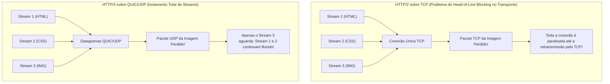
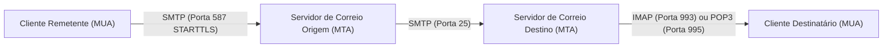
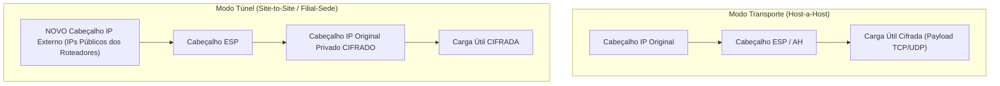
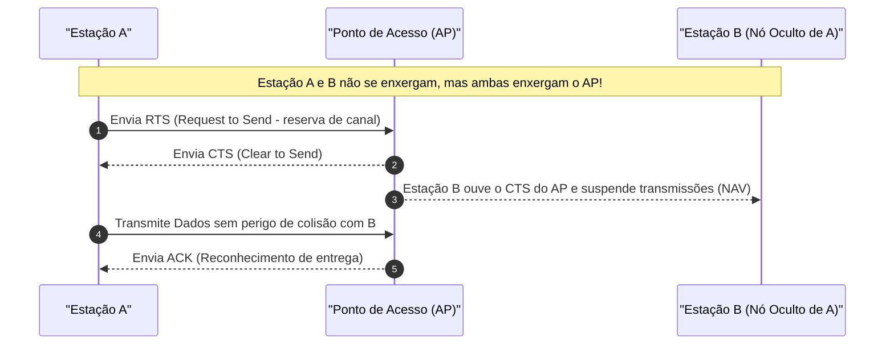

# 04 - Protocolos de Aplicação, Segurança de Rede e Redes Sem Fio

> **Matéria:** Sistemas Operacionais, Redes e Computação em Nuvem  
> **Cargo:** B02 – Técnico de Controle Externo – Especialidade: Tecnologia da Informação  
> **Arquivo:** `04_protocolos_de_aplicacao_redes_sem_fio_e_seguranca_de_rede.md`  

---

## 📌 Ementa / Itens do Edital
- Protocolos da camada de aplicação e transporte:
    - Evolução da Web: HTTP/1.1, HTTP/2, HTTP/3 e HTTPS
    - Gerenciamento e transferência: SSH, FTP/SFTP
    - Correio eletrônico: SMTP, IMAP e POP3
- Tecnologias de interconexão e segurança perimetral: VPN, Balanceamento de Carga, Proxies e Firewalls
- Noções de redes sem fio (Padrões IEEE 802.11 e segurança Wi-Fi)

---

## 🧭 Sumário

1. [Evolução dos Protocolos Web: HTTP/1.1, HTTP/2, HTTP/3 e HTTPS](#1-evolucao-dos-protocolos-web-http11-http2-http3-e-https)
    1. [HTTP/1.1 e o Bloqueio de Início de Fila (Head-of-Line Blocking) na Aplicação](#11-http11-e-o-bloqueio-de-inicio-de-fila-head-of-line-blocking-na-aplicacao)
    2. [HTTP/2: Formato Binário, Multiplexação de Streams e Compressão HPACK](#12-http2-formato-binario-multiplexacao-de-streams-e-compressao-hpack)
    3. [HTTP/3 e o Protocolo QUIC sobre UDP](#13-http3-e-o-protocolo-quic-sobre-udp)
    4. [HTTPS e TLS 1.3 Integrado](#14-https-e-tls-13-integrado)
    5. [Teste 443](#Teste-443)
    6. [Teste 444](#Teste-444)
    7. [Teste 445](#Teste-445)
2. [Protocolos Utilitários, Transferência de Arquivos e Correio Eletrônico](#2-protocolos-utilitarios-transferencia-de-arquivos-e-correio-eletronico)
    1. [SSH (Secure Shell) e Redirecionamento de Portas](#21-ssh-secure-shell-e-redirecionamento-de-portas)
    2. [Transferência de Arquivos: FTP vs. FTPS vs. SFTP](#22-transferencia-de-arquivos-ftp-vs-ftps-vs-sftp)
    3. [Correio Eletrônico: SMTP vs. POP3 vs. IMAP](#23-correio-eletronico-smtp-vs-pop3-vs-imap)
    4. [Teste 446](#Teste-446)
    5. [Teste 447](#Teste-447)
3. [Elementos de Borda e Segurança de Rede: VPN, IPsec, Balanceadores e Proxies](#3-elementos-de-borda-e-seguranca-de-rede-vpn-ipsec-balanceadores-e-proxies)
    1. [Arquitetura IPsec: Cabeçalhos AH vs. ESP e Modos Transporte vs. Túnel](#31-arquitetura-ipsec-cabecalhos-ah-vs-esp-e-modos-transporte-vs-tunel)
    2. [Balanceadores de Carga: Camada 4 (L4) vs. Camada 7 (L7)](#32-balanceadores-de-carga-camada-4-l4-vs-camada-7-l7)
    3. [Servidores Proxy: Forward Proxy vs. Reverse Proxy](#33-servidores-proxy-forward-proxy-vs-reverse-proxy)
    4. [Teste 448](#Teste-448)
    5. [Teste 449](#Teste-449)
    6. [Teste 450](#Teste-450)
4. [Redes Sem Fio (IEEE 802.11 - Wi-Fi)](#4-redes-sem-fio-ieee-80211-wi-fi)
    1. [Evolução dos Padrões 802.11 (Wi-Fi 4, Wi-Fi 5 e Wi-Fi 6/6E)](#41-evolucao-dos-padroes-80211-wi-fi-4-wi-fi-5-e-wi-fi-66e)
    2. [Frequências de Operação: 2.4 GHz vs. 5 GHz](#42-frequencias-de-operacao-24-ghz-vs-5-ghz)
    3. [Mecanismo de Acesso ao Meio: CSMA/CA e o Problema do Nó Oculto (RTS/CTS)](#43-mecanismo-de-acesso-ao-meio-csmaca-e-o-problema-do-no-oculto-rtscts)
    4. [Evolução da Segurança Sem Fio: WEP, WPA, WPA2 e WPA3 (Personal vs. Enterprise)](#44-evolucao-da-seguranca-sem-fio-wep-wpa-wpa2-e-wpa3-personal-vs-enterprise)
    5. [Teste 451](#Teste-451)
    6. [Teste 452](#Teste-452)
    7. [Teste 453](#Teste-453)
6. [Fontes Recomendadas na Internet](#6-fontes-recomendadas-na-internet)

---

## 1. Evolução dos Protocolos Web: HTTP/1.1, HTTP/2, HTTP/3 e HTTPS

### 1.1 HTTP/1.1 e o Bloqueio de Início de Fila (Head-of-Line Blocking) na Aplicação

O protocolo **HTTP/1.1** (RFC 2616) estruturou a comunicação na web durante duas décadas. Ele trouxe como avanço o suporte a **conexões persistentes (*Keep-Alive*)**, permitindo que uma mesma conexão TCP fosse reaproveitada para transferir múltiplos recursos sem a necessidade de reabrir o handshake a cada arquivo.

Contudo, o HTTP/1.1 padece de uma limitação arquitetural grave:

- As mensagens trafegam em formato **estritamente textual e sequencial** no modelo requisição-resposta.
- Se uma página web demanda dezenas de imagens, folhas de estilo CSS e scripts JavaScript, o cliente envia uma requisição e precisa aguardar o servidor responder integralmente antes de enviar a próxima.
- Esse fenômeno é denominado **Bloqueio de Início de Fila na Aplicação (*Head-of-Line Blocking / HoL Blocking*)**: se a primeira requisição for lenta ou complexa para o backend processar, todos os demais recursos da página ficam bloqueados na fila do navegador. Para mitigar o problema, os navegadores passaram a abrir de 6 a 8 conexões TCP concorrentes com o mesmo domínio, sobrecarregando os servidores.

### 1.2 HTTP/2: Formato Binário, Multiplexação de Streams e Compressão HPACK

Padronizado pela RFC 7540, o **HTTP/2** reformulou a camada de aplicação sem alterar a semântica básica (métodos GET/POST, cabeçalhos e códigos de status HTTP continuam os mesmos):

1. **Protocolo Estritamente Binário:** Substituiu o texto ASCII puro por uma camada de enquadramento binário estruturada em **Quadros (*Frames*)** e **Fluxos (*Streams*)**.
2. **Multiplexação Verdadeira:** Múltiplas requisições e respostas podem trafegar de forma intercalada, bidirecional e simultânea sobre uma **única conexão TCP aberta**. Um arquivo CSS pesado não bloqueia mais o tráfego de imagens leves.
3. **Compressão de Cabeçalhos (HPACK):** Utiliza tabelas estáticas e dinâmicas associadas à codificação Huffman para eliminar a repetição redundante de cabeçalhos volumosos (como cookies e user-agents).
4. **Server Push:** O servidor pode enviar antecipadamente recursos essenciais ao cliente (como uma folha de estilo `style.css`) antes mesmo de o navegador interpretá-la e requisitá-la explicitamente.

#### O Gargalo Restante do HTTP/2: HoL Blocking no Transporte TCP
Embora o HTTP/2 tenha solucionado o bloqueio de início de fila na aplicação, ele transferiu o problema para a **Camada de Transporte (TCP)**:

- Como todos os streams do site compartilham a mesma e única conexão TCP, se um único pacote TCP for corrompido ou perdido na rede, o mecanismo de confiabilidade do TCP obriga o receptor a paralisar **a entrega de todos os outros streams da conexão** até que o pacote faltante seja retransmitido (*TCP Head-of-Line Blocking*).

### 1.3 HTTP/3 e o Protocolo QUIC sobre UDP

Para eliminar em definitivo qualquer forma de bloqueio em redes móveis e de alta latência, a IETF padronizou o **HTTP/3** (RFC 9114), substituindo o TCP pelo protocolo de transporte **QUIC (*Quick UDP Internet Connections* - RFC 9000)**, que opera sobre datagramas **UDP (Porta UDP 443)**:

#### Inovações Tecnológicas do HTTP/3 (QUIC):
- **Eliminação Total do HoL Blocking:** Os streams dentro do QUIC são verdadeiramente isolados. A perda de um pacote no fluxo da imagem congela apenas o processamento da imagem, enquanto o código HTML e o script JavaScript continuam sendo entregues imediatamente ao navegador.
- **Handshake Acelerado (0-RTT e 1-RTT):** Como o controle de transporte e a criptografia TLS 1.3 são integrados no mesmo protocolo, a conexão segura é estabelecida em apenas 1 RTT (ou 0-RTT se o host já for conhecido), contra 2 a 3 RTTs exigidos pelo par TCP + TLS 1.2.
- **Migração de Conexão Resiliente (*Connection Migration*):** A conexão QUIC não é identificada pela 4-tupla tradicional (IP de origem, IP de destino, porta de origem, porta de destino), mas por um identificador exclusivo de 64 bits chamado **Connection ID**. Se o usuário sair da rede Wi-Fi de casa e entrar na rede móvel 5G (mudando completamente o endereço IP do smartphone), **a sessão de download, streaming ou chamada de vídeo NÃO cai nem reinicia**, migrando de forma totalmente transparente.
- **Compressão QPACK:** Evolução do algoritmo HPACK adaptada para lidar com pacotes que chegam fora de ordem sobre o transporte UDP.

### 1.4 HTTPS e TLS 1.3 Integrado

O **HTTPS** nada mais é do que o tráfego HTTP executado sobre uma camada de segurança de transporte criptográfica:

- **TLS 1.3 (RFC 8446):** Padrão moderno obrigatório que aboliu cifras antigas fracas ou suscetíveis a ataques (eliminou suporte a RC4, 3DES, CBC, MD5 e trocas estáticas de chave RSA).
- **Forward Secrecy Mandatório:** O TLS 1.3 exige o uso de algoritmos de troca de chave efêmera (como ECDHE), garantindo que, mesmo que a chave privada do servidor web seja roubada no futuro, o tráfego gravado no passado não poderá ser decifrado.
- No HTTP/3, o **TLS 1.3 é embutido nativamente no QUIC**, não existindo HTTP/3 em texto claro na especificação padrão.

---

### Teste 001
**(CEBRASPE – TRF 6ª – 2025 – Analista Judiciário - Apoio Especializado - Governança e Gestão de Tecnologia da Informação)**
A estrutura de autorização do OAuth 2.0 permite que uma aplicação obtenha acesso ilimitado a um serviço HTTP se houver token válido, mas não permite que uma aplicação de

* **C)** Certo
* **E)** Errado

---

> **Comentário Detalhado:**
>
> - **C)** **Incorreta.** A proposição apresenta proposição em desacordo com os fundamentos teóricos e técnicos do tópico ao afirmar que "A estrutura de autorização do OAuth 2.0 permite que uma aplicação obtenha acesso ilimitado a um serviço HTTP...". De acordo com a teoria em *Protocolos em Detalhes:*, mantém as mensagens, pastas customizadas, marcações de lido/não lido e rascunhos armazenados permanentemente no servidor central. Permite que o usuário consulte sua caixa de correio através de múltiplos dispositivos (smartphone, webmail, notebook) com sincronização em tempo real.
> - **E)** **Correta.** O item está **Errado** (gabarito oficial: **E**), pois contraria a disciplina teórica aplicável.
>
> **Gabarito: E**

---

### Teste 002
**(FGV – TJ/AP – 2023 – Analista Judiciario Apoio Especializado Tecnologia Da Informacao Seguranca Da Informacao)**
Os protocolos DNS, HTTPS, DHCP e SSH utilizam, respectivamente, as portas:

* **A)** 22, 80, 53 e 21;
* **B)** 67, 80, 22 e 443;
* **C)** 53, 443, 67 e 22;
* **D)** 443, 53, 143 e 67;
* **E)** 79, 80, 67 e 21.

---

> **Comentário Detalhado:**
>
> - **A)** **Incorreta.** A opção apresenta proposição em desacordo com os fundamentos teóricos e técnicos do tópico ao afirmar que "22, 80, 53 e 21". De acordo com a teoria estudada em *2.1 SSH (Secure Shell) e Redirecionamento de Portas*, o protocolo SSH opera na porta TCP 22 e provê comunicação criptografada segura para administração remota de servidores, transferência de arquivos e execução remota de comandos, substituindo protocolos inseguros legados (Telnet, rlogin).
> - **B)** **Incorreta.** A opção apresenta proposição em desacordo com os fundamentos teóricos e técnicos do tópico ao afirmar que "67, 80, 22 e 443". De acordo com a teoria estudada em *3.2 Balanceadores de Carga: Camada 4 (L4) vs. Camada 7 (L7)*, compreende a semântica dos protocolos de aplicação (HTTP/HTTPS, gRPC).
> - **C)** **Correta.** Conforme fundamentado na seção *1.3 HTTP/3 e o Protocolo QUIC sobre UDP* deste guia, para eliminar em definitivo qualquer forma de bloqueio em redes móveis e de alta latência, a IETF padronizou o HTTP/3 (RFC 9114), substituindo o TCP pelo protocolo de transporte QUIC ( Quick UDP Internet Connections RFC 9000), que opera sobre datagramas UDP (Porta UDP 443). Dessa forma, está plenamente correta a assertiva da banca (FGV – TJ/AP/2023) ao estabelecer que "53, 443, 67 e 22".
> - **D)** **Incorreta.** A opção apresenta proposição em desacordo com os fundamentos teóricos e técnicos do tópico ao afirmar que "443, 53, 143 e 67". De acordo com a teoria estudada em *Protocolos em Detalhes:*, iMAP ( Internet Message Access Protocol Portas TCP 143 e TCP 993 com SSL).
> - **E)** **Incorreta.** A opção apresenta proposição em desacordo com os fundamentos teóricos e técnicos do tópico ao afirmar que "79, 80, 67 e 21". De acordo com a teoria estudada em *2.1 SSH (Secure Shell) e Redirecionamento de Portas*, autenticação: Baseada em senhas ou pares de chaves criptográficas assimétricas (RSA, Ed25519), onde a chave pública fica registrada no arquivo ~/.ssh/authorized keys do servidor remoto e a chave privada permanece protegida sob custódia do usuário.
>
> **Gabarito: C**

---

### Teste 003
**(CEBRASPE – TRF/6 – 2025 – Analista Judiciario Apoio Especializado Tecnologia Da Informacao)**
A estrutura de autorização do OAuth 2.0 permite que uma aplicação obtenha acesso ilimitado a um serviço HTTP se houver token válido, mas não permite que uma aplicação de terceiros obtenha acesso por conta própria.

* **C)** Certo
* **E)** Errado

---

> **Comentário Detalhado:**
>
> - **C)** **Correta.** O item está **Certo**. Conforme fundamentado na seção *Protocolos em Detalhes:*, mantém as mensagens, pastas customizadas, marcações de lido/não lido e rascunhos armazenados permanentemente no servidor central. Permite que o usuário consulte sua caixa de correio através de múltiplos dispositivos (smartphone, webmail, notebook) com sincronização em tempo real. Dessa forma, está plenamente correta a assertiva da banca (CEBRASPE – TRF/6/2025) ao afirmar que "A estrutura de autorização do OAuth 2.0 permite que uma aplicação obtenha acesso ilimitado a um serviço HTTP...".
> - **E)** **Incorreta.** A assertiva não incorre em erro conceitual, guardando conformidade com a teoria estudada.
>
> **Gabarito: C**

---

### Teste 004
**(FGV – TRT 16ª – 2022 – Analista Judiciário (Área Administrativa - Tecnologia da Informação))**
Analise o código Node.JS, exibido a seguir, que estabelece um servidor HTTP que recebe e responde mensagens. var http = require('http'); http.createServer(function (req, res) { res.write('Ok'); res.end(); }).listen(8080); Assinale a afirmativa correta a respeito dessa operação.

* **A)** A função definida é executada somente em caso de erro de parâmetros.
* **B)** A função definida é sempre executada no lado cliente.
* **C)** O parâmetro req da função definida deve ser do tipo http.IncomingMessage object.
* **D)** O parâmetro req da função definida é opcional.
* **E)** O parâmetro res da função definida é opcional.

---

> **Comentário Detalhado:**
>
> - **A)** **Incorreta.** A opção incorre em restrição indevida ao limitar o escopo conceitual ao afirmar que "A função definida é executada somente em caso de erro de parâmetros". De acordo com a teoria estudada em *2.1 SSH (Secure Shell) e Redirecionamento de Portas*, dynamic Port Forwarding ( ssh D local port user@server ): Transforma a sessão SSH em um servidor proxy local do tipo SOCKS4/SOCKS5.
> - **B)** **Incorreta.** A opção promove generalização excessiva que desconsidera as condições técnicas e normativas ao afirmar que "A função definida é sempre executada no lado cliente". De acordo com a teoria estudada em *1.1 HTTP/1.1 e o Bloqueio de Início de Fila (Head-of-Line Blocking) na Aplicação*, se uma página web demanda dezenas de imagens, folhas de estilo CSS e scripts JavaScript, o cliente envia uma requisição e precisa aguardar o servidor responder integralmente antes de enviar a próxima.
> - **C)** **Correta.** Conforme fundamentado na seção *1.4 HTTPS e TLS 1.3 Integrado* deste guia, forward Secrecy Mandatório: O TLS 1.3 exige o uso de algoritmos de troca de chave efêmera (como ECDHE), garantindo que, mesmo que a chave privada do servidor web seja roubada no futuro, o tráfego gravado no passado não poderá ser decifrado. Dessa forma, está plenamente correta a assertiva da banca (FGV – TRT 16ª/2022) ao estabelecer que "O parâmetro req da função definida deve ser do tipo http.IncomingMessage object".
> - **D)** **Incorreta.** A opção apresenta proposição em desacordo com os fundamentos teóricos e técnicos do tópico ao afirmar que "O parâmetro req da função definida é opcional". De acordo com a teoria estudada em *O Problema do Nó Oculto (Hidden Node Problem):*, o problema é neutralizado pelo mecanismo opcional de reserva via quadros de controle RTS/CTS.
> - **E)** **Incorreta.** A opção apresenta proposição em desacordo com os fundamentos teóricos e técnicos do tópico ao afirmar que "O parâmetro res da função definida é opcional". De acordo com a teoria estudada em *4.4 Evolução da Segurança Sem Fio: WEP, WPA, WPA2 e WPA3 (Personal vs. Enterprise)*, wEP: Cifra de fluxo RC4 (chave de 40 ou 104 bits + IV estático de 24 bits) — CRC 32 (fraco) — Totalmente Quebrado e Obsoleto. Pode ser decifrado em poucos minutos devido ao reúso de vetores de inicialização (IVs curtos). Banido pelas normas de segurança.
>
> **Gabarito: C**

---

### Teste 005
**(CEBRASPE – STF – 2008 – Analista Judiciario Suporte Em Tecnologia Da Informacao)**
A seqüência de caracteres http://www.google.com.br é um exemplo de endereço na Internet. Nesse endereço, os caracteres http identificam um protocolo.

* **C)** Certo
* **E)** Errado

---

> **Comentário Detalhado:**
>
> - **C)** **Correta.** O item está **Certo**. Conforme fundamentado na seção *Inovações Tecnológicas do HTTP/3 (QUIC):*, migração de Conexão Resiliente ( Connection Migration ): A conexão QUIC não é identificada pela 4 tupla tradicional (IP de origem, IP de destino, porta de origem, porta de destino), mas por um identificador exclusivo de 64 bits chamado Connection ID. Se o usuário sair da rede Wi Fi de casa e entrar na rede móvel 5G (mudando completamente o endereço IP do smartphone), a sessão de download, streaming ou chamada de vídeo NÃO cai nem reinicia, migrando de forma totalmente transparente. Dessa forma, está plenamente correta a assertiva da banca (CEBRASPE – STF/2008) ao afirmar que "A seqüência de caracteres http://www.google.com.br é um exemplo de endereço na Internet. Nesse endereço, os...".
> - **E)** **Incorreta.** A assertiva não incorre em erro conceitual, guardando conformidade com a teoria estudada.
>
> **Gabarito: C**

---

### Teste 006
**(FGV – TJ/MT – 2024 – Analista Judiciario Tecnologia Da Informacao)**
Um dos estilos de arquitetura de software mais usados nos últimos anos, dadas as suas vantagens em relação aos demais existentes, é a arquitetura orientada a serviços (Service-Oriented Architecture - SOA). A arquitetura orientada a serviços (SOA)

* **A)** organiza a estrutura de um sistema como um conjunto de serviços independentes que se comunicam por meio de protocolos padrão, como HTTP e SOAP.
* **B)** utiliza uma abordagem na qual os serviços são acoplados de forma estreita para garantir maior controle e interdependência entre as partes do sistema.
* **C)** é uma arquitetura em que todos os serviços são integrados em um sistema monolítico, garantindo alta coesão entre os módulos.
* **D)** exige que todos os serviços sejam implementados na mesma linguagem de programação para garantir consistência no sistema.
* **E)** utiliza a comunicação síncrona entre serviços para manter a consistência e a segurança dos dados transmitidos no sistema.

---

> **Comentário Detalhado:**
>
> - **A)** **Correta.** Conforme fundamentado na seção *3.1 Arquitetura IPsec: Cabeçalhos AH vs. ESP e Modos Transporte vs. Túnel* deste guia, o conjunto de protocolos IPsec opera na Camada de Rede (Camada 3 do modelo OSI), sendo agnóstico em relação às aplicações de camadas superiores. Dessa forma, está plenamente correta a assertiva da banca (FGV – TJ/MT/2024) ao estabelecer que "organiza a estrutura de um sistema como um conjunto de serviços independentes que se comunicam por meio de...".
> - **B)** **Incorreta.** A opção apresenta proposição em desacordo com os fundamentos teóricos e técnicos do tópico ao afirmar que "utiliza uma abordagem na qual os serviços são acoplados de forma estreita para garantir maior controle e...". De acordo com a teoria estudada em *Modos de Operação: Personal vs. Enterprise*, modo Enterprise (WPA Enterprise): Não utiliza senha compartilhada única. Implementa a arquitetura de autenticação centralizada e individualizada baseada no padrão IEEE 802.1X.
> - **C)** **Incorreta.** A opção apresenta proposição em desacordo com os fundamentos teóricos e técnicos do tópico ao afirmar que "é uma arquitetura em que todos os serviços são integrados em um sistema monolítico, garantindo alta coesão entre...". De acordo com a teoria estudada em *4.3 Mecanismo de Acesso ao Meio: CSMA/CA e o Problema do Nó Oculto (RTS/CTS)*, diferente das redes cabeadas Ethernet (IEEE 802.3), que utilizam detecção de colisão (CSMA/CD), o meio sem fio via rádio impossibilita a detecção confiável de colisões elétricas na antena transmissora enquanto ela mesma emite sinal em alta potência. Por isso, o padrão IEEE 802.11 adota compulsoriamente a Prevenção de Colisões (CSMA/CA Carrier Sense Multiple Access with Collision Avoidance ).
> - **D)** **Incorreta.** A opção apresenta proposição em desacordo com os fundamentos teóricos e técnicos do tópico ao afirmar que "exige que todos os serviços sejam implementados na mesma linguagem de programação para garantir consistência no...". De acordo com a teoria estudada em *1.1 HTTP/1.1 e o Bloqueio de Início de Fila (Head-of-Line Blocking) na Aplicação*, o protocolo HTTP/1.1 (RFC 2616) estruturou a comunicação na web durante duas décadas. Ele trouxe como avanço o suporte a conexões persistentes ( Keep Alive ), permitindo que uma mesma conexão TCP fosse reaproveitada para transferir múltiplos recursos sem a necessidade de reabrir o handshake a cada arquivo.
> - **E)** **Incorreta.** A opção apresenta proposição em desacordo com os fundamentos teóricos e técnicos do tópico ao afirmar que "utiliza a comunicação síncrona entre serviços para manter a consistência e a segurança dos dados transmitidos no...". De acordo com a teoria estudada em *Protocolos de Segurança do IPsec:*, aH ( Authentication Header Protocolo IP 51): Provê autenticação da origem e integridade estrita dos dados via hash criptográfico.
>
> **Gabarito: A**

---

### Teste 007
**(CEBRASPE – TRT/10 – 2013 – Analista Judiciario Tecnologia Da Informacao)**
Brasil. Além da divulgação e da promoção de ações nessa direção, desde 2007 a Secretaria tem realizado chamadas públicas a fim de apoiar os empreendimentos econômicos 16 alternativos. Internet: <http://portal.mte.gov.br/imprensa> (com adaptações). Com relação ao texto acima, julgue os seguintes itens.

* **C)** Certo
* **E)** Errado

---

> **Comentário Detalhado:**
>
> - **C)** **Incorreta.** A proposição apresenta proposição em desacordo com os fundamentos teóricos e técnicos do tópico ao afirmar que "Brasil. Além da divulgação e da promoção de ações nessa direção, desde 2007 a Secretaria tem realizado...". De acordo com a teoria em *6. Fontes Recomendadas na Internet*, kUROSE, James F.; ROSS, Keith W. Redes de Computadores e a Internet: Uma Abordagem Top Down. 7. ed. São Paulo: Pearson Education do Brasil, 2017. (Cap. 2 Camada de Aplicação: HTTP, SMTP, DNS; Cap. 6 Redes Sem Fio e Móveis; Cap. 8 Segurança em Redes).
> - **E)** **Correta.** O item está **Errado** (gabarito oficial: **E**), pois contraria a disciplina teórica aplicável.
>
> **Gabarito: E**

---

### Teste 008
**(FCC – TRT 11ª – 2017 – Analista Judiciário - Tecnologia da Informação)**
Para instalar o Apache HTTP Server como um serviço no Windows entra-se no diretório bin do Apache, a partir do prompt de comando do Windows, e digita-se

* **A)** httpd −a mode=service
* **B)** apachehttpd −k mode=service
* **C)** apache −a httpd install
* **D)** apachehttp −a install
* **E)** httpd −k install

---

> **Comentário Detalhado:**
>
> - **A)** **Incorreta.** A opção apresenta proposição em desacordo com os fundamentos teóricos e técnicos do tópico ao afirmar que "httpd −a mode=service". De acordo com a teoria estudada em *4.4 Evolução da Segurança Sem Fio: WEP, WPA, WPA2 e WPA3 (Personal vs. Enterprise)*, wPA3: AES 128 (modo Personal) ou CNSA de 192 bits (modo Enterprise) — Galois/Counter Mode (GCMP) — Padrão de Excelência Atual. Elimina ataques de dicionário offline através da troca autenticada simultânea de iguais (SAE / Dragonfly) e garante sigilo futuro ( Forward Secrecy ).
> - **B)** **Incorreta.** A opção apresenta proposição em desacordo com os fundamentos teóricos e técnicos do tópico ao afirmar que "apachehttpd −k mode=service". De acordo com a teoria estudada em *Modos de Operação: Personal vs. Enterprise*, a comunicação é intermediada pelo ponto de acesso e validada por um servidor de autenticação corporativo baseado no protocolo RADIUS ( Remote Authentication Dial In User Service ).
> - **C)** **Incorreta.** A opção apresenta proposição em desacordo com os fundamentos teóricos e técnicos do tópico ao afirmar que "apache −a httpd install". De acordo com a teoria estudada em *2.1 SSH (Secure Shell) e Redirecionamento de Portas*, remote Port Forwarding ( ssh R remote port:target host:target port user@server ): Encaminha tráfego recebido em uma porta do servidor remoto de volta para um serviço rodando na máquina local do administrador.
> - **D)** **Incorreta.** A opção apresenta proposição em desacordo com os fundamentos teóricos e técnicos do tópico ao afirmar que "apachehttp −a install". De acordo com a teoria estudada em *1.2 HTTP/2: Formato Binário, Multiplexação de Streams e Compressão HPACK*, server Push: O servidor pode enviar antecipadamente recursos essenciais ao cliente (como uma folha de estilo style.css ) antes mesmo de o navegador interpretá la e requisitá la explicitamente.
> - **E)** **Correta.** Conforme fundamentado na seção *2.1 SSH (Secure Shell) e Redirecionamento de Portas* deste guia, local Port Forwarding ( ssh L local port:target host:target port user@server ): Encaminha o tráfego de uma porta local da estação do administrador através do túnel criptografado SSH para um serviço interno na rede remota (ex.: acessar uma base de dados inacessível pela Internet). Dessa forma, está plenamente correta a assertiva da banca (FCC – TRT 11ª/2017) ao estabelecer que "httpd −k install".
>
> **Gabarito: E**

---

### Teste 009
**(FCC – TRT 11ª – 2017 – Analista Judiciário - Tecnologia da Informação)**
Considere a figura abaixo que descreve um sistema, denominado e-intimação, que utiliza web service. Foram omitidos da figura o protocolo (indicado por P) e o formato (indicado por F) de geração do documento de intimação que correspondem, correta e respectivamente, a

* **A)** HTTPS − XML.
* **B)** SOA − SOAP.
* **C)** SOAP − REST.
* **D)** REST − SOAP.
* **E)** SOAP − XML.

---

> **Comentário Detalhado:**
>
> - **A)** **Incorreta.** A opção apresenta proposição em desacordo com os fundamentos teóricos e técnicos do tópico ao afirmar que "HTTPS − XML". De acordo com a teoria estudada em *1.4 HTTPS e TLS 1.3 Integrado*, forward Secrecy Mandatório: O TLS 1.3 exige o uso de algoritmos de troca de chave efêmera (como ECDHE), garantindo que, mesmo que a chave privada do servidor web seja roubada no futuro, o tráfego gravado no passado não poderá ser decifrado.
> - **B)** **Incorreta.** A opção apresenta proposição em desacordo com os fundamentos teóricos e técnicos do tópico ao afirmar que "SOA − SOAP". De acordo com a teoria estudada em *1.1 HTTP/1.1 e o Bloqueio de Início de Fila (Head-of-Line Blocking) na Aplicação*, o protocolo HTTP/1.1 (RFC 2616) estruturou a comunicação na web durante duas décadas. Ele trouxe como avanço o suporte a conexões persistentes ( Keep Alive ), permitindo que uma mesma conexão TCP fosse reaproveitada para transferir múltiplos recursos sem a necessidade de reabrir o handshake a cada arquivo.
> - **C)** **Incorreta.** A opção apresenta proposição em desacordo com os fundamentos teóricos e técnicos do tópico ao afirmar que "SOAP − REST". De acordo com a teoria estudada em *3.2 Balanceadores de Carga: Camada 4 (L4) vs. Camada 7 (L7)*, pode inspecionar URLs, caminhos de requisição ( /api vs. /imagens ), cabeçalhos HTTP, métodos REST e cookies de sessão.
> - **D)** **Incorreta.** A opção apresenta proposição em desacordo com os fundamentos teóricos e técnicos do tópico ao afirmar que "REST − SOAP". De acordo com a teoria estudada em *1.1 HTTP/1.1 e o Bloqueio de Início de Fila (Head-of-Line Blocking) na Aplicação*, esse fenômeno é denominado Bloqueio de Início de Fila na Aplicação ( Head of Line Blocking / HoL Blocking ): se a primeira requisição for lenta ou complexa para o backend processar, todos os demais recursos da página ficam bloqueados na fila do navegador. Para mitigar o problema, os navegadores passaram a abrir de 6 a 8 conexões TCP concorrentes com o mesmo domínio, sobrecarregando os servidores.
> - **E)** **Correta.** Conforme fundamentado na seção *1.2 HTTP/2: Formato Binário, Multiplexação de Streams e Compressão HPACK* deste guia, compressão de Cabeçalhos (HPACK): Utiliza tabelas estáticas e dinâmicas associadas à codificação Huffman para eliminar a repetição redundante de cabeçalhos volumosos (como cookies e user agents). Dessa forma, está plenamente correta a assertiva da banca (FCC – TRT 11ª/2017) ao estabelecer que "SOAP − XML".
>
> **Gabarito: E**

---

### Teste 010
**(FGV – TRT/13 – 2022 – Analista Judiciario Tecnologia Da Informacao)**
Uma aplicação mobile enviou a um gateway de APIs REST várias solicitações idênticas em sequência utilizando o método HTTP PUT. Essas solicitações idênticas resultaram em nenhuma alteração de estado do sistema de backend, a exceção da primeira solicitação que atualizou um registro no banco de dados. Nesse contexto, é correto afirmar que essa solicitação HTTP é

* **A)** acoplada.
* **B)** balanceada.
* **C)** full-duplex.
* **D)** idempotente.
* **E)** segura.

---

> **Comentário Detalhado:**
>
> - **A)** **Incorreta.** A opção apresenta proposição em desacordo com os fundamentos teóricos e técnicos do tópico ao afirmar que "acoplada". De acordo com a teoria estudada em *2.2 Transferência de Arquivos: FTP vs. FTPS vs. SFTP*, fTP ( File Transfer Protocol ): TCP 21 (Controle) e TCP 20 (Dados no modo ativo) — NENHUMA. Usuário, senha e conteúdo dos arquivos transitam em texto claro puro. — Protocolo legado original. Opera com duas conexões distintas (modo Ativo vs. modo Passivo/PASV).
> - **B)** **Incorreta.** A opção apresenta proposição em desacordo com os fundamentos teóricos e técnicos do tópico ao afirmar que "balanceada". De acordo com a teoria estudada em *3.2 Balanceadores de Carga: Camada 4 (L4) vs. Camada 7 (L7)*, pode inspecionar URLs, caminhos de requisição ( /api vs. /imagens ), cabeçalhos HTTP, métodos REST e cookies de sessão.
> - **C)** **Incorreta.** A opção apresenta proposição em desacordo com os fundamentos teóricos e técnicos do tópico ao afirmar que "full duplex". De acordo com a teoria estudada em *1.1 HTTP/1.1 e o Bloqueio de Início de Fila (Head-of-Line Blocking) na Aplicação*, o protocolo HTTP/1.1 (RFC 2616) estruturou a comunicação na web durante duas décadas. Ele trouxe como avanço o suporte a conexões persistentes ( Keep Alive ), permitindo que uma mesma conexão TCP fosse reaproveitada para transferir múltiplos recursos sem a necessidade de reabrir o handshake a cada arquivo.
> - **D)** **Correta.** Conforme fundamentado na seção *1.1 HTTP/1.1 e o Bloqueio de Início de Fila (Head-of-Line Blocking) na Aplicação* deste guia, esse fenômeno é denominado Bloqueio de Início de Fila na Aplicação ( Head of Line Blocking / HoL Blocking ): se a primeira requisição for lenta ou complexa para o backend processar, todos os demais recursos da página ficam bloqueados na fila do navegador. Para mitigar o problema, os navegadores passaram a abrir de 6 a 8 conexões TCP concorrentes com o mesmo domínio, sobrecarregando os servidores. Dessa forma, está plenamente correta a assertiva da banca (FGV – TRT/13/2022) ao estabelecer que "idempotente".
> - **E)** **Incorreta.** A opção apresenta proposição em desacordo com os fundamentos teóricos e técnicos do tópico ao afirmar que "segura". De acordo com a teoria estudada em *Inovações Tecnológicas do HTTP/3 (QUIC):*, handshake Acelerado (0 RTT e 1 RTT): Como o controle de transporte e a criptografia TLS 1.3 são integrados no mesmo protocolo, a conexão segura é estabelecida em apenas 1 RTT (ou 0 RTT se o host já for conhecido), contra 2 a 3 RTTs exigidos pelo par TCP + TLS 1.2.
>
> **Gabarito: D**

---

### Teste 011
**(FGV – TRT/13 – 2022 – Analista Judiciario Tecnologia Da Informacao)**
Sobre a ferramenta de monitoramento Prometheus, analise as afirmativas a seguir. I. Armazena fundamentalmente todos os dados como séries temporais. II. Possui uma linguagem para consulta das métricas armazenadas denominada PromQL. III. Coleta métricas através do protocolo HTTP. Está correto o que se afirma em

* **A)** I, apenas.
* **B)** II, apenas.
* **C)** III, apenas.
* **D)** I e II, apenas.
* **E)** I, II e III.

---

> **Comentário Detalhado:**
>
> - **A)** **Incorreta.** A opção incorre em restrição indevida ao limitar o escopo conceitual ao afirmar que "I, apenas". De acordo com a teoria estudada em *1.1 HTTP/1.1 e o Bloqueio de Início de Fila (Head-of-Line Blocking) na Aplicação*, o protocolo HTTP/1.1 (RFC 2616) estruturou a comunicação na web durante duas décadas. Ele trouxe como avanço o suporte a conexões persistentes ( Keep Alive ), permitindo que uma mesma conexão TCP fosse reaproveitada para transferir múltiplos recursos sem a necessidade de reabrir o handshake a cada arquivo.
> - **B)** **Incorreta.** A opção incorre em restrição indevida ao limitar o escopo conceitual ao afirmar que "II, apenas". De acordo com a teoria estudada em *1.2 HTTP/2: Formato Binário, Multiplexação de Streams e Compressão HPACK*, protocolo Estritamente Binário: Substituiu o texto ASCII puro por uma camada de enquadramento binário estruturada em Quadros ( Frames ) e Fluxos ( Streams ).
> - **C)** **Incorreta.** A opção incorre em restrição indevida ao limitar o escopo conceitual ao afirmar que "III, apenas". De acordo com a teoria estudada em *1.3 HTTP/3 e o Protocolo QUIC sobre UDP*, para eliminar em definitivo qualquer forma de bloqueio em redes móveis e de alta latência, a IETF padronizou o HTTP/3 (RFC 9114), substituindo o TCP pelo protocolo de transporte QUIC ( Quick UDP Internet Connections RFC 9000), que opera sobre datagramas UDP (Porta UDP 443).
> - **D)** **Incorreta.** A opção incorre em restrição indevida ao limitar o escopo conceitual ao afirmar que "I e II, apenas". De acordo com a teoria estudada em *1.3 HTTP/3 e o Protocolo QUIC sobre UDP*, subgraph HTTP2 Transporte["HTTP/2 sobre TCP (Problema do Head of Line Blocking no Transporte)"].
> - **E)** **Correta.** Conforme fundamentado na seção *2.1 SSH (Secure Shell) e Redirecionamento de Portas* deste guia, local Port Forwarding ( ssh L local port:target host:target port user@server ): Encaminha o tráfego de uma porta local da estação do administrador através do túnel criptografado SSH para um serviço interno na rede remota (ex.: acessar uma base de dados inacessível pela Internet). Dessa forma, está plenamente correta a assertiva da banca (FGV – TRT/13/2022) ao estabelecer que "I, II e III".
>
> **Gabarito: E**

---

### Teste 012
**(FGV – TRT/13 – 2022 – Analista Judiciario Tecnologia Da Informacao)**
O protocolo de autorização OAuth 2.0 permite que aplicativos obtenham acesso limitado aos serviços HTTP. As quatro funções (roles) descritas na RFC 6749 para esse protocolo são

* **A)** protected resource, resource user, client e token server.
* **B)** access token, HTTP server, client credential e authorization broker.
* **C)** resource owner, resource server, client e authorization server.
* **D)** authorization resource, authorization code, client e token server.
* **E)** resource owner, password credential, access token e refresh token.

---

> **Comentário Detalhado:**
>
> - **A)** **Incorreta.** A opção apresenta proposição em desacordo com os fundamentos teóricos e técnicos do tópico ao afirmar que "protected resource, resource user, client e token server". De acordo com a teoria estudada em *2.1 SSH (Secure Shell) e Redirecionamento de Portas*, local Port Forwarding ( ssh L local port:target host:target port user@server ): Encaminha o tráfego de uma porta local da estação do administrador através do túnel criptografado SSH para um serviço interno na rede remota (ex.: acessar uma base de dados inacessível pela Internet).
> - **B)** **Incorreta.** A opção apresenta proposição em desacordo com os fundamentos teóricos e técnicos do tópico ao afirmar que "access token, HTTP server, client credential e authorization broker". De acordo com a teoria estudada em *4.3 Mecanismo de Acesso ao Meio: CSMA/CA e o Problema do Nó Oculto (RTS/CTS)*, diferente das redes cabeadas Ethernet (IEEE 802.3), que utilizam detecção de colisão (CSMA/CD), o meio sem fio via rádio impossibilita a detecção confiável de colisões elétricas na antena transmissora enquanto ela mesma emite sinal em alta potência. Por isso, o padrão IEEE 802.11 adota compulsoriamente a Prevenção de Colisões (CSMA/CA Carrier Sense Multiple Access with Collision Avoidance ).
> - **C)** **Correta.** Conforme fundamentado na seção *1.2 HTTP/2: Formato Binário, Multiplexação de Streams e Compressão HPACK* deste guia, server Push: O servidor pode enviar antecipadamente recursos essenciais ao cliente (como uma folha de estilo style.css ) antes mesmo de o navegador interpretá la e requisitá la explicitamente. Dessa forma, está plenamente correta a assertiva da banca (FGV – TRT/13/2022) ao estabelecer que "resource owner, resource server, client e authorization server".
> - **D)** **Incorreta.** A opção apresenta proposição em desacordo com os fundamentos teóricos e técnicos do tópico ao afirmar que "authorization resource, authorization code, client e token server". De acordo com a teoria estudada em *2.1 SSH (Secure Shell) e Redirecionamento de Portas*, remote Port Forwarding ( ssh R remote port:target host:target port user@server ): Encaminha tráfego recebido em uma porta do servidor remoto de volta para um serviço rodando na máquina local do administrador.
> - **E)** **Incorreta.** A opção apresenta proposição em desacordo com os fundamentos teóricos e técnicos do tópico ao afirmar que "resource owner, password credential, access token e refresh token". De acordo com a teoria estudada em *Protocolos em Detalhes:*, iMAP ( Internet Message Access Protocol Portas TCP 143 e TCP 993 com SSL).
>
> **Gabarito: C**

---

### Teste 013
**(FCC – TRT 16ª – 2014 – Analista Judiciário - Tecnologia da Informação)**
O serviço de rede DNS possui uma arquitetura hierárquica que inclui clientes e servidores, com bases de dados distribuídos, que se comunicam por meio dos protocolos definidos para o DNS. Dentre os três tipos de mensagens definidas no protocolo, a mensagem utilizada para a troca de informações entre os servidores DNS é do tipo

* **A)** consulta.
* **B)** resposta.
* **C)** busca.
* **D)** atualização.
* **E)** sincronização.

---

> **Comentário Detalhado:**
>
> - **A)** **Incorreta.** A opção apresenta proposição em desacordo com os fundamentos teóricos e técnicos do tópico ao afirmar que "consulta". De acordo com a teoria estudada em *2.1 SSH (Secure Shell) e Redirecionamento de Portas*, local Port Forwarding ( ssh L local port:target host:target port user@server ): Encaminha o tráfego de uma porta local da estação do administrador através do túnel criptografado SSH para um serviço interno na rede remota (ex.: acessar uma base de dados inacessível pela Internet).
> - **B)** **Incorreta.** A opção apresenta proposição em desacordo com os fundamentos teóricos e técnicos do tópico ao afirmar que "resposta". De acordo com a teoria estudada em *1.1 HTTP/1.1 e o Bloqueio de Início de Fila (Head-of-Line Blocking) na Aplicação*, as mensagens trafegam em formato estritamente textual e sequencial no modelo requisição resposta.
> - **C)** **Incorreta.** A opção apresenta proposição em desacordo com os fundamentos teóricos e técnicos do tópico ao afirmar que "busca". De acordo com a teoria estudada em *3.3 Servidores Proxy: Forward Proxy vs. Reverse Proxy*, reverse Proxy (Proxy Reverso): Fica posicionado em frente aos servidores internos de aplicação e bancos de dados da instituição (ex.: Nginx, HAProxy, Envoy). Atua como a vitrine pública de entrada: recebe as requisições dos usuários da Internet, faz terminação SSL, aplica balanceamento de carga, acelera a entrega por meio de cache de conteúdo estático e oculta a topologia interna e a quantidade de servidores do datacenter contra invasores externos.
> - **D)** **Correta.** Conforme fundamentado na seção *Protocolos de Segurança do IPsec:* deste guia, o protocolo AH NÃO PROVÊ CONFIDENCIALIDADE (NÃO realiza criptografia de dados)! Além disso, é incompatível com NAT porque inclui o cabeçalho IP original no cálculo de integridade. Dessa forma, está plenamente correta a assertiva da banca (FCC – TRT 16ª/2014) ao estabelecer que "atualização".
> - **E)** **Incorreta.** A opção apresenta proposição em desacordo com os fundamentos teóricos e técnicos do tópico ao afirmar que "sincronização". De acordo com a teoria estudada em *Protocolos em Detalhes:*, é um protocolo do tipo Pull (Acesso e Sincronização).
>
> **Gabarito: D**

---

### Teste 014
**(FCC – TRT 2ª – 2014 – Analista Judiciário - Tecnologia da Informação)**
Considere as seguintes figuras que apresentam o envio de um arquivo entre dois serviços: Figura 1 Figura 2 Com base nessas imagens e nas configurações padrão para os protocolos HTTP e HTTPS, é correto afirmar que o arquivo enviado na figura 1

* **A)** é recebido na porta 80 e o arquivo enviado na figura 2 é transportado por HTTPS.
* **B)** é transportado por HTTP e o arquivo enviado na figura 2 é recebido na porta 80.
* **C)** e o arquivo enviado na figura 2 são transportados na porta 80, porém o primeiro arquivo possui um header que garante sua segurança.
* **D)** é recebido na porta 443 e o arquivo enviado na figura 2 é transportado por HTTP.
* **E)** é transportado por HTTPS e o arquivo enviado na figura 2 é recebido na porta 443.

---

> **Comentário Detalhado:**
>
> - **A)** **Incorreta.** A opção apresenta proposição em desacordo com os fundamentos teóricos e técnicos do tópico ao afirmar que "é recebido na porta 80 e o arquivo enviado na figura 2 é transportado por HTTPS". De acordo com a teoria estudada em *1.2 HTTP/2: Formato Binário, Multiplexação de Streams e Compressão HPACK*, multiplexação Verdadeira: Múltiplas requisições e respostas podem trafegar de forma intercalada, bidirecional e simultânea sobre uma única conexão TCP aberta. Um arquivo CSS pesado não bloqueia mais o tráfego de imagens leves.
> - **B)** **Incorreta.** A opção apresenta proposição em desacordo com os fundamentos teóricos e técnicos do tópico ao afirmar que "é transportado por HTTP e o arquivo enviado na figura 2 é recebido na porta 80". De acordo com a teoria estudada em *1.1 HTTP/1.1 e o Bloqueio de Início de Fila (Head-of-Line Blocking) na Aplicação*, o protocolo HTTP/1.1 (RFC 2616) estruturou a comunicação na web durante duas décadas. Ele trouxe como avanço o suporte a conexões persistentes ( Keep Alive ), permitindo que uma mesma conexão TCP fosse reaproveitada para transferir múltiplos recursos sem a necessidade de reabrir o handshake a cada arquivo.
> - **C)** **Incorreta.** A opção apresenta proposição em desacordo com os fundamentos teóricos e técnicos do tópico ao afirmar que "e o arquivo enviado na figura 2 são transportados na porta 80, porém o primeiro arquivo possui um header que...". De acordo com a teoria estudada em *4.4 Evolução da Segurança Sem Fio: WEP, WPA, WPA2 e WPA3 (Personal vs. Enterprise)*, wPA3: AES 128 (modo Personal) ou CNSA de 192 bits (modo Enterprise) — Galois/Counter Mode (GCMP) — Padrão de Excelência Atual. Elimina ataques de dicionário offline através da troca autenticada simultânea de iguais (SAE / Dragonfly) e garante sigilo futuro ( Forward Secrecy ).
> - **D)** **Correta.** Conforme fundamentado na seção *1.3 HTTP/3 e o Protocolo QUIC sobre UDP* deste guia, para eliminar em definitivo qualquer forma de bloqueio em redes móveis e de alta latência, a IETF padronizou o HTTP/3 (RFC 9114), substituindo o TCP pelo protocolo de transporte QUIC ( Quick UDP Internet Connections RFC 9000), que opera sobre datagramas UDP (Porta UDP 443). Dessa forma, está plenamente correta a assertiva da banca (FCC – TRT 2ª/2014) ao estabelecer que "é recebido na porta 443 e o arquivo enviado na figura 2 é transportado por HTTP".
> - **E)** **Incorreta.** A opção apresenta proposição em desacordo com os fundamentos teóricos e técnicos do tópico ao afirmar que "é transportado por HTTPS e o arquivo enviado na figura 2 é recebido na porta 443". De acordo com a teoria estudada em *1.4 HTTPS e TLS 1.3 Integrado*, no HTTP/3, o TLS 1.3 é embutido nativamente no QUIC, não existindo HTTP/3 em texto claro na especificação padrão.
>
> **Gabarito: D**

---

### Teste 015
**(FCC – TRT 3ª – 2015 – Analista Judiciário - Tecnologia da Informação)**
Para reduzir a vulnerabilidade dos acessos pelo protocolo HTTP, foi introduzido, acima desse protocolo, o SSL, originando assim o HTTPS. O HTTPS

* **A)** 21 e 993.
* **B)** 110 e 443.
* **C)** 25 e 465.
* **D)** 143 e 993.
* **E)** 53 e 443.

---

> **Comentário Detalhado:**
>
> - **A)** **Incorreta.** A opção apresenta proposição em desacordo com os fundamentos teóricos e técnicos do tópico ao afirmar que "21 e 993". De acordo com a teoria estudada em *Protocolos em Detalhes:*, iMAP ( Internet Message Access Protocol Portas TCP 143 e TCP 993 com SSL).
> - **B)** **Incorreta.** A opção apresenta proposição em desacordo com os fundamentos teóricos e técnicos do tópico ao afirmar que "110 e 443". De acordo com a teoria estudada em *Protocolos em Detalhes:*, pOP3 ( Post Office Protocol v3 Portas TCP 110 e TCP 995 com SSL).
> - **C)** **Incorreta.** A opção apresenta proposição em desacordo com os fundamentos teóricos e técnicos do tópico ao afirmar que "25 e 465". De acordo com a teoria estudada em *1.4 HTTPS e TLS 1.3 Integrado*, o HTTPS nada mais é do que o tráfego HTTP executado sobre uma camada de segurança de transporte criptográfica.
> - **D)** **Incorreta.** A opção apresenta proposição em desacordo com os fundamentos teóricos e técnicos do tópico ao afirmar que "143 e 993". De acordo com a teoria estudada em *2.3 Correio Eletrônico: SMTP vs. POP3 vs. IMAP*, mTA Destino |"IMAP (Porta 993) ou POP3 (Porta 995)"| MUA Destino["Cliente Destinatário (MUA)"].
> - **E)** **Correta.** Conforme fundamentado na seção *1.3 HTTP/3 e o Protocolo QUIC sobre UDP* deste guia, para eliminar em definitivo qualquer forma de bloqueio em redes móveis e de alta latência, a IETF padronizou o HTTP/3 (RFC 9114), substituindo o TCP pelo protocolo de transporte QUIC ( Quick UDP Internet Connections RFC 9000), que opera sobre datagramas UDP (Porta UDP 443). Dessa forma, está plenamente correta a assertiva da banca (FCC – TRT 3ª/2015) ao estabelecer que "53 e 443".
>
> **Gabarito: E**

---

### Teste 016
**(FCC – TRT 4ª – 2015 – Analista Judiciário - Tecnologia Da Informação)**
Quando um novo computador é conectado e colocado em funcionamento em uma rede local de computadores, a primeira atividade desempenhada é a sua identificação, utilizando o endereço MAC, para a rede e o estabelecimento do relacionamento com um endereço IP. A mensagem inicial gerada pelo computador para a rede com esse propósito, utiliza o protocolo

* **A)** DHCP.
* **B)** ICMP.
* **C)** DNS.
* **D)** ARP.
* **E)** SNMP.

---

> **Comentário Detalhado:**
>
> - **A)** **Incorreta.** A opção apresenta proposição em desacordo com os fundamentos teóricos e técnicos do tópico ao afirmar que "DHCP". De acordo com a teoria estudada em *3.2 Balanceadores de Carga: Camada 4 (L4) vs. Camada 7 (L7)*, toma decisões de chaveamento baseando se unicamente em informações das camadas de rede e transporte: Endereço IP de origem/destino e Portas TCP/UDP.
> - **B)** **Incorreta.** A opção apresenta proposição em desacordo com os fundamentos teóricos e técnicos do tópico ao afirmar que "ICMP". De acordo com a teoria estudada em *1.1 HTTP/1.1 e o Bloqueio de Início de Fila (Head-of-Line Blocking) na Aplicação*, esse fenômeno é denominado Bloqueio de Início de Fila na Aplicação ( Head of Line Blocking / HoL Blocking ): se a primeira requisição for lenta ou complexa para o backend processar, todos os demais recursos da página ficam bloqueados na fila do navegador. Para mitigar o problema, os navegadores passaram a abrir de 6 a 8 conexões TCP concorrentes com o mesmo domínio, sobrecarregando os servidores.
> - **C)** **Incorreta.** A opção apresenta proposição em desacordo com os fundamentos teóricos e técnicos do tópico ao afirmar que "DNS". De acordo com a teoria estudada em *6. Fontes Recomendadas na Internet*, kUROSE, James F.; ROSS, Keith W. Redes de Computadores e a Internet: Uma Abordagem Top Down. 7. ed. São Paulo: Pearson Education do Brasil, 2017. (Cap. 2 Camada de Aplicação: HTTP, SMTP, DNS; Cap. 6 Redes Sem Fio e Móveis; Cap. 8 Segurança em Redes).
> - **D)** **Correta.** Conforme fundamentado na seção *Inovações Tecnológicas do HTTP/3 (QUIC):* deste guia, migração de Conexão Resiliente ( Connection Migration ): A conexão QUIC não é identificada pela 4 tupla tradicional (IP de origem, IP de destino, porta de origem, porta de destino), mas por um identificador exclusivo de 64 bits chamado Connection ID. Se o usuário sair da rede Wi Fi de casa e entrar na rede móvel 5G (mudando completamente o endereço IP do smartphone), a sessão de download, streaming ou chamada de vídeo NÃO cai nem reinicia, migrando de forma totalmente transparente. Dessa forma, está plenamente correta a assertiva da banca (FCC – TRT 4ª/2015) ao estabelecer que "ARP".
> - **E)** **Incorreta.** A opção apresenta proposição em desacordo com os fundamentos teóricos e técnicos do tópico ao afirmar que "SNMP". De acordo com a teoria estudada em *6. Fontes Recomendadas na Internet*, tANENBAUM, Andrew S.; WETHERALL, David. Redes de Computadores. 5. ed. São Paulo: Pearson, 2011. (Cap. 4 A Subcamada de Controle de Acesso ao Meio: Padrões IEEE 802.11; Cap. 8 Segurança de Rede).
>
> **Gabarito: D**

---

## 2. Protocolos Utilitários, Transferência de Arquivos e Correio Eletrônico

### 2.1 SSH (Secure Shell) e Redirecionamento de Portas

O protocolo **SSH** opera na **porta TCP 22** e provê comunicação criptografada segura para administração remota de servidores, transferência de arquivos e execução remota de comandos, substituindo protocolos inseguros legados (Telnet, rlogin):

- **Autenticação:** Baseada em senhas ou pares de chaves criptográficas assimétricas (RSA, Ed25519), onde a chave pública fica registrada no arquivo `~/.ssh/authorized_keys` do servidor remoto e a chave privada permanece protegida sob custódia do usuário.
- **Túneis e Redirecionamento de Portas (*Port Forwarding*):**
    - *Local Port Forwarding (`ssh -L local_port:target_host:target_port user@server`):* Encaminha o tráfego de uma porta local da estação do administrador através do túnel criptografado SSH para um serviço interno na rede remota (ex.: acessar uma base de dados inacessível pela Internet).
    - *Remote Port Forwarding (`ssh -R remote_port:target_host:target_port user@server`):* Encaminha tráfego recebido em uma porta do servidor remoto de volta para um serviço rodando na máquina local do administrador.
    - *Dynamic Port Forwarding (`ssh -D local_port user@server`):* Transforma a sessão SSH em um servidor proxy local do tipo SOCKS4/SOCKS5.

### 2.2 Transferência de Arquivos: FTP vs. FTPS vs. SFTP

| Protocolo | Portas de Transporte Utilizadas | Criptografia / Segurança | Arquitetura e Relação com FTP |
|---|---|---|---|
| **FTP** (*File Transfer Protocol*) | **TCP 21** (Controle) e **TCP 20** (Dados no modo ativo) | **NENHUMA.** Usuário, senha e conteúdo dos arquivos transitam em texto claro puro. | Protocolo legado original. Opera com duas conexões distintas (modo Ativo vs. modo Passivo/PASV). |
| **FTPS** (*FTP over SSL/TLS*) | TCP 21 (Controle) + Portas de Dados dinâmicas protegidas | Criptografia via TLS/SSL aplicada sobre as conexões de controle e dados do FTP. | É o protocolo FTP clássico encapsulado em uma sessão TLS. Requer abertura de faixas complexas de portas no firewall. |
| **SFTP** (*SSH File Transfer Protocol*) | **Apenas a porta TCP 22** | Criptografia forte de ponta a ponta e autenticação por chaves SSH. | **NÃO tem nenhuma relação com o FTP!** É um subsistema de extensão que opera inteiramente dentro de uma sessão SSH estabelecida. |

### 2.3 Correio Eletrônico: SMTP vs. POP3 vs. IMAP

O tráfego de correio eletrônico na Internet divide-se claramente entre envio/retransmissão e acesso/leitura:

#### Protocolos em Detalhes:
1. **SMTP (*Simple Mail Transfer Protocol* - Portas TCP 25 e TCP 587):**
    - É um protocolo do tipo **Push (Envio)**.
    - Utilizado pelo cliente para submeter e-mails ao seu servidor (porta 587 com autenticação e STARTTLS) e utilizado para retransmitir e-mails entre servidores de correio na Internet (porta 25).

2. **POP3 (*Post Office Protocol v3* - Portas TCP 110 e TCP 995 com SSL):**
    - É um protocolo do tipo **Pull (Recuperação)**.
    - Baixa as mensagens do servidor para a máquina local do usuário e, por padrão histórico, **remove as mensagens da caixa postal do servidor**. Não suporta criação nem sincronização de pastas remotas.

3. **IMAP (*Internet Message Access Protocol* - Portas TCP 143 e TCP 993 com SSL):**
    - É um protocolo do tipo **Pull (Acesso e Sincronização)**.
    - Mantém as mensagens, pastas customizadas, marcações de lido/não-lido e rascunhos **armazenados permanentemente no servidor central**. Permite que o usuário consulte sua caixa de correio através de múltiplos dispositivos (smartphone, webmail, notebook) com sincronização em tempo real.

---

## 3. Elementos de Borda e Segurança de Rede: VPN, IPsec, Balanceadores e Proxies

### 3.1 Arquitetura IPsec: Cabeçalhos AH vs. ESP e Modos Transporte vs. Túnel

O conjunto de protocolos **IPsec** opera na **Camada de Rede (Camada 3 do modelo OSI)**, sendo agnóstico em relação às aplicações de camadas superiores:

#### Protocolos de Segurança do IPsec:
- **AH (*Authentication Header* - Protocolo IP 51):** Provê autenticação da origem e integridade estrita dos dados via hash criptográfico.  
  > 🚨 **REGRA DE PROVA FCC:** O protocolo **AH NÃO PROVÊ CONFIDENCIALIDADE (NÃO realiza criptografia de dados)**! Além disso, é incompatível com NAT porque inclui o cabeçalho IP original no cálculo de integridade.
- **ESP (*Encapsulating Security Payload* - Protocolo IP 50):** Provê **confidencialidade (criptografia dos dados)**, além de autenticação de origem e integridade. É o protocolo primário utilizado para túneis VPN seguros.

#### Modos de Operação do IPsec:
- **Modo Transporte:** Utilizado em comunicações ponto a ponto entre dois hosts finais (*Host-to-Host*). Criptografa apenas o payload de transporte (dados TCP/UDP), mantendo o cabeçalho IP original legível. Os IPs privados de origem e destino ficam visíveis na rede pública.
- **Modo Túnel:** Utilizado em conexões de borda **VPN *Site-to-Site*** interligando redes inteiras (Matriz e Filial) através de roteadores ou firewalls. O **pacote IP original inteiro (cabeçalho IP privado + carga útil) é completamente criptografado**, e um novo cabeçalho IP externo contendo os endereços públicos dos gateways de borda é adicionado por fora.

### 3.2 Balanceadores de Carga: Camada 4 (L4) vs. Camada 7 (L7)

Os Balanceadores de Carga (*Load Balancers*) distribuem o fluxo de requisições entre múltiplos servidores de backend para garantir escalabilidade horizontal e alta disponibilidade:

- **Balanceador de Camada 4 (L4 - Transporte):**
    - Toma decisões de chaveamento baseando-se unicamente em informações das camadas de rede e transporte: **Endereço IP de origem/destino e Portas TCP/UDP**.
    - Não examina o conteúdo da aplicação. Apresenta rendimento extraordinário, baixa latência e consome poucos recursos computacionais.
- **Balanceador de Camada 7 (L7 - Aplicação):**
    - Compreende a semântica dos protocolos de aplicação (HTTP/HTTPS, gRPC).
    - Pode inspecionar URLs, caminhos de requisição (`/api` vs. `/imagens`), cabeçalhos HTTP, métodos REST e cookies de sessão.
    - Suporta roteamento contextual baseado em conteúdo, persistência de sessão (*Sticky Sessions* via cookies) e descarregamento de processamento criptográfico (**SSL Termination / Offloading**).

### 3.3 Servidores Proxy: Forward Proxy vs. Reverse Proxy

- **Forward Proxy (Proxy Direto):** Fica posicionado em frente aos **computadores clientes internos** da organização. É utilizado para controlar e registrar a navegação dos funcionários na Internet, aplicar políticas de filtragem de conteúdo corporativo, fazer cache de páginas externas e mascarar os endereços IP das estações de trabalho perante os servidores web do mundo exterior.
- **Reverse Proxy (Proxy Reverso):** Fica posicionado em frente aos **servidores internos de aplicação e bancos de dados** da instituição (ex.: Nginx, HAProxy, Envoy). Atua como a vitrine pública de entrada: recebe as requisições dos usuários da Internet, faz terminação SSL, aplica balanceamento de carga, acelera a entrega por meio de cache de conteúdo estático e oculta a topologia interna e a quantidade de servidores do datacenter contra invasores externos.

---

## 4. Redes Sem Fio (IEEE 802.11 - Wi-Fi)

### 4.1 Evolução dos Padrões 802.11 (Wi-Fi 4, Wi-Fi 5 e Wi-Fi 6/6E)

| Geração Comercial | Padrão IEEE | Frequências de Operação | Larguras de Canal | Principais Tecnologias e Recursos | Taxas Teóricas Máximas |
|---|---|---|---|---|---|
| **Wi-Fi 4** | **802.11n** | 2.4 GHz e 5 GHz | 20 e 40 MHz | Introdução da tecnologia **MIMO** (*Multiple-Input Multiple-Output*) | Até 600 Mbps |
| **Wi-Fi 5** | **802.11ac** | **Exclusivo 5 GHz** | 20, 40, 80 e 160 MHz | **MU-MIMO** (*Multi-User MIMO*) para downlink, modulação 256-QAM | Até 6.9 Gbps |
| **Wi-Fi 6 / 6E** | **802.11ax** | 2.4 GHz, 5 GHz e 6 GHz (no 6E) | Canais de até 160 MHz | **OFDMA** (subcanais RU), MU-MIMO bidirecional, TWT (*Target Wake Time*) para IoT | Até 9.6 Gbps |

### 4.2 Frequências de Operação: 2.4 GHz vs. 5 GHz

- **Faixa de 2.4 GHz:**
    - *Vantagem:* Maior comprimento de onda, proporcionando **maior alcance físico** de cobertura e melhor penetração através de paredes e obstáculos sólidos.
    - *Desvantagem:* Menor largura de banda total e **altíssima interferência** (disputa espaço com Bluetooth, fornos micro-ondas e telefones sem fio). Possui apenas **3 canais não sobrepostos** na regulamentação padrão (canais 1, 6 e 11).
- **Faixa de 5 GHz:**
    - *Vantagem:* Menor índice de interferência, dezenas de canais não sobrepostos e capacidade para canais largos (80/160 MHz), oferecendo **altíssima vazão de dados**.
    - *Desvantagem:* Menor alcance de cobertura de sinal e maior atenuação ao atravessar obstáculos físicos.

### 4.3 Mecanismo de Acesso ao Meio: CSMA/CA e o Problema do Nó Oculto (RTS/CTS)

Diferente das redes cabeadas Ethernet (IEEE 802.3), que utilizam detecção de colisão (**CSMA/CD**), o meio sem fio via rádio impossibilita a detecção confiável de colisões elétricas na antena transmissora enquanto ela mesma emite sinal em alta potência. Por isso, o padrão IEEE 802.11 adota compulsoriamente a **Prevenção de Colisões (CSMA/CA - *Carrier Sense Multiple Access with Collision Avoidance*)**:

#### O Problema do Nó Oculto (*Hidden Node Problem*):
Ocorre quando duas estações distantes (Estação A e Estação B) estão ambas dentro do raio de alcance do mesmo Ponto de Acesso (AP), mas encontram-se fora do alcance de escuta de rádio uma da outra. Se ambas escutarem o canal e acharem que ele está livre, transmitirão simultaneamente para o AP, provocando colisão destrutiva.

O problema é neutralizado pelo mecanismo opcional de reserva via quadros de controle **RTS/CTS**:

1. A Estação A transmite um quadro **RTS (*Request to Send*)** ao AP solicitando tempo de reserva;
2. O AP responde com um quadro **CTS (*Clear to Send*)** em broadcast;
3. A Estação B escuta o CTS emitido pelo AP e suspende suas transmissões (ajustando seu temporizador NAV - *Network Allocation Vector*), permitindo que a Estação A envie seus dados sem risco de colisão.

### 4.4 Evolução da Segurança Sem Fio: WEP, WPA, WPA2 e WPA3 (Personal vs. Enterprise)

| Padrão | Criptografia Adotada | Mecanismo de Integridade | Vulnerabilidades Críticas / Situação Atual |
|---|---|---|---|
| **WEP** | Cifra de fluxo **RC4** (chave de 40 ou 104 bits + IV estático de 24 bits) | CRC-32 (fraco) | **Totalmente Quebrado e Obsoleto.** Pode ser decifrado em poucos minutos devido ao reúso de vetores de inicialização (IVs curtos). Banido pelas normas de segurança. |
| **WPA** | Cifra **TKIP** (*Temporal Key Integrity Protocol*) sobre RC4 | Michael (MIC) | Padrão emergencial de transição para cobrir as falhas do WEP sem exigir troca de hardware; hoje também considerado obsoleto. |
| **WPA2** | **AES** (*Advanced Encryption Standard*) com protocolo **CCMP** | CBC-MAC | Padrão robusto da indústria. Vulnerável ao ataque de reinstalação de chave (**KRACK**) e ataques de força bruta/dicionário offline ao aperto de mão de 4 vias (modo PSK). |
| **WPA3** | **AES-128 (modo Personal) ou CNSA de 192 bits (modo Enterprise)** | Galois/Counter Mode (GCMP) | **Padrão de Excelência Atual.** Elimina ataques de dicionário offline através da troca autenticada simultânea de iguais (**SAE / Dragonfly**) e garante sigilo futuro (*Forward Secrecy*). |

#### Modos de Operação: Personal vs. Enterprise
- **Modo Personal (WPA-PSK):** Emprega uma **chave pré-compartilhada única (*Pre-Shared Key*)** configurada no ponto de acesso e digitada por todos os usuários da rede. Típico de ambientes residenciais ou pequenas empresas.
- **Modo Enterprise (WPA-Enterprise):** Não utiliza senha compartilhada única. Implementa a arquitetura de autenticação centralizada e individualizada baseada no padrão **IEEE 802.1X**:
    - Cada colaborador autentica-se com seu próprio login e senha do Active Directory ou com um certificado digital pessoal;
    - A comunicação é intermediada pelo ponto de acesso e validada por um servidor de autenticação corporativo baseado no protocolo **RADIUS** (*Remote Authentication Dial-In User Service*);
    - Uma chave criptográfica de sessão exclusiva é gerada dinamicamente para cada dispositivo individualmente.

---

## 6. Fontes Recomendadas na Internet

* [IETF RFC 9110 - HTTP Semantics](https://datatracker.ietf.org/doc/html/rfc9110) - Norma de referência global da IETF com as semânticas, códigos de status e métodos do protocolo HTTP.
* [IETF RFC 8446 - The Transport Layer Security (TLS) Protocol Version 1.3](https://datatracker.ietf.org/doc/html/rfc8446) - Especificação oficial do protocolo TLS 1.3 para canal seguro de comunicação na Internet.
* [IETF RFC 4253 - The Secure Shell (SSH) Transport Layer Protocol](https://datatracker.ietf.org/doc/html/rfc4253) - Especificação oficial da arquitetura de transporte e autenticação criptográfica do protocolo SSH.
* [Wi-Fi Alliance - Wi-Fi CERTIFIED WPA3 Security Highlights](https://www.wi-fi.org/discover-wi-fi/security) - Visão geral técnica oficial dos mecanismos do WPA3 e protocolo SAE (Simultaneous Authentication of Equals).
* [NIST SP 800-41 Rev. 1 - Guidelines on Firewalls and Firewall Policy](https://csrc.nist.gov/pubs/sp/800/41/r1/final) - Recomendações oficiais do NIST para arquitetura de firewalls e regras de segurança de rede.
* KUROSE, James F.; ROSS, Keith W. **Redes de Computadores e a Internet: Uma Abordagem Top-Down**. 7. ed. São Paulo: Pearson Education do Brasil, 2017. (Cap. 2 - Camada de Aplicação: HTTP, SMTP, DNS; Cap. 6 - Redes Sem Fio e Móveis; Cap. 8 - Segurança em Redes).
* TANENBAUM, Andrew S.; WETHERALL, David. **Redes de Computadores**. 5. ed. São Paulo: Pearson, 2011. (Cap. 4 - A Subcamada de Controle de Acesso ao Meio: Padrões IEEE 802.11; Cap. 8 - Segurança de Rede).
* STALLINGS, William. **Criptografia e Segurança de Redes: Princípios e Práticas**. 7. ed. São Paulo: Pearson Education do Brasil, 2018. (Cap. 17 - Segurança de Camada de Transporte: TLS; Cap. 20 - Firewalls).
