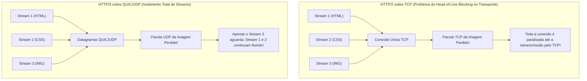
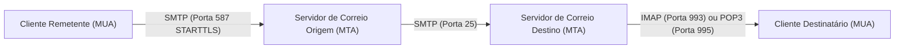
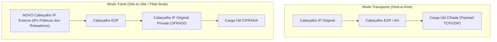
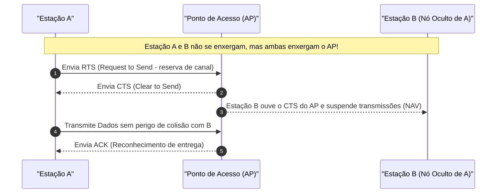

# 04 - Protocolos de Aplicação, Segurança de Rede e Redes Sem Fio

> **Matéria:** Sistemas Operacionais, Redes e Computação em Nuvem  
> **Cargo:** B02 – Técnico de Controle Externo – Especialidade: Tecnologia da Informação  
> **Arquivo:** `04_protocolos_de_aplicacao_redes_sem_fio_e_seguranca_de_rede.md`  

---

## 📌 Ementa / Itens do Edital
- Protocolos da camada de aplicação e transporte:
    - Evolução da Web: HTTP/1.1, HTTP/2, HTTP/3 e HTTPS
    - Gerenciamento e transferência: SSH, FTP/SFTP
    - Correio eletrônico: SMTP, IMAP e POP3
- Tecnologias de interconexão e segurança perimetral: VPN, Balanceamento de Carga, Proxies e Firewalls
- Noções de redes sem fio (Padrões IEEE 802.11 e segurança Wi-Fi)

---

## 🧭 Sumário

1. [Evolução dos Protocolos Web: HTTP/1.1, HTTP/2, HTTP/3 e HTTPS](#1-evolucao-dos-protocolos-web-http11-http2-http3-e-https)
    1. [HTTP/1.1 e o Bloqueio de Início de Fila (Head-of-Line Blocking) na Aplicação](#11-http11-e-o-bloqueio-de-inicio-de-fila-head-of-line-blocking-na-aplicacao)
    2. [HTTP/2: Formato Binário, Multiplexação de Streams e Compressão HPACK](#12-http2-formato-binario-multiplexacao-de-streams-e-compressao-hpack)
    3. [HTTP/3 e o Protocolo QUIC sobre UDP](#13-http3-e-o-protocolo-quic-sobre-udp)
    4. [HTTPS e TLS 1.3 Integrado](#14-https-e-tls-13-integrado)
    5. [Teste 443](#Teste-443)
    6. [Teste 444](#Teste-444)
    7. [Teste 445](#Teste-445)
2. [Protocolos Utilitários, Transferência de Arquivos e Correio Eletrônico](#2-protocolos-utilitarios-transferencia-de-arquivos-e-correio-eletronico)
    1. [SSH (Secure Shell) e Redirecionamento de Portas](#21-ssh-secure-shell-e-redirecionamento-de-portas)
    2. [Transferência de Arquivos: FTP vs. FTPS vs. SFTP](#22-transferencia-de-arquivos-ftp-vs-ftps-vs-sftp)
    3. [Correio Eletrônico: SMTP vs. POP3 vs. IMAP](#23-correio-eletronico-smtp-vs-pop3-vs-imap)
    4. [Teste 446](#Teste-446)
    5. [Teste 447](#Teste-447)
3. [Elementos de Borda e Segurança de Rede: VPN, IPsec, Balanceadores e Proxies](#3-elementos-de-borda-e-seguranca-de-rede-vpn-ipsec-balanceadores-e-proxies)
    1. [Arquitetura IPsec: Cabeçalhos AH vs. ESP e Modos Transporte vs. Túnel](#31-arquitetura-ipsec-cabecalhos-ah-vs-esp-e-modos-transporte-vs-tunel)
    2. [Balanceadores de Carga: Camada 4 (L4) vs. Camada 7 (L7)](#32-balanceadores-de-carga-camada-4-l4-vs-camada-7-l7)
    3. [Servidores Proxy: Forward Proxy vs. Reverse Proxy](#33-servidores-proxy-forward-proxy-vs-reverse-proxy)
    4. [Teste 448](#Teste-448)
    5. [Teste 449](#Teste-449)
    6. [Teste 450](#Teste-450)
4. [Redes Sem Fio (IEEE 802.11 - Wi-Fi)](#4-redes-sem-fio-ieee-80211-wi-fi)
    1. [Evolução dos Padrões 802.11 (Wi-Fi 4, Wi-Fi 5 e Wi-Fi 6/6E)](#41-evolucao-dos-padroes-80211-wi-fi-4-wi-fi-5-e-wi-fi-66e)
    2. [Frequências de Operação: 2.4 GHz vs. 5 GHz](#42-frequencias-de-operacao-24-ghz-vs-5-ghz)
    3. [Mecanismo de Acesso ao Meio: CSMA/CA e o Problema do Nó Oculto (RTS/CTS)](#43-mecanismo-de-acesso-ao-meio-csmaca-e-o-problema-do-no-oculto-rtscts)
    4. [Evolução da Segurança Sem Fio: WEP, WPA, WPA2 e WPA3 (Personal vs. Enterprise)](#44-evolucao-da-seguranca-sem-fio-wep-wpa-wpa2-e-wpa3-personal-vs-enterprise)
    5. [Teste 451](#Teste-451)
    6. [Teste 452](#Teste-452)
    7. [Teste 453](#Teste-453)
6. [Fontes Recomendadas na Internet](#6-fontes-recomendadas-na-internet)

---

## 1. Evolução dos Protocolos Web: HTTP/1.1, HTTP/2, HTTP/3 e HTTPS

### 1.1 HTTP/1.1 e o Bloqueio de Início de Fila (Head-of-Line Blocking) na Aplicação

O protocolo **HTTP/1.1** (RFC 2616) estruturou a comunicação na web durante duas décadas. Ele trouxe como avanço o suporte a **conexões persistentes (*Keep-Alive*)**, permitindo que uma mesma conexão TCP fosse reaproveitada para transferir múltiplos recursos sem a necessidade de reabrir o handshake a cada arquivo.

Contudo, o HTTP/1.1 padece de uma limitação arquitetural grave:

- As mensagens trafegam em formato **estritamente textual e sequencial** no modelo requisição-resposta.
- Se uma página web demanda dezenas de imagens, folhas de estilo CSS e scripts JavaScript, o cliente envia uma requisição e precisa aguardar o servidor responder integralmente antes de enviar a próxima.
- Esse fenômeno é denominado **Bloqueio de Início de Fila na Aplicação (*Head-of-Line Blocking / HoL Blocking*)**: se a primeira requisição for lenta ou complexa para o backend processar, todos os demais recursos da página ficam bloqueados na fila do navegador. Para mitigar o problema, os navegadores passaram a abrir de 6 a 8 conexões TCP concorrentes com o mesmo domínio, sobrecarregando os servidores.

### 1.2 HTTP/2: Formato Binário, Multiplexação de Streams e Compressão HPACK

Padronizado pela RFC 7540, o **HTTP/2** reformulou a camada de aplicação sem alterar a semântica básica (métodos GET/POST, cabeçalhos e códigos de status HTTP continuam os mesmos):

1. **Protocolo Estritamente Binário:** Substituiu o texto ASCII puro por uma camada de enquadramento binário estruturada em **Quadros (*Frames*)** e **Fluxos (*Streams*)**.
2. **Multiplexação Verdadeira:** Múltiplas requisições e respostas podem trafegar de forma intercalada, bidirecional e simultânea sobre uma **única conexão TCP aberta**. Um arquivo CSS pesado não bloqueia mais o tráfego de imagens leves.
3. **Compressão de Cabeçalhos (HPACK):** Utiliza tabelas estáticas e dinâmicas associadas à codificação Huffman para eliminar a repetição redundante de cabeçalhos volumosos (como cookies e user-agents).
4. **Server Push:** O servidor pode enviar antecipadamente recursos essenciais ao cliente (como uma folha de estilo `style.css`) antes mesmo de o navegador interpretá-la e requisitá-la explicitamente.

#### O Gargalo Restante do HTTP/2: HoL Blocking no Transporte TCP
Embora o HTTP/2 tenha solucionado o bloqueio de início de fila na aplicação, ele transferiu o problema para a **Camada de Transporte (TCP)**:

- Como todos os streams do site compartilham a mesma e única conexão TCP, se um único pacote TCP for corrompido ou perdido na rede, o mecanismo de confiabilidade do TCP obriga o receptor a paralisar **a entrega de todos os outros streams da conexão** até que o pacote faltante seja retransmitido (*TCP Head-of-Line Blocking*).

### 1.3 HTTP/3 e o Protocolo QUIC sobre UDP

Para eliminar em definitivo qualquer forma de bloqueio em redes móveis e de alta latência, a IETF padronizou o **HTTP/3** (RFC 9114), substituindo o TCP pelo protocolo de transporte **QUIC (*Quick UDP Internet Connections* - RFC 9000)**, que opera sobre datagramas **UDP (Porta UDP 443)**:

#### Inovações Tecnológicas do HTTP/3 (QUIC):
- **Eliminação Total do HoL Blocking:** Os streams dentro do QUIC são verdadeiramente isolados. A perda de um pacote no fluxo da imagem congela apenas o processamento da imagem, enquanto o código HTML e o script JavaScript continuam sendo entregues imediatamente ao navegador.
- **Handshake Acelerado (0-RTT e 1-RTT):** Como o controle de transporte e a criptografia TLS 1.3 são integrados no mesmo protocolo, a conexão segura é estabelecida em apenas 1 RTT (ou 0-RTT se o host já for conhecido), contra 2 a 3 RTTs exigidos pelo par TCP + TLS 1.2.
- **Migração de Conexão Resiliente (*Connection Migration*):** A conexão QUIC não é identificada pela 4-tupla tradicional (IP de origem, IP de destino, porta de origem, porta de destino), mas por um identificador exclusivo de 64 bits chamado **Connection ID**. Se o usuário sair da rede Wi-Fi de casa e entrar na rede móvel 5G (mudando completamente o endereço IP do smartphone), **a sessão de download, streaming ou chamada de vídeo NÃO cai nem reinicia**, migrando de forma totalmente transparente.
- **Compressão QPACK:** Evolução do algoritmo HPACK adaptada para lidar com pacotes que chegam fora de ordem sobre o transporte UDP.

### 1.4 HTTPS e TLS 1.3 Integrado

O **HTTPS** nada mais é do que o tráfego HTTP executado sobre uma camada de segurança de transporte criptográfica:

- **TLS 1.3 (RFC 8446):** Padrão moderno obrigatório que aboliu cifras antigas fracas ou suscetíveis a ataques (eliminou suporte a RC4, 3DES, CBC, MD5 e trocas estáticas de chave RSA).
- **Forward Secrecy Mandatório:** O TLS 1.3 exige o uso de algoritmos de troca de chave efêmera (como ECDHE), garantindo que, mesmo que a chave privada do servidor web seja roubada no futuro, o tráfego gravado no passado não poderá ser decifrado.
- No HTTP/3, o **TLS 1.3 é embutido nativamente no QUIC**, não existindo HTTP/3 em texto claro na especificação padrão.

---

### Teste 443
**(FGV – TRF-1 – Analista Judiciario Area Apoio Especializado Especialidade Tecnologia da Informacao – 2024)**
Ao analisar uma conexão HTTP não persistente, constatou-se o acesso ao endereço http://www.highschool.edu/departamentos/home.index. Uma das etapas da transferência dessa página do servidor para o cliente está corretamente descrita na seguinte alternativa:

* **A)** cliente HTTP envia uma mensagem de download HTTP ao servidor por meio do socket do servidor. Essa mensagem inclui o nome de caminho /departamentos/home.index;
* **B)** processo servidor HTTP ordena ao TCP que encerre a conexão TCP. Mas, na realidade, o TCP só a encerrará quando tiver certeza de que o cliente recebeu a mensagem de resposta intacta;
* **C)** processo cliente HTTP inicia uma conexão TCP para o servidor www.highschool.edu na porta número 90, que é o número de porta default para o HTTP. Associados à conexão UDP, haverá um socket no cliente e um socket no servidor;
* **D)** cliente TCP recebe a mensagem de resposta e a conexão TCP é encerrada. A mensagem indica que o objeto encapsulado é um arquivo HTTP. O cliente extrai o arquivo da mensagem de resposta, analisa o arquivo HTML e encontra referências aos objetos JPEG;
* **E)** processo servidor HTML solicita a mensagem de requisição por meio de seu socket, extrai o objeto /departamentos/home.index de seu armazenamento (RAM ou disco), encapsula-o em uma mensagem de resposta HTML e a envia ao cliente HTTP.

---

> **Comentário Detalhado:**
>
> - **A)** **Incorreta.** A opção apresenta proposição em desacordo com os fundamentos teóricos e técnicos do tópico ao afirmar que "cliente HTTP envia uma mensagem de download HTTP ao servidor por meio do socket do servidor. Essa mensagem inclui...". De acordo com a teoria estudada em *1.2 HTTP/2: Formato Binário, Multiplexação de Streams e Compressão HPACK*, server Push: O servidor pode enviar antecipadamente recursos essenciais ao cliente (como uma folha de estilo `style.css`) antes mesmo de o navegador interpretá-la e requisitá-la explicitamente.
> - **B)** **Correta.** Conforme fundamentado na seção *1.1 HTTP/1.1 e o Bloqueio de Início de Fila (Head-of-Line Blocking) na Aplicação* deste guia, se uma página web demanda dezenas de imagens, folhas de estilo CSS e scripts JavaScript, o cliente envia uma requisição e precisa aguardar o servidor responder integralmente antes de enviar a próxima. Dessa forma, está plenamente correta a assertiva da banca (FGV – TRF-1/2024) ao estabelecer que "processo servidor HTTP ordena ao TCP que encerre a conexão TCP. Mas, na realidade, o TCP só a encerrará quando...".
> - **C)** **Incorreta.** A opção apresenta proposição em desacordo com os fundamentos teóricos e técnicos do tópico ao afirmar que "processo cliente HTTP inicia uma conexão TCP para o servidor www.highschool.edu na porta número 90, que é o número...". De acordo com a teoria estudada em *Protocolos em Detalhes:*, utilizado pelo cliente para submeter e-mails ao seu servidor (porta 587 com autenticação e STARTTLS) e utilizado para retransmitir e-mails entre servidores de correio na Internet (porta 25).
> - **D)** **Incorreta.** A opção apresenta proposição em desacordo com os fundamentos teóricos e técnicos do tópico ao afirmar que "cliente TCP recebe a mensagem de resposta e a conexão TCP é encerrada. A mensagem indica que o objeto encapsulado...". De acordo com a teoria estudada em *1.1 HTTP/1.1 e o Bloqueio de Início de Fila (Head-of-Line Blocking) na Aplicação*, ele trouxe como avanço o suporte a conexões persistentes (*Keep-Alive*), permitindo que uma mesma conexão TCP fosse reaproveitada para transferir múltiplos recursos sem a necessidade de reabrir o handshake a cada arquivo.
> - **E)** **Incorreta.** A opção apresenta proposição em desacordo com os fundamentos teóricos e técnicos do tópico ao afirmar que "processo servidor HTML solicita a mensagem de requisição por meio de seu socket, extrai o objeto...". De acordo com a teoria estudada em *1.1 HTTP/1.1 e o Bloqueio de Início de Fila (Head-of-Line Blocking) na Aplicação*, as mensagens trafegam em formato estritamente textual e sequencial no modelo requisição-resposta.
>
> **Gabarito: B**

---

### Teste 444
**(FGV – TCE-SC – Auditor Fiscal de Controle Externo Ciencias da Computacao Sistemas de Informacao – 2026)**
Ao auditar os ativos de rede de uma prefeitura, o auditor percebe que o portal da transparência não utiliza o protocolo HTTPS, deixando os dados dos cidadãos vulneráveis. Esse protocolo utiliza uma combinação de protocolos para garantir a segurança. A camada adicional de segurança, responsável pela criptografia e autenticação do site, é

* **A)** UDP.
* **B)** BGP.
* **C)** TLS/SSL.
* **D)** ICMP.
* **E)** DHCP.

---

> **Comentário Detalhado:**
>
> - **A)** **Incorreta.** A opção apresenta proposição em desacordo com os fundamentos teóricos e técnicos do tópico ao afirmar que "UDP". De acordo com a teoria estudada em *1.4 HTTPS e TLS 1.3 Integrado*, o HTTPS nada mais é do que o tráfego HTTP executado sobre uma camada de segurança de transporte criptográfica.
> - **B)** **Incorreta.** A opção apresenta proposição em desacordo com os fundamentos teóricos e técnicos do tópico ao afirmar que "BGP". De acordo com a teoria estudada em *6. Fontes Recomendadas na Internet*, sTALLINGS, William. Criptografia e Segurança de Redes: Princípios e Práticas. 7. ed. São Paulo: Pearson Education do Brasil, 2018. (Cap. 17 - Segurança de Camada de Transporte: TLS; Cap. 20 - Firewalls).
> - **C)** **Correta.** Conforme fundamentado na seção *2.2 Transferência de Arquivos: FTP vs. FTPS vs. SFTP* deste guia, fTPS (*FTP over SSL/TLS*): TCP 21 (Controle) + Portas de Dados dinâmicas protegidas — Criptografia via TLS/SSL aplicada sobre as conexões de controle e dados do FTP. — É o protocolo FTP clássico encapsulado em uma sessão TLS. Dessa forma, está plenamente correta a assertiva da banca (FGV – TCE-SC/2026) ao estabelecer que "TLS/SSL".
> - **D)** **Incorreta.** A opção apresenta proposição em desacordo com os fundamentos teóricos e técnicos do tópico ao afirmar que "ICMP". De acordo com a teoria estudada em *Inovações Tecnológicas do HTTP/3 (QUIC):*, handshake Acelerado (0-RTT e 1-RTT): Como o controle de transporte e a criptografia TLS 1.3 são integrados no mesmo protocolo, a conexão segura é estabelecida em apenas 1 RTT (ou 0-RTT se o host já for conhecido), contra 2 a 3 RTTs exigidos pelo par TCP + TLS 1.2.
> - **E)** **Incorreta.** A opção apresenta proposição em desacordo com os fundamentos teóricos e técnicos do tópico ao afirmar que "DHCP". De acordo com a teoria estudada em *Protocolos de Segurança do IPsec:*, eSP (*Encapsulating Security Payload* - Protocolo IP 50): Provê confidencialidade (criptografia dos dados), além de autenticação de origem e integridade. É o protocolo primário utilizado para túneis VPN seguros.
>
> **Gabarito: C**

---

### Teste 445
**(FUMARC – TRT-3 – Analista Judiciario Apoio Especializado Tecnologia da Informacao – 2022)**
O TCP (Transmission Control Protocol) é um protocolo da camada de transporte do modelo OSI utilizado no envio e no recebimento de dados na web. Todas as afirmativas abaixo sobre o protocolo TCP estão corretas, EXCETO:

* **A)** O protocolo TCP é orientado à conexão.
* **B)** O protocolo TCP faz a retransmissão de mensagens caso elas não cheguem ao destinatário.
* **C)** O protocolo TCP não é compatível com o protocolo FTP (File Transfer Protocol).
* **D)** O protocolo TCP possui mecanismos para garantir a entrega de dados.
* **E)** O protocolo TCP trata a ordenação e a correção de pacotes.

---

> **Comentário Detalhado:**
>
> - **A)** **Incorreta.** A opção apresenta proposição em desacordo com os fundamentos teóricos e técnicos do tópico ao afirmar que "O protocolo TCP é orientado à conexão". De acordo com a teoria estudada em *2.2 Transferência de Arquivos: FTP vs. FTPS vs. SFTP*, sFTP (*SSH File Transfer Protocol*): Apenas a porta TCP 22 — Criptografia forte de ponta a ponta e autenticação por chaves SSH. — NÃO tem nenhuma relação com o FTP! É um subsistema de extensão que opera inteiramente dentro de uma sessão SSH estabelecida.
> - **B)** **Incorreta.** A opção apresenta proposição em desacordo com os fundamentos teóricos e técnicos do tópico ao afirmar que "O protocolo TCP faz a retransmissão de mensagens caso elas não cheguem ao destinatário". De acordo com a teoria estudada em *Protocolos em Detalhes:*, sMTP (*Simple Mail Transfer Protocol* - Portas TCP 25 e TCP 587).
> - **C)** **Correta.** Conforme fundamentado na seção *2.2 Transferência de Arquivos: FTP vs. FTPS vs. SFTP* deste guia, fTP (*File Transfer Protocol*): TCP 21 (Controle) e TCP 20 (Dados no modo ativo) — NENHUMA. Usuário, senha e conteúdo dos arquivos transitam em texto claro puro. — Protocolo legado original. Opera com duas conexões distintas (modo Ativo vs. modo Passivo/PASV). Dessa forma, está plenamente correta a assertiva da banca (FUMARC – TRT-3/2022) ao estabelecer que "O protocolo TCP não é compatível com o protocolo FTP (File Transfer Protocol)".
> - **D)** **Incorreta.** A opção apresenta proposição em desacordo com os fundamentos teóricos e técnicos do tópico ao afirmar que "O protocolo TCP possui mecanismos para garantir a entrega de dados". De acordo com a teoria estudada em *2.2 Transferência de Arquivos: FTP vs. FTPS vs. SFTP*, fTPS (*FTP over SSL/TLS*): TCP 21 (Controle) + Portas de Dados dinâmicas protegidas — Criptografia via TLS/SSL aplicada sobre as conexões de controle e dados do FTP. — É o protocolo FTP clássico encapsulado em uma sessão TLS.
> - **E)** **Incorreta.** A opção apresenta proposição em desacordo com os fundamentos teóricos e técnicos do tópico ao afirmar que "O protocolo TCP trata a ordenação e a correção de pacotes". De acordo com a teoria estudada em *6. Fontes Recomendadas na Internet*, iETF RFC 4253 - The Secure Shell (SSH) Transport Layer Protocol - Especificação oficial da arquitetura de transporte e autenticação criptográfica do protocolo SSH.
>
> **Gabarito: C**

---

## 2. Protocolos Utilitários, Transferência de Arquivos e Correio Eletrônico

### 2.1 SSH (Secure Shell) e Redirecionamento de Portas

O protocolo **SSH** opera na **porta TCP 22** e provê comunicação criptografada segura para administração remota de servidores, transferência de arquivos e execução remota de comandos, substituindo protocolos inseguros legados (Telnet, rlogin):

- **Autenticação:** Baseada em senhas ou pares de chaves criptográficas assimétricas (RSA, Ed25519), onde a chave pública fica registrada no arquivo `~/.ssh/authorized_keys` do servidor remoto e a chave privada permanece protegida sob custódia do usuário.
- **Túneis e Redirecionamento de Portas (*Port Forwarding*):**
    - *Local Port Forwarding (`ssh -L local_port:target_host:target_port user@server`):* Encaminha o tráfego de uma porta local da estação do administrador através do túnel criptografado SSH para um serviço interno na rede remota (ex.: acessar uma base de dados inacessível pela Internet).
    - *Remote Port Forwarding (`ssh -R remote_port:target_host:target_port user@server`):* Encaminha tráfego recebido em uma porta do servidor remoto de volta para um serviço rodando na máquina local do administrador.
    - *Dynamic Port Forwarding (`ssh -D local_port user@server`):* Transforma a sessão SSH em um servidor proxy local do tipo SOCKS4/SOCKS5.

### 2.2 Transferência de Arquivos: FTP vs. FTPS vs. SFTP

| Protocolo | Portas de Transporte Utilizadas | Criptografia / Segurança | Arquitetura e Relação com FTP |
|---|---|---|---|
| **FTP** (*File Transfer Protocol*) | **TCP 21** (Controle) e **TCP 20** (Dados no modo ativo) | **NENHUMA.** Usuário, senha e conteúdo dos arquivos transitam em texto claro puro. | Protocolo legado original. Opera com duas conexões distintas (modo Ativo vs. modo Passivo/PASV). |
| **FTPS** (*FTP over SSL/TLS*) | TCP 21 (Controle) + Portas de Dados dinâmicas protegidas | Criptografia via TLS/SSL aplicada sobre as conexões de controle e dados do FTP. | É o protocolo FTP clássico encapsulado em uma sessão TLS. Requer abertura de faixas complexas de portas no firewall. |
| **SFTP** (*SSH File Transfer Protocol*) | **Apenas a porta TCP 22** | Criptografia forte de ponta a ponta e autenticação por chaves SSH. | **NÃO tem nenhuma relação com o FTP!** É um subsistema de extensão que opera inteiramente dentro de uma sessão SSH estabelecida. |

### 2.3 Correio Eletrônico: SMTP vs. POP3 vs. IMAP

O tráfego de correio eletrônico na Internet divide-se claramente entre envio/retransmissão e acesso/leitura:

#### Protocolos em Detalhes:
1. **SMTP (*Simple Mail Transfer Protocol* - Portas TCP 25 e TCP 587):**
    - É um protocolo do tipo **Push (Envio)**.
    - Utilizado pelo cliente para submeter e-mails ao seu servidor (porta 587 com autenticação e STARTTLS) e utilizado para retransmitir e-mails entre servidores de correio na Internet (porta 25).

2. **POP3 (*Post Office Protocol v3* - Portas TCP 110 e TCP 995 com SSL):**
    - É um protocolo do tipo **Pull (Recuperação)**.
    - Baixa as mensagens do servidor para a máquina local do usuário e, por padrão histórico, **remove as mensagens da caixa postal do servidor**. Não suporta criação nem sincronização de pastas remotas.

3. **IMAP (*Internet Message Access Protocol* - Portas TCP 143 e TCP 993 com SSL):**
    - É um protocolo do tipo **Pull (Acesso e Sincronização)**.
    - Mantém as mensagens, pastas customizadas, marcações de lido/não-lido e rascunhos **armazenados permanentemente no servidor central**. Permite que o usuário consulte sua caixa de correio através de múltiplos dispositivos (smartphone, webmail, notebook) com sincronização em tempo real.

---

### Teste 446
**(FGV – TJ-RR – Analista Judiciario Infraestrutura de Tecnologia da Informacao – 2024)**
Com relação aos protocolos de redes de computadores, analise as afirmativas a seguir. I. O DHCP (Dynamic Host Configuration Protocol) é um protocolo cliente-servidor que permite que um host obtenha um endereço IP (Internet Protocol) automaticamente. II. Ao contrário do TCP (Transmission Control Protocol), o UDP (User Datagram Protocol) não é orientado a conexões. III. O SMTP (Simple Mail Transfer Protocol) permite que um servidor de correio eletrônico atue ora como cliente ora como servidor. Está correto o que se afirma em

* **A)** II, apenas.
* **B)** I e II, apenas.
* **C)** I e III, apenas.
* **D)** II e III, apenas.
* **E)** I, II e III.

---

> **Comentário Detalhado:**
>
> - **A)** **Incorreta.** A opção incorre em restrição indevida ao limitar o escopo conceitual ao afirmar que "II, apenas". De acordo com a teoria estudada em *2.3 Correio Eletrônico: SMTP vs. POP3 vs. IMAP*, o tráfego de correio eletrônico na Internet divide-se claramente entre envio/retransmissão e acesso/leitura.
> - **B)** **Incorreta.** A opção incorre em restrição indevida ao limitar o escopo conceitual ao afirmar que "I e II, apenas". De acordo com a teoria estudada em *Protocolos em Detalhes:*, utilizado pelo cliente para submeter e-mails ao seu servidor (porta 587 com autenticação e STARTTLS) e utilizado para retransmitir e-mails entre servidores de correio na Internet (porta 25).
> - **C)** **Incorreta.** A opção incorre em restrição indevida ao limitar o escopo conceitual ao afirmar que "I e III, apenas". De acordo com a teoria estudada em *2.2 Transferência de Arquivos: FTP vs. FTPS vs. SFTP*, fTP (*File Transfer Protocol*): TCP 21 (Controle) e TCP 20 (Dados no modo ativo) — NENHUMA. Usuário, senha e conteúdo dos arquivos transitam em texto claro puro. — Protocolo legado original. Opera com duas conexões distintas (modo Ativo vs. modo Passivo/PASV).
> - **D)** **Incorreta.** A opção incorre em restrição indevida ao limitar o escopo conceitual ao afirmar que "II e III, apenas". De acordo com a teoria estudada em *2.2 Transferência de Arquivos: FTP vs. FTPS vs. SFTP*, sFTP (*SSH File Transfer Protocol*): Apenas a porta TCP 22 — Criptografia forte de ponta a ponta e autenticação por chaves SSH. — NÃO tem nenhuma relação com o FTP! É um subsistema de extensão que opera inteiramente dentro de uma sessão SSH estabelecida.
> - **E)** **Correta.** Conforme fundamentado na seção *Protocolos em Detalhes:* deste guia, sMTP (*Simple Mail Transfer Protocol* - Portas TCP 25 e TCP 587). Dessa forma, está plenamente correta a assertiva da banca (FGV – TJ-RR/2024) ao estabelecer que "I, II e III".
>
> **Gabarito: E**

---

### Teste 447
**(FGV – TCE-GO – Analista de Controle Externo Tecnologia da Informacao – 2024)**
Em relação às tecnologias de segurança de rede e protocolos de comunicação segura, analise as afirmações abaixo: I. VPN (Virtual Private Network) e VPN-SSL (Virtual Private Network - Secure Sockets Layer) são tecnologias que permitem a criação de conexões seguras e criptografadas através de redes públicas, mas VPN-SSL especificamente utiliza o protocolo SSL; II. SSL (Secure Sockets Layer) é um protocolo criptográfico projetado exclusivamente para navegação web não funcionando com VPNs; III. A renegociação segura durante o handshake no protocolo TLS é um processo que permite que as partes já conectadas concordem em novos parâmetros de segurança sem necessidade de encerrar a conexão existente. Está correto o que se afirma em

* **A)** I, apenas.
* **B)** II, apenas.
* **C)** I e III, apenas.
* **D)** II e III, apenas.
* **E)** I, II e III.

---

> **Comentário Detalhado:**
>
> - **A)** **Incorreta.** A opção incorre em restrição indevida ao limitar o escopo conceitual ao afirmar que "I, apenas". De acordo com a teoria estudada em *Inovações Tecnológicas do HTTP/3 (QUIC):*, handshake Acelerado (0-RTT e 1-RTT): Como o controle de transporte e a criptografia TLS 1.3 são integrados no mesmo protocolo, a conexão segura é estabelecida em apenas 1 RTT (ou 0-RTT se o host já for conhecido), contra 2 a 3 RTTs exigidos pelo par TCP + TLS 1.2.
> - **B)** **Incorreta.** A opção incorre em restrição indevida ao limitar o escopo conceitual ao afirmar que "II, apenas". De acordo com a teoria estudada em *1.1 HTTP/1.1 e o Bloqueio de Início de Fila (Head-of-Line Blocking) na Aplicação*, ele trouxe como avanço o suporte a conexões persistentes (*Keep-Alive*), permitindo que uma mesma conexão TCP fosse reaproveitada para transferir múltiplos recursos sem a necessidade de reabrir o handshake a cada arquivo.
> - **C)** **Correta.** Conforme fundamentado na seção *2.1 SSH (Secure Shell) e Redirecionamento de Portas* deste guia, o protocolo SSH opera na porta TCP 22 e provê comunicação criptografada segura para administração remota de servidores, transferência de arquivos e execução remota de comandos, substituindo protocolos inseguros legados (Telnet, rlogin). Dessa forma, está plenamente correta a assertiva da banca (FGV – TCE-GO/2024) ao estabelecer que "I e III, apenas".
> - **D)** **Incorreta.** A opção incorre em restrição indevida ao limitar o escopo conceitual ao afirmar que "II e III, apenas". De acordo com a teoria estudada em *Modos de Operação do IPsec:*, modo Túnel: Utilizado em conexões de borda VPN *Site-to-Site* interligando redes inteiras (Matriz e Filial) através de roteadores ou firewalls.
> - **E)** **Incorreta.** A opção apresenta proposição em desacordo com os fundamentos teóricos e técnicos do tópico ao afirmar que "I, II e III". De acordo com a teoria estudada em *1.1 HTTP/1.1 e o Bloqueio de Início de Fila (Head-of-Line Blocking) na Aplicação*, o protocolo HTTP/1.1 (RFC 2616) estruturou a comunicação na web durante duas décadas.
>
> **Gabarito: C**

---

## 3. Elementos de Borda e Segurança de Rede: VPN, IPsec, Balanceadores e Proxies

### 3.1 Arquitetura IPsec: Cabeçalhos AH vs. ESP e Modos Transporte vs. Túnel

O conjunto de protocolos **IPsec** opera na **Camada de Rede (Camada 3 do modelo OSI)**, sendo agnóstico em relação às aplicações de camadas superiores:

#### Protocolos de Segurança do IPsec:
- **AH (*Authentication Header* - Protocolo IP 51):** Provê autenticação da origem e integridade estrita dos dados via hash criptográfico.  
  > 🚨 **REGRA DE PROVA FCC:** O protocolo **AH NÃO PROVÊ CONFIDENCIALIDADE (NÃO realiza criptografia de dados)**! Além disso, é incompatível com NAT porque inclui o cabeçalho IP original no cálculo de integridade.
- **ESP (*Encapsulating Security Payload* - Protocolo IP 50):** Provê **confidencialidade (criptografia dos dados)**, além de autenticação de origem e integridade. É o protocolo primário utilizado para túneis VPN seguros.

#### Modos de Operação do IPsec:
- **Modo Transporte:** Utilizado em comunicações ponto a ponto entre dois hosts finais (*Host-to-Host*). Criptografa apenas o payload de transporte (dados TCP/UDP), mantendo o cabeçalho IP original legível. Os IPs privados de origem e destino ficam visíveis na rede pública.
- **Modo Túnel:** Utilizado em conexões de borda **VPN *Site-to-Site*** interligando redes inteiras (Matriz e Filial) através de roteadores ou firewalls. O **pacote IP original inteiro (cabeçalho IP privado + carga útil) é completamente criptografado**, e um novo cabeçalho IP externo contendo os endereços públicos dos gateways de borda é adicionado por fora.

### 3.2 Balanceadores de Carga: Camada 4 (L4) vs. Camada 7 (L7)

Os Balanceadores de Carga (*Load Balancers*) distribuem o fluxo de requisições entre múltiplos servidores de backend para garantir escalabilidade horizontal e alta disponibilidade:

- **Balanceador de Camada 4 (L4 - Transporte):**
    - Toma decisões de chaveamento baseando-se unicamente em informações das camadas de rede e transporte: **Endereço IP de origem/destino e Portas TCP/UDP**.
    - Não examina o conteúdo da aplicação. Apresenta rendimento extraordinário, baixa latência e consome poucos recursos computacionais.
- **Balanceador de Camada 7 (L7 - Aplicação):**
    - Compreende a semântica dos protocolos de aplicação (HTTP/HTTPS, gRPC).
    - Pode inspecionar URLs, caminhos de requisição (`/api` vs. `/imagens`), cabeçalhos HTTP, métodos REST e cookies de sessão.
    - Suporta roteamento contextual baseado em conteúdo, persistência de sessão (*Sticky Sessions* via cookies) e descarregamento de processamento criptográfico (**SSL Termination / Offloading**).

### 3.3 Servidores Proxy: Forward Proxy vs. Reverse Proxy

- **Forward Proxy (Proxy Direto):** Fica posicionado em frente aos **computadores clientes internos** da organização. É utilizado para controlar e registrar a navegação dos funcionários na Internet, aplicar políticas de filtragem de conteúdo corporativo, fazer cache de páginas externas e mascarar os endereços IP das estações de trabalho perante os servidores web do mundo exterior.
- **Reverse Proxy (Proxy Reverso):** Fica posicionado em frente aos **servidores internos de aplicação e bancos de dados** da instituição (ex.: Nginx, HAProxy, Envoy). Atua como a vitrine pública de entrada: recebe as requisições dos usuários da Internet, faz terminação SSL, aplica balanceamento de carga, acelera a entrega por meio de cache de conteúdo estático e oculta a topologia interna e a quantidade de servidores do datacenter contra invasores externos.

---

### Teste 448
**(FGV – TJ-RR – Analista Judiciario Infraestrutura de Tecnologia da Informacao – 2024)**
O Tribunal de Justiça do Estado de Roraima está modernizando sua infraestrutura de rede para melhorar a segurança e a eficiência na comunicação de dados. A equipe de Tecnologia da Informação está implementando mecanismos de Network Address Translation (NAT) e Port Address Translation (PAT) para otimizar o uso de endereços IP públicos e proteger a rede interna. Além disso, estão avaliando quais protocolos e padrões de segurança sem fio devem ser adotados para garantir a confidencialidade e integridade das informações transmitidas. Entre as opções consideradas estão os protocolos WEP, WPA, WPA2, WPA3 e a implementação do padrão IEEE 802.1X em conjunto com o EAP (Extensible Authentication Protocol). Considerando o cenário apresentado, a equipe de TI precisa entender o funcionamento do PAT na rede e selecionar o protocolo de segurança sem fio mais adequado para proteger as comunicações sem comprometer a eficiência. Com base nas informações fornecidas, assinale a opção que interpreta corretamente o papel do PAT na rede e identifica o protocolo de segurança sem fio mais adequado para garantir a confidencialidade e integridade dos dados transmitidos.

* **A)** O PAT permite que cada dispositivo interno tenha um endereço IP público exclusivo; o protocolo WEP deve ser implementado para proteger a rede sem fio.
* **B)** O PAT traduz múltiplos endereços IP privados em um único endereço IP público usando números de porta para diferenciar as saídas; o protocolo WPA3 é o mais adequado para proteger a rede sem fio.
* **C)** O PAT mapeia cada endereço IP privado para um endereço IP público diferente; o protocolo WPA deve ser utilizado para a segurança da rede sem fio.
* **D)** O PAT não é necessário quando o NAT está em uso; o protocolo EAP é suficiente para proteger a rede sem fio.
* **E)** O PAT converte endereços IPv4 em IPv6; o padrão IEEE 802.1X deve ser aplicado para garantir a segurança da rede sem fio.

---

> **Comentário Detalhado:**
>
> - **A)** **Incorreta.** A opção apresenta proposição em desacordo com os fundamentos teóricos e técnicos do tópico ao afirmar que "O PAT permite que cada dispositivo interno tenha um endereço IP público exclusivo; o protocolo WEP deve ser...". De acordo com a teoria estudada em *4.4 Evolução da Segurança Sem Fio: WEP, WPA, WPA2 e WPA3 (Personal vs. Enterprise)*, wEP: Cifra de fluxo RC4 (chave de 40 ou 104 bits + IV estático de 24 bits) — CRC-32 (fraco) — Totalmente Quebrado e Obsoleto. Pode ser decifrado em poucos minutos devido ao reúso de vetores de inicialização (IVs curtos). Banido pelas normas de segurança.
> - **B)** **Correta.** Conforme fundamentado na seção *4.4 Evolução da Segurança Sem Fio: WEP, WPA, WPA2 e WPA3 (Personal vs. Enterprise)* deste guia, wPA2: AES (*Advanced Encryption Standard*) com protocolo CCMP — CBC-MAC — Padrão robusto da indústria. Vulnerável ao ataque de reinstalação de chave (KRACK) e ataques de força bruta/dicionário offline ao aperto de mão de 4 vias (modo PSK). Dessa forma, está plenamente correta a assertiva da banca (FGV – TJ-RR/2024) ao estabelecer que "O PAT traduz múltiplos endereços IP privados em um único endereço IP público usando números de porta para...".
> - **C)** **Incorreta.** A opção apresenta proposição em desacordo com os fundamentos teóricos e técnicos do tópico ao afirmar que "O PAT mapeia cada endereço IP privado para um endereço IP público diferente; o protocolo WPA deve ser utilizado...". De acordo com a teoria estudada em *4.4 Evolução da Segurança Sem Fio: WEP, WPA, WPA2 e WPA3 (Personal vs. Enterprise)*, padrão: Criptografia Adotada — Mecanismo de Integridade — Vulnerabilidades Críticas / Situação Atual.
> - **D)** **Incorreta.** A opção apresenta proposição em desacordo com os fundamentos teóricos e técnicos do tópico ao afirmar que "O PAT não é necessário quando o NAT está em uso; o protocolo EAP é suficiente para proteger a rede sem fio". De acordo com a teoria estudada em *Protocolos de Segurança do IPsec:*, o protocolo AH NÃO PROVÊ CONFIDENCIALIDADE (NÃO realiza criptografia de dados)! Além disso, é incompatível com NAT porque inclui o cabeçalho IP original no cálculo de integridade.
> - **E)** **Incorreta.** A opção apresenta proposição em desacordo com os fundamentos teóricos e técnicos do tópico ao afirmar que "O PAT converte endereços IPv4 em IPv6; o padrão IEEE 802.1X deve ser aplicado para garantir a segurança da rede...". De acordo com a teoria estudada em *4.4 Evolução da Segurança Sem Fio: WEP, WPA, WPA2 e WPA3 (Personal vs. Enterprise)*, wPA: Cifra TKIP (*Temporal Key Integrity Protocol*) sobre RC4 — Michael (MIC) — Padrão emergencial de transição para cobrir as falhas do WEP sem exigir troca de hardware; hoje também considerado obsoleto.
>
> **Gabarito: B**

---

### Teste 449
**(FGV – TCE-GO – Analista de Controle Externo Tecnologia da Informacao – 2024)**
O IPSec é um conjunto de protocolos desenvolvidos pelo IETF para oferecer segurança para um pacote no nível de rede. Com relação ao IPSec, assinale V para afirmativa verdadeira e F para a falsa. ( ) O IPSec no modo túnel não protege o cabeçalho IP enquanto no modo de transporte, protege o pacote inteiro. ( ) O protocolo ESP fornece somente autenticação de fonte e integridade de dados, enquanto o protocolo AH fornece, também, privacidade, além da autenticação e integridade. ( ) O IPSec oferece suporte tanto ao IPv4 quanto o IPv6, porém, apenas no IPv6 o ESP e o AH fazem parte do cabeçalho de extensão. As afirmativas são, respectivamente,

* **A)** V – V – V.
* **B)** F – V – F.
* **C)** F – F – F.
* **D)** F – F – V.
* **E)** V – F – V.

---

> **Comentário Detalhado:**
>
> - **A)** **Incorreta.** A opção apresenta proposição em desacordo com os fundamentos teóricos e técnicos do tópico ao afirmar que "V – V – V". De acordo com a teoria estudada em *Protocolos de Segurança do IPsec:*, eSP (*Encapsulating Security Payload* - Protocolo IP 50): Provê confidencialidade (criptografia dos dados), além de autenticação de origem e integridade. É o protocolo primário utilizado para túneis VPN seguros.
> - **B)** **Incorreta.** A opção apresenta proposição em desacordo com os fundamentos teóricos e técnicos do tópico ao afirmar que "F – V – F". De acordo com a teoria estudada em *Protocolos de Segurança do IPsec:*, o protocolo AH NÃO PROVÊ CONFIDENCIALIDADE (NÃO realiza criptografia de dados)! Além disso, é incompatível com NAT porque inclui o cabeçalho IP original no cálculo de integridade.
> - **C)** **Incorreta.** A opção apresenta proposição em desacordo com os fundamentos teóricos e técnicos do tópico ao afirmar que "F – F – F". De acordo com a teoria estudada em *Protocolos de Segurança do IPsec:*, aH (*Authentication Header* - Protocolo IP 51): Provê autenticação da origem e integridade estrita dos dados via hash criptográfico.
> - **D)** **Correta.** Conforme fundamentado na seção *3.1 Arquitetura IPsec: Cabeçalhos AH vs. ESP e Modos Transporte vs. Túnel* deste guia, o conjunto de protocolos IPsec opera na Camada de Rede (Camada 3 do modelo OSI), sendo agnóstico em relação às aplicações de camadas superiores. Dessa forma, está plenamente correta a assertiva da banca (FGV – TCE-GO/2024) ao estabelecer que "F – F – V".
> - **E)** **Incorreta.** A opção apresenta proposição em desacordo com os fundamentos teóricos e técnicos do tópico ao afirmar que "V – F – V". De acordo com a teoria estudada em *Modos de Operação do IPsec:*, o pacote IP original inteiro (cabeçalho IP privado + carga útil) é completamente criptografado, e um novo cabeçalho IP externo contendo os endereços públicos dos gateways de borda é adicionado por fora.
>
> **Gabarito: D**

---

### Teste 450
**(CEBRASPE – TJ-RJ – Analista Judiciario Grupo Tecnologia da Informacao Analista de Seguranca da Informacao – 2021)**
A proteção de segurança de rede computacional de determinado tribunal é composta por firewall de aplicação Web (WAF), sistema de detecção e prevenção de intrusão (IDS/IPS), firewall e listas de acessos (ACL) utilizadas em switchs e roteadores. Um atacante conseguiu, a partir da Internet, ultrapassar a proteção dessa rede e acessar indevidamente informações restritas. A aplicação web afetada, E-processos, é utilizada para gestão de processos judiciais, sendo acessada tanto pela Internet quanto pela rede interna por diversos perfis de usuários, como servidores, advogados, juízes. A aplicação conta com alguns recursos de segurança, como bloqueio por tentativa de força bruta e protocolo de transferência de hipertexto seguro (HTTPS). Durante a análise do incidente, identificou-se a utilização da técnica de SQL Injection na exploração de uma vulnerabilidade na E-processos, o que permitiu o acesso não autorizado a dados armazenados no servidor de banco de dados. Nessa situação hipotética, as falhas que podem ser identificadas incluem

* **A)** IDS/IPS configurado no modo de detecção e fluxo de comunicação da Internet para o servidor na porta TCP 443 liberado no firewall.
* **B)** IDS/IPS configurado em modo de detecção e fluxo de comunicação da Internet para o servidor na porta TCP 443 liberado na ACL do roteador de borda.
* **C)** WAF com regra de SQL Injection desativada no fluxo de comunicação da Internet para o servidor na porta TCP 443 e IDS/IPS configurado em modo de prevenção.
* **D)** IDS/IPS configurado em modo de prevenção com regra de SQL Injection desativada no fluxo de comunicação da Internet para o servidor na porta TCP 443 e WAF com inspeção desativada para SSL/TLS em HTTP.
* **E)** IDS/IPS e WAF com inspeção desativada para SSL/TLS em HTTP e fluxo de comunicação da Internet para o servidor nas portas TCP 80 e 443 liberadas na ACL do roteador de borda e no firewall.

---

> **Comentário Detalhado:**
>
> - **A)** **Incorreta.** A opção apresenta proposição em desacordo com os fundamentos teóricos e técnicos do tópico ao afirmar que "IDS/IPS configurado no modo de detecção e fluxo de comunicação da Internet para o servidor na porta TCP 443...". De acordo com a teoria estudada em *6. Fontes Recomendadas na Internet*, iETF RFC 8446 - The Transport Layer Security (TLS) Protocol Version 1.3 - Especificação oficial do protocolo TLS 1.3 para canal seguro de comunicação na Internet.
> - **B)** **Incorreta.** A opção apresenta proposição em desacordo com os fundamentos teóricos e técnicos do tópico ao afirmar que "IDS/IPS configurado em modo de detecção e fluxo de comunicação da Internet para o servidor na porta TCP 443...". De acordo com a teoria estudada em *2.1 SSH (Secure Shell) e Redirecionamento de Portas*, o protocolo SSH opera na porta TCP 22 e provê comunicação criptografada segura para administração remota de servidores, transferência de arquivos e execução remota de comandos, substituindo protocolos inseguros legados (Telnet, rlogin).
> - **C)** **Incorreta.** A opção apresenta proposição em desacordo com os fundamentos teóricos e técnicos do tópico ao afirmar que "WAF com regra de SQL Injection desativada no fluxo de comunicação da Internet para o servidor na porta TCP 443 e...". De acordo com a teoria estudada em *3.3 Servidores Proxy: Forward Proxy vs. Reverse Proxy*, atua como a vitrine pública de entrada: recebe as requisições dos usuários da Internet, faz terminação SSL, aplica balanceamento de carga, acelera a entrega por meio de cache de conteúdo estático e oculta a topologia interna e a quantidade de servidores do datacenter contra invasores externos.
> - **D)** **Correta.** Conforme fundamentado na seção *1.3 HTTP/3 e o Protocolo QUIC sobre UDP* deste guia, para eliminar em definitivo qualquer forma de bloqueio em redes móveis e de alta latência, a IETF padronizou o HTTP/3 (RFC 9114), substituindo o TCP pelo protocolo de transporte QUIC (*Quick UDP Internet Connections* - RFC 9000), que opera sobre datagramas UDP (Porta UDP 443). Dessa forma, está plenamente correta a assertiva da banca (CEBRASPE – TJ-RJ/2021) ao estabelecer que "IDS/IPS configurado em modo de prevenção com regra de SQL Injection desativada no fluxo de comunicação da Internet...".
> - **E)** **Incorreta.** A opção apresenta proposição em desacordo com os fundamentos teóricos e técnicos do tópico ao afirmar que "IDS/IPS e WAF com inspeção desativada para SSL/TLS em HTTP e fluxo de comunicação da Internet para o servidor nas...". De acordo com a teoria estudada em *2.2 Transferência de Arquivos: FTP vs. FTPS vs. SFTP*, fTPS (*FTP over SSL/TLS*): TCP 21 (Controle) + Portas de Dados dinâmicas protegidas — Criptografia via TLS/SSL aplicada sobre as conexões de controle e dados do FTP. — É o protocolo FTP clássico encapsulado em uma sessão TLS.
>
> **Gabarito: D**

---

## 4. Redes Sem Fio (IEEE 802.11 - Wi-Fi)

### 4.1 Evolução dos Padrões 802.11 (Wi-Fi 4, Wi-Fi 5 e Wi-Fi 6/6E)

| Geração Comercial | Padrão IEEE | Frequências de Operação | Larguras de Canal | Principais Tecnologias e Recursos | Taxas Teóricas Máximas |
|---|---|---|---|---|---|
| **Wi-Fi 4** | **802.11n** | 2.4 GHz e 5 GHz | 20 e 40 MHz | Introdução da tecnologia **MIMO** (*Multiple-Input Multiple-Output*) | Até 600 Mbps |
| **Wi-Fi 5** | **802.11ac** | **Exclusivo 5 GHz** | 20, 40, 80 e 160 MHz | **MU-MIMO** (*Multi-User MIMO*) para downlink, modulação 256-QAM | Até 6.9 Gbps |
| **Wi-Fi 6 / 6E** | **802.11ax** | 2.4 GHz, 5 GHz e 6 GHz (no 6E) | Canais de até 160 MHz | **OFDMA** (subcanais RU), MU-MIMO bidirecional, TWT (*Target Wake Time*) para IoT | Até 9.6 Gbps |

### 4.2 Frequências de Operação: 2.4 GHz vs. 5 GHz

- **Faixa de 2.4 GHz:**
    - *Vantagem:* Maior comprimento de onda, proporcionando **maior alcance físico** de cobertura e melhor penetração através de paredes e obstáculos sólidos.
    - *Desvantagem:* Menor largura de banda total e **altíssima interferência** (disputa espaço com Bluetooth, fornos micro-ondas e telefones sem fio). Possui apenas **3 canais não sobrepostos** na regulamentação padrão (canais 1, 6 e 11).
- **Faixa de 5 GHz:**
    - *Vantagem:* Menor índice de interferência, dezenas de canais não sobrepostos e capacidade para canais largos (80/160 MHz), oferecendo **altíssima vazão de dados**.
    - *Desvantagem:* Menor alcance de cobertura de sinal e maior atenuação ao atravessar obstáculos físicos.

### 4.3 Mecanismo de Acesso ao Meio: CSMA/CA e o Problema do Nó Oculto (RTS/CTS)

Diferente das redes cabeadas Ethernet (IEEE 802.3), que utilizam detecção de colisão (**CSMA/CD**), o meio sem fio via rádio impossibilita a detecção confiável de colisões elétricas na antena transmissora enquanto ela mesma emite sinal em alta potência. Por isso, o padrão IEEE 802.11 adota compulsoriamente a **Prevenção de Colisões (CSMA/CA - *Carrier Sense Multiple Access with Collision Avoidance*)**:

#### O Problema do Nó Oculto (*Hidden Node Problem*):
Ocorre quando duas estações distantes (Estação A e Estação B) estão ambas dentro do raio de alcance do mesmo Ponto de Acesso (AP), mas encontram-se fora do alcance de escuta de rádio uma da outra. Se ambas escutarem o canal e acharem que ele está livre, transmitirão simultaneamente para o AP, provocando colisão destrutiva.

O problema é neutralizado pelo mecanismo opcional de reserva via quadros de controle **RTS/CTS**:

1. A Estação A transmite um quadro **RTS (*Request to Send*)** ao AP solicitando tempo de reserva;
2. O AP responde com um quadro **CTS (*Clear to Send*)** em broadcast;
3. A Estação B escuta o CTS emitido pelo AP e suspende suas transmissões (ajustando seu temporizador NAV - *Network Allocation Vector*), permitindo que a Estação A envie seus dados sem risco de colisão.

### 4.4 Evolução da Segurança Sem Fio: WEP, WPA, WPA2 e WPA3 (Personal vs. Enterprise)

| Padrão | Criptografia Adotada | Mecanismo de Integridade | Vulnerabilidades Críticas / Situação Atual |
|---|---|---|---|
| **WEP** | Cifra de fluxo **RC4** (chave de 40 ou 104 bits + IV estático de 24 bits) | CRC-32 (fraco) | **Totalmente Quebrado e Obsoleto.** Pode ser decifrado em poucos minutos devido ao reúso de vetores de inicialização (IVs curtos). Banido pelas normas de segurança. |
| **WPA** | Cifra **TKIP** (*Temporal Key Integrity Protocol*) sobre RC4 | Michael (MIC) | Padrão emergencial de transição para cobrir as falhas do WEP sem exigir troca de hardware; hoje também considerado obsoleto. |
| **WPA2** | **AES** (*Advanced Encryption Standard*) com protocolo **CCMP** | CBC-MAC | Padrão robusto da indústria. Vulnerável ao ataque de reinstalação de chave (**KRACK**) e ataques de força bruta/dicionário offline ao aperto de mão de 4 vias (modo PSK). |
| **WPA3** | **AES-128 (modo Personal) ou CNSA de 192 bits (modo Enterprise)** | Galois/Counter Mode (GCMP) | **Padrão de Excelência Atual.** Elimina ataques de dicionário offline através da troca autenticada simultânea de iguais (**SAE / Dragonfly**) e garante sigilo futuro (*Forward Secrecy*). |

#### Modos de Operação: Personal vs. Enterprise
- **Modo Personal (WPA-PSK):** Emprega uma **chave pré-compartilhada única (*Pre-Shared Key*)** configurada no ponto de acesso e digitada por todos os usuários da rede. Típico de ambientes residenciais ou pequenas empresas.
- **Modo Enterprise (WPA-Enterprise):** Não utiliza senha compartilhada única. Implementa a arquitetura de autenticação centralizada e individualizada baseada no padrão **IEEE 802.1X**:
    - Cada colaborador autentica-se com seu próprio login e senha do Active Directory ou com um certificado digital pessoal;
    - A comunicação é intermediada pelo ponto de acesso e validada por um servidor de autenticação corporativo baseado no protocolo **RADIUS** (*Remote Authentication Dial-In User Service*);
    - Uma chave criptográfica de sessão exclusiva é gerada dinamicamente para cada dispositivo individualmente.

---

### Teste 451
**(FGV – TRF-1 – Analista Judiciario Area Apoio Especializado Especialidade Suporte Em Tecnologia da Informacao – 2024)**
Um órgão que realiza atendimento presencial ao público implementou três redes sem fio e configurou protocolos de segurança distintos nelas. Os protocolos foram implementados de acordo com os requisitos de segurança necessários para cada rede, conforme descritos abaixo: 1. rede pública: protocolo com chave criptográfica única e estática de 128 bits que utiliza algoritmo de criptografia RC4; 2. rede interna: protocolo com chave criptográfica AES, com senhas longas; 3. rede terceirizada: protocolo com chave criptográfica gerada dinamicamente e alterada regularmente em tempos prédefinidos, com base no algoritmo de criptografia RC4, com senhas curtas. Os protocolos de segurança implementados na rede foram, respectivamente:

* **A)** WPA, EAP e WPA3;
* **B)** WPA, WEP e WPA2;
* **C)** WEP, WPA2 e WPA;
* **D)** WEP, WPA3 e EAP;
* **E)** EAP, WEP e WPA2.

---

> **Comentário Detalhado:**
>
> - **A)** **Incorreta.** A opção apresenta proposição em desacordo com os fundamentos teóricos e técnicos do tópico ao afirmar que "WPA, EAP e WPA3". De acordo com a teoria estudada em *4.4 Evolução da Segurança Sem Fio: WEP, WPA, WPA2 e WPA3 (Personal vs. Enterprise)*, wEP: Cifra de fluxo RC4 (chave de 40 ou 104 bits + IV estático de 24 bits) — CRC-32 (fraco) — Totalmente Quebrado e Obsoleto. Pode ser decifrado em poucos minutos devido ao reúso de vetores de inicialização (IVs curtos). Banido pelas normas de segurança.
> - **B)** **Incorreta.** A opção apresenta proposição em desacordo com os fundamentos teóricos e técnicos do tópico ao afirmar que "WPA, WEP e WPA2". De acordo com a teoria estudada em *4.4 Evolução da Segurança Sem Fio: WEP, WPA, WPA2 e WPA3 (Personal vs. Enterprise)*, wPA2: AES (*Advanced Encryption Standard*) com protocolo CCMP — CBC-MAC — Padrão robusto da indústria. Vulnerável ao ataque de reinstalação de chave (KRACK) e ataques de força bruta/dicionário offline ao aperto de mão de 4 vias (modo PSK).
> - **C)** **Incorreta.** A opção apresenta proposição em desacordo com os fundamentos teóricos e técnicos do tópico ao afirmar que "WEP, WPA2 e WPA". De acordo com a teoria estudada em *4.4 Evolução da Segurança Sem Fio: WEP, WPA, WPA2 e WPA3 (Personal vs. Enterprise)*, wPA: Cifra TKIP (*Temporal Key Integrity Protocol*) sobre RC4 — Michael (MIC) — Padrão emergencial de transição para cobrir as falhas do WEP sem exigir troca de hardware; hoje também considerado obsoleto.
> - **D)** **Correta.** Conforme fundamentado na seção *4.4 Evolução da Segurança Sem Fio: WEP, WPA, WPA2 e WPA3 (Personal vs. Enterprise)* deste guia, wPA3: AES-128 (modo Personal) ou CNSA de 192 bits (modo Enterprise) — Galois/Counter Mode (GCMP) — Padrão de Excelência Atual. Dessa forma, está plenamente correta a assertiva da banca (FGV – TRF-1/2024) ao estabelecer que "WEP, WPA3 e EAP".
> - **E)** **Incorreta.** A opção apresenta proposição em desacordo com os fundamentos teóricos e técnicos do tópico ao afirmar que "EAP, WEP e WPA2". De acordo com a teoria estudada em *4.4 Evolução da Segurança Sem Fio: WEP, WPA, WPA2 e WPA3 (Personal vs. Enterprise)*, padrão: Criptografia Adotada — Mecanismo de Integridade — Vulnerabilidades Críticas / Situação Atual.
>
> **Gabarito: D**

---

### Teste 452
**(FCC – TRT-6 – Analista Judiciario Apoio Especializado Tecnologia da Informacao – 2012)**
Dentre as redes sem fio mais comumente utilizadas estão aquelas designadas pela marca registrada Wi-Fi. A seu respeito, é correto afirmar que

* **A)** para poder ser certificado como Wi-Fi, um aparelho precisa implementar o Wireless Application Protocol (WAP).
* **B)** um aparelho que implemente o padrão de segurança WEP pode ser certificado como Wi-Fi, mesmo que não implemente o padrão de segurança WPA.
* **C)** aparelhos baseados no padrão IEEE 802.11b trabalham na faixa de 2.4GHz e por isso estão sujeitos a interferência de outros equipamentos como fornos micro-ondas e telefones sem fio.
* **D)** em ordem decrescente de alcance de operação estão os padrões 802.11b, 802.11g e 802.11n.
* **E)** em ordem crescente de segurança estão os padrões WPA, WPA2 e WEP.

---

> **Comentário Detalhado:**
>
> - **A)** **Incorreta.** A opção apresenta proposição em desacordo com os fundamentos teóricos e técnicos do tópico ao afirmar que "para poder ser certificado como Wi-Fi, um aparelho precisa implementar o Wireless Application Protocol (WAP)". De acordo com a teoria estudada em *4.3 Mecanismo de Acesso ao Meio: CSMA/CA e o Problema do Nó Oculto (RTS/CTS)*, diferente das redes cabeadas Ethernet (IEEE 802.3), que utilizam detecção de colisão (CSMA/CD), o meio sem fio via rádio impossibilita a detecção confiável de colisões elétricas na antena transmissora enquanto ela mesma emite sinal em alta potência.
> - **B)** **Incorreta.** A opção apresenta proposição em desacordo com os fundamentos teóricos e técnicos do tópico ao afirmar que "um aparelho que implemente o padrão de segurança WEP pode ser certificado como Wi-Fi, mesmo que não implemente o...". De acordo com a teoria estudada em *4.4 Evolução da Segurança Sem Fio: WEP, WPA, WPA2 e WPA3 (Personal vs. Enterprise)*, wEP: Cifra de fluxo RC4 (chave de 40 ou 104 bits + IV estático de 24 bits) — CRC-32 (fraco) — Totalmente Quebrado e Obsoleto. Pode ser decifrado em poucos minutos devido ao reúso de vetores de inicialização (IVs curtos). Banido pelas normas de segurança.
> - **C)** **Correta.** Conforme fundamentado na seção *4.2 Frequências de Operação: 2.4 GHz vs. 5 GHz* deste guia, *Desvantagem:* Menor largura de banda total e altíssima interferência (disputa espaço com Bluetooth, fornos micro-ondas e telefones sem fio). Possui apenas 3 canais não sobrepostos na regulamentação padrão (canais 1, 6 e 11). Dessa forma, está plenamente correta a assertiva da banca (FCC – TRT-6/2012) ao estabelecer que "aparelhos baseados no padrão IEEE 802.11b trabalham na faixa de 2.4GHz e por isso estão sujeitos a interferência...".
> - **D)** **Incorreta.** A opção apresenta proposição em desacordo com os fundamentos teóricos e técnicos do tópico ao afirmar que "em ordem decrescente de alcance de operação estão os padrões 802.11b, 802.11g e 802.11n". De acordo com a teoria estudada em *4.1 Evolução dos Padrões 802.11 (Wi-Fi 4, Wi-Fi 5 e Wi-Fi 6/6E)*, geração Comercial: Padrão IEEE — Frequências de Operação — Larguras de Canal — Principais Tecnologias e Recursos — Taxas Teóricas Máximas.
> - **E)** **Incorreta.** A opção apresenta proposição em desacordo com os fundamentos teóricos e técnicos do tópico ao afirmar que "em ordem crescente de segurança estão os padrões WPA, WPA2 e WEP". De acordo com a teoria estudada em *4.4 Evolução da Segurança Sem Fio: WEP, WPA, WPA2 e WPA3 (Personal vs. Enterprise)*, padrão: Criptografia Adotada — Mecanismo de Integridade — Vulnerabilidades Críticas / Situação Atual.
>
> **Gabarito: C**

---

### Teste 453
**(FCC – TRT-1 – Analista Judiciario Tecnologia da Informacao – 2014)**
Com a rápida expansão do uso das redes sem fio padrão IEEE 802.11, os mecanismos de segurança também têm evoluído na mesma velocidade. Originalmente o 802.11 disponibilizava o protocolo WEP (Wired Equivalent Privacy), mas devido às várias vulnerabilidades, foram introduzidos os WPA (Wi-Fi Protected Access) e o WPA2 (Wi-Fi Protected Access-2). Dentre as diferenças entre o WPA e o WPA2 está o uso do

* **A)** RC4 no WPA e do AES no WPA2.
* **B)** esquema de chaves estáticas no WPA e do esquema de chaves dinâmicas no WPA2.
* **C)** RC2 no WPA e do RC4 no WPA2.
* **D)** esquema de chaves dinâmicas no WPA e o esquema de chaves estáticas no WPA2.
* **E)** TKIP no WPA e o PKIT no WPA2.

---

> **Comentário Detalhado:**
>
> - **A)** **Correta.** Conforme fundamentado na seção *4.4 Evolução da Segurança Sem Fio: WEP, WPA, WPA2 e WPA3 (Personal vs. Enterprise)* deste guia, wPA2: AES (*Advanced Encryption Standard*) com protocolo CCMP — CBC-MAC — Padrão robusto da indústria. Vulnerável ao ataque de reinstalação de chave (KRACK) e ataques de força bruta/dicionário offline ao aperto de mão de 4 vias (modo PSK). Dessa forma, está plenamente correta a assertiva da banca (FCC – TRT-1/2014) ao estabelecer que "RC4 no WPA e do AES no WPA2".
> - **B)** **Incorreta.** A opção apresenta proposição em desacordo com os fundamentos teóricos e técnicos do tópico ao afirmar que "esquema de chaves estáticas no WPA e do esquema de chaves dinâmicas no WPA2". De acordo com a teoria estudada em *4.4 Evolução da Segurança Sem Fio: WEP, WPA, WPA2 e WPA3 (Personal vs. Enterprise)*, wEP: Cifra de fluxo RC4 (chave de 40 ou 104 bits + IV estático de 24 bits) — CRC-32 (fraco) — Totalmente Quebrado e Obsoleto. Pode ser decifrado em poucos minutos devido ao reúso de vetores de inicialização (IVs curtos). Banido pelas normas de segurança.
> - **C)** **Incorreta.** A opção apresenta proposição em desacordo com os fundamentos teóricos e técnicos do tópico ao afirmar que "RC2 no WPA e do RC4 no WPA2". De acordo com a teoria estudada em *4.4 Evolução da Segurança Sem Fio: WEP, WPA, WPA2 e WPA3 (Personal vs. Enterprise)*, wPA3: AES-128 (modo Personal) ou CNSA de 192 bits (modo Enterprise) — Galois/Counter Mode (GCMP) — Padrão de Excelência Atual.
> - **D)** **Incorreta.** A opção apresenta proposição em desacordo com os fundamentos teóricos e técnicos do tópico ao afirmar que "esquema de chaves dinâmicas no WPA e o esquema de chaves estáticas no WPA2". De acordo com a teoria estudada em *4.4 Evolução da Segurança Sem Fio: WEP, WPA, WPA2 e WPA3 (Personal vs. Enterprise)*, wPA: Cifra TKIP (*Temporal Key Integrity Protocol*) sobre RC4 — Michael (MIC) — Padrão emergencial de transição para cobrir as falhas do WEP sem exigir troca de hardware; hoje também considerado obsoleto.
> - **E)** **Incorreta.** A opção apresenta proposição em desacordo com os fundamentos teóricos e técnicos do tópico ao afirmar que "TKIP no WPA e o PKIT no WPA2". De acordo com a teoria estudada em *4.4 Evolução da Segurança Sem Fio: WEP, WPA, WPA2 e WPA3 (Personal vs. Enterprise)*, padrão: Criptografia Adotada — Mecanismo de Integridade — Vulnerabilidades Críticas / Situação Atual.
>
> **Gabarito: A**

---

## 6. Fontes Recomendadas na Internet

* [IETF RFC 9110 - HTTP Semantics](https://datatracker.ietf.org/doc/html/rfc9110) - Norma de referência global da IETF com as semânticas, códigos de status e métodos do protocolo HTTP.
* [IETF RFC 8446 - The Transport Layer Security (TLS) Protocol Version 1.3](https://datatracker.ietf.org/doc/html/rfc8446) - Especificação oficial do protocolo TLS 1.3 para canal seguro de comunicação na Internet.
* [IETF RFC 4253 - The Secure Shell (SSH) Transport Layer Protocol](https://datatracker.ietf.org/doc/html/rfc4253) - Especificação oficial da arquitetura de transporte e autenticação criptográfica do protocolo SSH.
* [Wi-Fi Alliance - Wi-Fi CERTIFIED WPA3 Security Highlights](https://www.wi-fi.org/discover-wi-fi/security) - Visão geral técnica oficial dos mecanismos do WPA3 e protocolo SAE (Simultaneous Authentication of Equals).
* [NIST SP 800-41 Rev. 1 - Guidelines on Firewalls and Firewall Policy](https://csrc.nist.gov/pubs/sp/800/41/r1/final) - Recomendações oficiais do NIST para arquitetura de firewalls e regras de segurança de rede.
* KUROSE, James F.; ROSS, Keith W. **Redes de Computadores e a Internet: Uma Abordagem Top-Down**. 7. ed. São Paulo: Pearson Education do Brasil, 2017. (Cap. 2 - Camada de Aplicação: HTTP, SMTP, DNS; Cap. 6 - Redes Sem Fio e Móveis; Cap. 8 - Segurança em Redes).
* TANENBAUM, Andrew S.; WETHERALL, David. **Redes de Computadores**. 5. ed. São Paulo: Pearson, 2011. (Cap. 4 - A Subcamada de Controle de Acesso ao Meio: Padrões IEEE 802.11; Cap. 8 - Segurança de Rede).
* STALLINGS, William. **Criptografia e Segurança de Redes: Princípios e Práticas**. 7. ed. São Paulo: Pearson Education do Brasil, 2018. (Cap. 17 - Segurança de Camada de Transporte: TLS; Cap. 20 - Firewalls).
