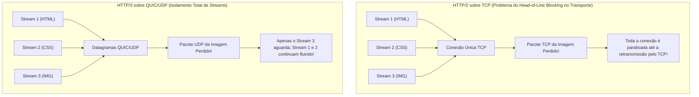
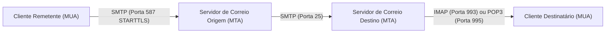
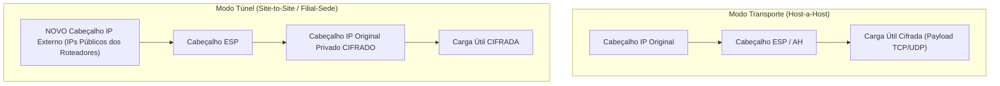
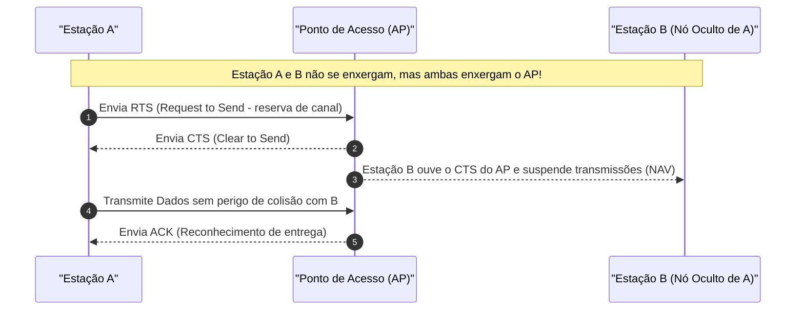

# 04 - Protocolos de Aplicação, Segurança de Rede e Redes Sem Fio

> **Matéria:** Sistemas Operacionais, Redes e Computação em Nuvem  
> **Cargo:** B02 – Técnico de Controle Externo – Especialidade: Tecnologia da Informação  
> **Arquivo:** `04_protocolos_de_aplicacao_redes_sem_fio_e_seguranca_de_rede.md`  

---

## 📌 Ementa / Itens do Edital
- Protocolos da camada de aplicação e transporte:
    - Evolução da Web: HTTP/1.1, HTTP/2, HTTP/3 e HTTPS
    - Gerenciamento e transferência: SSH, FTP/SFTP
    - Correio eletrônico: SMTP, IMAP e POP3
- Tecnologias de interconexão e segurança perimetral: VPN, Balanceamento de Carga, Proxies e Firewalls
- Noções de redes sem fio (Padrões IEEE 802.11 e segurança Wi-Fi)

---

## 🧭 Sumário

1. [Evolução dos Protocolos Web: HTTP/1.1, HTTP/2, HTTP/3 e HTTPS](#1-evolucao-dos-protocolos-web-http11-http2-http3-e-https)
    1. [HTTP/1.1 e o Bloqueio de Início de Fila (Head-of-Line Blocking) na Aplicação](#11-http11-e-o-bloqueio-de-inicio-de-fila-head-of-line-blocking-na-aplicacao)
    2. [HTTP/2: Formato Binário, Multiplexação de Streams e Compressão HPACK](#12-http2-formato-binario-multiplexacao-de-streams-e-compressao-hpack)
    3. [HTTP/3 e o Protocolo QUIC sobre UDP](#13-http3-e-o-protocolo-quic-sobre-udp)
    4. [HTTPS e TLS 1.3 Integrado](#14-https-e-tls-13-integrado)
    5. [Teste 443](#Teste-443)
    6. [Teste 444](#Teste-444)
    7. [Teste 445](#Teste-445)
2. [Protocolos Utilitários, Transferência de Arquivos e Correio Eletrônico](#2-protocolos-utilitarios-transferencia-de-arquivos-e-correio-eletronico)
    1. [SSH (Secure Shell) e Redirecionamento de Portas](#21-ssh-secure-shell-e-redirecionamento-de-portas)
    2. [Transferência de Arquivos: FTP vs. FTPS vs. SFTP](#22-transferencia-de-arquivos-ftp-vs-ftps-vs-sftp)
    3. [Correio Eletrônico: SMTP vs. POP3 vs. IMAP](#23-correio-eletronico-smtp-vs-pop3-vs-imap)
    4. [Teste 446](#Teste-446)
    5. [Teste 447](#Teste-447)
3. [Elementos de Borda e Segurança de Rede: VPN, IPsec, Balanceadores e Proxies](#3-elementos-de-borda-e-seguranca-de-rede-vpn-ipsec-balanceadores-e-proxies)
    1. [Arquitetura IPsec: Cabeçalhos AH vs. ESP e Modos Transporte vs. Túnel](#31-arquitetura-ipsec-cabecalhos-ah-vs-esp-e-modos-transporte-vs-tunel)
    2. [Balanceadores de Carga: Camada 4 (L4) vs. Camada 7 (L7)](#32-balanceadores-de-carga-camada-4-l4-vs-camada-7-l7)
    3. [Servidores Proxy: Forward Proxy vs. Reverse Proxy](#33-servidores-proxy-forward-proxy-vs-reverse-proxy)
    4. [Teste 448](#Teste-448)
    5. [Teste 449](#Teste-449)
    6. [Teste 450](#Teste-450)
4. [Redes Sem Fio (IEEE 802.11 - Wi-Fi)](#4-redes-sem-fio-ieee-80211-wi-fi)
    1. [Evolução dos Padrões 802.11 (Wi-Fi 4, Wi-Fi 5 e Wi-Fi 6/6E)](#41-evolucao-dos-padroes-80211-wi-fi-4-wi-fi-5-e-wi-fi-66e)
    2. [Frequências de Operação: 2.4 GHz vs. 5 GHz](#42-frequencias-de-operacao-24-ghz-vs-5-ghz)
    3. [Mecanismo de Acesso ao Meio: CSMA/CA e o Problema do Nó Oculto (RTS/CTS)](#43-mecanismo-de-acesso-ao-meio-csmaca-e-o-problema-do-no-oculto-rtscts)
    4. [Evolução da Segurança Sem Fio: WEP, WPA, WPA2 e WPA3 (Personal vs. Enterprise)](#44-evolucao-da-seguranca-sem-fio-wep-wpa-wpa2-e-wpa3-personal-vs-enterprise)
    5. [Teste 451](#Teste-451)
    6. [Teste 452](#Teste-452)
    7. [Teste 453](#Teste-453)
6. [Fontes Recomendadas na Internet](#6-fontes-recomendadas-na-internet)

---

## 1. Evolução dos Protocolos Web: HTTP/1.1, HTTP/2, HTTP/3 e HTTPS

### 1.1 HTTP/1.1 e o Bloqueio de Início de Fila (Head-of-Line Blocking) na Aplicação

O protocolo **HTTP/1.1** (RFC 2616) estruturou a comunicação na web durante duas décadas. Ele trouxe como avanço o suporte a **conexões persistentes (*Keep-Alive*)**, permitindo que uma mesma conexão TCP fosse reaproveitada para transferir múltiplos recursos sem a necessidade de reabrir o handshake a cada arquivo.

Contudo, o HTTP/1.1 padece de uma limitação arquitetural grave:

- As mensagens trafegam em formato **estritamente textual e sequencial** no modelo requisição-resposta.
- Se uma página web demanda dezenas de imagens, folhas de estilo CSS e scripts JavaScript, o cliente envia uma requisição e precisa aguardar o servidor responder integralmente antes de enviar a próxima.
- Esse fenômeno é denominado **Bloqueio de Início de Fila na Aplicação (*Head-of-Line Blocking / HoL Blocking*)**: se a primeira requisição for lenta ou complexa para o backend processar, todos os demais recursos da página ficam bloqueados na fila do navegador. Para mitigar o problema, os navegadores passaram a abrir de 6 a 8 conexões TCP concorrentes com o mesmo domínio, sobrecarregando os servidores.

### 1.2 HTTP/2: Formato Binário, Multiplexação de Streams e Compressão HPACK

Padronizado pela RFC 7540, o **HTTP/2** reformulou a camada de aplicação sem alterar a semântica básica (métodos GET/POST, cabeçalhos e códigos de status HTTP continuam os mesmos):

1. **Protocolo Estritamente Binário:** Substituiu o texto ASCII puro por uma camada de enquadramento binário estruturada em **Quadros (*Frames*)** e **Fluxos (*Streams*)**.
2. **Multiplexação Verdadeira:** Múltiplas requisições e respostas podem trafegar de forma intercalada, bidirecional e simultânea sobre uma **única conexão TCP aberta**. Um arquivo CSS pesado não bloqueia mais o tráfego de imagens leves.
3. **Compressão de Cabeçalhos (HPACK):** Utiliza tabelas estáticas e dinâmicas associadas à codificação Huffman para eliminar a repetição redundante de cabeçalhos volumosos (como cookies e user-agents).
4. **Server Push:** O servidor pode enviar antecipadamente recursos essenciais ao cliente (como uma folha de estilo `style.css`) antes mesmo de o navegador interpretá-la e requisitá-la explicitamente.

#### O Gargalo Restante do HTTP/2: HoL Blocking no Transporte TCP
Embora o HTTP/2 tenha solucionado o bloqueio de início de fila na aplicação, ele transferiu o problema para a **Camada de Transporte (TCP)**:

- Como todos os streams do site compartilham a mesma e única conexão TCP, se um único pacote TCP for corrompido ou perdido na rede, o mecanismo de confiabilidade do TCP obriga o receptor a paralisar **a entrega de todos os outros streams da conexão** até que o pacote faltante seja retransmitido (*TCP Head-of-Line Blocking*).

### 1.3 HTTP/3 e o Protocolo QUIC sobre UDP

Para eliminar em definitivo qualquer forma de bloqueio em redes móveis e de alta latência, a IETF padronizou o **HTTP/3** (RFC 9114), substituindo o TCP pelo protocolo de transporte **QUIC (*Quick UDP Internet Connections* - RFC 9000)**, que opera sobre datagramas **UDP (Porta UDP 443)**:

#### Inovações Tecnológicas do HTTP/3 (QUIC):
- **Eliminação Total do HoL Blocking:** Os streams dentro do QUIC são verdadeiramente isolados. A perda de um pacote no fluxo da imagem congela apenas o processamento da imagem, enquanto o código HTML e o script JavaScript continuam sendo entregues imediatamente ao navegador.
- **Handshake Acelerado (0-RTT e 1-RTT):** Como o controle de transporte e a criptografia TLS 1.3 são integrados no mesmo protocolo, a conexão segura é estabelecida em apenas 1 RTT (ou 0-RTT se o host já for conhecido), contra 2 a 3 RTTs exigidos pelo par TCP + TLS 1.2.
- **Migração de Conexão Resiliente (*Connection Migration*):** A conexão QUIC não é identificada pela 4-tupla tradicional (IP de origem, IP de destino, porta de origem, porta de destino), mas por um identificador exclusivo de 64 bits chamado **Connection ID**. Se o usuário sair da rede Wi-Fi de casa e entrar na rede móvel 5G (mudando completamente o endereço IP do smartphone), **a sessão de download, streaming ou chamada de vídeo NÃO cai nem reinicia**, migrando de forma totalmente transparente.
- **Compressão QPACK:** Evolução do algoritmo HPACK adaptada para lidar com pacotes que chegam fora de ordem sobre o transporte UDP.

### 1.4 HTTPS e TLS 1.3 Integrado

O **HTTPS** nada mais é do que o tráfego HTTP executado sobre uma camada de segurança de transporte criptográfica:

- **TLS 1.3 (RFC 8446):** Padrão moderno obrigatório que aboliu cifras antigas fracas ou suscetíveis a ataques (eliminou suporte a RC4, 3DES, CBC, MD5 e trocas estáticas de chave RSA).
- **Forward Secrecy Mandatório:** O TLS 1.3 exige o uso de algoritmos de troca de chave efêmera (como ECDHE), garantindo que, mesmo que a chave privada do servidor web seja roubada no futuro, o tráfego gravado no passado não poderá ser decifrado.
- No HTTP/3, o **TLS 1.3 é embutido nativamente no QUIC**, não existindo HTTP/3 em texto claro na especificação padrão.

---

### Teste 443
**(FGV – TJ/DFT – 2022 – Analista Judiciario Suporte Em Tecnologia Da Informacao)**
A arquitetura TCP/IP é um conjunto de protocolos de comunicação entre computadores, e seu modelo de referência se divide em algumas camadas. Os protocolos e técnicas pertencentes à camada de rede são:

* **A)** TCP e UDP;
* **B)** TCP e IP;
* **C)** IP, ICMP e NAT;
* **D)** IP, IPSec, ICMP e SSH;
* **E)** UDP, HTTP e NAT.

---

> **Comentário Detalhado:**
>
> - **A)** **Incorreta.** A opção apresenta proposição em desacordo com os fundamentos teóricos e técnicos do tópico ao afirmar que "TCP e UDP". De acordo com a teoria estudada em *3.2 Balanceadores de Carga: Camada 4 (L4) vs. Camada 7 (L7)*, toma decisões de chaveamento baseando-se unicamente em informações das camadas de rede e transporte: Endereço IP de origem/destino e Portas TCP/UDP.
> - **B)** **Incorreta.** A opção apresenta proposição em desacordo com os fundamentos teóricos e técnicos do tópico ao afirmar que "TCP e IP". De acordo com a teoria estudada em *Protocolos de Segurança do IPsec:*, o protocolo AH NÃO PROVÊ CONFIDENCIALIDADE (NÃO realiza criptografia de dados)! Além disso, é incompatível com NAT porque inclui o cabeçalho IP original no cálculo de integridade.
> - **C)** **Correta.** Conforme fundamentado na seção *3.1 Arquitetura IPsec: Cabeçalhos AH vs. ESP e Modos Transporte vs. Túnel* deste guia, o conjunto de protocolos IPsec opera na Camada de Rede (Camada 3 do modelo OSI), sendo agnóstico em relação às aplicações de camadas superiores. Dessa forma, está plenamente correta a assertiva da banca (FGV – TJ/DFT/2022) ao estabelecer que "IP, ICMP e NAT".
> - **D)** **Incorreta.** A opção apresenta proposição em desacordo com os fundamentos teóricos e técnicos do tópico ao afirmar que "IP, IPSec, ICMP e SSH". De acordo com a teoria estudada em *2.1 SSH (Secure Shell) e Redirecionamento de Portas*, o protocolo SSH opera na porta TCP 22 e provê comunicação criptografada segura para administração remota de servidores, transferência de arquivos e execução remota de comandos, substituindo protocolos inseguros legados (Telnet, rlogin).
> - **E)** **Incorreta.** A opção apresenta proposição em desacordo com os fundamentos teóricos e técnicos do tópico ao afirmar que "UDP, HTTP e NAT". De acordo com a teoria estudada em *1.3 HTTP/3 e o Protocolo QUIC sobre UDP*, para eliminar em definitivo qualquer forma de bloqueio em redes móveis e de alta latência, a IETF padronizou o HTTP/3 (RFC 9114), substituindo o TCP pelo protocolo de transporte QUIC (*Quick UDP Internet Connections* - RFC 9000), que opera sobre datagramas UDP (Porta UDP 443).
>
> **Gabarito: C**

---

### Teste 444
**(FCC – TRT 15ª – 2015 – Analista Judiciário - Tecnologia da Informação)**
Um serviço da internet utiliza diferentes protocolos, por exemplo, protocolos relacionados com a função de roteamento, transmissão de dados e transferência de hipertexto para efetivar a comunicação. Os respectivos protocolos, do conjunto (suite) de protocolos TCP/IP, relacionados com as funções apresentadas, são:

* **A)** IP, TCP e HTTP.
* **B)** TCP, FTP e HTML.
* **C)** IP, FTP e HTML.
* **D)** ARP, FTP e HTTP.
* **E)** TCP, IP e HTTP.

---

> **Comentário Detalhado:**
>
> - **A)** **Correta.** Conforme fundamentado na seção *1.3 HTTP/3 e o Protocolo QUIC sobre UDP* deste guia, para eliminar em definitivo qualquer forma de bloqueio em redes móveis e de alta latência, a IETF padronizou o HTTP/3 (RFC 9114), substituindo o TCP pelo protocolo de transporte QUIC (*Quick UDP Internet Connections* - RFC 9000), que opera sobre datagramas UDP (Porta UDP 443). Dessa forma, está plenamente correta a assertiva da banca (FCC – TRT 15ª/2015) ao estabelecer que "IP, TCP e HTTP".
> - **B)** **Incorreta.** A opção apresenta proposição em desacordo com os fundamentos teóricos e técnicos do tópico ao afirmar que "TCP, FTP e HTML". De acordo com a teoria estudada em *2.2 Transferência de Arquivos: FTP vs. FTPS vs. SFTP*, fTP (*File Transfer Protocol*): TCP 21 (Controle) e TCP 20 (Dados no modo ativo) — NENHUMA. Usuário, senha e conteúdo dos arquivos transitam em texto claro puro. — Protocolo legado original. Opera com duas conexões distintas (modo Ativo vs. modo Passivo/PASV).
> - **C)** **Incorreta.** A opção apresenta proposição em desacordo com os fundamentos teóricos e técnicos do tópico ao afirmar que "IP, FTP e HTML". De acordo com a teoria estudada em *2.2 Transferência de Arquivos: FTP vs. FTPS vs. SFTP*, fTPS (*FTP over SSL/TLS*): TCP 21 (Controle) + Portas de Dados dinâmicas protegidas — Criptografia via TLS/SSL aplicada sobre as conexões de controle e dados do FTP. — É o protocolo FTP clássico encapsulado em uma sessão TLS.
> - **D)** **Incorreta.** A opção apresenta proposição em desacordo com os fundamentos teóricos e técnicos do tópico ao afirmar que "ARP, FTP e HTTP". De acordo com a teoria estudada em *2.2 Transferência de Arquivos: FTP vs. FTPS vs. SFTP*, sFTP (*SSH File Transfer Protocol*): Apenas a porta TCP 22 — Criptografia forte de ponta a ponta e autenticação por chaves SSH. — NÃO tem nenhuma relação com o FTP! É um subsistema de extensão que opera inteiramente dentro de uma sessão SSH estabelecida.
> - **E)** **Incorreta.** A opção apresenta proposição em desacordo com os fundamentos teóricos e técnicos do tópico ao afirmar que "TCP, IP e HTTP". De acordo com a teoria estudada em *2.1 SSH (Secure Shell) e Redirecionamento de Portas*, o protocolo SSH opera na porta TCP 22 e provê comunicação criptografada segura para administração remota de servidores, transferência de arquivos e execução remota de comandos, substituindo protocolos inseguros legados (Telnet, rlogin).
>
> **Gabarito: A**

---

### Teste 445
**(FCC – TRT 3ª – 2015 – Analista Judiciário - Tecnologia da Informação)**
Para reduzir a vulnerabilidade dos acessos pelo protocolo HTTP, foi introduzido, acima desse protocolo, o SSL, originando assim o HTTPS. O HTTPS

* **A)** 21 e 993.
* **B)** 110 e 443.
* **C)** 25 e 465.
* **D)** 143 e 993.
* **E)** 53 e 443.

---

> **Comentário Detalhado:**
>
> - **A)** **Incorreta.** A opção apresenta proposição em desacordo com os fundamentos teóricos e técnicos do tópico ao afirmar que "21 e 993". De acordo com a teoria estudada em *Protocolos em Detalhes:*, iMAP (*Internet Message Access Protocol* - Portas TCP 143 e TCP 993 com SSL).
> - **B)** **Incorreta.** A opção apresenta proposição em desacordo com os fundamentos teóricos e técnicos do tópico ao afirmar que "110 e 443". De acordo com a teoria estudada em *Protocolos em Detalhes:*, pOP3 (*Post Office Protocol v3* - Portas TCP 110 e TCP 995 com SSL).
> - **C)** **Incorreta.** A opção apresenta proposição em desacordo com os fundamentos teóricos e técnicos do tópico ao afirmar que "25 e 465". De acordo com a teoria estudada em *1.4 HTTPS e TLS 1.3 Integrado*, o HTTPS nada mais é do que o tráfego HTTP executado sobre uma camada de segurança de transporte criptográfica.
> - **D)** **Incorreta.** A opção apresenta proposição em desacordo com os fundamentos teóricos e técnicos do tópico ao afirmar que "143 e 993". De acordo com a teoria estudada em *1.4 HTTPS e TLS 1.3 Integrado*, no HTTP/3, o TLS 1.3 é embutido nativamente no QUIC, não existindo HTTP/3 em texto claro na especificação padrão.
> - **E)** **Correta.** Conforme fundamentado na seção *1.3 HTTP/3 e o Protocolo QUIC sobre UDP* deste guia, para eliminar em definitivo qualquer forma de bloqueio em redes móveis e de alta latência, a IETF padronizou o HTTP/3 (RFC 9114), substituindo o TCP pelo protocolo de transporte QUIC (*Quick UDP Internet Connections* - RFC 9000), que opera sobre datagramas UDP (Porta UDP 443). Dessa forma, está plenamente correta a assertiva da banca (FCC – TRT 3ª/2015) ao estabelecer que "53 e 443".
>
> **Gabarito: E**

---

## 2. Protocolos Utilitários, Transferência de Arquivos e Correio Eletrônico

### 2.1 SSH (Secure Shell) e Redirecionamento de Portas

O protocolo **SSH** opera na **porta TCP 22** e provê comunicação criptografada segura para administração remota de servidores, transferência de arquivos e execução remota de comandos, substituindo protocolos inseguros legados (Telnet, rlogin):

- **Autenticação:** Baseada em senhas ou pares de chaves criptográficas assimétricas (RSA, Ed25519), onde a chave pública fica registrada no arquivo `~/.ssh/authorized_keys` do servidor remoto e a chave privada permanece protegida sob custódia do usuário.
- **Túneis e Redirecionamento de Portas (*Port Forwarding*):**
    - *Local Port Forwarding (`ssh -L local_port:target_host:target_port user@server`):* Encaminha o tráfego de uma porta local da estação do administrador através do túnel criptografado SSH para um serviço interno na rede remota (ex.: acessar uma base de dados inacessível pela Internet).
    - *Remote Port Forwarding (`ssh -R remote_port:target_host:target_port user@server`):* Encaminha tráfego recebido em uma porta do servidor remoto de volta para um serviço rodando na máquina local do administrador.
    - *Dynamic Port Forwarding (`ssh -D local_port user@server`):* Transforma a sessão SSH em um servidor proxy local do tipo SOCKS4/SOCKS5.

### 2.2 Transferência de Arquivos: FTP vs. FTPS vs. SFTP

| Protocolo | Portas de Transporte Utilizadas | Criptografia / Segurança | Arquitetura e Relação com FTP |
|---|---|---|---|
| **FTP** (*File Transfer Protocol*) | **TCP 21** (Controle) e **TCP 20** (Dados no modo ativo) | **NENHUMA.** Usuário, senha e conteúdo dos arquivos transitam em texto claro puro. | Protocolo legado original. Opera com duas conexões distintas (modo Ativo vs. modo Passivo/PASV). |
| **FTPS** (*FTP over SSL/TLS*) | TCP 21 (Controle) + Portas de Dados dinâmicas protegidas | Criptografia via TLS/SSL aplicada sobre as conexões de controle e dados do FTP. | É o protocolo FTP clássico encapsulado em uma sessão TLS. Requer abertura de faixas complexas de portas no firewall. |
| **SFTP** (*SSH File Transfer Protocol*) | **Apenas a porta TCP 22** | Criptografia forte de ponta a ponta e autenticação por chaves SSH. | **NÃO tem nenhuma relação com o FTP!** É um subsistema de extensão que opera inteiramente dentro de uma sessão SSH estabelecida. |

### 2.3 Correio Eletrônico: SMTP vs. POP3 vs. IMAP

O tráfego de correio eletrônico na Internet divide-se claramente entre envio/retransmissão e acesso/leitura:

#### Protocolos em Detalhes:
1. **SMTP (*Simple Mail Transfer Protocol* - Portas TCP 25 e TCP 587):**
    - É um protocolo do tipo **Push (Envio)**.
    - Utilizado pelo cliente para submeter e-mails ao seu servidor (porta 587 com autenticação e STARTTLS) e utilizado para retransmitir e-mails entre servidores de correio na Internet (porta 25).

2. **POP3 (*Post Office Protocol v3* - Portas TCP 110 e TCP 995 com SSL):**
    - É um protocolo do tipo **Pull (Recuperação)**.
    - Baixa as mensagens do servidor para a máquina local do usuário e, por padrão histórico, **remove as mensagens da caixa postal do servidor**. Não suporta criação nem sincronização de pastas remotas.

3. **IMAP (*Internet Message Access Protocol* - Portas TCP 143 e TCP 993 com SSL):**
    - É um protocolo do tipo **Pull (Acesso e Sincronização)**.
    - Mantém as mensagens, pastas customizadas, marcações de lido/não-lido e rascunhos **armazenados permanentemente no servidor central**. Permite que o usuário consulte sua caixa de correio através de múltiplos dispositivos (smartphone, webmail, notebook) com sincronização em tempo real.

---

### Teste 446
**(FGV – TJ/AP – 2023 – Analista Judiciario Apoio Especializado Tecnologia Da Informacao Telecomunicacoes)**
O serviço de e-mail (correspondência eletrônica) é um dos serviços mais conhecidos em redes de computadores. Por ele, é possível realizar o envio e recebimento de mensagens com anexos, hiperlinks, fotos etc. Relacione os protocolos ligados ao serviço de e-mail com suas respectivas funcionalidades: 1. Simple Mail Transfer Protocol (SMTP) 2. Post Office Protocol versão 3 (POP3) 3. Internet Message Access Protocol (IMAP) ( ) Utilizado pelo cliente de e-mail para obter as mensagens eletrônicas do servidor de e-mail. Após isso, as mensagens são excluídas do servidor de e-mail. ( ) Realiza a transferência eletrônica de mensagens entre o servidor de e-mail remetente e o servidor de e-mail destinatário. ( ) Utilizado pelo cliente de e-mail para obter uma cópia das mensagens eletrônicas em um servidor de e-mail. Após isso, as mensagens não são excluídas do servidor de e-mail. A sequência correta é:

* **A)** 1, 2, 3;
* **B)** 1, 3, 2;
* **C)** 2, 1, 3;
* **D)** 2, 3, 1;
* **E)** 3, 1, 2.

---

> **Comentário Detalhado:**
>
> - **A)** **Incorreta.** A opção apresenta proposição em desacordo com os fundamentos teóricos e técnicos do tópico ao afirmar que "1, 2, 3". De acordo com a teoria estudada em *Protocolos em Detalhes:*, iMAP (*Internet Message Access Protocol* - Portas TCP 143 e TCP 993 com SSL).
> - **B)** **Incorreta.** A opção apresenta proposição em desacordo com os fundamentos teóricos e técnicos do tópico ao afirmar que "1, 3, 2". De acordo com a teoria estudada em *2.3 Correio Eletrônico: SMTP vs. POP3 vs. IMAP*, o tráfego de correio eletrônico na Internet divide-se claramente entre envio/retransmissão e acesso/leitura.
> - **C)** **Correta.** Conforme fundamentado na seção *Protocolos em Detalhes:* deste guia, sMTP (*Simple Mail Transfer Protocol* - Portas TCP 25 e TCP 587). Dessa forma, está plenamente correta a assertiva da banca (FGV – TJ/AP/2023) ao estabelecer que "2, 1, 3".
> - **D)** **Incorreta.** A opção apresenta proposição em desacordo com os fundamentos teóricos e técnicos do tópico ao afirmar que "2, 3, 1". De acordo com a teoria estudada em *Protocolos em Detalhes:*, pOP3 (*Post Office Protocol v3* - Portas TCP 110 e TCP 995 com SSL).
> - **E)** **Incorreta.** A opção apresenta proposição em desacordo com os fundamentos teóricos e técnicos do tópico ao afirmar que "3, 1, 2". De acordo com a teoria estudada em *Protocolos em Detalhes:*, utilizado pelo cliente para submeter e-mails ao seu servidor (porta 587 com autenticação e STARTTLS) e utilizado para retransmitir e-mails entre servidores de correio na Internet (porta 25).
>
> **Gabarito: C**

---

### Teste 447
**(FGV – TJ/RR – 2024 – Analista Judiciario Gestao E Governanca De Tecnologia Da Informacao)**
A arquitetura TCP/IP surgiu em conjunto com a rede de pesquisa que interligava centenas de universidades e centros de pesquisa americanos. Esta rede se chamava ARPANET e foi o embrião para a Internet mundial. Com base na arquitetura TCP, analise as afirmações a seguir: I. A arquitetura TCP/IP possui quatro camadas. II. A camada física é a primeira camada do modelo TCP/IP. III. Os protocolos de terminal virtual TELNET e transferência de arquivos (FTP) estão localizados na camada de aplicação da arquitetura TCP/IP. Está correto o que se afirma em

* **A)** I, apenas.
* **B)** I e II, apenas.
* **C)** I e III, apenas.
* **D)** II e III, apenas.
* **E)** I, II e III.

---

> **Comentário Detalhado:**
>
> - **A)** **Incorreta.** A opção incorre em restrição indevida ao limitar o escopo conceitual ao afirmar que "I, apenas". De acordo com a teoria estudada em *2.1 SSH (Secure Shell) e Redirecionamento de Portas*, o protocolo SSH opera na porta TCP 22 e provê comunicação criptografada segura para administração remota de servidores, transferência de arquivos e execução remota de comandos, substituindo protocolos inseguros legados (Telnet, rlogin).
> - **B)** **Incorreta.** A opção incorre em restrição indevida ao limitar o escopo conceitual ao afirmar que "I e II, apenas". De acordo com a teoria estudada em *2.2 Transferência de Arquivos: FTP vs. FTPS vs. SFTP*, protocolo: Portas de Transporte Utilizadas — Criptografia / Segurança — Arquitetura e Relação com FTP.
> - **C)** **Correta.** Conforme fundamentado na seção *3.1 Arquitetura IPsec: Cabeçalhos AH vs. ESP e Modos Transporte vs. Túnel* deste guia, o conjunto de protocolos IPsec opera na Camada de Rede (Camada 3 do modelo OSI), sendo agnóstico em relação às aplicações de camadas superiores. Dessa forma, está plenamente correta a assertiva da banca (FGV – TJ/RR/2024) ao estabelecer que "I e III, apenas".
> - **D)** **Incorreta.** A opção incorre em restrição indevida ao limitar o escopo conceitual ao afirmar que "II e III, apenas". De acordo com a teoria estudada em *2.2 Transferência de Arquivos: FTP vs. FTPS vs. SFTP*, fTP (*File Transfer Protocol*): TCP 21 (Controle) e TCP 20 (Dados no modo ativo) — NENHUMA. Usuário, senha e conteúdo dos arquivos transitam em texto claro puro. — Protocolo legado original. Opera com duas conexões distintas (modo Ativo vs. modo Passivo/PASV).
> - **E)** **Incorreta.** A opção apresenta proposição em desacordo com os fundamentos teóricos e técnicos do tópico ao afirmar que "I, II e III". De acordo com a teoria estudada em *2.2 Transferência de Arquivos: FTP vs. FTPS vs. SFTP*, fTPS (*FTP over SSL/TLS*): TCP 21 (Controle) + Portas de Dados dinâmicas protegidas — Criptografia via TLS/SSL aplicada sobre as conexões de controle e dados do FTP. — É o protocolo FTP clássico encapsulado em uma sessão TLS.
>
> **Gabarito: C**

---

## 3. Elementos de Borda e Segurança de Rede: VPN, IPsec, Balanceadores e Proxies

### 3.1 Arquitetura IPsec: Cabeçalhos AH vs. ESP e Modos Transporte vs. Túnel

O conjunto de protocolos **IPsec** opera na **Camada de Rede (Camada 3 do modelo OSI)**, sendo agnóstico em relação às aplicações de camadas superiores:

#### Protocolos de Segurança do IPsec:
- **AH (*Authentication Header* - Protocolo IP 51):** Provê autenticação da origem e integridade estrita dos dados via hash criptográfico.  
  > 🚨 **REGRA DE PROVA FCC:** O protocolo **AH NÃO PROVÊ CONFIDENCIALIDADE (NÃO realiza criptografia de dados)**! Além disso, é incompatível com NAT porque inclui o cabeçalho IP original no cálculo de integridade.
- **ESP (*Encapsulating Security Payload* - Protocolo IP 50):** Provê **confidencialidade (criptografia dos dados)**, além de autenticação de origem e integridade. É o protocolo primário utilizado para túneis VPN seguros.

#### Modos de Operação do IPsec:
- **Modo Transporte:** Utilizado em comunicações ponto a ponto entre dois hosts finais (*Host-to-Host*). Criptografa apenas o payload de transporte (dados TCP/UDP), mantendo o cabeçalho IP original legível. Os IPs privados de origem e destino ficam visíveis na rede pública.
- **Modo Túnel:** Utilizado em conexões de borda **VPN *Site-to-Site*** interligando redes inteiras (Matriz e Filial) através de roteadores ou firewalls. O **pacote IP original inteiro (cabeçalho IP privado + carga útil) é completamente criptografado**, e um novo cabeçalho IP externo contendo os endereços públicos dos gateways de borda é adicionado por fora.

### 3.2 Balanceadores de Carga: Camada 4 (L4) vs. Camada 7 (L7)

Os Balanceadores de Carga (*Load Balancers*) distribuem o fluxo de requisições entre múltiplos servidores de backend para garantir escalabilidade horizontal e alta disponibilidade:

- **Balanceador de Camada 4 (L4 - Transporte):**
    - Toma decisões de chaveamento baseando-se unicamente em informações das camadas de rede e transporte: **Endereço IP de origem/destino e Portas TCP/UDP**.
    - Não examina o conteúdo da aplicação. Apresenta rendimento extraordinário, baixa latência e consome poucos recursos computacionais.
- **Balanceador de Camada 7 (L7 - Aplicação):**
    - Compreende a semântica dos protocolos de aplicação (HTTP/HTTPS, gRPC).
    - Pode inspecionar URLs, caminhos de requisição (`/api` vs. `/imagens`), cabeçalhos HTTP, métodos REST e cookies de sessão.
    - Suporta roteamento contextual baseado em conteúdo, persistência de sessão (*Sticky Sessions* via cookies) e descarregamento de processamento criptográfico (**SSL Termination / Offloading**).

### 3.3 Servidores Proxy: Forward Proxy vs. Reverse Proxy

- **Forward Proxy (Proxy Direto):** Fica posicionado em frente aos **computadores clientes internos** da organização. É utilizado para controlar e registrar a navegação dos funcionários na Internet, aplicar políticas de filtragem de conteúdo corporativo, fazer cache de páginas externas e mascarar os endereços IP das estações de trabalho perante os servidores web do mundo exterior.
- **Reverse Proxy (Proxy Reverso):** Fica posicionado em frente aos **servidores internos de aplicação e bancos de dados** da instituição (ex.: Nginx, HAProxy, Envoy). Atua como a vitrine pública de entrada: recebe as requisições dos usuários da Internet, faz terminação SSL, aplica balanceamento de carga, acelera a entrega por meio de cache de conteúdo estático e oculta a topologia interna e a quantidade de servidores do datacenter contra invasores externos.

---

### Teste 448
**(FGV – TRF/1 – 2024 – Analista Judiciario Area Apoio Especializado Especialidade Suporte Em Tecnologia Da Informacao)**
Um usuário abriu um chamado questionando por que, ao realizar um download a partir do servidor de arquivos, o tráfego estava sendo encaminhado por dois caminhos distintos. Márcia, analista do TRF, explicou que o protocolo de roteamento utilizado é o OSPF, que identificou dois caminhos com custos iguais. Durante o encaminhamento dos pacotes, o tráfego é distribuído entre esses caminhos, promovendo o balanceamento de carga. A técnica mencionada por Márcia é chamada de:

* **A)** ICMP;
* **B)** ECMP;
* **C)** MOSPF;
* **D)** roteamento estático;
* **E)** roteamento dinâmico.

---

> **Comentário Detalhado:**
>
> - **A)** **Incorreta.** A opção apresenta proposição em desacordo com os fundamentos teóricos e técnicos do tópico ao afirmar que "ICMP". De acordo com a teoria estudada em *Modos de Operação do IPsec:*, modo Transporte: Utilizado em comunicações ponto a ponto entre dois hosts finais (*Host-to-Host*). Criptografa apenas o payload de transporte (dados TCP/UDP), mantendo o cabeçalho IP original legível.
> - **B)** **Correta.** Conforme fundamentado na seção *Inovações Tecnológicas do HTTP/3 (QUIC):* deste guia, se o usuário sair da rede Wi-Fi de casa e entrar na rede móvel 5G (mudando completamente o endereço IP do smartphone), a sessão de download, streaming ou chamada de vídeo NÃO cai nem reinicia, migrando de forma totalmente transparente. Dessa forma, está plenamente correta a assertiva da banca (FGV – TRF/1/2024) ao estabelecer que "ECMP".
> - **C)** **Incorreta.** A opção apresenta proposição em desacordo com os fundamentos teóricos e técnicos do tópico ao afirmar que "MOSPF". De acordo com a teoria estudada em *3.2 Balanceadores de Carga: Camada 4 (L4) vs. Camada 7 (L7)*, pode inspecionar URLs, caminhos de requisição (`/api` vs. `/imagens`), cabeçalhos HTTP, métodos REST e cookies de sessão.
> - **D)** **Incorreta.** A opção apresenta proposição em desacordo com os fundamentos teóricos e técnicos do tópico ao afirmar que "roteamento estático". De acordo com a teoria estudada em *3.2 Balanceadores de Carga: Camada 4 (L4) vs. Camada 7 (L7)*, suporta roteamento contextual baseado em conteúdo, persistência de sessão (*Sticky Sessions* via cookies) e descarregamento de processamento criptográfico (SSL Termination / Offloading).
> - **E)** **Incorreta.** A opção apresenta proposição em desacordo com os fundamentos teóricos e técnicos do tópico ao afirmar que "roteamento dinâmico". De acordo com a teoria estudada em *3.3 Servidores Proxy: Forward Proxy vs. Reverse Proxy*, atua como a vitrine pública de entrada: recebe as requisições dos usuários da Internet, faz terminação SSL, aplica balanceamento de carga, acelera a entrega por meio de cache de conteúdo estático e oculta a topologia interna e a quantidade de servidores do datacenter contra invasores externos.
>
> **Gabarito: B**

---

### Teste 449
**(FGV – TRF/1 – 2024 – Analista Judiciario Area Apoio Especializado Especialidade Tecnologia Da Informacao)**
O analista André está reforçando a segurança de um site do TRF1 que é servido pelo nginx. André deve configurar o nginx de forma que as respostas do Hypertext Transfer Protocol (HTTP) incluam o cabeçalho do HTTP que orienta o browser do cliente a carregar o site apenas se o acesso for feito via HTTPS. André deve configurar no nginx a inclusão do cabeçalho do HTTP:

* **A)** Referrer-Policy;
* **B)** X-XSS-Protection;
* **C)** X-Frame-Options;
* **D)** Content-Security-Policy;
* **E)** Strict-Transport-Security.

---

> **Comentário Detalhado:**
>
> - **A)** **Correta.** Conforme fundamentado na seção *1.2 HTTP/2: Formato Binário, Multiplexação de Streams e Compressão HPACK* deste guia, multiplexação Verdadeira: Múltiplas requisições e respostas podem trafegar de forma intercalada, bidirecional e simultânea sobre uma única conexão TCP aberta. Um arquivo CSS pesado não bloqueia mais o tráfego de imagens leves. Dessa forma, está plenamente correta a assertiva da banca (FGV – TRF/1/2024) ao estabelecer que "Referrer-Policy".
> - **B)** **Incorreta.** A opção apresenta proposição em desacordo com os fundamentos teóricos e técnicos do tópico ao afirmar que "X-XSS-Protection". De acordo com a teoria estudada em *Protocolos de Segurança do IPsec:*, o protocolo AH NÃO PROVÊ CONFIDENCIALIDADE (NÃO realiza criptografia de dados)! Além disso, é incompatível com NAT porque inclui o cabeçalho IP original no cálculo de integridade.
> - **C)** **Incorreta.** A opção apresenta proposição em desacordo com os fundamentos teóricos e técnicos do tópico ao afirmar que "X-Frame-Options". De acordo com a teoria estudada em *Protocolos de Segurança do IPsec:*, aH (*Authentication Header* - Protocolo IP 51): Provê autenticação da origem e integridade estrita dos dados via hash criptográfico.
> - **D)** **Incorreta.** A opção apresenta proposição em desacordo com os fundamentos teóricos e técnicos do tópico ao afirmar que "Content-Security-Policy". De acordo com a teoria estudada em *Protocolos de Segurança do IPsec:*, eSP (*Encapsulating Security Payload* - Protocolo IP 50): Provê confidencialidade (criptografia dos dados), além de autenticação de origem e integridade. É o protocolo primário utilizado para túneis VPN seguros.
> - **E)** **Incorreta.** A opção apresenta proposição em desacordo com os fundamentos teóricos e técnicos do tópico ao afirmar que "Strict-Transport-Security". De acordo com a teoria estudada em *1.4 HTTPS e TLS 1.3 Integrado*, o HTTPS nada mais é do que o tráfego HTTP executado sobre uma camada de segurança de transporte criptográfica.
>
> **Gabarito: A**

---

### Teste 450
**(FCC – TRT 2ª – 2014 – Analista Judiciário - Tecnologia da Informação)**
Considere as seguintes figuras que apresentam o envio de um arquivo entre dois serviços: Figura 1 Figura 2 Com base nessas imagens e nas configurações padrão para os protocolos HTTP e HTTPS, é correto afirmar que o arquivo enviado na figura 1

* **A)** é recebido na porta 80 e o arquivo enviado na figura 2 é transportado por HTTPS.
* **B)** é transportado por HTTP e o arquivo enviado na figura 2 é recebido na porta 80.
* **C)** e o arquivo enviado na figura 2 são transportados na porta 80, porém o primeiro arquivo possui um header que garante sua segurança.
* **D)** é recebido na porta 443 e o arquivo enviado na figura 2 é transportado por HTTP.
* **E)** é transportado por HTTPS e o arquivo enviado na figura 2 é recebido na porta 443.

---

> **Comentário Detalhado:**
>
> - **A)** **Incorreta.** A opção apresenta proposição em desacordo com os fundamentos teóricos e técnicos do tópico ao afirmar que "é recebido na porta 80 e o arquivo enviado na figura 2 é transportado por HTTPS". De acordo com a teoria estudada em *1.2 HTTP/2: Formato Binário, Multiplexação de Streams e Compressão HPACK*, multiplexação Verdadeira: Múltiplas requisições e respostas podem trafegar de forma intercalada, bidirecional e simultânea sobre uma única conexão TCP aberta. Um arquivo CSS pesado não bloqueia mais o tráfego de imagens leves.
> - **B)** **Incorreta.** A opção apresenta proposição em desacordo com os fundamentos teóricos e técnicos do tópico ao afirmar que "é transportado por HTTP e o arquivo enviado na figura 2 é recebido na porta 80". De acordo com a teoria estudada em *2.1 SSH (Secure Shell) e Redirecionamento de Portas*, *Remote Port Forwarding (`ssh -R remote_port:target_host:target_port user@server`):* Encaminha tráfego recebido em uma porta do servidor remoto de volta para um serviço rodando na máquina local do administrador.
> - **C)** **Incorreta.** A opção apresenta proposição em desacordo com os fundamentos teóricos e técnicos do tópico ao afirmar que "e o arquivo enviado na figura 2 são transportados na porta 80, porém o primeiro arquivo possui um header que...". De acordo com a teoria estudada em *Protocolos de Segurança do IPsec:*, aH (*Authentication Header* - Protocolo IP 51): Provê autenticação da origem e integridade estrita dos dados via hash criptográfico.
> - **D)** **Correta.** Conforme fundamentado na seção *1.3 HTTP/3 e o Protocolo QUIC sobre UDP* deste guia, para eliminar em definitivo qualquer forma de bloqueio em redes móveis e de alta latência, a IETF padronizou o HTTP/3 (RFC 9114), substituindo o TCP pelo protocolo de transporte QUIC (*Quick UDP Internet Connections* - RFC 9000), que opera sobre datagramas UDP (Porta UDP 443). Dessa forma, está plenamente correta a assertiva da banca (FCC – TRT 2ª/2014) ao estabelecer que "é recebido na porta 443 e o arquivo enviado na figura 2 é transportado por HTTP".
> - **E)** **Incorreta.** A opção apresenta proposição em desacordo com os fundamentos teóricos e técnicos do tópico ao afirmar que "é transportado por HTTPS e o arquivo enviado na figura 2 é recebido na porta 443". De acordo com a teoria estudada em *3.2 Balanceadores de Carga: Camada 4 (L4) vs. Camada 7 (L7)*, compreende a semântica dos protocolos de aplicação (HTTP/HTTPS, gRPC).
>
> **Gabarito: D**

---

## 4. Redes Sem Fio (IEEE 802.11 - Wi-Fi)

### 4.1 Evolução dos Padrões 802.11 (Wi-Fi 4, Wi-Fi 5 e Wi-Fi 6/6E)

| Geração Comercial | Padrão IEEE | Frequências de Operação | Larguras de Canal | Principais Tecnologias e Recursos | Taxas Teóricas Máximas |
|---|---|---|---|---|---|
| **Wi-Fi 4** | **802.11n** | 2.4 GHz e 5 GHz | 20 e 40 MHz | Introdução da tecnologia **MIMO** (*Multiple-Input Multiple-Output*) | Até 600 Mbps |
| **Wi-Fi 5** | **802.11ac** | **Exclusivo 5 GHz** | 20, 40, 80 e 160 MHz | **MU-MIMO** (*Multi-User MIMO*) para downlink, modulação 256-QAM | Até 6.9 Gbps |
| **Wi-Fi 6 / 6E** | **802.11ax** | 2.4 GHz, 5 GHz e 6 GHz (no 6E) | Canais de até 160 MHz | **OFDMA** (subcanais RU), MU-MIMO bidirecional, TWT (*Target Wake Time*) para IoT | Até 9.6 Gbps |

### 4.2 Frequências de Operação: 2.4 GHz vs. 5 GHz

- **Faixa de 2.4 GHz:**
    - *Vantagem:* Maior comprimento de onda, proporcionando **maior alcance físico** de cobertura e melhor penetração através de paredes e obstáculos sólidos.
    - *Desvantagem:* Menor largura de banda total e **altíssima interferência** (disputa espaço com Bluetooth, fornos micro-ondas e telefones sem fio). Possui apenas **3 canais não sobrepostos** na regulamentação padrão (canais 1, 6 e 11).
- **Faixa de 5 GHz:**
    - *Vantagem:* Menor índice de interferência, dezenas de canais não sobrepostos e capacidade para canais largos (80/160 MHz), oferecendo **altíssima vazão de dados**.
    - *Desvantagem:* Menor alcance de cobertura de sinal e maior atenuação ao atravessar obstáculos físicos.

### 4.3 Mecanismo de Acesso ao Meio: CSMA/CA e o Problema do Nó Oculto (RTS/CTS)

Diferente das redes cabeadas Ethernet (IEEE 802.3), que utilizam detecção de colisão (**CSMA/CD**), o meio sem fio via rádio impossibilita a detecção confiável de colisões elétricas na antena transmissora enquanto ela mesma emite sinal em alta potência. Por isso, o padrão IEEE 802.11 adota compulsoriamente a **Prevenção de Colisões (CSMA/CA - *Carrier Sense Multiple Access with Collision Avoidance*)**:

#### O Problema do Nó Oculto (*Hidden Node Problem*):
Ocorre quando duas estações distantes (Estação A e Estação B) estão ambas dentro do raio de alcance do mesmo Ponto de Acesso (AP), mas encontram-se fora do alcance de escuta de rádio uma da outra. Se ambas escutarem o canal e acharem que ele está livre, transmitirão simultaneamente para o AP, provocando colisão destrutiva.

O problema é neutralizado pelo mecanismo opcional de reserva via quadros de controle **RTS/CTS**:

1. A Estação A transmite um quadro **RTS (*Request to Send*)** ao AP solicitando tempo de reserva;
2. O AP responde com um quadro **CTS (*Clear to Send*)** em broadcast;
3. A Estação B escuta o CTS emitido pelo AP e suspende suas transmissões (ajustando seu temporizador NAV - *Network Allocation Vector*), permitindo que a Estação A envie seus dados sem risco de colisão.

### 4.4 Evolução da Segurança Sem Fio: WEP, WPA, WPA2 e WPA3 (Personal vs. Enterprise)

| Padrão | Criptografia Adotada | Mecanismo de Integridade | Vulnerabilidades Críticas / Situação Atual |
|---|---|---|---|
| **WEP** | Cifra de fluxo **RC4** (chave de 40 ou 104 bits + IV estático de 24 bits) | CRC-32 (fraco) | **Totalmente Quebrado e Obsoleto.** Pode ser decifrado em poucos minutos devido ao reúso de vetores de inicialização (IVs curtos). Banido pelas normas de segurança. |
| **WPA** | Cifra **TKIP** (*Temporal Key Integrity Protocol*) sobre RC4 | Michael (MIC) | Padrão emergencial de transição para cobrir as falhas do WEP sem exigir troca de hardware; hoje também considerado obsoleto. |
| **WPA2** | **AES** (*Advanced Encryption Standard*) com protocolo **CCMP** | CBC-MAC | Padrão robusto da indústria. Vulnerável ao ataque de reinstalação de chave (**KRACK**) e ataques de força bruta/dicionário offline ao aperto de mão de 4 vias (modo PSK). |
| **WPA3** | **AES-128 (modo Personal) ou CNSA de 192 bits (modo Enterprise)** | Galois/Counter Mode (GCMP) | **Padrão de Excelência Atual.** Elimina ataques de dicionário offline através da troca autenticada simultânea de iguais (**SAE / Dragonfly**) e garante sigilo futuro (*Forward Secrecy*). |

#### Modos de Operação: Personal vs. Enterprise
- **Modo Personal (WPA-PSK):** Emprega uma **chave pré-compartilhada única (*Pre-Shared Key*)** configurada no ponto de acesso e digitada por todos os usuários da rede. Típico de ambientes residenciais ou pequenas empresas.
- **Modo Enterprise (WPA-Enterprise):** Não utiliza senha compartilhada única. Implementa a arquitetura de autenticação centralizada e individualizada baseada no padrão **IEEE 802.1X**:
    - Cada colaborador autentica-se com seu próprio login e senha do Active Directory ou com um certificado digital pessoal;
    - A comunicação é intermediada pelo ponto de acesso e validada por um servidor de autenticação corporativo baseado no protocolo **RADIUS** (*Remote Authentication Dial-In User Service*);
    - Uma chave criptográfica de sessão exclusiva é gerada dinamicamente para cada dispositivo individualmente.

---

### Teste 451
**(FGV – TRF/1 – 2024 – Analista Judiciario Area Apoio Especializado Especialidade Suporte Em Tecnologia Da Informacao)**
Um órgão que realiza atendimento presencial ao público implementou três redes sem fio e configurou protocolos de segurança distintos nelas. Os protocolos foram implementados de acordo com os requisitos de segurança necessários para cada rede, conforme descritos abaixo: 1. rede pública: protocolo com chave criptográfica única e estática de 128 bits que utiliza algoritmo de criptografia RC4; 2. rede interna: protocolo com chave criptográfica AES, com senhas longas; 3. rede terceirizada: protocolo com chave criptográfica gerada dinamicamente e alterada regularmente em tempos pré- definidos, com base no algoritmo de criptografia RC4, com senhas curtas. Os protocolos de segurança implementados na rede foram, respectivamente:

* **A)** WPA, EAP e WPA3;
* **B)** WPA, WEP e WPA2;
* **C)** WEP, WPA2 e WPA;
* **D)** WEP, WPA3 e EAP;
* **E)** EAP, WEP e WPA2.

---

> **Comentário Detalhado:**
>
> - **A)** **Incorreta.** A opção apresenta proposição em desacordo com os fundamentos teóricos e técnicos do tópico ao afirmar que "WPA, EAP e WPA3". De acordo com a teoria estudada em *4.4 Evolução da Segurança Sem Fio: WEP, WPA, WPA2 e WPA3 (Personal vs. Enterprise)*, wEP: Cifra de fluxo RC4 (chave de 40 ou 104 bits + IV estático de 24 bits) — CRC-32 (fraco) — Totalmente Quebrado e Obsoleto. Pode ser decifrado em poucos minutos devido ao reúso de vetores de inicialização (IVs curtos). Banido pelas normas de segurança.
> - **B)** **Incorreta.** A opção apresenta proposição em desacordo com os fundamentos teóricos e técnicos do tópico ao afirmar que "WPA, WEP e WPA2". De acordo com a teoria estudada em *4.4 Evolução da Segurança Sem Fio: WEP, WPA, WPA2 e WPA3 (Personal vs. Enterprise)*, wPA2: AES (*Advanced Encryption Standard*) com protocolo CCMP — CBC-MAC — Padrão robusto da indústria. Vulnerável ao ataque de reinstalação de chave (KRACK) e ataques de força bruta/dicionário offline ao aperto de mão de 4 vias (modo PSK).
> - **C)** **Correta.** Conforme fundamentado na seção *4.4 Evolução da Segurança Sem Fio: WEP, WPA, WPA2 e WPA3 (Personal vs. Enterprise)* deste guia, wPA3: AES-128 (modo Personal) ou CNSA de 192 bits (modo Enterprise) — Galois/Counter Mode (GCMP) — Padrão de Excelência Atual. Dessa forma, está plenamente correta a assertiva da banca (FGV – TRF/1/2024) ao estabelecer que "WEP, WPA2 e WPA".
> - **D)** **Incorreta.** A opção apresenta proposição em desacordo com os fundamentos teóricos e técnicos do tópico ao afirmar que "WEP, WPA3 e EAP". De acordo com a teoria estudada em *4.4 Evolução da Segurança Sem Fio: WEP, WPA, WPA2 e WPA3 (Personal vs. Enterprise)*, wPA: Cifra TKIP (*Temporal Key Integrity Protocol*) sobre RC4 — Michael (MIC) — Padrão emergencial de transição para cobrir as falhas do WEP sem exigir troca de hardware; hoje também considerado obsoleto.
> - **E)** **Incorreta.** A opção apresenta proposição em desacordo com os fundamentos teóricos e técnicos do tópico ao afirmar que "EAP, WEP e WPA2". De acordo com a teoria estudada em *4.4 Evolução da Segurança Sem Fio: WEP, WPA, WPA2 e WPA3 (Personal vs. Enterprise)*, padrão: Criptografia Adotada — Mecanismo de Integridade — Vulnerabilidades Críticas / Situação Atual.
>
> **Gabarito: C**

---

### Teste 452
**(FCC – TRT 6ª – 2012 – Analista Judiciário - Apoio Especializado/Tecnologia da Informação)**
Dentre as redes sem fio mais comumente utilizadas estão aquelas designadas pela marca registrada Wi-Fi. A seu respeito, é correto afirmar que

* **A)** para poder ser certificado como Wi-Fi, um aparelho precisa implementar o Wireless Application Protocol (WAP).
* **B)** um aparelho que implemente o padrão de segurança WEP pode ser certificado como Wi-Fi, mesmo que não implemente o padrão de segurança WPA.
* **C)** aparelhos baseados no padrão IEEE 802.11b trabalham na faixa de 2.4GHz e por isso estão sujeitos a interferência de outros equipamentos como fornos micro-ondas e telefones sem fio.
* **D)** em ordem decrescente de alcance de operação estão os padrões 802.11b, 802.11g e 802.11n.
* **E)** em ordem crescente de segurança estão os padrões WPA, WPA2 e WEP.

---

> **Comentário Detalhado:**
>
> - **A)** **Correta.** Conforme fundamentado na seção *4.4 Evolução da Segurança Sem Fio: WEP, WPA, WPA2 e WPA3 (Personal vs. Enterprise)* deste guia, wEP: Cifra de fluxo RC4 (chave de 40 ou 104 bits + IV estático de 24 bits) — CRC-32 (fraco) — Totalmente Quebrado e Obsoleto. Pode ser decifrado em poucos minutos devido ao reúso de vetores de inicialização (IVs curtos). Banido pelas normas de segurança. Dessa forma, está plenamente correta a assertiva da banca (FCC – TRT 6ª/2012) ao estabelecer que "para poder ser certificado como Wi-Fi, um aparelho precisa implementar o Wireless Application Protocol (WAP)".
> - **B)** **Incorreta.** A opção apresenta proposição em desacordo com os fundamentos teóricos e técnicos do tópico ao afirmar que "um aparelho que implemente o padrão de segurança WEP pode ser certificado como Wi-Fi, mesmo que não implemente o...". De acordo com a teoria estudada em *4.4 Evolução da Segurança Sem Fio: WEP, WPA, WPA2 e WPA3 (Personal vs. Enterprise)*, wPA: Cifra TKIP (*Temporal Key Integrity Protocol*) sobre RC4 — Michael (MIC) — Padrão emergencial de transição para cobrir as falhas do WEP sem exigir troca de hardware; hoje também considerado obsoleto.
> - **C)** **Incorreta.** A opção apresenta proposição em desacordo com os fundamentos teóricos e técnicos do tópico ao afirmar que "aparelhos baseados no padrão IEEE 802.11b trabalham na faixa de 2.4GHz e por isso estão sujeitos a interferência...". De acordo com a teoria estudada em *4.2 Frequências de Operação: 2.4 GHz vs. 5 GHz*, *Desvantagem:* Menor largura de banda total e altíssima interferência (disputa espaço com Bluetooth, fornos micro-ondas e telefones sem fio). Possui apenas 3 canais não sobrepostos na regulamentação padrão (canais 1, 6 e 11).
> - **D)** **Incorreta.** A opção apresenta proposição em desacordo com os fundamentos teóricos e técnicos do tópico ao afirmar que "em ordem decrescente de alcance de operação estão os padrões 802.11b, 802.11g e 802.11n". De acordo com a teoria estudada em *4.1 Evolução dos Padrões 802.11 (Wi-Fi 4, Wi-Fi 5 e Wi-Fi 6/6E)*, wi-Fi 4: 802.11n — 2.4 GHz e 5 GHz — 20 e 40 MHz — Introdução da tecnologia MIMO (*Multiple-Input Multiple-Output*) — Até 600 Mbps.
> - **E)** **Incorreta.** A opção apresenta proposição em desacordo com os fundamentos teóricos e técnicos do tópico ao afirmar que "em ordem crescente de segurança estão os padrões WPA, WPA2 e WEP". De acordo com a teoria estudada em *4.4 Evolução da Segurança Sem Fio: WEP, WPA, WPA2 e WPA3 (Personal vs. Enterprise)*, padrão: Criptografia Adotada — Mecanismo de Integridade — Vulnerabilidades Críticas / Situação Atual.
>
> **Gabarito: A**

---

### Teste 453
**(FGV – TJ/AP – 2023 – Analista Judiciario Apoio Especializado Tecnologia Da Informacao Telecomunicacoes)**
Em contraste com as redes conectadas fisicamente, as redes sem fio são ruidosas e pouco confiáveis. Um dos padrões mais famosos para redes sem fio é o IEEE 802.11. Dentre as características das redes que usam o protocolo IEEE 802.11, é correto afirmar que:

* **A)** o protocolo IEEE 802.11 tenta resolver os problemas das estações expostas, ocultas ou transparentes;
* **B)** em ambientes abertos e sem obstáculos, quanto maior a frequência do sinal, menor a atenuação do sinal;
* **C)** o IEEE 802.11, para o acesso ao meio, procura detectar as colisões, escutando o canal durante as transmissões;
* **D)** a probabilidade de um quadro trafegar por essas redes com sucesso aumenta com o aumento do tamanho do quadro;
* **E)** o IEEE 802.11, para o acesso ao meio, procura evitar as colisões, enviando quadros de aviso antes das transmissões.

---

> **Comentário Detalhado:**
>
> - **A)** **Incorreta.** A opção apresenta proposição em desacordo com os fundamentos teóricos e técnicos do tópico ao afirmar que "o protocolo IEEE 802.11 tenta resolver os problemas das estações expostas, ocultas ou transparentes". De acordo com a teoria estudada em *4.3 Mecanismo de Acesso ao Meio: CSMA/CA e o Problema do Nó Oculto (RTS/CTS)*, por isso, o padrão IEEE 802.11 adota compulsoriamente a Prevenção de Colisões (CSMA/CA - *Carrier Sense Multiple Access with Collision Avoidance*).
> - **B)** **Incorreta.** A opção apresenta proposição em desacordo com os fundamentos teóricos e técnicos do tópico ao afirmar que "em ambientes abertos e sem obstáculos, quanto maior a frequência do sinal, menor a atenuação do sinal". De acordo com a teoria estudada em *4.2 Frequências de Operação: 2.4 GHz vs. 5 GHz*, *Desvantagem:* Menor alcance de cobertura de sinal e maior atenuação ao atravessar obstáculos físicos.
> - **C)** **Incorreta.** A opção apresenta proposição em desacordo com os fundamentos teóricos e técnicos do tópico ao afirmar que "o IEEE 802.11, para o acesso ao meio, procura detectar as colisões, escutando o canal durante as transmissões". De acordo com a teoria estudada em *4.1 Evolução dos Padrões 802.11 (Wi-Fi 4, Wi-Fi 5 e Wi-Fi 6/6E)*, geração Comercial: Padrão IEEE — Frequências de Operação — Larguras de Canal — Principais Tecnologias e Recursos — Taxas Teóricas Máximas.
> - **D)** **Incorreta.** A opção apresenta proposição em desacordo com os fundamentos teóricos e técnicos do tópico ao afirmar que "a probabilidade de um quadro trafegar por essas redes com sucesso aumenta com o aumento do tamanho do quadro". De acordo com a teoria estudada em *Modos de Operação: Personal vs. Enterprise*, modo Enterprise (WPA-Enterprise): Não utiliza senha compartilhada única. Implementa a arquitetura de autenticação centralizada e individualizada baseada no padrão IEEE 802.1X.
> - **E)** **Correta.** Conforme fundamentado na seção *4.3 Mecanismo de Acesso ao Meio: CSMA/CA e o Problema do Nó Oculto (RTS/CTS)* deste guia, diferente das redes cabeadas Ethernet (IEEE 802.3), que utilizam detecção de colisão (CSMA/CD), o meio sem fio via rádio impossibilita a detecção confiável de colisões elétricas na antena transmissora enquanto ela mesma emite sinal em alta potência. Dessa forma, está plenamente correta a assertiva da banca (FGV – TJ/AP/2023) ao estabelecer que "o IEEE 802.11, para o acesso ao meio, procura evitar as colisões, enviando quadros de aviso antes das transmissões".
>
> **Gabarito: E**

---

## 6. Fontes Recomendadas na Internet

* [IETF RFC 9110 - HTTP Semantics](https://datatracker.ietf.org/doc/html/rfc9110) - Norma de referência global da IETF com as semânticas, códigos de status e métodos do protocolo HTTP.
* [IETF RFC 8446 - The Transport Layer Security (TLS) Protocol Version 1.3](https://datatracker.ietf.org/doc/html/rfc8446) - Especificação oficial do protocolo TLS 1.3 para canal seguro de comunicação na Internet.
* [IETF RFC 4253 - The Secure Shell (SSH) Transport Layer Protocol](https://datatracker.ietf.org/doc/html/rfc4253) - Especificação oficial da arquitetura de transporte e autenticação criptográfica do protocolo SSH.
* [Wi-Fi Alliance - Wi-Fi CERTIFIED WPA3 Security Highlights](https://www.wi-fi.org/discover-wi-fi/security) - Visão geral técnica oficial dos mecanismos do WPA3 e protocolo SAE (Simultaneous Authentication of Equals).
* [NIST SP 800-41 Rev. 1 - Guidelines on Firewalls and Firewall Policy](https://csrc.nist.gov/pubs/sp/800/41/r1/final) - Recomendações oficiais do NIST para arquitetura de firewalls e regras de segurança de rede.
* KUROSE, James F.; ROSS, Keith W. **Redes de Computadores e a Internet: Uma Abordagem Top-Down**. 7. ed. São Paulo: Pearson Education do Brasil, 2017. (Cap. 2 - Camada de Aplicação: HTTP, SMTP, DNS; Cap. 6 - Redes Sem Fio e Móveis; Cap. 8 - Segurança em Redes).
* TANENBAUM, Andrew S.; WETHERALL, David. **Redes de Computadores**. 5. ed. São Paulo: Pearson, 2011. (Cap. 4 - A Subcamada de Controle de Acesso ao Meio: Padrões IEEE 802.11; Cap. 8 - Segurança de Rede).
* STALLINGS, William. **Criptografia e Segurança de Redes: Princípios e Práticas**. 7. ed. São Paulo: Pearson Education do Brasil, 2018. (Cap. 17 - Segurança de Camada de Transporte: TLS; Cap. 20 - Firewalls).
